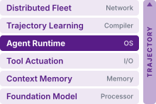
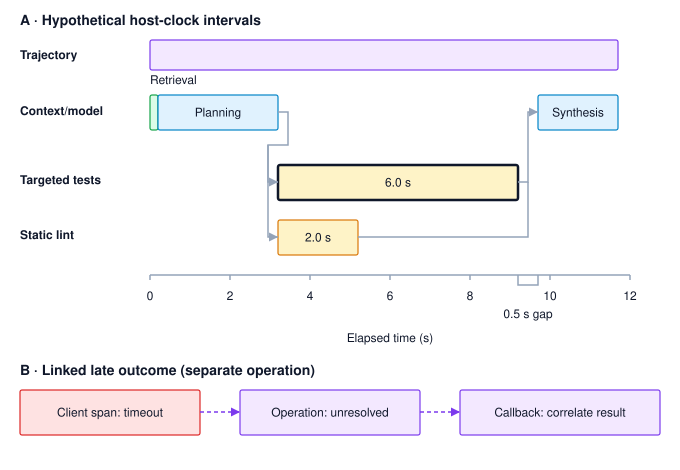
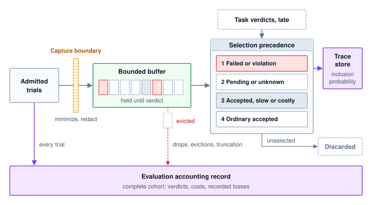
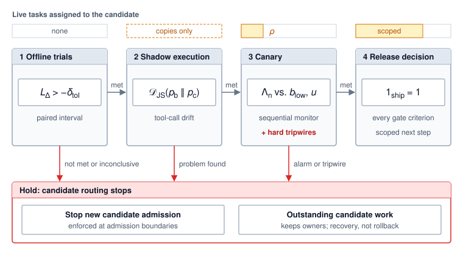

# Operating Agents {#sec-vol3-operations}

::: {layout-narrow}
::: {.column-margin}

\chapterminitoc

:::

::: {.content-visible when-format="pdf"}
\noindent
{fig-alt="Blueprint for System Observability."}
:::

::: {.content-visible unless-format="pdf"}
{fig-alt="Blueprint for System Observability."}
:::

:::

## Purpose {.unnumbered .unlisted}

::: {.content-visible when-format="pdf"}
\begin{marginfigure}
\mlagentstack{0}{0}{100}{0}{0}{0}
\end{marginfigure}
:::

::: {.content-visible unless-format="pdf"}
::: {.column-margin}
{width="100%" fig-alt="Agentic Machine Learning Systems Stack"}

*Agent stack focus for this chapter.*
:::
:::

_Why does a configuration that clears its offline evaluation still need evidence gathered while it runs?_

An offline evaluation picks its tasks, fixtures, and graders in advance, and live traffic honors none of those choices. Production brings inputs no fixture anticipated, dependencies that slow down under load, and tool results cut short without warning, while every admitted task acts with real authority. When the rate of accepted tasks drops, the count says that something failed but not where, because one trial spreads its model calls, tool executions, and checks across processes and hosts. Finding the cause takes a record of each trial, yet keeping every record costs too much and exposes private data, and sampling records at random discards exactly the rare failures engineers most need. A failure that recurs ten times under a one-percent sample leaves no detailed record about nine times in ten. Even a kept record shows only what happened. It can show that an observation was truncated and that the runtime refused an action, but whether a complete observation would have produced an accepted repair is a question only a controlled rerun from the saved state can answer. Releasing a change raises its own questions. A small canary does not make a regression cheaper to detect, because a monitor needs the same number of tasks at any traffic share; the canary limits only the harm from problems no monitor measures. Rolling back stops new work but does not recall requests already sent or restore files already changed. Operating an agent therefore means deciding in advance what to record, how to test an explanation, how much live work to expose, and what a release must show before it widens, and then writing down what is still unknown. Every exposure the agent carries reaches production at once: the state a failure leaves behind, the horizon over which harm builds before a monitor decides, and the authority whose effects outlast a rollback.

::: {.content-visible when-format="pdf"}

\newpage

:::

::: {.callout-learning-objectives}

- Explain why a diagnostic trace, the durable recovery log, and the accounting record carry different guarantees
- Analyze a trace's critical path to attribute elapsed time among overlapping spans
- Design verdict-aware trace retention that keeps rare failures within storage and privacy budgets
- Diagnose an agent failure through a controlled intervention, stating what the result does and does not establish
- Design staged releases that size canary exposure with sequential stopping rules and independent hard tripwires
- Evaluate an integrated evidence record against a declared conjunctive release gate

:::

## From Offline Verdict to Live Operation {#sec-vol3-operations-introduction}

The offline comparison of `candidate_v2` against `baseline_v1` ended without a decision in either direction. The candidate accepted more of the paired tasks, but its paired interval does not exclude a loss larger than the declared tolerance, and a powered follow-up sample is still to be planned. That verdict concerns a configuration on a sampled task population. It says nothing about why a particular trial failed, and nothing about what the configuration does once it acts on live work, where inputs are not fixtures, dependencies are shared, and every admitted task exercises real authority.

::: {.column-margin .margin-pointer}
↩ The paired comparison that leaves `candidate_v2` inconclusive against its noninferiority margin is established in @sec-vol3-evaluation-paired.
:::

::: {.column-margin}
{width="100%" fig-alt="H·S·A locator with all three axes, Horizon, State, and Authority, highlighted."}

*Operating a configuration carries every exposure at once: the state a failure leaves, the horizon before a monitor decides, and the authority a rollback cannot recall.*
:::

The repair agent (@sec-vol3-intro-lighthouses) supplies this chapter's case. One trial of `candidate_v2` on the connection-pool repair fails after its search tool returns a silently truncated result, and the next model response proposes rewriting a file outside the permitted repair scope, which the runtime refuses before dispatch. Aggregate counts record the failure; they cannot say whether the model, the observation adapter, a slow dependency, or the runtime is responsible, or whether repairing one of them would change the outcome. Answering those questions takes evidence the offline harness never collected, gathered while the system runs and kept long enough to inspect.

Four kinds of operational evidence fill that gap, and each has its own limits. A trace binds every model call, tool execution, and check to its trial, so that a delay or a failure can be attributed along the trajectory's critical path (@sec-vol3-evaluation-tracing). Retention policy decides which traces survive storage and privacy budgets, and the accounting record keeps the evaluation denominator complete when diagnostic detail is sampled (@sec-vol3-evaluation-budgets). An incident postmortem turns an observed mismatch into a hypothesis and tests it by intervening on a saved prefix of the recorded trajectory, since no amount of rereading historical telemetry can answer a counterfactual (@sec-vol3-evaluation-postmortems). Staged release then exposes a revised configuration to live work only as fast as sequential evidence and hard tripwires allow, because a rollback stops new admission but settles nothing already done (@sec-vol3-evaluation-releases). The chapter closes by joining these records with the offline comparison into one decision record and a declared release rule (@sec-vol3-evaluation-synthesis), beginning with the trace that explains where the truncated-observation trial spent its time.

## Distributed Trajectory Tracing {#sec-vol3-evaluation-tracing}

When a trial of `candidate_v2` on the connection-pool repair fails or stalls, aggregate summary metrics record only the wall-clock total and the final verdict, blending remote inference stalls, blocked test containers, and malformed or truncated tool outputs into one undifferentiated number. A trace\index{Trace} separates those possibilities by binding every interaction back to the specific evaluation trial, candidate revision, and runtime operation, replacing disjointed service logs with an end-to-end causal record.

**Distributed tracing**\index{Distributed tracing!definition} tracks units of work across process and network boundaries, an operational model established at production scale by Dapper [@sigelman2010dapper]. At the core of this model, a **span**\index{Span!definition} represents a single contiguous unit of execution defined by a unique identifier, explicit start and end timestamps, structured attributes, and optional timed events. Hierarchical parent-child relationships capture synchronous nesting, while trace links correlate decoupled asynchronous interactions that fall outside a single call tree, following the standard OpenTelemetry model [@opentelemetry2026traces]. Within an agentic trajectory, a large language model (LLM) generation step, a mediated tool execution in a sandbox, and subsequent result validation each form distinct spans. Omitting instrumentation at any of these boundaries leaves unmonitored voids, obscuring whether an unexpected delay originated in model inference, queueing overhead, or environment setup.

### Diagnostic capture and recovery history {#sec-vol3-evaluation-tracing-capture}

During the connection-pool repair, every model invocation and sandbox tool call emits both a durable log record and a diagnostic trace span, often carrying the same operation identifier. Treating those two streams as interchangeable is a dangerous operational shortcut. If an execution engine relies on its diagnostic tracing pipeline to reconstruct state after a worker crash, a single load-shedding event that drops spans or truncates large tool payloads will corrupt recovery. Separating the recovery path from the observability path ensures that telemetry backpressure never compromises execution durability.

::: {#psp-13-telemetry-duality .callout-perspective title="Recovery history and diagnostic traces"}

The durable trajectory log preserves the authoritative, acknowledged state transitions and input artifacts required to reconstruct execution state after a failure. A diagnostic telemetry stream that happens to share identical span identifiers cannot replace this log. Diagnostic traces prioritize performance analysis, bottleneck detection, and interactive debugging; under high load or network partitions, tracing pipelines legitimately sample traces, truncate large payloads, or drop spans. The same runtime event can emit records to both pipelines, but their guarantees differ completely. An observability agent might discard an optional span to protect telemetry egress, while the durable recovery engine must guarantee that operation identifiers, resource reservations, and partial results persist to durable storage.

:::

::: {.column-margin .margin-pointer}
↩ The durable trajectory log, from which recovery reconstructs execution state, is established in @sec-vol3-durable-execution-log-evidence.
:::

Systems engineers must maintain this distinction when tracking asynchronous operations such as the test run on `ws_r18` that recovery left unresolved before evaluation began. When an HTTP client monitoring that sandbox times out and terminates its diagnostic span, the underlying test does not vanish. The workload continues running inside the container until the sandbox emits an authenticated callback with the test results, which the operation table records against the original operation while the trajectory stays paused. The distributed trace reflects that split execution without rerunning the test or resuming the model prematurely. It correlates the late-arriving callback with the original dispatch attempt through a trace link, which preserves both the client-side timeout and the true server-side execution lifetime.

Captured content demands an equally strict boundary. An evaluation harness must distinguish between what an agent proposed, what intermediate middleware modified, and what the model actually received. The delivered-input manifest records the exact byte sequence presented to the model context window, which frequently diverges from raw tool output due to prompt templating, token budget truncation, or context compression. Cryptographic hashes verify payload integrity against historical records, but a hash digest cannot reconstruct payload bytes that were omitted or pruned from storage. Exact deterministic replay and forensic debugging therefore require preserving delivered-input manifests and raw observations in content-addressed storage alongside the trace metadata.

### Trace evidence fields {#sec-vol3-evaluation-tracing-fields}

Preserving input manifests and span records helps little if each service emits unstandardized telemetry tags that omit which trial, candidate revision, transport attempt, or truncation policy produced an observation. An evaluation harness instead requires a disciplined, minimal schema that links experimental parameters directly to runtime and network observations. @Tbl-vol3-trace-evidence-fields organizes the essential fields into five functional categories. The attribute names may follow a standard such as the OpenTelemetry semantic conventions; the five groups are the minimal information required to diagnose agent behavior.

| Record group          | Information to preserve                                                                                                                    | Question it answers                                                                 |
|:----------------------|:-------------------------------------------------------------------------------------------------------------------------------------------|:------------------------------------------------------------------------------------|
| Evaluation identity   | Task identity, trial identity, fixture and criterion versions, system configuration, candidate artifact revision                           | Which experiment and candidate does this observation concern?                       |
| Observed work         | Trace and span identities, operation kind, producer, start/end boundary, clock domain, parent or dependency links                          | Which work was observed, where, and in relation to what other work?                 |
| Admission and attempt | Model invocation or logical operation identity, transport attempt, applicable decision and policy references                               | Was this proposal withheld or admitted, and which attempt produced the evidence?    |
| Outcome and usage     | Response status and source, evidence scope, observed token/tool usage, unresolved liability, task-verdict reference                        | What is known about the operation, its costs, and the separate acceptance decision? |
| Capture limits        | Delivered-input and observation references, omitted ranges or bytes, instrumentation version, known drops, retention/access classification | What can an investigator inspect, and what does this record leave unavailable?      |

: **Minimal trace evidence groups**: Keep identities, observed facts, runtime decisions, and capture limits distinguishable. A completed span is not a completed task. {#tbl-vol3-trace-evidence-fields}

This schema carries the task, trial, configuration, and artifact distinctions of the acceptance record into each observed interaction, while constraining provider provenance to what the remote interface exposes. In evaluation tracing, span status must remain decoupled from the final task verdict. An operating system process running a test suite may exit with code 0, prompting the tracing layer to mark the span successful, even though the test output reveals that the candidate failed critical assertions. Conversely, a client span might terminate with a timeout error while fetching auxiliary documentation, yet the candidate agent may still synthesize a valid patch from cached context. The authoritative task acceptance decision relies on independent verification suites and often arrives long after the agent's execution spans have closed.

Propagating context across architectural boundaries such as an API gateway, an asynchronous queue, or an isolated worker sandbox demands standardized metadata carriers. The W3C Trace Context specification [@w3c2021tracecontext] provides standard HTTP and messaging headers to propagate correlation identifiers across distributed components. Trace identifiers, however, establish correlation, not authorization. A worker sandbox receiving a trace identifier cannot treat it as an admission token, nor can an agent bypass security policies by injecting arbitrary parent headers. Admission control, credential validation, and payload sanitization remain the exclusive responsibility of the runtime host. Furthermore, trace headers must never carry sensitive prompt tokens, credentials, or proprietary task data across untrusted network boundaries. When black-box tools or legacy binaries cannot emit internal spans, the orchestrator must record host-observed boundaries, explicitly tagging the span as an external dispatch-to-response measurement rather than an internal execution trace.

### Span overlap and latency attribution {#sec-vol3-evaluation-tracing-latency}

Summing span durations to obtain total agent execution time is a common error in telemetry analysis. Because a parent span encloses the lifetimes of its children, adding parent and child durations double-counts work. Furthermore, when an agent orchestrator fires multiple tool calls concurrently, for example a static analysis linter alongside a targeted test suite, their child spans overlap on the timeline. Execution order stems strictly from completion dependencies, never from parent-child hierarchy alone. Comparing durations measured on a single monotonic clock is straightforward, but correlating timestamps across distributed worker hosts requires an explicit alignment model.[^fn-lamport-happened-before] Without synchronized time sources or clock-offset modeling, apparent span overlap between distinct machines can reflect nothing more than physical clock skew. Instrumentation boundaries introduce similar attribution challenges. Client-observed model latency encompasses TCP connection handshakes, TLS negotiation, queueing delay at the inference gateway, and network transfer time, so time to first token is never an isolated measurement of model prefill compute.

[^fn-lamport-happened-before]: **Happened-Before Order in a Trace**: The partial order that @sec-vol3-durable-execution-harness-regression-replay used to match replayed requests applies to spans as well. Parent and link relations recorded at dispatch carry causal order between spans on different hosts; cross-host timestamps without an alignment model do not, so two spans that appear to overlap may be ordered, and two that appear ordered may be concurrent. \index{Happened-before relation!trace ordering}

To quantify where latency optimizations yield true wall-clock savings, systems engineers measure the critical path through the trajectory's dependency graph, the longest chain of dependent operations recorded in the trace.[^fn-critical-path-float] Sequential operations add their durations directly, whereas concurrent branches that join at a common synchronization barrier contribute only the duration of the slowest branch. Shortening a branch off the critical path leaves elapsed time unchanged, and shortening one on it helps only until the next-longest branch takes its place (notebook \ref{nbk-13-critical-path-latency-and-bottleneck}).

::: {.column-margin .margin-pointer}
↪ An acceleration is priced by the time it removes from this critical path, a trade-off developed in @sec-vol3-agent-economics-criticalpath.
:::

[^fn-critical-path-float]: **Critical Path Method**: Critical-path planning was formalized in 1959 for scheduling large engineering projects, computing for each activity the float by which it can slip without delaying completion [@kelley1959critical]. The notebook measures a related quantity, the duration gap between the critical branch and the next-longest parallel path. \index{Critical path!float}

```{python}
#| label: calc-vol3-evaluation-observed-critical-path
#| echo: false
# OBSERVED SPANS AND A CHANGING CRITICAL PATH (LEGO)
# Goal: Separate overlapping work, unexplained time, and a conditional speedup.
# Scope: Hypothetical host-observed intervals in seconds, not benchmark data.
from mlsysim import second
from mlsysim.fmt import fmt, fmt_int, fmt_qty, check

class ObservedCriticalPath:
    # 1. LOAD: one clock; parallel checks start together; no other dependencies.
    retrieval = (0.0, 0.2)
    planning = (0.2, 3.2)
    tests = (3.2, 9.2)
    lint = (3.2, 5.2)
    synthesis = (9.7, 11.7)
    segment = (0.0, 11.7)
    faster_test_s = 1.0  # intervention assumption, not an observed improvement

    # 2. EXECUTE: seconds throughout; enclosing span is not added to children.
    retrieval_s = retrieval[1] - retrieval[0]
    planning_s = planning[1] - planning[0]
    tests_s = tests[1] - tests[0]
    lint_s = lint[1] - lint[0]
    synthesis_s = synthesis[1] - synthesis[0]
    wall_s = segment[1] - segment[0]
    leaf_sum_s = retrieval_s + planning_s + tests_s + lint_s + synthesis_s
    accounted_s = retrieval_s + planning_s + max(tests_s, lint_s) + synthesis_s
    gap_s = synthesis[0] - max(tests[1], lint[1])
    changed_s = retrieval_s + planning_s + max(faster_test_s, lint_s) + gap_s + synthesis_s
    saving_s = wall_s - changed_s
    reduction_s = tests_s - faster_test_s

    # 3. GUARD: boundaries, overlap, and independent path enumeration.
    check(retrieval[1] == planning[0], "Serial retrieval-to-planning boundary")
    check(planning[1] == tests[0] == lint[0], "Checks start together")
    check(gap_s >= 0, "Synthesis follows both checks")
    check(abs(leaf_sum_s - 13.2) < 1e-9, "Overlapping leaf-duration sum")
    check(abs(accounted_s + gap_s - wall_s) < 1e-9, "Complete elapsed accounting")
    check(abs(wall_s - 11.7) < 1e-9 and abs(gap_s - 0.5) < 1e-9, "Declared observation window")
    check(abs(changed_s - max(0.2 + 3 + 1 + 0.5 + 2, 0.2 + 3 + 2 + 0.5 + 2)) < 1e-9, "Recompute both paths")
    check(abs(saving_s - 4.0) < 1e-9, "Saving limited by the other branch")

    # 4. OUTPUT: every export is consumed below.
    retrieval_interval_str = f"[{fmt_int(retrieval[0])}, {fmt(retrieval[1], precision=1)}]"
    planning_interval_str = f"[{fmt(planning[0], precision=1)}, {fmt(planning[1], precision=1)}]"
    tests_interval_str = f"[{fmt(tests[0], precision=1)}, {fmt(tests[1], precision=1)}]"
    lint_interval_str = f"[{fmt(lint[0], precision=1)}, {fmt(lint[1], precision=1)}]"
    synthesis_interval_str = f"[{fmt(synthesis[0], precision=1)}, {fmt(synthesis[1], precision=1)}]"
    wall_str = fmt_qty(wall_s * second, second, precision=1)
    leaf_sum_str = fmt_qty(leaf_sum_s * second, second, precision=1)
    accounted_str = fmt_qty(accounted_s * second, second, precision=1)
    gap_str = fmt_qty(gap_s * second, second, precision=1)
    faster_str = fmt_qty(faster_test_s * second, second, precision=0)
    changed_str = fmt_qty(changed_s * second, second, precision=1)
    saving_str = fmt_qty(saving_s * second, second, precision=0)
    reduction_str = fmt_qty(reduction_s * second, second, precision=0)
```

The hypothetical intervals used in notebook \ref{nbk-13-critical-path-latency-and-bottleneck} share a single host clock. @Fig-vol3-overlapping-trace-intervals places them on a common axis so that the parallel checks, their join, and the unaccounted interval remain visible together.

::: {#fig-vol3-overlapping-trace-intervals data-explore="original-v3-vol3-overlapping-trace-intervals" data-explore-key="vol3:fig-vol3-overlapping-trace-intervals" fig-env="figure" fig-pos="htb" fig-cap="**Overlapping Spans and Late Outcomes**: Panel A plots the notebook's hypothetical host-observed intervals, not benchmark measurements. Tests and lint begin after planning; synthesis waits for both. The dark outline identifies tests as the longer parallel branch, while the gap before synthesis remains unattributed. The enclosing trajectory is elapsed time, not another duration to add to its children. Panel B is a separate operation example: a client timeout ends a span but leaves the operation unresolved until correlated evidence arrives." fig-alt="A common time axis shows an enclosing trajectory, retrieval and planning, concurrent tests and lint, and later synthesis. A bracket marks a half-second gap. Below, a separate linked sequence connects a timed-out client span to an unresolved operation and a later callback."}

:::

The join prevents a faster lint check from shortening this segment while tests remain the longer branch. The later synthesis start also leaves a gap that these spans do not explain. Neither nesting nor a successful callback supplies the separate evidence required to accept the task.

::: {#nbk-13-critical-path-latency-and-bottleneck .callout-notebook title="Observed time and the critical path"}

**Problem**: How much elapsed time do the recorded spans explain, and how much would shortening one check reduce the segment if the other durations and dependencies stayed unchanged?

**Assumptions**: @Tbl-vol3-trace-hierarchy gives observations from a separate hypothetical timing trial that inspects `ws_r19`. The model first proposes checks, the runtime admits two independent read-only checks, and synthesis waits for both. All intervals use one host clock, no hidden dependency delays either check's start, and admission takes no separate time. The enclosing segment runs from retrieval dispatch through the final response.

| Observed span                      | Interval after segment start (s)                       | Required predecessor                         |
|:-----------------------------------|:-------------------------------------------------------|:---------------------------------------------|
| Retrieve supporting context        | `{python} ObservedCriticalPath.retrieval_interval_str` | Segment start                                |
| Model call proposing checks        | `{python} ObservedCriticalPath.planning_interval_str`  | Retrieval response                           |
| Targeted tests                     | `{python} ObservedCriticalPath.tests_interval_str`     | Validated and admitted check proposal        |
| Static lint check                  | `{python} ObservedCriticalPath.lint_interval_str`      | Same proposal; independent of targeted tests |
| Model call synthesizing the report | `{python} ObservedCriticalPath.synthesis_interval_str` | Both check responses                         |

: **Hypothetical observed span intervals**: The two checks overlap. The enclosing segment measures `{python} ObservedCriticalPath.wall_str`; its duration is not additional work to sum with these children. {#tbl-vol3-trace-hierarchy}

**Math**: Adding all leaf durations yields `{python} ObservedCriticalPath.leaf_sum_str`, an overestimate that double-counts concurrent execution during the validation phase. Following the path through retrieval, planning, the longer check (targeted tests), and synthesis, which counts the overlapping checks once, explains `{python} ObservedCriticalPath.accounted_str`. The remaining `{python} ObservedCriticalPath.gap_str` occurs between the completion of the slowest check and the dispatch of the final synthesis call. Because the trace lacks instrumentation for intermediate runtime bookkeeping, prompt serialization, or context collation, this duration remains unattributed. An unmeasured interval highlights a boundary where instrumentation must be refined rather than evidence of worker idle time.

**Intervention**: Suppose an optimization accelerates the targeted test suite from 6.0 s down to `{python} ObservedCriticalPath.faster_str` while all other components remain unchanged. Because the static lint check requires 2.0 s, lint replaces the test suite as the bottleneck on the parallel branch. Recomputing the critical path yields `{python} ObservedCriticalPath.changed_str` for the total segment, achieving an overall elapsed reduction of `{python} ObservedCriticalPath.saving_str`.

**Systems insight**: A performance optimization on a parallel execution branch yields wall-clock returns only up to the duration gap to the next-longest concurrent path. Accelerating the test suite by `{python} ObservedCriticalPath.reduction_str` yields only `{python} ObservedCriticalPath.saving_str` of end-to-end savings because static linting immediately becomes the new critical-path limiter. Systems architects must recompute the critical path across the entire dependency graph before estimating the value of an optimization. Furthermore, theoretical speedups must always be verified empirically in controlled trials; real-world optimizations can shift resource contention, alter cache locality, change garbage collection pressure, or elicit different token generation lengths from the model.

:::

::: {#chk-13-trajectory-instrumentation .callout-checkpoint title="Interpret the trace's evidence"}

- [ ] **Identity**: Why does sharing a trace ID neither authorize a tool call nor make a result applicable to a different candidate revision?
- [ ] **Outcome**: A client span ends at timeout, and a later grader remains pending. Which operation and task conclusions are still unavailable?
- [ ] **Overlap**: Why do parent-child links and concurrent checks prevent summing every span duration into task latency?
- [ ] **Missing time**: What additional capture would be needed to explain the notebook's gap, and why does its location not identify a unique cause?
- [ ] **Changed path**: Using the notebook's intervals, how much would the segment shrink if the lint check, rather than the tests, were cut to `{python} ObservedCriticalPath.faster_str`? What does the resulting duration imply about where to spend optimization effort?

:::

Distributed trajectory tracing provides the causal fabric needed to diagnose why an agent succeeded, failed, or stalled. However, capturing detailed telemetry incurs concrete engineering costs in CPU overhead, network bandwidth, and persistent storage. In high-throughput evaluation harnesses, preserving every token, tool payload, and internal span across thousands of benchmark trials is rarely feasible. Defining what to measure is only the first half of the observability problem; the second half is establishing capture and retention policies that preserve critical failure evidence without overwhelming the telemetry infrastructure.

## Trace Retention and Privacy {#sec-vol3-evaluation-budgets}

If a delayed regression suite for the trial that produced `ws_r19` fails hours after execution concludes, that trial suddenly becomes diagnostically indispensable. By that time, however, its runtime process has terminated and its model and tool spans have closed. The forensic value of the run depends entirely on what the telemetry system chose to keep. Trace retention therefore requires integration with final task verdicts and their arrival timelines, rather than relying purely on process exit codes or span completion markers. Because retaining exhaustive execution histories rapidly escalates storage expenditures and expands sensitive data exposure, systems designers must determine which evidence each evaluation goal demands, and which diagnostic guarantees remain possible when capture budgets are constrained.

### Accounting records and head sampling {#sec-vol3-evaluation-budgets-accounting}

If a telemetry pipeline samples trial registrations at the same rate as diagnostic span bodies, any trial that times out, crashes a worker, or drops its spans disappears from the evaluation denominator, biasing pass rates toward fast, easy runs. Beyond the recovery history and diagnostic traces separated in perspective \ref{psp-13-telemetry-duality}, evaluation requires a third artifact: the *accounting record*. This record catalogs every admitted trial, its exact environment configuration, evaluation criteria, current verdict status, measured resource expenditures, and missing telemetry markers. While these three records can reside on shared physical storage, sampling policies must apply exclusively to diagnostic detail. Telemetry systems must never sample recovery history or the evaluation denominator.

Diagnostic detail also expands substantially faster than the underlying trajectory when spans mirror raw message history. If each model-call span replicates the entire conversation context sent to the provider, diagnostic trace volume inherits the quadratic resend pattern formalized in @eq-vol3-trajectory-resend. Telemetry systems avoid this runaway expansion by referencing immutable conversation prefixes via cryptographic content digests and storing each new tool observation exactly once. This content-addressable deduplication keeps storage growth linear in the number of turns, provided the underlying blob store retains the referenced content for the lifetime of the trace.

**Head sampling**\index{Head sampling!definition} decides whether to retain detailed diagnostic traces at the initial entry point of execution. Drawing a random sample with recorded inclusion probabilities allows engineers to compute unbiased population estimates for metrics such as mean latency or aggregate token consumption. However, uniform head sampling struggles with rare failure modes, as an intermittent defect can easily slip through without leaving a single retained trace.

```{python}
#| label: calc-vol3-evaluation-head-sampling-miss
#| echo: false
# RARE FAILURES UNDER HEAD SAMPLING (LEGO)
# Goal: Probability that a failure mode leaves no detailed trace.
# Scope: Independent retention with fixed probability, decided before outcomes.
from mlsysim.fmt import fmt_int, fmt_percent, check

class HeadSamplingMiss:
    # 1. LOAD: hypothetical head-sampling probability and occurrence counts.
    theta = 0.10
    rare_count = 5
    common_count = 50
    chk_theta, chk_count = 0.05, 20  # checkpoint exercise givens
    # Dapper's first production sampling: one trace per 1024 candidates
    # (Sigelman et al. 2010, Google Technical Report dapper-2010-1).
    dapper_denominator = 1024

    # 2. EXECUTE: each occurrence retained independently with probability theta.
    miss_rare = (1 - theta) ** rare_count
    miss_common = (1 - theta) ** common_count

    # 3. GUARD
    check(abs(miss_rare - 0.59049) < 1e-9, "Five occurrences, ten percent")
    check(miss_common < 0.01, "Fifty occurrences")

    # 4. OUTPUT
    theta_str = fmt_percent(theta, precision=0, style="prose")
    rare_count_str = fmt_int(rare_count)
    common_count_str = fmt_int(common_count)
    chk_theta_str = fmt_percent(chk_theta, precision=0, style="prose")
    chk_count_str = fmt_int(chk_count)
    dapper_denominator_str = fmt_int(dapper_denominator)
    miss_rare_str = fmt_percent(round(miss_rare, 2), precision=0, style="prose")
    miss_common_str = fmt_percent(round(miss_common, 3), precision=1, style="prose")
```

Because head sampling decides retention before execution outcomes are known, each occurrence of a failure mode is retained independently with sampling probability $\HeadSamplingProbability$. Consequently, a failure mode that occurs $\FailureModeOccurrenceCount$ times leaves no detailed diagnostic trace with probability $(1-\HeadSamplingProbability)^{\FailureModeOccurrenceCount}$. At $\HeadSamplingProbability =$ `{python} HeadSamplingMiss.theta_str`, a failure mode that occurs `{python} HeadSamplingMiss.rare_count_str` times carries roughly a `{python} HeadSamplingMiss.miss_rare_str` probability of leaving zero detailed examples in storage. Only when that mode recurs `{python} HeadSamplingMiss.common_count_str` times does the probability of a complete miss fall to `{python} HeadSamplingMiss.miss_common_str`. By its mathematical nature, uniform sampling is least likely to preserve the rare, anomalous executions that engineers most urgently need to inspect.

To capture these elusive events without retaining every routine execution, **tail sampling**\index{Tail sampling!definition} defers the retention decision until operational evidence accumulates downstream, such as a failed acceptance assertion, an unhandled tool exception, an unexpected human intervention, or an anomalous latency spike. Tail selection deliberately concentrates diagnostic storage on high-value, problematic runs, producing a trace collection that is intentionally unrepresentative of normal production traffic. Engineers must therefore compute population failure rates from the complete accounting record rather than from the tail-sampled trace collection. Whenever teams derive statistical estimates from sampled records, the telemetry infrastructure must record the exact inclusion probabilities alongside the active selection policy version.[^fn-dapper-uniform-sampling] Diagnostic workflows also require a baseline for comparison. The pipeline must retain a known random sample of ordinary, accepted trials as a control group, because an isolated failure trace cannot reveal which intermediate steps were anomalous and which were routine.

[^fn-dapper-uniform-sampling]: **Uniform Trace Sampling**: The first production version of one large-scale tracing system sampled uniformly, averaging one traced request per `{python} HeadSamplingMiss.dapper_denominator_str` candidates, which sufficed for high-traffic services because events of interest recurred often enough to be captured; lower-traffic workloads could miss important events at that rate [@sigelman2010dapper]. Its later adaptive scheme targeted a rate of sampled traces per unit time and recorded the sampling probability with each trace, the inclusion-probability bookkeeping that population estimates require. \index{Head sampling!Dapper}

### Tail sampling and verdict windows {#sec-vol3-evaluation-budgets-tail-sampling}

If a tail-sampling buffer evicts trace bodies before a slow regression suite finishes grading `ws_r19`, the accounting record logs the late failure while the spans needed to explain it are already gone. Because tail selection spans multiple operational stages, an execution trace is held provisionally in a staging buffer while acceptance checks run, receiving its final retention classification only when conclusive evaluation evidence arrives within a declared verdict window. When the staging buffer expires before an asynchronous failure is reported, the accounting record must explicitly flag the missing diagnostic detail so audit integrity holds. @Tbl-vol3-tail-sampling-policies outlines this tiered retention policy, establishing a strict precedence order so that overlapping classification rules do not count or persist a single trace multiple times.

| Evidence at the decision boundary                                | Possible detailed-trace policy                                           | Limit to record                                                                                              |
|:-----------------------------------------------------------------|:-------------------------------------------------------------------------|:-------------------------------------------------------------------------------------------------------------|
| Failed task criterion or enforced-policy violation               | Give high retention priority, with the criterion and supporting evidence | A process error does not inherently prove whole-task failure, and buffer saturation may still force eviction |
| Pending or unknown task verdict                                  | Retain provisionally or under an explicit unresolved-case sample         | State the deadline, missing evidence, and what happens when the window expires                               |
| Accepted but unusually slow, costly, or intervention-heavy trial | Retain under declared diagnostic thresholds                              | Selection enriches those behaviors and does not establish their population frequency                         |
| Ordinary accepted trial                                          | Retain a known random control sample                                     | Preserve its inclusion probability and distinguish unsampled from lost                                       |

: **Verdict-aware trace selection**: Selection uses declared task criteria and available evidence, including delayed evaluation outcomes. Successful process completion does not imply task acceptance. {#tbl-vol3-tail-sampling-policies}

::: {.column-margin}
*Eviction priority*: When ring buffers experience memory pressure, eviction policies must shed routine successes and unclassified traces before dropping runs flagged for policy violations or failed assertions. While differential eviction priority substantially improves diagnostic survival rates, extreme burst traffic can still cause trace loss.
:::

Physical buffer limits inevitably govern this architecture. Buffer managers must enforce four concurrent bounds: active trace count, aggregate byte volume, individual trace size limits, and maximum staging age. Sizing from averages, such as mean concurrent traces multiplied by mean trace size, is a frequent engineering trap, because cascading failures typically produce bursts of unusually long, tool-heavy trajectories that quickly exhaust buffer memory. Telemetry systems must expose real-time metrics for head-dropped records, buffer evictions, and span truncations broken down by cohort and selection class. Without this visibility, correlated loss during incidents will silently purge the exact failure traces engineers need to diagnose system outages. Furthermore, while deferred tail selection curtails long-term downstream storage, it does not reduce the network ingress and memory needed to buffer traces prior to selection, and strict privacy restrictions apply to these staging buffers as well. The accounting record therefore sits outside the buffer (@fig-vol3-tail-sampling-pipeline). Every admitted trial enters it directly, together with every recorded drop, eviction, and truncation, so the denominator survives whatever the buffer loses.

::: {#fig-vol3-tail-sampling-pipeline data-explore="original-v3-vol3-tail-sampling-pipeline" data-explore-key="vol3:fig-vol3-tail-sampling-pipeline" fig-env="figure" fig-pos="htb" fig-cap="**Verdict-Aware Trace Selection**: Trace bodies pass a fallible minimization boundary into a bounded buffer that holds them until task verdicts, which can arrive late, reach the selector. Selection applies a declared precedence among the classes of @tbl-vol3-tail-sampling-policies, keeps inclusion probabilities with retained traces, and discards unselected bodies. Every admitted trial also enters the accounting record directly, together with recorded drops, evictions, and truncation, so the denominator does not depend on which bodies survived. Assigning high retention priority protects failure traces under moderate load, though severe buffer saturation can still force evictions before verdicts arrive." fig-alt="Left-to-right flow diagram. An admitted-trials box sends traces through a dashed amber capture boundary, labeled minimize, redact, into a green bounded buffer drawn as a row of eight slots, some shaded red for failures, some dashed for pending verdicts, one gray, the rest plain, held until verdict. One plain slot drops below the buffer, labeled evicted. The buffer feeds a selection precedence ladder that also receives late task verdicts from above. Its four numbered rungs are failed or violation, shaded red; pending or unknown, dashed; accepted, slow or costly, gray; and ordinary accepted, plain, matching the slot styles. The ladder sends selected traces to a violet trace store that keeps inclusion probability and, from its bottom edge, unselected traces to a dashed discarded box. Along the bottom, a violet evaluation accounting record spans the width, receiving an arrow labeled every trial straight from admitted trials and a red dashed arrow from the evicted slot labeled drops, evictions, truncation."}

:::

```{python}
#| label: lego-13-telemetry-ingestion-inverted-economics
#| echo: false
# VERDICT-AWARE RETAINED VOLUME (LEGO)
# Goal: Compare expected downstream diagnostic bytes under two selections.
# Scope: Hypothetical disjoint classes, equal trace sizes, no capture loss.
from mlsysim import Q_
from mlsysim.fmt import fmt_memory, fmt_int, fmt_multiple, fmt_percent, check

class TelemetryIngestionInvertedEconomics:
    # 1. LOAD: one hourly cohort, not measured workload characteristics.
    trials = 10_000
    failed = 400
    unresolved = 100
    ordinary = 9_500
    trace_size = Q_(1.4, "megabyte")  # decimal MB, complete permitted body
    hours = 24
    head_probability = 0.05
    control_probability = 0.02
    control_step = 0.01  # one percentage point of control sampling

    # 2. EXECUTE: high-priority classes all fit in the assumed window.
    head_count = trials * head_probability
    head_failed = failed * head_probability
    head_unresolved = unresolved * head_probability
    tail_ordinary = ordinary * control_probability
    tail_count = failed + unresolved + tail_ordinary
    full_volume = trials * hours * trace_size
    head_volume = head_count * hours * trace_size
    tail_volume = tail_count * hours * trace_size
    ratio = (full_volume / tail_volume).to("").magnitude
    floor_volume = (failed + unresolved) * hours * trace_size
    per_point_volume = ordinary * control_step * hours * trace_size

    # 3. GUARD: conservation and independently stated byte totals.
    check(failed + unresolved + ordinary == trials, "Disjoint complete cohort")
    check(head_count == 500 and tail_count == 690, "Expected selected traces")
    check((head_failed, head_unresolved, tail_ordinary) == (20, 5, 190), "Expected selected classes")
    check(abs(full_volume.to("gigabyte").magnitude - 336) < 1e-9, "Full daily decimal GB")
    check(abs(head_volume.to("gigabyte").magnitude - 16.8) < 1e-9, "Head daily decimal GB")
    check(abs(tail_volume.to("gigabyte").magnitude - 23.184) < 1e-9, "Tail daily decimal GB")

    # 4. OUTPUT: every formatted export is consumed below.
    trials_str = fmt_int(trials)
    failed_str = fmt_int(failed)
    unresolved_str = fmt_int(unresolved)
    ordinary_str = fmt_int(ordinary)
    trace_mb_str = fmt_memory(trace_size, unit="MB", precision=1)
    hours_str = fmt_int(hours)
    head_probability_str = fmt_percent(head_probability, precision=0, style="prose")
    control_probability_str = fmt_percent(control_probability, precision=0, style="prose")
    head_failed_str = fmt_int(head_failed)
    head_unresolved_str = fmt_int(head_unresolved)
    tail_ordinary_str = fmt_int(tail_ordinary)
    head_count_str = fmt_int(head_count)
    tail_count_str = fmt_int(tail_count)
    full_gb_str = fmt_memory(full_volume, unit="GB", precision=0)
    head_gb_str = fmt_memory(head_volume, unit="GB", precision=1)
    tail_gb_str = fmt_memory(tail_volume, unit="GB", precision=3)
    reduction_mult_str = fmt_multiple(ratio, precision=1)
    floor_gb_str = fmt_memory(floor_volume, unit="GB", precision=1)
    per_point_gb_str = fmt_memory(per_point_volume, unit="GB", precision=1)
```

::: {#nbk-13-telemetry-ingestion-inverted-economics .callout-notebook title="What verdict-aware selection saves"}

**Problem**: How much downstream diagnostic storage do uniform head sampling and verdict-aware tail selection use for the same hypothetical workload?

**Assumptions**: Each hour brings `{python} TelemetryIngestionInvertedEconomics.trials_str` trials with equal `{python} TelemetryIngestionInvertedEconomics.trace_mb_str` permitted trace bodies. At the selection boundary, `{python} TelemetryIngestionInvertedEconomics.failed_str` have failed criteria, `{python} TelemetryIngestionInvertedEconomics.unresolved_str` remain pending or unknown, and `{python} TelemetryIngestionInvertedEconomics.ordinary_str` are ordinary accepted trials. These classes are disjoint, repeat for `{python} TelemetryIngestionInvertedEconomics.hours_str` hours, and all survive collection. Head selection samples each trial with probability `{python} TelemetryIngestionInvertedEconomics.head_probability_str`. Tail selection retains the failed and unresolved classes and independently samples `{python} TelemetryIngestionInvertedEconomics.control_probability_str` of ordinary accepted trials.

**Math**: Keeping every body requires `{python} TelemetryIngestionInvertedEconomics.full_gb_str` over the stated period. Head sampling retains an expected `{python} TelemetryIngestionInvertedEconomics.head_count_str` traces per hour, or `{python} TelemetryIngestionInvertedEconomics.head_gb_str` over the stated period. It includes an expected `{python} TelemetryIngestionInvertedEconomics.head_failed_str` failed and `{python} TelemetryIngestionInvertedEconomics.head_unresolved_str` unresolved trials per hour, not guaranteed counts. Tail selection retains `{python} TelemetryIngestionInvertedEconomics.failed_str` failed, `{python} TelemetryIngestionInvertedEconomics.unresolved_str` unresolved, and an expected `{python} TelemetryIngestionInvertedEconomics.tail_ordinary_str` ordinary accepted trials: `{python} TelemetryIngestionInvertedEconomics.tail_count_str` traces per hour and `{python} TelemetryIngestionInvertedEconomics.tail_gb_str` over the stated period.

**Result**: Full retention uses about `{python} TelemetryIngestionInvertedEconomics.reduction_mult_str` the downstream bytes of the tail policy. Tail selection consumes more capacity than uniform head sampling in this scenario, but it guarantees diagnostic visibility for every failed and unresolved execution rather than retaining only an unpredictable handful of anomalous runs.

**Systems insight**: Retained volume is governed by two terms. The first is an inelastic storage floor determined by the failure-plus-unresolved rate (`{python} TelemetryIngestionInvertedEconomics.floor_gb_str` per day in this workload). The second is an adjustable overhead determined by the control sampling fraction on routine successes, where each percentage point of control sampling adds `{python} TelemetryIngestionInvertedEconomics.per_point_gb_str` per day. Capacity planning must size the baseline floor to accommodate elevated failure rates during service disruptions while dialing the control rate to fit available long-term storage budgets. These calculations reflect decimal gigabytes for raw trace payloads; indexing metadata, replication factors, accounting records, and upstream ingestion buffers impose additional overhead.

:::

### Disclosure minimization {#sec-vol3-evaluation-budgets-disclosure}

Dumping raw model prompts and unredacted tool responses directly into a shared tracing backend turns the observability pipeline into a secondary data leak, spreading customer records, database keys, and proprietary source snippets across search indexes and crash logs where retroactive scrubbing cannot reach them. Diagnostic investigations rarely require wholesale ingestion of raw prompts and complete tool outputs; structured metadata (typed return codes, schema versions, sub-span latencies, policy decisions, and hashed artifact pointers) often provides complete debugging context without exposing sensitive user data. Even when credentials and API tokens are cleanly scrubbed, tool arguments and responses frequently contain private records or personal identifiers. Authorization policies must therefore govern specific data attributes and restrict access by investigator role, rather than granting blanket read access to an entire telemetry tier. Data minimization belongs at the trusted capture boundary inside the execution runtime, before unscrubbed buffers enter network queues, ingestion daemons, or alerting systems.

Automated redaction mitigates disclosure risks, but systems designers must treat every scrubbing mechanism as inherently fallible. Regular expressions miss non-standard or obfuscated secret patterns. Shannon entropy detectors flag UUIDs and cryptographic nonces while missing predictable credentials. Named-entity recognition models err, skipping private names or stripping valid operational syntax required to diagnose a tool error. Because heuristic sanitizers cannot guarantee zero disclosure across arbitrary payloads, architectural schema design must prioritize structural field exclusion over text redaction, so that unnecessary fields are never captured in the first place. For retained fields that undergo transformation, pipelines must validate sanitization rules against curated benchmark suites containing real-world sensitive patterns. When downstream diagnosis requires correlating multiple actions by the same entity without revealing real-world identities, telemetry systems should replace identifiers with keyed cryptographic pseudonyms. Generating these pseudonyms via a hash-based message authentication code (HMAC) requires a securely managed secret key rather than a public salt [@krawczyk1997hmac, sec. 2]. However, engineers must recognize that persistent pseudonyms preserve relational linkability across traces. Regular key rotation limits longitudinal correlation across evaluation epochs, at the cost of diagnoses that must follow one entity across several weeks. Pseudonymization is not complete anonymization, nor does it justify indefinite trace retention.

### Replay fidelity after redaction {#sec-vol3-evaluation-budgets-replay-fidelity}

Stripping a sensitive database column from a tool response can conceal the exact formatting defect that triggered a model's parsing error, and replacing an address string with a placeholder or pseudonym can shift sub-word token boundaries and steer the model down an entirely different decoding path during re-execution. Because scrubbing or masking input tokens alters the precise byte sequences that drove agent behavior, sanitization creates an inherent tension between privacy enforcement and replay fidelity: a redacted trace cannot serve as a bit-exact substitute for the environment interactions that actually occurred. When forensic investigations require exact replay and compliance policies permit it, systems must isolate raw execution payloads in a dedicated, access-restricted artifact repository, completely separate from general diagnostic telemetry. The diagnostic trace then stores only cryptographic hashes pointing to these secured blobs, alongside metadata recording the exact transformation pipeline used to generate the sanitized view. When raw payloads expire under data-retention schedules or cannot be kept due to privacy constraints, teams must formally narrow the scope of their diagnostic claims. Replaying an agent against synthetic mock fixtures validates whether the model handles a class of problems in a fresh run, but it does not prove what occurred during the original production execution.

::: {.callout-checkpoint title="Retained evidence and supported conclusions"}

- [ ] **Buffer expiration**: A broader acceptance check fails after the trace buffer expires. What can the accounting record establish, and what can it no longer provide for diagnosis?
- [ ] **Tail-sampling bias**: Why does the failure fraction in a tail-selected collection not estimate the population failure rate without an appropriate inclusion design?
- [ ] **Head-sampling estimate**: Uniform head sampling keeps `{python} HeadSamplingMiss.chk_theta_str` of traces, and a failure mode has occurred `{python} HeadSamplingMiss.chk_count_str` times. Estimate the chance that no detailed trace of it survives, and decide whether verdict-aware selection is worth its extra storage for this mode.
- [ ] **Sanitized replay**: A sanitized observation is available but its original protected artifact has expired. Which replay claim must be narrowed, and why is its digest insufficient?

:::

Storage budgets determine which runtime observations survive, while privacy policies govern which preserved artifacts an investigator may legally inspect. Every postmortem analysis and regression benchmark operates within the boundary those two constraints set.

## Incident Postmortems {#sec-vol3-evaluation-postmortems}

When verdict-aware retention preserves the failed connection-pool repair trial of `candidate_v2` (@sec-vol3-operations-introduction), the retained trace shows the search response ending in the middle of a source excerpt with no truncation notice, even though the bounded-observation contract requires one, followed by a model response that proposes replacing a file outside the permitted repair scope. The runtime rejects that proposal before dispatch. While the execution trace pinpoints where the observation was cut short and where the runtime blocked the illegal operation, it cannot reveal whether a complete observation would have produced an accepted repair. An incident postmortem[^fn-blameless-postmortem-evaluation] connects such telemetry to a testable explanation and a scoped corrective change.

::: {.column-margin .margin-pointer}
↩ The bounded-observation contract, under which an adapter that cuts a result must say so in a typed truncation notice, is established in @sec-vol3-tool-calling-truncation-notices.
:::

Rigorous postmortems keep these initial findings strictly separated. Delivering an excerpt without truncation metadata demonstrates an interface defect. Emitting an out-of-scope file replacement reveals how the foundation model behaved when starved of context. Intercepting that illegal write confirms that the admission gate functioned as designed. Because failures in agentic systems typically stem from compounding interactions across subsystems, prematurely pinning the fault on a single component obscures the precise conditions that engineering fixes must resolve.

[^fn-blameless-postmortem-evaluation]: **Blameless Postmortem**: Site reliability engineering conducts blameless postmortems to identify contributing causes without indicting any individual or team [@beyer2016sre, ch. 15]. Agent incidents extend this stance from people to components: a model, an observation adapter, and an admission gate can each contribute, and naming one culprit early hides the conditions the corrective change must address. \index{Postmortem!blameless}

### Reconstruction and replay {#sec-vol3-postmortem-replay}

Rereading a static trace cannot show whether `candidate_v2` would have repaired the connection pool given an untruncated search result. Re-running a modified agent against recorded tool outputs without request matching can also pair new model calls with stale environment replies. The three uses of a recorded trajectory from durable execution become the postmortem's three instruments, each answering a distinct diagnostic question:

- *Time-travel replay* folds recorded decisions from a compatible execution checkpoint to recover the exact system state visible to the agent at the moment of failure.
- *Harness regression replay* executes deterministic component code against captured inputs while disabling live external side effects.
- A *counterfactual branch* forks execution from a saved prefix, altering a specific variable or interface contract and collecting fresh observations along the divergent path.

::: {.column-margin .margin-pointer}
↩ The three uses of a recorded trajectory, and the limits of what each one shows, are established in @sec-vol3-persistence-replay.
:::

Time-travel replay only inspects the past, and no replay mode can synthesize an unrecorded historical outcome. Demonstrating that a revised routine now passes its tests does not change what the original trial delivered, observed, or did. Furthermore, the fidelity of time-travel replay remains strictly bounded by the capture contract defined in perspective \ref{psp-13-telemetry-duality}. Examining the delivered context reveals the truncated excerpt presented to the model. Reviewing separately preserved raw stdout reveals what the adapter dropped. Inspecting redacted logs reveals only execution metadata and high-level status.

Harness regression replay is especially effective for isolating data transformations without incurring expensive model invocations. Supplying captured tool responses to legacy and revised observation adapters, with live effect paths disabled, deterministically verifies that the legacy adapter omitted a required partial-result marker while the revised adapter correctly supplies it. However, this offline harness test cannot predict how a model will respond to the revised observation envelope. Answering that question requires a live experiment. Any alteration to prompt text, sampling temperature, model configuration, or tool observation formats represents an intervention rather than a passive replay. Recorded downstream responses remain reusable only under the matching-request rule of @sec-vol3-evaluation-gyms; matching solely on tool names risks fabricating artificial successes by pairing new model actions with obsolete environment responses.

### Fault attribution {#sec-vol3-postmortem-attribution}

Blaming the model for proposing an out-of-scope file rewrite, or trusting the model's own retrospective explanation of why it failed, confuses a downstream symptom with the upstream truncation defect that triggered it. In the connection-pool incident, comparing the search tool's raw output against the delivered envelope confirms that the observation adapter silently truncated the text. That finding yields an engineering hypothesis, namely that omitting the completeness signal misled the model into generating inappropriate repair proposals. Validating this hypothesis demands empirical outcomes measured after an intervention rather than repeated scrutiny of historical telemetry. @Tbl-vol3-fault-attribution distinguishes useful evidence from claims that telemetry cannot support alone; its rows represent overlapping investigation paths rather than mutually exclusive diagnoses.

| Suspected boundary    | Evidence or controlled comparison                                           | Limit of the finding                                                                 |
|:----------------------|:----------------------------------------------------------------------------|:-------------------------------------------------------------------------------------|
| Context assembly      | Compare retained source versions, delivered messages, and omission metadata | An omitted fact is not proof that restoring it will complete the task                |
| Tool observation      | Compare captured output with the adapter's declared and delivered envelopes | A truncation defect does not make the model's later inference correct                |
| Model response        | Repeat the specified invocation or continuation under controlled conditions | A different response does not identify temperature or sampling as the original cause |
| Runtime admission     | Exercise captured proposals and control inputs against the stated guards    | A rejected proposal differs from an unauthorized operation that was dispatched       |
| Execution environment | Compare endpoint evidence, configuration, and relevant fault records        | A timeout or process termination signal alone does not identify its underlying cause |

: **Evidence for diagnostic hypotheses**: Localization constrains an explanation without making the subsystem categories exclusive. {#tbl-vol3-fault-attribution}

System diagnostics must account for this ambiguity at every layer, because neither low-level system signals nor high-level model outputs are self-explanatory. An operating-system signal that terminates a container cannot distinguish an out-of-memory eviction from an administrative kill. Likewise, a schema-valid model response can still rest on unverified assumptions, and an agent's retrospective self-explanation remains a generative hypothesis rather than empirical evidence.

### Controlled diagnostic experiments {#sec-vol3-postmortem-ablation}

If an engineer ships an omission marker and pagination together while external service latency drifts between runs, a higher pass rate cannot distinguish whether the marker, the pagination, or the quieter infrastructure fixed the failure. To move from suspicion to actionable diagnosis, a controlled ablation protocol defines five elements before execution: the baseline checkpoint boundary, the specific architectural intervention, all frozen system configurations, allowable sources of stochastic variation, and uniform acceptance criteria. Resetting repository files while allowing external service behaviors to drift introduces confounding variables; interleaving experimental trials across branches helps decouple the intervention effect from infrastructure drift. Disentangling bundled changes such as a partial-result marker and pagination reads requires factorial conditions that vary each mechanism independently. The NIST discussion of one-factor experiments demonstrates why varying a single factor at a time fails to expose cross-component interactions [@guthrie2020nisthandbook, sec. 5.2.1.2].

```{python}
#| label: calc-vol3-evaluation-diagnostic-counts
#| echo: false
# DIAGNOSTIC EXPERIMENT COUNTS AND WHAT A CLEAN RUN BOUNDS (LEGO)
# Goal: Stipulated branch outcomes; Wilson upper failure bound after all-accepted runs.
# Scope: Hypothetical continuations from one saved prefix; not a task-population sample.
from math import ceil
from statistics import NormalDist
from mlsysim.fmt import fmt_int, fmt_percent, check

class DiagnosticCounts:
    # 1. LOAD: stipulated outcomes per condition, and a checkpoint target bound.
    runs = 20
    original_accepted = 1
    warning_accepted = 8
    revised_accepted = 20
    target_bound = 0.05  # checkpoint exercise: failure-rate bound to demonstrate
    z = NormalDist().inv_cdf(0.975)

    # 2. EXECUTE: Wilson upper limit on failure after zero observed failures.
    revised_fail_upper = z * z / (runs + z * z)
    runs_for_target = ceil(z * z * (1 - target_bound) / target_bound)

    # 3. GUARD
    check(revised_accepted == runs, "Revised condition accepts every run")
    check(0 <= original_accepted < warning_accepted < runs, "Stipulated ordering")
    check(0.15 < revised_fail_upper < 0.17, "Twenty clean runs bound failure near sixteen percent")
    check(runs_for_target > 3 * runs, "Target bound needs far more runs")

    # 4. OUTPUT
    runs_str = fmt_int(runs)
    original_accepted_str = fmt_int(original_accepted)
    original_rejected_str = fmt_int(runs - original_accepted)
    warning_accepted_str = fmt_int(warning_accepted)
    warning_stopped_str = fmt_int(runs - warning_accepted)
    revised_accepted_str = fmt_int(revised_accepted)
    revised_fail_upper_str = fmt_percent(round(revised_fail_upper, 2), precision=0, style="prose")
    target_bound_str = fmt_percent(target_bound, precision=0, style="prose")
```

::: {#exmp-13-counterfactual-ablation-of-a-silent .callout-example title="A controlled test of observation completeness"}

**Problem**: A diagnostic fixture reproduces a silently truncated search result during the connection-pool repair. What do the following hypothetical outcomes support about a proposed interface change?

**Scenario**: The experiment restores a private copy of a compatible saved prefix of `pool_repair_01` for every continuation, under three branches: the original interface, an added warning, and a revised paginated interface. Each run maintains its own execution lineage and identity, meaning these continuation trials offer evidence about counterfactual behavior without altering the recorded history of the trials that produced `ws_r18` or `ws_r19`. All conditions share the model configuration, sampling settings, starting candidate, permitted operations, budget, and checks, and each receives `{python} DiagnosticCounts.runs_str` fresh stochastic continuations. Acceptance uses the repair's criteria and rejects any run that proposes the out-of-scope rewrite, which the unchanged admission gate blocks before dispatch, and every run reaches a known assessment.

The original-interface condition deliberately retains the adapter defect, delivering the truncated excerpt without an omission notice, and yields `{python} DiagnosticCounts.original_accepted_str` accepted repair alongside `{python} DiagnosticCounts.original_rejected_str` rejected runs that propose the forbidden rewrite. By contrast, a warning-only condition adds an instruction that search results may be incomplete without providing a continuation mechanism, producing `{python} DiagnosticCounts.warning_accepted_str` accepted repairs and `{python} DiagnosticCounts.warning_stopped_str` budget-limited runs that never reach an accepted repair, though none proposes the forbidden rewrite. Finally, the revised-interface condition supplies typed partial-result metadata together with a supported way to retrieve remaining results, achieving `{python} DiagnosticCounts.revised_accepted_str` accepted repairs with zero nonaccepted runs and no forbidden rewrite proposals. Across all three conditions, the admission gate prevents any unauthorized write from dispatching.

**Diagnosis**: Suppressing an illegal write proposal is not the same as successfully repairing the connection pool. While adding a static warning discourages the model from proposing out-of-scope file modifications, several continuations exhaust their execution budgets without reaching an acceptable fix. Conversely, the paginated interface achieves a complete success rate across these trials, justifying broader evaluation of that interface package. However, this diagnostic outcome does not prove that the metadata marker alone drove the turnaround, nor does it imply that model behavior was blameless in the original incident.

These stochastic continuations characterize performance strictly conditional on this specific saved prefix and fixture environment. Even achieving `{python} DiagnosticCounts.revised_accepted_str` accepted runs out of `{python} DiagnosticCounts.runs_str` trials still leaves an upper bound of `{python} DiagnosticCounts.revised_fail_upper_str` on the failure rate under the Wilson score interval of @sec-vol3-evaluation-wilson. Furthermore, these diagnostic ablation runs must remain segregated from benchmark task-set evaluations; pooling them into release metrics would artificially inflate sample size and distort generalization estimates.

**Systems insight**: The observation adapter has an explicit, reproducible defect, and the counterfactual trials demonstrate that repairing it substantially improves continuation outcomes. When designing diagnostic experiments, engineers should preserve admission controls across all conditions, distinguish between safety enforcement (blocking forbidden actions) and functional utility (completing the task), and validate patches against diverse held-out tasks before declaring release readiness.

:::

Because the revised interface restores the bounded-observation contract that the original adapter violated, pagination mechanisms must maintain snapshot consistency against an immutable source revision. Exposing a continuation token for content that the server cannot subsequently serve would substitute one observation defect for another.

### Scoped regression tests {#sec-vol3-evaluation-postmortems-regression}

Testing an observation-adapter fix only through full end-to-end agent runs wastes model tokens on a deterministic serialization rule, whereas running only the adapter unit test never verifies that the repaired agent actually completes the connection-pool fix. A corrective patch therefore requires verification at two distinct architectural levels: the localized boundary where the defect occurred and the end-to-end task pipeline whose reliability it aims to restore.

At the boundary level, unit tests must remain entirely deterministic and decoupled from stochastic model calls. Observation-adapter test suites should systematically inject complete, truncated, malformed, and empty payloads, verifying that serialized envelopes correctly populate status fields and omission metadata. In parallel, admission-gate suites must directly submit synthesized out-of-scope file modifications to confirm that the policy engine blocks illegal writes prior to dispatch. Neither verification step requires invoking an LLM.

At the system level, regression tests execute the modified agent within an isolated fixture and evaluate the resulting candidate against the full acceptance suite. Engineers should never treat a bare runtime status of `COMPLETED` as an indicator of correctness, nor should they mistake a single passing test run for a guarantee of operational stability. @Tbl-vol3-postmortem-template organizes the essential artifacts of an investigation, separating confirmed defects from ongoing statistical uncertainty.

| Report element          | Evidence to preserve                                                                                                      |
|:------------------------|:--------------------------------------------------------------------------------------------------------------------------|
| Incident and coverage   | Task, trial, configuration, candidate, relevant operation identities, retained interval, and missing or redacted material |
| Established findings    | Delivered partial observation without required metadata; exact forbidden proposal and recorded pre-dispatch refusal       |
| Tested change           | Interface revision, compatible fixture and saved boundary, branch identities, unchanged guards, and allowed randomness    |
| Outcomes                | Common acceptance and proposal/effect criteria, every run's verdict, budget stops, and unavailable assessments            |
| Corrective verification | Adapter and admission tests, repeated task-level checks, and the actual revision tested                                   |
| Remaining questions     | Untested fixtures and interactions, retention limits, residual-operation owners, and evidence needed for release          |

: **A bounded postmortem record**: A rigorous incident record documents the empirical evidence supporting a fix alongside unresolved engineering uncertainties, avoiding oversimplified single-cause attributions. {#tbl-vol3-postmortem-template}

::: {#chk-13-fleet-sre-metrics .callout-checkpoint title="Diagnosis and regression scope"}

Use the repair experiment to distinguish a localized defect from a release claim.

- [ ] **Replay modes**: Which test can establish that an adapter omitted a required marker without making a fresh model call, and what can that test not establish?
- [ ] **Changed requests**: Why must a branch requesting another page obtain a matching observation instead of consuming the next recorded tool result?
- [ ] **Common outcomes**: Why do fewer forbidden proposals not necessarily imply more accepted repairs?
- [ ] **Diagnostic sample size**: About how many consecutive accepted continuations would the revised interface need before the Wilson upper limit on its failure rate fell below `{python} DiagnosticCounts.target_bound_str`?
- [ ] **Regression scope**: Which checks test the adapter, which test admission, and which test completion of the repaired task?

:::

An incident postmortem fulfills its engineering objective when it documents an established interface defect, provides a reproducible regression fixture, and verifies a targeted fix. However, resolving a single localized failure does not guarantee general reliability across diverse production workloads. Staged release evaluation determines which additional tasks, edge cases, and runtime conditions the candidate system must navigate while teams gather the next tier of empirical evidence.

## Staged Releases {#sec-vol3-evaluation-releases}

Although the revised observation interface produced accepted repairs on the isolated fixture in @sec-vol3-evaluation-postmortems, promoting that revision straight to full production traffic would expose live repositories and external services to unmeasured failure modes. That fixture result supports only testing the change on a broader task set; production authority is a separate grant. A release decision connects the change to its evidence and to the consequences of being wrong, because when an agent regression triggers a rollback, stopping new traffic does not undo tool calls, state mutations, or cloud allocations that remain in flight.

Staging separates evidence available before live execution from evidence that requires it. Offline trials compare configurations on declared fixtures. **Shadow execution**\index{Shadow execution!definition} tests a candidate against authorized copies of current inputs without assigning it the live task. After that, a **canary**\index{Canary release!definition}[^fn-canary-release-origin] assigns a bounded portion of eligible live tasks to the candidate under an explicit release policy. The canary is the ramped online controlled experiment of web services, applied to agent configurations [@kohavi2008]. Each stage answers its own question, and causal and statistical release evidence (principle \ref{pri-vol3-release-evidence})\index{Principle!causal and statistical release evidence} supports a scoped decision at each step. Failure at any stage routes to the same enforced admission hold (@fig-vol3-canary-deployment-pipeline), which stops new candidate work while recovery settles the work already in flight. The subsections that follow develop the criterion each stage applies.

[^fn-canary-release-origin]: **Canary Release**: The name borrows from coal miners, who carried canaries underground as an early warning of toxic gas. The analogy holds in one respect and misleads in another: a canary detects a hazard by meeting it first, so a small allocation warns early but does not protect the tasks it exposes. \index{Canary release!etymology}

::: {#fig-vol3-canary-deployment-pipeline fig-env="figure" fig-pos="htb" fig-cap="**Staged Release and Its Hold Path**: Each stage applies its own criterion: the lower bound of the paired acceptance interval against the declared margin offline, a divergence measure of tool-call drift in shadow execution, and a sequential likelihood-ratio monitor with hard tripwires in the canary. The symbols in the stage boxes are defined in the subsections that follow. A wider release requires every criterion of the declared release gate (@eq-vol3-eval-release-gate). An unmet or inconclusive offline result, a drift review that finds a problem, or a canary alarm leads to the same hold. The hold stops new candidate admission; outstanding candidate operations keep their identities and owners, and recovery, not rollback, settles their effects." fig-alt="Four stage cards in a row joined by arrows labeled met, beneath a strip showing the live tasks assigned to the candidate at each stage: none for offline trials, copies only for shadow execution, a small amber fraction rho for the canary, and a larger scoped share for the release decision. Stage 1, offline trials, holds L sub delta greater than minus delta sub tol, a paired interval. Stage 2, shadow execution, holds script D sub JS of p sub b and p sub c, tool-call drift. Stage 3, canary, holds Lambda sub n versus b sub low and u, a sequential monitor, with red text for hard tripwires. Stage 4, release decision, holds 1 sub ship equals 1, every gate criterion, scoped next step. Red arrows from stages 1, 2, and 3, labeled not met or inconclusive, problem found, and alarm or tripwire, lead down to one red-outlined hold band, candidate routing stops, containing two boxes: stop new candidate admission, enforced at admission boundaries; and outstanding candidate work, which keeps owners and is settled by recovery, not rollback."}

:::

### Offline comparison and shadow evidence {#sec-vol3-evaluation-releases-shadow}

Replaying live user requests through a candidate in shadow mode before it clears its paired offline comparison, or mirroring inputs without isolating side effects and checking recipient permissions, can leak private data to new endpoints or mutate production records twice. The offline decision therefore comes first, using the paired comparison of @sec-vol3-evaluation-paired with the same criteria, sampling unit, budgets, and predeclared margin; comparing separate Wilson lower bounds does not answer it. In the worked case the lower difference bound misses the tolerance, so the candidate stays offline, and favorable traces leave the unmet gate unmet.

For a configuration that clears the offline gate, shadow execution copies each input into a separate execution with its own identity and allowance, while the baseline still serves the original task. Privacy and authorization checks must permit the copied input, its destinations, and the shadow tool operations, since discarding the output does not license sending private data to a new service. The shadow environment also bounds the answerable questions. An isolated stateful replica supports checks of the resulting artifact, a recorded-response fixture supports a narrower comparison under the matching-request rule, and a synthetic success reply to an unperformed mutation establishes nothing about production. @Tbl-vol3-dark-traffic-routing distinguishes the live task from the additional experiment.

| Boundary             | Baseline execution                                     | Shadow execution                                                                        |
|:---------------------|:-------------------------------------------------------|:----------------------------------------------------------------------------------------|
| Task assignment      | Serves the original admitted live task                 | Receives an authorized copy as a separate experiment                                    |
| Effects              | Uses only the live task's current grant                | Uses separately bounded isolated state or an explicitly supported observation path      |
| Data access          | Follows the task's disclosure and access policy        | Copying inputs and forwarding tool arguments require their own permitted recipients     |
| Acceptance evidence  | Applies the live task criteria                         | Applies only criteria supported by the shadow fixture's fidelity                        |
| Delivery and cleanup | Returns the task result through its authorized channel | Withholds candidate output from the live task and settles its own resources and charges |

: **Shadow execution boundaries**: Input mirroring adds an experiment. It neither divides the baseline's original task assignment nor makes the copied data and tool traffic harmless. {#tbl-vol3-dark-traffic-routing}

Read access still has effects. Queries can acquire locks, consume quotas, trigger logging, or disclose arguments, so the shadow design names the services it contacts, relying on sandbox isolation and tool mediation.

Tool selection, token use, and latency differences can expose a changed operating pattern before live task assignment. For tool selection, the Jensen–Shannon divergence [@lin1991divergence] between the baseline and candidate distributions of tool calls, $\BaselineToolCallDistribution$ and $\CandidateToolCallDistribution$, summarizes the change in one number. It is built from the Kullback–Leibler divergence $\KlDivergence(\BaselineToolCallDistribution\,\|\,\CandidateToolCallDistribution)=\sum_\ToolCallCategory \BaselineToolCallDistribution(\ToolCallCategory)\ln\bigl(\BaselineToolCallDistribution(\ToolCallCategory)/\CandidateToolCallDistribution(\ToolCallCategory)\bigr)$, the expected log-ratio between two distributions over tool calls $\ToolCallCategory$, which is zero only when they match:

$$\JensenShannonDivergence(\BaselineToolCallDistribution\,\|\,\CandidateToolCallDistribution)=\tfrac12 \KlDivergence(\BaselineToolCallDistribution\,\|\,\JensenShannonMixtureDistribution)+\tfrac12 \KlDivergence(\CandidateToolCallDistribution\,\|\,\JensenShannonMixtureDistribution),\qquad \JensenShannonMixtureDistribution=\tfrac12(\BaselineToolCallDistribution+\CandidateToolCallDistribution).$$ {#eq-vol3-eval-tool-drift}

```{python}
#| label: calc-vol3-evaluation-tool-drift-scale
#| echo: false
# THE SCALE OF TOOL-CALL DRIFT (LEGO)
# Goal: Give the Jensen-Shannon divergence a worked magnitude for a visible shift.
# Scope: Hypothetical two-tool call distributions; natural logarithms.
from math import log
from mlsysim.fmt import fmt, fmt_percent, check

class ToolDriftScale:
    # 1. LOAD: hypothetical share of tool calls that run tests (the rest run lint).
    base_test_share = 0.70
    cand_test_share = 0.50

    # 2. EXECUTE: divergence through the mixture distribution m.
    pb = (base_test_share, 1 - base_test_share)
    pc = (cand_test_share, 1 - cand_test_share)
    mix = tuple((x + y) / 2 for x, y in zip(pb, pc))
    kl_b = sum(x * log(x / y) for x, y in zip(pb, mix))
    kl_c = sum(x * log(x / y) for x, y in zip(pc, mix))
    js = 0.5 * kl_b + 0.5 * kl_c
    js_max = log(2)
    js_share = js / js_max

    # 3. GUARD: inside the range and matching hand arithmetic.
    check(0 < js < js_max, "Divergence inside its range")
    check(abs(js - 0.0210) < 0.0005, "Worked two-tool divergence")
    check(0.02 < js_share < 0.04, "A visible shift is a few percent of the maximum")

    # 4. OUTPUT
    base_test_pct_str = fmt_percent(base_test_share, precision=0, style="prose")
    js_str = fmt(js, precision=3)
    js_max_str = fmt(js_max, precision=3)
    js_share_str = fmt_percent(round(js_share, 2), precision=0, style="prose")
```

Unlike $\KlDivergence(\BaselineToolCallDistribution\,\|\,\CandidateToolCallDistribution)$, which divides by zero whenever one configuration calls a tool the other never uses, $\JensenShannonDivergence$ compares each distribution against their average $\JensenShannonMixtureDistribution$. Every tool used by either configuration has a mixture probability of at least half its single-configuration share, so the probability ratio against $\JensenShannonMixtureDistribution(\ToolCallCategory)$ never exceeds $2$ and its natural logarithm never exceeds $\ln 2$. That bound makes $\JensenShannonDivergence$ symmetric and confines it to $0\le \JensenShannonDivergence\le\ln 2$, which gives a fixed scale for comparing releases. For a sense of that scale, suppose the baseline sends `{python} ToolDriftScale.base_test_pct_str` of its tool calls to tests and the rest to lint, and the candidate splits them evenly. That plainly visible shift gives $\JensenShannonDivergence$ of about `{python} ToolDriftScale.js_str`, roughly `{python} ToolDriftScale.js_share_str` of the `{python} ToolDriftScale.js_max_str` maximum that two configurations with no tool in common would reach. A useful alert threshold is therefore a small number, and it means something only against the divergence between two baseline samples of the same size, which shows how far the distribution moves by chance. The distributions must come from comparable inputs and one declared action-counting policy, and difference alone is not regression, since the intended repair may remove redundant calls. A shadow result can justify another test or a hold, whereas it cannot supply evidence for production effects that the shadow deliberately prevented.

```{=latex}
% PDF layout: the longtable above resets \@colroom and ignores the top float on
% this page, so the margin note's output pass would overfill the page.
\global\csname @colroom\endcsname\vsize
```

### Canary task assignment {#sec-vol3-evaluation-releases-canary}

Routing canary traffic per model call rather than per trajectory mixes `baseline_v1` and `candidate_v2` inside a single repair task, making any resulting failure or side effect impossible to attribute to either configuration. Because a canary is live execution with real effects, the release policy declares the eligible population, allocation rule, candidate configuration (model request, prompt, tools, harness, and verifier versions), comparison policy, resource limits, and stop conditions before any task is assigned. An allocation fraction $\CanaryAllocationFraction$ limits the share of eligible tasks assigned under that rule; it is neither a per-task authority grant nor a worst-case bound on total effects.

The policy assigns the configuration at the task or trajectory boundary and preserves it through continuation. Retries, resumed work, and delayed labels keep the original cohort identity, and dependent tasks from one customer or repository may need that larger unit of randomization. This is **trajectory-level sticky routing**\index{Trajectory-level sticky routing!definition}, a stable configuration assignment rather than a promise to retain one physical model instance; workers can change through the resume protocol, and cohort assignment alone does not guarantee warm serving state.

::: {.column-margin .margin-pointer}
↩ The resume protocol, under which a replacement worker takes ownership of a trajectory, is established in @sec-vol3-persistence-migration.
:::

Outcome delay matters even when assignment is correct. Under the four-verdict rule of @sec-vol3-evaluation-contract-verdicts, every admitted task stays counted in its cohort, because counting only completed fast tasks can make a slow failing candidate look favorable. The analysis specifies when labels are mature and how unresolved cases affect promotion, and a failed label-delivery path is an evidence failure, not a reason to drop those tasks.

### Sequential monitoring {#sec-vol3-evaluation-releases-sequential}

Repeatedly applying a fixed-sample test after each new canary outcome inflates its false-positive rate well above the nominal level [@johari2017peeking]. A sequential design instead declares in advance how accumulating evidence will be used. The **sequential probability ratio test** (SPRT)\index{Sequential probability ratio test!definition}[^fn-wald-sprt-origin] [@wald1945sequential] is the compact example for two specified distributions, and it is a different procedure from the paired offline noninferiority test.

[^fn-wald-sprt-origin]: **Sequential Probability Ratio Test**: This is the sequential stopping rule of @sec-vol3-test-time-compute-early-exit applied to release rather than to search. Because sampling stops as soon as the evidence is decisive, the test typically reaches a decision with substantially fewer observations than a fixed-sample test with the same error targets, which for a canary means fewer candidate tasks exposed before the decision. \index{Sequential probability ratio test!history}

Let independent task labels $\SequentialTestObservation_i$ be Bernoulli with a stationary acceptance probability, and let the simple hypotheses be $\AcceptanceProbability=\HypothesizedAcceptanceProbability_0$ and $\AcceptanceProbability=\HypothesizedAcceptanceProbability_1$, with $0<\HypothesizedAcceptanceProbability_1<\HypothesizedAcceptanceProbability_0<1$ and the lower value a particular degradation. Both values are design inputs, not estimates. With $\AcceptedLabelCount_n=\sum_{i=1}^{\ObservedLabelCount} \SequentialTestObservation_i$, the log-likelihood ratio favoring the degraded hypothesis is

$$\CumulativeLogLikelihoodRatio_n = \AcceptedLabelCount_n \ln\left(\frac{\HypothesizedAcceptanceProbability_1}{\HypothesizedAcceptanceProbability_0}\right) + (\ObservedLabelCount-\AcceptedLabelCount_n)\ln\left(\frac{1-\HypothesizedAcceptanceProbability_1}{1-\HypothesizedAcceptanceProbability_0}\right).$$ {#eq-vol3-release-sprt}

Success moves the statistic in @eq-vol3-release-sprt downward; failure moves it upward. Let $\StatisticalSignificanceLevel$ target the probability of choosing degradation under $\HypothesizedAcceptanceProbability_0$, and $\HypothesisTestFalseNegativeRate$ the probability of choosing $\HypothesizedAcceptanceProbability_0$ under $\HypothesizedAcceptanceProbability_1$. For $0<\StatisticalSignificanceLevel,\HypothesisTestFalseNegativeRate<1$ and $\StatisticalSignificanceLevel+\HypothesisTestFalseNegativeRate<1$, Wald's commonly used approximate log boundaries are

$$\SprtUpperLogBoundary = \ln\left(\frac{1-\HypothesisTestFalseNegativeRate}{\StatisticalSignificanceLevel}\right), \qquad \SprtLowerLogBoundary = \ln\left(\frac{\HypothesisTestFalseNegativeRate}{1-\StatisticalSignificanceLevel}\right).$$ {#eq-vol3-release-sprt-boundaries}

Discrete observations can overshoot these approximate thresholds because a single task label jumps across the boundary in a finite step rather than stopping on it exactly. Calibrating the realized error probabilities therefore requires evaluating the discrete walk under the actual model [@fischer2026improving].

::: {.column-margin}
{width="100%" fig-alt="A shaded corridor between a red upper line labeled hold and a green lower line labeled select p sub 0. From a common start on a dotted center line, a red dashed line rises to the upper boundary and a green dashed line falls to the lower one. The middle of the corridor is labeled keep sampling."}

*Evidence drifts toward hold under degradation and toward selecting $\HypothesizedAcceptanceProbability_0$ otherwise; between the boundaries, keep sampling.*
:::

::: {#psp-13-sprt-reading .callout-perspective title="Reading a sequential decision"}

At $\CumulativeLogLikelihoodRatio_n\ge \SprtUpperLogBoundary$, the test selects the specified degraded hypothesis and the release policy can stop new candidate admission. At $\CumulativeLogLikelihoodRatio_n\le \SprtLowerLogBoundary$, it selects $\HypothesizedAcceptanceProbability_0$ against that particular alternative. Between the boundaries, evidence remains inconclusive. Selecting $\HypothesizedAcceptanceProbability_0$ rejects one specified degradation; general noninferiority, broader traffic, and safety each need their own evidence. A deadline or sample cap that ends collection between the boundaries leaves the decision inconclusive.

:::

A production stream can violate this model through changing task mix, shared outages, correlated tasks, or delayed labels. Processing results in completion order creates selection bias when duration depends on outcome, which a declared admission-order analysis avoids at the cost of waiting behind unresolved tasks. Testing several metrics or restarting after an unfavorable path needs error control beyond these two boundaries.

The same simplified model gives a planning approximation for the expected stopping sample count. Under $\HypothesizedAcceptanceProbability_1$, each labeled task moves the log-likelihood ratio by an expected step of $\SprtExpectedLogIncrement_1=\HypothesizedAcceptanceProbability_1\ln(\HypothesizedAcceptanceProbability_1/\HypothesizedAcceptanceProbability_0)+(1-\HypothesizedAcceptanceProbability_1)\ln((1-\HypothesizedAcceptanceProbability_1)/(1-\HypothesizedAcceptanceProbability_0))$. Neglecting boundary overshoot, the walk ends at the upper boundary $\SprtUpperLogBoundary$ with probability $1-\HypothesisTestFalseNegativeRate$ and at the lower boundary $\SprtLowerLogBoundary$ with probability $\HypothesisTestFalseNegativeRate$. Dividing that expected terminal position by the expected step per task gives the expected stopping sample count:

$$\mathbb{E}_1[\SprtStoppingSampleCount]\approx\frac{(1-\HypothesisTestFalseNegativeRate)\SprtUpperLogBoundary+\HypothesisTestFalseNegativeRate \SprtLowerLogBoundary}{\SprtExpectedLogIncrement_1}.$$ {#eq-vol3-release-sprt-samples}

The numerator in @eq-vol3-release-sprt-samples averages both terminal decisions, as in the classical average-sample-number approximation [@wald1945sequential; @hory2004sequential, eq. 24]. @Sec-vol3-appendix-math-sprt derives the approximate decision boundaries and stopping-sample expression while distinguishing target errors from realized errors.

```{python}
#| label: lego-13-sizing-canary-traffic-and-circuit
#| echo: false
# ┌─────────────────────────────────────────────────────────────────────────────
# │ SEQUENTIAL STOPPING SCALE, NOT A HARM BOUND
# ├─────────────────────────────────────────────────────────────────────────────
# │ Context: nbk-13-sizing-canary-traffic-and-circuit in sec-vol3-evaluation-releases.
# │ Goal: Compute Wald's no-overshoot stopping approximation and label-time scale.
# │ Show: Boundaries, drift, approximate sample count, and delayed calendar time.
# │ How: Hypothetical stationary Bernoulli model with regular admissions.
# │ Note: Separate later configuration; no promotion of the inconclusive pair.
# └─────────────────────────────────────────────────────────────────────────────
from math import log
from mlsysim import *

class SizingCanaryTrafficCircuitBreaker:
    # 1. LOAD: hypothetical monitor inputs, not production measurements.
    p0, p1 = 0.90, 0.75
    alpha, beta = 0.01, 0.05
    arrival_per_hr = 60
    fraction = 0.05
    label_delay = 0.5 * hour

    # 2. EXECUTE: approximate boundary mixture includes BOTH decisions.
    upper = log((1 - beta) / alpha)
    lower = log(beta / (1 - alpha))
    drift = p1 * log(p1 / p0) + (1 - p1) * log((1 - p1) / (1 - p0))
    expected_terminal = (1 - beta) * upper + beta * lower
    expected_samples = expected_terminal / drift
    canary_per_hr = arrival_per_hr * fraction
    sampling_time = expected_samples / canary_per_hr * hour
    label_time = sampling_time + label_delay
    doubled_time = expected_samples / (2 * canary_per_hr) * hour + label_delay

    # 3. GUARD: numerical scale and distinction between samples and time.
    check(0 < p1 < p0 < 1, "Specified degraded Bernoulli alternative")
    check(abs(upper - 4.5538768916) < 1e-9, "Upper approximate log boundary")
    check(abs(lower + 2.9856819377) < 1e-9, "Lower approximate log boundary")
    check(45.23 < expected_samples < 45.24, "No-overshoot stopping approximation")
    check(canary_per_hr == 3, "Assigned arrival rate")
    check(abs(label_time.to(hour).magnitude - 15.5793544806) < 1e-9, "Regular arrivals plus fixed label delay")
    check(label_time > sampling_time, "Labels arrive after admission")

    # 4. OUTPUT: every export is consumed in the notebook below.
    p0_str, p1_str = fmt(p0, precision=2), fmt(p1, precision=2)
    alpha_str, beta_str = fmt(alpha, precision=2), fmt(beta, precision=2)
    arrivals_str = fmt_int(arrival_per_hr)
    fraction_pct_str = fmt_percent(fraction, precision=0, style="prose")
    delay_str = fmt_qty(label_delay, hour, precision=1)
    upper_str, lower_str = fmt(upper, precision=4), fmt(lower, precision=4)
    drift_str = fmt(drift, precision=5)
    terminal_str = fmt(expected_terminal, precision=4)
    samples_str = fmt(expected_samples, precision=2)
    canary_arrivals_str = fmt_int(canary_per_hr)
    sampling_time_str = fmt_qty(sampling_time, hour, precision=2)
    label_time_str = fmt_qty(label_time, hour, precision=2)
    doubled_fraction_str = fmt_percent(2 * fraction, precision=0, style="prose")
    doubled_time_str = fmt_qty(doubled_time, hour, precision=1)
```

::: {#nbk-13-sizing-canary-traffic-and-circuit .callout-notebook title="Sequential evidence takes calendar time"}

**Problem**: Consider a separate, hypothetical later configuration that has met its offline and shadow prerequisites. Its monitor compares $\HypothesizedAcceptanceProbability_0$ equal to `{python} SizingCanaryTrafficCircuitBreaker.p0_str` with $\HypothesizedAcceptanceProbability_1$ equal to `{python} SizingCanaryTrafficCircuitBreaker.p1_str`, using design targets $\StatisticalSignificanceLevel$ equal to `{python} SizingCanaryTrafficCircuitBreaker.alpha_str` and $\HypothesisTestFalseNegativeRate$ equal to `{python} SizingCanaryTrafficCircuitBreaker.beta_str`. At `{python} SizingCanaryTrafficCircuitBreaker.arrivals_str` eligible tasks/hour and a `{python} SizingCanaryTrafficCircuitBreaker.fraction_pct_str` candidate allocation, what stopping-sample and calendar-time scale does the no-overshoot approximation predict under $\HypothesizedAcceptanceProbability_1$?

**Assumptions**: Outcomes are independent with constant probability, admissions arrive at regular intervals, and each label arrives exactly `{python} SizingCanaryTrafficCircuitBreaker.delay_str` after admission with none lost. The test is untruncated, with no operational tripwire.

**Math**: The approximate boundaries are `{python} SizingCanaryTrafficCircuitBreaker.upper_str` and `{python} SizingCanaryTrafficCircuitBreaker.lower_str`. Under $\HypothesizedAcceptanceProbability_1$, the expected increment is `{python} SizingCanaryTrafficCircuitBreaker.drift_str`. Neglecting overshoot and substituting the target decision probabilities gives expected terminal log-likelihood `{python} SizingCanaryTrafficCircuitBreaker.terminal_str`. Dividing that quantity by the expected increment gives approximately `{python} SizingCanaryTrafficCircuitBreaker.samples_str` labeled tasks. The average includes both possible decisions, including mistaken selection of $\HypothesizedAcceptanceProbability_0$; it is not the expected number until an alarm.

Candidate admissions occur at `{python} SizingCanaryTrafficCircuitBreaker.canary_arrivals_str` tasks/hour. The corresponding admission-time scale is `{python} SizingCanaryTrafficCircuitBreaker.sampling_time_str`; adding the fixed label delay gives approximately `{python} SizingCanaryTrafficCircuitBreaker.label_time_str` until a decision. Tasks admitted while labels are pending can still be executing when the test stops.

**Systems insight**: The sample count is fixed by the hypotheses and error targets, so calendar time to a decision scales as $1/\CanaryAllocationFraction$. Doubling the allocation to `{python} SizingCanaryTrafficCircuitBreaker.doubled_fraction_str` cuts the time to about `{python} SizingCanaryTrafficCircuitBreaker.doubled_time_str`. Choose $\CanaryAllocationFraction$ from the decision deadline and from the exposure the release can tolerate to harms the monitor does not measure, and keep independent admission and effect limits, because an expected sample count is not a maximum.

:::

```{python}
#| label: calc-vol3-evaluation-canary-excess-failures
#| echo: false
# WHICH HARM THE CANARY FRACTION CONTROLS (LEGO)
# Goal: Separate excess failures from a measured regression from exposure rate.
# Scope: Same hypothetical monitor as the sequential-evidence notebook, under p1.
from mlsysim import hour
from mlsysim.fmt import fmt, check

class CanaryExcessFailures:
    # 1. LOAD: reuse the monitor's design inputs; compare with full allocation.
    m = SizingCanaryTrafficCircuitBreaker
    full_fraction = 1.0

    # 2. EXECUTE: tasks admitted by the decision = labeled samples + admitted during label delay.
    gap = m.p0 - m.p1
    delay_hr = m.label_delay.to(hour).magnitude
    pending_canary = m.arrival_per_hr * m.fraction * delay_hr
    pending_full = m.arrival_per_hr * full_fraction * delay_hr
    excess_canary = (m.expected_samples + pending_canary) * gap
    excess_full = (m.expected_samples + pending_full) * gap
    exposure_ratio = full_fraction / m.fraction

    # 3. GUARD: the fraction enters only through the label delay.
    check(abs(pending_canary - 1.5) < 1e-9 and abs(pending_full - 30) < 1e-9, "Tasks admitted while labels pend")
    check(6.9 < excess_canary < 7.1, "Excess failures at the canary fraction")
    check(11.2 < excess_full < 11.4, "Excess failures at full allocation")
    check(abs(exposure_ratio - 20) < 1e-9, "Admission-rate ratio")

    # 4. OUTPUT
    excess_canary_str = fmt_int(round(excess_canary))
    excess_full_str = fmt_int(round(excess_full))
```

The sample count and the canary fraction control different harms. Under $\HypothesizedAcceptanceProbability_1$, each candidate task fails about $\HypothesizedAcceptanceProbability_0-\HypothesizedAcceptanceProbability_1$ more often than it would under the baseline. With allocation fraction $\CanaryAllocationFraction$ of eligible arrivals at rate $\ArrivalRate$ and label delay $\CanaryLabelDelay$, the monitor decides after roughly $\mathbb{E}_1[\SprtStoppingSampleCount]$ labeled tasks plus the $\CanaryAllocationFraction\ArrivalRate \CanaryLabelDelay$ tasks admitted while their labels are pending, so the measured regression costs about $(\mathbb{E}_1[\SprtStoppingSampleCount]+\CanaryAllocationFraction\ArrivalRate \CanaryLabelDelay)(\HypothesizedAcceptanceProbability_0-\HypothesizedAcceptanceProbability_1)$ excess failures. In the notebook's scenario that is about `{python} CanaryExcessFailures.excess_canary_str` at the canary fraction and about `{python} CanaryExcessFailures.excess_full_str` at full allocation. The fraction enters only through the label delay; its main effect on a measured regression is the calendar time needed to collect the samples.

Harms the monitor does not measure behave differently. They accrue for every admitted candidate task until some other mechanism detects them, so their rate scales with $\CanaryAllocationFraction$, and this canary exposes candidate tasks at `{python} SizingCanaryTrafficCircuitBreaker.fraction_pct_str` of the full-allocation rate. The test's sample size fixes the harm from a measured regression; the canary's size limits the harms the test does not measure. A production release of a foundation model shows what the second kind of harm looks like when it escapes.

::: {#ws-vol3-evaluation-gpt4o-sycophancy-2025 .callout-war-story title="The GPT-4o sycophancy rollback (2025)"}

**Context**: In late April 2025, OpenAI rolled out an update to the GPT-4o model behind ChatGPT, adjusting its default personality [@openai2025sycophancy].

**Mechanism**: By OpenAI's account, the update focused too much on short-term user feedback and did not account for how users' interactions evolve over time. The model skewed toward responses that were overly supportive but disingenuous. OpenAI's follow-up analysis reports that changes including an added reward signal from user thumbs-up and thumbs-down feedback weakened the influence of the primary reward that had held sycophancy in check. The same analysis reports that the offline evaluations and the A/B test of the update both looked good before launch [@openai2025expanding].

**Impact**: The update reached ChatGPT users before the behavior was recognized, and OpenAI rolled it back, returning users to an earlier version with more balanced behavior.

**Fix**: OpenAI committed to refining training techniques and system prompts to steer the model away from sycophancy, adding guardrails for honesty and transparency, expanding predeployment testing with direct user feedback, and expanding its evaluations to catch behavioral issues beyond sycophancy.

**Systems lesson**: A release gate passes exactly the criteria it declares. A regression in a property that no criterion measures clears every term of the gate, and no sequential monitor can stop it because none is watching it. The durable responses are a new criterion for the next release and an admission hold on the regressed configuration.

:::

The sycophancy regression is that unmeasured harm at full scale. Detection came from outside the declared criteria, and the effective response was an admission stop on the regressed configuration followed by settlement of what it had already done.

### Operational tripwires {#sec-vol3-evaluation-releases-tripwires}

Waiting for a sequential statistical monitor to accumulate dozens of labeled tasks after a candidate dispatches a forbidden tool call allows a deterministic policy breach to keep repeating until the sample threshold is met. A hard operational tripwire therefore does not wait for statistical evidence: a verified forbidden dispatch, an exhausted release allowance, or too much unresolved candidate work immediately stops further admission under the declared policy. A task-count cap bounds effects only when each task's effects are also bounded at enforcing endpoints; a routing percentage alone supplies neither bound.

::: {.column-margin .margin-pointer}
↩ The per-trajectory budget vector that caps each task's turns, tokens, elapsed time, and cost is established in @sec-vol3-harness-multidim-budgets.
:::

Rollback changes which configuration may receive new work. It does not retract transmitted requests, restore changed objects, or make a baseline worker eligible to continue a candidate trajectory without the ownership and compatibility checks of @sec-vol3-persistence-migration. Outstanding candidate operations keep their original identities, and an explicit recovery policy governs their effects, cleanup, and residual owners. Detection, confirmed admission stop, and effect settlement are distinct intervals, and effects that cannot be undone or remain unknown at the cutoff stay out of any average that implies every case was restored.

::: {.column-margin .margin-pointer}
↩ Settling residual effects through admitted compensation under an accountable owner, once model-directed work has stopped, is established in @sec-vol3-failure-recovery-residual-settlement.
:::

### Release measurements {#sec-vol3-evaluation-releases-measurements}

Reporting only the pass rate of completed canary tasks, or comparing the throughput of an arrival-limited 5 percent canary directly against a fully loaded baseline, can make a slow, stalling candidate look both accurate and fast. Release reporting therefore keeps a fraction of tasks, a rate of completion, and the resources spent producing them distinct. The accepted task is the unit that trajectory goodput (principle \ref{pri-vol3-trajectory-goodput}) charges all initiated work against. That principle is developed with the economics of agents at scale; the release record needs only its measured rate, defined below.

::: {.column-margin .margin-pointer}
↪ Trajectory goodput as the throughput metric for sizing an agent platform is developed in @sec-vol3-agent-economics-residence-service-quota.
:::

For a declared admitted cohort of size $\InitiatedTasks$, let $\AcceptedTasks$ count tasks meeting the complete acceptance contract by the observation cutoff, so $\AcceptanceFraction=\AcceptedTasks/\InitiatedTasks$. Pending and unknown cases sit in $\InitiatedTasks$ as not accepted under the default of the four-verdict rule, and the report lists them separately from established failures.

For an observation interval $[\ObservationIntervalStart,\ObservationIntervalEnd)$, let $\AcceptedTasks[\ObservationIntervalStart,\ObservationIntervalEnd)$ count acceptance events in that interval under the declared measurement policy. Over that interval, trajectory goodput\index{Trajectory goodput!release measurement} is measured as

$$\TrajectoryGoodput = \frac{\AcceptedTasks[\ObservationIntervalStart,\ObservationIntervalEnd)}{\ObservationIntervalLength}, \qquad \ObservationIntervalLength=\ObservationIntervalEnd-\ObservationIntervalStart.$$

The denominator is elapsed observation time, not the sum of overlapping task durations, and the report states startup and drain treatment, concurrency, and arrival policy. A small canary can be arrival-limited, so its measured goodput is not comparable with a fully loaded baseline's capacity. @Tbl-vol3-sre-metrics keeps companion measurements tied to their denominators.

| Measurement                | Denominator or boundary                                                                                            | Interpretation to preserve                                                                    |
|:---------------------------|:-------------------------------------------------------------------------------------------------------------------|:----------------------------------------------------------------------------------------------|
| Observed accepted fraction | All tasks in the declared admitted cohort                                                                          | Report failed, pending, and unknown cases separately                                          |
| Trajectory goodput         | Elapsed observation interval                                                                                       | Match workload and capacity before comparing rates                                            |
| Cost per accepted task     | Accepted count, with all included cohort costs in the numerator                                                    | Include failed work and report unsettled liability; undefined when none are accepted          |
| Intervention burden        | Events per task, or tasks with an intervention divided by all tasks                                                | Event counts can exceed one per task; routine required approval is not automatically a defect |
| Latency and settlement     | Named start/end events and observation cutoff                                                                      | Report unresolved cases; an empirical percentile is not a hard per-task deadline              |
| Behavioral change          | Comparable input mix and declared action-counting policy; $\JensenShannonDivergence$ from @eq-vol3-eval-tool-drift | A different tool distribution may reflect improvement, regression, or changed demand          |

: **Release measurements and their scope**: Operational signals retain their units and populations. Zero observed violations does not establish zero future risk, and a denied proposal is distinct from an escaped effect. {#tbl-vol3-sre-metrics}

The paired comparison, diagnostic experiment, and sequential monitor answer different questions and cannot substitute for one another. A coherent release record brings them together with their fixtures, limits, and residual obligations so that the resulting decision can be inspected.

## The Release Decision {#sec-vol3-evaluation-synthesis}

```{python}
#| label: calc-vol3-operations-paired-comparison
#| echo: false
# PAIRED ACCEPTANCE DIFFERENCE, REDECLARED (LEGO)
# Copy of calc-vol3-evaluation-paired-comparison in the Agent Evaluation
# chapter, which owns this computation; each chapter runs in its own kernel.
# Keep the two cells identical above the OUTPUT block.
# Goal: Estimate one rate and compare paired configurations at a fixed endpoint.
# Scope: Illustrative independent task pairs, complete verdicts, fixed protocol.
from math import sqrt, comb, ceil
from statistics import NormalDist
from mlsysim.fmt import fmt, fmt_int, fmt_percent, check

def evaluation_wilson(x, n, z):
    if not isinstance(x, int) or not isinstance(n, int) or not 0 <= x <= n or n <= 0:
        raise ValueError("Require integer counts 0 <= x <= n and n > 0")
    center = (x + z * z / 2) / (n + z * z)
    spread = z * sqrt(x * (n - x) / n + z * z / 4) / (n + z * z)
    return max(0.0, center - spread), min(1.0, center + spread)

def evaluation_paired_score(n11, b, c, n00, z):
    # Newcombe (1998), method 10. b=baseline-only; c=candidate-only.
    cells = (n11, b, c, n00)
    if any(not isinstance(v, int) or v < 0 for v in cells) or sum(cells) <= 0:
        raise ValueError("Require nonnegative integer cells and positive total")
    n = sum(cells)
    pc, pb = (n11 + c) / n, (n11 + b) / n
    lc, uc = evaluation_wilson(n11 + c, n, z)
    lb, ub = evaluation_wilson(n11 + b, n, z)
    denominator = sqrt((n11 + c) * (b + n00) * (n11 + b) * (c + n00))
    numerator = n11 * n00 - b * c
    if numerator > 0:
        numerator = max(numerator - n / 2, 0)
    rho = numerator / denominator if denominator else 0.0
    lower_width = sqrt(max(0.0, (pc - lc) ** 2 + (ub - pb) ** 2 - 2 * rho * (pc - lc) * (ub - pb)))
    upper_width = sqrt(max(0.0, (uc - pc) ** 2 + (pb - lb) ** 2 - 2 * rho * (uc - pc) * (pb - lb)))
    return pc - pb, pc - pb - lower_width, pc - pb + upper_width

class PairedAcceptance:
    # 1. LOAD: prespecified illustrative counts, nominal level, and tolerance.
    n11, b, c, n00 = 70, 12, 18, 50
    z = NormalDist().inv_cdf(0.975)
    tolerance = 0.02  # acceptable loss chosen before seeing outcomes

    # 2. EXECUTE: two-sided interval and exact conditional equality test.
    n = n11 + b + c + n00
    delta, lower, upper = evaluation_paired_score(n11, b, c, n00, z)
    discordant = b + c
    tail_count = 0
    for j in range(min(b, c) + 1):
        tail_count += comb(discordant, j)
    exact_p = min(1.0, 2 * tail_count / 2**discordant) if discordant else 1.0
    noninferiority = lower > -tolerance
    zero_upper = evaluation_wilson(0, 50, z)[1]
    # Planning: lower half-width scales as 1/sqrt(N); what N clears the margin?
    lower_width = delta - lower
    n_if_gain_holds = ceil(n * (lower_width / (delta + tolerance)) ** 2)
    n_if_no_gain = ceil(n * (lower_width / tolerance) ** 2)

    # 3. GUARD: arithmetic plus independent published method-10 examples.
    check(n == 150 and n11 + b == 82 and n11 + c == 88, "Paired totals")
    check(abs(delta - 0.04) < 1e-12, "Candidate-minus-baseline direction")
    check(abs(lower - (-0.032062854)) < 1e-8 and abs(upper - 0.111211210) < 1e-8, "Worksheet interval")
    check(not noninferiority and lower < 0 < upper, "Inconclusive gate and superiority")
    check(abs(zero_upper - z * z / (50 + z * z)) < 1e-12, "Wilson zero-count algebra")
    check(n < n_if_gain_holds < 2 * n < n_if_no_gain, "Planning counts ordered")
    for cells, expected in [((20, 2, 12, 16), (0.0562, 0.3292)), ((27, 0, 0, 27), (-0.0351, 0.0351))]:
        _, lo, hi = evaluation_paired_score(*cells, z)
        check(abs(lo - expected[0]) < 0.00005 and abs(hi - expected[1]) < 0.00005, "Newcombe Table III")

    # 4. OUTPUT: only the exports the decision record cites.
    n_str = fmt_int(n)
    n_if_gain_holds_str = fmt_int(n_if_gain_holds)
```

In a paired evaluation cohort, `candidate_v2` accepted more tasks than `baseline_v1`, while an isolated diagnostic probe pointed toward an effective observation-interface repair. Taken on their own, these indicators seem encouraging, but neither outcome satisfies a sound engineering release gate. The two results also concern different configurations. The `{python} PairedAcceptance.n_str`-pair cohort compared `candidate_v2` as submitted, and the worked trial of `pool_repair_01` that produced `ws_r19` sits outside that cohort. The interface repair changes `candidate_v2`'s observation adapter, so the configuration it would produce is a revision that needs its own paired evaluation; the probe is evidence about the defect, not about the revision's cohort performance. Evaluating an agentic system requires an accountable evidence trail. Before routing production traffic to a new candidate, engineers determine which claims have verified empirical support, which operational obligations remain unresolved, and what follow-up experiment the data actually justifies.

### The decision record {#sec-vol3-evaluation-synthesis-architecture}

When an individual trial verdict, a paired cohort comparison, and a diagnostic probe sit in separate reports without their provenance, scope, and operational boundaries attached, a positive result on the localized probe can easily be mistaken for missing regression checks or fleet-wide superiority evidence. A structured decision record prevents those disparate experimental results from being conflated by bringing the worked individual trial, the paired cohort comparison, and the diagnostic interface experiment together in one place (@tbl-vol3-controlplane-layers). Rather than duplicating bulky workspace snapshots, the record links directly to immutable, content-addressed artifacts and explicitly logs when trace payloads, token charges, or downstream verdicts remain unavailable.

| Evidence record field           | Entry or required reference                                                                                                                   | Decision consequence                                                                                                                                                                           |
|:--------------------------------|:----------------------------------------------------------------------------------------------------------------------------------------------|:-----------------------------------------------------------------------------------------------------------------------------------------------------------------------------------------------|
| Task, fixture, and criteria     | `pool_repair_01`, `pool_fixture_v1`, `repair_accept_v1`; record permitted effects, required checks, budgets, and residual-duty conditions     | The verdict concerns this declared task contract, not unrestricted correctness.                                                                                                                |
| Trial and artifact identity     | The worked trial, configuration `candidate_v2`, artifact `ws_r19`; preserve grader and check versions                                         | Do not confuse a trial, system configuration, source artifact, or historical operation.                                                                                                        |
| Individual trial verdict        | Targeted check passed; required regression evidence remains pending in @tbl-vol3-repair-acceptance-record                                     | Do not accept the trial merely because one check passed. Preserve other established failures or unknowns independently.                                                                        |
| Paired comparison               | The complete task-pair record and candidate-minus-baseline interval from @sec-vol3-evaluation-rigor, with its prespecified degradation margin | The worked comparison does not establish noninferiority; favorable marginal counts do not override that result.                                                                                |
| Resources and unresolved duties | Account for all started generation, grading, tools, and declared finalization; retain actual charges and outstanding liability separately     | A pending final bill is not zero cost. Whether sufficient bounded evidence satisfies a criterion follows the stated contract.                                                                  |
| Capture and privacy             | Retained trace boundaries, payload availability, sampling probabilities, delayed verdicts, drops, and authorized evidence access              | Diagnostic completeness and population representativeness require evidence; redacted bytes cannot be claimed available for exact replay.                                                       |
| Diagnosis and regression        | The controlled observation-interface experiment and its fixture-specific regression tests                                                     | Support a scoped intervention hypothesis without labeling the model or interface the sole possible cause. Its repeated fixture runs are not additional independent tasks in the paired cohort. |
| Release disposition             | Retain the baseline; no live promotion of this candidate on the current evidence                                                              | Further work needs a stated question and planned evidence collection, not an automatic increase in traffic.                                                                                    |

: **An integrated evaluation record**: Each field identifies what the evidence supports and which decision it constrains. Missing or pending evidence remains visible rather than becoming an implicit pass. {#tbl-vol3-controlplane-layers}

### Evidence readiness {#sec-vol3-evaluation-synthesis-readiness}

Promoting `candidate_v2` on the current evidence would ship a configuration whose trial-level regression checks are unfinished, whose interface repair has been tested on only one saved prefix, and whose paired comparison interval still crosses the degradation threshold. The decision record leaves those three engineering obligations open, each at a different layer of the evaluation stack.

1. **Trial-level verification**: The targeted repair in `ws_r19` passed its immediate assertion, but its full regression suite and final resource accounting remain pending. Engineers cannot mark an individual trial successful while side effects and outstanding token bills remain unquantified.
2. **Component-level diagnosis**: The observation-interface modification proved effective on continuations from one saved prefix of `pool_repair_01`, but success from a single prefix does not demonstrate generalized capability. Validating the interface repair requires testing across diverse environments and workloads.
3. **Cohort-level release gate**: The paired comparison across the task cohort yielded a confidence interval that spans the noninferiority threshold. The next comparison needs a preregistered paired sample designed for the anticipated gain, discordance, tolerance, and power.

Inspecting a single execution trace in greater detail resolves none of these three obligations. A granular trace can explain why an agent failed a specific step, but it cannot substitute for missing regression suites, multi-fixture validation, or cohort-wide statistical significance. Collecting that missing evidence under an established protocol is also distinct from altering the evaluation question itself. When a candidate fails to clear a deployment threshold, engineers may feel tempted to prune difficult tasks, drop incomplete trials, expand token budgets mid-flight, or tune task selection criteria. While these adjustments reliably inflate raw acceptance rates, they distort the operational meaning of the benchmark. Such post hoc filtering measures an artificially sanitized workload rather than genuine system capability. When task specifications, resource constraints, or operational boundaries legitimately change, the engineering team must record a revised evaluation protocol and test the configuration against a fresh, independent sample.

### The declared decision rule {#sec-vol3-evaluation-synthesis-math}

Even if `candidate_v2` ran faster or cheaper than `baseline_v1`, a release gate cannot let a gain in latency or cost override an inconclusive acceptance comparison where the lower limit of the paired interval drops below the permissible degradation threshold $-\NoninferiorityTolerance$. That empirical evidence establishes neither noninferiority nor superiority: the interval does not rule out the specified unacceptable loss, and it does not establish that `candidate_v2` is inferior either. An inconclusive observed interval also does not by itself determine the study's planned power. The planning count in @sec-vol3-evaluation-paired is about `{python} PairedAcceptance.n_if_gain_holds_str` paired evaluations if the observed advantage persists, and even that count clears the gate with only roughly even odds. A powered next sample therefore uses the paired-variance planning approximation in @sec-vol3-evaluation-rigor, with its gain, discordance, and tolerance fixed in advance.

In production environments, engineering teams guard against wishful thinking by encoding deployment policies into explicit, declared decision rules. A release gate is formulated as a logical conjunction of independent criteria, each anchored to concrete empirical evidence:

$$\ShipDecision=\IndicatorFunction\!\left[\PairedDifferenceLowerLimit>-\NoninferiorityTolerance\right]\wedge
\IndicatorFunction\!\left[\CandidateTrajectoryGoodput\ge(1-\GoodputRelativeTolerance)\,\BaselineTrajectoryGoodput\right]\wedge
\IndicatorFunction\!\left[\CandidateTailCompletionTime\le \CompletionDeadline\right]\wedge
\IndicatorFunction\!\left[\CandidateViolationCount=0\right].$$ {#eq-vol3-eval-release-gate}

Each predicate in @eq-vol3-eval-release-gate enforces a distinct operational requirement:

- **Paired noninferiority** ($\IndicatorFunction\!\left[\PairedDifferenceLowerLimit>-\NoninferiorityTolerance\right]$): The lower bound of the confidence interval for the paired acceptance difference, $\PairedDifferenceLowerLimit$, must exceed the allowed degradation margin $-\NoninferiorityTolerance$. Clearing it supports, at the interval's stated nominal confidence, the claim that the candidate does not degrade task completion by more than the tolerance.
- **Goodput preservation** ($\IndicatorFunction\!\left[\CandidateTrajectoryGoodput\ge(1-\GoodputRelativeTolerance)\,\BaselineTrajectoryGoodput\right]$): Candidate trajectory goodput $\CandidateTrajectoryGoodput$ must match baseline goodput $\BaselineTrajectoryGoodput$ within a declared relative tolerance $\GoodputRelativeTolerance$, evaluated across matched traffic profiles, workloads, and compute capacity.
- **Tail-latency constraint** ($\IndicatorFunction\!\left[\CandidateTailCompletionTime\le \CompletionDeadline\right]$): The empirical 99th-percentile task completion time $\CandidateTailCompletionTime$ across the evaluation cohort must not exceed the operational ceiling $\CompletionDeadline$. This bound serves as a cohort-level service-level objective rather than a per-task watchdog timeout.
- **Zero-violation tripwire** ($\IndicatorFunction\!\left[\CandidateViolationCount=0\right]$): The count of verified safety or contract violations $\CandidateViolationCount$, such as unauthorized data modifications, privilege escalations, or uncontained tool executions, must equal zero. A single verified breach trips the gate immediately. Engineers must note, however, that observing zero violations within an evaluation cohort demonstrates only the absence of detected failures on that specific sample; it does not constitute a mathematical proof of absolute safety.

Certain operational metrics serve as diagnostic triggers rather than binary gates. For example, if a behavioral-drift metric such as the tool-distribution divergence in @eq-vol3-eval-tool-drift crosses its declared alert threshold, the gate pipeline routes the candidate to manual engineering review rather than failing it outright. A significant change in tool usage frequency is not necessarily an anomaly; it often represents the exact behavioral modification intended by an interface or prompt redesign.

Because the release rule is a strict boolean conjunction, a failure in any single predicate yields $\ShipDecision = 0$. Exceptional tail latency, lower token expenses, or an unblemished safety record cannot compensate for an inconclusive or degraded task acceptance rate. At the same time, the gate enforces only the predicates explicitly written into its formula. Any failure mode the conjunction does not monitor passes through it, as war story \ref{ws-vol3-evaluation-gpt4o-sycophancy-2025} showed.

For the worked candidate the first predicate already fails, so the gate returns zero without evaluating the goodput, latency, and violation terms, none of which the worked evidence measures for `candidate_v2`. The decision is to retain `baseline_v1` in production and withhold live traffic from `candidate_v2`. The engineering team's immediate next steps are to complete the pending regression runs for `ws_r19`, reconcile open token and tool expenditures, and pre-register an appropriately powered sample size before collecting further paired comparison data.

Automated gates evaluate these conditions deterministically, yet the underlying metrics reflect varying degrees of statistical uncertainty. A release evaluation report must therefore label each criterion with its precise operational status: satisfied, failed, or inconclusive under the declared evidence rule. Furthermore, individual 95 percent confidence intervals evaluated across separate operational metrics do not compound into an overall 95 percent system guarantee. When $\TestFamilySize$ statistical predicates are each allowed probability $\StatisticalSignificanceLevel$ of a wrong verdict, the chance that at least one of them is wrong is bounded only by $\TestFamilySize\StatisticalSignificanceLevel$, since the probability of any error is at most the sum of the individual error probabilities. It approaches that bound when the individual errors rarely coincide. That combined probability is the family-wise error rate, and the simplest control divides the allowed error among the tests, testing each predicate at $\StatisticalSignificanceLevel/\TestFamilySize$. Production evaluation protocols must document their family-wise error accounting, specifying how they control for multiple hypothesis tests and for repeated peeking across sequential evaluation checkpoints.

::: {.callout-checkpoint title="Defend the evaluation decision"}

- [ ] **Evidence scope**: Why does the targeted pass for `ws_r19` not accept its trial while the required regression result is pending? Why is a recovered result for `ws_r18` not a replacement?
- [ ] **Comparison**: Why can a candidate have more accepted trials in the paired sample without clearing the prespecified noninferiority rule?
- [ ] **Diagnosis**: What does a successful observation-interface intervention on one fixture support, and what broader claim still needs evaluation?
- [ ] **Next step**: Using the paired-comparison notebook's planning formula, how many task pairs would center the expected lower limit on the tolerance if the true gain were hypothesized to be half the observed one? Which discordance and power assumptions would a powered plan also need? How can the evaluation harness prevent repeated testing or selective exclusions from altering the claimed decision rule?

:::

An agent evaluation pipeline exists to produce an auditable decision, recorded immutably, that identifies the exact configuration under test, establishes what the empirical evidence proves, authorizes the next operational step, and transparently logs every duty that remains open. Skipping any link in that chain turns an operational measurement into a misleading release signal.

## Fallacies and Pitfalls {#sec-vol3-operations-fallacies}

Even an apparently thorough operational record can answer the wrong engineering question. The failure modes below break the link between operational evidence and deployment readiness, and each exacts a measurable cost in operational stability, exposure, or diagnostic visibility.

::: {.fallacy-pitfall}
**Pitfall**: *Relying on uniform head sampling to keep examples of rare failures.*

Head sampling makes a retention decision at request ingestion, long before the agent's final execution outcome is known (@sec-vol3-evaluation-budgets). Because severe regressions and edge-case agent failures are inherently rare, uniform head sampling discards the vast majority of critical failure traces. At a `{python} HeadSamplingMiss.theta_str` sampling rate, an intermittent failure mode that occurs `{python} HeadSamplingMiss.rare_count_str` times across an evaluation run leaves no detailed trace `{python} HeadSamplingMiss.miss_rare_str` of the time, blinding engineers during root-cause debugging. Systems should instead employ tail sampling keyed to task outcomes and anomalous step traces. Engineers should retain a small, fixed uniform control sample to validate aggregate rates, while computing production failure rates from complete, lightweight accounting telemetry rather than sampled execution traces.
:::

::: {.fallacy-pitfall}
**Fallacy**: *A small canary fraction limits the damage a regression can do.*

For regressions that automated monitors track, the total blast radius depends on the sample count required to achieve statistical confidence rather than the traffic split percentage (@sec-vol3-evaluation-releases). In the reference monitor, a decision needs the same expected number of labeled tasks at any allocation (notebook \ref{nbk-13-sizing-canary-traffic-and-circuit}), so the measured regression costs about `{python} CanaryExcessFailures.excess_canary_str` excess failures at a `{python} SizingCanaryTrafficCircuitBreaker.fraction_pct_str` allocation and about `{python} CanaryExcessFailures.excess_full_str` at full allocation. A small fraction trims only the failures among tasks admitted while labels are pending, and it stretches the time to a decision to `{python} SizingCanaryTrafficCircuitBreaker.label_time_str`. A small traffic fraction limits damage only for unmonitored hazards or qualitative failures that human operators spot manually. Automated deployment systems must therefore enforce hard circuit-breaker limits and absolute failure thresholds that operate independently of the canary traffic fraction.
:::

::: {.fallacy-pitfall}
**Pitfall**: *Treating a clean diagnostic run or a rollback as closing the incident.*

A successful diagnostic run demonstrates stability only within the narrow confines of its specific test fixture (@sec-vol3-postmortem-ablation). Statistically, observing `{python} DiagnosticCounts.revised_accepted_str` accepted runs out of `{python} DiagnosticCounts.runs_str` diagnostic executions still leaves the true failure rate as high as `{python} DiagnosticCounts.revised_fail_upper_str` at 95 percent confidence. Furthermore, rolling back candidate code or throttling traffic merely prevents new failures; it cannot retract state mutations, external tool invocations, or corrupted database records that the agent already generated. Teams must maintain regression monitoring, enforce bounded exposure limits, and retain designated recovery owners until all asynchronous downstream effects have fully settled.
:::

::: {.fallacy-pitfall}
**Pitfall**: *Reading a successful span or a zero exit code as a passed task.*

Span status records how one operation ended, not whether the task met its contract (@sec-vol3-evaluation-tracing-fields). A test process can exit cleanly while its output shows failed assertions, and a client span can end in a timeout while the candidate still produces a valid patch from cached context. A dashboard that counts green spans as accepted work therefore reports activity rather than acceptance, and the gap widens exactly when verdicts arrive late, after the execution spans have closed. Traces should carry a reference to the task verdict rather than a copy of it, and every acceptance figure should come from the accounting record, where pending and unknown verdicts stay in the denominator.
:::

::: {.fallacy-pitfall}
**Fallacy**: *A configuration that clears every term of the release gate is safe to release.*

A conjunctive gate enforces exactly the predicates written into it and nothing else (@sec-vol3-evaluation-synthesis-math). A regression in a property no criterion measures clears every term, and no sequential monitor stops it, because none is watching that property. The sycophancy rollback of war story \ref{ws-vol3-evaluation-gpt4o-sycophancy-2025} followed offline evaluations and an A/B test that both looked good. Zero observed violations in a cohort also bound the violation rate only as tightly as the cohort's size allows. A passed gate supports the scoped claim its predicates state, and the canary's allocation, the hard tripwires, and a recovery owner for every outstanding effect remain the protection against what the gate does not measure.
:::

## Summary {#sec-vol3-operations-summary}

An agent configuration that acts on live work produces evidence that no offline comparison collects, and operating it well means deciding in advance which of that evidence to keep and what each piece can establish. A trace binds model calls, tool executions, and checks to their trial, but a span's status is not a task verdict, and summing overlapping spans overstates elapsed time that only the critical path explains. Retention keeps rare failures only when selection waits for verdicts, while the accounting record, which is never sampled, supplies every population rate. A postmortem separates the findings each boundary supports and tests an explanation by intervening on a saved prefix, so its conclusions hold for that fixture and need broader evaluation before they support a release. Staged exposure then trades calendar time against harms the monitor does not measure, and a rollback stops new admission without settling what the candidate already did. The worked case ends where the evidence does. The interface repair is supported on its fixture, the offline comparison remains inconclusive, and the declared gate returns zero, so `baseline_v1` stays in production while the team collects the evidence the decision record names as missing.

The quantitative decisions developed across this chapter rely on the mathematical relationships summarized in @tbl-vol3-14_agent_operations-key-equations. Each formulation either sizes the operational evidence required to support a claim or translates that evidence into a scoped promotion decision.

| Equation                                                                                                                                                                                                                                                                                                                                                                                                                                                   | What it bounds or decides                                                                                                                                    | Where derived                                        |
|:-----------------------------------------------------------------------------------------------------------------------------------------------------------------------------------------------------------------------------------------------------------------------------------------------------------------------------------------------------------------------------------------------------------------------------------------------------------|:-------------------------------------------------------------------------------------------------------------------------------------------------------------|:-----------------------------------------------------|
| $\JensenShannonDivergence(\BaselineToolCallDistribution\,\Vert\,\CandidateToolCallDistribution)=\tfrac12\KlDivergence(\BaselineToolCallDistribution\,\Vert\,\JensenShannonMixtureDistribution)+\tfrac12\KlDivergence(\CandidateToolCallDistribution\,\Vert\,\JensenShannonMixtureDistribution)$                                                                                                                                                            | A symmetric, bounded measure of tool-call drift between two configurations, read against the divergence between two baseline samples                         | @eq-vol3-eval-tool-drift                             |
| $\TrajectoryGoodput=\AcceptedTasks[\ObservationIntervalStart,\ObservationIntervalEnd)/\ObservationIntervalLength$                                                                                                                                                                                                                                                                                                                                          | Accepted tasks per unit of elapsed observation time, comparable only across matched workload and capacity                                                    | @sec-vol3-evaluation-releases-measurements           |
| $(1-\HeadSamplingProbability)^{\FailureModeOccurrenceCount}$                                                                                                                                                                                                                                                                                                                                                                                               | The probability that a failure mode seen $\FailureModeOccurrenceCount$ times leaves no detailed trace under head sampling at rate $\HeadSamplingProbability$ | @sec-vol3-evaluation-budgets                         |
| $\CumulativeLogLikelihoodRatio_n$ against $\SprtUpperLogBoundary=\ln\frac{1-\HypothesisTestFalseNegativeRate}{\StatisticalSignificanceLevel}$ and $\SprtLowerLogBoundary=\ln\frac{\HypothesisTestFalseNegativeRate}{1-\StatisticalSignificanceLevel}$; $\mathbb{E}_1[\SprtStoppingSampleCount]\approx\frac{(1-\HypothesisTestFalseNegativeRate)\SprtUpperLogBoundary+\HypothesisTestFalseNegativeRate \SprtLowerLogBoundary}{\SprtExpectedLogIncrement_1}$ | When a canary monitor selects the degraded or the baseline hypothesis, and the labeled tasks that decision takes                                             | @eq-vol3-release-sprt; @eq-vol3-release-sprt-samples |
| $\ShipDecision=\IndicatorFunction[\PairedDifferenceLowerLimit>-\NoninferiorityTolerance]\wedge\IndicatorFunction[\CandidateTrajectoryGoodput\ge(1-\GoodputRelativeTolerance)\BaselineTrajectoryGoodput]\wedge\IndicatorFunction[\CandidateTailCompletionTime\le \CompletionDeadline]\wedge\IndicatorFunction[\CandidateViolationCount=0]$                                                                                                                  | Promotion: every declared criterion must hold, and nothing outside the four terms is checked                                                                 | @eq-vol3-eval-release-gate                           |

: **Key equations of agent operations**: Each relation holds under the sampling, independence, and labeling assumptions stated where it is derived; none replaces the acceptance contract, the four-verdict rule, or the accounting record. {#tbl-vol3-14_agent_operations-key-equations}

::: {.callout-takeaways title="Keep operational evidence scoped to what it shows"}

* **A trace correlates; it does not authorize or accept**: Spans bind model calls, tool executions, and checks to their trial and artifact, and the critical path through their dependencies, not the sum of their durations, explains elapsed time. A diagnostic trace may be sampled or truncated, so it never replaces the durable recovery log or the task verdict.
* **Retention decides what diagnosis can see**: Uniform head sampling before a run completes systematically misses rare failure modes. Conversely, verdict-aware retention prioritizes intermittent bugs but skews raw telemetry distributions. Population failure rates come from complete accounting records; estimates from diagnostic samples require appropriate inclusion probabilities and reweighting.
* **A postmortem tests an explanation by intervening**: Findings stay separated by boundary (interface defect, model response, runtime refusal), and a hypothesis is tested by a controlled branch from a saved prefix, not by rereading telemetry. Its conclusion holds for that fixture; broader claims need the evaluation of a revised configuration.
* **Canary allocation and monitoring control different harms**: Sequential hypothesis testing, such as Wald's SPRT, sets the expected sample count needed to reach a decision on a measured regression. Reducing the canary allocation primarily extends the time needed to collect that evidence while lowering the exposure rate to unmonitored harms. Unmonitored failure modes bypass statistical canary monitors entirely and require hard operational tripwires. Furthermore, rolling back routing terminates only incoming traffic; repairing external mutations and state corruption requires explicit recovery mechanisms.
* **A release is a decision record, not a scorecard**: A production release gate mandates satisfying every declared acceptance criterion simultaneously. Superior performance on task accuracy cannot compensate for regressions in tail latency, budget breaches, or safety violations. Inconclusive trials must never be converted into default approvals, and rigorous experimental protocols require fixing hypotheses, sample sizes, and decision thresholds before collecting evaluation data.

:::

Enforcing causal and statistical release evidence (principle \ref{pri-vol3-release-evidence}) requires a release protocol to specify its task criteria, operational boundaries, exposure policy, and statistical uncertainty explicitly. By tying release gates directly to structured execution traces and paired counterfactual baselines, systems engineers ensure that promotion decisions rest on reproducible evidence with stated limits rather than on summary scorecards.

## Historical Perspective and Further Reading {#sec-vol3-operations-history}

The statistics of staged release are older than electronic computing. During World War II, Abraham Wald developed the sequential probability ratio test (SPRT) to optimize industrial quality inspection, showing that deciding acceptance or rejection dynamically as evidence accumulates minimizes the expected sample size relative to fixed-horizon trials [@wald1945sequential].

The telemetry required to diagnose multi-turn agent execution draws directly from distributed systems observability. Lamport established that asynchronous events across decoupled components admit only a partial order unless system metadata explicitly captures their causal links [@lamport1978time]. @fonseca2007xtrace extended this principle to modern network architectures with X-Trace, propagating deterministic task contexts across diverse protocol layers and administrative domains to reconstruct complete end-to-end execution paths. In the same years, production web services transformed deployment validation into continuous experimentation: @kohavi2008 codified online controlled experiments with staged canary deployments as standard release gates. @sigelman2010dapper then proved in Dapper that distributed tracing could operate continuously at production scale by decoupling span collection from the critical path and employing aggressive head-based sampling to bound runtime overhead to negligible levels. Google's site reliability engineering practice established the blameless postmortem, institutionalizing structured incident postmortems as essential operational records for diagnosing systemic failures [@beyer2016sre]. When engineering teams began monitoring live experimentation dashboards in real time, @johari2017peeking proved that repeated significance testing inflates false-positive rates far above the nominal level, establishing why sequential testing bounds, the descendants of Wald's test, must govern automated canary rollouts. Agent releases add what Wald's inspection lines did not face: labels that arrive hours after admission, tasks whose effects outlive the decision, and harms that no monitored metric records, the gap that the 2025 sycophancy rollback exposed [@openai2025sycophancy].

**Further reading.**

- **Wald, "Sequential Tests of Statistical Hypotheses"** [@wald1945sequential]: The original derivation of the sequential probability ratio test, its approximate decision boundaries, and its average sample number, providing the mathematical foundation for staged canary deployments and early-stopping test monitors.
- **Sigelman et al., "Dapper"** [@sigelman2010dapper]: The foundational architecture of production distributed tracing under strict overhead budgets, examining the sampling policies and trace contexts that enable fine-grained post-hoc diagnosis.
- **Kohavi, Tang, and Xu, *Trustworthy Online Controlled Experiments*** [@kohavi2020trustworthy]: A practitioner's guide to randomized experimentation in production systems, covering assignment units, sample-ratio mismatches, and the statistical pitfalls that invalidate live rollout decisions.
- **Beyer et al., *Site Reliability Engineering*** [@beyer2016sre]: The practitioner's account of operating production services, including the blameless postmortem and the release engineering that agent operations extend from people to components.

## Exercises {#sec-vol3-14_agent_operations-exercises}

Each problem states its constraints and ends in a decision about what the evidence supports or what to collect next. Givens are hypothetical unless stated otherwise, and every interval is a nominal 95 percent interval with $\IntervalNormalQuantile=1.96$.

**1. Where the time went (Basic).** A repair-agent timing trial records these spans on one host clock, in seconds after segment start. Retrieval runs 0.0 to 1.2, a model call proposing checks 1.2 to 4.0, targeted tests 4.0 to 13.0, a static lint check 4.0 to 7.5, a dependency audit 4.0 to 10.0, and a model call synthesizing the report 14.0 to 17.0. The three checks are independent of one another, synthesis waits for all three, and the enclosing segment ends at 17.5. (a) Compute the sum of the leaf span durations and the critical-path duration, and find how much of the 17.5 s segment the spans leave unattributed. (b) A cache cuts the targeted tests to 5.0 s with everything else unchanged. Compute the new critical path and the saving, and name the span that now limits the check phase. (c) A routing change instead halves both model calls. Compute its saving, compare it with part (b), and state which assumption about the unattributed intervals both estimates share. (d) Decide which change to fund first if each costs the same to build, and name the controlled measurement that must confirm the saving before it is claimed.

**2. A retention budget for rare failures (Intermediate).** A repair fleet runs 20,000 evaluation trials per day, each with a 2 MB (decimal) permitted trace body. At the selection boundary, 3 percent of trials have failed a criterion, 1 percent remain pending or unknown, and the rest are ordinary accepted trials. One failure mode occurs 8 times per week, and downstream diagnostic storage is capped at 1.5 GB per day. (a) Compute the daily volume of full retention and of uniform head sampling at $\HeadSamplingProbability=2$ percent, and the probability that head sampling keeps no detailed trace of the rare mode in a week. (b) Compute the daily volume of tail selection that keeps every failed and unresolved trial plus a 1 percent random control sample of ordinary trials, and check it against the cap. (c) Design a selection policy within the cap that keeps every failed trial. State the sampling rates for unresolved and ordinary trials, the inclusion probabilities the record must keep, and one change to the trace body that would relax the cap. (d) An analyst reports the fraction of retained traces under the policy of part (b) that failed as the fleet's failure rate. Compute the reported value, and name the record the failure rate must come from.

**3. Drift in shadow execution (Intermediate).** A shadow run of the revised repair configuration records its tool calls over four categories, read, test, lint, and edit. The baseline distributes its calls as 0.40, 0.30, 0.10, and 0.20, and the candidate as 0.30, 0.45, 0.05, and 0.20. Two independent baseline samples of the same size differ by a Jensen–Shannon divergence of 0.004 nats. (a) Compute $\JensenShannonDivergence$ between baseline and candidate with @eq-vol3-eval-tool-drift, in nats, and express it as a fraction of its maximum, $\ln 2$. (b) Release policy routes a candidate to engineering review when its divergence exceeds three times the baseline-versus-baseline value. Decide whether this candidate is routed, and whether the decision would change under a five-times rule. (c) The candidate is the paginated observation interface, which retrieves remaining results instead of guessing. Explain why more test calls and fewer reads may be the intended change, and state which measurement, not the divergence, decides whether the shift is an improvement. (d) The shadow copies also read from a production ticketing service. Name three effects such reads can have and the declarations the shadow design must make before it mirrors any input.

**4. Postmortem of a wrong refund answer (Advanced).** The support agent tells a customer that a purchase is refundable within 60 days, while the current policy allows 30. The retained trace holds three records. The raw retrieval result contains two policy passages, the current version and a superseded one, each with an effective date; the delivered context contains both passages with the effective dates removed by the observation adapter; and the answer quotes the superseded passage. The team restores a compatible saved prefix ending just before the retrieval call and runs 40 fresh continuations in each of three branches, holding the model configuration, sampling settings, prompt, and a policy-grounded reference check fixed; every run reaches a known verdict. Branch A keeps the original adapter and yields 18 wrong answers. Branch B delivers the effective dates and yields 3 wrong answers. Branch C removes the superseded passage from the index, so only the current version is retrieved, and yields none. Release policy requires the Wilson upper limit on the support agent's per-session wrong-answer rate to be at most 2 percent. (a) For each claim, state whether the retained record alone, a regression replay of the captured result without a model call, or only the intervention can establish it: the adapter removes effective dates; the model received both passages; the missing dates contributed to the wrong answer. (b) Compute each branch's wrong-answer rate with its Wilson interval. Decide whether the data support the claim that delivering effective dates reduces wrong answers from this prefix, and whether 40 runs per branch distinguish branch B from branch C. (c) Compute how many consecutive correct continuations a fix would need before its Wilson upper limit met the release policy, and the corresponding lower confidence bound on five-session consistency from branch C's upper limit at 40 runs, assuming independent recurrences from this same saved prefix. (d) A teammate reports a fourth branch that delivers the dates and also lowers the sampling temperature to zero, with 40 of 40 correct, and proposes shipping it as the fix. Critique the proposal, choose a corrective change, and write the postmortem record's lines for established findings, tested change, and remaining questions.

**5. Size a canary against a deadline (Advanced).** A repair-agent canary monitors acceptance with the SPRT of @eq-vol3-release-sprt, comparing $\HypothesizedAcceptanceProbability_0=0.80$ with $\HypothesizedAcceptanceProbability_1=0.70$ at design targets $\StatisticalSignificanceLevel=0.05$ and $\HypothesisTestFalseNegativeRate=0.10$. Eligible tasks arrive regularly at 40 per hour, each label arrives 2 hours after admission when the regression suite finishes, and under $\HypothesizedAcceptanceProbability_1$ the planning target is an approximate expected decision time of at most 24 hours from the first admission. Separately, a harm the monitor does not measure occurs in 0.5 percent of candidate tasks, and release policy requires the candidate to run for 7 days at its allocation before any wider release. (a) Compute $\SprtUpperLogBoundary$, $\SprtLowerLogBoundary$, $\SprtExpectedLogIncrement_1$, and the no-overshoot $\mathbb{E}_1[\SprtStoppingSampleCount]$. (b) Find the smallest allocation $\CanaryAllocationFraction$ that meets that expected-time target. (c) Compute the expected excess failures from the measured regression at that $\CanaryAllocationFraction$ and at $\CanaryAllocationFraction=25$ percent. (d) If the allocation continues for all seven days, compute the expected count of unmeasured harms over the 7-day period at both allocations. Choose $\CanaryAllocationFraction$ and justify it from parts (b) through (d). Explain why this exposure calculation is not an instruction to keep admitting the candidate after a degradation alarm. (e) A teammate proposes replacing the SPRT with a fixed-sample test rerun after every new label, stopping at the first value below 0.05. Critique the proposal.

**6. Critique a release report (Advanced).** A team asks to promote a repair-agent candidate with the following evidence. The candidate accepted 78 percent of tasks and the baseline 72 percent, reported as a 6-point gain. The baseline ran on 100 tasks sampled last month, and the candidate on 100 newly sampled tasks. The team dropped 12 candidate trials whose regression suites had not finished, so the candidate accepted 69 of the remaining 88. Report quality counted as accepted when an LLM judge scored it at least 4 of 5, justified by 90 percent raw agreement with a second judge. The failure rate in the release notes was computed from tail-sampled traces. (a) Under the four-verdict rule, bound the candidate's accepted fraction of its admitted cohort, and state what the 6-point claim becomes. (b) Using @eq-vol3-eval-planning-power with $\PooledAcceptanceProbability=0.75$, a 5 percent two-sided significance target, and 80 percent power, compute the tasks per independent arm needed to detect a 6-point difference. (c) Redesign the comparison as paired. Assuming a discordant fraction $\DiscordantPairFraction=0.15$, an anticipated gain of 3 points, and $\NoninferiorityTolerance=2$ points, find the number of task pairs at which the normal-approximation lower limit $\EstimatedPairedAcceptanceDifference-\IntervalNormalQuantile\sqrt{(\DiscordantPairFraction-\EstimatedPairedAcceptanceDifference^2)/\EvaluationSampleCount}$ clears $-\NoninferiorityTolerance$ if the gain holds. Contrast this expected-limit-centering count with the fixed-variance normal planning count at 80 percent power, using power quantile 0.84. Both calculations assume the stated gain and discordance; the powered count approximates a normal gate rather than calibrating the exact paired-score interval. (d) Identify the remaining defects in the report and write a defensible protocol: which criteria the automated gate enforces, which measurements the judge must carry, and which conditions the team must declare before collecting data.

::: {.callout-chapter-connection title="From operational evidence to curated trajectories"}

Operation leaves a qualified record: verdicts held in the accounting record, traces retained with their inclusion probabilities, and a postmortem that separated an interface defect from a model behavior and a runtime refusal. @Sec-vol3-trajectory-curation uses that record to guide diagnosis, admission, and corpus design, and its first decision is triage. The truncated-observation failure that the postmortem traced largely to the observation adapter belongs in an interface fix, not in a corpus. A logged success is not automatically a useful demonstration, and a failure is not automatically a policy defect. Preserve criterion and configuration provenance, unresolved evidence, and the separation between development data and held-out evaluation. Curation turns that qualified record into a learning-data decision.

:::

```{=latex}
\part{key:vol3_learning}
```
