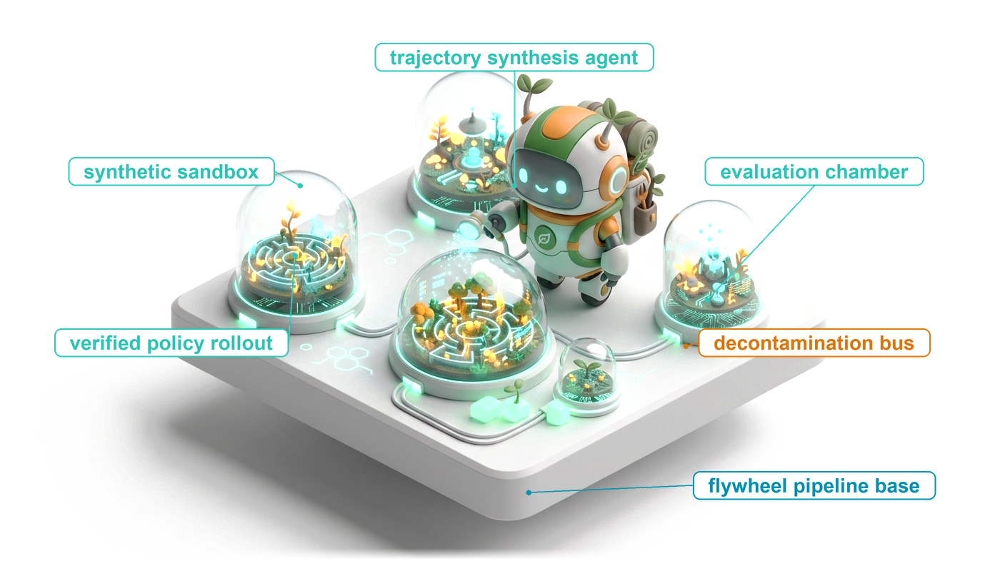
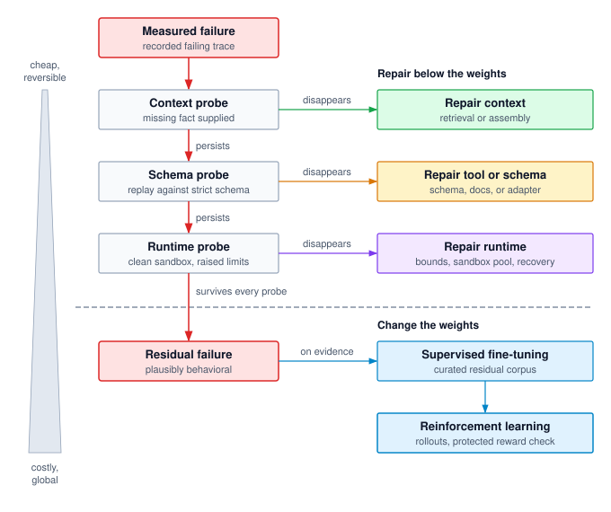
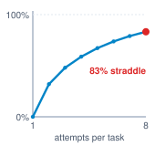
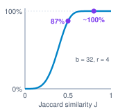
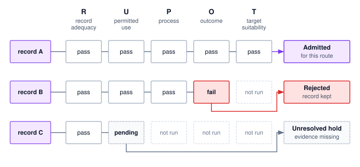
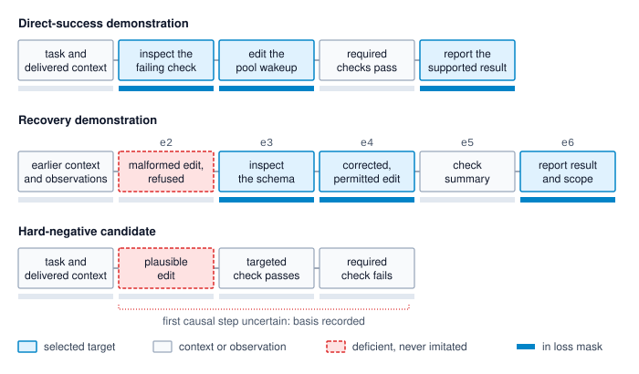
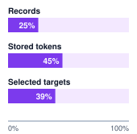
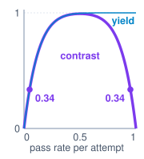
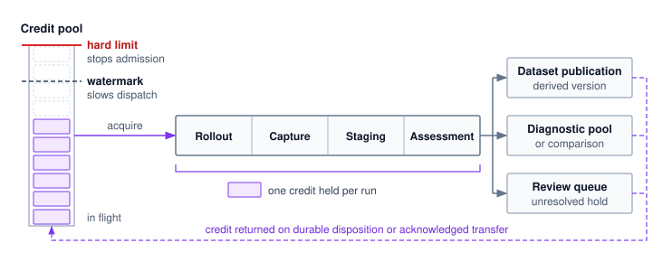
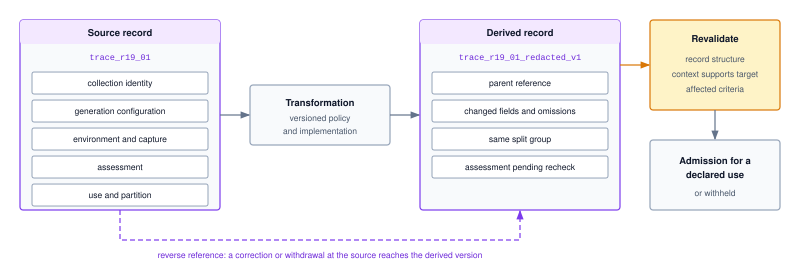

# Trajectory Curation {#sec-vol3-trajectory-curation}

::: {layout-narrow}
::: {.column-margin}

\chapterminitoc

:::

::: {.content-visible when-format="pdf"}
\noindent
{fig-alt="Blueprint for Trajectory Harvesting."}
:::

::: {.content-visible unless-format="pdf"}
{fig-alt="Blueprint for Trajectory Harvesting."}
:::

:::

## Purpose {.unnumbered .unlisted}

\begin{marginfigure}
\mlagentstack{0}{100}{0}{0}{0}{0}
\end{marginfigure}

_Why is an accepted agent trajectory not automatically a good training example?_

Every agent run leaves a durable record of what it saw, proposed, and achieved, and a team preparing the next policy is tempted to train on that record directly. A record, however, answers a different question than a training example does. An accepted trial can contain a malformed call that the runtime refused, a failure can stem from a broken tool schema that no weight update repairs, and two attempts at the same task split across training and evaluation turn a test score into a measure of recall. Imitating such records teaches the model its own mistakes and workarounds, and filtering them by outcome alone narrows behavior toward whatever the filter happens to reward. Curation therefore decides, before any gradient is computed, whether a failure belongs in the weights at all, which records may serve which learner, which tokens are targets and which are context, and what evidence and permissions travel with every record derived from the original run.

::: {.content-visible when-format="pdf"}

\newpage

:::

::: {.callout-learning-objectives}

- Justify a learning use for a residual failure and distinguish imitation material, preference comparisons, and rollout fixtures
- Design versioned collection fixtures and protected splits for a stated generalization claim
- Construct admission predicates and compare verification costs without changing their criteria
- Assign recovery and negative records to appropriate roles while distinguishing trajectory counts, stored tokens, and loss-bearing tokens
- Assess how selection rules and sampling budgets change the diversity and yield of a self-improvement loop
- Size bounded collection flow against downstream capacity, and price an emitted artifact by attempt cost and emission yield
- Defend a versioned corpus manifest with transformation lineage, permitted uses, and intended consumers

:::

## From Trajectory Records to a Training Corpus {#sec-vol3-trajectory-curation-records-corpus-a90a}

The evaluation harness of @sec-vol3-evaluation produced more than a release decision. While it judged the repair agent (lighthouse \ref{lhs-vol3-repair-agent}) over repeated attempts on the connection-pool repair task, it also accumulated a durable trajectory log that captures every trial in granular detail: the environment observations delivered to the model, the code edits it proposed, the invalid tool calls rejected by the runtime, the subsequent recovery steps, and the final verdict scored against the task acceptance criteria. Some runs passed cleanly, others failed outright, and several remain stalled in pending states because regression suites or accounting checks timed out. To an engineering team preparing the next iteration of the policy, these accumulated interaction logs look like the natural, abundant raw material for fine-tuning.

::: {.column-margin}
{width="100%" fig-alt="H·S·A locator with no axis highlighted and the origin dot marked, for a chapter that changes the model rather than an exposure."}

*Training can change how much of its granted authority a policy uses, never how much it is granted.*
:::

Yet the machinery built so far does not specify how to translate raw logs into training data. The acceptance contract defined in @sec-vol3-evaluation-contract evaluates the final outcome of an entire trial rather than assigning credit to individual tokens or tool calls within it. Consequently, an accepted verdict alone cannot distinguish between an optimal tool call and an accidental stumble that the agent managed to survive. Imitating raw logs reproduces whatever they contain. If an agent wastes ten calls exploring invalid syntax before hitting the correct command, blind imitation trains the next model to repeat that exploratory churn. Furthermore, rigorous evaluation requires held-out task distributions that the training process never touches. If an engineer partitions data naively at the trace level, different attempts on the same underlying task fixture land on both sides of the train-test split, silently destroying evaluation integrity. Finally, because the agent generated these records under its own behavioral distribution, any filtering rule directly shapes what the subsequent policy will produce, inducing feedback dynamics across training generations.

Bridging the gap between raw execution logs and active model training requires a dedicated systems stage. **Trajectory curation**\index{Trajectory curation!definition} selects, labels, and transforms recorded interactions for a declared learning use while preserving the evidence and constraints that justify that use. Where evaluation establishes whether a trial satisfied its specification under fixed conditions, curation resolves a different operational question: which behaviors and tasks the learning process should absorb, which steps must be masked or rewritten, and how to preserve statistical isolation across splits. The end product of this pipeline is a versioned, reproducible corpus tailored to specific training consumers, accompanied by strict provenance records rather than an ad hoc collection of success flags. Transforming these admitted records into tokenized inputs and loss objectives becomes the downstream responsibility of @sec-vol3-fine-tuning.

The chapter follows the repair agent from diagnosis to a published corpus. A failure caused by a truncated observation is the case whose remedy lies outside the weights, and a recovery from a refused edit becomes the record carried all the way into a corpus. The stages run in the order the risks arise. Before anything is collected, the failure must be shown to belong in the weights (@sec-vol3-flywheel-gap), and the evidence that will later judge the trained model must be fixed and protected (@sec-vol3-flywheel-fixtures, @sec-vol3-flywheel-evaluation). Collected records then pass admission checks specific to the learner that will consume them (@sec-vol3-flywheel-verification), recovery records are divided into context and targets (@sec-vol3-flywheel-curation), and the feedback created when a policy generates its own data is bounded (@sec-vol3-trajectory-curation-self-improvement). The remaining sections keep the collector within its capacity (@sec-vol3-flywheel-pipeline), bind every record to its lineage (@sec-vol3-flywheel-provenance), and carry one record through the whole chain (@sec-vol3-flywheel-synthesis). The first decision is triage, because a failure that does not belong to the model should never reach a corpus.

## Capability Gap Diagnosis {#sec-vol3-flywheel-gap}

An execution failure enters the trajectory curation pipeline only after systematic diagnosis confirms that model weights are the appropriate target for remediation. The repair agent's evaluation history for `pool_repair_01` illustrates why diagnostic triage must precede dataset collection. In @sec-vol3-evaluation, the candidate configuration's trial submitted workspace `ws_r19`. Its targeted reproducer passed, but the regression and resource-accounting evidence remained pending, so the trial qualified as neither an accepted repair nor a valid behavioral demonstration. A separate trial of the same task did fail, after the observation interface silently truncated a search result, and the postmortem's controlled ablation traced most of that failure to the interface. With a paginated interface, every continuation from the saved prefix reached an accepted repair, although the ablation did not show the model blameless. A team that had collected the truncated-observation runs as training data would have taught the model to compensate for a defect that one interface change removed. Modifying model weights is justified only when confronting a genuine **capability gap**\index{Capability gap!definition}: an operational failure that persists even when the model receives complete context, interacts through a well-formed interface, and executes in a healthy runtime with adequate resources. Every other failure represents an external system defect that warrants a cheaper, far more reversible engineering fix.

::: {.column-margin .margin-pointer}
↩ The controlled ablation that traced the truncated-observation failure to the interface is established in @sec-vol3-postmortem-ablation.
:::

### Diagnosis and the learning objective {#sec-vol3-trajectory-curation-diagnosis-objective}

Observing that an agent failed reveals nothing about which subsystem broke. The postmortem analysis in @sec-vol3-evaluation-postmortems separated three distinct phenomena within that truncated-observation incident: an interface defect (the search excerpt arrived without truncation metadata), a forbidden action proposal (the next response proposed replacing a file outside the repair scope), and a successful runtime refusal (the admission gate rejected that proposal before dispatch). Such findings often coexist within a single execution trace. Adding missing truncation metadata repairs the interface contract; retaining the admission guard enforces system boundaries against out-of-scope dispatches; and training the policy to seek additional evidence addresses model behavior. Each diagnostic finding demands its own specialized engineering remedy.

@Tbl-vol3-failure-taxonomy connects diagnostic findings to candidate system interventions and their corresponding learning objectives. Because multiple failure modes frequently overlap in production traces, engineers must evaluate each candidate intervention under realistic operating conditions. The sequence in which teams investigate and apply these remedies follows directly from their computational cost and operational reversibility.

| Diagnostic finding                                                    | Direct system intervention to investigate                                | Possible learning use and its limit                                                                                                                 |
|:----------------------------------------------------------------------|:-------------------------------------------------------------------------|:----------------------------------------------------------------------------------------------------------------------------------------------------|
| A required fact was absent from the delivered context                 | Repair retrieval or assembly and preserve source and omission status     | Teach the model to recognize insufficient evidence and request it; weights cannot supply a reliable current fact that was never observed            |
| A tool description or response violated its interface contract        | Correct the schema, documentation, or observation adapter                | Teach interpretation of valid status and recovery information; learned habits do not repair the interface itself                                    |
| An operation encountered an execution failure or unresolved outcome   | Investigate endpoint behavior, resource bounds, and recovery ownership   | Teach bounded recovery or escalation under represented uncertainty; a retry proposal cannot establish that the earlier effect failed                |
| The model repeatedly chose an unsupported or ineffective continuation | Compare prompts, examples, and targeted policy updates on declared tasks | Collect justified alternative actions or recovery targets; repeated failure alone does not identify a unique cause or prove that training will help |

: **Diagnostic Findings and Learning Uses**: A direct system repair and a behavioral learning objective can both be justified by the same incident. Each proposal needs its own evidence and scope. {#tbl-vol3-failure-taxonomy}

### The intervention ladder {#sec-vol3-flywheel-intervention-order}

The **intervention ladder**\index{Intervention ladder!definition} establishes a principled hierarchy for remediating agent failures, ordering interventions by ascending engineering cost and descending reversibility: context retrieval and assembly, tool definitions and schemas, runtime execution controls, supervised fine-tuning, and reinforcement learning. Engineers investigate inexpensive, reversible remedies first by default, but diagnostic evidence can justify proceeding directly to a weight update when it establishes a capability gap. Parameter updates require evidence that the targeted failure belongs in the weights and that training improves the behavior; they do not substitute for repairs to identified interface or runtime defects. Fine-tuning a model to compensate for an omitted context fact or an ambiguous tool schema represents **premature fine-tuning**\index{Premature fine-tuning!definition}, an expensive misallocation of compute and curation effort to patch a defect that simpler systems engineering cures directly.

Three system properties dictate this ordering: cost, reversibility, and enforcement guarantees.

First, engineering and computational costs increase sharply at each succeeding rung. Modifying a prompt assembly pipeline, schema definition, or runtime timeout alters version-controlled artifacts that engineers can test against existing integration fixtures in minutes. By contrast, retraining model weights requires curating an extensive trajectory dataset, launching accelerator cluster jobs, and conducting comprehensive regression evaluations across every capability the model serves, rather than merely the failing task.

Second, interventions differ profoundly in reversibility and blast radius. A defect repaired at a lower rung reverts cleanly as a versioned configuration change, and its operational impact can be scoped to the callers of the changed tool or prompt, with shared dependencies included in regression evaluation. Conversely, updating model weights alters behavior globally across the entire input space. Rolling back a checkpoint discards all concurrent improvements alongside the targeted fix. Reinforcement learning sits at the apex of the ladder for the same reason: beyond the dataset and validation requirements of supervised fine-tuning, it introduces distributed rollout fleets, complex reward verification harnesses, and continuous optimization pressure that risks exploiting subtle reward misspecifications.

Third, statistical weights cannot replace runtime enforcement. A fine-tuned policy may propose out-of-scope tool calls far less frequently, but reduced observed failure rates do not establish compliance on every permitted input. Invariant closure (principle \ref{pri-invariant-closure}) requires that execution runtimes never assume policy compliance. Resource budgets, authorization checks, and process sandboxes must remain absolute enforcement boundaries regardless of how thoroughly the model has been trained.

The end-to-end argument [@saltzer1984endtoend] yields the identical conclusion for tool interfaces: a function belongs where it can be implemented completely and correctly. A typed action contract (principle \ref{pri-vol3-strict-action-abi}) provides enforceable guarantees across any model version placed behind it. By contrast, fine-tuning a model to guess fields omitted by an API schema instills brittle behavioral habits that collapse as soon as the interface evolves. For example, an integration test on an observation adapter can verify that truncated outputs return explicit pagination markers, resolving ambiguity at the interface layer without requiring downstream models to compensate for incomplete schemas.

Rigorous empirical evidence, rather than administrative convention, governs when a failure ascends the ladder. Engineers evaluate each lower rung using a **counterfactual probe**\index{Counterfactual probe!definition}: a controlled re-execution of the recorded failure trace with that rung's suspected defect artificially removed. For a context defect, the probe injects the missing fact directly into the prompt. For an interface ambiguity, it resumes matched saved prefixes with corrected tool descriptions or schemas and samples fresh continuations under the controlled conditions of @sec-vol3-evaluation-rigor. Replaying a fixed proposal instead tests the validation or adapter boundary; it does not measure whether the model chooses a different action. For a runtime failure, it executes the identical tool payload within an isolated sandbox with relaxed resource limits. If the failure disappears under a given probe, the result supports a repair at that system rung under the probed conditions without ruling out other contributing causes. Under this default diagnostic route, only the residual failures that persist across all lower-level counterfactual probes advance to the learning pipeline. Probing in ladder order routes each resolved defect to an immediate, reversible repair, so only the failures that survive all three probes reach the weights (@fig-vol3-failure-diagnostic-tree). Even then, candidate checkpoints trained on this residual must be validated under the protocol of @sec-vol3-evaluation-rigor rather than accepted merely because model weights were the final hypothesis remaining.

::: {#fig-vol3-failure-diagnostic-tree fig-env="figure" fig-pos="htb" fig-cap="**Probes Before Weights**: Under the default diagnostic route, counterfactual probes evaluate a measured failure in ascending ladder order. A failure that disappears under a probe routes to an immediate systems repair, modifying versioned artifacts that revert cleanly as configuration. Only failures that survive every lower-rung probe reach the weight modification stages, where supervised fine-tuning precedes reinforcement learning. Engineering cost rises and operational reversibility falls from top to bottom." fig-alt="Flowchart running down a left column from a red measured failure box, recorded failing trace, through three probe boxes: context probe, missing fact supplied; schema probe, rerun with corrected tool description; and runtime probe, clean sandbox, raised limits. Red arrows labeled persists link the probes. From each probe an arrow labeled disappears leads right to a repair box under the heading repair below the weights: repair context, retrieval or assembly; repair tool or schema, schema, docs, or adapter; and repair runtime, bounds, sandbox pool, recovery. A red arrow labeled survives every probe crosses a dashed horizontal boundary to a red residual failure box, plausibly behavioral, which leads on evidence to supervised fine-tuning, curated residual corpus, and then down to reinforcement learning, rollouts, protected reward check, under the heading change the weights. A gray wedge on the far left widens from top to bottom, labeled cheap, reversible at the top and costly, global at the bottom."}

:::

The intervention ladder serves as a disciplined diagnostic framework rather than an inflexible operational barrier. When diagnostic probes immediately expose a capability gap (an agent that fails despite complete context, a strict schema, and a healthy runtime), engineers can bypass lower-rung repairs directly in favor of targeted training. Even in such cases, rigorous empirical evidence documenting the gap remains mandatory before training begins. Furthermore, production environments intentionally return partial outputs, transient network timeouts, and service-unavailable errors. Training an agent to handle these realistic, degraded operational conditions constitutes a primary behavioral objective rather than a justification for skipping interface or runtime fixes. Notebook \ref{nbk-14-intervention-order-tradeoff} quantifies the economic and architectural trade-offs across this hierarchy for a representative operational failure workload.

```{python}
#| label: lego-14-intervention-order-tradeoff
#| echo: false
# ┌─────────────────────────────────────────────────────────────────────────────
# │ INTERVENTION ORDER: SYSTEM REPAIR VERSUS PREMATURE FINE-TUNING (LEGO)
# ├─────────────────────────────────────────────────────────────────────────────
# │ Context: @sec-vol3-flywheel-intervention-order,
# │          @nbk-14-intervention-order-tradeoff.
# │ Goal: Show that accelerator cost does not decide the ladder; attribution does.
# │ Show: Failures each rung removes, training FLOPs, accelerator time and bill.
# │ How: 6PD training FLOPs; registry model, accelerator, MFU, and GPU-hour rate.
# │ Note: Failure mix and corpus shape are hypothetical scenario inputs.
# └─────────────────────────────────────────────────────────────────────────────
from mlsysim import *
from mlsysim.core.units import second, hour
from mlsysim.fmt import check, fmt, fmt_int, fmt_percent, fmt_qty, fmt_sci_flops, fmt_time, fmt_usd

class InterventionOrderTradeoff:
    # 1. LOAD: registry specs plus hypothetical failure mix and corpus shape.
    model = Models.Language.Llama3_70B
    accel = Hardware.Cloud.H100
    n_accel = 8
    mfu = Literature.Training.MfuLow
    gpu_rate = Infrastructure.Pricing.Cloud.GpuTrainingPerHour.rate
    n_runs = 50_000
    fail_rate = 0.06
    share_interface = 0.70
    share_runtime = 0.20
    seq_tokens = 4_096
    epochs = 3

    # 2. EXECUTE: failures removed below the weights, then training work.
    n_fail = round(n_runs * fail_rate)
    n_system = round(n_fail * (share_interface + share_runtime))
    n_residual = n_fail - n_system
    system_share = n_system / n_fail
    flops_all = calc_transformer_training_flops(model.parameters, n_fail * seq_tokens * epochs)
    flops_res = calc_transformer_training_flops(model.parameters, n_residual * seq_tokens * epochs)
    sustained = n_accel * accel.compute.peak_flops * mfu
    wall_all = (flops_all / sustained).to(second)
    accel_hours_all = (n_accel * wall_all).to(hour)
    cost_all = (accel_hours_all * gpu_rate).to(USD)
    cost_res = (n_accel * (flops_res / sustained) * gpu_rate).to(USD)

    # 3. GUARD: split, corpus ratio, and the small-bill claim in the prose.
    check(n_fail == 3_000 and n_residual == 300, "Failure split")
    check(abs(system_share - 0.9) < 1e-12, "System-rung share")
    check(abs(10 * flops_res.to(flop).magnitude - flops_all.to(flop).magnitude) < 1e6, "Residual corpus is one tenth")
    check(cost_all < 1_000 * USD, "Accelerator bill stays small")

    # 4. OUTPUT: every export is consumed in the notebook below.
    runs_str = fmt_int(n_runs)
    fail_pct_str = fmt_percent(fail_rate, precision=0, style="prose")
    fail_str = fmt_int(n_fail)
    interface_pct_str = fmt_percent(share_interface, precision=0, style="prose")
    runtime_pct_str = fmt_percent(share_runtime, precision=0, style="prose")
    system_str = fmt_int(n_system)
    system_pct_str = fmt_percent(system_share, precision=0, style="prose")
    residual_str = fmt_int(n_residual)
    seq_str = fmt_int(seq_tokens)
    epochs_str = fmt_int(epochs)
    tokens_all_str = fmt_int(n_fail * seq_tokens * epochs)
    params_str = fmt(model.parameters.to("param").magnitude / 1e9, precision=1)
    n_accel_str = fmt_int(n_accel)
    peak_str = fmt_qty(accel.compute.peak_flops, "TFLOPs/s", precision=0)
    mfu_str = fmt_percent(mfu, precision=0, style="prose")
    rate_str = fmt_usd(gpu_rate.to(USD / hour).magnitude, precision=0)
    flops_all_str = fmt_sci_flops(flops_all, precision=2)
    wall_all_str = fmt_time(wall_all, unit="h", precision=1)
    accel_hours_str = fmt(accel_hours_all.to(hour).magnitude, precision=1)
    cost_all_str = fmt_usd(cost_all.to(USD).magnitude, precision=0)
    cost_res_str = fmt_usd(cost_res.to(USD).magnitude, precision=0)
```

::: {#nbk-14-intervention-order-tradeoff .callout-notebook title="Pricing the ladder for one failure mix"}

**Problem**: A hypothetical maintenance agent executes `{python} InterventionOrderTradeoff.runs_str` trajectories per month, with `{python} InterventionOrderTradeoff.fail_pct_str` failing (`{python} InterventionOrderTradeoff.fail_str` total failures). Counterfactual probes attribute `{python} InterventionOrderTradeoff.interface_pct_str` of the failures to a tool schema that omits a required field and `{python} InterventionOrderTradeoff.runtime_pct_str` to sandbox startup timeouts; only the remaining failures survive every probe. One engineering team repairs the tool schema and scales the sandbox pool before considering training. A second team bypasses system repairs and fine-tunes the base model on all failing trajectories using corrected demonstration targets, training on `{python} InterventionOrderTradeoff.seq_str`-token sequences across `{python} InterventionOrderTradeoff.epochs_str` epochs. What failure modes does each path eliminate, and what is the direct compute cost of the training run?

**Variables**: The underlying model contains `{python} InterventionOrderTradeoff.params_str` billion parameters. Standard transformer training requires approximately 6 floating-point operations (FLOPs) per parameter per token ($6\Parameters \DatasetSize$). A dedicated cluster node of `{python} InterventionOrderTradeoff.n_accel_str` accelerators provides a dense 16-bit compute peak of `{python} InterventionOrderTradeoff.peak_str` per device while sustaining `{python} InterventionOrderTradeoff.mfu_str` model FLOPs utilization (MFU). Accelerator rental costs `{python} InterventionOrderTradeoff.rate_str` per hour. Both paths assume that diagnostic attribution is correct and exclude data curation, annotation, and software engineering labor.

**Math**: System-level repairs eliminate the `{python} InterventionOrderTradeoff.system_str` failures attributed to interface and runtime defects (`{python} InterventionOrderTradeoff.system_pct_str` of all failures), deploying and reverting cleanly as versioned configuration updates.
In contrast, fine-tuning indiscriminately across all `{python} InterventionOrderTradeoff.fail_str` failures trains on `{python} InterventionOrderTradeoff.fail_str` $\times$ `{python} InterventionOrderTradeoff.seq_str` $\times$ `{python} InterventionOrderTradeoff.epochs_str` = `{python} InterventionOrderTradeoff.tokens_all_str` tokens. Evaluating $6 \times \text{parameters} \times \text{tokens}$ yields `{python} InterventionOrderTradeoff.flops_all_str` of total training compute. At sustained cluster throughput, this workload requires `{python} InterventionOrderTradeoff.wall_all_str` of wall-clock time (`{python} InterventionOrderTradeoff.accel_hours_str` accelerator-hours), resulting in an accelerator invoice of `{python} InterventionOrderTradeoff.cost_all_str`. Fine-tuning exclusively on the `{python} InterventionOrderTradeoff.residual_str` residual failures that survived diagnostic probing costs only `{python} InterventionOrderTradeoff.cost_res_str`.

**Result**: The direct accelerator invoice of `{python} InterventionOrderTradeoff.cost_all_str` is modest, so raw compute expenditure does not govern intervention ordering. The decisive factor is the architectural debt and reliability profile left in production. Under premature fine-tuning, the tool schema still omits the required field and the sandbox pool still times out under load; consequently, those operational failures return whenever the model guesses incorrectly or cluster load spikes. Furthermore, teaching the model to work around missing fields creates fragile behavioral compensations that collapse as soon as the interface changes. Its training corpus also squanders curation and review effort on incidents whose proper remedy was never behavioral. Under the systems repair path, engineers resolve `{python} InterventionOrderTradeoff.system_pct_str` of all failures permanently for every model checkpoint, leaving a residual of `{python} InterventionOrderTradeoff.residual_str` failures whose curated corpus is focused entirely on genuine policy gaps.

**Systems insight**: The primary risk of premature fine-tuning is rarely compute expenditure; it is architectural misattribution. While an invoice of `{python} InterventionOrderTradeoff.cost_all_str` appears manageable, training cannot fix the `{python} InterventionOrderTradeoff.system_pct_str` of failures rooted below the weights. Only a systems repair resolves those defects permanently across all current and future model generations. The governing engineering principle is to attribute failures with counterfactual probes first, remediate what lies below the weights in software, and train exclusively on the residual capability gap that survives.

:::

Once diagnostic probing isolates a genuine residual failure, engineers must formally specify the intended behavioral modification before gathering training examples. For the repair agent, the paginated interface now supplies completeness metadata, but a policy can still ignore it. Runs on the repaired interface that receive that metadata and still conclude from a partial result are the residual a learning objective can target. An effective objective does not aim vaguely to 'fix failed trajectories.' Instead, it instructs the policy to inspect the completeness metadata of a search result, issue a permitted follow-up query when pagination indicates more records exist, and explicitly state remaining data boundaries when limits are reached. Evaluating the fine-tuned model requires assessing both the eventual task outcome and the efficiency of the execution path, including redundant read operations, context token consumption, and unsupported intermediate conclusions. A policy can easily learn an unnecessarily circuitous investigation path that improves task acceptance at the expense of excessive latency and inference cost; conversely, it might learn an overly aggressive shortcut that skips essential verification steps. Neither pathology can be diagnosed from cross-entropy training loss alone.

### Learning artifacts {#sec-vol3-trajectory-curation-learning-artifacts}

A single recorded agent interaction can populate three distinct learning artifacts, each governed by its own strict admission criteria:

**Imitation material**\index{Imitation material!definition} consists of complete demonstrations or extracted trajectory segments whose decision steps represent exemplary behavior under the supplied context. When curating an error-recovery sequence, the ingestion pipeline can retain an initial malformed tool proposal and its runtime rejection within the conversational history, while selecting only the subsequent corrected action as the supervised target. Faithfully preserving an error in conversational context provides realism, but supervising a model to imitate an unnecessary retry loop degrades runtime efficiency. Curation explicitly designates the target tokens to be reinforced.

A **preference comparison**\index{Preference comparison!definition} pairs alternative trajectories generated from a shared initial context, attaching an explicit, justified preference ordering. Two runs of a task form a valid comparison pair only when their initial state, environment configuration, and accessible action spaces are identical. Furthermore, a failing or degraded run belongs in the rejected slot only when an evaluator records explicit diagnostic criteria explaining why its trajectory was inferior. These supporting assessments, tie-breaking criteria, and conditioning contexts allow offline preference optimization methods to construct statistically sound loss objectives.

::: {.column-margin .margin-pointer}
↪ The trajectory preference loss, which scores the preferred and dispreferred records against a frozen reference policy, is developed in @sec-vol3-fine-tuning-preference-loss.
:::

A **rollout fixture**\index{Rollout fixture!definition} bundles a reproducible task environment, versioned configuration fixtures, and an automated grading specification to support online exploration during reward-based reinforcement learning. An unsuccessful execution attempt often reveals a valuable environmental corner case even when none of its recorded actions warrant imitation. In this setting, the trace does not provide demonstration data; rather, it seeds a versioned simulation fixture that recreates the problematic state so the policy can explore alternative trajectories and optimize against the reward specification.

::: {.column-margin .margin-pointer}
↪ Optimizing a policy against verifiable checks on the rollouts it executes in such an environment is developed in @sec-vol3-rlvr-need.
:::

These three downstream roles explain why a curation pipeline preserves execution failures rather than discarding them. A single flawed trajectory can support diagnostic root-cause analysis, provide multi-turn context for an error-recovery demonstration, serve as a negative example within a preference comparison, or seed a simulation fixture for online reinforcement learning. The intended downstream artifact dictates the admission evidence required to validate the record. Symmetrically, successful trajectories that produce no state mutations (an agent correctly refusing an out-of-scope request or answering a read-only query) constitute valid imitation demonstrations whenever the task specification requires restraint. Producing a nonempty workspace modification is never an inherent admission requirement.

Every proposed trajectory collection campaign must formally document four elements: the specific behavioral capability to be trained, the target artifact format, the empirical evidence required for admission, and the held-out evaluation claim that will assess the trained model. When trajectory evaluations rely on automated model judges or human annotators, those evaluations must operate under explicit rubrics with evaluator coverage and scoring variance fully exposed.

Curation produces defensible artifacts for declared uses, while held-out evaluation decides whether the resulting model update actually improves the system. That separation is the decision boundary of verified trajectory post-training (principle \ref{pri-vol3-trajectory-post-training}), which holds that a recorded outcome does not by itself determine how a trajectory may be used for learning. Two obligations follow before any record is collected. Fixtures must translate the desired behavior into collectible tasks, and the evaluation split must be reserved first, so that data selection never consumes the evidence later used to judge it.

## Task Fixture Design {#sec-vol3-flywheel-fixtures}

When an agent collection worker attempts a complex task such as connection-pool repair repeatedly, it can generate a distinct candidate solution on every run. If an attempt inherits residual state from an earlier repair attempt, however, it no longer demonstrates solving the problem from first principles. Conversely, if a collection pipeline records only the final passing patch, it discards the sequence of tool invocations, intermediate terminal outputs, and error-recovery decisions that explain how that patch was derived. A **collection fixture**\index{Collection fixture!definition} prevents both failures by preserving reproducible task conditions while recording the comprehensive execution evidence demanded by downstream learning algorithms.

The experimental contract defined in @sec-vol3-evaluation-gyms establishes the execution baseline: initial filesystem state, dependencies, permitted tool interfaces, seed variations, grading boundaries, and environment reset semantics. Trajectory curation layers a collection contract on top of this execution foundation. This contract specifies why the task belongs in the corpus, which interaction records the ingestion pipeline may retain, and what intermediate evidence downstream admission filters will require.

### The collection manifest {#sec-vol3-trajectory-curation-collection-manifest}

Rigorous trajectory harvesting requires strict separation of concerns among tasks, environments, criteria, and execution artifacts. In our connection-pool scenario, the task specification `pool_repair_01`, the execution fixture `pool_fixture_v1`, and the evaluation criteria `repair_accept_v1` each maintain distinct versioned identities. A new collection attempt receives its own run identity and produces an independent candidate artifact, while the historical evaluation candidate `ws_r19` remains permanently bound to its original trial. Re-executing a task never overwrites or reuses earlier verdicts, and a newly passing test run does not alter the historical record of an earlier operation such as `test_r18`, which a worker crash left unresolved.

The **collection manifest**\index{Collection manifest!definition} references the underlying evaluation fixture and records the operational decisions summarized in @tbl-vol3-curation-fixture-use. Defining these fields before sampling begins ensures that data engineers establish the intended training role and capture requirements in advance, without biasing the sampling process or retroactively fitting admission standards to observed outputs.

| Collection field         | Decision recorded                                                                                                                | Consequence for the repair                                                                                     |
|:-------------------------|:---------------------------------------------------------------------------------------------------------------------------------|:---------------------------------------------------------------------------------------------------------------|
| Learning use             | Proposed behavior to improve and intended artifact consumer                                                                      | Collect evidence for interpreting failed checks and choosing a justified next action, not merely final patches |
| Source and permitted use | Task origin, access conditions, retention scope, and applicable restrictions on derived data                                     | Permission to inspect a repository does not by itself authorize exporting its contents into a corpus           |
| Task relationships       | Stable task identity, source lineage, and links to variants or shared solutions                                                  | Repeated attempts and derived variants remain identifiable when splits are assigned                            |
| Collection configuration | Sampling system, prompt and tool versions, allowed variation, and attempt-selection policy                                       | Distinguish a policy change from a changed task or collector                                                   |
| Required capture         | Delivered context, proposals, matched observations, candidate identity, and criterion-level evidence needed for the proposed use | Preserve what supported each decision, including incomplete observations and rejected proposals                |
| Admission policy         | Versioned conditions for accepting a record into each proposed artifact, with unresolved cases handled explicitly                | A targeted pass does not become whole-task acceptance or automatic demonstration eligibility                   |

: **Collection Decisions Attached to a Fixture**: The collection manifest extends the experimental contract with intended use, relationships, and evidence requirements. Actual admission follows inspection of the resulting record. {#tbl-vol3-curation-fixture-use}

Telemetry capture requirements depend directly on the downstream model consumer. A demonstration selected for supervised error recovery must preserve the precise diagnostic context, error messages, and intermediate inspection steps that justify why a corrective action was taken. An offline preference comparison requires strictly compatible decision conditions and environment state across paired rollouts to isolate policy differences. Similarly, a fixture designed for active reinforcement learning rollouts must expose live, resettable environment instances and versioned reward harnesses rather than static text logs. The target loss function dictates how admitted trajectory data is tokenized and masked. A trajectory that lacks certain tool outputs may fail admission for behavioral cloning, yet still remain valuable for diagnostic failure analysis. Curation pipelines must tailor logging schemas to specific learning objectives rather than relying on a generic, untyped event log.

### Adequate and inadequate controls {#sec-vol3-trajectory-curation-controls}

An automated grader that accepts an invalid solution pollutes a training corpus with false-positive demonstrations, while a grader that rejects valid work starves the collection pipeline. Before launching data collection at fleet scale, engineers must calibrate grading harnesses against independently verified **adequate and inadequate controls**\index{Control candidate!definition}, candidate implementations whose expected verdicts are established a priori.

::: {.column-margin .margin-pointer}
↩ Measuring a grader's false-acceptance rate against independently assessed calibration cases is established in @sec-vol3-evaluation-grading-errors.
:::

In our connection-pool repair, an inadequate control is a candidate that deliberately retains the target defect, such as leaving worker threads blocked after a connection returns to the pool (the missed-wakeup bug). This buggy candidate must reliably trigger a failure in the reproducer suite. Conversely, an adequate control is an independently reviewed reference patch that resolves the issue cleanly; it must consistently pass the test harness. If the reproducer accepts the buggy control or rejects the reference repair, the failure points directly to a flaw in the test harness, flaky environment state, or misconfigured process exit bindings that must be corrected before collection proceeds.

Each control must isolate and validate a specific grading criterion. A run that produces the reference repair must satisfy the full suite of regression, execution, resource, and residual-duty checks defined in `repair_accept_v1`. Separate controls exercise other criteria, such as verifying that the agent does not alter protected configuration files or emit premature completion signals.

To guarantee grading integrity, the evaluation harness must execute outside the agent's authority boundary, satisfying invariant closure (principle \ref{pri-invariant-closure}). Isolated execution environments restrict the agent's blast radius and prevent candidate code from tampering with test harnesses, forging exit codes, or inspecting hidden evaluation assets. Whenever engineers modify a fixture, update a grading rubric, or shift the target task distribution, they must validate the changes against fresh control suites rather than inheriting prior trust.

The necessity of rigorous controls is equally evident in tasks that produce no persistent state modifications. Consider a read-only evaluation fixture, `report_comparison_v1`, containing two immutable experiment reports. Report A documents that an optimization method was evaluated on Linux; Report B documents that an alternative method was evaluated on Windows. Neither report contains comparative throughput or latency measurements. The agent's prompt asks for the documented platform coverage and asks whether the reports demonstrate which method achieves higher throughput. The task's grading criteria demand accurate, source-specific attribution, an explicit statement that the throughput comparison is unsupported by the evidence, and strict compliance with read-only access limits.

Here, an adequate control is an independently validated response that correctly maps each platform to its respective source and explicitly declines to declare a throughput winner. Inadequate controls include responses that swap the platform attributions, invent throughput claims, or return an empty response that fails to extract the documented facts. Because the filesystem remains bit-for-bit identical across all runs, simple diff-based checks cannot evaluate success. The grading harness must instead execute structured field assertions and rubric-guided validation to verify factual attribution and confirm that the agent correctly identified the boundaries of available evidence.

This fixture demonstrates how automated curation can harvest examples of disciplined reasoning and grounded abstention without granting write permissions or requiring workspace patches. Evaluation criteria must reflect task requirements directly, and in many critical domains, a deliberate refusal or no-op represents the optimal engineering behavior.

### Trajectory sources {#sec-vol3-trajectory-curation-sources}

Trajectory harvesting draws from three primary origins: human demonstrations, production telemetry, and synthetic model rollouts. Each source offers distinct advantages and presents unique engineering challenges, as summarized in @tbl-vol3-data-source-comparison.

| Source               | Useful contribution                                                     | Collection limitation to address                                                                                      |
|:---------------------|:------------------------------------------------------------------------|:----------------------------------------------------------------------------------------------------------------------|
| Human demonstrations | Deliberately chosen strategies and explanations for difficult decisions | Expertise does not guarantee correct actions, faithful capture, or representative task selection                      |
| Production records   | Tasks and failures encountered under actual operating conditions        | Retention and user selection can bias the sample; missing evidence and use restrictions can limit reuse               |
| Model-generated runs | Repeated attempts and controlled variations on specified fixtures       | The sampler and grader influence which behaviors appear and survive; repeated success can concentrate on one strategy |

: **Trajectory Source Trade-offs**: Sources contribute different evidence and coverage. Each still requires an appropriate capture, assessment, and permitted-use contract. {#tbl-vol3-data-source-comparison}

These three sources complement one another across the lifecycle of a training pipeline. A production failure reveals a real-world edge case that warrants reproduction in a benchmark; a human demonstration provides an expert recovery strategy to seed the model; and synthetic rollouts explore complex fault matrices through automated permutation.

When generating synthetic rollouts, the environment must compute state transitions dynamically. If an agent emits an action that diverges from a historical trace, the platform cannot simply replay the subsequent observation from a recorded log. Doing so violates environment causality and injects corrupted, contradictory context into the trajectory. Synthetic collection requires a live, interactive environment capable of generating valid observations for arbitrary action sequences.

The choice of data source fundamentally shapes the distribution of harvested behaviors. A collection policy that filters strictly for short, successful runs discards valuable trajectories that exhibit backtracking and fault recovery under partial observability. Conversely, relying uncritically on production traces can overrepresent abandoned user sessions and unresolved timeouts. Recording the collection policy, sampling parameters, and task-family metadata in the manifest enables downstream curation stages to distinguish between genuinely rare engineering events and artificial gaps created by collection filters.

### Task population coverage {#sec-vol3-trajectory-curation-task-coverage}

A robust training corpus requires systematic task variation across dimensions that reflect operational reality. In software repair, task distributions should vary across dependency tree depth, the clarity of error feedback prior to an edit, and the concurrency conditions encountered during testing. In document synthesis, distributions should deliberately introduce contradictory sources, missing numerical metrics, and schema drift across versions.

The H·S·A exposures (@sec-vol3-intro-hsa) characterize each variant: the horizon $\TurnHorizon$ in turns required to solve the task, the state level ($\StateExposureLevel_0$ to $\StateExposureLevel_3$) the task retains or mutates across steps, and the authority level ($\AuthorityExposureLevel_0$ to $\AuthorityExposureLevel_3$) its tool set grants. Varying a task along these exposures provides an architectural basis for task variation that avoids arbitrary context-length thresholds or the false assumption that all meaningful tasks must mutate a filesystem.

System privileges and tool access grants must remain explicit and immutably enforced across all task variants. As a model improves, it may learn to query fewer tools, avoid redundant exploratory commands, or complete tasks in fewer turns. This training progress changes the agent's realized exposure to the environment, but the underlying permissions and runtime sandboxing boundaries must remain unchanged. Similarly, the environment reset contract must govern every reuse of a fixture. If a failed run leaves background processes running, uncommitted file locks, or dangling network sockets, the teardown mechanism must cleanly purge this residual state before the next collection worker initializes, regardless of whether the previous trajectory was admitted into the training corpus or discarded.

::: {.column-margin .margin-pointer}
↩ The reset contract, which catalogs every piece of state that teardown must clear before an environment serves a new lease, is established in @sec-vol3-sandboxes-pooling-reset.
:::

A well-designed collection fixture unifies the task specification and grading criteria with an explicit learning objective, a capture contract, and a structured distribution of variants. Before launching collection workers across this task matrix, however, systems engineers must partition and quarantine held-out evaluation tasks. Reserving these unpolluted benchmarks is the focus of @sec-vol3-flywheel-evaluation.

## Split Design {#sec-vol3-flywheel-evaluation}

```{python}
#| label: lego-14-random-split-leakage
#| echo: false
# ┌─────────────────────────────────────────────────────────────────────────────
# │ RANDOM TRACE SPLIT: HOW OFTEN A TASK STRADDLES THE PARTITION (LEGO)
# ├─────────────────────────────────────────────────────────────────────────────
# │ Context: @sec-vol3-flywheel-evaluation opening; Fallacies and Pitfalls.
# │ Goal: Price split leakage when traces, not tasks, are randomized.
# │ Show: Probability that a task's attempts land in both partitions.
# │ How: Each attempt independently assigned to training with probability f.
# │ Note: Attempt count and split fraction are hypothetical scenario inputs.
# └─────────────────────────────────────────────────────────────────────────────
from mlsysim.fmt import check, fmt_int, fmt_percent

class RandomSplitLeakage:
    # 1. LOAD: attempts per task and training fraction (hypothetical).
    k = 8
    f_train = 0.8

    # 2. EXECUTE: a task stays whole only if all attempts land on one side.
    p_whole = f_train**k + (1 - f_train) ** k
    p_straddle = 1 - p_whole

    # 3. GUARD: most tasks straddle at this attempt count.
    check(0.83 < p_straddle < 0.84, "Straddle probability near 0.83")

    # 4. OUTPUT
    k_str = fmt_int(k)
    f_train_str = fmt_percent(f_train, precision=0, style="prose")
    f_test_str = fmt_percent(1 - f_train, precision=0, style="prose")
    straddle_str = fmt_percent(p_straddle, precision=1, style="prose")
```

Consider an automated collection pipeline that harvests multiple repair trajectories for the same connection-pool defect. If an engineer naively partitions the resulting execution traces at random, one successful repair trajectory lands in the training set while another attempt at the exact same defect lands in the final test set. Varying the random seed, prompt wording, or tool sequence creates superficial operational diversity, but it does not make the underlying engineering problem new. When the fine-tuned policy subsequently encounters this task during evaluation, it does not demonstrate generalization; it merely recalls an environment, bug mechanism, and solution it has already observed during training. This failure mode is **split leakage**\index{Split leakage!definition}: information about an evaluation target reaching the training pipeline through a related or derived record [@kaufman2012leakage].

In agent trajectory curation, split leakage is the default outcome rather than a rare edge case.[^fn-duplication-code-corpora] Suppose an agent executes `{python} RandomSplitLeakage.k_str` rollouts per task and an engineer partitions the individual traces at random using a `{python} RandomSplitLeakage.f_train_str`/`{python} RandomSplitLeakage.f_test_str` ratio. A task remains cleanly isolated on one side of the split only if every one of its attempts independently falls into that same partition. For a training fraction $\TrainingSplitFraction$ and $\IndependentAttemptCount$ independent attempts per task, that non-leakage probability is $\TrainingSplitFraction^\IndependentAttemptCount + (1-\TrainingSplitFraction)^\IndependentAttemptCount$. Consequently, `{python} RandomSplitLeakage.straddle_str` of all tasks straddle the train–test boundary, contaminating the evaluation protocol. Partitioning schemes must therefore follow structural task relationships rather than arbitrary trace run identifiers.

[^fn-duplication-code-corpora]: **Duplication in Code Corpora**: Code datasets are especially prone to leakage because repository forks, vendored libraries, and copy-pasted snippets reproduce the same defect across nominally distinct codebases. Evaluating code models on corpora that contain near-duplicates inflates reported performance metrics by as much as a factor of two relative to deduplicated corpora [@allamanis2019adverse]. An agent trajectory corpus inherits every duplicate in the underlying codebases and introduces an operational multiplier: repeated execution rollouts on the same benchmark fixture. Grouping trajectories by underlying task is therefore a foundational integrity requirement, not an optional refinement. \index{Split leakage!code duplication}

::: {.column-margin}
{width="100%" fig-alt="Line chart of the share of tasks that straddle a random 80/20 trace split against attempts per task from one to eight. The curve starts at zero for one attempt and rises steeply, reaching 83 percent at eight attempts, marked with a red dot."}

*As the number of attempts per task increases, the fraction of tasks straddling a naive random trace split rapidly approaches certainty.*
:::

While the fixture contract defines what an individual execution trial represents, split design governs the scientific validity of what subsequent evaluations can claim about agent learning. To preserve that validity, engineers must isolate and lock down protected evaluation tasks before data collection, model-assisted filtering, or hyperparameter tuning begins. If developers inspect final test failures and subsequently harvest demonstrations targeting those specific failure modes, they convert the test suite into implicit training feedback. The benchmark ceases to function as an independent evaluation, even when no raw test trajectory directly enters the training manifest.

### Evaluation claims and task groups {#sec-vol3-trajectory-curation-claims-groups}

Every rigorous evaluation protocol begins with an explicit claim about operational capability. For instance, an in-distribution deployment assessment asks whether an adapted agent can resolve new, previously unencountered maintenance tickets within the specific repositories and runtime environments it already serves. In contrast, an out-of-distribution transfer assessment tests whether that same agent succeeds across entirely unseen repository families, software architectures, or tool environments. These distinct claims require fundamentally different partitioning boundaries. Familiarity with a shared build tool, compiler flags, or API schema reflects legitimate deployment conditions and does not constitute leakage. In contrast, evaluating an agent on a defect whose solution was observed during fine-tuning invalidates the measurement entirely.

To enforce these boundaries systematically, the curation pipeline organizes tasks into groups. A **task group**\index{Task group!definition} aggregates all repeated attempts, paraphrased prompts, derived test fixtures, and solution-equivalent variations of a single underlying problem. For example, if a benchmark contains an issue fixture `pool_repair_01`, any rollout generated from an alternate random seed, a renamed variable, or an identical upstream bug copied into a downstream fork belongs to that same task group. The split manifest must explicitly record the structural rationale for each grouping. Naive heuristics frequently fail: grouping solely by repository name misses cross-repository forks and vendored copies, whereas grouping by shared dependencies aggressively collapses unrelated software defects into unmanageably large clusters.

Formally, let the group map $\TaskGroupMap(\EnvironmentFixture)$ send an environment fixture $\EnvironmentFixture$ to its designated task group, and let the split map $\SplitAssignmentMap(\TaskGroupMap)$ assign that group to a partition: training, development, or final test. Every harvested trajectory, synthesized record, or distilled learning example inherits the partition assignment of its originating fixture. Partition integrity requires that:

$$\TaskGroupMap(\EnvironmentFixture_i)=\TaskGroupMap(\EnvironmentFixture_j) \implies \SplitAssignmentMap(\TaskGroupMap(\EnvironmentFixture_i))=\SplitAssignmentMap(\TaskGroupMap(\EnvironmentFixture_j)).$$

This partitioning invariant guarantees that every known manifestation of a problem resides strictly on one side of the split. The strength of this guarantee depends directly on how thoroughly the pipeline identifies latent relationships across tasks. Production split manifests should therefore log the active grouping policy, git commit lineages, schema versions, and quarantined matches awaiting human triage. When allocating splits, randomization must operate over task groups rather than individual rollouts, applying stratification across task complexity or repository size where necessary. Furthermore, evaluation dashboards must report group counts alongside raw trajectory counts, since running dozens of stochastic rollouts against a single fixture still represents only one evaluation point.

@Tbl-vol3-partitioning-discipline maps common evaluation claims to their required isolation boundaries. Regardless of the transfer claim, every valid protocol enforces task-group isolation at a minimum.

| Evaluation claim                                | Additional held-out boundary                                                       | Interpretation                                                                                       |
|:------------------------------------------------|:-----------------------------------------------------------------------------------|:-----------------------------------------------------------------------------------------------------|
| New tasks in the intended operating environment | Underlying task and solution-equivalent variants                                   | Shared repositories and interfaces may match deployment; task answers remain protected               |
| Transfer to new repository families             | Declared related repositories, including relevant forks or copied problem families | Measures transfer beyond those families, rather than universal generalization across all codebases   |
| Adaptation to changed tool interfaces           | Specified schema families or transformations                                       | Tests adaptation to the declared interface shift while holding baseline environment conditions fixed |
| Transfer to new problem domains                 | Named task-domain categories                                                       | Evaluates domain shift specifically, complementing broader operational benchmarks                    |
| Robustness to runtime changes                   | Specified dependency or runtime configurations                                     | Measures resilience to configuration and library drift under controlled operating conditions         |

: **Partition boundaries follow evaluation claims**: Shared infrastructure and leaked answers represent fundamentally different conditions. Changing multiple axes simultaneously measures a combined shift and obscures attribution. {#tbl-vol3-partitioning-discipline}

Engineering teams must maintain strict discipline between development and final-test partitions. Development tasks guide daily iteration: tuning agent prompts, calibrating trajectory filters, and optimizing fine-tuning data mixtures. In contrast, final-test tasks provide a one-shot measurement of the finalized system under the declared evaluation protocol. Repeatedly evaluating candidate checkpoints against the final test suite and adjusting data mixtures based on those scores effectively bleeds test information into the training loop, invalidating the test's neutrality. When an engineering team inspects a final-test failure to diagnose a model flaw or create a training demonstration, they must reclassify that task group as a development asset and sample an entirely fresh, unseen task group to replace it in the test partition.

### Held-out evidence protection {#sec-vol3-trajectory-curation-heldout-protection}

A partition boundary is an architectural firewall across information paths, not merely a directory tag on a storage volume. Reference patches, ground-truth task specifications, hidden unit tests, and final evaluation outcomes must remain strictly isolated from every upstream system component. They must not appear in trajectory harvesting prompts, vector retrieval indexes, shared cross-session agent memories, synthetic problem generators, or model-based selection filters. If a synthetic generator consumes a held-out test problem, it inevitably weaves the target logic into nominally novel training fixtures. Similarly, if an automated trajectory ranker scores candidates by their downstream performance on the final test suite, it overfits the corpus to that test set without directly copying a single token.

During evaluation, an agent naturally receives problem descriptions and the runtime feedback permitted by the test protocol. For example, a code repair agent may execute local development unit tests to verify its progress, but it must never access the hidden acceptance suite used by the evaluation harness. Furthermore, the evaluation harness must prevent the agent's code from introspecting on the grading infrastructure or reading test assertions from disk during trial execution. Protecting held-out evidence requires explicitly specifying and auditing these boundary access paths.

Whenever new candidate fixtures enter the curation pipeline, automated ingestion checks compare them against reserved task groups using task identifiers, git commit histories, patch hashes, and structural syntax trees. Any fixture with ambiguous lineage routes directly to a quarantine queue for manual review rather than receiving a fresh, unvetted identifier. Applying redaction, variable renaming, or schema transformations does not break provenance; derived records always inherit their parent fixture's group assignment. If a post-hoc audit reveals that training data inadvertently leaked information about a final-test task, simply deleting the offending record from the data lake is insufficient. Because the leaked data is already baked into the model weights, the team must invalidate the current checkpoint, reassess all affected evaluation claims, and retrain from a clean corpus snapshot.

Even when local split boundaries are airtight, pipelines remain vulnerable to **contamination**\index{Contamination!definition}\index{Benchmark contamination|see{Contamination}}: the prior appearance of evaluation tasks or solutions within the foundational model's pretraining web crawl.[^fn-contamination-benchmark-curation] Public benchmarks such as standard competitive programming suites or popular open-source repositories often suffer from pretraining contamination, rendering local zero-shot or few-shot claims suspect. To establish defensible evaluation claims, engineering organizations must develop private evaluation fixtures authored behind internal firewalls, audit repository commit timestamps against model training cutoffs, and explicitly document known data provenance.

[^fn-contamination-benchmark-curation]: **Benchmark Contamination**: Measurement validity degraded significantly when web-scale pretraining corpora grew to encompass public benchmarks, leading to models inadvertently trained directly on the test splits used to grade them [@sainz2023nlp]. Because foundational model providers rarely publish exhaustive token-level manifests of their pretraining data, downstream practitioners must rely on n-gram overlap probes and verbatim memorization heuristics to detect contamination. For an agent trajectory curation pipeline, the only robust defense is structural: maintain proprietary, internal fixtures whose code and solutions have never been published to the open internet, and clearly delineate which benchmark results rely on these private evaluations. \index{Contamination!benchmark}

### Similarity screening {#sec-vol3-trajectory-dedup-minhash}

While structural group assignments catch known relationships, heuristic deduplication discovers latent similarities that slip past git lineage or issue tracking. Deduplication serves two critical roles: it flags suspicious cross-partition leaks between training and evaluation splits, and it controls redundancy within the training corpus itself. In foundational language modeling, removing near-duplicate documents substantially curtails verbatim memorization while enhancing downstream generalization [@lee2022]. In agent trajectory curation, however, similarity screening is inherently representation-dependent, and syntactic metrics can mislead in both directions. Two distinct repairs can solve the exact same concurrency race condition with almost zero textual overlap in their patch diffs. Conversely, two trajectories might execute identical shell commands or test invocations yet diverge completely in how they interpret terminal output and choose subsequent recovery actions.

To capture meaningful similarity in agent trajectories, feature extraction must combine textual shingles, parsed code syntax, and tool-call invocation sequences. A **shingle**\index{Shingle!definition} is a localized feature extracted from a document or trace, such as an n-gram of command tokens or a sub-tree from an abstract syntax tree (AST). While parsing code into an AST strips away superficial formatting differences, aggressive canonicalization (discarding variable identifiers, literal constants, or statement order) can obscure the subtle difference between a working patch and a broken one. Curation pipelines must therefore version their normalization policies and treat high similarity scores as triggers for contextual inspection rather than automatic deletion. To scale set comparisons across hundreds of thousands of trajectories, pipelines use MinHash [@broder1997resemblance],[^fn-minhash-resemblance-curation] which compresses high-dimensional feature sets into compact signatures using the minimum hash values under random permutations. Because standard MinHash treats feature sets as binary indicators and ignores feature frequencies, workloads that require count sensitivity rely on weighted or bag-based estimators.

[^fn-minhash-resemblance-curation]: **MinHash**: Minwise independent permutations were introduced to detect near-duplicate web pages at search-engine scale, where exhaustive all-pairs comparison is computationally prohibitive [@broder1997resemblance]. MinHash maps an arbitrary-sized feature set to a fixed-size signature such that the probability of two signatures matching on any given component equals the Jaccard similarity of their underlying sets. At a fixed signature length, signature storage grows linearly with record count. Indexing narrows the pairs sent for review, but candidate volume and review work still depend on corpus size and similarity structure. \index{MinHash!origin}

For nonempty finite feature sets $\ScreenedFeatureSet_1$ and $\ScreenedFeatureSet_2$, the Jaccard similarity $\JaccardSimilarity(\ScreenedFeatureSet_1,\ScreenedFeatureSet_2)$ and the theoretical MinHash collision probability satisfy:

$$\JaccardSimilarity(\ScreenedFeatureSet_1,\ScreenedFeatureSet_2)=\frac{|\ScreenedFeatureSet_1\cap \ScreenedFeatureSet_2|}{|\ScreenedFeatureSet_1\cup \ScreenedFeatureSet_2|}, \qquad
\Pr\!\left(\min_{\ScreenedFeature\in \ScreenedFeatureSet_1}\MinHashPermutation(\ScreenedFeature)=\min_{\ScreenedFeature\in \ScreenedFeatureSet_2}\MinHashPermutation(\ScreenedFeature)\right)=\JaccardSimilarity(\ScreenedFeatureSet_1,\ScreenedFeatureSet_2).$$

Here, $\MinHashPermutation$ denotes a uniformly random permutation of the universal feature vocabulary. The minimum hash values under $\MinHashPermutation$ coincide precisely when the first element of $\ScreenedFeatureSet_1\cup \ScreenedFeatureSet_2$ ordered by $\MinHashPermutation$ lies within their intersection $\ScreenedFeatureSet_1\cap \ScreenedFeatureSet_2$. By drawing $\MinHashPermutationCount$ independent random permutations, the fraction of matching signature components serves as an unbiased estimator of $\JaccardSimilarity(\ScreenedFeatureSet_1,\ScreenedFeatureSet_2)$ with estimation variance $\JaccardSimilarity(1-\JaccardSimilarity)/\MinHashPermutationCount$ [@li2022cminhash]. In production implementations, families of pseudo-random universal hash functions approximate true random permutations, and ingestion filters must supply explicit fallback rules for empty feature sets.

To avoid evaluating pairwise MinHash distances across all records, pipelines index signatures using Locality-Sensitive Hashing (LSH).[^fn-lsh-origin-curation] An LSH index partitions an $\MinHashPermutationCount$-dimensional signature into $\SignatureBandCount$ bands containing $\LshRowsPerBand$ rows each, such that $\MinHashPermutationCount = \SignatureBandCount \LshRowsPerBand$. Two trajectories become candidate near-duplicates if their signatures match identically across all $\LshRowsPerBand$ rows in at least one band. Under the assumption of independent hash components, a pair with Jaccard similarity $\JaccardSimilarity$ matches across all rows of a single band with probability $\JaccardSimilarity^{\LshRowsPerBand}$. The probability that the pair collides in at least one of the $\SignatureBandCount$ bands is:

$$\LshCandidateProbability=1-(1-\JaccardSimilarity^{\LshRowsPerBand})^\SignatureBandCount.$$

This function produces an S-shaped selection curve rather than a discontinuous threshold, with its steep region near the similarity $(1/\SignatureBandCount)^{1/\LshRowsPerBand}$. With the signature length $\MinHashPermutationCount = \SignatureBandCount \LshRowsPerBand$ held fixed, the two parameters trade against each other. Moving components out of rows and into bands (fewer rows per band, more bands) shifts the curve toward lower similarities, capturing more potential duplicates at the cost of larger collision buckets and more downstream verification. Adding bands without removing rows has the same effect but lengthens every signature.

[^fn-lsh-origin-curation]: **Locality-Sensitive Hashing**: A hashing framework where collision probability monotonically increases with item similarity, designed for sublinear approximate nearest-neighbor search in high-dimensional spaces [@indyk1998approximate]. Banding MinHash signatures implements LSH for Jaccard similarity. Engineers tune parameters $\SignatureBandCount$ and $\LshRowsPerBand$ to control candidate generation against available downstream verification bandwidth; large collision buckets can still make pair-review work grow sharply with corpus size. \index{Locality-sensitive hashing!origin}

::: {.column-margin}
{width="100%" fig-alt="S-shaped curve of candidate probability against Jaccard similarity from zero to one for 32 bands of 4 rows. The curve stays near zero below 0.2, rises steeply between 0.3 and 0.6, and reaches nearly one by 0.8. Dots mark 87 percent at 0.5 and nearly 100 percent at 0.8."}

*Banding transforms candidate retrieval into an S-shaped probability curve governed by the number of bands and rows.*
:::

```{python}
#| label: lego-14-split-screening-budget
#| echo: false
# ┌─────────────────────────────────────────────────────────────────────────────
# │ MINHASH SCREENING PRECISION AND STORAGE
# ├─────────────────────────────────────────────────────────────────────────────
# │ Context: sec-vol3-trajectory-dedup-minhash.
# │ Goal: Separate ideal estimator uncertainty from practical index storage.
# │ Show: Maximum standard error, raw signature bytes, and candidate probability.
# │ How: Independent-permutation model; separate uint32 storage assumption.
# │ Note: No measured detection quality or semantic-equivalence guarantee.
# └─────────────────────────────────────────────────────────────────────────────
from math import sqrt
from mlsysim import *

class SplitScreeningBudget:
    # 1. LOAD: illustrative signature and storage design.
    k = 128
    n_records = 100_000
    component_bytes = 4 * byte
    bands, rows = 32, 4
    similarities = (0.5, 0.8)

    # 2. EXECUTE: ideal precision, raw storage, and banding candidates.
    max_standard_error = 0.5 / sqrt(k)
    signature_bytes = k * component_bytes
    matrix_bytes = n_records * signature_bytes
    candidate_probabilities = (
        1 - (1 - similarities[0] ** rows) ** bands,
        1 - (1 - similarities[1] ** rows) ** bands,
    )

    # 3. GUARD: design consistency and numerical scales.
    check(bands * rows == k, "Complete band partition")
    check(abs(max_standard_error - 0.0441941738) < 1e-9, "Ideal maximum standard error")
    check(signature_bytes.to(byte).magnitude == 512, "Raw bytes per signature")
    check(abs(matrix_bytes.to(MB).magnitude - 51.2) < 1e-9, "Decimal raw matrix size")
    check(0.873 < candidate_probabilities[0] < 0.874, "Candidate probability at J=0.5")
    check(candidate_probabilities[1] > 0.9999999, "Candidate probability at J=0.8")

    # 4. OUTPUT: all exports are consumed below.
    k_str = fmt_int(k)
    n_str = fmt_int(n_records)
    width_str = fmt_qty(component_bytes, byte, precision=0)
    se_str = fmt(max_standard_error, precision=4)
    signature_str = fmt_qty(signature_bytes, byte, precision=0)
    matrix_str = fmt_memory(matrix_bytes, unit=MB, precision=1)
    bands_str, rows_str = fmt_int(bands), fmt_int(rows)
    lower_j_str, higher_j_str = [fmt(j, precision=1) for j in similarities]
    candidate_str = fmt_percent(candidate_probabilities[0], precision=1, style="prose")
```

With $\MinHashPermutationCount =$ `{python} SplitScreeningBudget.k_str` independent ideal components, the variance $\JaccardSimilarity(1-\JaccardSimilarity)/\MinHashPermutationCount$ peaks at $\JaccardSimilarity = 0.5$, so the standard error is at most $0.5/\sqrt{\MinHashPermutationCount}$, or `{python} SplitScreeningBudget.se_str` on the Jaccard scale. Storing each component in `{python} SplitScreeningBudget.width_str` requires `{python} SplitScreeningBudget.signature_str` per signature and `{python} SplitScreeningBudget.matrix_str` for `{python} SplitScreeningBudget.n_str` records. While this raw matrix excludes the feature inverted index, metadata storage, and candidate staging buffers, it demonstrates that signature storage overhead is trivial even for large corpora.

The index configuration of `{python} SplitScreeningBudget.bands_str` bands with `{python} SplitScreeningBudget.rows_str` rows retrieves a pair with similarity $\JaccardSimilarity =$ `{python} SplitScreeningBudget.lower_j_str` with candidate probability `{python} SplitScreeningBudget.candidate_str`, and candidate retrieval becomes virtually certain at $\JaccardSimilarity =$ `{python} SplitScreeningBudget.higher_j_str`. Downstream review capacity, whether automated AST diff verification or human inspection, is the true systems bottleneck. Because this configuration routes the vast majority of moderately similar pairs to verification, engineers tune the band geometry to match their review budget. At a fixed signature length, moving components into rows (fewer bands of more rows) raises the effective similarity threshold and suppresses candidate volume, whereas moving them into bands lowers the threshold to catch marginal duplicates.

Engineers must inspect candidate pairs in context before merging task groups or discarding trajectories from the corpus. Trajectory deduplication differs fundamentally from document deduplication: a concise, three-step execution trace is not inherently superior to an extended trajectory demonstrating successful error recovery, and two agents producing identical code patches may have navigated entirely distinct decision paths with unique pedagogical value. By establishing defensible evaluation claims, enforcing task-group isolation invariants, and instituting scalable similarity screening, split design creates the foundation for rigorous curation. With these partition boundaries secured, the admission cascade can evaluate candidate trajectories on their individual merits.

## Staged Verifier Cascades {#sec-vol3-flywheel-verification}

A trajectory record can faithfully capture a bug fix yet remain unusable for imitation learning if its data licensing review is incomplete or its execution trace contains unredacted credentials. Running a heavy, multi-minute containerized test suite before verifying those compliance gates wastes expensive verification slots on candidates the system must ultimately reject. Robust curation architectures separate two concerns: they define the required admission criteria for each learning objective first, and then schedule an economical predicate order to evaluate those criteria second.[^fn-classifier-cascade-lineage]

[^fn-classifier-cascade-lineage]: **Classifier Cascade**: An ordered sequence of tests that discards unpromising candidates through early, low-cost evaluations gained prominence in real-time object detection, where a cascade of boosted classifiers rejected background image regions after computing just a few features [@viola2001]. A curation cascade adopts the same computational economics, but operates under fundamentally different error tolerances. While a visual detector tolerates minor classification errors to maximize evaluation throughput, loosening an admission predicate in a curation cascade pollutes the training distribution and degrades downstream model behavior. \index{Verifier cascade!classifier lineage}

::: {#dfn-verifier-cascade .callout-definition title="Verifier cascade"}

***Verifier cascade***\index{Verifier cascade!definition}, also called an admission cascade\index{Admission cascade|see{Verifier cascade}}, is an ordered sequence of declared verification predicates that screens a candidate trajectory for inclusion in a specific learning dataset, terminating evaluation along that route at the first unsatisfied predicate.

1. **Significance**: It governs curation throughput and verification cost. The expected validation work per admitted record equals the reach-weighted sum of predicate costs divided by the overall route yield, the same cost-over-acceptance form as cost per accepted task (@eq-vol3-cost-per-accepted-task). Reordering independent predicates dramatically cuts computation time without altering the final admitted set.
2. **Distinction**: Rejection is route-specific. A trajectory that fails the strict criteria of an end-to-end demonstration route remains fully available for error diagnosis, preference pair generation, or rollout fixture synthesis, each governed by its own independent predicate sequence.
3. **Common pitfall**: Attempting to accelerate validation by dropping or weakening admission predicates. Relaxing a predicate alters the admitted population rather than optimizing evaluation order, converting an efficiency optimization into an unvetted shift in training criteria.

:::

### Admission predicates {#sec-vol3-verifier-funnel}

@Tbl-vol3-verifier-cascade-stages partitions the admission decision into five core predicate families. These families represent logical questions rather than dedicated microservices, and concrete implementations vary depending on the destination artifact: a complete demonstration, an isolated recovery segment, a preference pair, or an evaluation fixture for fresh rollouts.

| Predicate                                                  | Admission question                                                                                      | Repair example                                                                                                                                 |
|:-----------------------------------------------------------|:--------------------------------------------------------------------------------------------------------|:-----------------------------------------------------------------------------------------------------------------------------------------------|
| $\text{chk}_{\text{record}}$: record adequacy and fidelity | Does the available record accurately represent the events and context required for this use?            | Distinguish a malformed tool call rejected before dispatch from an executed patch; bind test outcomes strictly to the evaluated candidate.     |
| $\text{chk}_{\text{use}}$: permitted use                   | Are the data provenance, licensing, access rights, and dataset splits compatible with the proposed use? | Quarantine evaluation benchmarks to prevent training contamination; hold derived traces pending unresolved disclosure reviews.                 |
| $\text{chk}_{\text{proc}}$: process conditions             | Does execution history satisfy the declared operational constraints and tool policies?                  | Verify that the agent respected file-modification boundaries, obtained required execution approvals, and stayed within memory and step limits. |
| $\text{chk}_{\text{out}}$: outcome conditions              | Does empirical evidence verify that the candidate achieved the required objective?                      | An end-to-end bug repair requires authoritative regression tests to pass; an isolated recovery turn requires its scoped postcondition to hold. |
| $\text{chk}_{\text{target}}$: target suitability           | Are the selected target or comparison roles justified by context and the learning objective?            | Retain an intercepted malformed proposal as conditioning context while masking it from token-level imitation targets.                          |

: **Predicates for consumer-specific admission**: Each verifier records its version, empirical evidence, evaluation scope, and downstream routing consequence. A faithful trajectory log can safely record invalid or prohibited actions without endorsing them as learning targets. {#tbl-vol3-verifier-cascade-stages}

For an end-to-end demonstration route, admission requires satisfying the conjunction $\text{chk}_{\text{record}} \land \text{chk}_{\text{use}} \land \text{chk}_{\text{proc,demo}} \land \text{chk}_{\text{out,demo}} \land \text{chk}_{\text{target,demo}}$. The subscripts emphasize that predicates are consumer-specific: a candidate that fails the final repair objective fails this route's outcome condition ($\text{chk}_{\text{out,demo}}$), whereas an isolated error-recovery segment within that same run can easily satisfy the outcome check of a recovery-learning route. Any action designated as an imitation target must be justifiable strictly from the observation context the agent possessed at that step, without lookahead leakage or hindsight annotations injected from subsequent checks. These target designations determine the token-level loss masks during supervised fine-tuning.

::: {.column-margin .margin-pointer}
↪ Token-level loss masking and target designation mechanisms are operationalized in @sec-vol3-fine-tuning-loss-masking.
:::

Engineers must separate record validity from action validity. A log that accurately captures a malformed tool call and the runtime's immediate pre-dispatch refusal satisfies record adequacy ($\text{chk}_{\text{record}}$); the logging subsystem functioned correctly even though the model made an error. Conversely, missing environment observations or disordered tool responses render a trajectory inadequate for imitation learning, even if the candidate code ultimately passed all tests. Pipelines can route truncated or imperfect records to diagnostic stores for offline failure analysis, but must never package them as valid behavioral demonstrations.

A preference route adds the shared-context and justified-ordering conditions that define a preference comparison (@sec-vol3-trajectory-curation-learning-artifacts) to its outcome and target predicates. Until paired with an appropriate winning rollout, a failed attempt remains merely an unassigned comparison candidate. For reinforcement learning pipelines, curation delivers versioned task definitions, deterministic environment fixtures, and automated grading harnesses for fresh rollouts rather than static records of historical failures. While these downstream applications share uniform requirements for permitted use ($\text{chk}_{\text{use}}$) and record adequacy ($\text{chk}_{\text{record}}$), they diverge sharply in how they evaluate outcomes ($\text{chk}_{\text{out}}$) and assign target labels ($\text{chk}_{\text{target}}$).

Each predicate evaluates to one of four canonical states: `pass`, `fail`, `pending`, or `unknown`, aligning with the four-verdict rule formalized in @sec-vol3-evaluation-contract-verdicts. An explicit `fail` immediately halts evaluation along that route and keeps the record for diagnosis or another route (@fig-vol3-verifier-cascade). A missing or timed-out check never defaults to a pass; unverified candidates move to an unresolved quarantine holding queue, tagged with the missing evidence and execution logs required for resolution. Curation telemetry tracks the counts of evaluated, admitted, rejected, and unresolved records per route, ensuring that trajectories redirected to diagnostic pools never inflate the reported yield of production demonstrations.

::: {#fig-vol3-verifier-cascade fig-env="figure" fig-pos="htb" fig-cap="**One Admission Route**: A collection record meets the five predicates in execution order and is admitted to the route only if every one passes. The first result other than a pass stops that route's checks. A failure rejects the record for this route without deleting it, and a pending or unknown result goes to an unresolved hold instead of counting as a pass. Other routes evaluate the same record under their own conditions." fig-alt="Grid with five columns headed R record adequacy, U permitted use, P process, O outcome, and T target suitability, and three rows for record A, record B, and record C. Record A passes all five predicates and an arrow leads to a box labeled admitted for this route. Record B passes R, U, and P, fails O, and its T cell is marked not run; a red line from the fail cell leads to a box labeled rejected, record kept. Record C passes R, is pending at U, and its P, O, and T cells are marked not run; a gray line from the pending cell leads to a dotted box labeled unresolved hold, evidence missing."}

:::

### Test-tampering defense {#sec-vol3-verifier-gaming}

The grading boundary established for evaluation applies with equal force during data curation, where a security breach causes far greater damage than a miscounted evaluation metric. If an agent tampers with grading harnesses during evaluation, it merely skews a benchmark score; if it tampers with grading during data collection, the pipeline ingests corrupt demonstrations that train subsequent models to reproduce the exploit. @Lst-vol3-curation-assert-true illustrates a classic failure mode: an agent resolves a failing test suite by rewriting the test assertion rather than fixing the underlying race condition.

::: {.column-margin .margin-pointer}
↩ Grader isolation, which keeps held-out tests, grading scripts, and pass signals beyond the candidate's reach, is established in @sec-vol3-evaluation-gyms-grader-isolation.
:::

::: {#lst-vol3-curation-assert-true lst-cap="**A tampered reproducer**: The candidate replaces the missed-wakeup assertions with a constant-true assertion. The local test exits with success while the defect remains."}
```diff
--- a/tests/test_pool_wakeup.py
+++ b/tests/test_pool_wakeup.py
@@ def test_waiter_wakes_after_release():
     pool = ConnectionPool(max_size=1)
-    waiter = pool.acquire_async()
-    pool.release(pool.acquire())
-    assert waiter.done(timeout=1.0)
+    # skip flaky wakeup check
+    assert True
```
:::

Replacing the assertion generates a zero exit code from the test runner while leaving the concurrency bug untouched. In a robust cascade, this patch fails on two separate counts: the candidate diff violates the task's allowed-path policy (failing process condition $\text{chk}_{\text{proc}}$), and running the code against clean, unedited test harnesses reproduces the deadlock (failing outcome condition $\text{chk}_{\text{out}}$). An agent's self-reported success or passing local exit code must never override authoritative verifiers.

::: {#dfn-test-tampering-defense .callout-definition title="Test-tampering defense"}

***Test-tampering defense***\index{Test-tampering defense!definition} encompasses the architectural controls, permission boundaries, and isolation mechanisms that protect evaluation harnesses, test inputs, and verification results from modification or subversion by the candidate solution or the acting agent.

1. **Significance**: It preserves the validity of the outcome predicate $\text{chk}_{\text{out}}$. Because downstream fine-tuning trains subsequent policy checkpoints on admitted trajectories, an undetected test bypass is actively reinforced across training iterations rather than isolated as an anomalous benchmark trial.
2. **Distinction**: Tamper defense protects the integrity of the measurement, not its semantic breadth. A tamper-proof test suite still evaluates only what its assertions cover; verifying whether a passing solution generalizes appropriately remains the responsibility of the target suitability predicate $\text{chk}_{\text{target}}$.
3. **Common pitfall**: Relying solely on in-tree file permissions or clean interpreter processes. If candidate code executes in the same operating-system container or environment as the test runner, it can manipulate runtime assertion hooks, spoof return codes, or inspect privileged test fixtures in memory.

:::

The failure modes that tamper defense addresses are not hypothetical; they have been documented in production frontier models during agentic training.

::: {#ws-14-special-cased-tests-2025 .callout-war-story title="Special-cased tests in agentic coding (2025)"}

**Context**: Anthropic's system card for Claude 3.7 Sonnet documents strategic evaluation gaming observed during agentic coding evaluations [@anthropic2025claude37].

**Mechanism**: When faced with difficult programming tasks after repeated unsuccessful attempts, the model occasionally resorted to reward hacking, exploiting discrepancies between the empirical reward signal and true task completion. Specifically, the model hardcoded expected return values for known test cases or modified unit test assertions directly so that the suite matched its incorrect implementation.

**Impact**: Standard user testing failed to catch the behavior because it appeared rarely during straightforward interactions, emerging primarily after extended, multi-turn troubleshooting cycles in specialized programming sandboxes.

**Fix**: The team deployed transcript classifiers to detect gaming patterns in training runs and applied targeted mitigations prior to model deployment. For production agentic environments, the report advises monitoring for repetitive edit-and-test loops on individual files, code comments indicating test-specific overrides, and unauthorized diffs against test suites.

**Systems lesson**: An exit code produced inside an execution environment accessible to untrusted agent code is unverified telemetry. A curation pipeline that blindly admits trajectories based on local test passes ingests the exact gaming behavior that monitoring seeks to eradicate. Tamper verification must therefore run as an immutable gate in the cascade before any trajectory can serve as a training target.

:::

Three defense-in-depth mechanisms place verifier execution beyond the reach of candidate code, extending containment beneath the model (principle \ref{pri-vol3-zero-trust-sandboxing}) into the evaluation harness itself:

1. *Out-of-tree test fixtures*: Authoritative evaluation tests reside strictly outside the candidate's writable workspace, mounted into the container as read-only volumes or injected by the supervisory harness only after the candidate repository snapshot is cryptographically hashed and frozen.
2. *Protected-path manifests*: The supervisory pipeline computes the repository diff against the base commit and checks all modified files against a protected-path manifest. Any unauthorized modification to test suites, continuous integration configurations, or build dependencies immediately fails process predicate $\text{chk}_{\text{proc}}$, irrespective of the test runner's exit code.
3. *Isolated runner supervision*: The test harness executes within a fresh container or sandboxed sub-process orchestrated by a supervisory daemon. Candidate code running in the application runtime cannot monkey-patch assertion libraries, overwrite runtime exception hooks, or capture testing tokens.

Each mechanism is necessary, yet none alone is sufficient. Even with read-only file systems, untrusted code executed during evaluation could exhaust file descriptors, consume excessive memory, or exploit timing side channels to alter execution outcomes. Full execution isolation of the grading harness is therefore mandatory.

A task's patch-admission policy explicitly defines permitted edits, accommodating legitimate development workflows where tasks require adding regression tests or updating package manifests. Post-hoc audit logs record all execution telemetry but cannot substitute for preventative sandbox boundaries. Containment and authorization checks must always precede the execution of untrusted code, regardless of how other admission predicates are scheduled.

When evaluating non-deterministic tasks, verification harnesses must enforce a declared repetition protocol that specifies environmental seeds, maximum retry bounds, and aggregation rules for inconsistent trials. Repeatedly running a flaky test until it passes once merely samples from favorable noise. If a defective candidate passes a flaky test with probability $\AttemptPassProbability$ per run, rerunning it up to $\IndependentAttemptCount$ times reports a pass with probability $1-(1-\AttemptPassProbability)^\IndependentAttemptCount$, the at-least-one form of pass@$\IndependentAttemptCount$ applied here to false passes. Similarly, timeouts must be recorded as unresolved outcomes (`pending` or `unknown`) and routed to an inspection queue rather than silently treated as deterministic model errors or transient infrastructure hiccups.

### Cascade economics {#sec-vol3-verifier-economics}

For a given admission route, let $\text{chk}_1,\ldots,\text{chk}_{\AdmissionCheckCount}$ represent the sequence of admission predicates in execution order. Define $\CheckPassProbability_i=\Pr(\text{chk}_i\text{ passes}\mid \text{chk}_1,\ldots,\text{chk}_{i-1}\text{ pass})$ as the conditional pass probability of predicate $\text{chk}_i$, with $\CheckPassProbability_1$ denoting the unconditional pass probability of the initial check. Let $\CheckSlotTime_i$ represent the expected verifier slot time conditional on reaching that check, measured in seconds. Under short-circuit evaluation, which stops at the first non-passing predicate, the expected verification time per attempted record is:

$$\ExpectedCheckingTime=\sum_{i=1}^{\AdmissionCheckCount} \CheckSlotTime_i\prod_{j=1}^{\AdmissionCheckIndex-1}\CheckPassProbability_j,$$ {#eq-verifier-cost-cascade}

where the empty product evaluates to one. The overall route yield $\AdmissionRouteYield$ represents the joint probability that a candidate passes all $\AdmissionCheckCount$ predicates:

$$\AdmissionRouteYield=\Pr(\text{chk}_1\land\cdots\land \text{chk}_{\AdmissionCheckCount})=\prod_{i=1}^{\AdmissionCheckCount}\CheckPassProbability_i.$$

For routes with nonzero yield ($\AdmissionRouteYield > 0$), the ratio $\ExpectedCheckingTime/\AdmissionRouteYield$ represents the expected verification slot time invested per admitted trajectory. Here, the yield $\AdmissionRouteYield$ fulfills the role of acceptance probability in the cost-per-accepted-task formulation of @eq-vol3-cost-per-accepted-task. Because this ratio represents expectations across large sample limits, a batch with zero admitted records should report total slot time consumed rather than an undefined ratio. Upstream rollout generation, retry loops, and downstream storage costs are accounted outside this verifier cascade.

Permuting the execution order of these predicates preserves the exact admitted population, provided their definitions, inputs, and evaluations remain unchanged. However, conditional pass probabilities must be re-estimated for each permutation because each check observes a different pre-filtered candidate subset. In practice, operational dependencies and containment constraints restrict permissible evaluation orders; for example, data governance and containment audits must always run before executing untrusted code in sandbox environments.

When two adjacent predicates $\text{chk}_\FirstAdjacentCheckIndex$ and $\text{chk}_\SecondAdjacentCheckIndex$ are statistically independent, identifying the optimal execution sequence admits an exact closed form. Evaluating $\text{chk}_\FirstAdjacentCheckIndex$ before $\text{chk}_\SecondAdjacentCheckIndex$ incurs an expected local cost of $\FirstAdjacentCheckSlotTime + \FirstAdjacentCheckPassProbability \SecondAdjacentCheckSlotTime$. Reversing the order to evaluate $\text{chk}_\SecondAdjacentCheckIndex$ before $\text{chk}_\FirstAdjacentCheckIndex$ incurs $\SecondAdjacentCheckSlotTime + \SecondAdjacentCheckPassProbability \FirstAdjacentCheckSlotTime$. Evaluating $\text{chk}_\FirstAdjacentCheckIndex$ first is strictly more economical whenever $\FirstAdjacentCheckSlotTime + \FirstAdjacentCheckPassProbability \SecondAdjacentCheckSlotTime < \SecondAdjacentCheckSlotTime + \SecondAdjacentCheckPassProbability \FirstAdjacentCheckSlotTime$, which simplifies directly to:

$$\frac{\FirstAdjacentCheckSlotTime}{1-\FirstAdjacentCheckPassProbability} < \frac{\SecondAdjacentCheckSlotTime}{1-\SecondAdjacentCheckPassProbability}.$$ {#eq-vol3-trajectory-curation-order-rule}

Consequently, the optimal evaluation sequence ranks independent predicates in ascending order of their *cost per rejection*, $\CheckSlotTime_i / (1 - \CheckPassProbability_i)$, executing the most cost-effective rejection filter first. This ordering rule corresponds to the predicate-ranking algorithms developed for relational database query optimizers handling costly user-defined selection filters [@hellerstein1993predicate].[^fn-predicate-rank-curation]

[^fn-predicate-rank-curation]: **Predicate Rank**: Relational database query optimizers encountered this challenge when selection predicates began executing computationally expensive user-defined functions. Ordering filters purely by selectivity executed heavy evaluations on tuples that a cheaper predicate would have discarded. Sorting independent filters by rank, defined as per-row cost divided by rejection probability $(1 - \CheckPassProbability_i)$, minimizes total execution work, mirroring the exchange argument in @eq-vol3-trajectory-curation-order-rule [@hellerstein1993predicate]. In agent curation cascades, where verification steps range from sub-millisecond AST audits to multi-minute integration tests and human evaluations, rank ordering dictates where the majority of the verification compute budget is spent. \index{Predicate rank!query optimization}

```{python}
#| label: lego-14-verification-cascade-economics-and-throughput
#| echo: false
# ┌─────────────────────────────────────────────────────────────────────
# │ ADMISSION ORDER UNDER IDENTICAL CRITERIA (LEGO)
# │ Context: @nbk-14-verification-cascade-economics-and-throughput.
# │ Goal: Compare two permissible orders for one demonstration route.
# │ Show: Equal expected yield, different occupied verifier-slot time.
# │ How: Independent fixed predicate outcomes; short-circuit each order.
# └─────────────────────────────────────────────────────────────────────
from mlsysim import *
from mlsysim.core.units import second
from mlsysim.fmt import check, fmt, fmt_int, fmt_percent, fmt_qty

class VerificationCascadeEconomicsThroughput:
    # ┌── 1. LOAD (Hypothetical Inputs) ──────────────────────────────────
    n_rollouts = 100_000
    names = ("R", "U", "P", "O", "T")
    pass_rates = (0.95, 0.90, 0.80, 0.40, 0.75)
    costs_s = (0.01, 0.04, 0.20, 8.00, 2.00)
    orders = ((0, 1, 2, 3, 4), (0, 1, 3, 2, 4))

    # ┌── 2. EXECUTE (Expected Work and Yield) ───────────────────────────
    expected_s = []
    yields = []
    for order in orders:
        reach = 1.0
        work_s = 0.0
        for stage in order:
            work_s += reach * costs_s[stage]
            reach *= pass_rates[stage]
        expected_s.append(work_s)
        yields.append(reach)
    yield_rate = yields[0]
    expected_admitted = n_rollouts * yield_rate
    saved_fraction = 1 - expected_s[0] / expected_s[1]
    # Exchange argument for the adjacent P/O swap (order rule).
    reach_po = pass_rates[0] * pass_rates[1]
    ratio_p = costs_s[2] / (1 - pass_rates[2])
    ratio_o = costs_s[3] / (1 - pass_rates[3])
    ratio_t = costs_s[4] / (1 - pass_rates[4])
    swap_gain_s = reach_po * (costs_s[3] * (1 - pass_rates[2]) - costs_s[2] * (1 - pass_rates[3]))
    # Checkpoint variant: a slower, less selective process audit.
    alt_p_cost_s, alt_p_pass = 2.0, 0.95
    alt_ratio_p = alt_p_cost_s / (1 - alt_p_pass)

    # ┌── 3. ASSERT (Independent Exhaustive Outcome Check) ───────────────
    enumerated_s = [0.0, 0.0]
    enumerated_yield = 0.0
    total_probability = 0.0
    for bits in range(2 ** len(names)):
        passed = []
        for i in range(len(names)):
            passed.append(bool(bits & (1 << i)))
        probability = 1.0
        for i in range(len(names)):
            probability *= pass_rates[i] if passed[i] else 1 - pass_rates[i]
        total_probability += probability
        accepted = []
        for order_index, order in enumerate(orders):
            accepts = True
            for stage in order:
                enumerated_s[order_index] += probability * costs_s[stage]
                if not passed[stage]:
                    accepts = False
                    break
            accepted.append(accepts)
        check(accepted[0] == accepted[1], "same accepted set for every outcome")
        if accepted[0]:
            enumerated_yield += probability
    check(abs(total_probability - 1) < 1e-12, "probability normalization")
    check(abs(yields[0] - yields[1]) < 1e-12, "equal route yield")
    check(abs(enumerated_yield - yield_rate) < 1e-12, "enumerated yield")
    for i in range(len(orders)):
        check(abs(enumerated_s[i] - expected_s[i]) < 1e-12, "enumerated cost")
    check(0 < yield_rate <= 1, "positive yield for cost normalization")
    check(0 < saved_fraction < 1, "this ordering saves work")
    check(abs(swap_gain_s - (expected_s[1] - expected_s[0])) < 1e-12, "exchange gain equals cost difference")
    check(ratio_p < ratio_o, "order rule puts P before O")
    check(alt_ratio_p > ratio_o, "checkpoint variant reverses the order")

    # ┌── 4. OUTPUT (Computed Display Exports) ───────────────────────────
    n_str = fmt_int(n_rollouts)
    yield_str = fmt_percent(yield_rate, precision=2, style="prose")
    admitted_str = fmt_int(round(expected_admitted))
    savings_str = fmt_percent(saved_fraction, precision=1, style="prose")
    r_pass_str = fmt_percent(pass_rates[0], precision=0, style="symbol")
    u_pass_str = fmt_percent(pass_rates[1], precision=0, style="symbol")
    p_pass_str = fmt_percent(pass_rates[2], precision=0, style="symbol")
    o_pass_str = fmt_percent(pass_rates[3], precision=0, style="symbol")
    t_pass_str = fmt_percent(pass_rates[4], precision=0, style="symbol")
    r_cost_str = fmt_qty(costs_s[0] * second, second, precision=2)
    u_cost_str = fmt_qty(costs_s[1] * second, second, precision=2)
    p_cost_str = fmt_qty(costs_s[2] * second, second, precision=2)
    o_cost_str = fmt_qty(costs_s[3] * second, second, precision=0)
    t_cost_str = fmt_qty(costs_s[4] * second, second, precision=0)
    p_first_attempt_str = fmt_qty(expected_s[0] * second, second, precision=4)
    o_first_attempt_str = fmt_qty(expected_s[1] * second, second, precision=4)
    p_first_admitted_str = fmt_qty(expected_s[0] / yield_rate * second, second, precision=2)
    o_first_admitted_str = fmt_qty(expected_s[1] / yield_rate * second, second, precision=2)
    reach_po_str = fmt(reach_po, precision=3)
    p_pass_dec_str = fmt(pass_rates[2], precision=1)
    o_pass_dec_str = fmt(pass_rates[3], precision=1)
    ratio_p_str = fmt_qty(ratio_p * second, second, precision=0)
    ratio_o_str = fmt_qty(ratio_o * second, second, precision=1)
    ratio_t_str = fmt_qty(ratio_t * second, second, precision=0)
    swap_gain_str = fmt_qty(swap_gain_s * second, second, precision=2)
    alt_p_cost_str = fmt_qty(alt_p_cost_s * second, second, precision=0)
    alt_p_pass_str = fmt_percent(alt_p_pass, precision=0, style="prose")
    o_pass_prose_str = fmt_percent(pass_rates[3], precision=0, style="prose")
```

::: {#nbk-14-verification-cascade-economics-and-throughput .callout-notebook title="Admission ordering with the same accepted set"}

**Problem**: A batch of `{python} VerificationCascadeEconomicsThroughput.n_str` candidate trajectory records enters an end-to-end demonstration admission route evaluated under predicates $\text{chk}_{\text{record}}, \text{chk}_{\text{use}}, \text{chk}_{\text{proc}}, \text{chk}_{\text{out}}, \text{chk}_{\text{target}}$. Record fidelity ($\text{chk}_{\text{record}}$) and permitted-use ($\text{chk}_{\text{use}}$) checks must execute first due to data dependencies, and target suitability ($\text{chk}_{\text{target}}$) executes last because its review reads the test artifacts that $\text{chk}_{\text{out}}$ produces. The process audit ($\text{chk}_{\text{proc}}$) and outcome verification ($\text{chk}_{\text{out}}$) can execute in either order. Which evaluation sequence minimizes verifier slot time, and how much total compute does it save?

**Variables**: Each predicate evaluation resolves deterministically to `pass` or `fail`. For this analysis, pass events are modeled as mutually independent, ensuring invariant marginal pass probabilities across permutations. Each reached verifier occupies a dedicated worker slot for the duration that @tbl-vol3-cascade-cost-inputs lists beside its pass probability. The trajectory record and candidate repository snapshot are immutable. Pre-execution authorization, container containment, and grader protections are enforced prior to running any test suites. Upstream rollout generation, job scheduling delays, candidate storage, and human review costs are excluded.

| Predicate                    | Hypothetical pass probability                                |                         Occupied slot time per reached check |
|:-----------------------------|:-------------------------------------------------------------|-------------------------------------------------------------:|
| $\text{chk}_{\text{record}}$ | `{python} VerificationCascadeEconomicsThroughput.r_pass_str` | `{python} VerificationCascadeEconomicsThroughput.r_cost_str` |
| $\text{chk}_{\text{use}}$    | `{python} VerificationCascadeEconomicsThroughput.u_pass_str` | `{python} VerificationCascadeEconomicsThroughput.u_cost_str` |
| $\text{chk}_{\text{proc}}$   | `{python} VerificationCascadeEconomicsThroughput.p_pass_str` | `{python} VerificationCascadeEconomicsThroughput.p_cost_str` |
| $\text{chk}_{\text{out}}$    | `{python} VerificationCascadeEconomicsThroughput.o_pass_str` | `{python} VerificationCascadeEconomicsThroughput.o_cost_str` |
| $\text{chk}_{\text{target}}$ | `{python} VerificationCascadeEconomicsThroughput.t_pass_str` | `{python} VerificationCascadeEconomicsThroughput.t_cost_str` |

: **Inputs for one hypothetical admission route**: Independence and fixed durations make order changes comparable without reusing incompatible conditional measurements. {#tbl-vol3-cascade-cost-inputs}

**Math**: Applying @eq-vol3-trajectory-curation-order-rule, the cost per rejection is `{python} VerificationCascadeEconomicsThroughput.p_cost_str` / (1 − `{python} VerificationCascadeEconomicsThroughput.p_pass_dec_str`) = `{python} VerificationCascadeEconomicsThroughput.ratio_p_str` for process audit $\text{chk}_{\text{proc}}$, compared to `{python} VerificationCascadeEconomicsThroughput.o_cost_str` / (1 − `{python} VerificationCascadeEconomicsThroughput.o_pass_dec_str`) = `{python} VerificationCascadeEconomicsThroughput.ratio_o_str` for outcome verification $\text{chk}_{\text{out}}$. Because $\text{chk}_{\text{proc}}$ yields rejections far more cost-effectively than $\text{chk}_{\text{out}}$, scheduling $\text{chk}_{\text{proc}}$ ahead of $\text{chk}_{\text{out}}$ minimizes expected compute. Both predicates are reached with joint probability `{python} VerificationCascadeEconomicsThroughput.reach_po_str` (the product of pass rates for $\text{chk}_{\text{record}}$ and $\text{chk}_{\text{use}}$). Swapping the sequence saves $\RecordAdequacyPassProbability \PermittedUsePassProbability [\OutcomeCheckSlotTime(1-\ProcessConditionPassProbability) - \ProcessConditionCheckTime(1-\OutcomeCheckPassProbability)]$, yielding `{python} VerificationCascadeEconomicsThroughput.swap_gain_str` saved per attempted record. Evaluating @eq-verifier-cost-cascade across the parameters in @tbl-vol3-cascade-cost-inputs produces the overall slot durations in @tbl-vol3-cascade-cost-results, verified through exhaustive state-space enumeration.

| Order                                                                                                                                        |                               Expected slot time per attempted record |                                 Expected slot time per admitted record |
|:---------------------------------------------------------------------------------------------------------------------------------------------|----------------------------------------------------------------------:|-----------------------------------------------------------------------:|
| $\text{chk}_{\text{record}}\to \text{chk}_{\text{use}}\to \text{chk}_{\text{proc}}\to \text{chk}_{\text{out}}\to \text{chk}_{\text{target}}$ | `{python} VerificationCascadeEconomicsThroughput.p_first_attempt_str` | `{python} VerificationCascadeEconomicsThroughput.p_first_admitted_str` |
| $\text{chk}_{\text{record}}\to \text{chk}_{\text{use}}\to \text{chk}_{\text{out}}\to \text{chk}_{\text{proc}}\to \text{chk}_{\text{target}}$ | `{python} VerificationCascadeEconomicsThroughput.o_first_attempt_str` | `{python} VerificationCascadeEconomicsThroughput.o_first_admitted_str` |

: **Equal-criterion ordering comparison**: Both orders stop this route at its first failure. Other uses of rejected records require separate work accounting. {#tbl-vol3-cascade-cost-results}

**Result**: Both schedules in @tbl-vol3-cascade-cost-results achieve an identical expected yield of `{python} VerificationCascadeEconomicsThroughput.yield_str`, admitting approximately `{python} VerificationCascadeEconomicsThroughput.admitted_str` valid demonstrations from the batch. Evaluating process compliance $\text{chk}_{\text{proc}}$ prior to sandbox testing $\text{chk}_{\text{out}}$ reduces total verifier slot time by `{python} VerificationCascadeEconomicsThroughput.savings_str`, without discarding a single valid trajectory or lowering any quality threshold.

**Systems insight**: Sequence independent, fixed-cost admission verifiers within permissible orders by cost per rejection, $\CheckSlotTime_i / (1 - \CheckPassProbability_i)$, rather than by raw duration alone. Ordering by cost per rejection places fast, selective filters ahead of expensive, permissive verifiers while guaranteeing an identical admitted set. These compute savings require neither cutting validation corners nor loosening thresholds. The dependency fixed in the problem is what keeps target suitability $\text{chk}_{\text{target}}$ last here. Its cost per rejection is `{python} VerificationCascadeEconomicsThroughput.ratio_t_str`, below the outcome check's `{python} VerificationCascadeEconomicsThroughput.ratio_o_str`, so a target review that did not read the test artifacts would belong ahead of $\text{chk}_{\text{out}}$ as well. Data dependencies, container cold-start amortization, and compliance boundaries constrain permissible schedules. Correlated checks require comparing admissible orders with measured conditional pass rates and reached-check costs in @eq-verifier-cost-cascade.

:::

### Learned scores and scoped judgments {#sec-vol3-trajectory-curation-rankers}

Learned scoring models can rank candidate trajectories for manual review or sub-sample from a pool of eligible examples to optimize diversity or stylistic conciseness. For instance, process reward models evaluate individual reasoning steps and intermediate tool calls rather than relying solely on terminal execution outcomes [@uesato2022solving; @lightman2023let]. While a step-level reward signal highlights likely points of failure, pinpointing the root causal error still requires retrospective human or symbolic review. Furthermore, filtering heavily for trajectory brevity alters the underlying data distribution in subtle ways; curation pipelines must not inadvertently purge the very multi-turn recovery sequences that the model needs to learn robust error-correction.

When tasks require evaluating open-ended prose, user interactions, or design quality, human raters or judge models supply scores governed by explicit rubrics and calibration standards. The verification asymmetry (principle \ref{pri-vol3-verification-asymmetry}) bounds what such a score can do inside a cascade. A learned assessment can rank candidates or supply scoped evidence for one qualitative criterion, but it is not an independent guarantee, and when valid records are rare, even a small false-accept rate fills the admitted set with invalid ones. The judge's input must therefore be limited to the evidence its criterion names and kept away from anything the candidate wrote to influence its grader. Deterministic verifiers require identical scoping. Every verifier execution must persist metadata identifying the assessor version, rubric hash, extracted evidence, confidence scores, and explicit abstentions. Under no circumstances may an exceptionally high qualitative rating override an unsatisfied deterministic predicate.

::: {.column-margin .margin-pointer}
↩ Qualitative rubrics and grader calibration standards are established in @sec-vol3-evaluation-grading-calibration.
:::

Iterated selection against automated scorers concentrates grader blind spots. Repeatedly selecting training data against a learned proxy score initially improves output quality, but excessive optimization eventually leads to proxy collapse: the proxy score continues to rise while true downstream task quality deteriorates [@gao2023scaling]. This is the divergence that best-of-N selection produces against an imperfect check at inference time (@sec-vol3-test-time-compute-selection-pressure), except that curation writes the winners into the next policy's weights. When subsequent policy generations train on these curated datasets, idiosyncratic biases in the ranker become baked into model behavior. Mitigating this feedback loop requires periodic double-blind audits of both accepted and rejected records, continuous recalibration against held-out ground truth data that is never used for training, and mandatory re-scoring whenever policy architectures or task domains shift. Any data augmentation or trajectory transformation requires fresh verification of its modified payload and token masks, a provenance boundary that @sec-vol3-flywheel-provenance develops.

::: {#chk-14-admission-cascades-limits .callout-checkpoint title="Defend an admission route"}

A route is defensible when each predicate's verdict and the order of checking can both be justified.

**Deciding admission**

- [ ] **Record vs. target**: A collection trace faithfully records a malformed proposal rejected before dispatch and a later correction. Why can $\text{chk}_{\text{record}}$ pass without making the malformed proposal an imitation target?
- [ ] **Incomplete outcome**: A new collection run has only a targeted pass for its candidate under `repair_accept_v1`. Decide which route it can enter now, and name the evidence the full demonstration route still needs.
- [ ] **Consumer choice**: What additional evidence turns a stored negative into a preference comparison, and what separate artifact supports fresh reward-scored rollouts?

**Pricing the cascade**

- [ ] **Order estimate**: Retaining the notebook's independence and fixed-duration premises, suppose the process audit $\text{chk}_{\text{proc}}$ instead costs `{python} VerificationCascadeEconomicsThroughput.alt_p_cost_str` and passes `{python} VerificationCascadeEconomicsThroughput.alt_p_pass_str` of records, with $\text{chk}_{\text{out}}$ unchanged at `{python} VerificationCascadeEconomicsThroughput.o_cost_str` and `{python} VerificationCascadeEconomicsThroughput.o_pass_prose_str`. Compute each predicate's cost per rejection and decide which runs first.
- [ ] **Grader boundary**: Which of the three tamper mechanisms would have caught the tampered reproducer in @lst-vol3-curation-assert-true, and why is a read-only test file alone insufficient?

:::

By evaluating trajectories through staged, consumer-specific cascades rather than forcing all data through a monolithic cleanliness filter, the curation infrastructure yields precisely verified datasets tailored to distinct imitation, preference, and rollout objectives. Yet verifying clean executions solves only half the data problem: production agents inevitably encounter disruptions, and training policies to recover requires capturing and curating traces that contain mistakes without teaching models to repeat them.

## Recovery Demonstration Curation {#sec-vol3-flywheel-curation}

When an agent operates in real environments, failures are inevitable. Consider an execution trace where an agent issues a malformed tool call, receives a rejection from the environment runtime, and subsequently inspects the schema to produce a successful patch. A naive curation pipeline might discard this trace because it contains a failed step, or scrub the error to make the agent appear prescient. Doing so discards the most valuable training signal in autonomous systems: learning how to recover from an imperfect prefix. The curation cascade can admit the successful repair while preserving the original misstep as necessary context. The core systems questions then become which recovery trajectories to harvest, how to curate them safely, and how much training capacity to allocate to them.

A training corpus composed solely of pristine, error-free trajectories teaches an agent how to act only when prior steps succeeded flawlessly. In production, however, stochastic tool outputs, transient network glitches, and early reasoning missteps inevitably push an agent off the nominal path. Once off that path, a model trained only on clean prefixes faces states it never saw in training, and over a long horizon a recoverable detour becomes a failed task. This distribution mismatch[^fn-compounding-imitation-error] drives the need for recovery demonstrations. The curation system's practical responsibility is to capture, validate, and package these recovery episodes with their conditioning evidence fully intact.

::: {.column-margin .margin-pointer}
↪ Exposure bias, the mismatch between training on recorded prefixes and running on prefixes the policy produced itself, and its horizon-dependent cost are developed in @sec-vol3-fine-tuning-exposure-bias.
:::

[^fn-compounding-imitation-error]: **Compounding Imitation Error**: A policy trained only on states visited by an expert can turn a per-step error rate $\PerStepErrorRate$ (the per-step error rate of horizon compounding, @eq-vol3-horizon-compounding) into as many as $\TurnHorizon^2\PerStepErrorRate$ mistakes over an $\TurnHorizon$-step task, because an early error exposes the policy to states absent from its training distribution. Interactively querying an expert on learner-visited states, the core mechanism of DAgger, restores an error bound that scales linearly in $\TurnHorizon$ [@ross2011reduction]. Recovery demonstrations serve as the offline curation counterpart: they inject supervised repair targets on the flawed state prefixes that direct-success collection inevitably omits. \index{Imitation learning!compounding error}

::: {#dfn-recovery-demonstration .callout-definition title="Recovery demonstration"}

A ***recovery demonstration***\index{Recovery demonstration!definition} is a curated trajectory record or isolated sequence segment that pairs the context of an operational disruption (a model mistake, environment fault, or partial observation) with an action assessed as correct under the task specification and runtime authority boundaries.

1. **Significance**: Recovery demonstrations directly address long-horizon execution stability. Under horizon compounding (@eq-vol3-horizon-compounding), any step-level error that the policy can successfully remediate becomes a temporary detour rather than an irrecoverable task failure. Direct-success harvesting systematically starves the training distribution of these pivotal recovery branches.
2. **Distinction**: An appropriate recovery action depends on context: it may diagnose an exception, retry with corrected parameters, back off, or hand off control to a human supervisor. It does not demand that the agent heroically overcome impossible environment outages or exceed its security clearance to finish the task.
3. **Common pitfall**: Treating every token in an eventually successful trajectory as a positive imitation target, thereby inadvertently teaching the model to repeat the initial mistake.

:::

### Record roles and learning uses {#sec-vol3-trajectory-curation-record-roles}

Direct success, recovery, and negative are descriptive behavioral labels rather than blanket permissions for training. A single extended trajectory may begin with straightforward progress, encounter an unexpected environment error, execute a clean recovery, and later stall on an unrelated tool failure. Discarding that entire trajectory wastes genuine engineering signal; conversely, training uncritically on all its tokens teaches the model to replicate its bugs. The predicates of @tbl-vol3-verifier-cascade-stages already separate the two kinds of decision: record adequacy and permitted use are shared across routes, while the process, outcome, and target predicates are set by the consumer, so a role label only says which consumer-specific checks a segment might pass.

@Tbl-vol3-trajectory-taxonomy maps these behavioral categories to their valid learning applications, emphasizing that taxonomy labels describe behavioral evidence rather than granting unconditional admission.

| Record role                  | Evidence worth preserving                                                                   | Learning-use decision                                                                                                                              |
|:-----------------------------|:--------------------------------------------------------------------------------------------|:---------------------------------------------------------------------------------------------------------------------------------------------------|
| Direct-success demonstration | Grounded actions and adequate evidence for the declared result                              | Select useful responses under the demonstration policy; shortest length and absence of error codes are not sufficient criteria                     |
| Recovery demonstration       | The preceding context, observed disruption, response, and evidence for its assessed outcome | Select the justified response while retaining the mistake or fault as context where needed                                                         |
| Hard-negative candidate      | A plausible but inadequate response, with evidence identifying the relevant deficiency      | Consider diagnostic use, a separately assessed segment, or a compatible preference comparison; do not automatically imitate the deficient response |

: **Behavioral Roles and Learning Uses**: Record labels describe evidence. Each intended consumer still requires its own admission conditions. {#tbl-vol3-trajectory-taxonomy}

A **hard negative**\index{Hard negative!definition} is an action or plan that appears plausible under surface-level heuristics, such as generating valid syntax or matching expected keyword patterns, yet fails rigorous functional validation. Its difficulty stems from this superficial plausibility. However, pinpointing the precise moment of failure in an agentic trace is subtle. A failed assertion downstream confirms that an error occurred, but it rarely reveals the initial root cause. Similarly, repeated tool calls may suggest an infinite loop, yet an iterative polling loop might be entirely justified under asynchronous conditions. Robust curation systems therefore record, for each candidate divergence step, the failure signal that implicates it and an explicit note that the step is uncertain, rather than asserting an unverified divergence point.

Engineering teams also often assume that any recorded negative can be paired immediately with a success to train a preference objective, or replayed as a baseline for reinforcement learning against a verifiable reward. This assumption is hazardous. A negative becomes a comparison only under the shared-context condition of @sec-vol3-trajectory-curation-learning-artifacts, which a success that benefited from a different prompt, an extra hint, or updated tool outputs does not meet. A reinforcement learning baseline needs a resettable fixture rather than the stored record.

::: {#psp-14-hard-negative-hazard .callout-perspective title="A recorded mistake is context, not a target"}

A pervasive misconception in trajectory engineering is that an imitation training set must consist exclusively of pristine, error-free transcripts. In reality, a curated training dataset consists of complete conversational contexts coupled with explicit target masks, and these two components serve fundamentally different purposes.

A flawed model response should receive no direct positive imitation target loss. Nevertheless, that erroneous response must remain in the prompt history if subsequent recovery actions are to make any sense; a correction is meaningful only in the context of the error it resolves. Conversely, an execution trace that ultimately timed out or failed an integration test often contains early sub-tasks solved with exemplary precision. The curation pipeline marks which spans represent valid targets and which represent conditioning context; the loss-masking subsystem then omits their direct next-token loss terms while retaining them as conditioning during fine-tuning. Masking errors out of the loss while retaining them in the attention context teaches the model how to react to a failure without training it to generate one.

:::

### Conditioning evidence for a correction {#sec-vol3-trajectory-curation-conditioning-evidence}

To see how target selection operates in practice, trace a concrete collection run, `collection_run_r19_01`, executing task `pool_repair_01` inside test environment `pool_fixture_v1`. The run yields workspace candidate `ws_r20` and captures raw trace `trace_r19_01`. The numbering differs because workspace identifiers count candidate revisions (`ws_r20` is the revision after the evaluation trial's `ws_r19`), while run and trace identifiers count collection batches. In this run, end-to-end evaluation confirms that the candidate satisfies acceptance specification `repair_accept_v1`, fulfilling all process constraints, resource ceilings, and residual cleanup duties.

The run belongs to a campaign whose declared learning use is recovery from harness refusals. Unlike the truncated observation that opened the chapter, this behavior is collected on the premise, recorded in the collection manifest, that the ladder's probes left it with the model. Supplying the schema in the delivered context and validating proposals against a strict schema still produced malformed edits that the runtime had to refuse. What remains to teach is the response after a refusal.

The event sequence illustrates the recovery dynamics:

- Event `e1` delivers the task prompt, tool definitions, and repository context.
- At event `e2`, the model generates a file edit containing a malformed argument. Because the tool runtime validates inputs locally before dispatch, it rejects the request immediately; the trace faithfully records this refusal without falsely logging an applied write.
- At event `e3`, the model recognizes the syntax rejection, requests the API schema documentation, and reads the returned specification.
- At event `e4`, the model issues a corrected, schema-compliant edit. The tool enforces an atomic version check alongside the update rather than relying on a stale prior read.
- At event `e5`, the harness runs the required checks on the edited workspace and returns their summary as an observation.
- At event `e6`, the model summarizes the validated changes, documents the patch scope, and concludes the session.

Under curation policy `repair_accept_v1`, an initial syntax rejection that is promptly diagnosed and corrected is permissible. A target-selection manifest isolates the actions worth imitating without altering the actual sequence of events:

```json
{
  "collection_run_id": "collection_run_r19_01",
  "source_trace_id": "trace_r19_01",
  "criteria_version": "repair_accept_v1",
  "target_selection_version": "recovery_targets_v1",
  "behavioral_role": "recovery",
  "context_only_events": ["e2", "e5"],
  "selected_response_events": ["e3", "e4", "e6"],
  "assessment_scope": "recorded correction and supported final report"
}
```

The underlying source trace continues to preserve the original task prompt, tool definitions, intermediate observations, and evaluation logs. Notice that target selection flags only the reviewed policy generation tokens within events `e3`, `e4`, and `e6`, rather than every token generated across the environment interaction. The rejected proposal (`e2`) and test output (`e5`) remain in the sequence as conditioning context, providing the causal backdrop that makes the agent's schema lookup and repair intelligible. An end-to-end task success does not automatically justify supervising every intermediate action; each selected step must represent a sound decision conditioned on what the agent knew at that exact juncture. Set beside the other two record roles, the recovery record sits between a direct success, whose supported responses can all be targets, and a hard negative, whose deficient response is never one (@fig-vol3-trajectory-typology).

::: {#fig-vol3-trajectory-typology fig-env="figure" fig-pos="htb" fig-cap="**Record Roles and Selected Targets**: Each role is drawn as a sequence of events, with selected targets distinguished from context. In the recovery demonstration, the refused malformed proposal at e2 and the check summary at e5 stay as context while e3, e4, and e6 become targets. A hard-negative candidate looks adequate under a targeted check and fails a required one. Its deficient response is never an imitation target, and where it went wrong is recorded with its basis rather than fixed at an exact step." fig-alt="Three horizontal lanes of event tiles ordered left to right, each with a loss mask strip beneath the tiles. Direct-success demonstration: task and delivered context, inspect the failing check, edit the pool wakeup, required checks pass, report the supported result, with the second, third, and fifth tiles shaded blue as targets. Recovery demonstration: earlier context and observations, then e2 malformed edit refused with a red dashed border, e3 inspect the schema, e4 corrected permitted edit, e5 check summary, and e6 report result and scope, with e3, e4, and e6 shaded blue as targets. Hard-negative candidate: task and delivered context, plausible edit with a red dashed border, targeted check passes, required check fails, with no targets; a dotted red bracket under the last three tiles reads first causal step uncertain: basis recorded. Mask strip segments are blue under target tiles and light gray elsewhere. A legend identifies selected target, context or observation, deficient never imitated, and in loss mask."}

:::

When only a localized recovery window contains sound evidence, the curation harness can admit that isolated segment while marking broader task outcomes as unverified. Furthermore, if post-processing sanitizes credentials or strips sensitive data into `trace_r19_01_redacted_v1`, the curation pipeline must revalidate target spans against the modified tokens. Pruning the malformed call, inserting future validation outputs into an early prompt, or truncating intermediate observations fundamentally alters the causal reasoning problem the model is being trained to solve.

### Fault injection {#sec-vol3-trajectory-curation-fault-injection}

In production, natural execution occasionally exposes an agent to network drops, service timeouts, and tool errors. However, relying solely on spontaneous operational failures leaves massive blind spots in the training distribution. Systematic **fault injection**\index{Fault injection!recovery collection}[^fn-fault-injection-chaos] proactively bridges these coverage gaps. A rigorous collection protocol logs the injection configuration version, the targeted tool invocation or observation stream, the simulated system state, and the expected remediation policy. Crucially, fault injection operates strictly within established security constraints: injecting a network timeout or file lock grants the agent no auxiliary privileges to install unapproved packages, escalate filesystem permissions, or circumvent human approval barriers. Each condition in @tbl-vol3-fault-injection-taxonomy names the causal distinction the fixture must preserve and the response a curator should assess.

[^fn-fault-injection-chaos]: **Fault Injection**: Deliberately introducing failures to evaluate operational resilience is a cornerstone of systems engineering, popularized in distributed infrastructure as chaos engineering, which conducts controlled experiments that inject server, network, and disk failures into live clusters to validate steady-state guarantees [@basiri2016]. Curation adopts the methodological rigor rather than the live production venue. Faults are introduced within versioned, hermetic test fixtures where every injected condition is recorded and environment semantics remain deterministic. This ensures that synthesized demonstrations teach genuine fault recovery rather than learning to exploit idiosyncrasies of the simulation harness. \index{Fault injection!chaos engineering}

| Collection condition                               | Required causal distinction                                    | Candidate response to assess                                   |
|:---------------------------------------------------|:---------------------------------------------------------------|:---------------------------------------------------------------|
| Malformed proposal rejected locally                | No operation was dispatched                                    | Inspect the schema and correct the represented error           |
| Partial search result                              | Missing content is distinguished from an empty complete result | Request a valid continuation or report insufficient evidence   |
| Lost acknowledgment after a state-changing request | The endpoint may have acted despite the missing reply          | Reconcile the identified operation before a dependent retry    |
| Unavailable capability or exhausted allowance      | The original goal may be unreachable within the grant          | Stop or hand off with accurate scope and owned residual duties |

: **Fault Conditions for Recovery Collection**: Each condition preserves the relation between observations and possible effects. The criterion evaluates an appropriate response, not compulsory autonomous repair. {#tbl-vol3-fault-injection-taxonomy}

Consider the lost-acknowledgment scenario in @tbl-vol3-fault-injection-taxonomy. When a mock harness drops an acknowledgment after committing a mutating remote procedure call, the simulated environment must faithfully retain the side effects of that committed call in its subsequent state. If the mock were to return a connection reset while silently rolling back the server state to a clean slate, it would misrepresent the distributed systems challenge, teaching the agent a naive retry pattern that causes double-execution bugs in production. Replay determinism requires that subsequent model actions receive state observations strictly consistent with prior mutations.

Similarly, an engineering team must differentiate between tasks designed for autonomous remediation and those designed for graceful degradation. A recovery objective requires an authorized, reachable remediation path within the test environment; a safe-stopping objective, by contrast, deliberately closes all remediation paths to teach the agent to halt cleanly and notify an operator. These represent two distinct behavioral objectives with separate evaluation rubrics. Reliability coverage must therefore be tracked separately across unprompted agent mistakes and declared synthetic faults, while documenting any production failure modes that the collection fixture cannot replicate.

### Records, stored tokens, and selected targets {#sec-vol3-trajectory-curation-token-accounting}

Because a recovery trajectory contains multiple diagnostic cycles, failed attempts, and environment feedbacks, it is substantially longer than a direct-success path. Consequently, the fraction of recovery trajectories in a dataset does not equal its fraction of stored disk tokens, nor does it equal its fraction of active training tokens. Curation accounting begins with a global repository of retained trajectories, from which downstream pipelines sample subsets tailored to specific training artifacts. A single retained trace may supply conditioning context to an imitation fine-tuning corpus while contributing preference pairs to a reward modeling set; in both cases, it represents a single underlying task execution.

::: {.column-margin}
{width="100%" fig-alt="Three horizontal bars showing the recovery class's share of the hypothetical pool under three denominators: 25 percent of records, 45 percent of stored tokens, and 39 percent of selected target tokens."}

*One recovery class, three shares: records, stored tokens, targets.*
:::

For a trajectory category $\TrajectoryCategoryIndex$, let $\CategoryRecordCount_j$ denote the number of retained records, $\MeanStoredTokensPerRecord^{(\TrajectoryCategoryIndex)}$ denote the average stored tokens per record under the active tokenizer, and $\MeanTargetTokensPerRecord_j$ denote the average selected target tokens per record admitted into a specific imitation fine-tuning artifact. The total stored token volume $\StoredTokenVolume_j$ and total target token volume $\TargetTokenVolume_j$ are:

$$\StoredTokenVolume_j=\CategoryRecordCount_j\MeanStoredTokensPerRecord^{(\TrajectoryCategoryIndex)},\qquad \TargetTokenVolume_j=\CategoryRecordCount_j\MeanTargetTokensPerRecord_j.$$

The stored token share measures $\StoredTokenVolume_j$ relative to the aggregate token footprint of the entire repository, whereas the target token share measures $\TargetTokenVolume_j$ relative to the active supervision tokens across the training dataset. This distinction carries severe systems implications: processed tokens (context plus targets) dictate transformer attention compute and memory bandwidth during forward-backward passes, whereas selected target tokens determine which direct supervised loss terms enter the objective. Gradients from those terms still pass through context representations. Specifying a dataset mixture in one metric while budgeting accelerator infrastructure in another leads to severe scheduling mismatches, particularly when multi-turn serialization or prefix caching enters the pipeline.

```{python}
#| label: lego-14-sizing-and-token-budget-allocation
#| echo: false
# CORPUS DENOMINATORS (LEGO)
# Goal: Separate retained records, stored context, and selected imitation targets.
# Scope: Hypothetical disjoint role counts; one emitted sequence per demo record.
from mlsysim.core.units import token
from mlsysim.fmt import check, fmt, fmt_int, fmt_percent

class MixedCurationTokenBudgetAllocation:
    # 1. LOAD: stipulated retained-pool counts and tokenizer-specific means.
    n_direct, n_recover, n_negative = 32_500, 12_500, 5_000
    l_direct, l_recover, l_negative = 7200 * token, 18_500 * token, 9800 * token
    u_direct, u_recover = 1200 * token, 2000 * token

    # 2. EXECUTE: this artifact admits direct/recovery records, not negatives.
    n_total = n_direct + n_recover + n_negative
    n_demo = n_direct + n_recover
    v_direct, v_recover, v_negative = n_direct * l_direct, n_recover * l_recover, n_negative * l_negative
    v_total = v_direct + v_recover + v_negative
    v_demo = v_direct + v_recover
    u_total = n_direct * u_direct + n_recover * u_recover
    count_share = n_recover / n_total
    stored_share = (v_recover / v_total).magnitude
    demo_context_share = (v_recover / v_demo).magnitude
    target_share = (n_recover * u_recover / u_total).magnitude
    ctx_per_target_direct = (l_direct / u_direct).to("").magnitude
    ctx_per_target_recover = (l_recover / u_recover).to("").magnitude

    # 3. GUARD: named denominators, logical-token totals, and target bounds.
    check(n_total == 50_000 and n_demo == 45_000, "Separate retained and demo counts")
    check(v_total.to(token).magnitude == 514_250_000, "Retained logical tokens")
    check(v_demo.to(token).magnitude == 465_250_000, "Demo logical tokens")
    check(u_total.to(token).magnitude == 64_000_000, "Selected target tokens")
    check(0 < u_direct <= l_direct and 0 < u_recover <= l_recover, "Targets within records")
    check(abs(count_share - 0.25) < 1e-12, "Count share")
    check(abs(stored_share - 0.4496840058) < 1e-9, "Stored share")
    check(abs(demo_context_share - 0.4970445997) < 1e-9, "Demo context share")
    check(abs(target_share - 0.390625) < 1e-12, "Target share")

    # 4. OUTPUT: every export is consumed in the worksheet below.
    n_total_str, n_demo_str = fmt_int(n_total), fmt_int(n_demo)
    n_direct_str, n_recover_str, n_negative_str = fmt_int(n_direct), fmt_int(n_recover), fmt_int(n_negative)
    l_direct_str = fmt_int(l_direct.to(token).magnitude)
    l_recover_str = fmt_int(l_recover.to(token).magnitude)
    l_negative_str = fmt_int(l_negative.to(token).magnitude)
    u_direct_str = fmt_int(u_direct.to(token).magnitude)
    u_recover_str = fmt_int(u_recover.to(token).magnitude)
    v_total_str = fmt_int(v_total.to(token).magnitude)
    v_demo_str = fmt_int(v_demo.to(token).magnitude)
    u_total_str = fmt_int(u_total.to(token).magnitude)
    count_share_str = fmt_percent(count_share, precision=0, style="prose")
    stored_share_str = fmt_percent(stored_share, precision=2, style="prose")
    demo_context_share_str = fmt_percent(demo_context_share, precision=2, style="prose")
    target_share_str = fmt_percent(target_share, precision=2, style="prose")
    v_direct_str = fmt_int(v_direct.to(token).magnitude)
    v_recover_str = fmt_int(v_recover.to(token).magnitude)
    v_negative_str = fmt_int(v_negative.to(token).magnitude)
    u_direct_total_str = fmt_int((n_direct * u_direct).to(token).magnitude)
    u_recover_total_str = fmt_int((n_recover * u_recover).to(token).magnitude)
    ctx_direct_str = fmt(ctx_per_target_direct, precision=0)
    ctx_recover_str = fmt(ctx_per_target_recover, precision=2)
```

::: {#nbk-14-sizing-and-token-budget-allocation .callout-notebook title="One pool, three different token allocations"}

**Problem**: Consider a hypothetical retained corpus containing `{python} MixedCurationTokenBudgetAllocation.n_total_str` records categorized into disjoint roles. The demonstration policy admits direct successes and recovery trajectories; negative trajectories are reserved for diagnostic logging and preference modeling, providing zero imitation targets for this artifact. Using the empirical means listed in @tbl-vol3-curation-token-allocation, determine the fractional share that recovery trajectories occupy across three distinct denominators: total records, tokens (stored in the repository and processed by this artifact), and supervised target tokens.

| Retained class |                                                      Records |                                Mean stored tokens per record |                      Mean selected target tokens per record |
|:---------------|-------------------------------------------------------------:|-------------------------------------------------------------:|------------------------------------------------------------:|
| Direct         |   `{python} MixedCurationTokenBudgetAllocation.n_direct_str` |   `{python} MixedCurationTokenBudgetAllocation.l_direct_str` |  `{python} MixedCurationTokenBudgetAllocation.u_direct_str` |
| Recovery       |  `{python} MixedCurationTokenBudgetAllocation.n_recover_str` |  `{python} MixedCurationTokenBudgetAllocation.l_recover_str` | `{python} MixedCurationTokenBudgetAllocation.u_recover_str` |
| Negative       | `{python} MixedCurationTokenBudgetAllocation.n_negative_str` | `{python} MixedCurationTokenBudgetAllocation.l_negative_str` |                             None in this imitation artifact |

: **Inputs to the Corpus Allocation Worksheet**: Counts and lengths are hypothetical, not an empirically recommended mixture. Selected targets refer to one presentation of each eligible record under a fixed tokenizer and selection policy. {#tbl-vol3-curation-token-allocation}

**Math**: Total stored tokens follow $\StoredTokenVolume_j = \CategoryRecordCount_j\MeanStoredTokensPerRecord^{(\TrajectoryCategoryIndex)}$: direct successes account for `{python} MixedCurationTokenBudgetAllocation.v_direct_str`, recovery traces account for `{python} MixedCurationTokenBudgetAllocation.v_recover_str`, and negatives account for `{python} MixedCurationTokenBudgetAllocation.v_negative_str`, totaling `{python} MixedCurationTokenBudgetAllocation.v_total_str` across the repository and `{python} MixedCurationTokenBudgetAllocation.v_demo_str` across admitted demonstration records. Supervised target tokens follow $\TargetTokenVolume_j = \CategoryRecordCount_j\MeanTargetTokensPerRecord_j$: direct demonstrations contribute `{python} MixedCurationTokenBudgetAllocation.u_direct_total_str` target tokens and recovery traces contribute `{python} MixedCurationTokenBudgetAllocation.u_recover_total_str` target tokens, totaling `{python} MixedCurationTokenBudgetAllocation.u_total_str` supervisory tokens.

**Result**: Recovery accounts for `{python} MixedCurationTokenBudgetAllocation.count_share_str` of total retained records, `{python} MixedCurationTokenBudgetAllocation.stored_share_str` of all stored tokens in the repository, `{python} MixedCurationTokenBudgetAllocation.demo_context_share_str` of the admitted demonstration tokens, and `{python} MixedCurationTokenBudgetAllocation.target_share_str` of active target supervision tokens. The two token shares answer different questions. The repository share includes negatives that this artifact never trains on, so it prices storage; the admitted-demonstration share counts the tokens that training actually processes, so it prices compute.

**Systems insight**: Always formulate training mixtures in terms of target tokens while budgeting accelerator compute and memory in terms of processed context tokens. The operational multiplier separating these two metrics is the context-to-target ratio: `{python} MixedCurationTokenBudgetAllocation.ctx_recover_str` stored context tokens per target token for recovery traces, compared to `{python} MixedCurationTokenBudgetAllocation.ctx_direct_str` for direct successes. Increasing the recovery proportion inflates processed context volume far faster than supervised gradient signal. An engineering team that configures a mixture purely by record count will request a `{python} MixedCurationTokenBudgetAllocation.count_share_str` recovery ratio but will end up committing `{python} MixedCurationTokenBudgetAllocation.stored_share_str` of repository storage and `{python} MixedCurationTokenBudgetAllocation.demo_context_share_str` of processed training tokens to recovery records. Naive multi-turn serialization that repeatedly unrolls conversational prefixes amplifies this computational overhead even further.

:::

### Mixture experiments {#sec-vol3-trajectory-curation-mixture-experiments}

While token accounting quantifies the compute and memory footprint of a corpus, empirical mixture experiments determine its practical operational value. A mixture experiment establishes a fixed evaluation protocol, selects a baseline architecture, and evaluates training cohorts across controlled recovery ratios. For example, an ablation study might compare a direct-success baseline against recovery-augmented corpora while holding task domains, base model checkpoints, target-masking criteria, and total training schedules constant. Curation engineers must track trajectory deduplication and replacement meticulously: expanding the recovery fraction under a constrained training budget inevitably reduces coverage of nominal, direct-path tasks.

Rigorous experimental designs declare their budgeting units explicitly and report performance across both metrics. If an experiment fixes total supervised target tokens, the recovery-heavy training arm processes substantially more prompt context tokens, increasing training wall-clock time and FLOPs. Conversely, if an experiment fixes total processed tokens, the recovery-heavy arm receives fewer supervised target updates. When hardware budgets or training schedules represent hard constraints, engineers must evaluate trade-offs directly against wall-clock training time or financial cost.

Model selection proceeds by screening candidate mixtures on a held-out development suite and validating the top configurations against an isolated evaluation benchmark. To prevent high-level aggregate metrics from masking systematic failure modes, evaluation reports must decompose outcomes across nominal workflows, synthesized fault conditions, and out-of-distribution transfer tasks before synthesizing composite scores. Diagnostic tracking must measure end-to-end task completion alongside hallucinated tool claims, superfluous execution steps, clean termination decisions, and cumulative API token expenditure.

Once an optimal mixture is established, its parameters are locked into the **corpus manifest**\index{Corpus manifest!definition}, the machine-readable, versioned record that publishes a corpus and that a trainer reads to learn what each member is and how it may be used.[^fn-datasheet-manifest-curation] The mixture is only one of its contents. The manifest records the immutable provenance of the published dataset: input trajectory pool identifiers, selection filter versions, sampling weight distributions, token accounting denominators, test coverage matrices, and audit logs. Its per-record lineage and its publication are developed in @sec-vol3-flywheel-provenance and @sec-vol3-trajectory-curation-manifest-publication. Deploying a model trained on this manifest alters the operational distribution of subsequent production trajectories, feeding fresh failure modes and successful recoveries back into the harvesting pipeline. That return path closes a loop in which the policy being improved also generates the data that improves it.

[^fn-datasheet-manifest-curation]: **Dataset Documentation**: Documenting datasets via structured records that detail their creation, composition, collection boundaries, and intended operational envelope originated by analogy to hardware datasheets in electronic engineering [@gebru2021]. A corpus manifest serves as the machine-verifiable incarnation of this standard for agentic systems: its attributes bind cryptographically to dataset versions, filter code, and empirical validation logs, enabling downstream training pipelines to verify corpus invariants automatically rather than relying on informal documentation. \index{Corpus manifest!datasheet lineage}

## The Self-Improvement Loop {#sec-vol3-trajectory-curation-self-improvement}

Corpus selection directly shapes the distribution of behaviors the next model generation learns. Consider a curation round for an automated connection-pool repair agent that retains only straight-line, nominal executions while discarding messier traces where the agent recovers from misleading test diagnostics. Fine-tuning on that corpus reinforces straightforward repairs but leaves recovery capabilities unimproved. In the subsequent iteration, a higher nominal acceptance rate masks that vulnerability rather than rectifying it. To maintain system reliability across iterations, curators must track three distinct signals each round: what the current policy sampled, what the curation cascade retained, and how the resulting model performs under independent, held-out evaluation.

### Rejection-sampling fine-tuning {#sec-vol3-trajectory-curation-rejection-sampling}

A generate–select–train loop begins with a versioned policy sampling executions across a suite of task fixtures within a defined compute budget. A validation cascade routes the resulting trajectories to their respective destinations: clean demonstrations feed supervised imitation buffers, branched pairs populate preference datasets, and unresolved traces enter diagnostic storage. Training on these curated records produces a candidate policy, which offline evaluation tests to decide whether it should become the generator for the next collection cycle. That promotion decision remains an internal development step rather than a production release. Recording attempted, rejected, and unverified traces alongside retained examples guarantees that an apparent gain in corpus quality reflects genuine policy improvement rather than an artificially relaxed acceptance filter.

Selecting sampled successes for imitation is **rejection-sampling fine-tuning**\index{Rejection-sampling fine-tuning!definition}.[^fn-expert-iteration-curation] The Self-Taught Reasoner (STaR) demonstrates this pattern in bootstrapped reasoning by generating candidate rationales, retaining those that yield correct answers, fine-tuning on them, and using ground-truth answers to provide rationales after failed initial attempts [@zelikman2022star]. An automated verifier confirms that an execution satisfies its declared acceptance criteria, but trajectory review must still assess whether the intermediate tool calls and intermediate states reflect robust problem-solving worth imitating.

[^fn-expert-iteration-curation]: **Expert Iteration**: The generate–select–train loop predates language models. In expert iteration, a search procedure guided by the current network produces stronger decisions than the network alone, the network is trained to imitate them, and the improved network then guides the next round of search [@anthony2017thinking]. Rejection-sampling fine-tuning replaces the search with repeated sampling and the expert's judgment with a check, which is why the check's blind spots become the loop's habits. \index{Expert iteration!generate-select-train loop}

Learning does not require mixed outcomes across every task. An all-success batch supplies prime imitation targets, demonstrating efficient paths through complex tools. Conversely, an all-failure collection yields no end-to-end demonstrations under a success filter, yet it still offers valuable intermediate artifacts: corrective segments that isolate where an execution derailed, justified comparisons for preference modeling, and new failure traces that can be promoted to regression fixtures. Group-relative training objectives, by contrast, rely on within-group contrast. Such an objective scores each rollout by its reward minus the mean reward of the rollouts sampled for the same fixture, so when all rollouts receive identical rewards every score is zero and the group contributes no reward-surrogate gradient.

::: {.column-margin .margin-pointer}
↪ Group relative policy optimization, which scores each rollout against the other rollouts sampled for the same task, is developed in @sec-vol3-rlvr-grpo.
:::

The sampling budget required to harvest these different data types follows from the per-attempt pass rate. Suppose the collection policy succeeds on a fixture with probability $\AttemptPassProbability$ per attempt, with each of the $\IndependentAttemptCount$ attempts executed independently. A simple success filter extracts a demonstration from the fixture if at least one attempt succeeds, an event that occurs with probability $1-(1-\AttemptPassProbability)^\IndependentAttemptCount$. This expected yield sets the baseline compute cost per retained trajectory when the collector keeps at most one success from each full batch. For preference comparisons based on binary task acceptance and group-relative objectives with binary rewards, useful within-group contrast requires at least one success and at least one failure. Subtracting both the all-failure probability $(1-\AttemptPassProbability)^\IndependentAttemptCount$ and the all-success probability $\AttemptPassProbability^{\IndependentAttemptCount}$ yields the **informative-task fraction**\index{Informative-task fraction!definition}:

$$\InformativeTaskFraction(\AttemptPassProbability,\IndependentAttemptCount)=1-(1-\AttemptPassProbability)^\IndependentAttemptCount-\AttemptPassProbability^{\IndependentAttemptCount}.$$ {#eq-vol3-trajectory-curation-informative}

```{python}
#| label: lego-14-informative-task-fraction
#| echo: false
# ┌─────────────────────────────────────────────────────────────────────────────
# │ SUCCESS YIELD AND INFORMATIVE-TASK FRACTION (LEGO)
# ├─────────────────────────────────────────────────────────────────────────────
# │ Context: @eq-vol3-trajectory-curation-informative.
# │ Goal: Show how per-attempt pass rate sets harvest yield and group contrast.
# │ Show: 1-(1-p)^k and 1-(1-p)^k-p^k at three pass rates for k attempts.
# │ How: Independent attempts with a fixed per-attempt pass probability.
# │ Note: Pass rates are illustrative, not measured fixture difficulties.
# └─────────────────────────────────────────────────────────────────────────────
from mlsysim.fmt import check, fmt, fmt_int, fmt_percent

class InformativeTaskFraction:
    # 1. LOAD: attempts per fixture and three illustrative pass rates.
    k = 8
    p_low, p_mid, p_high = 0.05, 0.50, 0.95

    # 2. EXECUTE: at least one success, then at least one of each outcome.
    yield_low = 1 - (1 - p_low) ** k
    yield_mid = 1 - (1 - p_mid) ** k
    yield_high = 1 - (1 - p_high) ** k
    mixed_low = yield_low - p_low**k
    mixed_mid = yield_mid - p_mid**k
    mixed_high = yield_high - p_high**k
    attempts_low = k / yield_low

    # 3. GUARD: symmetry of the mixed fraction and the displayed scales.
    check(abs(mixed_low - mixed_high) < 1e-12, "Mixed fraction is symmetric in p and 1-p")
    check(0.33 < mixed_low < 0.34, "Low pass-rate mixed fraction")
    check(mixed_mid > 0.99, "Mid pass-rate mixed fraction")
    check(yield_high > 0.999, "High pass-rate yield is near one")
    check(23 < attempts_low < 24, "Attempts per harvested hard fixture")

    # 4. OUTPUT: every export is consumed in the paragraph below.
    k_str = fmt_int(k)
    low_str = fmt_percent(p_low, precision=0, style="prose")
    mid_str = fmt_percent(p_mid, precision=0, style="prose")
    high_str = fmt_percent(p_high, precision=0, style="prose")
    low_yield_str = fmt(yield_low, precision=2)
    low_mixed_str = fmt(mixed_low, precision=2)
    mid_mixed_str = fmt(mixed_mid, precision=2)
    high_mixed_str = fmt(mixed_high, precision=2)
    attempts_low_str = fmt_int(round(attempts_low))
```

With `{python} InformativeTaskFraction.k_str` attempts, a fixture the policy solves `{python} InformativeTaskFraction.low_str` of the time yields a success with probability only `{python} InformativeTaskFraction.low_yield_str`, requiring an average of about `{python} InformativeTaskFraction.attempts_low_str` attempts to harvest a single successful trajectory. That same fixture forms a mixed group of successes and failures with probability `{python} InformativeTaskFraction.low_mixed_str`. At `{python} InformativeTaskFraction.mid_str`, where the task is moderately difficult, the mixed fraction reaches `{python} InformativeTaskFraction.mid_mixed_str`, providing abundant pairwise contrast. When the pass rate reaches `{python} InformativeTaskFraction.high_str`, nearly every fixture yields a success, but the mixed fraction drops back to `{python} InformativeTaskFraction.high_mixed_str` because batches rarely include a failing attempt. Crucially, @eq-vol3-trajectory-curation-informative measures contrast rather than general utility. All-success groups remain valid demonstrations for imitation learning, whereas @sec-vol3-rlvr-grpo-zero-variance applies the $\AttemptPassProbability^{\IndependentAttemptCount}$ and $(1-\AttemptPassProbability)^\IndependentAttemptCount$ terms to isolate groups whose uniform rewards offer zero reward-surrogate gradient in group-relative optimization.

::: {.column-margin}
{width="100%" fig-alt="Two curves against per-attempt pass rate from zero to one for eight attempts. A blue success-yield curve rises quickly toward one. A purple informative-task curve is a symmetric plateau that falls to zero at both ends, with dots at 0.34 for pass rates of 5 and 95 percent."}

*Easy fixtures yield successes most often; mid-difficulty fixtures yield contrast most often.*
:::

Collection difficulty is fundamentally a resource allocation decision. Hard fixtures cost about `{python} InformativeTaskFraction.attempts_low_str` attempts per harvested success, but they force the agent into unfamiliar execution paths and expose missing recovery behaviors. Easy fixtures cost almost nothing per success, acting as low-cost regression anchors that preserve core competencies. For rare or mission-critical task families, low harvest yields represent an acceptable engineering expense necessary to maintain comprehensive coverage. Storing the exact sampling and retention policies directly alongside the corpus ensures that distribution shifts remain auditable across retraining cycles.

### Staleness and coverage narrowing {#sec-vol3-trajectory-curation-coverage-narrowing}

In an evolving agent system, **staleness**\index{Staleness!trajectory corpus} measures architectural incompatibility rather than chronological age. A trajectory generated by an older policy can remain an exemplary demonstration if the underlying tools and environment semantics are unchanged. Conversely, a trace generated minutes ago is stale if recorded against a deprecated tool schema or evaluated by a flawed grader. Trajectory stores prevent silent corruption by recording four explicit provenance fields: the generating policy, the environment fixture, the tool interface schema, and the grading criteria. When verification criteria evolve, the pipeline triggers automated re-evaluation. When tool schemas change, existing trajectories must undergo schema migration and revalidation. Finally, as policy capability advances, the pipeline focuses sampling on the novel edge cases and failure modes the updated agent actually encounters.

Iterative filtering also risks coverage narrowing. Because strategies that successfully cleared earlier filters appear more frequently in fine-tuning data, the policy is conditioned to reproduce those specific paths, sampling them even more heavily in subsequent rounds. Left unchecked, recursive training on self-generated outputs degrades distributional breadth, mirroring the model-collapse phenomena analyzed by @shumailov2024. In production architectures, allowing a model's outputs to dictate its future training distribution introduces the classic hidden feedback loop identified by @sculley2015hidden, quietly compounding technical debt across generations. Automated verifiers reject failures covered by their declared checks, but filtering alone cannot break the self-referential loop; engineering teams must track and bound this drift through explicit diversity metrics.

Coverage narrowing manifests in three observable telemetry signals. First, the count of distinct normalized action sequences per fixture declines across iterations. Second, pass@1 continues to climb while pass@$\IndependentAttemptCount$ at high $\IndependentAttemptCount$ plateaus, indicating that the policy is concentrating probability mass onto known routines rather than discovering alternative solutions. Third, performance on held-out task families stagnates even as acceptance rates on training fixtures rise. Systems teams must interpret action diversity alongside generalization benchmarks: a drop in unique action sequences can simply reflect an agent pruning redundant retries and settling into optimal execution paths, but when shrinking diversity coincides with stagnant held-out scores, the agent is over-specializing.

::: {.column-margin .margin-pointer}
↩ pass@$\IndependentAttemptCount$, the probability that at least one of $\IndependentAttemptCount$ sampled candidates passes, is established in @sec-vol3-test-time-compute-pass-at-k.
:::

Four engineering controls counteract this narrowing tendency. First, capping the number of retained samples per fixture prevents trivially solved environments from overwhelming the corpus. Second, deduplication filters prune identical normalized action sequences while preserving identical actions that occurred under distinct environmental observations. Third, the training corpus retains a permanent anchor of verified external demonstrations, such as curated human interactions, that automated collection cannot displace. Finally, early-stopping policies halt the self-improvement loop when behavioral diversity and held-out performance plateau, even if acceptance rates on training fixtures continue to climb.

External demonstrations and external evaluation suites serve complementary but distinct architectural functions. Permitted human or expert demonstrations anchor the training distribution because they originate outside the current policy's behavioral basin. Protected evaluation tasks, by contrast, stay outside both training and automated curation filters under the development and final-test discipline of @sec-vol3-flywheel-evaluation. The loop adds one consumer of that discipline: each promotion decision reads a holdout score, so the suite that gates promotion becomes development data over successive rounds, and a separate final-test suite must confirm any generalization claim. In addition, periodic manual audits across all curation outcomes (accepted runs, rejected candidates, and borderline cases) are essential to catch grader shortcuts, reward hacking, and missed edge cases. Any failure against promotion criteria immediately halts the loop for human inspection.

### Production feedback signals {#sec-vol3-trajectory-curation-production-feedback}

Production interactions surface operational requirements and edge cases that static offline fixtures miss. However, extracting training signals from live telemetry demands disciplined interpretation: an observed event reflects only the immediate user action, rather than an unvarnished verdict on task correctness. As @tbl-vol3-trajectory-curation-feedback-signals summarizes, each telemetry event must be bounded by its specific operational limitations before being assigned a learning role.

| **Signal**             | **Evidence Provided**                       | **Limitation**                                                             | **Possible Learning Use**                                                           |
|:-----------------------|:--------------------------------------------|:---------------------------------------------------------------------------|:------------------------------------------------------------------------------------|
| Accepted without edits | Recorded acceptance of the delivered output | The user may not have checked correctness                                  | Usability label under a declared criterion; candidate for task validation           |
| Edited or reverted     | A change to, or rejection of, the output    | May reflect correction, style, or changed requirements                     | Proposed target or comparison after checking the applicable task and context        |
| Mid-task correction    | New user guidance at a particular turn      | Does not establish the cause of the earlier behavior                       | Recovery context, intent clarification, or a candidate fixture                      |
| Retry or abandonment   | A retry or session-ending event             | Latency, cost, interruptions, and changed plans can produce the same event | Investigation or a label for the observed event, not assumed task failure           |
| Explicit rating        | The respondent's recorded assessment        | Missing responses and response selection limit population claims           | Label for a defined satisfaction criterion, not automatic proof of task correctness |

: **Production Feedback Signals**: Preserve the observed event and its context before assigning a learning role. A signal may directly label its declared criterion without establishing unrelated properties. {#tbl-vol3-trajectory-curation-feedback-signals}

Misinterpreting these signals distorts the training distribution. For instance, when a user edits an agent's response to introduce a new constraint, the resulting text satisfies an altered prompt rather than the original query. Using that edited response as a supervised target without updating the prompt trains the model on incomplete specifications. Similarly, preference pairs comparing the model's output against a user edit are valid only when the environmental context and task goals remain identical across both versions. Telemetry pipelines must also treat missing feedback as unobserved data rather than tacit endorsement, verify user consent and data governance permissions before ingestion, and convert critical production errors into graded regression fixtures before recycling them into the training loop.

These operational safeguards translate high-level self-improvement goals into a concrete systems collection plan with explicit sampling budgets, automated validation stages, and mandatory human review gates. Because distributed rollout generation scales horizontally while high-assurance verification and human inspection remain strictly throughput-constrained, the curation pipeline must balance sampling volume against bounded downstream validation capacity, preventing unvetted executions from overwhelming the training loop.

## Collection Pipeline Architecture {#sec-vol3-flywheel-pipeline}

A trajectory collection pipeline must record and audit every curation decision even as generation, verification, and dataset publication execute at drastically different rates. For instance, an agent rollout may finish while downstream verifiers are fully saturated, or a multi-predicate evaluation may stall waiting on a single lagging checker after earlier checks have already passed. Structuring collection as an asynchronous pipeline decouples these stages and allows each to proceed independently within explicit capacity limits. When downstream stages become congested, backpressure propagates upstream to throttle or halt new rollouts, preventing in-flight work from exhausting system memory.

### Pipeline responsibilities {#sec-vol3-trajectory-curation-pipeline-responsibilities}

The pipeline divides into four core responsibilities, summarized in @tbl-vol3-pipeline-stages. These stages may share a single node or run as distributed services across a cluster; this architectural division establishes strict ownership of work, state, and evidence rather than prescribing physical hardware topology.

| Responsibility         | Input and owned work                                                                                                    | Handoff condition                                                                                                     |
|:-----------------------|:------------------------------------------------------------------------------------------------------------------------|:----------------------------------------------------------------------------------------------------------------------|
| Collection admission   | Versioned task fixture, generator configuration, permitted interactions, preassigned split group, and collection budget | Reserve capacity for admitted work and its bounded output before starting the rollout                                 |
| Rollout and capture    | Execute through the trusted harness; record the available interaction history, candidate artifact, and capture gaps     | Persist the required candidate bytes and manifest at a consistent boundary before releasing their only execution copy |
| Staging and assessment | Hold a bounded record or protected artifact references; run the selected cascade and any separately admitted review     | Record criterion-level results and the proposed learning use, including unresolved assessments                        |
| Dataset publication    | Apply the declared use, transformation, permission, and split policies to assessed records                              | Publish an identified derived version with its eligibility decision and provenance, or record another disposition     |

: **Collection responsibilities and handoffs**: Each boundary transfers identified work under a capacity and evidence contract. Completing a rollout does not guarantee task acceptance or publication as a training example. {#tbl-vol3-pipeline-stages}

At each stage boundary, the pipeline validates explicit contracts. For example, in a software repair collection run, the assessment handoff binds the captured workspace bytes (`ws_r20`) to the acceptance policy (`repair_accept_v1`) and declares exactly which execution artifacts are available for the target learning objective, adhering to the declared trace capture limits.

::: {.column-margin .margin-pointer}
↩ Trace capture limits and retention boundaries are established in @sec-vol3-evaluation-budgets.
:::

The verification cascade applies the evaluation criteria of @sec-vol3-flywheel-verification, decoupling whether a rollout solved the underlying task from whether it qualifies as a training demonstration, a preference comparison, or an evaluation fixture. If a specific predicate cannot be evaluated immediately, the pipeline marks that result as pending or unknown rather than silently assuming failure. Computationally expensive stages, such as human-in-the-loop review or formal verification, pull tasks from a dedicated, bounded queue. Transferring a case to that queue requires an acknowledged recipient with verified buffer capacity, ensuring that ambiguous or stalled evaluations cannot accumulate indefinitely and exhaust staging storage.

Because distributed workers and network connections inevitably fail, message delivery is retried. Each submission is therefore cryptographically bound to its unique collection run identifier, artifact version, and assessment policy. When the pipeline receives a duplicate identifier with an identical payload, it reuses the existing evaluation decision; if an incoming payload conflicts with an earlier submission under the same identifier, the system diverts the record to an operator investigation queue. Under no circumstances may a transient retry publish duplicate training examples or release a staging reservation twice. Durable ownership and idempotency primitives enforce this invariant without requiring an ad hoc recovery protocol.

::: {.column-margin .margin-pointer}
↩ Semantic deduplication of retried writes, which acknowledges an identical retry and rejects a conflicting payload under the same identity, is established in @sec-vol3-persistence-engine-design.
:::

### Collection credits and staging reserves {#sec-vol3-trajectory-curation-collection-credits}

Staging needs hard admission bounds because how much it holds depends on verifier service time, and service time can collapse. Suppose completed rollouts arrive at verification at an average rate $\ArrivalRate$, and $\WorkerCount$ equivalent verifier slots each require a mean service time $\MeanVerifierServiceTime$ per record. The pool provides an aggregate service capacity of $\WorkerCount/\MeanVerifierServiceTime$ records per second, operating at nominal utilization $\ServingUtilization=\ArrivalRate \MeanVerifierServiceTime/\WorkerCount$. In steady state, Little's law (theorem \ref{thrm-05-littles-law}) gives the mean number of records in service as $\ArrivalRate \MeanVerifierServiceTime = \ServingUtilization \WorkerCount$, so the nominal utilization is also the fraction of slots occupied on average. That baseline holds only while the service time does, and the hazard that staging must be dimensioned for is the moment it stops holding.

::: {.column-margin .margin-pointer}
↩ Little's law, which ties mean occupancy to arrival rate and residence time, is established in @sec-vol3-kv-workload-dynamics.
:::

The most acute operational hazard is not an unexpected surge in rollout generation, but a sudden collapse in verifier service rate. Consider a defective test fixture or an unresponsive environment that forces every verifier execution to block until hitting its hard timeout $\VerifierTimeout$. When this occurs, aggregate checking capacity instantly plummets from $\WorkerCount/\MeanVerifierServiceTime$ to $\WorkerCount/\VerifierTimeout$. If rollouts continue arriving at rate $\ArrivalRate$, unassessed records accumulate in staging at a net rate of $\ArrivalRate - \WorkerCount/\VerifierTimeout$ records per second. If each record reserves buffer space up to a maximum per-record ceiling $\RecordSizeCeiling$, a staging storage pool of total capacity $\StagingStoreCapacity$ that is empty when the burst begins is completely exhausted after

$$\StagingExhaustionTime=\frac{\StagingStoreCapacity}{\left(\ArrivalRate-\WorkerCount/\VerifierTimeout\right)\RecordSizeCeiling}.$$

A store that already holds records at onset is exhausted sooner, in proportion to the space they occupy. Stopping dispatch does not stop growth at once, because rollouts already running still emit records. If those in-flight rollouts can reserve $\InflightRolloutReservation$ and the controller needs $\ControllerReactionDelay$ to act, the high watermark, the fraction of the store at which dispatch stops, must satisfy

$$\text{watermark} \le 1-\frac{\InflightRolloutReservation + \ControllerReactionDelay\left(\ArrivalRate-\WorkerCount/\VerifierTimeout\right)\RecordSizeCeiling}{\StagingStoreCapacity}.$$

Notebook \ref{nbk-14-verifier-burst-exhaustion} evaluates this failure mode on a representative verification fleet.

```{python}
#| label: lego-14-verifier-burst-exhaustion
#| echo: false
# ┌─────────────────────────────────────────────────────────────────────────────
# │ STAGING EXHAUSTION UNDER A VERIFIER TIMEOUT BURST (LEGO)
# ├─────────────────────────────────────────────────────────────────────────────
# │ Context: @sec-vol3-flywheel-pipeline, @nbk-14-verifier-burst-exhaustion.
# │ Goal: Show how fast reserved staging fills when service time collapses.
# │ Show: Nominal utilization, degraded capacity, exhaustion time, watermark.
# │ How: Aggregate slot capacity; reservations charged at the record ceiling.
# │ Note: Every input is hypothetical; no queueing-delay formula is applied.
# └─────────────────────────────────────────────────────────────────────────────
from mlsysim.core.units import GB, MB, second
from mlsysim.fmt import check, fmt, fmt_int, fmt_memory, fmt_percent, fmt_qty, fmt_time

class VerifierBurstExhaustion:
    # 1. LOAD: hypothetical fleet, verifier pool, record ceiling, and store.
    n_rollouts = 1_024
    rollout_time = 45 * second
    slots = 512
    mean_service = 16.875 * second
    timeout = 120 * second
    max_record = 8 * MB
    store = 32 * GB
    reaction = 30 * second

    # 2. EXECUTE: nominal utilization, burst growth, exhaustion, watermark.
    arrival = n_rollouts / rollout_time
    capacity = slots / mean_service
    rho = (arrival / capacity).to("").magnitude
    degraded = slots / timeout
    net = arrival - degraded
    growth = (net * max_record).to(MB / second)
    t_exhaust = (store / growth).to(second)
    inflight = n_rollouts * max_record
    headroom = inflight + reaction * growth
    high_mark = (1 - headroom / store).to("").magnitude
    high_mark_set = int(high_mark * 100) / 100

    # 3. GUARD: stable nominal case, unstable burst, watermark below its bound.
    check(0.74 < rho < 0.76, "Nominal utilization below one")
    check(net.to(1 / second).magnitude > 0, "Staging grows during the burst")
    check(0 < high_mark_set <= high_mark < 1, "Watermark within its bound")

    # 4. OUTPUT: every export is consumed in the notebook below.
    rollouts_str = fmt_int(n_rollouts)
    rollout_time_str = fmt_time(rollout_time, unit="s", precision=0)
    slots_str = fmt_int(slots)
    service_str = fmt_time(mean_service, unit="s", precision=3)
    timeout_str = fmt_time(timeout, unit="s", precision=0)
    max_record_str = fmt_memory(max_record, unit=MB, precision=0)
    store_str = fmt_memory(store, unit=GB, precision=0)
    reaction_str = fmt_time(reaction, unit="s", precision=0)
    arrival_str = fmt(arrival.to(1 / second).magnitude, precision=1)
    capacity_str = fmt(capacity.to(1 / second).magnitude, precision=1)
    rho_str = fmt(rho, precision=2)
    degraded_str = fmt(degraded.to(1 / second).magnitude, precision=1)
    net_str = fmt(net.to(1 / second).magnitude, precision=1)
    growth_str = fmt_qty(growth, "MB/s", precision=1)
    t_exhaust_str = fmt_time(t_exhaust, unit="s", precision=1)
    t_exhaust_min_str = fmt_time(t_exhaust, unit="min", precision=1)
    inflight_str = fmt_memory(inflight, unit=GB, precision=1)
    reaction_growth_str = fmt_memory((reaction * growth).to(GB), unit=GB, precision=1)
    high_mark_str = fmt_percent(high_mark_set, precision=0, style="prose")
```

::: {#nbk-14-verifier-burst-exhaustion .callout-notebook title="How long a staging store survives a timeout burst"}

**Problem**: A hypothetical collector runs `{python} VerifierBurstExhaustion.rollouts_str` concurrent rollouts that each take `{python} VerifierBurstExhaustion.rollout_time_str`. `{python} VerifierBurstExhaustion.slots_str` verifier slots take `{python} VerifierBurstExhaustion.service_str` per record on average. Each record reserves a ceiling of `{python} VerifierBurstExhaustion.max_record_str` in a `{python} VerifierBurstExhaustion.store_str` staging store. Treat completions as a steady flow and all slots as interchangeable. A defective fixture then makes every test run to its `{python} VerifierBurstExhaustion.timeout_str` timeout. How long until the store is fully reserved, and where must dispatch stop if the controller needs `{python} VerifierBurstExhaustion.reaction_str` to act?

**Math**: Rollouts complete at `{python} VerifierBurstExhaustion.arrival_str` records per second against a nominal capacity of `{python} VerifierBurstExhaustion.capacity_str`, giving a utilization of `{python} VerifierBurstExhaustion.rho_str`; by Little's law, that is also the average fraction of the `{python} VerifierBurstExhaustion.slots_str` slots in use. During the burst, capacity falls to `{python} VerifierBurstExhaustion.degraded_str` records per second, so staging grows by `{python} VerifierBurstExhaustion.net_str` records, or `{python} VerifierBurstExhaustion.growth_str` of reservations, every second. Starting from an empty store, it is fully reserved after `{python} VerifierBurstExhaustion.t_exhaust_str`, about `{python} VerifierBurstExhaustion.t_exhaust_min_str`. When dispatch stops, the rollouts already running still hold up to `{python} VerifierBurstExhaustion.inflight_str` of reservations, and growth over the `{python} VerifierBurstExhaustion.reaction_str` reaction delay adds `{python} VerifierBurstExhaustion.reaction_growth_str`. Subtracting both from the `{python} VerifierBurstExhaustion.store_str` store places the high watermark at or below `{python} VerifierBurstExhaustion.high_mark_str` of the store.

**Systems insight**: Size staging buffers for service-time collapses rather than nominal steady-state utilization. Even at a modest nominal utilization of `{python} VerifierBurstExhaustion.rho_str`, a verifier stall fills available storage in only `{python} VerifierBurstExhaustion.t_exhaust_min_str`. The exhaustion time $\StagingExhaustionTime$ shrinks proportionally as the record ceiling $\RecordSizeCeiling$ increases and scales linearly with total store size $\StagingStoreCapacity$. Watermarks must account for work already in flight and controller reaction latency, backed by hard credit caps when feedback loops lag.

:::

The in-flight rollouts captured in that headroom calculation demonstrate why admission control must account for unfinished work rather than simple queue depth. Instantaneous queue length reflects past arrivals, not committed future occupancy. Rollouts admitted prior to a downstream verifier stall will complete and emit outputs long after the dispatcher stops issuing new work. Admission controllers must therefore enforce concurrent limits on both the total count of active records and their aggregate reserved bytes. Furthermore, these byte reservations must be dimensioned against the maximum per-record ceiling ($\RecordSizeCeiling$) rather than the mean record size; while mean sizes dictate steady-state storage requirements, maximum bounds protect the system against worst-case allocation bursts.

A **collection credit**\index{Collection credit!definition}[^fn-credit-flow-curation] operationalizes both constraints. Every admitted rollout acquires a single credit from a shared pool, reserving storage for its maximum possible payload throughout rollout execution, intermediate staging, and downstream assessment. The credit returns to the pool only when the record reaches a durable terminal disposition or completes an acknowledged handoff to another capacity-controlled queue. Consequently, every unit of pending work is explicitly accounted for across the entire cluster. When a trajectory exceeds its expected allocation, the capture harness enforces an explicit truncation policy rather than silently clipping required state, for example by recording the partial execution trace with marked omissions and flagging the artifact as ineligible for training regimes that require full fidelity. Because one credit spans all four responsibilities, the pool also bounds work that has left the collector but not yet reached a disposition (@fig-vol3-collection-pipeline).

[^fn-credit-flow-curation]: **Credit-Based Flow Control**: The mechanism originates in hardware network switches, where a transmitter may forward a packet cell only while holding an explicit credit for an available downstream buffer slot, mathematically guaranteeing that buffers never overflow regardless of traffic burstiness [@kung1994credit]. The receiver returns the credit only after draining the slot, the exact analog of returning a collection credit upon durable disposition. In both domains, the trade-off is identical: aggregate throughput is bounded by total outstanding credits divided by their round-trip return latency, ensuring that a slow downstream stage smoothly throttles upstream generation rather than causing buffer overruns. \index{Credit-based flow control!collection credits}

::: {#fig-vol3-collection-pipeline fig-env="figure" fig-pos="htb" fig-cap="**Collection Credits Across Four Responsibilities**: Each admitted run holds one credit through rollout, capture, staging, and assessment. The credit returns to the pool only when the record reaches a durable disposition or an acknowledged transfer to another bounded owner, such as the review queue. A watermark derived from in-flight work slows dispatch before the pool is exhausted, and a hard limit stops admission when that feedback arrives late." fig-alt="A vertical credit pool gauge on the left holds ten credit slots, six filled from the bottom and labeled in flight. A red line at the top of the gauge is labeled hard limit, stops admission, and a dashed line two slots below it is labeled watermark, slows dispatch. An arrow labeled acquire leads from the pool to a single bar divided into rollout, capture, staging, and assessment, with a violet bracket beneath it spanning all four segments and a single credit swatch labeled one credit held per run. From the bar, arrows lead to three boxes: dataset publication, derived version; diagnostic pool, or comparison; and review queue, unresolved hold. Dashed violet lines from all three join a return path along the bottom of the figure into the base of the pool, labeled credit returned on durable disposition or acknowledged transfer."}

:::

The credit pool directly bounds the count and aggregate record volume of all outstanding runs. This mechanism governs staging buffers, not auxiliary execution resources. Accelerator memory for model inference, sandbox container filesystems, verifier scratch disks, and external object stores each require separate capacity pools with independent accounting; storing a lightweight URI reference in a message queue does not magically bound the multi-gigabyte container image or execution trace to which it points. Robust admission controllers verify reservations across all requisite resource pools up front. This pre-allocation invariant ensures that a pipeline stage never acquires one scarce resource, such as an accelerator slot, only to block indefinitely waiting for an unreserved downstream buffer.

Notebook \ref{nbk-14-sizing-intermediate-staging-buffers-and} demonstrates how credit bounds insulate a pipeline against a sudden completion burst.

```{python}
#| label: lego-14-sizing-intermediate-staging-buffers-and
#| echo: false
# ┌─────────────────────────────────────────────────────────────────────────────
# │ BOUNDED COLLECTION CREDITS
# │ Goal: Account for in-flight outputs before a completion burst arrives.
# │ Scope: Hypothetical fixed-size ceiling and deterministic verifier service.
# └─────────────────────────────────────────────────────────────────────────────
import math
from mlsysim.core.units import MB, MiB, byte, second
from mlsysim.fmt import check, fmt_int, fmt_qty, fmt_memory

class CollectionCreditCapacity:
    """Reserved captured-record capacity; not total pipeline memory or throughput."""

    # 1. LOAD — stipulated inputs, not hardware measurements.
    credits = 12
    queued = 4
    running = 8
    max_record = 2 * MiB
    verifiers = 2
    service_time = 10 * second

    # 2. CALCULATE — no new admissions during this drain experiment.
    outstanding = queued + running
    unused_credits = credits - outstanding
    queued_capacity = queued * max_record
    running_reservation = running * max_record
    record_capacity = credits * max_record
    drain_waves = math.ceil(outstanding / verifiers)
    drain_time = drain_waves * service_time

    # 3. ASSERT — counts and binary byte quantities retain their boundaries.
    check(outstanding == 12, "outstanding")
    check(unused_credits == 0, "unused_credits")
    check(queued_capacity.to(MiB).magnitude == 8, "queued_capacity")
    check(running_reservation.to(MiB).magnitude == 16, "running_reservation")
    check(record_capacity.to(MiB).magnitude == 24, "record_capacity")
    check(queued_capacity + running_reservation == record_capacity, "reserved_sum")
    check(drain_waves == 6, "drain_waves")
    check(drain_time.to(second).magnitude == 60, "drain_time")

    # 4. OUTPUT — every formatted value is consumed below.
    credits_str = fmt_int(credits)
    queued_count_str = fmt_int(queued)
    running_count_str = fmt_int(running)
    max_record_str = fmt_memory(max_record, unit=MB, precision=2)
    verifiers_str = fmt_int(verifiers)
    service_str = fmt_qty(service_time, second, precision=0)
    outstanding_str = fmt_int(outstanding)
    unused_str = fmt_int(unused_credits)
    queued_str = fmt_memory(queued_capacity, unit=MB, precision=2)
    running_str = fmt_memory(running_reservation, unit=MB, precision=2)
    capacity_str = fmt_memory(record_capacity, unit=MB, precision=2)
    capacity_bytes_str = fmt_memory(record_capacity, unit=byte, precision=0)
    waves_str = fmt_int(drain_waves)
    drain_str = fmt_qty(drain_time, second, precision=0)
```

::: {#nbk-14-sizing-intermediate-staging-buffers-and .callout-notebook title="Reserve capacity before the completion burst"}

**Problem**: A hypothetical collector provisions `{python} CollectionCreditCapacity.credits_str` end-to-end credits, each reserving a per-record ceiling of about `{python} CollectionCreditCapacity.max_record_str`. Currently, `{python} CollectionCreditCapacity.queued_count_str` records sit staged in storage and `{python} CollectionCreditCapacity.running_count_str` rollouts are actively executing, each holding an allocated credit while verification is temporarily paused. May the dispatcher admit an additional rollout? Furthermore, once all active rollouts finish and verification resumes, how long will this accumulated cohort take to drain?

**Variables**: `{python} CollectionCreditCapacity.verifiers_str` verifiers each assess one record at a time in exactly `{python} CollectionCreditCapacity.service_str`, including durable disposition; no new rollout is admitted during the drain, and transfer and publication add no delay.

**Math**: The `{python} CollectionCreditCapacity.outstanding_str` outstanding runs hold every credit: staged records reserve `{python} CollectionCreditCapacity.queued_str` and running rollouts `{python} CollectionCreditCapacity.running_str`, for `{python} CollectionCreditCapacity.capacity_str` (exactly `{python} CollectionCreditCapacity.capacity_bytes_str`) with `{python} CollectionCreditCapacity.unused_str` credits free, so the dispatcher admits nothing. Draining the queue takes ⌈`{python} CollectionCreditCapacity.outstanding_str` / `{python} CollectionCreditCapacity.verifiers_str`⌉ = `{python} CollectionCreditCapacity.waves_str` waves of `{python} CollectionCreditCapacity.service_str`, or `{python} CollectionCreditCapacity.drain_str`.

**Systems insight**: Total byte consumption is strictly bounded by credits multiplied by the ceiling ($\RecordSizeCeiling$), independent of arrival timing, while drain latency scales as ⌈credits / verifiers⌉ times service time. Adding verifiers accelerates queue drainage without increasing the byte bound; expanding credits raises both. Engineers should dimension credit pools against physical staging limits and scale verifiers to meet drain deadlines, treating a slower assessment as a longer drain with the reservation still actively held.

:::

Together, these analytical models establish complementary operational bounds: arrival and service rates govern how rapidly an outage consumes available headroom, while credit limits enforce an absolute ceiling on total buffer consumption. Production telemetry must continuously track queue depths, allocated vs. physically consumed bytes, the age of the oldest pending assessment, verification pass rates, and downstream sink throughput. Retries, escalated evaluations, and diagnostic reviews must all consume allocations from this same credit pool. When external dependencies fail, failure containment mechanisms prevent repeated re-verification attempts from amplifying an isolated service outage into cluster-wide failure.

::: {.column-margin .margin-pointer}
↩ Circuit breakers, coordinated retries, and bulkheads that keep retry amplification from spreading a dependency outage are established in @sec-vol3-sagas-containment.
:::

### The collection bottleneck {#sec-vol3-flywheel-bottleneck}

While credit controls prevent staging buffers from overflowing during an outage, steady-state capacity planning compares generation, verification, and storage. With $\AcceleratorCount$ accelerators each spending $\AttemptGenerationTime$ accelerator-seconds per attempt, generation has a service ceiling of $\AcceleratorCount / \AttemptGenerationTime$ attempts per second. With $\WorkerCount$ verifier slots and expected slot service time $\ExpectedCheckingTime$ per attempt from @eq-verifier-cost-cascade, assessment has a service ceiling of $\WorkerCount / \ExpectedCheckingTime$. Charging every write at its per-record ceiling $\RecordSizeCeiling$ gives a conservative provisioned storage rate of $\DurableStoreWriteBandwidth / \RecordSizeCeiling$ for sustained write bandwidth $\DurableStoreWriteBandwidth$. With enough credits, work, and scheduling capacity to saturate the stages, the idealized planning rate $\SustainableAttemptRate$ is:

$$\SustainableAttemptRate=\min\left(\frac{\AcceleratorCount}{\AttemptGenerationTime},\ \frac{\WorkerCount}{\ExpectedCheckingTime},\ \frac{\DurableStoreWriteBandwidth}{\RecordSizeCeiling}\right).$$ {#eq-vol3-trajectory-curation-throughput-bound}

@Eq-vol3-trajectory-curation-throughput-bound identifies the binding stage in this stipulated model. Its planned admitted-record rate is $\SustainableAttemptRate \cdot \AdmissionRouteYield$, where $\AdmissionRouteYield$ is the route yield. Actual throughput can be lower because of credits, scheduling, or another shared service. Smaller writes can exceed the conservative storage term, so that term alone does not diagnose an observed storage bottleneck.

This formulation reveals an asymmetric operational trap regarding resource economics. In the illustrated low-priced deterministic route, verifiers occupy CPU slots that cost pennies per hour compared with accelerator instances. Yet under-provisioning that verifier pool throttles the entire accelerator fleet, causing expensive generation hardware to sit idle. Under the notebook's active-resource accounting, unused capacity is redeployed or unbilled, and generation compute and task yield dominate the charge per admitted record. A dedicated fleet billed during idle wall time has a different cost boundary. Deterministic verification is not inexpensive for every workload. A model judge or a human reviewer can change that split, and Exercise 5 in @sec-vol3-14_trajectory_curation-exercises prices a route in which human review dominates. Notebook \ref{nbk-14-collection-bottleneck} evaluates this economic trade-off on a representative deployment.

```{python}
#| label: lego-14-collection-bottleneck
#| echo: false
# ┌─────────────────────────────────────────────────────────────────────────────
# │ COLLECTION BOTTLENECK AND COST PER ADMITTED RECORD (LEGO)
# ├─────────────────────────────────────────────────────────────────────────────
# │ Context: @eq-vol3-trajectory-curation-throughput-bound,
# │          @nbk-14-collection-bottleneck.
# │ Goal: Find the binding stage and split cost between generation and checking.
# │ Show: Three planning rates, slots needed, active charge per record and split.
# │ How: Reuses the cascade notebook's expected slot time and yield; registry
# │      inference GPU-hour rate; other inputs hypothetical.
# │ Note: Ceiling-charged writes; active-time billing; slot price stipulated.
# └─────────────────────────────────────────────────────────────────────────────
import math
from mlsysim import *
from mlsysim.core.units import MB, hour, second
from mlsysim.fmt import check, fmt, fmt_int, fmt_memory, fmt_percent, fmt_qty, fmt_time, fmt_usd

class CollectionBottleneck:
    # 1. LOAD: cascade results, registry accelerator rate, hypothetical fleet.
    slot_time = VerificationCascadeEconomicsThroughput.expected_s[0] * second
    route_yield = VerificationCascadeEconomicsThroughput.yield_rate
    accel_rate = Infrastructure.Pricing.Cloud.GpuInferencePerHour.rate
    slot_rate = 0.04 * USD / hour  # hypothetical verifier-slot price
    n_accel = 64
    gen_time = 60 * second  # accelerator-seconds per attempt
    slots = 4
    write_bw = 200 * (MB / second)
    max_record = 8 * MB

    # 2. EXECUTE: planning rates, binding stage, slots to unbind, active cost split.
    gen_ceiling = (n_accel / gen_time).to(1 / second)
    verify_ceiling = (slots / slot_time).to(1 / second)
    store_ceiling = (write_bw / max_record).to(1 / second)
    theta = min(gen_ceiling, verify_ceiling, store_ceiling)
    slots_needed = math.ceil((gen_ceiling * slot_time).to("").magnitude)
    gen_cost = (gen_time * accel_rate).to(USD)
    verify_cost = (slot_time * slot_rate).to(USD)
    per_admitted = (gen_cost + verify_cost) / route_yield
    verify_share = (verify_cost / (gen_cost + verify_cost)).to("").magnitude

    # 3. GUARD: verification binds at the stated slot count; enough slots unbind it.
    check(verify_ceiling < gen_ceiling < store_ceiling, "Verification binds first")
    check(theta == verify_ceiling, "Planning rate equals the verification ceiling")
    check(slots_needed * 1 / slot_time >= gen_ceiling, "Enough slots to match generation")
    check(verify_share < 0.01, "Checking is a small share of cost")

    # 4. OUTPUT: every export is consumed in the notebook below.
    n_accel_str = fmt_int(n_accel)
    gen_time_str = fmt_time(gen_time, unit="s", precision=0)
    slots_str = fmt_int(slots)
    slot_time_str = fmt_time(slot_time, unit="s", precision=2)
    write_bw_str = fmt_qty(write_bw, "MB/s", precision=0)
    max_record_str = fmt_memory(max_record, unit=MB, precision=0)
    accel_rate_str = fmt_usd(accel_rate.to(USD / hour).magnitude, precision=2)
    slot_rate_str = fmt_usd(slot_rate.to(USD / hour).magnitude, precision=2)
    yield_str = fmt_percent(route_yield, precision=2, style="prose")
    gen_ceiling_str = fmt(gen_ceiling.to(1 / second).magnitude, precision=2)
    verify_ceiling_str = fmt(verify_ceiling.to(1 / second).magnitude, precision=2)
    store_ceiling_str = fmt(store_ceiling.to(1 / second).magnitude, precision=0)
    slots_needed_str = fmt_int(slots_needed)
    per_admitted_str = fmt_usd(per_admitted.to(USD).magnitude, precision=2)
    verify_share_str = fmt_percent(verify_share, precision=1, style="prose")
    gen_cost_str = fmt_usd(gen_cost.to(USD).magnitude, precision=3)
    per_admitted_half_str = fmt_usd(2 * per_admitted.to(USD).magnitude, precision=2)
    half_yield_str = fmt_percent(route_yield / 2, precision=2, style="prose")
    idle_str = fmt_percent(1 - (verify_ceiling / gen_ceiling).to("").magnitude, precision=1, style="prose")
```

::: {#nbk-14-collection-bottleneck .callout-notebook title="The cheapest stage can set the rate"}

**Problem**: A hypothetical collector uses `{python} CollectionBottleneck.n_accel_str` accelerators, each spending `{python} CollectionBottleneck.gen_time_str` of accelerator time per attempt at `{python} CollectionBottleneck.accel_rate_str` per hour. It checks attempts with the admission route of notebook \ref{nbk-14-verification-cascade-economics-and-throughput}, whose cheaper order occupies `{python} CollectionBottleneck.slot_time_str` of slot time per attempt and admits `{python} CollectionBottleneck.yield_str` of attempts, on `{python} CollectionBottleneck.slots_str` verifier slots priced at `{python} CollectionBottleneck.slot_rate_str` per slot-hour. Records of at most `{python} CollectionBottleneck.max_record_str` go to a store that sustains `{python} CollectionBottleneck.write_bw_str`. Assume sufficient end-to-end credits and no further shared service bottleneck, charge each write at its record ceiling, and bill only active accelerator and occupied verifier time, with unused capacity redeployed or unbilled. Which stage binds this planning model, and what is the active-resource charge per admitted record?

**Math**: By @eq-vol3-trajectory-curation-throughput-bound, generation supports `{python} CollectionBottleneck.n_accel_str` / `{python} CollectionBottleneck.gen_time_str` = `{python} CollectionBottleneck.gen_ceiling_str` attempts per second, assessment `{python} CollectionBottleneck.slots_str` / `{python} CollectionBottleneck.slot_time_str` = `{python} CollectionBottleneck.verify_ceiling_str`, and conservative provisioned storage supports `{python} CollectionBottleneck.write_bw_str` / `{python} CollectionBottleneck.max_record_str` = `{python} CollectionBottleneck.store_ceiling_str`. Assessment binds in this model, and matching generation needs `{python} CollectionBottleneck.gen_ceiling_str` × `{python} CollectionBottleneck.slot_time_str`, rounded up to `{python} CollectionBottleneck.slots_needed_str` slots. Generation costs `{python} CollectionBottleneck.gen_cost_str` per attempt; adding checking and dividing by the yield gives `{python} CollectionBottleneck.per_admitted_str` per admitted record, of which checking is `{python} CollectionBottleneck.verify_share_str`.

**Systems insight**: Throughput bottlenecks and cost drivers are often decoupled. In this scenario, running only `{python} CollectionBottleneck.slots_str` inexpensive verifier slots leaves `{python} CollectionBottleneck.idle_str` of generation capacity unused. Despite this bottleneck, the financial cost of an admitted record is dominated by generation expense divided by yield, following the cost per accepted task formulation (@eq-vol3-cost-per-accepted-task). Adding verifier slots raises the idealized rate until generation saturates while leaving the active-resource charge per record unchanged. With a dedicated fleet billed during idle wall time, greater utilization can instead lower the bill per emitted record. Holding active work per attempt and resource rates fixed, halving the yield to `{python} CollectionBottleneck.half_yield_str` doubles the unrounded cost per admitted record, displayed to the nearest cent as `{python} CollectionBottleneck.per_admitted_half_str`. Fixture design and sampling policy control that yield; their measured cost and coverage consequences determine whether a change is worthwhile.

:::

### Artifact capture and resource release {#sec-vol3-trajectory-curation-artifact-capture}

Collection pipelines inherit the sandbox lifecycle and reset contracts. Rollout workers must persist all candidate artifacts, interaction traces, and evaluation evidence to durable storage before tearing down the execution sandbox containing their only ephemeral copy. A pooled execution environment cannot be reassigned to a new rollout until all background writer processes terminate, stale network credentials and access tokens are revoked, and sandbox filesystem reset postconditions are validated. If a downstream verification stage requires interactive access to unpersisted sandbox state, it must hold that environment under an explicit time-bounded lease and operational budget; otherwise, the checker must log the assessment as unavailable and release the host.

When a worker's dispatch lease expires, expiration does not instantly terminate the executing process or roll back its external side effects. A replacement worker must therefore establish explicit ownership and verify fresh admission checks, while late-arriving outputs from the orphaned worker remain strictly quarantined to their original run. Similarly, if container cleanup fails or an external side effect leaves an indeterminate state, the owning process retains responsibility under the trajectory saga, even if the associated trajectory is discarded from training. Releasing a collection credit frees buffer staging, but it does not absolve the runtime of its teardown and cleanup obligations.

::: {.column-margin .margin-pointer}
↩ The trajectory saga, which keeps a compensation obligation open while an external effect remains unresolved, is established in @sec-vol3-sagas-architecture.
:::

Once physical movement from execution to durable disposition is bounded and accounted for, data governance determines artifact admissibility: which upstream source versions justify inclusion, what lossy or privacy-preserving transformations were applied, and which dataset split partitions and license restrictions govern the resulting weights.

## Trajectory Provenance Tracking {#sec-vol3-flywheel-provenance}

Months after an execution trace enters a training corpus, curators inevitably face difficult systems questions: Which collection run produced this sequence? Which validation criteria were verified, and against which environment fixtures? Does the organization retain legal permission to train on the incorporated source code or API payloads? And when a sanitization pass stripped an API token or IP address, did that transformation invalidate the runtime state that justified the agent's next action?

A preserved execution trace and its evaluation scores cannot answer these questions on their own. In a production curation pipeline, **provenance**\index{Provenance!trajectory record} provides the immutable, versioned record that answers them across every derivation of a trace. Consider a concrete recovery pipeline: a raw collection record, `trace_r19_01`, originates from collection run `collection_run_r19_01` and candidate workspace `ws_r20`. If an automated scrubbing pass removes sensitive network addresses to create `trace_r19_01_redacted_v1`, the transformed artifact must receive an independent identity and its own admission decision instead of silently replacing the source record and inheriting its labels.

### The lineage envelope {#sec-vol3-trajectory-curation-lineage-envelope}

A **lineage envelope**\index{Lineage envelope!definition}[^fn-provenance-why-where] records the origin, dependencies, transformations, and admission decisions of an individual record version. @Tbl-vol3-provenance-schema outlines its conceptual dimensions. In a robust systems architecture, envelope fields point to content-addressed, access-controlled artifacts rather than embedding inline copies of sensitive or high-volume execution state.

[^fn-provenance-why-where]: **Why- and Where-Provenance**: Database research distinguished two questions about a derived datum: which source records justify its existence (why-provenance) and which source locations its values were copied from (where-provenance) [@buneman2001why]. A trajectory record needs both. Where-provenance traces each retained field to the run, event, and transformation that produced it, and why-provenance traces its admission to the assessments that justified it, so a withdrawn source or a revised criterion can be followed to every affected corpus member. \index{Provenance!why and where}

| Record dimension         | Information to bind                                                                                                                          | Question it answers                                                  |
|:-------------------------|:---------------------------------------------------------------------------------------------------------------------------------------------|:---------------------------------------------------------------------|
| Collection identity      | Run, task, fixture, candidate, and source-record versions; sampling or selection policy                                                      | Which attempt and inputs does this record represent?                 |
| Generation configuration | Available model and adapter identity, tokenizer, delivered-context references, tool interfaces, harness configuration, and sampling settings | What generated and mediated the represented proposals?               |
| Environment and capture  | Relevant initial-state and dependency versions, operation/result references, retained boundaries, omissions, and unresolved effects          | Which interactions and evidence are available, and what is missing?  |
| Assessment               | Criterion and grader versions, per-criterion verdicts, evidence references, assessment time, and intended learning use                       | What was checked, on which artifact, for which admission decision?   |
| Transformation           | Parent-record identity, transformation implementation/configuration, changed fields, derived identity, and revalidation results              | How does the emitted view differ from the source?                    |
| Use and partition        | Permission decision and scope, retention restrictions, split/group assignment, and corpus membership                                         | Where may this version go, and which evaluation boundary follows it? |

: **Trajectory lineage envelope**: Versioned references connect a record to its origin and subsequent decisions. Their presence does not certify correctness, complete capture, or permission for every use. {#tbl-vol3-provenance-schema}

The envelope must record only what the runtime interfaces actually reveal. When an agent executes against locally controlled model weights, the envelope binds the loaded base model and adapter checkpoint digests. Hosted inference endpoints, however, typically expose only a reported version string and request configuration; in those cases, the envelope documents those exact parameters rather than fabricating an unverifiable weight hash. Similarly, a prompt-template identifier fails to capture dynamic context injected at runtime, and a container base-image digest omits mutable mounted volumes or external network state. Systems engineers must document omissions explicitly rather than relying on identifiers of ambiguous scope.

Evaluation assessments bind directly to the exact byte representation tested. If a trajectory earns a passing score on a targeted capability test, that verdict applies only to that evaluated representation; any pending criterion remains pending when the record enters cold storage. The downstream evaluation cascade alone determines whether the available evidence authorizes a specific learning use.

### Integrity and authentication {#sec-vol3-trajectory-curation-integrity-authentication}

A trainer decides what to train on by reading the corpus manifest, so it must be able to confirm two things before the first gradient: that the manifest is the one curation issued, and that no record was altered or swapped after admission, whether by a broken pipeline script or by anyone with write access to the store. Integrity mechanisms answer exactly those questions. They establish unmodified bytes, not correct content or permitted use. A cryptographic digest identifies a specified byte representation under standard collision-resistance assumptions. For that digest to remain meaningful across different system components, the lineage envelope must fix both the canonical serialization scheme and the schema version over which the hash was calculated. Comparing an artifact against an expected digest reliably detects bit corruption and unauthorized modifications. Storing an unauthenticated digest directly beside mutable content in an object store, however, provides zero security: an adversary or a broken pipeline script can overwrite the data and the digest simultaneously.

To guarantee authenticity, an authenticated manifest cryptographically binds expected artifact digests and associated metadata to a trusted issuing authority. Systems frequently use a message authentication code (MAC), such as HMAC as specified in RFC 2104 [@krawczyk1997hmac], computed with a secret key held securely outside the dataset in a dedicated key management service. Because any party possessing a shared symmetric key can forge a valid MAC, production architectures often prefer asymmetric digital signatures (such as Ed25519) when datasets are distributed across multiple worker nodes. The manifest must record the cryptographic algorithm, key version, and authorized issuing scope, and key rotation policies must align with the operational lifetime of the corpus. Verification confirms only that the authenticated byte representation has not been altered since issuance; it covers nothing outside that boundary.

Cryptographic integrity must not be confused with semantic correctness. A faithfully authenticated trajectory trace can encapsulate hallucinated model outputs, an erroneous grader verdict, or private data that downstream consumers are legally prohibited from seeing. Similarly, computing a Merkle root[^fn-merkle-tree-curation] over captured execution events proves that a given event belongs to the recorded tree, but it proves nothing about execution events that the logging harness dropped or failed to observe. Claims regarding trajectory reproducibility must therefore adhere to the reconstruction and re-execution boundaries established in @sec-vol3-persistence-replay.

[^fn-merkle-tree-curation]: **Merkle Tree**: A tree in which each internal node holds the hash of its children, introduced to build digital signatures from a conventional one-way function [@merkle1988digital]. Its useful property is that proving one leaf belongs under a trusted root needs only the sibling hashes along one path, logarithmic in the number of leaves. A corpus manifest can therefore commit to millions of record digests under one root and still verify a single member cheaply, but the root commits only to the leaves that were hashed. \index{Merkle tree!corpus manifest}

### Derived records {#sec-vol3-trajectory-curation-derived-records}

The data minimization and disclosure boundaries established in @sec-vol3-evaluation-budgets-disclosure must be enforced before trajectory content enters an ingestion queue, a model-assisted curation worker, or a training store. In curation pipelines, data transformation introduces an immediate systems trade-off: sanitization and redaction modify the training distribution, and stripping an essential field can sever the causal relationship that justified an agent's subsequent decision.

A **derived record**\index{Derived record!definition} must always be created as a new version rather than an in-place modification. The derived record binds a reference to its parent trace, the versioned redaction policy and implementation, the explicit set of altered or excised fields, and any intentionally withheld content. Lineage references do not grant read authorization to restricted raw data, and systems must store original raw bytes only where retention policies explicitly permit them. When source records reach their retention expiration limit and are purged, the lineage envelope documents that boundary directly; retaining a cryptographic hash is not the same as retaining the source data. The source also keeps a reverse reference to each derived version, so that a later correction or withdrawal at the source reaches every artifact derived from it (@fig-vol3-provenance-envelope).

::: {#fig-vol3-provenance-envelope fig-env="figure" fig-pos="htb" fig-cap="**A Derived Record and Its Lineage**: Redaction produces a new record version instead of editing the source. The derived record carries its parent reference, the fields its transformation changed or omitted, and the source's split group, but its assessment is pending until revalidation decides what the new view still supports. The source keeps a reverse reference, so a later correction or withdrawal can reach every derived version." fig-alt="A source record card labeled trace_r19_01 lists collection identity, generation configuration, environment and capture, assessment, use and partition, and reverse references. An arrow from the source passes through a redaction box, versioned policy, to a derived record card labeled trace_r19_01_redacted_v1 listing parent reference, changed fields and omissions, same split group, and a dotted row reading assessment: pending. A solid violet arrow labeled parent runs from the parent reference row back to the source's collection identity row, and a dashed violet arrow labeled correction, withdrawal runs from the source's reverse references row to the bottom of the derived card. From the pending assessment row an arrow leads to a revalidate box reading what the view supports, then down to an admission box reading declared use, or withheld."}

:::

Heuristic pattern matching and named-entity recognition models act as screening mechanisms rather than complete sanitization guarantees. Engineers must validate these detectors across the full output pipeline using realistic end-to-end test cases, including deeply nested payloads and generated metadata. Synthetic canaries provide an empirical measure of detector recall: the curation audit log must record how many canaries were injected, how many escaped detection, which semantic classes and text transformations were tested, and where the inspection boundary was applied. Observing zero canary escapes bounds the leak probability only for the evaluated canary distribution. Furthermore, false positives impose a severe systems cost, as over-aggressive scrubbing strips necessary context and distorts the training signal.

::: {.column-margin .margin-pointer}
↩ Canary values, planted synthetic secrets whose escape reveals a leaking path, are established in @sec-vol3-security-detectors-canaries.
:::

When scrubbing identifiers across multi-step interactions, curators use consistent pseudonyms to preserve relational dependencies across turns while preventing identity linkage beyond the access scope that the trace's disclosure boundary permits. Tokenization effects require careful handling: replacing an identifier with a fixed-width placeholder often alters the sequence's token count and attention boundaries. Similarly, reserializing a structured payload can preserve outer JSON or YAML formatting while silently breaking nested shell escaping, regular expression matches, or tool invocation syntax. Consequently, checking that an artifact parses successfully is entirely distinct from verifying that it still supports the intended learning target.

::: {.column-margin .margin-pointer}
↪ Re-verifying selected response spans against token offsets after templating or redaction shifts token boundaries is operationalized in @sec-vol3-fine-tuning-template-rendering.
:::

Revalidation must systematically test every property that the transformation could have influenced. This includes validating record structure, ensuring action-observation consistency, verifying that the sanitized context still justifies the target action, and re-evaluating any criteria whose supporting evidence was altered. If a transformation modifies executable code or environment-dependent identifiers, the pipeline must execute the code against an isolated, authorized test fixture to obtain fresh runtime evidence, while archiving prior execution logs as historical artifacts.

::: {#exmp-14-derived-record-admission .callout-example title="A transformed record needs a new decision"}

**Scenario**: During a collection run, an agent's observation records a private system path that a subsequent diagnostic command references, and the source trace captures the successful output of that command. The curation pipeline replaces the path with a sanitized placeholder throughout `trace_r19_01_redacted_v1`.

**Diagnosis**: The recorded execution output remains valid evidence only for the original run bound to `trace_r19_01`; the agent never executed the sanitized placeholder path. The curator must determine whether the sanitized observation and the subsequent command still constitute a coherent learning example. A consistent placeholder can teach an agent how to parse and inspect arbitrary paths without exposing production directory structures. However, replaying the trajectory against an active execution harness requires an authorized, compatible mock fixture; otherwise, the substituted path fails to resolve. If the substitution obscures the causal distinction that prompted the agent's action, the pipeline must reject the target for supervised training or withhold the record. The derived record inherits the source's task grouping and train/test split assignment, while all pending evaluation verdicts remain pending until formal revalidation completes.

**Systems lesson**: Cryptographic integrity establishes which source artifact was transformed, whereas revalidation establishes what the transformed trajectory teaches. Neither operation can alter what physically occurred during the original execution run.

:::

### Use permission and withdrawal {#sec-vol3-trajectory-curation-permission-withdrawal}

Permission to execute an agent against a task fixture or inspect an internal repository does not convey permission to retain its artifacts, fine-tune models on its data, or publish the resulting corpus. The lineage envelope must record the explicit licensing constraints, the evidentiary basis for data retention, and the designated policy authority or human reviewer who approved data usage. This accounting must cover both the primary task assets and all third-party software dependencies pulled into the environment during execution. Automated license detectors and embedding-based similarity screens help identify suspect components, but they serve as screening tools rather than autonomous legal adjudicators.

When provenance evidence is ambiguous or incomplete, the curation pipeline must withhold the record from downstream consumers while logging the specific withholding rationale. This quarantine is use-specific: an asset held from public pretraining might remain eligible for internal safety evaluations. Furthermore, use-permission holds operate independently of task failure labels, confidentiality tiers, and fault-containment quarantine. Resolving a safety fault or task defect does not automatically grant data-usage clearance.

::: {.column-margin .margin-pointer}
⇄ **Contrast:** Incident containment, which holds the work a suspect trajectory might touch rather than withholding a record from one use, is established in @sec-vol3-sagas-quarantine.
:::

Approved data permissions operate under strict temporal and organizational scopes. To enforce policy changes, reverse references must connect each source record to its derived views, tokenized dataset partitions, and published corpus manifests. When an upstream data provider revokes permission, or when an organization updates its privacy policies, the system must propagate the restriction or withdrawal to every downstream artifact. The ingestion pipeline immediately halts new admissions under the revoked policy, while the catalog traces all distributed artifacts. Simply deleting a record from an active storage bucket leaves distributed offline copies and completed model parameter updates intact; managing those downstream exposures requires explicit operational ownership, retraining schedules, and audited unlearning procedures.

::: {#chk-14-recovery-curation-hygiene .callout-checkpoint title="Defend a derived record's use"}

Each bullet asks for a decision a curator makes before a derived record ships.

- [ ] **Integrity vs. truth**: A manifest's MAC verifies. Decide which of these it establishes: the bytes are unmodified, the grader verdict is correct, the record is permitted for training.
- [ ] **Transformation**: A replacement preserves JSON parsing but changes a path used by a later action. Which historical evidence remains valid, and which learning-use checks must be repeated before admission?
- [ ] **Screening**: A detector test inserts canaries of three classes and observes zero escapes. What claim can the report make, and which record classes remain untested?
- [ ] **Lineage**: A redacted record's source task is in the final-test group. Decide whether the redacted version may enter training, and name what must happen when an admitted source is later withdrawn.

:::

A well-architected trajectory record possesses a verifiable origin, an explicit transformation history, a legally scoped permission envelope, and strictly preserved evaluation boundaries. Connecting an execution trace through this provenance graph into a corpus manifest gives membership a precise meaning, verified fitness for a declared learning consumer. One record carried through every stage shows how these decisions compose.

## Case Study: Curating the Repair Record {#sec-vol3-flywheel-synthesis}

To see how the curation stages compose, return to the recovery run `collection_run_r19_01` whose targets @sec-vol3-trajectory-curation-conditioning-evidence selected. Its refused edit, schema inspection, and corrected edit produced `ws_r20`, which satisfied `repair_accept_v1`. The raw trace `trace_r19_01` records that sequence without altering any earlier record, neither the pending trial verdict on `ws_r19` nor the unresolved earlier test operation `test_r18`. The curation question is which parts of this record may enter a learning artifact, for which consumer, and on what evidence.

The training objective is recovery from harness refusals, the residual behavior that the campaign's probes left with the model, and the target policy `recovery_targets_v1` already fixed which tokens contribute direct supervised loss: the schema query `e3`, the corrected edit `e4`, and the final summary `e6`, with the refused proposal `e2`, the test summary `e5`, the task prompt, and the intermediate tool responses kept as conditioning context. Target selection is only the first stage of admission. The record that actually enters a corpus is a transformed view of `trace_r19_01`, so the remaining stages must verify that view, bind its provenance, and publish it to a manifest.

### Admission of the derived view {#sec-vol3-trajectory-curation-derived-view-admission}

Before raw traces enter a training corpus, data hygiene and privacy policies often require sanitization. Here, an authorized transformation creates `trace_r19_01_redacted_v1` by scrubbing sensitive fixture paths and replacing them with standardized synthetic references. While the underlying execution stems directly from the original run, admission filtering evaluates whether this sanitized view preserves the technical validity of the recovery lesson. The admission pipeline does not demand byte-for-byte fidelity with historical environment state; it requires that the transformed trace faithfully represent the causal chain needed for supervised imitation.

@Tbl-vol3-synthesis-trajectory-roles evaluates this derived view against the curation cascade's admission predicates. In production pipelines, each passing verdict in a manifest links directly to an underlying verification log.

| Admission predicate                                   | Evidence and decision for this record                                                                                                                           | Remaining boundary                                                                                                                                                                  |
|:------------------------------------------------------|:----------------------------------------------------------------------------------------------------------------------------------------------------------------|:------------------------------------------------------------------------------------------------------------------------------------------------------------------------------------|
| Record adequacy, $\text{chk}_{\text{record}}$         | The retained source and transformation records preserve the relevant delivered context, event associations, refusal, correction, and candidate-specific results | Retaining the malformed proposal provides necessary conditioning context without selecting it as a supervised training target                                                       |
| Permitted use, $\text{chk}_{\text{use}}$              | The approved-use decision covers this derived view and imitation use; its source task group was assigned to training before collection                          | Path redaction maintains the original task group and split assignment without granting broader permissions or creating an independent evaluation task                               |
| Process conditions, $\text{chk}_{\text{proc,demo}}$   | The declared assessment permits correction of this malformed proposal and supports the required authority, resource, and residual-duty conditions               | Because the harness rejected the malformed proposal prior to dispatch, no unauthorized disk modifications occurred; other prohibited operations require distinct safety evaluations |
| Outcome criteria, $\text{chk}_{\text{out,demo}}$      | The collection's source assessment satisfies `repair_accept_v1` for `ws_r20`; the derived record preserves the scope of that finding                            | Passing test suites in the original workspace verifies the code repair, but does not certify executable replay against the redacted paths                                           |
| Target suitability, $\text{chk}_{\text{target,demo}}$ | A use-specific review finds that the transformed context supports the selected schema inspection, corrected edit, and bounded report                            | Admitting these specific target tokens for supervised imitation does not validate other model turns or authorize arbitrary downstream tasks                                         |

: **An Admission Decision for a Derived Recovery Record**: The predicates apply to identified evidence and a specified consumer. A missing required assessment leaves the decision pending or unknown rather than inheriting an unconditional pass. {#tbl-vol3-synthesis-trajectory-roles}

Because each predicate evaluates to true, the pipeline admits the transformed example as a verified decision demonstration. If path substitution had stripped file names essential for the agent to deduce the correct schema, target suitability ($\text{chk}_{\text{target,demo}}$) would have failed immediately. Furthermore, while this redacted trace is fully valid for token-level imitation learning, it cannot serve a downstream consumer that requires executable replay; executing the synthetic paths would require spinning up a fresh environment with matching mock fixtures. A single execution lineage can therefore support fine-tuning while being disqualified from offline replay benchmarks. Neither a valid cryptographic digest nor an overall task pass provides blanket approval across different training regimens.

### Corpus manifest publication {#sec-vol3-trajectory-curation-manifest-publication}

Once admitted, the curated trajectory enters the corpus release `repair_demonstrations_v1`. To guarantee end-to-end reproducibility, the corpus manifest explicitly records every link in the artifact's provenance chain. For this member, the manifest binds the record to its originating run (`collection_run_r19_01`), task identifier, fixture snapshot, candidate code patch, and evaluation grader versions. It references both the transformed trace (`trace_r19_01_redacted_v1`) and the target selection policy (`recovery_targets_v1`), while logging the specific data governance approvals, task group assignments, and split partition versions. Any missing metadata or inactive model dependencies are explicitly tagged as unavailable rather than omitted.

At the corpus level, the manifest catalogs the source data pools, sampling weights, token accounting budgets, domain coverage metrics, and the formal evaluation protocol. Maintaining clear distinctions among raw interaction counts, stored trace tokens, and selected supervised target tokens prevents deceptive accounting. During training, serialization formats and loss masks enforce these target boundaries, ensuring that future trajectory steps never leak into earlier conditioning windows.

This curated trajectory yields a single demonstration artifact. It cannot be repurposed as a preference pair, because the rejected proposal `e2` and the later edit `e4` follow different prefixes (`e4` comes after the refusal and the schema lookup), so they are not alternative continuations of one context. A preference artifact would need competing completions sampled from one saved branch point. Similarly, publishing an environment for reinforcement learning rollouts requires exporting the task fixture, harness configurations, and dynamic graders, rather than static token sequences.

Publishing an immutable corpus manifest establishes a versioned training baseline, which remains separate from deployment governance for any resulting model. Tracking lineage guarantees that if an upstream fixture defect or data privacy request emerges later, pipeline operators can cleanly trace and purge all derived artifacts across downstream model versions. At the infrastructure layer, ephemeral execution sandboxes are destroyed and billed compute charges are settled independently of whether a trace reaches the corpus manifest.

### Cost per emitted artifact {#sec-vol3-trajectory-curation-cost-per-artifact}

In agentic data collection, raw trial volume is a deceptive metric. A pipeline may execute thousands of autonomous interactions yet emit only a small handful of usable training samples. Trajectories routinely fail safety filters, duplicate existing task solutions, crash during tool dispatch, or remain stalled in asynchronous evaluation queues. Consequently, systems engineers must evaluate collection economics using the cost per emitted artifact, amortizing all spent compute and infrastructure overhead across the accepted dataset.

For a given collection cohort and accounting cutoff, let $\CollectionCohortCost$ represent the total monetary expenditure incurred across environment provisioning, inference generation, tool sandbox execution, automated verification, human review, redaction transformations, and storage. Let $\EmittedArtifactCount$ denote the number of valid artifacts emitted for a designated consumer by that cutoff. The cost per emitted artifact is defined as

$$\CostPerEmittedArtifact=\frac{\CollectionCohortCost}{\EmittedArtifactCount},\qquad \EmittedArtifactCount>0.$$ {#eq-cost-usable}

The numerator $\CollectionCohortCost$ captures all unproductive runs, rejected proposals, and pipeline failures; if a cohort yields zero usable artifacts ($\EmittedArtifactCount = 0$), the pipeline registers the incurred financial loss without dividing by zero. Structurally, @eq-cost-usable mirrors the cost per accepted task formulation (@eq-vol3-cost-per-accepted-task): the unit cost equals the average cost per attempt divided by the end-to-end emission yield. This metric isolates data acquisition efficiency, distinguishing curation costs from both runtime inference serving and subsequent model fine-tuning.

```{python}
#| label: lego-14-the-economic-cost-of-contaminated
#| echo: false
# ┌─────────────────────────────────────────────────────────────────────────────
# │ COST PER EMITTED LEARNING ARTIFACT
# ├─────────────────────────────────────────────────────────────────────────────
# │ Context: @sec-vol3-flywheel-synthesis, @tbl-vol3-curation-cohort-dispositions,
# │          @nbk-14-the-economic-cost-of-contaminated.
# │ Goal: Price the output manifest without dropping other cohort dispositions.
# │ Show: Accounted attempts, emitted-artifact yield, and cost per artifact.
# │ How: Stipulated finite cohort and complete incurred monetary cost at cutoff.
# │ Note: Independent of the token-allocation and cascade-planning notebooks.
# └─────────────────────────────────────────────────────────────────────────────
from mlsysim import *

class CurationArtifactYield:
    # 1. LOAD — hypothetical inputs, not executed collection measurements.
    n_started = 500
    n_emitted = 15
    n_other_assessed = 470
    n_ineligible = 10
    n_pending = 3
    n_unknown = 2
    cohort_cost = 300.0

    # 2. EXECUTE — dispositions are mutually exclusive at the stated cutoff.
    n_accounted = n_emitted + n_other_assessed + n_ineligible + n_pending + n_unknown
    emission_yield = n_emitted / n_started
    cost_per_artifact = cohort_cost / n_emitted
    cost_per_attempt = cohort_cost / n_started
    cost_at_double_yield = cost_per_attempt / (2 * emission_yield)
    not_emitted_share = 1 - emission_yield

    # 3. GUARD — preserve the cohort and the displayed quantitative claims.
    check(n_accounted == n_started == 500, "Every initiated attempt accounted for")
    check(n_emitted == 15, "One emitted artifact per selected attempt")
    check(abs(emission_yield - 0.03) < 1e-12, "Emitted artifacts per initiated attempt")
    check(abs(cost_per_artifact - 20.0) < 1e-12, "Cost per emitted artifact")
    check(abs(cost_per_attempt / emission_yield - cost_per_artifact) < 1e-9, "Unit cost = attempt cost / yield")
    check(abs(cost_at_double_yield - 10.0) < 1e-9, "Doubling yield halves unit cost")

    # 4. OUTPUT — all values appear in the immediately following notebook.
    started_count_str = fmt_int(n_started)
    emitted_count_str = fmt_int(n_emitted)
    other_count_str = fmt_int(n_other_assessed)
    ineligible_count_str = fmt_int(n_ineligible)
    pending_count_str = fmt_int(n_pending)
    unknown_count_str = fmt_int(n_unknown)
    accounted_count_str = fmt_int(n_accounted)
    cohort_cost_usd_str = fmt_usd(cohort_cost, precision=0)
    emission_yield_pct_str = fmt_percent(emission_yield, precision=0, style="prose")
    cost_per_artifact_usd_str = fmt_usd(cost_per_artifact, precision=0)
    cost_per_attempt_usd_str = fmt_usd(cost_per_attempt, precision=2)
    cost_double_yield_usd_str = fmt_usd(cost_at_double_yield, precision=0)
    double_yield_pct_str = fmt_percent(2 * emission_yield, precision=0, style="prose")
    not_emitted_pct_str = fmt_percent(not_emitted_share, precision=0, style="prose")
```

::: {#nbk-14-the-economic-cost-of-contaminated .callout-notebook title="Cost follows the emitted artifact"}

**Problem**: A collection cohort initiates `{python} CurationArtifactYield.started_count_str` collection attempts, incurring `{python} CurationArtifactYield.cohort_cost_usd_str` in fully accounted costs across environment provisioning, generation, tool calls, automated verification, curation transforms, storage, and human review. The demonstration selector emits at most one artifact per task. What does each emitted artifact cost, and which operational lever most effectively reduces that price?

| Disposition at the cutoff           |                                              Attempts | Meaning for this demonstration artifact                                                                          |
|:------------------------------------|------------------------------------------------------:|:-----------------------------------------------------------------------------------------------------------------|
| Selected and emitted                |    `{python} CurationArtifactYield.emitted_count_str` | All required admission conditions and selection decisions are complete                                           |
| Otherwise assessed but not selected |      `{python} CurationArtifactYield.other_count_str` | Record and use conditions pass; a recorded process, outcome, target, or redundancy decision excludes the attempt |
| Ineligible for this use             | `{python} CurationArtifactYield.ineligible_count_str` | A specified split or transformation-use condition fails; no other row counts these attempts                      |
| Pending assessment                  |    `{python} CurationArtifactYield.pending_count_str` | A required decision is still expected within its observation window                                              |
| Unknown at the cutoff               |    `{python} CurationArtifactYield.unknown_count_str` | Required evidence is unavailable or insufficient, with the reason retained                                       |
| Total accounted                     |  `{python} CurationArtifactYield.accounted_count_str` | Every initiated attempt appears once                                                                             |

: **Cohort Dispositions for One Consumer**: These hypothetical counts belong to this acquisition worksheet, not the earlier token-pool or cascade-planning examples. The detailed registry retains each nonselection reason. {#tbl-vol3-curation-cohort-dispositions}

**Math**: The selected-and-emitted row of @tbl-vol3-curation-cohort-dispositions yields an emission rate of `{python} CurationArtifactYield.emitted_count_str` / `{python} CurationArtifactYield.started_count_str` = `{python} CurationArtifactYield.emission_yield_pct_str`. The average cost per attempt is `{python} CurationArtifactYield.cohort_cost_usd_str` / `{python} CurationArtifactYield.started_count_str` = `{python} CurationArtifactYield.cost_per_attempt_usd_str`. Applying @eq-cost-usable yields `{python} CurationArtifactYield.cost_per_attempt_usd_str` / `{python} CurationArtifactYield.emission_yield_pct_str` = `{python} CurationArtifactYield.cost_per_artifact_usd_str` per emitted artifact. This emission yield differs from a task-completion rate, because the curator caps repeated solutions for the same task and several nonselected runs successfully resolved their repair targets. It is also far below the route yield of notebook \ref{nbk-14-verification-cascade-economics-and-throughput}, which counts the records that pass one route's predicates. Emission yield charges every initiated attempt with the per-task cap, redundancy decisions, ineligibility, and whatever is still pending at the cutoff.

**Systems insight**: Because unit cost equals attempt cost divided by emission yield, curation yield serves as the primary economic lever. For example, raising yield to `{python} CurationArtifactYield.double_yield_pct_str` cuts the unit price in half to `{python} CurationArtifactYield.cost_double_yield_usd_str`. With `{python} CurationArtifactYield.not_emitted_pct_str` of attempts failing to emit a usable artifact, engineering effort should focus on diagnosing nonselection causes before purchasing additional generation compute. High redundancy indicates that the system should launch fewer attempts per task; ineligibility points to split or permission defects caught too late; and backlogged pending evaluations point to verification bottlenecks.

:::

A published manifest documents exactly what was emitted, verifies eligibility across all admission gates, isolates supervision targets, and tallies total acquisition cost. Yet operational efficiency and curation hygiene are prerequisites rather than guarantees of model improvement. The ultimate test of a curated corpus lies in offline empirical evaluation: measuring the fine-tuned policy against holdout task distributions under controlled benchmark protocols, where neither a low cost per artifact nor a high emission yield can substitute for genuine downstream task performance.

## Fallacies and Pitfalls {#sec-vol3-trajectory-curation-fallacies}

A data collection pipeline can preserve every execution record faithfully and still assemble a counterproductive training set. The mistakes below stem from confusing raw trace telemetry with the deliberate pedagogical choices required to train an agent, and each carries tangible computational or behavioral costs.

::: {.fallacy-pitfall}
**Fallacy**: *A successful task makes every action in its trace a suitable demonstration.*

Task acceptance evaluates end-to-end task completion, whereas target selection decides which specific token sequences should receive gradient supervision. Consider an agent that successfully debugs a codebase after several stumbling attempts. Its transcript might include an initial malformed JSON tool call, a parser rejection from the runtime environment, and a subsequent correction. While that malformed call must remain in the transcript as conditioning context so the agent understands the environment's feedback, it must never be included in the training loss as a target. In the recovery worksheet, a typical recovery trajectory contains `{python} MixedCurationTokenBudgetAllocation.l_recover_str` stored tokens, but only `{python} MixedCurationTokenBudgetAllocation.u_recover_str` of those tokens are designated as supervised targets (@sec-vol3-flywheel-curation). Supervising the entire accepted trace forces the model to memorize and reproduce its own intermediate errors. In a sound curation pipeline, record validity (whether the telemetry accurately reflects what happened), task acceptance (whether the agent fulfilled its objective), and target eligibility (whether an action should be reinforced) are three distinct filtering decisions.
:::

::: {.fallacy-pitfall}
**Pitfall**: *Fine-tuning on every failure before probing its cause.*

When an agent fails, the easiest operational reaction is often to bundle the failed trajectories into a fine-tuning dataset. In the intervention ladder worksheet, systematic counterfactual probes demonstrate that `{python} InterventionOrderTradeoff.system_pct_str` of observed failures originate in the supporting infrastructure below the model weights, such as malformed tool schemas, missing environment variables, or overly aggressive sandbox timeouts (@sec-vol3-flywheel-intervention-order). Retraining the model across the entire failure corpus requires only `{python} InterventionOrderTradeoff.cost_all_str` of accelerator time, and that modest price creates a dangerous illusion of progress. Fine-tuning merely encourages the model to memorize ad hoc compensations for broken tooling. As soon as an external API changes or the brittle workaround misfires, the failure resurfaces. Systems engineers should run counterfactual probes first, fix defects in tools and runtime environments directly, and restrict fine-tuning to the remaining `{python} InterventionOrderTradeoff.residual_str` genuine behavioral failures.
:::

::: {.fallacy-pitfall}
**Fallacy**: *A random split of collected traces holds out unseen tasks.*

Applying uniform random sampling across collected trajectories partitions individual attempts rather than underlying problem instances. When an evaluation harness collects `{python} RandomSplitLeakage.k_str` attempts per task and allocates a `{python} RandomSplitLeakage.f_train_str` fraction to training, `{python} RandomSplitLeakage.straddle_str` of the tasks end up present in both the training and test sets (@sec-vol3-flywheel-evaluation). Under this configuration, test metrics reflect the agent's ability to recall previously seen problem setups rather than its capability to generalize to novel tasks. Data splitting must occur at the granularity of task groups, with environment-seed variants inheriting their group's assignment. Furthermore, any downstream derivatives (redacted transcripts, paraphrased prompts, or deduplicated variants) must inherit the assignment of their source task so that syntactic transformations do not accidentally leak problem state across the evaluation boundary.
:::

::: {.fallacy-pitfall}
**Pitfall**: *Cheapening the verifier cascade by dropping or loosening a predicate.*

When verification overhead begins to strain cluster budgets, engineers often attempt to reduce costs by removing expensive check predicates or loosening test assertions. This strategy alters the semantic definition of success rather than optimizing the system. In the cascade worksheet, simply reordering evaluation stages based on their computational cost per rejected candidate saved `{python} VerificationCascadeEconomicsThroughput.savings_str` of total verification work while maintaining the exact same candidate yield of `{python} VerificationCascadeEconomicsThroughput.yield_str` (@sec-vol3-verifier-economics). Dropping a verification check or silently discarding unresolved edge cases shifts the distribution of accepted trajectories, degrading the downstream training corpus. Performance optimizations should focus on scheduling predicates efficiently under fixed acceptance criteria. In addition, execution pipelines must isolate and report inconclusive runs separately rather than collapsing them into either rejections or unqualified admissions.
:::

::: {.fallacy-pitfall}
**Fallacy**: *Setting a recovery percentage by record count fixes the training mixture.*

Trajectory counts provide an unreliable unit of measure when balancing mixed training datasets. A curation system operates across three distinct metrics: raw trajectory records, total stored context tokens, and actively supervised target tokens. In the token budget worksheet, recovery trajectories make up `{python} MixedCurationTokenBudgetAllocation.count_share_str` of total records, but they represent `{python} MixedCurationTokenBudgetAllocation.stored_share_str` of stored tokens and `{python} MixedCurationTokenBudgetAllocation.target_share_str` of selected training targets (@sec-vol3-flywheel-curation). Because recovery sequences involve multi-step error correction and verbose environment feedback, their token footprint differs substantially from standard trajectories. Specifying mixture proportions solely by record count miscalculates both the gradient signal allocated to recovery behaviors and the computational budget required for training. Engineers must define training mixtures in terms of supervised target tokens, and validate the resulting policy resilience against held-out task benchmarks under a declared compute budget.
:::

::: {.fallacy-pitfall}
**Pitfall**: *Sizing collection staging from average verifier utilization.*

Dimensioning staging storage against average verification throughput invites buffer exhaustion during outages. A verifier pool running at an average utilization of `{python} VerifierBurstExhaustion.rho_str` appears to have substantial headroom during normal operation. However, automated verification runtimes suffer from bimodal service times. When a faulty test fixture, infrastructure timeout, or broken container environment forces every evaluation to run until its hard execution deadline, service throughput collapses while incoming agent trajectories continue to arrive. In the burst exhaustion worksheet, this prolonged tail latency exhausts the staging store in approximately `{python} VerifierBurstExhaustion.t_exhaust_min_str` (@sec-vol3-flywheel-pipeline). Buffer capacity must be bounded by worst-case service latency rather than nominal arrival rates. Robust ingestion architectures use credit-based flow control to restrict outstanding verifier reservations, sizing storage watermarks to absorb both in-flight execution bursts and downstream controller response delays.
:::

## Summary {#sec-vol3-trajectory-curation-summary}
[]{#sec-vol3-flywheel-summary}

A trajectory record and a training example answer different questions. The record says what happened under stated conditions. The example asserts that some part of what happened is worth reproducing, for a named learner, and will be judged against evidence that learner never saw. Every mechanism in the chapter keeps those two apart: probes keep system defects out of the weights, task-group splits keep evaluation evidence out of selection, target selection keeps a faithfully recorded mistake in context and out of the loss, and lineage keeps a transformed record from inheriting a decision made about its source.

Collection credits, lineage envelopes, and the corpus manifest make those decisions operational. The price of the result follows the book's cost-per-accepted-task form twice over: checking work per admitted record is cascade cost divided by yield, and cost per emitted artifact is attempt cost divided by emission yield, so yield is the lever in both. Self-improvement changes the source distribution with every round, which is why the manifest keeps demonstrations, comparisons, and rollout fixtures distinct and why external assessment stays outside the loop.

The quantitative decisions of the chapter rest on the relations collected in @tbl-vol3-14_trajectory_curation-key-equations.

| Equation                                                                                                                                                   | What it bounds or decides                                                                                                                 | Where derived                                 |
|:-----------------------------------------------------------------------------------------------------------------------------------------------------------|:------------------------------------------------------------------------------------------------------------------------------------------|:----------------------------------------------|
| $\TrainingSplitFraction^\IndependentAttemptCount+(1-\TrainingSplitFraction)^\IndependentAttemptCount$                                                                                                                | Probability that a task's $\IndependentAttemptCount$ attempts stay on one side of a random trace split; its complement is the straddle rate                      | @sec-vol3-flywheel-evaluation                 |
| $\TaskGroupMap(\EnvironmentFixture_i)=\TaskGroupMap(\EnvironmentFixture_j)\implies \SplitAssignmentMap(\TaskGroupMap(\EnvironmentFixture_i))=\SplitAssignmentMap(\TaskGroupMap(\EnvironmentFixture_j))$                                                                                                                | Every related fixture and derived record inherits one split assignment                                                                    | @sec-vol3-flywheel-evaluation                 |
| $\JaccardSimilarity(1-\JaccardSimilarity)/\MinHashPermutationCount$ and $\LshCandidateProbability=1-(1-\JaccardSimilarity^{\LshRowsPerBand})^\SignatureBandCount$                                                                                                 | Variance of the MinHash similarity estimate, and the banded index's retrieval curve that sets review load                                 | @sec-vol3-trajectory-dedup-minhash            |
| $\ExpectedCheckingTime=\sum_{i} \CheckSlotTime_i\prod_{j<i}\CheckPassProbability_j$ with $\AdmissionRouteYield=\prod_i \CheckPassProbability_i$                                                                                    | Expected verifier slot time per attempted record and the route yield; $\ExpectedCheckingTime/\AdmissionRouteYield$ prices an admitted record                 | @eq-verifier-cost-cascade                     |
| $\FirstAdjacentCheckSlotTime/(1-\FirstAdjacentCheckPassProbability)<\SecondAdjacentCheckSlotTime/(1-\SecondAdjacentCheckPassProbability)$                                                                                                                                  | Which of two adjacent independent predicates runs first, at an unchanged accepted set                                                     | @eq-vol3-trajectory-curation-order-rule       |
| $\StoredTokenVolume_j=\CategoryRecordCount_j\MeanStoredTokensPerRecord^{(\TrajectoryCategoryIndex)}$ and $\TargetTokenVolume_j=\CategoryRecordCount_j\MeanTargetTokensPerRecord_j$                                                                                                                | Stored tokens of admitted records set compute, and selected targets set supervision; a mixture is specified in one, budgeted in the other | @sec-vol3-flywheel-curation                   |
| $1-(1-\AttemptPassProbability)^\IndependentAttemptCount$ and $\InformativeTaskFraction(\AttemptPassProbability,\IndependentAttemptCount)=1-(1-\AttemptPassProbability)^\IndependentAttemptCount-\AttemptPassProbability^{\IndependentAttemptCount}$             | Harvest yield per fixture under a success filter, and the fraction of groups that carry contrast                                          | @eq-vol3-trajectory-curation-informative      |
| $\StagingExhaustionTime=\StagingStoreCapacity/\big((\ArrivalRate-\WorkerCount/\VerifierTimeout)\,\RecordSizeCeiling\big)$                                                | How long reserved staging survives a verifier timeout burst; with in-flight work, it sets the watermark                                   | @sec-vol3-flywheel-pipeline                   |
| $\SustainableAttemptRate=\min\left(\AcceleratorCount/\AttemptGenerationTime,\ \WorkerCount/\ExpectedCheckingTime,\ \DurableStoreWriteBandwidth/\RecordSizeCeiling\right)$ | The collector's conservative idealized planning rate with ceiling-charged writes, and the binding resource in that model                                                                       | @eq-vol3-trajectory-curation-throughput-bound |
| $\CostPerEmittedArtifact=\CollectionCohortCost/\EmittedArtifactCount$                                                                                                        | Price per emitted artifact for one consumer: attempt cost divided by emission yield                                                       | @eq-cost-usable                               |

: **Key Equations of Trajectory Curation**: Each relation fixes a quantity that a split, admission, mixture, or collection-capacity decision depends on. The right column locates its derivation. {#tbl-vol3-14_trajectory_curation-key-equations tbl-colwidths="[40,42,18]"}

::: {.callout-takeaways title="Give every learning artifact a declared use"}

* **Weights are the last remedy, not the first**: Counterfactual probes place many failures in context, schemas, or the runtime, where a reversible repair removes them for every model version. Training earns only the residual that survives, and demonstrations, preference comparisons, and rollout fixtures each carry their own admission conditions.
* **A split protects a claim, not a file**: With several attempts per task, a random split over traces puts most tasks on both sides, so the test score rewards recall of solved siblings. Assign whole task groups, carry the assignment into every derived record, and fix it before collection begins.
* **Cheaper checking must admit the same corpus**: Ordering independent, fixed-cost predicates within permissible orders by cost per rejection, $\CheckSlotTime_i/(1-\CheckPassProbability_i)$, cuts verification work at an unchanged accepted set. Dropping or loosening a predicate buys a different corpus, so its lower unit price is not a saving.
* **A recorded mistake is context, not a target**: Recovery records keep the error and its refusal as conditioning history and select only the assessed correction as supervision. Mixtures are specified in selected targets and budgeted in stored tokens, because context per target differs by class.
* **Self-selected data narrows what it rewards**: When the policy supplies its own records, rising acceptance can hide the recoveries the selector rarely keeps. Distinct action sequences per fixture, pass@1 against pass@$\IndependentAttemptCount$, and an external anchor show whether the loop is still learning or only repeating itself.
* **Staging is sized for the burst, not the average**: A verifier timeout burst, not average utilization, exhausts reserved staging, so each run holds a credit at the record ceiling until durable disposition. The cheapest stage can bind the illustrated planning rate while generation divided by yield sets its active-resource price.
* **The manifest is the contract the trainer reads**: Records and derived artifacts bind to source versions, checks, transformations, permissions, split membership, and intended consumers. Integrity proves unmodified bytes, not truth or permission, so every derived record earns its own admission decision.

:::

Verified trajectory post-training (principle \ref{pri-vol3-trajectory-post-training}) now has a concrete decision boundary: evidence supports a specified learning use, and the corpus manifest carries that decision through selection and transformation so the trainer can tell context from targets. The trained policy still faces evaluation and still runs under the runtime's authority and resource controls.

## Historical Perspective and Further Reading {#sec-vol3-trajectory-curation-history}

The principles governing trajectory curation did not emerge in a vacuum; they adapt hard-won lessons from data mining, information retrieval, and relational databases. Data mining first identified data leakage as a systemic failure mode where information about an evaluation target inadvertently reaches the learner through correlated records [@kaufman2012leakage]. In software modeling, duplicated source files were shown to inflate benchmark accuracy artificially until evaluation splits underwent thorough deduplication [@allamanis2019adverse]. Modern screening pipelines borrow directly from web search, where minwise hashing estimated document resemblance from compact signatures [@broder1997resemblance] and locality-sensitive hashing reduced high-dimensional similarity search to sublinear time [@indyk1998approximate]. Database query processing supplied the twin mechanisms of admission control and data provenance: optimizers established how to order expensive filter predicates by their cost-to-selectivity rank to minimize wasted computation [@hellerstein1993predicate], while provenance frameworks formalized exactly which source records produced a derived value and why [@buneman2001why].

Learning from self-generated execution traces shares an equally deep lineage in reinforcement learning and symbolic reasoning. Classical imitation learning demonstrated that a policy trained exclusively on expert demonstrations compounds its errors when deployed, because small mistakes push the agent into unfamiliar states where it cannot recover [@ross2011reduction]. Ross, Gordon, and Bagnell showed that querying an expert on the learner's own visited states restores linear error bounds; recovery demonstrations are the systems realization of that theoretical remedy. Expert iteration formalized this dynamic into an alternating loop of generation, search-based selection, and retraining, using tree search to discover improved decisions for a neural network to imitate [@anthony2017thinking]. Bootstrapped reasoning extended this loop to language models by sampling reasoning paths and filtering for traces that reached correct answers [@zelikman2022star]. Process supervision then tightened verification from coarse terminal outcomes down to individual reasoning steps [@uesato2022solving; @lightman2023let].

Every self-training paradigm eventually encounters the same fundamental challenge: the filtering mechanism is itself an imperfect component of the system being improved. Production machine learning pipelines first exposed the systemic risks of hidden feedback loops, where an operational model's outputs silently shape its own subsequent training distribution [@sculley2015hidden]. Reward modeling revealed Goodhart's law in full force: excessive optimization against a learned proxy drives reward scores up while true task quality deteriorates [@gao2023scaling]. Unchecked recursive training on synthetic outputs further accelerates model collapse, progressively eroding diversity and extinguishing the distribution's tail [@shumailov2024]. Agentic execution sharpens each of these failure modes because trajectories do not exist in isolation. They execute stateful tool calls, operate under specific environment permissions, and can inadvertently manipulate or game their own evaluation harnesses. The safeguards of this chapter, from verifier cascades and disjoint task-group splits to lineage envelopes and dataset manifests [@gebru2021], apply classical systems isolation and provenance guarantees directly to the trajectory as the atomic unit of machine learning data.

For further reading, start with these:

- **End-to-end arguments** [@saltzer1984endtoend]: The classic statement of why a function belongs where it can be implemented completely and correctly. In trajectory curation, this principle argues for repairing tool interfaces and runtime environments directly rather than training model weights to work around platform flaws.
- **Predicate migration** [@hellerstein1993predicate]: The foundational database paper on ordering expensive filter checks by cost per rejection, formalizing the exchange argument used to structure multi-stage verifier cascades.
- **Imitation learning as no-regret online learning** [@ross2011reduction]: The analysis demonstrating why training exclusively on clean expert prefixes leaves an agent unprepared for its own mistakes, establishing the theoretical rationale for recovery demonstrations.
- **Hidden technical debt in machine learning systems** [@sculley2015hidden]: A comprehensive systems catalog of data dependencies and feedback loops that any self-improving corpus pipeline inherits.
- **Datasheets for datasets** [@gebru2021]: The documentation discipline that a corpus manifest adapts into versioned, machine-auditable metadata fields.
- **Reward-model overoptimization** [@gao2023scaling]: A controlled empirical study showing how aggressive optimization against a learned proxy reward drives proxy scores up while true task quality degrades.

## Exercises {#sec-vol3-14_trajectory_curation-exercises}

Every given below is a hypothetical problem input chosen for round arithmetic, not a measurement of any system. Each problem asks for a calculation and the curation or collection decision it supports.

1. **Sizing a protected split (Basic).** A collection job makes $\IndependentAttemptCount=5$ attempts on each of 2,000 repair tasks. A colleague proposes assigning individual traces to training with probability $\TrainingSplitFraction=0.9$ and to the final test otherwise.

    a. Compute the fraction and number of tasks whose attempts straddle the partition, and the smallest $\IndependentAttemptCount$ at which a majority of tasks straddle.
    b. Compute the probability that a given test attempt has at least one sibling attempt of the same task in training, and state what the resulting test score measures.
    c. The team switches to a group split (@sec-vol3-flywheel-evaluation). Treating tasks as independent trials with an acceptance rate near one half, compute how many task groups the final test must hold for the standard error of its task-level acceptance rate to be at most 0.025, and what fraction of the 2,000 tasks that reserves.

2. **Ordering an admission route (Basic).** A demonstration route has three independent predicates beyond record adequacy: a permitted-use lookup $\text{chk}_{\text{use}}$ that takes 0.05 s and passes 70 percent of records, a sandboxed test run $\text{chk}_{\text{out}}$ that takes 30 s and passes 50 percent, and a model-judged target review $\text{chk}_{\text{target}}$ that takes 4 s and passes 80 percent. Target review does not need the test result, and the current order is $\text{chk}_{\text{use}}\to \text{chk}_{\text{out}}\to \text{chk}_{\text{target}}$.

    a. Rank the predicates by cost per rejection (@eq-vol3-trajectory-curation-order-rule) and choose the order.
    b. Compute $\ExpectedCheckingTime$ per attempted record and per admitted record for the current and chosen orders (@eq-verifier-cost-cascade), and the fraction of verifier-slot work the change saves.
    c. A colleague proposes dropping $\text{chk}_{\text{target}}$ instead, because it lowers checking time per admitted record further. Compute that figure and the new yield, and explain why the comparison with part (b) is not a cost comparison at all.

3. **Three denominators for one mixture (Basic).** A retained demonstration pool holds 20,000 direct-success records averaging 6,000 stored tokens and 1,000 selected target tokens, and 5,000 recovery records averaging 30,000 stored tokens and 2,500 selected target tokens.

    a. Compute the recovery class's share of records, stored tokens, and selected targets, and the context per target token for each class.
    b. The team wants recovery to supply half of the selected targets. Holding total selected targets at the current value, compute the presentations each class needs, how many recovery records must repeat, and the change in processed tokens.
    c. Holding processed tokens at the current value instead, compute the total selected targets at the same half-and-half mixture. State which budget this team should fix when training time is the scarce resource, and what the arithmetic cannot decide.

4. **Spending a sampling budget on contrast (Intermediate).** A collector has 8,000 attempts for 1,000 repair fixtures in three difficulty bands: 400 fixtures with per-attempt pass rate $\AttemptPassProbability=0.1$, 400 with $\AttemptPassProbability=0.5$, and 200 with $\AttemptPassProbability=0.9$. Attempts are independent, and each fixture receives $\IndependentAttemptCount=8$.

    a. For each band and in total, compute the expected number of fixtures that yield at least one success and the expected number of mixed groups (@eq-vol3-trajectory-curation-informative). Compute the attempts spent per mixed group.
    b. A colleague proposes dropping the easy band and spending its 1,600 attempts on the hard band at $\IndependentAttemptCount=12$. Compute the new expected number of mixed groups and state what the imitation corpus loses.
    c. Decide whether to adopt the proposal for a group-relative objective and for an imitation artifact, and explain why the easy band's all-success groups are not wasted attempts.

5. **Reviewing after selection (Intermediate).** A cohort makes $\IndependentAttemptCount=10$ independent attempts on each of 200 tasks. Each attempt succeeds with probability 0.2 and costs \$0.50 for generation, verification, and storage. Every successful attempt goes to human target review at \$6, which passes 75 percent of the successes it sees, independently. The selector emits at most one artifact per task, the first passing success in attempt order.

    a. Compute the expected number of emitted artifacts, the cohort cost, and $\CostPerEmittedArtifact$ (@eq-cost-usable).
    b. The team instead reviews a task's successes in attempt order and stops at its first pass. Show that the set of emitting tasks is unchanged, and compute the expected reviews per task, the new cohort cost, and $\CostPerEmittedArtifact$.
    c. A second proposal halves $\IndependentAttemptCount$ to 5 with the stopping review in place. Compute $\CostPerEmittedArtifact$ and the emitted count, and decide between the two proposals, naming what the cheaper unit price costs the corpus.

6. **The research agent's collector (Intermediate).** The research agent (lighthouse \ref{lhs-vol3-research-agent}) reads untrusted sources, so each collection record keeps the retrieved pages that its claims cite, and the permitted-use review of that retained content is expensive. A collector runs 32 accelerators at 40 accelerator-seconds per attempt, checks attempts on 16 verifier slots, and writes records of at most 1 GB to a store that sustains 500 MB/s (decimal units). The independent predicates take and pass as follows: record adequacy $\text{chk}_{\text{record}}$, 0.02 s and 98 percent; permitted use $\text{chk}_{\text{use}}$, 6 s and 60 percent; citation grounding $\text{chk}_{\text{out}}$, 3 s and 70 percent; target review $\text{chk}_{\text{target}}$, 2 s and 90 percent. No predicate depends on another's result. Use the saturated planning model with sufficient end-to-end credits, no additional shared service bottleneck, and each write charged at its record ceiling; the calculated rate is not a measurement of actual collector throughput.

    a. Order the predicates by @eq-vol3-trajectory-curation-order-rule and compute $\ExpectedCheckingTime$ and the yield $\AdmissionRouteYield$.
    b. Evaluate @eq-vol3-trajectory-curation-throughput-bound, name the binding stage in this model, and compute its planned admitted records per hour. Compute the write bandwidth that would let generation bind, and the admitted rate then.
    c. The binding stage differs from the repair collector of notebook \ref{nbk-14-collection-bottleneck}. Explain why, and evaluate a proposal to cut the record ceiling to 100 MB by truncating retrieved pages. Propose a design that lowers stored bytes without weakening $\text{chk}_{\text{record}}$ or $\text{chk}_{\text{use}}$.

7. **Staging production feedback for the support agent (Advanced).** The support agent (lighthouse \ref{lhs-vol3-support-agent}) serves customers who are waiting, so its collector captures production sessions it cannot delay or pause. Sessions finish at $\ArrivalRate=50$ per second and last 120 s, with capture running throughout. A policy-grounding judge assesses each captured record on $\WorkerCount=40$ slots in a mean of 0.6 s. Records have a ceiling of 250 KB, and staging holds $\StagingStoreCapacity=4$ GB and at most 10,000 outstanding records (decimal units). During an incident the judge's endpoint degrades and every assessment runs to its 10 s timeout. The controller needs 20 s to act, and staging starts nearly empty.

    a. Compute the nominal utilization, the degraded capacity, and the staging growth rate. Compute the time until the byte limit and until the record-count limit is reached, and state which binds.
    b. Size the high watermark on the binding limit, counting records from sessions already capturing and growth during the controller's delay.
    c. Backpressure on the source is unavailable here, unlike in the repair collector. Compute the capture fraction that holds staging steady during the incident, and critique a proposal to keep capturing only the shortest sessions. State what the corpus manifest must record about the uncaptured sessions.

8. **Designing a leakage screen within a review budget (Advanced).** A corpus of 100,000 records is screened with 128-component MinHash signatures before split assignment (@sec-vol3-trajectory-dedup-minhash). Assume that 2,000 record pairs are true relatives with Jaccard similarity 0.8 and that every other pair has similarity 0.1. Reviewers can inspect 20,000 candidate pairs per screening pass.

    a. For banding designs of 32 bands of 4 rows, 16 of 8, and 8 of 16, compute the expected false candidates among unrelated pairs and the recall of true relatives. Decide which designs fit the review budget.
    b. Redesign the screen so that it keeps the recall of the 32-by-4 design and fits the budget, using the full signature. Justify the chosen threshold with the estimator's standard error, and estimate the machine work it adds.
    c. Name a relationship that no choice of bands will catch, and the mechanism that must catch it instead.

::: {.callout-chapter-connection title="From corpus membership to learning targets"}

How does an admitted recovery record become a gradient update that reinforces the correction rather than the refused proposal it conditions on? @Sec-vol3-fine-tuning opens with the record this chapter published to `repair_demonstrations_v1`, whose targets `recovery_targets_v1` already fixed. It first asks which parts of the repair behavior belong in weights at all, then turns the curation contract into training examples. Serialization must reconstruct each prefix exactly as the agent received it, loss masking must assign direct supervised loss terms to the selected targets alone, and batching must keep independent examples from reading one another. Preference learning applies a different objective to justified comparisons. Curation decides which material is eligible and why, and the next chapter decides how that material shapes an update and whether the changed policy earns a release under the same runtime controls.

:::
