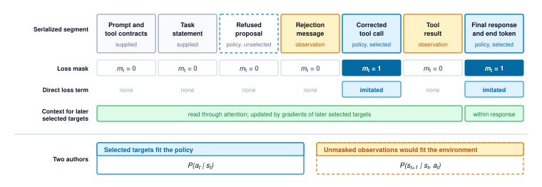
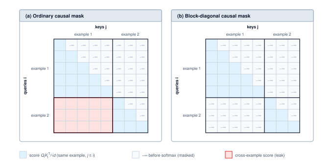
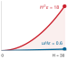
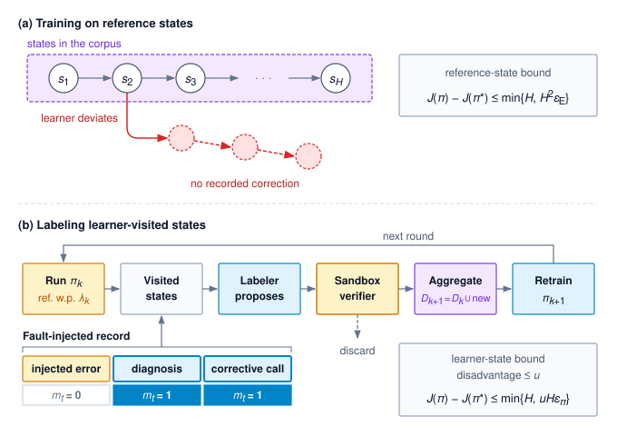

# Trajectory Fine-Tuning {#sec-vol3-fine-tuning}

::: {layout-narrow}
::: {.column-margin}

\chapterminitoc

:::

::: {.content-visible when-format="pdf"}
\noindent
{fig-alt="Blueprint for trajectory fine-tuning."}
:::

::: {.content-visible unless-format="pdf"}
{fig-alt="Blueprint for trajectory fine-tuning."}
:::

:::

## Purpose {.unnumbered .unlisted}

\begin{marginfigure}
\mlagentstack{0}{100}{0}{0}{0}{0}
\end{marginfigure}

_Why can training on a useful recovery record teach the model to repeat the mistake instead of the correction?_

Fine-tuning changes the model itself, and its effects persist in every call the policy makes afterward. A clearer context, a corrected tool schema, or a stricter runtime check can each be tested against the failing cases and withdrawn in a single release. A weight change needs a corpus, a training run, and a fresh evaluation, and it is undone only by another release. The records that feed it also differ from the text a language model first learned from. An agent trajectory has two authors. The model proposes calls and reports, and the environment answers with results, errors, and refusals. A recovery record interleaves a mistake, the evidence that exposed it, and the correction, and only part of that record is behavior the policy should learn to produce. A pipeline that blurs these roles can lower its training loss while teaching the policy to repeat the mistake or to invent the tool output it should have waited for, and the loss curve never shows the difference. Taking the distinction seriously turns fine-tuning from a routine training job into a discipline of choosing targets, preserving what each response was conditioned on, and demanding closed-loop evidence before release. It also fixes where learning sits in the agent. Training moves none of the H·S·A exposures; it changes the policy that proposes actions, while the horizon, state, and authority bounds enforced by the runtime hold whatever the new weights propose.

::: {.content-visible when-format="pdf"}

\newpage

:::

::: {.callout-learning-objectives}

- Assign agent behavior to weights, context, or runtime, and decide when a failure warrants a weight change
- Construct model inputs that preserve intended conditioning and price per-invocation serialization in training tokens
- Map admitted response spans to causal token targets, observation masks, and termination policy
- Compare loss weighting and construct batches without unintended cross-example dependencies
- Calculate imitation regret bounds on reference and learner states to decide when on-policy labeling pays
- Calculate preference margins and gradient weights, and distinguish what a comparison measures from task acceptance
- Select behavior sources and parameter artifacts using explicit resource and version accounting
- Evaluate a versioned policy for release while preserving runtime enforcement and scoped acceptance criteria

:::
## Recovery Records as Training Data {#sec-vol3-fine-tuning-introduction}

::: {.column-margin}
{width="100%" fig-alt="H·S·A locator with no axis highlighted and the origin dot highlighted in purple."}

*Fine-tuning reshapes each model call but leaves every exposure to the runtime.*
:::

Consider a recovery demonstration admitted by the curation pipeline for the repair agent (\ref{lhs-vol3-repair-agent}) into `repair_demonstrations_v1`. During the recorded session, the agent generated a malformed edit proposal that the runtime validator refused prior to tool dispatch. In response to the failure notification, the model inspected the tool schema, generated a corrected edit, and produced candidate patch `ws_r20`. From this multi-turn trajectory, the curation contract selects three specific assistant turns as supervised targets: the schema inspection request, the corrected edit, and the scoped final summary. The initial malformed proposal and the runtime's validation error remain strictly in the input history as conditioning context. Curation has validated these role assignments and committed the trajectory to `recovery_targets_v1`.

An admitted record is not yet in a form a training loop can safely ingest. The raw event log is an interleaved transcript of heterogeneous events, recording model generations, runtime observations, and tool responses in the exact sequence they occurred. If a data loader treats every assistant message as a supervised target, it computes loss on the malformed edit proposal alongside the correction, directly reinforcing the initial mistake. If the training pipeline computes loss across all sequence tokens indiscriminately, the model expends parameter capacity predicting deterministic environment replies, such as compiler diagnostics or file directory listings, that the model will never emit during inference. If the batching pipeline packs multiple trajectories into a shared context window without attention masking, self-attention heads attend across sample boundaries, leaking private workspace contents into unrelated training examples. Crucially, standard cross-entropy loss fails silently under each of these conditions. The empirical loss decreases steadily as the optimizer fits the data, concealing severe behavioral corruption from offline training metrics. While curation contracts determine which actions demonstrate desirable behavior and evaluation contracts measure the deployed agent, neither specifies how to convert a multi-turn execution trace into isolated, causal gradient updates.

Building that path—from an admitted record to an identified, evaluated policy update—requires solving several decoupled systems challenges. First, engineers must establish the architectural boundaries between model weights, context prompts, and runtime enforcement (@sec-vol3-fine-tuning-scope). Modifying model weights is an expensive, permanent intervention across all future calls; fine-tuning must target only those behavioral invariants that context prompts and runtime validators cannot reliably enforce.

Second, the data pipeline must translate multi-turn event logs into supervised training tensors. This pipeline serializes raw trajectories into token sequences that faithfully reconstruct the agent's exact causal context at inference time (@sec-vol3-fine-tuning-serialization). Loss masks must zero out gradients over prompt templates, environment observations, and erroneous turns, ensuring parameter updates apply solely to selected target tokens (@sec-vol3-fine-tuning-loss-masking). When grouping trajectories into training batches, sequence packing algorithms must preserve sample boundaries and balance loss weighting so batch packing does not distort optimization (@sec-vol3-fine-tuning-batching).

Third, the training workflow must bridge the gap between offline demonstrations and autonomous execution. When an autoregressive policy acts in live environments, minor predictive deviations compound into trajectory drift, demanding explicit strategies to counter exposure bias (@sec-vol3-fine-tuning-exposure-bias). The policy must also maintain robust tool-calling behavior as underlying schemas and tool APIs evolve (@sec-vol3-fine-tuning-schemas).

Finally, system designers face three orthogonal decisions in configuring the optimization pipeline: selecting the training objective, such as supervised fine-tuning vs. direct preference optimization (@sec-vol3-fine-tuning-dpo); identifying the behavioral source, contrasting self-generated trajectories against knowledge distillation from a larger model (@sec-vol3-fine-tuning-distillation); and choosing the parameter substrate, weighing full-weight updates against parameter-efficient adapters (@sec-vol3-fine-tuning-peft). Before any candidate checkpoint is cleared for production, it must demonstrate verified capability and safety across rigorous evaluation suites (@sec-vol3-fine-tuning-benchmarking), culminating in an end-to-end training manifest that documents data provenance, masking rules, and deployment gates for the repair policy (@sec-vol3-fine-tuning-synthesis).
## Scope of Supervised Fine-Tuning {#sec-vol3-fine-tuning-scope}

Modifying model weights is an expensive, high-blast-radius intervention that should be reserved for specific failure modes. The intervention hierarchy developed in @sec-vol3-flywheel-intervention-order establishes a disciplined operational sequence that exhausts cheap, reversible mitigations before touching parameters: first refining the prompt context supplied to the model, then clarifying the tool schemas it invokes, and finally enforcing runtime checks in the execution harness. Engineers can test each of these localized adjustments against failing traces and roll them back in a single configuration release if regressions emerge. By contrast, a weight update demands a curated training corpus, substantial compute for gradient steps, and exhaustive validation across regression benchmarks; undoing an errant weight update requires deploying another checkpoint release. Supervised fine-tuning is therefore the appropriate remedy for the residual failures that survive prompt and runtime engineering—specifically, systematic behavioral defects rooted in the policy itself rather than in omitted instructions or missing runtime constraints. The principle of verified trajectory post-training (principle \ref{pri-vol3-trajectory-post-training})\index{Principle!verified trajectory post-training} formalizes this filter by requiring empirical evidence that prompt-level and runtime fixes are insufficient before admitting an execution trace into the training set. While this ordering serves as a defensive default justified by operational cost and blast radius, @sec-vol3-fine-tuning-distillation examines the complementary scenario where fine-tuning proves more economical than paying the recurring token latency and cost of carrying lengthy guidance in every prompt.

**Supervised fine-tuning (SFT)**\index{Supervised fine-tuning!definition} adjusts trainable model parameters to maximize the conditional likelihood of selected target tokens given their causal prefix context. When processing an admitted trajectory record such as `trace_r19_01_redacted_v1`, the training loop must implement the specific recovery sequence defined in `recovery_targets_v1` rather than indiscriminately computing loss over every recorded token. The model must observe the historical context and tool outputs that justify a chosen action, yet the data pipeline must strictly censor subsequent execution steps that would prematurely reveal future observations or solutions. Trajectory fine-tuning therefore inherits two distinct data contracts: a *target-selection contract* that designates which tokens contribute to the loss gradient, and a *conditioning contract* that governs what causal history the model observes when generating those tokens.

This distinction defines what it means for an agent to learn improved behavior rather than overfit an idiosyncratic run. In an error-recovery trajectory, the true behavioral goal is teaching the model to inspect an updated schema after encountering a refusal, issue a properly formed corrective call, and interpret what the runtime verification check establishes. Merely memorizing the file paths of a specific test fixture or predicting hard-coded test outputs minimizes training loss without acquiring generalizable recovery skills. Evaluating whether the updated policy transfers these procedural habits to unfamiliar environments and novel tasks is precisely what @sec-vol3-fine-tuning-benchmarking measures.

### Procedure, contracts, and enforcement {#sec-vol3-fine-tuning-behavior-homes}

Every response generated by an agent emerges from two inputs: the model's static weights and the dynamic context window assembled for that invocation. Because fine-tuning updates only the weights, system architects must divide agent capabilities into three architectural homes, summarized in @tbl-vol3-fine-tuning-scope:

* *Procedure* represents behavior that remains stable across tasks and evolves slowly, such as inspecting diagnostic output before modifying source code or auditing unresolved issues before reporting task completion. Procedure is what model weights can reliably internalize.
* *Contracts* represent the dynamic operational facts that vary across deployments, user sessions, and individual execution turns—such as API tool definitions, schema requirements, environment parameters, and granted permissions. Contracts belong strictly in the prompt context; a model that has memorized an earlier schema will continue emitting obsolete arguments when an interface changes.
* *Enforcement* represents the critical invariants that must hold even when the model generates incorrect or adversarial proposals, such as schema validation, authorization checks, sandbox containment, and execution timeouts. Enforcement must reside in the deterministic runtime harness under the invariant closure principle (\ref{pri-invariant-closure}).

| Home    | Intended responsibility                                                                    | Consequence for fine-tuning                                                                                                      |
|:--------|:-------------------------------------------------------------------------------------------|:---------------------------------------------------------------------------------------------------------------------------------|
| Weights | Learned procedures and response tendencies, including tool selection and recovery behavior | Update the proposal distribution, then measure whether the changed behavior helps under the declared task conditions             |
| Context | Current task facts, tool schemas, observations, and represented scope                      | Supply the information the policy needs now; do not rely on memorized versions as the authority for current facts or permissions |
| Runtime | Validation, authorization, containment, resource controls, and evidence collection         | Preserve enforcement independently of the learned policy; a model's predicted result is not an observed external effect          |

: **Responsibilities of Weights, Context, and Runtime**: Weights hold procedure, context holds the current contract, and the runtime enforces that contract whatever the model proposes. {#tbl-vol3-fine-tuning-scope}

Relying on parameters to store interface contracts creates immediate operational brittleness. When a tool interface adds a required parameter or alters its return structure, a model that relies on memorized signatures will continue generating obsolete calls. Similarly, a revoked authorization remains revoked regardless of how frequently the action appeared in successful training demonstrations. Fine-tuning cannot replace dynamic contracts; what it can teach is the procedural discipline of consulting and adhering to whichever contract the context window specifies.

This architectural boundary disproves the naive view that fine-tuning simply moves the prompt into the weights. Only the procedural components of a prompt—such as structured reasoning guidelines, diagnostic checklists, or few-shot error recovery examples—can be absorbed into the parameters, saving substantial token overhead on every turn (@sec-vol3-fine-tuning-distillation). The contractual components must remain in the prompt context, because omitting them forces the model to guess the operational facts of the current execution environment. Furthermore, the deterministic checks that enforce authorization and boundary invariants cannot reside in either prompts or weights, because probabilistic token distributions cannot guarantee invariant execution.

Fine-tuning alters the policy's proposal distribution: which tools it requests, how thoroughly it investigates diagnostic evidence, and which execution paths it explores. These behavioral shifts directly influence task success rates, end-to-end latency, and token consumption. Yet every proposed action executes entirely within the execution horizons, state machines, and authority boundaries established by the runtime harness. We define this separation as the *proposal boundary*: training reshapes what the policy proposes, while the runtime dictates what actions are permitted to execute. This principle governs every adaptation strategy in this chapter, culminating in the release verification criteria.

### Objective, behavior source, and artifact {#sec-vol3-fine-tuning-adaptation-choices}

Designing an adaptation pipeline requires making three orthogonal decisions:

* **Training Objective**: The loss formulation that defines the learning signal. Supervised imitation learning maximizes the likelihood of curated target demonstrations, whereas preference learning techniques such as direct preference optimization (@sec-vol3-fine-tuning-dpo) optimize policy weights by contrasting preferred trajectories against dispreferred alternatives under an explicit ranking criterion.
* **Behavior Source**: The origin of the demonstrations and environmental conditioning. Traces may be harvested from instrumented production systems and filtered through offline verification, or generated synthetically by an expert teacher model configured with privileged context and expanded search budgets (@sec-vol3-fine-tuning-distillation).
* **Parameter Artifact**: The physical representation of the updated weights. Teams can fine-tune all model parameters directly or train modular adapter matrices, such as Low-Rank Adaptation (LoRA) modules, that attach to a frozen base checkpoint (@sec-vol3-fine-tuning-peft).

Because these three design dimensions are orthogonal, they combine modularly: a deployment might train a lightweight parameter adapter using a direct preference objective derived from synthetic teacher demonstrations.

Regardless of which combination an architecture adopts, the training process depends fundamentally on how trajectory records are converted into model inputs. Serialization determines tokenization and visibility windows, loss masking isolates the precise prediction targets, and batching schedules balance gradient variance across variable-length interaction turns. When deployed, the trained artifact will inevitably encounter unseen environmental states and revised tool schemas, requiring empirical validation before release. Constructing the prefix input and conditioning window for each targeted response constitutes the initial systems hurdle.
## Serializing Trajectories {#sec-vol3-fine-tuning-serialization}

Consider the repair demonstration admitted during curation: it contains a malformed edit proposal, a runtime refusal, a schema inspection, and a corrected edit. A training loader that strips out the refusal fundamentally alters the problem the subsequent correction answered. Similarly, a loader that places a later passing test check before the edit leaks future evidence that the model never possessed when proposing the patch. While curation identifies which model completions are worthy of reinforcement, serialization must reconstruct the exact prompt and observation history that elicited them. This includes preserving any runtime redactions—such as synthetic placeholders substituted for private file paths—so the training example faithfully reflects the environment the model actually encountered.

### Reconstructing each model input {#sec-vol3-fine-tuning-input-reconstruction}

Runtime event logs record system state transitions, but an event log alone does not guarantee what was present in a model's context window. System prompts evolve, tool schemas update dynamically, and intermediate messages are often summarized or truncated to fit token budgets. To reconstruct inputs accurately, the training pipeline relies on the delivered-input manifests introduced in @sec-vol3-persistence-replay. These manifests identify the exact messages, tool definitions, summaries, and bounded observations dispatched to the model, along with their contents and schema versions. The manifest provides the authoritative record that a specific payload entered an invocation, preventing accidental data leakage or historical revisionism.

When constructing an example that demands historical fidelity, serialize the selected invocation directly from this recorded manifest. The example must preserve the observation exactly as the agent saw it—including partial buffers, truncated outputs, or execution errors—rather than substituting a clean or complete result obtained later in the run. Conversely, when intentionally transforming an example, apply the reviewed transformation systematically to both the prompt and the associated response, retain parent trace references, and recheck schema compatibility. Shortening prompts for context distillation (@sec-vol3-fine-tuning-distillation) is one such transformation.

@Tbl-vol3-serialization-repair-spans outlines how curated responses map to their valid conditioning context in the running repair demonstration. While the table highlights the core causal dependencies, the fully rendered training example incorporates the entire context available at that turn, including system instructions and active tool definitions.

| Selected response | Relevant conditioning evidence                                                                      | Response content selected by curation                |
|:------------------|:----------------------------------------------------------------------------------------------------|:-----------------------------------------------------|
| `e3`              | Earlier delivered task context and the malformed `e2` proposal with its pre-dispatch refusal        | Request to inspect the available schema              |
| `e4`              | The corresponding returned schema and the retained context supporting the edit                      | Corrected edit with its version condition            |
| `e6`              | The candidate-specific check summary delivered at `e5` and retained evidence for the report's scope | Final report of the supported result and limitations |

: **Inputs and Selected Responses in the Repair Demonstration**: Each row pairs a reviewed response with evidence available to condition it. {#tbl-vol3-serialization-repair-spans}

Notice the causal boundaries across these turns. The refusal at `e2` demonstrates that runtime validation caught the malformed proposal before dispatch; no tool executed on the host. The check summary at `e5` arrived only after the agent issued the corrected edit, so it can condition the final report at `e6`, but cannot appear in the context for `e4`. Similarly, selecting the schema inspection at `e3` isolates the model's query tokens for training while treating the returned schema as external observation. Maintaining these explicit associations ensures that subsequent loss masking isolates model decisions from environment observations.

### Rendering with versioned templates {#sec-vol3-fine-tuning-template-rendering}

Before training begins, structured message objects—system instructions, user prompts, assistant thoughts, tool calls, and environment returns—must be serialized into the token sequence expected by the target model. Chat templates differ substantially across model architectures. Even checkpoints derived from the same base model often disagree on how to format tool schemas, delimit parallel calls, or signal message boundaries. A serialized dataset artifact must therefore record the tokenizer version, template configuration, tool-formatting schema, and response-boundary policy alongside the token arrays. The true model input consists of the message sequence paired with this concrete rendering configuration.

In schematic form, a multi-turn tool-calling example follows the structure shown below. The delimiter strings are illustrative placeholders, as each model family defines its own special tokens. Here, the system segment defines the task contract and tool definitions, the assistant segment emits an optional reasoning trace followed by two parallel tool calls with unique identifiers, and each tool segment returns an observation matched to its corresponding call identifier.

```text
<|system|> task contract; schemas for read_file(target_uri), run_tests(target) <|end|>
<|user|> Fix the connection-pool leak in src/pool.py <|end|>
<|assistant|> <|reasoning|> Reproduce the failure, then read the module. <|end_reasoning|>
  <|call id=c1|> {"name": "read_file", "arguments": {"target_uri": "src/pool.py"}} <|end_call|>
  <|call id=c2|> {"name": "run_tests", "arguments": {"target": "tests/test_pool.py"}} <|end_call|>
<|end_turn|>
<|tool id=c2|> FAILED test_release: pool exhausted <|end|>
<|tool id=c1|> ...file contents... <|end|>
<|assistant|> ...
```

In this sequence, `c2` completes before `c1`. The call identifiers keep each observation bound to its original invocation regardless of arrival order. Serialization must assemble tokens according to how the runtime presented the prompt to the model, not by completion time. Reordering calls whose arguments or observations depend on one another alters the causal problem; any such permutation constitutes a synthetic data transformation that requires explicit validation. The `<|end_turn|>` token records where the policy surrendered control to the runtime loop, while all tokens enclosed between `<|tool|>` and `<|end|>` constitute external observations.

In our pipeline, we bundle this rendered dataset as `serialization_v1`. Its manifest couples the admitted execution records with the active rendering configuration, mapping every selected response span to its exact token offsets. Because tokenization, template injection, and string redaction can shift token boundaries—such as when leading whitespace merges into an adjacent special token—the pipeline must re-verify all token offsets against the final rendered array. A rigorous pipeline decodes completed examples to inspect task prompts, tool bindings, span boundaries, and end-of-sequence markers. If an example fails boundary alignment or drops content, the pipeline drops the record entirely rather than patching it with synthetic filler.

Role delimiters establish protocol syntax, but they convey no runtime authority. If a model generates text that mimics a `<|tool|>` delimiter, that text remains model output under the tokenizer's grammar; the serialization pipeline must never promote unverified generations into genuine environment observations (@sec-vol3-foundation-model-role).

```{python}
#| label: calc-vol3-per-turn-expansion
#| echo: false
# PER-TURN EXAMPLE EXPANSION (LEGO)
# Goal: Price one-example-per-invocation serialization against one transcript.
# Scope: Stipulated horizon; each turn adds a similar number of tokens.
from mlsysim.fmt import check, fmt_int, fmt_multiple

class PerTurnExpansion:
    # 1. LOAD: stipulated horizon in turns.
    horizon = 30

    # 2. EXECUTE: prefixes of 1..H turns versus one H-turn transcript.
    per_turn_units = horizon * (horizon + 1) / 2
    transcript_units = horizon
    expansion = per_turn_units / transcript_units

    # 3. GUARD: closed form (H+1)/2.
    check(abs(expansion - (horizon + 1) / 2) < 1e-12, "Expansion is (H+1)/2")
    check(expansion > 1, "Separate examples repeat context")

    # 4. OUTPUT: consumed in the serialization prose.
    horizon_str = fmt_int(horizon)
    expansion_mult_str = fmt_multiple(expansion, precision=1)
```

Serving runtimes vary in how they manage conversational history. Some systems preserve full transcripts across iterations, while others prune earlier steps, summarize intermediate context, or discard chain-of-thought scratchpads between turns to reduce KV cache footprints. A single concatenated transcript provides a faithful training example only when its causal attention prefixes match what the model actually perceived during online inference. When serving prunes or compresses history between steps, each invocation must instead be serialized as an independent training example containing its exact delivered prefix.

This independence incurs a substantial computational penalty. If a trajectory spans $H$ turns and each turn contributes roughly $L$ tokens, the example for turn $k$ spans approximately $kL$ tokens. Serializing all $H$ invocations independently requires $L\,H(H+1)/2$ tokens, compared to just $LH$ tokens for a unified transcript—an expansion factor of $(H+1)/2$. Over a stipulated horizon of `{python} PerTurnExpansion.horizon_str` turns, serializing each invocation separately multiplies the required token volume by `{python} PerTurnExpansion.expansion_mult_str`. An agent system's history-retention policy is therefore a primary engineering constraint when sizing training compute. Across all cases, reconstruction retains only the rationale tokens that serving actually presented to the model under the specified policy.

With `serialization_v1` assembled, the pipeline defines the tokenized sequences, their conditioning evidence, and the response spans selected during curation. The remaining challenge is determining which token predictions contribute to the training loss. Unmasked cross-entropy over entire multi-turn sequences would inadvertently penalize the model for failing to predict external tool outputs or user messages. Observation loss masking converts the curated span boundaries into aligned prediction targets while preserving necessary observations as conditioning context.
## Observation Loss Masking {#sec-vol3-fine-tuning-loss-masking}

A data loader that naively selects every assistant token trains the model on malformed proposals alongside their subsequent corrections, unraveling careful curation decisions. Worse, a loader that computes loss across all tokens asks the policy to predict external environment responses. Serialization structures the input sequence into tokens, but the loss mask determines which of those tokens generate parameter updates.

### The masked objective {#sec-vol3-fine-tuning-masked-objective}

Let $X=(x_1,\ldots,x_T)$ be one serialized example, with an initial context or boundary token at $x_1$. Let $\mathcal{P}_{\text{elig}}\subseteq\{2,\ldots,T\}$ contain the eligible policy-token positions selected for imitation. Position eligibility depends on admitted response spans and the specific training objective rather than token authorship alone. The mask is $m_t=\mathbf{1}\{t\in\mathcal{P}_{\text{elig}}\}$, with $m_1=0$. For an example with at least one selected target, the mean masked cross-entropy is

$$\mathcal{L}_{\mathrm{SFT}}(\theta)=-\frac{1}{N_{\mathrm{active}}}\sum_{t=2}^{T}m_t\log P_\theta(x_t\mid x_{<t}),\qquad N_{\mathrm{active}}=\sum_{t=2}^{T}m_t>0.$$ {#eq-vol3-sft-masked-objective}

Each selected token is predicted from the preceding prefix. During training, the model conditions on the recorded sequence prefix—including earlier actions, observations, and admitted mistakes—rather than sampling fresh rollouts at each step. This training regime is **teacher forcing**\index{Teacher forcing!definition}[^fn-teacher-forcing-origin] [@williams1989learning]. It allows recovery prefixes that contain historical failures to serve as valid conditioning contexts, provided the trajectory satisfies the curation contract.

[^fn-teacher-forcing-origin]: **Teacher Forcing**: Williams and Zipser named the technique in 1989 for recurrent networks, feeding the recorded target back as the next input instead of the network's own output. Because every prefix is recorded rather than generated, a causal model computes all of an example's next-token predictions in one parallel forward pass, which is why imitating a trajectory costs one pass per example rather than one sampled rollout per decision.

In our repair trajectory, `target_mask_v1` maps reviewed response spans directly onto the tokens emitted by `serialization_v1`, distinguishing target tokens from conditioning context (@tbl-vol3-loss-masking-strata). Modifying a tokenizer vocabulary, adjusting chat formatting templates, or transforming text inputs inevitably alters token alignments. Consequently, the pipeline must regenerate and validate masks against the exact serialization output rather than copying offsets across pipeline stages.

| Token segment                                              | Target policy for this imitation objective                                                 | What remains as conditioning input                                                   |
|:-----------------------------------------------------------|:-------------------------------------------------------------------------------------------|:-------------------------------------------------------------------------------------|
| Prompt and supplied tool contracts                         | $m_t=0$                                                                                    | The actual task, current interfaces, and supplied constraints                        |
| Selected policy response                                   | $m_t=1$ on its admitted target positions                                                   | Earlier tokens of the response and its available prefix                              |
| Unselected policy response, including the refused proposal | $m_t=0$                                                                                    | History needed to interpret a selected correction                                    |
| Tool or environment observation                            | $m_t=0$                                                                                    | Delivered results, errors, and evidence available before the next response           |
| Optional authorized rationale                              | Chosen by the declared target policy                                                       | Retained rationale remains visible whether or not it is selected                     |
| Termination boundary                                       | Select an authentic policy-generated terminator when teaching the selected response to end | Do not substitute a tool-role boundary or invent a terminator for a cut-off response |

: **Loss Masking by Token Segment**: The loss mask specifies which serialized tokens generate gradient updates. It acts as an optimization filter rather than an attention barrier or provenance record. {#tbl-vol3-loss-masking-strata}

When an example contains no selected targets ($N_{\mathrm{active}}=0$), the loss in @eq-vol3-sft-masked-objective is undefined. The data loader must either drop such examples from the supervised objective or process them under an explicit fallback policy; it must never record them as completed demonstrations. Batch-level weighting strategies across heterogeneous examples present distinct numerical trade-offs, developed in @sec-vol3-fine-tuning-batching.

::: {#dfn-action-loss-masking .callout-definition title="Observation loss masking"}

***Observation loss masking***\index{Observation loss masking!definition}\index{Supervised fine-tuning!loss masking} excludes supplied observations from the direct token-prediction loss while retaining the permitted observation context needed to train selected policy responses.

1. **Significance**: Focuses the optimization objective strictly on the policy's conditional distribution $P(a_t\mid s_t)$. Consequently, verbose environment output cannot dilute the gradient signal for policy actions, regardless of how much sequence context observations consume (notebook \ref{nbk-15-gradient-budget-and-compute-allocation} quantifies this dilution).
2. **Distinction**: Masked tokens remain in the input context and participate in self-attention; only their next-token loss terms are omitted. Furthermore, policy authorship alone does not qualify a token as a target: rejected attempts or toxic actions require masking even when generated by an assistant role.
3. **Common pitfall**: Selecting an entire multi-turn tool exchange simply because the tool call succeeded, inadvertently training the model to predict external environment responses.

:::

### Causal label alignment {#sec-vol3-fine-tuning-label-alignment}

In causal autoregressive models,[^fn-causal-mask-shift] the hidden state at input index $t-1$ generates the logits that predict token $x_t$. The data loader must therefore align the prediction logits at $t-1$ with target label $x_t$ and target mask $m_t$, rather than attaching the mask of input token $x_{t-1}$. @Tbl-vol3-mask-causal-shift illustrates this boundary alignment. Because several distributed training frameworks perform this causal shift internally within their loss functions, applying a manual shift inside the data loader can silently misalign targets by one token across the entire corpus. Inspect the aligned labels and predicted tokens on a synthetic short example before launching large-scale training runs.

[^fn-causal-mask-shift]: **Causal Self-Attention**: Causal masking in Transformer decoders restricts each token from attending to subsequent positions [@vaswani2017]. This triangular attention structure allows a single forward pass over an input sequence of length $T$ to compute all next-token predictions in parallel. It also enforces the label shift: the network predicts $x_t$ using only the representation formed at $t-1$.

| Logits computed from a prefix ending at…          | Next-token label                          | Target mask |
|:--------------------------------------------------|:------------------------------------------|:------------|
| The final supplied prompt token                   | First token of a selected policy response | $1$         |
| The final content token of that selected response | Its authentic policy-generated end token  | $1$         |
| The end token before a delivered tool observation | First token of that observation           | $0$         |

: **The Causal Label Shift at a Tool Boundary**: Target selection applies to the predicted token rather than the input token driving the hidden state. Exact boundary encodings depend on the serialized chat template. {#tbl-vol3-mask-causal-shift}

Let $o_{t-1,v}$ denote the logit for vocabulary token $v$ produced from $x_{<t}$, using an ordinary softmax and no label smoothing. Differentiating @eq-vol3-sft-masked-objective gives

$$\frac{\partial\mathcal{L}_{\mathrm{SFT}}}{\partial o_{t-1,v}}=\frac{m_t}{N_{\mathrm{active}}}\left(P_\theta(v\mid x_{<t})-\mathbf{1}\{v=x_t\}\right).$$

When $m_t=0$, the next-token prediction at position $t-1$ yields zero direct loss derivative. The token nevertheless shapes subsequent representations through causal attention layers, allowing gradients backpropagated from downstream active losses to adjust the parameters that encode it. The model conditions on tool outputs without expending capacity attempting to synthesize them. This mechanism underpins verified trajectory post-training (principle \ref{pri-vol3-trajectory-post-training}) at token-level precision.

A deployed agent trajectory records an interleaved dialogue between two distinct systems: the agent policy and the external environment. Training without observation masking forces a single parameter set to approximate two conflicting distributions simultaneously:

1. The **agent policy** $P(a_t\mid s_t)$, mapping historical observations and instructions to deliberate tool calls or answers.
2. An **environment dynamics model** $P(s_{t+1}\mid s_t, a_t)$, predicting outputs returned by arbitrary shells, database engines, or remote APIs.
Because real tools execute directly during deployment and supply ground-truth outputs, tasking the policy with predicting environment returns wastes model capacity.

Supervising the environment distribution introduces two severe systems failures:

1. **Loss dilution**\index{Loss dilution!definition}: Under standard token-averaged cross-entropy, unmasking inflates the normalization denominator from $N_{\mathrm{active}}$ to the full sequence length $T$. As a result, the effective gradient scale on critical decision tokens collapses proportionally to the policy's fraction of the total token count (computed in notebook \ref{nbk-15-gradient-budget-and-compute-allocation}). The loss budget becomes dominated by stochastic runtime artifacts—file paths, stack traces, compiler dumps, and raw JSON payloads—that the policy cannot reliably predict.
2. **Role confusion**\index{Role confusion!definition}: When trained to predict tokens following a tool invocation, the policy learns that tool outputs naturally succeed tool calls within the same autoregressive stream. In production, such a model frequently hallucinates its own tool executions rather than generating the stop token required to surrender control back to the orchestrator. Because the execution runtime strictly separates generated text from authenticated environment observations (@sec-vol3-fine-tuning-serialization), it rejects these hallucinated returns, burning generation budget and causing unrecoverable execution stalls.

@Fig-vol3-loss-masking overlays the loss mask onto the segments of our running repair trajectory, highlighting how gradients route into model weights.

::: {#fig-vol3-loss-masking fig-env="figure" fig-pos="htb" fig-cap="**Observation Loss Masking**: The mask over a simplified view of the serialized repair example that omits the schema request (selected) and its returned schema (context). Of the segments shown, only the corrected tool call and the final response carry $m_t=1$ and receive a direct loss term. The prompt, task, refused proposal, rejection message, and tool result carry $m_t=0$, yet every one of them is still read through attention, so gradients from later selected targets update the parameters that encode it. Selecting only policy responses fits the policy's conditional distribution; unmasking the observations would also ask the same weights to fit the environment's." fig-alt="Seven serialized segments in a row: prompt and tool contracts, task statement, refused proposal, rejection message, corrected tool call, tool result, and final response with end token. Below each is its loss mask, zero for all except the corrected tool call and the final response, which are one. A direct loss row marks only those two as imitated. A context row spans all segments, stating they are read through attention and updated by gradients of later selected targets. At the bottom, one box pairs selected targets with the policy P of a t given s t, and a dashed box pairs unmasked observations with the environment P of s t plus 1 given s t and a t."}

:::

Observation masking eliminates both pathologies at the loss level. A validation loss curve cannot reveal how often an unmasked model fabricates environment outputs in practice; that failure mode emerges only during interactive, closed-loop evaluation. While predicting environment transitions is a legitimate goal when training world models or offline tool simulators, it conflicts with the policy imitation objective required for autonomous agents.

### Selected targets and compute {#sec-vol3-fine-tuning-selected-targets}

::: {.column-margin}
{width="100%" fig-alt="One horizontal stacked bar. A long green segment labeled observations 77.1% fills most of it, a gray segment labeled ctx follows, and a thin dark segment at the right end is labeled targets 4.9%."}

*Observations fill 77.1 percent of the input; the loss sits on 4.9 percent.*
:::

The count of selected positions $N_{\mathrm{active}}$ establishes the denominator of the loss function and dictates the gradient magnitude assigned to each target token. In agent workflows, extensive tool outputs frequently consume the vast majority of sequence memory while serving as conditioning context for a concise corrective action. Comparing the proportion of active target tokens against total sequence length reveals the precise dilution factor an unmasked objective would impose. Notebook \ref{nbk-15-gradient-budget-and-compute-allocation} quantifies these allocations across two alternative target policies evaluated on the same trajectory.

```{python}
#| label: lego-15-selected-target-accounting
#| echo: false
# ┌─────────────────────────────────────────────────────────────────────
# │ SELECTED TARGET ACCOUNTING (LEGO)
# │ Context: @nbk-15-gradient-budget-and-compute-allocation.
# │ Goal: Separate stored positions from eligible imitation targets.
# │ Show: Two masks on one hypothetical input retain identical context.
# │ How: Sum segment counts; exclude unselected responses; count targets.
# └─────────────────────────────────────────────────────────────────────
from mlsysim import *
from mlsysim.fmt import check, fmt_int, fmt_multiple, fmt_percent

class SelectedTargetAccounting:
    # ┌── 1. LOAD (Hypothetical Token Counts) ────────────────────────────
    prompt = 1_200  # includes the initial context/boundary position
    task = 184
    optional_rationale = 1_400  # available, authorized, reviewed text
    response = 960  # response content and authentic terminators
    observation = 12_640
    unselected_response = 160  # retained as context, not desired targets
    checkpoint_observation = 30_000  # given for the reader's estimate in the checkpoint

    # ┌── 2. EXECUTE (One Input, Two Target Policies) ────────────────────
    stored = prompt + task + optional_rationale + response + observation
    selected_response = response - unselected_response
    with_rationale = selected_response + optional_rationale
    without_rationale = selected_response
    observation_share = observation / stored
    with_share = with_rationale / stored
    without_share = without_rationale / stored
    context_only_with = stored - with_rationale
    context_only_without = stored - without_rationale
    # Unmasked token averaging divides by every stored position instead.
    dilution_without = stored / without_rationale
    dilution_with = stored / with_rationale
    stored_double_obs = stored + observation
    dilution_double_obs = stored_double_obs / without_rationale
    unselected_vs_selected = unselected_response / selected_response

    # ┌── 3. ASSERT (Partitions and Positive Denominators) ───────────────
    check(0 <= unselected_response < response, "valid response selection")
    check(stored == 16_384, "declared input partition")
    check(0 < without_rationale <= with_rationale < stored, "valid targets")
    check(with_rationale + context_only_with == stored, "first partition")
    check(without_rationale + context_only_without == stored, "second partition")
    check(with_rationale - without_rationale == optional_rationale, "mask difference")
    check(dilution_without > dilution_with > 1, "masking concentrates weight")
    check(dilution_double_obs > dilution_without, "longer observations dilute more")
    check(checkpoint_observation > observation, "checkpoint grows the observations")

    # ┌── 4. OUTPUT (Computed Display Exports) ───────────────────────────
    prompt_str = fmt_int(prompt)
    task_str = fmt_int(task)
    rationale_str = fmt_int(optional_rationale)
    response_str = fmt_int(response)
    observation_str = fmt_int(observation)
    unselected_str = fmt_int(unselected_response)
    stored_str = fmt_int(stored)
    observation_share_str = fmt_percent(observation_share, precision=1, style="prose")
    with_str = fmt_int(with_rationale)
    without_str = fmt_int(without_rationale)
    with_share_str = fmt_percent(with_share, precision=1, style="symbol")
    without_share_str = fmt_percent(without_share, precision=1, style="symbol")
    selected_response_str = fmt_int(selected_response)
    dilution_without_mult_str = fmt_multiple(dilution_without, precision=1)
    dilution_with_mult_str = fmt_multiple(dilution_with, precision=1)
    dilution_double_obs_mult_str = fmt_multiple(dilution_double_obs, precision=1)
    unselected_vs_selected_str = fmt_percent(unselected_vs_selected, precision=0, style="prose")
    checkpoint_observation_str = fmt_int(checkpoint_observation)
```

::: {#nbk-15-gradient-budget-and-compute-allocation .callout-notebook title="Stored tokens and selected targets"}

**Problem**: A hypothetical serialized example has the segment counts in @tbl-vol3-mask-token-inventory. Its curation record excludes some policy-response positions from imitation while retaining them as context. If the optional rationale is either selected or kept as context only, how many positions receive direct loss, what fraction of the stored input do they occupy, and by how much would an unmasked loss dilute each of them?

| Input segment                                             |                                       Stored tokens |
|:----------------------------------------------------------|----------------------------------------------------:|
| System prompt and schemas, including the initial boundary |      `{python} SelectedTargetAccounting.prompt_str` |
| Task statement                                            |        `{python} SelectedTargetAccounting.task_str` |
| Optional authorized rationale                             |   `{python} SelectedTargetAccounting.rationale_str` |
| Other policy responses, including authentic end tokens    |    `{python} SelectedTargetAccounting.response_str` |
| Delivered observations                                    | `{python} SelectedTargetAccounting.observation_str` |

: **Hypothetical Input Inventory**: These disjoint counts include every stored position. They are not measurements of the shared repair run. {#tbl-vol3-mask-token-inventory}

**Variables**: Exactly `{python} SelectedTargetAccounting.unselected_str` of the other-policy-response positions belong to the refused proposal and stay context; every other response position is selected. The rationale is reviewed for either target policy, both policies see the same input, the initial position belongs to the prompt, and there is no padding.

**Math**: The disjoint segments sum to `{python} SelectedTargetAccounting.stored_str` stored tokens, of which observations occupy `{python} SelectedTargetAccounting.observation_share_str`. Removing the refused positions leaves `{python} SelectedTargetAccounting.response_str` $-$ `{python} SelectedTargetAccounting.unselected_str` $=$ `{python} SelectedTargetAccounting.selected_response_str` selected response targets, and selecting the rationale adds `{python} SelectedTargetAccounting.rationale_str` more. An unmasked token average divides by all `{python} SelectedTargetAccounting.stored_str` positions instead of $N_{\mathrm{active}}$, so each selected target's coefficient shrinks by `{python} SelectedTargetAccounting.stored_str`/`{python} SelectedTargetAccounting.selected_response_str`, a factor of `{python} SelectedTargetAccounting.dilution_without_mult_str` (`{python} SelectedTargetAccounting.dilution_with_mult_str` when the rationale is selected).

| Target policy                                          |       Selected positions, $N_{\mathrm{active}}$ |                        Selected share of stored input |
|:-------------------------------------------------------|------------------------------------------------:|------------------------------------------------------:|
| Selected responses plus reviewed rationale             |    `{python} SelectedTargetAccounting.with_str` |    `{python} SelectedTargetAccounting.with_share_str` |
| Selected responses; rationale retained as context only | `{python} SelectedTargetAccounting.without_str` | `{python} SelectedTargetAccounting.without_share_str` |

: **Two Target Policies on One Input**: Excluding a segment from the objective does not shorten the conditioning sequence. {#tbl-vol3-mask-target-counts}

**Result**: Both masks in @tbl-vol3-mask-target-counts place the whole loss on a small minority of stored positions and leave the context identical; they differ only in whether the rationale is a target.

**Systems insight**: Because the dilution factor scales inversely with the active target ratio, it expands rapidly as environment interactions accumulate. Doubling the observation volume while holding response lengths constant escalates dilution from `{python} SelectedTargetAccounting.dilution_without_mult_str` to `{python} SelectedTargetAccounting.dilution_double_obs_mult_str`. Consequently, observation masking becomes increasingly vital as agents tackle deep, tool-intensive reasoning traces. Notice, however, that masking yields negligible reductions in FLOPs: every masked token must still pass through causal attention layers to form context for subsequent predictions. Only the final language model head projection and cross-entropy loss computation can be bypassed at masked positions.

:::

### Optional rationale as target or context {#sec-vol3-fine-tuning-optional-rationale}

Many agent datasets incorporate intermediate reasoning traces, such as chain-of-thought scratchpads or tool-use plans. Deciding how to supervise this intermediate text requires choosing between three distinct data-loading regimes (@tbl-vol3-reasoning-mask-regimes). Supervising the rationale trains the model to generate its own reasoning before invoking tools. Retaining the rationale under a loss mask treats the reasoning as supplied conditioning context, training the model to act upon plans provided by an external orchestrator or user. Stripping the rationale entirely fundamentally alters the conditional distribution by forcing the policy to act directly from context alone.

Formally, given context prefix $c$, rationale tokens $\rho$, and action tokens $a=(a_1,\ldots,a_n)$, response-only supervision models the conditional distribution $P_\theta(a_j\mid c, \rho, a_{<j})$. If the production serving environment does not provide $\rho$, the deployed model must evaluate $P_\theta(a_j\mid c, a_{<j})$. Because these represent mathematically distinct conditional distributions, omitting rationale at training time represents an explicit distillation experiment that must be validated directly against the unconditioned serving target.

| Treatment                                        | Input and direct targets                                            | Serving question to evaluate                                                                          |
|:-------------------------------------------------|:--------------------------------------------------------------------|:------------------------------------------------------------------------------------------------------|
| Select reviewed rationale                        | Retain $[c,\rho,a]$; selected $\rho$ and $a$ positions receive loss | Does generated rationale improve the declared outcomes enough to justify its output and latency cost? |
| Retain rationale as context only                 | Retain $[c,\rho,a]$; only selected $a$ positions receive loss       | How will appropriate rationale become available, and how do errors in it affect the response?         |
| Remove rationale under a reviewed transformation | Use $[c,a]$; selected $a$ positions receive loss                    | Does the policy perform adequately without the removed conditioning information?                      |

: **Rationale Treatment Changes Targets or Inputs**: The choice requires a compatible serving protocol and evaluation, not a universal model-size threshold. {#tbl-vol3-reasoning-mask-regimes}

At inference time, an external planning agent or the policy's own autoregressive generator can supply the required reasoning text. When the model generates its own rationale, runtime text inevitably diverges from the training demonstration; downstream evaluation must measure this divergence. A rationale segment merits target status only when the system architecture explicitly requires the deployed policy to synthesize its own thoughts under operational latency and token budgets.

### Termination and truncated responses {#sec-vol3-fine-tuning-termination}

To teach an agent when to yield control, the training loss must include the authentic policy-generated termination token (such as `<|eom_id|>` or `<|im_end|>`) at the end of each selected response. Host frameworks often insert their own control delimiters to demarcate incoming tool payloads; data loaders must never confuse these host delimiters with genuine policy stop tokens. Excluding termination tokens from the loss mask deprives the model of direct supervision on when to stop, causing it to stream trailing gibberish until hitting arbitrary inference engine generation limits.

Truncated responses—where an output was cut short by context windows or timeout limits—present a dangerous edge case. A common pipeline flaw is appending a synthetic end-of-turn token to an incomplete response, which mistakenly trains the policy to treat partial commands as fully realized actions. When encountering truncated turns, engineering pipelines should adopt one of two sound strategies:

1. **Conservative exclusion**: Mask the truncated turn entirely ($m_t=0$) while preserving preceding successful turns in the trajectory.
2. **Prefix-only supervision**: Supervise the valid initial tokens of the truncated turn up to the truncation point, but strictly omit any terminating token.

Whenever trajectories undergo truncation, sliding-window packing, or template transformations, the data pipeline must recompute target masks and verify that $N_{\mathrm{active}} > 0$. Robust training loaders implement automated unit assertions on critical boundaries: the first token of an agent response, the closing turn terminator, the transition into tool observations, rejected recovery attempts, and truncated sequences. Validating these boundaries guarantees that the training engine optimizes the exact supervised objective declared by the curation policy.

::: {#chk-15-loss-masking .callout-checkpoint title="Defend the target mask"}

- [ ] **Curation to tokens**: Which of `e2`, `e3`, the tool reply to `e3`, `e4`, and `e6` carry $m_t=1$ under `recovery_targets_v1`, and what would training the others teach?
- [ ] **Causal alignment**: Which input position's logits predict the first selected response token, and which token's mask must accompany that prediction?
- [ ] **Masked vs. removed**: How can a masked observation affect parameter updates through a later selected response?
- [ ] **Dilution estimate**: If the observations in notebook \ref{nbk-15-gradient-budget-and-compute-allocation} grew to `{python} SelectedTargetAccounting.checkpoint_observation_str` tokens with every other segment unchanged, by roughly what factor would an unmasked token average dilute each selected response target, and why would masking save far less compute than that factor?
- [ ] **Termination**: A response was cut off at the output limit. Which of its positions can you still select, and what must the loader refuse to append?

:::

With per-example loss masking in place, the training loader enforces the exact boundary between conditioning context and imitation targets. Production training, however, batches heterogeneous trajectories across varying sequence lengths and device topologies. The batching and collation mechanisms must uphold this target contract without silently skewing loss weights across sequence lengths.
## Batching Variable-Length Trajectories {#sec-vol3-fine-tuning-batching}

Consider a batch where a lengthy debugging and code repair trace shares a single training buffer with a brief, unrelated file lookup. Under an ordinary lower-triangular causal mask, the lookup can attend directly to the repair trace's intermediate file contents and tool outputs—context that the lookup policy will never encounter during online inference. Under token averaging, the multi-turn repair trace will also outweigh the brief lookup by the exact ratio of their active target tokens.

Constructing a batch of variable-length trajectories therefore forces two coupled systems decisions: how much gradient weight each trajectory exerts on the optimization objective, and how multiple sequences share physical buffer memory without leaking information across sequence boundaries. Sequence packing is strictly a memory layout optimization; a correct implementation preserves both the mathematically specified loss and the causal isolation of each sequence's predictive context.

### Loss normalization across variable-length examples {#sec-vol3-fine-tuning-loss-normalization}

Let a batch contain $M$ examples. Example $j$ has stored length $T_j$, including context, and $N_{\mathrm{active},j}>0$ selected target tokens under the preceding section's mask. Let $\ell_j$ be its mean masked negative log-likelihood. Two batch objectives are

$$\mathcal L_{\mathrm{token}}=
\sum_{j=1}^{M}\frac{N_{\mathrm{active},j}}{\sum_{k=1}^{M}N_{\mathrm{active},k}}\ell_j,$$ {#eq-vol3-loss-token}

$$\mathcal L_{\mathrm{example}}=\frac{1}{M}\sum_{j=1}^{M}\ell_j.$$ {#eq-vol3-loss-example}

**Token averaging**\index{Token averaging!definition} in @eq-vol3-loss-token assigns equal coefficients to selected token losses. **Example averaging**\index{Example averaging!definition} in @eq-vol3-loss-example assigns equal coefficients to example means. Both count selected targets, never context or padding. A record with no selected targets supplies no $\ell_j$ and is excluded from either objective.

These normalization coefficients govern the loss function directly, though realized gradient magnitudes also depend on prediction errors and parameter sensitivities. Example averaging treats each completed interaction as an equal unit of learning, weighting tasks solely through their trajectory count. In contrast, token averaging weights each example proportionally to its active target count.

This distinction becomes critical when trajectory serialization splits a multi-turn interaction into separate training records. Splitting one trajectory into $H$ per-invocation examples, as serialization sometimes requires, multiplies its aggregate weight by $H$ under example averaging. Under token averaging, that same trajectory's total contribution remains invariant, provided each invocation selects only its own turn's response. Data sampling, trajectory segmentation, and loss normalization therefore jointly dictate how underlying agent capabilities are weighted during optimization.

| Property                             | Token averaging                                      | Example averaging             |
|:-------------------------------------|:-----------------------------------------------------|:------------------------------|
| Coefficient on example mean $\ell_j$ | $N_{\mathrm{active},j}/\sum_k N_{\mathrm{active},k}$ | $1/M$                         |
| Coefficient on a selected token loss | $1/\sum_k N_{\mathrm{active},k}$                     | $1/(M N_{\mathrm{active},j})$ |
| Quantity treated equally             | Selected token losses                                | Example mean losses           |

: **Loss normalization for variable-length examples**: Equal coefficients specify the objective, not equal gradient norms or equal representation of underlying tasks. {#tbl-vol3-loss-normalization-comparison}

The mathematical equivalence in @tbl-vol3-loss-normalization-comparison requires careful distributed accounting. Computing a true global token average requires summing active token losses and token counts across all microbatches and data-parallel ranks before dividing. Averaging local microbatch means directly produces an accurate token average only when active token counts match across all microbatches; otherwise, distributed workers must reduce the raw sums and counts across ranks before taking the ratio.

### Example isolation in packed buffers {#sec-vol3-fine-tuning-packed-isolation}

::: {#dfn-sequence-packing .callout-definition title="Sequence packing"}

***Sequence packing***\index{Sequence packing!definition} places several variable-length training examples in shared buffers while preserving their intended information boundaries and loss targets.

1. **Significance**: Uniform padding allocates the longest example's length to every row, reducing batch occupancy to the ratio of mean to maximum sequence length. Sequence packing reclaims this wasted capacity (notebook \ref{nbk-vol3-packing-occupancy}).
2. **Distinction**: Independent trajectories share physical memory buffers without sharing predictive context; multi-turn interactions within an individual trajectory retain access to their complete history.
3. **Common pitfall**: Applying a standard causal mask across concatenated sequences, allowing later examples to attend illegitimately to earlier ones.

:::

The file lookup from the section's opening must never read the repair trace's file contents or tool observations—the precise *cross-contamination*[^fn-packing-cross-contamination] that a packed layout must prevent [@krell2021efficient]. Let $i$ and $j$ denote buffer positions, $Q_i$ and $K_j$ their query and key vectors, and $d$ the attention-head dimension. The pre-softmax attention scores $\mathrm{score}_{i,j}$ enforce both causality and example membership:

$$\mathrm{score}_{i,j}=\begin{cases}
Q_iK_j^{\top}/\sqrt d & \text{if }\operatorname{example}(i)=\operatorname{example}(j)\text{ and }j\le i,\\
-\infty & \text{otherwise}.
\end{cases}$$ {#eq-vol3-block-diagonal-attention}

@Fig-vol3-block-diagonal-mask illustrates @eq-vol3-block-diagonal-attention for two packed examples alongside the ordinary causal mask it replaces, forming **block-diagonal attention**\index{Block-diagonal attention!definition}. Any trailing padding keys are similarly excluded. Boundary offsets identify each example's contiguous interval, allowing specialized attention kernels to enforce this mask directly from offset metadata without materializing a dense mask matrix. A variable-length attention kernel skips the masked cross-example blocks altogether; that bypassed computation, rather than the masking operation itself, produces the actual throughput gains.

[^fn-packing-cross-contamination]: **Cross-Contamination**: Krell and colleagues used the term for attention and label leakage between sequences packed into one buffer, and showed that masks, position resets, and per-sequence loss handling make a packed model mathematically equivalent to the unpacked one. The equivalence is the property to test: a packed loader that trains faster but lets examples read one another has changed the learning problem, and no loss curve will show it.

::: {#fig-vol3-block-diagonal-mask fig-env="figure" fig-pos="htb" fig-cap="**Block-Diagonal Attention for Packed Examples**: Two independent examples share one buffer. Under an ordinary causal mask (a), every query in the second example scores keys in the first, so the second example can use context it will not have when served. The block-diagonal mask (b) keeps causal scores only inside each example and sets every cross-example entry to $-\infty$ before the softmax, as in @eq-vol3-block-diagonal-attention. The boundary offsets define the blocks; whether a kernel also skips the masked blocks is an implementation property." fig-alt="Two eight-by-eight attention grids, queries down the side and keys across the top, each split into example 1 with five positions and example 2 with three. In panel a, the lower triangle within each example is shaded as a score, the upper triangle is marked minus infinity, and the block where example 2 queries meet example 1 keys is shaded red as a cross-example score. In panel b, the same lower triangles are shaded, and the whole cross-example block is marked minus infinity. A legend defines the score, minus infinity before softmax, and cross-example score."}

:::

::: {.column-margin}
{width="100%" fig-alt="Two horizontal bars. The upper bar, labeled packed 76.6%, is about four times longer than the lower bar, labeled padded 19.1%."}

*One long trajectory holds padded occupancy to 19.1 percent; packing reaches 76.6 percent.*
:::

Loss computation requires the same rigorous boundary isolation. In autoregressive language modeling, targets are created by shifting labels by one position. Shifting labels across an entire concatenated buffer inadvertently trains the final token of one example to predict the initial token of the next. Each example's initial prompt context remains unselected as a target, and shifted prediction-target pairs must stay strictly inside their parent example. Attention masks and target masks enforce distinct systems constraints: attention masks isolate visible context, while target masks isolate supervised loss gradients. Both must be implemented correctly.

```{python}
#| label: calc-vol3-packing-occupancy
#| echo: false
# PACKING OCCUPANCY (LEGO)
# Goal: Compare stored-token occupancy, not measured training throughput.
# Scope: Hypothetical independent examples and two fixed-capacity buffers.
from mlsysim.fmt import fmt_int, fmt_multiple, fmt_percent, check

class PackingOccupancy:
    # 1. LOAD: stored lengths and a separate two-example weighting illustration.
    lengths = [32768, 8192, 4096, 2048, 1024, 1024, 512, 512]
    capacity = 32768
    active_short = 256
    active_long = 8192

    # 2. EXECUTE: the longest example occupies one buffer; all others fit another.
    stored = sum(lengths)
    padded = len(lengths) * max(lengths)
    second_buffer = sum(lengths[1:])
    packed = 2 * capacity
    padded_occupancy = stored / padded
    packed_occupancy = stored / packed
    position_ratio = padded / packed
    mean_length = stored / len(lengths)
    coefficient_ratio = active_long / active_short
    short_weight = active_short / (active_short + active_long)
    long_weight = active_long / (active_short + active_long)

    # 3. GUARD: feasible layout and distinct normalization coefficients.
    check(max(lengths) == capacity, "Longest example fits exactly")
    check(0 < second_buffer <= capacity, "Remaining examples fit second buffer")
    check(0 < stored <= packed <= padded, "Occupancy bounds")
    check(abs(short_weight + long_weight - 1) < 1e-12, "Token weights sum to one")
    check(active_short > 0 and active_long > 0, "Nonempty target sets")
    check(abs(padded_occupancy - mean_length / max(lengths)) < 1e-12, "Padded occupancy is mean/max")

    # 4. OUTPUT: consumed in the worked calculation.
    stored_str = fmt_int(stored)
    padded_str = fmt_int(padded)
    second_buffer_str = fmt_int(second_buffer)
    packed_str = fmt_int(packed)
    padded_pct_str = fmt_percent(padded_occupancy, precision=1, style="prose")
    packed_pct_str = fmt_percent(packed_occupancy, precision=1, style="prose")
    ratio_mult_str = fmt_multiple(position_ratio, precision=0)
    coefficient_ratio_mult_str = fmt_multiple(coefficient_ratio, precision=0)
    mean_str = fmt_int(mean_length)
    max_str = fmt_int(max(lengths))
    short_pct_str = fmt_percent(short_weight, precision=2, style="prose")
    long_pct_str = fmt_percent(long_weight, precision=2, style="prose")
```

::: {#nbk-vol3-packing-occupancy .callout-notebook title="Stored occupancy and target weighting"}

**Problem**: A batch holds one long trajectory among short ones. How much allocated sequence space does packing save over uniform padding, and how differently do the two loss normalizations weight a long and a short example?

**Variables**: Eight hypothetical examples have stored lengths $[32{,}768,\ 8{,}192,\ 4{,}096,\ 2{,}048,\ 1{,}024,\ 1{,}024,\ 512,\ 512]$. Each packed buffer holds $32{,}768$ positions. Separately, two examples have $256$ and $8{,}192$ selected targets.

**Math**: Padding eight rows to the maximum allocates $8\times32{,}768$ positions, or `{python} PackingOccupancy.padded_str`, for `{python} PackingOccupancy.stored_str` stored tokens. Packing places the longest example alone in one buffer and the remaining `{python} PackingOccupancy.second_buffer_str` tokens in a second buffer. The two buffers allocate $2\times32{,}768$ positions, or `{python} PackingOccupancy.packed_str`. Dividing stored tokens by allocated positions gives an occupancy of `{python} PackingOccupancy.padded_pct_str` with padding—which equals the mean length of `{python} PackingOccupancy.mean_str` divided by the maximum of `{python} PackingOccupancy.max_str`—and `{python} PackingOccupancy.packed_pct_str` with packing. Packing allocates `{python} PackingOccupancy.ratio_mult_str` fewer positions.

For the separate target-count illustration, token averaging gives coefficients $256/(256+8{,}192)$ and $8{,}192/(256+8{,}192)$, or `{python} PackingOccupancy.short_pct_str` and `{python} PackingOccupancy.long_pct_str` on the example means. Their ratio, $8{,}192/256$, is `{python} PackingOccupancy.coefficient_ratio_mult_str`. Example averaging instead assigns each mean $1/2$.

**Systems insight**: Padded occupancy is the ratio of mean to maximum length, so the single longest trajectory sets the waste: one `{python} PackingOccupancy.max_str`-token example holds this batch to `{python} PackingOccupancy.padded_pct_str`, and packing raises it to `{python} PackingOccupancy.packed_pct_str`. Occupancy counts context and targets together, so the throughput it buys is measured on the actual attention kernel. Normalization is a separate knob with an equally large effect. Token averaging gives the long example `{python} PackingOccupancy.coefficient_ratio_mult_str` the short one's weight, and example averaging gives them equal weight. Choose token averaging when every selected token should count equally, and example averaging when a few long trajectories should not dominate the update.

:::

### Position conventions and equivalence checks {#sec-vol3-fine-tuning-position-conventions}

An implementation must also preserve the model's intended position convention. A common convention resets positions to zero at each example boundary. For zero-based buffer offsets $b_k$ and $b_{k+1}$ bounding example $k$,

$$\operatorname{pos}[t]=t-b_k\quad\text{for }t\in[b_k,b_{k+1}).$$

For rotary position embeddings (RoPE), resetting is an operational convention rather than a mathematical requirement. In the fixed-frequency formulation, position $i$ applies a rotation $R_i$ to a query or key vector. Shifting both positions by a common offset $b$ leaves their relative rotation unchanged:

$$R_{i+b}^{\top}R_{j+b}=R_{j-i}=R_i^{\top}R_j.$$

A common offset therefore leaves within-example attention scores unchanged, a direct consequence of the relative-position construction of RoPE [@su2024]. Absolute-position features, position-dependent frequency scaling, and floating-point non-associativity can still compromise equivalence for a particular architecture, making explicit validation essential.

A rigorous correctness test compares selected-token logits and the evaluated loss for the same examples processed separately and packed, with stochastic layers disabled and numerical tolerances explicitly stated. Perturbing one example must leave every other example's logits unchanged. This test exercises attention boundaries, label shifting, position IDs, and the chosen denominator together. When it passes, the loader trains exactly the demonstrated problem. The trained policy, however, acts in contexts its own choices produce.
## Exposure Bias {#sec-vol3-fine-tuning-exposure-bias}

Suppose a fresh bounded trial of the trained repair policy encounters a version conflict instead of the malformed-argument rejection recorded in `trace_r19_01_redacted_v1`. The policy repeats its previously accepted edit without first querying compatible state evidence. In response, the runtime conditional-update guard blocks the stale write, and the trial exhausts its execution allowance without completing the repair. The training corpus never included that state. While serialization and loss masking preserve the demonstrated decision problem, production deployment dictates which states the agent actually encounters. A policy trained strictly under teacher forcing never observes its own compounding errors during optimization. In standard text generation, an unexpected token merely drifts stylistic phrasing. In an autonomous agent, an errant action mutates the external environment—pushing the agent into states that the demonstration corpus never covered.

::: {#dfn-15-exposure-bias .callout-definition title="Exposure bias"}

***Exposure bias***\index{Exposure bias!definition} is the mismatch between training a sequential policy on reference prefixes and running it on prefixes produced by its own earlier outputs [@bengio2015scheduledsampling; @ranzato2016sequence].

1. **Significance**: It converts a per-step error rate into a horizon-dependent cost. When measured solely on reference states, an error rate $\epsilon$ bounds excess task cost only by $H^2\epsilon$ (theorem \ref{thrm-15-imitation-regret}), introducing an additional factor of $H$ beyond the operational compounding discussed in @sec-vol3-intro-horizon-arithmetic.
2. **Distinction**: It reflects a structural property of the training distribution rather than an isolated mistake. A policy can err on states the corpus covers and recover on states it never showed.
3. **Common pitfall**: Interpreting low offline validation loss on recorded prefixes as evidence that deployed execution will succeed. Offline loss samples only the reference trajectory, revealing nothing about the states the deployed policy visits once it deviates.

:::

Offline training corpora can include recovery trajectories, allowing an agent that departs from an ideal demonstration to re-enter a familiar state or discover an alternate valid solution. Fundamentally, exposure bias[^fn-exposure-bias-lineage] concerns how thoroughly the corpus covers the state distribution generated by the deployed policy itself—including unexpected edge states like the version conflict.

[^fn-exposure-bias-lineage]: **Exposure Bias**: Ranzato and colleagues introduced the name in 2016 for text generators trained on reference words and run on their own [@ranzato2016sequence]. Control researchers had met the same effect earlier as the compounding error of behavioral cloning, which Ross and Bagnell bounded in 2010 [@ross2010efficient]. The two literatures describe one mechanism, and agents inherit the control version: a wrong action changes the environment, not just the phrasing.

### State distributions and imitation regret {#sec-vol3-fine-tuning-imitation-regret}

An idealized finite-horizon model makes this coverage problem mathematically precise. The notation follows the imitation-learning literature and applies locally to this derivation. Here, the index $t$ counts discrete decision steps rather than individual token positions. The state $s$ represents the complete environment state of the decision process, incorporating interaction history and any underlying system variables that the agent cannot directly observe. This distinguishes it from the token context state $s_t$ defined in the action-loss masking specification (\ref{dfn-action-loss-masking}). Let $H$ denote the horizon length in decision steps. We consider a fixed learned policy $\pi$ alongside a deterministic reference policy $\pi^*$, operating under identical initial-state distributions and transition dynamics. Let $d_\pi^t$ denote the distribution of states encountered before step $t$ under policy $\pi$. The horizon-averaged *state distribution* is then $d_\pi = H^{-1}\sum_{t=1}^H d_\pi^t$.

::: {.column-margin}
{width="100%" fig-alt="Two curves over horizon from 0 to H equals 30. A red curve rises quadratically to a dot labeled H squared epsilon equals 18. A blue line stays near the axis and ends at a dot labeled u H epsilon equals 0.6. The gap between them is shaded."}

*Same 2 percent error: 18 cost units on reference states, 0.6 on learner states.*
:::

Let $C(s,a)\in[0,1]$ be a normalized immediate task cost and $J(\pi)$ its expected sum over the horizon. Let $\ell(s,\pi)=\Pr_{a\sim\pi(\cdot\mid s)}[a\ne\pi^*(s)]$ measure disagreement with the reference. Disagreement serves as a conservative proxy for task failure, since multiple distinct actions may be acceptable in practice. Furthermore, it quantifies the probability of selecting an off-reference action at decision time, a metric fundamentally distinct from the token-level cross-entropy loss reported during training. Finally, the *cost-to-go* $Q_t^{\pi^*}(s,a)$ is the expected cost from step $t$ through $H$ after taking $a$ in $s$ and following the reference thereafter.

```{python}
#| label: calc-vol3-sft-distribution-bounds
#| echo: false
# CONDITIONAL COST BOUNDS (LEGO)
# Goal: Show which assumptions distinguish expert-state and learner-state bounds.
# Scope: Hypothetical normalized costs; not observed repair performance.
from mlsysim.fmt import check, fmt, fmt_int, fmt_multiple, fmt_percent

class DistributionBounds:
    # 1. LOAD: stipulated horizon, equal numerical errors on different distributions.
    horizon = 30
    epsilon_expert = 0.02
    epsilon_learner = 0.02
    local_disadvantage = 1.0

    # 2. EXECUTE: excess cost cannot exceed the bounded total horizon cost.
    horizon_sq = horizon * horizon
    expert_bound = min(horizon, horizon_sq * epsilon_expert)
    local_bound = min(horizon, local_disadvantage * horizon * epsilon_learner)
    horizon_disadvantage_bound = min(horizon, horizon_sq * epsilon_learner)
    bound_gap = expert_bound / local_bound
    # Reference-state error needed to match the learner-state bound.
    epsilon_matching = local_bound / horizon_sq
    # Horizon at which H^2 eps reaches the cap H and the bound stops constraining cost.
    saturation_horizon = 1 / epsilon_expert

    # 3. GUARD: these are bounds under distinct assumptions, not measured costs.
    check(expert_bound == 18, "Expert-distribution cost bound")
    check(abs(local_bound - 0.6) < 1e-12, "Learner-distribution bound with u=1")
    check(horizon_disadvantage_bound == expert_bound, "No linear gain when u=H")
    check(0 <= local_bound <= expert_bound <= horizon, "Bounded cost range")
    check(abs(bound_gap - horizon / local_disadvantage) < 1e-9, "Gap is H/u")
    check(saturation_horizon > horizon, "Stipulated horizon is below saturation")

    # 4. OUTPUT: every formatted export is used in the theorem or notebook.
    horizon_str = fmt_int(horizon)
    horizon_sq_str = fmt_int(horizon_sq)
    error_str = fmt_percent(epsilon_expert, precision=0, style="prose")
    error_dec_str = fmt(epsilon_expert, precision=2)
    u_str = fmt_int(local_disadvantage)
    expert_str = fmt_int(expert_bound)
    local_str = fmt(local_bound, precision=1)
    horizon_bound_str = fmt_int(horizon_disadvantage_bound)
    gap_mult_str = fmt_multiple(bound_gap, precision=0)
    matching_str = fmt_percent(epsilon_matching, precision=2, style="prose")
    saturation_str = fmt_int(saturation_horizon)
```

::: {#thrm-15-imitation-regret .callout-theorem title="Imitation regret bounds"}

*The horizon penalty of imitation depends on which states the error is measured on.* For a policy $\pi$ imitating a deterministic reference $\pi^*$ over $H$ steps with per-step cost in $[0,1]$, @ross2011reduction bound the excess task cost in two ways.

**Reference-state error** (their Theorem 2.1, first proved by @ross2010efficient). With disagreement measured on the reference policy's states, $\epsilon_E=\mathbb E_{s\sim d_{\pi^*}}[\ell(s,\pi)]$,

$$J(\pi)-J(\pi^*)\le \min\{H,\;H^2\epsilon_E\}.$$ {#eq-vol3-quadratic-derivation}

**Learner-state error** (their Theorem 2.2). With disagreement measured on the learner's states, $\epsilon_\pi=\mathbb E_{s\sim d_\pi}[\ell(s,\pi)]$, and every deviation followed by reference recovery costing at most $u$ extra, $Q_t^{\pi^*}(s,a)-Q_t^{\pi^*}(s,\pi^*(s))\le u$ at every learner-reachable state,

$$J(\pi)-J(\pi^*)\le \min\{H,\;uH\epsilon_\pi\}.$$ {#eq-vol3-linear-regret-bound}

* **Horizon** ($H$): decision steps in the task; because each step costs at most one, $H$ also caps both bounds.
* **State distributions** ($d_{\pi^*}$, $d_\pi$): the environment states the reference or the learner visits, averaged over the horizon.
* **Disagreement rates** ($\epsilon_E$, $\epsilon_\pi$): probability of an action other than the reference's, averaged over reference-visited vs. learner-visited states.
* **Deviation disadvantage**\index{Deviation disadvantage!definition} ($u\ge0$): the largest extra expected cost of one deviation followed by reference recovery, an assumption about the task rather than a measured retry count.

The same error rate therefore carries different horizon penalties. At $H=$ `{python} DistributionBounds.horizon_str` and a `{python} DistributionBounds.error_str` disagreement rate, the reference-state bound is `{python} DistributionBounds.expert_str` cost units and the learner-state bound with $u=$ `{python} DistributionBounds.u_str` is `{python} DistributionBounds.local_str`, a gap of `{python} DistributionBounds.gap_mult_str`, which is $H/u$. The linear bound holds only while $u$ stays independent of $H$; one action that can spoil the rest of the task makes $u$ grow with $H$ and restores the quadratic dependence.

:::

The quadratic term has an intuitive physical reading. Couple the environment randomness of the two policies until they first choose different actions. The probability of any such divergence is at most the sum of disagreement probabilities along the reference process, $H\epsilon_E$, and a divergence can corrupt the entire remaining horizon. This coupling argument makes no assumptions regarding the learner's error rate once it leaves the reference trajectory. @Sec-vol3-appendix-math-compounding-error derives the reference-state bound by coupling and the learner-state bound through telescoping policy comparisons.

Where @sec-vol3-intro-horizon-arithmetic analyzed unchecked runtime step errors compounding as $(1-\epsilon)^H$, theorem \ref{thrm-15-imitation-regret} formalizes the training-side consequence: imitation measured against the reference distribution pays a second factor of $H$. Retrospective recovery records help only to the extent that they populate the training corpus with learner-visited states and keep $u$ small, but an offline dataset alone cannot guarantee that either assumption holds during deployment.

::: {#nbk-15-quantifying-trajectory-collapse-and-dagger .callout-notebook title="The same error rate under different assumptions"}

**Problem**: An illustrative task has horizon `{python} DistributionBounds.horizon_str` and immediate cost bounded between zero and one. Compare a `{python} DistributionBounds.error_str` disagreement rate on reference-policy states with the same numerical rate on learner-policy states. What changes if the latter also satisfies a deviation-disadvantage bound of $u=$ `{python} DistributionBounds.u_str`, and how accurate would offline imitation have to be to match it?

**Math**: The reference-state bound multiplies $H^2=$ `{python} DistributionBounds.horizon_sq_str` by $\epsilon_E=$ `{python} DistributionBounds.error_dec_str`, giving `{python} DistributionBounds.expert_str` normalized cost units, below the cap of `{python} DistributionBounds.horizon_str`. The learner-state bound multiplies $u H=$ `{python} DistributionBounds.horizon_str` by the same rate, giving `{python} DistributionBounds.local_str`. If the disadvantage instead reaches $u=H$, the learner bound returns to `{python} DistributionBounds.horizon_bound_str`. Matching the learner-state bound on reference states requires $\epsilon_E$ equal to that bound divided by $H^2$, about `{python} DistributionBounds.matching_str`.

**Result**: At this horizon the two bounds differ by `{python} DistributionBounds.gap_mult_str` for the same measured error rate.

**Systems insight**: The gap is $H/u$, so it grows linearly with the horizon. Offline imitation must be $H/u$ times more accurate on reference states to carry the guarantee that labeling learner-visited states provides. The reference-state bound also saturates at its cap once $H\ge 1/\epsilon_E$, here `{python} DistributionBounds.saturation_str` steps, beyond which it constrains nothing. Long-horizon agents with cheap, recoverable deviations are therefore where on-policy labeling pays most. When one deviation can spoil the task ($u$ near $H$), the learner-state bound is no better than the quadratic one, and the runtime checks of principle \ref{pri-invariant-closure} carry the reliability.

:::

### Dataset aggregation {#sec-vol3-fine-tuning-dagger}

**Dataset Aggregation (DAgger)**\index{DAgger!definition} addresses distribution shift systematically: it rolls out trajectories under successive learned policies, queries an authorized reference oracle at the states they visit, aggregates those newly labeled transitions into the training corpus, and retrains the policy[^fn-dagger-mixing-schedule] [@ross2011reduction]. The resulting dataset constitutes **on-policy data**\index{On-policy data!definition}, drawn directly from the state distribution generated by the policy being trained. Executing a learner action in the environment and generating its reference label are distinct operations, and early collection rounds interleave them. In round $k$, the data collection worker executes the reference action with probability $\lambda_k$ and the learner's predicted action otherwise, decaying $\lambda_k$ toward zero across rounds. This schedule shifts the empirical state distribution smoothly toward the learner's operational distribution, satisfying the coverage premise of theorem \ref{thrm-15-imitation-regret} and activating the linear regret bound.

[^fn-dagger-mixing-schedule]: **DAgger's Mixing Schedule**: Ross, Gordon, and Bagnell require only that the average reference-execution probability tend to zero over rounds, and report that the simplest schedule, executing the reference only in the first round, often performs best. The systems cost sits elsewhere: every visited state needs a reference label on demand, so the labeler is an online service in the collection loop rather than a one-time annotation pass.

An unexpected version conflict exemplifies exactly such an off-distribution state. In automated system repair, the engineering challenge is ensuring that an authorized labeler can supply a valid corrective action once that conflict arises. The labeler—typically a larger foundation model or a tree-search procedure backed by an expanded inference budget—produces proposals that may themselves contain errors, and a faulty label actively trains recovery in the wrong direction. The curation pipeline therefore executes the proposed corrective step inside an isolated sandbox and retains the label only if automated verification passes under the consumer-specific predicates established in @sec-vol3-trajectory-curation. An accepted continuation confirms that the label functions correctly, not that it represents the sole viable action. Labeling also extends beyond overt runtime rejections: steps that appear superficially successful may still rely on ungrounded assumptions or violated preconditions. The pipeline must therefore record ground-truth observations, enforce tool interface contracts, and track provenance for disputed labels.

Retraining modifies the policy parameters, which shifts the states the policy visits during execution. As a result, the updated policy must be evaluated against fresh bounded rollouts and held-out test suites rather than the accumulated training buffer, which reflects obsolete distributions from earlier iterations. The closed-loop dynamics of iterative collection and data selection are developed further in @sec-vol3-trajectory-curation-self-improvement.

**Fault injection**\index{Fault injection!training data} provides a deterministic, complementary mechanism for exercising operational conditions that rarely occur in nominal traces. In a fault-injected record, the synthesized error is presented as an observation with loss mask $m_t = 0$, while the subsequent diagnosis and corrective tool invocation are targeted with $m_t = 1$. This places gradient updates directly onto the off-path decision logic that nominal demonstrations never exercise. Crucially, the synthetic targets must preserve exact tool contracts and system semantics, maintaining the distinction between a pre-dispatch argument refusal and a lost acknowledgment following a state-mutating operation. Fault injection systematically covers the failure modes anticipated by the test harness, whereas on-policy collection uncovers the failure states induced by the model's own runtime idiosyncrasies. In contrast to both supervised paradigms, reinforcement learning from verifiable rewards (RLVR) bypasses step-level teacher labels entirely, optimizing the policy directly against terminal verifiable outcomes (@sec-vol3-rlvr). @Fig-vol3-exposure-bias-dagger contrasts training on static reference demonstrations with this active collection architecture.

::: {#fig-vol3-exposure-bias-dagger fig-env="figure" fig-pos="htb" fig-cap="**Exposure Bias and On-Policy Labeling**: Training only on recorded reference states (a) leaves any state the learner reaches after a deviation without a recorded correction, and the applicable bound, @eq-vol3-quadratic-derivation, grows with $H^2\epsilon_E$. Each labeling round (b) runs the current policy, mixed with the reference at probability $\lambda_k$, labels the states it visits, keeps a label only if the sandbox continuation passes the verifier, aggregates, and retrains. A fault-injected record masks the injected error and selects the diagnosis and corrective call. The bound in @eq-vol3-linear-regret-bound applies only when error is measured on learner states and each deviation's disadvantage is bounded by $u$; aggregation broadens coverage but does not by itself make the training and learner distributions equal." fig-alt="Two stacked panels. Panel a shows a chain of states s 1, s 2, s 3 through s H inside a region labeled states in the corpus. A red arrow from s 2 labeled learner deviates leads to a dashed uncovered state box, then to a dotted box reading no recorded correction. Beside it, a box states that error is measured on reference states and gives the bound J of pi minus J of pi star at most the minimum of H and H squared epsilon E. Panel b shows a loop of six boxes: run policy pi k in sandbox with reference at probability lambda k, learner-visited states plus injected faults, labeler proposes corrective action, continue in sandbox with verifier accepts, aggregate admitted labels, and retrain pi k plus 1, with a next round arrow back to the start. Below, a fault-injected record has an injected error with mask zero and a diagnosis and corrective call with mask one. A box states error on learner states with deviation cost at most u and gives the bound minimum of H and u H epsilon pi."}

:::

::: {#chk-15-trajectory-packing .callout-checkpoint title="Coverage after faithful imitation"}

- [ ] **Distributions**: Why can low disagreement on reference-policy states coexist with poor behavior on a new policy's states, even when the corpus includes recovery?
- [ ] **Saturation estimate**: With a disagreement rate of `{python} DistributionBounds.error_str` on reference states, at what horizon does the reference-state bound reach its cap $H$, and what does that bound tell you about a task twice as long?
- [ ] **Consequences**: What does $u$ bound, and for a remediation step that cannot be undone, would you expect $u$ near one or near $H$?
- [ ] **Evidence**: Why is a passing continuation useful evidence for a corrective label without proving that the label is uniquely correct?
- [ ] **Collection choices**: How do labeled aggregation, fault injection, and fresh reward-scored rollouts differ in the information they require?

:::

State coverage encompasses not only environment variables but also the tool contracts presented at each decision step. An agent may recover reliably from familiar runtime exceptions yet fail persistently by emitting deprecated argument names following an interface update. Schema robustness tests this narrower sensitivity to structured tool definitions.
## Schema Robustness {#sec-vol3-fine-tuning-schemas}

When a training trajectory captures an agent inspecting a tool schema before repairing a failed invocation, fine-tuning teaches the policy to consult tool definitions before emitting an action. However, consulting a schema and correctly adhering to an altered interface contract represent two distinct capabilities. If a training corpus exposes the model to only a single, static tool signature across thousands of examples, the policy inevitably memorizes specific parameter keys and argument types into its weights instead of dynamically reading the contract provided in the prompt context. Evaluating whether a model exhibits genuine schema conditioning requires perturbing the presented interface definition while keeping the underlying task constant.

Consider a read-tool interface update. The active runtime interface requires a string argument named `target_uri`, strictly forbids extraneous keys, and resolves paths relative to an authorized fixture directory. A policy that memorized an earlier interface iteration instead emits the legacy parameter name `file_path`:

```json
{
  "proposed_call": {
    "name": "read_file",
    "arguments": {"file_path": "src/pool.py"}
  },
  "current_argument_schema": {
    "type": "object",
    "properties": {"target_uri": {"type": "string"}},
    "required": ["target_uri"],
    "additionalProperties": false
  }
}
```

This proposal violates the presented schema because it omits the required `target_uri` property and supplies the disallowed `file_path` key. Because the agent runtime validates invocations before dispatch, the schema validator rejects the call immediately. The compatible payload is `{"target_uri": "src/pool.py"}`. Beyond syntactic validity, whether that path exists and whether the agent holds authorization to access it remain independent downstream runtime checks.

Emitting stale parameter keys is a clear, observable failure mode of interface memorization. Attributing this error pattern to trajectory fine-tuning, however, requires careful empirical comparison. Base foundation models also make schema errors when prompted zero-shot. Isolating the effect of fine-tuning demands evaluating both the base and fine-tuned policies under identical prompts, sampling parameters, and tool schemas; @sec-vol3-fine-tuning-benchmarking formalizes the exact error metrics and comparison procedures required to establish this attribution.

### Schema augmentation {#sec-vol3-fine-tuning-schema-augmentation}

**Schema augmentation**\index{Schema augmentation!definition} synthesizes training trajectories with declared interface mutations to force the policy to bind its tool calls to the prompt context rather than internal weight priors. A valid schema transformation involves substantially more than performing string substitution on the tool call. Renaming a parameter, shuffling arguments, or modifying declarations reshapes the entire decision context. Every surrounding artifact—including schema definitions, generated calls, mock observations, and error messages—must remain mutually consistent. Because these synthetic trajectories modify real interaction records, their data lineage and validity bounds must be audited under the provenance framework described in @sec-vol3-flywheel-provenance. Conditioning policies directly on delivered interface contracts is well established: for example, incorporating retrieved API documentation into training prompts allows fine-tuned models to adapt smoothly when documentation changes after deployment [@patil2023gorilla].

@Tbl-vol3-schema-perturbation-operators distinguishes useful transformations from their consistency obligations. Each operator breaks a specific shortcut the policy might otherwise exploit, such as relying on a fixed field order or hardcoded identifier names.

| Transformation                        | Intended coverage                                                | Required consistency check                                                                                                           |
|:--------------------------------------|:-----------------------------------------------------------------|:-------------------------------------------------------------------------------------------------------------------------------------|
| Reorder declarations or object fields | Dependence on one textual order where order has no semantic role | Preserve represented values and dependencies; do not shuffle dependent tool operations                                               |
| Rename tool or argument identifiers   | Binding the call to the presented interface                      | Update schema, selected calls, documentation, and relevant embedded references; provide compatible adapter behavior                  |
| Add unused tool declarations          | Tool selection amid additional choices                           | Keep distractors coherent with available capabilities and authority; account for longer or ambiguous context                         |
| Remove an optional argument           | Behavior when a previously available option is absent            | Establish the replacement default or behavior, then recheck observations and target adequacy; deletion need not preserve the outcome |

: **Coherent Schema Transformations**: Each augmentation changes a decision context and therefore requires more than surface substitution. {#tbl-vol3-schema-perturbation-operators}

In the read-tool example, implementing a semantic-preserving rename requires an adapter that maps the new identifier `target_uri` to the underlying filesystem operation. Furthermore, any prior tool outputs, system prompts, or conversational turns that reference the historical `file_path` identifier must be updated across the trajectory context. The resulting record must illustrate a coherent interaction under the modified interface without falsely claiming that the altered bytes occurred during the original historical run. If a transformation alters return values, ordering, default configurations, or operational side effects, systems engineers must generate valid execution evidence—either by replaying the trajectory against an instrumented sandbox or synthesizing verified responses—rather than splicing stale historical observations onto modified calls.

These transformations also introduce measurable engineering and computational costs. Renaming identifiers can alter subword tokenization boundaries and token counts. Adding distractor tools expands the prompt context for every step in the trajectory, directly increasing training FLOPs and inflating key-value cache memory footprints during inference. Every synthetic example also expands the corpus that verification pipelines must inspect. Systems teams should therefore version each schema transformation pipeline, track token expansion ratios, and quantify whether the resulting robustness gains justify the additional training and review overhead.

### Transfer evaluation {#sec-vol3-fine-tuning-transfer-evaluation}

Evaluation suites must explicitly distinguish among three distinct operational regimes: novel tasks executed against familiar tool schemas, familiar tasks executed against renamed or restructured interfaces, and novel tasks targeting entirely unfamiliar tool families. Conflating these regimes obscures the specific failure modes of a policy. Evaluation splits must protect task answers and synthetic variants according to the dataset contract established in @sec-vol3-flywheel-evaluation. Reusing familiar tool schemas across train and test partitions does not constitute data contamination when the experimental objective specifically evaluates task-level transfer under a known interface.

Evaluation pipelines should decouple three hierarchical criteria: structural schema conformance, contextual tool selection, and overall task completion. A proposed invocation can adhere to the JSON Schema validator perfectly yet select the wrong tool, target an unauthorized resource, or supply arguments that fail to solve the user's objective. Measuring each dimension independently prevents engineers from mistaking syntactic compliance for operational success. When assessing schema augmentation, compare fine-tuned policies against unaugmented baselines under an equivalent token budget, measuring performance on both familiar in-distribution schemas and perturbed transfer interfaces to ensure the model retains core capabilities while gaining interface robustness.

Schema augmentation remains a dataset engineering technique governed by empirical validation, and the runtime proposal boundary must continue to validate every generated call against the active interface contract before execution. Supervised imitation fine-tuning teaches an agent to produce valid tool proposals that match demonstration distributions. When multiple distinct tool proposals satisfy the schema but differ in latency, monetary cost, or operational risk, the training objective must move beyond pure imitation to optimize justified preferences among competing, valid actions.
## Trajectory Preference Optimization {#sec-vol3-fine-tuning-dpo}

Consider two independently collected continuations of the connection-pool repair that start from identical diagnostic context and both successfully resolve the leak. One continuation runs the entire integration test suite after every minor edit, while the other runs targeted unit tests and executes the full suite only upon completion. Supervised imitation of both trajectories teaches the agent wasteful verification habits alongside disciplined ones; conversely, training solely on the efficient path discards the valuable signal that the slower trajectory was functionally correct yet computationally expensive. A preference comparison captures this relative trade-off directly, steering the policy toward the efficient trajectory without penalizing the slower candidate as a failed repair. However, not every pair of recorded interactions constitutes an admissible preference comparison. In the recovery demonstration, for instance, the malformed proposal `e2` and the subsequent correction `e4` cannot be paired as preferences, because the correction conditioned on additional environmental error messages that `e2` never observed. Valid comparisons require compatible alternative decisions evaluated under identical available information, as codified in the trajectory curation criteria of @sec-vol3-trajectory-curation.

### The trajectory preference loss {#sec-vol3-fine-tuning-preference-loss}

Let $c$ identify the shared comparison context and evaluation criterion, and let $\tau_w$ and $\tau_l$ denote the preferred and dispreferred trajectory records, respectively. These subscripts reflect the relative ranking assigned during data curation rather than absolute binary correctness. The parameterized policy being trained is $\pi_\theta$, while $\pi_{\mathrm{ref}}$ denotes a frozen reference policy—typically the supervised fine-tuned checkpoint—against which likelihood shifts are measured and regularized. Both policies must assign nonzero probability to all scored tokens under the specified input prefixes.

For each trajectory, let $h_t$ denote the rendered context prefix used to predict action token $x_t$, and let $\mathcal A(\tau)$ denote the set of policy-generated token indices selected by the preference objective. Define the reference-relative score as

$$\Delta_\theta(\tau;c)=\sum_{t\in\mathcal A(\tau)}
\log\frac{\pi_\theta(x_t\mid h_t)}{\pi_{\mathrm{ref}}(x_t\mid h_t)}.$$

Environment observations interleaved within $h_t$ condition subsequent predictions but carry no policy likelihood terms. The token selection set $\mathcal A(\tau)$ is customized specifically for each comparison. The dispreferred trajectory is evaluated solely to construct a negative contrast; it never serves as an imitation target. Reusing a supervised fine-tuning mask unchanged would discard the unselected, sub-optimal actions that preference optimization is explicitly designed to suppress.

Earlier reinforcement learning from human feedback pipelines fit a separate reward model to pairwise comparisons and then optimized the policy against that learned surrogate using reinforcement learning [@christiano2017deep; @ouyang2022instructgpt]. **Direct preference optimization (DPO)**\index{Direct preference optimization!definition} bypasses the reward model entirely by optimizing a logistic loss directly over the difference of policy-to-reference log-probability ratios [@rafailov2023dpo]. Using the standard sigmoid function $\sigma(z)=1/(1+e^{-z})$, a positive regularization scale $\beta$, and a dataset $\mathcal D$ of curated comparison pairs, the resulting objective over selected tokens is

$$\mathcal L_{\mathrm{DPO}}=-\mathbb E_{(c,\tau_w,\tau_l)\sim\mathcal D}
\log\sigma\!\left(\beta[\Delta_\theta(\tau_w;c)-\Delta_\theta(\tau_l;c)]\right).$$ {#eq-vol3-dpo-trajectory}

The classic DPO derivation applies to single-turn responses generated for an identical prompt under the Bradley–Terry preference model[^fn-bradley-terry-dpo] [@bradley1952rank] constrained by a reverse Kullback–Leibler divergence penalty against $\pi_{\mathrm{ref}}$. Reparameterizing the optimal reward in terms of policy and reference probabilities yields an expression with an input-dependent partition function that cancels when subtracting the two scores. Consequently, the implicit reward is identified only up to an additive constant per prompt context. Applying this framework to multi-step agent trajectories by scoring selected token spans $\mathcal A(\tau)$ is a practical engineering surrogate built upon that foundation and validated by rigorous closed-loop evaluation.

[^fn-bradley-terry-dpo]: **Bradley–Terry Model**: Bradley and Terry's 1952 model of paired comparisons gives the probability that item $i$ is preferred to item $j$ as a logistic function of the difference of their latent scores. Only score differences are identified, which is why DPO's implied reward carries an input-dependent constant that cancels within a pair, and why a DPO score has no meaning outside the comparison that produced it.

When an objective scores every policy-generated token across a complete interaction, stationary environment dynamics cancel out in the policy-to-reference ratio *for that specific recorded trajectory*, because both models evaluate the actions against the identical sequence of historical observations. Between two alternative trajectories, however, the observed states diverge. Those divergent observations alter the conditioning context $h_t$ for all downstream actions, ensuring that environmental feedback continues to shape the cumulative score even though the policy assigns no explicit probability to environment outputs.

For a single comparison pair, define the **preference margin**\index{Preference margin!definition} $z=\beta(\Delta_w-\Delta_l)$, where $\Delta_w$ and $\Delta_l$ represent the reference-relative log-likelihood sums for the preferred and dispreferred trajectories. Differentiating the loss in @eq-vol3-dpo-trajectory with respect to the policy parameters $\theta$ while holding the reference policy fixed yields

$$\nabla_\theta\ell=-\beta\sigma(-z)
\left(\sum_{t\in\mathcal A(\tau_w)}\nabla_\theta\log\pi_\theta(x_t\mid h_t)
-\sum_{t\in\mathcal A(\tau_l)}\nabla_\theta\log\pi_\theta(x_t\mid h_t)\right).$$ {#eq-vol3-dpo-gradient}

This gradient reveals three critical systems dynamics. First, identical selected tokens sharing an identical conditioning prefix contribute equal gradient vectors to both sums in @eq-vol3-dpo-gradient and cancel exactly. A shared prefix therefore suffers no negative gradient updates simply because it also appears at the start of the dispreferred record. Once the paths diverge, identical tokens no longer cancel because their conditioning histories differ. Second, because shared model parameters parameterize all tokens, updating weights on selected positions inevitably shifts likelihoods on unselected positions. Third, the scalar coefficient $\sigma(-z)=1-\sigma(z)$ acts as an adaptive learning rate. When training starts and the active policy assigns equal likelihoods to both trajectories ($z=0$), this factor equals $0.5$. As the margin $z$ expands, $\sigma(-z)$ decays toward zero, naturally dampening gradients from pairs that the policy already distinguishes and concentrating updates on borderline comparisons.

```{python}
#| label: calc-vol3-dpo-margin
#| echo: false
# PREFERENCE MARGIN (LEGO)
# Goal: Evaluate a reference-relative comparison, not a measured repair outcome.
# Scope: Hypothetical natural-log probability sums over declared selected tokens.
import math
from mlsysim.fmt import fmt, check

class PreferenceMargin:
    # 1. LOAD: fixed scored records, reference, and dimensionless scale.
    policy_w = -8.0
    reference_w = -10.0
    policy_l = -11.0
    reference_l = -10.0
    beta = 0.2
    shared_prefix_ratio = 1.0

    # 2. EXECUTE: scores, pair logit, and negative log-sigmoid loss.
    score_w = policy_w - reference_w
    score_l = policy_l - reference_l
    margin = beta * (score_w - score_l)
    preference_score = 1 / (1 + math.exp(-margin))
    loss = math.log1p(math.exp(-margin))
    initial_loss = math.log(2)
    suffix_difference = (score_w - shared_prefix_ratio) - (score_l - shared_prefix_ratio)
    # Gradient weight sigma(-z) on this pair, and its sensitivity to beta.
    grad_weight = 1 / (1 + math.exp(margin))
    initial_grad_weight = 0.5
    beta_doubled = 2 * beta
    margin_doubled = beta_doubled * (score_w - score_l)
    grad_weight_doubled = 1 / (1 + math.exp(margin_doubled))
    preference_score_doubled = 1 / (1 + math.exp(-margin_doubled))

    # 3. GUARD: cancellation and loss identities.
    check(beta > 0, "Positive preference scale")
    check(abs(suffix_difference - (score_w - score_l)) < 1e-12, "Shared prefix cancels")
    check(abs(loss + math.log(preference_score)) < 1e-12, "Negative log-sigmoid")
    check(0 < loss < initial_loss, "Positive margin reduces this pair loss")
    check(abs(grad_weight + preference_score - 1) < 1e-12, "sigma(-z) = 1 - sigma(z)")
    check(grad_weight_doubled < grad_weight < initial_grad_weight, "Larger beta saturates sooner")

    # 4. OUTPUT: all exports are consumed in the notebook.
    policy_preferred_str = fmt(policy_w, precision=0)
    reference_preferred_str = fmt(reference_w, precision=0)
    policy_dispreferred_str = fmt(policy_l, precision=0)
    reference_dispreferred_str = fmt(reference_l, precision=0)
    beta_str = fmt(beta, precision=1)
    score_preferred_str = fmt(score_w, precision=0)
    score_dispreferred_str = fmt(score_l, precision=0)
    margin_str = fmt(margin, precision=1)
    preference_score_str = fmt(preference_score, precision=3)
    loss_str = fmt(loss, precision=3)
    initial_loss_str = fmt(initial_loss, precision=3)
    grad_weight_str = fmt(grad_weight, precision=3)
    initial_grad_weight_str = fmt(initial_grad_weight, precision=1)
    beta_doubled_str = fmt(beta_doubled, precision=1)
    margin_doubled_str = fmt(margin_doubled, precision=1)
    grad_weight_doubled_str = fmt(grad_weight_doubled, precision=3)
    preference_score_doubled_str = fmt(preference_score_doubled, precision=3)
```

::: {#nbk-15-preference-margin .callout-notebook title="How hard one comparison pulls"}

**Problem**: After some training, the policy has moved relative to the reference on one admitted comparison. What are the pair's margin, loss, and gradient weight, and how do they change if $\beta$ doubles?

**Variables**: The selected-token log-probability sums are `{python} PreferenceMargin.policy_preferred_str` for the active policy and `{python} PreferenceMargin.reference_preferred_str` for the reference on the preferred record; the dispreferred record's sums are `{python} PreferenceMargin.policy_dispreferred_str` and `{python} PreferenceMargin.reference_dispreferred_str`. Use $\beta=$ `{python} PreferenceMargin.beta_str`. These are hypothetical, dimensionless natural-log quantities.

**Math**: The reference-relative scores are `{python} PreferenceMargin.score_preferred_str` and `{python} PreferenceMargin.score_dispreferred_str`, giving margin $z=$ `{python} PreferenceMargin.margin_str`, logistic score $\sigma(z)=$ `{python} PreferenceMargin.preference_score_str`, and pair loss `{python} PreferenceMargin.loss_str`, down from `{python} PreferenceMargin.initial_loss_str` at $z=0$. The gradient weight $\sigma(-z)$ falls from `{python} PreferenceMargin.initial_grad_weight_str` to `{python} PreferenceMargin.grad_weight_str`. At $\beta=$ `{python} PreferenceMargin.beta_doubled_str`, the same log-probabilities give $z=$ `{python} PreferenceMargin.margin_doubled_str`, a logistic score of `{python} PreferenceMargin.preference_score_doubled_str`, and a gradient weight of `{python} PreferenceMargin.grad_weight_doubled_str`.

**Systems insight**: The scaling parameter $\beta$ sets how far the policy may drift from the reference before a comparison stops providing significant gradient signal. Doubling $\beta$ cuts this pair's remaining gradient weight from `{python} PreferenceMargin.grad_weight_str` to `{python} PreferenceMargin.grad_weight_doubled_str`, causing the objective to saturate much sooner and keeping the policy closer to $\pi_{\mathrm{ref}}$. The logistic score $\sigma(z)$ scales directly with $\beta$, reflecting the model's fit to this comparison rather than the operational success probability of the repair. Furthermore, the margin can increase either by boosting the likelihood of the preferred trajectory or by suppressing the dispreferred trajectory; only closed-loop execution can verify whether the resulting policy generalizes or merely avoids the dispreferred path.

:::

Evaluating an entire trajectory distributes credit and blame across all divergent tokens in the interaction. Conversely, constructing narrower comparisons centered directly at the branch point where alternative tool calls or edits diverge localizes the gradient update to the specific decision that matters. Trajectory length affects the loss through the accumulation of scored tokens: because log-probability ratios can be positive or negative, longer sequences do not introduce a systematic directional bias to the margin, but they do increase score variance. Systems engineers frequently evaluate two objective modifications to mitigate length sensitivity: length-normalizing each score by its selected-token count $|\mathcal A(\tau)|$, and adding an auxiliary supervised imitation loss on the preferred record $\tau_w$ to prevent the model from drifting into low-likelihood degeneration. Both variants represent empirical design choices that must be validated against closed-loop execution benchmarks.

### Reference log-probability caching {#sec-vol3-fine-tuning-reference-caching}

When training on a static dataset with a frozen reference model, systems pipelines can precompute and cache the reference policy's log probabilities for all chosen action tokens. When token masks and aggregation rules are fixed, storing only the scalar sum $\Delta_{\mathrm{ref}}(\tau)$ avoids the overhead of caching intermediate token-level values, and neither approach requires materializing full-vocabulary logits. To prevent silent cache staleness across training experiments, the cache key must deterministically bind the reference model weights, LoRA adapter configuration, tokenizer version, chat template formatting, exact tokenized sequences, attention mask structure, position encodings, truncation thresholds, selected token indices, and floating-point precision modes (such as FP16 vs. BF16). Any modification to data preprocessing or token selection invalidates cached sums even when model weights remain unchanged. Systems pipelines should validate cached values against live recomputations on sampled batches within a declared numerical tolerance (for example, $10^{-5}$) rather than assuming bitwise identity across varying GPU architectures or kernel runtimes.

Caching eliminates the reference model weights and its redundant forward passes from the distributed training loop, trading preprocessing time, disk storage, and host-to-device transfer bandwidth for GPU memory. The memory saved equals the reference model's parameter and buffer footprint. However, the active policy's parameters, optimizer states, gradient buffers, and forward activations remain in GPU memory. Quantifying the actual training throughput and memory savings therefore requires a comprehensive memory inventory—modeled using the component breakdown in @sec-vol3-fine-tuning-peft—rather than assuming a flat percentage reduction.

Trajectory preference optimization modifies the loss function applied to a static corpus of curated alternatives. When an agent must instead explore unobserved action sequences and discover new repair strategies through environmental trial and error, the system must generate fresh interactions scored by external verifiers, as examined in reinforcement learning with verifiable rewards (@sec-vol3-rlvr).
## Policy Distillation for Autonomous Trajectories {#sec-vol3-fine-tuning-distillation}

Consider an automated repair agent whose system prompt carries a comprehensive debugging checklist and worked examples demonstrating how to inspect a stack trace before revising a tool call. In production, an autonomous agent repeats this entire prompt prefix across every turn of every trajectory. This repeated overhead consumes valuable context-window capacity and inflates time-to-first-token latency, even though the procedural workflow it prescribes belongs in the model weights according to the division of responsibilities in @tbl-vol3-fine-tuning-scope. Training the model to internalize the procedure allows the runtime to drop the checklist from the prompt, reclaiming those tokens on every interaction. **Policy distillation**\index{Policy distillation!definition} transfers behavioral capabilities from an expensive teacher configuration into an efficient student model to reduce deployment costs. The teacher configuration can vary along multiple axes: it may use a larger model family, an expanded prompt with extensive in-context guidance, or a broader test-time search budget. Regardless of the teacher configuration, its emitted trajectories must pass the same target admission criteria as any human or empirical candidate before entering the training pipeline.

### Context distillation {#sec-vol3-fine-tuning-context-distillation}

**Context distillation**\index{Context distillation!definition}[^fn-context-distillation-origin] formalizes this transition for prompt-based guidance. The pipeline first samples candidate demonstrations using an expanded prompt that includes the full checklist, diagnostic routines, or few-shot exemplars. After admission filters validate the resulting trajectories, the training pipeline strips the instructional guidance from the prompt and fine-tunes the model to generate the exact same target actions from the abbreviated prefix. Because this transformation deliberately restructures the learning problem rather than reproducing the teacher's original input, data provenance systems must preserve both prompt variants and the explicit transformation rules within the trajectory's lineage record (@sec-vol3-fine-tuning-serialization).

[^fn-context-distillation-origin]: **Context Distillation**: Askell and colleagues introduced the term in 2021 for training a model without a long prompt to match the output distribution the same model produced with it, motivated by context-window limits and the compute required to process prompt prefixes repeatedly [@askell2021general]. The savings recur across every turn of every deployed trajectory, which makes the technique especially valuable for operational instructions that are extensive, stable, and repeatedly sent across the session.

Pruning static system guidance differs fundamentally from stripping dynamic environmental feedback, such as an authorization refusal or a schema validation error that justified a corrective tool call. Removing causal observations leaves the corrected action unsupported by its surrounding context, effectively training the student to execute state changes without diagnostic justification. When transforming a recorded execution such as `trace_r19_01_redacted_v1`, the distillation pipeline produces a distinct, versioned artifact with its own target review; the historical runtime outcome remains bound to the original long-prompt execution.

The architectural boundary established in @tbl-vol3-fine-tuning-scope governs what can be distilled into weights and what must remain in the prompt. Procedural heuristics can migrate into model parameters, whereas operational contracts cannot. Current task facts, external tool schemas, and authorization policies must remain in the runtime context. If a distillation pipeline bakes API schemas directly into the weights alongside procedural checklists, the resulting model becomes brittle and fails the moment an external service updates its argument structure.

This boundary also dictates when to trigger retraining. Modifying a procedural heuristic—such as a new recovery policy for failed HTTP requests—requires curating new data, launching a fine-tuning run, and passing automated release gates. By contrast, changing an operational contract requires only an update to the system prompt or tool configuration. When operational guidance evolves faster than the pipeline can train, evaluate, and deploy a new checkpoint, that guidance functions as a contract and must stay in-context. A business rule that changes on a weekly cadence, for example, is an operational contract in practice.

Validation must evaluate the student policy using the actual abbreviated production prompt. Teams must verify whether the targeted procedure successfully transferred, whether task completion and tool-calling accuracy held steady, and whether downstream token reductions materialized. Engineers should avoid estimating latency improvements purely from arithmetic reductions in prompt tokens. Real-world end-to-end latency depends on KV-cache reuse, output generation length, tool execution overhead, and the frequency of recovery loops. A distilled agent that processes fewer input tokens but initiates an extra round-trip tool call to recover from a mistyped argument will easily wipe out any prefill latency savings.

### Teacher distillation {#sec-vol3-fine-tuning-teacher-distillation}

In classical machine learning, knowledge distillation compresses an ensemble or large teacher model into a compact student by training on the teacher's full probability distribution[^fn-soft-target-distillation] [@bucilua2006model; @hinton2015distilling]. In agent systems, however, trajectory collectors rarely have access to the teacher's internal logits. When querying proprietary frontier models or remote service endpoints, the collector observes only discrete sampled tokens: generated tool calls, structured arguments, and conversational steps. Trajectory distillation therefore operates as imitation learning on discrete sampled trajectories rather than distribution matching.

[^fn-soft-target-distillation]: **Soft Targets**: Buciluǎ, Caruana, and Niculescu-Mizil compressed large ensembles in 2006 by labeling data with the ensemble's predictions and training a small network on those labels; Hinton, Vinyals, and Dean in 2015 named the method distillation and trained on the teacher's temperature-softened probabilities over every class. Soft targets require the teacher's logits. An agent collector that sees only a teacher's sampled messages has one sampled token per position instead of a distribution, so trajectory distillation is imitation of sampled responses and needs the same target admission as any other demonstration.

The teacher configuration may consist of a larger parameter-scale model, an inference pipeline equipped with an expanded search budget (such as Monte Carlo tree search or best-of-$N$ sampling), or the same base model running with extensive in-context guidance. Regardless of the teacher's sophistication, its candidate trajectories must pass the consumer-specific admission filters defined in @sec-vol3-trajectory-curation. A teacher's fluency, reasoning length, or self-reported confidence does not constitute an objective correctness check. Fine-tuning compact models on agent trajectories generated by stronger teacher models consistently improves tool-use proficiency and execution stability compared to prompting the student in zero-shot configurations [@chen2023fireact; @zeng2023agenttuning].

This training paradigm does not always require an external teacher. In self-taught reasoning architectures such as STaR [@zelikman2022star], the model samples multiple trajectory candidates per task, automated verifiers isolate the subset of successful rollouts, and the policy trains on its own verified successes. However, relying on self-generated rollouts introduces the compounding selection and feedback risks analyzed in @sec-vol3-trajectory-curation-self-improvement.

A student model can generalize differently from the teacher. Because the data curation pipeline admits only verified successes, the student trains on a filtered distribution that is systematically cleaner than the teacher's raw output stream. Consequently, no theoretical ceiling limits the student's task completion rate to that of the unguided teacher. Conversely, the student also internalizes any systematic vulnerabilities, inefficient tool patterns, or subtle biases in the teacher that slip past automated target review.

Distillation governs how training trajectories are sourced, conditioned, and curated, operating independently of the specific loss formulation or parameter-adaptation strategy established in @sec-vol3-fine-tuning-scope. The architectural distinction between the training data distribution and the parameter update mechanism ensures that whether an engineering team fine-tunes full model weights or modular parameter adapters, the resulting policy remains fundamentally constrained by the quality and causal integrity of its admitted demonstrations.
## Parameter-Efficient Fine-Tuning {#sec-vol3-fine-tuning-peft}

Full fine-tuning of an agent policy updates and stores a complete replica of every base parameter, requiring the training system to allocate memory for base weights, gradients, and multi-word optimizer states across the entire model. Training a second specialized agent role—such as a diagnostic planner or an execution monitor—duplicates that resource footprint in full. **Parameter-efficient fine-tuning**\index{Parameter-efficient fine-tuning!definition} avoids this multiplicative overhead by freezing the base model and training only a compact set of auxiliary parameters known as an **adapter**\index{Adapter!definition}[^fn-adapter-lineage-finetuning] [@houlsby2019parameter], which is distributed alongside the immutable base checkpoint. For systems operating multiple specialized agent roles, lightweight adapters streamline storage and version management. However, because an adapter executes within the memory space of the host runtime and shares its base model weights, it inherits the execution context and permissions of the host process, providing modularity without process-level isolation between roles.

[^fn-adapter-lineage-finetuning]: **Adapter Modules**: Houlsby and colleagues introduced adapters in 2019 as small bottleneck layers inserted inside each Transformer block, updating only those bottleneck parameters per task. However, inserting sequential layers introduces serial computational dependencies during inference. Low-rank adaptation avoids this serving latency by parameterizing updates to match the exact dimensions of existing weight matrices, enabling operators to fold the adapter directly into the base weights when serving without adding serial layer overhead.

**Low-rank adaptation (LoRA)**\index{Low-rank adaptation!definition} expresses the weight update to a selected projection matrix through two low-rank factor matrices [@hu2021lora]. Let $W_0\in\mathbb{R}^{d_{\mathrm{out}}\times d_{\mathrm{in}}}$ denote a frozen base weight matrix acting on column-vector inputs. LoRA models the adapted matrix as

$$W=W_0+\frac{\alpha}{r}BA,\qquad
B\in\mathbb{R}^{d_{\mathrm{out}}\times r},\quad
A\in\mathbb{R}^{r\times d_{\mathrm{in}}}.$$

Here, the rank hyperparameter $r \ll \min(d_{\mathrm{in}}, d_{\mathrm{out}})$ bounds the rank of the update, and the scaling factor $\alpha/r$ stabilizes optimization across different choices of $r$. The two factor matrices contain $r(d_{\mathrm{in}}+d_{\mathrm{out}})$ trainable parameters. When sizing a run, engineers must sum this parameter count over all targeted matrices; attention projections and multi-layer perceptron projections frequently differ in dimensionality and need not be square. Target matrix selection and rank operate as primary capacity knobs, tuned directly against empirical validation performance.[^fn-lora-intrinsic-rank]

Initializing $A$ from a Gaussian distribution and setting $B=0$ ensures that $\Delta W = \frac{\alpha}{r}BA$ is initially zero, allowing training to begin from the exact forward mapping of the pretrained base model. On the initial backward step, the loss gradient backpropagates directly into $B$, whereas the initial gradient with respect to $A$ evaluates to zero because it is scaled by $B=0$. Freezing $W_0$ eliminates the memory required for base gradients and optimizer state, yet the backward pass still evaluates matrix-vector products through $W_0^T$ to propagate activation gradients down to earlier transformer layers. The resulting gradient with respect to the layer input combines contributions from both the frozen base path and the adapter bypass, as derived in @sec-vol3-appendix-math-lora.

[^fn-lora-intrinsic-rank]: **Low Intrinsic Rank**: Hu and colleagues motivated LoRA by hypothesizing that weight updates during downstream adaptation lie on a manifold with low intrinsic dimension, showing that small ranks ($r \in \{4, 8\}$) matched full fine-tuning on standard language benchmarks [@hu2021lora]. That empirical finding reflects the characteristics of those benchmark tasks rather than a universal theoretical guarantee. Fine-tuning an agent policy on novel tool invocation protocols or structured error recovery often demands specialized capacity, making systematic rank sweeps essential under the evaluation contract of this chapter.

### Parameter-state inventory {#sec-vol3-fine-tuning-state-inventory}

::: {.column-margin}
{width="100%" fig-alt="Two horizontal bars. The upper bar, labeled full 128 GB, is about eight times longer than the lower bar, labeled adapter 16.1 GB."}

*Training 0.10 percent of the parameters still keeps 12.6 percent of the state.*
:::

Systems engineers must size training hardware by auditing memory consumption across specific data structures and numerical representations, rather than relying on nominal parameter counts. Notebook \ref{nbk-15-adapter-state-inventory} compares the resident parameter state of a full fine-tuning run against a LoRA run under a standard mixed-precision storage convention. This inventory focuses strictly on persistent model state; dynamic activation tensors and ephemeral kernel workspaces are analyzed separately, as their footprints fluctuate with context length, batch configuration, and operator implementations.

```{python}
#| label: lego-15-adapter-state-inventory
#| echo: false
# ┌─────────────────────────────────────────────────────────────────────────────
# │ PARAMETER-STATE INVENTORY
# │ Goal: Separate frozen-base storage from trainable parameter state.
# │ Scope: Hypothetical architecture; aggregate unsharded resident arrays only.
# └─────────────────────────────────────────────────────────────────────────────
from mlsysim.core.units import byte, GB, MB
from mlsysim.fmt import check, fmt_int, fmt_memory, fmt_multiple, fmt_percent, fmt_qty

class AdapterStateInventory:
    """One explicit precision convention, excluding activations and workspace."""

    # 1. LOAD — exact illustrative inputs, not a named model or measured run.
    base_parameters = 8_000_000_000
    layers = 32
    matrices_per_layer = 2
    input_width = 4096
    output_width = 4096
    rank = 16
    weight_bytes = 2 * byte
    gradient_bytes = 2 * byte
    master_bytes = 4 * byte
    moment_bytes = 4 * byte

    # 2. CALCULATE — one resident copy of each listed array.
    adapter_parameters = layers * matrices_per_layer * rank * (input_width + output_width)
    state_per_parameter = weight_bytes + gradient_bytes + master_bytes + 2 * moment_bytes
    base_storage = base_parameters * weight_bytes
    adapter_weights = adapter_parameters * weight_bytes
    adapter_gradients = adapter_parameters * gradient_bytes
    adapter_master = adapter_parameters * master_bytes
    adapter_moments = adapter_parameters * 2 * moment_bytes
    adapter_state = adapter_parameters * state_per_parameter
    lora_state = base_storage + adapter_state
    full_state = base_parameters * state_per_parameter
    saved_state = full_state - lora_state
    # Sensitivities: which term dominates, and what rank costs.
    parameter_fraction = adapter_parameters / base_parameters
    lora_fraction_of_full = (lora_state / full_state).to("").magnitude
    state_reduction = (full_state / lora_state).to("").magnitude
    base_share = (base_storage / lora_state).to("").magnitude
    rank_doubling_increment = adapter_state  # adapter state is linear in rank
    frozen_state_per_parameter = weight_bytes

    # 3. ASSERT — bytes, not an invented device-capacity or throughput claim.
    check(adapter_parameters == 8_388_608, "adapter_parameters")
    check(state_per_parameter.to(byte).magnitude == 16, "state_per_parameter")
    check(adapter_weights.to(byte).magnitude == 16_777_216, "adapter_weights")
    check(adapter_gradients.to(byte).magnitude == 16_777_216, "adapter_gradients")
    check(adapter_master.to(byte).magnitude == 33_554_432, "adapter_master")
    check(adapter_moments.to(byte).magnitude == 67_108_864, "adapter_moments")
    check(adapter_state.to(byte).magnitude == 134_217_728, "adapter_state")
    check(abs(lora_state.to(GB).magnitude - 16.134217728) < 1e-9, "lora_state")
    check(full_state.to(GB).magnitude == 128, "full_state")
    check(abs(saved_state.to(GB).magnitude - 111.865782272) < 1e-9, "saved_state")
    check(adapter_weights + adapter_gradients + adapter_master + adapter_moments == adapter_state, "sum")
    check(base_share > 0.99, "frozen base dominates the adapter-run state")
    check(parameter_fraction < 0.01 < lora_fraction_of_full, "memory falls far less than parameter count")

    # 4. OUTPUT — consumed inputs and results use the shared formatters.
    base_count_str = fmt_int(base_parameters)
    layers_str = fmt_int(layers)
    matrices_str = fmt_int(matrices_per_layer)
    input_str = fmt_int(input_width)
    output_str = fmt_int(output_width)
    rank_str = fmt_int(rank)
    weight_bytes_str = fmt_qty(weight_bytes, byte, precision=0)
    gradient_bytes_str = fmt_qty(gradient_bytes, byte, precision=0)
    master_bytes_str = fmt_qty(master_bytes, byte, precision=0)
    moment_bytes_str = fmt_qty(moment_bytes, byte, precision=0)
    parameter_str = fmt_int(adapter_parameters)
    per_parameter_str = fmt_qty(state_per_parameter, byte, precision=0)
    base_str = fmt_memory(base_storage, unit=GB, precision=0)
    weights_str = fmt_memory(adapter_weights, unit=MB, precision=2)
    gradients_str = fmt_memory(adapter_gradients, unit=MB, precision=2)
    master_str = fmt_memory(adapter_master, unit=MB, precision=2)
    moments_str = fmt_memory(adapter_moments, unit=MB, precision=2)
    adapter_str = fmt_memory(adapter_state, unit=MB, precision=2)
    lora_str = fmt_memory(lora_state, unit=GB, precision=2)
    full_str = fmt_memory(full_state, unit=GB, precision=0)
    saved_str = fmt_memory(saved_state, unit=GB, precision=2)
    parameter_fraction_str = fmt_percent(parameter_fraction, precision=2, style="prose")
    lora_fraction_str = fmt_percent(lora_fraction_of_full, precision=1, style="prose")
    reduction_mult_str = fmt_multiple(state_reduction, precision=1)
    base_share_str = fmt_percent(base_share, precision=1, style="prose")
    rank_increment_str = fmt_memory(rank_doubling_increment, unit=MB, precision=2)
    frozen_bytes_str = fmt_qty(frozen_state_per_parameter, byte, precision=0)
```

::: {#nbk-15-adapter-state-inventory .callout-notebook title="What adapter training removes from the inventory"}

**Problem**: A hypothetical model contains `{python} AdapterStateInventory.base_count_str` base parameters. The run attaches rank-`{python} AdapterStateInventory.rank_str` adapters to `{python} AdapterStateInventory.matrices_str` matrices in each of `{python} AdapterStateInventory.layers_str` layers. Each selected matrix maps an input width of `{python} AdapterStateInventory.input_str` to an output width of `{python} AdapterStateInventory.output_str`. No other parameters are trained in the adapter case. What parameter-state memory does this save compared with training every base parameter?

For each trainable parameter, assume a weight using `{python} AdapterStateInventory.weight_bytes_str`, a gradient using `{python} AdapterStateInventory.gradient_bytes_str`, a separate higher-precision master weight that the optimizer updates, using `{python} AdapterStateInventory.master_bytes_str`, and two optimizer moments (running averages of the gradient and its square) each using `{python} AdapterStateInventory.moment_bytes_str`. Frozen parameters retain only their `{python} AdapterStateInventory.frozen_bytes_str` weight copy. This is the mixed-precision accounting of adaptive-moment optimization [@kingma2014adam; @micikevicius2017mixed], totaling `{python} AdapterStateInventory.per_parameter_str` per trainable parameter as modeled by @rajbhandari2020; it is one declared implementation convention, not a requirement of every optimizer or framework. Count one unsharded resident copy of each array; display capacities in decimal MB and GB.

**Math**: Each adapted matrix adds $r(d_{\mathrm{in}}+d_{\mathrm{out}})$ parameters, so the adapters contain `{python} AdapterStateInventory.layers_str` $\times$ `{python} AdapterStateInventory.matrices_str` $\times$ `{python} AdapterStateInventory.rank_str` $\times$ (`{python} AdapterStateInventory.input_str` $+$ `{python} AdapterStateInventory.output_str`) $=$ `{python} AdapterStateInventory.parameter_str` parameters, `{python} AdapterStateInventory.parameter_fraction_str` of the base. The convention assigns `{python} AdapterStateInventory.per_parameter_str` of state to each trainable parameter and `{python} AdapterStateInventory.frozen_bytes_str` to each frozen one. @Tbl-vol3-sft-memory-breakdown inventories the resulting arrays.

| Resident component            | Adapter-training inventory                     |
|:------------------------------|:-----------------------------------------------|
| Frozen base weights           | `{python} AdapterStateInventory.base_str`      |
| Trainable adapter weights     | `{python} AdapterStateInventory.weights_str`   |
| Adapter gradients             | `{python} AdapterStateInventory.gradients_str` |
| Adapter master weights        | `{python} AdapterStateInventory.master_str`    |
| Two adapter optimizer moments | `{python} AdapterStateInventory.moments_str`   |

: **A declared parameter-state inventory**: The count includes only the listed resident arrays, not the full peak memory of a training step. {#tbl-vol3-sft-memory-breakdown}

**Result**: The adapter arrays total `{python} AdapterStateInventory.adapter_str`. Including the frozen base gives approximately `{python} AdapterStateInventory.lora_str`, compared with `{python} AdapterStateInventory.full_str` for full-parameter training under the same convention, a reduction of approximately `{python} AdapterStateInventory.saved_str`, or `{python} AdapterStateInventory.reduction_mult_str`. The saving comes from dropping gradients, master weights, and optimizer moments for the frozen base.

**Systems insight**: Even though adapter training updates only `{python} AdapterStateInventory.parameter_fraction_str` of the parameters, the system must still allocate `{python} AdapterStateInventory.lora_fraction_str` of the full-parameter memory state. The frozen base weights remain resident throughout execution and constitute `{python} AdapterStateInventory.base_share_str` of what remains. Consequently, total parameter-state savings are fundamentally bounded by the ratio of trainable to frozen bytes per parameter (here, 16 bytes vs. 2 bytes, an 8-fold ceiling). Rank adjustments provide virtually no leverage on this footprint; doubling the rank increases memory by only `{python} AdapterStateInventory.rank_increment_str`. The primary engineering lever for shrinking adapter memory state is therefore the numerical precision of the frozen base itself. Dynamic activations and execution workspaces, required under both training paradigms, must be provisioned on top of this subtotal.

:::

Beyond persistent parameter state, a complete memory plan must budget for forward activations (whether retained in high-bandwidth memory or selectively recomputed), temporary kernel scratchpads, collective communication buffers, allocator fragmentation, and operating headroom. Sharding and offloading distribute these resident arrays across cluster nodes or host memory tiers, trading network or PCIe interconnect bandwidth for device memory headroom. When on-device capacity is severely constrained, quantizing the frozen base weights directly targets the dominant state component, as demonstrated by QLoRA [@dettmers2023qlora], trading runtime dequantization arithmetic and metadata storage for lower memory occupancy. Because dynamic activation footprints and kernel workspaces scale with context length, batch structure, and attention kernels, engineers should profile these dynamic terms directly on the target hardware cluster before finalizing resource sizing.

### Adapter release and compatibility {#sec-vol3-fine-tuning-adapter-release}

Releasing an adapter for a specialized agent role requires publishing an explicit configuration manifest alongside the low-rank weights. At minimum, this manifest must record the parent base model version, target projection names, adapter rank $r$, scaling factor $\alpha$, tokenizer revision, prompt templates, and numerical formats. It should also establish provenance by linking the training trajectory corpus, objective formulation, and evaluation audit. Because low-rank factors parameterize deltas relative to a specific parameterization, an adapter is valid only when mounted onto the precise base model version for which it was trained. In addition, serving runtimes must enforce the key-value cache compatibility rules detailed in @sec-vol3-kv-cache: any cached prefix states generated under one adapter cannot be reused by an adapter that modifies the layers that produced them.

Maintaining decoupled adapters enables serving runtimes to multiplex multiple agent roles over a single shared base model in GPU memory. Multi-adapter inference engines batch concurrent requests across distinct adapters while evaluating shared base projections in unified matrix multiplications [@lin2023slora; @chen2023punica]. Although this architecture amortizes base weight memory across tenants, each role still incurs storage and memory overhead for its factor matrices and dynamic activations. Furthermore, sharing the base model process across agent roles provides no process-level fault containment or security boundaries; compromised adapter weights or anomalous inputs share the execution environment and granted tool privileges of the hosting runtime. Where concurrency demands do not justify multi-tenant adapter scheduling, operators can fold the adapter directly into the base weights ($W = W_0 + \frac{\alpha}{r}BA$). Merging eliminates per-token adapter kernel overhead and simplifies deployment into a standalone dense artifact, sacrificing multi-adapter sharing to gain execution simplicity.

When an adapter update exhibits regressions in production, rolling back the deployment steers incoming task admissions back to a previously verified release configuration. Model-level rollback, however, cannot retract tool side effects already committed to external systems—such as database updates, network dispatches, or filesystem modifications—nor does it automatically resolve inflight operations. The release policy must therefore specify whether active multi-turn trajectories continue executing under their original configuration or transition to the fallback policy under established recovery rules. Validating whether an adapter's shifted action distribution genuinely enhances end-to-end task completion without degrading reliability remains the decisive operational gate before promoting any learned policy into production.
## Evaluating a Fine-Tuned Agent {#sec-vol3-fine-tuning-benchmarking}

A fine-tuned checkpoint can achieve an impressively low loss on a repair corpus yet fail to resolve actual connection-pool leaks in production. Training configurations and data manifests record how an artifact was produced, but only closed-loop trials reveal how the policy navigates multi-step execution when its own actions dictate future observations. The evidence contract established in @sec-vol3-evaluation governs these trials, addressing the specific failure modes and behavioral shifts that weight updates introduce.

### Comparable loss and closed-loop performance {#sec-vol3-fine-tuning-eval-decoupling}

Held-out token loss measures prediction accuracy under teacher forcing, where pristine historical prefixes are supplied at every step. This metric helps detect optimization failures and compares raw sequence modeling across checkpoints. Autonomous task completion, however, operates under fundamentally different dynamics: a deployed policy generates its own context history, encounters the cascading consequences of its prior mistakes, and consumes a bounded budget of wall-clock time and tokens. Incorporating recovery trajectories into validation sets helps verify whether a model can recognize and correct known errors, but only closed-loop rollouts expose whether the agent can navigate compounding distribution shift across entire trajectories.

Even offline loss comparisons require an identical measurement contract before they can guide engineering decisions. If two training runs use different target loss masks, their loss values average over fundamentally different token distributions. Changing example weighting or loss normalization similarly shifts their relative contributions. In notebook \ref{nbk-15-gradient-budget-and-compute-allocation}, for example, an all-token training objective averages loss across `{python} SelectedTargetAccounting.stored_str` token positions—`{python} SelectedTargetAccounting.observation_share_str` of which are read-only environment observations—whereas a selected-token objective isolates the `{python} SelectedTargetAccounting.selected_response_str` generated by the model. Comparing raw training dashboard losses across these runs compares fundamentally different quantities. Valid offline comparisons require recomputing a uniform held-out loss over an identical test split using the exact same prompt contexts, tokenizer, serialization template, target mask, and token-normalization rule. Systems engineers should always log both the active-target denominator and the evaluation corpus version alongside this loss. Furthermore, cross-checkpoint loss comparisons become invalid if tokenizers differ: because different tokenizers partition text into different subword spans, their per-token losses do not share a common physical unit.

::: {#exmp-15-the-perplexitycompetence-inversion .callout-example title="A lower loss is not yet a release decision"}

**Scenario**: In an evaluation bake-off, two candidate checkpoints are trained on the same curated trajectories: one with an all-token loss and the other with a selected-target response mask. The run trained on all tokens displays a substantially lower dashboard loss.

**Diagnosis**: The two training metrics calculate averages over incompatible target sets. The all-token run artificially lowers its loss by predicting predictable environment observations, whereas the masked run evaluates only policy tokens. Evaluating both checkpoints on an identical held-out validation set using matched response masks makes their loss values comparable. Yet even a checkpoint with superior held-out loss is evaluated solely on teacher-forced prefixes; during autonomous rollouts, compounding errors can still cause it to invoke invalid tools, misinterpret unexpected exceptions, or blow past its step budget.

**Systems lesson**: Rank candidate checkpoints offline using an identical held-out evaluation loss, but base promotion and release decisions exclusively on closed-loop task acceptance. A checkpoint boasting lower loss remains unpromotable if it fails the recovery criteria specified in the release contract. When modifying training data and loss masks simultaneously, run controlled ablation trials to isolate the source of any observed performance shift.

:::

### Task and behavior measurements {#sec-vol3-fine-tuning-eval-scorecard}

Candidate models must always be evaluated against the complete existing policy stack they are intended to replace. No single syntax check or loss metric can substitute for closed-loop task acceptance; engineers must examine a scorecard of complementary system behaviors.

**Budgeted task acceptance** is the primary evaluation outcome. Evaluations must use the declared criteria, permitted runtime feedback, pinned fixture versions, and resource envelopes established in @sec-vol3-evaluation. Every initiated trial belongs in the accounting ledger; trials that stall or time out under the observation cutoff must be recorded as failures or unresolved verdicts rather than discarded. If the target deployment architecture wraps model generation in a selection or repair loop, evaluate that end-to-end composite policy rather than the raw checkpoint in isolation. Candidate availability, single-attempt pass rates ($\operatorname{pass@}k$), and repeated-run consistency ($\operatorname{pass}^{k}$) provide valuable diagnostic views under the assumptions of @sec-vol3-evaluation-pass-k, while the selection mechanism chosen for production must be benchmarked on its direct end-to-end performance.

**Call validity** verifies that model-generated tool invocations conform strictly to the active interface contract. Pass proposed invocations through the production parser and schema validator, validating required fields, enum and scalar type constraints, and rules governing unexpected additional properties. Clearly define the denominator of evaluated tool calls, count every validation failure, and distinguish unparsable outputs from proposals cut short by token limits. Crucially, syntactic validity does not imply operational correctness: a schema-valid tool call may still invoke an unhelpful tool, request unauthorized access, or issue destructive commands. Track proposal validity separately from downstream environment admission and task execution results.

@Tbl-vol3-tool-validity-failures maps each observed failure category to the evidence that separates its competing causes.

| Observed category       | Evidence to inspect                                                               | Competing explanations to test                                                                 |
|:------------------------|:----------------------------------------------------------------------------------|:-----------------------------------------------------------------------------------------------|
| Malformed serialization | Delivered template, raw output, parser contract, and selected training targets    | Defective examples, template mismatch, generation behavior, or capture failure                 |
| Schema violation        | Schema actually delivered for this invocation and the complete proposed arguments | Stale context, inadequate schema coverage, a serialization mismatch, or an incorrect validator |
| Undeclared tool         | Tool inventory delivered to the model and any intervening configuration change    | Learned tool-name preference, missing interface context, or inconsistent serving configuration |
| Truncated proposal      | Output limit, stop status, transport evidence, and target termination policy      | Resource exhaustion, interruption, decoding configuration, or unsuitable targets               |

: **Call Failures Guide Investigations**: A category identifies an observable problem. Controlled comparisons and retained evidence are needed to distinguish its possible causes. {#tbl-vol3-tool-validity-failures}

**Schema robustness** assesses whether an adapted model can generalize to modified tool interfaces without falling back on memorized signatures. In production systems, API signatures frequently evolve. Evaluation suites should therefore measure baseline performance on familiar interfaces separately from transformed schemas or held-out tool families, mirroring the evaluation protocols used for unseen APIs in tool-use benchmarks [@qin2024toolllm]. Whenever test fixtures rename parameters, the harness must update mock tool implementations and call-site expectations in lockstep, as outlined in @sec-vol3-fine-tuning-schemas. Two formal metrics capture this behavior over $N$ proposed calls $a_i$, each evaluated against an active schema set $\mathcal S_i$. **Schema-following accuracy**\index{Schema-following accuracy!definition} is the fraction of calls that name a declared tool and satisfy its structural type schema:

$$\mathrm{SFA}=\frac{1}{N}\sum_{i=1}^{N}\mathbf 1\{\operatorname{tool}(a_i)\in\mathcal S_i\ \wedge\ a_i\models\mathcal S_i\}.$$

**Parametric recall error**\index{Parametric recall error!definition} is the fraction of calls that emit parameter names found in the training key set $\mathcal K_{\mathrm{train}}$ that the currently provided schema does not contain:

$$\mathrm{PRE}=\frac{1}{N}\sum_{i=1}^{N}\mathbf 1\{\exists k\in\operatorname{keys}(a_i):k\in\mathcal K_{\mathrm{train}}\wedge k\notin\operatorname{params}(\mathcal S_i)\}.$$

When an adapted agent shows improving success on familiar schemas while its PRE simultaneously climbs on modified schemas, the diagnostic signature is unambiguous: the model is retrieving memorized parameter names from its weights instead of attending to the in-context schema definition. Before concluding that parametric memorization is the culprit, engineers should audit prompt templates and serving configurations to verify that the obsolete parameter name was not accidentally injected upstream.

**Resource use** quantifies how efficiently a candidate policy expends its computational and economic budget. Evaluation harnesses should track wall-clock latency, trajectory turns, generated token volumes, and API costs as independent variables. The key economic metric is the effective cost per accepted task, denoted $C_{\text{eff}}$ in @eq-vol3-cost-per-accepted-task, which aggregates the costs of all initiated attempts—successful, failed, and aborted—divided by the count of accepted solutions within the accounting boundary. Because $C_{\text{eff}}$ scales inversely with task acceptance probability, a fine-tuned model that takes longer, more deliberate trajectories can easily yield a lower $C_{\text{eff}}$ than an erratic baseline that fails fast. The total cost calculation must incorporate token spend from rejected calls, failed retries, runtime verification passes, and environment cleanup. When a candidate completes zero tasks during an evaluation run, engineers should report total expenditure alongside the zero-acceptance count rather than presenting an undefined or infinite ratio. Detailed matched-budget comparison protocols are detailed in @sec-vol3-evaluation-matched-budgets.

**Capability retention** monitors whether specialized fine-tuning has degraded baseline abilities required in production. Rather than relying solely on generic language benchmarks, engineers should assemble a targeted regression suite derived from the agent's actual operational scope. When evaluation reveals a performance drop on core tasks, engineers must audit both the fine-tuning recipe and the serving infrastructure before concluding that the weights suffered catastrophic forgetting[^fn-catastrophic-forgetting-agents] [@mccloskey1989catastrophic]. If regression is confirmed, each prospective mitigation—such as adjusting data mixture ratios, reducing learning rates, or adopting parameter-efficient adapter architectures—must be validated through the same rigorous testing regimen.

[^fn-catastrophic-forgetting-agents]: **Catastrophic Forgetting**: McCloskey and Cohen showed in 1989 that a connectionist network trained sequentially on a new task can lose an earlier one almost entirely, because both share the same weights. A repair-trained policy shares its weights with every other behavior the agent still needs, so retention is measured on the release's required task set rather than assumed from a narrow training corpus.

### Controlled comparison and conditional release {#sec-vol3-fine-tuning-eval-protocol}

Reproducible evaluation requires binding every benchmark result to an immutable artifact manifest: the specific checkpoint or adapter weights, the base model hash, tokenizer version, serialization template, decoding parameters, and evaluation harness commit. Fix all environment fixtures, evaluation criteria, resource allowances, and repetition seeds across runs. Even under deterministic low-temperature decoding, agent execution exhibits nondeterminism because external tool latency, asynchronous network interactions, and environment states vary; multi-trial repetition remains mandatory. Hermetic fixture isolation, pinned container images, grader sandboxing, and complete trajectory logging enforce the reproducibility guarantees established in @sec-vol3-evaluation.

Prevent benchmark contamination by enforcing strict data-isolation barriers between training corpora and evaluation splits, as detailed in @sec-vol3-flywheel-evaluation. Re-prompted attempts, redacted execution traces, and paraphrased problem variants must inherit the contamination boundaries of their source tasks. While benchmarking on familiar repositories or APIs reflects legitimate deployment requirements, demonstrating true generalization demands held-out schema and environment families. Engineers should select checkpoint candidates and tuning mixtures using validation splits alone. If failures observed during final testing are fed back into training or prompt tuning, the test suite loses its holdout validity; teams must log this role transition and generate a fresh, uncontaminated test split.

Isolate individual variables when benchmarking an adaptation strategy. Modifying weights, system prompts, and tool definitions simultaneously evaluates a bundled deployment rather than proving the efficacy of the weight update itself. Controlled ablations must compare the fine-tuned checkpoint against the incumbent policy, as well as against the prompt-engineering, schema-refactoring, and runtime-guardrail alternatives prioritized by the intervention hierarchy in @sec-vol3-flywheel-intervention-order. Furthermore, teams should apply the statistical rigor outlined in @sec-vol3-evaluation—accounting for run-to-run dependence, computing confidence intervals, and correcting for multiple hypothesis testing—rather than declaring an artifact ready for release based on a lucky seed or a cherry-picked run.

A production release decision combines verified functional improvement with strict behavioral and budgetary guarantees. While a lower common validation loss confirms that training optimized the intended objective, only closed-loop task acceptance, recovery resilience, and load-tested serving configurations provide defensible release evidence. A formal release approval specifies the exact artifact hash, its certified operating envelope, bounded residual uncertainties, and phased rollout criteria under principle \ref{pri-vol3-release-evidence}. Even after a fine-tuned model passes release qualification, external safety boundaries remain non-negotiable: runtime schema validators, permission sandboxes, token budgets, and supervisory recovery monitors must remain fully active in production.
## Case Study: Training the Repair Policy {#sec-vol3-fine-tuning-synthesis}

With a vetted repair demonstration in hand, we can translate the observed recovery trajectory into a concrete training artifact. The core behavioral pattern we want the model to acquire is straightforward: when the execution runtime refuses an invalid tool proposal, the policy should inspect the schema, issue a corrected invocation that satisfies the interface constraints, and conclude with a bounded final report. Consider an illustrative supervised fine-tuning run that ingests `repair_demonstrations_v1` to produce candidate policy `trained_policy_v1`. Here, the policy artifact `trained_policy_v1` represents the updated neural network weights, which remain distinct from `ws_r20`, the workspace state modified during the demonstration harvest. For this run, we select cross-entropy imitation as the optimization objective, the admitted repair corpus as the behavioral source, and full-parameter updates as the parameter modification strategy. Changing any of these three choices produces an entirely different configuration that demands its own evidentiary trail.

@Tbl-vol3-repair-training-manifest details the formal manifest bindings for this candidate policy. In production workflows, recording version identifiers alone is insufficient; a complete training record must capture the exact artifact contents, serialization parameters, and optimization settings required to reproduce and audit the resulting model.

| Manifest entry                | Binding for this candidate                                                                                                                                                            |
|:------------------------------|:--------------------------------------------------------------------------------------------------------------------------------------------------------------------------------------|
| Corpus and member lineage     | `repair_demonstrations_v1`, including `trace_r19_01_redacted_v1` and its admission, transformation, task-group, and split records                                                     |
| Inputs and response selection | `serialization_v1` implements `recovery_targets_v1` with the named tokenizer, template, tool formatting, input transformations, and response boundaries                               |
| Prediction targets            | `target_mask_v1` aligns the selected policy-response tokens with their preceding-position predictions; `e2`, `e5`, and tool observations remain context rather than imitation targets |
| Update configuration          | The identified base checkpoint, imitation objective, loss aggregation, sampling policy, attention and position configuration, optimizer settings, and training-state provenance       |
| Candidate and comparison      | `trained_policy_v1`, its serving configuration, the identified baseline, and the held-out evaluation protocol and findings required for promotion                                     |

: **A Training Manifest for the Repair Policy**: Each entry documents an explicit dependency required to reproduce and audit the resulting weights, pairing every version identifier with concrete configuration records and verified data artifacts. {#tbl-vol3-repair-training-manifest}

During training, the loss mask (`target_mask_v1`) enforces causal fidelity by restricting gradient computation strictly to the agent's actions. The target mask computes loss over the policy response spans in `e3` (the schema query), `e4` (the corrected tool call), and `e6` (the final report), including any end-of-turn termination tokens emitted by the policy. In contrast, the environment's error response in `e2` and execution feedback in `e5` remain unmasked context; calculating gradients over these spans would mistakenly train the policy to hallucinate tool observations rather than query the runtime. This token-level masking preserves the underlying causal structure: the corrected tool invocation in `e4` conditions directly on the schema returned in `e3`, while the check summary in `e5` conditions only the concluding report in `e6`. Furthermore, when packing multiple short trajectories into a single sequence to maximize GPU throughput, the training engine must apply block-diagonal attention masks. These masks prevent the model from attending across example boundaries, ensuring that unrelated demonstrations packed into the same physical context window cannot pollute each other's predictions. Together, these constraints guarantee that the optimization objective reflects only the verified repair sequence.

A common operational trap in fine-tuning is treating validation loss as a sufficient deployment metric. A candidate checkpoint may easily achieve lower aggregate cross-entropy loss across general validation tokens while quietly regressing on recovery behaviors—for example, by ignoring schema definitions under failure or failing to terminate cleanly after an error. If a candidate exhibits lower validation loss but lacks explicit recovery and schema-coverage evaluations, the deployment pipeline must hold the release. Model promotion cannot rely on loss curves alone. Deploying `trained_policy_v1` into production requires satisfying the full suite of acceptance gates defined in @sec-vol3-fine-tuning-benchmarking: task-level completion rates, behavioral compliance under simulated execution faults, serving latency and memory footprints, and regression tests ensuring the retention of broader reasoning capabilities.

Even when empirical evaluations justify a staged release, the proposal boundary remains intact. Supervised fine-tuning guides the model toward more reliable proposals without converting the neural network into an authorized execution authority. The runtime environment must continue enforcing its full suite of defensive controls: strict schema validation, least-privilege tool permissions, process-level isolation, and hard timeout budgets. Likewise, an agent's final status report remains an unverified claim that the harness must validate against tangible workspace artifacts. By maintaining this separation between learned behavioral tendencies and deterministic runtime enforcement, the training manifest transforms an ad-hoc recovery lesson into a controlled, reproducible, and fully auditable policy upgrade.
## Fallacies and Pitfalls {#sec-vol3-fine-tuning-fallacies}

A fine-tuning pipeline can optimize its nominal loss objective with complete numerical fidelity while departing from the intended operational behavior. In agent systems, where training corpora interweave multi-turn plans, tool invocations, and environment feedback, subtle flaws emerge at the interfaces between admitted evidence, context assembly, loss masking, and deployment evaluation. Each of the following mistakes produces a concrete failure mode, and each carries a quantifiable engineering penalty illustrated in this chapter's worked examples.

::: {.fallacy-pitfall}

**Fallacy**: *Every model response in an accepted trajectory is a desirable training target.*

When an agent successfully recovers from an error, the recorded trajectory necessarily contains the initial flawed or refused proposal alongside the eventual correction. That initial misstep is essential as conditioning context—it explains why the correction was required—but it is the one action the policy must never learn to emit. In the inventory of notebook \ref{nbk-15-gradient-budget-and-compute-allocation}, the refused positions number `{python} SelectedTargetAccounting.unselected_str` tokens, `{python} SelectedTargetAccounting.unselected_vs_selected_str` as many as the `{python} SelectedTargetAccounting.selected_response_str` selected response targets. Applying an unselective loss mask across all assistant turns places that entire imitation budget on reproducing malformed calls. Systems must instead implement target admission masks (@sec-vol3-fine-tuning-loss-masking): retain rejected proposals and environment observations in the prefix context so the agent learns to condition on failure signals, but restrict gradient updates strictly to verified corrective turns.

:::

::: {.fallacy-pitfall}

**Pitfall**: *Treating efficient batching as a change with no learning consequences.*

Packing multiple variable-length trajectories into a single contiguous buffer dramatically improves hardware utilization, but it alters training dynamics unless the execution kernel accounts for sequence boundaries. In notebook \ref{nbk-vol3-packing-occupancy}, sequence packing raises token occupancy from `{python} PackingOccupancy.padded_pct_str` to `{python} PackingOccupancy.packed_pct_str`. However, applying a standard causal attention mask across that packed buffer allows subsequent examples to attend across episode boundaries to unrelated earlier sequences. Loss normalization alters optimization just as profoundly: standard token-level averaging gives the long example `{python} PackingOccupancy.coefficient_ratio_mult_str` the short one's weight, whereas per-example averaging weights both trajectories equally. Always configure block-diagonal attention with per-example position coordinates and reset label shifts (@sec-vol3-fine-tuning-batching), explicitly declare your loss reduction semantics, and verify real execution throughput on target accelerator kernels before claiming a speedup.

:::

::: {.fallacy-pitfall}

**Fallacy**: *Recovery examples and schema perturbations make a fine-tuned agent robust to the states it will meet.*

Synthesized recovery trajectories and perturbed schemas broaden training coverage, but they do not provide a blanket guarantee against distribution shift. Theoretical bounds on policy regret depend fundamentally on where state error rates are evaluated. Over an execution horizon of `{python} DistributionBounds.horizon_str` steps with a `{python} DistributionBounds.error_str` per-step disagreement rate, Theorem \ref{thrm-15-imitation-regret} bounds excess cost at `{python} DistributionBounds.expert_str` units on reference demonstration states, but at `{python} DistributionBounds.local_str` units on states generated by the learner itself. Furthermore, that tighter bound holds only while the disadvantage of each individual deviation remains near one—a condition violated as soon as an unexpected tool error triggers cascading drift. Robust agent systems require sampling and labeling states actually reached by the learner, maintaining end-to-end coherence between schema transformations, tool calls, and parser observations (@sec-vol3-fine-tuning-schemas), and stress-testing the policy under held-out operational shifts.

:::

::: {.fallacy-pitfall}

**Pitfall**: *Reading a preference pair's logistic score as the probability that the preferred repair succeeds.*

The implicit reward margin computed in direct preference optimization reflects pairwise discrimination on historical data, not absolute operational success. In notebook \ref{nbk-15-preference-margin}, identical trajectory log-probabilities yield a logistic score of `{python} PreferenceMargin.preference_score_str` at $\beta=$ `{python} PreferenceMargin.beta_str`, yet that score jumps to `{python} PreferenceMargin.preference_score_doubled_str` simply by adjusting the scaling temperature to $\beta=$ `{python} PreferenceMargin.beta_doubled_str`. A metric that shifts so dramatically with an optimization hyperparameter measures relative fitting margin rather than task competence. Furthermore, that margin often widens because the objective suppresses the dispreferred trajectory rather than improving the execution likelihood of the preferred one. Reliable acceptance rates cannot be read off training curves; they must be measured directly through closed-loop environment trials (@sec-vol3-fine-tuning-benchmarking).

:::

::: {.fallacy-pitfall}

**Fallacy**: *Training a small fraction of the parameters shrinks training memory in proportion.*

Parameter-efficient fine-tuning dramatically reduces the number of updated weights, but accelerator memory does not scale down linearly with the parameter fraction. In notebook \ref{nbk-15-adapter-state-inventory}, low-rank adapters account for `{python} AdapterStateInventory.parameter_fraction_str` of total model parameters, yet the training job still requires `{python} AdapterStateInventory.lora_fraction_str` of the parameter-associated memory consumed by a full fine-tuning run. This `{python} AdapterStateInventory.reduction_mult_str` reduction is governed by bytes per parameter across base and adapter states rather than the parameter count alone. The frozen base weights must remain resident in memory throughout forward and backward passes, accounting for `{python} AdapterStateInventory.base_share_str` of what remains, while dynamic activation buffers and workspace memory scale with sequence length for both approaches. Dimension adapter training hardware by accounting for frozen base representations and empirically measured activation peaks (@sec-vol3-fine-tuning-peft).

:::

::: {.fallacy-pitfall}

**Pitfall**: *Promoting the artifact with the lowest recorded loss.*

Selecting an agent checkpoint based purely on validation loss conflates prefix prediction with closed-loop execution competence. In notebook \ref{nbk-15-gradient-budget-and-compute-allocation}, an all-token evaluation averages across `{python} SelectedTargetAccounting.stored_str` positions per trajectory, with `{python} SelectedTargetAccounting.observation_share_str` of those tokens consisting entirely of deterministic tool outputs. In contrast, a selective objective evaluates only the `{python} SelectedTargetAccounting.selected_response_str` target positions where the model generates actions. A checkpoint with lower overall loss may simply fit predictable environment output text more tightly without improving decision quality. Even when measured exclusively on action tokens, offline likelihood improvements do not guarantee that the policy will avoid deadlocks or handle schema variations during execution. Always qualify production candidates by measuring scoped task acceptance, effective cost $C_{\text{eff}}$, schema compliance, and retained foundational capabilities (@sec-vol3-fine-tuning-benchmarking), while maintaining strict runtime validation checks regardless of training performance.

:::
## Summary {#sec-vol3-fine-tuning-summary}

Trajectory fine-tuning changes the policy itself, and every decision in this chapter serves one requirement, that the update teach the lesson curation admitted and nothing else. A trajectory mixes the policy's responses with the environment's replies, so a loss computed over the wrong positions, under the wrong prefixes, or with the wrong batch weighting can fall while the behavior it teaches drifts. Even a faithful update is fitted on recorded prefixes. Its value is settled only by closed-loop evidence on the states the policy reaches on its own, under the same runtime that bounds every proposal it makes.

The quantitative decisions of the chapter rest on the relations collected in @tbl-vol3-15_fine_tuning-key-equations.

| Equation                                                                                                                                         | What it bounds or decides                                                                                                                          | Where derived                              |
|:-------------------------------------------------------------------------------------------------------------------------------------------------|:---------------------------------------------------------------------------------------------------------------------------------------------------|:-------------------------------------------|
| $\mathcal{L}_{\mathrm{SFT}}=-\frac{1}{N_{\mathrm{active}}}\sum_{t}m_t\log P_\theta(x_t\mid x_{<t})$                                              | Which positions receive direct loss and the coefficient $1/N_{\mathrm{active}}$ on each; an unmasked average dilutes it by $T/N_{\mathrm{active}}$ | @eq-vol3-sft-masked-objective              |
| $L\,H(H+1)/2$ stored tokens against $LH$                                                                                                         | Training-token price of one example per invocation, an expansion of $(H+1)/2$ when serving does not retain earlier text                            | @sec-vol3-fine-tuning-serialization        |
| $\mathcal L_{\mathrm{token}}$ weights $\ell_j$ by $N_{\mathrm{active},j}/\sum_k N_{\mathrm{active},k}$; $\mathcal L_{\mathrm{example}}$ by $1/M$ | How far a long trajectory outweighs a short one, and how segmentation shifts task weighting                                                        | @eq-vol3-loss-token, @eq-vol3-loss-example |
| $\mathrm{score}_{i,j}=-\infty$ unless $\operatorname{example}(i)=\operatorname{example}(j)$ and $j\le i$                                         | Whether a packed buffer preserves each example's visible context                                                                                   | @eq-vol3-block-diagonal-attention          |
| $J(\pi)-J(\pi^*)\le\min\{H,\;H^2\epsilon_E\}$                                                                                                    | Excess task cost of imitation whose error is measured on reference states                                                                          | @eq-vol3-quadratic-derivation              |
| $J(\pi)-J(\pi^*)\le\min\{H,\;uH\epsilon_\pi\}$                                                                                                   | Excess cost when error is measured on learner states and each deviation costs at most $u$; decides when on-policy labeling pays                    | @eq-vol3-linear-regret-bound               |
| $\mathcal L_{\mathrm{DPO}}=-\mathbb E\log\sigma\!\left(\beta[\Delta_\theta(\tau_w;c)-\Delta_\theta(\tau_l;c)]\right)$                            | The preference objective over reference-relative scores of the selected spans                                                                      | @eq-vol3-dpo-trajectory                    |
| Pair gradient weight $\sigma(-z)$ with $z=\beta(\Delta_w-\Delta_l)$                                                                              | How hard one comparison pulls, and how $\beta$ sets the margin at which it saturates                                                               | @eq-vol3-dpo-gradient                      |
| $r(d_{\mathrm{in}}+d_{\mathrm{out}})$ trainable parameters per adapted matrix                                                                    | Adapter size; the run's parameter state is then set by the bytes of the frozen base                                                                | @sec-vol3-fine-tuning-peft                 |
| $\mathrm{SFA}$ and $\mathrm{PRE}$ over $N$ proposed calls                                                                                        | Conformance to the delivered schema, and recall of training-schema keys the current schema lacks                                                   | @sec-vol3-fine-tuning-eval-scorecard       |

: **Key Equations of Trajectory Fine-Tuning**: Each relation fixes a quantity that a training, packaging, or release decision depends on. The right column locates its derivation. {#tbl-vol3-15_fine_tuning-key-equations tbl-colwidths="[40,42,18]"}

::: {.callout-takeaways title="Preserve the lesson from record to release"}

* **Weights hold procedure, never contracts**: Training changes what the policy proposes, not what the runtime permits. Stable procedure can move into the weights, while schemas, permissions, and any guidance that changes faster than a training and evaluation cycle stay in context, and enforcement stays in the runtime.
* **A trajectory has two authors; train one**: Observations stay in the input as context but receive no direct loss. An unmasked average dilutes each selected target by the inverse of its share, `{python} SelectedTargetAccounting.dilution_without_mult_str` in the worked inventory, and teaches the policy to invent tool results.
* **A loader can change the lesson without changing the loss**: Later evidence in a prefix, a shifted label, or a causal mask across packed examples each redefines the prediction problem. Normalization is a choice too, since token averaging gives a long trajectory `{python} PackingOccupancy.coefficient_ratio_mult_str` the weight of a short one in the worked batch.
* **Where error is measured sets the horizon penalty**: The same `{python} DistributionBounds.error_str` disagreement over `{python} DistributionBounds.horizon_str` steps bounds excess cost at `{python} DistributionBounds.expert_str` units on reference states and `{python} DistributionBounds.local_str` on learner states, so long-horizon agents need labels on the states they actually visit.
* **A preference score measures one comparison**: A pair's logistic score moves with $\beta$ and can rise by suppressing the dispreferred record, so it measures fit to that comparison, never the probability that a repair is accepted.
* **Adapters cut state by bytes, not parameter fraction**: Training `{python} AdapterStateInventory.parameter_fraction_str` of the parameters still keeps `{python} AdapterStateInventory.lora_fraction_str` of the parameter state, because the frozen base stays resident. The lever is the frozen base's representation, not the adapter rank.
* **Release on closed-loop acceptance, not loss**: A candidate is promoted on task acceptance, $C_{\text{eff}}$, schema behavior, and retained capability under its full serving configuration. Rollback selects an earlier policy for future work and leaves effects already dispatched to settlement and compensation.

:::

Verified trajectory post-training (principle \ref{pri-vol3-trajectory-post-training}) now has a concrete implementation obligation at the token level: preserve useful conditioning while aligning the objective with the selected predictions, rather than equating every recorded policy token with a target. At the record level, it connects the admitted lesson to a versioned update whose usefulness remains an evaluation question. The invariant closure principle (\ref{pri-invariant-closure}) stays outside that update, which is why the proposal boundary holds from the first training example to the release decision.
## Historical Perspective and Further Reading {#sec-vol3-fine-tuning-history}

The core mechanism of this chapter is older than language models. Williams and Zipser named teacher forcing in 1989, training recurrent networks by feeding the recorded target back as the next input [@williams1989learning]. At about the same time, ALVINN learned road following as a supervised mapping from camera images to a steering direction [@pomerleau1988alvinn], the template for what control researchers came to call behavioral cloning. Both generations met the same obstacle. A policy trained on recorded prefixes is run on its own, and its first error moves it into inputs the recording never showed. Ross and Bagnell turned that obstacle into a quadratic bound in 2010 [@ross2010efficient], and DAgger answered it the following year by labeling the states the learner itself visits [@ross2011reduction]. Sequence-generation research reached the same diagnosis independently, with scheduled sampling [@bengio2015scheduledsampling] and the name exposure bias [@ranzato2016sequence].

Preference learning has a statistical root. Bradley and Terry's 1952 model of paired comparisons [@bradley1952rank] underlies the reward models that Christiano and colleagues fit to human comparisons of agent behavior [@christiano2017deep], and InstructGPT combined supervised demonstrations with such a reward model to align a language model [@ouyang2022instructgpt]. DPO then showed that the separate reward model and reinforcement learning stage could be folded into a classification loss on policy/reference log ratios [@rafailov2023dpo], the form this chapter extends from responses to selected trajectory spans.

The cost of adaptation has its own lineage. Model compression [@bucilua2006model] and knowledge distillation [@hinton2015distilling] made a large model's behavior a training signal for a cheaper one, and context distillation applied the same idea to a prompt [@askell2021general]. Adapter modules [@houlsby2019parameter], low-rank adaptation [@hu2021lora], and quantized frozen bases [@dettmers2023qlora] shrank what each adaptation stores and trains, while the systems accounting of mixed-precision training [@micikevicius2017mixed] and ZeRO [@rajbhandari2020] made the per-parameter memory of that training explicit. Agent fine-tuning joined these threads once models emitted tool calls inside interleaved reasoning and action traces [@yao2023react; @schick2023toolformer], and trajectories generated by stronger models became training data for smaller ones [@chen2023fireact; @zeng2023agenttuning]. What changes for agents is the environment: a trajectory has two authors, which is why masking, serialization, and on-policy coverage become engineering obligations rather than details.

For further reading:

- Ross, Gordon, and Bagnell's DAgger paper [@ross2011reduction] states both regret bounds of theorem \ref{thrm-15-imitation-regret} and the reduction to online learning behind them; it is the shortest route to seeing why where error is measured matters more than how small it is.
- Rafailov and colleagues' DPO paper [@rafailov2023dpo] derives the preference loss from a reference-regularized objective, and reading the derivation shows exactly which assumptions a trajectory-span surrogate relaxes.
- Ouyang and colleagues' InstructGPT paper [@ouyang2022instructgpt] documents a complete demonstration-then-preference pipeline, including the human evaluations that compared the model after each stage.
- Hu and colleagues' LoRA paper [@hu2021lora] motivates low-rank updates and reports experiments on which matrices to adapt and at what rank, the knobs this chapter says to set by evaluation.
- Rajbhandari and colleagues' ZeRO paper [@rajbhandari2020] itemizes training memory by owner and precision, the same inventory discipline notebook \ref{nbk-15-adapter-state-inventory} applies to an adapter run.
- Krell and colleagues' packing paper [@krell2021efficient] treats packing as an equivalence to prove rather than a throughput trick, the stance the chapter's packed-versus-separate logit test takes.
## Exercises {#sec-vol3-15_fine_tuning-exercises}

Every given below is a hypothetical problem input chosen for round arithmetic, not a measurement of any system. Each problem asks for a calculation and the training or release decision it supports.

1. **Per-invocation serialization under a token budget (Basic).** The serving policy of the repair agent (\ref{lhs-vol3-repair-agent}) omits earlier generated text before each later invocation, so every turn of a trajectory becomes its own training example (@sec-vol3-fine-tuning-serialization). Trajectories run $H=40$ turns, each turn adds about $L=500$ tokens, the corpus holds 2,000 admitted trajectories, and the run may store at most 200 million training tokens.

    a. Compute the stored tokens per trajectory under per-invocation serialization and under a single transcript, and the expansion factor between them.
    b. Compute how many complete trajectories fit the budget under each serialization, and what fraction of the corpus the per-invocation run can use.
    c. Name the serving-side change that would make a single transcript a faithful example, and state what the training pipeline must verify before relying on it.

2. **Target count and dilution (Basic).** A serialized repair example stores 2,000 prompt and schema tokens, 18,000 observation tokens, and 1,500 policy-response tokens. Of the response tokens, 300 belong to a refused proposal that curation retains as context only. The example has no rationale and no padding.

    a. Compute $N_{\mathrm{active}}$ under @eq-vol3-sft-masked-objective, the selected share of the stored input, and the factor by which an unmasked token average would dilute each selected target's coefficient.
    b. A loader instead selects every policy-response token. Compute the fraction of the imitation weight that lands on the refused proposal, and state what behavior that weight trains.
    c. A colleague expects masking to cut this example's training compute by the dilution factor from part (a). Explain why the saving is far smaller, and identify the only work a loader can skip at masked positions.

3. **Normalization and segmentation (Basic).** A batch holds one long repair trajectory with 6,000 selected targets and 15 short file-lookup examples with 200 selected targets each.

    a. Compute the long trajectory's share of the batch objective under token averaging (@eq-vol3-loss-token) and under example averaging (@eq-vol3-loss-example).
    b. Serialization instead splits the long trajectory into 20 per-invocation examples of 300 selected targets each, every example selecting only its own turn's response. Recompute both shares.
    c. The short lookups exercise a capability the release must retain. Choose a normalization and a segmentation, and state what the choice costs the long task's influence on the update.

4. **Packing and the cross-example work a kernel can skip (Intermediate).** Ten independent examples have stored lengths of 16,384, 8,192, 6,144, 4,096, 4,096, 2,048, 2,048, 1,024, 1,024, and 512 tokens. Each buffer holds 16,384 positions.

    a. Compute the occupancy of a padded batch that allocates the maximum length to every row.
    b. Pack the examples by first-fit decreasing, placing each example, longest first, in the first buffer with room. Report the buffers, the packed occupancy, and the factor by which packing reduces allocated positions.
    c. For the buffer holding the 8,192-, 6,144-, and 2,048-token examples, compute the fraction of causal score entries (the lower triangle, diagonal included) that block-diagonal attention (@eq-vol3-block-diagonal-attention) sets to $-\infty$. Explain what that fraction means for a variable-length attention kernel, and why the mask, not the skipped work, is the correctness requirement.

5. **When on-policy labeling pays (Intermediate).** Offline imitation of the repair agent reaches a disagreement rate of $\epsilon_E=0.01$ on reference states over a horizon of $H=50$ decision steps. Three DAgger rounds would each collect 400 trajectories that run the full horizon and label all 50 visited states of each, and each label costs \$0.05 to obtain and \$0.25 to verify by a sandbox continuation. After aggregation, the retrained policy's disagreement on its own states is $\epsilon_\pi=0.02$, and one deviation followed by reference recovery costs at most $u=2$.

    a. Compute both bounds of theorem \ref{thrm-15-imitation-regret}, their ratio, and the reference-state error offline imitation would need to match the learner-state bound.
    b. Compute the labeling cost of the three rounds, and the horizon at which the reference-state bound saturates at its cap.
    c. A remediation step for the remediation agent (\ref{lhs-vol3-remediation-agent}) changes live configuration with no adequate reversal, so one deviation there can spoil the rest of the task. Recompute the learner-state bound with $u=H$ at the same $\epsilon_\pi$, and state whether further labeling or a runtime mechanism should carry that step's reliability.

6. **Reading preference margins (Intermediate).** Two checkpoints trained with @eq-vol3-dpo-trajectory at $\beta=0.1$ are compared on one admitted repair pair. On the selected spans, the reference log-probability sums are $-22$ for the preferred record and $-24$ for the dispreferred one. Checkpoint A assigns $-20$ and $-25$; checkpoint B assigns $-23$ and $-30$. The sums exclude a shared 1,000-token prefix with identical conditioning, whose inclusion would add $+0.5$ to each record's score under either checkpoint.

    a. Compute each checkpoint's scores $\Delta_w$ and $\Delta_l$, margin $z$, pair loss, and gradient weight $\sigma(-z)$.
    b. Show that including the shared prefix leaves every quantity in part (a) unchanged.
    c. A team proposes promoting checkpoint B because its pair loss is lower. Critique the proposal from the scores, and name the measurement that decides between the checkpoints.

7. **Sizing an adapter run on a fixed memory budget (Intermediate).** A hypothetical base model has 20 billion parameters. The run attaches rank-32 adapters to four matrices in each of 48 layers, and each adapted matrix has 6,144 input and 6,144 output coordinates. Use the chapter's convention of 16 bytes of state per trainable parameter and 2 bytes per frozen parameter, with decimal GB. The accelerator offers 48 GB, of which 16 GB is reserved for activations and workspace.

    a. Compute the adapter parameter count, its fraction of the base, and the parameter state of full fine-tuning and of the adapter run. Decide whether either fits the remaining budget.
    b. Store the frozen base at 4 bits per parameter plus 0.5 bits per parameter of quantization metadata. Recompute the adapter run's parameter state, decide whether it fits, and compute what doubling the rank would add.
    c. Five agent roles each need their own adaptation. With every weight stored at 2 bytes per parameter, compare five full-weight copies with one shared base plus five adapters, and state what the shared base does not provide between roles.

8. **Context distillation for the support agent (Advanced).** The support agent (\ref{lhs-vol3-support-agent}) runs short sessions under concurrency, so its binding constraint is per-turn input and response latency rather than the long observations that dominate the repair corpus. Each turn's input carries a 3,000-token procedural checklist, a 1,500-token refund policy that changes weekly, and about 1,500 tokens of conversation and customer record. Sessions average four turns, and the deployment serves 2 million sessions per month. Input tokens cost \$2 per million, and a cached prefix is billed at one tenth of that rate. Each redistillation, a training run plus the release evaluation, costs \$15,000, and the checklist is revised once a month.

    a. Using @tbl-vol3-fine-tuning-scope, decide which of the three input segments may be distilled into the weights and which must stay in context.
    b. Compute the monthly input tokens and spend that distilling the checklist removes, first with no prefix caching and then with the stable prefix always billed at the cached rate. Compute the net monthly saving after redistillation in each case, and the number of checklist revisions per month at which the uncached saving reaches zero.
    c. Decide whether to distill under each serving configuration. State what must be measured, rather than inferred from the token reduction, before claiming a latency gain, and contrast the constraint that decides this case with the one that governs masking for the repair agent.

9. **Critique a release proposal (Advanced).** A team proposes promoting a fine-tuned repair policy on the following evidence. Its all-token training loss fell. On 500 closed-loop trials each, the baseline was accepted in 60 percent of trials at a mean attempt cost of \$1.20, and the candidate in 66 percent at \$1.50. On familiar interfaces, schema-following accuracy rose from 0.92 to 0.95. On a renamed-argument test set, the baseline scored an SFA of 0.90 with a PRE of 0.02, and the candidate an SFA of 0.81 with a PRE of 0.12.

    a. Compute $C_{\text{eff}}$ for each policy in the per-attempt form of @eq-vol3-cost-per-accepted-task, and the largest mean attempt cost at which the candidate would match the baseline.
    b. Using a normal approximation for independent trials, compute the standard error of the difference in acceptance rates and the difference measured in standard errors.
    c. Interpret the pattern in SFA and PRE, and redesign the release gate. Name what the decision should be now, which measurements must be added or repeated, and which training change to test first.

::: {.column-margin .margin-pointer}

↪ Fresh reward-scored rollouts, multi-turn credit, and verifier protection are developed in @sec-vol3-rlvr.

:::

::: {.callout-chapter-connection title="From admitted responses to reward-scored interaction"}

What changes when a task offers an outcome check but no demonstrated response for each decision? The next chapter uses fresh interactions and their reward signals to update a policy, rather than relying only on admitted response targets or offline preferences. This introduces questions about credit across turns, exploration, rollout cost, and the gap between what a verifier rewards and what the task requires, while containment and release evidence apply as before.

:::
