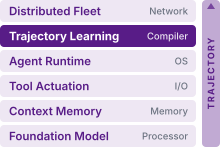
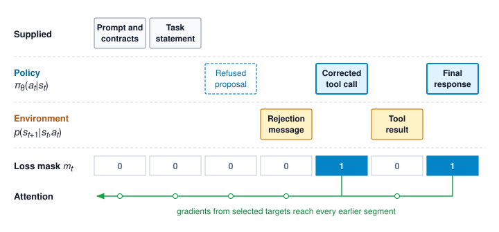
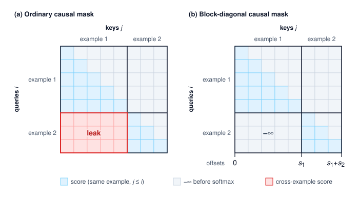
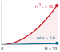

# Trajectory Fine-Tuning {#sec-vol3-fine-tuning}

::: {layout-narrow}
::: {.column-margin}

\chapterminitoc

:::

::: {.content-visible when-format="pdf"}
\noindent
{fig-alt="Blueprint for trajectory fine-tuning."}
:::

::: {.content-visible unless-format="pdf"}
{fig-alt="Blueprint for trajectory fine-tuning."}
:::

:::

## Purpose {.unnumbered .unlisted}

::: {.content-visible when-format="pdf"}
\begin{marginfigure}
\mlagentstack{0}{100}{0}{0}{0}{0}
\end{marginfigure}
:::

::: {.content-visible unless-format="pdf"}
::: {.column-margin}
{width="100%" fig-alt="Agentic Machine Learning Systems Stack"}

*Agent stack focus for this chapter.*
:::
:::

_Why can training on a useful recovery record teach the model to repeat the mistake instead of the correction?_

While prompt engineering and runtime guardrails guide an off-the-shelf model, fine-tuning modifies the neural network weights directly, embedding specialized decision policies and tool calling conventions into model parameters. However, training on multi-turn trajectories requires strict separation between agent proposals and external environment observations, so that imitation loss applies only to selected policy responses while environment feedback remains conditioning context. Naive fine-tuning can teach a policy to fabricate its own tool results or overfit to static workspace layouts, degrading general reasoning and error recovery. Systems engineering governs how datasets are partitioned, how loss masks are applied, and how updated checkpoints are validated against regression suites before deployment. An update is worth releasing only when closed-loop task acceptance improves under the same runtime that still bounds every proposal the model makes, however far its training loss has fallen.

::: {.content-visible when-format="pdf"}

\newpage

:::

::: {.callout-learning-objectives}

- Assign agent behavior to weights, context, or runtime, and decide when a failure warrants a weight change
- Construct model inputs that preserve intended conditioning and price per-invocation serialization in training tokens
- Map admitted response spans to causal token targets, observation masks, and termination policy
- Compare loss weighting and construct batches without unintended cross-example dependencies
- Calculate imitation regret bounds on reference and learner states to decide when on-policy labeling pays
- Calculate preference margins and gradient weights, and distinguish what a comparison measures from task acceptance
- Select behavior sources and parameter artifacts using explicit resource and version accounting
- Evaluate a versioned policy for release on closed-loop acceptance, cost per accepted task, and schema transfer, while preserving runtime enforcement

:::

## Recovery Records as Training Data {#sec-vol3-fine-tuning-introduction}

::: {.column-margin}
{width="100%" fig-alt="H·S·A locator with no axis highlighted and the origin dot highlighted in purple."}

*Fine-tuning reshapes each model call but leaves every exposure to the runtime.*
:::

Consider a recovery demonstration admitted by the curation pipeline for the repair agent (@sec-vol3-intro-lighthouses) into `repair_demonstrations_v1`. During the recorded session, the agent generated a malformed edit proposal that the runtime validator refused prior to tool dispatch. In response to the failure notification, the model inspected the tool schema, generated a corrected edit, and produced candidate patch `ws_r20`. From this multi-turn trajectory, the target-selection policy `recovery_targets_v1` marks three assistant turns as supervised targets: the schema inspection request (`e3`), the corrected edit (`e4`), and the scoped final summary (`e6`). The malformed proposal (`e2`) and the runtime's refusal remain in the input history as conditioning context. The member that entered the corpus is the redacted view `trace_r19_01_redacted_v1`, and the corpus manifest binds it to those role assignments, its lineage, and its split membership.

The raw event log of an admitted record is not yet in a form a training loop can safely ingest, because it interleaves model generations, runtime observations, and tool responses in the order they occurred. If a data loader treats every assistant message as a supervised target, it computes loss on the malformed edit proposal alongside the correction and reinforces the initial mistake. If the training pipeline computes loss across all sequence tokens indiscriminately, the model spends parameter capacity predicting deterministic environment replies, such as compiler diagnostics or directory listings, that it will never emit during inference. Finally, if the batching pipeline packs multiple trajectories into a shared context window without attention masking, self-attention heads attend across sample boundaries and leak private workspace contents into unrelated training examples. Standard cross-entropy loss fails silently under each of these mistakes. The training loss falls steadily as the optimizer fits the data, hiding the corrupted behavior from offline metrics. While curation contracts decide which actions show desirable behavior and evaluation contracts measure the deployed agent, neither specifies how to turn a multi-turn execution trace into isolated, causal gradient updates.

The path from an admitted record to an evaluated policy update begins with a question curation leaves open, namely which parts of the repair behavior belong in weights at all (@sec-vol3-fine-tuning-scope). The answer fixes what the data pipeline must protect. Serialization reconstructs each model input exactly as the agent received it (@sec-vol3-fine-tuning-serialization), loss masking places the gradient on the selected responses and nowhere else (@sec-vol3-fine-tuning-loss-masking), and batching shares buffers without letting examples read one another or skew one another's weight (@sec-vol3-fine-tuning-batching). Masking and batching guard directly against the three silent failures above, and serialization guards the premise both rely on, that each prefix is the one the model actually saw.

A faithful loader still trains on recorded prefixes, and the deployed policy acts on prefixes its own choices produce. Exposure bias prices that gap over the horizon and decides when labeling the learner's own states pays (@sec-vol3-fine-tuning-exposure-bias), and schema robustness asks the same question of the tool interfaces the policy is shown (@sec-vol3-fine-tuning-schemas). The remaining sections vary the update itself along three independent choices. The first is the objective, where preference optimization contrasts valid alternatives that imitation cannot rank (@sec-vol3-fine-tuning-dpo). The second is the behavior source, where distillation moves a costlier configuration's behavior into a cheaper one (@sec-vol3-fine-tuning-distillation). The last is the parameter artifact, where adapters change what a run must store (@sec-vol3-fine-tuning-peft). Closed-loop evaluation decides whether any of them earned a release (@sec-vol3-fine-tuning-benchmarking), and a training manifest for the repair policy assembles the whole chain (@sec-vol3-fine-tuning-synthesis).

## Scope of Supervised Fine-Tuning {#sec-vol3-fine-tuning-scope}

Fine-tuning a model to work around a missing prompt instruction or a broken tool schema bakes a temporary workaround into billions of weights, only for the behavior to break again the next time the interface changes. Modifying model weights is an expensive, high-blast-radius change reserved for behavioral failures that survive cheaper fixes. The intervention ladder orders changes by cost and reversibility, so engineers test prompt, schema, and runtime fixes before spending compute on parameter updates, while diagnostic evidence can justify a direct weight update when the policy itself is at fault. Verified trajectory post-training (principle \ref{pri-vol3-trajectory-post-training})\index{Principle!verified trajectory post-training} requires curation to tie recorded evidence to a declared learning use and separate admissible targets from contextual or rejected actions. While this ordering is the default because of cost and blast radius, @sec-vol3-fine-tuning-distillation examines the complementary case where fine-tuning proves cheaper than paying the recurring token latency and cost of carrying lengthy procedural guidance in every prompt.

::: {.column-margin .margin-pointer}
↩ The intervention ladder, which orders context, schema, runtime, and parameter interventions by cost and reversibility, is established in @sec-vol3-flywheel-intervention-order.
:::

**Supervised fine-tuning (SFT)**\index{Supervised fine-tuning!definition} adjusts trainable model parameters to maximize the conditional likelihood of selected target tokens given their causal prefix context. When processing an admitted trajectory record such as `trace_r19_01_redacted_v1`, the training loop must follow the recovery sequence defined in `recovery_targets_v1` rather than computing loss over every recorded token. The model must see the historical context and tool outputs that justify a chosen action, yet the data pipeline must exclude later steps that would reveal future observations or solutions ahead of time. Trajectory fine-tuning therefore inherits two data contracts: a *target-selection contract* that designates which tokens contribute to the loss gradient, and a *conditioning contract* that governs what causal history the model sees when generating those tokens.

The two contracts separate learning improved behavior from overfitting an idiosyncratic run. In an error-recovery trajectory, the behavioral goal is teaching the model to inspect an updated schema after a refusal, issue a properly formed corrective call, and interpret what the runtime verification check establishes. Memorizing the file paths of a specific test fixture or predicting hard-coded test outputs lowers training loss without teaching generalizable recovery skills. Whether the updated policy transfers these habits to unfamiliar environments and new tasks is what @sec-vol3-fine-tuning-benchmarking measures.

### Procedure, contracts, and enforcement {#sec-vol3-fine-tuning-behavior-homes}

Every response the repair agent generates comes from two inputs: the model's static weights and the dynamic context window assembled for that call. Because fine-tuning updates only the weights, a tool-interface change—such as adding a required parameter or revoking a permission—immediately breaks a model that memorized the old signature in its parameters instead of reading the prompt. Engineers therefore divide agent behavior across three architectural homes, summarized in @tbl-vol3-fine-tuning-scope:

* *Procedure* is behavior that stays stable across tasks and changes slowly, such as inspecting diagnostic output before modifying source code or checking unresolved issues before reporting completion. Procedure is what model weights can reliably absorb.
* *Contracts* are the dynamic operational facts that vary across deployments, user sessions, and individual turns, such as API tool definitions, schema requirements, environment parameters, and granted permissions. Contracts belong in the prompt context; a model that memorized an earlier schema will keep emitting obsolete arguments when an interface changes.
* *Enforcement* covers the invariants that must hold even when the model proposes an invalid or adversarial action, such as schema validation, authorization checks, sandbox containment, and execution timeouts. Enforcement stays in the deterministic runtime harness under invariant closure (principle \ref{pri-invariant-closure}).

| Home    | Intended responsibility                                                                    | Consequence for fine-tuning                                                                                                      |
|:--------|:-------------------------------------------------------------------------------------------|:---------------------------------------------------------------------------------------------------------------------------------|
| Weights | Learned procedures and response tendencies, including tool selection and recovery behavior | Update the proposal distribution, then measure whether the changed behavior helps under the declared task conditions             |
| Context | Current task facts, tool schemas, observations, and represented scope                      | Supply the information the policy needs now; do not rely on memorized versions as the authority for current facts or permissions |
| Runtime | Validation, authorization, containment, resource controls, and evidence collection         | Preserve enforcement independently of the learned policy; a model's predicted result is not an observed external effect          |

: **Responsibilities of Weights, Context, and Runtime**: Weights hold procedure, context holds the current contract, and the runtime enforces that contract whatever the model proposes. {#tbl-vol3-fine-tuning-scope}

Relying on parameters to store interface contracts makes a deployment brittle, because a revoked permission stays revoked regardless of how often the action appeared in past training demonstrations. Fine-tuning cannot replace dynamic contracts; what it can teach is the habit of reading and following whichever contract the context window supplies.

This boundary disproves the view that fine-tuning only moves the prompt into the weights. Only the procedural parts of a prompt (structured reasoning guidelines, diagnostic checklists, or few-shot error-recovery examples) belong in the parameters, where they save token overhead on every turn (@sec-vol3-fine-tuning-distillation). The contractual parts must stay in the prompt context, because omitting them forces the model to guess the current execution environment. The deterministic checks that enforce authorization and boundary invariants cannot live in either prompts or weights, because a probability distribution over tokens cannot guarantee an invariant.

Fine-tuning changes the policy's proposal distribution: which tools it requests, how thoroughly it inspects diagnostic evidence, and which execution paths it tries. Those shifts change task success rates, end-to-end latency, and token use, yet every proposed action still runs inside the horizons, state transitions, and authority boundaries enforced by the runtime harness. This separation is the proposal boundary of @sec-vol3-foundation-model-role. Training reshapes what the policy proposes, while the runtime decides which actions may execute, and that boundary governs every adaptation choice that follows.

### Objective, behavior source, and artifact {#sec-vol3-fine-tuning-adaptation-choices}

Once a team decides that a procedural habit belongs in the weights, "fine-tuning" still spans three independent choices that a single label can obscure:

* **Training Objective**: The loss function that defines the learning signal. Supervised imitation maximizes the likelihood of curated target demonstrations, whereas preference methods such as direct preference optimization (@sec-vol3-fine-tuning-dpo) adjust weights by contrasting preferred trajectories against dispreferred alternatives under an explicit ranking rule.
* **Behavior Source**: Where the demonstrations and conditioning inputs come from. Traces may be collected from instrumented production runs and filtered by offline verification, generated by a teacher configuration with privileged context or a larger search budget (@sec-vol3-fine-tuning-distillation), labeled on the states the learner itself reaches, or constructed by injecting faults the recordings never contained (@sec-vol3-fine-tuning-dagger).
* **Parameter Artifact**: Which weights the run updates and stores. Teams can update all model parameters directly or train compact adapter matrices, such as low-rank adaptation (LoRA) modules, that attach to a frozen base checkpoint (@sec-vol3-fine-tuning-peft).

Because these three choices are independent, they combine freely; a deployment can, for example, train a low-rank adapter with a preference objective on synthetic teacher demonstrations. Whichever combination a team chooses, the run still trains on trajectory records converted into model inputs, so the first pipeline step is reconstructing the input prefix and conditioning window for each selected response.

## Serializing Trajectories {#sec-vol3-fine-tuning-serialization}

Consider the repair demonstration admitted during curation: it contains a malformed edit proposal, a runtime refusal, a schema inspection, and a corrected edit. A training loader that strips out the refusal changes the problem the subsequent correction answered, and a loader that places a later passing test check before the edit leaks future evidence that the model did not have when proposing the patch. While curation selects which model completions to reinforce, serialization must reconstruct the exact prompt and observation history that prompted them, including any runtime redactions—such as synthetic placeholders substituted for private file paths—so the training example matches the context the model actually saw.

### Reconstructing each model input {#sec-vol3-fine-tuning-input-reconstruction}

Runtime event logs record state transitions across the harness, but an event log alone does not show what was inside the model's context window at a given call. System prompts change, tool schemas update between versions, and earlier messages are often summarized or truncated to fit token budgets. To reconstruct each call's input faithfully, the training pipeline reads the delivered-input manifests, which record the exact messages, tool definitions, summaries, and bounded observations sent to the model along with their schema versions.

::: {.column-margin .margin-pointer}
↩ The delivered-input manifest that records the exact payload sent to the model, rather than mutable paths or references, is established in @sec-vol3-durable-execution-event-schema.
:::

When an example requires historical fidelity, the loader serializes the selected invocation directly from its delivered-input manifest, preserving partial buffers, truncated outputs, and execution errors rather than substituting a cleaner result obtained later in the run. When a pipeline instead transforms an example deliberately—for instance, shortening prompts for context distillation (@sec-vol3-fine-tuning-distillation)—it applies the reviewed transformation to both the prompt and the paired response, keeps the parent trace reference, and rechecks schema compatibility. @Tbl-vol3-serialization-repair-spans shows how the curated responses in the running repair demonstration map to their conditioning evidence; in the rendered training example, each row also carries the system instructions and active tool definitions delivered at that turn.

| Selected response | Relevant conditioning evidence                                                                      | Response content selected by curation                |
|:------------------|:----------------------------------------------------------------------------------------------------|:-----------------------------------------------------|
| `e3`              | Earlier delivered task context and the malformed `e2` proposal with its pre-dispatch refusal        | Request to inspect the available schema              |
| `e4`              | The corresponding returned schema and the retained context supporting the edit                      | Corrected edit with its version condition            |
| `e6`              | The candidate-specific check summary delivered at `e5` and retained evidence for the report's scope | Final report of the supported result and limitations |

: **Inputs and Selected Responses in the Repair Demonstration**: Each row pairs a reviewed response with evidence available to condition it. {#tbl-vol3-serialization-repair-spans}

The refusal at `e2` shows that runtime validation caught the malformed proposal before dispatch, so no tool ran on the host. Because the check summary at `e5` arrived only after the agent issued the corrected edit, it can condition the final report at `e6` but cannot appear in the prefix for `e4`. Selecting the schema request at `e3` likewise trains the model's query tokens while leaving the returned schema as an external observation, so that loss masking in the next stage can separate model decisions from environment replies.

### Rendering with versioned templates {#sec-vol3-fine-tuning-template-rendering}

Once the delivered messages for `e3`, `e4`, and `e6` are reconstructed, the loader must turn those structured message objects—system instructions, user prompts, assistant reasoning, tool calls, and environment returns—into the exact token sequence the model expects at serving time. Chat templates differ across model families, and even checkpoints from the same base model often format tool schemas, parallel calls, or message boundaries differently. Rendering a trajectory with delimiters that do not match the serving parser teaches the policy a syntax that production will reject. A serialized dataset artifact therefore records the tokenizer version, template configuration, tool-formatting schema, and response-boundary policy alongside the token arrays, because the message sequence and its rendering configuration together form the model input.

In schematic form, a multi-turn tool-calling example looks like the sequence below. The delimiter strings are illustrative placeholders, since each model family defines its own special tokens. The system segment gives the task contract and tool definitions. The assistant segment emits a reasoning trace followed by two parallel tool calls with unique identifiers. Each tool segment returns an observation bound to its call identifier.

```text
<|system|> task contract; schemas for read_file(target_uri), run_tests(target) <|end|>
<|user|> Fix the connection-pool leak in src/pool.py <|end|>
<|assistant|> <|reasoning|> Reproduce the failure, then read the module. <|end_reasoning|>
  <|call id=c1|> {"name": "read_file", "arguments": {"target_uri": "src/pool.py"}} <|end_call|>
  <|call id=c2|> {"name": "run_tests", "arguments": {"target": "tests/test_pool.py"}} <|end_call|>
<|end_turn|>
<|tool id=c2|> FAILED test_release: pool exhausted <|end|>
<|tool id=c1|> ...file contents... <|end|>
<|assistant|> ...
```

In this sequence, `c2` finishes before `c1`, and because the runtime delivers observations in arrival order, the listing places the `c2` reply first to match the prompt the model actually received on its next turn. The call identifiers keep each observation bound to its original call regardless of arrival order. Re-sorting the replies into call order (`c1`, then `c2`) for tidiness would invent a prompt the model never saw, and reordering calls whose arguments or observations depend on one another changes the causal problem into a synthetic transformation that needs its own validation. The `<|end_turn|>` token marks where the policy handed control back to the runtime loop, while all tokens between `<|tool|>` and `<|end|>` are external observations.

The training pipeline packages this rendered dataset as `serialization_v1`, whose manifest pairs the admitted execution records with the active rendering configuration and maps every selected response span to its token offsets. Because tokenization, template formatting, and string redaction can shift token boundaries—for example, when leading whitespace merges into an adjacent special token—the pipeline re-verifies all token offsets against the rendered token array and decodes completed examples to check task prompts, tool bindings, span boundaries, and end-of-sequence markers. If an example fails boundary alignment or drops content, the pipeline discards the record rather than patching it with synthetic filler.

Role delimiters define protocol syntax, but they carry no runtime authority: if a model emits text that mimics a `<|tool|>` delimiter, that text is still model output under the tokenizer's grammar, and the serialization pipeline never promotes unverified generations into environment observations. Once the template fixes how each turn is rendered, the pipeline still has to decide whether a multi-turn trajectory can be stored as a single rendered sequence or must be split into separate per-invocation examples.

::: {.column-margin .margin-pointer}
↩ The rule that model output is a proposal carrying no authority until the runtime validates it is established in @sec-vol3-foundation-model-role.
:::

### One example per invocation {#sec-vol3-fine-tuning-per-invocation}

```{python}
#| label: calc-vol3-per-turn-expansion
#| echo: false
# PER-TURN EXAMPLE EXPANSION (LEGO)
# Goal: Price one-example-per-invocation serialization against one transcript.
# Scope: Stipulated horizon; each turn adds a similar number of tokens.
from mlsysim.fmt import check, fmt_int, fmt_multiple

class PerTurnExpansion:
    # 1. LOAD: stipulated horizon in turns.
    horizon = 30

    # 2. EXECUTE: prefixes of 1..H turns versus one H-turn transcript.
    per_turn_units = horizon * (horizon + 1) / 2
    transcript_units = horizon
    expansion = per_turn_units / transcript_units

    # 3. GUARD: closed form (H+1)/2.
    check(abs(expansion - (horizon + 1) / 2) < 1e-12, "Expansion is (H+1)/2")
    check(expansion > 1, "Separate examples repeat context")

    # 4. OUTPUT: consumed in the serialization prose.
    horizon_str = fmt_int(horizon)
    expansion_mult_str = fmt_multiple(expansion, precision=1)
```

Whether a trajectory such as the repair run can be stored as a single rendered transcript depends on how the serving runtime manages history between turns. Some runtimes append every turn to a growing transcript, while others prune earlier steps, compact intermediate context, or drop reasoning scratchpads between turns to reduce KV-cache memory. A single concatenated transcript is a faithful training example only when its causal prefixes match what the model actually received at each turn during serving. Because the repair agent's runtime compacts history once the working set crosses its watermark, a turn delivered after compaction saw a digest rather than the raw earlier turns that a single concatenated transcript would place before it. Whenever serving prunes or compacts history between steps, the loader must serialize each invocation as its own training example containing that call's exact delivered prefix.

::: {.column-margin .margin-pointer}
↩ Watermark-triggered compaction, which replaces earlier turns with a digest between invocations, is established in @sec-vol3-context-engineering-compaction.
:::

Serializing each call separately carries the same triangular token cost that already priced an append-only trajectory at serving time (@eq-vol3-trajectory-resend), now paid in stored training tokens. If a trajectory spans $\TurnHorizon$ turns and each turn adds roughly $\TurnAppendLength$ tokens, the example for turn $\TurnIndex$ spans about $\TurnIndex\,\TurnAppendLength$ tokens. Serializing all $\TurnHorizon$ invocations separately stores $\TurnAppendLength\,\TurnHorizon(\TurnHorizon+1)/2$ tokens, compared with $\TurnHorizon\,\TurnAppendLength$ tokens for a single transcript. That is an expansion factor of $(\TurnHorizon+1)/2$, which over a stipulated `{python} PerTurnExpansion.horizon_str`-turn horizon multiplies the stored token volume by `{python} PerTurnExpansion.expansion_mult_str`. An agent's history-retention policy therefore directly governs training storage and compute. The same fidelity rule applies to the model's own reasoning text. If serving drops an earlier turn's rationale before the next call, the reconstructed prefix for that call omits it too. Whether retained rationale is trained as a target or kept as context is a separate masking choice (@sec-vol3-fine-tuning-optional-rationale).

With `serialization_v1` assembled, the pipeline has the tokenized sequences, their conditioning prefixes, and the response spans selected during curation. The next step is deciding which token positions contribute to the training loss, because computing cross-entropy over an entire multi-turn sequence would penalize the model for failing to predict tool outputs and user messages.

## Observation Loss Masking {#sec-vol3-fine-tuning-loss-masking}

In `serialization_v1`, the token array for the repair trajectory still contains the prompt, the malformed proposal `e2`, the runtime refusal, the returned schema, and the check summary `e5` alongside the selected responses `e3`, `e4`, and `e6`. A loader that selects every assistant token trains the model on the malformed proposal `e2` alongside its correction `e4`, undoing curation, while a loader that computes loss across all tokens trains the policy to predict environment replies. Serialization turns the interaction into tokens; the loss mask decides which of those tokens drive gradient updates.

### The masked objective {#sec-vol3-fine-tuning-masked-objective}

Let $\SerializedTrainingExample=(\SequenceToken_1,\ldots,\SequenceToken_{\SequenceLength})$ be one serialized example, with an initial context or boundary token at $\SequenceToken_1$, and let $\EligibleTargetPositionSet\subseteq\{2,\ldots,\SequenceLength\}$ contain the policy-token positions selected for imitation. Which positions belong to $\EligibleTargetPositionSet$ depends on the admitted response spans and the training objective rather than token authorship alone. With the binary mask $\PositionLossMask_{t}=\IndicatorFunction\{\TokenIndex\in\EligibleTargetPositionSet\}$ and $\PositionLossMask_1=0$, the mean masked cross-entropy for an example with at least one selected target is

$$\MaskedFinetuningLoss(\ModelParameters)=-\frac{1}{\ActiveTargetTokenCount}\sum_{t=2}^{\SequenceLength}\PositionLossMask_{t}\log\Policy(\SequenceToken_t\mid \TokenPrefix),\qquad \ActiveTargetTokenCount=\sum_{t=2}^{\SequenceLength}\PositionLossMask_{t}>0.$$ {#eq-vol3-sft-masked-objective}

Each selected token is predicted from the recorded prefix $\TokenPrefix$, which includes earlier actions, observations, and admitted mistakes, rather than from fresh rollouts sampled during training. This regime is **teacher forcing**\index{Teacher forcing!definition}[^fn-teacher-forcing-origin] [@williams1989learning], and it lets recovery prefixes that contain earlier failures serve as conditioning context whenever the trajectory satisfies the curation contract.

[^fn-teacher-forcing-origin]: **Teacher Forcing**: @williams1989learning named the technique for recurrent networks, feeding the recorded target back as the next input instead of the network's own output. Because every prefix is recorded rather than generated, a causal model computes all of an example's next-token predictions in one parallel forward pass, which is why imitating a trajectory costs one pass per example rather than one sampled rollout per decision.

In the running repair trajectory, `target_mask_v1` maps the reviewed response spans onto the token array of `serialization_v1`, separating target positions from conditioning context (@tbl-vol3-loss-masking-strata). Because changing a tokenizer vocabulary, chat template, or text transformation can shift token boundaries, the pipeline regenerates and checks masks against the final serialized tokens rather than copying offsets from an earlier stage.

| Token segment                                              | Target policy for this imitation objective                                                 | What remains as conditioning input                                                   |
|:-----------------------------------------------------------|:-------------------------------------------------------------------------------------------|:-------------------------------------------------------------------------------------|
| Prompt and supplied tool contracts                         | $\PositionLossMask_{t}=0$                                                                  | The actual task, current interfaces, and supplied constraints                        |
| Selected policy response                                   | $\PositionLossMask_{t}=1$ on its admitted target positions                                 | Earlier tokens of the response and its available prefix                              |
| Unselected policy response, including the refused proposal | $\PositionLossMask_{t}=0$                                                                  | History needed to interpret a selected correction                                    |
| Tool or environment observation                            | $\PositionLossMask_{t}=0$                                                                  | Delivered results, errors, and evidence available before the next response           |
| Optional authorized rationale                              | Chosen by the declared target policy                                                       | Retained rationale remains visible whether or not it is selected                     |
| Termination boundary                                       | Select an authentic policy-generated terminator when teaching the selected response to end | Do not substitute a tool-role boundary or invent a terminator for a cut-off response |

: **Loss Masking by Token Segment**: The loss mask specifies which serialized tokens generate gradient updates. It acts as an optimization filter rather than an attention barrier or provenance record. {#tbl-vol3-loss-masking-strata}

When an example has no selected targets ($\ActiveTargetTokenCount=0$), the loss in @eq-vol3-sft-masked-objective is undefined, so the loader must drop the example or route it to a declared fallback rather than counting it as a completed demonstration. How examples of different lengths are weighted against one another inside a batch is a separate choice developed in @sec-vol3-fine-tuning-batching.

::: {#dfn-action-loss-masking .callout-definition title="Observation loss masking"}

***Observation loss masking***\index{Observation loss masking!definition}\index{Supervised fine-tuning!loss masking} excludes supplied observations from the direct token-prediction loss while retaining the permitted observation context needed to train selected policy responses.

1. **Significance**: Focuses the optimization objective on the policy's conditional distribution $\Policy(\TrajectoryAction_{t}\mid \TrajectoryState_{t})$, so verbose environment output cannot dilute the gradient on policy actions regardless of how much context observations occupy (notebook \ref{nbk-15-gradient-budget-and-compute-allocation} quantifies this dilution).
2. **Distinction**: Masked tokens stay in the input context and participate in self-attention; only their next-token loss terms are zeroed. Policy authorship alone does not make a token a target, because refused attempts or unsafe actions are also masked even when emitted in the assistant role.
3. **Common pitfall**: Selecting an entire multi-turn tool exchange only because the tool call succeeded, which trains the model to predict external environment responses.

:::

A deployed agent trajectory interleaves two different generators: the agent policy and the external environment. Training without observation masking forces one set of weights to fit both distributions at once:

1. The **agent policy** $\Policy(\TrajectoryAction_{t}\mid \TrajectoryState_{t})$, which maps prior observations and instructions to tool calls or answers.
2. An **environment dynamics model** $\EnvironmentTransitionDistribution(\TrajectoryState_{t+1}\mid \TrajectoryState_{t}, \TrajectoryAction_{t})$, which predicts the outputs returned by shells, databases, or remote APIs.

Because real tools run during deployment and return actual outputs, spending model capacity to predict environment returns is wasted work, and supervising the environment distribution causes two concrete failures:

1. **Loss dilution**\index{Loss dilution!definition}: Under token-averaged cross-entropy, unmasking expands the denominator from $\ActiveTargetTokenCount$ to all $\SequenceLength-1$ causal prediction terms (every stored position after the initial boundary). Each decision token's gradient weight shrinks by the ratio of selected targets to predicted positions (computed in notebook \ref{nbk-15-gradient-budget-and-compute-allocation}), while the rest of the loss budget goes to file paths, stack traces, compiler dumps, and JSON payloads. Repetitive boilerplate pulls the average loss down, while novel stack traces or file contents dominate the gradient; in either case, the average stops measuring the policy.
2. **Role confusion**\index{Role confusion!definition}: When trained to predict the tokens that follow a tool call, the policy learns that tool outputs continue the same autoregressive stream. At serving time, it can keep generating past its own tool call and write a fabricated tool result instead of emitting the stop token that hands control back to the runtime. Because the runtime rejects unauthenticated observations (@sec-vol3-fine-tuning-serialization), those fabricated tokens are discarded, wasting output budget and stalling the turn.

The full repair record selects three responses (`e3`, `e4`, and `e6`). In the simplified view of @fig-vol3-loss-masking, which omits the schema request `e3` and its returned schema, only two of the seven segments shown—the corrected tool call and the final response—carry $\PositionLossMask_{t}=1$ and receive direct imitation loss. The prompt, task statement, refused proposal, rejection message, and tool result carry $\PositionLossMask_{t}=0$ and stay as conditioning context, where gradients from later selected targets still update the weights that encode them.

::: {#fig-vol3-loss-masking fig-env="figure" fig-pos="htb" fig-cap="**Observation Loss Masking**: The mask over a simplified view of the serialized repair example that omits the schema request (selected) and its returned schema (context). Of the segments shown, only the corrected tool call and the final response carry $\PositionLossMask_{t}=1$ and receive a direct loss term. The prompt, task, refused proposal, rejection message, and tool result carry $\PositionLossMask_{t}=0$, yet every one of them is still read through attention, so gradients from later selected targets update the parameters that encode it. Selecting only policy responses fits the policy's conditional distribution; unmasking the observations would also ask the same weights to fit the environment's." fig-alt="Seven serialized segments placed left to right in order, each in one of three lanes by author. The supplied lane holds prompt and contracts and task statement. The policy lane, labeled pi theta of a t given s t, holds a dashed refused proposal, the corrected tool call, and the final response. The environment lane, labeled p of s t plus 1 given s t and a t, holds the rejection message and the tool result. A loss mask row beneath reads zero for every segment except the corrected tool call and the final response, which are filled and read one. A green attention line runs from those two mask cells back to the first segment, touching every earlier segment, labeled gradients from selected targets reach every earlier segment."}

:::

Observation masking prevents both loss dilution and role confusion at the objective level. Because an offline validation curve cannot show how often an unmasked model invents environment outputs during multi-step execution, that failure appears only in closed-loop trials.

### Causal label alignment {#sec-vol3-fine-tuning-label-alignment}

In a causal autoregressive model,[^fn-causal-mask-shift] the hidden state at input position $\TokenIndex-1$ produces the logits that predict token $\SequenceToken_t$. The data loader must therefore pair the logits at $\TokenIndex-1$ with target label $\SequenceToken_t$ and target mask $\PositionLossMask_{t}$, rather than with the mask of input token $\SequenceToken_{t-1}$ (@tbl-vol3-mask-causal-shift). Many training frameworks shift labels by one position inside their own loss function. Shifting them once in the loader and a second time in the loss silently misaligns every target mask by one token across the corpus. Checking the aligned labels and masks on a short synthetic example before launching a run catches this bug immediately.

[^fn-causal-mask-shift]: **Causal Self-Attention**: Causal masking in Transformer decoders restricts each token from attending to subsequent positions [@vaswani2017]. The same triangular structure enforces the label shift: the network predicts $\SequenceToken_t$ using only the representation formed at $\TokenIndex-1$.

| Logits computed from a prefix ending at…          | Next-token label                          | Target mask |
|:--------------------------------------------------|:------------------------------------------|:------------|
| The final supplied prompt token                   | First token of a selected policy response | $1$         |
| The final content token of that selected response | Its authentic policy-generated end token  | $1$         |
| The end token before a delivered tool observation | First token of that observation           | $0$         |

: **The Causal Label Shift at a Tool Boundary**: Target selection applies to the predicted token rather than the input token driving the hidden state. Exact boundary encodings depend on the serialized chat template. {#tbl-vol3-mask-causal-shift}

Let $\VocabularyTokenLogit_{t-1,\VocabularyToken}$ denote the logit for vocabulary token $\VocabularyToken$ produced from $\TokenPrefix$, using an ordinary softmax and no label smoothing. Differentiating @eq-vol3-sft-masked-objective gives

$$\frac{\partial\MaskedFinetuningLoss}{\partial \VocabularyTokenLogit_{t-1,\VocabularyToken}}=\frac{\PositionLossMask_{t}}{\ActiveTargetTokenCount}\left(\Policy(\VocabularyToken\mid \TokenPrefix)-\IndicatorFunction\{\VocabularyToken=\SequenceToken_t\}\right).$$

When $\PositionLossMask_{t}=0$, the prediction at position $\TokenIndex-1$ contributes zero direct gradient, yet token $\SequenceToken_t$ still shapes later representations through causal self-attention, so gradients from later active targets update the weights that read it. The model conditions on tool outputs without spending capacity trying to generate them, which carries verified trajectory post-training (principle \ref{pri-vol3-trajectory-post-training}) down to individual token positions.

### Selected targets and compute {#sec-vol3-fine-tuning-selected-targets}

::: {.column-margin}
{width="100%" fig-alt="One horizontal stacked bar. A long green segment labeled observations 77.1% fills most of it, a gray segment labeled ctx follows, and a thin dark segment at the right end is labeled targets 4.9%."}

*Observations fill 77.1 percent of the input; the loss sits on 4.9 percent.*
:::

Because every masked observation token still passes through self-attention, zeroing its loss term removes almost none of the forward-pass compute. The number of selected positions $\ActiveTargetTokenCount$ sets the denominator of the loss and the gradient weight on each target token, whereas the full stored sequence length $\SequenceLength$ sets the attention and projection FLOPs. Comparing $\ActiveTargetTokenCount$ against the $\SequenceLength-1$ causal prediction terms gives the dilution factor an unmasked loss would suffer, while $\ActiveTargetTokenCount/\SequenceLength$ gives the fraction of stored positions that carry a target. Notebook \ref{nbk-15-gradient-budget-and-compute-allocation} computes both quantities under two target policies on the same serialized trajectory.

```{python}
#| label: lego-15-selected-target-accounting
#| echo: false
# ┌─────────────────────────────────────────────────────────────────────
# │ SELECTED TARGET ACCOUNTING (LEGO)
# │ Context: @nbk-15-gradient-budget-and-compute-allocation.
# │ Goal: Separate stored positions from eligible imitation targets.
# │ Show: Two masks on one hypothetical input retain identical context.
# │ How: Sum segment counts; exclude unselected responses; count targets.
# └─────────────────────────────────────────────────────────────────────
from mlsysim import *
from mlsysim.fmt import check, fmt_int, fmt_multiple, fmt_percent

class SelectedTargetAccounting:
    # ┌── 1. LOAD (Hypothetical Token Counts) ────────────────────────────
    prompt = 1_200  # includes the initial context/boundary position
    task = 184
    optional_rationale = 1_400  # available, authorized, reviewed text
    response = 960  # response content and authentic terminators
    observation = 12_640
    unselected_response = 160  # retained as context, not desired targets
    checkpoint_observation = 30_000  # given for the reader's estimate in the checkpoint

    # ┌── 2. EXECUTE (One Input, Two Target Policies) ────────────────────
    stored = prompt + task + optional_rationale + response + observation
    selected_response = response - unselected_response
    with_rationale = selected_response + optional_rationale
    without_rationale = selected_response
    observation_share = observation / stored
    with_share = with_rationale / stored
    without_share = without_rationale / stored
    context_only_with = stored - with_rationale
    context_only_without = stored - without_rationale
    # The first stored boundary has no preceding-position prediction.
    predicted = stored - 1
    dilution_without = predicted / without_rationale
    dilution_with = predicted / with_rationale
    stored_double_obs = stored + observation
    predicted_double_obs = stored_double_obs - 1
    dilution_double_obs = predicted_double_obs / without_rationale
    unselected_vs_selected = unselected_response / selected_response

    # ┌── 3. ASSERT (Partitions and Positive Denominators) ───────────────
    check(0 <= unselected_response < response, "valid response selection")
    check(stored == 16_384, "declared input partition")
    check(0 < without_rationale <= with_rationale <= predicted, "valid prediction targets")
    check(predicted == stored - 1 > 0, "initial boundary is not predicted")
    check(predicted_double_obs == stored_double_obs - 1 > predicted, "expanded prediction count")
    check(with_rationale + context_only_with == stored, "first partition")
    check(without_rationale + context_only_without == stored, "second partition")
    check(with_rationale - without_rationale == optional_rationale, "mask difference")
    check(dilution_without > dilution_with > 1, "masking concentrates weight")
    check(dilution_double_obs > dilution_without, "longer observations dilute more")
    check(checkpoint_observation > observation, "checkpoint grows the observations")

    # ┌── 4. OUTPUT (Computed Display Exports) ───────────────────────────
    prompt_str = fmt_int(prompt)
    task_str = fmt_int(task)
    rationale_str = fmt_int(optional_rationale)
    response_str = fmt_int(response)
    observation_str = fmt_int(observation)
    unselected_str = fmt_int(unselected_response)
    stored_str = fmt_int(stored)
    predicted_str = fmt_int(predicted)
    observation_share_str = fmt_percent(observation_share, precision=1, style="prose")
    with_str = fmt_int(with_rationale)
    without_str = fmt_int(without_rationale)
    with_share_str = fmt_percent(with_share, precision=1, style="symbol")
    without_share_str = fmt_percent(without_share, precision=1, style="symbol")
    selected_response_str = fmt_int(selected_response)
    dilution_without_mult_str = fmt_multiple(dilution_without, precision=1)
    dilution_with_mult_str = fmt_multiple(dilution_with, precision=1)
    dilution_double_obs_mult_str = fmt_multiple(dilution_double_obs, precision=1)
    unselected_vs_selected_str = fmt_percent(unselected_vs_selected, precision=0, style="prose")
    checkpoint_observation_str = fmt_int(checkpoint_observation)
```

::: {#nbk-15-gradient-budget-and-compute-allocation .callout-notebook title="Stored tokens and selected targets"}

**Problem**: A hypothetical serialized example has the segment counts in @tbl-vol3-mask-token-inventory. Its curation record excludes some policy-response positions from imitation while retaining them as context. If the optional rationale is either selected or kept as context only, how many positions receive direct loss, what fraction of the stored input do they occupy, and by how much would an unmasked loss dilute each of them?

| Input segment                                             |                                       Stored tokens |
|:----------------------------------------------------------|----------------------------------------------------:|
| System prompt and schemas, including the initial boundary |      `{python} SelectedTargetAccounting.prompt_str` |
| Task statement                                            |        `{python} SelectedTargetAccounting.task_str` |
| Optional authorized rationale                             |   `{python} SelectedTargetAccounting.rationale_str` |
| Other policy responses, including authentic end tokens    |    `{python} SelectedTargetAccounting.response_str` |
| Delivered observations                                    | `{python} SelectedTargetAccounting.observation_str` |

: **Hypothetical Input Inventory**: These disjoint counts include every stored position. They are not measurements of the shared repair run. {#tbl-vol3-mask-token-inventory}

**Variables**: Exactly `{python} SelectedTargetAccounting.unselected_str` of the other-policy-response positions belong to the refused proposal and stay context; every other response position is selected. The rationale is reviewed for either target policy, both policies see the same input, the initial position belongs to the prompt, and there is no padding.

**Math**: The disjoint segments sum to `{python} SelectedTargetAccounting.stored_str` stored tokens, of which observations occupy `{python} SelectedTargetAccounting.observation_share_str`. Removing the refused positions leaves `{python} SelectedTargetAccounting.response_str` $-$ `{python} SelectedTargetAccounting.unselected_str` $=$ `{python} SelectedTargetAccounting.selected_response_str` selected response targets, and selecting the rationale adds `{python} SelectedTargetAccounting.rationale_str` more. The first stored boundary has no preceding-position prediction, so an unmasked causal average divides by `{python} SelectedTargetAccounting.predicted_str` prediction terms instead of $\ActiveTargetTokenCount$. Each selected target's coefficient therefore shrinks by `{python} SelectedTargetAccounting.predicted_str`/`{python} SelectedTargetAccounting.selected_response_str`, a factor of `{python} SelectedTargetAccounting.dilution_without_mult_str` (`{python} SelectedTargetAccounting.dilution_with_mult_str` when the rationale is selected). Under each target policy, @tbl-vol3-mask-target-counts sets $\ActiveTargetTokenCount$ against the stored input it is drawn from.

| Target policy                                          |   Selected positions, $\ActiveTargetTokenCount$ |                        Selected share of stored input |
|:-------------------------------------------------------|------------------------------------------------:|------------------------------------------------------:|
| Selected responses plus reviewed rationale             |    `{python} SelectedTargetAccounting.with_str` |    `{python} SelectedTargetAccounting.with_share_str` |
| Selected responses; rationale retained as context only | `{python} SelectedTargetAccounting.without_str` | `{python} SelectedTargetAccounting.without_share_str` |

: **Two Target Policies on One Input**: Excluding a segment from the objective does not shorten the conditioning sequence. {#tbl-vol3-mask-target-counts}

**Result**: Both masks place the whole loss on a small minority of stored positions and leave the context identical; they differ only in whether the rationale is a target.

**Systems insight**: Because the dilution factor scales inversely with the selected fraction of predicted positions, it expands rapidly as environment interactions accumulate. Doubling the observation volume while holding response lengths constant escalates dilution from `{python} SelectedTargetAccounting.dilution_without_mult_str` to `{python} SelectedTargetAccounting.dilution_double_obs_mult_str`. Consequently, observation masking becomes increasingly essential as agents tackle deep, tool-intensive reasoning traces. Masking, however, yields negligible reductions in FLOPs: every masked token must still pass through causal attention layers to form context for subsequent predictions. Only the final language model head projection and cross-entropy loss computation can be bypassed at masked positions.

:::

Recorded repair trajectories show that the hypothetical inventory's proportions are realistic. @Fig-vol3-trajectory-composition splits the transcripts of five published agent configurations on the same repository-repair tasks [@jimenez2024swebench] by the role that produced each message.

```{python}
#| label: calc-vol3-trajectory-composition
#| echo: false
# ┌─────────────────────────────────────────────────────────────────────────────
# │ MEASURED TRAJECTORY COMPOSITION (LEGO)
# ├─────────────────────────────────────────────────────────────────────────────
# │ Context: @fig-vol3-trajectory-composition and the paragraph after it.
# │ Goal: Ground the hypothetical mask inventory in recorded trajectories.
# │ Show: Range of observation and model-output shares across configurations.
# │ How:  Literature.SweBenchTrajectories; characters pooled per
# │       configuration, each message counted once.
# └─────────────────────────────────────────────────────────────────────────────
from mlsysim import Literature
from mlsysim.fmt import check, fmt_int, fmt_percent

class TrajectoryComposition:
    # ┌── 1. LOAD (Constants) ──────────────────────────────────────────────
    runs = Literature.SweBenchTrajectories.entries

    # ┌── 2. EXECUTE (The Compute) ────────────────────────────────────────
    totals = {}
    for _r in runs:
        _t = totals.setdefault((_r["scaffold"], _r["model"]), [0.0, 0.0, 0.0, 0.0])
        _t[0] += _r["model_chars"]
        _t[1] += _r["obs_chars"]
        _t[2] += _r["prompt_chars"]
        _t[3] += _r["total_chars"]
    obs_shares = sorted(v[1] / v[3] for v in totals.values())
    model_shares = sorted(v[0] / v[3] for v in totals.values())

    # ┌── 3. GUARD (Invariants) ──────────────────────────────────────────
    check(obs_shares[0] > 0.5, "Prose says observations are the majority in every configuration")
    check(model_shares[-1] < 1 / 3, "Prose says model output is under a third everywhere")

    # ┌── 4. OUTPUT (Formatting) ──────────────────────────────────────────
    n_configs_str = fmt_int(len(totals))
    n_runs_str = fmt_int(len(runs))
    obs_lo_str = fmt_int(round(100 * obs_shares[0]))
    obs_hi_str = fmt_percent(round(obs_shares[-1], 2), precision=0, style="prose")
    model_lo_str = fmt_int(round(100 * model_shares[0]))
    model_hi_str = fmt_percent(round(model_shares[-1], 2), precision=0, style="prose")
```

:::: {#fig-vol3-trajectory-composition fig-env="figure" fig-pos="htb" fig-cap="**Observations Dominate Recorded Trajectories**: Share of transcript characters by the role that produced them, pooled over every run of each configuration and counting each message once. Prompt covers the system message, demonstrations, and task statement; observations are tool and environment output; model output is everything the model generated, the only region from which training targets can be selected. Characters stand in for tokens because the configurations use different tokenizers. Trajectories from @jimenez2024swebench submissions." fig-alt="Five horizontal stacked bars, one per agent configuration, each spanning 0 to 100 percent of transcript characters. Each bar has a gray prompt segment, a long green observation segment between about 56 and 72 percent, and a dark model-output segment between about 12 and 31 percent, with the percentage printed inside each wide segment."}

```{python}
#| echo: false
# ┌─────────────────────────────────────────────────────────────────────────────
# │ MEASURED TRAJECTORY COMPOSITION (FIGURE)
# ├─────────────────────────────────────────────────────────────────────────────
# │ Context: @fig-vol3-trajectory-composition
# │
# │ Goal: Show how much of a recorded trajectory is observation.
# │ Show: Stacked prompt / observation / model-output shares per configuration.
# │ How: Literature.SweBenchTrajectories (MLSysIM); book_style.setup_plot().
# └─────────────────────────────────────────────────────────────────────────────
from mlsysim import Literature
from binder.tools.figures import style as book_style

fig, ax, COLORS, plt = book_style.setup_plot(figsize=(8, 3.2))
totals = {}
for r in Literature.SweBenchTrajectories.entries:
    t = totals.setdefault((r["scaffold"], r["model"]), [0.0, 0.0, 0.0, 0.0])
    t[0] += r["prompt_chars"]
    t[1] += r["obs_chars"]
    t[2] += r["model_chars"]
    t[3] += r["total_chars"]
labels = [f"{s}, {m}" for s, m in totals]
segments = [
    ("Prompt", COLORS["grid"], COLORS["primary"]),
    ("Observations", COLORS["GreenLine"], "white"),
    ("Model output", COLORS["primary"], "white"),
]
left = [0.0] * len(totals)
for j, (name, color, text_color) in enumerate(segments):
    share = [100 * v[j] / v[3] for v in totals.values()]
    ax.barh(labels, share, left=left, color=color, label=name, edgecolor="white", lw=0.8)
    for i, (x0, w) in enumerate(zip(left, share)):
        if w >= 9:
            ax.text(x0 + w / 2, i, f"{w:.0f}%", ha="center", va="center", fontsize=8, color=text_color)
    left = [a + b for a, b in zip(left, share)]
ax.set_xlim(0, 100)
ax.set_xlabel("Share of transcript characters (%)")
ax.invert_yaxis()
ax.set_axisbelow(True)
ax.grid(axis="y", visible=False)
ax.legend(frameon=False, fontsize=8.5, loc="upper center", bbox_to_anchor=(0.5, -0.24), ncol=3)
plt.show()
plt.close()
```

::::

Across the `{python} TrajectoryComposition.n_configs_str` configurations and `{python} TrajectoryComposition.n_runs_str` runs, observations make up `{python} TrajectoryComposition.obs_lo_str` to `{python} TrajectoryComposition.obs_hi_str` of the transcript, and model output only `{python} TrajectoryComposition.model_lo_str` to `{python} TrajectoryComposition.model_hi_str`. These shares count each message once. Serializing one example per invocation repeats the growing prefix in every example, so the observation share of the stored training input is larger still, approaching the inventory's proportion. The mask is therefore not a refinement applied to a few verbose tool calls; in recorded repair work it decides the fate of most of the sequence.

### Optional rationale as target or context {#sec-vol3-fine-tuning-optional-rationale}

When a dataset includes intermediate reasoning traces or tool-use plans alongside the observations and tool calls, the loader must choose among three masking regimes (@tbl-vol3-reasoning-mask-regimes) that match how the model will be served. Masking out a chain-of-thought scratchpad during training while expecting the deployed policy to act without any scratchpad at serving time trains the model on conditioning context it will not have in production. Supervising the rationale trains the model to generate its own reasoning before invoking tools. Retaining the rationale under a loss mask treats the reasoning as supplied conditioning context, training the model to act on plans provided by an external orchestrator or user. Stripping the rationale entirely changes the conditional distribution so the policy acts from context alone.

Formally, given context prefix $\TurnContext_{t}$, rationale tokens $\RationaleTokens$, and action tokens $\ResponseActionTokens=(\ResponseActionTokens_1,\ldots,\ResponseActionTokens_n)$, response-only supervision fits the conditional distribution $\Policy(\ResponseActionTokens_j\mid \TurnContext_{t}, \RationaleTokens, \ActionTokenPrefix)$. If the production serving environment does not supply $\RationaleTokens$, the deployed model instead evaluates $\Policy(\ResponseActionTokens_j\mid \TurnContext_{t}, \ActionTokenPrefix)$. Because those are distinct conditional distributions, omitting rationale at serving time is a distillation step that must be evaluated directly against the unconditioned target.

| Treatment                                        | Input and direct targets                                                                                                                           | Serving question to evaluate                                                                          |
|:-------------------------------------------------|:---------------------------------------------------------------------------------------------------------------------------------------------------|:------------------------------------------------------------------------------------------------------|
| Select reviewed rationale                        | Retain $[\TurnContext_{t},\RationaleTokens,\ResponseActionTokens]$; selected $\RationaleTokens$ and $\ResponseActionTokens$ positions receive loss | Does generated rationale improve the declared outcomes enough to justify its output and latency cost? |
| Retain rationale as context only                 | Retain $[\TurnContext_{t},\RationaleTokens,\ResponseActionTokens]$; only selected $\ResponseActionTokens$ positions receive loss                   | How will appropriate rationale become available, and how do errors in it affect the response?         |
| Remove rationale under a reviewed transformation | Use $[\TurnContext_{t},\ResponseActionTokens]$; selected $\ResponseActionTokens$ positions receive loss                                            | Does the policy perform adequately without the removed conditioning information?                      |

: **Rationale Treatment Changes Targets or Inputs**: The choice requires a compatible serving protocol and evaluation, not a universal model-size threshold. {#tbl-vol3-reasoning-mask-regimes}

At serving time, either an external planner or the policy's own autoregressive decoder supplies the reasoning text. When the model generates its own rationale, that text can drift from the training demonstrations, so closed-loop evaluation must measure whether the generated rationale helps enough to earn its output tokens and latency.

### Termination and truncated responses {#sec-vol3-fine-tuning-termination}

Whether a response carries rationale or only a tool call, its mask must also handle how the turn ends. To teach an agent when to yield control, the training loss must include the authentic policy-generated stop token (such as `<|eom_id|>` or `<|im_end|>`) at the end of each complete selected response, rather than confusing it with host delimiters that mark incoming tool payloads. Without direct supervision on the stop token, the policy can keep generating past the end of a valid tool call until it hits the output limit, returning `TRUNCATED` instead of `COMPLETED` so the runtime's quarantining rule withholds the proposal.

::: {.column-margin .margin-pointer}
↩ The normalized `TRUNCATED` status and the quarantining rule that withholds an incomplete candidate are established in @sec-vol3-foundation-model-status-envelope.
:::

Appending a synthetic end-of-turn token to a response cut short by a context window or timeout is the training-side twin of the hazard the quarantining rule blocks at serving time, where a truncated `rm -rf` argument still parses as a complete and broader command. The training-side version is worse, because a policy that has learned to emit the terminator after a partial command produces a `COMPLETED` status, which the quarantining rule admits. When a turn was truncated in the recorded trace, the loader has two sound options:

1. **Conservative exclusion**: Mask the truncated turn entirely ($\PositionLossMask_{t}=0$) while keeping earlier complete turns in the trajectory.
2. **Prefix-only supervision**: Supervise the valid initial tokens of the truncated turn up to the truncation point, and omit any terminating token.

Whenever trajectories undergo truncation, sliding-window packing, or template changes, the data pipeline recomputes target masks and checks that $\ActiveTargetTokenCount > 0$. Automated assertions verify the first token of each agent response, the closing turn terminator, the transition into tool observations, refused recovery attempts, and truncated turns before the serialized dataset enters the training loop.

::: {#chk-15-loss-masking .callout-checkpoint title="Defend the target mask"}

- [ ] **Curation to tokens**: Which of `e2`, `e3`, the tool reply to `e3`, `e4`, and `e6` carry $\PositionLossMask_{t}=1$ under `recovery_targets_v1`, and what would training the others teach?
- [ ] **Causal alignment**: Which input position's logits predict the first selected response token, and which token's mask must accompany that prediction?
- [ ] **Masked vs. removed**: How can a masked observation affect parameter updates through a later selected response?
- [ ] **Dilution estimate**: If the observations in notebook \ref{nbk-15-gradient-budget-and-compute-allocation} grew to `{python} SelectedTargetAccounting.checkpoint_observation_str` tokens with every other segment unchanged, by roughly what factor would an unmasked token average dilute each selected response target, and why would masking save far less compute than that factor?
- [ ] **Termination**: A response was cut off at the output limit. Which of its positions remain eligible for selection, and what must the loader refuse to append?

:::

With per-example loss masking in place, the loader separates conditioning context from imitation targets inside each sequence. Training at scale, however, combines trajectories of widely varying lengths into batches across device buffers, and the batching pipeline must preserve that per-example contract without leaking context across examples or silently skewing their weights.

## Batching Variable-Length Trajectories {#sec-vol3-fine-tuning-batching}

Consider a batch where a 30-turn debugging and code-repair trace shares a training buffer with a brief, one-turn file lookup. Under an ordinary lower-triangular causal mask, the lookup can attend directly to the repair trace's intermediate file contents and tool outputs—context that the lookup policy will never have at serving time. Under token averaging, the multi-turn repair trace also outweighs the brief lookup by the ratio of their active target tokens.

Constructing a batch of variable-length trajectories therefore pairs two systems choices: how much gradient weight each trajectory receives in the batch loss, and how multiple sequences share physical buffer memory without leaking context across sequence boundaries. Sequence packing is only a memory layout; a faithful implementation keeps both the declared loss weighting and each example's isolated predictive context.

### Loss normalization across variable-length examples {#sec-vol3-fine-tuning-loss-normalization}

Let a batch contain $\BatchSize$ examples, where example $\BatchExampleIndex$ has stored length $\SequenceLength^{(\BatchExampleIndex)}$ (including context) and ${\ActiveTargetTokenCount}_{\BatchExampleIndex}>0$ selected target tokens under the mask of @sec-vol3-fine-tuning-loss-masking, with mean masked negative log-likelihood $\LossFunction_{\BatchExampleIndex}$. The two standard batch objectives weight the long repair trace and the one-turn file lookup differently:

$$\TokenAveragedBatchLoss=
\sum_{\BatchExampleIndex=1}^{\BatchSize}\frac{{\ActiveTargetTokenCount}_{\BatchExampleIndex}}{\sum_{k=1}^{\BatchSize}{\ActiveTargetTokenCount}_k}\LossFunction_{\BatchExampleIndex},$$ {#eq-vol3-loss-token}

$$\ExampleAveragedBatchLoss=\frac{1}{\BatchSize}\sum_{\BatchExampleIndex=1}^{\BatchSize}\LossFunction_{\BatchExampleIndex}.$$ {#eq-vol3-loss-example}

**Token averaging**\index{Token averaging!definition} in @eq-vol3-loss-token gives equal weight to every selected token loss, whereas **example averaging**\index{Example averaging!definition} in @eq-vol3-loss-example gives equal weight to every example mean. Both count only selected targets, never context or padding, and any record with no selected targets is excluded from both objectives. Because a serialized example may be a single invocation rather than a full task, example averaging equalizes serialized records rather than underlying tasks, while token averaging weights each record in proportion to its active target count.

The difference becomes critical when per-invocation serialization splits one multi-turn interaction into separate training records. If one of $\BatchSize$ initial examples is split into $\TurnHorizon$ per-invocation records while every other example stays unsplit, example averaging raises that trajectory's share of the batch loss from $1/\BatchSize$ to $\TurnHorizon/(\BatchSize-1+\TurnHorizon)$, giving it $\TurnHorizon$ times the weight of each unsplit example. Under token averaging, the trajectory's aggregate share stays unchanged as long as its selected targets are partitioned disjointly across the $\TurnHorizon$ records. Even though the record for a later turn repeats earlier assistant responses inside its conditioning prefix, the loader masks those earlier responses ($\PositionLossMask_{t}=0$) and sets $\PositionLossMask_{t}=1$ only on that invocation's final response, so repeating prefix context does not repeat active targets. A corpus mixture specified in selected target tokens, the unit in which @sec-vol3-trajectory-curation-token-accounting fixes class shares, therefore reaches the parameter update unchanged only under token averaging. Example averaging, or a per-invocation split that leaves earlier assistant turns unmasked and selects the same target twice, changes the realized mixture (@tbl-vol3-loss-normalization-comparison).

| Property                                                         | Token averaging                                                                     | Example averaging                                               |
|:-----------------------------------------------------------------|:------------------------------------------------------------------------------------|:----------------------------------------------------------------|
| Coefficient on example mean $\LossFunction_{\BatchExampleIndex}$ | ${\ActiveTargetTokenCount}_{\BatchExampleIndex}/\sum_k {\ActiveTargetTokenCount}_k$ | $1/\BatchSize$                                                  |
| Coefficient on a selected token loss                             | $1/\sum_k {\ActiveTargetTokenCount}_k$                                              | $1/(\BatchSize {\ActiveTargetTokenCount}_{\BatchExampleIndex})$ |
| Quantity treated equally                                         | Selected token losses                                                               | Example mean losses                                             |

: **Loss normalization for variable-length examples**: Equal coefficients specify the objective, not equal gradient norms or equal representation of underlying tasks. {#tbl-vol3-loss-normalization-comparison}

Preserving the coefficients in @tbl-vol3-loss-normalization-comparison across a cluster requires matching distributed reduction. A large batch is split into microbatches (slices processed sequentially before a parameter step) and spread across data-parallel workers (each holding a model copy and processing its shard of the batch). Computing a true global token average therefore requires summing active token losses and active token counts across all microbatches and workers before dividing. Averaging local microbatch means directly matches the global token average only when every microbatch has the exact same active token count. When variable-length trajectories make those counts differ, workers must reduce the raw numerators and denominators before taking their ratio.

### Example isolation in packed buffers {#sec-vol3-fine-tuning-packed-isolation}

Packing the file lookup and the repair trace from the section's opening into one buffer under an ordinary causal mask lets every query in the lookup read the repair trace's file contents and tool observations. That leak across packed sequences is *cross-contamination*,[^fn-packing-cross-contamination] and preventing it is the primary correctness obligation of sequence packing [@krell2021efficient].

::: {#dfn-sequence-packing .callout-definition title="Sequence packing"}

***Sequence packing***\index{Sequence packing!definition} places several variable-length training examples in shared buffers while preserving their intended information boundaries and loss targets.

1. **Significance**: Uniform padding allocates the longest example's length to every row, reducing batch occupancy to the ratio of mean to maximum sequence length. Sequence packing reclaims this wasted capacity (notebook \ref{nbk-vol3-packing-occupancy}).
2. **Distinction**: Independent trajectories share physical memory buffers without sharing predictive context; multi-turn interactions within an individual trajectory retain access to their complete history.
3. **Common pitfall**: Applying a standard causal mask across concatenated sequences, allowing later examples to attend illegitimately to earlier ones.

:::

Let $\QueryBufferPosition$ and $\KeyBufferPosition$ denote buffer positions, $\QueryVector_i$ and $\KeyVector_j$ their query and key vectors, and $\AttentionHeadDimension$ the attention-head dimension. The pre-softmax attention scores $\text{score}_{i,j}$ enforce both causality and example membership:

$$\text{score}_{i,j}=\begin{cases}
\QueryVector_i\KeyVector_j^T/\sqrt{\AttentionHeadDimension} & \text{if }\operatorname{example}(\QueryBufferPosition)=\operatorname{example}(\KeyBufferPosition)\text{ and }\KeyBufferPosition\le \QueryBufferPosition,\\
-\infty & \text{otherwise}.
\end{cases}$$ {#eq-vol3-block-diagonal-attention}

Under an ordinary causal mask, every query in a later example can score keys in an earlier one. The block-diagonal mask sets each of those cross-example entries to $-\infty$ before the softmax, and excludes trailing padding keys the same way (@fig-vol3-block-diagonal-mask). Variable-length attention kernels [@dao2023flashattention2] enforce this without materializing a dense $-\infty$ matrix. The loader hands the kernel the example boundaries as cumulative offsets, $0$, $\PackedExampleLength_1$, $\PackedExampleLength_1+\PackedExampleLength_2$, and so on through the buffer's total length ($\BatchSize+1$ entries for $\BatchSize$ examples), so that example $\PackedExampleIndex$ occupies one contiguous interval of positions. The kernel then computes scores only for query and key pairs that fall inside the same interval. Whether a given kernel also skips the computation for cross-example blocks of the score matrix, and how much time that saves, is an implementation property to measure on the target accelerator. The mask is the correctness requirement; skipped work is a throughput bonus that must be shown, not assumed.

[^fn-packing-cross-contamination]: **Cross-Contamination**: @krell2021efficient used the term for attention and label leakage between sequences packed into one buffer, and showed that masks, position resets, and per-sequence loss handling make a packed model mathematically equivalent to the unpacked one. The equivalence is the property to test: a packed loader that trains faster but lets examples read one another has changed the learning problem, and no loss curve will show it.

::: {#fig-vol3-block-diagonal-mask fig-env="figure" fig-pos="htb" fig-cap="**Block-Diagonal Attention for Packed Examples**: Two independent examples share one buffer. Under an ordinary causal mask (a), every query in the second example scores keys in the first, so the second example can use context it will not have when served. The block-diagonal mask (b) keeps causal scores only inside each example and sets every cross-example entry to $-\infty$ before the softmax, as in @eq-vol3-block-diagonal-attention. The boundary offsets define the blocks; whether a kernel also skips the masked blocks is an implementation property." fig-alt="Two eight-by-eight attention grids, queries down the side and keys across the top, each split into example 1 with five positions and example 2 with three. In panel a, the lower triangle within each example is shaded as a score, the remaining upper cells are gray minus infinity, and the block where example 2 queries meet example 1 keys is shaded red and labeled leak. In panel b, the same lower triangles are shaded, the whole cross-example block is gray and labeled minus infinity, and the key axis carries the boundary offsets 0, s 1, and s 1 plus s 2. A legend defines the score, minus infinity before softmax, and cross-example score."}

:::

::: {.column-margin}
{width="100%" fig-alt="Two horizontal bars. The upper bar, labeled packed 76.6%, is about four times longer than the lower bar, labeled padded 19.1%."}

*One long trajectory holds padded occupancy to 19.1 percent; packing reaches 76.6 percent.*
:::

Loss computation needs the same boundary isolation: shifting next-token labels across a concatenated buffer without resetting at example boundaries trains the final token of one example to predict the initial prompt token of the next. Each packed example's initial prompt context must stay unselected ($\PositionLossMask = 0$), and every shifted prediction-target pair must stay inside its own example. The block-diagonal attention mask isolates visible context, while the per-example target mask isolates the loss gradient.

```{python}
#| label: calc-vol3-packing-occupancy
#| echo: false
# PACKING OCCUPANCY (LEGO)
# Goal: Compare stored-token occupancy, not measured training throughput.
# Scope: Hypothetical independent examples and two fixed-capacity buffers.
from mlsysim.fmt import fmt_int, fmt_multiple, fmt_percent, check

class PackingOccupancy:
    # 1. LOAD: stored lengths and a separate two-example weighting illustration.
    lengths = [32768, 8192, 4096, 2048, 1024, 1024, 512, 512]
    capacity = 32768
    active_short = 256
    active_long = 8192

    # 2. EXECUTE: the longest example occupies one buffer; all others fit another.
    stored = sum(lengths)
    padded = len(lengths) * max(lengths)
    second_buffer = sum(lengths[1:])
    packed = 2 * capacity
    padded_occupancy = stored / padded
    packed_occupancy = stored / packed
    position_ratio = padded / packed
    mean_length = stored / len(lengths)
    coefficient_ratio = active_long / active_short
    short_weight = active_short / (active_short + active_long)
    long_weight = active_long / (active_short + active_long)

    # 3. GUARD: feasible layout and distinct normalization coefficients.
    check(max(lengths) == capacity, "Longest example fits exactly")
    check(0 < second_buffer <= capacity, "Remaining examples fit second buffer")
    check(0 < stored <= packed <= padded, "Occupancy bounds")
    check(abs(short_weight + long_weight - 1) < 1e-12, "Token weights sum to one")
    check(active_short > 0 and active_long > 0, "Nonempty target sets")
    check(abs(padded_occupancy - mean_length / max(lengths)) < 1e-12, "Padded occupancy is mean/max")

    # 4. OUTPUT: consumed in the worked calculation.
    stored_str = fmt_int(stored)
    padded_str = fmt_int(padded)
    second_buffer_str = fmt_int(second_buffer)
    packed_str = fmt_int(packed)
    padded_pct_str = fmt_percent(padded_occupancy, precision=1, style="prose")
    packed_pct_str = fmt_percent(packed_occupancy, precision=1, style="prose")
    ratio_mult_str = fmt_multiple(position_ratio, precision=0)
    coefficient_ratio_mult_str = fmt_multiple(coefficient_ratio, precision=0)
    mean_str = fmt_int(mean_length)
    max_str = fmt_int(max(lengths))
    short_pct_str = fmt_percent(short_weight, precision=2, style="prose")
    long_pct_str = fmt_percent(long_weight, precision=2, style="prose")
```

::: {#nbk-vol3-packing-occupancy .callout-notebook title="Stored occupancy and target weighting"}

**Problem**: A batch holds one long trajectory among short ones. How much allocated sequence space does packing save over uniform padding, and how differently do the two loss normalizations weight a long and a short example?

**Variables**: Eight hypothetical examples have stored lengths $[32{,}768,\ 8{,}192,\ 4{,}096,\ 2{,}048,\ 1{,}024,\ 1{,}024,\ 512,\ 512]$. Each packed buffer holds $32{,}768$ positions. Separately, two examples have $256$ and $8{,}192$ selected targets.

**Math**: Padding eight rows to the maximum allocates $8\times32{,}768$ positions, or `{python} PackingOccupancy.padded_str`, for `{python} PackingOccupancy.stored_str` stored tokens. Packing places the longest example alone in one buffer and the remaining `{python} PackingOccupancy.second_buffer_str` tokens in a second buffer. The two buffers allocate $2\times32{,}768$ positions, or `{python} PackingOccupancy.packed_str`. Dividing stored tokens by allocated positions gives an occupancy of `{python} PackingOccupancy.padded_pct_str` with padding (the mean length of `{python} PackingOccupancy.mean_str` divided by the maximum of `{python} PackingOccupancy.max_str`) and `{python} PackingOccupancy.packed_pct_str` with packing. Packing allocates `{python} PackingOccupancy.ratio_mult_str` fewer positions.

For the separate target-count illustration, token averaging gives coefficients $256/(256+8{,}192)$ and $8{,}192/(256+8{,}192)$, or `{python} PackingOccupancy.short_pct_str` and `{python} PackingOccupancy.long_pct_str` on the example means. Their ratio, $8{,}192/256$, is `{python} PackingOccupancy.coefficient_ratio_mult_str`. Example averaging instead assigns each mean $1/2$.

**Systems insight**: Padded occupancy is the ratio of mean to maximum length, so the single longest trajectory sets the waste: one `{python} PackingOccupancy.max_str`-token example holds this batch to `{python} PackingOccupancy.padded_pct_str`, and packing raises it to `{python} PackingOccupancy.packed_pct_str`. Occupancy counts context and targets together, so the throughput it buys is measured on the actual attention kernel. Normalization is a separate knob with an equally large effect. Token averaging gives the long example `{python} PackingOccupancy.coefficient_ratio_mult_str` the short one's weight, and example averaging gives them equal weight. Choose token averaging when every selected token should count equally, and example averaging when a few long trajectories should not dominate the update.

:::

### Position conventions and equivalence checks {#sec-vol3-fine-tuning-position-conventions}

Attention and label masks settle what each packed position reads and predicts, but each token also carries a position index. If the loader leaves buffer-wide position indices unreset, the second packed example starts at offset $\PackedExampleLength_1$ instead of zero, which shifts its logits under any position scheme that is not shift-invariant. Resetting positions to zero at each example boundary avoids the shift directly: for zero-based buffer offsets $\PackedExampleOffset_k$ and $\PackedExampleOffset_{k+1}$ bounding example $\PackedExampleIndex$,

$$\operatorname{pos}[\TokenIndex]=\TokenIndex-\PackedExampleOffset_k\quad\text{for }\TokenIndex\in[\PackedExampleOffset_k,\PackedExampleOffset_{k+1}).$$

Rotary position embeddings (RoPE), a widely used scheme that encodes position by rotating query and key vectors through position-dependent angles, are the case where the offset provably makes no difference, so for them resetting is an operational convention rather than a mathematical requirement. In the fixed-frequency formulation, position $\QueryBufferPosition$ applies a rotation $\RotaryRotationMatrix_i$ to a query or key vector. Shifting both positions by a common offset $\CommonPositionShift$ leaves their relative rotation unchanged:

$$\RotaryRotationMatrix_{i+\CommonPositionShift}^T\RotaryRotationMatrix_{j+\CommonPositionShift}=\RotaryRotationMatrix_{j-i}=\RotaryRotationMatrix_i^T\RotaryRotationMatrix_j.$$

A common offset therefore leaves within-example attention scores unchanged, a direct consequence of the relative-position construction of RoPE [@su2024]. Absolute-position features, position-dependent frequency scaling, and floating-point non-associativity can still compromise equivalence for a particular architecture, so no position scheme is exempt from checking.

The general answer is therefore a test rather than a proof. The correctness test compares selected-token logits and the evaluated loss for the same examples processed separately and packed, with stochastic layers disabled and numerical tolerances explicitly stated. Perturbing one example must leave every other example's logits unchanged. This test exercises attention boundaries, label shifting, position IDs, and the chosen denominator together. When it passes, the loader trains the demonstrated problem cleanly. The trained policy, however, still has to act in contexts its own choices produce.

## Exposure Bias {#sec-vol3-fine-tuning-exposure-bias}

Suppose a repair policy trained on this corpus is placed in a fresh bounded trial and meets a version conflict instead of the malformed-argument rejection recorded in `trace_r19_01_redacted_v1`. A plausible failure is that the policy repeats its previously accepted edit without first querying compatible state evidence. The runtime's conditional-update guard then blocks the stale write, and the trial exhausts its execution allowance without completing the repair. The training corpus never included that state, so nothing in it taught a correction. While serialization and loss masking preserve the demonstrated decision problem, production deployment dictates which states the agent actually encounters. A policy trained only under teacher forcing never observes its own compounding errors during optimization. In standard text generation, an unexpected token merely drifts stylistic phrasing. In an autonomous agent, an errant action mutates the external environment and pushes the agent into states that the demonstration corpus never covered.

::: {#dfn-15-exposure-bias .callout-definition title="Exposure bias"}

***Exposure bias***\index{Exposure bias!definition} is the mismatch between training a sequential policy on reference prefixes and running it on prefixes produced by its own earlier outputs [@bengio2015scheduledsampling; @ranzato2016sequence].

1. **Significance**: It converts a per-step error rate into a horizon-dependent cost. Unchecked horizon compounding (@sec-vol3-intro-horizon-arithmetic) already makes the failure probability roughly $\TurnHorizon\PerStepErrorRate$ for a small per-step rate $\PerStepErrorRate$. When that rate is measured solely on reference states, the best available bound on excess task cost is $\TurnHorizon^2\PerStepErrorRate$ (theorem \ref{thrm-15-imitation-regret}, stated below), one further factor of $\TurnHorizon$.
2. **Distinction**: It reflects a structural property of the training distribution rather than an isolated mistake. A policy can err on states the corpus covers and recover on states it never showed.
3. **Common pitfall**: Interpreting low offline validation loss on recorded prefixes as evidence that deployed execution will succeed. Offline loss samples only the reference trajectory, revealing nothing about the states the deployed policy visits once it deviates.

:::

Offline training corpora can include recovery trajectories, allowing an agent that departs from an ideal demonstration to re-enter a familiar state or discover an alternate valid solution. Exposure bias,[^fn-exposure-bias-lineage] however, concerns how thoroughly the corpus covers the state distribution generated by the deployed policy itself, including unexpected edge states like the version conflict.

[^fn-exposure-bias-lineage]: **Exposure Bias**: @ranzato2016sequence introduced the name for text generators trained on reference words and run on their own. Control researchers had met the same effect earlier as the compounding error of behavioral cloning, which @ross2010efficient bounded. The two literatures describe one mechanism, and agents inherit the control version: a wrong action changes the environment, not just the phrasing.

### State distributions and imitation regret {#sec-vol3-fine-tuning-imitation-regret}

An idealized finite-horizon model makes the cost of missing states like the version conflict exact. This derivation follows the imitation-learning notation locally. Let $\TurnIndex$ count discrete decision steps rather than token positions. Let $\DecisionProcessState$ denote the complete environment state of the decision process (including interaction history and system variables the agent cannot directly observe, whereas $\TrajectoryState_{t}$ in definition \ref{dfn-action-loss-masking} named only the policy's visible token context). View the trained policy $\pi$ (corresponding to $\Policy$) and the deterministic expert reference $\pi^*$ as maps from states to actions over a $\TurnHorizon$-step horizon under identical initial states and transition dynamics. If $\StateDistribution^t$ is the distribution of states visited before step $\TurnIndex$ under $\pi$, the horizon-averaged *state distribution* is $\StateDistribution = \TurnHorizon^{-1}\sum_{t=1}^\TurnHorizon \StateDistribution^t$.

Let $\ImmediateTaskCostScore(\DecisionProcessState,\PolicyAction)\in[0,1]$ be a normalized immediate task cost and $\ExpectedTaskCostSum(\pi)$ its expected sum over the horizon. Let $\LossFunction(\DecisionProcessState,\pi)=\Pr_{\PolicyAction\sim\pi(\cdot\mid \DecisionProcessState)}[\PolicyAction\ne\pi^*(\DecisionProcessState)]$ measure the probability of choosing an action different from the reference at decision time—a conservative proxy for task error, since several distinct actions may be acceptable, and a decision-step quantity distinct from token-level cross-entropy. Finally, the *cost-to-go* $\ReferenceCostToGo(\DecisionProcessState,\PolicyAction)$ is the expected cost from step $\TurnIndex$ through $\TurnHorizon$ after taking $\PolicyAction$ in $\DecisionProcessState$ and following the reference $\pi^*$ thereafter.

```{python}
#| label: calc-vol3-sft-distribution-bounds
#| echo: false
# CONDITIONAL COST BOUNDS (LEGO)
# Goal: Show which assumptions distinguish expert-state and learner-state bounds.
# Scope: Hypothetical normalized costs; not observed repair performance.
from mlsysim.fmt import check, fmt, fmt_int, fmt_multiple, fmt_percent

class DistributionBounds:
    # 1. LOAD: stipulated horizon, equal numerical errors on different distributions.
    horizon = 30
    epsilon_expert = 0.02
    epsilon_learner = 0.02
    local_disadvantage = 1.0

    # 2. EXECUTE: excess cost cannot exceed the bounded total horizon cost.
    horizon_sq = horizon * horizon
    expert_bound = min(horizon, horizon_sq * epsilon_expert)
    local_bound = min(horizon, local_disadvantage * horizon * epsilon_learner)
    horizon_disadvantage_bound = min(horizon, horizon_sq * epsilon_learner)
    bound_gap = expert_bound / local_bound
    # Reference-state error needed to match the learner-state bound.
    epsilon_matching = local_bound / horizon_sq
    # Horizon at which H^2 eps reaches the cap H and the bound stops constraining cost.
    saturation_horizon = 1 / epsilon_expert

    # 3. GUARD: these are bounds under distinct assumptions, not measured costs.
    check(expert_bound == 18, "Expert-distribution cost bound")
    check(abs(local_bound - 0.6) < 1e-12, "Learner-distribution bound with u=1")
    check(horizon_disadvantage_bound == expert_bound, "No linear gain when u=H")
    check(0 <= local_bound <= expert_bound <= horizon, "Bounded cost range")
    check(abs(bound_gap - horizon / local_disadvantage) < 1e-9, "Gap is H/u")
    check(saturation_horizon > horizon, "Stipulated horizon is below saturation")

    # 4. OUTPUT: every formatted export is used in the theorem or notebook.
    horizon_str = fmt_int(horizon)
    horizon_sq_str = fmt_int(horizon_sq)
    error_str = fmt_percent(epsilon_expert, precision=0, style="prose")
    error_dec_str = fmt(epsilon_expert, precision=2)
    u_str = fmt_int(local_disadvantage)
    expert_str = fmt_int(expert_bound)
    local_str = fmt(local_bound, precision=1)
    horizon_bound_str = fmt_int(horizon_disadvantage_bound)
    gap_mult_str = fmt_multiple(bound_gap, precision=0)
    matching_str = fmt_percent(epsilon_matching, precision=2, style="prose")
    saturation_str = fmt_int(saturation_horizon)
```

::: {#thrm-15-imitation-regret .callout-theorem title="Imitation regret bounds"}

*The horizon penalty of imitation depends on which states the error is measured on.* For a policy $\pi$ imitating a deterministic reference $\pi^*$ over $\TurnHorizon$ steps with per-step cost in $[0,1]$, @ross2011reduction bound the excess task cost in two ways.

**Reference-state error** (their Theorem 2.1, first proved by @ross2010efficient). With disagreement measured on the reference policy's states, $\ReferenceStateDisagreementRate=\mathbb E_{\DecisionProcessState\sim \ReferenceStateDistribution}[\LossFunction(\DecisionProcessState,\pi)]$,

$$\ExpectedTaskCostSum(\pi)-\ExpectedTaskCostSum(\pi^*)\le \min\{\TurnHorizon,\;\TurnHorizon^2\ReferenceStateDisagreementRate\}.$$ {#eq-vol3-quadratic-derivation}

**Learner-state error** (their Theorem 2.2). With disagreement measured on the learner's states, $\LearnerStateDisagreementRate=\mathbb E_{\DecisionProcessState\sim \StateDistribution}[\LossFunction(\DecisionProcessState,\pi)]$, and every deviation followed by reference recovery costing at most $\DeviationDisadvantage$ extra, $\ReferenceCostToGo(\DecisionProcessState,\PolicyAction)-\ReferenceCostToGo(\DecisionProcessState,\pi^*(\DecisionProcessState))\le \DeviationDisadvantage$ at every learner-reachable state,

$$\ExpectedTaskCostSum(\pi)-\ExpectedTaskCostSum(\pi^*)\le \min\{\TurnHorizon,\;\DeviationDisadvantage \TurnHorizon\LearnerStateDisagreementRate\}.$$ {#eq-vol3-linear-regret-bound}

* **Horizon** ($\TurnHorizon$): decision steps in the task; because each step costs at most one, $\TurnHorizon$ also caps both bounds.
* **State distributions** ($\ReferenceStateDistribution$, $\StateDistribution$): the environment states the reference or the learner visits, averaged over the horizon.
* **Disagreement rates** ($\ReferenceStateDisagreementRate$, $\LearnerStateDisagreementRate$): probability of an action other than the reference's, averaged over reference-visited vs. learner-visited states.
* **Deviation disadvantage**\index{Deviation disadvantage!definition} ($\DeviationDisadvantage\ge0$): the largest extra expected cost of one deviation followed by reference recovery, an assumption about the task rather than a measured retry count.

The same error rate therefore carries different horizon penalties. At $\TurnHorizon=$ `{python} DistributionBounds.horizon_str` and a `{python} DistributionBounds.error_str` disagreement rate, the reference-state bound is `{python} DistributionBounds.expert_str` cost units and the learner-state bound with $\DeviationDisadvantage=$ `{python} DistributionBounds.u_str` is `{python} DistributionBounds.local_str`, a gap of `{python} DistributionBounds.gap_mult_str`, which is $\TurnHorizon/\DeviationDisadvantage$. The linear bound holds only while $\DeviationDisadvantage$ stays independent of $\TurnHorizon$; one action that can spoil the rest of the task makes $\DeviationDisadvantage$ grow with $\TurnHorizon$ and restores the quadratic dependence.

:::

Both bounds have a direct physical reading. For the reference-state bound, couple the environment randomness of the two policies until they first choose different actions. Across $\TurnHorizon$ decision steps, the probability that the learner ever diverges from the reference path is at most the sum of per-step disagreement probabilities, $\TurnHorizon\ReferenceStateDisagreementRate$. Because an offline corpus contains only reference-visited states, this coupling argument makes no assumptions about how the learner behaves once it leaves the reference trajectory, so a single divergence can cost up to one unit on each of the remaining $\TurnHorizon$ steps and multiply $\TurnHorizon\ReferenceStateDisagreementRate$ by a second factor of $\TurnHorizon$. When the corpus instead covers the learner's own state distribution with disagreement rate $\LearnerStateDisagreementRate$, a slip at step $\TurnIndex$ moves the agent into a state where it still knows how to follow the reference recovery. Each deviation therefore adds at most $\DeviationDisadvantage$ extra cost rather than spoiling the remaining horizon, and summing that penalty across $\TurnHorizon$ steps yields $\DeviationDisadvantage\TurnHorizon\LearnerStateDisagreementRate$. @Sec-vol3-appendix-math-compounding-error derives the reference-state bound by coupling and the learner-state bound through telescoping policy comparisons.

Unchecked runtime step errors compound as $(1-\PerStepErrorRate)^\TurnHorizon$ (@eq-vol3-horizon-compounding), and for small $\PerStepErrorRate$ this is close to $1-\TurnHorizon\PerStepErrorRate$, so the chance of some failure grows roughly as $\TurnHorizon\PerStepErrorRate$. Theorem \ref{thrm-15-imitation-regret} adds the training-side consequence, since imitation whose error is measured on the reference distribution is bounded only by $\TurnHorizon^2\PerStepErrorRate$, a second factor of $\TurnHorizon$. The two rates are analogous rather than identical. The introduction's $\PerStepErrorRate$ is a probability of error, while the disagreement rate counts every departure from the reference, harmless ones included, and so upper-bounds that error probability.

::: {.column-margin}
{width="100%" fig-alt="Two curves over horizon from 0 to H equals 30. A red curve rises quadratically to a dot labeled H squared epsilon equals 18. A blue line stays near the axis and ends at a dot labeled u H epsilon equals 0.6. The gap between them is shaded."}

*Same 2 percent error: 18 cost units on reference states, 0.6 on learner states.*
:::

The bounds are stated in normalized cost units. If each step spent off the reference path costs one unit and every other step costs nothing, the reference-state bound of `{python} DistributionBounds.expert_str` units caps the expected number of wasted turns at `{python} DistributionBounds.expert_str` of `{python} DistributionBounds.horizon_str`. The learner-state bound of `{python} DistributionBounds.local_str` caps it below one. Wasted turns reach the familiar evaluation quantities directly, since they raise the expected attempt cost in $\CostPerAcceptedTask$ and, once they exhaust the turn budget, lower the acceptance probability. The deviation disadvantage $\DeviationDisadvantage$ is an assumption about the task and its reference, not a property of the trained learner; it asks how much extra cost one slip adds when the reference takes over afterward. A repair edit that the runtime refuses before dispatch, or that a version guard blocks, costs a small, fixed number of extra turns to correct however long the task is (in the recorded trace, one schema inspection and one reissued call). A small $\DeviationDisadvantage$ that does not grow with $\TurnHorizon$ is therefore plausible for the repair agent. Retrospective recovery records help only to the extent that they populate the training corpus with learner-visited states and keep $\DeviationDisadvantage$ small, but an offline dataset alone cannot guarantee that either assumption holds during deployment.

::: {#nbk-15-quantifying-trajectory-collapse-and-dagger .callout-notebook title="The same error rate under different assumptions"}

**Problem**: An illustrative task has horizon `{python} DistributionBounds.horizon_str` and immediate cost bounded between zero and one. Compare a `{python} DistributionBounds.error_str` disagreement rate on reference-policy states with the same numerical rate on learner-policy states. What changes if the latter also satisfies a deviation-disadvantage bound of $\DeviationDisadvantage=$ `{python} DistributionBounds.u_str`, and how accurate would offline imitation have to be to match it?

**Math**: The reference-state bound multiplies $\TurnHorizon^2=$ `{python} DistributionBounds.horizon_sq_str` by $\ReferenceStateDisagreementRate=$ `{python} DistributionBounds.error_dec_str`, giving `{python} DistributionBounds.expert_str` normalized cost units, below the cap of `{python} DistributionBounds.horizon_str`. The learner-state bound multiplies $\DeviationDisadvantage \TurnHorizon=$ `{python} DistributionBounds.horizon_str` by the same rate, giving `{python} DistributionBounds.local_str`. If the disadvantage instead reaches $\DeviationDisadvantage=\TurnHorizon$, the learner bound returns to `{python} DistributionBounds.horizon_bound_str`. Matching the learner-state bound on reference states requires $\ReferenceStateDisagreementRate$ equal to that bound divided by $\TurnHorizon^2$, about `{python} DistributionBounds.matching_str`.

**Result**: At this horizon the two bounds differ by `{python} DistributionBounds.gap_mult_str` for the same measured error rate.

**Systems insight**: The gap is $\TurnHorizon/\DeviationDisadvantage$, so it grows linearly with the horizon. Offline imitation must be $\TurnHorizon/\DeviationDisadvantage$ times more accurate on reference states to carry the guarantee that labeling learner-visited states provides. The reference-state bound also saturates at its cap once $\TurnHorizon\ge 1/\ReferenceStateDisagreementRate$, here `{python} DistributionBounds.saturation_str` steps, beyond which it constrains nothing. Long-horizon agents with cheap, recoverable deviations are therefore where on-policy labeling pays most. When one deviation can spoil the task ($\DeviationDisadvantage$ near $\TurnHorizon$), the learner-state bound is no better than the quadratic one, and the runtime checks that invariant closure (principle \ref{pri-invariant-closure}) requires carry the reliability.

:::

### Dataset aggregation {#sec-vol3-fine-tuning-dagger}

A fixed offline corpus never shows the policy how to recover from states that only the learner's own actions reach, such as the version conflict. **Dataset Aggregation (DAgger)**\index{DAgger!definition} closes this coverage gap by rolling out trajectories under successive learned policies. It queries an authorized reference labeler at the states they actually visit, adds those labeled transitions to the training corpus, and retrains the policy[^fn-dagger-mixing-schedule] [@ross2011reduction]. The resulting dataset is **on-policy data**\index{On-policy data!definition}, drawn from the state distribution of the policy being trained. Executing a learner action in the environment and generating its reference label are separate operations, and early collection rounds mix them. In round $\LabelingRoundIndex$, the collection worker executes the reference action with probability $\ReferenceMixingProbability_k$ and the learner's action otherwise, decaying $\ReferenceMixingProbability_k$ toward zero across rounds. This schedule shifts the collected states toward the learner's own distribution, where theorem \ref{thrm-15-imitation-regret} measures $\LearnerStateDisagreementRate$. Because aggregation broadens coverage without making the training and learner distributions identical, and because the linear bound holds only where $\DeviationDisadvantage$ stays small, each retrained round is checked on fresh rollouts rather than assumed to satisfy the bound.

[^fn-dagger-mixing-schedule]: **DAgger's Mixing Schedule**: @ross2011reduction require only that the average reference-execution probability tend to zero over rounds, and report that the simplest schedule, executing the reference only in the first round, often performs best. The systems cost sits elsewhere: every visited state needs a reference label on demand, so the labeler is an online service in the collection loop rather than a one-time annotation pass.

When the learner reaches an off-distribution state like the version conflict, the labeler—typically a larger foundation model or a search procedure with an expanded budget—proposes a corrective action, which can itself be wrong. To avoid training recovery in the wrong direction, the curation pipeline executes the proposed step inside an isolated sandbox and admits the label only if automated verification passes under the predicates of @sec-vol3-verifier-funnel. A passing continuation confirms that the label works, not that it is the only valid action. Because steps that look superficially valid can still rely on ungrounded assumptions or violated preconditions, the pipeline records ground-truth observations, enforces tool contracts, and tracks lineage for disputed labels. After retraining shifts the policy's visited states, the updated checkpoint is evaluated on fresh bounded rollouts and held-out suites rather than on the accumulated training buffer.

**Fault injection**\index{Fault injection!training data} supplies off-path states deliberately rather than waiting for the learner to reach them. The fault conditions a collection fixture must reproduce faithfully, and the causal distinction each one preserves, are established in @sec-vol3-trajectory-curation-fault-injection. The training-specific question is where the mask falls. In a fault-injected record, the synthesized error is presented as an observation with loss mask $\PositionLossMask_{t} = 0$, and the diagnosis and corrective tool invocation that follow are targets with $\PositionLossMask_{t} = 1$, so the gradient lands on decision logic that nominal demonstrations never exercise. The selected targets inherit the fixture's causal distinctions, so a record that answers a lost acknowledgment with a blind retry teaches the duplicate effect that settlement before retry (principle \ref{pri-vol3-exactly-once-settlement}) exists to prevent. Fault injection covers the failures the harness designers anticipated, whereas on-policy collection uncovers the ones the model's own behavior produces (@fig-vol3-exposure-bias-dagger). Both are choices of behavior source in the sense of @sec-vol3-fine-tuning-adaptation-choices, and both still need a step-level label for every selected decision. Reinforcement learning from verifiable rewards drops that requirement by scoring fresh rollouts against terminal outcomes instead.

::: {.column-margin .margin-pointer}
↪ Optimizing a policy against verifiable outcomes on fresh rollouts, without step-level labels, is developed in @sec-vol3-rlvr-need.
:::

::: {#fig-vol3-exposure-bias-dagger fig-env="figure" fig-pos="htb" fig-cap="**Exposure Bias and On-Policy Labeling**: Training only on recorded reference states (a) leaves any state the learner reaches after a deviation without a recorded correction, and the applicable bound, @eq-vol3-quadratic-derivation, grows with $\TurnHorizon^2\ReferenceStateDisagreementRate$. Each labeling round (b) runs the current policy, mixed with the reference at probability $\ReferenceMixingProbability_k$, labels the states it visits, keeps a label only if the sandbox continuation passes the verifier, aggregates, and retrains. A fault-injected record masks the injected error and selects the diagnosis and corrective call. The bound in @eq-vol3-linear-regret-bound applies only when error is measured on learner states and each deviation's disadvantage is bounded by $\DeviationDisadvantage$; aggregation broadens coverage but does not by itself make the training and learner distributions equal." fig-alt="Two stacked panels. Panel a shows a chain of states s 1, s 2, s 3 through s H inside a dashed band labeled states in the corpus. A red arrow labeled learner deviates leaves the band at s 2 and reaches three dashed red states that drift further from the band, labeled no recorded correction. Beside it, a box labeled reference-state bound gives J of pi minus J of pi star at most the minimum of H and H squared epsilon E. Panel b shows a loop of six boxes: run pi k with reference probability lambda k, visited states, labeler proposes, sandbox verifier, aggregate with D k plus 1 equal to D k union new, and retrain pi k plus 1, with a next round arrow back to the start and a dashed discard arrow below the verifier. A fault-injected record of injected error with mask zero, diagnosis with mask one, and corrective call with mask one feeds the visited states. A box labeled learner-state bound, with the condition disadvantage at most u, gives the minimum of H and u H epsilon pi."}

:::

::: {#chk-15-trajectory-packing .callout-checkpoint title="Coverage after faithful imitation"}

- [ ] **Distributions**: Why can low disagreement on reference-policy states coexist with poor behavior on a new policy's states, even when the corpus includes recovery?
- [ ] **Saturation estimate**: With a disagreement rate of `{python} DistributionBounds.error_str` on reference states, at what horizon does the reference-state bound reach its cap $\TurnHorizon$, and what does that bound imply about a task twice as long?
- [ ] **Consequences**: What does $\DeviationDisadvantage$ bound, and for a remediation step that cannot be undone, is $\DeviationDisadvantage$ expected near one or near $\TurnHorizon$?
- [ ] **Evidence**: Why is a passing continuation useful evidence for a corrective label without proving that the label is uniquely correct?
- [ ] **Collection choices**: How do labeled aggregation, fault injection, and fresh reward-scored rollouts differ in the information they require?

:::

State coverage encompasses both environment variables and the tool contracts presented at each decision step. An agent may recover reliably from familiar runtime exceptions yet fail persistently by emitting deprecated argument names following an interface update. Schema robustness tests this narrower sensitivity to structured tool definitions.

## Schema Robustness {#sec-vol3-fine-tuning-schemas}

When a training trajectory captures an agent inspecting a tool schema before repairing a failed invocation, fine-tuning teaches the policy to consult tool definitions before emitting an action. Consulting a schema and adhering to an altered interface contract, however, are two distinct capabilities. If a training corpus exposes the model to only a single static tool signature across thousands of examples, the policy can memorize specific parameter keys and argument types in its weights instead of reading the contract supplied in the prompt context. Testing whether a model genuinely conditions on the presented schema requires perturbing the interface definition while holding the underlying task fixed.

Consider a read-tool interface update. The active runtime interface requires a string argument named `target_uri`, forbids extraneous keys, and resolves paths relative to an authorized fixture directory. A policy that memorized an earlier interface version instead emits the legacy parameter name `file_path`:

```json
{
  "proposed_call": {
    "name": "read_file",
    "arguments": {"file_path": "src/pool.py"}
  },
  "current_argument_schema": {
    "type": "object",
    "properties": {"target_uri": {"type": "string"}},
    "required": ["target_uri"],
    "additionalProperties": false
  }
}
```

This proposal violates the presented schema because it omits the required `target_uri` property and supplies the disallowed `file_path` key. Because the agent runtime validates invocations before dispatch, the schema validator rejects the call immediately. The compatible payload is `{"target_uri": "src/pool.py"}`. Beyond syntactic validity, whether that path exists and whether the agent holds authorization to access it remain independent downstream runtime checks.

Emitting stale parameter keys is a clear failure mode of interface memorization, but attributing it to trajectory fine-tuning requires controlled comparison, because base foundation models also make schema errors when prompted zero-shot. Isolating the effect of fine-tuning demands evaluating both the base and fine-tuned policies under identical prompts, sampling parameters, and tool schemas; @sec-vol3-fine-tuning-benchmarking formalizes the metrics and comparison protocol that establish this attribution.

### Schema augmentation {#sec-vol3-fine-tuning-schema-augmentation}

To keep the policy from memorizing `file_path`, **schema augmentation**\index{Schema augmentation!definition} constructs training trajectories with declared interface mutations so the model must read the argument names from the prompt context rather than from its weights. That transformation requires more than a string find-and-replace on tool-call arguments: renaming `file_path` to `target_uri` in the call while leaving `file_path` in the prompt schema or in an earlier error message trains the policy on a contradictory transcript. Every part of the decision context—schema definitions, selected calls, mock observations, and error messages—must change together, and the resulting derived trajectories are tracked under the lineage rules of @sec-vol3-trajectory-curation-derived-records. Conditioning policies directly on delivered interface contracts is well established: incorporating retrieved API documentation into training prompts lets fine-tuned models adapt when documentation changes after deployment [@patil2023gorilla]. @Tbl-vol3-schema-perturbation-operators pairs each schema transformation with the consistency check that keeps the resulting trajectory coherent.

::: {.column-margin .margin-pointer}
↩ The rule that a transformed trajectory becomes a new derived version bound to its parent trace is established in @sec-vol3-trajectory-curation-derived-records.
:::

| Transformation                        | Intended coverage                                                | Required consistency check                                                                                                           |
|:--------------------------------------|:-----------------------------------------------------------------|:-------------------------------------------------------------------------------------------------------------------------------------|
| Reorder declarations or object fields | Dependence on one textual order where order has no semantic role | Preserve represented values and dependencies; do not shuffle dependent tool operations                                               |
| Rename tool or argument identifiers   | Binding the call to the presented interface                      | Update schema, selected calls, documentation, and relevant embedded references; provide compatible adapter behavior                  |
| Add unused tool declarations          | Tool selection amid additional choices                           | Keep distractors coherent with available capabilities and authority; account for longer or ambiguous context                         |
| Remove an optional argument           | Behavior when a previously available option is absent            | Establish the replacement default or behavior, then recheck observations and target adequacy; deletion need not preserve the outcome |

: **Coherent Schema Transformations**: Each augmentation changes a decision context and therefore requires more than surface substitution. {#tbl-vol3-schema-perturbation-operators}

In the read-tool example, a meaning-preserving rename needs an adapter that maps `target_uri` to the underlying file operation. Every prior tool output, system prompt, or turn that mentions `file_path` must be updated across the context, so the derived record shows a coherent interaction without claiming those bytes appeared in the original historical run. Whenever a transformation changes return values, ordering, defaults, or side effects, the pipeline generates fresh execution evidence—either by replaying the trajectory in an instrumented sandbox or synthesizing verified responses—rather than splicing stale historical observations onto modified calls.

These transformations carry direct storage and compute costs: renaming identifiers shifts subword boundaries and token counts, adding distractor tools lengthens the prompt at every turn (raising training FLOPs and inference KV-cache footprints), and every synthetic variant expands the corpus that verification pipelines must check. Teams therefore version each transformation pipeline, track token expansion ratios, and test whether the schema transfer gains pay for the added training and review cost.

### Transfer evaluation {#sec-vol3-fine-tuning-transfer-evaluation}

Measuring whether schema augmentation actually prevented memorization requires separating three evaluation regimes: new tasks on familiar tool schemas, familiar tasks on renamed or restructured interfaces, and new tasks on unfamiliar tool families. Mixing these regimes in one score hides where a policy breaks. Evaluation splits must hold out task answers and their synthetic variants, whereas reusing familiar tool schemas across train and test splits is not contamination when the benchmark is testing task transfer under a known interface.

::: {.column-margin .margin-pointer}
↩ The isolation of held-out task answers, and the rule that transformed records inherit their parent's split group, are established in @sec-vol3-trajectory-curation-heldout-protection.
:::

Within each regime, the evaluation harness separates structural schema conformance, tool selection, and task completion, because a call can pass the JSON Schema validator while invoking the wrong tool, targeting an unauthorized path, or supplying arguments that do not fix the bug. Comparing augmented and unaugmented checkpoints under an equal token budget across both familiar and renamed schemas shows whether the model gained interface robustness without losing task performance, while the runtime continues to validate every call before execution. Supervised imitation and schema augmentation together teach an agent to emit valid calls that match demonstrated behavior; when several valid calls all pass the schema and solve the task at different costs or risks, the objective must move from imitation to preference comparison.

## Trajectory Preference Optimization {#sec-vol3-fine-tuning-dpo}

Consider two independently collected continuations of the connection-pool repair that start from identical diagnostic context and both resolve the leak. One continuation runs the entire integration test suite after every minor edit, while the other runs targeted unit tests and executes the full suite only upon completion. Supervised imitation of both trajectories teaches the agent wasteful verification habits alongside disciplined ones; training only on the efficient path discards the signal that the slower trajectory was functionally correct yet needlessly expensive. A preference comparison captures this trade-off directly, steering the policy toward the efficient trajectory without treating the slower candidate as a failed repair. Not every pair of recorded interactions forms an admissible preference comparison: in the recovery demonstration, for instance, the malformed proposal `e2` and the subsequent correction `e4` cannot be paired as preferences, because the correction conditioned on environmental error messages that `e2` never saw. Valid comparisons require alternative decisions evaluated under identical available information.

::: {.column-margin .margin-pointer}
↩ The preference-pair admission predicates, which require competing trajectories to branch from identical conditioning contexts, are established in @sec-vol3-verifier-funnel.
:::

### The trajectory preference loss {#sec-vol3-fine-tuning-preference-loss}

Let $\ComparisonContext$ identify the shared comparison context and evaluation criterion, and let $\PreferredTrajectory$ and $\DispreferredTrajectory$ denote the preferred and dispreferred trajectory records. Unlike a supervised fine-tuning mask that zeros out dispreferred attempts, a preference comparison selects the divergent policy spans in both records and contrasts their log-probability ratios against a frozen starting checkpoint $\pi_{\text{ref}}$ (typically the supervised fine-tuned checkpoint). These subscripts reflect the relative ranking assigned during curation rather than binary correctness, and the word "reference" now names a different role than it did for $\pi^*$ in @sec-vol3-fine-tuning-exposure-bias. There, $\pi^*$ was the expert whose actions defined correct behavior, whereas here $\pi_{\text{ref}}$ is only the starting checkpoint the update is measured against. Both the active policy $\Policy$ and $\pi_{\text{ref}}$ must assign nonzero probability to all scored tokens under the specified input prefixes.

For each trajectory, let $\InteractionHistory_t$ denote the rendered context prefix used to predict action token $\SequenceToken_t$, and let $\PreferenceScoredPositionSet(\Trajectory)$ denote the set of policy-generated token indices selected by the preference objective. Define the reference-relative score as

$$\ReferenceRelativeScore(\Trajectory;\ComparisonContext)=\sum_{t\in\PreferenceScoredPositionSet(\Trajectory)}
\log\frac{\Policy(\SequenceToken_t\mid \InteractionHistory_t)}{\pi_{\text{ref}}(\SequenceToken_t\mid \InteractionHistory_t)}.$$

Environment observations interleaved within $\InteractionHistory_t$ condition subsequent predictions but carry no policy likelihood terms. The token selection set $\PreferenceScoredPositionSet(\Trajectory)$ is customized specifically for each comparison. The dispreferred trajectory is evaluated solely to construct a negative contrast; it never serves as an imitation target.

Earlier reinforcement learning from human feedback pipelines fit a separate reward model to pairwise comparisons and then optimized the policy against that learned surrogate using reinforcement learning [@christiano2017deep; @ouyang2022instructgpt]. **Direct preference optimization (DPO)**\index{Direct preference optimization!definition} bypasses the reward model entirely by optimizing a logistic loss directly over the difference of policy-to-reference log-probability ratios [@rafailov2023dpo]. Using the standard sigmoid function $\SigmoidFunction(\PreferenceMargin)=1/(1+e^{-\PreferenceMargin})$, a positive preference scale $\PreferenceScale$ that sets how strongly the objective resists drift from $\pi_{\text{ref}}$, and a dataset $\PreferencePairDataset$ of curated comparison pairs, the resulting objective over selected tokens is

$$\DpoLoss=-\mathbb E_{(\ComparisonContext,\PreferredTrajectory,\DispreferredTrajectory)\sim\PreferencePairDataset}
\log\SigmoidFunction\!\left(\PreferenceScale[\ReferenceRelativeScore(\PreferredTrajectory;\ComparisonContext)-\ReferenceRelativeScore(\DispreferredTrajectory;\ComparisonContext)]\right).$$ {#eq-vol3-dpo-trajectory}

The classic DPO derivation applies to single-turn responses generated for an identical prompt under the Bradley–Terry preference model[^fn-bradley-terry-dpo] [@bradley1952rank] and penalizes drift from $\pi_{\text{ref}}$ with a Kullback–Leibler divergence, the expected log-ratio of two distributions' probabilities, which is zero only when they match. The penalty is taken in the "reverse" direction, with the expectation over the trained policy's own outputs rather than the reference's. In outline, the best policy under that penalty is the reference reweighted by the exponentiated reward and divided by a per-context normalizing term (the partition function) that makes its probabilities sum to one. Solving that relation for the reward expresses it as $\PreferenceScale$ times the policy-to-reference log ratio plus $\PreferenceScale$ times the logarithm of the normalizer. Because both members of a pair share the same context, they share the same normalizer, and it drops out when one score is subtracted from the other, which is all the Bradley–Terry model ever uses. Consequently, the implicit reward is identified only up to an additive constant per prompt context. Applying this framework to multi-step agent trajectories by scoring selected token spans $\PreferenceScoredPositionSet(\Trajectory)$ is an engineering surrogate built on that foundation, and closed-loop evaluation must validate it.

::: {.column-margin .margin-pointer}
↩ The Kullback–Leibler divergence, used there to compare a baseline's and a candidate's tool-call distributions, is established in @sec-vol3-evaluation-releases-shadow.
:::

[^fn-bradley-terry-dpo]: **Bradley–Terry Model**: The paired-comparison model of @bradley1952rank gives the probability that item $\FirstComparedItem$ is preferred to item $\SecondComparedItem$ as a logistic function of the difference of their latent scores. Only score differences are identified, which is why DPO's implied reward carries an input-dependent constant that cancels within a pair, and why a DPO score has no meaning outside the comparison that produced it.

The full probability of generating a multi-turn trajectory is the product of the policy's probabilities on its action tokens and the environment's transition probabilities on the interleaved observations. When the preference objective forms the ratio of a single recorded trajectory's probability under $\Policy$ to its probability under $\pi_{\text{ref}}$, both the numerator and the denominator evaluate the same historical observations, so the stationary environment transition terms divide out and leave only the sum of action log-probability ratios in $\ReferenceRelativeScore(\Trajectory;\ComparisonContext)$. Between two alternative trajectories $\PreferredTrajectory$ and $\DispreferredTrajectory$, however, the observed states diverge after the first different tool call. Those divergent observations alter the conditioning context $\InteractionHistory_t$ for all downstream actions, ensuring that environmental feedback continues to shape the cumulative score difference even though the policy assigns no explicit probability to environment outputs.

For a single comparison pair, define the **preference margin**\index{Preference margin!definition} $\PreferenceMargin=\PreferenceScale(\PreferredReferenceRelativeScore-\DispreferredReferenceRelativeScore)$ (a new use of $\PreferenceMargin$, unrelated to the rationale tokens of @sec-vol3-fine-tuning-optional-rationale), where $\PreferredReferenceRelativeScore$ and $\DispreferredReferenceRelativeScore$ represent the reference-relative log-likelihood sums for the preferred and dispreferred trajectories. Differentiating the loss in @eq-vol3-dpo-trajectory with respect to the policy parameters $\ModelParameters$ while holding the reference policy fixed yields

$$\nabla_\ModelParameters\DpoLoss=-\PreferenceScale\SigmoidFunction(-\PreferenceMargin)
\left(\sum_{t\in\PreferenceScoredPositionSet(\PreferredTrajectory)}\nabla_\ModelParameters\log\Policy(\SequenceToken_t\mid \InteractionHistory_t)
-\sum_{t\in\PreferenceScoredPositionSet(\DispreferredTrajectory)}\nabla_\ModelParameters\log\Policy(\SequenceToken_t\mid \InteractionHistory_t)\right).$$ {#eq-vol3-dpo-gradient}

The gradient has three systems consequences. First, identical selected tokens sharing an identical conditioning prefix contribute equal gradient vectors to both sums in @eq-vol3-dpo-gradient and cancel exactly. A shared prefix therefore suffers no negative gradient updates simply because it also appears at the start of the dispreferred record. Once the paths diverge, identical tokens no longer cancel because their conditioning histories differ. Second, because shared model parameters parameterize all tokens, updating weights on selected positions also shifts likelihoods on unselected positions. Third, the full scalar coefficient multiplying the difference of gradient sums is $\PreferenceScale\SigmoidFunction(-\PreferenceMargin)$; $\SigmoidFunction(-\PreferenceMargin)=1-\SigmoidFunction(\PreferenceMargin)$ is its saturation factor. At the reference policy, both scores are zero ($\PreferenceMargin=0$), so the factor is $0.5$ and the coefficient is $\PreferenceScale/2$. At fixed $\PreferenceScale$, increasing a positive margin reduces both quantities, dampening the contribution of pairs the policy already distinguishes. The coefficient alone does not determine the full gradient norm or the optimizer step, which also depend on the gradient vectors and optimization state.

```{python}
#| label: calc-vol3-dpo-margin
#| echo: false
# PREFERENCE MARGIN (LEGO)
# Goal: Evaluate a reference-relative comparison, not a measured repair outcome.
# Scope: Hypothetical natural-log probability sums over declared selected tokens.
import math
from mlsysim.fmt import fmt, check

class PreferenceMargin:
    # 1. LOAD: fixed scored records, reference, and dimensionless scale.
    policy_w = -8.0
    reference_w = -10.0
    policy_l = -11.0
    reference_l = -10.0
    beta = 0.2
    shared_prefix_ratio = 1.0

    # 2. EXECUTE: scores, pair logit, and negative log-sigmoid loss.
    score_w = policy_w - reference_w
    score_l = policy_l - reference_l
    margin = beta * (score_w - score_l)
    preference_score = 1 / (1 + math.exp(-margin))
    loss = math.log1p(math.exp(-margin))
    initial_loss = math.log(2)
    suffix_difference = (score_w - shared_prefix_ratio) - (score_l - shared_prefix_ratio)
    # Saturation factor and full coefficient beta*sigma(-z) on this pair.
    saturation_factor = 1 / (1 + math.exp(margin))
    initial_saturation_factor = 0.5
    gradient_coefficient = beta * saturation_factor
    initial_gradient_coefficient = beta * initial_saturation_factor
    beta_doubled = 2 * beta
    margin_doubled = beta_doubled * (score_w - score_l)
    saturation_factor_doubled = 1 / (1 + math.exp(margin_doubled))
    preference_score_doubled = 1 / (1 + math.exp(-margin_doubled))
    gradient_coefficient_doubled = beta_doubled * saturation_factor_doubled

    # 3. GUARD: cancellation and loss identities.
    check(beta > 0, "Positive preference scale")
    check(abs(suffix_difference - (score_w - score_l)) < 1e-12, "Shared prefix cancels")
    check(abs(loss + math.log(preference_score)) < 1e-12, "Negative log-sigmoid")
    check(0 < loss < initial_loss, "Positive margin reduces this pair loss")
    check(abs(saturation_factor + preference_score - 1) < 1e-12, "sigma(-z) = 1 - sigma(z)")
    check(saturation_factor_doubled < saturation_factor < initial_saturation_factor, "Larger beta reduces the saturation factor")
    check(gradient_coefficient_doubled > gradient_coefficient, "Beta prefactor outweighs saturation in this fixed pair")
    check(0.0708 < gradient_coefficient < 0.0710, "Full coefficient at beta 0.2")
    check(0.0925 < gradient_coefficient_doubled < 0.0927, "Full coefficient at beta 0.4")

    # 4. OUTPUT: all exports are consumed in the notebook.
    policy_preferred_str = fmt(policy_w, precision=0)
    reference_preferred_str = fmt(reference_w, precision=0)
    policy_dispreferred_str = fmt(policy_l, precision=0)
    reference_dispreferred_str = fmt(reference_l, precision=0)
    beta_str = fmt(beta, precision=1)
    score_preferred_str = fmt(score_w, precision=0)
    score_dispreferred_str = fmt(score_l, precision=0)
    margin_str = fmt(margin, precision=1)
    preference_score_str = fmt(preference_score, precision=3)
    loss_str = fmt(loss, precision=3)
    initial_loss_str = fmt(initial_loss, precision=3)
    saturation_factor_str = fmt(saturation_factor, precision=3)
    initial_saturation_factor_str = fmt(initial_saturation_factor, precision=1)
    gradient_coefficient_str = fmt(gradient_coefficient, precision=4)
    initial_gradient_coefficient_str = fmt(initial_gradient_coefficient, precision=1)
    gradient_coefficient_doubled_str = fmt(gradient_coefficient_doubled, precision=4)
    beta_doubled_str = fmt(beta_doubled, precision=1)
    margin_doubled_str = fmt(margin_doubled, precision=1)
    saturation_factor_doubled_str = fmt(saturation_factor_doubled, precision=3)
    preference_score_doubled_str = fmt(preference_score_doubled, precision=3)
```

::: {#nbk-15-preference-margin .callout-notebook title="How hard one comparison pulls"}

**Problem**: After some training, the policy has moved relative to the reference on one admitted comparison. What are the pair's margin, loss, saturation factor, and full gradient coefficient, and how do they change if $\PreferenceScale$ doubles?

**Variables**: The selected-token log-probability sums are `{python} PreferenceMargin.policy_preferred_str` for the active policy and `{python} PreferenceMargin.reference_preferred_str` for the reference on the preferred record; the dispreferred record's sums are `{python} PreferenceMargin.policy_dispreferred_str` and `{python} PreferenceMargin.reference_dispreferred_str`. Use $\PreferenceScale=$ `{python} PreferenceMargin.beta_str`. These are hypothetical, dimensionless natural-log quantities.

**Math**: The reference-relative scores are `{python} PreferenceMargin.score_preferred_str` and `{python} PreferenceMargin.score_dispreferred_str`, giving margin $\PreferenceMargin=$ `{python} PreferenceMargin.margin_str`, logistic score $\SigmoidFunction(\PreferenceMargin)=$ `{python} PreferenceMargin.preference_score_str`, and pair loss `{python} PreferenceMargin.loss_str`, down from `{python} PreferenceMargin.initial_loss_str` at $\PreferenceMargin=0$. The saturation factor $\SigmoidFunction(-\PreferenceMargin)$ falls from `{python} PreferenceMargin.initial_saturation_factor_str` to `{python} PreferenceMargin.saturation_factor_str`, while the full coefficient $\PreferenceScale\SigmoidFunction(-\PreferenceMargin)$ falls from `{python} PreferenceMargin.initial_gradient_coefficient_str` to `{python} PreferenceMargin.gradient_coefficient_str`. At $\PreferenceScale=$ `{python} PreferenceMargin.beta_doubled_str`, the same log-probabilities give $\PreferenceMargin=$ `{python} PreferenceMargin.margin_doubled_str`, a logistic score of `{python} PreferenceMargin.preference_score_doubled_str`, a saturation factor of `{python} PreferenceMargin.saturation_factor_doubled_str`, and a full coefficient of `{python} PreferenceMargin.gradient_coefficient_doubled_str`.

**Systems insight**: Changing $\PreferenceScale$ changes both the margin and the gradient prefactor. In this fixed-record comparison, doubling it reduces the saturation factor from `{python} PreferenceMargin.saturation_factor_str` to `{python} PreferenceMargin.saturation_factor_doubled_str` but increases the full coefficient from `{python} PreferenceMargin.gradient_coefficient_str` to `{python} PreferenceMargin.gradient_coefficient_doubled_str`. This local coefficient comparison establishes neither the eventual policy's divergence from the reference nor the size of its optimizer step. The logistic score $\SigmoidFunction(\PreferenceMargin)$ rises with $\PreferenceScale$ for the same log-probabilities, reflecting the model's fit to this comparison rather than the operational success probability of the repair. Furthermore, the margin can increase either by boosting the likelihood of the preferred trajectory or by suppressing the dispreferred trajectory; only closed-loop execution can verify whether the resulting policy generalizes or merely avoids the dispreferred path.

:::

Scoring an entire trajectory spreads credit and blame across every divergent token in the interaction, whereas narrowing $\PreferenceScoredPositionSet(\Trajectory)$ to the branch point where the competing tool calls or edits first diverge focuses the gradient on that decision. Because log-probability ratios can be positive or negative, summing over longer sequences does not bias the margin in one direction, but it does increase score variance. Teams commonly test two modifications to control length sensitivity: dividing each score by its selected-token count $|\PreferenceScoredPositionSet(\Trajectory)|$, and adding an auxiliary supervised imitation loss on the preferred record $\PreferredTrajectory$ to keep the policy from drifting into low-likelihood outputs. Both choices are validated on closed-loop trials.

### Reference log-probability caching {#sec-vol3-fine-tuning-reference-caching}

Evaluating $\ReferenceRelativeScore(\Trajectory;\ComparisonContext)$ online requires holding a frozen copy of $\pi_{\text{ref}}$ in accelerator memory alongside the active policy and running reference forward passes on every preferred and dispreferred record. Because $\pi_{\text{ref}}$ and the training dataset are fixed across a DPO run, the pipeline can precompute and cache the reference policy's log-probabilities for all selected action tokens ahead of time. When token masks and aggregation rules are also fixed, storing only the scalar sum $\ReferenceLogProbabilitySum(\Trajectory)$ avoids saving per-token arrays or materializing full-vocabulary logits. To keep cached sums from going silently stale across experiments, the cache key must bind every input that affects the number: the reference weights and any adapter configuration (@sec-vol3-fine-tuning-peft), the tokenizer and chat template, the exact token sequences and selected indices, the attention, position, and truncation settings, and the floating-point precision mode (such as FP16 vs. BF16). Changing data preprocessing or token selection invalidates cached sums even when the reference weights have not changed. Pipelines therefore check cached values against live recomputations on sampled batches within a declared numerical tolerance (for example, $10^{-5}$) rather than assuming bitwise identity across accelerators or kernels.

Caching drops the reference weights and their forward passes from the training loop, trading preprocessing compute, disk space, and host-to-device bandwidth for accelerator memory. That removes the reference model's weight and activation footprint, while the active policy's weights, optimizer state (the running moments an adaptive optimizer keeps for each trained parameter), gradient buffers, and forward activations remain on the device. @Sec-vol3-fine-tuning-peft itemizes those remaining arrays. Preference optimization changes the loss function applied to a curated corpus, while on-policy labeling and fault injection change which states the corpus covers. When the bottleneck at serving time is instead the cost of carrying a long procedural prompt or running a large teacher model on every turn, policy distillation moves that behavior into a smaller student (@sec-vol3-fine-tuning-distillation).

## Policy Distillation {#sec-vol3-fine-tuning-distillation}

Consider an automated repair agent whose system prompt carries a detailed debugging checklist and worked examples showing how to inspect a stack trace before revising a tool call. In production, the agent resends this entire prompt prefix on every turn of every trajectory, consuming context-window capacity and raising time-to-first-token latency even though the procedural workflow belongs in the weights under @tbl-vol3-fine-tuning-scope. Training the model to internalize the procedure lets the runtime drop the checklist from the prompt and reclaim those tokens on every call. **Policy distillation**\index{Policy distillation!definition} transfers behavior from an expensive teacher configuration—whether a larger model family, a long procedural prompt, or a broader test-time search budget—into a cheaper student configuration, provided the teacher's trajectories pass the same target admission filters as any other demonstration before entering training.

### Context distillation {#sec-vol3-fine-tuning-context-distillation}

**Context distillation**\index{Context distillation!definition}[^fn-context-distillation-origin] moves stable procedural guidance from the prompt into the weights without removing the dynamic evidence the policy still needs at serving time. The pipeline first samples candidate demonstrations under the expanded prompt containing the full checklist, diagnostic routines, or few-shot examples. Once admission filters verify the trajectories, the training loader strips the instructional guidance from the prompt and trains the student to emit the same selected actions from the shortened prefix. Because this transformation intentionally changes the conditioning input rather than replaying the teacher's exact prompt, the lineage record preserves both prompt versions and the transformation rule (@sec-vol3-fine-tuning-serialization).

[^fn-context-distillation-origin]: **Context Distillation**: @askell2021general introduced the term for training a model without a long prompt to match the output distribution the same model produced with it, motivated by context-window limits and the compute required to process prompt prefixes repeatedly.

Stripping static procedural guidance differs from stripping dynamic environment feedback, such as an authorization refusal or a schema error that justified a corrective call. Removing causal observations leaves the corrected action unmotivated by its prefix and trains the student to guess state changes without evidence. When a recorded trace such as `trace_r19_01_redacted_v1` is shortened for context distillation, the pipeline records a new derived artifact with its own target review while keeping the historical runtime verdict attached to the original long-prompt trace.

The division of responsibilities in @tbl-vol3-fine-tuning-scope decides both what may be distilled and when to retrain. Stable procedures can move into weights, whereas current task facts, tool schemas, and authorization rules must stay in the prompt so an interface update does not break the model. By the same token, any rule that changes faster than the team can curate data, run fine-tuning, and clear the release gate—such as a business policy updated weekly—behaves as a contract in practice and stays in context.

The distilled student is evaluated with the abbreviated production prompt it will actually receive at serving time, checking that task acceptance and tool-calling accuracy hold while prompt tokens fall. Because end-to-end latency also depends on KV-cache prefix reuse, output length, tool execution time, and recovery turns, latency savings must be measured on closed-loop runs rather than inferred from prompt token counts alone. A distilled policy that reads fewer input tokens but takes an extra tool round-trip to recover from a bad argument can lose the prefill saving immediately.

### Teacher distillation {#sec-vol3-fine-tuning-teacher-distillation}

When the teacher is a stronger model family or a multi-sample search harness rather than a longer prompt on the same model, **teacher distillation** transfers its verified trajectories into a smaller student. In classical knowledge distillation, a student trains on the teacher's full probability distribution over classes[^fn-soft-target-distillation] [@bucilua2006model; @hinton2015distilling]. Because trajectory collectors that call a frontier model or search harness over an API receive discrete sampled tool calls and messages rather than full-vocabulary logits, agent teacher distillation works by filtered imitation on verified trajectories rather than soft-target matching.

[^fn-soft-target-distillation]: **Soft Targets**: @bucilua2006model compressed large ensembles by labeling data with the ensemble's predictions and training a small network on those labels; @hinton2015distilling named the method distillation and trained on the teacher's temperature-softened probabilities over every class. Soft targets require the teacher's logits; a collector that sees only sampled messages has one token per position instead of a distribution.

Whether the teacher is a larger model, a test-time search loop (such as tree search or best-of-$\CandidatePoolSize$ sampling), or the student's own base model run with a long prompt, its candidate rollouts must pass the consumer's admission checks before training. Fluent reasoning or high self-reported confidence is never a substitute for verification. Training smaller models on verified trajectories from stronger teachers reliably improves tool-use accuracy and multi-step stability over zero-shot prompting [@chen2023fireact; @zeng2023agenttuning]. The same filtered-imitation loop can even use the model's own verified rollouts, as in STaR [@zelikman2022star], subject to the self-selection narrowing risks of @sec-vol3-trajectory-curation-self-improvement. Because curation keeps only verified successes, the student trains on a cleaner distribution than the teacher's raw rollouts and is not capped at the unguided teacher's pass rate. However, it will also absorb any inefficient tool habits or biases in the teacher that slip past the admission filter.

Distillation settles where the training trajectories come from, independently of the loss objective and the parameter artifact (@sec-vol3-fine-tuning-adaptation-choices). Whether the run updates every weight or a compact adapter, the learned behavior is only as good as the admitted demonstrations. What the artifact choice changes is the memory and storage cost of holding the update, especially when a deployment maintains several specialized agent roles.

## Parameter-Efficient Fine-Tuning {#sec-vol3-fine-tuning-peft}

Full fine-tuning of an agent policy updates and stores a complete replica of every base parameter, requiring the training system to allocate memory for base weights, gradients, and optimizer state across the entire model. For an adaptive-moment optimizer under mixed precision, that state is a higher-precision master copy of each weight plus two running moments, so each trained parameter carries several times the bytes of its weight. Training a second specialized agent role, such as a diagnostic planner or an execution monitor, duplicates that resource footprint in full. **Parameter-efficient fine-tuning**\index{Parameter-efficient fine-tuning!definition} avoids this multiplicative overhead by freezing the base model and training only a compact set of auxiliary parameters known as an **adapter**\index{Adapter!definition}[^fn-adapter-lineage-finetuning] [@houlsby2019parameter], which is distributed alongside the immutable base checkpoint. For systems operating multiple specialized agent roles, lightweight adapters streamline storage and version management. Adapters give modularity, not isolation. An adapter is only a set of weight matrices; like the rest of the weights, it shapes proposals and holds no permissions of its own, and roles served from one process share that process's failure domain (@sec-vol3-fine-tuning-adapter-release).

[^fn-adapter-lineage-finetuning]: **Adapter Modules**: @houlsby2019parameter introduced adapters as small bottleneck layers inserted inside each Transformer block, updating only those bottleneck parameters per task. However, inserting sequential layers introduces serial computational dependencies during inference. Low-rank adaptation avoids this serving latency by parameterizing updates to match the exact dimensions of existing weight matrices, enabling operators to fold the adapter directly into the base weights when serving without adding serial layer overhead.

**Low-rank adaptation (LoRA)**\index{Low-rank adaptation!definition} expresses the weight update to a selected projection matrix through two low-rank factor matrices [@hu2021lora]. Let $\WeightMatrix_0\in\mathbb{R}^{\LayerOutputWidth\times \LayerInputWidth}$ denote a frozen base weight matrix acting on column-vector inputs. LoRA models the adapted matrix as

$$\WeightMatrix=\WeightMatrix_0+\frac{\AdapterScalingFactor}{\AdapterRank}\AdapterUpProjectionMatrix\AdapterDownProjectionMatrix,\qquad
\AdapterUpProjectionMatrix\in\mathbb{R}^{\LayerOutputWidth\times \AdapterRank},\quad
\AdapterDownProjectionMatrix\in\mathbb{R}^{\AdapterRank\times \LayerInputWidth}.$$

Here, the rank hyperparameter $\AdapterRank \ll \min(\LayerInputWidth, \LayerOutputWidth)$ bounds the rank of the update, and the scaling factor $\AdapterScalingFactor/\AdapterRank$ stabilizes optimization across different choices of $\AdapterRank$. The two factor matrices contain $\AdapterRank(\LayerInputWidth+\LayerOutputWidth)$ trainable parameters. When sizing a run, engineers must sum this parameter count over all targeted matrices; attention projections and multi-layer perceptron projections frequently differ in dimensionality and need not be square. Target matrix selection and rank operate as primary capacity knobs, tuned directly against empirical validation performance.[^fn-lora-intrinsic-rank]

Initializing $\AdapterDownProjectionMatrix$ from a Gaussian distribution and setting $\AdapterUpProjectionMatrix=0$ ensures that $\FiniteChange\WeightMatrix = \frac{\AdapterScalingFactor}{\AdapterRank}\AdapterUpProjectionMatrix\AdapterDownProjectionMatrix$ is initially zero, allowing training to begin from the exact forward mapping of the pretrained base model. This asymmetric initialization is necessary to break symmetry without disturbing the initial forward pass. On the first backward step, the nonzero random entries in $\AdapterDownProjectionMatrix$ project the layer input into a nonzero gradient for $\AdapterUpProjectionMatrix$, whereas the gradient with respect to $\AdapterDownProjectionMatrix$ evaluates to zero because it is scaled by $\AdapterUpProjectionMatrix=0$. Once the first optimizer step updates $\AdapterUpProjectionMatrix$ to nonzero values, subsequent backward passes propagate nonzero gradients into $\AdapterDownProjectionMatrix$ as well, whereas initializing both matrices to zero would leave both gradients at zero permanently. Freezing $\WeightMatrix_0$ eliminates the memory required for base gradients and optimizer state, yet the backward pass still evaluates matrix-vector products through $\WeightMatrix_0^T$ to propagate activation gradients down to earlier transformer layers. The resulting gradient with respect to the layer input combines contributions from both the frozen base path and the adapter bypass, as given in @sec-vol3-appendix-math-lora.

[^fn-lora-intrinsic-rank]: **Low Intrinsic Rank**: Hu and colleagues motivated LoRA by hypothesizing that weight updates during downstream adaptation lie on a manifold with low intrinsic dimension, showing that small ranks ($\AdapterRank \in \{4, 8\}$) matched full fine-tuning on standard language benchmarks [@hu2021lora]. That empirical finding reflects the characteristics of those benchmark tasks rather than a universal theoretical guarantee. Fine-tuning an agent policy on novel tool invocation protocols or structured error recovery often demands specialized capacity, making systematic rank sweeps essential under the evaluation contract of this chapter.

### Parameter-state inventory {#sec-vol3-fine-tuning-state-inventory}

::: {.column-margin}
{width="100%" fig-alt="Two horizontal bars. The upper bar, labeled full fine-tuning 128 GB, is about eight times longer than the lower bar, labeled LoRA run 16.1 GB, almost all of it frozen base weights."}

*Training 0.10 percent of the parameters still keeps 12.6 percent of the state.*
:::

Because $\WeightMatrix_0$ participates in every forward and backward pass, freezing the base model does not shrink GPU memory in proportion to the trainable parameter count: training 0.1 percent of the parameters still keeps 100 percent of the frozen base weights in device memory. Engineers size training hardware by counting the bytes of each resident array—frozen base weights, adapter weights, gradients, master weights, and optimizer moments—as notebook \ref{nbk-15-adapter-state-inventory} does for a full fine-tuning run versus a LoRA run under mixed precision. Dynamic activations and temporary kernel workspaces are budgeted separately, because their size scales with sequence length, batch layout, and attention implementation rather than parameter count.

```{python}
#| label: lego-15-adapter-state-inventory
#| echo: false
# ┌─────────────────────────────────────────────────────────────────────────────
# │ PARAMETER-STATE INVENTORY
# │ Goal: Separate frozen-base storage from trainable parameter state.
# │ Scope: Hypothetical architecture; aggregate unsharded resident arrays only.
# └─────────────────────────────────────────────────────────────────────────────
from mlsysim.core.units import byte, GB, MB
from mlsysim.fmt import check, fmt_int, fmt_memory, fmt_multiple, fmt_percent, fmt_qty

class AdapterStateInventory:
    """One explicit precision convention, excluding activations and workspace."""

    # 1. LOAD — exact illustrative inputs, not a named model or measured run.
    base_parameters = 8_000_000_000
    layers = 32
    matrices_per_layer = 2
    input_width = 4096
    output_width = 4096
    rank = 16
    weight_bytes = 2 * byte
    gradient_bytes = 2 * byte
    master_bytes = 4 * byte
    moment_bytes = 4 * byte

    # 2. CALCULATE — one resident copy of each listed array.
    adapter_parameters = layers * matrices_per_layer * rank * (input_width + output_width)
    state_per_parameter = weight_bytes + gradient_bytes + master_bytes + 2 * moment_bytes
    base_storage = base_parameters * weight_bytes
    adapter_weights = adapter_parameters * weight_bytes
    adapter_gradients = adapter_parameters * gradient_bytes
    adapter_master = adapter_parameters * master_bytes
    adapter_moments = adapter_parameters * 2 * moment_bytes
    adapter_state = adapter_parameters * state_per_parameter
    lora_state = base_storage + adapter_state
    full_state = base_parameters * state_per_parameter
    saved_state = full_state - lora_state
    # Sensitivities: which term dominates, and what rank costs.
    parameter_fraction = adapter_parameters / base_parameters
    lora_fraction_of_full = (lora_state / full_state).to("").magnitude
    state_reduction = (full_state / lora_state).to("").magnitude
    base_share = (base_storage / lora_state).to("").magnitude
    rank_doubling_increment = adapter_state  # adapter state is linear in rank
    frozen_state_per_parameter = weight_bytes

    # 3. ASSERT — bytes, not an invented device-capacity or throughput claim.
    check(adapter_parameters == 8_388_608, "adapter_parameters")
    check(state_per_parameter.to(byte).magnitude == 16, "state_per_parameter")
    check(adapter_weights.to(byte).magnitude == 16_777_216, "adapter_weights")
    check(adapter_gradients.to(byte).magnitude == 16_777_216, "adapter_gradients")
    check(adapter_master.to(byte).magnitude == 33_554_432, "adapter_master")
    check(adapter_moments.to(byte).magnitude == 67_108_864, "adapter_moments")
    check(adapter_state.to(byte).magnitude == 134_217_728, "adapter_state")
    check(abs(lora_state.to(GB).magnitude - 16.134217728) < 1e-9, "lora_state")
    check(full_state.to(GB).magnitude == 128, "full_state")
    check(abs(saved_state.to(GB).magnitude - 111.865782272) < 1e-9, "saved_state")
    check(adapter_weights + adapter_gradients + adapter_master + adapter_moments == adapter_state, "sum")
    check(base_share > 0.99, "frozen base dominates the adapter-run state")
    check(parameter_fraction < 0.01 < lora_fraction_of_full, "memory falls far less than parameter count")

    # 4. OUTPUT — consumed inputs and results use the shared formatters.
    base_count_str = fmt_int(base_parameters)
    layers_str = fmt_int(layers)
    matrices_str = fmt_int(matrices_per_layer)
    input_str = fmt_int(input_width)
    output_str = fmt_int(output_width)
    rank_str = fmt_int(rank)
    weight_bytes_str = fmt_qty(weight_bytes, byte, precision=0)
    gradient_bytes_str = fmt_qty(gradient_bytes, byte, precision=0)
    master_bytes_str = fmt_qty(master_bytes, byte, precision=0)
    moment_bytes_str = fmt_qty(moment_bytes, byte, precision=0)
    parameter_str = fmt_int(adapter_parameters)
    per_parameter_str = fmt_qty(state_per_parameter, byte, precision=0)
    base_str = fmt_memory(base_storage, unit=GB, precision=0)
    weights_str = fmt_memory(adapter_weights, unit=MB, precision=2)
    gradients_str = fmt_memory(adapter_gradients, unit=MB, precision=2)
    master_str = fmt_memory(adapter_master, unit=MB, precision=2)
    moments_str = fmt_memory(adapter_moments, unit=MB, precision=2)
    adapter_str = fmt_memory(adapter_state, unit=MB, precision=2)
    lora_str = fmt_memory(lora_state, unit=GB, precision=2)
    full_str = fmt_memory(full_state, unit=GB, precision=0)
    saved_str = fmt_memory(saved_state, unit=GB, precision=2)
    parameter_fraction_str = fmt_percent(parameter_fraction, precision=2, style="prose")
    lora_fraction_str = fmt_percent(lora_fraction_of_full, precision=1, style="prose")
    reduction_mult_str = fmt_multiple(state_reduction, precision=1)
    base_share_str = fmt_percent(base_share, precision=1, style="prose")
    rank_increment_str = fmt_memory(rank_doubling_increment, unit=MB, precision=2)
    frozen_bytes_str = fmt_qty(frozen_state_per_parameter, byte, precision=0)
```

::: {#nbk-15-adapter-state-inventory .callout-notebook title="What adapter training removes from the inventory"}

**Problem**: A hypothetical model contains `{python} AdapterStateInventory.base_count_str` base parameters. The run attaches rank-`{python} AdapterStateInventory.rank_str` adapters to `{python} AdapterStateInventory.matrices_str` matrices in each of `{python} AdapterStateInventory.layers_str` layers. Each selected matrix maps an input width of `{python} AdapterStateInventory.input_str` to an output width of `{python} AdapterStateInventory.output_str`. No other parameters are trained in the adapter case. What parameter-state memory does this save compared with training every base parameter?

For each trainable parameter, assume a weight using `{python} AdapterStateInventory.weight_bytes_str`, a gradient using `{python} AdapterStateInventory.gradient_bytes_str`, a separate higher-precision master weight that the optimizer updates, using `{python} AdapterStateInventory.master_bytes_str`, and two optimizer moments (running averages of the gradient and its square) each using `{python} AdapterStateInventory.moment_bytes_str`. Frozen parameters retain only their `{python} AdapterStateInventory.frozen_bytes_str` weight copy. This is the mixed-precision accounting of adaptive-moment optimization [@kingma2014adam; @micikevicius2017mixed], totaling `{python} AdapterStateInventory.per_parameter_str` per trainable parameter as modeled by @rajbhandari2020; it is one declared implementation convention, not a requirement of every optimizer or framework. Count one unsharded resident copy of each array; display capacities in decimal MB and GB.

**Math**: Each adapted matrix adds $\AdapterRank(\LayerInputWidth+\LayerOutputWidth)$ parameters, so the adapters contain `{python} AdapterStateInventory.layers_str` $\times$ `{python} AdapterStateInventory.matrices_str` $\times$ `{python} AdapterStateInventory.rank_str` $\times$ (`{python} AdapterStateInventory.input_str` $+$ `{python} AdapterStateInventory.output_str`) $=$ `{python} AdapterStateInventory.parameter_str` parameters, `{python} AdapterStateInventory.parameter_fraction_str` of the base. The convention assigns `{python} AdapterStateInventory.per_parameter_str` of state to each trainable parameter and `{python} AdapterStateInventory.frozen_bytes_str` to each frozen one. @Tbl-vol3-sft-memory-breakdown inventories the resulting arrays.

| Resident component            | Adapter-training inventory                     |
|:------------------------------|:-----------------------------------------------|
| Frozen base weights           | `{python} AdapterStateInventory.base_str`      |
| Trainable adapter weights     | `{python} AdapterStateInventory.weights_str`   |
| Adapter gradients             | `{python} AdapterStateInventory.gradients_str` |
| Adapter master weights        | `{python} AdapterStateInventory.master_str`    |
| Two adapter optimizer moments | `{python} AdapterStateInventory.moments_str`   |

: **A declared parameter-state inventory**: The count includes only the listed resident arrays, not the full peak memory of a training step. {#tbl-vol3-sft-memory-breakdown}

**Result**: The adapter arrays total `{python} AdapterStateInventory.adapter_str`. Including the frozen base gives approximately `{python} AdapterStateInventory.lora_str`, compared with `{python} AdapterStateInventory.full_str` for full-parameter training under the same convention, a reduction of approximately `{python} AdapterStateInventory.saved_str`, or `{python} AdapterStateInventory.reduction_mult_str`. The saving comes from dropping gradients, master weights, and optimizer moments for the frozen base.

**Systems insight**: Even though adapter training updates only `{python} AdapterStateInventory.parameter_fraction_str` of the parameters, the system must still allocate `{python} AdapterStateInventory.lora_fraction_str` of the full-parameter memory state. The frozen base weights remain resident throughout execution and constitute `{python} AdapterStateInventory.base_share_str` of what remains. Consequently, total parameter-state savings are bounded by the ratio of trainable to frozen bytes per parameter (here `{python} AdapterStateInventory.per_parameter_str` against `{python} AdapterStateInventory.frozen_bytes_str`, so no choice of rank can push the reduction past that ratio). Rank adjustments exert virtually no influence on this footprint; doubling the rank increases memory by only `{python} AdapterStateInventory.rank_increment_str`. The primary engineering lever for shrinking adapter memory state is therefore the numerical precision of the frozen base itself. Dynamic activations and execution workspaces, required under both training paradigms, must be provisioned on top of this subtotal.

:::

Beyond persistent parameter state, a complete memory plan must budget for forward activations (whether retained in high-bandwidth memory or selectively recomputed), temporary kernel scratchpads, collective communication buffers, allocator fragmentation, and operating headroom. Sharding and offloading distribute these resident arrays across cluster nodes or host memory tiers, trading network or PCIe interconnect bandwidth for device memory headroom. When on-device capacity is severely constrained, quantizing the frozen base weights directly targets the dominant state component, as demonstrated by QLoRA (quantized LoRA) [@dettmers2023qlora], trading runtime dequantization arithmetic and metadata storage for lower memory occupancy. Because dynamic activation footprints and kernel workspaces scale with context length, batch structure, and attention kernels, engineers should profile these dynamic terms directly on the target hardware cluster before finalizing resource sizing.

### Adapter release and compatibility {#sec-vol3-fine-tuning-adapter-release}

Because low-rank factors $\AdapterUpProjectionMatrix$ and $\AdapterDownProjectionMatrix$ express weight deltas relative to a specific base matrix $\WeightMatrix_0$, mounting a trained adapter onto a silently updated base checkpoint corrupts model outputs without raising a tensor-shape error. Releasing an adapter for a specialized agent role therefore requires shipping a configuration manifest alongside the low-rank weights that pins the parent base model version, target projection names, rank $\AdapterRank$, scaling factor $\AdapterScalingFactor$, tokenizer revision, prompt templates, numerical precision, and links to the training corpus and evaluation audit. At serving time, the runtime must also enforce KV-cache prefix compatibility: cached prefix states computed under one adapter cannot be reused by another adapter that modifies the layers that produced them.

::: {.column-margin .margin-pointer}
↩ The rule that cached key-value prefix state is reusable only under the same base weights and active adapters is established in @sec-vol3-kv-cache-prefix-compatibility.
:::

Keeping adapters decoupled from the base weights lets a serving engine host several agent roles over one shared base model in accelerator memory, batching concurrent requests across distinct adapters while running the shared base projections in common matrix multiplications [@lin2023slora; @chen2023punica]. While this layout amortizes base-weight memory across roles, each role still pays for its own factor matrices and dynamic activations. Sharing one serving process across roles also provides no fault or authority isolation between them. A bad adapter or anomalous input shares the process's resource limits, and distinct roles still need distinct runtime capability grants. When a deployment serves only a single role, folding the adapter directly into the base weights ($\WeightMatrix = \WeightMatrix_0 + \frac{\AdapterScalingFactor}{\AdapterRank}\AdapterUpProjectionMatrix\AdapterDownProjectionMatrix$) removes per-token adapter kernel overhead and yields a single dense checkpoint.

If a newly deployed adapter regresses in production, rolling back the routing configuration sends new task admissions back to the prior verified release. Model rollback, however, cannot undo tool side effects already committed to external systems (database writes, network calls, or file edits) or settle in-flight trajectories on its own. The release policy must therefore declare whether active runs finish under their starting adapter or hand over to the fallback policy under the runtime's recovery rules. Whether an update is packaged as an adapter or a dense checkpoint, deciding if it is safe to promote requires closed-loop evaluation.

## Evaluating a Fine-Tuned Agent {#sec-vol3-fine-tuning-benchmarking}

A fine-tuned checkpoint can reach a low loss on a repair corpus yet fail to resolve actual connection-pool leaks in production. Training configurations and data manifests record how an artifact was produced, but only closed-loop trials reveal how the policy navigates multi-step execution when its own actions dictate future observations. The task acceptance contract defined in @sec-vol3-evaluation-contract governs these trials, addressing the specific failure modes and behavioral shifts that weight updates introduce.

### Comparable loss and closed-loop performance {#sec-vol3-fine-tuning-eval-decoupling}

Held-out token loss measures prediction accuracy under teacher forcing, where recorded prefixes are supplied at every step, whereas closed-loop task completion runs the policy on the context history its own actions create under a fixed time and token budget. Even as an offline check for optimization bugs, token losses from two training runs are comparable only when computed under an identical measurement contract: if one run uses an all-token loss and another masks observations, their dashboard losses average over different token sets. In notebook \ref{nbk-15-gradient-budget-and-compute-allocation}, an unmasked causal loss averages across `{python} SelectedTargetAccounting.predicted_str` prediction terms—of which read-only observations make up `{python} SelectedTargetAccounting.observation_share_str` of the stored input—whereas the masked objective averages over the `{python} SelectedTargetAccounting.selected_response_str` selected response tokens. Comparing raw training losses across those two runs rewards the unmasked checkpoint for predicting repetitive compiler boilerplate rather than choosing better actions. Valid offline comparison requires recomputing held-out loss on a common validation split under the exact same prompt contexts, tokenizer, serialization template, target mask, and normalization rule, logging both the active-target count and the split version. If two checkpoints use different tokenizers, their per-token losses do not even share a common unit.

::: {#exmp-15-the-perplexitycompetence-inversion .callout-example title="A lower loss is not yet a release decision"}

**Scenario**: In an evaluation bake-off, two candidate checkpoints are trained on the same curated trajectories: one with an all-token loss and the other with a selected-target response mask. The run trained on all tokens displays a substantially lower dashboard loss.

**Diagnosis**: The two training metrics calculate averages over incompatible target sets. The all-token run lowers its average by predicting the repetitive parts of environment observations (echoed schemas, boilerplate, repeated paths), whereas the masked run evaluates only policy tokens. Evaluating both checkpoints on an identical held-out validation set using matched response masks makes their loss values comparable. Even a checkpoint with superior held-out loss, however, is evaluated solely on teacher-forced prefixes; during autonomous rollouts, compounding errors can still cause it to invoke invalid tools, misinterpret unexpected exceptions, or blow past its step budget.

**Systems lesson**: Rank candidate checkpoints offline using an identical held-out evaluation loss, but base promotion and release decisions exclusively on closed-loop task acceptance. A checkpoint boasting lower loss remains unpromotable if it fails the recovery criteria specified in the release contract. When modifying training data and loss masks simultaneously, run controlled ablation trials to isolate the source of any observed performance shift.

:::

### Task and behavior measurements {#sec-vol3-fine-tuning-eval-scorecard}

Because neither held-out loss nor a single syntax check can show whether a weight update improved repair behavior without breaking other tasks, the release harness evaluates a candidate against the full policy stack it would replace across five complementary measurements. **Budgeted task acceptance** is the primary release outcome, measured under the declared criteria, runtime feedback rules, pinned fixtures, and resource envelopes of the task acceptance contract. Every initiated trial is counted, so runs that stall or time out at the observation cutoff are recorded as failures or unresolved verdicts rather than dropped. When the production deployment wraps the model in a multi-candidate selection or repair loop, the harness evaluates that composite loop alongside diagnostic views such as single-attempt pass rate (pass@1) and repeated-run consistency (pass$^\IndependentAttemptCount$, @sec-vol3-evaluation-pass-k).

**Call validity** checks whether generated tool calls satisfy the active interface contract by running them through the production parser and schema validator. Rather than collapsing every bad call into a single failure rate, the harness separates unparsable outputs, missing required fields, type mismatches, and truncated proposals from downstream tool execution errors (@tbl-vol3-tool-validity-failures).

| Observed category       | Evidence to inspect                                                               | Competing explanations to test                                                                 |
|:------------------------|:----------------------------------------------------------------------------------|:-----------------------------------------------------------------------------------------------|
| Malformed serialization | Delivered template, raw output, parser contract, and selected training targets    | Defective examples, template mismatch, generation behavior, or capture failure                 |
| Schema violation        | Schema actually delivered for this invocation and the complete proposed arguments | Stale context, inadequate schema coverage, a serialization mismatch, or an incorrect validator |
| Undeclared tool         | Tool inventory delivered to the model and any intervening configuration change    | Learned tool-name preference, missing interface context, or inconsistent serving configuration |
| Truncated proposal      | Output limit, stop status, transport evidence, and target termination policy      | Resource exhaustion, interruption, decoding configuration, or unsuitable targets               |

: **Call Failures Guide Investigations**: A category identifies an observable problem. Controlled comparisons and retained evidence are needed to distinguish its possible causes. {#tbl-vol3-tool-validity-failures}

**Schema robustness** tests whether the fine-tuned policy generalizes to modified tool interfaces instead of falling back on memorized argument names, evaluating familiar schemas separately from renamed schemas and unseen tool families [@qin2024toolllm] with mock tools and call-site checks updated in lockstep (@sec-vol3-fine-tuning-schemas). Over $\ScoredToolCallCount$ proposed calls $\ScoredToolCall_i$, each checked against its active schema set $\ActiveSchemaSet_i$, **schema-following accuracy**\index{Schema-following accuracy!definition} is the fraction of calls that name a declared tool and satisfy its type schema:

$$\text{SFA}=\frac{1}{\ScoredToolCallCount}\sum_{i=1}^{\ScoredToolCallCount}\EventIndicator\{\operatorname{tool}(\ScoredToolCall_i)\in\ActiveSchemaSet_i\ \wedge\ \ScoredToolCall_i\models\ActiveSchemaSet_i\}.$$

**Parametric recall error**\index{Parametric recall error!definition} is the fraction of calls that emit parameter names from the training key set $\TrainingSchemaKeySet$ that do not appear in the delivered schema $\ActiveSchemaSet_i$:

$$\text{PRE}=\frac{1}{\ScoredToolCallCount}\sum_{i=1}^{\ScoredToolCallCount}\EventIndicator\{\exists \ToolArgumentKey\in\operatorname{keys}(\ScoredToolCall_i):\ToolArgumentKey\in\TrainingSchemaKeySet\wedge \ToolArgumentKey\notin\operatorname{params}(\ActiveSchemaSet_i)\}.$$

When an adapted policy's SFA rises on familiar schemas while its PRE climbs on renamed schemas, the weights are recalling training-set argument keys rather than reading the prompt. Before blaming the weights, however, the release audit checks the serving prompt to confirm that the old key was not accidentally left in the template.

**Resource use** prices what the policy spends to achieve that acceptance rate. It tracks wall-clock latency, turn counts, generated tokens, and API charges through the effective cost per accepted task $\CostPerAcceptedTask$ (@eq-vol3-cost-per-accepted-task), which divides the total spend across all initiated attempts (including rejected calls, retries, verifier runs, and sandbox cleanup) by the number of accepted solutions. Because $\CostPerAcceptedTask$ divides by the acceptance rate, a fine-tuned candidate that takes an extra diagnostic turn per attempt can still lower $\CostPerAcceptedTask$ if those turns prevent failed runs. If a candidate completes zero tasks in a trial set, the report lists total spend beside the zero-acceptance count rather than an undefined ratio.

::: {.column-margin .margin-pointer}
↩ Comparing policies under one fixed resource envelope, with time and tokens reported separately from monetary charges, is established in @sec-vol3-evaluation-matched-budgets.
:::

**Capability retention** checks that specializing the weights on repair traces has not degraded the other tasks the deployment serves, using a regression suite drawn from the agent's full operational scope rather than generic language benchmarks alone. When performance drops on non-repair tasks, engineers check both the serving template and the training mixture before attributing the drop to catastrophic forgetting[^fn-catastrophic-forgetting-agents] [@mccloskey1989catastrophic], and re-evaluate any mitigation—such as mixing in general trajectories, lowering the learning rate, or switching to a LoRA adapter—on the same five-part scorecard.

[^fn-catastrophic-forgetting-agents]: **Catastrophic Forgetting**: @mccloskey1989catastrophic showed that a connectionist network trained sequentially on a new task can lose an earlier one almost entirely, because both share the same weights. A repair-trained policy shares its weights with every other behavior the agent still needs, so retention is measured on the release's required task set rather than assumed from a narrow training corpus.

### Controlled comparison and conditional release {#sec-vol3-fine-tuning-eval-protocol}

To attribute changes on those five measurements to the weight update rather than to a coincidental prompt or schema edit, the release protocol varies one factor at a time under the fixture contract of @sec-vol3-evaluation-gyms-fixtures. Each comparison pins task fixtures, acceptance criteria, resource budgets, and random seeds across repeated trials, binding every score to an artifact manifest that records the checkpoint or adapter hash, base model hash, tokenizer version, serialization template, decoding parameters, and harness commit.

The leakage controls of @sec-vol3-evaluation-gyms-leakage govern contamination here as well. Re-prompted attempts, redacted traces, and paraphrased variants inherit their source task's split. Checkpoints and tuning mixtures are selected on validation splits alone. A test suite whose failures were fed back into training or prompt tuning has become development data and must be replaced by a fresh split. Benchmarking on familiar repositories or APIs reflects legitimate deployment requirements, but a claim that the fine-tuned policy generalizes demands held-out schema and environment families.

Controlled ablations compare the fine-tuned checkpoint against the incumbent policy, as well as against the prompt-engineering, schema-refactoring, and runtime-guardrail alternatives prioritized by the intervention ladder. Because the candidate and the incumbent can run on the same tasks, the comparison is a paired one, and the paired-outcome discipline (an interval on the difference, never two overlapping single-arm intervals) applies unchanged. Reading several ablations at once adds one correction beyond a single pair. If each comparison is tested at the same significance level, the chance that at least one of them shows a false win grows with their number, so the per-comparison level must be tightened. Dividing it by the number of comparisons is the simplest such rule. A release claim resting on one seed or one favorable run is a sample of one.

::: {.column-margin .margin-pointer}
↩ Paired comparison of two configurations on the same tasks, with intervals on the difference and the rule for splitting trials between new tasks and repeats, is established in @sec-vol3-evaluation-rigor.
:::

While a lower common validation loss confirms that training optimized the intended objective, only closed-loop task acceptance, recovery resilience, and load-tested serving configurations provide defensible release evidence. A fine-tuned candidate enters the same declared release gate as any other change (@sec-vol3-evaluation-synthesis-math), approved for an exact artifact hash and operating envelope under principle \ref{pri-vol3-release-evidence}. Even after a fine-tuned model passes release qualification, external safety boundaries remain non-negotiable: runtime schema validators, permission sandboxes, token budgets, and supervisory recovery monitors must remain active in production.

## Case Study: Training the Repair Policy {#sec-vol3-fine-tuning-synthesis}

The recovery record that opened the chapter can now become a training artifact. The behavior to teach is narrow. When the runtime refuses an invalid tool proposal, the policy should inspect the schema, issue a corrected invocation that satisfies the interface, and end with a bounded report. Consider an illustrative supervised fine-tuning run that ingests `repair_demonstrations_v1` to produce candidate policy `trained_policy_v1`. That artifact is a set of weights, distinct from `ws_r20`, the workspace the demonstration produced.

Each of the three adaptation choices is settled by evidence the chapter has already developed. The objective is imitation because the record supplies a demonstrated correction, not an admissible comparison; `e2` and `e4` were produced under different information, so they cannot form a preference pair (@sec-vol3-fine-tuning-dpo). The behavior source is the admitted recovery corpus. It covers the malformed-argument refusal the recording happened to contain, not the version conflict that @sec-vol3-fine-tuning-exposure-bias showed a policy trained on it would meet. That uncovered state is therefore the first candidate for a labeling round or a fault-injected record, and the first evaluation of `trained_policy_v1` must include trials that reach it. The artifact is a full-parameter update, chosen for two reasons the chapter has developed. The repair policy is a single role, so none of the multi-role sharing that makes adapters attractive applies yet. The lesson is also a new recovery behavior, the kind for which a small rank is not known in advance to suffice, so the full update serves as the reference that any later adapter candidate must match. The choice has a price. On the hypothetical model of notebook \ref{nbk-15-adapter-state-inventory}, it keeps `{python} AdapterStateInventory.full_str` of parameter state where an adapter run would keep `{python} AdapterStateInventory.lora_str`. A rank sweep whose adapter matches the full update's paired acceptance, or a second role that must share the base, would flip the decision toward the adapter, which would then be a different candidate with its own evidence. Changing any one of the three choices produces a configuration that needs its own evidentiary trail.

@Tbl-vol3-repair-training-manifest details the formal manifest bindings for this candidate policy. In production workflows, recording version identifiers alone is insufficient; a complete training record must capture the exact artifact contents, serialization parameters, and optimization settings required to reproduce and audit the resulting model.

| Manifest entry                | Binding for this candidate                                                                                                                                                            |
|:------------------------------|:--------------------------------------------------------------------------------------------------------------------------------------------------------------------------------------|
| Corpus and member lineage     | `repair_demonstrations_v1`, including `trace_r19_01_redacted_v1` and its admission, transformation, task-group, and split records                                                     |
| Inputs and response selection | `serialization_v1` implements `recovery_targets_v1` with the named tokenizer, template, tool formatting, input transformations, and response boundaries                               |
| Prediction targets            | `target_mask_v1` aligns the selected policy-response tokens with their preceding-position predictions; `e2`, `e5`, and tool observations remain context rather than imitation targets |
| Update configuration          | The identified base checkpoint, imitation objective, loss aggregation, sampling policy, attention and position configuration, optimizer settings, and training-state provenance       |
| Candidate and comparison      | `trained_policy_v1`, its serving configuration, the identified baseline, and the held-out evaluation protocol and findings required for promotion                                     |

: **A Training Manifest for the Repair Policy**: Each entry documents an explicit dependency required to reproduce and audit the resulting weights, pairing every version identifier with concrete configuration records and verified data artifacts. {#tbl-vol3-repair-training-manifest}

The mask and the serialization follow directly from the earlier sections. `target_mask_v1` selects the policy-response spans of `e3` (the schema query), `e4` (the corrected tool call), and `e6` (the final report), each with its authentic end-of-turn token. The malformed proposal and its pre-dispatch refusal at `e2`, the schema returned to `e3`, and the check summary at `e5` carry $\PositionLossMask_{t}=0$; they stay in the prefix as conditioning and receive no direct loss (@tbl-vol3-serialization-repair-spans). Selecting `e2` would teach the malformed call, and selecting the returned schema or `e5` would teach the policy to write tool results instead of requesting them. Whether `serialization_v1` may use one concatenated transcript or must serialize each selected invocation separately depends on whether the runtime compacted history between `e2` and `e6`. If it did not, each selected response's prefix is a prefix of one transcript and a single example is faithful. The manifest records which case held, from the delivered-input manifests, rather than assuming it, because a record that crossed the watermark would need one example per invocation at up to $(\TurnHorizon+1)/2$ the stored tokens (@sec-vol3-fine-tuning-per-invocation). If the run packs these examples with others, block-diagonal attention and per-example label shifts keep each example's context its own (@sec-vol3-fine-tuning-batching).

The release gate for `trained_policy_v1` follows from the lesson it was meant to learn. Lower held-out loss on the repair corpus shows only that the objective was optimized. Promotion needs budgeted task acceptance on held-out repair tasks under the same runtime and fixtures as the incumbent, compared as paired trials, with $\CostPerAcceptedTask$ reported for both so that a slower but more reliable candidate is credited correctly. Because the lesson is "consult the delivered schema," the most direct test is schema-following accuracy and parametric recall error on a renamed-argument set: a candidate whose PRE rises there may be relying on the recorded interface rather than the delivered schema. The gate also needs trials that reach the version-conflict state the corpus does not cover, and a retention suite for the agent's other required tasks. A candidate missing any of these measurements is held, however its loss compares (@sec-vol3-fine-tuning-benchmarking).

Even when the evaluations justify a staged release, the proposal boundary stays where it was. Fine-tuning makes the policy's proposals more reliable without making the model an execution authority. The runtime keeps enforcing schema validation, least-privilege tool permissions, process isolation, and hard timeout budgets, and the agent's final report remains a claim the harness checks against workspace artifacts. The manifest is what turns one admitted recovery into a reproducible, auditable policy update; the runtime is what keeps that update's mistakes bounded.

## Fallacies and Pitfalls {#sec-vol3-fine-tuning-fallacies}

A fine-tuning pipeline can optimize its nominal loss objective with complete numerical fidelity while departing from the intended operational behavior. In agent systems, where training corpora interweave multi-turn plans, tool invocations, and environment feedback, subtle flaws emerge at the interfaces between admitted evidence, context assembly, loss masking, and deployment evaluation. Each of the following mistakes produces a concrete failure mode, and each carries a quantifiable engineering penalty illustrated in this chapter's worked examples.

::: {.fallacy-pitfall}

**Fallacy**: *Every model response in an accepted trajectory is a desirable training target.*

When an agent successfully recovers from an error, the recorded trajectory necessarily contains the initial flawed or refused proposal alongside the eventual correction. That initial misstep is essential as conditioning context, because it explains why the correction was required, but it is the one action the policy must never learn to emit. In the inventory of notebook \ref{nbk-15-gradient-budget-and-compute-allocation}, the refused positions number `{python} SelectedTargetAccounting.unselected_str` tokens, `{python} SelectedTargetAccounting.unselected_vs_selected_str` as many as the `{python} SelectedTargetAccounting.selected_response_str` selected response targets. An unselective mask over all assistant turns therefore puts `{python} SelectedTargetAccounting.unselected_str` of the `{python} SelectedTargetAccounting.response_str` response positions to work reproducing the malformed call. That share is a minority of the response weight, yet all of it rewards the refused proposal directly, in every recovery record that contains one. Systems must instead implement target admission masks (@sec-vol3-fine-tuning-loss-masking): retain rejected proposals and environment observations in the prefix context so the agent learns to condition on failure signals, but restrict direct imitation loss to admitted response targets.

:::

::: {.fallacy-pitfall}

**Pitfall**: *Treating efficient batching as a change with no learning consequences.*

Packing multiple variable-length trajectories into a single contiguous buffer raises occupancy, but it alters training dynamics unless the execution kernel accounts for sequence boundaries. In notebook \ref{nbk-vol3-packing-occupancy}, sequence packing raises token occupancy from `{python} PackingOccupancy.padded_pct_str` to `{python} PackingOccupancy.packed_pct_str`. However, applying a standard causal attention mask across that packed buffer allows subsequent examples to attend across episode boundaries to unrelated earlier sequences. Loss normalization alters optimization just as profoundly: standard token-level averaging gives the long example `{python} PackingOccupancy.coefficient_ratio_mult_str` the short one's weight, whereas per-example averaging weights both examples equally. Always configure block-diagonal attention with per-example position coordinates and reset label shifts (@sec-vol3-fine-tuning-batching), explicitly declare loss reduction semantics, and verify real execution throughput on target accelerator kernels before claiming a speedup.

:::

::: {.fallacy-pitfall}

**Fallacy**: *Recovery examples and schema perturbations make a fine-tuned agent robust to the states it will meet.*

Synthesized recovery trajectories and perturbed schemas broaden training coverage, but they do not provide a blanket guarantee against distribution shift. Theoretical bounds on policy regret depend on where state error rates are evaluated. Over an execution horizon of `{python} DistributionBounds.horizon_str` steps with a `{python} DistributionBounds.error_str` per-step disagreement rate, theorem \ref{thrm-15-imitation-regret} bounds excess cost at `{python} DistributionBounds.expert_str` units on reference demonstration states, but at `{python} DistributionBounds.local_str` units on states generated by the learner itself. Furthermore, that tighter bound holds only while the disadvantage of each individual deviation remains near one, a condition that fails as soon as one unexpected tool error can spoil the rest of the task. Robust agent systems require sampling and labeling states actually reached by the learner, maintaining end-to-end coherence between schema transformations, tool calls, and parser observations (@sec-vol3-fine-tuning-schemas), and stress-testing the policy under held-out operational shifts.

:::

::: {.fallacy-pitfall}

**Pitfall**: *Reading a preference pair's logistic score as the probability that the preferred repair succeeds.*

The implicit reward margin computed in direct preference optimization reflects pairwise discrimination on historical data, not absolute operational success. In notebook \ref{nbk-15-preference-margin}, identical trajectory log-probabilities yield a logistic score of `{python} PreferenceMargin.preference_score_str` at $\PreferenceScale=$ `{python} PreferenceMargin.beta_str`, yet that score rises to `{python} PreferenceMargin.preference_score_doubled_str` when the preference scale doubles to $\PreferenceScale=$ `{python} PreferenceMargin.beta_doubled_str`. A metric that shifts this much with an optimization hyperparameter measures relative fitting margin rather than task competence. Furthermore, that margin can widen because the objective suppresses the dispreferred trajectory rather than improving the execution likelihood of the preferred one. Reliable acceptance rates cannot be read off training curves; they must be measured directly through closed-loop environment trials (@sec-vol3-fine-tuning-benchmarking).

:::

::: {.fallacy-pitfall}

**Fallacy**: *Training a small fraction of the parameters shrinks training memory in proportion.*

Parameter-efficient fine-tuning cuts the number of updated weights to a small fraction, but accelerator memory does not scale down linearly with the parameter fraction. In notebook \ref{nbk-15-adapter-state-inventory}, low-rank adapters account for `{python} AdapterStateInventory.parameter_fraction_str` of total model parameters, yet the training job still requires `{python} AdapterStateInventory.lora_fraction_str` of the parameter-associated memory consumed by a full fine-tuning run. This `{python} AdapterStateInventory.reduction_mult_str` reduction is governed by bytes per parameter across base and adapter states rather than the parameter count alone. The frozen base weights must remain resident in memory throughout forward and backward passes, accounting for `{python} AdapterStateInventory.base_share_str` of what remains, while dynamic activation buffers and workspace memory scale with sequence length for both approaches. Dimension adapter training hardware by accounting for frozen base representations and empirically measured activation peaks (@sec-vol3-fine-tuning-peft).

:::

::: {.fallacy-pitfall}

**Pitfall**: *Promoting the artifact with the lowest recorded loss.*

Selecting an agent checkpoint based purely on validation loss conflates prefix prediction with closed-loop execution competence. In notebook \ref{nbk-15-gradient-budget-and-compute-allocation}, an unmasked causal evaluation averages across `{python} SelectedTargetAccounting.predicted_str` prediction terms per example. Tool outputs that the policy never emits occupy `{python} SelectedTargetAccounting.observation_share_str` of the stored input. In contrast, a selective objective evaluates only the `{python} SelectedTargetAccounting.selected_response_str` target positions where the model generates actions. A checkpoint with lower overall loss may simply fit the repetitive parts of that environment text more tightly without improving decision quality. Even when measured exclusively on action tokens, offline likelihood improvements do not guarantee that the policy will avoid deadlocks or handle schema variations during execution. Always qualify production candidates by measuring scoped task acceptance, effective cost $\CostPerAcceptedTask$, schema compliance, and retained foundational capabilities (@sec-vol3-fine-tuning-benchmarking), while maintaining strict runtime validation checks regardless of training performance.

:::

## Summary {#sec-vol3-fine-tuning-summary}

Trajectory fine-tuning changes the policy itself, and every decision in this chapter serves one requirement, that the update teach the lesson curation admitted and nothing else. A trajectory mixes the policy's responses with the environment's replies, so a loss computed over the wrong positions, under the wrong prefixes, or with the wrong batch weighting can fall while the behavior it teaches drifts. Even a faithful update is fitted on recorded prefixes. Its value is settled only by closed-loop evidence on the states the policy reaches on its own, under the same runtime that bounds every proposal it makes.

The quantitative decisions of the chapter rest on the relations collected in @tbl-vol3-15_fine_tuning-key-equations. Each row pairs a formal relation with the training, packaging, or release choice it governs and points back to the section where it is derived.

| Equation                                                                                                                                                                                                       | What it bounds or decides                                                                                                                                                    | Where derived                              |
|:---------------------------------------------------------------------------------------------------------------------------------------------------------------------------------------------------------------|:-----------------------------------------------------------------------------------------------------------------------------------------------------------------------------|:-------------------------------------------|
| $\MaskedFinetuningLoss=-\frac{1}{\ActiveTargetTokenCount}\sum_{t}\PositionLossMask_{t}\log \Policy(\SequenceToken_t\mid \TokenPrefix)$                                                                         | Which positions receive direct loss and the coefficient $1/\ActiveTargetTokenCount$ on each; an unmasked average dilutes it by $(\SequenceLength-1)/\ActiveTargetTokenCount$ | @eq-vol3-sft-masked-objective              |
| $\TurnAppendLength\,\TurnHorizon(\TurnHorizon+1)/2$ stored tokens against $\TurnHorizon\,\TurnAppendLength$                                                                                                    | Training-token price of one example per invocation, an expansion of $(\TurnHorizon+1)/2$ under approximately linearly growing delivered prefixes                             | @sec-vol3-fine-tuning-serialization        |
| $\TokenAveragedBatchLoss$ weights $\LossFunction_{\BatchExampleIndex}$ by ${\ActiveTargetTokenCount}_{\BatchExampleIndex}/\sum_k {\ActiveTargetTokenCount}_k$; $\ExampleAveragedBatchLoss$ by $1/\BatchSize$   | How far a long trajectory outweighs a short one, and how segmentation shifts task weighting                                                                                  | @eq-vol3-loss-token, @eq-vol3-loss-example |
| $\text{score}_{i,j}=-\infty$ unless $\operatorname{example}(\QueryBufferPosition)=\operatorname{example}(\KeyBufferPosition)$ and $\KeyBufferPosition\le \QueryBufferPosition$                                 | Whether a packed buffer preserves each example's visible context                                                                                                             | @eq-vol3-block-diagonal-attention          |
| $\ExpectedTaskCostSum(\pi)-\ExpectedTaskCostSum(\pi^*)\le\min\{\TurnHorizon,\;\TurnHorizon^2\ReferenceStateDisagreementRate\}$                                                                                 | Excess task cost of imitation whose error is measured on reference states                                                                                                    | @eq-vol3-quadratic-derivation              |
| $\ExpectedTaskCostSum(\pi)-\ExpectedTaskCostSum(\pi^*)\le\min\{\TurnHorizon,\;\DeviationDisadvantage \TurnHorizon\LearnerStateDisagreementRate\}$                                                              | Excess cost when error is measured on learner states and each deviation costs at most $\DeviationDisadvantage$; decides when on-policy labeling pays                         | @eq-vol3-linear-regret-bound               |
| $\DpoLoss=-\mathbb E\log\SigmoidFunction\!\left(\PreferenceScale[\ReferenceRelativeScore(\PreferredTrajectory;\ComparisonContext)-\ReferenceRelativeScore(\DispreferredTrajectory;\ComparisonContext)]\right)$ | The preference objective over reference-relative scores of the selected spans                                                                                                | @eq-vol3-dpo-trajectory                    |
| Pair gradient coefficient $\PreferenceScale\SigmoidFunction(-\PreferenceMargin)$ with $\PreferenceMargin=\PreferenceScale(\PreferredReferenceRelativeScore-\DispreferredReferenceRelativeScore)$               | The full scalar on the gradient difference; $\SigmoidFunction(-\PreferenceMargin)$ separately measures saturation                                                            | @eq-vol3-dpo-gradient                      |
| $\AdapterRank(\LayerInputWidth+\LayerOutputWidth)$ trainable parameters per adapted matrix                                                                                                                     | Adapter size; the run's parameter state is then set by the bytes of the frozen base                                                                                          | @sec-vol3-fine-tuning-peft                 |
| $\text{SFA}$ and $\text{PRE}$ over $\ScoredToolCallCount$ proposed calls                                                                                                                                       | Conformance to the delivered schema, and recall of training-schema keys the current schema lacks                                                                             | @sec-vol3-fine-tuning-eval-scorecard       |

: **Key Equations of Trajectory Fine-Tuning**: Each relation fixes a quantity that a training, packaging, or release decision depends on. The right column locates its derivation. {#tbl-vol3-15_fine_tuning-key-equations tbl-colwidths="[40,42,18]"}

::: {.callout-takeaways title="Preserve the lesson from record to release"}

* **Weights hold procedure, never contracts**: Training changes what the policy proposes, not what the runtime permits. Stable procedure can move into the weights, while schemas, permissions, and any guidance that changes faster than a training and evaluation cycle stay in context, and enforcement stays in the runtime.
* **A trajectory has two authors; train one**: Observations stay in the input as context but receive no direct loss. An unmasked average dilutes each selected target by the inverse of its selected share of predicted positions, `{python} SelectedTargetAccounting.dilution_without_mult_str` in the worked inventory, and teaches the policy to invent tool results.
* **A loader can change the lesson without changing the loss**: Later evidence in a prefix, a shifted label, or a causal mask across packed examples each redefines the prediction problem. Normalization is a choice too, since token averaging gives a long trajectory `{python} PackingOccupancy.coefficient_ratio_mult_str` the weight of a short one in the worked batch.
* **Where error is measured sets the horizon penalty**: The same `{python} DistributionBounds.error_str` disagreement over `{python} DistributionBounds.horizon_str` steps bounds excess cost at `{python} DistributionBounds.expert_str` units on reference states and `{python} DistributionBounds.local_str` on learner states when the deviation disadvantage is bounded by one. Long-horizon agents therefore need labels on the states they actually visit.
* **A preference score measures one comparison**: A pair's logistic score moves with $\PreferenceScale$ and can rise by suppressing the dispreferred record, so it measures fit to that comparison, never the probability that a repair is accepted.
* **Adapters cut state by bytes, not parameter fraction**: Training `{python} AdapterStateInventory.parameter_fraction_str` of the parameters still keeps `{python} AdapterStateInventory.lora_fraction_str` of the parameter state, because the frozen base stays resident. The lever is the frozen base's representation, not the adapter rank.
* **Release on closed-loop acceptance, not loss**: A candidate is promoted on task acceptance, $\CostPerAcceptedTask$, schema behavior, and retained capability under its full serving configuration. Rollback selects an earlier policy for future work and leaves effects already dispatched to settlement and compensation.

:::

Verified trajectory post-training (principle \ref{pri-vol3-trajectory-post-training}) now has a concrete implementation obligation at the token level: preserve useful conditioning while aligning the objective with the selected predictions, rather than equating every recorded policy token with a target. At the record level, it connects the admitted lesson to a versioned update whose usefulness remains an evaluation question. Invariant closure (principle \ref{pri-invariant-closure}) stays outside that update, which is why the proposal boundary holds from the first training example to the release decision.

## Historical Perspective and Further Reading {#sec-vol3-fine-tuning-history}

The core mechanism of this chapter is older than language models. Williams and Zipser named teacher forcing in 1989, training recurrent networks by feeding the recorded target back as the next input [@williams1989learning]. At about the same time, ALVINN learned road following as a supervised mapping from camera images to a steering direction [@pomerleau1988alvinn], the template for what control researchers came to call behavioral cloning. Both generations met the same obstacle. A policy trained on recorded prefixes is run on its own, and its first error moves it into inputs the recording never showed. Ross and Bagnell turned that obstacle into a quadratic bound in 2010 [@ross2010efficient], and DAgger answered it the following year by labeling the states the learner itself visits [@ross2011reduction]. Sequence-generation research reached the same diagnosis independently, with scheduled sampling [@bengio2015scheduledsampling] and the name exposure bias [@ranzato2016sequence].

Preference learning has a statistical root. Bradley and Terry's 1952 model of paired comparisons [@bradley1952rank] underlies the reward models that Christiano and colleagues fit to human comparisons of agent behavior [@christiano2017deep], and InstructGPT combined supervised demonstrations with such a reward model to align a language model [@ouyang2022instructgpt]. DPO then showed that the separate reward model and reinforcement learning stage could be folded into a classification loss on policy/reference log ratios [@rafailov2023dpo], the form this chapter extends from responses to selected trajectory spans.

The cost of adaptation has its own lineage. Model compression [@bucilua2006model] and knowledge distillation [@hinton2015distilling] made a large model's behavior a training signal for a cheaper one, and context distillation applied the same idea to a prompt [@askell2021general]. Adapter modules [@houlsby2019parameter], low-rank adaptation [@hu2021lora], and quantized frozen bases [@dettmers2023qlora] shrank what each adaptation stores and trains, while the systems accounting of mixed-precision training [@micikevicius2017mixed] and ZeRO [@rajbhandari2020] made the per-parameter memory of that training explicit. Agent fine-tuning joined these threads once models emitted tool calls inside interleaved reasoning and action traces [@yao2023react; @schick2023toolformer], and trajectories generated by stronger models became training data for smaller ones [@chen2023fireact; @zeng2023agenttuning]. What changes for agents is the environment: a trajectory has two authors, which is why masking, serialization, and on-policy coverage become engineering obligations rather than details.

For further reading:

- Ross, Gordon, and Bagnell's DAgger paper [@ross2011reduction] states both regret bounds of theorem \ref{thrm-15-imitation-regret} and the reduction to online learning behind them; it is the shortest route to seeing why where error is measured matters more than how small it is.
- Rafailov and colleagues' DPO paper [@rafailov2023dpo] derives the preference loss from a reference-regularized objective, and reading the derivation shows exactly which assumptions a trajectory-span surrogate relaxes.
- Ouyang and colleagues' InstructGPT paper [@ouyang2022instructgpt] documents a complete demonstration-then-preference pipeline, including the human evaluations that compared the model after each stage.
- Hu and colleagues' LoRA paper [@hu2021lora] motivates low-rank updates and reports experiments on which matrices to adapt and at what rank, the knobs this chapter says to set by evaluation.
- Rajbhandari and colleagues' ZeRO paper [@rajbhandari2020] itemizes training memory by owner and precision, the same inventory discipline notebook \ref{nbk-15-adapter-state-inventory} applies to an adapter run.
- Krell and colleagues' packing paper [@krell2021efficient] treats packing as an equivalence to prove rather than a throughput trick, the stance the chapter's packed-versus-separate logit test takes.

## Exercises {#sec-vol3-15_fine_tuning-exercises}

Every given below is a hypothetical problem input chosen for round arithmetic, not a measurement of any system. Each problem asks for a calculation and the training or release decision it supports.

1. **Per-invocation serialization under a token budget (Basic).** The serving policy of the repair agent omits earlier generated text before each later invocation, so every turn of a trajectory becomes its own training example (@sec-vol3-fine-tuning-serialization). Assume that the delivered prefix at each turn still grows by approximately $\TurnAppendLength$ tokens despite the omitted generated text. Trajectories run $\TurnHorizon=40$ turns, each turn adds about $\TurnAppendLength=500$ tokens, the corpus holds 2,000 admitted trajectories, and the run may store at most 200 million training tokens.

    a. Compute the stored tokens per trajectory under per-invocation serialization and under a single transcript, and the expansion factor between them.
    b. Compute how many complete trajectories fit the budget under each serialization, and what fraction of the corpus the per-invocation run can use.
    c. Name the serving-side change that would make a single transcript a faithful example, and state what the training pipeline must verify before relying on it.

2. **Target count and dilution (Basic).** A serialized repair example stores 2,000 prompt and schema tokens, 18,000 observation tokens, and 1,500 policy-response tokens. Of the response tokens, 300 belong to a refused proposal that curation retains as context only. The prompt and schema count includes the initial boundary; no preceding external seed is supplied. The example has no rationale and no padding.

    a. Compute $\ActiveTargetTokenCount$ under @eq-vol3-sft-masked-objective, the selected share of the stored input, and the factor by which an unmasked token average would dilute each selected target's coefficient.
    b. A loader instead selects every policy-response token. Compute the fraction of the imitation weight that lands on the refused proposal, and state what behavior that weight trains.
    c. A colleague expects masking to cut this example's training compute by the dilution factor from part (a). Explain why the saving is far smaller, and identify the only work a loader can skip at masked positions.

3. **Normalization and segmentation (Basic).** A batch holds one long repair trajectory with 6,000 selected targets and 15 short file-lookup examples with 200 selected targets each.

    a. Compute the long trajectory's share of the batch objective under token averaging (@eq-vol3-loss-token) and under example averaging (@eq-vol3-loss-example).
    b. Serialization instead splits the long trajectory into 20 per-invocation examples of 300 selected targets each, every example selecting only its own turn's response. Recompute both shares.
    c. The short lookups exercise a capability the release must retain. Choose a normalization and a segmentation, and state what the choice costs the long task's influence on the update.

4. **Packing and the cross-example work a kernel can skip (Intermediate).** Ten independent examples have stored lengths of 16,384, 8,192, 6,144, 4,096, 4,096, 2,048, 2,048, 1,024, 1,024, and 512 tokens. Each buffer holds 16,384 positions.

    a. Compute the occupancy of a padded batch that allocates the maximum length to every row.
    b. Pack the examples by first-fit decreasing, placing each example, longest first, in the first buffer with room. Report the buffers, the packed occupancy, and the factor by which packing reduces allocated positions.
    c. For the buffer holding the 8,192-, 6,144-, and 2,048-token examples, compute the fraction of causal score entries (the lower triangle, diagonal included) that block-diagonal attention (@eq-vol3-block-diagonal-attention) sets to $-\infty$. Explain what that fraction means for a variable-length attention kernel, and why the mask, not the skipped work, is the correctness requirement.

5. **When on-policy labeling pays (Intermediate).** Offline imitation of the repair agent reaches a disagreement rate of $\ReferenceStateDisagreementRate=0.01$ on reference states over a horizon of $\TurnHorizon=50$ decision steps. Three DAgger rounds would each collect 400 trajectories that run the full horizon and label all 50 visited states of each, and each label costs \$0.05 to obtain and \$0.25 to verify by a sandbox continuation. After aggregation, the retrained policy's disagreement on its own states is $\LearnerStateDisagreementRate=0.02$, and one deviation followed by reference recovery costs at most $\DeviationDisadvantage=2$.

    a. Compute both bounds of theorem \ref{thrm-15-imitation-regret}, their ratio, and the reference-state error offline imitation would need to match the learner-state bound.
    b. Compute the labeling cost of the three rounds, and the horizon at which the reference-state bound saturates at its cap.
    c. A remediation step for the remediation agent changes live configuration with no adequate reversal, so one deviation there can spoil the rest of the task. Recompute the learner-state bound with $\DeviationDisadvantage=\TurnHorizon$ at the same $\LearnerStateDisagreementRate$, and state whether further labeling or a runtime mechanism should carry that step's reliability.

6. **Reading preference margins (Intermediate).** Two checkpoints trained with @eq-vol3-dpo-trajectory at $\PreferenceScale=0.1$ are compared on one admitted repair pair. On the selected spans, the reference log-probability sums are $-22$ for the preferred record and $-24$ for the dispreferred one. Checkpoint A assigns $-20$ and $-25$; checkpoint B assigns $-23$ and $-30$. The sums exclude a shared 1,000-token prefix with identical conditioning, whose inclusion would add $+0.5$ to each record's score under either checkpoint.

    a. Compute each checkpoint's scores $\PreferredReferenceRelativeScore$ and $\DispreferredReferenceRelativeScore$, margin $\PreferenceMargin$, pair loss, saturation factor $\SigmoidFunction(-\PreferenceMargin)$, and full gradient coefficient $\PreferenceScale\SigmoidFunction(-\PreferenceMargin)$.
    b. Show that including the shared prefix leaves every quantity in part (a) unchanged.
    c. A team proposes promoting checkpoint B because its pair loss is lower. Critique the proposal from the scores, and name the measurement that decides between the checkpoints.

7. **Sizing an adapter run on a fixed memory budget (Intermediate).** A hypothetical base model has 20 billion parameters. The run attaches rank-32 adapters to four matrices in each of 48 layers, and each adapted matrix has 6,144 input and 6,144 output coordinates. Use the chapter's convention of 16 bytes of state per trainable parameter and 2 bytes per frozen parameter, with decimal GB. The accelerator offers 48 GB, of which 16 GB is reserved for activations and workspace.

    a. Compute the adapter parameter count, its fraction of the base, and the parameter state of full fine-tuning and of the adapter run. Decide whether either fits the remaining budget.
    b. Store the frozen base at 4 bits per parameter plus 0.5 bits per parameter of quantization metadata. Recompute the adapter run's parameter state, decide whether it fits, and compute what doubling the rank would add.
    c. Five agent roles each need their own adaptation. With every weight stored at 2 bytes per parameter, compare five full-weight copies with one shared base plus five adapters, and state what the shared base does not provide between roles.

8. **Context distillation for the support agent (Advanced).** The support agent runs short sessions under concurrency, so its binding constraint is per-turn input and response latency rather than the long observations that dominate the repair corpus. Each turn's input carries a 3,000-token procedural checklist, a 1,500-token refund policy that changes weekly, and about 1,500 tokens of conversation and customer record. Sessions average four turns, and the deployment serves 2 million sessions per month. Input tokens cost \$2 per million, and a cached prefix is billed at one tenth of that rate. Each redistillation, a training run plus the release evaluation, costs \$15,000, and the checklist is revised once a month.

    a. Using @tbl-vol3-fine-tuning-scope, decide which of the three input segments may be distilled into the weights and which must stay in context.
    b. Compute the monthly input tokens and spend that distilling the checklist removes, first with no prefix caching and then with the stable prefix always billed at the cached rate. Compute the net monthly saving after redistillation in each case, and the number of checklist revisions per month at which the uncached saving reaches zero.
    c. Decide whether to distill under each serving configuration. State what must be measured, rather than inferred from the token reduction, before claiming a latency gain, and contrast the constraint that decides this case with the one that governs masking for the repair agent.

9. **Critique a release proposal (Advanced).** A team proposes promoting a fine-tuned repair policy on the following evidence. Its all-token training loss fell. On 500 closed-loop trials each, the baseline was accepted in 60 percent of trials at a mean attempt cost of \$1.20, and the candidate in 66 percent at \$1.50. On familiar interfaces, schema-following accuracy rose from 0.92 to 0.95. On a renamed-argument test set, the baseline scored an SFA of 0.90 with a PRE of 0.02, and the candidate an SFA of 0.81 with a PRE of 0.12.

    a. Compute $\CostPerAcceptedTask$ for each policy in the per-attempt form of @eq-vol3-cost-per-accepted-task, and the largest mean attempt cost at which the candidate would match the baseline.
    b. Using a normal approximation for independent trials, compute the standard error of the difference in acceptance rates and the difference measured in standard errors.
    c. Interpret the pattern in SFA and PRE, and redesign the release gate. Name what the decision should be now, which measurements must be added or repeated, and which training change to test first.
    d. Suppose the two arms in fact ran on the same 500 tasks. State what record the paired comparison of @sec-vol3-fine-tuning-benchmarking needs beyond the two acceptance rates, and explain how the count of discordant tasks could make the difference in part (b) more or less convincing than the independent-trials calculation suggests.

::: {.callout-chapter-connection title="From admitted responses to reward-scored interaction"}

When a task offers an outcome check but no demonstrated response for each decision, the adaptation framework must evolve beyond supervised imitation and static comparisons. Every update in this chapter needed a demonstrated or compared response, so the version conflict that `trained_policy_v1` never saw could be taught only by labeling that state or injecting it. @Sec-vol3-rlvr starts from that checkpoint and lets the repair agent's acceptance check score fresh attempts on the states the policy reaches by itself, turning each verdict into a weight update. The check then stops being only a release gate and becomes the objective. That shift raises questions this chapter's objectives never posed: whether the reward resists the shortcuts optimization will find, how one terminal verdict assigns credit across many turns, how rollout records stay faithful to the policy that sampled them, and what the rollout and verifier fleet costs. Containment and closed-loop release evidence apply as before.

:::
