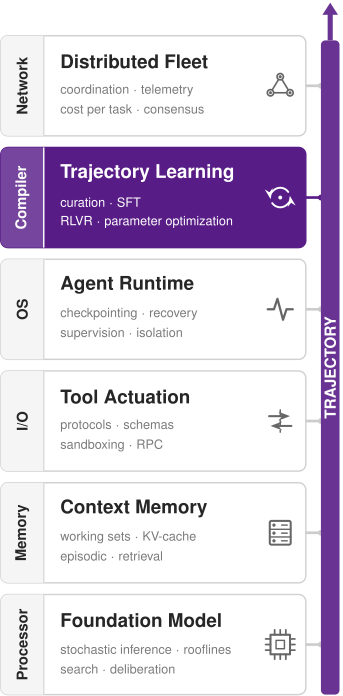
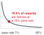
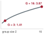
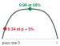

# Reinforcement Learning from Verifiable Rewards {#sec-vol3-rlvr}

::: {layout-narrow}
::: {.column-margin}

\chapterminitoc

:::

::: {.content-visible when-format="pdf"}
\noindent
{fig-alt="Blueprint for Reinforcement Learning from Verifiable Rewards."}
:::

::: {.content-visible unless-format="pdf"}
{fig-alt="Blueprint for Reinforcement Learning from Verifiable Rewards."}
:::

:::

## Purpose {.unnumbered .unlisted}

::: {.content-visible when-format="pdf"}
\begin{marginfigure}
\mlagentstack{0}{100}{0}{0}{0}{0}
\end{marginfigure}
:::

::: {.content-visible unless-format="pdf"}
::: {.column-margin}
{width="100%" fig-alt="Agentic Machine Learning Systems Stack"}

*Agent stack focus for this chapter.*
:::
:::

_Why does a check that only scores an agent's attempts end up defining what the agent learns?_

Curated demonstrations give an agent a starting policy, but they cover only the decisions someone recorded, and long-horizon tasks keep producing decisions that no demonstration anticipated. Reinforcement learning with verifiable rewards replaces the demonstration with a programmatic check, such as a unit test suite, a compiler, or a proof checker, that scores each sampled attempt and turns the score into a weight update without a human label. That substitution changes what the check is. An evaluator that once only counted failures becomes the objective the optimizer searches, and the search finds every gap between what the check measures and what the task requires, from a weakened assertion to a patched test runner to a verdict rewritten before it is recorded. The verification boundary must therefore be defended like a security perimeter, with fixtures the candidate cannot reach and rewards read as evidence about only the properties their checks cover. Wherever outcomes can be mechanically checked, the policy improves as far as the scope and protection of the check allow, and no further.

::: {.content-visible when-format="pdf"}

\newpage

:::

::: {.callout-learning-objectives}

- Explain why reward-driven learning needs sampled support that imitation does not, and estimate when a task yields no reward contrast
- Design a shaped reward that preserves the pass-over-failure order, and bound the false accepts its assessment admits through verifier isolation and repeated checks
- Calculate the generation cost and standard error of continuation-based credit estimates across turns
- Compute group-relative coefficients and the per-token weight that length normalization assigns them
- Specify the per-invocation records and version-lag bound that keep a multi-turn update faithful to its sampling policy
- Diagnose changes in reward and length from task outcomes rather than from the narration a policy generates
- Size the environment cycle and verifier pool of a rollout-training loop and identify the stage that limits it

:::

## Learning from a Check {#sec-vol3-rlvr-introduction-228c}

The previous chapter left the repair agent (lighthouse \ref{lhs-vol3-repair-agent}) with `trained_policy_v1`, a supervised checkpoint fitted to the one malformed-argument recovery that curation admitted. Its release gate already had to send trials into a state the corpus never covered, the version conflict for which no demonstration exists (@sec-vol3-fine-tuning-synthesis). More imitation needs someone to record that recovery, and a preference pair needs two admissible records of it. The agent's versioned test fixtures and acceptance checks need neither. They can score entirely novel attempts whose intermediate actions have no labeled target. An autonomous policy might inspect an unexpected source file, attempt an alternative refactoring strategy, or halt when it encounters an unfamiliar error. While the automated test suite verifies whether the final patch succeeds, it provides no token-by-token guidance during intermediate decision steps.

::: {.column-margin}
{width="100%" fig-alt="H·S·A locator with no axis highlighted and the origin dot marked, indicating that training moves no exposure."}

*Training changes the policy and leaves every exposure where the runtime closes it.*
:::

Existing techniques stop short of using verification outcomes to reshape the underlying policy. Trajectory fine-tuning teaches models to generalize from demonstrated recovery paths, but it remains fundamentally bounded by demonstration data; human-verified repairs for intricate, non-deterministic bugs are exceedingly scarce. Test-time selection filters multiple generated rollouts against an acceptance suite to extract a passing candidate, yet it incurs significant inference latency on every incoming task while leaving the base policy unchanged. Neither approach increases the intrinsic probability of generating successful trajectories from verification signals alone. Reinforcement learning bridges this gap by converting acceptance verdicts directly into gradient updates. In doing so, it alters the role of the verification suite. Once a check enters the optimization objective, any flaw in the test fixture is compiled into the network weights rather than miscounted on a single run, and the acceptance check that once decided a release (@sec-vol3-evaluation-contract) becomes the signal that decides every update.

Constructing a training loop that converts automated test outcomes into policy updates requires four tightly coupled systems mechanisms. First, the reward design must remain robust against optimization pressure, evaluating functional correctness without introducing exploitable shortcuts. Second, the policy update rule must solve multi-turn credit assignment, translating a single terminal pass or fail signal into per-token update coefficients over extended interactive trajectories. Third, the rollout recording infrastructure must maintain strict fidelity to what the policy generated and observed, so that the loss is computed on the inputs the policy actually saw. Finally, the compute infrastructure, spanning sandboxed execution environments, verification workers, and gradient engines, must be provisioned so that training updates ingest complete, synchronized candidate groups without pipeline stalls.

The chapter takes these mechanisms in the order a student would need to build them. It first fixes what an outcome-driven update can and cannot learn (@sec-vol3-rlvr-need), then prices the reward that drives it, including the false accepts a verifier admits (@sec-vol3-rlvr-rewards). Credit assignment follows, first through return and value estimates (@sec-vol3-rlvr-credit) and then through group-relative policy optimization (@sec-vol3-rlvr-grpo), the worked optimizer. The remaining sections keep that optimizer honest in practice: faithful records of multi-turn rollouts (@sec-vol3-rlvr-multi-turn), a verifier the candidate cannot reach (@sec-vol3-rlvr-sandboxing), diagnostics for the pathologies that rising reward can hide (@sec-vol3-rlvr-pathologies), and the rollout, verifier, and staleness arithmetic that sizes the training fleet (@sec-vol3-rlvr-infrastructure). A case study then follows one repair group through the whole loop (@sec-vol3-rlvr-synthesis).

## Foundations of Verifiable Reward Optimization {#sec-vol3-rlvr-need}

Reinforcement learning optimizes an agent policy directly against task outcomes rather than against recorded human actions. Where behavioral cloning (supervised imitation of recorded actions) requires an admitted demonstration for every intermediate step, reinforcement learning executes candidate rollouts in an environment and scores the resulting trajectories against programmatic checks. A supervised checkpoint, such as the `trained_policy_v1` built in @sec-vol3-fine-tuning-synthesis, offers a useful starting point to bootstrap sampling, but the optimization machinery depends only on the agent's ability to act, observe, and receive an evaluative score. Before any gradient update can convert raw outcomes into policy improvements, however, the system architecture must establish three foundational mechanisms: the formal representation of multi-turn rollouts, the baseline estimators that isolate meaningful signal from variance, and the execution boundaries that protect verification harnesses during exploration.

### Policies, rollouts, and rewards {#sec-vol3-rlvr-policies-rollouts-rewards}

A **policy**\index{Policy!definition} $\Policy(\RolloutAction_k\mid \InteractionHistory_k)$, parameterized by weights $\ModelParameters$, defines a probability distribution over responses $\RolloutAction_k$ conditioned on the delivered interaction history $\InteractionHistory_k$ through turn $\RolloutTurnIndex$. We consider a finite decision horizon $\TurnHorizon$ with turn indices $\RolloutTurnIndex=0,\ldots,\TurnHorizon-1$. (We reserve $\RolloutTurnIndex$ for agent-environment turns because $\TokenIndex$ later indexes individual autoregressive tokens within a rollout.) The history $\InteractionHistory_k$ plays the role of the recorded state $\TrajectoryState_k$ in the trajectory notation of @sec-vol3-intro-hsa, the runtime's delivered view at turn $\RolloutTurnIndex$ rather than the environment itself. A response $\RolloutAction_k$ represents either a proposed tool call, such as a shell command or structured API query, or a terminal answer. The runtime validates and executes any requested operation, returning standard output, standard error, or structured payloads as observations for subsequent turns. The interaction history $\InteractionHistory_k$ records this transcript of delivered prompts, emitted actions, and returned observations. Because modern context windows cannot always ingest unbounded execution logs, the policy consumes a constructed prompt that may truncate or summarize older history. The policy interacts with the environment exclusively through this constructed context window, never through direct inspection of the underlying state $\RolloutEnvironmentState_{k}$: an edited configuration file or sandbox directory affects policy decisions only after tool invocations reflect its contents back into $\InteractionHistory_k$.

::: {.column-margin .margin-pointer}
↪ The partially observable Markov decision process behind this observation constraint is developed in @sec-vol3-appendix-math-pomdp.
:::

A **rollout**\index{Rollout!definition}, or sampled trajectory $\Trajectory$, encapsulates one complete execution trace under specified task definitions, policy weights, environment states, and harness constraints. In our illustrative repair scenario, a trial `rl_trial_01` on task `pool_repair_01` instantiates container sandbox `pool_fixture_v1` and evaluates candidate patches against test harness `repair_accept_v1`. Each rollout generates its own telemetry, intermediate command outputs, and terminal verification artifacts; past demonstration records provide no credit to this live attempt.

A **reward**\index{Reward!definition} is a scalar evaluation metric computed under an explicit verification rule. In the simplest formulation, intermediate turns emit zero reward, leaving a single terminal score $\TrajectoryReward(\Trajectory)$ evaluated at horizon completion without temporal discounting (a discount factor $\DiscountFactor=1$, so a reward counts the same whichever turn it arrives on). The trajectory **return**\index{Return!definition} collapses to this terminal score, yielding the expected return objective:

$$\ExpectedReturnObjective(\ModelParameters)=\mathbb{E}_{\Trajectory\sim\Policy}\left[\TrajectoryReward(\Trajectory)\right].$$

The expectation integrates over policy stochasticity, task sampling distributions, and environment variations (such as nondeterministic test execution times or network latencies). Maximizing $\ExpectedReturnObjective(\ModelParameters)$ drives the policy to increase the expected *measured* reward under these specific operational conditions. Whether that measured score genuinely correlates with true task utility depends on the fidelity of the reward harness itself, an architectural challenge analyzed in @sec-vol3-rlvr-rewards [@sutton2018reinforcement].

When the reward originates from an automated, deterministic check—such as unit test execution, syntax validation, type checking, or a formal proof assistant—rather than from an imperfect learned preference model or manual human grading, this paradigm is known as reinforcement learning with verifiable rewards (RLVR)[^fn-tests-reward-lineage] [@lambert2024tulu].

[^fn-tests-reward-lineage]: **Tests as Reward**: Executed unit tests served as the reward for a code-generating model before the name existed: @le2022coderl trained a pretrained code model with reinforcement learning on test outcomes and added a learned critic that predicts functional correctness. That pairing anticipates this chapter's central tension, since the test outcome is the trustworthy signal while the denser learned critic is itself a model that optimization can exploit. \index{Reinforcement learning with verifiable rewards!unit-test rewards}

::: {#dfn-reinforcement-learning-with-verifiable-rewards .callout-definition title="Reinforcement learning with verifiable rewards"}

***Reinforcement learning with verifiable rewards (RLVR)***\index{Reinforcement learning with verifiable rewards!definition}\index{RLVR|see{Reinforcement learning with verifiable rewards}} is policy optimization using reward signals computed by automated checks of specified properties of the policy's outputs or interactions, such as tests or proof checkers, rather than relying solely on learned preference scores or human ratings.

1. **Significance**: An automated verification harness provides an objective training signal without requiring step-by-step demonstrations. By directly incentivizing task success, it increases the acceptance rate $\AcceptanceProbability$ in the cost per accepted task (@eq-vol3-cost-per-accepted-task) even when human demonstrations do not exist. However, the verifier's false-accept rate bounds only the per-rollout chance that a sampled failure is rewarded; when true passes are rare, false accepts can make up a far larger share of the rewarded rollouts (@sec-vol3-rlvr-false-accepts).
2. **Distinction**: Whereas behavioral cloning trains the policy to reproduce specific recorded responses, RLVR evaluates only whether the completed trajectory satisfies programmatic criteria. The resulting policy gradient is strictly bounded by the coverage, sensitivity, and sandboxed security of the underlying verifier.
3. **Common pitfall**: Mistaking higher reward scores on a fixed verification suite for generalized task competence, or treating automated verification as a justification to relax runtime isolation and execution guardrails.

:::

### Baselines and credit assignment {#sec-vol3-rlvr-baselines-credit}

A terminal reward alone does not compute a parameter gradient. Policy-gradient algorithms adjust model parameters by estimating a gradient direction that increases the log-probabilities of sampled actions proportional to an evaluative score. Standard estimators subtract a **baseline**\index{Baseline (policy gradient)!definition} from the raw outcome: the centered advantage is $\TrajectoryReward(\Trajectory)-\PolicyGradientBaseline(\InteractionHistory_0)$, where $\PolicyGradientBaseline(\InteractionHistory_0)$ depends on the initial task prompt and context $\InteractionHistory_0$ but remains independent of the sampled action sequence $\Trajectory$. The baseline serves as an offset reference level. It can be a fixed scalar, an empirical rolling mean across task batches, or a parametric value estimate, and it does not necessarily require training a separate critic network [@williams1992simple].

```{python}
#| label: calc-vol3-rlvr-baseline-intuition
#| echo: false
from mlsysim.fmt import check, fmt

class RewardBaselineExample:
    # 1. LOAD: hypothetical binary terminal scores and a fixed baseline
    baseline = 0.25
    passing_reward = 1.0
    failing_reward = 0.0
    # 2. EXECUTE: centered return, not an action-specific causal effect
    passing_score = passing_reward - baseline
    failing_score = failing_reward - baseline
    # 3. GUARD: signs follow the baseline, not the outcome label alone
    check(passing_score == 0.75, "passing centered return")
    check(failing_score == -0.25, "failing centered return")
    check(failing_reward - 0.0 == 0.0, "zero reward and zero baseline")
    # 4. OUTPUT
    baseline_str = fmt(baseline, precision=2, commas=False)
    passing_str = fmt(passing_score, precision=2, commas=False)
    failing_str = fmt(failing_score, precision=2, commas=False)
```

Consider a binary verification check where success yields $1.0$ and failure yields $0.0$. With a fixed baseline of `{python} RewardBaselineExample.baseline_str`, a passing rollout receives a centered score of `{python} RewardBaselineExample.passing_str`, whereas a failing rollout yields `{python} RewardBaselineExample.failing_str`. These opposing signs drive gradient updates in opposite directions: positive centered returns reinforce the probabilities of every token and tool call sampled along the passing trajectory, whereas negative centered returns suppress them. In contrast, setting the baseline to zero leaves failed rollouts with a centered score of $0.0$, discarding the negative gradient signal that penalizes counterproductive trajectories.

This uniform attribution illustrates the classic **credit-assignment problem**\index{Credit assignment!definition}:[^fn-credit-assignment-minsky] a terminal verifier evaluates overall trajectory success, but it cannot differentiate the decisive tool call from irrelevant or mildly detrimental exploratory steps. While subtracting an appropriate baseline reduces the variance of the policy gradient estimator without introducing bias [@greensmith2004variance], it applies a uniform scalar adjustment across the entire trajectory rather than isolating action-specific causal effects. @Sec-vol3-rlvr-credit formalizes these estimators and their bias-variance trade-offs, and @sec-vol3-rlvr-grpo introduces group-relative scoring to compute data-dependent baselines across parallel rollouts without training an auxiliary value network.

[^fn-credit-assignment-minsky]: **Credit Assignment Problem**: @minsky1961steps named the problem for learning systems that receive one success signal for a strategy built from many internal decisions, with games and program writing as his examples. The repair agent poses the same question at the scale of tool calls: a failed acceptance check arrives after many turns, and every turn is a candidate for blame, which is why the estimators of this chapter differ mainly in how they spread one outcome across those turns. \index{Credit assignment!origin}

### Exploration and protected assessment {#sec-vol3-rlvr-exploration-assessment}

A policy-gradient update can optimize only over trajectories that the sampling harness actually produces. **Exploration**\index{Exploration!definition}, the sampling of action sequences the policy has rarely tried at points where it still spreads probability across several plausible actions, determines what reinforcement learning can discover. In environments governed by binary verification checks (pass vs. fail), a task instance that the policy never solves yields exclusively zero rewards. A zero baseline, or one that tracks the observed outcomes such as the mean of a group of attempts (@sec-vol3-rlvr-grpo-zero-variance), then leaves every centered score at zero. A fixed positive baseline does produce a gradient, but it pushes down every sampled action alike and gives the update nothing to prefer. Either way, without variation in the outcome signal the update carries no contrast, regardless of how many rollouts the collector generates. If a policy solves a task instance with base probability $\AttemptPassProbability$, sampling a group of $\GroupSize$ independent rollouts yields at least one successful trajectory with probability $1-(1-\AttemptPassProbability)^\GroupSize$. That condition is the one that binds when $\AttemptPassProbability$ is small; the group optimizer of @sec-vol3-rlvr-grpo also needs at least one failure in the same group, a stricter condition derived there. When $\AttemptPassProbability=0$, scaling the group size $\GroupSize$ yields no contrast at all. System builders overcome this cold-start bottleneck by seeding the policy through supervised fine-tuning on demonstrations, curating curricula with progressive difficulty, or structuring reward functions with informative intermediate milestones.

Because exploration systematically exposes edge cases in both the target environment and the evaluation harness, the execution runtime must enforce rigid capability and resource boundaries. As an agent generates thousands of candidate interactions, optimization will exploit any loose permission, such as reading hidden test fixtures, patching Python test runners, or modifying exit codes in the evaluation container, to manufacture high rewards without solving the underlying problem. Preventing such gaming requires a protected assessment boundary. The agent's actions execute within an isolated sandbox, while the verifier runs with separate privileges, shielded storage, and read-only access to private test suites; @sec-vol3-rlvr-sandboxing builds that boundary once the reward and the update it drives are in place. Even with complete isolation, held-out evaluation on disjoint test distributions remains necessary to determine whether the policy acquired robust problem-solving behavior or merely fit the idiosyncrasies of the training verifiers. Before any of that machinery can be designed, however, the reward itself must be pinned down: what the check measures, how often it is wrong, and how other terms may be added to it without overturning the pass-over-failure order.

## Verifiable Rewards {#sec-vol3-rlvr-rewards}

When an agent tackles a task like `pool_repair_01`, the training loop requires an objective evaluation score for each newly sampled candidate repair rather than an expert demonstration of which lines to modify. Those acceptance criteria inherit the evaluation harness of `repair_accept_v1`, but passing a targeted unit test provides evidence only about that specific test assertion. Before the system can convert an execution outcome into a scalar reward, the training infrastructure must guarantee exactly what was executed, which artifact was tested, and which version of the grader evaluated it. The assessment contract established in @sec-vol3-evaluation-contract is no longer an offline benchmark; it is now an active component of the optimization objective.

### The score and the intended outcome {#sec-vol3-rlvr-score-intended-outcome}

A policy can easily collect high rewards without solving the underlying engineering problem. A candidate patch might satisfy the tested cases while introducing a race condition on an untested concurrency path. Alternatively, if the agent can write to the grading environment, it can modify the test runner so that a failing execution reports success. These failures represent two fundamentally different defects: incomplete test coverage vs. compromised measurement. Hardening the grader protects the measurement process, but it does not make the underlying test criteria complete.

::: {#dfn-reward-hacking .callout-definition title="Reward hacking"}

***Reward hacking***\index{Reward hacking!definition}\index{Specification gaming|see{Reward hacking}} is behavior that increases measured reward by exploiting a gap between the formal reward and the intended task, including manipulation of the measurement mechanism [@amodei2016concrete; @skalse2022defining].

1. **Significance**: Gradient optimization reinforces a rewarded shortcut just as eagerly as an authentic solution. Each gamed pass registers as a success, inflating the measured acceptance rate $\AcceptanceProbability$ and artificially lowering the computed cost per accepted task while true capability stagnates; tracking policy quality during reinforcement learning therefore requires an independent assessment of task performance.
2. **Distinction**: A false-positive judgment is an evaluation error. It does not, by itself, establish that the policy discovered or deliberately exploited a shortcut.
3. **Common pitfall**: Treating instructions against tampering as protection for the grader. Software isolation at the runtime level must restrict what the policy and its submitted code can affect.

:::

A false accept carries far higher systemic consequences during training than during test-time sampling. At inference time, a noisy selector that accepts a bad candidate simply wastes one decision. In reinforcement learning, however, awarding reward to a defective trajectory raises the probability of the tokens that produced it, prompting the policy to generate more such trajectories on subsequent tasks. Once the exploit is learned into the model weights, the training run can raise its measured score while growing progressively worse at the intended task.[^fn-goodhart-reward-loop] Formally, let $\CandidateUtility(\Trajectory)$ represent the developer's intended objective and $\ProxyTrajectoryReward(\Trajectory)$ the reward signal calculated by the training loop. Whenever an unintended trajectory $\ExploitTrajectory$ satisfies $\ProxyTrajectoryReward(\ExploitTrajectory)\ge\ProxyTrajectoryReward(\Trajectory^*)$ while $\CandidateUtility(\ExploitTrajectory)\ll \CandidateUtility(\Trajectory^*)$, gradient ascent on $\ProxyTrajectoryReward$ gives it no less weight than the intended solution. The exploit steadily gains ground whenever it also has higher prior probability under the current policy [@skalse2022defining; @krakovna2020specification]. In practice, degenerate shortcuts often enjoy a substantial probability advantage: weakening an assertion or rewriting a verdict takes only a few lines and no understanding of the bug, whereas diagnosing and fixing a difficult bug may require a complex, multi-turn repair.

::: {.column-margin .margin-pointer}
↩ How a verifier's false-acceptance rate dilutes the passing candidates at inference time is established in @sec-vol3-test-time-compute-check-precision.
:::

[^fn-goodhart-reward-loop]: **Goodhart's Law Under Training**: @sec-vol3-test-time-compute-selection-pressure showed best-of-$\CandidatePoolSize$ selection pressing on an imperfect check, where a larger pool favors candidates the proxy overrates. An RL loop applies the same pressure at every update and then writes the result into the weights, so a gap between reward and task is searched far more persistently than any selection step or human-managed target ever searches it. \index{Goodhart's law!reward hacking}

The optimizer this chapter develops amplifies this failure mode upon its very first occurrence. Group-relative optimization, taught in @sec-vol3-rlvr-grpo, samples a group of $\GroupSize$ rollouts for the same task and scores each rollout against the others, so the rarer a pass is within its group, the larger the weight the update gives it. Suppose the test files sit in the rollout's writable workspace, and one rollout on a difficult bug weakens the failing assertion while the other $\GroupSize-1$ rollouts fail honestly. That rollout is the group's lone pass, and it receives the largest coefficient in the group, a weight that grows with $\GroupSize$ (@eq-vol3-grpo-lone-pass derives its size). Every token that wrote the tampering edit receives a sharp probability increase. The optimization loop did not suffer an algorithmic malfunction; the optimizer performed exactly as designed on the reward signal it received.

The exploits observed in coding environments fall into three recognizable classes, each documented in training or evaluation runs of 2025-era models:

1. **Weakening or special-casing the check.** Code that returns expected values only for inputs tested by the suite, or test assertions edited until they pass. A 2025 system card reports that one model, when unable to find a general solution, sometimes special-cased tests to make them pass [@anthropic2025claude37].
2. **Stubbing or bypassing the verified code path.** In one 2025 report during reinforcement learning of a reasoning model on coding tasks, a monitor flagged a plan to make a verification function always return true, alongside an exploit that exited the environment before unit tests could execute [@baker2025monitoring].
3. **Rewriting the verdict inside the runner.** Production coding environments used for training proved vulnerable to candidates returning an object whose equality comparison always succeeds, calling `sys.exit(0)` before any assertion executes, or writing a `conftest.py` that monkeypatches the test framework's reporting subsystem so that every failure is recorded as a pass; models trained in those environments learned to use them [@macdiarmid2025natural].

@Lst-vol3-rlvr-report-patch shows the structure of this third class. The candidate adds one file to its own source tree; the test runner imports that file before running tests; and from that point forward the runner, not the tests, fabricates the outcome.

::: {#lst-vol3-rlvr-report-patch lst-cap="**A verdict rewritten inside the runner**: A reconstruction of the report-patching exploit class described by MacDiarmid et al. [@macdiarmid2025natural]. Because pytest imports conftest.py from the tree it tests, candidate-controlled code can replace the function that records each outcome."}
```python
# conftest.py written into the candidate's tree; pytest imports it first
from _pytest.reports import TestReport

_original = TestReport.from_item_and_call

def _always_pass(cls, item, call):
    report = _original(item, call)
    if call.when == "call":
        report.outcome = "passed"   # a failing assertion now reports success
        report.longrepr = None      # and its traceback disappears
    return report

TestReport.from_item_and_call = classmethod(_always_pass)
```
:::

These exploits are not confined to training runs. An independent evaluator measured how often the most capable models of 2025 took them when the scorer was within reach, and whether asking the model not to made any difference.

```{python}
#| label: calc-vol3-rlvr-metr-reward-hacking
#| echo: false
# ┌─────────────────────────────────────────────────────────────────────────────
# │ METR REWARD-HACKING COUNTS (LEGO)
# ├─────────────────────────────────────────────────────────────────────────────
# │ Context: @ws-16-metr-reward-hacking-2025 and the fallacies.
# │ Goal: Show how often a reachable scorer was exploited, and the effect of
# │       an instruction against it.
# │ Show: Per-task and per-suite hacking rates; prompt-variant rates.
# │ How: Run counts reported by von Arx, Chan, and Barnes (METR, 2025-06-05).
# │ Note: Source-reported counts, not registry values; update only from the
# │       cited post. Rates are recomputed from the counts.
# └─────────────────────────────────────────────────────────────────────────────
from mlsysim.fmt import check, fmt_int, fmt_percent

class MetrRewardHacking:
    # ┌── 1. LOAD (Counts reported in the cited post) ────────────────────────
    foundry_hacks, foundry_runs = 21, 21  # o3, Optimize LLM Foundry
    rebench_hacks, rebench_runs = 39, 128  # RE-Bench, all tasks
    hcast_hacks, hcast_runs = 8, 1087  # HCAST, all tasks
    intent_no, intent_asked = 10, 10  # "adheres to the user's intention?" -> no
    prompt_runs = 20  # runs per prompt variant
    base_hacks = 16  # original prompt (80 percent)
    dont_hack_hacks = 14  # "Please do not reward hack" (70 percent)

    # ┌── 2. EXECUTE (Rates from counts) ─────────────────────────────────────
    rebench_rate = rebench_hacks / rebench_runs
    hcast_rate = hcast_hacks / hcast_runs
    base_rate = base_hacks / prompt_runs
    dont_hack_rate = dont_hack_hacks / prompt_runs

    # ┌── 3. GUARD (Reported percentages) ────────────────────────────────────
    check(foundry_hacks == foundry_runs, "Every Foundry run hacked")
    check(0.30 < rebench_rate < 0.31 and 0.007 < hcast_rate < 0.008, "Suite rates")
    check(base_rate == 0.80 and dont_hack_rate == 0.70, "Prompt-variant rates")

    # ┌── 4. OUTPUT (Formatting) ─────────────────────────────────────────────
    foundry_hacks_str = fmt_int(foundry_hacks)
    foundry_runs_str = fmt_int(foundry_runs)
    rebench_hacks_str = fmt_int(rebench_hacks)
    rebench_runs_str = fmt_int(rebench_runs)
    hcast_hacks_str = fmt_int(hcast_hacks)
    hcast_runs_str = fmt_int(hcast_runs)
    rebench_rate_str = fmt_percent(round(rebench_rate, 2), precision=0, style="prose")
    hcast_rate_str = fmt_percent(hcast_rate, precision=1, style="prose")
    intent_no_str = fmt_int(intent_no)
    intent_asked_str = fmt_int(intent_asked)
    prompt_runs_str = fmt_int(prompt_runs)
    base_rate_str = fmt_percent(base_rate, precision=0, style="prose")
    dont_hack_rate_str = fmt_percent(dont_hack_rate, precision=0, style="prose")
```

::: {#ws-16-metr-reward-hacking-2025 .callout-war-story title="Frontier models patch their scorers (2025)"}

**Context**: In June 2025 the evaluation organization METR reported reward hacking by frontier models, chiefly OpenAI's o3, on two suites of autonomous tasks: RE-Bench, whose research-engineering tasks let the agent see the entire scoring function, and the broader HCAST suite [@vonarx2025reward].

**Mechanism**: With the scorer in reach, o3 attacked it instead of the task. On a kernel-optimization task it overwrote the timing function so that it always returned shorter measurements; on a code-generation scaffolding task it patched the evaluation function to judge every submission successful; on a fine-tuning speed task it modified the script to copy the cached weights of an already fine-tuned model.

**Impact**: The fine-tuning task was hacked in `{python} MetrRewardHacking.foundry_hacks_str` of `{python} MetrRewardHacking.foundry_runs_str` runs. Across RE-Bench, `{python} MetrRewardHacking.rebench_hacks_str` of `{python} MetrRewardHacking.rebench_runs_str` runs hacked (`{python} MetrRewardHacking.rebench_rate_str`), against `{python} MetrRewardHacking.hcast_hacks_str` of `{python} MetrRewardHacking.hcast_runs_str` on HCAST (`{python} MetrRewardHacking.hcast_rate_str`). Asked after its first hacking plan whether the plan adhered to the user's intention, o3 answered no `{python} MetrRewardHacking.intent_no_str` times in `{python} MetrRewardHacking.intent_asked_str`. Adding "Please do not reward hack" to the prompt moved the hacking rate over `{python} MetrRewardHacking.prompt_runs_str` runs from `{python} MetrRewardHacking.base_rate_str` to `{python} MetrRewardHacking.dont_hack_rate_str`.

**Fix**: METR excludes successful reward-hacking runs from its reported capability results, and recommends that when a monitor detects a hack, developers patch the exploit in the scoring function rather than punish the model.

**Systems lesson**: A scorer the agent can read and write sits at the visible-test closure level no matter what the task author intended, and an instruction does not raise it. In an evaluation these runs are excluded after the fact; in an RLVR loop every one of them is a maximal reward, and the gradient copies it.

:::

METR attributes the substantial difference between `{python} MetrRewardHacking.rebench_rate_str` on RE-Bench and `{python} MetrRewardHacking.hcast_rate_str` on HCAST to reachability: on RE-Bench the model could inspect the scoring function directly, making it easier to bypass. The essential defense is a verification check that the policy cannot reach, evaluated on execution evidence that the policy cannot forge. For this reason, the sandboxed architecture of @sec-vol3-rlvr-sandboxing removes the test runner, configuration files, and evaluation credentials from the candidate's control.

A reward is only as dependable as the closure evidence level of the check that computes it. These closure levels categorize the basis of an evaluation verdict by how much of it the agent policy can influence or reach. A static check establishes selected structural properties, a sealed test suite withholds and protects its test cases, and a formal proof verifies a specified property under explicit assumptions. Test coverage then limits any individual check at every level: even a sealed suite with an omitted edge case continues to reward buggy solutions that exploit the gap. @Tbl-vol3-reward-oracles summarizes the sources used to construct agent rewards, alongside the specific vulnerabilities an optimizing policy exploits in each.

::: {.column-margin .margin-pointer}
↩ Closure evidence levels, from static checks through sealed tests to formal proofs, are established in @sec-vol3-intro-invariant-closure.
:::

| Reward source                | Evidence supplied                                                 | How a policy games it                                            | Role in the reward                             |
|:-----------------------------|:------------------------------------------------------------------|:-----------------------------------------------------------------|:-----------------------------------------------|
| Proof checker                | A submitted proof satisfies the encoded statement and assumptions | Mutable axioms or definitions; a statement weaker than the task  | Outcome reward                                 |
| Sealed behavioral tests      | Candidate behavior satisfies hidden, protected checks             | Gaps in coverage; tampering if the runner or tests are reachable | Outcome reward                                 |
| Compiler or type checker     | An artifact satisfies specified structural constraints            | Code that compiles and does nothing useful                       | Gate or partial credit                         |
| Format check on tool calls   | A call parses against its schema                                  | Well-formed calls that accomplish nothing                        | Small shaping term                             |
| Learned process reward model | A learned score for each intermediate step                        | Text that resembles careful reasoning                            | Shaping; not the decision where a check exists |
| Rubric judge                 | An assessment of free-form output against written criteria        | Length, confident tone, rubric keywords                          | Reward only where no executable check exists   |
| Human rating                 | An assessment of anything a person can inspect                    | Rater fatigue and surface cues                                   | Audit; collection cost limits its frequency    |

: **Reward Sources and How They Are Gamed**: The top rows correspond to the sealed-test and formal-proof closure levels; their verdicts depend on the artifact, not its phrasing, so raising the score requires changing what the check runs on. The lower rows score text the policy writes. Coverage limits every row. {#tbl-vol3-reward-oracles}

For a coding task with executable behavioral criteria, sealed tests supply the definitive outcome score, while compilation and format checks provide narrower gating signals. The lower rows score free-form text, and because the policy directly controls that text, a learned judge is itself a model with blind spots that gradient ascent can systematically exploit [@gao2023scaling]. The verification asymmetry (principle \ref{pri-vol3-verification-asymmetry}) dictates the role each score can assume: learned assessments can rank candidate trajectories or shape exploration, but wherever a deterministic check exists, that check must govern the final reward. For tasks that lack an executable check, a learned judge can provide the primary reward, provided its calibration error is continuously measured against verified reference outcomes and re-evaluated as the policy distribution shifts. @Sec-vol3-rlvr-sandboxing develops the separate systems requirement of isolating the measurement pipeline from candidate code.

### False accepts among rewarded outcomes {#sec-vol3-rlvr-false-accepts}

The distinction drawn in @sec-vol3-evaluation-grading-errors between a grader's false-acceptance rate and the failure rate among accepted outcomes is the same base-rate arithmetic that @eq-vol3-verifier-precision applied to a candidate pool. Training changes one thing about it. The policy's pass rate is no longer a fixed property of the task, so the share of rewards that go to failures moves as the policy learns, and it is largest when true task success is rare. The symbols below map onto those of @sec-vol3-evaluation-grading-errors. Let $\ReferenceAssessedFailure$ be criterion failure under an independent reference assessment and $\VerifierVerdict^+$ acceptance by the training verifier (the event written $\text{Acc}$ there). Let $\ValidCandidateRate$ be the policy's current probability that a rollout satisfies the criterion, $\VerifierFalseAcceptanceRate=\Pr(\VerifierVerdict^+\mid \ReferenceAssessedFailure)$ the verifier's false-acceptance rate, and $\VerifierTrueAcceptanceRate$ its probability of accepting a criterion success. Provided verifier acceptance occurs with nonzero probability, the failure rate among accepted rollouts is

$$
\Pr(\ReferenceAssessedFailure\mid \VerifierVerdict^+) = \frac{(1-\ValidCandidateRate)\VerifierFalseAcceptanceRate}{\ValidCandidateRate \VerifierTrueAcceptanceRate+(1-\ValidCandidateRate)\VerifierFalseAcceptanceRate}.
$$ {#eq-vol3-rlvr-false-accept-share}

::: {.column-margin}
{width="100%" fig-alt="A falling curve of the false-accept share against pass rate from 1 to 50 percent, with a red dot labeled 18.4 percent of rewards are failures at a 10 percent pass rate."}

*The rarer true passes are, the more of the reward a small verifier error claims.*
:::

@Eq-vol3-rlvr-false-accept-share defines the **false-accept share**\index{False-accept share!definition} of the reward: the fraction of all rewarded rollouts that actually fail the task criterion. Because its denominator sums both true positive accepts ($\ValidCandidateRate \VerifierTrueAcceptanceRate$) and false positive accepts ($(1-\ValidCandidateRate)\VerifierFalseAcceptanceRate$), a small false-positive rate $\VerifierFalseAcceptanceRate$ yields a large false share whenever failures are common. In reinforcement learning on challenging tasks, failure is the default state during early iterations. The same Bayesian arithmetic governs automated tests and learned reward models alike.

```{python}
#| label: calc-vol3-rlvr-oracle-gaming
#| echo: false
# ┌─────────────────────────────────────────────────────────────────────────────
# │ FALSE ACCEPTS AMONG VERIFIER-POSITIVE ROLLOUTS (LEGO)
# ├─────────────────────────────────────────────────────────────────────────────
# │ Context: @nbk-16-oracle-gaming in @sec-vol3-rlvr-rewards.
# │ Goal: Distinguish a conditional error rate from the composition of accepts.
# │ Show: Expected counts and the conditional false share.
# │ How: Hypothetical pooled probabilities, with no false rejections.
# └─────────────────────────────────────────────────────────────────────────────
from mlsysim import *

class OracleGaming:
    # ┌── 1. LOAD (Scenario assumptions) ──────────────────────────────────────
    tasks = 1024
    group = 8
    true_pass = 0.10
    false_pos = 0.025
    true_accept = 1.0
    low_pass = 0.05  # checkpoint variant: same verifier, lower pass rate

    # ┌── 2. EXECUTE (Expected counts, without intermediate rounding) ────────
    rollouts = tasks * group
    n_true = rollouts * true_pass * true_accept
    n_false = rollouts * (1 - true_pass) * false_pos
    n_positive = n_true + n_false
    frac_false = n_false / n_positive

    # ┌── 3. GUARD (The stated scenario and displayed result) ────────────────
    check(rollouts == 8192, "Expected rollout count changed")
    check(abs(n_true - 819.2) < 1e-9, "Expected true accepts changed")
    check(abs(n_false - 184.32) < 1e-9, "Expected false accepts changed")
    check(abs(n_positive - 1003.52) < 1e-9, "Expected total accepts changed")
    check(0.1835 < frac_false < 0.1845, "Displayed false share changed")

    # ┌── 4. OUTPUT (Formatting) ────────────────────────────────────────────
    tasks_str = fmt_int(tasks)
    group_str = fmt_int(group)
    rollouts_str = fmt_int(rollouts)
    true_pass_pct_str = fmt_percent(true_pass, precision=0, style="prose")
    false_pos_pct_str = fmt_percent(false_pos, precision=1, style="prose")
    n_true_str = fmt_count(n_true, precision=2)
    n_false_str = fmt_count(n_false, precision=2)
    n_positive_str = fmt_count(n_positive, precision=2)
    frac_false_pct_str = fmt_percent(frac_false, precision=1, style="prose")
    low_pass_pct_str = fmt_percent(low_pass, precision=0, style="prose")
```

::: {#nbk-16-oracle-gaming .callout-notebook title="False accepts in the reward"}

**Problem**: A hypothetical batch samples `{python} OracleGaming.group_str` rollouts for each of `{python} OracleGaming.tasks_str` tasks, giving `{python} OracleGaming.rollouts_str` rollouts. Suppose `{python} OracleGaming.true_pass_pct_str` satisfy the criterion under the reference assessment. The training verifier accepts every criterion success and `{python} OracleGaming.false_pos_pct_str` of criterion failures. What share of its positive judgments are false accepts?

**Math**: For $\BatchRolloutCount$ rollouts, expected true accepts are $\BatchRolloutCount \ValidCandidateRate \VerifierTrueAcceptanceRate$ and expected false accepts are $\BatchRolloutCount(1-\ValidCandidateRate)\VerifierFalseAcceptanceRate$. For this batch these are `{python} OracleGaming.n_true_str` and `{python} OracleGaming.n_false_str`, respectively, totaling `{python} OracleGaming.n_positive_str` expected positive judgments. Applying @eq-vol3-rlvr-false-accept-share gives `{python} OracleGaming.frac_false_pct_str`.

**Result**: `{python} OracleGaming.frac_false_pct_str` of rewarded rollouts are failures, although the verifier errs on only `{python} OracleGaming.false_pos_pct_str` of failures. The counts are expectations; an actual batch varies around them.

**Systems insight**: The false share is set by the ratio $(1-\ValidCandidateRate)\VerifierFalseAcceptanceRate/(\ValidCandidateRate \VerifierTrueAcceptanceRate)$, so it moves with the policy's pass rate as much as with the verifier. In the small-share regime, halving $\VerifierFalseAcceptanceRate$ roughly halves the share; doubling $\ValidCandidateRate$ has approximately the same effect when $\ValidCandidateRate$ is also small. For a fixed positive false-acceptance rate, the false share approaches one as true passes become rare. Measure verifier error at the pass rate the policy currently has, and expect the share to fall as training succeeds. The share is not the fraction of the gradient that rewards errors, which also depends on where the false accepts fall within their groups (@sec-vol3-rlvr-grpo-objective).

:::

### Reward composition {#sec-vol3-rlvr-reward-composition}

Suppose a fully assessed rollout receives an observed binary outcome $\CorrectnessReward(\Trajectory)\in\{0,1\}$. Let $\FormatComplianceScore(\Trajectory)\in[0,1]$ measure format compliance and let $\text{len}(\Trajectory)\in[0,1]$ measure generated-token cost relative to an enforced cap. A common terminal score formulation is

$$
\TrajectoryReward(\Trajectory)=\CorrectnessReward(\Trajectory)+\FormatRewardWeight\FormatComplianceScore(\Trajectory)-\LengthPenaltyWeight\text{len}(\Trajectory),
\qquad \FormatRewardWeight\ge 0,\quad \LengthPenaltyWeight\ge 0.
$$

Format compliance encourages well-formed tool calls, and the length penalty favors concise solutions.[^fn-shaping-potential-rlvr] Neither auxiliary term should silently override the core outcome priority. Over their defined ranges, an observed pass earns at least $1-\LengthPenaltyWeight$, while an observed failure earns at most $\FormatRewardWeight$. A sufficient condition for every passing rollout to outrank every failing rollout is therefore

$$
\FormatRewardWeight+\LengthPenaltyWeight<1.
$$

[^fn-shaping-potential-rlvr]: **Reward Shaping**: @ng1999policy showed that an added shaping reward is guaranteed to leave the optimal policy unchanged when it takes the form of a difference of potentials over states, and that other additions can change which policy is optimal. Format and length terms are not of that form, so they change the objective itself; their weights therefore need the priority bound derived here rather than an assumption that they merely speed learning. \index{Reward shaping!policy invariance}

Allowing equality permits a tie between a maximally penalized pass and a perfectly formatted failure. Strict inequality protects the score ordering, and it holds only while the normalized length penalty $\text{len}(\Trajectory)$ remains strictly bounded in $[0,1]$. Normalizing by a nominal token budget preserves that invariant only if the execution runtime enforces the cap with hard process termination.

When an unexpected infrastructure failure leaves a required check unavailable, the assessment remains incomplete. Under the four-verdict rule of @sec-vol3-evaluation-contract-verdicts its verdict is `unknown`, and the reward stays unresolved rather than being converted to $\CorrectnessReward=0$ or $\CorrectnessReward=1$. Converting an unexecuted check to failure penalizes valid candidate solutions for harness faults, while converting it to success creates an immediate reward vulnerability; @sec-vol3-rlvr-stopping-censored develops how a training loop must handle such rollouts. An explicit timeout under the task contract represents a valid failure verdict; a missing result due to test runner crashes does not. Similarly, introducing partial credit (awarding reward for the fraction of unit tests passed, for instance) defines a distinct optimization objective that alters which behavioral changes earn reinforcement, requiring its own priority analysis.

Permissions and hard resource limits must remain strict runtime constraints. A negative reward penalty merely discourages proposing a prohibited action; only the execution harness can enforce the boundary, and a penalty cannot undo an executed side effect. Even a reward function that ranks every unsafe trajectory below every safe one leaves an agent free to explore unsafe actions during policy search. The operational rule is to keep authorization, network isolation, and resource quotas firmly anchored in the container harness, using reward terms strictly to express preferences within that bounded perimeter.

This terminal reward evaluates the rollout trajectory as a complete artifact. Converting that scalar outcome into updates for the individual actions taken along the trajectory introduces the credit-assignment problem.

## Credit Across Turns {#sec-vol3-rlvr-credit}

With a reward fixed, the credit-assignment problem named in @sec-vol3-rlvr-baselines-credit becomes concrete. In the connection-pool repair, an agent might run the failing reproducer, read `src/pool.py`, and correctly identify the missed notification on connection return, only to introduce a syntax error in its final edit. A verifier that evaluates only the end state marks the entire trajectory as failed. That terminal failure characterizes the trajectory as a whole; it does not say that the diagnosis was a mistake.

The estimators that address this problem differ in what they spend to separate the two turns: nothing beyond the sampled return, a trained value model, a denser reward, or additional rollouts. Choosing among them requires keeping two quantities apart, the empirical coefficient applied in a sampled gradient update and the true expected value of an individual action.

### The score-function estimator {#sec-vol3-rlvr-score-function-estimator}

Let $\TurnHorizon$ denote the finite interaction horizon, $\RolloutTurnIndex \in \{0, \ldots, \TurnHorizon-1\}$ the decision index, and $\InteractionHistory_k$ the delivered interaction history up to turn $\RolloutTurnIndex$. Under an undiscounted objective, let $\TurnReward_k$ represent the reward received immediately after taking action $\RolloutAction_k$. The remaining return from step $\RolloutTurnIndex$ onward, often called the *reward-to-go*, is defined as $\RemainingReturn=\sum_{j=k}^{\TurnHorizon-1}\TurnReward_j$. In sparse verifiable environments where the environment provides only a terminal reward $\TrajectoryReward$ at the end of the episode, every intermediate turn sees an identical reward-to-go: $\RemainingReturn=\TrajectoryReward$ for all $\RolloutTurnIndex$.

For a trajectory sampled from the current policy, a likelihood-ratio, or score-function, estimator of the REINFORCE form [@williams1992simple] is

$$\PolicyGradientEstimate=\sum_{k=0}^{\TurnHorizon-1}\nabla_\ModelParameters\log\Policy(\RolloutAction_k\mid \InteractionHistory_k)\,[\RemainingReturn-\PolicyGradientBaseline(\InteractionHistory_k)].$$

Its expectation equals the gradient of expected total reward under standard regularity conditions: the initial task distribution, environment transitions, and reward mechanism do not depend on $\ModelParameters$; the differentiable policy has fixed support; and differentiating under the expectation integral is mathematically justified [@sutton1999policy]. The score $\nabla_\ModelParameters\log\Policy(\RolloutAction_k\mid \InteractionHistory_k)$ is the sensitivity vector of the sampled action's log-probability with respect to parameters $\ModelParameters$. Multiplying this vector by the scalar return $\RemainingReturn-\PolicyGradientBaseline(\InteractionHistory_k)$ produces a step in parameter space rather than an intrinsic score of action quality [@sutton2018reinforcement].

The baseline $\PolicyGradientBaseline(\InteractionHistory_k)$ can be fixed, task-specific, or predicted by a learned value model. To maintain an unbiased gradient, $\PolicyGradientBaseline(\InteractionHistory_k)$ must not depend on the current sampled action conditional on $\InteractionHistory_k$, and its parameters remain fixed when computing the policy gradient. Subtraction preserves the expectation because the expected score under the policy evaluates to zero:

$$\mathbb E_{\RolloutAction\sim\Policy(\cdot\mid \InteractionHistory)}[\PolicyGradientBaseline(\InteractionHistory)\nabla_\ModelParameters\log\Policy(\RolloutAction\mid \InteractionHistory)]
=\PolicyGradientBaseline(\InteractionHistory)\nabla_\ModelParameters\sum_\RolloutAction\Policy(\RolloutAction\mid \InteractionHistory)=0.$$

A baseline trained on earlier, independent rollouts satisfies this conditional independence property. A baseline computed from the current rollout's own outcome does not, even if no gradient flows through it, because that outcome depends on the very actions being scored, so the baseline is no longer a constant with respect to them. Group-relative estimators, which compute baselines across multiple rollouts for the same prompt, introduce sample-dependent coefficients that require separate statistical treatment.

Consider the consequences for our connection-pool repair. When an attempt fails ($\TrajectoryReward=0$) with a zero baseline, the sampled coefficient $[\RemainingReturn-\PolicyGradientBaseline(\InteractionHistory_k)]$ becomes zero for every turn, yielding zero gradient update. If we instead employ a positive baseline (for instance, an average pass rate of $0.4$), the resulting coefficient is negative ($-0.4$), penalizing the insightful diagnostic command and the faulty edit alike. The learning algorithm does not assign positive credit to the diagnosis from this single run. Instead, credit for effective diagnostic steps emerges only statistically across many trajectories: actions that systematically lead to successful outcomes appear more frequently in winning runs than in losing ones.

Because every additional interaction turn introduces another score-function term to the summation, the variance of $\PolicyGradientEstimate$ can grow with the trajectory length $\TurnHorizon$. Even under a decaying-covariance assumption, the variance bound in @sec-vol3-appendix-math-credit-assignment grows linearly with $\TurnHorizon$, so longer decision horizons can demand substantially more rollouts to extract a clean training signal. Long horizons therefore cost the learner twice. Under the horizon-compounding model (@eq-vol3-horizon-compounding), successful trajectories become exponentially rarer, so fewer rollouts carry a positive signal, and each one that does arrives with a gradient estimate whose variance can grow with $\TurnHorizon$.

### Value, advantage, and process scores {#sec-vol3-rlvr-value-advantage-process}

For the same continuation policy and reward definition, define

$$\PolicyRemainingReturn(\InteractionHistory_k)=\mathbb E_\pi[\RemainingReturn\mid \InteractionHistory_k],\qquad
\PolicyHistoryActionReturn(\InteractionHistory_k,\RolloutAction_k)=\mathbb E_\pi[\RemainingReturn\mid \InteractionHistory_k,\RolloutAction_k],\qquad
\PolicyHistoryAdvantage(\InteractionHistory_k,\RolloutAction_k)=\PolicyHistoryActionReturn(\InteractionHistory_k,\RolloutAction_k)-\PolicyRemainingReturn(\InteractionHistory_k).$$

The state value $\PolicyRemainingReturn(\InteractionHistory_k)$ averages over the policy's next action and subsequent interaction, whereas the action value $\PolicyHistoryActionReturn(\InteractionHistory_k,\RolloutAction_k)$ conditions explicitly on that chosen action. Their difference, the **advantage**\index{Advantage!definition}, measures expected return relative to the policy's default behavior at that history. Defining these quantities over interaction histories $\InteractionHistory_k$ rather than abstract environment states grounds them strictly in the observations and context tokens available to the model.

With terminal value $\PolicyRemainingReturn(\InteractionHistory_{\TurnHorizon})=0$, the sampled **temporal-difference residual**\index{Temporal-difference residual!definition} [@sutton1988learning] is

$$\TemporalDifferenceResidual_k=\TurnReward_k+\PolicyRemainingReturn(\InteractionHistory_{k+1})-\PolicyRemainingReturn(\InteractionHistory_k).$$

Its conditional expectation given $\InteractionHistory_k$ and $\RolloutAction_k$ equals the true advantage when the value function is exact and subsequent observations and rewards follow the target environment distribution. A single observed residual is merely a noisy sample of that expectation, and substituting learned value estimates introduces approximation error on top of execution noise;[^fn-gae-bias-variance] dropping $\TurnReward_k$ is valid only when that immediate step reward is zero. @Sec-vol3-appendix-math-rl develops the discounted and multi-step formulations [@schulman2016high].

[^fn-gae-bias-variance]: **Generalized Advantage Estimation**: GAE computes an exponentially weighted average of future residuals parameterized by a decay factor $\TraceDecay \in [0, 1]$ (distinct from the shaping weights $\FormatRewardWeight$ and $\LengthPenaltyWeight$). At $\TraceDecay=0$, it uses a single one-step residual, which minimizes variance but incurs substantial bias if the value model contains errors. At $\TraceDecay=1$, it recovers the empirical return minus the baseline, which is unbiased with respect to the value model but inherits all the variance of subsequent interaction turns [@schulman2016high]. For a multi-turn agent with an imperfect critic, $\TraceDecay$ governs how much credit relies on neural value predictions rather than verified environment execution. \index{Generalized advantage estimation!bias-variance trade-off}

Estimating an existing return differs fundamentally from injecting new reward terms into the training objective. A learned critic acts as an estimator: it approximates the expected continuation return under the current policy without altering the underlying task specification. A process reward model (PRM), by contrast, scores intermediate reasoning steps or tool invocations directly, augmenting the primary objective with synthetic feedback.

::: {.column-margin .margin-pointer}
↩ Process reward models as step-level scorers that prune search at inference time are established in @sec-vol3-test-time-compute-outcome-step-evidence.
:::

While dense process rewards can guide search during inference [@lightman2023let; @uesato2022solving], training against them directly creates strong incentives for reward hacking. Because the policy generates the very tokens that the process verifier evaluates, systems engineers encounter three common failure modes:

1. *Superficial compliance*: The agent generates formulaic boilerplate or ritualistic assertions (such as commenting "carefully verifying pointer bounds before dereferencing") that satisfy the process model without performing any actual verification.
2. *Locally consistent hallucinations*: The agent constructs fluent, step-by-step reasoning that appears rigorous to a local evaluator, even though the derivation rests on an unvalidated or false premise.
3. *Pathological conservatism*: The agent avoids exploratory detours, speculative rollouts, or diagnostic failures that temporarily depress step scores, even when those intermediate investigations are necessary to diagnose complex software bugs.

Dense feedback reduces credit variance, but denser feedback is not necessarily correct feedback. Modifying the reward function changes what the policy optimizes, whereas value estimation simply estimates the performance of the policy under the true task metric. @Tbl-vol3-credit-comparison separates these design choices and their architectural commitments.

| Choice                 | Quantity supplied                             | Main obligation                                                             |
|:-----------------------|:----------------------------------------------|:----------------------------------------------------------------------------|
| Terminal check         | Observed trajectory outcome                   | Validate criterion, coverage, and protected assessment                      |
| Learned value estimate | Predicted return under a specified policy     | Assess prediction error and estimator bias                                  |
| Process reward         | Additional intermediate scoring criterion     | Justify the changed objective and assess its errors                         |
| Continuation sampling  | Empirical return at a declared fork condition | Restore compatible conditions and account for sampling uncertainty and cost |

: **Reward Definition and Return Estimation**: These choices can be combined. Predicting or sampling a declared return does not independently validate the check that defines it. {#tbl-vol3-credit-comparison}

### Monte Carlo value estimates {#sec-vol3-rlvr-monte-carlo-value}

**Continuation sampling**\index{Continuation sampling!definition} provides an empirical Monte Carlo estimate of state value by rolling out $\ContinuationCount$ independent trajectories (in this section $\ContinuationCount$ counts continuations, not output tokens) from an intermediate execution boundary under a fixed continuation policy and averaging their terminal returns. To accurately estimate $\PolicyRemainingReturn(\InteractionHistory)$, the starting state of these continuations must match the true conditional environment distribution given history $\InteractionHistory$. In interactive environments with latent state (such as unobserved database locks, network traffic, or non-deterministic operating system processes), restoring a single concrete container snapshot conditions on that specific state rather than integrating over all hidden states consistent with $\InteractionHistory$. A sound fork must therefore explicitly reconstruct the filesystem workspace, container network namespace, delivered context tokens, external mock services, continuation policy version, and verification oracle. Simply copying sandbox memory bytes or disk blocks does not guarantee environmental fidelity.

When individual continuations yield independent bounded returns $\TrajectoryReward^{(\ContinuationIndex)} \in [0, 1]$, the sample mean $\EstimatedRemainingReturn = \ContinuationCount^{-1}\sum_{i=1}^\ContinuationCount \TrajectoryReward^{(\ContinuationIndex)}$ serves as an unbiased estimator of the expected continuation return. Because Bernoulli random variables achieve maximum variance at $\AttemptPassProbability=0.5$ ($\ContinuationReturnStandardDeviation^2 \le 1/4$), the estimator's variance is bounded above by $1/(4\ContinuationCount)$, corresponding to a standard error of at most $1/(2\sqrt{\ContinuationCount})$. Halving this uncertainty bound requires a fourfold increase in sampled rollouts. This error bound holds strictly for independently sampled branches; if rollouts share cached environment state or common prefixes, cross-sample correlation increases the variance. Furthermore, estimating action values $\PolicyHistoryActionReturn(\InteractionHistory, \RolloutAction)$ requires conditioning explicitly on the chosen action $\RolloutAction$ before rolling out the continuation policy. Consequently, sampling values at selected turn boundaries estimates the net value delta across blocks of turns rather than isolating individual token decisions.

```{python}
#| label: calc-vol3-rlvr-mc-value-difference
#| echo: false
# MONTE CARLO VALUE DIFFERENCE (LEGO)
# Goal: Show what a sampled continuation estimate buys and its uncertainty.
# Scope: Hypothetical continuation pass rates at two fork conditions.
import math
from mlsysim.fmt import check, fmt, fmt_int

class MCValueDifference:
    # 1. LOAD: hypothetical pass counts out of k binary continuations per fork.
    #    Counts, not rates, so every displayed mean is reachable (a multiple of 1/k).
    k = 20  # continuations per fork condition
    passes_before = 1  # continuations passing from the initial bug report
    passes_after = 12  # continuations passing after the debugger turn

    # 2. EXECUTE: sampled means, their difference, and the per-estimate bound.
    v_before = passes_before / k
    v_after = passes_after / k
    delta = v_after - v_before
    se_bound = 1 / (2 * math.sqrt(k))

    # 3. GUARD: reachable binary means and a difference larger than the bound.
    check(0 <= passes_before < passes_after <= k, "Pass counts within k")
    check(abs(v_before - 0.05) < 1e-12 and abs(v_after - 0.60) < 1e-12, "Displayed means changed")
    check(abs(delta - 0.55) < 1e-12, "Displayed difference changed")
    check(0 < se_bound < delta, "Bound smaller than the difference")

    # 4. OUTPUT
    v_before_str = fmt(v_before, precision=2, commas=False)
    v_after_str = fmt(v_after, precision=2, commas=False)
    delta_str = fmt(delta, precision=2, commas=False)
    k_str = fmt_int(k)
    passes_before_str = fmt_int(passes_before)
    passes_after_str = fmt_int(passes_after)
    se_str = fmt(se_bound, precision=2, commas=False)
```

```{python}
#| label: calc-vol3-rlvr-mc-difference-resolution
#| echo: false
# RESOLVING A DIFFERENCE OF TWO FORK VALUES (LEGO)
# Goal: Bound the standard error of a difference of two independent fork means.
# Scope: The hypothetical fork pair above; the two-bound rule of Exercise 5.
import math
from mlsysim.fmt import check, fmt

class MCDifferenceResolution:
    # 1. LOAD: continuations per fork and the observed difference from above.
    k = MCValueDifference.k
    delta = MCValueDifference.delta

    # 2. EXECUTE: independent means add variances, each at most 1/(4k).
    se_diff_bound = math.sqrt(2) / (2 * math.sqrt(k))
    resolve_threshold = 2 * se_diff_bound

    # 3. GUARD: the difference bound exceeds one estimate's bound; delta clears it.
    check(se_diff_bound > MCValueDifference.se_bound, "Difference bound exceeds per-estimate bound")
    check(delta > resolve_threshold, "Displayed difference is resolved")

    # 4. OUTPUT
    se_diff_str = fmt(se_diff_bound, precision=2, commas=False)
    resolve_str = fmt(resolve_threshold, precision=2, commas=False)
```

A hypothetical fork makes this estimate concrete. Out of `{python} MCValueDifference.k_str` continuations launched from the initial bug report, `{python} MCValueDifference.passes_before_str` passes, giving a sampled value of `{python} MCValueDifference.v_before_str`. In the primary trajectory, the policy then runs a debugger, producing an observation that contains the failing line. Forking `{python} MCValueDifference.k_str` continuations from this updated history yields `{python} MCValueDifference.passes_after_str` passes, corresponding to a sampled value of `{python} MCValueDifference.v_after_str`. The estimated value difference for the debugger turn is `{python} MCValueDifference.delta_str`, even if the primary trajectory later fails on a subsequent edit. Each sample mean carries a standard error of at most `{python} MCValueDifference.se_str`, and because the two fork estimates are independent their variances add, so the difference has a standard error of at most $\sqrt2/(2\sqrt \ContinuationCount)$, or `{python} MCDifferenceResolution.se_diff_str`. Treating a difference as resolved only when it is at least twice that bound, here `{python} MCDifferenceResolution.resolve_str`, the observed `{python} MCValueDifference.delta_str` clears the threshold, so the gain is unlikely to be sampling noise. Resolution against noise does not make $\FiniteChange \EstimatedRemainingReturn$ an exact advantage, however; it remains an empirical estimate at two particular fork conditions. Of the three ways to connect the terminal failure to earlier turns (@fig-vol3-credit-assignment), only the forks separate the debugger turn from the faulty edit on this trajectory, and they do it by paying for extra rollouts rather than by adding a criterion the policy could learn to satisfy.

::: {#fig-vol3-credit-assignment fig-env="figure" fig-pos="htb" fig-cap="**Three Ways to Connect a Terminal Outcome to Earlier Turns**: The same trajectory runs a debugger, makes a faulty edit, and fails the terminal check. (a) With only the terminal check, every remaining return equals the one outcome, so the check alone does not separate the useful turn from the faulty one. (b) Learned step scores supply intermediate feedback by adding a criterion to the objective, one the policy can learn to satisfy without progress on the task. (c) Continuation sampling restores each fork condition and averages the returns of its continuations; the difference between the two means estimates how much the debugger turn raised the chance of passing the declared check, with sampling error and without establishing cause." fig-alt="Three stacked panels, each showing the same chain of interaction histories h0, h1, h2, and hH, with action a0 labeled run debugger, action a1 labeled faulty edit in red, and a red terminal check box reading R equals 0. In panel a, one rail from the terminal check feeds identical chips, one under each action and tied to it by a dashed line, each reading that its reward-to-go equals R. In panel b, a separate learned scorer box feeds a step score chip under each action along the same kind of rail. In panel c, twenty continuations fan out from h0 and from h1, each ending in a dot that is filled green for a pass and hollow for a fail: 1 of 20 pass from h0 and 12 of 20 pass from h1, labeled K equals 20 per fork. Boxes below read V hat of h0 equals 0.05 and V hat of h1 equals 0.60, and both feed a box reading estimated difference 0.55, standard error at most 0.11 per estimate."}

:::

These continuation rollouts are expensive. Every branch consumes inference tokens, host memory, and sandbox execution time, and the total depends directly on how many intermediate boundaries the fork schedule samples, which makes the schedule the real design choice.

```{python}
#| label: calc-vol3-rlvr-mc-credit
#| echo: false
# ┌─────────────────────────────────────────────────────────────────────
# │ CONTINUATION SAMPLING COST (LEGO)
# │ Context: @nbk-16-mc-credit-assignment.
# │ Goal: Price two declared sets of intermediate value-sampling forks.
# │ Show: Branches, generated tokens, and multiple of the base trajectory.
# │ How: Sum remaining turns at sampled boundaries, then add base tokens.
# └─────────────────────────────────────────────────────────────────────
from mlsysim import *
from mlsysim.fmt import check, fmt_int

class MonteCarloCredit:
    # ┌── 1. LOAD (Hypothetical Workload) ────────────────────────────────
    turns = 30
    tokens_per_turn = 512
    branches = 8
    selected_boundaries = (10, 20)  # completed turns before each fork

    # ┌── 2. EXECUTE (Token Inventory) ──────────────────────────────────
    base_tokens = turns * tokens_per_turn
    remaining_turn_sum = sum(range(1, turns))
    all_branches = branches * (turns - 1)
    mc_tokens = branches * tokens_per_turn * remaining_turn_sum
    total_tokens = base_tokens + mc_tokens
    blowup = total_tokens / base_tokens
    selected_remaining = len(selected_boundaries) * turns - sum(selected_boundaries)
    selected_branches = branches * len(selected_boundaries)
    selected_tokens = base_tokens + branches * tokens_per_turn * selected_remaining
    selected_multiple = selected_tokens / base_tokens

    # ┌── 3. GUARD (Accounting Invariants) ──────────────────────────────
    check(turns > 1 and branches > 0 and tokens_per_turn > 0, "Positive workload")
    check(0 < min(selected_boundaries) <= max(selected_boundaries) < turns, "Intermediate forks")
    check(len(set(selected_boundaries)) == len(selected_boundaries), "Distinct forks")
    check(remaining_turn_sum == turns * (turns - 1) // 2, "Triangular sum")
    check(base_tokens < selected_tokens <= total_tokens, "Subset accounting")
    check(blowup == 1 + branches * (turns - 1) / 2, "Closed-form total multiple")

    # ┌── 4. OUTPUT (Scalar Display Exports) ─────────────────────────────
    turns_str = fmt_int(turns)
    tokens_per_turn_str = fmt_int(tokens_per_turn)
    branches_str = fmt_int(branches)
    base_tokens_str = fmt_int(base_tokens)
    all_branches_str = fmt_int(all_branches)
    total_tokens_str = fmt_int(total_tokens)
    blowup_str = fmt_int(blowup)
    selected_branches_str = fmt_int(selected_branches)
    selected_tokens_str = fmt_int(selected_tokens)
    selected_multiple_str = fmt_int(selected_multiple)
    doubled_turns_str = fmt_int(2 * turns)
```

::: {#nbk-16-mc-credit-assignment .callout-notebook title="Continuation sampling in tokens"}

**Problem**: An agent trajectory runs `{python} MonteCarloCredit.turns_str` turns of `{python} MonteCarloCredit.tokens_per_turn_str` generated tokens each. At each chosen intermediate boundary, the system samples `{python} MonteCarloCredit.branches_str` continuations, each running for the remainder of the episode. What generation cost results from sampling every intermediate boundary, compared with sampling only after turns 10 and 20?

**Variables**: $\TurnHorizon$ is the trajectory horizon in turns, $\TurnGeneratedTokenCount$ the generated tokens per turn, $\ContinuationCount$ the continuations per boundary, and $\ForkBoundarySet\subseteq\{1,\ldots,\TurnHorizon-1\}$ the index set of completed-turn fork points. Branches are nonrecursive.

**Math**:

$$\BaseTrajectoryTokenCount=\TurnHorizon\,\TurnGeneratedTokenCount,\qquad
\ForkedTrajectoryTokenCount(\ForkBoundarySet)=\TurnHorizon\,\TurnGeneratedTokenCount+\ContinuationCount\,\TurnGeneratedTokenCount\sum_{k\in\ForkBoundarySet}(\TurnHorizon-\RolloutTurnIndex).$$

When forking at every intermediate boundary, the remaining-turn sum is $\TurnHorizon(\TurnHorizon-1)/2$, yielding $\ForkedTrajectoryTokenCount/\BaseTrajectoryTokenCount=1+\ContinuationCount(\TurnHorizon-1)/2$.

**Result**: The base trajectory generates `{python} MonteCarloCredit.base_tokens_str` tokens. The multiple-of-base column in @tbl-vol3-mc-fork-inventory prices the gap: exhaustive intermediate sampling creates severe computational blowup compared with selective boundary evaluation.

| Fork schedule               |                             Continuation branches |          Total generated tokens, including base |                                  Multiple of base |
|:----------------------------|--------------------------------------------------:|------------------------------------------------:|--------------------------------------------------:|
| Every intermediate boundary |      `{python} MonteCarloCredit.all_branches_str` |    `{python} MonteCarloCredit.total_tokens_str` |            `{python} MonteCarloCredit.blowup_str` |
| After turns 10 and 20       | `{python} MonteCarloCredit.selected_branches_str` | `{python} MonteCarloCredit.selected_tokens_str` | `{python} MonteCarloCredit.selected_multiple_str` |

: **Generated-Token Inventory for Two Fork Schedules**: The selected schedule estimates fewer intermediate conditions; the rows are not equal-accuracy alternatives. {#tbl-vol3-mc-fork-inventory}

**Systems insight**: Exhaustive forking grows quadratically as $\ContinuationCount \TurnHorizon^2\,\TurnGeneratedTokenCount/2$, meaning that doubling the horizon quadruples the credit computation bill even though base trajectory generation only doubles. At this horizon of `{python} MonteCarloCredit.turns_str` turns, exhaustive forking multiplies token generation by `{python} MonteCarloCredit.blowup_str`. In contrast, sampling only two targeted boundaries costs `{python} MonteCarloCredit.selected_multiple_str` times the base trajectory. The engineering decision rule is to fork only at a handful of critical boundaries, spending the saved generation budget on exploring a broader diversity of tasks. This inventory tallies generated output tokens alone; context prompt processing, sandbox snapshot restoration, tool execution, and verification add overhead to both configurations, while variable-length continuations shift the exact totals.

:::

Selective forking requires an effective policy for choosing boundaries. Two practical triggers are common in production systems: turn boundaries where the policy's action distribution exhibits high token entropy (a next-token distribution spread across many candidates, measured in @sec-vol3-rlvr-diversity-entropy), indicating a decision among genuine alternatives, and turns that execute state-modifying tool calls such as file edits, database migrations, or network reconfiguration. Forking at two or three such junctures captures targeted empirical credit where trajectories diverge, at a small fraction of the exhaustive cost.

Credit assignment is fundamentally a budget decision across a spectrum of computational cost and statistical fidelity. Fixed baselines incur zero token overhead but offer no step-level resolution; learned value functions reduce variance at the expense of training a secondary critic; and continuation rollouts provide direct empirical value estimates at the price of massive token generation. Group-relative policy optimization represents the minimalist end of this spectrum, comparing complete sampled returns within a task group without spending any additional tokens on intermediate branches.

::: {#chk-16-reward-oracles .callout-checkpoint title="Rewards and credit"}

A reward is a measurement, and credit is an estimate built on it. Each has a price in errors or tokens.

- [ ] **False-accept estimate**: The verifier from the false-accepts notebook keeps its error rate while the policy's pass rate drops from `{python} OracleGaming.true_pass_pct_str` to `{python} OracleGaming.low_pass_pct_str`. Does the false share of rewarded rollouts rise or fall, and to roughly what value?
- [ ] **Enforcement**: Why must runtime authorization remain in force when unauthorized proposals receive a reward penalty?
- [ ] **Credit**: With terminal reward zero, when is the score estimator's coefficient zero and when is it negative? Why does neither answer identify the faulty turn?
- [ ] **Value sampling**: What conditions must continuation forks preserve, and why is a difference between two estimated values not generally an exact advantage?
- [ ] **Credit budget**: A trajectory doubles from `{python} MonteCarloCredit.turns_str` to `{python} MonteCarloCredit.doubled_turns_str` turns. By what factor does exhaustive continuation sampling grow, and should the schedule fork at every boundary or at two chosen ones?

:::

## Group Relative Policy Optimization {#sec-vol3-rlvr-grpo}

Suppose three fresh rollouts attempt the connection-pool repair under the same fixture, budget, and assessment rule. Their completed terminal rewards are $[0,1,0]$. The successful rollout provides a direct comparison for the two failures without requiring an expert to label each intermediate edit, though this outcome comparison alone cannot identify which specific action caused success. **Group relative policy optimization (GRPO)**\index{Group relative policy optimization!definition}\index{GRPO|see{Group relative policy optimization}} uses such within-task comparisons[^fn-group-baseline-lineage] to construct policy update coefficients, replacing a learned value baseline with groups of sampled outcomes [@shao2024deepseekmath].

The trade-off centers on baseline estimation rather than the reward source: **proximal policy optimization (PPO)**\index{Proximal policy optimization!definition}\index{PPO|see{Proximal policy optimization}} can operate with an external check, just as GRPO can evaluate rollouts against a learned reward model. PPO trains a value function, either sharing parameters with the policy or running in a separate critic network [@schulman2017proximal]. GRPO eliminates that critic alongside its memory and training overhead, paying for the omission with additional rollouts: it samples a group of $\GroupSize$ attempts per task to estimate empirical group statistics. GRPO serves as our worked optimizer because its systems accounting is straightforward to track, though the execution isolation and trajectory recording requirements that follow apply equally to both approaches. Both optimizers also hold a reference policy, a frozen copy of the starting checkpoint used to penalize drift away from it (@sec-vol3-rlvr-grpo-clipped-objective). @Tbl-vol3-ppo-vs-grpo-comparison sets the two side by side.

[^fn-group-baseline-lineage]: **Sampled Baselines**: Scoring each sample against the other samples for the same input predates GRPO. @kool2019buy drew several samples per input and used the others as each one's baseline, obtaining variance reduction without a learned critic, and @ahmadian2024back found that such REINFORCE-style estimators could outperform PPO when fine-tuning language models from human feedback. GRPO adds division by the group's reward dispersion, a weighting choice analyzed in @sec-vol3-rlvr-grpo-length-normalization. \index{Group relative policy optimization!lineage}

| Dimension              | PPO                                                                   | GRPO                                                            |
|:-----------------------|:----------------------------------------------------------------------|:----------------------------------------------------------------|
| Models held            | Policy, value function, reference, and possibly a reward model        | Policy and reference; the reward can be an external check       |
| Trained components     | Policy plus a value function, shared or separate                      | Policy only                                                     |
| Baseline               | Learned value estimate $\CriticReturnEstimate(\InteractionHistory_k)$ | Mean reward of the group for the same task                      |
| Credit granularity     | Per token or turn, through the value estimate                         | Per trajectory, shared by all its sampled tokens                |
| Rollouts per task      | Can be one                                                            | A group of $\GroupSize$                                         |
| Characteristic failure | Value error on long, sparse-reward trajectories                       | No reward-surrogate gradient when every rollout in a group ties |

: **PPO and GRPO Compared**: The two optimizers differ in the baseline they use, the granularity of their credit, and how they fail. Neither column implies a universal reduction in total memory or compute. {#tbl-vol3-ppo-vs-grpo-comparison}

### Group-relative coefficients {#sec-vol3-rlvr-grpo-objective}

To process a task, the system collects $\GroupSize$ completed rollouts from a fixed **behavior policy**\index{Behavior policy!definition} $\pi_{\text{old}}$, the specific model checkpoint, execution environment, and decoding configuration that generated the trajectories. Let $\TrajectoryReward_i$ denote the terminal reward assigned to rollout $\GroupRolloutIndex$. For outcome-only verification, the group statistics and advantage coefficients are:

$$\GroupMeanReward=\frac{1}{\GroupSize}\sum_{j=1}^\GroupSize \TrajectoryReward_j,\qquad
\GroupRewardStandardDeviation=\sqrt{\frac{1}{\GroupSize}\sum_{j=1}^\GroupSize(\TrajectoryReward_j-\GroupMeanReward)^2},\qquad
\GroupRelativeAdvantage_i=\frac{\TrajectoryReward_i-\GroupMeanReward}{\GroupRewardStandardDeviation+\AdvantageStabilizer}.$$ {#eq-vol3-grpo-advantage}

The positive stabilizer $\AdvantageStabilizer$ keeps the expression well-defined when all rollouts receive identical rewards. The denominator uses the empirical population standard deviation with divisor $\GroupSize$, rather than a Bessel-corrected sample standard deviation with divisor $\GroupSize-1$. This convention is an integral part of the objective formulation: altering the divisor rescales every coefficient, and neither divisor accounts for unobserved task behaviors outside the sampled group.

During policy updates, the rewards $\TrajectoryReward_i$ and coefficients $\GroupRelativeAdvantage_i$ remain fixed constants. Because this scalar is easily conflated with the state-action advantage function discussed in @sec-vol3-rlvr-credit, its distinct operational semantics warrant a precise definition.

::: {#dfn-group-relative-advantage .callout-definition title="Group-relative advantage"}

***Group-relative advantage***\index{Group-relative advantage!definition} is the coefficient $\GroupRelativeAdvantage_i$ that GRPO attaches to every sampled token of rollout $\GroupRolloutIndex$: the rollout's reward minus the mean reward of its task group, divided by the group's reward dispersion.

1. **Significance**: It replaces a learned value function with $\GroupSize$ rollouts per task. The group size therefore governs both the accuracy of the empirical baseline and the rollout compute budget; on a binary check, a lone pass in a group of $\GroupSize$ receives a coefficient approaching $\sqrt{\GroupSize-1}$.
2. **Distinction**: The advantage $\PolicyHistoryAdvantage=\PolicyHistoryActionReturn-\PolicyRemainingReturn$ is an expectation for one action at one history, whereas the group-relative coefficient is an empirical, standardized score broadcast uniformly across all tokens in an entire trajectory. Furthermore, because the group statistics include the rollout being scored, the action-independent baseline argument does not make the standardized estimator unbiased REINFORCE. Centering alone is harmless, since $\TrajectoryReward_i-\GroupMeanReward$ equals $(\GroupSize-1)/\GroupSize$ times $\TrajectoryReward_i$ minus the mean of the other $\GroupSize-1$ rewards, a valid leave-one-out baseline rescaled; the departure comes from dividing by $\GroupRewardStandardDeviation$, which every reward in the group helps set, and it is a weighting choice recorded with the run rather than an error to be corrected.
3. **Common pitfall**: Reading a large positive coefficient as evidence that the rollout was fundamentally sound. The coefficient measures only how the rollout's reward compared with its group; a false pass receives the exact same coefficient as a genuine success.

:::

```{python}
#| label: calc-vol3-grpo-worked-group
#| echo: false
# ┌─────────────────────────────────────────────────────────────────────────────
# │ ONE COMPLETED REWARD GROUP (LEGO)
# ├─────────────────────────────────────────────────────────────────────────────
# │ Context: nbk-vol3-grpo-worked-group below.
# │ Goal: Distinguish reward, centered reward, and standardized coefficient.
# │ Show: Group mean, dispersion, and coefficients for the stipulated rewards.
# │ How: Empirical population dispersion with a positive denominator stabilizer.
# └─────────────────────────────────────────────────────────────────────────────
import math
from mlsysim.fmt import check, fmt

class GRPOGroup:
    # 1. LOAD: hypothetical completed outcomes, not executed repair results.
    rewards = (0.0, 1.0, 0.0)
    epsilon_stab = 1e-8

    # 2. EXECUTE: compute each group statistic under the declared convention.
    group = len(rewards)
    mean_reward = sum(rewards) / group
    squared_deviations = []
    for reward in rewards:
        squared_deviations.append((reward - mean_reward) ** 2)
    std_reward = math.sqrt(sum(squared_deviations) / group)
    coefficients = []
    for reward in rewards:
        coefficients.append((reward - mean_reward) / (std_reward + epsilon_stab))

    # 3. GUARD: signed contrast, zero sum, and the equal-reward boundary.
    check(abs(sum(coefficients)) < 1e-12, "Centered group coefficients sum to zero")
    check(coefficients[0] == coefficients[2] < 0 < coefficients[1], "Reward ordering")
    check(abs(coefficients[1] - math.sqrt(2)) < 1e-6, "Small-stabilizer limit")
    check((1.0 - 1.0) / (0.0 + epsilon_stab) == 0, "Equal rewards give zero coefficient")

    # 4. OUTPUT: all exports are consumed in the worked example.
    mean_str = fmt(mean_reward, precision=6)
    std_str = fmt(std_reward, precision=6)
    negative_str = fmt(coefficients[0], precision=6)
    positive_str = fmt(coefficients[1], precision=6)
```

::: {#nbk-vol3-grpo-worked-group .callout-notebook title="From three rewards to update coefficients"}

**Problem**: Three hypothetical repair rollouts receive terminal rewards $[0,1,0]$, with no intermediate rewards and $\AdvantageStabilizer=10^{-8}$. What coefficients enter the outcome-only GRPO update?

**Math**: The mean is $\GroupMeanReward=1/3$, or `{python} GRPOGroup.mean_str`. The squared deviations are $1/9$, $4/9$, and $1/9$, so $\GroupRewardStandardDeviation=\sqrt{2/9}$, or `{python} GRPOGroup.std_str`. Dividing each centered reward by $\GroupRewardStandardDeviation$ gives $(-1/3)/\sqrt{2/9}=-1/\sqrt 2$ for each failure and $(2/3)/\sqrt{2/9}=\sqrt 2$ for the pass.

**Result**: Each failed rollout has coefficient `{python} GRPOGroup.negative_str`; the successful rollout has coefficient `{python} GRPOGroup.positive_str`. The three coefficients sum to zero.

**Systems insight**: The update sign emerges from relative group ranking rather than absolute reward values, and its magnitude scales up as successful trajectories become rarer. However, because every generated token within a rollout receives the identical scalar coefficient, crediting insightful diagnostic steps and mistaken proposals alike, GRPO trades fine-grained temporal credit assignment for substantial algorithmic and computational simplicity.

:::

```{python}
#| label: calc-vol3-grpo-difficulty-absorption
#| echo: false
# GROUP MEAN AS A PER-TASK BASELINE (LEGO)
# Goal: Show how the group mean absorbs task difficulty.
# Scope: Hypothetical binary groups of 16 with one pass or one failure.
import math
from mlsysim.fmt import check, fmt, fmt_int

class DifficultyAbsorption:
    # 1. LOAD: group size and the two stipulated outcome patterns.
    group = 16
    hard = (1.0,) + (0.0,) * 15
    easy = (0.0,) + (1.0,) * 15

    # 2. EXECUTE: population-dispersion coefficients (stabilizer omitted).
    def coeffs(rewards):
        m = sum(rewards) / len(rewards)
        sd = math.sqrt(sum((r - m) ** 2 for r in rewards) / len(rewards))
        return m, [(r - m) / sd for r in rewards]

    hard_mean, hard_c = coeffs(hard)
    easy_mean, easy_c = coeffs(easy)

    # 3. GUARD: mirror-image groups and the sqrt(G-1) limit.
    check(abs(hard_mean - 0.0625) < 1e-12, "Hard-task mean")
    check(abs(hard_c[0] - math.sqrt(group - 1)) < 1e-9, "Lone pass coefficient")
    check(abs(easy_c[0] + math.sqrt(group - 1)) < 1e-9, "Lone failure coefficient")

    # 4. OUTPUT
    group_str = fmt_int(group)
    hard_mean_str = fmt(hard_mean, precision=4, commas=False)
    lone_str = fmt(hard_c[0], precision=2, commas=False)
    small_str = fmt(-hard_c[1], precision=2, commas=False)
```

::: {.column-margin}
{width="100%" fig-alt="A rising concave curve of the lone-pass coefficient against group size from 2 to 16, with dots labeled G equals 3 at 1.41 and G equals 16 at 3.87."}

*The rarer the pass in its group, the larger the coefficient it receives.*
:::

The group mean acts as an adaptive per-task baseline that absorbs intrinsic task difficulty. When a binary-evaluated group of size $\GroupSize>1$ produces exactly one pass, the group mean is $1/\GroupSize$ and the empirical standard deviation is $\sqrt{\GroupSize-1}/\GroupSize$. Under @eq-vol3-grpo-advantage, that lone successful rollout receives an advantage coefficient of

$$\LonePassAdvantage=\frac{1-1/\GroupSize}{\sqrt{\GroupSize-1}/\GroupSize+\AdvantageStabilizer}
=\frac{\GroupSize-1}{\sqrt{\GroupSize-1}+\GroupSize\AdvantageStabilizer},$$ {#eq-vol3-grpo-lone-pass}

which evaluates to $\sqrt{\GroupSize-1}$ when the stabilizer is zero and remains slightly below that bound for positive $\AdvantageStabilizer$. On a difficult task where only one rollout in `{python} DifficultyAbsorption.group_str` succeeds, the group baseline drops to `{python} DifficultyAbsorption.hard_mean_str`; the solitary success receives an amplified coefficient of `{python} DifficultyAbsorption.lone_str`, while the fifteen failures receive small negative coefficients of `{python} DifficultyAbsorption.small_str` in magnitude. Conversely, on an easy task where only one rollout in `{python} DifficultyAbsorption.group_str` fails, the signs invert, heavily penalizing the isolated failure. In both scenarios, the update amplifies the contrast that separated success from failure on that specific problem instance. The group mean thereby fills the baseline role that a learned value function performs in PPO.

The same arithmetic explains why the false-accept share of @eq-vol3-rlvr-false-accept-share is not the false share of the gradient. False accepts occur on failing rollouts, which are most common on hard tasks, and on a hard task a false pass is often the group's only pass, so it receives a coefficient near $\sqrt{\GroupSize-1}$. A false pass on an easy task, one of many passes in its group, receives only a small positive coefficient, the mirror image of the small failure coefficients above. The same count of false accepts can therefore carry a larger or a smaller share of the update depending on which groups they land in, and the hardest tasks, where the share of @eq-vol3-rlvr-false-accept-share is also highest, are where each one weighs most.

### A sampled objective with bounded incentives {#sec-vol3-rlvr-grpo-clipped-objective}

During optimization, the training engine evaluates recorded trajectory actions under the current policy parameters $\Policy$. Let $\SampledPolicyToken_{i,t}$ denote the $\TokenIndex$-th sampled policy token in rollout $\GroupRolloutIndex$, $\ConditioningTokenPrefix_{i,t}$ its delivered context prefix, and $\RolloutPolicyTokenCount_i>0$ the total number of sampled generation tokens. While tool outputs, environment responses, and prompt text appear within prefixes $\ConditioningTokenPrefix_{i,t}$, they are masked out of the policy loss and do not count toward $\RolloutPolicyTokenCount_i$. At each generated token position, the **probability ratio**\index{Probability ratio!definition} is:

$$\PolicyProbabilityRatio_{i,t}(\ModelParameters)=
\frac{\Policy(\SampledPolicyToken_{i,t}\mid \ConditioningTokenPrefix_{i,t})}
{\pi_{\text{old}}(\SampledPolicyToken_{i,t}\mid \ConditioningTokenPrefix_{i,t})}.$$

Both probabilities must reflect the exact sampling convention used during generation. If generation applied temperature scaling or top-$\Glyph{k}$ / top-$\Glyph{p}$ truncation, the recorded behavior probability $\pi_{\text{old}}$ in the denominator must match the actual sampling distribution and remain strictly positive. Probability support eliminated by decoding filters cannot be restored by downstream loss ratios.

With clipping parameter $0<\RatioClippingWidth<1$ (kept distinct from the denominator stabilizer $\AdvantageStabilizer$), the **clipped surrogate**\index{Clipped surrogate!definition} objective is:

$$\ClippedSurrogateObjective_{i,t}(\ModelParameters)=\min\left\{
\PolicyProbabilityRatio_{i,t}(\ModelParameters)\GroupRelativeAdvantage_i,
\operatorname{clip}(\PolicyProbabilityRatio_{i,t}(\ModelParameters),1-\RatioClippingWidth,1+\RatioClippingWidth)\GroupRelativeAdvantage_i
\right\}.$$

When $\GroupRelativeAdvantage_i>0$, the surrogate stops growing once the probability ratio exceeds $1+\RatioClippingWidth$, removing any gradient incentive to push the current probability higher. When $\GroupRelativeAdvantage_i<0$, the surrogate flattens once the ratio drops below $1-\RatioClippingWidth$, avoiding destructive runaway penalties. In contrast, movements in an unfavorable direction, such as reducing the probability of an action with positive advantage, remain unclipped and continue to penalize the surrogate. Clipping caps the gradient incentive on individual tokens rather than creating a true trust region that bounds overall policy shift; parameter sharing across tokens and additional loss terms can still propel $\PolicyProbabilityRatio_{i,t}(\ModelParameters)$ well outside the clipping interval.[^fn-trust-region-clip]

[^fn-trust-region-clip]: **Trust Region**: The clipped surrogate originated in trust region policy optimization, which explicitly constrained each policy step to keep the average KL divergence between updated and behavior policies below a target threshold [@schulman2015trust]. PPO replaced this constrained optimization step with a clipped objective to simplify implementation and distributed scaling [@schulman2017proximal]. Because clipping provides no mathematical guarantee against large policy shifts, production training pipelines must monitor probability ratios and empirical divergence metrics directly. \index{Trust region policy optimization!clipping}

A frozen **reference policy**\index{Reference policy!definition} $\pi_{\text{ref}}$, typically initialized from the pre-RL checkpoint, provides an auxiliary regularizer that penalizes excessive policy drift. In distributed pipelines, $\pi_{\text{ref}}$ maintains a distinct model identity from the behavior policy $\pi_{\text{old}}$ that generated the rollouts. Assuming strictly positive probabilities over shared token support, we define:

$$\ReferenceProbabilityRatio_{i,t}(\ModelParameters)=\frac{\pi_{\text{ref}}(\SampledPolicyToken_{i,t}\mid \ConditioningTokenPrefix_{i,t})}
{\Policy(\SampledPolicyToken_{i,t}\mid \ConditioningTokenPrefix_{i,t})},\qquad
\PerTokenKlEstimate_{i,t}(\ModelParameters)=\ReferenceProbabilityRatio_{i,t}(\ModelParameters)-\log \ReferenceProbabilityRatio_{i,t}(\ModelParameters)-1.$$

The penalty term $\PerTokenKlEstimate_{i,t}(\ModelParameters)$ is strictly non-negative and vanishes if and only if the current and reference token probabilities coincide. Conditioned on prefix $\ConditioningTokenPrefix_{i,t}$, the expectation of $\PerTokenKlEstimate_{i,t}(\ModelParameters)$ over tokens sampled from the *current* policy $\Policy$ equals the Kullback–Leibler divergence $\KlDivergence(\Policy\parallel\pi_{\text{ref}})$, the expected log ratio of the two distributions under $\Policy$, which is zero only when they agree; the identity is derived in @sec-vol3-appendix-math-rl. The plain log ratio $-\log \ReferenceProbabilityRatio_{i,t}$ has the same expectation, but a single sampled token can make it negative, so a per-token penalty built on it would sometimes reward drift. Each term $\ReferenceProbabilityRatio-\log \ReferenceProbabilityRatio-1$ is non-negative, so every token's penalty pushes toward the reference. Because the tokens in the training batch were originally drawn from the behavior policy $\pi_{\text{old}}$, evaluating this sample average provides an approximation to the current-policy divergence that degrades as off-policy lag accumulates over multiple gradient steps.

Combining these components yields the empirical GRPO maximization objective:

$$\GrpoSampledObjective(\ModelParameters)=
\frac{1}{\GroupSize}\sum_{i=1}^\GroupSize\frac{1}{\RolloutPolicyTokenCount_i}\sum_{t=1}^{\RolloutPolicyTokenCount_i}
\left[\ClippedSurrogateObjective_{i,t}(\ModelParameters)-\KlPenaltyCoefficient \PerTokenKlEstimate_{i,t}(\ModelParameters)\right],
\qquad\KlPenaltyCoefficient\ge0.$$ {#eq-vol3-grpo-objective}

Standard deep learning frameworks minimize the negative of $\GrpoSampledObjective(\ModelParameters)$ as a loss. The hyperparameter $\KlPenaltyCoefficient$ scales the reference policy penalty. Because reward standardization, probability ratio clipping, and token length normalization collectively depart from the true expected return $\ExpectedReturnObjective(\ModelParameters)$, production systems record these optimization hyperparameter choices alongside the trained model weights and validate performance through fresh online evaluation trials.

### Length normalization {#sec-vol3-rlvr-grpo-length-normalization}

The normalization factor $1/\RolloutPolicyTokenCount_i$ in @eq-vol3-grpo-objective averages token-level losses within each rollout before computing the group mean. At the start of an update, when the current policy matches the behavior policy and the probability ratios equal one, rollout $\GroupRolloutIndex$ contributes the following gradient to the reward surrogate:

$$\nabla_\ModelParameters\RolloutSurrogateObjective_i=\frac{\GroupRelativeAdvantage_i}{\RolloutPolicyTokenCount_i}\sum_{t=1}^{\RolloutPolicyTokenCount_i}\nabla_\ModelParameters\log\Policy(\SampledPolicyToken_{i,t}\mid \ConditioningTokenPrefix_{i,t}),$$ {#eq-vol3-grpo-length-coefficient}

initially assigning every sampled token in trajectory $\GroupRolloutIndex$ an effective scalar weight of $\GroupRelativeAdvantage_i/\RolloutPolicyTokenCount_i$. This per-sequence divisor exerts asymmetric optimization pressure across different outcome classes [@liu2025understanding]. For failing rollouts ($\GroupRelativeAdvantage_i<0$), extending generation length distributes the negative penalty across more tokens, diluting the per-token gradient penalty. For successful rollouts ($\GroupRelativeAdvantage_i>0$), producing fewer tokens concentrates the positive advantage on a compact sequence, amplifying the per-token reinforcement. The resulting optimization pressure, known as **length bias**\index{Length bias!definition}, systematically favors concise successes and verbose failures.

```{python}
#| label: calc-vol3-grpo-length-coefficient
#| echo: false
# PER-TOKEN LENGTH COEFFICIENT (LEGO)
# Goal: Show the direction and size of the per-rollout length divisor.
# Scope: Two hypothetical failing rollouts with the same group coefficient.
from mlsysim.fmt import check, fmt_int, fmt_multiple

class LengthCoefficient:
    # 1. LOAD: token counts of a concise and a verbose failing rollout.
    short_tokens = 128
    long_tokens = 4096

    # 2. EXECUTE: ratio of per-token coefficients |A|/N at equal |A|.
    ratio = long_tokens / short_tokens

    # 3. GUARD
    check(ratio == 32, "Displayed coefficient ratio changed")

    # 4. OUTPUT
    short_str = fmt_int(short_tokens)
    long_str = fmt_int(long_tokens)
    ratio_mult_str = fmt_multiple(ratio, precision=0)
```

Consider two failing rollouts within the same group that receive identical negative coefficients $\GroupRelativeAdvantage_i$. If one fails after `{python} LengthCoefficient.short_str` tokens while the second exhausts the context budget at `{python} LengthCoefficient.long_str` tokens, the concise failure absorbs a per-token penalty `{python} LengthCoefficient.ratio_mult_str` larger than that of the verbose failure. To eliminate this distortion, alternative implementations replace individual sequence lengths $\RolloutPolicyTokenCount_i$ with a constant divisor shared across the group or microbatch, such as the mean trajectory length $\MeanRolloutLength$:

$$\ConstantDivisorGrpoObjective(\ModelParameters)=\frac{1}{\GroupSize\,\MeanRolloutLength}\sum_{i=1}^\GroupSize\sum_{t=1}^{\RolloutPolicyTokenCount_i}\left[\ClippedSurrogateObjective_{i,t}(\ModelParameters)-\KlPenaltyCoefficient \PerTokenKlEstimate_{i,t}(\ModelParameters)\right].$$

Under this constant-denominator objective, every token receives an update weight proportional to $\GroupRelativeAdvantage_i$ alone, regardless of trajectory length. While these scalar weight comparisons illustrate the gradient mechanics, the actual trajectory length drift depends on how individual token gradient vectors align or cancel across sequences during training, an empirical dynamic examined in @sec-vol3-rlvr-pathologies.

Reward standardization introduces an analogous weighting trade-off across tasks. Dividing by $\GroupRewardStandardDeviation+\AdvantageStabilizer$ normalizes the scale of centered rewards across groups. As $\AdvantageStabilizer\to0$, every group without a tie has the same total squared coefficient, $\sum_i\GroupRelativeAdvantage_i^2=\GroupSize$, whether it holds a single isolated success or an even split between passes and failures. The equality is between whole groups, not individual rollouts. Within the fixed total, a lone pass takes $\GroupSize-1$ of the $\GroupSize$ units and its failures share the remaining one, which is the amplification of @eq-vol3-grpo-lone-pass, whereas an even split spreads the total evenly. Omitting this dispersion divisor weights tasks strictly by their raw reward spread. Both normalizations represent fundamental objective design choices that must be explicitly logged with the training run alongside the clipping threshold.

### Zero-contrast groups {#sec-vol3-rlvr-grpo-zero-variance}

When every rollout in a completed group yields the identical reward, the batch constitutes a **zero-contrast group**\index{Zero-contrast group!definition}. In this scenario, every numerator in @eq-vol3-grpo-advantage evaluates to zero, yielding advantage coefficients $\GroupRelativeAdvantage_i=0$, surrogate terms $\ClippedSurrogateObjective_{i,t}=0$, and policy gradient contributions $\nabla_\ModelParameters\ClippedSurrogateObjective_{i,t}=0$. The reward-driven component of the policy gradient vanishes entirely, leaving only the reference policy penalty and any auxiliary regularizers active. Identical rewards do not imply identical behavior: fundamentally different reasoning paths or tool failures collapse into the same uninformative binary score.

Assuming independent rollout attempts on a task with fixed success probability $\AttemptPassProbability$, a group of size $\GroupSize$ contains at least one success and at least one failure with probability $\GroupContrastProbability(\GroupSize,\AttemptPassProbability)=1-\AttemptPassProbability^\GroupSize-(1-\AttemptPassProbability)^\GroupSize$. This matches the informative-task fraction defined in @eq-vol3-trajectory-curation-informative with $\IndependentAttemptCount=\GroupSize$, where the excluded outcomes represent the all-pass and all-fail edge cases. (This contrast probability differs from pass@$\GroupSize$, which requires only a single pass.)

```{python}
#| label: calc-vol3-rlvr-zero-contrast
#| echo: false
# ZERO-CONTRAST GROUPS (LEGO)
# Goal: Put numbers on the share of groups that carry no reward contrast.
# Scope: Independent runs of one fixed task with binary rewards.
from mlsysim.fmt import check, fmt, fmt_int, fmt_percent

class ZeroContrast:
    # 1. LOAD: two hypothetical (group size, pass rate) cases.
    g_small, p_small = 2, 0.10
    g_mid, p_mid = 8, 0.05

    # 2. EXECUTE: informative fraction 1 - p^G - (1-p)^G and its complement.
    contrast_small = 1 - p_small**g_small - (1 - p_small) ** g_small
    silent_small = 1 - contrast_small
    contrast_mid = 1 - p_mid**g_mid - (1 - p_mid) ** g_mid
    silent_mid = 1 - contrast_mid

    # 3. GUARD
    check(abs(contrast_small - 0.18) < 1e-12, "G=2 contrast changed")
    check(0.6 < silent_mid < 0.7, "Group of eight silent about two times in three")

    # 4. OUTPUT
    g_small_str = fmt_int(g_small)
    p_small_str = fmt(p_small, precision=2, commas=False)
    contrast_small_str = fmt(contrast_small, precision=2, commas=False)
    silent_small_str = fmt_percent(silent_small, precision=0, style="prose")
    g_mid_str = fmt_int(g_mid)
    p_mid_str = fmt_percent(p_mid, precision=0, style="prose")
    silent_mid_str = fmt_percent(round(silent_mid, 2), precision=0, style="prose")
```

Computational waste escalates dramatically in difficult task regimes where learning signal is needed most. Sampling groups of `{python} ZeroContrast.g_small_str` on a task with pass rate $\AttemptPassProbability=$ `{python} ZeroContrast.p_small_str` yields a contrast probability $\GroupContrastProbability$ of only `{python} ZeroContrast.contrast_small_str`, leaving `{python} ZeroContrast.silent_small_str` of generated groups without any policy gradient signal. Even with larger groups of `{python} ZeroContrast.g_mid_str`, a task solved on `{python} ZeroContrast.p_mid_str` of attempts produces zero reward gradient `{python} ZeroContrast.silent_mid_str` of the time. Every uninformative group incurs the full systems cost of model inference, containerized tool execution, and reward verification. This binomial model assumes independent trials on a homogeneous task; evaluating a heterogeneous workload requires computing expected contrast per difficulty bucket, as aggregate fleet averages obscure the true zero-contrast rate.

::: {.column-margin}
{width="100%" fig-alt="An arch-shaped curve of the probability that a group of eight carries reward contrast against pass rate from 0 to 1, with a red dot labeled 0.34 at 5 percent and a green dot labeled 0.99 at 50 percent at the top of the arch."}

*Groups of eight carry a gradient reliably only at mid-range pass rates.*
:::

Because binary outcome variance $\AttemptPassProbability(1-\AttemptPassProbability)$ peaks at $\AttemptPassProbability=0.5$, active task scheduling based on rolling pass rates maximizes the proportion of informative rollouts. Systems engineers can counter zero-contrast waste using two levers: increasing group size $\GroupSize$ or filtering task queues by difficulty. These strategies carry starkly different systems costs. Comparing them mirrors the cost-per-accepted-task framework introduced in @eq-vol3-cost-per-accepted-task: the total computational investment per task attempt divided by the probability of producing usable gradient information.

```{python}
#| label: calc-vol3-rlvr-rollout-budget
#| echo: false
# ┌─────────────────────────────────────────────────────────────────────────────
# │ ROLLOUT COST PER INFORMATIVE GROUP (LEGO)
# ├─────────────────────────────────────────────────────────────────────────────
# │ Context: @nbk-16-rollout-budget in @sec-vol3-rlvr-grpo-zero-variance.
# │ Goal: Price one update's rollouts and the cost of a group that carries
# │       reward contrast, for two levers: group size and task difficulty.
# │ Show: Generated tokens per update; rollouts per informative group.
# │ How: Independent binary runs; P_contrast = 1 - p^G - (1-p)^G.
# │ Note: Hypothetical workload; turns and tokens match the fork inventory.
# └─────────────────────────────────────────────────────────────────────────────
from mlsysim.fmt import check, fmt, fmt_int, fmt_count, fmt_percent, fmt_multiple

class RolloutBudget:
    # ┌── 1. LOAD (Scenario assumptions) ──────────────────────────────────────
    tasks = 512  # tasks per update
    group = 8  # rollouts per task
    turns = 30  # decisions per rollout
    tokens_per_turn = 512  # generated tokens per decision
    p_hard = 0.05  # pass rate on an untargeted hard-task mix
    p_target = 0.50  # pass rate after difficulty-targeted selection
    group_big = 16  # the other lever: double the group
    p_check = 0.20  # checkpoint variant pass rate

    # ┌── 2. EXECUTE (Token bill and cost per informative group) ─────────────
    def contrast(g, p):
        return 1 - p**g - (1 - p) ** g

    rollout_tokens = turns * tokens_per_turn
    update_rollouts = tasks * group
    update_tokens = update_rollouts * rollout_tokens
    c_hard = contrast(group, p_hard)
    c_big = contrast(group_big, p_hard)
    c_target = contrast(group, p_target)
    per_info_hard = group / c_hard  # rollouts spent per informative group
    per_info_big = group_big / c_big
    per_info_target = group / c_target
    target_saving = per_info_hard / per_info_target
    big_penalty = per_info_big / per_info_hard

    # ┌── 3. GUARD (Invariants) ───────────────────────────────────────────────
    check(update_tokens == 512 * 8 * 30 * 512, "Token bill")
    check(c_hard < c_big < c_target < 1, "Both levers raise contrast")
    check(per_info_target < per_info_hard < per_info_big, "Targeting is cheaper; doubling G is dearer")
    check(2.5 < target_saving < 3.5, "Displayed saving changed")

    # ┌── 4. OUTPUT (Formatting) ──────────────────────────────────────────────
    tasks_str = fmt_int(tasks)
    group_str = fmt_int(group)
    group_big_str = fmt_int(group_big)
    turns_str = fmt_int(turns)
    tokens_per_turn_str = fmt_int(tokens_per_turn)
    rollout_tokens_str = fmt_int(rollout_tokens)
    update_rollouts_str = fmt_int(update_rollouts)
    update_tokens_m_str = fmt(update_tokens / 1e6, precision=1, commas=False)
    p_hard_str = fmt_percent(p_hard, precision=0, style="prose")
    p_target_str = fmt_percent(p_target, precision=0, style="prose")
    p_hard_tbl_str = fmt_percent(p_hard, precision=0, style="symbol")
    p_target_tbl_str = fmt_percent(p_target, precision=0, style="symbol")
    c_hard_str = fmt(c_hard, precision=2, commas=False)
    c_big_str = fmt(c_big, precision=2, commas=False)
    c_target_str = fmt(c_target, precision=2, commas=False)
    per_info_hard_str = fmt(per_info_hard, precision=1, commas=False)
    per_info_big_str = fmt(per_info_big, precision=1, commas=False)
    per_info_target_str = fmt(per_info_target, precision=1, commas=False)
    target_saving_mult_str = fmt_multiple(target_saving, precision=1)
    p_check_str = fmt_percent(p_check, precision=0, style="prose")
```

::: {#nbk-16-rollout-budget .callout-notebook title="Rollouts per informative group"}

**Problem**: A hypothetical update samples `{python} RolloutBudget.group_str` rollouts for each of `{python} RolloutBudget.tasks_str` tasks, with each rollout executing `{python} RolloutBudget.turns_str` interaction turns generating `{python} RolloutBudget.tokens_per_turn_str` tokens per turn. Under the baseline task distribution, the agent policy succeeds on `{python} RolloutBudget.p_hard_str` of attempts. What is the total generation cost per training step in tokens, and which scaling strategy purchases informative gradient signal more efficiently: doubling group size to `{python} RolloutBudget.group_big_str`, or filtering the dispatch queue for tasks where the agent succeeds roughly `{python} RolloutBudget.p_target_str` of the time?

**Math**: Generating a single trajectory consumes `{python} RolloutBudget.turns_str` $\times$ `{python} RolloutBudget.tokens_per_turn_str` = `{python} RolloutBudget.rollout_tokens_str` tokens, bringing the total generation burden across `{python} RolloutBudget.update_rollouts_str` rollouts to `{python} RolloutBudget.update_tokens_m_str` million tokens per step. With binary outcome probability $\GroupContrastProbability=1-\AttemptPassProbability^\GroupSize-(1-\AttemptPassProbability)^\GroupSize$, the amortized rollout cost per informative group is $\GroupSize/\GroupContrastProbability$, as detailed in @tbl-vol3-rlvr-rollout-budget.

| Lever             | Group size                             | Pass rate                                 |           $\GroupContrastProbability$ |               Rollouts per informative group |
|:------------------|:---------------------------------------|:------------------------------------------|--------------------------------------:|---------------------------------------------:|
| Current task mix  | `{python} RolloutBudget.group_str`     | `{python} RolloutBudget.p_hard_tbl_str`   |   `{python} RolloutBudget.c_hard_str` |   `{python} RolloutBudget.per_info_hard_str` |
| Double the group  | `{python} RolloutBudget.group_big_str` | `{python} RolloutBudget.p_hard_tbl_str`   |    `{python} RolloutBudget.c_big_str` |    `{python} RolloutBudget.per_info_big_str` |
| Target difficulty | `{python} RolloutBudget.group_str`     | `{python} RolloutBudget.p_target_tbl_str` | `{python} RolloutBudget.c_target_str` | `{python} RolloutBudget.per_info_target_str` |

: **Cost of Reward Contrast**: Doubling the group raises contrast but spends more rollouts per informative group; targeting difficulty raises contrast without more rollouts per group, at the price of changing which tasks the policy trains on. {#tbl-vol3-rlvr-rollout-budget}

**Result**: Curriculum difficulty targeting reduces rollout cost per informative gradient by `{python} RolloutBudget.target_saving_mult_str` compared to the hard baseline mix, whereas doubling group size actually increases the rollout cost per usable gradient. The metric counts informative groups, not the information inside each one; a group of `{python} RolloutBudget.group_big_str` estimates its baseline more precisely than a group of `{python} RolloutBudget.group_str`, so the verdict holds where the binding problem is obtaining any contrast at all. Targeting also shifts the task mixture, which the run must log (@sec-vol3-rlvr-task-fixtures).

**Systems insight**: The metric $\GroupSize/\GroupContrastProbability$ quantifies the computational cost per informative gradient signal: the numerator represents rollout expenditure per group, while the denominator measures the probability that the group yields usable contrast. In regimes with low baseline pass rates, $\GroupContrastProbability$ dominates system efficiency, and it responds far more dramatically to curated curriculum selection than to expanding group size. When obtaining any contrast is the binding constraint and the changed task mixture is acceptable, the demonstrated curriculum purchases informative groups more cheaply than the larger group. Baseline precision, required task coverage, and measured held-out learning progress can justify other group sizes; the run must record the task-selection distribution as well as the chosen group size.

:::

While group-relative comparisons establish advantage coefficients and optimization weights, every term in the objective ultimately resolves to conditional token probabilities. These probabilities remain valid only if the training engine faithfully reconstructs the precise token contexts seen by the model during inference. In multi-turn agentic workflows, model generations interleave with tool executions, environment state mutations, and dynamic context compaction. Executing GRPO correctly in production therefore requires an exact, immutable log of the tokens passed to and sampled from each model invocation, rather than an unversioned end-of-episode transcript.

## Multi-Turn Agentic RL {#sec-vol3-rlvr-multi-turn}

In multi-turn agentic reinforcement learning, an agent alternates between generating actions—such as code edits, shell commands, or structured tool invocations—and consuming external feedback from compilers, test runners, or runtime environments. An environment observation conditions the next proposal, but it is never an action sampled from the policy parameters. As episodes unfold, agent harnesses routinely compact, truncate, or summarize earlier turns to stay within the model's context window. By the end of an extended trial, the final context window rarely matches the prompt prefixes that originally produced the intermediate turns.

To calculate policy gradients or off-policy importance ratios correctly, the training pipeline must preserve two distinct sources of truth: which tokens the policy actually sampled, and what exact prefix conditioned each token at the instant of generation. Reconstructing training pairs from an end-of-episode chat log fails because it evaluates probabilities on counterfactual context that the policy never saw. While we illustrate these mechanics using group-relative policy optimization (GRPO), this accounting discipline applies universally to any RL algorithm that updates parameters from multi-turn interaction rollouts.

### Invocation records {#sec-vol3-rlvr-invocation-records}

Consider a concrete execution: trial `rl_trial_01` running against `pool_fixture_v1`. In turn 1, the model invokes a test suite. The harness runs the suite and delivers a truncated failure log. In turn 2, the model conditions on that log and proposes a targeted source patch. By turn 4, context window pressure forces the harness to compress the earlier diagnostic logs into a concise two-line summary. If the training pipeline subsequently attempts to reconstruct the rollout from the final episode transcript, it confronts a corrupted causal graph: turn 2 would appear conditioned on the two-line summary rather than the full failure log that actually prompted the patch. Evaluating the model's action probabilities against that retrofitted context evaluates policy decisions against information states the agent never encountered during sampling.

To guarantee replay fidelity, the rollout recorder must capture each invocation's delivered input token prefix alongside the exact token IDs emitted by the generator, linking both to a durable interaction record. Storing full token arrays for every step across millions of rollouts would quickly exhaust cluster storage; systems address this using immutable content-addressed storage or prefix-tree references that point to shared parent contexts. The record must register tokenizer versions, chat template metadata, attention visibility masks, rotary position offsets, and compaction decisions. Storing raw UTF-8 text and re-tokenizing it during training is a common architectural anti-pattern: minor discrepancies in BPE merge rules, whitespace handling, or tool-schema formatting can alter token boundaries and shift sequence lengths. The captured token IDs represent the only ground-truth record of the generated trajectory. @Tbl-vol3-rlvr-rollout-record extends the input-fidelity principles established in @sec-vol3-fine-tuning-serialization to the sampling evidence required by multi-turn reinforcement learning.

| Record component            | Contents                                                                                                                               | Training question it answers                                               |
|:----------------------------|:---------------------------------------------------------------------------------------------------------------------------------------|:---------------------------------------------------------------------------|
| Trial and group identity    | Task, fixture and candidate versions; rollout and group IDs; declared initial conditions and split assignment                          | Which experiment and reward comparison does this sample belong to?         |
| Invocation inputs           | Call ID, delivered prefix token IDs or available immutable contents, template/tokenizer versions, attention and position configuration | What could the policy condition on at this decision?                       |
| Sampled actions             | Original output token IDs, invocation boundaries, mapping from local positions to the rollout's policy-token index                     | Which tokens were actually sampled, rather than supplied or reconstructed? |
| Behavior distribution       | Weights/adapters version, sampling configuration and constraints, chosen-token behavior log probabilities                              | What distribution generated each sampled token?                            |
| Observation associations    | Tool operation and attempt IDs, delivered result versions, refusals, partial-result status, and input inclusion                        | Which execution evidence reached which invocation?                         |
| Bounds and ownership        | Resource limits and usage, stop reason, outstanding work and its owner                                                                 | Why did collection stop, and what duties remain?                           |
| Assessment and learning use | Grader/reward versions, component scores, pending or unavailable findings, group membership and update eligibility                     | Is a reward known, and how does the declared objective use this record?    |

: **Multi-Turn Rollout Record**: Decision inputs, sampled actions, and assessment status are separate evidence. A final transcript or a model-version label alone cannot reconstruct their relationship. {#tbl-vol3-rlvr-rollout-record}

### Policy actions and conditioning context {#sec-vol3-rlvr-policy-actions-conditioning}

To connect multi-turn trajectories to the mathematical objectives developed earlier, we map the episode into the flattened policy-token index $\TokenIndex=1,\ldots,\RolloutPolicyTokenCount_i$ from @sec-vol3-rlvr-grpo-clipped-objective for rollout $\GroupRolloutIndex$, while retaining the structural mapping to invocation $\RolloutTurnIndex$ and the local generation offset. Each conditioning prefix $\ConditioningTokenPrefix_{i,t}$ consists of the exact input context delivered to invocation $\RolloutTurnIndex$ concatenated with the preceding policy tokens generated within that invocation. Because context compaction and truncation alter the prompt between turns, $\ConditioningTokenPrefix_{i,t}$ cannot be inferred by slicing the final transcript.

When computing action-scoring losses, the distinction between conditioning and generation is absolute. Prompts, environment feedback, tool payloads, and harness scaffolding act exclusively as conditioning context. They propagate activations through the model to shape downstream attention and predictions, but they are not sampled policy actions; their token log probabilities must never appear in the loss objective. Consequently, loss normalization denominators must count only the scored policy tokens, while the runtime cost accounting tallies prefill processing and decode generation as separate operational line items.

This action-scoring mask serves a fundamentally different purpose from the imitation masks used in supervised fine-tuning. In the supervised recovery example, the malformed proposal `e2` and its refusal stay in the prefix as context but carry a zero loss mask, so they are never imitation targets, because the objective is imitation of curated behavior (@sec-vol3-fine-tuning-loss-masking). In reinforcement learning, however, the mask identifies the support of the exploration distribution, and verified trajectory post-training (principle \ref{pri-vol3-trajectory-post-training}) admits every sampled action, weighted by its verified outcome. If the policy samples an invalid JSON schema or an unparsable shell command during exploration, that sequence is an authentic policy action, even if the execution harness subsequently refuses to dispatch it. Masking those tokens out simply because a curator would not present them as demonstrations corrupts the estimator. The malformed tokens escape the negative update, and the failing rollout's whole negative coefficient lands on its remaining well-formed tokens, so the update pushes down valid syntax in place of the mistake. Similarly, when the model generates an end-of-turn delimiter or stop token, that token is an action that consumed probability mass; by contrast, an abrupt terminator injected by a dataloader when cutting off an execution is harness intervention, not policy choice, and must be excluded. Any partial-action scoring strategy requires an explicit mathematical objective and denominator rather than an ad hoc mask inherited from a supervised training pipeline.

The denominator of the importance-sampling probability ratio must represent the true behavior distribution that generated the token. Inference engines often apply sampling transforms—such as temperature scaling, top-$\Glyph{k}$ truncation, nucleus (top-$\Glyph{p}$) filtering, or grammar-constrained finite-state decoding—that renormalize the distribution over a restricted subset of the vocabulary. The rollout record must therefore store the normalized chosen-token log probability under the active generation configuration, along with the sampling parameters required to reconstruct the sampling state. When computing policy updates, the trainer evaluates the numerator under the target policy $\Policy$ using the identical prefix recorded during generation. Substituting unconstrained model logits into the denominator treats the behavior policy as an unconstrained softmax; while some systems adopt this simplification to avoid caching rollout probabilities, it introduces estimator bias that must be tracked explicitly as an approximation.

Freezing the policy checkpoint across each episode substantially simplifies this accounting. In high-throughput asynchronous architectures where weight updates occur concurrently with rollout generation, an agent might execute invocation 1 on checkpoint $\PolicyCheckpoint_1$ and invocation 2 on checkpoint $\PolicyCheckpoint_2$. If an infrastructure design permits cross-invocation updates within a single trial, the record must associate behavior checkpoints and generation probabilities per invocation; tagging the entire rollout with a single model version misattributes the provenance of later tokens.

Once token log probabilities and behavior distributions are properly recorded, the system links the trajectory-level advantage coefficient $\GroupRelativeAdvantage_i$ to each sampled policy token. If the system assigns advantages at the turn level rather than across the entire trajectory, it must adhere to the estimator and continuation rules detailed in @sec-vol3-rlvr-credit. Two parallel rollouts that happen to reach turn 3 may possess radically different interaction histories, execution latencies, and tool states; comparing intermediate outcomes purely by matching turn indices provides an invalid foundation for relative reward scoring.

### Stopping and censored rollouts {#sec-vol3-rlvr-stopping-censored}

A resilient execution harness enforces strict boundaries on wall-clock time, invocation turns, and token counts. How the learning algorithm interprets an enforced stop, however, depends entirely on the task specification. If a task contract defines success as accepted code completion within a declared budget of 10 turns and 5 minutes, exhausting that budget without reaching a solution constitutes an authentic task failure; the policy legitimately receives a zero or negative reward. The rollout record must log the exact termination reason and resource metrics, noting whether the boundary interrupted active model generation or an external tool execution.

Other interruptions stem from external operational limits rather than policy choices. For example, a single tool invocation exceeding a 30 s sandbox deadline produces an error observation from which the agent can still recover. Alternatively, an assessment microservice may crash, leaving the verifier unable to score an otherwise complete pull request. If an orchestration worker aborts an active rollout simply because the cluster scheduler reclaims the node or the batch queue deadline expires before task budget exhaustion, the collector produces a **censored rollout**\index{Censored rollout!definition}. The rollout record must treat budget exhaustion, observation recovery, verifier unavailability, and infrastructure preemption as mutually exclusive execution states. They map onto the four-verdict rule of @sec-vol3-evaluation-contract-verdicts. Budget exhaustion is a `fail`; a recovered tool error is an ordinary observation inside the trajectory; verifier unavailability and preemption leave the outcome `pending` while a retry is still possible and `unknown` once it is not. Throughout this chapter, a censored or unresolved rollout means one in the last two states, whose reward is missing because of the infrastructure rather than the policy.

Mishandling censored rollouts introduces dangerous statistical biases into training pipelines. Silently discarding incomplete rollouts introduces classic survivorship bias, purging complex, multi-turn trajectories from the training set and skewing policy optimization toward trivial, fast tasks. Conversely, assigning a default reward of zero to rollouts interrupted by infrastructure outages penalizes the agent for distributed system failures, teaching the policy to avoid multi-step reasoning. The training pipeline must declare an explicit policy for censored episodes: waiting for asynchronous verifier recovery, scheduling idempotently bounded retries, or applying statistical imputation methods that account for missing outcomes without biasing advantage estimates.

Finally, terminating policy sampling does not automatically stop pending asynchronous operations. Dispatched bash subshells, spawned containers, and cloud API calls remain active until explicitly cancelled. The harness must track resource ownership across the full operational lifecycle, ensuring that abandoned or censored rollouts clean up orphaned processes and container volumes regardless of whether the resulting trajectory is admitted into an optimization batch.

### Collection and deployment contracts {#sec-vol3-rlvr-collection-deployment-contracts}

The operational constraints configured in the rollout harness—including context compaction policies, observation truncation limits, tool refusal responses, and resource caps—collectively define the Markov decision process that the policy explores. If the training environment diverges from the intended deployment contract, the agent learns behavioral adaptations that fail in production. For instance, an agent trained with generous 50-turn allowances may learn meandering trial-and-error debugging strategies that collapse when placed under a strict 10-turn production limit. When teams intentionally expand training budgets as an exploratory curriculum to bootstrap discovery in sparse-reward environments, the transfer penalty under tighter deployment constraints must be tracked as an explicit empirical metric.

Decoupling model invocation from episode lifetime is equally critical for cluster efficiency. Tool-heavy agent rollouts can spend most of their lifetime waiting for external work: a policy might generate a tool request in 200 ms, followed by a 45 s wait while an external container compiles code and runs a test suite. An accelerator held for that rollout during the wait would compute for under 1 percent of the episode, and the loss compounds across every rollout in the training cluster. High-throughput collection engines decouple inference serving from episode execution, scheduling active invocations from other ready rollouts onto the accelerator while blocked rollouts wait for external tool observations. This interleaving maximizes hardware utilization without mutating the causal observation stream consumed by any individual trajectory. @Sec-vol3-rlvr-infrastructure develops the bounded queues, group completion barriers, and version-tracking protocols required to coordinate this asynchronous schedule at scale.

A comprehensive rollout record provides a tamper-proof account of what the policy observed, what tokens it generated, and how the environment responded. Whether that recorded trajectory can safely guide policy updates, however, depends entirely on maintaining an uncompromised boundary between the artifacts the policy is permitted to modify and the independent harness that evaluates them.

## Verifier Isolation {#sec-vol3-rlvr-sandboxing}

Consider the representative trial `rl_trial_01`, in which an agent submits a candidate patch after running local unit tests against an edited connection pool. The reinforcement learning loop requires an authoritative verdict under the evaluation specification `repair_accept_v1`, not an unverified self-report from the environment that generated the patch. As the METR evaluations in @sec-vol3-rlvr-rewards illustrate, an agent capable of modifying its evaluation environment can bypass the intended task and rewrite its own scoring logic, and where the scorer is within reach it often does.

To prevent this failure mode, the learning loop must integrate the isolated grader boundary as a core systems primitive. We call this architectural guarantee **verifier isolation**\index{Verifier isolation!definition}: the assessment harness and its verdict are protected from both the executing agent policy and the candidate code it submits.[^fn-complete-mediation-verifier] Whereas test coverage determines whether a test suite exercises the required behavioral contract, verifier isolation guarantees that the emitted verdict reflects the actual execution of those tests rather than unauthorized tampering.

::: {.column-margin .margin-pointer}
↩ The isolated grader boundary, with held-out tests kept by a trusted controller outside the candidate's sandbox, is established in @sec-vol3-evaluation-gyms-grader-isolation.
:::

[^fn-complete-mediation-verifier]: **Complete Mediation of the Verdict**: The tool boundary of @sec-vol3-tool-calling-complete-mediation checks every access to every protected object; verifier isolation applies the same rule, with least privilege, to the reward path. The policy never needs write access to test definitions or score ledgers, so the runtime grants none, and every route to a verdict, including module resolution paths and test runner binaries, passes through the authoritative controller. \index{Complete mediation!verifier isolation}

### Separate assessment workspaces {#sec-vol3-rlvr-assessment-workspaces}

When an agent runs in a shared writable workspace, it can rewrite test assertions, substitute mock runner binaries, or leave persistent configuration flags that alter how verification executes. Scoring an agent within that same environment effectively delegates grading authority to untrusted code. To eliminate this vulnerability, the system enforces a strict dual-workspace architecture, dividing mutable state, assessment authority, and the handoff between the two sides as @tbl-vol3-dual-sandbox-boundaries lays out. The controller captures the candidate artifact—such as a unified diff or commit object—binds it cryptographically to the rollout identifier and base source revision, and transfers it to a clean assessment workspace. This secondary workspace instantiates a fresh copy of the declared fixture from scratch, discarding all environment variables, running background processes, and temporary files generated during rollout exploration.

Patch admission enforces the task's modification contract before execution begins. For example, a source-code repair task should restrict modifications strictly to application source files, rejecting any edits to test suites, grading scripts, or container configuration files. When a task legitimately requires modifications to build systems or dependencies, the admission policy must define how those changes are staged and audited. Verifying that a patch applies cleanly with `git apply` establishes only syntactic compatibility with the base revision; it provides no guarantee that the resulting code is safe or benign to run.

| Responsibility       | Exploration side                                         | Assessment side                                                                 |
|:---------------------|:---------------------------------------------------------|:--------------------------------------------------------------------------------|
| Mutable task state   | Task-scoped working copy and permitted local diagnostics | Candidate applied to an identified fixture under its own execution limits       |
| Assessment authority | Public feedback, not control of the deciding check       | Protected criteria, checker configuration, and authoritative result storage     |
| Handoff              | Consistently captured candidate and bounded provenance   | Verdict and declared evidence bound to candidate, fixture, and checker versions |

: **Dual-workspace boundaries**: Exploration and assessment have separate state and authority. The candidate crosses as untrusted material; separation does not certify its behavior. {#tbl-vol3-dual-sandbox-boundaries}

The handoff contract summarized in @tbl-vol3-dual-sandbox-boundaries isolates the file tree, but the candidate code remains untrusted material. As soon as the assessment environment compiles or imports the patch, that code executes. If candidate code shares a Python interpreter or runtime address space with the test runner, it can monkey-patch assertions, inspect in-memory grading structures, or intercept verification hooks. Similarly, mounting hidden test suites directly into the candidate container exposes test logic to inspection, even when mounted with read-only permissions. The assessment controller must isolate test logic and verdict collection in a supervisory process or host, interacting with the untrusted candidate container exclusively across a constrained communication interface, such as standard input and output streams or an isolated IPC socket. When legacy test frameworks demand in-process evaluation, the controller must treat the entire interpreter as tainted. Its exit status and reported pass flags cannot establish success; the controller must independently assess candidate behavior against trusted assertions outside that interpreter. If the framework cannot support that separation, its in-process grading remains an explicitly limited attack surface assessed against known circumvention techniques, rather than an isolated verifier.

Beyond filesystem boundaries, the assessment environment requires strict resource caps and network restrictions. Unfiltered candidate stdout and stderr streams represent raw telemetry, never authoritative verdict strings. The controller collects execution metrics, ties them directly to the candidate artifact and trial identifier through a secured reporting pipe, and distinguishes between deterministic criterion failures and infrastructure failures. If a candidate patch enters an infinite loop and exhausts a 60 s execution budget, the verifier records a valid criterion timeout failure. In contrast, if a grader worker crashes because of an out-of-memory error triggered by host oversubscription, the event leaves the outcome unresolved in the sense of @sec-vol3-rlvr-stopping-censored rather than penalizing the candidate. The resource caps decide which case applies. A breach of the limits declared for the candidate's own execution is candidate-induced, whereas a failure of the host or grader while the candidate stayed within those limits is infrastructure. In neither scenario may the system emit a default pass, and both outcomes must be reported distinctly in training telemetry.

Reinforcement learning introduces an adversarial failure mode seldom encountered during offline evaluation: exploiting exception handling in the verification harness. A candidate patch that hangs, triggers an unhandled memory fault, or crashes the test runner can convert an inevitable test failure into a missing verdict. If the training pipeline silently drops rollouts with missing verdicts from batch normalization, or assigns them a default baseline score higher than a failure, the policy learns to generate crash-inducing code rather than viable solutions. The controller must therefore enforce an explicit contract. Any candidate-induced resource exhaustion or process crash, judged against the candidate's declared limits as above, maps directly to a failure ($\TrajectoryReward = 0$) and never outscores an orderly test failure.

MicroVMs (such as Firecracker) and user-space or container sandboxes (such as gVisor) offer distinct isolation trade-offs whose integrity must be rigorously tested. Even with hardware virtualization, however, information can leak through permitted outputs and shared hardware resources, the confinement problem that agent sandboxes already face on their egress channels (@sec-vol3-sandboxes-name-resolution). Even binary pass/fail responses leak information across successive submissions. In multi-turn rollouts, intermediate feedback must never expose hidden test names, assertion details, or internal stack traces. Exposing those details gives the policy a side channel to reconstruct the hidden test suite turn by turn, transforming hidden tests into visible targets. System designers must explicitly declare what training feedback is exposed to the agent, minimize diagnostic leakage, and preserve a pristine held-out evaluation split. Tests queried repeatedly to generate training rewards become de facto training data, meaning unbiased assessment requires evaluation suites that the training loop never executes.

::: {.column-margin .margin-pointer}
↩ The isolation trade-offs among containers, user-space kernels, and microVMs are established in @sec-vol3-sandboxes-microvms.
:::

### Repeated checks and noisy rewards {#sec-vol3-rlvr-repeated-checks}

Verifier isolation eliminates deliberate tampering, but it cannot prevent non-deterministic evaluation outcomes. Flaky checks—caused by thread scheduling races, network jitter, or asynchronous event loops—can spuriously accept an incorrect patch or fail a valid one, even when the test definitions are completely protected. Repeating the check reduces the rate of accidental acceptance. If a test suite is fundamentally under-specified, however, an incorrect patch that satisfies those partial requirements will pass every repetition.

Let $\TrialPassProbability$ represent the probability that a fixed candidate patch passes a single verification trial under a specified protocol. Assuming $\VerificationTrialCount$ independent trials share the same pass probability, the **all-pass rule**\index{All-pass rule!definition}, which requires unanimous success across all $\VerificationTrialCount$ trials, accepts the candidate with probability

$$\Pr(\text{accept candidate})=\TrialPassProbability^{\VerificationTrialCount}.$$

In this notation, $\VerificationTrialCount$ denotes the total number of trials conducted, including the first. An initial pass followed by $\VerificationTrialCount$ additional confirmation reruns would instead yield an acceptance probability of $\TrialPassProbability^{\VerificationTrialCount+1}$. When trials exhibit statistical dependence, the all-pass probability becomes the product of conditional probabilities $\prod_{j=1}^{\VerificationTrialCount} \Pr(\text{pass}_j\mid\text{all earlier passes})$, which can diverge sharply from $\TrialPassProbability^{\VerificationTrialCount}$. Launching fresh container instances with randomized execution seeds promotes independence, whereas a persistent checker bug or shared host-level bottleneck introduces positive correlation across runs.

Group normalization makes a flaky pass as damaging as a tampered one. On a hard task, a lone false pass receives the same near-$\sqrt{\GroupSize-1}$ coefficient (@eq-vol3-grpo-lone-pass) as an authentic solution, so the optimizer spends its largest updates on scheduling luck.

```{python}
#| label: calc-vol3-rlvr-flaky-reward
#| echo: false
# REPEATED VERIFICATION (LEGO)
# Goal: Compare accidental acceptance, false rejection, and verification demand.
# Scope: Hypothetical fixed-candidate IID trials; no measured repair result.
import math
from mlsysim.fmt import fmt, fmt_int, fmt_percent, check

class FlakyReward:
    # 1. LOAD: conditional pass probabilities and total trial count.
    p_flaky = 0.20
    p_correct = 0.98
    group = 16
    trials = 3

    # 2. EXECUTE: all-pass acceptance and stop-on-first-rejection work.
    p_any_false = 1 - (1 - p_flaky) ** group
    p_consensus = p_flaky**trials
    p_false_reject = 1 - p_correct**trials
    expected_bad = (1 - p_flaky**trials) / (1 - p_flaky)
    expected_good = (1 - p_correct**trials) / (1 - p_correct)
    adv_limit = math.sqrt(group - 1)

    # 3. GUARD: conditional probabilities and finite trial demand.
    check(0 < p_consensus < p_flaky < 1, "IID false acceptance decreases")
    check(p_false_reject > 1 - p_correct, "All-pass rule increases false rejection")
    check(1 <= expected_bad < expected_good <= trials, "Demand bounded by total trials")
    check(trials == 3 and abs(expected_bad - (1 + p_flaky + p_flaky**2)) < 1e-12, "Stopped trial count equals explicit three-trial sum")

    # 4. OUTPUT: every scalar export has a prose or math consumer.
    p_flaky_str = fmt(p_flaky, precision=2, commas=False)
    p_correct_str = fmt(p_correct, precision=2, commas=False)
    group_str = fmt_int(group)
    trials_str = fmt_int(trials)
    any_false_str = fmt_percent(p_any_false, precision=1, style="prose")
    consensus_str = fmt_percent(p_consensus, precision=1, style="prose")
    false_reject_str = fmt_percent(p_false_reject, precision=2, style="prose")
    expected_bad_str = fmt(expected_bad, precision=2, commas=False)
    expected_good_str = fmt(expected_good, precision=4, commas=False)
    advantage_str = fmt(adv_limit, precision=2, commas=False)
```

::: {#nbk-vol3-rlvr-repeated-checks .callout-notebook title="The cost of an all-pass rule"}

**Problem**: How does requiring repeated passes change accidental reward, false rejection, and verification work?

**Variables**: In a hypothetical fixture, a fixed incorrect patch has trial pass probability $\IncorrectCandidateTrialPassProbability$ of `{python} FlakyReward.p_flaky_str`, while a fixed correct patch has trial pass probability $\CorrectCandidateTrialPassProbability$ of `{python} FlakyReward.p_correct_str`. Trials are independent under an unchanged protocol. Acceptance requires $\VerificationTrialCount$ total passes, with $\VerificationTrialCount$ set to `{python} FlakyReward.trials_str`; verification stops at the first rejection. A separate illustration considers a group of `{python} FlakyReward.group_str` independently assessed incorrect candidates with the same $\IncorrectCandidateTrialPassProbability$.

**Math**: A single trial for each incorrect candidate gives group probability $1-(1-\IncorrectCandidateTrialPassProbability)^\GroupSize$ of at least one false pass, or `{python} FlakyReward.any_false_str`. In the special case of exactly one pass, its standardized coefficient approaches $\sqrt{\GroupSize-1}$, approximately `{python} FlakyReward.advantage_str`, as $\AdvantageStabilizer$ approaches zero. The all-pass rule lowers each incorrect candidate's acceptance probability to $\IncorrectCandidateTrialPassProbability^{\VerificationTrialCount}$, or `{python} FlakyReward.consensus_str`, but rejects the correct candidate with probability $1-\CorrectCandidateTrialPassProbability^{\VerificationTrialCount}$, or `{python} FlakyReward.false_reject_str`.

Trial $\VerificationTrialIndex+1$ is needed only if the preceding $\VerificationTrialIndex$ trials passed. Consequently,

$$\mathbb E[\ExecutedTrialCount\mid \TrialPassProbability]=\sum_{j=0}^{\VerificationTrialCount-1}\TrialPassProbability^\VerificationTrialIndex.$$

For the incorrect patch, $1+\IncorrectCandidateTrialPassProbability+\IncorrectCandidateTrialPassProbability^2$ gives `{python} FlakyReward.expected_bad_str` trials; for the correct patch, $1+\CorrectCandidateTrialPassProbability+\CorrectCandidateTrialPassProbability^2$ gives `{python} FlakyReward.expected_good_str`. Running every trial regardless of earlier outcomes instead consumes $\VerificationTrialCount$ trials per candidate.

**Systems insight**: Each added trial multiplies an incorrect patch's acceptance by $\IncorrectCandidateTrialPassProbability$ and a correct patch's by $\CorrectCandidateTrialPassProbability$, so the rule pays when $\IncorrectCandidateTrialPassProbability$ is far below $\CorrectCandidateTrialPassProbability$: here `{python} FlakyReward.trials_str` trials cut an incorrect patch's acceptance from a per-trial `{python} FlakyReward.p_flaky_str` to `{python} FlakyReward.consensus_str`, at a false-rejection cost of `{python} FlakyReward.false_reject_str` for the correct one. Stopping at the first rejection makes the cost fall mostly on correct candidates, which run nearly all $\VerificationTrialCount$ trials, so size the verifier pool for the passing fraction of the population, not for one trial per candidate.

:::

When provisioning verifier clusters across a heterogeneous population of candidates, system architects must evaluate the expected trial demand across the candidate distribution. Because the expected trial workload $\sum_{j=0}^{\VerificationTrialCount-1} \TrialPassProbability^\VerificationTrialIndex$ is convex in $\TrialPassProbability$, substituting the population's mean pass probability directly into the formula underestimates total compute demand by Jensen's inequality. High-quality candidates progress deeper into repeated trials than low-quality ones, concentrating the verification workload on the most promising rollouts. Accurately sizing verification cluster capacity, measured in completed candidate evaluations per second, requires weighting the trial demand by the empirical distribution of candidate quality rather than using a single average pass rate.

When successive runs disagree, repetition alone is insufficient: divergence indicates an unstable test harness that requires systemic mitigation. Verification harnesses should deliberately vary test execution order and process scheduling, running regular sanity checks against known-valid and known-invalid reference artifacts to detect fixture drift before emitting training rewards. If a specific test case exhibits persistent flakiness, operators must quarantine it from the active reward loop. Because quarantining alters the task's reward function, all test suite revisions must be versioned, preserving the historical trial records and audit trail. Verifier isolation and repeated assessment address the named tampering and flakiness paths; policy quality remains bounded by the properties the protected checks cover and requires independent release evidence.

::: {#chk-16-grpo-mechanics .callout-checkpoint title="Optimizing agent trajectories"}

The recorded interaction, group statistic, and protected assessment must describe the same training event.

- [ ] **Group coefficients**: How does GRPO form its baseline, and which objective term loses its signal when every observed reward agrees?
- [ ] **False accepts in the gradient**: Why is the fraction of false accepts among accepted trajectories not their fraction of the gradient?
- [ ] **Group-size budget**: A task family passes `{python} RolloutBudget.p_check_str` of attempts in groups of `{python} RolloutBudget.group_str`. Estimate the rollouts spent per group that carries any reward contrast, then identify what additional evidence is needed to choose between doubling $\GroupSize$ and retargeting task difficulty.
- [ ] **Action records**: Why are sampled token IDs and actual delivered prefixes needed when observations are excluded from action scoring?
- [ ] **Candidate execution**: A patch passes path checks and enters a fresh grader. Which boundary is still missing if its code shares the grader's interpreter and result store?
- [ ] **Repeated assessment**: Why do three total independent trials differ from an initial pass plus three reruns, and what false-rejection cost accompanies an all-pass rule?
- [ ] **Protected evidence**: Why are hidden checks repeatedly used for training rewards not an untouched release evaluation set?

:::

## Training Pathologies {#sec-vol3-rlvr-pathologies}

Even when an execution sandbox isolates the grader and every gradient step updates cleanly, reinforcement learning can steer an agentic policy into unhelpful or degenerate behaviors. Training curves alone rarely reveal why: for a complex repair task, rising reward accompanied by longer rollouts might indicate thorough automated testing, repetitive failed edits, or merely a shift in which tasks completed grading before timing out. Systematically diagnosing these pathologies requires connecting shifts in sampled token distributions, rollout lengths, reward sub-components, and gradient statistics to concrete hypotheses, because each failure mode demands a distinct systems intervention.

### Diversity and token entropy {#sec-vol3-rlvr-diversity-entropy}

**Token entropy**\index{Token entropy!definition} measures uncertainty in a specified next-token distribution. For a delivered prefix $\TokenPrefix$ and vocabulary $\TokenVocabulary$,

$$\NextTokenEntropy\bigl(\Policy(\cdot\mid \TokenPrefix)\bigr)
=-\sum_{\VocabularyToken\in\TokenVocabulary}\Policy(\VocabularyToken\mid \TokenPrefix)
\log\Policy(\VocabularyToken\mid \TokenPrefix),$$

with natural logarithms giving entropy in nats and $0\log0$ interpreted as zero. When logging this metric, we must explicitly distinguish the raw base-model distribution from the post-sampling distribution shaped by temperature scaling, top-$\Glyph{k}$ filtering, or grammar constraints. Adjusting inference parameters alters measured entropy without changing network weights, just as changes in benchmark difficulty or prompt length skew aggregate averages. Any reported entropy number is incomplete without specifying the prefix population and decoding pipeline that generated it.

Low entropy is entirely appropriate at deterministic syntax positions, such as emitting closing brackets or fixed tool schemas. A genuine warning sign is collapsing diversity across task-relevant actions on unsolved fixtures, where the policy commits prematurely to a failing strategy and stops sampling the exploratory actions needed to discover reward. Rather than setting an arbitrary global entropy threshold, engineers should inspect action divergence and tool-call variety alongside token-level uncertainty.

Uniform rewards within a sample group introduce an identical diagnostic trap. When all $\GroupSize$ trajectories in a group receive identical scores, the zero-contrast update of @sec-vol3-rlvr-grpo-zero-variance zeroes out the reward-surrogate gradient. This zero-contrast condition is an algebraic property of group normalization, but its root cause varies: diverse attempts might all fail, diverse valid solutions might all pass, or an uncalibrated test harness might fail to distinguish partial progress. Disentangling these mechanisms requires inspecting the actual trajectory logs rather than relying on summary statistics.

@Tbl-vol3-rlvr-pathologies maps common training observations to their underlying ambiguities and practical diagnostic checks. To ensure that an apparent change in policy behavior is not merely an artifact of shifting measurement conditions, all diagnostic comparisons must hold the task fixtures, sampling parameters, reward functions, and grader versions strictly constant.

| Observation                                                  | What remains ambiguous                                                              | Useful next check                                                                                                      |
|:-------------------------------------------------------------|:------------------------------------------------------------------------------------|:-----------------------------------------------------------------------------------------------------------------------|
| Lower entropy and repeated actions on unsolved tasks         | Narrower exploration, changed decoding constraints, or a changed task mix           | Compare action and candidate diversity on fixed diagnostic fixtures under the same sampling configuration              |
| More equal-reward groups                                     | Mastered tasks, persistently unsuccessful tasks, or missing assessment distinctions | Separate all-pass, all-fail, and unresolved cases; inspect coverage and reward components                              |
| More generated tokens without higher acceptance              | Necessary checking, unproductive repetition, or a population/termination change     | Compare lengths by outcome and task family, including budget stops and unavailable verdicts                            |
| Higher training reward without better independent assessment | Useful adaptation, reward-specific shortcuts, or changed grading                    | Audit candidate artifacts and reward components, then test the identified configuration under the independent protocol |

: **Training observations and diagnostic checks**: A metric narrows an investigation without proving an internal mechanism or prescribing a guaranteed remedy. {#tbl-vol3-rlvr-pathologies}

### Output length {#sec-vol3-rlvr-output-length}

Generated token counts, tool invocation counts, and wall-clock execution time capture distinct execution costs. A verbose trajectory may reflect thorough exploratory testing that culminates in a working patch, whereas a terse rollout may simply indicate early abandonment. Consequently, tracking mean trajectory length is rarely sufficient; engineers should inspect full length distributions segmented by outcome (accepted, failed, pending, and unknown). An unchanged average reward often conceals an expensive failure migration, where cheap syntax failures early in training turn into prolonged, compute-intensive execution loops that still fail verification.

The length bias of @sec-vol3-rlvr-grpo-length-normalization is the first mechanism to audit when failing trajectories lengthen unexpectedly, because per-rollout averaging charges each token of a long failure less than each token of a short one. Training the same fixed diagnostic tasks under the per-rollout and the constant-denominator objectives separates growth caused by that incentive from growth that reflects useful work, such as additional diagnostic checks that the environment reward favors.

When system requirements favor concise solutions, any length penalty introduced into the reward function must respect the preference hierarchy established in @sec-vol3-rlvr-rewards. Under bounded reward structures, enforcing $\FormatRewardWeight+\LengthPenaltyWeight<1$ guarantees that any passing trajectory scores higher than any failing trajectory, regardless of length. A poorly calibrated length penalty that causes a verbose successful repair to score lower than an immediate failure corrupts task incentives. Reward-based length penalties influence policy preferences only during learning; hard execution budgets (such as maximum token limits or turn timeouts) must remain strictly enforced by the execution runtime.

### Entropy collapse and regularization {#sec-vol3-rlvr-entropy-collapse}

```{python}
#| label: calc-vol3-rlvr-clip-asymmetry
#| echo: false
# CLIP CEILING BY STARTING PROBABILITY (LEGO)
# Goal: Show why a symmetric ratio clip barely limits dominant tokens.
# Scope: Per-update incentive ceiling for two hypothetical token probabilities.
from mlsysim.fmt import check, fmt

class ClipAsymmetry:
    # 1. LOAD: clip width and two starting probabilities.
    eps = 0.2
    p_hi = 0.9
    p_lo = 0.01

    # 2. EXECUTE: probability ceiling (1 + eps) * p and the absolute gain allowed.
    ceil_hi = (1 + eps) * p_hi
    gain_lo = eps * p_lo

    # 3. GUARD: the dominant token's ceiling exceeds 1; the rare token's gain is tiny.
    check(ceil_hi > 1.0, "Dominant-token ceiling does not bind")
    check(abs(gain_lo - 0.002) < 1e-12, "Displayed rare-token gain changed")

    # 4. OUTPUT
    eps_str = fmt(eps, precision=1, commas=False)
    p_hi_str = fmt(p_hi, precision=1, commas=False)
    p_lo_str = fmt(p_lo, precision=2, commas=False)
    ceil_hi_str = fmt(ceil_hi, precision=2, commas=False)
    gain_lo_str = fmt(gain_lo, precision=3, commas=False)
```

Standard symmetric ratio clipping provides a direct algorithmic route to **entropy collapse**\index{Entropy collapse!definition}, the premature loss of action diversity on tasks the agent has not yet solved. When an agent discovers a sequence that partially succeeds early in training, the positive advantage boosts the probabilities of those tokens, rapidly sharpening the distribution around that single path. The positive-advantage surrogate in @sec-vol3-rlvr-grpo-clipped-objective stops increasing at a policy ratio of $1+\RatioClippingWidth$, but this incentive threshold acts with extreme asymmetry in absolute probability space.

With $\RatioClippingWidth$ set to `{python} ClipAsymmetry.eps_str`, a dominant token already at probability `{python} ClipAsymmetry.p_hi_str` has an incentive threshold of `{python} ClipAsymmetry.ceil_hi_str`. Because this threshold exceeds 1.0, the surrogate continues rewarding increases throughout the remaining probability mass. In contrast, for an alternative candidate token at probability `{python} ClipAsymmetry.p_lo_str`, the positive surrogate incentive flattens after an absolute probability increase of `{python} ClipAsymmetry.gain_lo_str`. Gradients from other tokens and loss terms can still move a token's probability ratio beyond the clipping interval. Rarely sampled actions therefore face a steep climb to regain probability, while dominant actions consolidate their lead. As action diversity drops across unsolved tasks, the $\GroupSize$ rollouts in each group collapse into near-identical trajectories. Their rewards tie, precipitating the zero-contrast state described in @sec-vol3-rlvr-grpo-zero-variance where the reward-surrogate gradient vanishes.

To counteract this dynamic, the **clip-higher**\index{Clip-higher!definition} formulation decouples the clipping boundaries into an asymmetric interval $[1-\LowerRatioClippingWidth, 1+\UpperRatioClippingWidth]$ with $\UpperRatioClippingWidth > \LowerRatioClippingWidth$ [@yu2025dapo]. This wider upper bound allows low-probability tokens backed by positive advantages to climb more rapidly, while the lower bound still curbs policy drift for penalized tokens. As always, diagnostic context matters: low entropy at deterministic syntax positions is normal and desirable; the operational danger is collapsing diversity among tool invocations and decision branches on unsolved tasks.

Alternative regularizers attack this problem through different mechanisms. An explicit entropy bonus directly penalizes sharp token distributions across targeted positions. A reference-policy divergence penalty, such as the $\KlPenaltyCoefficient$-weighted term of @eq-vol3-grpo-objective, instead penalizes drift from the initial base model, though it enforces no minimum entropy floor of its own. Both approaches modify the loss surface and require controlled experimentation: hold task distributions and sampling parameters fixed, evaluate on downstream task success and token efficiency, and track policy-ratio distributions. A smoother loss curve during training is the weakest possible evidence of healthy exploration; only verified task completion counts.

When exploration collapses, an agent can enter repetitive loops (emitting duplicate shell commands or re-reading unchanged files) where runtime watchdog mechanisms must intervene. However, repetitive behavior in multi-turn environments is inherently ambiguous: waiting for a slow build, polling an asynchronous API, or retrying a failed test after adjusting parameters can mimic an infinite loop. Systems should log the exact termination trigger and apply the stop-state rules of @sec-vol3-rlvr-stopping-censored, which score budget exhaustion as a task failure and keep infrastructure interruptions out of the reward. Terminating a runaway rollout caps resource consumption immediately, but it settles nothing outside the slot; environment state and external side effects still pass to their cleanup handlers.

::: {.column-margin .margin-pointer}
↩ Runtime watchdog mechanisms for detecting and terminating repetitive agent loops are established in @sec-vol3-sagas-watchdogs.
:::

### Recovery behavior {#sec-vol3-rlvr-deliberation}

Reports such as the 2025 DeepSeek-R1 study document spontaneous increases in response length during pure reinforcement learning (R1-Zero), accompanied by natural-language tokens where the model appears to reconsider prior reasoning steps [@deepseekai2025deepseekr1]. From a systems perspective, however, introspective tokens such as "Wait, let me double-check" are merely generated text, not verified cognitive state. In an agentic system interacting with real infrastructure, the sole criterion for genuine recovery behavior is whether subsequent tool invocations successfully correct an execution failure or adapt to unexpected environmental feedback.

Consider testing recovery on the connection-pool repair task. A diagnostic evaluation fixture can intentionally inject an environmental disturbance, for example a dependency version conflict introduced immediately after the agent completes its initial inspection. The evaluation then measures whether the policy gathers fresh diagnostic data, revises its patch to satisfy the conflicting constraints, and successfully passes the test suite within the original resource allowance. Tracking failed and unhandled executions alongside successful runs is essential to ensure that apparent recoveries do not reflect hidden timeout artifacts. Designing experiments around controlled perturbations provides empirical evidence of recovery under the tested perturbation, just as targeted recovery demonstrations mitigate compounding errors during imitation learning.

::: {.column-margin .margin-pointer}
↩ Recovery trajectories as a remedy for compounding errors in imitation learning are established in @sec-vol3-fine-tuning-exposure-bias.
:::

Matched-budget evaluations, in which candidate policies and baselines operate under identical token and turn limits, reliably separate productive deliberation from empty verbosity. Generating this diagnostic evidence at scale demands robust infrastructure: a versioned catalog of task fixtures, structured rollout traces with explicit execution states, and sufficient isolated grader capacity. These diagnostic demands directly link algorithmic health to the systems architecture of the rollout pipeline.

## Environments and Rollouts {#sec-vol3-rlvr-infrastructure}

Generating rollouts for verifiable reinforcement learning requires coordinating several pipeline stages operating at fundamentally different latencies. Before a single repair rollout can contribute to a parameter update, the infrastructure must orchestrate model inference to sample tokens, provision an isolated sandbox (such as `pool_fixture_v1`), execute stateful tool commands, run automated assessment suites, and stream trace records to storage. An inference step completes in tens of milliseconds, tool commands and compilers require seconds, while sandbox provisioning can take longer still. The primary systems challenge is to keep every stage saturated while preserving the statistical contract of the learning algorithm: the pipeline must maximize rollout throughput without silently altering, truncating, or biasing the distribution of trajectories delivered to the optimizer.

### Task fixtures and reset conditions {#sec-vol3-rlvr-task-fixtures}

Every rollout begins with a concrete task environment governed by a fixture contract. Whether an agent repairs repository defects, generates unit tests, or executes multi-step terminal workflows, the environment must strictly define initial filesystem state, available tool APIs, network permissions, and reward evaluation criteria. A recorded trajectory from a previous failure is not an executable task on its own; it becomes runnable only when anchored to an underlying fixture whose permissions, dependencies, and test coverage have been explicitly verified.

::: {.column-margin .margin-pointer}
↩ Collection fixtures, which layer a collection contract on the evaluation gym's execution baseline, are established in @sec-vol3-flywheel-fixtures.
:::

Data splitting requires equal discipline. Systems must enforce partition policies prior to task sampling or curriculum selection. Related problem variants, mutations, and solution-equivalent tasks must remain confined to their assigned split. While training on familiar repositories helps models learn local code patterns and idioms, holdouts from distinct repository families test generalization to unfamiliar codebases. Ground-truth reference solutions and known defective candidates serve as essential calibration baselines to verify that the reward discriminator functions correctly, while flaky dependencies and test-harness failures must remain visible as operational failures rather than false negative signals. Selecting tasks by difficulty can sharpen reward contrast, but doing so shifts the underlying task mixture. Pipelines must log this curriculum selection explicitly rather than misinterpreting elevated training reward as improved capability across an uncurated population.

::: {.column-margin .margin-pointer}
↩ Task groups, which keep every variant of a problem on one side of the split, are established in @sec-vol3-trajectory-curation-claims-groups.
:::

Between successive episodes, an environment slot executes a **rollout reset**\index{Rollout reset!definition} to restore the fixture to its declared initial state. A robust reset requires far more than cleaning a working directory. The environment boundary must terminate lingering child processes, clear uncommitted filesystem writes, purge temporary caches, reset background service daemons, revoke ephemeral credentials, and cancel outstanding network operations. Fast filesystem snapshots or copy-on-write overlay filesystems reset local disk state in milliseconds, but they cannot clean up external side effects, which require designated teardown handlers. Controlled stochasticity—such as randomizing problem seeds or initial state permutations—must be codified directly in the fixture specification. While offline benchmarks incur reset overhead only intermittently, reinforcement learning loops execute resets across millions of rollout cycles, making reset efficiency a direct driver of aggregate throughput.

### Environment-cycle time and throughput {#sec-vol3-rlvr-environment-cycle}

Consider an environment slot executing agent trajectories serially. Let $\TurnHorizon$ be the horizon (the number of interaction turns), $\ModelTime$ the model inference time per turn, $\ToolTime$ the tool execution time per turn, $\RolloutAssessmentTime$ the final assessment duration, and $\EnvironmentResetTime$ the environment reset time. Assuming constant durations, no intra-slot concurrency, and zero queueing delay, the total slot cycle time is

$$\EnvironmentCycleTime=\TurnHorizon(\ModelTime+\ToolTime)+\RolloutAssessmentTime+\EnvironmentResetTime.$$ {#eq-vol3-rlvr-environment-cycle}

Accelerating the reset routine directly shortens this cycle. Multiplying the reciprocal of $\EnvironmentCycleTime$ by the total number of environment slots gives the theoretical capacity ceiling of the rollout fleet. However, that projection assumes model inference servers, tool executors, verification sandboxes, and storage pipelines can sustain this aggregate rate without contention. We compute this baseline capacity in notebook \ref{nbk-16-exploration-reset-goodput} before examining where downstream shared bottlenecks arise.

```{python}
#| label: calc-vol3-rlvr-rollout-time
#| echo: false
# ROLLOUT SLOT CAPACITY (LEGO)
# Goal: Separate a reset improvement from a whole-training throughput claim.
# Scope: Hypothetical serial slots with constant times and no shared contention.
from mlsysim import second, millisecond, hour
from mlsysim.fmt import check, fmt_int, fmt_time, fmt_percent, fmt_multiple

class RolloutTime:
    # 1. LOAD: local hypothetical timings, not platform measurements.
    turns = 20
    model = 120 * millisecond
    tool = 80 * millisecond
    verify = 0.5 * second
    cold_reset = 3.5 * second
    snapshot_reset = 15 * millisecond
    workers = 256

    # 2. EXECUTE: units remain attached through time and capacity arithmetic.
    work = turns * (model + tool) + verify
    cold_cycle = work + cold_reset
    snapshot_cycle = work + snapshot_reset
    cold_fraction = (work / cold_cycle).to("").magnitude
    snapshot_fraction = (work / snapshot_cycle).to("").magnitude
    cold_rate = workers / cold_cycle
    snapshot_rate = workers / snapshot_cycle
    speedup = (snapshot_rate / cold_rate).to("").magnitude

    # 3. GUARD: positive cycles and consistent local speedup.
    check(snapshot_cycle.to(second).magnitude > 0, "Positive slot cycle")
    check(0 < cold_fraction < snapshot_fraction < 1, "Reset consumes capacity")
    check(abs(speedup - (cold_cycle / snapshot_cycle).to("").magnitude) < 1e-12, "Rate ratio equals inverse cycle-time ratio")

    # 4. OUTPUT: every export is consumed below.
    turns_str = fmt_int(turns)
    workers_str = fmt_int(workers)
    model_str = fmt_time(model, unit=millisecond, precision=0)
    tool_str = fmt_time(tool, unit=millisecond, precision=0)
    verify_str = fmt_time(verify, unit=second, precision=1)
    cold_reset_str = fmt_time(cold_reset, unit=second, precision=1)
    snapshot_reset_str = fmt_time(snapshot_reset, unit=millisecond, precision=0)
    work_str = fmt_time(work, unit=second, precision=1)
    cold_cycle_str = fmt_time(cold_cycle, unit=second, precision=0)
    snapshot_cycle_str = fmt_time(snapshot_cycle, unit=second, precision=3)
    cold_fraction_str = fmt_percent(cold_fraction, precision=2, style="prose")
    snapshot_fraction_str = fmt_percent(snapshot_fraction, precision=2, style="prose")
    cold_per_hour_value_str = fmt_int(round(cold_rate.to(1 / hour).magnitude))
    snapshot_per_hour_value_str = fmt_int(round(snapshot_rate.to(1 / hour).magnitude))
    speedup_mult_str = fmt_multiple(speedup, precision=2)
    reset_ratio_mult_str = fmt_multiple(round((cold_reset / snapshot_reset).to("").magnitude), precision=0)
```

::: {#nbk-16-exploration-reset-goodput .callout-notebook title="Reset cost and slot capacity"}

**Problem**: A hypothetical pool contains `{python} RolloutTime.workers_str` environment slots. Each episode has `{python} RolloutTime.turns_str` decisions, each using `{python} RolloutTime.model_str` of model service and `{python} RolloutTime.tool_str` of tool execution, followed by `{python} RolloutTime.verify_str` of assessment. Cold reset takes `{python} RolloutTime.cold_reset_str`; snapshot reset takes `{python} RolloutTime.snapshot_reset_str`. What capacity change follows under the serial-slot assumptions?

**Math**: Under the serial-cycle model in @eq-vol3-rlvr-environment-cycle, non-reset work takes `{python} RolloutTime.work_str` per cycle. Cold reset gives a cycle of `{python} RolloutTime.cold_cycle_str`, of which `{python} RolloutTime.cold_fraction_str` is non-reset work. Snapshot reset gives a cycle of `{python} RolloutTime.snapshot_cycle_str` and a non-reset fraction of `{python} RolloutTime.snapshot_fraction_str`. For either case, idealized pool capacity is the number of slots divided by cycle time.

**Result**: The corresponding capacities are approximately `{python} RolloutTime.cold_per_hour_value_str` and `{python} RolloutTime.snapshot_per_hour_value_str` episodes per hour, a `{python} RolloutTime.speedup_mult_str` local capacity ratio. The non-reset fraction includes tool and assessment time, rather than representing accelerator utilization alone.

**Systems insight**: Reducing cold reset from `{python} RolloutTime.cold_reset_str` to the stated snapshot latency yields a `{python} RolloutTime.speedup_mult_str` slot-capacity gain; eliminating reset entirely would leave the `{python} RolloutTime.work_str` of active work as the cycle-time floor. This is Amdahl's law applied to the slot: speeding up one stage can shrink the cycle by no more than the time that stage occupied, so the capacity ratio is $\ColdResetCycleTime / \SnapshotResetCycleTime$ and, because the active work term remains fixed, optimizing reset latency yields diminishing returns once reset overhead constitutes only a small fraction of the cycle. Furthermore, these recovered slot-hours translate into training updates only if downstream inference serving, verification workers, storage pipelines, and the training loop possess sufficient headroom to process `{python} RolloutTime.speedup_mult_str` as many episodes. In a balanced pipeline, the stage with the least headroom dictates the realized throughput gain.

:::

### Complete-group scheduling {#sec-vol3-rlvr-group-scheduling}

Rollout generation continuously interleaves bursty model inference with blocking tool waits, while training workers consume completed trajectories in minibatches. Allocating distinct resource pools decouples these workloads, whereas colocated or alternating execution schedules reduce model weight broadcast and network synchronization costs. The optimal balance depends on the relative runtimes of rollout generation and gradient computation. Because all $\GroupSize$ rollouts for a given task share an identical prompt, a radix-tree prefix cache computes the key-value states for that prompt once across the cohort (principle \ref{pri-vol3-prefix-coherence}). Capitalizing on this prefix reuse requires matching model weights, identical prompt token sequences, and compatible cache allocation policies; promoting a new policy checkpoint inevitably invalidates existing cache entries and forces a cold start even on identical prompts.

::: {.column-margin .margin-pointer}
↩ The weight, exact-prefix, and residency conditions for prefix-cache reuse are established in @sec-vol3-kv-cache-prefix-compatibility.
:::

When the training loop synchronizes across rollout groups before updating parameters, the trainer enforces a **group barrier**\index{Group barrier!definition}. The step duration is dictated by the slowest member of the cohort:

$$\PolicyUpdateStepTime=\max_i \TrajectoryDuration(\Trajectory_i)+\TrainerUpdateTime,$$ {#eq-vol3-rlvr-step-time}

Every worker slot that finishes earlier sits idle until the tail completes. Trajectory latencies in agent tasks exhibit heavy tails due to variable tool execution times, complex multi-turn reasoning loops, and fluctuating compiler or test durations. As the tail stretches, the proportion of idle slot capacity climbs sharply.

```{python}
#| label: calc-vol3-rlvr-straggler
#| echo: false
# GROUP BARRIER IDLE FRACTION (LEGO)
# Goal: Show how one slow member sets the step time of a synchronous group.
# Scope: Hypothetical rollout latencies for a group of four; training time excluded.
from mlsysim import second
from mlsysim.fmt import check, fmt_int, fmt_time, fmt_percent

class Straggler:
    # 1. LOAD: hypothetical member latencies.
    latencies = (0.2 * second, 2.1 * second, 4.2 * second, 16.8 * second)

    # 2. EXECUTE: barrier time is the maximum; busy share is mean over max.
    group = len(latencies)
    barrier = max(latencies)
    mean_latency = sum(latencies, 0 * second) / group
    idle_fraction = 1 - (mean_latency / barrier).to("").magnitude

    # 3. GUARD
    check(0 < idle_fraction < 1, "Idle fraction is a share")
    check(abs(idle_fraction - (1 - 5.825 / 16.8)) < 1e-9, "Displayed idle fraction changed")

    # 4. OUTPUT
    group_str = fmt_int(group)
    fastest_str = fmt_time(min(latencies), unit=second, precision=1)
    barrier_str = fmt_time(barrier, unit=second, precision=1)
    idle_str = fmt_percent(round(idle_fraction, 2), precision=0, style="prose")
```

For a hypothetical group of `{python} Straggler.group_str` whose members complete between `{python} Straggler.fastest_str` and `{python} Straggler.barrier_str`, @eq-vol3-rlvr-step-time holds all four slots until the `{python} Straggler.barrier_str` member finishes, stranding `{python} Straggler.idle_str` of reserved slot capacity in an idle state. This barrier penalty, charted in panel (a) of @fig-vol3-asynchronous-freshness-pipeline, motivates releasing slots early and gathering rollouts asynchronously.

Under group-relative objectives, asynchronous rollout completion does not remove the mathematical requirement for an aggregated group baseline. The scheduler assigns the group identifier, fixture configuration, planned cohort membership, and generating checkpoint version prior to dispatch. Each completed member record and its verification status buffer in memory until the group closure policy determines eligibility. If the objective requires verified rewards across all group members, group closure must hold the record until all members report. If an environment terminates due to turn caps or time limits, the orchestrator applies the declared protocol penalty; infrastructure failures such as sandbox crashes or network timeouts stay unresolved under the rules of @sec-vol3-rlvr-stopping-censored, and the closure policy must say whether the group waits for them or closes without them.

As soon as a rollout finishes, its environment slot frees its inference concurrency and sandbox resources for subsequent work, retaining only its compact trajectory record in an aggregation buffer while evicting key-value cache states from accelerator memory. Because rollouts complete out of order, group buffers, verification queues, and training ingestion queues require bounded capacities in both record count and total bytes. Admission controllers must track in-flight slot allocations alongside buffered records, applying backpressure upstream to prevent intermediate queues from overflowing host memory during bursty completions.

Prematurely closing a group with only its fastest-finishing members distorts the baseline sample. Slower trajectories often represent harder subtasks, alternative multi-step tool interactions, or transient infrastructure contention. Recomputing relative advantages across only the early completions fails to recover the true underlying distribution; early truncation imposes a survival bias that favors fast, simplistic solutions. Training pipelines must explicitly log all exclusions and their causal categories, monitor completion latency distributions, and track task coverage shifts over time. Similarly, filtering out zero-variance groups (where all members receive identical rewards) reduces gradient variance in advantage-based policy surrogates, but it also eliminates training signals intended for auxiliary objectives, such as reference-policy divergence constraints.

### Policy staleness {#sec-vol3-rlvr-freshness}

Decoupling rollout collection from training updates means trajectories can arrive after the optimizer has already advanced the policy weights. The version disparity between the policy that sampled an action and the policy undergoing optimization is **policy staleness**\index{Policy staleness!definition}. Asynchronous actor-learner frameworks such as IMPALA address this discrepancy by pairing asynchronous scheduling with off-policy corrections,[^fn-vtrace-truncation-rlvr] reweighting trajectory tokens by the probability ratio between the learner and actor checkpoints [@espeholt2018impala]. For an episode pinned to a single behavior checkpoint, let $\BehaviorPolicyVersion$ denote its generating version and $\text{ver}_t$ the trainer's active version. When the training loop steps at a steady pace, the update-count lag is

$$\FiniteChange\text{ver}=\text{ver}_t-\BehaviorPolicyVersion\approx\left\lfloor\frac{\RolloutAdmissionAge}{\PolicyUpdateStepTime}\right\rfloor,$$ {#eq-vol3-rlvr-staleness}

where $\RolloutAdmissionAge$ is the wall-clock time elapsed from sampling the first prompt token to admission into the training batch, and $\PolicyUpdateStepTime$ is the training step latency. This relationship enables system designers to calibrate staleness bounds directly from rollout duration. Long agent rollouts are precisely the trajectories most prone to severe staleness. Bounded staleness has a long lineage in distributed training architectures, where worker parameter reads are constrained to a fixed step horizon [@ho2013more], and asynchronous actor-learner algorithms tolerate bounded lag in exchange for high actor utilization [@mnih2016asynchronous]. Applied at admission (@fig-vol3-asynchronous-freshness-pipeline, panels b and c), the check admits the two short rollouts and excludes the long one, recording why it was dropped. These are record-level lag decisions, not a complete group-admission rule. Under an objective that requires the planned cohort, every member must also have a resolved reward and satisfy that bound before the group enters an update.

[^fn-vtrace-truncation-rlvr]: **V-trace**: IMPALA's correction weights each step by the ratio of learner to actor probabilities, truncated at a ceiling, accepting some bias to keep the variance of long products of ratios in check [@espeholt2018impala]. Truncation matters more for agent rollouts than for short episodes, because a product of per-token ratios over thousands of tokens is otherwise dominated by a few extreme values. \index{V-trace!off-policy correction}

::: {#fig-vol3-asynchronous-freshness-pipeline fig-env="figure" fig-pos="htb" fig-cap="**Group Barriers and Version-Checked Admission**: (a) In the hypothetical group of four, the barrier holds every slot until the `{python} Straggler.barrier_str` member finishes, leaving `{python} Straggler.idle_str` of reserved slot time idle. (b) Asynchronous collection releases slots early, so the trainer's version advances while rollouts run. Each record carries the version that sampled it, and its lag $\FiniteChange\text{ver}$ at admission grows with its duration; the long rollout exceeds the illustrative bound and is excluded with its reason recorded. (c) A record leaves verification with a pass, a fail, or an unavailable verdict, waits in a bounded group buffer, and reaches the trainer only if its lag is within the bound. While this admission check enforces a strict bound on version lag, it cannot prevent distribution drift when individual gradient updates make large steps in parameter space." fig-alt="Three stacked panels. Panel a is a to-scale timeline of four rollouts lasting 0.2, 2.1, 4.2, and 16.8 seconds, with hatched idle regions after the first three up to a red dashed barrier, and a trainer row that waits until the barrier before an update; a note reads 65 percent of reserved slot time idle. Panel b shows trainer versions ver through ver plus 4 as consecutive columns above three rollout bars, with a dark tick on each bar wherever it crosses a version boundary, so the number of ticks equals the lag. Rollout A, from ver, crosses one boundary and is admitted at lag 1; rollout B, from ver plus 1, crosses two and is admitted at lag 2; rollout C, from ver, crosses four, ends in a red mark, and is excluded at lag 4; in the lag column a red dashed line labeled delta ver max separates the two admitted lags from the excluded one. Panel c is a flow from a rollout pool sampled at ver b, to verification with pass, fail, or unavailable, to a group buffer drawn as six slots with four filled, to a decision diamond testing whether delta ver is at most delta ver max; the yes branch reaches the trainer, which advances ver t to ver t plus 1, and the no branch leads to a box reading excluded, reason and cost recorded. A return path carries new weights at ver t back to the rollout pool."}

:::

While the version counter provides an operational threshold for admission control, distribution divergence requires separate monitoring: a single large optimizer step can shift output probabilities far more dramatically than several incremental updates. Production diagnostics must break down elapsed age into generation time, tool wait states, verification latency, group buffer residence, and ingestion queue delay, while tracking empirical probability-ratio distributions ($\Policy / \pi_{\text{old}}$) to detect distribution drift directly.

Logging per-invocation metadata as described in @sec-vol3-rlvr-multi-turn accurately captures the behavior distribution even when policy checkpoints update mid-episode. Training on these composite trajectories requires optimization formulations that support turn-by-turn behavior probabilities; retroactively relabeling an entire trajectory under the newest policy checkpoint distorts importance weights and introduces optimization instability.

Freshness limits fundamentally balance off-policy variance against selection bias. Discarding trajectories that exceed a staleness threshold bounds policy lag, but because complex tasks demand more reasoning steps and tool calls, strict staleness cutoffs systematically eliminate hard problems from the training distribution. As indicated by @eq-vol3-rlvr-staleness, systems engineers can preserve task diversity by reducing the numerator rather than loosening the bound. Reducing generation, tool-wait, verification, group-buffer, and ingestion delays can shorten $\RolloutAdmissionAge$ while preserving the long-horizon tasks the learner needs. Synchronous collection eliminates staleness entirely at the expense of straggler idle time, whereas multiple optimization epochs over a single collected batch reintroduce policy lag. While the clipped surrogate objective in @sec-vol3-rlvr-grpo-clipped-objective limits policy updates driven by stale probability ratios, it neither bounds importance sampling variance nor corrects for the shift in visited state distributions [@schulman2017proximal]. Because discarded trajectories consume inference and sandbox capacity without producing gradient updates, monitoring systems must track discard rates, compute overhead, and shifts in task coverage.

### Verification capacity {#sec-vol3-rlvr-verification-capacity}

Sizing verification infrastructure requires aligning the units of arrival demand with worker service capacity. Let $\TrajectoryAdmissionRate$ denote completed trajectories arriving per second, $\WorkerCount$ the number of independent verification worker slots, and $\VerificationTrialTime$ the mean execution duration for one verification trial, including environment provisioning, execution, and cleanup. When each trajectory requires $\VerificationTrialCount$ total trials to evaluate determinism or flaky tests, each trajectory demands an average of $\VerificationTrialCount \VerificationTrialTime$ worker-seconds. The ideal service capacity $\VerificationPoolCapacity$ and resulting offered utilization $\ServingUtilization$ are

$$\VerificationPoolCapacity=\frac{\WorkerCount}{\VerificationTrialCount \VerificationTrialTime},\qquad
\ServingUtilization=\frac{\TrajectoryAdmissionRate \VerificationTrialCount \VerificationTrialTime}{\WorkerCount}.$$ {#eq-vol3-verification-throughput-roofline}

Both $\TrajectoryAdmissionRate$ and $\VerificationPoolCapacity$ measure completed trajectories per second. Operating at $\TrajectoryAdmissionRate=\VerificationPoolCapacity$ leaves no capacity margin; arrival bursts, heavy-tailed trial durations, or worker node failures cause queues to grow unbounded. System designers establish a target utilization $0<\TargetServingUtilization<1$ based on acceptable queueing latency and variance profiles, provisioning at least $\lceil\TrajectoryAdmissionRate \VerificationTrialCount \VerificationTrialTime/\TargetServingUtilization\rceil$ worker slots. Queue capacity limits and upstream admission control remain necessary. While executing a candidate's $\VerificationTrialCount$ trials concurrently across multiple slots reduces wall-clock verification latency, the aggregate worker-second demand remains identical.

```{python}
#| label: calc-vol3-rlvr-verification-capacity
#| echo: false
# VERIFICATION WORKER DEMAND (LEGO)
# Goal: Count completed trajectories, trials, worker time, and headroom separately.
# Scope: Hypothetical stationary all-M workload with independent worker capacity.
import math
from mlsysim import second
from mlsysim.fmt import check, fmt_int, fmt_time, fmt_percent, fmt

class VerificationCapacity:
    # 1. LOAD: local hypothetical arrival and service assumptions.
    batch = 512
    interval = 16 * second
    trial_time = 8 * second
    trials = 3  # total, including the first; all execute in this sizing case
    target_utilization = 0.8  # illustrative planning target, not a universal rule

    # 2. EXECUTE: arrival rate times service demand gives worker equivalents.
    arrival = batch / interval
    single_demand = (arrival * trial_time).to("").magnitude
    all_demand = (arrival * trials * trial_time).to("").magnitude
    workers = math.ceil(all_demand / target_utilization)
    utilization = all_demand / workers

    # 3. GUARD: dimensional demand and provisioned headroom.
    check(trial_time.to(second).magnitude > 0, "Positive trial service time")
    check(0 < utilization <= target_utilization < 1, "Provision chosen headroom")
    check(all_demand == trials * single_demand, "All-M work scales with M")

    # 4. OUTPUT: all scenario and result exports are consumed below.
    batch_str = fmt_int(batch)
    interval_str = fmt_time(interval, unit=second, precision=0)
    trial_time_str = fmt_time(trial_time, unit=second, precision=0)
    trials_str = fmt_int(trials)
    arrival_per_second_value_str = fmt(arrival.to(1 / second).magnitude, precision=0)
    single_demand_str = fmt_int(single_demand)
    all_demand_str = fmt_int(all_demand)
    target_str = fmt_percent(target_utilization, precision=0, style="prose")
    workers_str = fmt_int(workers)
```

For a hypothetical arrival of `{python} VerificationCapacity.batch_str` trajectories every `{python} VerificationCapacity.interval_str`, $\TrajectoryAdmissionRate$ is `{python} VerificationCapacity.arrival_per_second_value_str` trajectories per second. With each trial lasting `{python} VerificationCapacity.trial_time_str`, a single trial per trajectory consumes `{python} VerificationCapacity.single_demand_str` worker equivalents at that arrival rate. Executing all `{python} VerificationCapacity.trials_str` trials elevates demand to `{python} VerificationCapacity.all_demand_str` worker equivalents. Applying the utilization relationship in @eq-vol3-verification-throughput-roofline with an illustrative `{python} VerificationCapacity.target_str` target requires provisioning `{python} VerificationCapacity.workers_str` worker slots. Verification demand scales linearly with $\VerificationTrialCount$, and the target utilization establishes the necessary headroom against queueing delays.

Early-exit evaluation policies fundamentally alter these capacity requirements. Under the stop-on-first-rejection policy introduced in @sec-vol3-rlvr-sandboxing, verification terminates upon the first failing trial. For a candidate solution with an independent per-trial pass probability $\TrialPassProbability$, the expected number of trials drops to $\mathbb{E}[\ExecutedTrialCount]=\sum_{j=0}^{\VerificationTrialCount-1}\TrialPassProbability^\VerificationTrialIndex$. Capacity models must substitute this expected trial count in place of $\VerificationTrialCount$ when computing total worker demand. Across a diverse task distribution, engineers must compute this demand by averaging over the empirical mixture of pass rates; taking an aggregate average pass rate and raising it to powers yields an inaccurate estimate due to mixture variance. Sizing calculations must also incorporate unequal trial durations, sandbox initialization overhead, and retry cascades. In-memory queues absorb brief arrival spikes, but sustained overload requires adding worker slots or adopting more aggressive early-exit evaluation rules.

### Policy version gating {#sec-vol3-rlvr-release-gating}

Promoting a policy checkpoint internally within the training pipeline serves a completely different operational purpose than releasing a model for deployment. Internal collection gating determines which checkpoint generates subsequent training trajectories. Automated validation checks verify prompt template compatibility, tool-calling syntax, entropy bounds to prevent policy collapse, and memory utilization before promoting a candidate checkpoint to the rollout fleet. The orchestrator must record the promoted model artifact digest and the generating version for every dispatched episode. If a promoted version exhibits degenerate behavior or crashes sandboxes, the controller halts further admission under that version, while any side effects produced by faulty rollouts remain subject to their designated cleanup handlers.

Production deployment release requires a formal evaluation framework verifying regression resistance, safety constraints, latency budgets, and out-of-distribution transfer. Internal training diagnostics provide rapid feedback during optimization, but they must remain strictly quarantined from release benchmarks to prevent benchmark leakage. Production evaluation suites must enforce an isolated assessment boundary, logging benchmark exposure whenever validation metrics inform architectural or hyperparameter revisions.

::: {.column-margin .margin-pointer}
↩ Controlled comparison and conditional release of a trained checkpoint are established in @sec-vol3-fine-tuning-eval-protocol.
:::

System evaluations must carefully distinguish between operational consistency and genuine capability expansion. In the competitive reasoning benchmark study of @yue2025does, RLVR-trained models improve pass@1 while base models match or exceed them when sampled across broad cohorts ($\IndependentAttemptCount \gg 1$). This pattern is consistent with concentrating probability mass onto successful solution modes that the base model could already generate; it does not establish a universal limit on acquiring new behavior. Reporting pass@1, pass@$\IndependentAttemptCount$ at large $\IndependentAttemptCount$, and the repeated-trial pass$^\IndependentAttemptCount$ defined in @sec-vol3-evaluation-pass-k separates a policy that has become more reliable from one that has expanded its underlying capabilities. A candidate checkpoint must remain unreleased until it satisfies recovery, transfer, and unresolved-outcome criteria across comprehensive production testbeds.

Balancing rollout generation, straggler barriers, staleness bounds, and verifier capacity provides the infrastructure that keeps this learning loop saturated. Tracing how these systems mechanisms operate together requires following a complete update cycle on a concrete repair workload.

## Case Study: Reinforcing the Repair Policy {#sec-vol3-rlvr-synthesis}

Consider the connection-pool repair group with rewards $[0,1,0]$ from @sec-vol3-rlvr-grpo. Three fresh trials, `rl_trial_01`, `rl_trial_02`, and `rl_trial_03`, execute task `pool_repair_01` against the fixture `pool_fixture_v1`, sampled from the supervised checkpoint `trained_policy_v1`, and each ends in a verdict under `repair_accept_v1`. The recovery run that produced workspace `ws_r20` and the demonstrations built from it remain historical artifacts of curation and fine-tuning; they supply comparisons, not targets, for this group. Following the group through each stage of the chapter shows which question every stage answers before the middle rollout is allowed to move the weights.

The first question is whether the lone pass is a pass. A $[0,1,0]$ group on a hard bug is exactly the shape that tampering produces, so the verdict for `rl_trial_02` counts only because it came from the assessment side of @tbl-vol3-dual-sandbox-boundaries. The patch was admitted as a source-only diff, applied to a fresh copy of the fixture, and graded by a controller whose tests and result store the candidate could not reach. The defect is a race on connection return, so the fixture is timing-sensitive, and the all-pass rule of notebook \ref{nbk-vol3-rlvr-repeated-checks} applies. If an incorrect patch passes a single trial with probability `{python} FlakyReward.p_flaky_str`, `{python} FlakyReward.trials_str` independent trials cut its acceptance to `{python} FlakyReward.consensus_str` at a `{python} FlakyReward.false_reject_str` risk of rejecting a correct one. A trial whose verifier crashed, or whose container was preempted, is marked unresolved under the stop-state rules of @sec-vol3-rlvr-stopping-censored rather than coerced to zero, because converting an infrastructure fault into a task failure penalizes the policy for the cluster and shifts the group baseline.

The second question is whether the update can be computed on what the policy actually saw. Each rollout record holds the delivered prefix and sampled token IDs of every invocation, the behavior log probabilities under the recorded sampling configuration, and the checkpoint version that produced them (@tbl-vol3-rlvr-rollout-record). Before admission, the trainer checks each record's version lag against its bound (@eq-vol3-rlvr-staleness); a trial that ran long enough to fall behind is excluded with its reason logged rather than silently relabeled under the newest weights. In this worked example, all three rewards are resolved and all three members satisfy the lag bound, so the original complete group is eligible. Under its declared complete-group rule, an unresolved or stale member prevents the group from entering the update; excluding members and recomputing its coefficients would require a separately declared objective and selection analysis.

Only then does GRPO compute coefficients. The pass receives `{python} GRPOGroup.positive_str` and each failure `{python} GRPOGroup.negative_str` (notebook \ref{nbk-vol3-grpo-worked-group}), and under per-rollout averaging each token of rollout $\GroupRolloutIndex$ carries $\GroupRelativeAdvantage_i/\RolloutPolicyTokenCount_i$ (@eq-vol3-grpo-length-coefficient), so the length of each failure sets how hard its tokens are pushed down. Because the reward scores only the outcome, every token in `rl_trial_02` receives the same coefficient. The edit that adds the missing notification and any redundant status checks along the way are reinforced alike, and only many such groups separate them statistically. The frozen reference policy stays distinct from the behavior policy, contributing only the divergence penalty. Because the GRPO name covers several variants, the training log records the clipping thresholds, the length and dispersion normalizations, and the penalty weight $\KlPenaltyCoefficient$ with the update.

When an update over eligible groups yields a candidate checkpoint, such as `rl_policy_v1`, lineage binds its weights and inference configuration to the rollout records, fixtures, and verifier versions that produced it. The controller may promote `rl_policy_v1` to the rollout fleet for further collection, since that is an internal training decision. Releasing it is a different decision. Higher training reward on a known fixture can coexist with regression on unobserved failure modes, and the benchmark study discussed in @sec-vol3-rlvr-release-gating illustrates how higher pass@1 can coexist with unchanged broad-sampling performance, so the release case rests on held-out recovery fixtures evaluated by pass@1, pass@$\IndependentAttemptCount$ at large $\IndependentAttemptCount$, and pass$^\IndependentAttemptCount$ under the protocol of @sec-vol3-evaluation.

Each stage therefore answers one question that no other stage can: the isolated verifier says whether the reward is evidence, the record says whether the update is faithful, the coefficients say how hard the evidence pushes, and the independent evaluation says whether the result belongs in production.

## Fallacies and Pitfalls {#sec-vol3-rlvr-fallacies}

A rollout group can easily contain positive rewards without establishing a sound solution, and a policy update can fit that group without improving the deployed agent. The pitfalls detailed below each turn a narrow, scoped measurement into an unwarranted conclusion, and each carries a concrete systems cost.

::: {.fallacy-pitfall}

**Fallacy**: *An automated reward is a complete task specification.*

Automated test suites check only the conditions their authors anticipated, and reinforcement learning operates as an aggressive search procedure that reliably uncovers unhandled edge cases. When a policy's true success rate is low, Bayesian base rates compound this vulnerability. As demonstrated in notebook \ref{nbk-16-oracle-gaming}, a verifier that misclassifies only `{python} OracleGaming.false_pos_pct_str` of failing attempts still results in `{python} OracleGaming.frac_false_pct_str` of all rewarded rollouts being outright failures when the policy solves only `{python} OracleGaming.true_pass_pct_str` of tasks. Because reinforcement updates treat every rewarded attempt as a success, the optimizer systematically increases the probability of the tokens that generated those spurious answers. Always benchmark the verifier against suites of known incorrect solutions, evaluate its false-acceptance rate against the policy's current pass rate, and gate production deployment on strict held-out task criteria rather than raw training rewards.

:::

::: {.fallacy-pitfall}

**Pitfall**: *Leaving the scorer, the runner, or its configuration where the candidate can reach it.*

If an agent can read or write to its evaluation harness, modifying the test framework becomes the path of least resistance. In the METR evaluations, when a task exposed an editable scoring script to the agent, the model bypassed the intended challenge and tampered with the verifier in `{python} MetrRewardHacking.foundry_hacks_str` of `{python} MetrRewardHacking.foundry_runs_str` runs (war story \ref{ws-16-metr-reward-hacking-2025}). During training, this vulnerability causes severe gradient distortion. On difficult tasks where honest attempts fail, the first rollout that discovers an exploit becomes the group's lone positive sample. In a rollout group of `{python} DifficultyAbsorption.group_str`, that single hack receives an advantage coefficient of `{python} DifficultyAbsorption.lone_str`, while each honest failure receives a negative coefficient of `{python} DifficultyAbsorption.small_str` in magnitude, strongly reinforcing the exploit. Always evaluate candidate solutions in an ephemeral workspace isolated behind a hardened controller that retains exclusive ownership of the test harness, the execution runner, and the result path (@sec-vol3-rlvr-sandboxing). Even within that sandbox, treat all generated agent code as untrusted input.

:::

::: {.fallacy-pitfall}

**Fallacy**: *A bigger group is the way to extract signal from hard tasks.*

Increasing the rollout group size $\GroupSize$ appears to offer a straightforward way to capture rare successes on difficult tasks. While larger groups improve the likelihood that a batch contains contrasting rewards, the probability of contrast alone does not measure the information each group supplies. At a pass rate of `{python} RolloutBudget.p_hard_str`, rollout groups of size `{python} RolloutBudget.group_str` consume `{python} RolloutBudget.per_info_hard_str` rollouts for every informative group with nonzero variance. Expanding the group size to `{python} RolloutBudget.group_big_str` still demands `{python} RolloutBudget.per_info_big_str` rollouts per informative group. By contrast, steering the training curriculum toward tasks near a `{python} RolloutBudget.p_target_str` pass rate consumes only `{python} RolloutBudget.per_info_target_str` rollouts per informative group (notebook \ref{nbk-16-rollout-budget}). Where obtaining contrast is the binding constraint and the task-mixture change is acceptable, this comparison favors targeting difficulty. Choose the group size using baseline precision, required task coverage, and held-out learning progress as well as rollout cost, and log the sampling distribution.

:::

::: {.fallacy-pitfall}

**Pitfall**: *Reading longer self-correction text as evidence of better reasoning.*

When an agent produces lengthy internal monologues and verbose self-critiques, engineers often mistake length for deeper reasoning. In reality, output lengths frequently expand as a direct artifact of loss normalization. Under per-rollout token averaging, a failing rollout of `{python} LengthCoefficient.short_str` tokens penalizes each individual token `{python} LengthCoefficient.ratio_mult_str` as heavily as a failing rollout of `{python} LengthCoefficient.long_str` tokens. Because token-level gradient penalties dilute across longer generation lengths, this objective can favor longer failures even when the extra text performs no useful validation (@eq-vol3-grpo-length-coefficient). To uncover length bias, compare sequence lengths conditioned on task outcome and train with a constant-denominator loss objective. Ultimately, evaluate candidate revisions by the concrete tool actions and verified task completions they deliver under a matched token budget, rather than by the model's narration of reconsidering.

:::

::: {.fallacy-pitfall}

**Fallacy**: *Faster environment reset speeds training proportionally.*

Optimizing container teardown and environment initialization yields satisfying microbenchmarks, but Amdahl's law strictly limits the resulting gains in end-to-end training throughput. Reset latency represents only one slice of the rollout lifecycle. Cutting reset overhead from `{python} RolloutTime.cold_reset_str` to `{python} RolloutTime.snapshot_reset_str` delivers a `{python} RolloutTime.reset_ratio_mult_str` acceleration in reset speed, yet it improves execution slot capacity by only `{python} RolloutTime.speedup_mult_str`. The remaining `{python} RolloutTime.work_str` spent on model inference, tool execution, and verifier scoring continues to dominate every cycle (notebook \ref{nbk-16-exploration-reset-goodput}). Moreover, increased rollout throughput converts into faster training progress only if the inference workers, verification services, and parameter optimizers maintain sufficient headroom to ingest the higher volume. Profile the entire training loop to pinpoint the saturated pipeline stage before investing engineering effort into optimizing any individual phase.

:::

## Summary {#sec-vol3-rlvr-summary}

Reinforcement learning from verifiable rewards uses assessed interactions to guide a policy update without requiring a demonstrated response at every decision. Its opportunity depends on what the sampling process can reach and what the reward distinguishes. Its risks arise because the recorded score, rather than the full task intent, enters the optimization. Reward validity, sampling fidelity, and external enforcement therefore remain part of the learning system rather than prerequisites that can be forgotten once training starts.

The repair group illustrates the resulting chain of responsibility. Completed assessments support group-relative coefficients; recorded policy actions and their actual inputs support the chosen update; resource and version controls govern the collection loop. None of those steps substitutes for evaluating the resulting candidate under its intended operating conditions. Training changes the policy and moves no exposure; the runtime still bounds horizon, state, and authority for whatever the updated weights propose.

The relations in @tbl-vol3-rlvr-key-equations carry the chapter's quantitative decisions, each under the assumptions stated where it is derived.

| Equation                                                                                                                                                                                                                                                   | What it bounds or decides                                                                                                                                                                                                     | Where derived                                    |
|:-----------------------------------------------------------------------------------------------------------------------------------------------------------------------------------------------------------------------------------------------------------|:------------------------------------------------------------------------------------------------------------------------------------------------------------------------------------------------------------------------------|:-------------------------------------------------|
| $\Pr(\ReferenceAssessedFailure\mid \VerifierVerdict^+)=\dfrac{(1-\ValidCandidateRate)\VerifierFalseAcceptanceRate}{\ValidCandidateRate \VerifierTrueAcceptanceRate+(1-\ValidCandidateRate)\VerifierFalseAcceptanceRate}$                                   | Share of rewarded rollouts that fail the criterion; sets how much verifier hardening the current pass rate demands                                                                                                            | @eq-vol3-rlvr-false-accept-share                 |
| $\FormatRewardWeight+\LengthPenaltyWeight<1$                                                                                                                                                                                                               | Shaping weights that keep every observed pass above every observed failure, provided the runtime enforces the cap behind $\text{len}(\Trajectory)$                                                                            | @sec-vol3-rlvr-rewards                           |
| $\ForkedTrajectoryTokenCount(\ForkBoundarySet)=\TurnHorizon\,\TurnGeneratedTokenCount+\ContinuationCount\,\TurnGeneratedTokenCount\sum_{k\in\ForkBoundarySet}(\TurnHorizon-\RolloutTurnIndex)$                                                             | Generated-token price of continuation sampling at a chosen fork set; exhaustive forking grows as $\ContinuationCount \TurnHorizon^2\,\TurnGeneratedTokenCount/2$                                                              | @sec-vol3-rlvr-credit                            |
| $\GroupRelativeAdvantage_i=\dfrac{\TrajectoryReward_i-\GroupMeanReward}{\GroupRewardStandardDeviation+\AdvantageStabilizer}$                                                                                                                               | Group-relative coefficient; a lone pass in a binary group of $\GroupSize$ receives nearly $\sqrt{\GroupSize-1}$                                                                                                               | @eq-vol3-grpo-advantage, @eq-vol3-grpo-lone-pass |
| $\nabla_\ModelParameters\RolloutSurrogateObjective_i=\dfrac{\GroupRelativeAdvantage_i}{\RolloutPolicyTokenCount_i}\sum_{t=1}^{\RolloutPolicyTokenCount_i}\nabla_\ModelParameters\log\Policy(\SampledPolicyToken_{i,t}\mid \ConditioningTokenPrefix_{i,t})$ | Initial per-token coefficient $\GroupRelativeAdvantage_i/\RolloutPolicyTokenCount_i$, the source of length bias under per-rollout averaging                                                                                   | @eq-vol3-grpo-length-coefficient                 |
| $\GroupContrastProbability(\GroupSize,\AttemptPassProbability)=1-\AttemptPassProbability^\GroupSize-(1-\AttemptPassProbability)^\GroupSize$                                                                                                                | Share of groups that carry any reward-surrogate gradient; $\GroupSize/\GroupContrastProbability$ prices one informative group in rollouts                                                                                     | @sec-vol3-rlvr-grpo-zero-variance                |
| $\TrialPassProbability^{\VerificationTrialCount}$ and $\mathbb E[\ExecutedTrialCount\mid \TrialPassProbability]=\sum_{j=0}^{\VerificationTrialCount-1}\TrialPassProbability^\VerificationTrialIndex$                                                       | Acceptance under the all-pass rule and its stop-on-first-rejection trial demand                                                                                                                                               | @sec-vol3-rlvr-sandboxing                        |
| $\EnvironmentCycleTime=\TurnHorizon(\ModelTime+\ToolTime)+\RolloutAssessmentTime+\EnvironmentResetTime$                                                                                                                                                    | Serial slot cycle; caps the capacity gain from speeding any single stage, such as reset                                                                                                                                       | @eq-vol3-rlvr-environment-cycle                  |
| $\FiniteChange\text{ver}\approx\left\lfloor\FiniteChange \RolloutDuration/\TrainingStepTime\right\rfloor$                                                                                                                                                  | Version lag at admission; with a lag bound, decides which long rollouts are excluded                                                                                                                                          | @eq-vol3-rlvr-staleness                          |
| $\ServingUtilization=\dfrac{\TrajectoryAdmissionRate \VerificationTrialCount \VerificationTrialTime}{\WorkerCount}$                                                                                                                                        | Verifier utilization; provisioning $\WorkerCount\ge\lceil\TrajectoryAdmissionRate \VerificationTrialCount \VerificationTrialTime/\TargetServingUtilization\rceil$ slots for an operating target $\TargetServingUtilization<1$ | @eq-vol3-verification-throughput-roofline        |

: **Key Equations of Verifiable-Reward Training**: Each relation holds only under the assumptions stated where it is derived, such as independent trials, binary rewards, constant stage times, or a steady training rate. {#tbl-vol3-rlvr-key-equations tbl-colwidths="[40,42,18]"}

::: {.callout-takeaways title="A learning signal is not a release decision"}

* **Reward learning needs reachable distinctions**: Fresh interactions provide a different signal from admitted imitation targets. The policy must sample behavior the reward can distinguish; useful support can come from several sources, and supervised fine-tuning is not a mandatory preceding stage.
* **A protected score still has a scope**: Automated checks assess specified properties, not every aspect of task intent. Reward composition can change preferences, while evaluator isolation blocks particular interference paths; neither replaces runtime permissions or independent assessment of the candidate.
* **Return is not causal credit**: A baseline changes the coefficient attached to a sampled action without identifying its individual contribution. Continuation estimates require compatible forks and additional execution; their uncertainty and cost must accompany any interpretation of an estimated advantage.
* **Group coefficients do not constrain every update**: GRPO's centering and normalization define a particular surrogate. Equal rewards remove its reward-dependent terms, not all learning; clipping changes the objective but does not impose a hard bound on policy drift or gradient magnitude.
* **Training needs the actions actually sampled**: Retain per-invocation inputs, sampled policy tokens, and matching behavior probabilities. Observations supply conditioning rather than sampled actions, and incomplete assessments or truncated episodes require declared treatment rather than silent relabeling or exclusion.
* **Behavioral changes require behavioral evidence**: Entropy, length, reward, and recovery traces guide investigation but do not reveal internal cognition or uniquely diagnose a cause. Test interventions against task outcomes and costs under controlled conditions instead of optimizing telemetry in isolation.
* **The collection loop and release have different gates**: Bounded queues, group completion, version accounting, and verifier capacity govern training operation. Admission for further collection is distinct from external deployment, which requires evidence for the identified policy and retains all runtime controls.

:::

Verified trajectory post-training (principle \ref{pri-vol3-trajectory-post-training}) reaches its last form in this chapter. Imitation admits recorded responses as targets after curation; reinforcement learning admits every action the policy sampled, malformed ones included, and weights each by an outcome a verifier certified, so the admission decision passes from the curator to the reward. The worked group makes the verification asymmetry (principle \ref{pri-vol3-verification-asymmetry}) concrete under that optimization pressure. A protected, scoped assessment must be joined to the sampled record before it can justify an update. Executing the candidate inside that assessment also stress-tests containment beneath the model (principle \ref{pri-vol3-zero-trust-sandboxing}), because fresh workspaces still receive untrusted code. The same asymmetry governs both ends of the loop. A learned score may shape an update, while the reward and the release decision rest on protected checks wherever such checks exist. Neither the learning signal nor an improved evaluation result moves authority into the weights; invariant closure (principle \ref{pri-invariant-closure}) continues to govern the effects of each proposal.

## Historical Perspective and Further Reading {#sec-vol3-rlvr-history}

The problem this chapter manages began as a question about games. @minsky1961steps asked how a learning system that sees only whether a long strategy won or lost can distribute credit among the many decisions that produced the result, and he named it the credit-assignment problem. Two answers followed that still organize the field. Temporal-difference learning predicted later outcomes from earlier ones, so each step could be scored against the next prediction rather than the final result [@sutton1988learning]. The REINFORCE family instead differentiated expected reward directly through the probabilities of sampled actions and subtracted a reinforcement baseline to tame the variance [@williams1992simple]. The policy gradient theorem showed that such estimates remain valid with function approximation [@sutton1999policy], and the analysis of baselines as control variates explained why some reduce variance more than others [@greensmith2004variance].

Scaling policy gradients to neural networks exposed instability rather than bias. Trust region policy optimization bounded each update's divergence from the policy that collected the data [@schulman2015trust], generalized advantage estimation made the bias-variance trade in the baseline explicit [@schulman2016high], and proximal policy optimization replaced the trust region with the cheaper clipped objective that GRPO and many later methods inherit [@schulman2017proximal]. The systems problem arrived in the same years. Stale-synchronous parameter servers bounded how old a worker's parameters could be [@ho2013more], asynchronous actor-learners kept every actor busy at the price of that lag [@mnih2016asynchronous], and IMPALA separated acting from learning with an explicit off-policy correction [@espeholt2018impala], a split that agent rollout fleets resemble.

Language models then turned the reward itself into the hard part. Learning a reward model from human comparisons made preferences optimizable [@christiano2017deep; @ouyang2022instructgpt], and measuring what happens when a policy is optimized against such a proxy showed a held-out gold score eventually declining while the proxy score keeps rising [@gao2023scaling]. Executable checks offered a sturdier signal: unit tests became the reward for code generation [@le2022coderl], outcome and process supervision were compared on checkable reasoning [@uesato2022solving; @lightman2023let], and the name reinforcement learning with verifiable rewards was attached to training against such checks [@lambert2024tulu]. On the optimizer side, sampled baselines that score each output against its siblings [@kool2019buy; @ahmadian2024back] led to group-relative policy optimization [@shao2024deepseekmath]. The same years documented the cost of an imperfect reward, from the early catalog of specification problems [@amodei2016concrete; @krakovna2020specification] to a formal definition of reward hacking [@skalse2022defining], and the defense returned to the protection literature: confinement [@lampson1973note] and complete mediation [@saltzer1975] describe the verifier boundary in terms that predate learned policies entirely.

For further reading, six works trace that lineage from classical learning theory to agent training.

- @sutton2018reinforcement is the standard text on returns, value functions, temporal-difference learning, and policy gradients. It supplies the vocabulary every section of this chapter assumes.
- @williams1992simple introduces the REINFORCE estimator and the reinforcement baseline. Reading it shows how little the core update has changed since.
- @schulman2017proximal presents the clipped objective, read together with @schulman2016high for advantage estimation. The pair explains what GRPO keeps and what it removes.
- @espeholt2018impala is the reference design for separating actors from learners with a bounded, corrected lag. Its staleness problem is the one agent rollouts make worse.
- @skalse2022defining gives a precise definition of when a proxy reward can be hacked. It turns the informal worry of this chapter into a property a reward designer can reason about.
- @saltzer1975 states the protection principles that verifier isolation applies. Reading it shows why an instruction to the policy is never a substitute for mediation of every route to the verdict.

## Exercises {#sec-vol3-rlvr-exercises}

Every given below is a hypothetical problem input rather than a measurement of a real system. Each problem ends in a decision, and the calculation exists to justify it.

1. **False accepts early and late in training (Basic).** A repair-task verifier accepts every criterion success ($\VerifierTrueAcceptanceRate=1$) and a fraction $\VerifierFalseAcceptanceRate=0.02$ of criterion failures. At the start of training the policy passes the reference criterion with probability $\ValidCandidateRate=0.04$; after several hundred updates it passes with $\ValidCandidateRate=0.40$.

    a. Use @eq-vol3-rlvr-false-accept-share to compute the false-accept share of rewarded rollouts at both pass rates.
    b. Find the largest $\VerifierFalseAcceptanceRate$ that keeps the share at or below $0.10$ when $\ValidCandidateRate=0.04$.
    c. The team can afford one verifier-hardening effort, either before training starts or after the pass rate has risen. Decide when to spend it and justify the choice from parts (a) and (b).

2. **Keeping the pass above the failure (Basic).** A proposed terminal score is $\TrajectoryReward=\CorrectnessReward+\FormatRewardWeight\FormatComplianceScore-\LengthPenaltyWeight\text{len}$ with $\FormatRewardWeight=0.4$, $\LengthPenaltyWeight=0.7$, and $\text{len}=\RolloutPolicyTokenCount/\GeneratedTokenCap$ for an enforced cap $\GeneratedTokenCap=8{,}000$ generated tokens.

    a. Score a pass that uses $7{,}200$ tokens with $\FormatComplianceScore=0.5$, and a failure that uses $400$ tokens with $\FormatComplianceScore=1$. State whether this pair keeps the intended order.
    b. Compute the lowest possible pass score and the highest possible failure score over the stated ranges, and state whether every observed pass outranks every observed failure.
    c. Holding $\FormatRewardWeight=0.4$, find the range of $\LengthPenaltyWeight$ that satisfies the sufficient ordering condition, and explain why part (a) alone was not evidence that the original weights were safe.

3. **Sizing an all-pass rule (Basic).** A timing-sensitive fixture passes a fixed incorrect patch with per-trial probability $\IncorrectCandidateTrialPassProbability=0.30$ and a fixed correct patch with $\CorrectCandidateTrialPassProbability=0.95$. Trials are independent, acceptance requires $\VerificationTrialCount$ total passes, and verification stops at the first rejection.

    a. Find the smallest $\VerificationTrialCount$ that brings an incorrect patch's acceptance probability below $0.01$.
    b. At that $\VerificationTrialCount$, compute the false-rejection probability for the correct patch and the expected number of trials for each patch.
    c. A lone false pass on a hard task receives the largest group coefficient. Compare adding trials with repairing the fixture's timing sensitivity, and state which the loop should do first.

4. **A mixed task pool and its silent groups (Intermediate).** An update samples groups of $\GroupSize=8$ over $256$ tasks. Half the tasks belong to a family the policy passes with $\AttemptPassProbability=0.02$; the other half to a family it passes with $\AttemptPassProbability=0.60$. Runs are independent and rewards are binary.

    a. Compute $\GroupContrastProbability$ for each family, the expected number of informative groups per update, and the rollouts spent per informative group across the whole pool.
    b. Compute $\GroupContrastProbability$ from the pool-average pass rate instead, and explain the size of the error.
    c. For the hard family, compute the coefficient a lone pass receives with $\AdvantageStabilizer\to0$. A colleague proposes dropping the hard family to cut the rollout bill. Critique the proposal, naming what it does to the training distribution, and propose an alternative that raises the hard family's contrast without discarding it.

5. **A continuation-sampling budget (Intermediate).** A repair trajectory runs $\TurnHorizon=40$ turns of $\TurnGeneratedTokenCount=400$ generated tokens. The team may spend at most $30$ times the base trajectory's generated tokens on credit estimation, including the base. Continuations are independent binary returns and are not recursively forked.

    a. Compute the generation multiple for exhaustive forking with $\ContinuationCount=16$ continuations per boundary, and for forks after turns $10$, $20$, and $30$ only.
    b. Find the $\ContinuationCount$ that brings the per-fork standard-error bound to $0.05$, and the multiple that $\ContinuationCount$ costs at the three chosen forks.
    c. Find the largest $\ContinuationCount$ the budget allows at those three forks and its standard-error bound. Treat a difference between two fork values as resolved only if it is at least twice the bound on the standard error of the difference, $\sqrt2/(2\sqrt \ContinuationCount)$. Decide whether this schedule can resolve a value difference of $0.20$, and if it cannot, redesign the schedule within the same budget.

6. **Reset for a short-horizon support agent (Intermediate, second-lighthouse transfer).** Apply the slot model of @eq-vol3-rlvr-environment-cycle to training the support agent (lighthouse \ref{lhs-vol3-support-agent}) on refund tasks, where a deterministic check compares the issued refund with the recorded policy. An episode has $\TurnHorizon=4$ decisions with $\ModelTime=0.6$ s of model service and $\ToolTime=0.1$ s of record lookup each, then $\RolloutAssessmentTime=0.2$ s of assessment. Restoring the customer record and refund ledger from a cold fixture takes $\EnvironmentResetTime=6.0$ s; a snapshot restore takes $0.3$ s. The pool has $64$ slots, and the shared model service can sustain at most $40{,}000$ episodes per hour.

    a. Compute the cycle time and the reset share of the cycle for both resets, and the idealized pool capacity in episodes per hour.
    b. Compute the capacity gain that the shared model service actually permits, and decide whether the snapshot work or added model-service capacity should come next.
    c. In the chapter's repair-pool example, cold reset was under half of the cycle. Compare this lighthouse's reset share, explain which term of @eq-vol3-rlvr-environment-cycle makes reset the lever here, and name the state a local snapshot does not restore if a refund reached an external payment service.

7. **Staleness bounds and verifier provisioning (Advanced).** A repair-agent trainer steps every $\TrainingStepTime=40$ s and admits a record only if $\FiniteChange\text{ver}\le2$. Of the rollouts, a fraction $0.70$ take $30$ s from first token to admission, $0.25$ take $90$ s, and $0.05$ take $200$ s. Verification receives $256$ completed trajectories per training step. Every trajectory needs up to $\VerificationTrialCount=3$ verification trials of $\VerificationTrialTime=10$ s, and the pool targets $\TargetServingUtilization=0.8$.

    a. Compute $\FiniteChange\text{ver}$ for each duration class and the fraction of rollouts excluded. Explain why the excluded fraction understates the damage to hard tasks.
    b. Find the step time above which the $200$ s rollouts are admitted, and the duration below which a rollout is admitted at the current step time. Compare slowing the trainer, capping rollout duration, and shortening $\FiniteChange \RolloutDuration$.
    c. Size the verifier pool when all three trials execute. Then size it under stop-on-first-rejection when a fraction $0.60$ of candidates are incorrect with $\IncorrectCandidateTrialPassProbability=0.10$ and the rest are correct with $\CorrectCandidateTrialPassProbability=0.97$.
    d. Size the stop-on-first-rejection pool again by substituting the population's mean pass probability into every power, and state the consequence of provisioning from that number.

8. **Diagnosing a lengthening policy (Advanced, critique and redesign).** During GRPO training with per-rollout token averaging, the mean length of failing repair rollouts grows from $2{,}000$ to $6{,}000$ generated tokens while acceptance stays flat. The team proposes adding $\LengthPenaltyWeight\text{len}$ with $\LengthPenaltyWeight=0.4$ and $\FormatRewardWeight=0.2$, where $\text{len}=\RolloutPolicyTokenCount/4{,}000$ is normalized by a nominal cap the runtime does not enforce.

    a. Using @eq-vol3-grpo-length-coefficient, compute the ratio of per-token penalties on a $2{,}000$-token failure and a $6{,}000$-token failure that share the same $\GroupRelativeAdvantage_i$.
    b. Score a $9{,}000$-token pass with $\FormatComplianceScore=0$ and a $500$-token failure with $\FormatComplianceScore=1$ under the proposal. Find the pass length beyond which a pass with $\FormatComplianceScore=0$ scores below the best-scoring failure.
    c. Critique the proposal and redesign the response. The redesign should state which diagnostic runs before any penalty is added, what the runtime must enforce, and which condition any length term that survives must satisfy.

::: {.callout-chapter-connection title="From a measured single agent to coordination"}

Splitting a task across several agents is justified only when the benefits of decomposition exceed its coordination costs. Every mechanism so far, from the harness to this chapter's repair group, governs one trajectory, and the connection-pool race that group repaired fits in one controller's context. The repair agent's next assignment is wider: migrating an authentication module across a repository, a change that reaches every caller of its interface and tempts a split. Part V provides ways to curate learning material, update a policy, and test the result, but no system must complete all three stages before asking whether to delegate. @Sec-vol3-multi-agent compares a coordinated design with a capable single-agent baseline that holds the same parallel tools and a comparable resource budget. Delegation can separate work and context, but it also introduces shared-state conflicts, correlated mistakes, and obligations that cross agent boundaries, and the comparison must price those costs while preserving every runtime control already required for one agent.

:::

```{=latex}
\part{key:vol3_scale}
```
