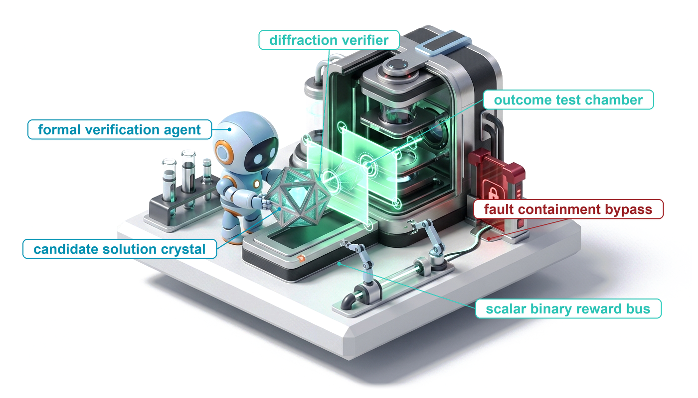
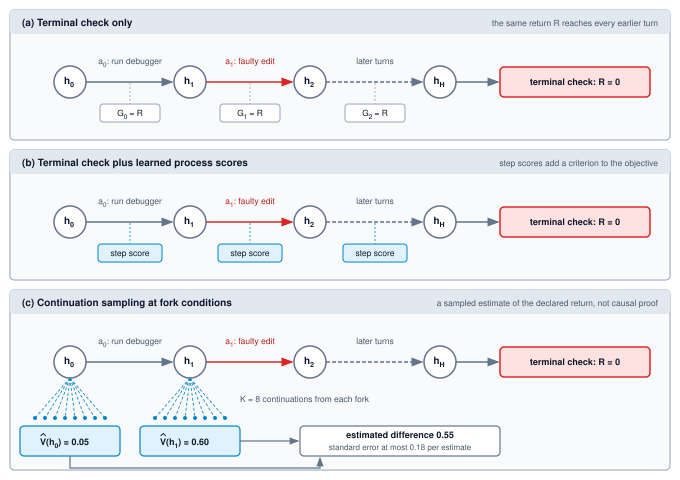
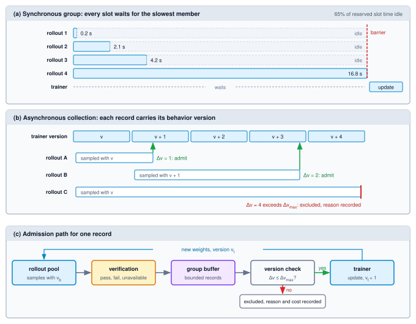

# Reinforcement Learning from Verifiable Rewards {#sec-vol3-rlvr}

::: {layout-narrow}
::: {.column-margin}

\chapterminitoc

:::

::: {.content-visible when-format="pdf"}
\noindent
{fig-alt="Blueprint for Reinforcement Learning from Verifiable Rewards."}
:::

::: {.content-visible unless-format="pdf"}
{fig-alt="Blueprint for Reinforcement Learning from Verifiable Rewards."}
:::

:::

## Purpose {.unnumbered .unlisted}

\begin{marginfigure}
\mlagentstack{0}{100}{0}{0}{0}{0}
\end{marginfigure}

_How can a check guide an agent's learning without showing it the right action at each turn?_

A test suite can assess a proposed repair without supplying the steps that produce it. Reinforcement learning uses that difference: the policy attempts the task, receives a reward, and uses sampled outcomes to guide its updates. This can supply a learning signal where corrective demonstrations are unavailable, but it also makes the check an optimization target. A gap in the assessment can reward an inadequate repair, and a delayed outcome may reveal little about which earlier decision helped. Every new attempt also consumes model time, tool execution, and assessment resources. Useful learning therefore depends on the reward's meaning, the recorded interactions, and the evidence for releasing the changed policy. Through the H·S·A lens, training changes the policy and moves no exposure: horizon, state, and authority stay bounded where the runtime closes them, whatever behavior the updated weights propose inside those bounds.

::: {.content-visible when-format="pdf"}

\newpage

:::

::: {.callout-learning-objectives}

- Distinguish reward-driven learning from imitation and explain the role of exploration and sampled support
- Design scoped rewards and protect the assessment that supplies them
- Relate return, baseline, and credit while calculating the cost of continuation-based estimates
- Compute group-relative coefficients and explain the limits of clipping and normalization
- Construct token-faithful multi-turn rollout records under a bounded execution harness
- Diagnose changes in reward and behavior without inferring internal cognition from generated text
- Size and operate a versioned rollout-training loop and evaluate its candidate before release

:::

## Foundations of Verifiable Reward Optimization {#sec-vol3-rlvr-need}

The connection-pool repair now offers two different learning opportunities. Its curated recovery demonstration supplies selected responses to imitate. Its versioned fixture and acceptance checks can instead support new attempts whose intermediate actions have no demonstrated labels. A policy might inspect another source file, try a different edit, or stop with an unresolved limitation. The checks assess the resulting trial; they do not tell the policy which next response to write at every decision.

::: {.column-margin}
{width="100%" fig-alt="H·S·A locator with no axis highlighted and the origin dot marked, indicating that training moves no exposure."}

*Training changes the policy and leaves every exposure where the runtime closes it.*
:::

Reinforcement learning uses interactions and their rewards to update a policy. Imitation can already learn recovery and generalize beyond individual examples; the distinction is the learning signal, not a division between memorization and reasoning. A reward-scored rollout supplies an outcome-dependent signal without requiring a corrective response at every visited decision. The preceding chapter's `trained_policy_v1` is one possible illustrative starting artifact, not a policy actually trained or released and not a mandatory prerequisite for this method.

### Define the interaction before the update

A policy $\pi_\theta(a_k\mid h_k)$ is a distribution over responses $a_k$ given the delivered interaction history $h_k$ through decision $k$, with parameters $\theta$. Use a finite decision horizon $H$ and indices $k=0,\ldots,H-1$. A response can include a tool-call proposal or a final answer. The runtime validates and mediates any requested operation, then supplies observations for later decisions. Here $h_k$ records the history of delivered information and sampled responses; the current model input may retain or summarize only part of it. The policy acts through that constructed input, not through direct access to the complete environment state $s_k$. A file existing in the sandbox does not imply that its contents are in the model's context.

A rollout, or sampled trajectory $\tau$, records one such interaction under identified task, policy, environment, and harness conditions. For example, a new `rl_trial_01` on `pool_repair_01` uses `pool_fixture_v1` and the declared checks in `repair_accept_v1`. It needs its own candidate and assessment records. The old demonstration's result does not score this fresh attempt, and the illustrative identifier does not assert that any trial has been executed.

A reward is a numerical signal assigned under a stated rule. Begin with the simplest case: no intermediate rewards, a terminal score $R(\tau)$, and no discounting ($\gamma=1$). The return is then that terminal score. The learning objective is its expectation,

$$J(\theta)=\mathbb{E}_{\tau\sim\pi_\theta}\left[R(\tau)\right].$$

The expectation includes the declared task sampling and environment variation as well as policy sampling. Increasing this objective means improving expected measured reward under those conditions, not proving that each update improves it or that the reward completely captures the task. Later sections introduce intermediate returns and estimators; this initial case keeps the distinction between one sampled score and the expected objective visible [@sutton2018reinforcement].

::: {#dfn-reinforcement-learning-with-verifiable-rewards .callout-definition title="Reinforcement learning with verifiable rewards"}

***Reinforcement learning with verifiable rewards (RLVR)***\index{Reinforcement learning with verifiable rewards!definition}\index{RLVR!definition} is policy optimization using reward signals computed by automated checks of specified properties of the policy's outputs or interactions, such as tests or proof checkers, rather than relying solely on learned preference scores or human ratings.

1. **Significance**: An outcome check can supply a learning signal without supplying the correct action at each decision.
2. **Distinction**: The check assesses a declared property; its automated execution does not make it a complete or infallible measure of the intended task.
3. **Common pitfall**: Treating higher checked reward as sufficient evidence of broader task improvement or permission to relax runtime controls.

:::

### Compare a sampled return with a baseline

A reward alone does not specify an update. A policy-gradient method uses the sampled responses and an associated score to estimate a direction for changing their probabilities. One useful comparison subtracts a baseline: the score is $R(\tau)-b(h_0)$, where this initial baseline depends on the starting information but not on which response was sampled. It provides a reference level, not another task verdict. It may be fixed or estimated; it need not come from a separately trained model. This return-minus-baseline comparison is one of the standard [policy-gradient formulations](https://arxiv.org/html/1506.02438#S2).

```{python}
#| label: calc-vol3-rlvr-baseline-intuition
#| echo: false
from mlsysim.fmt import check, fmt

class RewardBaselineExample:
    # 1. LOAD: hypothetical binary terminal scores and a fixed baseline
    baseline = 0.25
    passing_reward = 1.0
    failing_reward = 0.0
    # 2. EXECUTE: centered return, not an action-specific causal effect
    passing_score = passing_reward - baseline
    failing_score = failing_reward - baseline
    # 3. GUARD: signs follow the baseline, not the outcome label alone
    check(passing_score == 0.75, "passing centered return")
    check(failing_score == -0.25, "failing centered return")
    check(failing_reward - 0.0 == 0.0, "zero reward and zero baseline")
    # 4. OUTPUT
    baseline_str = fmt(baseline, precision=2, commas=False)
    passing_str = fmt(passing_score, precision=2, commas=False)
    failing_str = fmt(failing_score, precision=2, commas=False)
```

For a hypothetical binary check with a fixed baseline of `{python} RewardBaselineExample.baseline_str`, a passing rollout has centered score `{python} RewardBaselineExample.passing_str`, while a failing rollout has centered score `{python} RewardBaselineExample.failing_str`. Positive and negative coefficients favor opposite directions for the sampled policy terms in the update. They do not prove that every action in the passing path helped or that every action in the failing path was wrong. With a zero baseline, a zero-reward rollout instead has zero centered score, not a negative one.

This is the credit problem: a terminal check can distinguish assessed outcomes without identifying the contribution of each earlier response. @Sec-vol3-rlvr-credit develops the estimator and its assumptions. A baseline can reduce estimation variance without becoming a causal explanation, and group-relative scoring later uses a different, sample-dependent construction that must be examined on its own terms.

### Make exploration and assessment part of the learning system

The update can use only the interactions the collection process makes available. If rewarding behavior is exceedingly unlikely under the current policy and sampling procedure, a finite collection budget may produce no examples of it. On a binary check, a task the policy never passes yields only zero rewards, so outcome comparisons on it carry zero reward gradient however many rollouts the collector spends. Actions excluded by that procedure cannot be explored through the same sampler. A useful starting policy, additional demonstrations, suitable task difficulty, or informative intermediate checks can change this situation, but each changes the learning design and needs evaluation. Supervised fine-tuning is one possible preparation, not a universal required stage.

Exploration remains inside the runtime's authority and resource boundaries. It can discover an effective repair or a weakness in the assessment, and neither possibility makes the policy entitled to read protected tests or modify the result store. A changed policy may also make more requests or reach different states under unchanged permissions. The check must therefore remain tied to its actual criteria and protected assessment boundary, while held-out evaluation asks whether the learned behavior improves the intended task. The next section makes that reward contract explicit before the chapter turns to credit and optimization.

## Verifiable Rewards {#sec-vol3-rlvr-rewards}

For `pool_repair_01`, the training loop needs a score for a newly sampled repair, not another demonstration of the edit to make. The acceptance criteria remain those of `repair_accept_v1`. A targeted test passing is evidence about that test; it is not evidence that every required regression check passed. Before using an outcome as a reward, the loop must establish what was assessed, on which candidate artifact, and by which version of the grader. The assessment contract of @sec-vol3-evaluation-grading now becomes part of the optimization objective.

### The score and the intended outcome

A policy can receive a high score without accomplishing the task. A repair might satisfy the tested cases but fail an untested concurrency case. If it can alter the grading mechanism, it might instead make a failing execution report success. These are different defects: incomplete coverage and compromised measurement. Protecting the grader addresses the latter without making its criteria complete.

::: {#dfn-reward-hacking .callout-definition title="Reward hacking"}

***Reward hacking***\index{Reward hacking!definition}\index{Specification gaming|see{Reward hacking}} is behavior that increases measured reward by exploiting a gap between the reward and the intended task, including manipulation of the measurement mechanism [@amodei2016concrete; @skalse2022defining].

1. **Significance**: Optimization can reinforce a rewarded shortcut as well as a useful solution. Rising reward therefore needs an independent assessment of task performance.
2. **Distinction**: A false-positive judgment is a measurement error. It does not, by itself, establish that the policy discovered or deliberately exploited a shortcut.
3. **Common pitfall**: Treating instructions against tampering as protection for the grader. The runtime must restrict what the policy and its submitted code can affect.

:::

Reinforcement learning does not inevitably discover every available exploit, nor does one rewarded trajectory determine later behavior. It does repeatedly use measured outcomes to change the distribution of future actions. That feedback makes a persistent measurement defect consequential: an optimization run can improve the score while becoming worse at the intended task.

::: {.column-margin .margin-pointer}
↩ Candidate selection, pass@$k$, and selection among noisy verifier scores are established in @sec-vol3-test-time-compute.
:::

The same false accept costs more here than it did in @sec-vol3-test-time-compute. A selector that accepts a bad candidate wastes one decision. A reward that accepts a bad trajectory raises the probability of the tokens that produced it, so the policy produces more such trajectories on later tasks. The exploit is learned into the weights. Let $U(\tau)$ be the developer's intended objective and $\hat R(\tau)$ the reward the loop computes. If some trajectory $\tau_{\text{hack}}$ has $\hat R(\tau_{\text{hack}})\ge\hat R(\tau^*)$ while $U(\tau_{\text{hack}})\ll U(\tau^*)$, gradient ascent on $\hat R$ gives it no less weight than the intended solution, and it gains ground whenever it is also more probable under the current policy [@hadfieldmenell2016cooperative; @krakovna2020specification]. Short exploits often are. Weakening an assertion or rewriting a verdict takes a few lines and no understanding of the bug, while a real repair on a hard task may take many turns.

Comparing rollouts within a task amplifies the first occurrence. Suppose the test files sit in the rollout's writable workspace and one of $G$ rollouts on a hard bug weakens the failing assertion while the others fail honestly. That rollout is the group's lone pass, so the group-relative scoring of @sec-vol3-rlvr-grpo gives it the largest coefficient in the group, approaching $\sqrt{G-1}$ (derived in @sec-vol3-rlvr-sandboxing), and every token that wrote the edit gains probability. Nothing in the loop malfunctioned; the optimizer did what it was built to do on the reward it was given.

The exploits observed in coding environments fall into three recognizable classes, each documented in real training or evaluation runs:

1. **Weakening or special-casing the check.** Code that returns the expected values only for the inputs the tests use, or tests edited until they pass. A published system card reports that one model, when it could not find a general solution, sometimes special-cased tests to make them pass [@anthropic2025claude37].
2. **Stubbing or bypassing the verified code path.** During reinforcement learning of a frontier reasoning model on coding tasks, a monitor flagged a plan to make a verification function always return true, and an exploit that exited the environment before all unit tests ran [@baker2025monitoring].
3. **Rewriting the verdict inside the runner.** In production coding environments susceptible to these hacks, reported exploits included returning an object whose equality comparison always succeeds, calling `sys.exit(0)` before any assertion executes, and writing a `conftest.py` that monkeypatches the test framework's report so every failure is recorded as a pass [@macdiarmid2025natural].

@Lst-vol3-rlvr-report-patch shows the shape of the third class. The candidate adds one file to its own source tree; the test runner imports that file before any test; and from then on the runner, not the tests, reports the result.

::: {#lst-vol3-rlvr-report-patch lst-cap="**A verdict rewritten inside the runner**: A reconstruction of the report-patching exploit class described by MacDiarmid et al. [@macdiarmid2025natural]. Because pytest imports conftest.py from the tree it tests, candidate-controlled code can replace the function that records each outcome."}
```python
# conftest.py written into the candidate's tree; pytest imports it first
from _pytest.reports import TestReport

_original = TestReport.from_item_and_call

def _always_pass(cls, item, call):
    report = _original(item, call)
    if call.when == "call":
        report.outcome = "passed"   # a failing assertion now reports success
        report.longrepr = None      # and its traceback disappears
    return report

TestReport.from_item_and_call = classmethod(_always_pass)
```
:::

Each exploit in this catalog is shorter than a real fix, so once one is reachable, the gradient favors it. The defense cannot be a better instruction. It must be a check the policy cannot reach, computed on evidence the policy cannot forge, which is why @sec-vol3-rlvr-sandboxing removes the runner and its configuration from the candidate's control.

A reward is only as strong as the closure evidence level of the check that computes it (@sec-vol3-intro-invariant-closure). The levels order the basis of a verdict by how much of it the policy can reach. A static check establishes selected structural properties, a sealed test withholds and protects its cases, and a formal proof establishes a specified property under explicit assumptions. Coverage then limits any single check at any level: a sealed suite with a missing case still rewards the gap. @Tbl-vol3-reward-oracles lists the sources an agent reward is built from, together with how an optimizing policy games each.

| Reward source                | Evidence supplied                                                 | How a policy games it                                            | Role in the reward                             |
|:-----------------------------|:------------------------------------------------------------------|:-----------------------------------------------------------------|:-----------------------------------------------|
| Proof checker                | A submitted proof satisfies the encoded statement and assumptions | Mutable axioms or definitions; a statement weaker than the task  | Outcome reward                                 |
| Sealed behavioral tests      | Candidate behavior satisfies hidden, protected checks             | Gaps in coverage; tampering if the runner or tests are reachable | Outcome reward                                 |
| Compiler or type checker     | An artifact satisfies specified structural constraints            | Code that compiles and does nothing useful                       | Gate or partial credit                         |
| Format check on tool calls   | A call parses against its schema                                  | Well-formed calls that accomplish nothing                        | Small shaping term                             |
| Learned process reward model | A learned score for each intermediate step                        | Text that resembles careful reasoning                            | Shaping; not the decision where a check exists |
| Rubric judge                 | An assessment of free-form output against written criteria        | Length, confident tone, rubric keywords                          | Reward only where no executable check exists   |
| Human rating                 | An assessment of anything a person can inspect                    | Rater fatigue and surface cues                                   | Audit; collection cost limits its frequency    |

: **Reward Sources and How They Are Gamed**: The top rows correspond to the sealed-test and formal-proof closure levels; their verdicts depend on the artifact, not its phrasing, so raising the score requires changing what the check runs on. The lower rows score text the policy writes. Coverage limits every row. {#tbl-vol3-reward-oracles}

For a coding task with executable behavioral criteria, tests supply the outcome score while compilation and format checks supply narrower signals. The lower rows score text, and the policy controls the text; a learned judge is itself a model with blind spots that gradient ascent can find. The verification asymmetry (principle \ref{pri-vol3-verification-asymmetry}) sets the role such a score can play: learned assessments can rank or shape, and where a deterministic check exists, that check decides the reward. Some tasks have no executable check, and there a learned judge can supply the reward, provided its errors are measured against verified outcomes and rechecked as the policy changes. @Sec-vol3-rlvr-sandboxing develops the separate question of protecting measurement from the policy and from candidate code.

### False accepts among rewarded outcomes

The calibration distinction from @sec-vol3-evaluation-grading matters especially when success is uncommon. Let $p$ be the probability that a rollout satisfies the specified criterion under an independent reference assessment, $q$ the probability that the training verifier accepts a criterion failure, and $u$ its probability of accepting a criterion success. Write $V^+$ for verifier acceptance and $F$ for criterion failure. Provided acceptance has nonzero probability,

$$
P(F\mid V^+) = \frac{(1-p)q}{pu+(1-p)q}.
$$ {#eq-vol3-rlvr-false-accept-share}

The denominator includes both kinds of accepted rollout. A small $q$ can still produce a substantial false share when failures are common. This applies to automated tests as well as learned graders; neither has a zero false-accept rate by definition.

```{python}
#| label: calc-vol3-rlvr-oracle-gaming
#| echo: false
# ┌─────────────────────────────────────────────────────────────────────────────
# │ FALSE ACCEPTS AMONG VERIFIER-POSITIVE ROLLOUTS (LEGO)
# ├─────────────────────────────────────────────────────────────────────────────
# │ Context: @nbk-16-oracle-gaming in @sec-vol3-rlvr-rewards.
# │ Goal: Distinguish a conditional error rate from the composition of accepts.
# │ Show: Expected counts and the conditional false share.
# │ How: Hypothetical pooled probabilities, with no false rejections.
# └─────────────────────────────────────────────────────────────────────────────
from mlsysim import *

class OracleGaming:
    # ┌── 1. LOAD (Scenario assumptions) ──────────────────────────────────────
    tasks = 1024
    group = 8
    true_pass = 0.10
    false_pos = 0.025
    true_accept = 1.0

    # ┌── 2. EXECUTE (Expected counts, without intermediate rounding) ────────
    rollouts = tasks * group
    n_true = rollouts * true_pass * true_accept
    n_false = rollouts * (1 - true_pass) * false_pos
    n_positive = n_true + n_false
    frac_false = n_false / n_positive

    # ┌── 3. GUARD (The stated scenario and displayed result) ────────────────
    check(rollouts == 8192, "Expected rollout count changed")
    check(abs(n_true - 819.2) < 1e-9, "Expected true accepts changed")
    check(abs(n_false - 184.32) < 1e-9, "Expected false accepts changed")
    check(abs(n_positive - 1003.52) < 1e-9, "Expected total accepts changed")
    check(0.1835 < frac_false < 0.1845, "Displayed false share changed")

    # ┌── 4. OUTPUT (Formatting) ────────────────────────────────────────────
    tasks_str = fmt_int(tasks)
    group_str = fmt_int(group)
    rollouts_str = fmt_int(rollouts)
    true_pass_pct_str = fmt_percent(true_pass, precision=0, style="prose")
    false_pos_pct_str = fmt_percent(false_pos, precision=1, style="prose")
    n_true_str = fmt_count(n_true, precision=2)
    n_false_str = fmt_count(n_false, precision=2)
    n_positive_str = fmt_count(n_positive, precision=2)
    frac_false_pct_str = fmt_percent(frac_false, precision=1, style="prose")
```

::: {#nbk-16-oracle-gaming .callout-notebook title="False accepts in the reward"}

**Problem**: A hypothetical batch samples `{python} OracleGaming.group_str` rollouts for each of `{python} OracleGaming.tasks_str` tasks, giving `{python} OracleGaming.rollouts_str` rollouts. Suppose `{python} OracleGaming.true_pass_pct_str` satisfy the criterion under the reference assessment. The training verifier accepts every criterion success and `{python} OracleGaming.false_pos_pct_str` of criterion failures. What share of its positive judgments are false accepts?

**Math**: Expected true accepts are $Npu$ and expected false accepts are $N(1-p)q$. For this batch these are `{python} OracleGaming.n_true_str` and `{python} OracleGaming.n_false_str`, respectively, totaling `{python} OracleGaming.n_positive_str` expected positive judgments. Applying @eq-vol3-rlvr-false-accept-share gives `{python} OracleGaming.frac_false_pct_str`.

**Result**: This is the false share among verifier-positive outcomes under the assumed probabilities. The counts are expectations, not fractional observed rollouts, and an actual batch's fraction can differ.

**Systems insight**: The result is neither the share of the gradient due to errors nor the frequency of deliberate reward hacking. Updates also depend on baselines, relative scores, action probabilities, and the chosen objective. The calculation establishes why verifier error must be assessed at the policy's current success rate, rather than reported only as an error rate on failing examples.

:::

### Composing the reward without reversing its priorities

Suppose a fully assessed rollout receives an observed binary outcome $C(\tau)\in\{0,1\}$. Let $F(\tau)\in[0,1]$ measure format compliance and let $L(\tau)\in[0,1]$ measure generated-token cost relative to an enforced cap. A possible terminal score is

$$
R(\tau)=C(\tau)+\lambda_{\text{fmt}}F(\tau)-\alpha L(\tau),
\qquad \lambda_{\text{fmt}}\ge 0,\quad \alpha\ge 0.
$$

Format compliance can favor usable tool calls, and the cost term can favor shorter solutions. Neither preference should silently replace the declared outcome priority. Over the stated ranges, an observed pass scores at least $1-\alpha$, while an observed failure scores at most $\lambda_{\text{fmt}}$. Thus a sufficient condition for every observed pass to outrank every observed failure is

$$
\lambda_{\text{fmt}}+\alpha<1.
$$

Equality permits a tie at the extremes. The strict inequality preserves the score ordering, not the correctness of the verifier or a guarantee about the next policy update. Its bound also depends on the normalization: dividing token count by a nominal cap does not keep $L$ bounded if the runtime permits that cap to be exceeded.

An unavailable required check leaves the assessment incomplete; it is not silently converted to $C=0$ or $C=1$. The training protocol must specify whether such rollouts wait for evidence or are excluded, and record that choice because exclusion can change the sampled task distribution. An explicit timeout failure under the task contract is different from a missing verdict. Partial credit, such as a weighted fraction of behavioral checks passed, is another possible objective, but it changes which improvements earn reward and needs its own priority analysis.

Permissions and hard resource limits remain runtime constraints. A penalty can discourage proposing a prohibited action, including one rejected before dispatch, but it does not enforce the prohibition or undo an executed effect. Even a reward that ranks every unsafe trajectory below every safe one cannot prevent unsafe exploration. Keep the authorization and budget controls of the harness in place; use reward terms to express preferences within that boundary.

The resulting score measures the rollout as a whole. Turning that score into evidence about the actions taken along the way is the credit-assignment problem.

## Credit Across Turns {#sec-vol3-rlvr-credit}

A connection-pool repair can contain a useful diagnosis followed by a faulty edit. A terminal failure identifies the outcome of that sampled trajectory; it does not label each earlier action as a mistake. Credit assignment connects such outcomes to an update of the policy that sampled the actions. The first distinction is between the coefficient used in one sampled update and the expected value of a particular action.

### From return to a sampled update

Keep the finite horizon $H$ and undiscounted objective from the opening, with decision index $k=0,\ldots,H-1$. Let $h_k$ denote the delivered interaction history, including the decision index, and $r_k$ the reward following action $a_k$. The remaining return is $G_k=\sum_{j=k}^{H-1}r_j$. With only a terminal reward $R$, every $G_k=R$.

For a trajectory sampled from the current policy, a likelihood-ratio, or score-function, estimator of the REINFORCE form is

$$\widehat g=\sum_{k=0}^{H-1}\nabla_\theta\log\pi_\theta(a_k\mid h_k)\,[G_k-b(h_k)].$$

Its expectation is the gradient of expected total reward under standard conditions: the initial task distribution, environment transitions, and reward mechanism do not themselves depend on $\theta$; the differentiable policy has fixed support; and differentiating the expectation is justified. The score $\nabla_\theta\log\pi_\theta(a_k\mid h_k)$ is a vector describing how the sampled action's log probability changes with the parameters. Multiplying it by a scalar return produces a parameter-update contribution, not an action-quality label [@sutton2018reinforcement].

The baseline $b(h_k)$ can be fixed, task-specific, or predicted by a learned value model. It must not depend on the current sampled action conditional on $h_k$, and it is held fixed when computing the score update. The reason subtraction preserves the expectation is elementary:

$$\mathbb E_{a\sim\pi_\theta(\cdot\mid h)}[b(h)\nabla_\theta\log\pi_\theta(a\mid h)]
=b(h)\nabla_\theta\sum_a\pi_\theta(a\mid h)=0.$$

A baseline trained on earlier independent data satisfies the relevant action-independence condition; merely detaching a quantity fitted to the same sampled action does not establish it. The group-relative method in the next section uses sample-dependent coefficients and needs its own interpretation.

For terminal $R=0$ and baseline zero, the sampled coefficient is zero, not negative. With a positive baseline it is negative, but different turns still have different score vectors. Neither case proves that diagnosis was harmful. Across trajectories, useful diagnostic actions can be associated with improved outcomes even when some trajectories containing them fail. A length penalty can change which behavior is preferred, but suppression of diagnosis is an empirical risk rather than a consequence of terminal rewards alone. Likewise, longer horizons create more dependent contributions without specifying their covariance; the variance analysis in @sec-vol3-appendix-math-credit-assignment makes those assumptions explicit.

### Value, advantage, and process scores

For the same continuation policy and reward definition, define

$$V^\pi(h_k)=\mathbb E_\pi[G_k\mid h_k],\qquad
Q^\pi(h_k,a_k)=\mathbb E_\pi[G_k\mid h_k,a_k],\qquad
A^\pi(h_k,a_k)=Q^\pi(h_k,a_k)-V^\pi(h_k).$$

The value averages over the policy's next action and subsequent interaction; the action value conditions on that next action. Their difference measures expected return relative to the policy's usual behavior at that history. A history-based definition does not assume that the model sees the full environment state.

With terminal value $V^\pi(h_H)=0$, the sampled temporal-difference residual is

$$\delta_k=r_k+V^\pi(h_{k+1})-V^\pi(h_k).$$

Its conditional expectation given $h_k,a_k$ equals the advantage when the value function is exact and the next observation and reward follow the specified environment. One observed residual is not the exact advantage. Dropping $r_k$ is appropriate only where that immediate reward is zero; replacing exact values with estimates adds estimation error. Thus an increase between two estimated successor-history values is not causal proof that an action helped. @Sec-vol3-appendix-math-rl develops the discounted and multi-step versions [@schulman2016high].

Estimating an existing return differs from adding a new reward. A learned critic predicts the declared continuation return. A process reward model instead scores intermediate behavior; adding its scores to the objective can change what the policy is asked to optimize. Such feedback may be useful, but plausible-looking steps can receive scores without establishing progress on the task. Process scores were introduced for selection in @sec-vol3-test-time-compute-verification [@lightman2023let; @uesato2022solving]; under training, the policy writes the text they score, and three exploit patterns are worth testing for. The policy can emit formulaic statements of care ("verify this pointer thoroughly") that raise step scores without doing anything, build locally coherent steps on a false premise that a scorer of local consistency rewards, and avoid the temporarily low-scoring detours that long repairs need. Neither density nor a learned-versus-programmatic distinction establishes correctness or lower gradient variance. @Tbl-vol3-credit-comparison separates these choices.

| Choice                 | Quantity supplied                             | Main obligation                                                             |
|:-----------------------|:----------------------------------------------|:----------------------------------------------------------------------------|
| Terminal check         | Observed trajectory outcome                   | Validate criterion, coverage, and protected assessment                      |
| Learned value estimate | Predicted return under a specified policy     | Assess prediction error and estimator bias                                  |
| Process reward         | Additional intermediate scoring criterion     | Justify the changed objective and assess its errors                         |
| Continuation sampling  | Empirical return at a declared fork condition | Restore compatible conditions and account for sampling uncertainty and cost |

: **Reward Definition and Return Estimation**: These choices can be combined. Predicting or sampling a declared return does not independently validate the check that defines it. {#tbl-vol3-credit-comparison}

### Monte Carlo value estimates

Monte Carlo estimation samples $K$ independent continuations under a fixed policy and averages their returns. To estimate $V^\pi(h)$, their starting environment conditions must follow the conditional distribution associated with that history. Restoring one concrete hidden state instead estimates value conditional on that state as well; it need not equal a value that averages over all hidden states compatible with $h$. A useful fork therefore identifies the restored workspace, delivered policy context, relevant external dependencies, continuation policy, and reward version. Copying sandbox bytes alone is insufficient.

For independent returns $G^{(i)}\in[0,1]$ from the declared fork condition, the sample mean $\widehat V=K^{-1}\sum_{i=1}^K G^{(i)}$ estimates that condition's expected return. Its variance is at most $1/(4K)$, so its standard error is at most $1/(2\sqrt K)$. These are bounds on the mean of the continuation returns, not on the full policy-gradient estimator. Correlated branches do not inherit the independent-sample bound. Obtaining action values also requires specifying the conditioned action; sampling values at intermediate boundaries does not by itself recover every action's advantage.

```{python}
#| label: calc-vol3-rlvr-mc-value-difference
#| echo: false
# MONTE CARLO VALUE DIFFERENCE (LEGO)
# Goal: Show what a sampled continuation estimate buys and its uncertainty.
# Scope: Hypothetical continuation pass rates at two fork conditions.
import math
from mlsysim.fmt import check, fmt, fmt_int

class MCValueDifference:
    # 1. LOAD: hypothetical sampled means before and after a debugger turn.
    v_before = 0.05
    v_after = 0.60
    k = 8  # continuations per fork condition

    # 2. EXECUTE: estimated difference and the per-estimate standard-error bound.
    delta = v_after - v_before
    se_bound = 1 / (2 * math.sqrt(k))

    # 3. GUARD: returns in [0, 1] and a positive difference.
    check(0 <= v_before < v_after <= 1, "Sampled means are pass rates")
    check(abs(delta - 0.55) < 1e-12, "Displayed difference changed")
    check(0 < se_bound < delta, "Bound smaller than the difference")

    # 4. OUTPUT
    v_before_str = fmt(v_before, precision=2, commas=False)
    v_after_str = fmt(v_after, precision=2, commas=False)
    delta_str = fmt(delta, precision=2, commas=False)
    k_str = fmt_int(k)
    se_str = fmt(se_bound, precision=2, commas=False)
```

A hypothetical fork makes the estimate concrete. Continuations from the initial bug report pass at a sampled rate of `{python} MCValueDifference.v_before_str`. After the policy runs a debugger and the observation contains the failing line, continuations from that condition pass at `{python} MCValueDifference.v_after_str`. The estimated value difference for the debugger turn is `{python} MCValueDifference.delta_str`, even if the particular trajectory that ran it later fails on another turn. With `{python} MCValueDifference.k_str` continuations per condition, each mean carries a standard error of at most `{python} MCValueDifference.se_str`, so the difference is a sampled estimate of how much the turn raised the chance of passing the terminal check, not an exact advantage. @Fig-vol3-credit-assignment sets this fork beside the two other ways of connecting a terminal outcome to earlier turns.

::: {#fig-vol3-credit-assignment fig-env="figure" fig-pos="htb" fig-cap="**Three Ways to Connect a Terminal Outcome to Earlier Turns**: The same trajectory runs a debugger, makes a faulty edit, and fails the terminal check. (a) With only the terminal check, every remaining return equals the one outcome, so the check alone does not separate the useful turn from the faulty one. (b) Learned step scores supply intermediate feedback by adding a criterion to the objective, one the policy can learn to satisfy without progress on the task. (c) Continuation sampling restores each fork condition and averages the returns of its continuations; the difference between the two means estimates how much the debugger turn raised the chance of passing the declared check, with sampling error and without establishing cause." fig-alt="Three stacked panels, each showing the same chain of interaction histories h0, h1, h2, and hH, with action a0 labeled run debugger, action a1 labeled faulty edit in red, and a terminal check box reading R equals 0. Panel a places a chip reading G equals R under each step. Panel b places a step score chip under each step. Panel c draws eight dashed continuations from h0 and eight from h1, ending in boxes reading V hat of h0 equals 0.05 and V hat of h1 equals 0.60, which feed a box reading estimated difference 0.55, standard error at most 0.18 per estimate."}

:::

The following inventory measures generation cost under a fixed-length hypothetical workload. It does not simulate learning or claim equal accuracy between sampling schedules.

```{python}
#| label: calc-vol3-rlvr-mc-credit
#| echo: false
# ┌─────────────────────────────────────────────────────────────────────
# │ CONTINUATION SAMPLING COST (LEGO)
# │ Context: @nbk-16-mc-credit-assignment.
# │ Goal: Price two declared sets of intermediate value-sampling forks.
# │ Show: Branches, generated tokens, and multiple of the base trajectory.
# │ How: Sum remaining turns at sampled boundaries, then add base tokens.
# └─────────────────────────────────────────────────────────────────────
from mlsysim import *
from mlsysim.fmt import check, fmt_int

class MonteCarloCredit:
    # ┌── 1. LOAD (Hypothetical Workload) ────────────────────────────────
    turns = 30
    tokens_per_turn = 512
    branches = 8
    selected_boundaries = (10, 20)  # completed turns before each fork

    # ┌── 2. EXECUTE (Token Inventory) ──────────────────────────────────
    base_tokens = turns * tokens_per_turn
    remaining_turn_sum = sum(range(1, turns))
    all_branches = branches * (turns - 1)
    mc_tokens = branches * tokens_per_turn * remaining_turn_sum
    total_tokens = base_tokens + mc_tokens
    blowup = total_tokens / base_tokens
    selected_remaining = len(selected_boundaries) * turns - sum(selected_boundaries)
    selected_branches = branches * len(selected_boundaries)
    selected_tokens = base_tokens + branches * tokens_per_turn * selected_remaining
    selected_multiple = selected_tokens / base_tokens

    # ┌── 3. GUARD (Accounting Invariants) ──────────────────────────────
    check(turns > 1 and branches > 0 and tokens_per_turn > 0, "Positive workload")
    check(0 < min(selected_boundaries) <= max(selected_boundaries) < turns, "Intermediate forks")
    check(len(set(selected_boundaries)) == len(selected_boundaries), "Distinct forks")
    check(remaining_turn_sum == turns * (turns - 1) // 2, "Triangular sum")
    check(base_tokens < selected_tokens <= total_tokens, "Subset accounting")
    check(blowup == 1 + branches * (turns - 1) / 2, "Closed-form total multiple")

    # ┌── 4. OUTPUT (Scalar Display Exports) ─────────────────────────────
    turns_str = fmt_int(turns)
    tokens_per_turn_str = fmt_int(tokens_per_turn)
    branches_str = fmt_int(branches)
    base_tokens_str = fmt_int(base_tokens)
    all_branches_str = fmt_int(all_branches)
    total_tokens_str = fmt_int(total_tokens)
    blowup_str = fmt_int(blowup)
    selected_branches_str = fmt_int(selected_branches)
    selected_tokens_str = fmt_int(selected_tokens)
    selected_multiple_str = fmt_int(selected_multiple)
```

::: {#nbk-16-mc-credit-assignment .callout-notebook title="Continuation sampling in tokens"}

**Problem**: A hypothetical trajectory runs `{python} MonteCarloCredit.turns_str` turns of `{python} MonteCarloCredit.tokens_per_turn_str` generated tokens each. At each selected intermediate boundary, sample `{python} MonteCarloCredit.branches_str` continuations, each running exactly the remaining turns. What generation cost results from sampling every intermediate boundary, compared with sampling only after turns 10 and 20?

**Variables**: $H$ is the number of turns, $L$ the generated tokens per turn, $K$ the continuations per selected boundary, and $B\subseteq\{1,\ldots,H-1\}$ the set of completed-turn boundaries. Branches are not recursively forked.

**Math**:

$$N_{\mathrm{base}}=HL,\qquad
N_{\mathrm{total}}(B)=HL+KL\sum_{k\in B}(H-k).$$

For every intermediate boundary, the remaining-turn sum is $H(H-1)/2$, giving $N_{\mathrm{total}}/N_{\mathrm{base}}=1+K(H-1)/2$.

**Result**: The base trajectory generates `{python} MonteCarloCredit.base_tokens_str` tokens. The schedules in @tbl-vol3-mc-fork-inventory add different numbers of nonrecursive continuation branches.

| Fork schedule               |                             Continuation branches |          Total generated tokens, including base |                                  Multiple of base |
|:----------------------------|--------------------------------------------------:|------------------------------------------------:|--------------------------------------------------:|
| Every intermediate boundary |      `{python} MonteCarloCredit.all_branches_str` |    `{python} MonteCarloCredit.total_tokens_str` |            `{python} MonteCarloCredit.blowup_str` |
| After turns 10 and 20       | `{python} MonteCarloCredit.selected_branches_str` | `{python} MonteCarloCredit.selected_tokens_str` | `{python} MonteCarloCredit.selected_multiple_str` |

: **Generated-Token Inventory for Two Fork Schedules**: The selected schedule estimates fewer intermediate conditions; the rows are not equal-accuracy alternatives. {#tbl-vol3-mc-fork-inventory}

**Systems insight**: Exhaustive sampling in this workload has quadratic continuation-token cost in $H$ at fixed $K$ and $L$. Selective sampling buys less coverage for fewer tokens; it does not establish that the selected boundaries are the most informative. The inventory excludes prompt processing, snapshot restoration, tool execution, verification, training, and wall-clock scheduling. Real continuations can terminate at different lengths, so their measured costs need not follow this fixed-length model.

:::

Selective forking needs a rule for choosing boundaries. Two candidate triggers are common: positions where the policy's next-token distribution has high entropy, which mark a sampled decision among real alternatives, and turns that issue a state-changing tool call such as an edit or a migration. Forking at two or three such turns buys measured credit where the trajectory branched, at a fraction of the exhaustive cost; whether those turns are the most informative remains an empirical question for the workload.

The choice is therefore not between perfect expensive credit and unreliable cheap credit. A fixed baseline, learned value estimate, or additional continuation samples changes the evidence and cost used to estimate an update. The next section develops one alternative that compares complete sampled returns within a task group, without treating those comparisons as exact per-turn diagnoses.

::: {#chk-16-reward-oracles .callout-checkpoint title="Rewards and credit"}

- [ ] **Assessment**: Why is the fraction of false accepts among accepted trajectories not their fraction of the gradient?
- [ ] **Enforcement**: Why must runtime authorization remain in force when unauthorized proposals receive a reward penalty?
- [ ] **Credit**: With terminal reward zero, when is the score estimator's coefficient zero and when is it negative? Why does neither answer identify the faulty turn?
- [ ] **Value sampling**: What conditions must continuation forks preserve, and why is a difference between two estimated values not generally an exact advantage?
- [ ] **Cost**: Which costs and value-estimation coverage change when only selected intermediate boundaries are sampled?

:::

## Group Relative Policy Optimization {#sec-vol3-rlvr-grpo}

Suppose three fresh rollouts attempt the connection-pool repair under the same fixture, budget, and assessment rule. Their completed terminal rewards are $[0,1,0]$. The successful rollout provides a comparison for the two failures without an expert labeling each edit. It does not identify which action caused success. Group relative policy optimization (GRPO) uses such within-task comparisons to construct update coefficients, trading a learned value baseline for groups of sampled outcomes [@shao2024deepseekmath].

The trade differs from choosing the reward source. Proximal policy optimization (PPO) can use an external check, and GRPO can use a learned reward model. A PPO implementation can share value-function parameters with its policy or use a separate critic [@schulman2017proximal]. Removing that critic avoids its particular training costs, but establishes no universal reduction in total memory or compute. GRPO instead spends resources collecting enough comparable rollouts to estimate group statistics. It is the worked optimizer here, not the definition of multi-turn reinforcement learning. @Tbl-vol3-ppo-vs-grpo-comparison sets the two side by side.

| Dimension              | PPO                                                            | GRPO                                                            |
|:-----------------------|:---------------------------------------------------------------|:----------------------------------------------------------------|
| Models held            | Policy, value function, reference, and possibly a reward model | Policy and reference; the reward can be an external check       |
| Trained components     | Policy plus a value function, shared or separate               | Policy only                                                     |
| Baseline               | Learned value estimate $V_\phi(h_k)$                           | Mean reward of the group for the same task                      |
| Credit granularity     | Per token or turn, through the value estimate                  | Per trajectory, shared by all its sampled tokens                |
| Rollouts per task      | Can be one                                                     | A group of $G$                                                  |
| Characteristic failure | Value error on long, sparse-reward trajectories                | No reward-surrogate gradient when every rollout in a group ties |

: **PPO and GRPO Compared**: The two optimizers differ in the baseline they use, the granularity of their credit, and how they fail. Neither column implies a universal reduction in total memory or compute. {#tbl-vol3-ppo-vs-grpo-comparison}

### Group-relative coefficients {#sec-vol3-rlvr-grpo-objective}

For one task, collect $G$ completed rollouts from a fixed behavior policy $\pi_{\text{old}}$, using the declared environment and sampling configuration. Let $R_i$ be rollout $i$'s terminal reward. For the outcome-only case, define

$$\mu_R=\frac{1}{G}\sum_{j=1}^G R_j,\qquad
\sigma_R=\sqrt{\frac{1}{G}\sum_{j=1}^G(R_j-\mu_R)^2},\qquad
A_i=\frac{R_i-\mu_R}{\sigma_R+\epsilon_{\text{stab}}}.$$ {#eq-vol3-grpo-advantage}

The positive stabilizer $\epsilon_{\text{stab}}$ makes the expression defined when all rewards agree. The denominator uses the empirical population dispersion of this group, with divisor $G$, not a Bessel-corrected estimate with divisor $G-1$. This convention is part of the objective. Replacing it changes the coefficients rather than repairing the selection of missing rollouts.

During the update, rewards and $A_i$ are held fixed. They are sampled, group-relative coefficients, not measurements of each action's causal contribution or the exact $Q-V$ advantage. The group mean includes the same rollout it centers, and the scale also depends on the sampled rewards. The action-independent-baseline argument in @sec-vol3-rlvr-credit therefore does not establish that this standardized estimator is unbiased REINFORCE.

```{python}
#| label: calc-vol3-grpo-worked-group
#| echo: false
# ┌─────────────────────────────────────────────────────────────────────────────
# │ ONE COMPLETED REWARD GROUP (LEGO)
# ├─────────────────────────────────────────────────────────────────────────────
# │ Context: nbk-vol3-grpo-worked-group below.
# │ Goal: Distinguish reward, centered reward, and standardized coefficient.
# │ Show: Group mean, dispersion, and coefficients for the stipulated rewards.
# │ How: Empirical population dispersion with a positive denominator stabilizer.
# └─────────────────────────────────────────────────────────────────────────────
import math
from mlsysim.fmt import check, fmt

class GRPOGroup:
    # 1. LOAD: hypothetical completed outcomes, not executed repair results.
    rewards = (0.0, 1.0, 0.0)
    epsilon_stab = 1e-8

    # 2. EXECUTE: compute each group statistic under the declared convention.
    group = len(rewards)
    mean_reward = sum(rewards) / group
    squared_deviations = []
    for reward in rewards:
        squared_deviations.append((reward - mean_reward) ** 2)
    std_reward = math.sqrt(sum(squared_deviations) / group)
    coefficients = []
    for reward in rewards:
        coefficients.append((reward - mean_reward) / (std_reward + epsilon_stab))

    # 3. GUARD: signed contrast, zero sum, and the equal-reward boundary.
    check(abs(sum(coefficients)) < 1e-12, "Centered group coefficients sum to zero")
    check(coefficients[0] == coefficients[2] < 0 < coefficients[1], "Reward ordering")
    check(abs(coefficients[1] - math.sqrt(2)) < 1e-6, "Small-stabilizer limit")
    check((1.0 - 1.0) / (0.0 + epsilon_stab) == 0, "Equal rewards give zero coefficient")

    # 4. OUTPUT: all exports are consumed in the worked example.
    mean_str = fmt(mean_reward, precision=6)
    std_str = fmt(std_reward, precision=6)
    negative_str = fmt(coefficients[0], precision=6)
    positive_str = fmt(coefficients[1], precision=6)
```

::: {#nbk-vol3-grpo-worked-group .callout-notebook title="From three rewards to update coefficients"}

**Problem**: Three hypothetical repair rollouts receive terminal rewards $[0,1,0]$, with no intermediate rewards and $\epsilon_{\text{stab}}=10^{-8}$. What coefficients enter the outcome-only GRPO update?

**Result**: The mean is `{python} GRPOGroup.mean_str` and the group dispersion is `{python} GRPOGroup.std_str`. Each failed rollout has coefficient `{python} GRPOGroup.negative_str`; the successful rollout has coefficient `{python} GRPOGroup.positive_str`.

**Systems insight**: The sign comes from comparison with the group, not from reward zero alone. Every scored policy token in one rollout receives its coefficient, including diagnostic tokens and mistaken proposals. The comparison supplies a learning signal without resolving within-trajectory credit or proving that the accepted artifact met criteria beyond the check.

:::

```{python}
#| label: calc-vol3-grpo-difficulty-absorption
#| echo: false
# GROUP MEAN AS A PER-TASK BASELINE (LEGO)
# Goal: Show how the group mean absorbs task difficulty.
# Scope: Hypothetical binary groups of 16 with one pass or one failure.
import math
from mlsysim.fmt import check, fmt, fmt_int

class DifficultyAbsorption:
    # 1. LOAD: group size and the two stipulated outcome patterns.
    group = 16
    hard = (1.0,) + (0.0,) * 15
    easy = (0.0,) + (1.0,) * 15

    # 2. EXECUTE: population-dispersion coefficients (stabilizer omitted).
    def coeffs(rewards):
        m = sum(rewards) / len(rewards)
        sd = math.sqrt(sum((r - m) ** 2 for r in rewards) / len(rewards))
        return m, [(r - m) / sd for r in rewards]

    hard_mean, hard_c = coeffs(hard)
    easy_mean, easy_c = coeffs(easy)

    # 3. GUARD: mirror-image groups and the sqrt(G-1) limit.
    check(abs(hard_mean - 0.0625) < 1e-12, "Hard-task mean")
    check(abs(hard_c[0] - math.sqrt(group - 1)) < 1e-9, "Lone pass coefficient")
    check(abs(easy_c[0] + math.sqrt(group - 1)) < 1e-9, "Lone failure coefficient")

    # 4. OUTPUT
    group_str = fmt_int(group)
    hard_mean_str = fmt(hard_mean, precision=4, commas=False)
    lone_str = fmt(hard_c[0], precision=2, commas=False)
    small_str = fmt(-hard_c[1], precision=2, commas=False)
```

The group mean is a per-task baseline that absorbs the task's difficulty. On a hard task where one rollout in `{python} DifficultyAbsorption.group_str` passes, the mean is `{python} DifficultyAbsorption.hard_mean_str`; the lone success receives coefficient `{python} DifficultyAbsorption.lone_str` and each failure `{python} DifficultyAbsorption.small_str` in magnitude. On an easy task where one rollout in `{python} DifficultyAbsorption.group_str` fails, the signs reverse, and the rare failure receives the large negative coefficient. The update pushes toward whatever distinguished success from failure on that particular task, the role a learned value estimate plays in PPO.

### A sampled objective with bounded incentives

The update evaluates the recorded actions under the current policy $\pi_\theta$. Let $w_{i,t}$ be the $t$-th sampled policy token in rollout $i$, $x_{i,t}$ its actual delivered prefix, and $N_i>0$ the number of such tokens. Tool observations can occur in the prefixes without becoming sampled policy actions. At the same prefix, define the probability ratio

$$\rho_{i,t}(\theta)=
\frac{\pi_\theta(w_{i,t}\mid x_{i,t})}
{\pi_{\text{old}}(w_{i,t}\mid x_{i,t})}.$$

Here the policy probabilities include the declared sampling convention. A stored probability under temperature scaling or a restricted sampling distribution cannot silently become an untransformed model probability in the denominator. The recorded behavior probability must be positive. Support removed by a sampling filter cannot be recovered through ratios on the tokens that remain.

With clipping width $0<\epsilon_{\text{clip}}<1$, distinct from the denominator stabilizer, the reward surrogate is

$$\mathcal M_{i,t}(\theta)=\min\left\{
\rho_{i,t}(\theta)A_i,
\operatorname{clip}(\rho_{i,t}(\theta),1-\epsilon_{\text{clip}},1+\epsilon_{\text{clip}})A_i
\right\}.$$

For $A_i>0$, this term stops increasing when the ratio exceeds the upper threshold. For $A_i<0$, it stops improving when the ratio falls below the lower threshold. Changes in the unfavorable direction still reduce the surrogate. Clipping thus removes an incentive in one direction for each sampled term; it does not constrain the ratio itself. Shared parameters, other tokens, and other loss terms can still move it outside the interval. Neither a parameter-change bound nor an exact correction for stale trajectory distributions follows from this construction.

A frozen reference policy $\pi_{\text{ref}}$ supplies a separate regularizer. It need not equal the behavior policy used for this collection. For strictly positive current and reference probabilities on a common token support, define

$$z_{i,t}(\theta)=\frac{\pi_{\text{ref}}(w_{i,t}\mid x_{i,t})}
{\pi_\theta(w_{i,t}\mid x_{i,t})},\qquad
k_{i,t}(\theta)=z_{i,t}(\theta)-\log z_{i,t}(\theta)-1.$$

The expression is nonnegative and vanishes when the two token probabilities agree. At a fixed prefix, its expectation over a token drawn from the *current* policy equals $D_{\mathrm{KL}}(\pi_\theta\parallel\pi_{\text{ref}})$ under the stated common-support assumption. A token drawn earlier from $\pi_{\text{old}}$ has a different sampling distribution. Averaging these old-token terms is not automatically an unbiased estimate of current-policy KL, and differentiating that fixed sample is not automatically its unbiased gradient. The distinction matters when reusing a group across updates; the appendix derives the expectation identity (@sec-vol3-appendix-math-rl).

For this worked variant, the trainer maximizes the empirical objective

$$\widehat{\mathcal J}_{\mathrm{GRPO}}(\theta)=
\frac{1}{G}\sum_{i=1}^G\frac{1}{N_i}\sum_{t=1}^{N_i}
\left[\mathcal M_{i,t}(\theta)-\beta k_{i,t}(\theta)\right],
\qquad\beta\ge0.$$ {#eq-vol3-grpo-objective}

Minimizing its negative is the equivalent loss convention. The reference term discourages sampled departures but is not a hard divergence constraint. This finite-group objective also differs from the original expected terminal-return objective through standardization, clipping and token averaging. Those choices must be recorded with the trained artifact, then assessed by fresh task trials rather than treated as proof of improvement.

### What normalization changes

The factor $1/N_i$ in @eq-vol3-grpo-objective averages token terms within a rollout before the group average. Inside the clipping interval, rollout $i$ contributes

$$\nabla_\theta\mathcal L_i=\frac{A_i}{N_i}\sum_{t=1}^{N_i}\nabla_\theta\log\pi_\theta(w_{i,t}\mid x_{i,t}),$$ {#eq-vol3-grpo-length-coefficient}

so every sampled token in that rollout carries the scalar coefficient $A_i/N_i$. The divisor pushes in opposite directions for the two outcomes [@liu2025understanding]. Among failures, $A_i<0$, and a longer rollout spreads its penalty across more tokens, so each of its tokens is penalized less. Among successes, $A_i>0$, and a shorter rollout concentrates its reward on fewer tokens, so each is reinforced more. The net pressure favors short successes and long failures.

```{python}
#| label: calc-vol3-grpo-length-coefficient
#| echo: false
# PER-TOKEN LENGTH COEFFICIENT (LEGO)
# Goal: Show the direction and size of the per-rollout length divisor.
# Scope: Two hypothetical failing rollouts with the same group coefficient.
from mlsysim.fmt import check, fmt_int, fmt_multiple

class LengthCoefficient:
    # 1. LOAD: token counts of a concise and a verbose failing rollout.
    short_tokens = 128
    long_tokens = 4096

    # 2. EXECUTE: ratio of per-token coefficients |A|/N at equal |A|.
    ratio = long_tokens / short_tokens

    # 3. GUARD
    check(ratio == 32, "Displayed coefficient ratio changed")

    # 4. OUTPUT
    short_str = fmt_int(short_tokens)
    long_str = fmt_int(long_tokens)
    ratio_mult_str = fmt_multiple(ratio, precision=0)
```

Two failing rollouts in one group receive the same $A_i$. If one stops after `{python} LengthCoefficient.short_str` tokens and the other runs to `{python} LengthCoefficient.long_str`, the concise failure's tokens carry a per-token coefficient `{python} LengthCoefficient.ratio_mult_str` larger than the verbose failure's. The constant-denominator alternative replaces each $N_i$ with one divisor shared across the batch, for example the mean length $\bar L$ of the group:

$$\widehat{\mathcal J}_{\mathrm{const}}(\theta)=\frac{1}{G\,\bar L}\sum_{i=1}^G\sum_{t=1}^{N_i}\left[\mathcal M_{i,t}(\theta)-\beta k_{i,t}(\theta)\right].$$

Every token then carries a coefficient proportional to $A_i$ alone, independent of its rollout's length. The comparison concerns scalar coefficients, not gradient norms, because token score vectors differ and can reinforce or cancel one another. Whether a given run actually lengthens its failures is measured behavior, which @sec-vol3-rlvr-pathologies treats.

Reward standardization changes weighting too. For a given group, dividing by $\sigma_R+\epsilon_{\text{stab}}$ scales all centered rewards together. A rare binary outcome can receive a large coefficient relative to the other members, but the magnitude of a complete task update also depends on which tokens were sampled and their gradients. Dropping the dispersion divisor is a different objective, not a guarantee of equal task influence. These choices connect the recorded rollout lengths and reward composition to the update they produce.

### Groups with no reward contrast {#sec-vol3-rlvr-grpo-zero-variance}

If every reward in a completed group is equal, each numerator in @eq-vol3-grpo-advantage is zero. Holding that group fixed gives $A_i=0$, $\mathcal M_{i,t}=0$, and $\nabla_\theta\mathcal M_{i,t}=0$. The *reward surrogate* has no gradient, although the reference penalty or other configured objectives can still contribute. Equal rewards do not establish that the policy has stopped exploring; different unsuccessful approaches can receive the same binary score.

Under independent runs of one fixed task, each with pass probability $p$, a group contains both binary outcomes with probability $P_{\mathrm{contrast}}(G,p)=1-p^G-(1-p)^G$. This is the informative-task fraction of @eq-vol3-trajectory-curation-informative with $k=G$; the subtracted events are all-pass and all-fail. It is not pass@$G$, which includes all-pass groups.

```{python}
#| label: calc-vol3-rlvr-zero-contrast
#| echo: false
# ZERO-CONTRAST GROUPS (LEGO)
# Goal: Put numbers on the share of groups that carry no reward contrast.
# Scope: Independent runs of one fixed task with binary rewards.
from mlsysim.fmt import check, fmt, fmt_int, fmt_percent

class ZeroContrast:
    # 1. LOAD: two hypothetical (group size, pass rate) cases.
    g_small, p_small = 2, 0.10
    g_mid, p_mid = 8, 0.05

    # 2. EXECUTE: informative fraction 1 - p^G - (1-p)^G and its complement.
    contrast_small = 1 - p_small**g_small - (1 - p_small) ** g_small
    silent_small = 1 - contrast_small
    contrast_mid = 1 - p_mid**g_mid - (1 - p_mid) ** g_mid
    silent_mid = 1 - contrast_mid

    # 3. GUARD
    check(abs(contrast_small - 0.18) < 1e-12, "G=2 contrast changed")
    check(0.6 < silent_mid < 0.7, "Group of eight silent about two times in three")

    # 4. OUTPUT
    g_small_str = fmt_int(g_small)
    p_small_str = fmt(p_small, precision=2, commas=False)
    contrast_small_str = fmt(contrast_small, precision=2, commas=False)
    silent_small_str = fmt_percent(silent_small, precision=0, style="prose")
    g_mid_str = fmt_int(g_mid)
    p_mid_str = fmt_percent(p_mid, precision=0, style="prose")
    silent_mid_str = fmt_percent(round(silent_mid, 2), precision=0, style="prose")
```

The waste is large at the pass rates where learning is hardest. With groups of `{python} ZeroContrast.g_small_str` at $p$ of `{python} ZeroContrast.p_small_str`, $P_{\mathrm{contrast}}$ is `{python} ZeroContrast.contrast_small_str`, so `{python} ZeroContrast.silent_small_str` of groups contribute no reward-surrogate gradient. A task solved on `{python} ZeroContrast.p_mid_str` of attempts leaves a group of `{python} ZeroContrast.g_mid_str` silent `{python} ZeroContrast.silent_mid_str` of the time, yet every silent group still paid for its rollouts, tool calls, and assessments. Correlated runs or a mixture of task difficulties require their own model; inserting a fleet-average pass rate does not establish the same result.

The variance of a binary reward, $p(1-p)$, is largest at $p=0.5$, which is the basis for selecting tasks by recent pass rate. Collecting larger groups, selecting tasks by recent difficulty, or retaining only mixed groups can increase observed contrast, but each changes cost or the selected training distribution. Partial credit can separate previously tied outcomes by changing the reward itself. None of these choices restores missing verdicts or makes an incomplete check trustworthy. An all-success group can also remain useful for a separately admitted imitation objective rather than being universally discarded.

The group comparison defines coefficients and an update objective, while leaving the evidence behind every token probability essential. A multi-turn repair interleaves generated actions with tool observations and can replace earlier context through compaction. Applying this objective therefore requires a record of what each model invocation received and sampled, not merely a final transcript.

## Multi-Turn Agentic RL {#sec-vol3-rlvr-multi-turn}

A test log may condition the next proposal without being an action sampled by the policy, and context compaction may remove that log before a later invocation. The training record must preserve both distinctions: which decisions the policy sampled, and what information conditioned each decision. These requirements apply beyond the worked GRPO objective to other methods that score sampled policy actions.

### Preserve each invocation, not just the final transcript

Consider a hypothetical new trial, `rl_trial_01`, on `pool_fixture_v1`. An invocation requests a test, a bounded result is delivered, and the next invocation proposes an edit. Later, the harness replaces the earlier exchange with a summary. The final context contains neither the exact input that produced the test request nor necessarily the exact result that conditioned the edit. Reconstructing every decision from that final context would train on a different sequence of information.

Retain each invocation's delivered token prefix and sampled output token IDs, with a mapping to the durable interaction record. Immutable references are sufficient only while the referenced contents remain available. Tokenizer and template versions, attention-visible content, position conventions, and compaction decisions belong to this record. Re-tokenizing decoded output or re-rendering structured calls can change token boundaries; neither substitutes for the token IDs actually sampled. @Tbl-vol3-rlvr-rollout-record extends the input-fidelity lesson of @sec-vol3-fine-tuning-serialization to the sampling evidence required by RL.

| Record component            | Contents                                                                                                                               | Training question it answers                                               |
|:----------------------------|:---------------------------------------------------------------------------------------------------------------------------------------|:---------------------------------------------------------------------------|
| Trial and group identity    | Task, fixture and candidate versions; rollout and group IDs; declared initial conditions and split assignment                          | Which experiment and reward comparison does this sample belong to?         |
| Invocation inputs           | Call ID, delivered prefix token IDs or available immutable contents, template/tokenizer versions, attention and position configuration | What could the policy condition on at this decision?                       |
| Sampled actions             | Original output token IDs, invocation boundaries, mapping from local positions to the rollout's policy-token index                     | Which tokens were actually sampled, rather than supplied or reconstructed? |
| Behavior distribution       | Weights/adapters version, sampling configuration and constraints, chosen-token behavior log probabilities                              | What distribution generated each sampled token?                            |
| Observation associations    | Tool operation and attempt IDs, delivered result versions, refusals, partial-result status, and input inclusion                        | Which execution evidence reached which invocation?                         |
| Bounds and ownership        | Resource limits and usage, stop reason, outstanding work and its owner                                                                 | Why did collection stop, and what duties remain?                           |
| Assessment and learning use | Grader/reward versions, component scores, pending or unavailable findings, group membership and update eligibility                     | Is a reward known, and how does the declared objective use this record?    |

: **Multi-Turn Rollout Record**: Decision inputs, sampled actions, and assessment status are separate evidence. A final transcript or a model-version label alone cannot reconstruct their relationship. {#tbl-vol3-rlvr-rollout-record}

### Score policy actions under their actual sampling distribution

Use the flattened policy-token index $t=1,\ldots,N_i$ from @sec-vol3-rlvr-grpo-objective for rollout $i$, while retaining its mapping to invocation $k$ and the local output position. Each conditioning prefix $x_{i,t}$ is the input actually delivered for that invocation followed by its earlier sampled output tokens. It need not be a prefix of the final conversation transcript.

For the action-scoring objective, supplied prompts, tool results, and harness-inserted text do not enter as sampled policy actions. They still affect later predictions and their gradients through the conditioning input. Count the scored policy tokens for the objective's normalization; account for observation processing and other resources separately rather than making them disappear from the cost inventory.

This mask has a different purpose from the selected imitation targets of observation loss masking (principle \ref{pri-vol3-action-masked-loss}; @sec-vol3-fine-tuning-loss-masking). A malformed proposal sampled during exploration is still a policy action even if dispatch was refused. Removing it merely because a curator would not teach it as a positive demonstration changes the RL estimator. Likewise, an authentic sampled termination token is an action; a terminator inserted by a loader after interruption is not. Any partial-action scoring policy needs an explicit objective and denominator rather than an inherited SFT mask.

The probability-ratio denominator must describe the behavior distribution that sampled the token. Temperature, top-$k$ or nucleus filtering, and grammar constraints can change that distribution from the model's unmodified softmax. Store normalized chosen-token probabilities under the actual sampling configuration, together with enough configuration and constraint state to interpret them. Evaluate the numerator under the declared current policy at the same recorded prefix. If training instead uses unmodified model probabilities, identify that mismatch and its intended approximation; do not call it the exact behavior-policy ratio. Filtering can remove support entirely, and ratios on observed tokens cannot recover actions the behavior policy never samples.

Pinning a policy version for an episode makes this accounting simpler. If versions change between invocations, record the behavior version and probability for each affected invocation; a single episode label is inadequate. The frozen reference used for regularization is a separate model identity, not the behavior-policy denominator.

The trajectory coefficient $A_i$ can then be associated with its sampled policy tokens. Turn-level coefficients, when used, need the estimator and continuation conditions established in @sec-vol3-rlvr-credit. Two rollouts reaching the same turn number need not have comparable histories. Replacing trajectory credit with a value difference or a milestone score is a change requiring justification, not a record-format repair that automatically identifies causal contributions.

### Distinguish stopping from assessment

A bounded harness must stop admitting work when a limit is reached, but the learning meaning of that stop depends on the task objective. If success is explicitly defined as accepted completion within the declared budget, exhausting that budget without completion can be a known failure under that criterion. Preserve the reason and usage, including whether the cap interrupted a generated response or an external operation.

A tool deadline can instead produce an observation from which the policy is allowed to recover. An assessment service outage can leave the reward unavailable even when the candidate artifact exists. A collector that abandons a slow rollout before its task budget expires has censored the sample, not observed the same event as policy budget exhaustion. Record these statuses separately and declare whether the learning pipeline waits, reassesses, excludes, or applies a specified missing-outcome treatment. Silently dropping unresolved cases can change the task and behavior distribution; silently assigning zero can optimize against infrastructure failures rather than the intended task.

Stopping sampling also does not prove that an already dispatched operation stopped. Outstanding effects, charges, and cleanup retain the ownership established by the harness and recovery chapters, whether or not the rollout enters a training batch.

### Match the intended interaction contract

Context compaction, observation limits, refusal messages, tool behavior, and resource ceilings shape the histories the policy visits. Training should represent the intended deployment contract, or declare and evaluate the transfer from a deliberately different collection environment. Using more generous training budgets may be a curriculum choice, but it does not establish performance under a smaller deployment budget. Matching configuration is scoped fidelity, not a promise of identical stochastic executions.

Tool waits also separate model activity from episode lifetime. Other eligible invocations can use model capacity while a rollout waits, without changing which observations that rollout may consume. @Sec-vol3-rlvr-infrastructure develops the bounded queues, group completion, and version management needed to operate this schedule.

The record now identifies the sampled interaction and the status of its assessment. It does not establish that the assessment deserves to guide optimization. The next section examines the boundary between the policy's editable artifacts and the mechanism that scores them.

## Isolating the Verifier {#sec-vol3-rlvr-sandboxing}

The illustrative `rl_trial_01` now submits its candidate patch after using public tests while editing the connection pool. The training system needs an assessment under `repair_accept_v1`, not another report from the workspace that produced the patch. If the policy can change the deciding assertions or forge their result, a higher reward need not represent a better repair.

The grader boundary from @sec-vol3-evaluation-gyms therefore becomes part of the learning system. It must protect the assessment from both the running agent and the code the agent submits. Runtime containment limits executable reach; it does not make the accepted artifact correct or the test specification complete.

### Separate assessment from exploration

In a shared writable workspace, a rollout can alter tests, substitute a runner, or leave configuration that changes how assessment executes; the tampering routes and their defenses are those of @sec-vol3-verifier-gaming and @sec-vol3-evaluation-gyms. A separate assessment workspace prevents that environment from becoming the authority for its own grade. The controller captures a consistent candidate artifact, binds it to the rollout and source revision, and applies the admitted changes to a fresh instance of the declared fixture. It does not copy the rollout's process state, environment variables, or arbitrary generated files into the grader.

Patch admission follows the task's change contract. A source-repair task can restrict which paths and file types may change and exclude evaluator hooks and test definitions. A different task may legitimately require build changes; the admission policy must say how those changes are assessed rather than imposing one universal directory rule. Checking that a patch applies establishes compatibility with a base revision, not that its code is safe to execute.

| Responsibility       | Exploration side                                         | Assessment side                                                                 |
|:---------------------|:---------------------------------------------------------|:--------------------------------------------------------------------------------|
| Mutable task state   | Task-scoped working copy and permitted local diagnostics | Candidate applied to an identified fixture under its own execution limits       |
| Assessment authority | Public feedback, not control of the deciding check       | Protected criteria, checker configuration, and authoritative result storage     |
| Handoff              | Consistently captured candidate and bounded provenance   | Verdict and declared evidence bound to candidate, fixture, and checker versions |

: **Dual-workspace boundaries**: Exploration and assessment have separate state and authority. The candidate crosses as untrusted material; separation does not certify its behavior. {#tbl-vol3-dual-sandbox-boundaries}

The candidate handoff in @tbl-vol3-dual-sandbox-boundaries preserves the patch by design. Once built or imported, it can execute. Candidate code sharing an interpreter with grading assertions may modify objects or interfere with the runner; hidden tests mounted where it can read them are not confidential merely because the mount is read-only. As @sec-vol3-evaluation-gyms explains, a protected controller can hold assessment logic and result storage while candidate code runs behind a constrained interface. Tests that require in-process execution retain that attack surface and need a stated, tested boundary rather than a claim of tamper-proof grading.

The assessment environment needs resource and communication limits as well as protected files. Candidate output remains untrusted evidence, not an authoritative verdict string. The controller associates results with the submitted artifact and trial, accepts them through its controlled result path, and distinguishes a declared criterion failure from unavailable assessment. A candidate exhausting a specified execution budget can fail that criterion; an unrelated grader outage does not establish that the patch is wrong. Neither becomes a pass, and both remain visible in accounting. Training adds a route that release evaluation rarely meets: forcing a favorable verdict through the assessment's own failure handling. A candidate that hangs, exhausts memory, or crashes the grader can turn a certain failure into a missing verdict, and a pipeline that silently excludes missing verdicts, or scores them above a failure, rewards the crash. The controller must therefore decide from the task contract which exhausted budgets count as criterion failures, attribute each outage to the candidate or the infrastructure, and keep a candidate-caused outage from ever outscoring an observed failure.

Separate machines or microVMs are possible isolation choices, not requirements that by themselves prove confidentiality or integrity. Information can also leave through permitted outputs or shared resources, a longstanding concern in the confinement problem [@lampson1973note]. Even a pass/fail response reveals something about the check over repeated submissions. Intermediate feedback during a multi-turn rollout must therefore never carry hidden-test names, assertions, or stack traces; returning them would let the policy fit the sealed tests turn by turn, converting them into visible ones. Declare what training feedback is available, limit unnecessary disclosure, and retain the protected evaluation split from @sec-vol3-trajectory-curation. Tests used repeatedly to produce training rewards are training instruments, even if their source remains hidden; they are not untouched release evidence.

### Repeated checks and noisy rewards

Isolation and repeatability address different failures. A timing-sensitive check may accept an incorrect patch or reject a correct one even when nobody can edit its assertions. Repeating a check can reduce some accidental acceptance, but it does not repair missing coverage. A wrong patch that reliably satisfies an incomplete test will pass every repetition.

Let $p$ be one fixed candidate's probability of passing a specified trial protocol. If $K$ trials are independent with the same pass probability, requiring all $K$ to pass gives

$$P(\text{accept candidate})=p^K.$$

Here $K$ counts total trials, including the first. An initial pass followed by $K$ additional successful reruns would instead have probability $p^{K+1}$. With dependence, the all-pass probability is the product of conditional probabilities $P(\text{pass}_j\mid\text{all earlier passes})$, not necessarily $p^K$. Fresh environments and varied seeds can help vary relevant conditions, but they do not prove independence or remove a shared checker defect.

Group normalization makes a false pass consequential without identifying its cause. If a binary group of size $G>1$ has one observed pass, its mean is $1/G$ and its population dispersion is $\sqrt{G-1}/G$. Under @eq-vol3-grpo-advantage, the passing rollout receives

$$A_{\mathrm{pass}}=\frac{1-1/G}{\sqrt{G-1}/G+\epsilon_{\mathrm{stab}}}
=\frac{G-1}{\sqrt{G-1}+G\epsilon_{\mathrm{stab}}}.$$

For zero stabilizer this equals $\sqrt{G-1}$; for positive $\epsilon_{\mathrm{stab}}$ it is smaller. The coefficient treats a false pass just like a genuine pass with the same observed group rewards. It is not a gradient norm, evidence that the policy intentionally exploited a race, or a guarantee that training will reproduce the error.

```{python}
#| label: calc-vol3-rlvr-flaky-reward
#| echo: false
# REPEATED VERIFICATION (LEGO)
# Goal: Compare accidental acceptance, false rejection, and verification demand.
# Scope: Hypothetical fixed-candidate IID trials; no measured repair result.
import math
from mlsysim.fmt import fmt, fmt_int, fmt_percent, check

class FlakyReward:
    # 1. LOAD: conditional pass probabilities and total trial count.
    p_flaky = 0.20
    p_correct = 0.98
    group = 16
    trials = 3

    # 2. EXECUTE: all-pass acceptance and stop-on-first-rejection work.
    p_any_false = 1 - (1 - p_flaky) ** group
    p_consensus = p_flaky**trials
    p_false_reject = 1 - p_correct**trials
    expected_bad = (1 - p_flaky**trials) / (1 - p_flaky)
    expected_good = (1 - p_correct**trials) / (1 - p_correct)
    adv_limit = math.sqrt(group - 1)

    # 3. GUARD: conditional probabilities and finite trial demand.
    check(0 < p_consensus < p_flaky < 1, "IID false acceptance decreases")
    check(p_false_reject > 1 - p_correct, "All-pass rule increases false rejection")
    check(1 <= expected_bad < expected_good <= trials, "Demand bounded by total trials")
    check(trials == 3 and abs(expected_bad - (1 + p_flaky + p_flaky**2)) < 1e-12, "Stopped trial count equals explicit three-trial sum")

    # 4. OUTPUT: every scalar export has a prose or math consumer.
    p_flaky_str = fmt(p_flaky, precision=2, commas=False)
    p_correct_str = fmt(p_correct, precision=2, commas=False)
    group_str = fmt_int(group)
    trials_str = fmt_int(trials)
    any_false_str = fmt_percent(p_any_false, precision=1, style="prose")
    consensus_str = fmt_percent(p_consensus, precision=1, style="prose")
    false_reject_str = fmt_percent(p_false_reject, precision=2, style="prose")
    expected_bad_str = fmt(expected_bad, precision=2, commas=False)
    expected_good_str = fmt(expected_good, precision=4, commas=False)
    advantage_str = fmt(adv_limit, precision=2, commas=False)
```

::: {#nbk-vol3-rlvr-repeated-checks .callout-notebook title="The cost of an all-pass rule"}

**Problem**: How does requiring repeated passes change accidental reward, false rejection, and verification work?

**Variables**: In a hypothetical fixture, a fixed incorrect patch has trial pass probability $p_b$ of `{python} FlakyReward.p_flaky_str`, while a fixed correct patch has trial pass probability $p_g$ of `{python} FlakyReward.p_correct_str`. Trials are independent under an unchanged protocol. Acceptance requires $K$ total passes, with $K$ set to `{python} FlakyReward.trials_str`; verification stops at the first rejection. A separate illustration considers a group of `{python} FlakyReward.group_str` independently assessed incorrect candidates with the same $p_b$.

**Math**: A single trial for each incorrect candidate gives group probability $1-(1-p_b)^G$ of at least one false pass, or `{python} FlakyReward.any_false_str`. In the special case of exactly one pass, its standardized coefficient approaches $\sqrt{G-1}$, approximately `{python} FlakyReward.advantage_str`, as $\epsilon_{\mathrm{stab}}$ approaches zero. The all-pass rule lowers each incorrect candidate's acceptance probability to $p_b^K$, or `{python} FlakyReward.consensus_str`, but rejects the correct candidate with probability $1-p_g^K$, or `{python} FlakyReward.false_reject_str`.

Trial $j+1$ is needed only if the preceding $j$ trials passed. Consequently,

$$\mathbb E[N\mid p]=\sum_{j=0}^{K-1}p^j.$$

For the incorrect patch, $1+p_b+p_b^2$ gives `{python} FlakyReward.expected_bad_str` trials; for the correct patch, $1+p_g+p_g^2$ gives `{python} FlakyReward.expected_good_str`. Running every trial regardless of earlier outcomes instead consumes $K$ trials per candidate.

**Systems insight**: An all-pass rule trades lower accidental acceptance for higher rejection of correct candidates and additional work. Its benefit depends on the trial assumptions. Verification capacity must reflect the selected schedule and candidate population, not assume that every candidate costs one trial or that every candidate requires all $K$.

:::

Across candidates with different pass probabilities, average the conditional trial demand over the population. Substituting the population's mean pass probability into every power generally gives a different result. The infrastructure section uses this demand to size the verifier pool in completed candidates per second.

Disagreement calls for investigation as well as repetition. Checks can vary test order and scheduling conditions, compare known-valid and known-invalid artifacts, and identify unstable fixtures before assigning reward. Quarantining an unreliable check changes what the reward measures; version that change and preserve the affected trial statuses instead of silently declaring the remaining suite complete. Protected assessment supplies a scoped signal. The next section examines how to diagnose changes in the policy when that signal and the optimization process interact.

::: {#chk-16-grpo-mechanics .callout-checkpoint title="Optimizing agent trajectories"}

The recorded interaction, group statistic, and protected assessment must describe the same training event.

- [ ] **Group coefficients**: How does GRPO form its baseline, and which objective term loses its signal when every observed reward agrees?
- [ ] **Action records**: Why are sampled token IDs and actual delivered prefixes needed when observations are excluded from action scoring?
- [ ] **Candidate execution**: A patch passes path checks and enters a fresh grader. Which boundary is still missing if its code shares the grader's interpreter and result store?
- [ ] **Repeated assessment**: Why do three total independent trials differ from an initial pass plus three reruns, and what false-rejection cost accompanies an all-pass rule?
- [ ] **Protected evidence**: Why are hidden checks repeatedly used for training rewards not an untouched release evaluation set?

:::

## Training Pathologies {#sec-vol3-rlvr-pathologies}

A protected grader can still provide an incomplete reward, and a correctly recorded update can still produce an unhelpful policy. Training diagnostics connect changes in the sampled outputs, reward components, and update statistics to hypotheses worth testing. They do not certify improvement or identify a unique cause from one curve. For the repair task, higher reward accompanied by longer rollouts could reflect more useful checking, repeated unsuccessful edits, or a change in which tasks completed assessment. Those explanations call for different interventions.

### Read diversity together with outcomes

Token entropy measures uncertainty in a specified next-token distribution. For a delivered prefix $x_{<u}$ and vocabulary $\mathcal V$,

$$\mathcal H\bigl(\pi_\theta(\cdot\mid x_{<u})\bigr)
=-\sum_{v\in\mathcal V}\pi_\theta(v\mid x_{<u})
\log\pi_\theta(v\mid x_{<u}),$$

with natural logarithms giving entropy in nats and $0\log0$ interpreted as zero. State whether the reported distribution is the model's distribution or the actual sampler after temperature, filtering, and grammar constraints. A change in those settings can change measured entropy without changing the weights. Averaging also needs a declared population of prefixes and positions; a different task or output-length mix can move the average.

Low entropy can be appropriate at predictable syntax positions. Reduced diversity of task-relevant actions on unsolved fixtures is a different concern: the sampler may rarely explore alternatives that could earn better reward. Inspect repeated actions, candidate differences, and task outcomes alongside token entropy rather than setting a universal entropy threshold. Likewise, equal rewards within a group do not establish that its trajectories are duplicates. Distinct attempts can all fail, distinct solutions can all pass, or an assessment problem can obscure their differences. The zero reward-surrogate signal described in @sec-vol3-rlvr-grpo-zero-variance is an algebraic property of the group, not a diagnosis of why it arose.

@Tbl-vol3-rlvr-pathologies separates observations from investigations. Comparisons should retain the task, sampler, reward, grader, and policy versions so that an apparent policy change is not merely a measurement change.

| Observation                                                  | What remains ambiguous                                                              | Useful next check                                                                                                      |
|:-------------------------------------------------------------|:------------------------------------------------------------------------------------|:-----------------------------------------------------------------------------------------------------------------------|
| Lower entropy and repeated actions on unsolved tasks         | Narrower exploration, changed decoding constraints, or a changed task mix           | Compare action and candidate diversity on fixed diagnostic fixtures under the same sampling configuration              |
| More equal-reward groups                                     | Mastered tasks, persistently unsuccessful tasks, or missing assessment distinctions | Separate all-pass, all-fail, and unresolved cases; inspect coverage and reward components                              |
| More generated tokens without higher acceptance              | Necessary checking, unproductive repetition, or a population/termination change     | Compare lengths by outcome and task family, including budget stops and unavailable verdicts                            |
| Higher training reward without better independent assessment | Useful adaptation, reward-specific shortcuts, or changed grading                    | Audit candidate artifacts and reward components, then test the identified configuration under the independent protocol |

: **Training observations and diagnostic checks**: A metric narrows an investigation without proving an internal mechanism or prescribing a guaranteed remedy. {#tbl-vol3-rlvr-pathologies}

### Diagnose length before changing its incentive

Generated-token count, number of tool calls, and elapsed time measure different costs. More output may support a useful repair, while a short response may abandon the task. Examine the length distribution rather than its mean alone, and separate accepted, failed, pending, and unknown outcomes. An unchanged average reward can conceal a shift from cheap failures to expensive failures or from incomplete to completed assessments.

The per-rollout divisor of @eq-vol3-grpo-length-coefficient is one mechanism to check first: it penalizes each token of a long failure less than each token of a short one. The constant-denominator objective removes that length dependence from the coefficients. Run it on the same diagnostic tasks and compare length distributions by outcome; other sources of length, such as additional checking that the reward favors, remain.

If shorter accepted trajectories are the intended preference, check any proposed length penalty against the reward ordering from @sec-vol3-rlvr-rewards. Under that section's bounded terms, preserving $\lambda_{\mathrm{fmt}}+\alpha<1$ keeps an observed pass above an observed failure. A penalty that makes a long observed pass score below a short failure changes that priority and must be justified as a different objective. The runtime's token and turn ceilings remain enforced independently; a reward coefficient does not impose a hard execution bound.

### Treat regularization as an intervention

```{python}
#| label: calc-vol3-rlvr-clip-asymmetry
#| echo: false
# CLIP CEILING BY STARTING PROBABILITY (LEGO)
# Goal: Show why a symmetric ratio clip barely limits dominant tokens.
# Scope: Per-update incentive ceiling for two hypothetical token probabilities.
from mlsysim.fmt import check, fmt

class ClipAsymmetry:
    # 1. LOAD: clip width and two starting probabilities.
    eps = 0.2
    p_hi = 0.9
    p_lo = 0.01

    # 2. EXECUTE: probability ceiling (1 + eps) * p and the absolute gain allowed.
    ceil_hi = (1 + eps) * p_hi
    gain_lo = eps * p_lo

    # 3. GUARD: the dominant token's ceiling exceeds 1; the rare token's gain is tiny.
    check(ceil_hi > 1.0, "Dominant-token ceiling does not bind")
    check(abs(gain_lo - 0.002) < 1e-12, "Displayed rare-token gain changed")

    # 4. OUTPUT
    eps_str = fmt(eps, precision=1, commas=False)
    p_hi_str = fmt(p_hi, precision=1, commas=False)
    p_lo_str = fmt(p_lo, precision=2, commas=False)
    ceil_hi_str = fmt(ceil_hi, precision=2, commas=False)
    gain_lo_str = fmt(gain_lo, precision=3, commas=False)
```

Symmetric clipping has a direct route to entropy collapse. Early in training, a sequence of tokens that happens to solve some tasks receives positive coefficients and gains probability, and at the positions that matter the distribution sharpens toward it. The clip in @sec-vol3-rlvr-grpo-objective removes the incentive to raise a token's ratio beyond $1+\epsilon_{\text{clip}}$ per update, and that cap binds very differently by starting probability. With $\epsilon_{\text{clip}}$ of `{python} ClipAsymmetry.eps_str`, a token already at probability `{python} ClipAsymmetry.p_hi_str` has a ceiling of `{python} ClipAsymmetry.ceil_hi_str`, above the largest probability it can take, while an alternative at `{python} ClipAsymmetry.p_lo_str` can gain at most `{python} ClipAsymmetry.gain_lo_str` in absolute probability per update. Rarely sampled alternatives therefore recover slowly while the dominant token keeps sharpening. As entropy falls on unsolved tasks, the $G$ rollouts for a task converge toward near-copies, their rewards tie, and the group enters the zero-contrast case of @sec-vol3-rlvr-grpo-zero-variance, where the reward surrogate stops supplying the gradient that could reveal a better path. The clip-higher fix decouples the two sides of the interval, $[1-\epsilon_{\text{low}},1+\epsilon_{\text{high}}]$ with $\epsilon_{\text{high}}>\epsilon_{\text{low}}$, so that low-probability tokens with positive coefficients can gain probability faster while the lower side still limits how far a penalized token falls [@yu2025dapo]. The diagnostic caution above still applies: low entropy at syntax positions is appropriate, and the collapse to watch for is falling diversity of task-relevant actions on tasks the policy has not solved.

An entropy bonus changes the objective toward broader token distributions at the measured positions. A reference-policy penalty changes the preference for staying close to that reference; it does not impose a universal entropy floor. Adjusting their strength or the clipped surrogate can help in a particular regime, but also change task learning and update behavior. Test a declared change against a comparable configuration, holding other relevant choices fixed where possible. Record reward components, policy-ratio statistics, sample selection, task outcomes, and resource use. A smoother training curve alone is not evidence that the intervention improved the agent.

Repeated text or calls can trigger the bounded-progress controls already developed in @sec-vol3-sagas-watchdogs. Repetition is evidence to interpret, not proof of a loop: polling, repeated tests after changed code, and valid retries may resemble one. Record the actual stop reason and apply the declared objective's treatment of budget exhaustion or incomplete assessment from @sec-vol3-rlvr-multi-turn. Stopping a rollout limits additional work; it does not establish its final task outcome or settle remote operations already admitted.

### Evaluate recovery behavior, not its narration {#sec-vol3-rlvr-deliberation}

The DeepSeek-R1 report describes increasing response length during its R1-Zero training and presents outputs that revisit an earlier approach [@deepseekai2025deepseekr1]. These are observations under that study's setup. They do not establish an internal state machine, a particular attention-suppression mechanism, or a general causal link between longer text and better problem solving. An agent's statement that it is reconsidering an answer is not itself evidence of a successful correction.

For the connection-pool repair, a controlled diagnostic fixture could introduce a version conflict after the initial inspection. Compare whether the candidate policy obtains compatible fresh evidence, proposes a permitted correction, and meets the declared repair criteria within the same resource allowance as its baseline. Preserve failed and unavailable assessments as well as successes. This hypothetical test measures behavior after a defined disturbance; it neither supplies a missing historical result nor claims that such a trial has already run. Recovery demonstrations can teach related behavior through imitation too, as @sec-vol3-fine-tuning-exposure-bias established.

Matched-budget evaluation distinguishes useful additional work from unsupported verbosity. It can support a scoped claim about the tested policy and fixtures without proving how the model implemented the correction internally. Producing that evidence repeatedly also requires a versioned supply of tasks, bounded rollout records, and enough assessment capacity. Those operational requirements connect the learning diagnostics to the rollout infrastructure.

## Environments and Rollouts {#sec-vol3-rlvr-infrastructure}

The diagnostics above require a supply of interactions whose sampling conditions and outcomes remain interpretable. Each rollout consumes model service, an environment, tool work, assessment, and storage before it can contribute to an update. These stages finish at different rates. The infrastructure must improve their utilization without silently changing which tasks and trajectories reach the optimizer.

### Task fixtures and reset conditions

Start with the consumer-specific fixture contract of @sec-vol3-trajectory-curation. Repository repairs, constructed variants, and stateful tool tasks supply opportunities for new interaction only when their starting conditions, permitted actions, and reward checks are specified. A stored failed trajectory is not itself a runnable task. Its underlying fixture may support fresh exploration after checking its permissions, dependencies, and assessment coverage.

Apply the split policy of @sec-vol3-flywheel-evaluation before sampling and curriculum selection. Related attempts and solution-equivalent variants remain in their assigned group. Familiar repositories can match the intended deployment population; repository-family holdouts answer a different transfer question. Reference solutions and known inadequate candidates test the reward's discrimination, while assessment failures and unstable dependencies remain explicit limitations. Difficulty-based sampling can increase reward contrast, but it also changes the task mixture. Record that selection instead of interpreting training reward as performance on an unchanged population.

Reset restores the fixture's declared initial conditions, not merely an empty writable directory. The required boundary can include processes, cached files, service state, credentials, and pending external operations. A local snapshot cannot reverse an external effect or discharge its cleanup owner. Controlled variation such as a new seed belongs to the fixture specification. These are the reset and recovery obligations already established for evaluation and execution; repeated learning makes their cost part of every collection cycle.

### Environment-cycle time is not training throughput

For a simple serial environment slot, let $H$ be the number of decisions, $t_m$ and $t_u$ the model and tool time per decision, $t_v$ the final assessment time, and $t_r$ the reset time. Assume constant durations, no overlap within a slot, and no queueing. Its cycle time is

$$T_{\mathrm{cycle}}=H(t_m+t_u)+t_v+t_r.$$ {#eq-vol3-rlvr-environment-cycle}

Faster reset reduces this slot's cycle time. Multiplying its rate by a pool size assumes that model service, tools, verification, and storage can sustain all slots concurrently. We can calculate that idealized capacity before deciding whether another shared stage prevents the gain.

```{python}
#| label: calc-vol3-rlvr-rollout-time
#| echo: false
# ROLLOUT SLOT CAPACITY (LEGO)
# Goal: Separate a reset improvement from a whole-training throughput claim.
# Scope: Hypothetical serial slots with constant times and no shared contention.
from mlsysim import second, millisecond, hour
from mlsysim.fmt import check, fmt_int, fmt_time, fmt_percent, fmt_multiple

class RolloutTime:
    # 1. LOAD: local hypothetical timings, not platform measurements.
    turns = 20
    model = 120 * millisecond
    tool = 80 * millisecond
    verify = 0.5 * second
    cold_reset = 3.5 * second
    snapshot_reset = 15 * millisecond
    workers = 256

    # 2. EXECUTE: units remain attached through time and capacity arithmetic.
    work = turns * (model + tool) + verify
    cold_cycle = work + cold_reset
    snapshot_cycle = work + snapshot_reset
    cold_fraction = (work / cold_cycle).to("").magnitude
    snapshot_fraction = (work / snapshot_cycle).to("").magnitude
    cold_rate = workers / cold_cycle
    snapshot_rate = workers / snapshot_cycle
    speedup = (snapshot_rate / cold_rate).to("").magnitude

    # 3. GUARD: positive cycles and consistent local speedup.
    check(snapshot_cycle.to(second).magnitude > 0, "Positive slot cycle")
    check(0 < cold_fraction < snapshot_fraction < 1, "Reset consumes capacity")
    check(abs(speedup - (cold_cycle / snapshot_cycle).to("").magnitude) < 1e-12, "Rate ratio equals inverse cycle-time ratio")

    # 4. OUTPUT: every export is consumed below.
    turns_str = fmt_int(turns)
    workers_str = fmt_int(workers)
    model_str = fmt_time(model, unit=millisecond, precision=0)
    tool_str = fmt_time(tool, unit=millisecond, precision=0)
    verify_str = fmt_time(verify, unit=second, precision=1)
    cold_reset_str = fmt_time(cold_reset, unit=second, precision=1)
    snapshot_reset_str = fmt_time(snapshot_reset, unit=millisecond, precision=0)
    work_str = fmt_time(work, unit=second, precision=1)
    cold_cycle_str = fmt_time(cold_cycle, unit=second, precision=0)
    snapshot_cycle_str = fmt_time(snapshot_cycle, unit=second, precision=3)
    cold_fraction_str = fmt_percent(cold_fraction, precision=2, style="prose")
    snapshot_fraction_str = fmt_percent(snapshot_fraction, precision=2, style="prose")
    cold_per_hour_value_str = fmt_int(round(cold_rate.to(1 / hour).magnitude))
    snapshot_per_hour_value_str = fmt_int(round(snapshot_rate.to(1 / hour).magnitude))
    speedup_mult_str = fmt_multiple(speedup, precision=2)
```

::: {#nbk-16-exploration-reset-goodput .callout-notebook title="Reset cost and slot capacity"}

**Problem**: A hypothetical pool contains `{python} RolloutTime.workers_str` environment slots. Each episode has `{python} RolloutTime.turns_str` decisions, each using `{python} RolloutTime.model_str` of model service and `{python} RolloutTime.tool_str` of tool execution, followed by `{python} RolloutTime.verify_str` of assessment. Cold reset takes `{python} RolloutTime.cold_reset_str`; snapshot reset takes `{python} RolloutTime.snapshot_reset_str`. What capacity change follows under the serial-slot assumptions?

**Calculation**: Under the serial-cycle model in @eq-vol3-rlvr-environment-cycle, non-reset work takes `{python} RolloutTime.work_str` per cycle. Cold reset gives a cycle of `{python} RolloutTime.cold_cycle_str`, of which `{python} RolloutTime.cold_fraction_str` is non-reset work. Snapshot reset gives a cycle of `{python} RolloutTime.snapshot_cycle_str` and a non-reset fraction of `{python} RolloutTime.snapshot_fraction_str`. For either case, idealized pool capacity is the number of slots divided by cycle time.

**Result**: The corresponding capacities are approximately `{python} RolloutTime.cold_per_hour_value_str` and `{python} RolloutTime.snapshot_per_hour_value_str` episodes per hour, a `{python} RolloutTime.speedup_mult_str` local capacity ratio. The non-reset fraction includes tool and assessment time; it is not accelerator utilization.

**Systems insight**: The result identifies capacity made available by faster reset, not a measured increase in useful training updates. A saturated inference server, verification queue, storage path, or trainer can absorb the entire local gain. Group completion and admission determine how many finished episodes actually contribute to the chosen objective.

:::

### Scheduling complete groups

Rollout service interleaves ready model invocations with tool waits; training consumes eligible records in batches. Separate resource pools can overlap these workloads, while colocated or alternating schedules avoid some transfer and synchronization costs. Neither arrangement has a universal utilization advantage. All $G$ rollouts of a task begin with the same prompt, so a compatible prefix cache computes that shared prefix's attention state once instead of $G$ times (principle \ref{pri-vol3-prefix-coherence}; @sec-vol3-kvcache-radix-tree). That reuse remains conditional on compatible model versions, delivered tokens, and cache ownership, as @sec-vol3-kv-cache establishes. A new policy version does not inherit the old version's computed attention state merely because the prompt text is unchanged.

If the trainer waits for every rollout of a step before updating, the step time is set by the slowest member,

$$T_{\mathrm{step}}=\max_i T_{\mathrm{rollout}}(\tau_i)+T_{\mathrm{train}},$$ {#eq-vol3-rlvr-step-time}

and every slot that finished early idles until the tail completes. Agent tails are heavy because tool times are, and the heavier the tail, the larger the idle fraction.

```{python}
#| label: calc-vol3-rlvr-straggler
#| echo: false
# GROUP BARRIER IDLE FRACTION (LEGO)
# Goal: Show how one slow member sets the step time of a synchronous group.
# Scope: Hypothetical rollout latencies for a group of four; training time excluded.
from mlsysim import second
from mlsysim.fmt import check, fmt_int, fmt_time, fmt_percent

class Straggler:
    # 1. LOAD: hypothetical member latencies.
    latencies = (0.2 * second, 2.1 * second, 4.2 * second, 16.8 * second)

    # 2. EXECUTE: barrier time is the maximum; busy share is mean over max.
    group = len(latencies)
    barrier = max(latencies)
    mean_latency = sum(latencies, 0 * second) / group
    idle_fraction = 1 - (mean_latency / barrier).to("").magnitude

    # 3. GUARD
    check(0 < idle_fraction < 1, "Idle fraction is a share")
    check(abs(idle_fraction - (1 - 5.825 / 16.8)) < 1e-9, "Displayed idle fraction changed")

    # 4. OUTPUT
    group_str = fmt_int(group)
    fastest_str = fmt_time(min(latencies), unit=second, precision=1)
    barrier_str = fmt_time(barrier, unit=second, precision=1)
    idle_str = fmt_percent(round(idle_fraction, 2), precision=0, style="prose")
```

For a hypothetical group of `{python} Straggler.group_str` whose members finish between `{python} Straggler.fastest_str` and `{python} Straggler.barrier_str`, @eq-vol3-rlvr-step-time holds all four slots for `{python} Straggler.barrier_str`, and `{python} Straggler.idle_str` of the reserved slot time is spent waiting. That idle share, drawn in panel (a) of @fig-vol3-asynchronous-freshness-pipeline, is the reason to release slots early and collect asynchronously. For the group-relative objective, asynchronous completion does not remove the need for a group result. Assign the group identity, task conditions, planned membership, and behavior version before dispatch. Retain each member's record and assessment status until the declared group-closure policy can determine eligibility. If every member must receive an ordinary reward, closure waits for those rewards; a resource-limited termination counts only under the previously declared reward rule. An assessment outage or collector cancellation does not become a zero reward merely to complete the group.

Once a rollout releases an inference slot, that worker can serve another eligible invocation while its record waits for the group. Finished records need bounded storage, not necessarily live accelerator KV state. The group buffer, verification queue, and trainer queue each need limits on records and bytes. Admission reservations must cover unfinished work as well as completed records; when capacity tightens, backpressure stops new collection before buffers overflow. Pending effects, cleanup, and charges retain their owners even if their rollout is no longer eligible for training.

Closing a group with only its fast members changes the comparison from the planned sample. Slow members may differ in task difficulty, strategy, reward, or infrastructure exposure. Changing the variance denominator for the retained members cannot reconstruct the missing outcomes. A partial-group rule is a different sampling and eligibility policy, not a survival-bias correction. Record exclusions and their reasons, monitor completion patterns, and assess the resulting coverage. Similarly, removing equal-reward groups selects the data used by the reward surrogate; it can also remove contributions to other objective terms.

### Bounding policy staleness {#sec-vol3-rlvr-freshness}

Overlapping collection and training means that records can arrive after the trainer has changed its policy. Actor–learner architectures such as IMPALA address this separation with a specified off-policy learning method, not with asynchronous scheduling alone [@espeholt2018impala]. For an episode pinned to one behavior checkpoint, let $v_b$ identify its generating version and $v_t$ the trainer's current version. The update-count lag is

$$\Delta v=v_t-v_b\approx\left\lfloor\frac{\Delta t_{\mathrm{rollout}}}{t_{\mathrm{step}}}\right\rfloor,$$ {#eq-vol3-rlvr-staleness}

where $\Delta t_{\mathrm{rollout}}$ is the elapsed time from the rollout's first sampled token to its admission by the trainer, and $t_{\mathrm{step}}$ is the time per training step, when the trainer steps at a steady rate. The relation lets a designer size a lag bound from rollout latency: long agent rollouts are exactly the ones that return stale. Bounded staleness has a long lineage in distributed training, where workers read parameters at most a fixed number of steps old [@ho2013more], and asynchronous actor-learner methods accept a small lag in exchange for keeping every actor busy [@mnih2016asynchronous]. Panels (b) and (c) of @fig-vol3-asynchronous-freshness-pipeline follow three records through that admission check.

::: {#fig-vol3-asynchronous-freshness-pipeline fig-env="figure" fig-pos="htb" fig-cap="**Group Barriers and Version-Checked Admission**: (a) In the hypothetical group of four, the barrier holds every slot until the `{python} Straggler.barrier_str` member finishes, leaving `{python} Straggler.idle_str` of reserved slot time idle. (b) Asynchronous collection releases slots early, so the trainer's version advances while rollouts run. Each record carries the version that sampled it, and its lag $\Delta v$ at admission grows with its duration; the long rollout exceeds the illustrative bound and is excluded with its reason recorded. (c) A record leaves verification with a pass, a fail, or an unavailable verdict, waits in a bounded group buffer, and reaches the trainer only if its lag is within the bound. The check limits recorded age; it does not bound how far the policy's probabilities have moved." fig-alt="Three stacked panels. Panel a is a timeline of four rollouts lasting 0.2, 2.1, 4.2, and 16.8 seconds, with idle regions after the first three up to a red dashed barrier, and a trainer row that waits until the barrier before an update; a note reads 65 percent of reserved slot time idle. Panel b shows trainer versions v through v plus 4 as consecutive boxes above three rollouts: rollout A sampled with v is admitted at lag 1, rollout B sampled with v plus 1 is admitted at lag 2, and rollout C sampled with v ends at lag 4, marked in red as exceeding the maximum lag and excluded. Panel c is a flow from rollout pool to verification with pass, fail, or unavailable, to a bounded group buffer, to a version check, to the trainer, with a no branch to a box reading excluded, reason and cost recorded, and a return path carrying new weights to the rollout pool."}

:::

This count supports an admission policy, but it does not bound distribution distance: one large update can move probabilities more than several small updates. Include generation, tool waits, assessment, group closure, and queue residence in elapsed-age diagnostics. Examine sampled probability-ratio and coverage diagnostics alongside age rather than inferring drift from a version counter alone.

The per-invocation records of @sec-vol3-rlvr-multi-turn identify the behavior distribution even when versions change within an episode. Such mixed records require a compatible learning method; assigning the latest checkpoint's label to the whole trajectory does not make it on-policy data.

Freshness limits trade delayed data against selection effects. Rejecting records beyond a limit bounds their recorded age, but can disproportionately remove long-running tasks. Those are often the hard ones, so a tight bound biases the admitted data toward easy tasks. By @eq-vol3-rlvr-staleness, the better lever is usually the numerator: keep the bound tight and shorten $\Delta t_{\mathrm{rollout}}$ with faster environments, turn caps, and prompt distribution of new weights to the rollout pool, so that fewer rollouts arrive stale in the first place. Waiting for a synchronized collection round avoids that particular overlap at the cost of a barrier; later optimization passes can still move away from the recorded behavior policy. The clipped surrogate in @sec-vol3-rlvr-grpo-objective changes the optimization objective. It is neither a hard bound on all resulting probability ratios nor exact correction of the trajectory and visited-context distribution [@schulman2017proximal]. Report rejected groups, their costs, and the affected task coverage instead of treating discarded work as absent.

### Sizing verification in completed trajectories

Verification capacity must use the same work unit as its arrivals. Let $\lambda$ be completed trajectories arriving per second, $W$ the number of independent verification worker slots, and $t_{\mathrm{trial}}$ the mean slot time for one trial, including required setup and reset. Suppose each trajectory requires $K$ total trials, including the first, and all trials execute. Its mean demand is $K t_{\mathrm{trial}}$ worker-seconds, so ideal service capacity and offered utilization are

$$\mu_{\mathrm{verify}}=\frac{W}{K t_{\mathrm{trial}}},\qquad
u=\frac{\lambda K t_{\mathrm{trial}}}{W}.$$ {#eq-vol3-verification-throughput-roofline}

Both $\lambda$ and $\mu_{\mathrm{verify}}$ count completed trajectories per second. The equality $\lambda=\mu_{\mathrm{verify}}$ leaves no average headroom; it does not ensure a stable queue under variable arrivals, service times, or unavailable workers. Choose an operating target $0<u_*<1$ from the workload's latency and variability requirements, then provision at least $\lceil\lambda K t_{\mathrm{trial}}/u_*\rceil$ slots under this model. Queue limits and admission control still apply. Parallelizing a candidate's trials can reduce its latency while consuming the same total slot work.

```{python}
#| label: calc-vol3-rlvr-verification-capacity
#| echo: false
# VERIFICATION WORKER DEMAND (LEGO)
# Goal: Count completed trajectories, trials, worker time, and headroom separately.
# Scope: Hypothetical stationary all-K workload with independent worker capacity.
import math
from mlsysim import second
from mlsysim.fmt import check, fmt_int, fmt_time, fmt_percent, fmt

class VerificationCapacity:
    # 1. LOAD: local hypothetical arrival and service assumptions.
    batch = 512
    interval = 16 * second
    trial_time = 8 * second
    trials = 3  # total, including the first; all execute in this sizing case
    target_utilization = 0.8  # illustrative planning target, not a universal rule

    # 2. EXECUTE: arrival rate times service demand gives worker equivalents.
    arrival = batch / interval
    single_demand = (arrival * trial_time).to("").magnitude
    all_demand = (arrival * trials * trial_time).to("").magnitude
    workers = math.ceil(all_demand / target_utilization)
    utilization = all_demand / workers

    # 3. GUARD: dimensional demand and provisioned headroom.
    check(trial_time.to(second).magnitude > 0, "Positive trial service time")
    check(0 < utilization <= target_utilization < 1, "Provision chosen headroom")
    check(all_demand == trials * single_demand, "All-K work scales with K")

    # 4. OUTPUT: all scenario and result exports are consumed below.
    batch_str = fmt_int(batch)
    interval_str = fmt_time(interval, unit=second, precision=0)
    trial_time_str = fmt_time(trial_time, unit=second, precision=0)
    trials_str = fmt_int(trials)
    arrival_per_second_value_str = fmt(arrival.to(1 / second).magnitude, precision=0)
    single_demand_str = fmt_int(single_demand)
    all_demand_str = fmt_int(all_demand)
    target_str = fmt_percent(target_utilization, precision=0, style="prose")
    workers_str = fmt_int(workers)
```

For a hypothetical arrival of `{python} VerificationCapacity.batch_str` trajectories every `{python} VerificationCapacity.interval_str`, $\lambda$ is `{python} VerificationCapacity.arrival_per_second_value_str` trajectories per second. With each trial lasting `{python} VerificationCapacity.trial_time_str`, one trial per trajectory consumes `{python} VerificationCapacity.single_demand_str` worker equivalents at that arrival rate. Executing all `{python} VerificationCapacity.trials_str` trials raises demand to `{python} VerificationCapacity.all_demand_str` worker equivalents. Applying the utilization relation in @eq-vol3-verification-throughput-roofline with an illustrative `{python} VerificationCapacity.target_str` target requires `{python} VerificationCapacity.workers_str` slots. These are capacity assumptions, not measured hardware requirements or a queue-latency guarantee.

The stop-on-first-rejection rule of @sec-vol3-rlvr-sandboxing has different demand. For a fixed candidate with independent per-trial pass probability $p$, its expected trial count is $\mathbb{E}[N]=\sum_{j=0}^{K-1}p^j$. Replace $K t_{\mathrm{trial}}$ with expected total worker time when sizing that policy. A mixed population needs the candidate-conditioned demands averaged over its actual mixture; raising the overall mean pass rate to powers is not generally equivalent. Unequal trial durations, infrastructure retries, and outages also belong in the service-demand estimate. A buffer absorbs a finite burst but cannot repair sustained overload.

### Gating new policy versions {#sec-vol3-rlvr-release-gating}

An internal collection-policy promotion changes which checkpoint generates the next training records. Development checks can detect incompatible templates, broken calls, collapse in sampled behavior, or unacceptable resource demand before that version becomes the collector's default. Record the promoted artifact and the starting version of each new episode. If it is withdrawn, stop new admission under that version and inspect affected records; do not assume that all of them are invalid or that rollback cancels their external operations.

External deployment release answers a different question. It requires the scoped task acceptance, capability retention, resource accounting, and uncertainty treatment of @sec-vol3-fine-tuning-benchmarking and @sec-vol3-evaluation. Repeated internal checks become development feedback; they cannot remain an untouched final test merely because the tasks never enter the reward calculation. Protect a separate assessment boundary and report exposure when results guide training choices.

Candidate availability, selected-result acceptance, and repeated-run consistency retain their distinct meanings. RL can raise pass@1 without raising pass@$k$ at large $k$. On reasoning benchmarks, RLVR-trained models beat their base models at small $k$, while the base models matched or exceeded them at large $k$, consistent with RL concentrating probability on solutions the base policy already sampled rather than discovering new ones [@yue2025does]. Reporting pass@1, pass@$k$ at large $k$, and pass$^k$ across repeated runs (@sec-vol3-evaluation-pass-k) therefore separates a policy that became more reliable from one that became more capable, and a deployment usually needs the first as much as the second. Passing observed interface tests does not guarantee future compliance. A named candidate remains unreleased when required recovery, transfer, or unresolved-outcome evidence is missing. The bounded collection loop can produce an artifact worth assessing without establishing permission to deploy it.

## From a Reward Group to a Policy Candidate {#sec-vol3-rlvr-synthesis}

Return to the illustrative connection-pool repair group with rewards $[0,1,0]$ from @sec-vol3-rlvr-grpo. Suppose its fresh trials, `rl_trial_01`, `rl_trial_02`, and `rl_trial_03`, use `pool_fixture_v1` for `pool_repair_01`, with the declared reward assessment linked to `repair_accept_v1`. These are stipulated records for applying the chapter's design, not results of executed rollouts or training. The earlier demonstration and its `ws_r20` artifact remain historical evidence; that workspace is not a new candidate produced by these trials.

We can use the group only after checking what its three scores represent. Each score must belong to an identified candidate artifact and completed assessment under the same reward specification. A missing assessment cannot silently become the zero needed to complete this group. Each rollout must also retain the delivered invocation inputs, actual sampled policy tokens, and behavior probabilities required by the update. Reconstructing probabilities from a final transcript or copying the earlier imitation-target mask would change the learning problem.

With those conditions stipulated, the middle rollout receives a positive group-relative coefficient and the others receive negative coefficients under the worked normalization. That contrast supplies a reward-dependent surrogate, not proof that every decision in the middle rollout was useful or that the next policy will solve more tasks. The frozen reference and the policy that sampled the group retain their distinct roles. The update configuration records the clipping, normalization, and reference treatment rather than relying on the word GRPO to identify them.

Suppose an update using eligible groups produces illustrative candidate `rl_policy_v1`. Its lineage binds the sampled records and reward configuration to the resulting weights and serving configuration. If the required held-out recovery assessment is still unavailable, we hold external deployment of the candidate even if its observed training reward is higher. A separate decision may admit a version for bounded internal collection under that loop's controls; such admission does not fill the missing release evidence. Outstanding trial operations and charges retain their owners regardless of whether their records contribute to training.

This decision connects the chapter's mechanisms. Protected assessment makes the reward interpretable within its scope, faithful records make the chosen update computable, and bounded infrastructure makes its resource use accountable. Independent evaluation must still establish whether the resulting policy merits a change in service. Confusing any one of these findings with the others produces the recurring mistakes below.

## Fallacies and Pitfalls {#sec-vol3-rlvr-fallacies}

A repair group can contain a positive reward without establishing a correct repair, and an update can fit that group without improving the deployed agent. The following mistakes turn a scoped observation into a stronger conclusion than the learning system supports.

::: {.fallacy-pitfall}

**Fallacy:** *An automated reward is a complete task specification.*

A test suite can miss an incorrect behavior, and a correctly reported exit code can describe an inadequate check. Protecting the evaluator prevents particular interference paths; it does not supply missing coverage. Test the reward against known incorrect candidates, preserve the evidence behind its verdicts, and evaluate the trained policy on the declared task criteria rather than treating increased training reward as sufficient acceptance.

:::

::: {.fallacy-pitfall}

**Pitfall:** *Treating a checked source patch as inert after transfer.*

A fresh assessment workspace avoids inheriting the rollout's mutable environment, but it still executes candidate-controlled code. The candidate can interact with the test process or exploit its assumptions. Bound the evaluator's authority and resources, protect its assessment material and result channel, and account for information exposed across repeated trials. A second workspace does not make the reward immune to manipulation.

:::

::: {.fallacy-pitfall}

**Fallacy:** *Equal rewards mean the collected group has no possible learning use.*

Equal rewards give zero coefficients for the centered reward surrogate taught here. Other objective terms can still contribute, and the records may support a separately admitted use such as imitation. Discarding groups can save update work but changes selection and does not recover their collection cost. Decide their use explicitly rather than generalizing one surrogate's zero signal to all learning.

:::

::: {.fallacy-pitfall}

**Pitfall:** *Reading longer self-correction text as evidence of better reasoning.*

Length and repeated revisions describe outputs, not the mechanism that produced them. Additional steps may obtain useful evidence or merely repeat an unsuccessful approach. Compare task outcomes and resource use under matched conditions, inspect the associated action and observation records, and test proposed interventions. Neither an entropy curve nor a plausible account of reconsideration establishes the cause of a performance change.

:::

## Summary {#sec-vol3-rlvr-summary}

Reinforcement learning from verifiable rewards uses assessed interactions to guide a policy update without requiring a demonstrated response at every decision. Its opportunity depends on what the sampling process can reach and what the reward distinguishes. Its risks arise because the recorded score, rather than the full task intent, enters the optimization. Reward validity, sampling fidelity, and external enforcement therefore remain part of the learning system rather than prerequisites that can be forgotten once training starts.

The repair group illustrates the resulting chain of responsibility. Completed assessments support group-relative coefficients; recorded policy actions and their actual inputs support the chosen update; resource and version controls govern the collection loop. None of those steps substitutes for evaluating the resulting candidate under its intended operating conditions. Training changes the policy and moves no exposure; the runtime still bounds horizon, state, and authority for whatever the updated weights propose.

::: {.callout-takeaways title="A learning signal is not a release decision"}

* **Reward learning needs reachable distinctions**: Fresh interactions provide a different signal from admitted imitation targets. The policy must sample behavior the reward can distinguish; useful support can come from several sources, and supervised fine-tuning is not a mandatory preceding stage.
* **A protected score still has a scope**: Automated checks assess specified properties, not every aspect of task intent. Reward composition can change preferences, while evaluator isolation blocks particular interference paths; neither replaces runtime permissions or independent assessment of the candidate.
* **Return is not causal credit**: A baseline changes the coefficient attached to a sampled action without identifying its individual contribution. Continuation estimates require compatible forks and additional execution; their uncertainty and cost must accompany any interpretation of an estimated advantage.
* **Group coefficients do not constrain every update**: GRPO's centering and normalization define a particular surrogate. Equal rewards remove its reward-dependent terms, not all learning; clipping changes the objective but does not impose a hard bound on policy drift or gradient magnitude.
* **Training needs the actions actually sampled**: Retain per-invocation inputs, sampled policy tokens, and matching behavior probabilities. Observations supply conditioning rather than sampled actions, and incomplete assessments or truncated episodes require declared treatment rather than silent relabeling or exclusion.
* **Behavioral changes require behavioral evidence**: Entropy, length, reward, and recovery traces guide investigation but do not reveal internal cognition or uniquely diagnose a cause. Test interventions against task outcomes and costs under controlled conditions instead of optimizing telemetry in isolation.
* **The collection loop and release have different gates**: Bounded queues, group completion, version accounting, and verifier capacity govern training operation. Admission for further collection is distinct from external deployment, which requires evidence for the identified policy and retains all runtime controls.

:::

The worked group makes reinforcement learning against isolated verifiers (principle \ref{pri-vol3-verifiable-rewards}) concrete: a protected, scoped assessment must be joined to the sampled record before it can justify an update. Executing the candidate inside that assessment also stress-tests containment beneath the model (principle \ref{pri-vol3-zero-trust-sandboxing}), because fresh workspaces still receive untrusted code. The verification asymmetry (principle \ref{pri-vol3-verification-asymmetry}) governs both ends of the loop. A learned score may shape an update, while the reward and the release decision rest on protected checks wherever such checks exist. Neither the learning signal nor an improved evaluation result moves authority into the weights; the invariant closure principle (\ref{pri-invariant-closure}) continues to govern the effects of each proposal.

::: {.column-margin .margin-pointer}

↪ Delegation, shared-state coordination, and bounded multi-agent handoffs are developed in @sec-vol3-multi-agent.

:::

::: {.callout-chapter-connection title="From a measured single agent to coordination"}

When does splitting a task across several agents justify its coordination cost? Part V provides ways to curate learning material, update a policy, and test the result; it does not require every system to complete all three training stages before addressing that question. The next chapter compares a coordinated design with a measured single-agent baseline given a comparable resource budget. Delegation can separate work and context, but also introduces shared-state conflicts, correlated mistakes, and obligations that cross agent boundaries. The comparison must account for those costs while preserving the runtime controls already required for one agent.

:::

```{=latex}
\part{key:vol3_scale}
```
