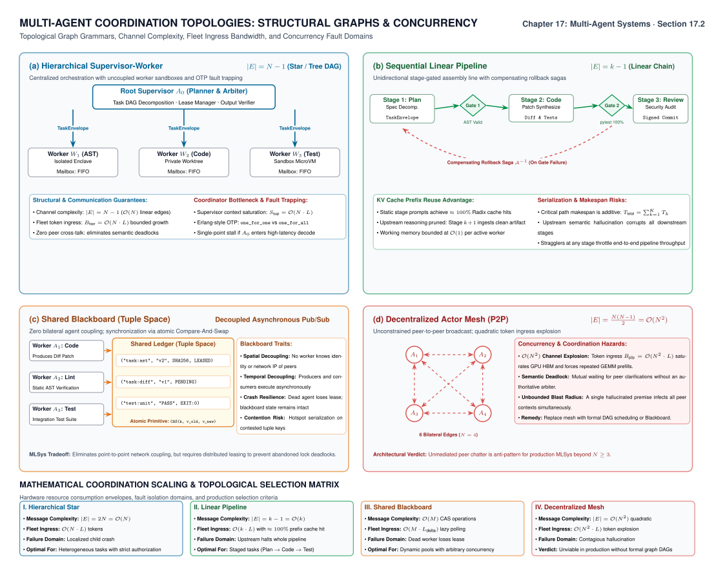
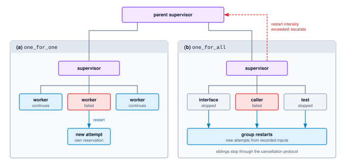
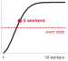
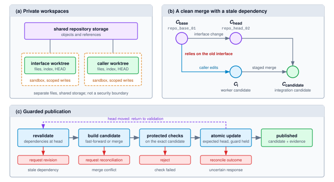
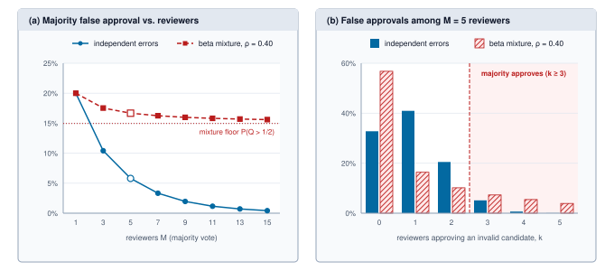
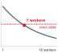
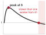

# Multi-Agent Coordination {#sec-vol3-multi-agent}

::: {layout-narrow}
::: {.column-margin}

\chapterminitoc

:::

::: {.content-visible when-format="pdf"}
\noindent
{fig-alt="Blueprint for Multi-Agent Coordination."}
:::

::: {.content-visible unless-format="pdf"}
{fig-alt="Blueprint for Multi-Agent Coordination."}
:::

:::

## Purpose {.unnumbered .unlisted}

\begin{marginfigure}
\mlagentstack{100}{0}{0}{0}{0}{0}
\end{marginfigure}

_Why can splitting a task across several agents cost more and deliver less than giving one agent the same resources?_

When an autonomous objective exceeds the context capacity or working memory of a single model, decomposing the workload across multiple specialized agents appears to be a natural solution. Yet adding agents introduces distributed systems friction: coordination overhead escalates, partial results must be validated across unshared contexts, and delegated authority diffuses across complex worker trees. A naive multi-agent mesh frequently incurs higher token costs and lower reliability than a well-harnessed single agent equipped with isolated tools. Multi-agent engineering requires formalizing delegation contracts: establishing strict supervision trees, enforcing attenuated capability grants, and defining structured handoff receipts. System performance depends on bounding inter-agent communication and verifying worker outcomes against authoritative runtime state.

::: {.content-visible when-format="pdf"}

\newpage

:::

::: {.callout-learning-objectives}

- Estimate the speedup and useful worker count of a work partition from its serial fraction and coordination overhead
- Calculate makespan bounds from a task's dependency graph to decide whether added slots or shorter tasks pay
- Design bounded receipts and credit windows that cap returned context, item staleness, and payload occupancy
- Apply shared-write collision estimates to justify private workspaces and dependency revalidation before publication
- Calculate majority false approval under correlated reviewer errors to choose between more reviewers and a different check
- Evaluate fan-out completion rules and hedging under deadline, capacity, and duplicate-effect constraints
- Apply attenuated grants and atomic reservations to bound a delegation tree's authority, spending, and settlement after cancellation
- Evaluate delegation against a capable single-controller baseline using a declared objective and matched resource ceilings

:::
## Splitting the Repair Agent's Work {#sec-vol3-multiagent-intro}

Consider the repair agent (\ref{lhs-vol3-repair-agent}) assigned to migrate an authentication module across a repository. The task naturally splits into two coupled changes: revising an internal interface and updating its downstream callers. A single coordinator could retain the entire task, dispatching parallel searches and test runs to collect evidence before synthesizing a unified patch. Alternatively, it could partition the problem, assigning the interface update and caller modifications to separate workers. Each worker operates within a focused context window, editing candidate files and reacting to compiler diagnostics independently. Yet this division creates an immediate distributed consistency challenge: the caller modifications must remain compatible with the interface that ultimately lands, not merely the snapshot the caller worker read at dispatch.

::: {.column-margin}
{width="100%" fig-alt="H·S·A locator with all three axes, Horizon, State, and Authority, highlighted."}

*A fleet multiplies horizon, state, and authority, so every handoff must preserve closure.*
:::

The runtime mechanisms established in earlier chapters govern a single execution trajectory at a time. Within that boundary, the harness checks each model and tool invocation against an assigned grant and token budget, durable execution logs a linear event history, failure recovery rolls back an isolated loop, and evaluation grades a single terminal artifact. Partitioning the migration preserves these local controls inside each individual worker, but it leaves the coordination space between them unmanaged. A single-agent runtime provides no mechanism to resolve which interface revision the caller worker targets, whether a clean textual merge of two patches preserves semantic correctness, or what consensus among five reviewer agents actually guarantees. Nor does it define who claims an orphaned test container after a coordinator cancels a subtask, or how a parent bounds the authority and compute budget delegated to a child. Without explicit systems controls, every such gap threatens to make the split cost far more than it buys.

This chapter builds the runtime controls that make delegation governable and the empirical framework that decides whether it pays. The required controls are state records and verification gates owned directly by the runtime rather than left to prompt instructions: enforceable task assignments, receipts that separate an agent's self-reported claims from verified tool evidence, a publication barrier that revalidates cross-module dependencies before any candidate patch merges, clean cancellation paths that account for inflight work, and authority grants that narrow monotonically at every delegation hop. Alongside these mechanisms, we establish rigorous measurement: comparing multi-agent designs against a single agent equipped with equivalent parallel tools and resource budgets, pricing every token consumed by failed, retried, or canceled subtasks.

These principles guide the chapter as we trace the authentication migration from the initial decision to split through the final economic accounting. @Sec-vol3-multiagent-need formalizes the minimal unit of delegation and screens candidate partitions for coordination overhead. @Sec-vol3-multiagent-topologies examines how data dependencies, message routing, and supervision trees organize worker fleets, while @sec-vol3-multiagent-contracts specifies the typed schemas and verifiable receipts that govern each handoff. Once workers run in parallel, @sec-vol3-multiagent-concurrency reconciles concurrent edits without semantic drift, and @sec-vol3-multiagent-consensus measures what agreement among multiple reviewing agents actually guarantees. To maintain operational stability across deep agent trees, @sec-vol3-multiagent-backpressure propagates cancellation and flow control to inflight workers, while @sec-vol3-multiagent-authority restricts security grants and resource budgets at every delegation boundary. Finally, @sec-vol3-multiagent-evaluation measures the completed system against an equitable single-agent baseline, determining when multi-agent partitioning delivers a genuine engineering advantage.
## The Delegation Trade-Off {#sec-vol3-multiagent-need}

When refactoring a system—such as migrating an interface alongside its downstream callers—assigning subtasks to dedicated workers differs fundamentally from issuing concurrent model queries. That difference defines the unit of delegation. A **delegated worker**\index{Delegated worker!definition} owns a bounded child trajectory with its own context window, model-and-tool loop, task contract, and independent lifecycle. In contrast, several candidate samples[^fn-sample-voting-ensemble] dispatched by a single controller represent parallel calls inside one trajectory, not delegated workers. The architectural shift lies in establishing explicit boundaries between separately managed trajectories, regardless of whether those workers execute on a single host or across a distributed cluster.

[^fn-sample-voting-ensemble]: **Sample Voting**\index{Self-consistency!sample voting}: Self-consistency decoding samples several reasoning paths from a single model for a single prompt and returns the most frequent final answer [@wang2022self]. It is the cheapest ensemble an agent can run, but also the most correlated, because every sample shares the underlying model, the prompt, and the intrinsic difficulty of the input—a dependency quantified in @sec-vol3-multiagent-consensus.

The point of comparison throughout this chapter is the *capable baseline*: the single-agent runtime developed in earlier chapters, which already manages its context window, reserves system resources, verifies proposed tool effects externally, and executes candidate searches and isolated tools concurrently. Delegation retains every one of those operational requirements while introducing new coordination boundaries. The fundamental systems question is whether dividing control and context improves a declared task objective enough to justify the overhead of managing them.

### Motivations for delegation {#sec-vol3-multiagent-motivations}

The first motivation is **context partitioning**\index{Context partitioning!definition}: each worker retains only the material strictly necessary for its subtask. In our migration scenario, the interface worker maintains the target API contract and local unit tests without ingesting the intermediate compiler diagnostics of the caller worker, allowing each subsequent model invocation to process substantially fewer prompt tokens. However, the net token savings depend entirely on the structure of the decomposition. If both workers repeatedly require the full repository commit history, separate contexts duplicate prompt state rather than isolating it—a wasteful redundancy given that retrieval and compaction techniques are already available within the single-agent baseline.

The second motivation is *separate task ownership*. Workers can pursue multi-turn exploratory investigations through iterative tool feedback and local reasoning loops while a central coordinator tracks inter-task dependencies and orchestrates final integration. Crucially, assigning task ownership does not eliminate underlying data dependencies. A caller worker that generates code against an outdated interface must still reconcile its implementation once the interface worker finalizes the new contract. True operational independence derives from the causal graph of the task itself, never from cosmetic role descriptions in prompt templates.

The third motivation is *task-scoped authority*. Decomposing work across workers binds tools, execution capabilities, and resource budgets directly to individual subtasks. For example, a test-runner worker can be granted execution privileges in an isolated container without granting it credentials to publish pull requests or write to production databases. Even so, process isolation does not eliminate trust boundaries: a child worker's textual output can still inject unvalidated claims or prompt injections into the parent coordinator's context, and any external mutations it produces must still be verified and settled by the runtime.

@Tbl-vol3-delegation-matrix separates these opportunities from capabilities already present in the baseline.

| Dimension               | One controller already provides                    | Delegation adds                                                     |
|:------------------------|:---------------------------------------------------|:--------------------------------------------------------------------|
| Parallel work           | Concurrent candidate calls and tools               | Independently managed, multi-turn subtask trajectories              |
| Context                 | Retrieval, compaction, and selective observations  | Separate working contexts and explicit return boundaries            |
| Authority and isolation | Scoped grants and sandboxed execution              | Descendant grants and lifecycle relationships to enforce            |
| State and evidence      | Versioned artifacts and checks on proposed changes | Cross-worker dependency validation and integrated-result assessment |
| Resource control        | Admission, reservations, deadlines, and settlement | Aggregate obligations across descendants and their communication    |

: **What Delegation Adds**: The comparison preserves the capable single-controller runtime and identifies the extra boundaries a coordinated design must justify. {#tbl-vol3-delegation-matrix}

### The coordination tax {#sec-vol3-multiagent-coordination-tax}

These organizational advantages carry concrete systems costs. Every delegation boundary incurs a coordination tax (principle \ref{pri-vol3-coordination-tax})\index{Principle!coordination tax}.

::: {#dfn-vol3-coordination-tax .callout-definition title="Coordination tax"}

***Coordination tax***\index{Coordination tax!definition} is the work and elapsed time a delegated design spends on handoffs rather than on the task: preparing and validating envelopes, delivering context, scheduling children, collecting receipts, and reconciling and integrating their results.

1. **Significance**: The tax enters both terms of the cost per accepted task, $C_{\text{eff}}$ (@eq-vol3-cost-per-accepted-task): its tokens and tool time raise $\mathbb{E}[C_{\text{attempt}}]$, and the part on the critical path lengthens every attempt against its deadline.
2. **Distinction**: While task decomposition aims to reduce makespan by distributing work concurrently, the coordination tax represents the unavoidable friction introduced by that distribution. This tax scales with worker count, communication frequency, and inter-task dependencies.
3. **Common pitfall**: Accounting only for the tokens and execution time of successful worker turns. Context re-ingestion, supervisor arbitration turns, failed retries, and abandoned speculative branches all consume model quota and execution budgets.

:::

Coordination tax impacts systems along two distinct dimensions: aggregate resource consumption and end-to-end latency. Duplicated input prompt tokens, redundant tool invocations, and serialize-deserialize cycles increase the total operational cost. Meanwhile, user-perceived delay is governed by **makespan**\index{Makespan!definition}—the wall-clock time elapsed from the arrival of a task to the completion and verification of its final artifact. Makespan depends strictly on the operations situated on the critical path. A straggling child worker delays synchronization at the join barrier, while subsequent arbitration and reconciliation turns further inflate the critical path before results can be accepted.

Amdahl's fixed-work argument[^fn-amdahl-argument-multiagent] gives the first screening model [@amdahl1967]. Let $T_{\mathrm{serial}}$ be the time for a fixed set of operations executed serially, with fraction $f$ perfectly divisible among $M$ equally fast workers and fraction $1-f$ remaining serial. Assume enough resources for that division and let $h(M)$ be the additional elapsed overhead, normalized by $T_{\mathrm{serial}}$. Then

$$\operatorname{Speedup}(M)=\frac{T_{\mathrm{serial}}}{T_M}=\frac{1}{(1-f)+f/M+h(M)}.$$ {#eq-vol3-multiagent-speedup}

[^fn-amdahl-argument-multiagent]: **Amdahl's Argument**\index{Amdahl's law!origin}: Amdahl's 1967 conference paper contains no equation; it argues in prose that the serial housekeeping of a program limits what any number of parallel processors can deliver, and the familiar formula was written down by later authors. The lesson transfers intact to delegation, where planning, integration, and final assessment are the housekeeping that no added worker absorbs.

@Eq-vol3-multiagent-speedup provides a preliminary screening model for a specified work partition. Crucially, the baseline $T_{\mathrm{serial}}$ reflects that partition executed sequentially on a single thread of execution, rather than our capable baseline runtime (which already pipelines tool executions and concurrent candidate samplings). In production, an empirical benchmark of the capable baseline must replace $T_{\mathrm{serial}}$ before finalizing any worker allocation. Within this theoretical formulation, achieving any net speedup over the serial reference requires that:

$$h(M)<f\left(1-\frac{1}{M}\right).$$

The right-hand side represents the theoretical wall-clock time saved by distributing the parallelizable portion across $M$ workers. Whenever coordination overhead $h(M)$ exceeds this threshold, adding workers slows the system down. Furthermore, this inequality constrains execution time alone; task acceptance rates, token expenditures, and monetary costs enter the trade-off in @sec-vol3-multiagent-evaluation.

```{python}
#| label: calc-vol3-delegation-screen
#| echo: false
# ┌─────────────────────────────────────────────────────────────────────────────
# │ SCREENING A FIXED WORK PARTITION (LEGO)
# ├─────────────────────────────────────────────────────────────────────────────
# │ Goal: Find the integer worker count minimizing modeled elapsed time.
# │ Show: Normalized times at four, eight, and the best feasible worker count.
# │ How:  Enumerate (1-f) + f/M + gamma(M-1) under a finite resource ceiling.
# │ Note: Dimensionless hypothetical assumptions, not a measured comparison
# │       with an already-parallel single-controller runtime.
# └─────────────────────────────────────────────────────────────────────────────
from mlsysim.fmt import check, fmt_ratio, fmt_int, fmt_multiple

class DelegationScreen:
    # ┌── 1. LOAD (Constants & Parameters) ─────────────────────────────────
    parallel_fraction = 0.8
    overhead_per_extra_worker = 0.02
    max_workers = 16

    # ┌── 2. EXECUTE (Compute) ─────────────────────────────────────────────
    normalized_times = {}
    for workers in range(1, max_workers + 1):
        normalized_times[workers] = 1 - parallel_fraction + parallel_fraction / workers + overhead_per_extra_worker * (workers - 1)
    best_workers = min(normalized_times, key=normalized_times.get)
    best_time = normalized_times[best_workers]
    best_speedup = 1 / best_time
    speedup_cap = 1 / (1 - parallel_fraction)
    # Sensitivity: halve the per-worker overhead, same serial fraction.
    halved_overhead = overhead_per_extra_worker / 2
    halved_times = {}
    for workers in range(1, max_workers + 1):
        halved_times[workers] = 1 - parallel_fraction + parallel_fraction / workers + halved_overhead * (workers - 1)
    halved_best_workers = min(halved_times, key=halved_times.get)
    halved_best_speedup = 1 / halved_times[halved_best_workers]

    # ┌── 3. GUARD (Invariants) ───────────────────────────────────────────
    check(isinstance(max_workers, int) and max_workers >= 1, "Worker ceiling must be a positive integer")
    check(0 <= parallel_fraction <= 1, "Fraction must lie in [0, 1]")
    check(overhead_per_extra_worker >= 0, "Overhead cannot be negative")
    check(abs(normalized_times[1] - 1) < 1e-12, "Serial reference must be one")
    check(best_workers == 6, "Expected six-worker minimum under these assumptions")
    check(best_time < normalized_times[5] and best_time < normalized_times[7], "Minimum must beat adjacent integer counts")
    check(normalized_times[8] > best_time, "Additional workers should increase time here")
    check(halved_best_workers == 9, "Halved overhead should move the optimum to nine workers")
    check(best_speedup < halved_best_speedup < speedup_cap, "Halved overhead helps but stays under the serial cap")

    # ┌── 4. OUTPUT (Formatting) ──────────────────────────────────────────
    fraction_str = fmt_ratio(parallel_fraction, precision=2)
    overhead_str = fmt_ratio(overhead_per_extra_worker, precision=2)
    max_workers_str = fmt_int(max_workers)
    best_workers_str = fmt_int(best_workers)
    best_time_str = fmt_ratio(best_time, precision=3)
    four_time_str = fmt_ratio(normalized_times[4], precision=3)
    eight_time_str = fmt_ratio(normalized_times[8], precision=3)
    best_speedup_mult_str = fmt_multiple(best_speedup, precision=1)
    speedup_cap_mult_str = fmt_multiple(speedup_cap, precision=0)
    halved_overhead_str = fmt_ratio(halved_overhead, precision=2)
    halved_best_workers_str = fmt_int(halved_best_workers)
    halved_best_speedup_mult_str = fmt_multiple(halved_best_speedup, precision=1)
    added_workers_str = fmt_int(halved_best_workers - best_workers)
    added_speedup_str = fmt_ratio(halved_best_speedup - best_speedup, precision=1)
```

::: {#nbk-17-the-amdahl-limits-of-multi-agent .callout-notebook title="Screening a proposed work partition"}

**Problem**: A hypothetical fixed workload has $f=$ `{python} DelegationScreen.fraction_str` and assumed normalized overhead $h(M)=\gamma(M-1)$ with $\gamma=$ `{python} DelegationScreen.overhead_str`. The resource ceiling permits at most `{python} DelegationScreen.max_workers_str` workers. Which integer count minimizes modeled elapsed time?

**Math**: Evaluating the denominator of @eq-vol3-multiagent-speedup for each permitted count, four workers require `{python} DelegationScreen.four_time_str` of the serial reference time. The minimum occurs at `{python} DelegationScreen.best_workers_str` workers, requiring `{python} DelegationScreen.best_time_str`, a `{python} DelegationScreen.best_speedup_mult_str` speedup; eight workers increase the ratio to `{python} DelegationScreen.eight_time_str`, because the shrinking parallel term $f/M$ no longer pays for the added overhead. Halving the overhead coefficient to `{python} DelegationScreen.halved_overhead_str` moves the optimum to `{python} DelegationScreen.halved_best_workers_str` workers and the speedup to `{python} DelegationScreen.halved_best_speedup_mult_str`.

**Systems insight**: The serial fraction sets the ceiling and the overhead sets the useful fleet size. No worker count beats $1/(1-f)=$ `{python} DelegationScreen.speedup_cap_mult_str` here, and the best count sits near $\sqrt{f/\gamma}$, so halving the per-handoff overhead adds `{python} DelegationScreen.added_workers_str` workers but only `{python} DelegationScreen.added_speedup_str` of speedup. Shrinking the serial planning and integration work is the larger lever.

:::

A reduction in modeled makespan does not automatically justify a multi-agent architecture. Production systems optimize under varied constraints: one automated migration service may seek to maximize accepted pull requests prior to a nightly release window subject to a strict token budget, whereas another prioritizes minimizing the total cost per accepted migration. Trading latency for computational overhead is justified only against an explicit, pre-declared optimization objective—a decision framework formalized in @sec-vol3-multiagent-evaluation, which incorporates the cost of retries and failed executions. Before attempting to size or provision an agent pool, a systems architect must map the causal dependency graph of the workload: identifying which subtasks can truly proceed concurrently and determining the exact evidence required at each downstream join. Those fundamental dependencies dictate the coordination topology.
## Coordination Topologies {#sec-vol3-multiagent-topologies}

Consider a codebase migration task (`migration_task_01`) where an interface worker and a caller worker concurrently inspect a repository (`repo_base_01`). Even though both agents run in parallel, the caller's patch fundamentally depends on the interface definitions that its peer is actively modifying. Routing both workers through a single supervisor does not eliminate that underlying causal dependency. A runtime architecture that naively treats the supervisor's message-routing graph as the true dependency graph will prematurely accept and publish a caller patch built on stale interface assumptions.

To build reliable multi-agent systems, engineers must distinguish three separate structural graphs that govern execution:

1. The **dependency graph**\index{Dependency graph!definition} defines causal precedence by recording which artifacts, decisions, or validation checks must complete before downstream work can safely proceed.
2. The **communication topology**\index{Communication topology!definition} defines the network paths, protocols, and message envelopes through which agents exchange information.
3. The **supervision tree**\index{Supervision tree!definition} defines operational ownership over agent lifecycles, governing fault isolation, resource reservations, and cancellation cascades.

Because a supervisor frequently manages children whose outputs depend causally on one another, runtime engines must maintain these three structures independently. Conflating message delivery with causal dependency or lifecycle ownership leads directly to race conditions, orphaned processes, and corrupted state.

### Coordination arrangements {#sec-vol3-multiagent-arrangements}

@Tbl-vol3-topologies-comparison compares the primary coordination topologies used in multi-agent systems. The most prevalent pattern is the **supervisor-worker**\index{Supervisor-worker topology!definition} topology (frequently termed orchestrator-worker). In this model, a centralized coordinator decomposes an incoming task, dispatches subtasks to subordinate workers, and synthesizes their returned receipts. This design directly mirrors the contract net protocol[^fn-contract-net-protocol] originally developed for distributed problem solving [@smith1980contract]. In production systems, these foundational topologies frequently compose. For example, a supervisor might dispatch parallel analytical investigations, stream their candidate patches through a staged validation pipeline, and persist intermediate progress within a shared task store.

| Arrangement       | How work crosses a boundary                                                           | Useful when                                                              | Obligation that remains                                              |
|:------------------|:--------------------------------------------------------------------------------------|:-------------------------------------------------------------------------|:---------------------------------------------------------------------|
| Supervisor–worker | A coordinator assigns subtasks and collects bounded receipts                          | A task has separable investigations and an explicit integration decision | Bound dispatch, returned context, and the coordinator's own work     |
| Pipeline          | Each stage receives the artifacts and evidence its predecessor is required to provide | Later work depends on a sequence of transformations or checks            | Preserve stage preconditions and bound queues between stages         |
| Shared blackboard | Workers claim tasks and publish versioned artifacts through a shared store            | Different workers can contribute as dependencies become available        | Enforce claim ownership, publication rules, and dependency validity  |
| Actor messaging   | Workers hold local state and exchange addressed messages                              | Responsibilities require ongoing asynchronous interactions               | Define delivery, duplicate handling, ordering, and bounded mailboxes |

: **Coordination arrangements and runtime obligations**: While routing patterns structure message handoffs, the execution runtime must enforce result validity, resource boundaries, and state consistency across agent boundaries. {#tbl-vol3-topologies-comparison}

Each coordination topology makes different trade-offs regarding where state accumulates and where synchronization occurs. A supervisor concentrates integration logic and validation evidence at a single coordinator, requiring compact, structured receipts to prevent prompt context exhaustion. A pipeline structures execution as a sequence of discrete transformations, keeping each stage's working context tightly focused while streaming items concurrently across stages. By contrast, a shared blackboard\index{Shared blackboard}[^fn-blackboard-hearsay-architecture] decouples agents entirely by externalizing coordination into a centralized artifact and task store [@erman1980hearsay]. In an actor architecture, originally formulated by Hewitt, Bishop, and Steiger, agents maintain completely isolated private state and communicate exclusively via asynchronous message passing to explicit addresses [@hewitt1973actor]. Both blackboards and actor meshes shift the coordination burden toward explicit conflict resolution, distributed ordering, and bounded mailbox management.

[^fn-contract-net-protocol]: **Contract Net Protocol**\index{Contract net protocol}: In Smith's 1980 protocol, a manager node announces a task, idle contractor nodes submit bids, and the manager awards the contract to a chosen bidder, which may subcontract in turn. The award represents the conceptual ancestor of the typed task envelope: it fixes which agent owns the subtask and what structured receipt must return, eliminating the ambiguity inherent in prompt-level delegation.

[^fn-blackboard-hearsay-architecture]: **Blackboard Architecture**\index{Blackboard architecture!Hearsay-II}: The Hearsay-II speech-understanding system of the 1970s coordinated independent knowledge sources that never communicated directly with one another, interacting solely by posting and reading hypotheses on a shared global data structure. Its central scheduling challenge—deciding which pending contribution to evaluate next—reappears whenever agent workers claim tasks from a shared operational store.

Message counts scale with the communication graph and its interaction protocol. If each of $N$ participants transmits an update to every other participant during an execution round, the network must handle $N(N-1)$ directed deliveries. With an average payload size of $L$ tokens per delivery, that single round consumes $N(N-1)L$ tokens across the system. In contrast, a supervisor managing $N$ workers requires only $2N$ deliveries per round (one dispatch envelope and one receipt per worker), consuming $2NL$ tokens. The full mesh thus scales quadratically, transmitting $(N-1)/2$ times more messages per round than the centralized coordinator.

Critically, raw transmission volume measures only network traffic, not the context ingestion cost of the receiving language models. In a fully connected mesh, if each agent must ingest all incoming peer messages into its prompt history, token ingestion scales as $O(N^2)$. Even in a centralized topology, verbose receipts, iterative deliberation rounds, or frequent status polling against a blackboard store can quickly overwhelm context windows and inflate inference budgets. @Fig-vol3-multi-agent-topologies diagrams these four coordination patterns: panel (a) shows a hierarchical supervisor dispatching envelopes and collecting receipts ($2N$ deliveries per round); panel (b) routes work through a staged pipeline decoupled by bounded queues; panel (c) coordinates concurrent workers via claims and versioned publications on a shared blackboard store; and panel (d) networks peer actors via point-to-point mailboxes requiring $N(N-1)$ deliveries per mesh round.

::: {#fig-vol3-multi-agent-topologies fig-env="figure" fig-pos="htb" fig-cap="**Four Coordination Arrangements**: Each panel shows where work crosses a boundary. A supervisor sends envelopes down and collects receipts, a pipeline passes artifacts through bounded queues, a blackboard mediates claims and versioned publications through a shared store, and actors exchange addressed messages through mailboxes. One supervisor round costs $2N$ deliveries and a full mesh round $N(N-1)$. Each topology imposes specific runtime obligations for bounding queues, isolating concurrent state, and verifying result correctness." fig-alt="Four panels. Panel a: a wide supervisor box above three worker boxes, each worker with a downward envelope arrow and an upward dashed receipt arrow, labeled 2N deliveries per round. Panel b: stage 1, stage 2, and stage 3 in a row, separated by two bounded queues drawn as three slots each. Panel c: three worker boxes sending claim and publish arrows to a shared store holding a claimed task and artifact versions 2 and 3, with dashed read arrows back. Panel d: four actor boxes, each with a mailbox, connected by three addressed messages, labeled full mesh N times N minus 1 per round. Each panel ends with an obligation line."}

:::

Architectural design therefore prioritizes explicit, bounded handoffs over minimal edge counts. Each worker must receive only the specific inputs and validation invariants required for its assigned subtask, preventing individual context windows from degrading under cumulative peer histories.

### Dependency graphs and concurrency {#sec-vol3-multiagent-dependency-graphs}

To reason formally about execution concurrency, we model task precedence as a directed acyclic graph (DAG), $G=(V,E)$. Each vertex $v \in V$ represents a bounded unit of execution—either an autonomous agent trajectory or a deterministic runtime validation check. A directed edge $(u,v) \in E$ indicates that vertex $v$ requires a declared precondition satisfied by vertex $u$, such as an emitted code artifact, a validated test report, or an explicit authorization token. A status message signaling task completion satisfies an incoming edge only when accompanied by verifiable output receipts.

A vertex becomes **dependency-ready**\index{Dependency-ready vertex!definition} once every prerequisite predecessor condition has been verified. However, dependency readiness alone does not trigger execution: the runtime dispatcher must additionally verify execution authority, allocate an active worker slot, and secure a bounded token and financial budget reservation. If a predecessor fails or emits invalid artifacts, the control plane either halts downstream successors or transitions execution to an explicit recovery branch. Loops and iterative refinement cycles enter the graph as unrolled, bounded attempts. Because graph acyclicity guarantees only the absence of logical dependency loops, the underlying runtime remains responsible for detecting dynamic deadlocks arising from shared resource locks, exhausted thread pools, or saturated queues.

To estimate the theoretical limits of parallel scheduling, assume each vertex $v$ occupies one interchangeable worker slot for a fixed duration $d(v)$, encompassing both model inference latency and external tool execution. Let $P$ represent the pool of available parallel worker slots. Under these assumptions, aggregate slot-work $W$ and critical-path duration $T_{\text{crit}}$ are defined as

$$
W=\sum_{v\in V}d(v),\qquad
T_{\text{crit}}=\max_{\pi\in\operatorname{Paths}(G)}\sum_{v\in\pi}d(v).
$$ {#eq-vol3-multiagent-dag-work}

Any valid schedule's total makespan $T_{\text{finish}}$ must satisfy the dual lower bounds

$$
T_{\text{finish}}\ge\max\left(\frac{W}{P},T_{\text{crit}}\right).
$$ {#eq-vol3-multiagent-dag-bound}

The aggregate work bound $W/P$ reflects the fundamental capacity constraint: $P$ parallel worker slots cannot complete $W$ total units of execution time in less than $W/P$, regardless of schedule structure. The critical-path bound $T_{\text{crit}}$ reflects the causal precedence constraint: sequential dependencies cannot be parallelized, establishing a lower bound on latency even with infinite worker slots.[^fn-greedy-list-schedule] In production environments, resource contention, queuing overhead, payload serialization, and trajectory retries expand the overall makespan well beyond these theoretical minimums unless explicitly incorporated into vertex durations $d(v)$ and graph edges.

[^fn-greedy-list-schedule]: **Greedy List Scheduling**\index{List scheduling!Graham bound}: Graham established that any list schedule which never leaves a worker slot idle while a dependency-ready vertex waits completes within a factor of $2-1/P$ of the optimal makespan. Graham also demonstrated that such schedules can suffer counterintuitive timing anomalies where adding worker slots or reducing individual task durations actually increases overall completion time [@graham1969bounds]. A runtime dispatcher that greedily schedules ready work is therefore near-optimal relative to the theoretical bound in @eq-vol3-multiagent-dag-bound, and an observed latency regression after expanding worker pools does not necessarily indicate a scheduler implementation bug.

```{python}
#| label: calc-vol3-multiagent-dag-schedule
#| echo: false
# ┌─────────────────────────────────────────────────────────────────────────────
# │ DEPENDENCY-LIMITED SCHEDULE (LEGO)
# ├─────────────────────────────────────────────────────────────────────────────
# │ Context: @nbk-17-critical-path-makespan-and-dag-scheduling and its table.
# │ Goal: Compare aggregate work with an attainable idealized DAG schedule.
# │ Show: Node durations, earliest starts/finishes, bounds, and speedup.
# │ How: Assumed slot durations; predecessor-max recurrence in topological order.
# └─────────────────────────────────────────────────────────────────────────────
from mlsysim import *

class DagSchedule:
    # ┌── 1. LOAD (Illustrative assumptions) ─────────────────────────────────
    workers = 4
    duration = {1: 20.5 * second, 2: 42 * second, 3: 42 * second, 4: 42 * second, 5: 43 * second, 6: 16.5 * second, 7: 69 * second}
    predecessors = {1: (), 2: (1,), 3: (1,), 4: (1,), 5: (2, 3), 6: (4,), 7: (5, 6)}

    # ┌── 2. EXECUTE (Unlimited-slot earliest schedule; check capacity below) ─
    start = {}
    finish = {}
    for node in duration:
        ready = 0 * second
        for parent in predecessors[node]:
            ready = max(ready, finish[parent])
        start[node] = ready
        finish[node] = ready + duration[node]
    work = sum(duration.values(), 0 * second)
    critical = finish[7]
    work_bound = work / workers
    peak_slots = 0
    for instant in start.values():
        occupied = 0
        for node in duration:
            occupied += int(start[node] <= instant < finish[node])
        peak_slots = max(peak_slots, occupied)
    speedup = (work / critical).to("").magnitude
    slack6 = start[7] - finish[6]  # float on the only off-critical branch into v7

    # ┌── 3. GUARD (Feasible capacity and the stated comparison) ──────────────
    check(work == 275 * second, "Aggregate work changed")
    check(critical == 174.5 * second, "Critical path changed")
    check(peak_slots == 3 and peak_slots <= workers, "Schedule exceeds capacity")
    check(work_bound < critical, "Work bound now dominates")
    check(1.575 < speedup < 1.585, "Displayed speedup changed")
    check(slack6 == 26.5 * second, "Slack on the v4-v6 branch changed")
    check(finish[2] == finish[3], "v2 and v3 must tie for the critical path")

    # ┌── 4. OUTPUT (Formatting) ─────────────────────────────────────────────
    workers_str = fmt_int(workers)
    peak_slots_str = fmt_int(peak_slots)
    d1_str = fmt_time(duration[1], unit=second, precision=1)
    d2_str = fmt_time(duration[2], unit=second, precision=0)
    d5_str = fmt_time(duration[5], unit=second, precision=0)
    d6_str = fmt_time(duration[6], unit=second, precision=1)
    d7_str = fmt_time(duration[7], unit=second, precision=0)
    start1_str = fmt_time(start[1], unit=second, precision=0)
    start2_str = fmt_time(start[2], unit=second, precision=1)
    start5_str = fmt_time(start[5], unit=second, precision=1)
    start7_str = fmt_time(start[7], unit=second, precision=1)
    finish6_str = fmt_time(finish[6], unit=second, precision=0)
    work_str = fmt_time(work, unit=second, precision=0)
    critical_str = fmt_time(critical, unit=second, precision=1)
    work_bound_str = fmt_time(work_bound, unit=second, precision=2)
    speedup_mult_str = fmt_multiple(speedup, precision=2)
    slack6_str = fmt_time(slack6, unit=second, precision=1)
```

::: {#nbk-17-critical-path-makespan-and-dag-scheduling .callout-notebook title="DAG scheduling in multi-agent execution"}

**Problem**: Consider an illustrative repository upgrade with `{python} DagSchedule.workers_str` worker slots. @Tbl-vol3-multiagent-dag-schedule gives assumed durations for a single successful execution of each node. Each node occupies one slot; there are no additional dispatch delays, resource conflicts, retries, or transfer costs. How much can overlap?

| Work                                                | Required predecessors | Slot duration                      | Earliest start                    | Earliest finish                     |
|:----------------------------------------------------|:----------------------|:-----------------------------------|:----------------------------------|:------------------------------------|
| $v_1$: prepare shared specification                 | None                  | `{python} DagSchedule.d1_str`      | `{python} DagSchedule.start1_str` | `{python} DagSchedule.start2_str`   |
| $v_2,v_3,v_4$: refactor separate modules            | $v_1$, for each       | `{python} DagSchedule.d2_str` each | `{python} DagSchedule.start2_str` | `{python} DagSchedule.start5_str`   |
| $v_5$: assess the joint changes from two modules    | $v_2,v_3$             | `{python} DagSchedule.d5_str`      | `{python} DagSchedule.start5_str` | `{python} DagSchedule.start7_str`   |
| $v_6$: prepare bindings for the remaining module    | $v_4$                 | `{python} DagSchedule.d6_str`      | `{python} DagSchedule.start5_str` | `{python} DagSchedule.finish6_str`  |
| $v_7$: integrate and run required regression checks | $v_5,v_6$             | `{python} DagSchedule.d7_str`      | `{python} DagSchedule.start7_str` | `{python} DagSchedule.critical_str` |

: **An idealized dependency schedule**: Starts are the latest finish among required predecessors. The schedule assumes that each predecessor supplies the result required by its successor. {#tbl-vol3-multiagent-dag-schedule}

**Math**: Summing the node durations as in @eq-vol3-multiagent-dag-work gives `{python} DagSchedule.work_str` of aggregate slot-work. Dividing by the slot count gives the work term in @eq-vol3-multiagent-dag-bound, `{python} DagSchedule.work_bound_str`. The paths $v_1\to v_2\to v_5\to v_7$ and $v_1\to v_3\to v_5\to v_7$ tie for the critical path. The table's schedule uses at most `{python} DagSchedule.peak_slots_str` slots, so it is feasible under the stated capacity and attains the path bound.

**Result**: Completion takes `{python} DagSchedule.critical_str`, a `{python} DagSchedule.speedup_mult_str` speedup over executing these same nodes serially, and more slots cannot shorten the remaining chain.

**Systems insight**: Systems optimization must focus strictly on the critical path; allocating worker slots beyond peak concurrency yields zero latency improvement. The off-critical branch through $v_4$ and $v_6$ finishes `{python} DagSchedule.slack6_str` before $v_7$ can start, meaning optimizations on that branch do not affect overall makespan. In contrast, shortening $v_5$ or $v_7$ yields a direct second-for-second reduction in total makespan up to the available slack. Shortening $v_2$ in isolation provides no benefit because $v_3$ ties it on the critical path. Analyzing production agent traces requires this exact discipline: identify the true critical path and focus engineering effort exclusively on its constituent vertices.

:::

### Static plans and dynamic spawning {#sec-vol3-multiagent-static-dynamic}

A **static plan**\index{Static plan!definition} specifies its stages, conditional branches, validation checkpoints, and retry bounds ahead of execution. Because all artifact dependencies and message routes are declared upfront, operators can inspect handoffs statically, verify safety invariants before dispatch, and compute deterministic worst-case bounds on token usage and wall-clock latency.

In contrast, **dynamic spawning**\index{Dynamic spawning!definition} provisions child agents at runtime in response to intermediate observations. For example, during a repository migration, a worker analyzing call sites might uncover an undocumented dependency and request an isolated sub-investigation. While the model proposes this subtask dynamically, the runtime control plane must evaluate and admit it under the prevailing task contract. Dynamic spawning allows systems to adapt flexibly to open-ended workloads, but it introduces non-deterministic execution graphs. When an unconstrained model decides how many child agents to spawn and when to spawn them, combinatorial fan-out can quickly overwhelm system capacity and inflate execution costs.

```{python}
#| label: calc-vol3-multiagent-research-report
#| echo: false
# ┌─────────────────────────────────────────────────────────────────────────────
# │ SOURCED FIGURES FROM A MULTI-AGENT RESEARCH SYSTEM REPORT (LEGO)
# ├─────────────────────────────────────────────────────────────────────────────
# │ Context: \ref{ws-vol3-multiagent-research-fanout-2025} and
# │          \ref{nbk-17-token-multiplier-break-even}.
# │ Goal: Hold the report's published figures in one place.
# │ Show: Early fan-out, token multiples over chat, and the evaluation gain.
# │ How: Constants quoted from @anthropic2025multiagent; no derivation here.
# │      The two token multiples live on the Agents.Research.OrchestratorWorker
# │      profile, whose provenance cites the report.
# │ Note: Reported by the system's builders on their own internal evaluation.
# └─────────────────────────────────────────────────────────────────────────────
from mlsysim import Agents
from mlsysim.fmt import check, fmt_int, fmt_multiple, fmt_percent

class ResearchReport:
    # ┌── 1. LOAD (Quoted from anthropic2025multiagent) ────────────────────
    research = Agents.Research.OrchestratorWorker
    early_subagents = 50  # subagents spawned for simple queries in early versions
    single_agent_tokens_vs_chat = research.agent_token_multiple  # "about 4x more tokens than chat"
    multi_agent_tokens_vs_chat = research.fanout_token_multiple  # "about 15x more tokens than chats"
    eval_gain = 0.902  # multi-agent over single-agent, internal research eval

    # ┌── 2. EXECUTE (None: quoted values) ─────────────────────────────────

    # ┌── 3. GUARD (Transcription sanity) ─────────────────────────────────
    check(multi_agent_tokens_vs_chat > single_agent_tokens_vs_chat > 1, "Token multiples must be ordered")
    check(0 < eval_gain < 1, "Relative gain transcribed as a fraction")

    # ┌── 4. OUTPUT (Formatting) ──────────────────────────────────────────
    early_subagents_str = fmt_int(early_subagents)
    single_vs_chat_mult_str = fmt_multiple(single_agent_tokens_vs_chat, precision=0)
    multi_vs_chat_mult_str = fmt_multiple(multi_agent_tokens_vs_chat, precision=0)
    eval_gain_str = fmt_percent(eval_gain, precision=1, style="prose")
```

::: {#ws-vol3-multiagent-research-fanout-2025 .callout-war-story title="Unbounded fan-out in a multi-agent research system (2025)"}

**Context**: Anthropic's engineering team described building an autonomous research system where a lead orchestrator plans an investigation, spawns parallel subagents to search for evidence, and synthesizes their findings [@anthropic2025multiagent].

**Mechanism**: The lead agent possessed unconstrained authority to determine subagent fan-out. In early prototype versions, the model routinely spawned `{python} ResearchReport.early_subagents_str` subagents even for simple queries, searched endlessly for nonexistent sources, and allowed subagents to degrade coordination by flooding one another with excessive updates.

**Impact**: The engineering team reports that autonomous agents typically consume about `{python} ResearchReport.single_vs_chat_mult_str` more tokens than standard conversational interactions, while multi-agent systems consume roughly `{python} ResearchReport.multi_vs_chat_mult_str` more. Although the multi-agent configuration outperformed a single agent by `{python} ResearchReport.eval_gain_str` on the team's internal research evaluation, the unconstrained fan-out incurred disproportionate resource expenditure on straightforward tasks.

**Fix**: The team embedded explicit scaling heuristics into the orchestrator's prompt, instructing the model to calibrate subagent allocation to query complexity—allocating a single agent for direct fact retrieval and scaling upward only for open-ended synthesis. Furthermore, the orchestrator was structured to wait synchronously for each dispatched subagent batch to conclude before initiating subsequent steps, simplifying state synchronization at the cost of pipeline parallelism.

**Systems lesson**: Dynamic fan-out is fundamentally an architectural resource allocation problem that cannot rely solely on model self-restraint. While prompt-based heuristics guide model proposals, the runtime control plane must enforce hard admission limits on tree breadth, recursion depth, and aggregate budget reservations, directly bounding the token consumption in the effective cost metric $C_{\text{eff}}$.

:::

Uncontrolled fan-out illustrates the necessity of formal admission control in multi-agent architectures. Relying solely on prompt instructions to curb subtask generation is insufficient: an unconstrained model can still hallucinate redundant branches or trigger cascading worker requests. Crucially, simply allocating each child a budget fraction smaller than the parent's remaining funds fails to protect the system, as a burst of concurrent siblings can issue overlapping claims that collectively exceed available capacity. The runtime admission controller must atomically reserve each child's maximum potential liability against the shared task budget before dispatching execution (@sec-vol3-controlplane-accounting), an invariant that @sec-vol3-multiagent-authority formalizes across hierarchical delegation trees. Production runtimes must independently enforce four distinct bounds: fan-out breadth (maximum children per parent), concurrent active slots (maximum parallel executions), recursion depth (maximum delegation layers), and absolute deadlines. A shallow tree can still exhaust resources through excessive breadth, while a strict concurrency cap can still permit an unbounded sequence of sequential worker allocations.

Beyond resource management, dispatching a child agent establishes lifecycle ownership. A child's running trajectory, pending tool invocations, and uncommitted side effects typically outlive the ephemeral model call that spawned it. The **supervision tree**\index{Supervision tree!definition} defines how the runtime isolates faults and manages recovery when a child encounters an unrecoverable failure. Drawing directly from the battle-tested principles of Erlang/OTP supervision trees,[^fn-erlang-supervisor-trees] systems formalize recovery through explicit, per-supervisor restart strategies [@armstrong2003making; @armstrong2007erlang]:

- Under a `one_for_one` policy, the supervisor restarts only the failed child agent while allowing sibling workers to continue uninterrupted. This strategy is ideal for embarrassingly parallel or loosely coupled subtasks—such as searching disjoint documentation sources—where workers share no mutable intermediate state.
- Under a `one_for_all` policy, the failure of any single child triggers the supervisor to terminate and restart all sibling workers within that supervision group. This approach is essential for tightly coupled collaborative tasks where partial artifacts become invalid upon peer failure. For example, if an interface worker crashes and restarts with an altered API contract, any partial implementation generated by a concurrent caller worker is fundamentally invalidated.

@Fig-vol3-supervisor-tree-isolation contrasts the failure blast radius under both policies: in panel (a) (`one_for_one`), a failed worker restarts in isolation with an independent budget reservation while surviving siblings continue execution; in panel (b) (`one_for_all`), a single failure terminates all coupled group members (interface, caller, and test workers) to restart the entire cohort synchronously from recorded inputs, escalating to the parent supervisor if restart thresholds are breached.

[^fn-erlang-supervisor-trees]: **Erlang Supervision Trees**\index{Supervision tree!Erlang/OTP}: Erlang emerged from a telephone-switching research program initiated in 1981, established on the design principle that systems should allow failing processes to crash cleanly while a designated supervisor restores known-good state, rather than attempting defensive error handling locally [@armstrong2003making]. In agentic systems, this principle is even more vital: allowing a confused agent trajectory to attempt local recovery within a contaminated context window frequently compounds hallucinations, whereas a supervisor restart provisions a clean execution context from recorded inputs.

To prevent degenerate retry storms, supervision trees enforce a **restart intensity**\index{Restart intensity!definition} bound—specifying the maximum permissible restarts within a sliding time window. When a child agent repeatedly fails and breaches this threshold, the supervisor ceases local restarts, aborts its remaining subordinates, and escalates the failure upward to its own parent supervisor. In an agentic system, a restart must never simply continue from the failed worker's corrupted or circular context window. Instead, the runtime treats each restart as a freshly admitted attempt, provisioning a clean context initialized from recorded input artifacts and acquiring a fresh budget reservation. When aborting sibling processes under `one_for_all` or escalation, the runtime invokes the structured cancellation and cleanup protocols described in @sec-vol3-multiagent-backpressure.

::: {#fig-vol3-supervisor-tree-isolation fig-env="figure" fig-pos="htb" fig-cap="**Restart Policies in a Supervision Tree**: Under the one-for-one policy (a), only the failed worker restarts, as a newly admitted attempt with its own reservation, while its siblings continue. Under the one-for-all policy (b), the supervisor stops the coupled siblings through the cancellation protocol and restarts the whole group from recorded inputs, because the caller's partial work has lost its meaning. Either supervisor that exceeds its declared restart intensity stops restarting and escalates the failure to its parent." fig-alt="A parent supervisor box above two cards. Card a, one_for_one: a supervisor with three worker children; the middle worker is marked failed and has an arrow labeled restart to a new attempt box with its own reservation, while the other two are marked continues. Card b, one_for_all: a supervisor with interface, caller, and test children; caller is marked failed, interface and test are marked stopped, and arrows from all three lead to one box labeled group restarts, new attempts from recorded inputs. A dashed arrow from supervisor b to the parent is labeled restart intensity exceeded, escalate."}

:::

::: {#chk-17-amdahl-concurrency .callout-checkpoint title="Evaluating multi-agent coordination topologies"}

- [ ] **Dependency vs. routing**: The interface and caller workers communicate only through their supervisor. Why can they still produce interdependent patches, and which of the three structures records that?
- [ ] **Critical-path estimate**: Using the durations in @tbl-vol3-multiagent-dag-schedule, estimate how much completion changes if $v_6$ takes 20 s less, and how much if $v_5$ takes 20 s less. Which node would you ask a team to speed up?
- [ ] **Worker-count screen**: With $f=0.9$ and the notebook's overhead $\gamma=$ `{python} DelegationScreen.overhead_str` per extra worker, estimate the best worker count from $\sqrt{f/\gamma}$ and the speedup ceiling $1/(1-f)$. Is it worth halving $\gamma$ or halving $1-f$?
- [ ] **Aggregate admission**: Why can granting every child less than its parent's remaining budget still oversubscribe the task? What must happen atomically?
:::

While the coordination topology delineates how responsibility, messages, and evidence traverse agent boundaries, structural routing alone does not guarantee execution safety. Every boundary crossing requires a formal task envelope that explicitly defines what artifacts the worker receives, what tools and tokens it may consume, and what typed receipts it must return.
## Typed Task Envelopes {#sec-vol3-multiagent-contracts}

A message asking `worker_caller_01` to "update the callers" leaves critical engineering boundaries unspecified: the target interface version, the files permitted to change, the resource budget, and the acceptance criteria for completion. If the worker fills those gaps from its own interpretation of the prompt, that interpretation becomes the de facto contract. While a workflow dependency edge dictates when a child task may begin, the task envelope defines what that child is permitted to read, modify, spend, and return. Delegation therefore requires a typed action contract (principle \ref{pri-vol3-strict-action-abi}) that extends across the agent boundary, much like a typed interface in a classic remote procedure call establishes formal argument types, return values, and failure semantics before execution begins [@birrell1984rpc].

::: {#dfn-typed-task-envelope .callout-definition title="Typed task envelope"}

A ***typed task envelope***\index{Typed task envelope!definition} is a versioned assignment record binding a child task to identified inputs, a scoped authority grant, resource and lifecycle limits, completion requirements, and a bounded return format.

1. **Significance**: The runtime validates task boundaries before admitting work and verifies returned artifacts against required evidence. In addition, capping the return payload prevents runaway worker outputs from flooding the coordinator's context window on subsequent execution turns.
2. **Distinction**: The envelope defines an operational, enforceable contract for execution and resources; the natural-language prompt merely describes the objective within those constraints.
3. **Common pitfall**: Mistaking a syntactically valid envelope for proof of authorization or successful execution. Both authorization and task completion require verification against authoritative state records maintained outside the worker's control.

:::

### Task assignments {#sec-vol3-multiagent-task-assignments}

When delegating a subtask, the parent agent proposes the work, but the execution runtime authenticates the parent-child relationship, resolves the authority grant, and locks the resource reservation. In the task envelope shown in @lst-vol3-task-envelope, field identifiers point to immutable registry records rather than embedding raw, unverified data. The referenced acceptance contract specifies expected caller behavior, exact test suite versions, the execution environment, and any required human reviews prior to final acceptance.

::: {#lst-vol3-task-envelope lst-cap="**Bounded Child Assignment**: The envelope identifies inputs, authority, resource ownership, acceptance requirements, and limits on the return."}

```json
{
  "task_id": "worker_caller_01",
  "parent_task_id": "migration_task_01",
  "envelope_version": "caller_assignment_v1",
  "dispatch_id": "caller_dispatch_01",
  "assignment": "Update the designated authentication callers.",
  "inputs": {"base_ref": "repo_base_01"},
  "authority": {"grant_ref": "caller_private_patch_grant_01"},
  "budget": {"reservation_ref": "caller_reservation_01"},
  "completion": {
    "contract_ref": "migration_accept_v1",
    "required_evidence": [
      "candidate_ref", "write_set_ref", "dependencies_ref",
      "check_report_ref", "usage_ref", "settlement_ref"
    ]
  },
  "return_limits": {
    "receipt_bytes": 8192,
    "optional_summary_tokens": 256,
    "artifact_references": 8
  }
}
```

:::

The task and dispatch identifiers tie an assignment directly to its execution records, where durable write-ahead log intents (@sec-vol3-persistence-wal) prevent duplicate dispatch across system restarts. The base reference (`base_ref`) fixes the immutable repository snapshot exposed to the worker; any reads extending beyond that baseline snapshot—such as queries to external package registries—require their own versioned references. The authority grant restricts the worker to editing designated caller files within an isolated scratch workspace, reading approved paths, and running local verification commands. Crucially, the capability system enforces parameter-level constraints on each tool invocation rather than granting coarse binary access, and it explicitly withholds publication rights to shared branches. The budget reservation establishes hard limits on consumable resources, including input and output tokens as well as tool execution counts. Because the runtime resolves these records against authoritative registry state before dispatch, a worker cannot expand its privileges or budget by modifying envelope fields in its own context.

Completion requirements explicitly enumerate the evidence artifacts the runtime must collect—such as test logs, dependency manifests, and reviewer sign-offs—before considering the task complete. Finally, the return limits enforce strict bounds on the receipt payload and its natural-language summary, ensuring that bulky build outputs remain stored out-of-band rather than polluting the coordinator's context window.

### Task receipts {#sec-vol3-multiagent-task-receipts}

The return payload in @lst-vol3-task-receipt describes a candidate change ready for integration review, one step short of an accepted modification. The receipt structure strictly separates verified operational metadata from unverified model commentary: runtime services directly populate and authenticate every field under `runtime`, whereas assertions generated by the worker model remain isolated under `worker_claims`.

::: {#lst-vol3-task-receipt lst-cap="**Bounded Child Receipt**: Runtime records and a worker-authored explanation remain distinct; candidate readiness does not authorize publication."}

```json
{
  "task_id": "worker_caller_01",
  "envelope_version": "caller_assignment_v1",
  "dispatch_id": "caller_dispatch_01",
  "return_status": "complete",
  "runtime": {
    "status": "candidate_ready",
    "base_ref": "repo_base_01",
    "candidate_ref": "caller_candidate_01",
    "write_set_ref": "caller_writes_01",
    "dependencies_ref": "caller_dependencies_01",
    "check_report_ref": "caller_checks_01",
    "usage_ref": "caller_usage_01",
    "settlement_ref": "caller_settlement_01"
  },
  "worker_claims": {
    "summary": "Updated the designated callers for the migration."
  }
}
```

:::

The write-set record reflects the diff actually produced in the isolated workspace rather than the worker's conversational recollection of what it modified. Similarly, the dependency record captures observed file reads, loaded package versions, configuration files, and external environment flags, bounded by explicit tracing coverage. The checker report records the exact candidate hash, the test command, the container environment, and the exit status. This mechanism implements the *scoped-evidence rule*: a check result establishes an outcome for one identified candidate, checker, and environment, and authorizes nothing beyond it. If the runtime cannot produce or verify every piece of mandatory evidence, the return status transitions to `evidence_unavailable` rather than `complete`.

The usage record accounts for charged and reserved work across tokens, wall-clock time, and tool invocations. The settlement record distinguishes a stop acknowledgment, confirmed resource release, and unresolved background operations with retained owners. A `complete` return and the final settlement of every operation are therefore distinct statuses. This separation becomes critical when the parent cancels an execution branch (@sec-vol3-multiagent-backpressure), ensuring that task termination does not leave orphaned background processes or dangling locks. Optional prose explanations may be shortened or omitted when space is constrained, with the omission explicitly recorded, while required identities, statuses, and evidence references pass intact. If the mandatory structural fields alone exceed `receipt_bytes`, the runtime generates an explicit payload-size failure rather than returning a truncated record.

### Reference passing and selective reads {#sec-vol3-multiagent-reference-passing}

Instead of inlining an entire repository tree into a child task's context prompt, the parent passes an immutable repository reference (`base_ref`). The worker then issues targeted read queries to fetch only the source files relevant to its assignment. However, this pass-by-reference pattern yields net token savings only when the child inspects a small fraction of the code base. If the worker iteratively fetches broad directory trees, the combined cost of reference overhead, tool invocation tokens, and repeated context re-reads across turns can quickly outstrip the cost of an upfront payload.

```{python}
#| label: calc-vol3-multiagent-reference-passing
#| echo: false
#| output: false
# ┌─────────────────────────────────────────────────────────────────────────────
# │ REFERENCE-PASSING INPUT COST (LEGO)
# │ Context: @nbk-vol3-multiagent-reference-reads below.
# │ Goal: Count repository input after the child follows a reference.
# │ Show: Pasted, selectively retrieved, and fully retrieved input totals.
# │ How: Each supplied token is charged once at an illustrative input price.
# └─────────────────────────────────────────────────────────────────────────────
from mlsysim import check, fmt_int, fmt_multiple, fmt_percent, fmt_usd, USD

class RefPassing:
    # ┌── 1. LOAD (Hypothetical repository-delivery inputs) ─────────────────
    workers = 6
    slice_tokens = 48_000
    envelope_ref_tokens = 350
    files_read_tokens = 3_600
    input_price_per_mtok = 3 * USD

    # ┌── 2. EXECUTE (Charge each supplied token once) ──────────────────────
    pasted_tokens = workers * slice_tokens
    ref_tokens = workers * (envelope_ref_tokens + files_read_tokens)
    full_read_tokens = workers * (envelope_ref_tokens + slice_tokens)
    pasted_usd = pasted_tokens / 1_000_000 * input_price_per_mtok
    ref_usd = ref_tokens / 1_000_000 * input_price_per_mtok
    ratio = pasted_tokens / ref_tokens
    read_fraction = files_read_tokens / slice_tokens
    breakeven_read_tokens = slice_tokens - envelope_ref_tokens  # reads at which the saving vanishes

    # ┌── 3. GUARD (Selective and full-retrieval ordering) ──────────────────
    check(0 < ref_tokens < pasted_tokens < full_read_tokens, "Input ordering")
    check(full_read_tokens - pasted_tokens == workers * envelope_ref_tokens, "Full retrieval retains the envelope overhead")

    # ┌── 4. OUTPUT (Formatting) ───────────────────────────────────────────
    workers_str = fmt_int(workers)
    slice_str = fmt_int(slice_tokens)
    envelope_ref_str = fmt_int(envelope_ref_tokens)
    files_read_str = fmt_int(files_read_tokens)
    input_price_str = fmt_usd(input_price_per_mtok, precision=0)
    pasted_str = fmt_int(pasted_tokens)
    ref_str = fmt_int(ref_tokens)
    full_read_str = fmt_int(full_read_tokens)
    pasted_usd_str = fmt_usd(pasted_usd, precision=3)
    ref_usd_str = fmt_usd(ref_usd, precision=3)
    ratio_mult_str = fmt_multiple(ratio, precision=1)
    read_fraction_str = fmt_percent(read_fraction, precision=1, style="prose")
    breakeven_read_str = fmt_int(breakeven_read_tokens)
```

::: {#nbk-vol3-multiagent-reference-reads .callout-notebook title="Price the reads after the handoff"}

**Problem**: Each of `{python} RefPassing.workers_str` children receives either a `{python} RefPassing.slice_str`-token repository slice or a `{python} RefPassing.envelope_ref_str`-token reference envelope followed by `{python} RefPassing.files_read_str` tokens of retrieved content. With all other inputs equal, no cache discount, and a hypothetical `{python} RefPassing.input_price_str` per million input tokens, how much repository-delivery input does the reference save?

**Math**: Pasting costs `{python} RefPassing.workers_str` $\times$ `{python} RefPassing.slice_str` $=$ `{python} RefPassing.pasted_str` tokens, or `{python} RefPassing.pasted_usd_str`. The reference costs `{python} RefPassing.workers_str` $\times$ (`{python} RefPassing.envelope_ref_str` $+$ `{python} RefPassing.files_read_str`) $=$ `{python} RefPassing.ref_str` tokens, or `{python} RefPassing.ref_usd_str`, a `{python} RefPassing.ratio_mult_str` reduction. If every child instead reads the full slice, the reference design consumes `{python} RefPassing.full_read_str` tokens and loses its saving.

**Systems insight**: The efficiency of reference passing depends entirely on read selectivity rather than the pointer mechanism alone. In this configuration, each child inspects only `{python} RefPassing.read_fraction_str` of the slice, keeping reference passing economical until reads exceed `{python} RefPassing.breakeven_read_str` tokens. Effective multi-agent system design therefore pairs pointer handoffs with precise task scoping and indexing.
:::

Furthermore, passing a shared base reference amortizes KV-cache prefill costs across parallel workers only when their prompt prefixes align (@sec-vol3-context-engineering-staging). Once execution concludes, the receipt provides the parent coordinator with an isolated candidate, its base version, and an unforgeable chain of evidence. Even when two concurrent worker patches modify disjoint sets of files, these structured records determine whether candidate changes can merge safely without introducing semantic regressions.
## Optimistic Concurrency Control {#sec-vol3-multiagent-concurrency}

Consider an authentication migration where the runtime assigns `worker_interface_01` to update an interface and `worker_caller_01` to adapt a call site. Both workers branch from the same baseline commit, `repo_base_01`. When the interface worker finishes first, the integration service accepts its patch as `repo_head_02`. Because the caller worker modifies a different file, a standard three-way textual merge succeeds cleanly without merge conflicts. Yet the caller's patch still targets the obsolete interface. Modifying separate files prevented a textual collision, but it left the semantic dependency behind the caller's code unchecked.

**Optimistic concurrency control (OCC)**\index{Optimistic concurrency control!definition} resolves this tension by allowing agents to execute privately against a snapshot, validating all publication prerequisites before committing changes to the shared branch[^fn-occ-phases-multiagent] [@kung1981optimistic]. In an agent runtime, those prerequisites encompass both dependency freshness and rigorous acceptance evidence. Instead of acquiring a coarse-grained repository lock while an agent deliberates across minutes of model generation, the runtime decouples private execution from integration. This strategy exposes parallelism, converting concurrency conflicts into the acceptable coordination tax of candidate revalidation and occasional discarded work.

[^fn-occ-phases-multiagent]: **Optimistic Concurrency Control**\index{Optimistic concurrency control!origin}: Kung and Robinson originally structured database transactions into three sequential phases: a read phase against private workspace copies, a validation phase checking whether concurrent commits invalidated any read data, and a write phase that commits updates only after validation succeeds. OCC pays dividends when data conflicts remain rare and transactions hold locks for extended periods. Multi-agent execution pushes this trade-off to an extreme, because an individual worker's "transaction" often spans minutes of expensive model inference and tool execution.

### Shared workspace hazards {#sec-vol3-multiagent-workspace-hazards}

Operating multiple agents within a single shared working directory introduces three immediate failure modes. A **lost update**\index{Lost update!definition} occurs when two workers inspect the same file, deliberate over multiple inference turns, and serialize their writes back to disk. The later write silently replaces the earlier contribution, leaving the underlying operating system none the wiser because both operations were syntactically valid. A **torn dependency read**\index{Torn dependency read!definition} emerges when an agent executes tests while a peer is actively modifying related files—for example, evaluating code after a new interface has landed but before the caller has been updated. The test runner executes against an incoherent intermediate state that no agent ever intended to propose. Finally, *tool-lock contention* strikes when concurrent build tools or version-control commands collide on local metadata locks, such as Git's `.git/index.lock`. One worker crashes on a locked index even when the underlying edits target entirely disjoint directories.

```{python}
#| label: calc-vol3-multiagent-write-collision
#| echo: false
# ┌─────────────────────────────────────────────────────────────────────────────
# │ WRITE COLLISIONS IN A SHARED WORKSPACE (LEGO)
# ├─────────────────────────────────────────────────────────────────────────────
# │ Context: @eq-vol3-multiagent-write-collision and the prose that follows it
# │          in @sec-vol3-multiagent-concurrency.
# │ Goal: Show that uniform, independent write sets collide at small fleet sizes.
# │ Show: Collision probability for two and eight workers, and the smallest
# │       fleet for which a collision is more likely than not.
# │ How: Exact sequential product of disjoint-draw probabilities, checked
# │      against the exponential (birthday) approximation.
# │ Note: Hypothetical repository and write-set sizes, not measured workloads.
# └─────────────────────────────────────────────────────────────────────────────
from math import comb, exp
from mlsysim.fmt import check, fmt_int, fmt_percent

class WriteCollision:
    # ┌── 1. LOAD (Hypothetical repository and write sets) ─────────────────
    files = 1_000
    writes_per_worker = 10
    small_fleet = 2
    large_fleet = 8
    max_fleet = 16

    # ┌── 2. EXECUTE (Probability that N write sets are pairwise disjoint) ─
    no_collision = {}
    approx_no_collision = {}
    for fleet in range(1, max_fleet + 1):
        disjoint = 1.0
        for earlier in range(1, fleet):
            disjoint *= comb(files - earlier * writes_per_worker, writes_per_worker) / comb(files, writes_per_worker)
        no_collision[fleet] = disjoint
        approx_no_collision[fleet] = exp(-fleet * (fleet - 1) * writes_per_worker**2 / (2 * files))
    small_collision = 1 - no_collision[small_fleet]
    large_collision = 1 - no_collision[large_fleet]
    even_odds_fleet = None
    for fleet in range(max_fleet, 0, -1):
        if no_collision[fleet] < 0.5:
            even_odds_fleet = fleet

    # ┌── 3. GUARD (Prose claims) ─────────────────────────────────────────
    check(abs(no_collision[1] - 1) < 1e-12, "One worker cannot collide")
    check(abs(no_collision[large_fleet] - approx_no_collision[large_fleet]) < 0.01, "Approximation must track the exact product here")
    check(0.09 < small_collision < 0.11, "Two workers collide about one time in ten")
    check(large_collision > 0.9, "Eight workers collide with high probability")
    check(even_odds_fleet == 5, "Five workers first exceed even odds")

    # ┌── 4. OUTPUT (Formatting) ──────────────────────────────────────────
    files_str = fmt_int(files)
    writes_str = fmt_int(writes_per_worker)
    small_fleet_str = fmt_int(small_fleet)
    large_fleet_str = fmt_int(large_fleet)
    even_odds_fleet_str = fmt_int(even_odds_fleet)
    small_collision_str = fmt_percent(small_collision, precision=1, style="prose")
    small_disjoint_str = fmt_percent(1 - small_collision, precision=1, style="prose")
    large_collision_str = fmt_percent(large_collision, precision=1, style="prose")
```

::: {.column-margin}
{width="100%" fig-alt="A rising S-shaped curve of shared-write probability against fleet size from 1 to 16 workers, crossing a dashed even-odds line, with a red dot labeled 5 workers."}

*Shared writes pass even odds at five workers, long before a fleet feels large.*
:::

These collisions manifest surprisingly early as agent concurrency grows. Suppose a repository contains $n$ files and each of $N$ workers modifies $w$ distinct files, chosen uniformly and independently at random. Worker $k+1$ avoids overlapping with all preceding workers only if it selects its $w$ files exclusively from the $n-kw$ files that earlier workers left untouched. The probability that all $N$ write sets remain pairwise disjoint is therefore

$$
P(\text{no shared write})=\prod_{k=1}^{N-1}\frac{\binom{n-kw}{w}}{\binom{n}{w}}\approx\exp\left(-\frac{N(N-1)w^2}{2n}\right).
$$ {#eq-vol3-multiagent-write-collision}

@Eq-vol3-multiagent-write-collision is the birthday bound[^fn-birthday-bound-collision] generalized to multi-file write sets. Because the exponent scales quadratically with the number of worker pairs rather than linearly with worker count, collision odds mount rapidly. In a benchmark repository of `{python} WriteCollision.files_str` files where each worker touches `{python} WriteCollision.writes_str` files, even `{python} WriteCollision.small_fleet_str` concurrent workers collide with probability `{python} WriteCollision.small_collision_str`. At `{python} WriteCollision.even_odds_fleet_str` workers, a write collision becomes more likely than not, and scaling to `{python} WriteCollision.large_fleet_str` workers drives the collision probability to `{python} WriteCollision.large_collision_str`. In practice, uniform random access represents an unrealistically optimistic lower bound; actual agent modifications heavily cluster around package manifests, central routing tables, and shared configuration files. Rigorous workspace isolation is therefore an architectural prerequisite for multi-agent coordination, rather than a performance tuning knob reserved for massive worker pools.

[^fn-birthday-bound-collision]: **Birthday Bound**\index{Birthday bound!write collisions}: The classical birthday problem calculates the number of people required before two share a birthday. The answer—twenty-three individuals to achieve even odds across 365 days—often surprises newcomers because the number of potential pairs grows quadratically with group size. Systems designers exploit this same relation to size hash tables and cryptographic identifiers. In multi-agent execution, each worker represents an individual and the repository files represent the calendar, with collision probability amplified because each worker samples $w$ distinct files simultaneously rather than a single day.

Providing each worker with an isolated workspace establishes a stable snapshot baseline and an unshared scratchpad for local modifications. When a worker completes its task, the runtime receives an immutable candidate artifact—identified by a cryptographic commit hash—rather than a reference to a mutable filesystem directory.

Systems engineers implement this isolation through two primary mechanisms: linked Git worktrees and copy-on-write filesystems. Linked worktrees allocate dedicated working trees, indices, and `HEAD` pointers for each agent while sharing underlying object storage in `.git/objects`. Copy-on-write filesystems provide instant, block-level cloning with zero-copy snapshotting, governed by the pooling lifecycle and reset contracts analyzed in @sec-vol3-sandboxes-pooling.

Neither filesystem mechanism provides security on its own. If an agent executes arbitrary shell commands with unrestricted filesystem permissions, it can traverse parent directories, access peer worktrees, or corrupt the shared Git directory. A robust architecture therefore pairs workspace isolation with an external sandbox and a mediated tool gateway. The gateway confines filesystem writes to the assigned worktree, strips integration credentials, and allocates ephemeral ports and temporary directories for test suites. Furthermore, discarding a worktree cleanly recycles local ephemeral state, but it cannot revoke side effects that an external service has already accepted.

### Dependency validation at integration {#sec-vol3-multiagent-dependency-validation}

When a worker signals completion, the centralized integration service evaluates the returned execution receipt. The service resolves `runtime.base_ref` and `runtime.candidate_ref`, verifies cryptographic commit lineage, and independently derives the modified file paths rather than trusting a worker-reported write set. Crucially, the service inspects `runtime.dependencies_ref`, which records the exact source versions, environmental flags, and file reads underpinning the candidate. Reliable dependency tracking requires runtime instrumentation of mediated filesystem calls, lockfiles, and configuration manifests; subjective, model-generated self-reports cannot be trusted for correctness. Furthermore, negative dependencies require careful tracking: an agent's code generation may depend on the *absence* of a conflicting file, meaning that recording only positive file reads yields incomplete dependency graphs. Whenever dependency tracking is partial or ambiguous, the integration service treats an empty dependency manifest as unknown rather than disjoint, triggering a fresh revalidation of the candidate against the current branch head (@sec-vol3-context-engineering-context-rot).

Let the commit content hashes $h_{\text{base}}$, $h_{\text{worker}}$, and $h_{\text{head}}$ identify the worker's base, its returned candidate, and the integration head captured for this attempt. The protocol has four steps, which @lst-vol3-occ-commit condenses into the control flow of an integration service.

1. **Revalidate dependencies**: Compare dependency versions between $h_{\text{base}}$ and $h_{\text{head}}$. Pairwise disjoint file sets demonstrate only textual independence; if a referenced interface or schema changed on the main branch, the runtime must revise or regenerate the candidate before attempting integration.
2. **Build the candidate**: Construct an immutable integration candidate $h_{\text{candidate}}$. If $h_{\text{head}}$ still matches $h_{\text{base}}$, the candidate is simply the worker's own commit $h_{\text{worker}}$ (the fast-forward path). If the head advanced, the service stages a private merge commit combining $h_{\text{head}}$ and $h_{\text{worker}}$. Should textual or structural conflicts arise, the service may dispatch a bounded reconciliation task to an agent; the resulting merge artifact is treated as a fresh candidate proposal, subject to the full validation pipeline.
3. **Check the exact candidate**: Every integration candidate must pass the scope and quality checks mandated by `migration_accept_v1` within the protected assessment sandbox of @sec-vol3-evaluation. Under the scoped-evidence rule, verification tests executed on the worker's private branch do not validate the newly synthesized merge candidate. Acceptance criteria must be evaluated directly on the exact commit hash $h_{\text{candidate}}$.
4. **Publish with an expected-head update**: Advance the target ref if and only if the current branch pointer still equals the captured $h_{\text{head}}$ and all publication guards remain satisfied. These guards verify active grant authorization, unrevoked task status, comprehensive dependency tracking, and fresh acceptance test evidence—mirroring the conditional updates detailed in @sec-vol3-tool-calling-schemas. In Git, the low-level `update-ref` command with an expected old object hash guarantees an atomic compare-and-swap. The runtime sequences authorization guards with this atomic ref update to eliminate race conditions between token revocation and publication, while external dependencies are anchored by their action-time version contracts.

If a concurrent writer advances the branch head before the atomic ref update executes, the integration attempt aborts. Rather than blindly retrying the update against the new head, the service loops back to step 1, revalidating all dependencies against the updated state. If the publication command returns an ambiguous network outcome or timeout, the service must query the authoritative repository log before attempting a retry, preventing duplicate commits. @Fig-vol3-occ-worktrees diagrams this optimistic concurrency protocol across three stages: panel (a) isolates workers within private worktrees backed by shared repository storage; panel (b) branches candidate edits from $h_{\mathrm{base}}$ into a staged integration candidate ($h_{\mathrm{candidate}}$); and panel (c) traces the four-step publication gate that revalidates dependencies against $h_{\mathrm{head}}$, executes protected checks, and performs an atomic compare-and-swap update (looping back to revalidation if the head moved concurrently).

::: {#lst-vol3-occ-commit lst-cap="**Guarded Integration of a Worker Candidate**: The service revalidates dependencies against the captured head, checks the exact candidate, and publishes with an expected-head update under the task's publication guard."}

```python
def integrate(repo, task, receipt, contract, max_attempts):
    for attempt in range(max_attempts):
        head = repo.read_ref(TARGET)                          # h_head for this attempt
        stale = changed_dependencies(receipt.dependencies_ref, receipt.base_ref, head)
        if stale:
            return request_revision(task, stale, head)        # regenerate, then return
        if head == receipt.base_ref:
            candidate = receipt.candidate_ref                 # fast-forward case
        else:
            candidate = stage_merge(head, receipt.candidate_ref)
            if candidate is None:
                return request_reconciliation(task, head)     # another proposal
        evidence = run_protected_checks(contract, candidate)  # binds this exact candidate
        if not evidence.accepted:
            return reject(task, candidate, evidence)
        with publication_guard(task) as guard:                # cancellation, grants, lineage
            if not guard.eligible:
                return withdrawn(task)
            outcome = repo.update_ref(TARGET, candidate, expected=head)
        if outcome.uncertain:
            return reconcile_publication(task, candidate)     # never blind-retry the effect
        if outcome.applied:
            return published(task, candidate, evidence)
        # head moved: loop back to dependency validation for the new head
    return unresolved(task, reason="integration_attempts_exhausted")
```

:::

::: {#fig-vol3-occ-worktrees fig-env="figure" fig-pos="htb" fig-cap="**Private Workspaces and Guarded Publication**: Linked worktrees (a) give each worker its own files, index, and HEAD while sharing repository storage; the sandbox around each one, not the worktree, scopes its writes. The caller edits files the interface change never touched (b), so the staged merge is textually clean even though the caller relies on the interface as of $h_{\text{base}}$. Publication (c) therefore revalidates dependencies at the captured head, checks the exact integration candidate, and advances the target only if the head is unchanged and the publication guard holds. A moved head returns the attempt to validation, and every other exit returns an explicit status." fig-alt="Three panels. Panel a: a shared repository storage box linked to an interface worktree and a caller worktree, each holding files, index, and HEAD inside a dashed sandbox with scoped writes, and a note that this separation is not a security boundary. Panel b: commit h base, repo_base_01, with an interface-change arrow to h head, repo_head_02, and a caller-edits branch to worker candidate h worker marked as relying on the old interface; h head and h worker both lead to integration candidate h candidate by a staged merge. Panel c: four steps in a row, revalidate dependencies at head, build candidate, protected checks on the exact candidate, and atomic update with expected head and guard held, ending in published; each step has a red exit, request revision, request reconciliation, reject, and reconcile outcome, and a dashed arrow labeled head moved returns from the update step to revalidation."}

:::

@Tbl-vol3-occ-dependency-trace traces the lifecycle of the caller worker's patch through each phase of the guarded integration protocol.

| Integration boundary                            | Evidence available                                                     | Required decision                                             |
|:------------------------------------------------|:-----------------------------------------------------------------------|:--------------------------------------------------------------|
| Both workers start at `repo_base_01`            | Caller depends on the original interface                               | Keep each candidate private                                   |
| Interface change becomes `repo_head_02`         | Caller writes are separate, but its interface dependency changed       | Revalidate or regenerate affected caller work                 |
| Revised caller candidate passes required checks | Results identify the exact combined candidate and checked inputs       | Attempt guarded publication against `repo_head_02`            |
| Head changes before publication                 | Candidate evidence was established for the earlier integration attempt | Return to validation; do not overwrite the intervening change |

: **A Clean Merge with a Stale Dependency**: Publication requires current dependency support and exact-candidate evidence, even when the workers edit different files. {#tbl-vol3-occ-dependency-trace}

Repeated invalidations quickly erode the efficiency gains of parallel delegation. If several agents continuously update overlapping dependencies, workers spend more compute discarding stale rollouts and reconciling candidates than generating productive code. Runtimes mitigate this through bounded retries, exponential backoff, and serialized commit queues, transitioning exhausted attempts into explicitly unresolved task states. However, when invalidation rates remain persistently high, the architectural remedy lies in work decomposition rather than concurrency tuning. Structuring the task graph to sequence interface migrations ahead of dependent caller tasks eliminates the cross-worker hazard entirely, achieving higher net throughput with fewer wasted agent turns.

### Leases for external resources {#sec-vol3-multiagent-external-leases}

Repository staging isolates and buffers only local repository state. A failed Git integration rolls back local commits, but it cannot undo mutations already executed on shared relational databases, physical test rigs, or external payment gateways. External resources operate under their own conditional-update and ownership semantics (@sec-vol3-persistence-migration).

When managing unmergeable physical or stateful resources—such as a live database migration lock, a dedicated test bench, or an embedded hardware debugger—the runtime must decide precisely when to enforce mutual exclusion. A **pessimistic lease**\index{Pessimistic lease!definition}[^fn-lease-origin-multiagent] acquires an exclusive lock before an agent begins work. Conflicting workers block until the lease holder releases the lock or times out; no computation is discarded, but agent concurrency collapses into serialized execution. Conversely, *optimistic control* maximizes parallel execution by deferring conflict checks until publication. If validation fails, however, the runtime discards the entire execution trajectory, while any external side effects already dispatched to outside systems remain irreversible. This irreversibility governs the architectural division: optimistic concurrency control excels for private, discardable working trees, whereas irreversible external operations demand pessimistic exclusion established at the target resource before issuing commands. @Tbl-vol3-concurrency-controls compares these operational strategies.

[^fn-lease-origin-multiagent]: **Lease**\index{Lease!origin}: Gray and Cheriton introduced leases as time-bounded authorizations for distributed file caches. A coordinator reclaims an expired lease automatically, preventing stalled or partitioned clients from holding shared resources indefinitely, provided host clocks remain synchronized within bounded drift [@gray1989leases]. Because agents subject to rate limits or inference stalls can outlive their leases unexpectedly, practical runtimes cannot rely on local timers alone and must pair lease expiration with server-side fencing.

| Control                                   | Exclusion established                            | Cost of a conflict                       | Parallelism                              | Fits                                         | Residual hazard                                                       |
|:------------------------------------------|:-------------------------------------------------|:-----------------------------------------|:-----------------------------------------|:---------------------------------------------|:----------------------------------------------------------------------|
| Pessimistic lease with fencing            | Before acting, at the resource                   | Waiting; no work discarded               | Serialized per resource                  | Non-mergeable resources and external effects | Stalled holders; expiry needs a resource-side fence                   |
| Optimistic validation at publication      | At publication, against the captured head        | Discarded trajectory and repeated checks | Workers proceed concurrently             | Private, discardable candidates              | Repeated invalidation under contention                                |
| Optimistic validation with reconciliation | At publication, followed by a bounded merge task | Reconciliation work and a new check      | Concurrent, plus the reconciliation work | Coupled changes that usually compose         | A reconciled candidate is another proposal that needs full validation |

: **Where Exclusion Is Established**: Leases pay in waiting before the work; optimistic control pays in discarded or reconciled work afterward, which only private candidates can afford. {#tbl-vol3-concurrency-controls}

To protect shared external services against delayed or partitioned workers, leases require server-side fencing tokens. When a coordinator grants a lease, it issues a monotonically increasing generation number. The external resource records the latest generation number it has observed and unconditionally rejects any write carrying a lower generation. Critically, the fence must distinguish between stale holders and successive writes from the active holder: rejecting all tokens less than or equal to the last recorded token would prevent the current lease holder from issuing a second legitimate operation. (Guarding against duplicate submissions of the *same* operation is an orthogonal idempotency and deduplication concern [@kleppmann2017designing].) Monotonic fencing tokens decouple correctness from wall-clock synchronization. Until a new fence is actively installed at the resource, the runtime must verify lease validity before dispatching commands. @Sec-vol3-appendix-systems-fencing traces delayed-writer execution traces before and after fencing token installation.

Guarded publication provides a robust concurrency framework for serializing concurrent state transitions. However, systems engineers must remember its scope: OCC guarantees only structural and dependency consistency, not semantic correctness. If multiple workers inherit the same flawed assumptions from a shared planner, each worker can satisfy every step of the guarded publication protocol and cleanly commit a flawed patch to the repository.
## Correlated Ensemble Failures {#sec-vol3-multiagent-consensus}

Consider an automated refactoring pipeline where five model reviewers evaluate a caller patch. All five reviewers may endorse the patch because they share the mistaken assumption that the legacy interface remains available. They accumulate approvals without ever verifying the underlying dependency. This synchronized breakdown illustrates a **correlated failure**\index{Correlated failure!definition}: the reviewers fail on the exact same inputs. When individual agents share systemic blind spots, consensus among them is informative only up to the limits of their joint error distribution.

### Shared difficulty and conditional independence {#sec-vol3-multiagent-shared-difficulty}

Two classical foundations in fault tolerance appear to promise the opposite. Condorcet's jury theorem [@condorcet1785essai] states that if independent voters are each correct with probability above one half, the probability that a majority vote is correct approaches one as voters are added. In computer engineering, N-modular redundancy applies the identical arithmetic to hardware, masking a faulty replica through majority voting circuits [@vonneumann1956probabilistic]. Both guarantees rest on an essential premise: that individual voters or components fail independently given the ground truth. Software engineering discovered during the 1980s that this premise breaks down in practice: independently developed program versions failed on identical inputs far more frequently than statistical independence predicted[^fn-nversion-independence-multiagent] [@knight1986experimental]. @Tbl-vol3-nmr-vs-review-ensembles contrasts the physical roots of independence in hardware redundancy with the fragile assumptions underlying model reviewer ensembles.

| Question                | Replicated hardware under majority vote                      | Model reviewers under majority vote                                            |
|:------------------------|:-------------------------------------------------------------|:-------------------------------------------------------------------------------|
| Source of independence  | Physically separate faults such as particle strikes and wear | Must be established; shared training, prompts, and inputs can correlate errors |
| What a replica checks   | The same deterministic computation                           | A judgment about a candidate whose difficulty is shared by every reviewer      |
| What adding voters buys | Majority error falls rapidly when faults are independent     | Gain depends on the joint error model and may level off at a floor             |

: **Redundancy with and without Independent Faults**: Majority voting inherits its guarantee from independent failures, which replicated hardware has by construction and model reviewers must be shown to have. {#tbl-vol3-nmr-vs-review-ensembles}

[^fn-nversion-independence-multiagent]: **N-Version Programming**\index{N-version programming!coincident failures}: N-version programming builds several distinct implementations of a software specification and votes on their runtime outputs. Knight and Leveson had twenty-seven versions written independently across two universities and evaluated each against one million test inputs; although individual versions achieved high reliability, inputs on which several failed together were far more common than independence allowed [@knight1986experimental]. Language models trained on overlapping web-scale data face this exact vulnerability: benchmark evaluations across hundreds of models show heavily correlated errors, with the strongest correlation appearing among the largest and most capable models [@kim2025correlated].

To quantify how correlation degrades redundancy, consider a binary review process evaluating candidate artifacts known to violate an acceptance criterion. Let $X_j=1$ denote the event where reviewer $j$ erroneously approves an invalid candidate, with marginal false-approval probability $p$ over this candidate population. If an ensemble of $M$ reviewers makes independent errors with identical probability $p$, their total number of false approvals $K$ follows a binomial distribution. For an odd ensemble size $M$, a faulty majority forms with probability

$$
P(K>M/2)=\sum_{k=(M+1)/2}^{M}\binom{M}{k}p^k(1-p)^{M-k}.
$$

Statistical independence must always be stated relative to the information held fixed. Repeated, independently sampled calls to a single model on one fixed input prompt can be conditionally independent. However, candidate defects vary widely in real workloads: some bugs are subtle and intricate, whereas others are straightforward. A challenging candidate is difficult for every reviewer. When we evaluate performance across the broader candidate population, individual reviewer errors become positively correlated. Furthermore, multi-agent debate protocols introduce an intentional communication channel where agents revise their answers after inspecting peer conclusions [@du2023improving]. This deliberate coupling introduces a secondary layer of dependence on top of shared task difficulty.

A latent-propensity model makes this shared difficulty explicit. Eckhardt and Lee originally introduced this framework to explain coincident software failures [@eckhardt1985theoretical], assigning each candidate input an intrinsic propensity $Q \in [0, 1]$ of causing a randomly chosen version to fail. In an agent review setting, draw a candidate with false-approval propensity $Q$. Conditional on $Q$, each reviewer independently issues an erroneous approval with probability $Q$. Reviewers share the candidate's intrinsic difficulty, even though their individual sampling realizations remain independent. Averaging across the candidate population yields the marginal false-approval rate $p$, the pairwise covariance, and the correlation coefficient $\rho$:

$$
p=\mathbb{E}[Q],\qquad
\operatorname{Cov}(X_i,X_j)=\operatorname{Var}(Q),\qquad
\rho=\frac{\operatorname{Var}(Q)}{p(1-p)}\quad(i\ne j).
$$

To model this variation analytically, assume $Q\sim\operatorname{Beta}(a,b)$ with positive shape parameters. Matching the mean and variance implies $a=p(\rho^{-1}-1)$ and $b=(1-p)(\rho^{-1}-1)$ for $0<p<1$ and $0<\rho<1$. Compounding the conditional binomial distribution over this beta prior yields the beta-binomial probability for $k$ false approvals:

$$
P(K=k)=\binom{M}{k}\frac{\mathrm{B}(k+a,M-k+b)}{\mathrm{B}(a,b)},
$$

where $\mathrm{B}$ denotes the beta function (@sec-vol3-appendix-math-correlated-quorum supplies the complete derivation). A stipulated marginal error rate and pairwise correlation do not uniquely determine the full joint distribution, and the beta family represents an idealized model for shared difficulty. Consequently, any production deployment must empirically measure its joint error distribution directly on domain-specific candidates.

::: {#nbk-17-the-illusion-of-independence-in .callout-notebook title="What the joint error model changes"}

**Problem**: Five reviewers assess known-invalid candidates, each with marginal false-approval probability $p=0.20$. How often does a majority falsely approve if their errors are independent, and how often under the beta mixture at $\rho=0.40$?

```{python}
#| label: calc-vol3-review-correlation
#| echo: false
# ┌─────────────────────────────────────────────────────────────────────────────
# │ Purpose: Compare two assumed joint error models at the same marginal rate.
# │ Inputs: Five reviewers, marginal false approval 0.20, mixture correlation 0.40.
# │ Show: Majority and unanimous false-approval probabilities.
# │ How: Binomial masses and a beta-binomial mixture evaluated with log gamma.
# └─────────────────────────────────────────────────────────────────────────────
import math
from mlsysim.fmt import check, fmt_int, fmt_percent

class ReviewCorrelation:
    # 1. LOAD: dimensionless illustrative error-model inputs.
    reviewers, failure_p, rho = 5, 0.20, 0.40
    check(isinstance(reviewers, int) and reviewers > 0 and reviewers % 2 == 1, "positive odd reviewer count")
    check(0 < failure_p < 1 and 0 < rho < 1, "interior mixture parameters")

    # 2. EXECUTE: integrate the conditional binomial with log beta functions.
    a = failure_p * (1 / rho - 1)
    b = (1 - failure_p) * (1 / rho - 1)
    independent, mixture = [], []
    for k in range(reviewers + 1):
        independent.append(math.comb(reviewers, k) * failure_p**k * (1 - failure_p) ** (reviewers - k))
        log_beta_ratio = (
            math.lgamma(k + a)
            + math.lgamma(reviewers - k + b)
            - math.lgamma(reviewers + a + b)
            - math.lgamma(a)
            - math.lgamma(b)
            + math.lgamma(a + b)
        )
        mixture.append(math.comb(reviewers, k) * math.exp(log_beta_ratio))
    independent_majority = sum(independent[reviewers // 2 + 1 :])
    mixture_majority = sum(mixture[reviewers // 2 + 1 :])

    # 3. GUARD: distributions normalize and preserve the stipulated marginal.
    check(math.isclose(sum(independent), 1), "binomial mass")
    check(math.isclose(sum(mixture), 1), "beta-binomial mass")
    mixture_mean = 0.0
    for k, mass in enumerate(mixture):
        mixture_mean += k * mass
    check(math.isclose(mixture_mean / reviewers, failure_p), "marginal error")
    check(independent_majority < mixture_majority < failure_p, "scenario ordering")

    # 4. OUTPUT: percentages used below, with precision matching the comparison.
    failure_p_str = fmt_percent(failure_p, precision=0, style="prose")
    independent_majority_str = fmt_percent(independent_majority, precision=2, style="prose")
    mixture_majority_str = fmt_percent(mixture_majority, precision=2, style="prose")
    independent_unanimous_str = fmt_percent(independent[-1], precision=3, style="prose")
    mixture_unanimous_str = fmt_percent(mixture[-1], precision=2, style="prose")
    unanimous_ratio_str = fmt_int(round(mixture[-1] / independent[-1]))
```

**Math**: Summing the binomial masses for three or more false approvals gives `{python} ReviewCorrelation.independent_majority_str` under independent errors. The beta-binomial masses with $a=p(\rho^{-1}-1)$ and $b=(1-p)(\rho^{-1}-1)$ give `{python} ReviewCorrelation.mixture_majority_str`. Unanimous false approval changes from `{python} ReviewCorrelation.independent_unanimous_str` to `{python} ReviewCorrelation.mixture_unanimous_str`.

**Systems insight**: At the same marginal error rate, positive correlation erases most of the reliability gains expected from voting. The mixture's majority improves only slightly on a single reviewer's marginal rate $p$, and a unanimous false approval is about `{python} ReviewCorrelation.unanimous_ratio_str` times as likely as independence predicts. Before adding reviewers to an ensemble, estimate $\rho$ empirically on known-invalid candidates. When correlation is high, spending additional token budget on more reviewers of the same type yields diminishing returns; that budget is far better spent on independent, deterministic validation checks. These calculations condition on the candidate being invalid; the overall probability that an approved candidate is invalid also depends on the prevalence of invalid candidates in the workload.

:::

```{python}
#| label: calc-vol3-review-floor
#| echo: false
# ┌─────────────────────────────────────────────────────────────────────────────
# │ MAJORITY FALSE APPROVAL AS THE ENSEMBLE GROWS (LEGO)
# ├─────────────────────────────────────────────────────────────────────────────
# │ Context: Prose after \ref{nbk-17-the-illusion-of-independence-in} in
# │          @sec-vol3-multiagent-consensus.
# │ Goal: Show the floor that the assumed beta mixture places under majority
# │       false approval, compared with independent reviewers.
# │ Show: Majority false approval at a larger odd ensemble under both models,
# │       and the limiting floor P(Q > 1/2).
# │ How: Reuse the mixture inputs of ReviewCorrelation; beta-binomial masses via
# │      log gamma; the floor by composite Simpson integration of the beta
# │      density on [1/2, 1], where it is smooth.
# │ Note: Reads ReviewCorrelation (calc-vol3-review-correlation) inputs only.
# └─────────────────────────────────────────────────────────────────────────────
import math
from mlsysim.fmt import check, fmt_int, fmt_percent

class ReviewFloor:
    # ┌── 1. LOAD (Same stipulated error model as the notebook) ────────────
    failure_p = ReviewCorrelation.failure_p
    rho = ReviewCorrelation.rho
    large_ensemble = 15
    simpson_intervals = 2_000

    # ┌── 2. EXECUTE (Majority tails and the limiting floor) ───────────────
    a = failure_p * (1 / rho - 1)
    b = (1 - failure_p) * (1 / rho - 1)
    log_norm = math.lgamma(a + b) - math.lgamma(a) - math.lgamma(b)
    independent_large = 0.0
    mixture_large = 0.0
    for k in range(large_ensemble // 2 + 1, large_ensemble + 1):
        independent_large += math.comb(large_ensemble, k) * failure_p**k * (1 - failure_p) ** (large_ensemble - k)
        mixture_large += math.comb(large_ensemble, k) * math.exp(
            math.lgamma(k + a) + math.lgamma(large_ensemble - k + b) - math.lgamma(large_ensemble + a + b) + log_norm
        )
    step = 0.5 / simpson_intervals
    floor = 0.0
    for i in range(simpson_intervals + 1):
        q = 0.5 + i * step
        density = 0.0 if q >= 1 else math.exp(log_norm + (a - 1) * math.log(q) + (b - 1) * math.log(1 - q))
        weight = 1 if i in (0, simpson_intervals) else (4 if i % 2 else 2)
        floor += weight * density
    floor *= step / 3

    # ┌── 3. GUARD (Prose claims) ─────────────────────────────────────────
    check(abs(ReviewCorrelation.mixture_majority - 0.1668) < 0.001, "Notebook majority value changed")
    check(0.1490 < floor < 0.1500, "Floor P(Q > 1/2) drifted")
    check(floor < mixture_large < ReviewCorrelation.mixture_majority, "Mixture tail must decline toward the floor")
    check(independent_large < 0.01, "Independent majority error must be small at this size")

    # ┌── 4. OUTPUT (Formatting) ──────────────────────────────────────────
    large_ensemble_str = fmt_int(large_ensemble)
    independent_large_str = fmt_percent(independent_large, precision=2, style="prose")
    mixture_large_str = fmt_percent(mixture_large, precision=1, style="prose")
    floor_str = fmt_percent(floor, precision=1, style="prose")
```

The mixture model also bounds what ensemble scaling can achieve. Conditional on a candidate's propensity $Q$, the weak law of large numbers implies that the fraction of reviewers falsely approving converges to $Q$ as the ensemble grows. Consequently, an arbitrarily large majority vote falsely approves precisely those candidates with $Q>1/2$. Rather than decaying toward zero, majority false approval approaches a nonzero asymptotic floor at $P(Q>1/2)$.

Under the parameters modeled in the notebook, that floor is `{python} ReviewFloor.floor_str`. At `{python} ReviewFloor.large_ensemble_str` reviewers, independent errors would reduce majority false approvals to `{python} ReviewFloor.independent_large_str`, whereas the beta mixture leaves the error rate stalled at `{python} ReviewFloor.mixture_large_str`. @Fig-vol3-correlated-ensemble-failure charts this asymptotic barrier: Panel (a) plots majority false approval against odd reviewer counts (1 to 15), showing that while independent error curves fall steadily toward zero, the correlated beta-mixture curve ($\rho=0.40$) plateaus above the asymptotic error floor ($P(Q>1/2)$); Panel (b) compares vote distributions across five reviewers, demonstrating how correlated error shifts probability mass to the extremes (0 or 3–5 approvals) rather than centering around the mean. Past a small committee of three to five reviewers, adding further reviewers of the same kind incurs compute cost without providing new evidence, because the remaining errors concentrate on candidates that every such model finds difficult.

::: {#fig-vol3-correlated-ensemble-failure fig-env="figure" fig-pos="htb" fig-cap="**Majority Review Under an Assumed Error Mixture**: Every reviewer has the same false-approval rate, $p=0.20$. With independent errors (a), majority false approval at five reviewers (open markers) is `{python} ReviewCorrelation.independent_majority_str` and keeps falling as reviewers are added. Under the beta mixture with $\rho=0.40$ it is `{python} ReviewCorrelation.mixture_majority_str` and levels off toward the floor $P(Q>1/2)$ of `{python} ReviewFloor.floor_str`. At five reviewers (b), the mixture shifts probability toward the extremes, so a candidate is either approved by no one or approved by a majority far more often than independence predicts. The curves follow from an assumed beta mixture, not a measured law of model ensembles." fig-alt="Two panels. Panel a: line chart of majority false approval, 0 to 25 percent, against odd reviewer counts 1 to 15. The solid independent-errors line falls from 20 percent toward zero; the dashed beta-mixture line falls only slightly and flattens just above a dotted floor line near 15 percent. The five-reviewer points are open markers. Panel b: grouped bars for 0 to 5 reviewers approving an invalid candidate among five, solid for independent errors and hatched for the beta mixture, with the region for 3 or more shaded as majority approves. The mixture's bar at 0 is the tallest, near 57 percent, and its bars at 3, 4, and 5 exceed the independent ones."}

:::

### Evidence at the integration boundary {#sec-vol3-multiagent-integration-evidence}

In an automated workflow such as `migration_task_01`, five reviewers that all repeat the assumption that the old interface remains available provide essentially a single effective observation. Their consensus should not trigger an automatic merge; instead, it should trigger an end-to-end integration check that evaluates the modified caller alongside the updated callee interface. A protected, deterministic check supplies ground-truth evidence that model reviewers cannot fabricate. A compiler establishes whether the candidate compiles cleanly under the target configuration, and a regression test suite confirms that specified functional behaviors remain intact. If an untrusted worker agent modifies a test suite to bypass a signature verification check, the test may pass while completely failing to validate the security property. This vulnerability is why authoritative evaluation suites must remain isolated behind the protected grading boundary of @sec-vol3-evaluation-gyms. Even so, deterministic validation remains bounded by test suite coverage gaps and flawed formal specifications.

Classical distributed quorum protocols cannot rescue a review ensemble plagued by correlated errors. When a language model outputs well-formed, plausible, yet incorrect evidence, it exhibits the fail-plausible behavior analyzed in @sec-vol3-intro-fail-plausible rather than a fail-stop crash. Byzantine agreement guarantees consensus despite arbitrary faults only while faulty participants remain strictly below one third of the ensemble[^fn-byzantine-bound-quorum] [@lamport1982byzantine]. Correlated failures directly violate this threshold assumption. When reviewers share training distributions, system prompts, or upstream reasoning summaries, they fail together; no replica count can bound how many votes are erroneous. Heterogeneous model architectures, diversified prompts, distinct evidence sources, and specialized evaluation procedures lower $\rho$ only as far as empirical measurement demonstrates. One valuable architectural defense is information isolation: requiring reviewers to inspect primary evidence independently before viewing peer conclusions.

[^fn-byzantine-bound-quorum]: **Byzantine Bound**\index{Byzantine fault tolerance!replica bound}: Lamport, Shostak, and Pease proved that reaching consensus under unauthenticated messaging in the presence of $m$ arbitrarily faulty participants requires at least $3m+1$ total nodes, though digital signatures allow smaller quorums [@lamport1982byzantine]. This classical theorem dictates the maximum proportion of tolerable faults without constraining the underlying failure mechanism. In distributed systems, engineers satisfy the independence assumption through physical diversity: running distinct code bases on physically separated hardware across different administrative domains. Model reviewers instantiated from common model families or trained on overlapping web-scale data lack this physical and statistical isolation by default.

Consensus among worker agents must never be confused with authoritative execution privilege. Reviewer agreement provides an informative heuristic signal within the bounds defined by an orchestration workflow, but granting authority to merge code, publish artifacts, broaden task scopes, or bypass gate checks requires explicit capability grants issued by a privileged control plane.

::: {#chk-17-orphaned-worker-hazard .callout-checkpoint title="Interpreting concurrent results and agreement"}

- [ ] **Clean merge vs. valid change**: Why do disjoint write paths leave the caller patch unvalidated after an interface change, and which record lets the integration service decide?
- [ ] **Collision estimate**: A repository has 2,000 files and each worker writes 10. Using @eq-vol3-multiagent-write-collision, roughly how many workers make a shared write more likely than not? Should the runtime isolate workers at that size?
- [ ] **Reviewer budget**: Majority false approval is `{python} ReviewCorrelation.mixture_majority_str` at five reviewers and levels off near `{python} ReviewFloor.floor_str`. Would you buy ten more reviewers of the same kind, or one protected test, and why?
- [ ] **Approval vs. authority**: Distinguish a worker's approval, a scoped protected-test result, and permission to publish the candidate.
:::

Validation evidence also carries a finite lifetime while asynchronous workers execute in parallel. If an upstream orchestrator rejects an intermediate candidate patch or alters its task plan, downstream worker agents may continue computing on stale state. Robust agent runtimes must invalidate and reject superseded work while properly terminating and accounting for in-flight child processes.
## Cancellation Cascades {#sec-vol3-multiagent-backpressure}

Suppose the supervisor cancels `migration_task_01` while `worker_interface_01` awaits an external test job and `worker_caller_01` finishes generating a candidate patch. Even if the caller's patch passes its local validation checks after the supervisor initiates cancellation, the runtime must ensure that the patch remains strictly unpublishable. Meanwhile, an external testing service may have already accepted the interface worker's test request, incurring resource and billing charges that remain unsettled long after the worker process halts. In single-agent execution, a cancellation signal simply interrupts a local loop or an outstanding remote inference call (@sec-vol3-controlplane-signals). In a multi-agent system, that control boundary must span an entire hierarchy of distributed descendants.

To enforce cancellation across a fleet of workers, the runtime records the affected subtree, its current control generation, and the rationale for stopping. Authoritative dispatch and publication gates consult this record along the serialized path that admits new work. In distributed agent systems, closing admission, terminating execution, and releasing resources are three distinct milestones, each demanding its own independent evidence. Everything admitted prior to the cancellation falls under the saga settlement boundary (@sec-vol3-sagas-acid-boundary), enforced across the entire subtree. An operation admitted before the stop preserves its identity, execution status, and assigned owner until its outcome and associated financial charges settle. No cancellation signal, authorization revocation, timeout, or queue purge can retroactively erase that obligation.

### Cancellation context trees {#sec-vol3-multiagent-cancellation-trees}

::: {#dfn-cancellation-context-tree .callout-definition title="Hierarchical cancellation context tree"}

***Hierarchical cancellation context tree***\index{Cancellation context tree!definition}\index{Multi-agent system!cancellation context tree} is a runtime-owned delegation structure that links each child to the ancestor control decisions governing its continued execution and result publication.

1. **Significance**: It identifies which descendants must lose eligibility when an ancestor stops and which outstanding operations still need an owner.
2. **Distinction**: Propagating a stop request changes control policy; confirming remote termination, resource release, and effect settlement requires separate evidence.
3. **Common pitfall**: Treating a canceled parent record as proof that every child, external job, and charge has ended.

:::

To determine cancellation scope, the runtime traces delegation lineage rather than data-dependency edges. Authority, resource budgets, and execution mandates flow through delegation; when an ancestor task is revoked, every descendant executing under its delegated authority loses eligibility to run or publish results. Once the runtime establishes the cancellation scope along this delegation tree, it invalidates any downstream continuation whose upstream prerequisites are no longer eligible. Conversely, when a task contract permits optional speculative branches, a failed or canceled optional child leaves unrelated sibling work running undisturbed.

The ordering of events at each admission and publication gate dictates the precise boundary of cancellation. Suppose an admission gateway accepts `worker_interface_01`'s test operation, logs its unique operation identity along with its resource reservation, and begins transmitting the request. If the parent task cancels before a reply arrives, that test operation remains admitted and must proceed through the settlement protocol. However, any subsequent request from either child that arrives at that gateway after the cancellation decision is serialized will be rejected immediately. Result publication follows the exact same linear order. The integration path must re-verify task eligibility at the atomic publication boundary: if the cancellation commits first, it blocks publication of any patch, regardless of whether that patch passed every local check. If publication commits before the cancellation is serialized at the boundary, the resulting state change stands as a durable modification that the recovery contract must handle.

Under this architecture, a supervisor can authoritatively report that its gateways deny new work and reject publications without falsely claiming that a disconnected or remote worker process has already halted. A remote enforcement gateway that loses connectivity to the central control plane must fail closed. If a gateway instead relies on cached authorization tokens, it operates under an explicit stale-authorization window and cannot guarantee immediate, subtree-wide revocation (@sec-vol3-multiagent-authority).

### Evidence preservation during cleanup {#sec-vol3-multiagent-cleanup-evidence}

Terminating a distributed agent task reveals a fundamental asymmetry in distributed systems: closing a local client stream does not confirm that a remote model provider has ceased generation, and killing a local worker process leaves requests accepted by external services in flight. The runtime must therefore dispatch explicit stop requests to each reachable execution service, with each acknowledgment certifying only its specific operational scope (@tbl-vol3-cancellation-layers); an executor's process-level or infrastructure confirmation always outranks an agent's self-reported claim that it has halted.

| Evidence                                 | What it establishes                                                                   | What remains separate                                              |
|:-----------------------------------------|:--------------------------------------------------------------------------------------|:-------------------------------------------------------------------|
| Authoritative admission hold             | Later model/tool admissions and candidate publication are denied at the covered gates | Previously admitted work and disconnected enforcement points       |
| Executor confirms worker termination     | The identified execution scope has stopped under that executor's contract             | Remote jobs, external effects, and final usage                     |
| Provider confirms an operation's outcome | The identified operation has the reported effect status                               | Other attempts, cleanup operations, and unresolved charges         |
| Resource owner confirms release          | The identified slot, sandbox, or allocation is available again                        | Retention of required evidence and settlement of other obligations |

: **Evidence at cancellation boundaries**: Each acknowledgment supports a scoped claim rather than certifying that the whole subtree has disappeared. {#tbl-vol3-cancellation-layers}

For an outstanding test request, the runtime retains the operation identity, execution attempt history, resource reservation, and external job handle while actively reconciling status. If the external test service eventually delivers a late result, that response can settle the operation's outcome and finalize its billing without reactivating the canceled task trajectory. If the external outcome remains indeterminate, the runtime transfers the operation to a designated settlement owner. The execution receipt preserves these audit records through `runtime.settlement_ref`, ensuring they survive any context-window summarization or lineage compaction.

Cleanup operations cannot execute under the revoked worker's authority; the runtime must provision a separately scoped administrative credential and a protected resource allowance. Furthermore, tearing down an allocated environment is itself an asynchronous operation with an uncertain outcome (@sec-vol3-sagas-architecture). Scratch workspace or container deletion must block until all relevant filesystem writers have terminated and required diagnostic artifacts have been safely archived. An asynchronous background sweeper reconciles registered physical allocations against these pending evidentiary obligations before unlinking directories or recycling sandbox containers.

### Hedged requests and speculative work {#sec-vol3-multiagent-hedged-requests}

::: {.column-margin}
{width="100%" fig-alt="A falling curve of the probability that every worker finishes by the deadline against fleet size from 1 to 16, crossing a dashed even-odds line at a red dot labeled 7 workers."}

*Waiting for every worker drops on-time odds below half by seven workers.*
:::

Cancellation is not merely a defensive mechanism for handling failures or user aborts; it also serves as an essential primitive for speculative execution and latency management. When an agent workflow fans out across multiple subtasks, waiting for every parallel worker exposes the entire system to stragglers—the classic tail-at-scale problem [@dean2013tail]. Consider $N$ parallel workers with independent and identically distributed completion times $T_i$ required to produce an admissible result. If $F(t)=P(T_i\le t)$ represents the cumulative probability of a single worker finishing within time $t$, an **all-results barrier**\index{All-results barrier!definition}, which requires every worker to complete, achieves a deadline completion probability of

$$P\bigl(\max_i T_i\le t\bigr)=F(t)^N.$$

Because an admissible result requires completing all declared validation checks, this joint probability decays exponentially as the fan-out $N$ grows. In production systems, correlated queueing delays, shared rate limits, and heterogeneous prompt lengths break the idealized independent model and worsen the tail degradation. However, if the task contract permits any $k$ interchangeable admissible results out of $N$ replicas, the probability of meeting the deadline becomes

$$P(T_{(k)}\le t)=\sum_{j=k}^{N}\binom Nj F(t)^j[1-F(t)]^{N-j},$$

where $T_{(k)}$ denotes the arrival time of the $k$th admissible result. This $k$-of-$N$ stopping rule applies strictly to interchangeable outputs—for example, parallel candidate retrieval or redundant reasoning paths. In our migration scenario, by contrast, the system requires both the interface update and the caller refactor; no majority of completed caller patches can stand in for a missing interface patch.

```{python}
#| label: calc-vol3-multiagent-completion-tail
#| echo: false
# ┌─────────────────────────────────────────────────────────────────────────────
# │ DEADLINE COMPLETION UNDER AN EXPLICIT INDEPENDENCE MODEL
# ├─────────────────────────────────────────────────────────────────────────────
# │ Context: @sec-vol3-multiagent-backpressure, notebook immediately below.
# │ Goal: Compare two stopping rules when the contract permits k of N results.
# │ Show: Scenario inputs and probabilities of sufficient results by a deadline.
# │ How: Evaluate the binomial tail and independently enumerate all outcomes.
# │ Note: Hypothetical probabilities, not measured agent or provider latency.
# └─────────────────────────────────────────────────────────────────────────────
from itertools import product
from math import comb
from mlsysim.core.units import second
from mlsysim.fmt import check, fmt_int, fmt_percent, fmt_time

class FanoutCompletion:
    # ┌── 1. LOAD (Scenario assumptions) ───────────────────────────────────
    workers = 8
    required = 6
    deadline = 10 * second
    admissible_probability = 0.90

    # ┌── 2. EXECUTE (Compute) ─────────────────────────────────────────────
    all_probability = admissible_probability**workers
    # Smallest fan-out whose all-results barrier falls below even odds.
    even_odds_workers = 1
    while admissible_probability**even_odds_workers >= 0.5:
        even_odds_workers += 1
    enough_probability = 0.0
    for completed in range(required, workers + 1):
        enough_probability += comb(workers, completed) * admissible_probability**completed * (1 - admissible_probability) ** (workers - completed)
    enumeration_probability = 0.0
    total_probability = 0.0
    for outcomes in product((0, 1), repeat=workers):
        completed = sum(outcomes)
        weight = admissible_probability**completed * (1 - admissible_probability) ** (workers - completed)
        total_probability += weight
        if completed >= required:
            enumeration_probability += weight

    # ┌── 3. GUARD (Invariants and displayed results) ───────────────────────
    check(1 <= required <= workers, "Completion count must fit the fleet")
    check(abs(total_probability - 1.0) < 1e-12, "Outcome mass must sum to one")
    check(abs(enough_probability - enumeration_probability) < 1e-12, "Binomial tail must match exhaustive enumeration")
    check(abs(all_probability - 0.43046721) < 1e-12, "All-results probability drift")
    check(abs(enough_probability - 0.96190821) < 1e-12, "Permitted stopping probability drift")
    check(enough_probability > all_probability, "Earlier stopping must improve this deadline probability")
    check(even_odds_workers == 7, "Seven workers first drop the barrier below even odds")

    # ┌── 4. OUTPUT (Formatting) ───────────────────────────────────────────
    workers_str = fmt_int(workers)
    required_str = fmt_int(required)
    deadline_str = fmt_time(deadline, unit=second, precision=0)
    admissible_str = fmt_percent(admissible_probability, precision=0, style="prose")
    all_str = fmt_percent(all_probability, precision=2, style="prose")
    enough_str = fmt_percent(enough_probability, precision=2, style="prose")
    even_odds_workers_str = fmt_int(even_odds_workers)
```

::: {#nbk-17-hedged-subtasks-and-tail-latency .callout-notebook title="A completion contract changes the barrier"}

**Problem**: A hypothetical read-only analysis task permits any `{python} FanoutCompletion.required_str` interchangeable admissible results from `{python} FanoutCompletion.workers_str` workers. Each worker independently has a `{python} FanoutCompletion.admissible_str` probability of returning such a result within `{python} FanoutCompletion.deadline_str` of dispatch, including its checks. What is the probability of having sufficient results by that deadline, compared with waiting for every worker?

**Math**: Requiring every result gives $F(t)^N$, or `{python} FanoutCompletion.all_str`. Summing the binomial probabilities for `{python} FanoutCompletion.required_str` through `{python} FanoutCompletion.workers_str` completions gives `{python} FanoutCompletion.enough_str`.

**Systems insight**: An all-results barrier multiplies the deadline probability by $F(t)$ for every worker added; at this per-worker rate it drops below even odds at just `{python} FanoutCompletion.even_odds_workers_str` workers. Where the contract permits interchangeable results, a $k$-of-$N$ stopping rule recovers most of the lost probability. Where it does not, the fan-out itself must shrink or the per-worker tail must be cut. The workers still running after the rule fires consume resources until cancellation takes effect, and that work belongs in the cost account.

:::

**Hedging**\index{Hedging!definition}[^fn-hedged-requests-tail] mitigates tail latency by dispatching a redundant replacement attempt after a specified delay while the original worker continues running, subsequently accepting whichever admissible result completes first [@dean2013tail]. Hedging functions smoothly for read-only analyses and sandboxed candidate patches where a single runtime publication gate arbitrates the winner and cancels redundant runners. However, speculative hedging introduces acute hazards if an agent executes external mutating actions. Unless the destination service implements a strict duplicate-effect or idempotency contract (@sec-vol3-tool-calling-idempotency), a trailing or canceled worker can easily execute irreversible side effects before its cancellation signal is processed. Furthermore, speculative attempts consume real token allowances and concurrency slots; dispatching hedges into a congested inference cluster amplifies queue depth and prolongs the very tail latencies the mechanism was intended to truncate.

[^fn-hedged-requests-tail]: **Hedged Requests**\index{Hedging!delay threshold}: Dean and Barroso's recipe defers the second request until the first has been outstanding longer than the 95th-percentile expected latency, which bounds the extra load to roughly the fraction of requests that are that slow. For agents the delay matters more than for storage reads, because each hedge is a full model trajectory with its own reservation, and a hedge issued too early doubles spend on the common case to shorten the rare one.

### Credit-based flow control {#sec-vol3-multiagent-credit-flow-control}

Even when every child agent operates within its assigned token budget, rate mismatches between pipeline stages can destabilize the system: a fast producer can rapidly overwhelm a slower consumer, causing queues to fill with increasingly stale candidate items.

```{python}
#| label: calc-vol3-multiagent-rate-mismatch
#| echo: false
# ┌─────────────────────────────────────────────────────────────────────────────
# │ PRODUCER/CONSUMER RATE MISMATCH (LEGO)
# ├─────────────────────────────────────────────────────────────────────────────
# │ Context: Prose in @sec-vol3-multiagent-backpressure, "Bound outstanding
# │          work without blocking control", before and after the credit
# │          invariant.
# │ Goal: Show why an unbounded queue diverges and how a credit window bounds
# │       the time an item waits.
# │ Show: Consumer service rate, queue growth over a horizon, the wait behind
# │       that queue, and the Little's-law residence under a fixed window.
# │ How: mu = decode rate / tokens per item; dQ/dt = lambda - mu; residence
# │      of a full window = W / mu.
# │ Note: Stipulated rates for a hypothetical pipeline, not measured serving.
# └─────────────────────────────────────────────────────────────────────────────
from mlsysim import second, minute, hour
from mlsysim.fmt import check, fmt_int, fmt_ratio, fmt_time

class RateMismatch:
    # ┌── 1. LOAD (Stipulated rates) ───────────────────────────────────────
    consumer_tokens_per_s = 40
    tokens_per_item = 500
    producer_items_per_s = 5
    horizon = 600 * second
    credits = 8

    # ┌── 2. EXECUTE (Service rate, divergence, and bounded residence) ─────
    service_rate = consumer_tokens_per_s / tokens_per_item  # items/s
    growth_rate = producer_items_per_s - service_rate  # items/s
    backlog = growth_rate * horizon.to(second).magnitude  # items
    backlog_wait = (backlog / service_rate) * second
    window_residence = (credits / service_rate) * second

    # ┌── 3. GUARD (Prose claims) ─────────────────────────────────────────
    check(abs(service_rate - 0.08) < 1e-12, "Consumer service rate")
    check(growth_rate > 0, "Queue must diverge under this mismatch")
    check(abs(backlog - 2952) < 1e-6, "Backlog after the horizon")
    check(10 * hour < backlog_wait < 10.5 * hour, "Wait behind the backlog is about ten hours")
    check(abs(window_residence.to(second).magnitude - 100) < 1e-9, "Window residence")

    # ┌── 4. OUTPUT (Formatting) ───────────────────────────────────────────
    consumer_rate_str = fmt_int(consumer_tokens_per_s)
    tokens_per_item_str = fmt_int(tokens_per_item)
    producer_rate_str = fmt_int(producer_items_per_s)
    service_rate_str = fmt_ratio(service_rate, precision=2)
    horizon_str = fmt_time(horizon, unit=minute, precision=0, style="word")
    backlog_str = fmt_int(backlog)
    backlog_wait_str = fmt_time(backlog_wait, unit=hour, precision=1, style="word")
    credits_str = fmt_int(credits)
    window_residence_str = fmt_time(window_residence, unit=second, precision=0, style="word")
```

Consider an upstream agent that lists files and emits candidate diffs at $\lambda =$ `{python} RateMismatch.producer_rate_str` items per second. A downstream reviewer model generates a `{python} RateMismatch.tokens_per_item_str`-token critique for each item at a decode speed of `{python} RateMismatch.consumer_rate_str` tokens per second, yielding an effective service rate of only $\mu =$ `{python} RateMismatch.service_rate_str` items per second. In an unconstrained queue, the backlog expands at the net rate $\lambda - \mu$. After `{python} RateMismatch.horizon_str`, the queue accumulates `{python} RateMismatch.backlog_str` unreviewed items, and a newly submitted diff faces an estimated queue wait of `{python} RateMismatch.backlog_wait_str`. Long before process memory is exhausted, the queued items become functionally obsolete: the repository state they reference has diverged, reproducing the stale-context failure mode at the inter-agent pipeline level. Per-agent token budgets fail to prevent this collapse because each individual candidate item is inexpensive to generate.

A finite **credit window**\index{Credit window!definition}[^fn-credit-flow-multiagent] prevents this divergence by bounding the number of admitted, in-flight items, mirroring how aggregate financial budgets cap token expenditure. Let $N_{\text{win}}$ denote the fixed credit capacity of the channel, $N_{\text{free}}$ the unallocated credits held by the producer, and $N_{\text{out}}$ the outstanding admitted items currently circulating in the pipeline. The runtime enforces the structural invariant:

$$N_{\text{free}}+N_{\text{out}}=N_{\text{win}},\qquad N_{\text{free}}\ge0,\quad N_{\text{out}}\ge0.$$

[^fn-credit-flow-multiagent]: **Credit-Based Flow Control**\index{Credit-based flow control}: In the credit schemes developed for switched networks, a sender transmits only while it holds credits that the receiver issued for free buffer space, so congestion can delay traffic but never overflow a buffer [@kung1995credit]. An agent pipeline inherits the guarantee and the hazard together: credits bound memory and staleness, and a lost credit return silently shrinks the window unless the ledger is reconciled.

Under this discipline, admitting a new work item requires the producer to acquire and attach an available credit. That credit remains tied to the item while it traverses the network, waits in downstream queues, undergoes evaluation, or reserves output buffer space. The runtime returns the credit to the producer's pool only when the item reaches a designated capacity-release boundary. Credit returns are processed atomically and with at-most-once semantics: network disconnections trigger ledger reconciliation against the authoritative runtime state rather than granting producers a fresh batch of credits, preventing synthetic credit inflation.

Beyond protecting buffer memory, credit windows establish a strict upper bound on queue staleness. By Little's law (@sec-vol3-kv-workload-dynamics), the average number of items in a stable queueing system equals their arrival rate multiplied by their average residence time ($L = \lambda W$). In a fully saturated credit window operating at consumer drain rate $\mu$, the residence time of any candidate cannot exceed $N_{\text{win}}/\mu$. With a window of $N_{\text{win}} =$ `{python} RateMismatch.credits_str` credits in the pipeline above, candidate wait time is capped at `{python} RateMismatch.window_residence_str` instead of ballooning across hours. When credits are exhausted, the producer yields execution instead of flooding the pipeline with artifacts destined to be obsolete upon inspection. Furthermore, if each in-flight payload is constrained to at most $D$ bytes, total memory occupancy cannot exceed $N_{\text{win}}D$. This demonstrates why payload return bounds (@sec-vol3-multiagent-contracts) serve as crucial admission-control parameters rather than mere prompt formatting conventions.

Crucially, exhausting data credits must never starve control-plane traffic. Signals such as cancellation commands, credit reconciliation messages, execution status receipts, and financial settlement records travel over reserved out-of-band control channels. The runtime must reject new task admissions whenever doing so would risk exhausting the execution slots reserved for downstream consumers and cleanup handlers; otherwise, upstream producers waiting for credits will block the very consumers needed to release them, deadlocking the system. Finally, releasing a channel credit must not be conflated with releasing an external resource or refunding a financial commitment: credit reclamation restores pipeline capacity, whereas financial settlement accounts for external cost.

Together, cancellation hierarchies and credit-based flow control bound the volume, lifetime, and financial exposure of in-flight work while keeping control paths responsive. Yet enforcing these boundaries across distributed child agents ultimately hinges on the authority model governing each node: what capabilities each descendant holds, how delegation is verified, and how fresh that authorization must be when validated at a remote gateway (@sec-vol3-multiagent-authority).
## Attenuated Capability Delegation {#sec-vol3-multiagent-authority}

Suppose `worker_caller_01`, an agent authorized only to update selected caller functions, spawns a new child task to inspect upstream source code and designates the root orchestrator as that child's parent. If the runtime naively resolves authority from the client-supplied parent identifier, the inspection child inherits the root's global authority—including publication credentials intended exclusively for the release integration service. The delegation tree itself manufactures a classic confused deputy problem.[^fn-confused-deputy-multiagent] Similarly, two sibling workers dispatched concurrently might both observe the parent's uncommitted budget before either issues an external call, overdrawing the task's shared financial or token allowance. Task cancellation exposes a matching temporal hazard: a descendant grant that was perfectly valid when minted must admit no further work once the runtime revokes an ancestor in its lineage.

[^fn-confused-deputy-multiagent]: **Confused Deputy**\index{Confused deputy!delegation}: Hardy named the problem after a compiler that held write access to a billing file for its own accounting; a user who named that file as the compiler's output made the compiler overwrite it with authority the user never had [@hardy1988confused]. The fault lies in resolving authority from a name the requester supplies, which is exactly what a child that names its own parent does.

Scoped grants and credential brokering establish where authority resides within isolated execution environments (@sec-vol3-sandboxes-least-privilege, @sec-vol3-security-credentials). Multi-agent architectures extend this foundation through **attenuated delegation**\index{Attenuated delegation!definition}: every hop down the task hierarchy passes strictly a subset of the delegator's existing authority. This model enforces the principle of least privilege [@saltzer1975] using capability-based security concepts,[^fn-capability-origin-multiagent] preserving confinement across concurrent spending and ancestor state transitions. While a model may propose spawning a child task and suggest its scope, the runtime supervisor alone assigns the child's identity, issues its attenuated grant, commits its resource reservation, and binds its lifecycle.

[^fn-capability-origin-multiagent]: **Capability**\index{Capability!origin}: Dennis and Van Horn introduced the term in 1966 for an unforgeable token that both names an object and grants specific access to it, held in a list the supervisor protects from the process that uses it [@dennis1966]. Passing a capability, or a weakened copy of one, is delegation with the authority carried in the reference rather than looked up from the caller's identity, the property an agent grant needs when children can be spawned faster than anyone can review them.

### Attenuated grants and split allowances {#sec-vol3-multiagent-attenuated-grants}

The abstract grant $\Gamma$ defined in @sec-vol3-sandboxes-least-privilege specifies permissions, target resources, operational constraints, and an expiration timestamp. If $\mathcal A(\Gamma)$ denotes the set of access operations authorized by grant $\Gamma$, an attenuated child grant must satisfy the strict containment relation:

$$\mathcal A(\Gamma_{\mathrm{child}})\subseteq\mathcal A(\Gamma_{\mathrm{parent}}).$$

This containment relation governs concrete operations executed on underlying system resources, rather than superficial labels such as tool names or directory prefixes that an agent might attempt to manipulate. For example, an inspection child task may hold permission to inspect a specific interface file, but it must possess no rights to modify caller source files, exfiltrate repository data, or access the parent broker's credentials for external repositories. The execution boundary enforces these perimeter restrictions directly; the child environment starts without inheriting broader host credentials or open file handles.

Runtimes can implement these bindings using either protected internal kernel handles or cryptographically verifiable bearer tokens. Chained-caveat tokens let a holder attenuate its grant locally without contacting an issuer, because each added restriction extends a keyed hash chain that the holder cannot unwind [@birgisson2014macaroons]. Because the runtime supervisor—never the generative model—binds the resulting capability to the specific task execution context, a compromised or malfunctioning worker cannot forge a parent lineage or substitute a token belonging to another task.

Permissions and consumable budgets require fundamentally different delegation mechanics. Idempotent permissions can be shared: a parent that delegates read access retains its own ability to read. Consumable budgets, by contrast, are depletable resources that must be partitioned rather than duplicated, ensuring that each unit of currency or token quota is spent at most once. The admission control gate (@sec-vol3-controlplane-statemachine) must therefore enforce conservation laws across the entire delegation hierarchy. Before dispatching a child task, the runtime atomically reserves the child's admitted liability against the shared allowance, accounting for all concurrent siblings and the parent's own outstanding work. This atomic reservation prevents two sibling workers from racing to commit the same remaining balance. If a child subsequently subdivides its allowance among its descendants, it creates a nested subledger bounded strictly by its initial allocation rather than creating an independent chargeable pool. Upon task completion, formal settlement credits back only the unspent remainder verified by execution receipts; each liability is counted exactly once in a root ledger or delegated subledger, and reserves for finalization routines remain protected (@sec-vol3-agent-economics).

### Revocation and lineage checks {#sec-vol3-multiagent-revocation-lineage}

In a distributed multi-agent system, revocation cannot depend on promptly delivering push notifications to every running child. A robust architectural pattern assigns each task node in the runtime a monotonic generation counter and an operational state (such as active, canceled, or completed). When a grant is issued, the runtime binds it cryptographically to the complete root-to-holder lineage path, recording the exact generation counter of each ancestor at the moment of delegation. Revoking an ancestor marks that node ineligible or advances its generation counter. Crucially, node restarts must monotonically advance or preserve generation counters rather than resetting to zero, which would inadvertently revive expired or revoked grants.

When an agent submits an operation to the API gateway, the admission check verifies not only the grant's cryptographic integrity, scope, and expiration, but also queries the current lifecycle status and generation of every ancestor in the bound lineage path. If any ancestor has been canceled or its generation advanced, the gateway rejects the descendant's request immediately, even if the worker leaf process itself has not yet received a cancellation signal and still considers itself active.

Traversing a lineage path of depth $\ell$ directly requires $O(\ell)$ ancestor lookups at admission time. Advancing an ancestor's generation number instantly invalidates the entire subtree of descendant grants in $O(1)$ time without requiring the coordinator to track down and rewrite individual token payloads. While gateway caches or indexed summaries can reduce the latency of these lineage checks, they introduce cache invalidation obligations that must be handled carefully.

For `migration_task_01`, @tbl-vol3-gateway-epoch-table traces the consequence without assuming that cancellation messages arrive everywhere at once.

| Situation                                                   | What the admission authority knows                               | Consequence                                                                                                                         |
|:------------------------------------------------------------|:-----------------------------------------------------------------|:------------------------------------------------------------------------------------------------------------------------------------|
| A worker proposes an operation before cancellation          | Bound lineage generations match and ancestor tasks remain active | Continue checking operation scope, resource conditions, expiry, and budget; lineage validity alone does not authorize the operation |
| The root cancellation is committed before a later admission | The root is ineligible or its generation differs from the grant  | Reject the descendant request even if the worker has not received its cancellation message                                          |
| A remote gateway cannot establish current ancestor state    | A cached record may predate cancellation                         | Withhold admission under the strict freshness policy; do not claim current authorization from the old record                        |
| An external operation was admitted before cancellation      | Its outcome is still unresolved                                  | Retain operation identity and settlement ownership; rejecting later requests does not undo the earlier effect                       |

: **Lineage checks across cancellation**: The authority decision depends on current ancestor state and the order of admission, not on whether a child has acknowledged a message. {#tbl-vol3-gateway-epoch-table}

Enforcing cancellation semantics requires an unambiguous, linearizable ordering point. Under a strict freshness policy, revocation updates and admission checks share an authoritative global order: once a revocation is committed, no subsequent admission check within that scope may evaluate against stale policy state. Because local signature verification and expiry checks establish only that a grant was valid when issued, a replicated gateway that cannot verify current ancestor state must fail closed, withholding admission from new operations.

Alternatively, systems that prioritize availability over strict consistency may permit distributed gateways to evaluate requests against cached ancestor state for a declared interval. This engineering trade-off introduces a **stale-policy window**\index{Stale-policy window!definition}—the bounded interval in which an already-revoked grant may still be accepted by an out-of-date gateway. The system designer must explicitly bound this window to account for cache invalidation propagation, token refresh intervals, clock skew assumptions, and network partition timeouts. Furthermore, revocation must actively sever all mediation pathways, including revoking open writable file handles held by running processes; any operations already admitted to external systems prior to revocation remain governed by transactional settlement rules.

### Approval requests and operation binding {#sec-vol3-multiagent-approval-binding}

During execution, a worker may discover that completing its objective requires an operation that exceeds its delegated authority. Rather than terminating or attempting privilege escalation, the worker generates an authorization request. The runtime intercepts these requests into a bounded approval queue, deduplicates redundant submissions, and routes them to the task owner. In this workflow, any explanatory rationale produced by a root or worker model is treated strictly as unverified commentary. Security decisions cannot bind to natural language explanations; instead, the rigorous operation-binding contract established in @sec-vol3-security-credentials must apply.

For a proposed publication operation, the approval interface must present the human operator with immutable, canonical parameters: the originating task identifier (`migration_task_01`), cryptographic content hashes of the candidate artifact, the target repository destination reference, operational parameters, base-version preconditions, and supporting verification evidence. The approval service then records the authorized approver's decision against that exact represented operation.

Immediately before dispatching the privileged action, the runtime verifies that the target state has not drifted: the artifact candidate, destination reference, and repository commit preconditions must still match the approved payload, while current grants, lineage generations, and remaining budgets must still permit execution. If an intermediate integration step altered a single byte of the candidate artifact after approval, the runtime rejects the action and requires a fresh approval decision. Single-use approvals must also be atomically consumed upon execution to prevent replay attacks, because a cryptographic signature alone does not enforce exactly-once execution semantics. Passing validation tests in `migration_accept_v1`, obtaining operator approval, and executing the privileged publication remain three distinct, non-fungible events.

Delegation controls conserve authority and spending, distinguish cancellation from completed cleanup, and separate administrative approval from verified success. These safeguards make task decomposition governable. Whether splitting a task across multiple agents is actually useful, however, remains a separate empirical question—one that must be answered by rigorous measurement against a strong single-agent baseline.
## Single-Agent Baseline Benchmarking {#sec-vol3-multiagent-evaluation}

A software repair task, such as an authentication migration, can execute under a single agent controller equipped with parallel tool dispatch, or under a multi-agent supervisor coordinating separate workers for interface updates and caller refactoring. If an experimental trial grants parallel tool execution to the supervisor while artificially restricting the single controller to serial execution, the benchmark measures that baseline handicap rather than the true benefit of delegation. A rigorous evaluation begins with an objective declared in advance—such as minimizing cost per accepted task subject to a deadline, or maximizing completed tasks within a fixed operating budget. We must evaluate the coordination tax (principle \ref{pri-vol3-coordination-tax}) across three dimensions simultaneously: accepted-task rate, elapsed wall-clock time, and cost per accepted task. While a Pareto improvement across all three dimensions is ideal, it is rarely achieved; in practice, delegating work across agents represents an explicit trade of computational cost for lower latency. This trade-off is justified only when the engineering objective values latency reduction and the solution satisfies all quality and budget constraints.

### Matched comparison conditions {#sec-vol3-multiagent-matched-conditions}

A fair comparison evaluates multi-agent architectures against an equally capable baseline: an iterative single controller with parallel tool execution, rather than an isolated, single-turn model call. Experimental trials must hold the task population, starting fixtures, acceptance criteria, evidence access, and resource allowances strictly comparable. This symmetry requires identical concurrency limits on both model calls and tool executions, alongside matching token budgets, financial ceilings, and wall-clock deadlines. Because either policy may terminate early, unconsumed budget represents an operational outcome rather than an experimental discrepancy. If a delegated design also alters underlying model selections or prompt formulations, the trial evaluates a compound bundle of variables; isolating the architectural impact of delegation requires a controlled ablation. Applying the protected task cohorts and uncertainty treatments of @sec-vol3-evaluation, benchmarks must evaluate and report acceptance on the integrated, end-to-end task. In a multi-file migration, if the interface worker passes its local unit tests while the caller patch introduces breaking signature incompatibilities, the entire task has failed, regardless of the individual success receipts returned by either worker.

### Outcome, latency, and cost metrics {#sec-vol3-multiagent-outcome-latency-cost}

Every attempted task must remain in the evaluation denominator; tasks that encounter timeouts, unhandled errors, or indeterminate verdicts cannot be discarded from the benchmark. When the operational contract treats late delivery as an outage, on-time acceptance must be recorded as a distinct metric alongside gross completion. End-to-end latency spans the full execution envelope, measured continuously from task arrival through task decomposition, sub-agent dispatch, intermediate reconciliation, final integration, and automated assessment. Calculating median latency solely over accepted tasks introduces severe survival bias by filtering out prolonged failures. Systems evaluation requires tracking latency across all arrivals, treating incomplete or timed-out executions as right-censored observations under a formalized survival protocol.

Cost accounting must encompass the complete system boundary: supervisor orchestration, retrieval queries, verification suites, merge conflict reconciliation, failed exploratory attempts, canceled speculative branches, and environment cleanup. Token expenditures must distinguish input and output tokens at their respective market prices, while concurrent tool invocations must be billed by aggregate worker execution time, which frequently exceeds the wall-clock span of the critical path. Dividing total initiated cohort spend by the number of accepted completions yields the effective cost per accepted task (@sec-vol3-evaluation-matched-budgets). If an architecture yields zero accepted solutions across a cohort, reporting systems must disclose the total financial spend alongside a zero success count rather than reporting an undefined or infinite ratio. The dramatic token inflation documented in \ref{ws-vol3-multiagent-research-fanout-2025} illustrates why rigorous cost accounting is essential before committing to a multi-agent deployment.

```{python}
#| label: calc-vol3-multiagent-token-break-even
#| echo: false
# ┌─────────────────────────────────────────────────────────────────────────────
# │ TOKEN MULTIPLE VS. ACCEPTANCE: BREAK-EVEN FOR DELEGATION (LEGO)
# ├─────────────────────────────────────────────────────────────────────────────
# │ Context: \ref{nbk-17-token-multiplier-break-even}, after the war story.
# │ Goal: Find the acceptance gain delegation needs to hold cost per accepted task.
# │ Show: Token ratio, the baseline acceptance above which break-even is
# │       impossible, and the cost ratio if the reported gain were acceptance.
# │ How: C_eff = E[C_attempt]/p_acc with cost proportional to tokens.
# │ Note: Applies ResearchReport's quoted multiples; the fixed price per token
# │       and gain-as-acceptance mapping are assumptions, not report claims.
# └─────────────────────────────────────────────────────────────────────────────
from mlsysim.fmt import check, fmt_multiple, fmt_percent, fmt_ratio

class TokenBreakEven:
    # ┌── 1. LOAD (Quoted multiples; assumed fixed price per token) ────────
    multi_vs_chat = ResearchReport.multi_agent_tokens_vs_chat
    single_vs_chat = ResearchReport.single_agent_tokens_vs_chat
    eval_gain = ResearchReport.eval_gain

    # ┌── 2. EXECUTE (Cost ratio of C_eff = token ratio x p_single / p_multi) ─
    token_ratio = multi_vs_chat / single_vs_chat
    max_single_acceptance = 1 / token_ratio  # p_multi <= 1 caps the baseline
    acceptance_multiplier = 1 + eval_gain
    c_eff_ratio_if_gain_is_acceptance = token_ratio / acceptance_multiplier

    # ┌── 3. GUARD (Invariants) ───────────────────────────────────────────
    check(token_ratio > 1, "Delegation must use more tokens in this scenario")
    check(0 < max_single_acceptance < 1, "Break-even baseline must be a probability")
    check(c_eff_ratio_if_gain_is_acceptance > 1, "The reported gain does not offset the token multiple")

    # ┌── 4. OUTPUT (Formatting) ──────────────────────────────────────────
    token_ratio_mult_str = fmt_multiple(token_ratio, precision=2)
    max_single_acceptance_str = fmt_percent(max_single_acceptance, precision=1, style="prose")
    acceptance_multiplier_mult_str = fmt_multiple(acceptance_multiplier, precision=2)
    c_eff_ratio_mult_str = fmt_multiple(c_eff_ratio_if_gain_is_acceptance, precision=1)
```

::: {#nbk-17-token-multiplier-break-even .callout-notebook title="How much acceptance a token multiple must buy"}

**Problem**: A delegated multi-agent architecture consumes tokens at the ratios reported for the research system: `{python} ResearchReport.multi_vs_chat_mult_str` the token volume of a standard chat interaction, compared to `{python} ResearchReport.single_vs_chat_mult_str` for an autonomous single agent. Assuming a constant price per token, how much must task acceptance improve for delegation to break even on cost per accepted task, and over which baseline success rates is break-even mathematically achievable?

**Math**: Following @eq-vol3-cost-per-accepted-task, the ratio of effective costs per accepted task is the token consumption ratio scaled by $p_{\text{single}} / p_{\text{multi}}$. With a token ratio of `{python} ResearchReport.multi_vs_chat_mult_str` $/$ `{python} ResearchReport.single_vs_chat_mult_str` $=$ `{python} TokenBreakEven.token_ratio_mult_str`, economic break-even requires that $p_{\text{multi}} =$ `{python} TokenBreakEven.token_ratio_mult_str` $\cdot\, p_{\text{single}}$. Because probability is bounded ($p_{\text{multi}} \le 1$), break-even is possible only when the single-agent baseline achieves $p_{\text{single}} \le$ `{python} TokenBreakEven.max_single_acceptance_str`. Even if the reported evaluation score gain of `{python} ResearchReport.eval_gain_str` translated directly into an acceptance rate multiplier of `{python} TokenBreakEven.acceptance_multiplier_mult_str`, the effective cost per accepted task would remain `{python} TokenBreakEven.c_eff_ratio_mult_str` that of the single-agent baseline.

**Systems insight**: When delegation multiplies token consumption by a factor of $r$, it reduces effective cost $C_{\text{eff}}$ if and only if it scales task acceptance by more than $r$. At an expansion ratio of `{python} TokenBreakEven.token_ratio_mult_str`, this economic efficiency can materialize only on difficult tasks where the single agent succeeds less than `{python} TokenBreakEven.max_single_acceptance_str` of the time. On workloads where a single agent already succeeds reliably, delegation cannot be justified by cost efficiency; it must be justified as a purchase of reduced wall-clock latency or broader search coverage, valued explicitly by the system's operational requirements.

:::

### A complete delegation decision {#sec-vol3-multiagent-delegation-decision}

To see how these principles govern engineering choices, consider an evaluation ledger for a representative cohort of software migration tasks patterned after `migration_task_01`, evaluated under identical automated test suites (`migration_accept_v1`). Both configurations operate under identical constraints: matching tool and model concurrency limits, identical sandbox permissions, and equivalent token and financial ceilings. The experiment isolates the delegation architecture itself: how work is decomposed, dispatched, and integrated, rather than what the runtime allows.

```{python}
#| label: calc-vol3-multiagent-evaluation-decision
#| echo: false
# ┌─────────────────────────────────────────────────────────────────────────────
# │ MATCHED-RESOURCE DELEGATION DECISION (LEGO)
# ├─────────────────────────────────────────────────────────────────────────────
# │ Context: @nbk-17-quantitative-evaluation-of-a-parallel.
# │ Goal: Close an objective-first decision with outcomes, time, and priced work.
# │ Show: Settled total and discarded-work costs, acceptance, and screen outcome.
# │ How: Price all input/output tokens and aggregate service; test declared floors.
# │ Scope: Hypothetical cohort ledger, not benchmark or provider data.
# └─────────────────────────────────────────────────────────────────────────────
from mlsysim import USD, second, token
from mlsysim.fmt import check, fmt_int, fmt_multiple, fmt_usd, fmt_time, fmt_percent

class DelegationDecision:
    # ┌── 1. LOAD (Constants & Parameters) ─────────────────────────────────
    # Local scenario inputs; both policies share these screen conditions.
    attempted = 100
    accepted_floor = 80
    on_time_floor = 75
    deadline = 300 * second
    cutoff = 600 * second
    budget = 20 * USD
    input_price = 3 * USD / (1_000_000 * token)
    output_price = 10 * USD / (1_000_000 * token)
    service_price = 0.01 * USD / second
    single_accepted = 80
    multi_accepted = 80
    single_on_time = 70
    multi_on_time = 78
    single_median = 240 * second  # stipulated median among accepted tasks only
    multi_median = 180 * second
    single_in = 2_000_000 * token
    single_out = 400_000 * token
    single_service = 200 * second  # aggregate metered tool/assessment/cleanup time
    multi_in = 3_000_000 * token
    multi_out = 600_000 * token
    multi_service = 300 * second
    # Tagged subset already included in totals: failed attempts and canceled branches.
    single_discard_in = 500_000 * token
    single_discard_out = 100_000 * token
    single_discard_service = 50 * second
    multi_discard_in = 1_000_000 * token
    multi_discard_out = 200_000 * token
    multi_discard_service = 100 * second

    # ┌── 2. EXECUTE (Compute) ─────────────────────────────────────────────
    # Same prices, all initiated work, no refunds for discarded work.
    single_cost = single_in * input_price + single_out * output_price + single_service * service_price
    multi_cost = multi_in * input_price + multi_out * output_price + multi_service * service_price
    single_discard = single_discard_in * input_price + single_discard_out * output_price + single_discard_service * service_price
    multi_discard = multi_discard_in * input_price + multi_discard_out * output_price + multi_discard_service * service_price
    single_per_accepted = single_cost / single_accepted
    multi_per_accepted = multi_cost / multi_accepted
    marginal_on_time_cost = (multi_cost - single_cost) / (multi_on_time - single_on_time)
    per_accepted_ratio = multi_per_accepted / single_per_accepted
    discard_share = multi_discard / multi_cost
    single_pass = single_accepted >= accepted_floor and single_on_time >= on_time_floor and single_cost <= budget
    multi_pass = multi_accepted >= accepted_floor and multi_on_time >= on_time_floor and multi_cost <= budget

    # ┌── 3. GUARD (Invariants) ───────────────────────────────────────────
    # Counts, settlement boundary, and stated screen decision.
    check(0 <= single_on_time <= single_accepted <= attempted, "Single counts nested")
    check(0 <= multi_on_time <= multi_accepted <= attempted, "Delegated counts nested")
    check(deadline < cutoff, "Deadline and final observation cutoff are distinct")
    check(0 * USD < single_discard < single_cost < multi_cost <= budget, "Discarded charges are included, and both totals fit the ceiling")
    check(0 * USD < multi_discard < multi_cost, "Delegated discarded subset")
    check(not single_pass and multi_pass, "Only delegated policy meets this screen")
    check(multi_on_time > single_on_time, "Marginal price needs extra on-time acceptances")

    # ┌── 4. OUTPUT (Formatting) ──────────────────────────────────────────
    # Every scalar export is consumed by the scenario or ledger below.
    attempted_str = fmt_int(attempted)
    accepted_floor_str = fmt_int(accepted_floor)
    on_time_floor_str = fmt_int(on_time_floor)
    deadline_str = fmt_time(deadline, unit=second, precision=0)
    cutoff_str = fmt_time(cutoff, unit=second, precision=0)
    budget_str = fmt_usd(budget, precision=0)
    input_price_str = fmt_usd(input_price * (1_000_000 * token), precision=0)
    output_price_str = fmt_usd(output_price * (1_000_000 * token), precision=0)
    service_price_str = fmt_usd(service_price * second, precision=2)
    single_accepted_str = fmt_int(single_accepted)
    multi_accepted_str = fmt_int(multi_accepted)
    single_rate_str = fmt_percent(single_accepted / attempted, precision=0, style="symbol")
    multi_rate_str = fmt_percent(multi_accepted / attempted, precision=0, style="symbol")
    single_on_time_str = fmt_int(single_on_time)
    multi_on_time_str = fmt_int(multi_on_time)
    single_median_str = fmt_time(single_median, unit=second, precision=0)
    multi_median_str = fmt_time(multi_median, unit=second, precision=0)
    single_in_str = fmt_int(single_in.to(token).magnitude)
    multi_in_str = fmt_int(multi_in.to(token).magnitude)
    single_out_str = fmt_int(single_out.to(token).magnitude)
    multi_out_str = fmt_int(multi_out.to(token).magnitude)
    single_service_str = fmt_time(single_service, unit=second, precision=0)
    multi_service_str = fmt_time(multi_service, unit=second, precision=0)
    single_cost_str = fmt_usd(single_cost, precision=0)
    multi_cost_str = fmt_usd(multi_cost, precision=0)
    single_discard_str = fmt_usd(single_discard, precision=0)
    multi_discard_str = fmt_usd(multi_discard, precision=0)
    single_per_accepted_str = fmt_usd(single_per_accepted, precision=3)
    multi_per_accepted_str = fmt_usd(multi_per_accepted, precision=3)
    extra_spend_str = fmt_usd(multi_cost - single_cost, precision=0)
    extra_on_time_str = fmt_int(multi_on_time - single_on_time)
    marginal_on_time_cost_str = fmt_usd(marginal_on_time_cost, precision=2)
    per_accepted_ratio_mult_str = fmt_multiple(per_accepted_ratio, precision=1)
    discard_share_str = fmt_percent(discard_share, precision=1, style="prose")
```

::: {#nbk-17-quantitative-evaluation-of-a-parallel .callout-notebook title="Buying deadline coverage with delegation"}

**Problem**: A prespecified screening protocol requires at least `{python} DelegationDecision.accepted_floor_str` accepted tasks before a final observation cutoff of `{python} DelegationDecision.cutoff_str`, including at least `{python} DelegationDecision.on_time_floor_str` accepted before a strict deadline of `{python} DelegationDecision.deadline_str`, evaluated across `{python} DelegationDecision.attempted_str` initiated tasks. Each architecture operates under a total cohort budget ceiling of `{python} DelegationDecision.budget_str`. Which configuration satisfies this engineering screen?

**Assumptions**: Every trial reaches a terminal verdict with settled charges. Tasks may continue executing past the deadline up to the final cutoff and budget ceiling, but late completions do not count toward on-time acceptance. Illustrative pricing is `{python} DelegationDecision.input_price_str` per million input tokens, `{python} DelegationDecision.output_price_str` per million output tokens, and `{python} DelegationDecision.service_price_str` per worker-second of metered sandbox, evaluation, and cleanup services, with no human intervention charges.

@Tbl-vol3-multiagent-decision-ledger sets the outcome counts beside the resources that produce their cost.

| Cohort measurement                                |                                                                                 Single controller |                                                                         Delegated configuration |
|:--------------------------------------------------|--------------------------------------------------------------------------------------------------:|------------------------------------------------------------------------------------------------:|
| Accepted by final cutoff                          | `{python} DelegationDecision.single_accepted_str` (`{python} DelegationDecision.single_rate_str`) | `{python} DelegationDecision.multi_accepted_str` (`{python} DelegationDecision.multi_rate_str`) |
| Accepted by deadline                              |                                                  `{python} DelegationDecision.single_on_time_str` |                                                 `{python} DelegationDecision.multi_on_time_str` |
| Median time among accepted tasks                  |                                                   `{python} DelegationDecision.single_median_str` |                                                  `{python} DelegationDecision.multi_median_str` |
| Total input tokens                                |                                                       `{python} DelegationDecision.single_in_str` |                                                      `{python} DelegationDecision.multi_in_str` |
| Total output tokens                               |                                                      `{python} DelegationDecision.single_out_str` |                                                     `{python} DelegationDecision.multi_out_str` |
| Aggregate metered service time                    |                                                  `{python} DelegationDecision.single_service_str` |                                                 `{python} DelegationDecision.multi_service_str` |
| Total priced spend                                |                                                     `{python} DelegationDecision.single_cost_str` |                                                    `{python} DelegationDecision.multi_cost_str` |
| Included failed-attempt and canceled-branch spend |                                                  `{python} DelegationDecision.single_discard_str` |                                                 `{python} DelegationDecision.multi_discard_str` |
| Cost per accepted task                            |                                             `{python} DelegationDecision.single_per_accepted_str` |                                            `{python} DelegationDecision.multi_per_accepted_str` |

: **A Hypothetical Delegation Ledger**: Every model call and metered service contributes to total spend, including reconciliation and work not retained in the final artifact. The discarded-work row is a tagged subset, not an extra charge. {#tbl-vol3-multiagent-decision-ledger}

**Math**: Total spend sums input and output tokens multiplied by their respective rates, plus aggregate worker service time multiplied by its compute rate; dividing this sum by total accepted tasks yields the effective cost per accepted task. Both architectures meet the gross acceptance target and stay within the budget ceiling, but only the delegated system satisfies the on-time completion threshold. Delegation incurs an incremental spend of `{python} DelegationDecision.extra_spend_str` to secure `{python} DelegationDecision.extra_on_time_str` additional on-time completions—representing a marginal cost of `{python} DelegationDecision.marginal_on_time_cost_str` per additional on-time task—while inflating the overall cost per accepted task by `{python} DelegationDecision.per_accepted_ratio_mult_str`.

**Systems insight**: We advance the delegated configuration because the operational contract explicitly prioritizes deadline compliance over raw cost efficiency. Crucially, delegation does not Pareto-dominate the single-agent baseline; it trades dollar spend for wall-clock timeliness. The rational decision rule hinges on marginal value: delegate when an incremental on-time completion is worth at least `{python} DelegationDecision.marginal_on_time_cost_str`, but retain the single controller when the objective is minimizing cost per completed task. Because speculative failures and canceled branches account for `{python} DelegationDecision.discard_share_str` of the multi-agent spend, optimizing branch cancellation and early termination protocols offers the highest-leverage path to reducing the coordination tax. A production release decision further requires evaluating task diversity, paired statistical tests, and formal uncertainty bounds as detailed in @sec-vol3-evaluation.

:::

### Scaling models for worker count {#sec-vol3-multiagent-scaling-models}

::: {.column-margin}
{width="100%" fig-alt="A capacity curve against worker count that rises steeply to a peak labeled peak at 6, then declines and crosses a baseline of 1 at a red dot, with the region beyond shaded and labeled slower than one worker from 41."}

*Coherency cost turns added workers into lost capacity past the peak.*
:::

The fixed-work scaling model of @eq-vol3-multiagent-speedup does not replace empirical benchmarking; rather, its role is to guide exploratory search by identifying promising worker counts. Varying the worker count alters resource contention, sub-task dispatch boundaries, and inter-agent reconciliation costs simultaneously. Consequently, any empirical overhead curve holds strictly within the evaluated range and serves as a hypothesis beyond it. To reason about scaling limits systematically, classical systems engineering decomposes the coordination overhead $h(M)$ into two distinct physical mechanisms, each requiring a fundamentally different architectural remedy.

```{python}
#| label: calc-vol3-multiagent-usl
#| echo: false
# ┌─────────────────────────────────────────────────────────────────────────────
# │ THE SCREEN AS A UNIVERSAL SCALABILITY LAW FIT (LEGO)
# ├─────────────────────────────────────────────────────────────────────────────
# │ Context: @eq-vol3-multiagent-usl and @eq-vol3-multiagent-usl-peak in
# │          @sec-vol3-multiagent-evaluation.
# │ Goal: Recast the earlier screening assumptions as USL coefficients.
# │ Show: sigma, kappa, the continuous peak, the retrograde threshold, and
# │       agreement between the USL and the earlier screen's integer optimum.
# │ How: sigma = 1 - f and kappa = per-worker overhead from DelegationScreen
# │      (calc-vol3-delegation-screen); evaluate the USL on integer counts.
# │ Note: Reads DelegationScreen inputs only; hypothetical coefficients.
# └─────────────────────────────────────────────────────────────────────────────
from math import sqrt
from mlsysim.fmt import check, fmt_int, fmt_ratio

class UslScreen:
    # ┌── 1. LOAD (Coefficients implied by the earlier screen) ─────────────
    sigma = 1 - DelegationScreen.parallel_fraction
    kappa = DelegationScreen.overhead_per_extra_worker
    search_limit = 64

    # ┌── 2. EXECUTE (Peak, retrograde threshold, integer optimum) ─────────
    peak = sqrt((1 - sigma) / kappa)
    retrograde = (1 - sigma) / kappa
    capacity = {}
    for workers in range(1, search_limit + 1):
        capacity[workers] = workers / (1 + sigma * (workers - 1) + kappa * workers * (workers - 1))
    best_workers = max(capacity, key=capacity.get)
    first_slower = None
    for workers in range(search_limit, 1, -1):
        if capacity[workers] < 1:
            first_slower = workers

    # ┌── 3. GUARD (Prose claims) ─────────────────────────────────────────
    check(best_workers == DelegationScreen.best_workers, "USL optimum must match the screen's integer optimum")
    check(abs(capacity[best_workers] - 1 / DelegationScreen.best_time) < 1e-12, "USL capacity must equal the screen's inverse time")
    check(6.3 < peak < 6.4, "Continuous peak drifted")
    check(first_slower == int(retrograde) + 1, "First slower count must follow the retrograde threshold")

    # ┌── 4. OUTPUT (Formatting) ──────────────────────────────────────────
    sigma_str = fmt_ratio(sigma, precision=2)
    kappa_str = fmt_ratio(kappa, precision=2)
    peak_str = fmt_ratio(peak, precision=1)
    best_workers_str = fmt_int(best_workers)
    first_slower_str = fmt_int(first_slower)
```

::: {#thrm-vol3-universal-scalability-law .callout-theorem title="Universal scalability law"}

*For a fixed amount of work divided among $M$ equally capable workers,* Gunther's **universal scalability law**\index{Universal scalability law!definition} (USL) [@gunther2008general] gives the relative capacity, the speedup over one worker, as @eq-vol3-multiagent-usl, with its peak at @eq-vol3-multiagent-usl-peak.

$$
\operatorname{Speedup}(M)=\frac{M}{1+\sigma(M-1)+\kappa M(M-1)}
$$ {#eq-vol3-multiagent-usl}

$$
M^*=\sqrt{\frac{1-\sigma}{\kappa}}
$$ {#eq-vol3-multiagent-usl-peak}

*   **Contention**\index{Contention coefficient!definition} ($\sigma$): The share of work that serializes, including undivided planning, final assessment, and queueing at single resources such as the supervisor or the integration queue.
*   **Coherency**\index{Coherency coefficient!definition} ($\kappa$): The cost of pairwise reconciliation. Each of the $M(M-1)$ ordered worker pairs may exchange state, re-read a peer's output, or resolve a conflicting change, the same count as the mesh round in @sec-vol3-multiagent-topologies.
*   **Amdahl's law**\index{Amdahl's law!as USL special case} ($\kappa=0$): Capacity saturates at $1/\sigma$ and never declines.
*   **Retrograde region** ($M>(1-\sigma)/\kappa$): A positive $\kappa$ makes added workers harmful, not merely useless. Capacity peaks at $M^*$ and falls below one, slower than a single worker, past this count. With the screening notebook's $\sigma=$ `{python} UslScreen.sigma_str` and $\kappa=$ `{python} UslScreen.kappa_str`, every count from `{python} UslScreen.first_slower_str` workers up finishes later than the serial reference.

:::

Dividing both the numerator and denominator of @eq-vol3-multiagent-usl by $M$ yields $1/[\sigma+(1-\sigma)/M+\kappa(M-1)]$. This expression matches @eq-vol3-multiagent-speedup directly when setting the parallel fraction $f=1-\sigma$ and the overhead function $h(M)=\kappa(M-1)$, confirming that the screening model's linear penalty $\gamma$ corresponds precisely to the coherency coefficient $\kappa$. Because pairwise state reconciliation across $M$ workers grows quadratically, distributing that overhead across $M$ parallel workers imposes a penalty that grows linearly with $M-1$. Applying the notebook's fitted parameters, @eq-vol3-multiagent-usl-peak places the continuous theoretical optimum at `{python} UslScreen.peak_str` workers, which evaluates to the discrete optimum of `{python} UslScreen.best_workers_str` workers identified in our screening ledger.

Contention and coherency demand fundamentally different architectural treatments. Contention represents an infrastructure bottleneck; it yields to system-level optimizations such as pipelining supervisory prompts, sharding shared integration queues, or implementing asynchronous event loops. In contrast, coherency is a dependency bottleneck governed by the task domain itself. Coherency overhead yields only to domain-aware partitioning that minimizes the frequency and volume of cross-agent state synchronization. A code repair workflow exhibits high coherency because interface refactoring directly conflicts with caller implementations; a distributed research query represents the opposite architectural extreme.

```{python}
#| label: calc-vol3-multiagent-research-lighthouse
#| echo: false
# ┌─────────────────────────────────────────────────────────────────────────────
# │ USL COEFFICIENTS BY WORKLOAD: RESEARCH VS. REPAIR (LEGO)
# ├─────────────────────────────────────────────────────────────────────────────
# │ Context: \ref{lhs-vol3-research-agent-fanout}.
# │ Goal: Show that the workload's partition, through kappa, sets useful fan-out.
# │ Show: Research and repair optima and capacity at each optimum.
# │ How: USL capacity evaluated on integer worker counts.
# │ Note: Research coefficients come from Agents.Research.OrchestratorWorker
# │       (teaching assumptions, not measurements); repair coefficients
# │       reuse UslScreen.
# └─────────────────────────────────────────────────────────────────────────────
from mlsysim.fmt import check, fmt_int, fmt_multiple, fmt_ratio

class ResearchLighthouse:
    # ┌── 1. LOAD (Scenario coefficients) ──────────────────────────────────
    research = Agents.Research.OrchestratorWorker
    research_sigma = research.serial_fraction  # lead agent's planning and synthesis, assumed
    research_kappa = research.coherency_coefficient  # rare cross-subagent reconciliation, assumed
    repair_sigma = UslScreen.sigma
    repair_kappa = UslScreen.kappa
    search_limit = 64

    # ┌── 2. EXECUTE (Integer optima and capacities) ───────────────────────
    research_cap = {}
    repair_cap = {}
    for m in range(1, search_limit + 1):
        research_cap[m] = m / (1 + research_sigma * (m - 1) + research_kappa * m * (m - 1))
        repair_cap[m] = m / (1 + repair_sigma * (m - 1) + repair_kappa * m * (m - 1))
    research_best = max(research_cap, key=research_cap.get)
    repair_best = max(repair_cap, key=repair_cap.get)
    research_capacity = research_cap[research_best]
    repair_capacity = repair_cap[repair_best]
    fanout_ratio = research_best / repair_best

    # ┌── 3. GUARD (Invariants) ───────────────────────────────────────────
    check(repair_best == UslScreen.best_workers, "Repair optimum must match the screen")
    check(research_best > 3 * repair_best, "Research partition should tolerate a much wider fan-out")
    check(research_capacity > repair_capacity, "Lower coherency should raise peak capacity")

    # ┌── 4. OUTPUT (Formatting) ──────────────────────────────────────────
    research_sigma_str = fmt_ratio(research_sigma, precision=2)
    research_kappa_str = fmt_ratio(research_kappa, precision=3)
    research_best_str = fmt_int(research_best)
    research_capacity_mult_str = fmt_multiple(research_capacity, precision=1)
    repair_best_str = fmt_int(repair_best)
    repair_capacity_mult_str = fmt_multiple(repair_capacity, precision=1)
    fanout_ratio_mult_str = fmt_multiple(fanout_ratio, precision=1)
```

::: {#lhs-vol3-research-agent-fanout .callout-lighthouse title="Research agent (orchestrator-worker fan-out)"}

**Workload**: The research agent (\ref{lhs-vol3-research-agent}) addresses open-ended, breadth-first queries. A lead orchestrator decomposes the inquiry into independent search paths, dispatches read-only subagents to retrieve and analyze external sources, and synthesizes their condensed findings. As empirical studies of production agent frameworks observed in 2025, this embarrassingly parallel regime represents the ideal operational domain for multi-agent delegation, in stark contrast to code modification tasks where tight interdependencies limit parallel speedup [@anthropic2025multiagent].

**Scenario coefficients**: Suppose lead-agent planning and final synthesis serialize $\sigma=$ `{python} ResearchLighthouse.research_sigma_str` of total execution, while subagents operate almost entirely without cross-communication ($\kappa=$ `{python} ResearchLighthouse.research_kappa_str`). Evaluating the scalability model yields an optimal fan-out of `{python} ResearchLighthouse.research_best_str` subagents achieving `{python} ResearchLighthouse.research_capacity_mult_str` relative capacity. In contrast, the code repair agent's high coherency limits its configuration to `{python} ResearchLighthouse.repair_best_str` workers at `{python} ResearchLighthouse.repair_capacity_mult_str` capacity. Structural decoupling alone enables a `{python} ResearchLighthouse.fanout_ratio_mult_str` wider effective worker fan-out. (These stylized coefficients illustrate the scaling regime rather than measured telemetry.)

**Local constraint**: When coherency overhead is negligible, wall-clock latency ceases to be the primary scaling bottleneck; instead, token expenditure and context trust become binding constraints. Because token consumption scales linearly with worker fan-out, the economic break-even threshold analyzed in \ref{nbk-17-token-multiplier-break-even} typically caps practical deployment well before reaching the theoretical capacity peak $M^*$. Furthermore, because worker receipts incorporate uncurated text from external web APIs, the bounded receipt protocol of @sec-vol3-multiagent-contracts becomes the critical architectural boundary preventing untrusted injection into the orchestrator's context window.

**Systems insight**: The natural task partition dictates $\kappa$, which in turn bounds scalable fan-out. While the repair agent is bottlenecked by coherency and benefits primarily from interface isolation, the research agent is constrained by cost per accepted task, benefiting most from admission controls that tailor worker fan-out to query complexity.

:::

In production systems, empirical engineering inverts this analytical workflow. Rather than postulating coefficients, engineers conduct targeted benchmarking trials across a small set of practical worker counts (for example, $M \in \{1, 2, 4\}$) to estimate $\sigma$ and $\kappa$. The resulting model fit projects the empirical capacity peak $M^*$, identifying the next candidate configuration to benchmark. If the fitted coherency parameter $\kappa$ proves excessive, the correct engineering response is not to fine-tune worker counts, but rather to redesign the task decomposition itself. Regardless of whether empirical benchmarks favor a single capable controller or a delegated multi-agent topology, the deployment must preserve end-to-end acceptance verification, fine-grained sandbox authority, and active speculative cancellation accounting. Later, @sec-vol3-agent-economics extends these per-task accounting principles to fleet-scale capacity planning and operational economics.
## Fallacies and Pitfalls {#sec-vol3-multi-agent-fallacies}

Every architectural flaw below stems from treating a delegation boundary as an operational guarantee that distributed coordination cannot enforce. In multi-agent architectures, these flawed assumptions carry measurable engineering costs in execution latency, token expenditure, and state consistency.

::: {.fallacy-pitfall}

**Fallacy**: *More workers necessarily improve the task outcome.*

Adding parallel workers introduces synchronization overhead, resource contention, and coordination traffic that quickly erode parallel speedup. In the screening notebook (\ref{nbk-17-the-amdahl-limits-of-multi-agent}), deploying eight workers consumes `{python} DelegationScreen.eight_time_str` of the serial execution time, compared to `{python} DelegationScreen.best_time_str` achieved at an optimal configuration of `{python} DelegationScreen.best_workers_str` workers. Beyond this point, contention dominates: under the Universal Scalability Law model with those same coefficients, scaling out to `{python} UslScreen.first_slower_str` workers runs slower than executing the workload on a single agent. Furthermore, economic cost escalates even when latency stalls. A multi-agent delegation multiple of `{python} TokenBreakEven.token_ratio_mult_str` in token consumption pays for itself only on difficult tasks that an isolated single agent completes less than `{python} TokenBreakEven.max_single_acceptance_str` of the time. Rather than assuming that parallelism is beneficial, system designers must benchmark candidate topologies under identical token budgets and time ceilings against a declared task objective.

:::

::: {.fallacy-pitfall}

**Pitfall**: *Treating a clean merge as evidence that concurrent changes remain compatible.*

A successful textual merge only verifies that concurrent workers avoided line collisions in shared files, leaving cross-file semantic dependencies completely unvalidated. Across a repository of `{python} WriteCollision.files_str` files where each worker performs `{python} WriteCollision.writes_str` edits, two concurrent workers touch completely disjoint files `{python} WriteCollision.small_disjoint_str` of the time. As a result, nearly every pair of concurrent patches merges cleanly from the perspective of version control, even when a caller and an interface worker introduce mutually incompatible API contracts. Coordination systems must validate semantic dependencies and test candidate integration trees within an isolated environment before guarded publication (@sec-vol3-multiagent-concurrency).

:::

::: {.fallacy-pitfall}

**Fallacy**: *Agreement among reviewers proves correctness.*

Consensus among language-model reviewers reflects the correlation of their errors rather than an objective proof of correctness. When multiple reviewer agents share underlying model families, prompt templates, or reasoning biases, their mistakes correlate positively. For instance, five reviewers with an individual false-approval rate of `{python} ReviewCorrelation.failure_p_str` would reach an erroneous majority verdict only `{python} ReviewCorrelation.independent_majority_str` of the time under strict statistical independence. Under a realistic mixture model that accounts for correlated failure modes, that false-majority rate jumps to `{python} ReviewCorrelation.mixture_majority_str`. Adding more homogeneous reviewers cannot eliminate this shared bias, as error rates quickly asymptote toward an irreducible floor of `{python} ReviewFloor.floor_str` (@sec-vol3-multiagent-consensus). Production architectures must treat subjective reviewer voting as an advisory signal and isolate it strictly from deterministic, guarded verification checks.

:::

::: {.fallacy-pitfall}

**Pitfall**: *Closing the parent task and releasing its reservations as soon as cancellation is requested.*

A cancellation request immediately closes admission for new subtasks, but active execution, external tool calls, and downstream token charges drain asynchronously. In a multi-agent delegation ledger, failed attempts and canceled speculative branches account for `{python} DelegationDecision.multi_discard_str` of `{python} DelegationDecision.multi_cost_str` in delegated expenditure. If the parent task releases its accounting context and budget allocations the moment cancellation is requested, these trailing operations continue running without an owner, producing untracked spend and leaking resources. Robust orchestrators close admission at the entry gates, broadcast cancellation signals downstream, and maintain accounting context and state reservations until all active operations, diagnostic evidence, and billing charges have fully settled under the settlement rule.

:::

::: {.fallacy-pitfall}

**Fallacy**: *If each worker usually finishes on time, the fan-out usually finishes on time.*

Synchronizing multiple concurrent workers behind an all-results barrier compounds tail latency exponentially. Because every worker must complete before the barrier can lift, the overall probability of on-time completion multiplies each individual worker's success rate. With an individual on-time probability of `{python} FanoutCompletion.admissible_str` per worker, a fan-out of `{python} FanoutCompletion.workers_str` workers completes within the deadline only `{python} FanoutCompletion.all_str` of the time, and barrier success falls below even odds once the fleet reaches `{python} FanoutCompletion.even_odds_workers_str` workers (@sec-vol3-multiagent-backpressure). Where the system contract accepts interchangeable or quorum-based results, implementing a stopping rule restores `{python} FanoutCompletion.enough_str`; where every subtask is strictly required, the orchestrator must reduce fan-out width to keep tail latency bounded.

:::
## Summary {#sec-vol3-multi-agent-summary}

A delegated worker operates as an independently managed trajectory with its own context window, reasoning loop, and failure lifecycle. Every split in execution introduces a formal handoff boundary that must package task scope, prerequisite dependencies, granted authority, resource commitments, and a concrete return contract. When a worker completes its task, the runtime coordinates result integration: it separates the worker's speculative claims from observable execution evidence, and it actively tracks descendant obligations that outlive the parent invocation.

Consider the multi-agent software migration examined across this chapter: separate modifications to callers and interfaces still require cross-boundary dependency validation, an integrated patch candidate still demands guarded publication to prevent merge drift, and a canceled speculative branch still leaves residual cleanup and settlement work. A rigorous evaluation accounts for the operational cost of these obligations. Delegating work to multiple agents pays off only when it increases the task acceptance rate by a greater factor than it multiplies token consumption, or when the system objective explicitly values latency reduction above marginal compute expenditure.

@Tbl-vol3-multi-agent-key-equations summarizes the quantitative principles governing multi-agent system design, along with the foundational modeling assumptions required by each relation.

| Equation                                                                                           | What it bounds or decides                                                                                                                                             | Where derived                                                    |
|:---------------------------------------------------------------------------------------------------|:----------------------------------------------------------------------------------------------------------------------------------------------------------------------|:-----------------------------------------------------------------|
| $\operatorname{Speedup}(M)=\dfrac{1}{(1-f)+f/M+h(M)}$                                              | Elapsed-time speedup of a fixed work partition; achieving any gain over serial execution requires coordination overhead $h(M)<f(1-1/M)$                               | @eq-vol3-multiagent-speedup                                      |
| $W=\sum_{v\in V}d(v)$, $T_{\text{crit}}=\max_{\pi}\sum_{v\in\pi}d(v)$                              | Total execution work and the critical path; identifies sequential bottlenecks that bound parallel makespan                                                            | @eq-vol3-multiagent-dag-work                                     |
| $T_{\text{finish}}\ge\max\left(W/P,T_{\text{crit}}\right)$                                         | Lower bound on makespan; adding worker capacity beyond peak concurrency cannot beat the critical-path term                                                            | @eq-vol3-multiagent-dag-bound                                    |
| $P(\text{no shared write})\approx\exp\left(-\dfrac{N(N-1)w^2}{2n}\right)$                          | Probability that uniform write sets remain disjoint; collision risk scales quadratically with worker pairs, requiring isolated workspaces                             | @eq-vol3-multiagent-write-collision                              |
| $\rho=\dfrac{\operatorname{Var}(Q)}{p(1-p)}$, majority false approval $\to P(Q>1/2)$               | Correlation among reviewer errors and the asymptotic error floor that adding homogeneous reviewers cannot reduce                                                      | @sec-vol3-multiagent-consensus                                   |
| $F(t)^N$ against $P(T_{(k)}\le t)=\sum_{j=k}^{N}\binom Nj F(t)^j[1-F(t)]^{N-j}$                    | Deadline probability of an all-worker barrier vs. a $k$-of-$N$ quorum; applies only when partial results are interchangeable                                          | @sec-vol3-multiagent-backpressure                                |
| $N_{\text{free}}+N_{\text{out}}=N_{\text{win}}$, residence $\approx N_{\text{win}}/\mu$            | Credit-window invariant; bounds outstanding concurrent tasks, queuing staleness, and total context payload occupancy $N_{\text{win}}D$                                | @sec-vol3-multiagent-backpressure                                |
| $\mathcal A(\Gamma_{\mathrm{child}})\subseteq\mathcal A(\Gamma_{\mathrm{parent}})$                 | Authority attenuation across delegation hops; capabilities monotonically narrow, while consumable allowances are partitioned and reserved atomically                  | @sec-vol3-multiagent-authority                                   |
| Cost-per-accepted-task ratio $=r\,p_{\text{single}}/p_{\text{multi}}$                              | Cost-effectiveness threshold; multi-agent execution with token overhead multiple $r$ lowers effective cost only if task acceptance increases by more than $r$         | @eq-vol3-cost-per-accepted-task, @sec-vol3-multiagent-evaluation |
| $\operatorname{Speedup}(M)=\dfrac{M}{1+\sigma(M-1)+\kappa M(M-1)}$, $M^*=\sqrt{(1-\sigma)/\kappa}$ | System capacity under contention and coherency penalties; identifies optimal fan-out $M^*$ and the retrograde regime where additional concurrency degrades throughput | @eq-vol3-multiagent-usl, @eq-vol3-multiagent-usl-peak            |

: **Key Equations of Multi-Agent Coordination**: Each relation holds only under the assumptions stated where it is developed, such as a fixed work partition, uniform and independent write sets, an assumed beta mixture of reviewer difficulty, or independent and identically distributed completion times. {#tbl-vol3-multi-agent-key-equations tbl-colwidths="[40,42,18]"}

::: {.callout-takeaways title="Delegation must earn and preserve its boundaries"}

* **Coordination overhead sets the useful fleet size**: Serial execution constraints cap parallel speedup at $1/\sigma$, while pairwise reconciliation costs cause effective system throughput to fall beyond $M^*=\sqrt{(1-\sigma)/\kappa}$. Shrinking serial planning and integration overhead raises the scalability ceiling far more than merely shaving latency off individual handoffs. Empirical profiling across realistic workloads, rather than casual inspection of isolated agent trajectories, must calibrate these parameters.
* **Task dependencies govern completion makespan**: Communication topologies, scheduling precedence, and fault-supervision hierarchies address distinct systems requirements. Only shortening steps on the critical path reduces total elapsed runtime. Furthermore, any agent endowed with recursive delegation authority requires hard runtime limits on fan-out, nesting depth, and aggregate token reservations.
* **Delegation handoffs require explicit runtime contracts**: A handoff envelope must establish immutable task inputs, granted execution authority, resource budgets, and required evidence before worker execution begins. The returned receipt must strictly isolate ground-truth execution records from the worker's unverified self-assessment, truncating narrative explanations rather than audit telemetry whenever context limits bind.
* **Disjoint writes do not guarantee semantic compatibility**: Non-overlapping file edits establish only that parallel workers avoided concurrent modification conflicts; they do not prove that combined changes preserve system-wide behavioral invariants. Safe publication requires revalidating dependencies against the latest branch head, testing the integrated candidate in isolation, and advancing branch pointers through conditional atomic updates.
* **Correlated reviewer errors impose an irreducible accuracy floor**: When automated reviewers evaluate an intrinsically challenging artifact, shared model blind spots cause their errors to correlate, preventing majority-voting failure rates from dropping to zero. Beyond this floor, spending additional tokens on homogeneous reviewers yields negligible benefit. Runtimes must instead incorporate independent verification modalities, such as deterministic test suites or formal linters, because peer consensus cannot manufacture authoritative correctness.
* **Resource obligations outlive parent caller lifecycles**: Canceling a parent agent halts the dispatch of new downstream tasks, but it does not automatically terminate remote tool operations, network sockets, or asynchronous child processes already in flight. Runtimes maintain invariant safety by using credit-based concurrency windows, strictly attenuated authority grants, and atomic reservation budgets to ensure that every in-flight side effect retains an unambiguous owner during settlement.
* **Multi-agent execution must outperform a capable single-agent baseline**: A meaningful evaluation benchmarks multi-agent architectures against an equally optimized single-agent controller provisioned with identical parallel tool access, context allowances, and wall-clock budgets. System accounting must price every failed attempt, speculative invocation, and rollback, justifying multi-agent coordination only when the resulting increase in task success or latency reduction offsets its marginal token overhead.

:::

The coordination tax (principle \ref{pri-vol3-coordination-tax}) manifests in the serialized handoffs, validation barriers, and residual dependencies that remain after decomposing a task. Invariant closure (principle \ref{pri-invariant-closure}) mandates that these architectural boundaries maintain strict external validation and effect gating, ensuring that peer consensus among models is never mistaken for authoritative execution rights. Finally, trajectory-level encapsulation (principle \ref{pri-vol3-trajectory-encapsulation}) enforces that delegated permissions narrow monotonically across child generations, while consumable execution budgets and unsettled side effects remain completely accounted for by the runtime.

::: {.column-margin .margin-pointer}
↪ Whole-trajectory accounting, model routing, and capacity decisions are developed in @sec-vol3-agent-economics.
:::
## Historical Perspective and Further Reading {#sec-vol3-multi-agent-history}

The question of when dividing computational work yields a net speedup is older than autonomous software agents. Gene Amdahl's 1967 argument established that serial execution fractions strictly cap the speedup achievable by adding processors [@amdahl1967]. Two years later, Ronald Graham showed that while greedy list scheduling lands close to the theoretical dependency bound, adding parallel resources can paradoxically increase total completion time [@graham1969bounds]. Neil Gunther later unified these dynamics in the Universal Scalability Law, introducing a pairwise coherency penalty to explain how crosstalk and contention turn throughput saturation into outright performance collapse [@gunther2008general]. Across successive computing generations, systems architects repeatedly encountered the same hard reality: coordination overhead and coherency penalties, rather than the raw supply of workers, dictate practical scale.

Distributed artificial intelligence confronted the handoff problem in the 1970s. The Hearsay-II speech-understanding system coordinated independent, opportunistic knowledge sources through a shared blackboard [@erman1980hearsay]. Carl Hewitt's actor model abandoned shared memory entirely, giving each autonomous agent private local state and routing interactions through addressed messages [@hewitt1973actor]. Reid Smith formalized structured delegation in the Contract Net Protocol, turning task announcement, bidding, and award into an explicit, typed exchange between a manager and prospective contractors [@smith1980contract].

Over the following decades, classical distributed systems research supplied the precise operational controls that multi-agent architectures require today. Kung and Robinson introduced optimistic concurrency control, permitting workers to execute tentatively against private workspace copies and validate isolation before committing [@kung1981optimistic]. Birrell and Nelson established typed remote procedure calls with explicit failure semantics, replacing unstructured message passing with formal client-server contracts [@birrell1984rpc]. Gray and Cheriton solved distributed state synchronization and lock management through time-bounded leases [@gray1989leases]. Joe Armstrong formalized supervision trees within Erlang, demonstrating how structured hierarchies and crash-only semantics allow runtimes to restart failed processes from clean, known states [@armstrong2003making]. Finally, object-capability systems eliminated ambient authority by embedding access rights directly into object references rather than relying on global identity checks [@dennis1966; @hardy1988confused], an approach later extended through cryptographically attenuable tokens with chained caveats [@birgisson2014macaroons].

Redundancy followed a parallel trajectory of high theoretical promises followed by sobering empirical corrections. The Condorcet jury theorem [@condorcet1785essai] and John von Neumann's multiplexed majority organs [@vonneumann1956probabilistic] demonstrated that aggregating independent votes can synthesize near-perfect reliability from noisy components. Leslie Lamport, Robert Shostak, and Marshall Pease proved the rigorous mathematical bounds of Byzantine fault tolerance, establishing that consensus requires a two-thirds majority when participants can fail arbitrarily or act maliciously [@lamport1982byzantine]. However, the core assumption underlying these models—statistical independence among voter errors—collapsed when applied to software. John Knight and Nancy Leveson demonstrated experimentally that independently written programs fail coincidentally on the same edge cases far more often than chance predicts [@knight1986experimental]. Dave Eckhardt and Larry Lee provided the analytical explanation: complex problem domains harbor intrinsically difficult input regions that induce correlated failures across diverse implementations [@eckhardt1985theoretical].

Modern language-model architectures have revived every one of these paradigms simultaneously. Self-consistency leverages majority voting across sampled reasoning paths [@wang2022self], multi-agent debate structures iterative argumentation across model instances [@du2023improving], and conversational frameworks coordinate role-playing agents over structured communication graphs [@wu2023autogen]. In enterprise production, orchestrator-worker patterns unlock significant capability gains on complex software tasks, but they do so while multiplying token consumption and latency by orders of magnitude [@anthropic2025multiagent]. Systematic empirical analyses of multi-agent failures reveal that the field has re-encountered classical distributed failure modes: ill-defined task boundaries, uncoordinated handoffs, and verification bottlenecks that silently propagate errors rather than catching them [@cemri2025multiagent].

- **The Contract Net Protocol** [@smith1980contract]. The foundational text on structured delegation. Smith frames task distribution as a typed, negotiated protocol—showing that the essential elements of modern task envelopes, from capability announcements to formal awards, were established long before language models existed.
- **An Experimental Evaluation of the Assumption of Independence in Multiversion Programming** [@knight1986experimental]. The landmark controlled experiment that disproved the assumption of independent software failures. This paper provides the standard methodological blueprint for evaluating whether an ensemble of redundant agent reviewers yields genuine reliability gains or merely inflates inference cost.
- ***Making Reliable Distributed Systems in the Presence of Software Errors*** [@armstrong2003making]. Armstrong's doctoral dissertation detailing the architecture of Erlang. It articulates the operational rationale for supervision trees, fail-stop process isolation, and restart strategies, mapping directly to how orchestrators should manage the lifecycles and blast radiuses of child agent trajectories.
- **A General Theory of Computational Scalability Based on Rational Functions** [@gunther2008general]. Gunther derives the Universal Scalability Law directly from queueing models. The derivation clarifies the physical distinction between contention and coherency, explaining why serial bottlenecks and cross-agent communication demand fundamentally different architectural fixes.
- **Why Do Multi-Agent LLM Systems Fail?** [@cemri2025multiagent]. An extensive empirical taxonomy analyzing real-world multi-agent failure traces. It serves as an indispensable field catalog of the specification gaps, uncoordinated handoffs, and verification failures that production runtime environments must actively prevent.
## Exercises {#sec-vol3-multi-agent-exercises}

Every given below is a hypothetical problem input, not a measurement of a real system. Each problem ends in a design decision, and the calculation exists to justify it.

1. **Choosing the lever in a worker-count screen (Basic).** A fixed work partition has divisible fraction $f=0.9$ and normalized overhead $h(M)=\gamma(M-1)$ with $\gamma=0.01$. The resource ceiling permits at most $20$ workers, and each added worker adds roughly the same token spend.
   a. Using @eq-vol3-multiagent-speedup, compute the normalized elapsed time at $M=4$, $8$, and $16$, the integer count that minimizes it, and the speedup at that count. Compare the count with $\sqrt{f/\gamma}$.
   b. Two proposals compete for the same engineering effort: halving the per-worker overhead to $\gamma=0.005$, or halving the serial work so that $f=0.95$. Compute the best integer count and its speedup under each proposal.
   c. Decide which proposal to fund once worker spend is counted, and state which proposal alone can ever deliver a speedup above $10\times$.

2. **Hot files in a shared workspace (Basic).** A repository holds $n=5{,}000$ files, and each worker writes $w=20$ of them, chosen uniformly and independently.
   a. Using @eq-vol3-multiagent-write-collision, compute the probability of at least one shared write for $N=2$ and $N=4$ workers, both exactly and by the exponential approximation. Find the smallest fleet for which a shared write is more likely than not.
   b. Each worker also edits one shared dependency manifest with probability $0.3$, independently of its other writes. For four workers, compute the probability that at least two edit the manifest, and the probability of any shared write at all.
   c. A colleague proposes a single shared working directory for four workers because "collisions are under 40 percent." Decide, and name the two hazards of @sec-vol3-multiagent-concurrency that remain even when no two workers write the same file.

3. **Sizing a credit window for staleness (Basic).** A producer emits candidate items at $\lambda=2$ items per second. A consumer model writes a $400$-token critique of each item at $50$ output tokens per second, and each returned record occupies at most $D=8{,}192$ bytes. An item is useful only if the consumer begins serving it within $60$ s of admission.
   a. Compute the consumer's service rate $\mu$, the backlog of an unbounded queue after five minutes, and the wait of the newest item behind that backlog.
   b. Using the full-window residence $N_{\text{win}}/\mu$, find the largest window $N_{\text{win}}$ that meets the staleness bound and its payload bound $N_{\text{win}}D$.
   c. Find the number of identical consumers needed to keep pace with the producer and the largest window that then meets the staleness bound. Explain why cancellation and settlement traffic must not draw on these data credits.

4. **A fourth slot or a shorter vertex (Intermediate).** A migration plan has a shared specification $v_1$ ($30$ s); four module refactors $v_2$ through $v_5$ ($60$, $60$, $90$, and $40$ s), each depending only on $v_1$; and an integration check $v_6$ ($50$ s) depending on all four refactors. Each vertex occupies one interchangeable slot, with no other delays.
   a. Compute $W$ and $T_{\text{crit}}$ from @eq-vol3-multiagent-dag-work, and the lower bound of @eq-vol3-multiagent-dag-bound for $P=2$, $3$, and $4$ slots.
   b. By assigning the four refactors to slots, find the shortest achievable makespan for each $P$. Explain why the bound is not attained at $P=2$.
   c. The team currently runs $P=3$ and can afford either a fourth slot or engineering that shortens $v_4$ to $60$ s. Decide, and state what shortening $v_4$ buys once the fourth slot exists.

5. **Pricing deadline coverage (Intermediate).** Under matched resource ceilings, a single controller spends an expected $\$0.40$ per attempt with $p_{\text{acc}}=0.60$, and $40$ of every $100$ attempts are accepted by the deadline. A delegated configuration spends $\$0.90$ per attempt with $p_{\text{acc}}=0.80$, and $72$ of every $100$ attempts are accepted by the deadline. Spend includes failed attempts and canceled branches, and cost is proportional to tokens.
   a. Compute $C_{\text{eff}}$ for both configurations from @eq-vol3-cost-per-accepted-task, and their ratio.
   b. Find the token multiple $r$, the delegated acceptance that would restore break-even on $C_{\text{eff}}$, and the largest single-controller acceptance for which break-even is possible at all.
   c. Per $100$ attempts, compute the marginal cost of each additional on-time acceptance. One service values an on-time accepted migration at $\$1$, another at $\$5$. Decide which configuration each should run.

6. **Hedged lookups for the support agent (Intermediate, second-lighthouse transfer).** The support agent (\ref{lhs-vol3-support-agent}) answers a refund-eligibility question by dispatching three read-only lookups in parallel: the customer record, the order history, and the governing policy clause. All three are required. Each lookup attempt independently returns an admissible result within $1$ s with probability $0.70$ and within $2$ s with probability $0.95$. The service target is that at least $95$ percent of answers have all three results within $2$ s. At peak, $1{,}000$ sessions are in their lookup phase at once, and the lookup pool admits at most $4{,}000$ concurrent attempts; count one slot for every attempt launched.
   a. Compute the probability that all three results arrive within $2$ s without hedging. Explain why the $k$-of-$N$ stopping rule of @sec-vol3-multiagent-backpressure does not rescue this fan-out.
   b. Compare two hedging policies: duplicating every lookup at dispatch, and starting a replacement only for a lookup still outstanding at $1$ s, which must then itself return within the remaining $1$ s. For each, compute the per-lookup and all-three probabilities within $2$ s and the peak slot demand.
   c. Choose the policy that meets the target within capacity. Contrast the binding constraint here with the coherency limit on the repair agent's migration, and state what must hold before the same hedging could be applied to issuing the refund itself.

7. **Bounding a remediation delegation tree (Intermediate, second-lighthouse transfer).** The remediation agent (\ref{lhs-vol3-remediation-agent}) is restoring a degraded `checkout` service. Its root grant permits reading metrics and logs for `checkout` and scaling the `checkout` deployment between $4$ and $12$ replicas; it permits no configuration writes. The root's remaining allowance is $\$50$, of which $\$5$ is a protected finalization reserve and $\$6$ is already reserved for the root's own outstanding work. The model proposes three children, each with a $\$20$ allowance, "less than the parent's remaining $\$50$": a metrics worker that reads `checkout` metrics, a log worker that reads logs for `checkout` and `payments`, and a capacity worker that scales `checkout` between $4$ and $16$ replicas.
   a. State which proposed grants violate $\mathcal A(\Gamma_{\mathrm{child}})\subseteq\mathcal A(\Gamma_{\mathrm{parent}})$ and how to narrow them. Compute the worst-case liability if each child's allowance is copied from the parent's balance, and which children atomic reservation admits if they are dispatched in the order listed. Find the largest equal allowance that admits all three. The capacity worker then proposes two scale workers at $\$8$ each; state which the runtime admits and repair the split.
   b. An operator takes over and the runtime cancels the root at $t=0$. Both scale workers are active, and each submits at most one scale step every $5$ s to a remote gateway. Under a cached-authorization policy the gateway trusts a lineage record for up to $18$ s, with a $2$ s clock-skew allowance. Under a strict policy it looks up the current status and generation of each of the $3$ nodes in a scale worker's lineage at $4$ ms per lookup. Compute the stale-policy window, the most scale steps it can admit after cancellation, and the strict policy's added latency as a fraction of the step interval. Choose a policy for scale steps and one for metric reads, and state what the strict policy costs if the authoritative store is unreachable for $30$ s.
   c. Under the policy chosen in part (b), the ledger at cancellation shows: the metrics worker settled $\$4$ and stopped; the log worker settled $\$9$, and a log-export job it started before cancellation is still unresolved with a bounded liability of $\$3$; the first scale worker settled $\$2$ and was confirmed terminated; the second scale worker settled nothing, and a node-pool scale-up it started before cancellation has an unknown outcome with a bounded liability of $\$5$; the root's own work settled $\$4$. Compute the allowance the runtime may release now, the amount still held, and the release a "cancellation refunds all reservations" rule would claim. A follow-up remediation task needs a $\$20$ allowance. Decide whether to admit it now, and state who owns the two open operations and what that owner must retain.

8. **Buying evidence past a correlated floor (Advanced).** Reviewers each falsely approve a known-invalid candidate with marginal probability $p=0.10$, and their errors follow the beta mixture of @sec-vol3-multiagent-consensus with $\rho=0.30$. The release rule requires that an invalid candidate be approved with probability at most $0.01$. A reviewer call costs $\$0.20$. A protected regression test costs $\$0.50$ and passes an invalid candidate with probability $0.05$, assumed independent of the candidate's reviewer propensity $Q$.
   a. Compute the beta parameters $a$ and $b$, and the majority false-approval probability for three reviewers under independent errors and under the mixture.
   b. Compute the mixture's majority false approval for seven reviewers and the floor $P(Q>1/2)$, numerically. Decide whether any number of reviewers of this kind can meet the release rule.
   c. Price two designs per candidate: seven reviewers under majority vote, and three reviewers plus the protected test, with approval requiring both a reviewer majority and a passing test. Compute each design's false-approval probability and choose one.
   d. Critique the assumption that the test is independent of $Q$. Name a mechanism from this chapter that would correlate the test with the reviewers, and state the measurement that must precede release.

9. **Fitting the scalability law before choosing a fan-out (Advanced, critique and redesign).** Trials of a repair-migration partition under matched resources measure relative capacity $\operatorname{Speedup}(2)=1.835$ and $\operatorname{Speedup}(4)=2.878$. The serial reference takes $40$ minutes, and the service requires completion within $11$ minutes. The expected cost of an attempt grows with worker count as $\$1.00+\$0.30(M-1)$, and acceptance does not change with $M$.
   a. Rearrange @eq-vol3-multiagent-usl so that it is linear in $\sigma$ and $\kappa$, fit both coefficients from the two measurements, and compute $M^*$ from @eq-vol3-multiagent-usl-peak, the best integer count and its capacity, and the smallest count that runs slower than one worker.
   b. A trial at $M=8$ measures $2.90$. Compare it with the fitted prediction, and state what the gap implies about using the fit outside the measured range.
   c. The team proposes deploying the best integer count from part (a). Critique the proposal against the deadline. Then evaluate two redesigns: sharding the integration queue, which halves $\sigma$, and repartitioning the migration so interface changes land before caller work begins, which halves $\kappa$. For each, find the smallest worker count that meets the deadline, if any, and its cost per attempt, and recommend a design.

::: {.callout-chapter-connection title="From coordination to cost"}

When is the time saved by delegation worth its additional resource use? This chapter answered for one stated workload. The next chapter develops the broader account for one agent or many: what each accepted task costs across all attempts, how caching and model choice change that cost, and how concurrent trajectories compete for capacity, all without dropping the reservations and unresolved obligations established here.

:::
