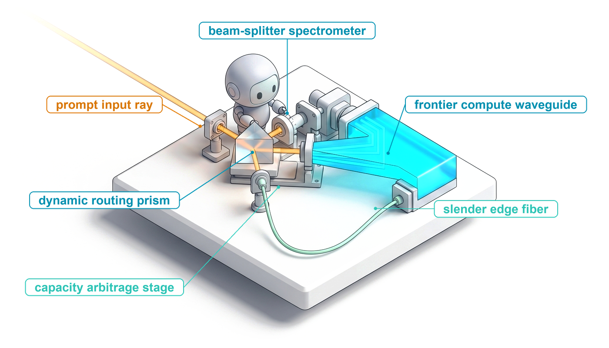
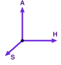
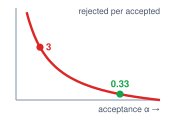
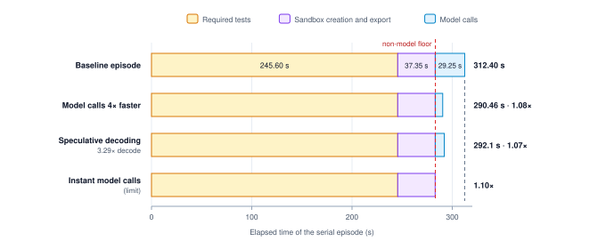
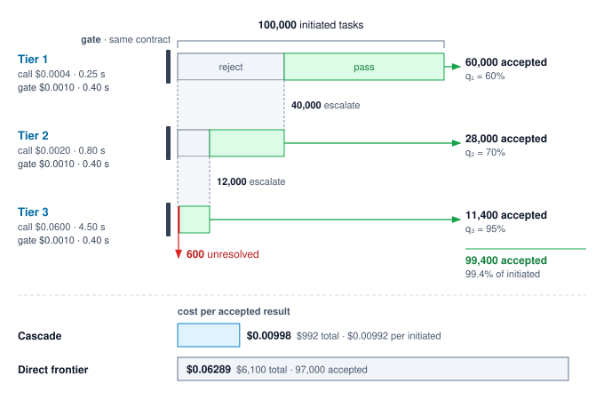
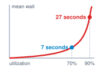
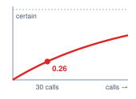
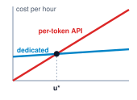
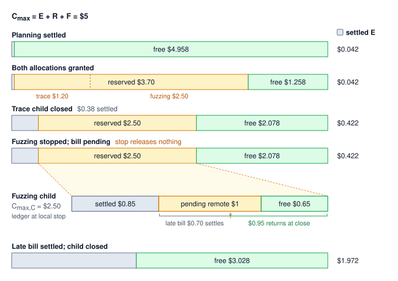

# Agent Economics {#sec-vol3-agent-economics}

::: {layout-narrow}
::: {.column-margin}

\chapterminitoc

:::

::: {.content-visible when-format="pdf"}
\noindent
{fig-alt="Blueprint for Agent Economics."}
:::

::: {.content-visible unless-format="pdf"}
{fig-alt="Blueprint for Agent Economics."}
:::

:::

## Purpose {.unnumbered .unlisted}

\begin{marginfigure}
\mlagentstack{100}{0}{0}{0}{0}{0}
\end{marginfigure}

_Why can a model with a tenth of the token price make an agent cost more for every task it finishes?_

Evaluating the cost of an agent deployment based solely on token pricing misjudges the true economics of autonomous computation. What a service delivers is an accepted task outcome, and every completed task carries the amortized financial burden of failed attempts, held sandbox infrastructure, external API fees, and human review escalations. A cheaper, lower-capability model often proves substantially more expensive in production if its lower step accuracy triggers frequent retries, long trajectory horizons, and higher failure rates. Systems architects must construct full ledger models that optimize cost per accepted result rather than cost per thousand tokens. Economic sustainability requires balancing inference investments against verification guarantees, sizing execution horizons to maximize accepted throughput under strict operational budgets.

::: {.content-visible when-format="pdf"}

\newpage

:::

::: {.callout-learning-objectives}

- Calculate cohort cost per accepted task while distinguishing attempt costs, human outcomes, and unsettled liabilities
- Evaluate prefix caching, compaction, and retry purchases under explicit billing and acceptance assumptions
- Diagnose which acceleration shortens a trajectory by computing its critical path and the model's share of it
- Evaluate model cascades under a common acceptance contract, including assessment costs and false-accept risk
- Size resource occupancy and compare provisioning choices under declared workload, quota, and queueing assumptions
- Design atomic budget reservations that preserve spending bounds across concurrent work and late settlement
- Select a loop cap or architecture by pricing automated and human-completed outcomes under one acceptance contract

:::
## The Bill Behind an Accepted Repair {#sec-vol3-agent-economics-overview}

A team running the repair agent (lighthouse \ref{lhs-vol3-repair-agent}) is offered a model whose tokens cost a tenth as much. On the provider's invoice the switch looks like a large saving. On the team's ledger it can raise the price of every repair that ships. The cheaper model may need more turns to reach a passing patch, and each turn holds a sandbox open and invokes tools. More tickets may fail assessment, and each failure still paid for its model calls, its environment, its checks, and the engineer who triages it. The token discount is real, but it applies to only part of the account.

::: {.column-margin}
{width="100%" fig-alt="H·S·A locator with all three axes, Horizon, State, and Authority, highlighted."}

*Horizon, state, and authority each set the closure a task must pay for.*
:::

The runtime built so far can already say part of what the team needs. The evaluation discipline of @sec-vol3-evaluation decides which repairs count as accepted and how two policies are compared on matched tasks, and the harness's budget ceilings stop any one task from spending without limit. Neither says whether a policy is worth running. An accuracy figure reported without its cost cannot rank two designs, which is why cost-controlled evaluation reports the two jointly [@kapoor2024agents], and a ceiling that holds says nothing about how much of the spending under it bought accepted work.

::: {.column-margin .margin-pointer}
↩ Per-task budget ceilings and the bounded-liability admission test that enforces them are established in @sec-vol3-controlplane-accounting.
:::

This chapter builds the account that joins spending to accepted outcomes. @Sec-vol3-intro-horizon-arithmetic introduced cost per accepted task, the expected cost of an attempt divided by the probability that the attempt is accepted, as one of the book's two quantitative fundamentals. Here that ratio becomes something a team can measure over a real cohort of tasks. Its numerator holds every charge an attempt incurs, its denominator counts only outcomes accepted under one declared contract, and each lever the runtime controls (reuse, retries, acceleration, routing, capacity, and delegation) is worth buying only if it lowers the ratio or buys a deadline the objective values.

The account comes first, in @sec-vol3-agent-economics-accounting, together with the rules that keep failed, canceled, and still-pending work inside it. @Sec-vol3-agent-economics-caching prices what the runtime pays to carry context from call to call and how many attempts it should buy. @Sec-vol3-agent-economics-criticalpath finds where faster execution actually shortens a task, and @sec-vol3-agent-economics-cascades decides which model should attempt the work at all. @Sec-vol3-agent-economics-capacity sizes the services that concurrent trajectories hold and wait on, and @sec-vol3-agent-economics-governance makes spending limits hold across delegated children and late bills. @Sec-vol3-agent-economics-selection then compares whole architectures under one contract, and @sec-vol3-agent-economics-synthesis prices all four lighthouse workloads to show that each is bound by a different term of the same account.

## Cost per Accepted Task {#sec-vol3-agent-economics-accounting}

An agent configuration evaluated solely against visible test cases cannot be meaningfully compared to one evaluated against a private, sealed test suite, regardless of how meticulously we tally model invoices. Acceptance is valid only under an explicitly declared contract, checker, and execution environment. To isolate the effect of an architectural policy—such as model selection, prompt construction, or tool scaffolding—we conduct a matched comparison, holding the task contract, evaluation harness, and resource ceilings fixed while varying only the agent policy. Furthermore, every sound accounting ledger requires an explicit task cohort and a definitive cutoff timestamp. These boundaries define exactly which initiated tasks are under review, which outcomes qualify as accepted before the deadline, and which downstream operations, assessments, or invoices remain pending.

### Whole-trajectory cost and the task account {#sec-vol3-agent-economics-attempt-task-accounts}

Across an attempt of $\Horizon$ turns, an agent system incurs direct inference charges alongside substantial infrastructure costs to maintain the execution environment. Assessment, teardown, and human intervention often continue long after the final token leaves the model server. This chapter numbers turns from one, $t=1,\dots,\Horizon$, so that the index matches the turn counts in its worked examples. We decompose the whole-trajectory cost of an attempt as

$$\AttemptCost = \sum_{t=1}^\Horizon \left(C_{\text{in}}^{(t)}+C_{\text{out}}^{(t)}+C_{\text{tools}}^{(t)}+C_{\text{sandbox}}^{(t)}\right)+C_{\text{verify}}+C_{\text{cleanup}}+C_{\text{human}}+C_{\text{runtime}}.$$

The input ($C_{\text{in}}^{(t)}$) and output ($C_{\text{out}}^{(t)}$) terms capture inference pricing under the relevant provider rate cards, incorporating tiered rates and prompt-caching discounts. Tool invocation fees ($C_{\text{tools}}^{(t)}$) account for billable external API requests and data lookups. The sandbox charge ($C_{\text{sandbox}}^{(t)}$) reflects the wall-clock lifetime of virtual machines or container environments, including idle wait intervals while external tools execute. Beyond the active turn loop, verification ($C_{\text{verify}}$) covers post-execution checks and test suites not already billed during sandbox execution. Cleanup ($C_{\text{cleanup}}$) accounts for state reset, storage teardown, or compensating transactions. When rejected attempts or policy escalations trigger human review, $C_{\text{human}}$ tallies manual engineering time within the declared system boundary. Finally, runtime cost ($C_{\text{runtime}}$) apportions orchestrator overhead, scheduler queues, and shared network telemetry.

A strict accounting rule governs this ledger: every cost item must map to exactly one category. If an end-of-turn integration test is billed as active sandbox compute time, it must not be double-counted under verification.

::: {#dfn-whole-trajectory-cost .callout-definition title="Whole-trajectory cost"}

***Whole-trajectory cost***\index{Whole-trajectory cost!definition} is the total expense attributed to a single execution attempt across its model calls, environment runtime, validation assessment, and required finalization within a declared accounting boundary.

1. **Significance**: It forms the fundamental numerator of cost per accepted task ($\CostPerAcceptedTaskEff$), capturing every cost driver that standard per-token pricing hides: container provisioning, external API calls, test-suite grading, state teardown, and human escalation. Crucially, failed attempts accumulate these charges just as relentlessly as successful ones.
2. **Distinction**: Whole-trajectory cost measures the expense of an individual attempt, whereas cost per accepted task amortizes all attempted and discarded work across the surviving accepted tasks in the cohort.
3. **Common pitfall**: Halting the accounting ledger the instant the agent process emits its final token, ignoring trailing cloud resources, pending cleanup jobs, or downstream engineer triage.

:::

A single initiated task may involve multiple sequential retries or parallel delegated branches. Its **task account**\index{Task account!definition}, denoted $C_{\text{task},i}$, aggregates every attempt, failed branch, and abandoned speculative execution, along with the task's assigned share of capacity and orchestration overhead. When a sub-agent branch crashes or is canceled, its incurred costs do not vanish; they remain permanently logged against the task.

In production environments, operations are rarely settled instantly. A runtime reservation or authorization hold locks resources against ongoing work or potential service liabilities. Because these funds remain committed until all external side effects resolve, any snapshot taken at an intermediate cutoff must strictly distinguish settled expenditures from **outstanding liability**\index{Outstanding liability!definition}—the reserved balance backing active, unbilled operations. The settled total serves merely as a lower bound on the final task cost until all pending obligations clear.

### Cohort cost per accepted task {#sec-vol3-agent-economics-cohort-ratio}

For a finite cohort of $\NumberOfDevices$ initiated tasks with fully resolved accounting, let $\AcceptedTasks$ represent the number of distinct tasks accepted under the declared contract. If an agent executes three successful retries on a single ticket, the system delivers exactly one accepted task; retries never inflate the denominator. For $\AcceptedTasks>0$, the cohort cost per accepted task is

$$\CostPerAcceptedTaskEff=\frac{\sum_{i=1}^{\NumberOfDevices}C_{\text{task},i}}{\AcceptedTasks}. $$

The numerator aggregates every dollar expended across all $\NumberOfDevices$ initiated tasks, whether they succeeded, crashed, timed out, or were rejected by validation. If zero tasks are accepted ($\AcceptedTasks = 0$), the ratio is undefined; a transparent system report must present the total expenditure and the zero count directly rather than masking the failure behind an artificial floor. Whenever tasks or invoices remain in flight at the accounting cutoff, the report must flag the cutoff timestamp and qualify the calculation as provisional. An unexecuted test suite represents a pending task, not an immediate failure, just as an asynchronous cloud billing adjustment can shift $\CostPerAcceptedTaskEff$ hours after the code artifact is finalized.

::: {#dfn-18-cost-per-accepted-task .callout-definition title="Cohort cost per accepted task"}

***Cohort cost per accepted task***\index{Cost per accepted task!cohort} is the total cost of every initiated task in a cohort, within a declared accounting boundary, divided by the number of distinct tasks accepted under one declared contract.

1. **Significance**: It provides the empirical, measurable form of this book's fundamental economic metric $\CostPerAcceptedTaskEff$. Because the count of accepted tasks divides every item in the numerator, a drop in task acceptance inflates the entire system bill, whereas a token price cut discounts only the inference fraction.
2. **Distinction**: Whole-trajectory cost measures the expense of an isolated attempt; cohort cost per accepted task loads all failed, canceled, and abandoned attempts onto the small fraction of work that actually passes inspection.
3. **Common pitfall**: Computing the average cost of successful trajectories alone. This survivor bias ignores the graveyard of discarded attempts whose compute and environment bills must be paid by the surviving accepted tasks.

:::

When all tasks in a cohort have reached a terminal state, we define the cohort acceptance rate as $\PermessageLatency = \AcceptedTasks / \NumberOfDevices$. Let $C_{\text{succ}}$ denote the mean cost of an accepted task, and let $C_{\text{fail}}$ denote the mean cost of an unaccepted task (encompassing outright failures, policy cancellations, and timed-out executions). When both subsets are non-empty, partitioning the numerator yields

$$\CostPerAcceptedTaskEff=C_{\text{succ}}+\frac{1-\PermessageLatency}{\PermessageLatency}C_{\text{fail}}.$$

::: {.column-margin}
{width="100%" fig-alt="Curve of rejected tasks per accepted task falling steeply as acceptance rises. A red dot at low acceptance is labeled 3 and a green dot at high acceptance is labeled 0.33."}

*Each accepted task carries the rejected ones, and that load explodes as acceptance falls.*
:::

The factor $(1-\PermessageLatency)/\PermessageLatency$ represents the rejection multiplier: the exact number of failed tasks that each accepted task must financially absorb. This expression is an exact accounting identity for the cohort, not an asymptotic model or an assumption that retries will eventually converge. As the acceptance rate $\PermessageLatency$ falls toward zero, this multiplier explodes non-linearly. Whether a steep discount on model tokens yields lower overall operating costs depends on both groups' costs, which is why no universal threshold decides model selection in isolation. The concrete bug-repair scenario below prices this trade-off directly.

```{python}
#| label: calc-vol3-agent-economics-token-price
#| echo: false
# ┌─────────────────────────────────────────────────────────────────────────────
# │ THE TOKEN-PRICE FALLACY IN A FINITE BUG-REPAIR COHORT (LEGO)
# ├─────────────────────────────────────────────────────────────────────────────
# │ Goal: Compare total spend per accepted task, with and without human triage.
# │ Show: Model and attempt costs, cohort costs, and accepted-task ratios.
# │ How:  One bounded attempt per ticket; all outcomes and charges settled.
# │ Note: Hypothetical prices and counts, not a provider schedule or experiment.
# └─────────────────────────────────────────────────────────────────────────────
from mlsysim.fmt import check, fmt, fmt_usd, fmt_int, fmt_multiple, fmt_percent

class TokenPriceFallacy:
    # ┌── 1. LOAD (Constants & Parameters) ─────────────────────────────────
    tickets = 100
    a_accepted, b_accepted = 75, 25
    a_in, a_out = 3.00, 15.00  # scenario USD per million tokens
    b_in, b_out = 0.30, 1.20
    a_turns, b_turns = 4, 7
    a_ctx, a_gen = 16_000, 800  # scenario tokens per turn
    b_ctx, b_gen = 28_000, 1_200
    c_env = 0.03  # scenario USD per turn, all tool/sandbox holding charges
    c_verify = 0.05  # scenario USD per attempt, additional assessment
    c_human = 10.00  # scenario USD per rejected attempt, triage only

    # ┌── 2. EXECUTE (Compute) ─────────────────────────────────────────────
    a_model = a_turns * (a_ctx * a_in + a_gen * a_out) / 1e6
    b_model = b_turns * (b_ctx * b_in + b_gen * b_out) / 1e6
    a_attempt = a_model + a_turns * c_env + c_verify
    b_attempt = b_model + b_turns * c_env + c_verify
    a_total, b_total = tickets * a_attempt, tickets * b_attempt
    a_rejected, b_rejected = tickets - a_accepted, tickets - b_accepted
    a_total_h = a_total + a_rejected * c_human
    b_total_h = b_total + b_rejected * c_human
    a_eff, b_eff = a_total / a_accepted, b_total / b_accepted
    a_eff_h, b_eff_h = a_total_h / a_accepted, b_total_h / b_accepted
    eff_ratio, eff_h_ratio = b_eff / a_eff, b_eff_h / a_eff_h
    a_fail_per_acc, b_fail_per_acc = a_rejected / a_accepted, b_rejected / b_accepted
    model_cut = 1 - b_model / a_model  # token-charge reduction per attempt
    attempt_cut = 1 - b_attempt / a_attempt  # all-in reduction per attempt
    needed_cut = 1 - b_accepted / a_accepted  # attempt cut that would tie per accepted task

    # ┌── 3. GUARD (Invariants) ───────────────────────────────────────────
    check(0 < b_accepted < a_accepted < tickets, "Both cohorts need accepted and rejected tasks")
    check(a_accepted + a_rejected == tickets and b_accepted + b_rejected == tickets, "Every initiated ticket must have a declared outcome")
    check(b_model < a_model and b_attempt < a_attempt, "Cheap model must cost less per attempt")
    check(b_eff > a_eff and eff_h_ratio > eff_ratio, "Acceptance and triage reverse the ranking")
    check(abs(a_total_h - a_total - a_rejected * c_human) < 1e-9, "Triage cost must be included exactly once")
    check(attempt_cut < needed_cut < model_cut, "Token cut exceeds the tie point; the all-in cut falls short")
    check(abs(eff_ratio - (1 - attempt_cut) / (1 - needed_cut)) < 1e-9, "Ratio of attempt costs over ratio of acceptances")

    # ┌── 4. OUTPUT (Formatting) ──────────────────────────────────────────
    tickets_str = fmt_int(tickets)
    a_accepted_str, b_accepted_str = fmt_int(a_accepted), fmt_int(b_accepted)
    a_rejected_str, b_rejected_str = fmt_int(a_rejected), fmt_int(b_rejected)
    a_in_str, a_out_str = fmt_usd(a_in, precision=0), fmt_usd(a_out, precision=0)
    b_in_str, b_out_str = fmt_usd(b_in, precision=2), fmt_usd(b_out, precision=2)
    a_turns_str, b_turns_str = fmt_int(a_turns), fmt_int(b_turns)
    a_ctx_str, a_gen_str = fmt_int(a_ctx), fmt_int(a_gen)
    b_ctx_str, b_gen_str = fmt_int(b_ctx), fmt_int(b_gen)
    c_env_str, c_verify_str = fmt_usd(c_env, precision=2), fmt_usd(c_verify, precision=2)
    c_human_str = fmt_usd(c_human, precision=0)
    a_model_str, b_model_str = fmt_usd(a_model, precision=3), fmt_usd(b_model, precision=3)
    a_attempt_str, b_attempt_str = fmt_usd(a_attempt, precision=3), fmt_usd(b_attempt, precision=3)
    a_total_str, b_total_str = fmt_usd(a_total, precision=0), fmt_usd(b_total, precision=3)
    a_total_h_str, b_total_h_str = fmt_usd(a_total_h, precision=0), fmt_usd(b_total_h, precision=3)
    a_eff_str, b_eff_str = fmt_usd(a_eff, precision=2), fmt_usd(b_eff, precision=2)
    a_eff_h_str, b_eff_h_str = fmt_usd(a_eff_h, precision=2), fmt_usd(b_eff_h, precision=2)
    eff_ratio_mult_str = fmt_multiple(eff_ratio, precision=1)
    eff_h_ratio_mult_str = fmt_multiple(eff_h_ratio, precision=1)
    a_fail_per_acc_str, b_fail_per_acc_str = fmt(a_fail_per_acc, precision=2), fmt(b_fail_per_acc, precision=0)
    model_cut_pct_str = fmt_percent(model_cut, precision=1, style="prose")
    attempt_cut_pct_str = fmt_percent(attempt_cut, precision=1, style="prose")
    needed_cut_pct_str = fmt_percent(needed_cut, precision=1, style="prose")
```

::: {#nbk-18-the-token-price-fallacy-in-automated .callout-notebook title="The token-price fallacy in automated bug repair"}

**Problem:** Two hypothetical configurations each process the same `{python} TokenPriceFallacy.tickets_str` tickets, with one bounded attempt per ticket and the same acceptance contract. Every attempt, rejected or not, uses the fixed per-attempt usage that @tbl-vol3-token-price-fallacy assumes for its configuration, and all outcomes and charges are settled at the cutoff. The environment charge covers tool use, sandbox holding, and cleanup; the assessment charge covers checking not billed as sandbox time, together with allocated runtime overhead. Which configuration costs less per accepted repair?

| Parameter                             | Frontier configuration                                                          | Low-token-price configuration                                                   |
|:--------------------------------------|:--------------------------------------------------------------------------------|:--------------------------------------------------------------------------------|
| Input/output price per million tokens | `{python} TokenPriceFallacy.a_in_str` / `{python} TokenPriceFallacy.a_out_str`  | `{python} TokenPriceFallacy.b_in_str` / `{python} TokenPriceFallacy.b_out_str`  |
| Turns per attempt                     | `{python} TokenPriceFallacy.a_turns_str`                                        | `{python} TokenPriceFallacy.b_turns_str`                                        |
| Input/output tokens per turn          | `{python} TokenPriceFallacy.a_ctx_str` / `{python} TokenPriceFallacy.a_gen_str` | `{python} TokenPriceFallacy.b_ctx_str` / `{python} TokenPriceFallacy.b_gen_str` |
| Accepted tickets                      | `{python} TokenPriceFallacy.a_accepted_str`                                     | `{python} TokenPriceFallacy.b_accepted_str`                                     |
| Environment cost per turn             | `{python} TokenPriceFallacy.c_env_str`                                          | `{python} TokenPriceFallacy.c_env_str`                                          |
| Additional assessment per attempt     | `{python} TokenPriceFallacy.c_verify_str`                                       | `{python} TokenPriceFallacy.c_verify_str`                                       |

: **Illustrative Bug-Repair Cohort**: Assumed prices, usage, and accepted counts for two configurations; these are arithmetic inputs, not observed measurements. {#tbl-vol3-token-price-fallacy}

**Math:** Applying the rates and usage in @tbl-vol3-token-price-fallacy gives model charges per attempt of `{python} TokenPriceFallacy.a_model_str` and `{python} TokenPriceFallacy.b_model_str`. Adding the other charges gives `{python} TokenPriceFallacy.a_attempt_str` and `{python} TokenPriceFallacy.b_attempt_str`, respectively. The complete cohorts therefore cost `{python} TokenPriceFallacy.a_total_str` and `{python} TokenPriceFallacy.b_total_str`. Dividing each total by its accepted count gives `{python} TokenPriceFallacy.a_eff_str` and `{python} TokenPriceFallacy.b_eff_str` per accepted repair. The lower-token-price configuration costs less per attempt but `{python} TokenPriceFallacy.eff_ratio_mult_str` as much per accepted task.

Now expand both accounting boundaries to include `{python} TokenPriceFallacy.c_human_str` of engineer triage for each rejected attempt. The frontier configuration has `{python} TokenPriceFallacy.a_rejected_str` rejected tickets and the other has `{python} TokenPriceFallacy.b_rejected_str`. Total costs become `{python} TokenPriceFallacy.a_total_h_str` and `{python} TokenPriceFallacy.b_total_h_str`; costs per accepted task become `{python} TokenPriceFallacy.a_eff_h_str` and `{python} TokenPriceFallacy.b_eff_h_str`, a ratio of `{python} TokenPriceFallacy.eff_h_ratio_mult_str`. Triage adds no accepted repairs; if engineers also completed tickets, that combined service would need its own named account.

**Systems insight:** With one attempt per ticket, a cheaper configuration wins only if its attempt cost falls by more than its acceptance does. Here acceptance falls by `{python} TokenPriceFallacy.needed_cut_pct_str`, so the low-price configuration needed attempts at least that much cheaper. Its token charges fall by `{python} TokenPriceFallacy.model_cut_pct_str`, but its all-in attempt cost falls by only `{python} TokenPriceFallacy.attempt_cut_pct_str`, because its extra turns each pay the environment charge. Each of its accepted repairs also carries `{python} TokenPriceFallacy.b_fail_per_acc_str` rejected attempts, against `{python} TokenPriceFallacy.a_fail_per_acc_str` for the frontier configuration, so every charge that scales with rejections, such as triage, widens the gap.

:::

::: {#psp-18-reading-cost-per-accepted .callout-perspective title="Reading a cost-per-accepted-task number"}

The cost per accepted task represents a cohort-level ratio of aggregate expenditures to accepted deliverables evaluated at an explicit cutoff timestamp. Engineers must avoid confusing this ratio with the arithmetic mean of individual task expenses; furthermore, in small cohorts, sample variability prevents this ratio from serving as an unbiased estimator of the theoretical planning ratio $\mathbb{E}[\AttemptCost]/\AcceptanceProbability$. To be actionable, any reported $\CostPerAcceptedTaskEff$ figure must be accompanied by its full context: total cohort expenditure, accepted task count with statistical confidence bounds, end-to-end latency distributions, pending execution statuses, and outstanding liabilities. An isolated efficiency number shorn of these context markers cannot support valid comparisons between competing system policies.

A rigorous matched comparison holds the acceptance contract and maximum resource allowances fixed across configurations, rather than enforcing identical expenditures. A more aggressive search policy might intentionally spend more compute per ticket to meet stringent latency deadlines or maximize task coverage, provided the underlying system objective values those gains. Inverting this metric yields **goodput per dollar**\index{Goodput per dollar!definition}—accepted tasks delivered per unit of currency—which tracks identical boundary accounting from a throughput perspective. In both formulations, acceptance confirms only that an artifact satisfied the automated contract within the designated test suite; it does not guarantee the complete absence of latent defects.

:::

::: {.column-margin .margin-pointer}
↩ Matched-budget comparison, which fixes the acceptance contract and resource envelope while each policy spends it differently, is established in @sec-vol3-evaluation-matched-budgets.
:::

Decomposing system costs in this manner immediately reveals which architectural optimizations yield the highest return. The dominant term in the trajectory account varies significantly across agent workloads, as detailed across the four lighthouse benchmarks evaluated in @sec-vol3-agent-economics-synthesis. In automated bug repair, for instance, repeated prompt context constitutes the overwhelming majority of inference charges. Implementing prefix caching and context compaction drastically reduces the cost of maintaining conversational history across turns, while tuned reasoning limits and adaptive retry budgets curtail the total count of model invocations.

## Caching and Reasoning Budgets {#sec-vol3-agent-economics-caching}

When an agent interacts with a language model across multiple turns, identical prompt prefixes recur across successive invocations. Rather than recomputing attention states on every call, modern inference engines retain and share these activations across requests. While reused key-value (KV) state lowers processing costs significantly, it is not free. System designers must price this reuse accurately to evaluate fundamental operational trade-offs: whether compacting context reduces overall billing, and whether purchasing additional inference attempts lowers the ultimate cost per accepted task under a fixed verification contract. Both context validation principles and cache management mechanics govern when such reuse is physically permissible.

::: {.column-margin .margin-pointer}
↩ The exact-prefix, execution-parameter, residency, and tenant conditions under which retained attention state may be reused are established in @sec-vol3-kv-cache-prefix-compatibility.
:::

### Economic valuation of prefix cache hits {#sec-vol3-agent-economics-prefix-cache-value}

Evaluating multi-turn agent economics requires distinguishing between logical input, physical computation, and billed tokens. A model provider often retains compatible KV state across calls even when an agent client retransmits the complete conversation transcript on every turn.[^fn-prefix-reuse-billing] Over an execution trajectory of $\Horizon$ turns, one call each, let $S^{(t)}$ represent the logical input length on call $t$, $S_{\text{hit}}^{(t)}$ its eligible cached prefix length, and $K^{(t)}$ its billed output length. Under a published tariff with per-token rates $\PertokenPricesIn$ for fresh input, $\PertokenPricesCache$ for cached input, and $\PertokenPricesOut$ for generated output, the total token charge is

$$
C_{\text{session}}=\sum_{t=1}^{H}\left[\PertokenPricesIn(S^{(t)}-S_{\text{hit}}^{(t)})+\PertokenPricesCache{}S_{\text{hit}}^{(t)}+\PertokenPricesOut{}K^{(t)}\right].
$$ {#eq-vol3-agent-economics-session-bill}

[^fn-prefix-reuse-billing]: **Prefix Reuse**: Serving systems make cross-request reuse practical by storing attention state in paged memory blocks that requests sharing a prefix can share [@kwon2023], and by indexing retained state in a radix tree so subsequent calls locate their longest cached prefix [@zheng2024sglang]. A discounted cached-input tariff reflects this underlying mechanism directly: only an exact, resident token prefix qualifies for the discount.

Commercial pricing models often incorporate additional dimensions, including cache-write surcharges, hourly retention fees, and minimum eligible prefix thresholds. In an append-only agent transcript, each turn re-sends the cumulative history alongside newly observed tool outputs and model generations. If the initial prompt contains $\BasePromptLength$ tokens and each subsequent turn appends exactly $\PerturnAppend$, total logical input grows quadratically:

$$
\PromptTokensSent=H \BasePromptLength+\PerturnAppend\frac{H(H-1)}{2}.
$$

Under ideal prefix reuse, the provider charges the initial prompt and each appended increment at the fresh-input rate exactly once: $S_{\text{fresh}}=\BasePromptLength+(\Horizon-1)\PerturnAppend$. The total input bill is therefore $\PertokenPricesIn{}S_{\text{fresh}}+\PertokenPricesCache(\PromptTokensSent-S_{\text{fresh}})$. Because both $\PertokenPricesCache$ and $\PerturnAppend$ remain positive, the quadratic growth term does not disappear; caching merely scales down its cost coefficient from $\PertokenPricesIn$ to $\PertokenPricesCache$. These formulations account for billed input tokens, not the physical accelerator memory required to hold this reusable state across requests.

::: {.column-margin .margin-pointer}
↩ The accelerator memory that retained attention state occupies is established in @sec-vol3-kvcache-geometry.
:::

Prefix hits require strict alignment between the incoming token sequence and the cached execution context, including model weights, sampling hyperparameters, and tenant isolation boundaries (principle \ref{pri-vol3-prefix-coherence}). Reusability breaks at the first altered token. In production deployments, distributed request routing, memory pressure and cache eviction, and protracted tool execution times degrade realized hit rates. Economic models must therefore price observed, eligible hits under the actual service contract rather than assuming theoretical upper bounds.

```{python}
#| label: calc-vol3-agent-economics-prefix-cache
#| echo: false
#| output: false
# ┌─────────────────────────────────────────────────────────────────────────────
# │ PRICE REUSED INPUT AND COMPACTION (LEGO)
# ├─────────────────────────────────────────────────────────────────────────────
# │ Context: @nbk-18-prefix-cache-dollars and @nbk-vol3-compaction-crossing.
# │ Goal: Price logical input and find the first paying compaction horizon.
# │ Show: Cache bill, summary/rebuild cost, and adjacent integer horizons.
# │ How: Declared ideal-reuse tariff; compaction causes a complete cache miss.
# └─────────────────────────────────────────────────────────────────────────────
from math import ceil
from mlsysim import USD
from mlsysim.fmt import check, fmt_int, fmt_usd, fmt_multiple, fmt_percent

class PrefixCacheCost:
    # ┌── 1. LOAD (Hypothetical tariff and fixed trajectory) ────────────────
    turns, s0, delta, k_turn = 30, 8_000, 1_500, 200
    p_in, p_out = 3 * USD, 15 * USD  # per million tokens
    cached_share = 0.10
    compact_turn, compact_to, summary_out = 16, 12_000, 1_500

    # ┌── 2. EXECUTE (Bills and incremental compaction cost) ────────────────
    sent = turns * s0 + delta * turns * (turns - 1) // 2
    fresh = s0 + delta * (turns - 1)
    in_nocache = sent * p_in / 1_000_000
    in_cache = (fresh + cached_share * (sent - fresh)) * p_in / 1_000_000
    out_cost = turns * k_turn * p_out / 1_000_000
    total_nocache, total_cache = in_nocache + out_cost, in_cache + out_cost
    cache_ratio = (total_nocache / total_cache).magnitude
    ctx_at = s0 + (compact_turn - 1) * delta
    rest = turns - compact_turn + 1
    first_keep = (delta + (ctx_at - delta) * cached_share) * p_in / 1_000_000
    first_comp = compact_to * p_in / 1_000_000
    summary_cost = first_keep + summary_out * p_out / 1_000_000
    upfront = summary_cost + first_comp - first_keep
    per_turn_saving = (ctx_at - compact_to) * cached_share * p_in / 1_000_000
    breakeven_turns = 1 + ceil((upfront / per_turn_saving).magnitude)
    keep_sum = rest * ctx_at + delta * rest * (rest - 1) // 2
    keep_cost = (rest * delta + cached_share * (keep_sum - rest * delta)) * p_in / 1_000_000
    comp_sum = rest * compact_to + delta * rest * (rest - 1) // 2
    comp_fresh = compact_to + (rest - 1) * delta
    comp_cost = (comp_fresh + cached_share * (comp_sum - comp_fresh)) * p_in / 1_000_000
    comp_total = comp_cost + summary_cost
    gap_before = upfront - (breakeven_turns - 2) * per_turn_saving
    saving_at = (breakeven_turns - 1) * per_turn_saving - upfront
    hit_drop = 0.10  # scenario: share of the eligible prefix that misses
    miss_cost = hit_drop * (sent - fresh) * (1 - cached_share) * p_in / 1_000_000
    miss_pct = (miss_cost / total_cache).magnitude
    # upfront does not depend on the cached rate; the per-call saving scales with it
    breakeven_half = 1 + ceil((upfront / (per_turn_saving / 2)).magnitude)

    # ┌── 3. GUARD (Independent direct sums and integer crossing) ───────────
    direct_keep, direct_comp = 0 * USD, first_comp
    for j in range(rest):
        direct_keep += (delta + cached_share * (ctx_at + j * delta - delta)) * p_in / 1_000_000
        if j > 0:
            direct_comp += (delta + cached_share * (compact_to + (j - 1) * delta)) * p_in / 1_000_000
    check(abs((direct_keep - keep_cost).to(USD).magnitude) < 1e-12, "Keep sum")
    check(abs((direct_comp - comp_cost).to(USD).magnitude) < 1e-12, "Compact sum")
    check(
        abs(((comp_total - keep_cost) - (upfront - (rest - 1) * per_turn_saving)).to(USD).magnitude) < 1e-12,
        "First-turn incremental cost plus later savings",
    )
    check(gap_before > 0 * USD and saving_at >= 0 * USD, "First integer crossing")
    check(breakeven_turns == 12 and comp_total < keep_cost, "Scenario crossing")
    check(breakeven_half > rest >= breakeven_turns, "Halving the cached rate pushes payback past the horizon")
    check(0.3 < miss_pct < 0.6, "A ten-point hit-rate loss is a large share of the cached bill")

    # ┌── 4. OUTPUT (Formatting) ───────────────────────────────────────────
    turns_str, s0_str, delta_str = fmt_int(turns), fmt_int(s0), fmt_int(delta)
    k_turn_str = fmt_int(k_turn)
    p_in_str, p_out_str = fmt_usd(p_in, precision=0), fmt_usd(p_out, precision=0)
    cached_pct_str = fmt_percent(cached_share, precision=0, style="prose")
    sent_str, fresh_str = fmt_int(sent), fmt_int(fresh)
    in_nocache_str, in_cache_str = fmt_usd(in_nocache, precision=3), fmt_usd(in_cache, precision=3)
    out_cost_str = fmt_usd(out_cost, precision=3)
    total_nocache_str, total_cache_str = fmt_usd(total_nocache, precision=3), fmt_usd(total_cache, precision=3)
    cache_ratio_mult_str = fmt_multiple(cache_ratio, precision=1)
    compact_turn_str, ctx_at_str = fmt_int(compact_turn), fmt_int(ctx_at)
    compact_to_str, summary_out_str = fmt_int(compact_to), fmt_int(summary_out)
    rest_str = fmt_int(rest)
    keep_cost_str, comp_cost_str = fmt_usd(keep_cost, precision=5), fmt_usd(comp_cost, precision=5)
    summary_cost_str, comp_total_str = fmt_usd(summary_cost, precision=5), fmt_usd(comp_total, precision=5)
    upfront_str, per_turn_saving_str = fmt_usd(upfront, precision=5), fmt_usd(per_turn_saving, precision=5)
    breakeven_turns_str, before_str = fmt_int(breakeven_turns), fmt_int(breakeven_turns - 1)
    gap_before_str, saving_at_str = fmt_usd(gap_before, precision=5), fmt_usd(saving_at, precision=5)
    hit_drop_pct_str = fmt_percent(hit_drop, precision=0, style="prose")
    miss_cost_str = fmt_usd(miss_cost, precision=3)
    miss_pct_str = fmt_percent(miss_pct, precision=1, style="prose")
    half_cached_pct_str = fmt_percent(cached_share / 2, precision=0, style="prose")
    breakeven_half_str = fmt_int(breakeven_half)
```

::: {#nbk-18-prefix-cache-dollars .callout-notebook title="Pricing an append-only trajectory"}

**Problem**: An agent trajectory runs `{python} PrefixCacheCost.turns_str` turns, starting with an initial prompt of `{python} PrefixCacheCost.s0_str` input tokens and appending `{python} PrefixCacheCost.delta_str` tokens on each subsequent turn. Each invocation generates `{python} PrefixCacheCost.k_turn_str` output tokens. The provider tariff charges `{python} PrefixCacheCost.p_in_str` per million fresh input tokens, `{python} PrefixCacheCost.p_out_str` per million output tokens, and `{python} PrefixCacheCost.cached_pct_str` of the fresh-input price for cached reads, with no separate write or retention fees. How much does ideal prefix reuse reduce the token bill for this trajectory?

**Math**: Cumulative logical input across all turns reaches `{python} PrefixCacheCost.sent_str` tokens. Under ideal prefix reuse, only `{python} PrefixCacheCost.fresh_str` tokens are billed at the fresh-input rate. Input processing therefore costs `{python} PrefixCacheCost.in_nocache_str` without reuse vs. `{python} PrefixCacheCost.in_cache_str` with prefix caching. Combining this with the constant `{python} PrefixCacheCost.out_cost_str` output charge yields total bills of `{python} PrefixCacheCost.total_nocache_str` and `{python} PrefixCacheCost.total_cache_str`, representing a `{python} PrefixCacheCost.cache_ratio_mult_str` cost reduction.

**Systems insight**: Cache hit rate governs financial efficiency. Because historical context constitutes almost all of this trajectory's input, even small reductions in hit rate produce large absolute billing increases. If `{python} PrefixCacheCost.hit_drop_pct_str` of the eligible prefix misses—for example, when a volatile timestamp or session identifier is placed near the prompt header—the session cost increases by `{python} PrefixCacheCost.miss_cost_str`, wiping out `{python} PrefixCacheCost.miss_pct_str` of the cached total savings. Prefix caching modifies only the model inference term in effective cost ($\CostPerAcceptedTaskEff$): it lowers the cost of carrying context across turns while leaving delivered inputs, outputs, and task acceptance unchanged.

:::

### The price of compaction {#sec-vol3-agent-economics-compaction-price}

Unlike prefix caching, context compaction actively alters the input transcript. Replacing prior conversation turns with an aggregated summary shortens the active prompt, though it risks invalidating cached attention state. If summarization preserves a stable system prefix, subsequent requests can still reuse those initial blocks. To establish a clean economic lower bound, however, consider the case of a complete cache miss: the first compacted invocation shares no reusable prefix with prior turns, but subsequent calls resume append-only prefix reuse from the compacted prompt. We compare this against retaining the full uncompacted context over the same remaining turns, holding future token additions and ordinary output lengths constant. This analysis isolates the pure token price of compaction; whether a given summary preserves downstream task acceptance is evaluated separately using the context-policy evaluation of @sec-vol3-context-engineering-evaluation.

Let $\SequenceLength$ be the input length at the moment of compaction, $S_{\text{comp}} < \SequenceLength$ the compacted length, and $N_{\text{rem}} \ge 1$ the remaining ordinary invocations, **including the first compacted call**. In this scenario, the summarization call reads the existing cached history at the same cached input price as an uncompacted turn would have, meaning those read charges cancel out in a differential analysis. The net cost of generating the summary is simply the price of its generated tokens, $\PertokenPricesOut{}K_{\text{sum}}$. The first compacted ordinary call must then transmit all $S_{\text{comp}}$ tokens as fresh input to rebuild server KV cache state. Relative to keeping the original context, the upfront investment $U$ is:

$$
U=\PertokenPricesOut{}K_{\text{sum}}+\PertokenPricesIn{}S_{\text{comp}},
$$

which combines the output generation fee of the summary with the fresh-input cost of repopulating the cache. Each subsequent call saves $s=\PertokenPricesCache(\SequenceLength-S_{\text{comp}})$ under the assumption of equal incremental growth. The cumulative cost difference across $N_{\text{rem}}$ remaining calls is therefore:

$$
C_{\text{compact}}(N_{\text{rem}})-C_{\text{keep}}(N_{\text{rem}})=U-(N_{\text{rem}}-1)s,
\qquad
N_{\min}=1+\left\lceil\frac{U}{s}\right\rceil
\quad(U>0,\ s>0).
$$

Here $N_{\min}$ represents the **payback horizon**\index{Payback horizon!definition}: the minimum number of remaining invocations required for per-turn cache savings to offset the initial compaction surcharge. When $U \le 0$, compaction pays for itself on the very first call; when $s = 0$ and $U > 0$, compaction never recovers its cost on token pricing alone. Accounting for the first compacted call separately from later turns prevents off-by-one errors when estimating the remaining trajectory budget.

::: {#nbk-vol3-compaction-crossing .callout-notebook title="Count the first compacted call"}

**Problem**: In the preceding scenario, suppose the agent triggers compaction at turn `{python} PrefixCacheCost.compact_turn_str`, compressing `{python} PrefixCacheCost.ctx_at_str` tokens down to `{python} PrefixCacheCost.compact_to_str`. The summarization call emits `{python} PrefixCacheCost.summary_out_str` tokens under standard cached-history pricing. If `{python} PrefixCacheCost.rest_str` ordinary calls remain (including the first compacted turn), what is the minimum remaining horizon required for compaction to cost no more than retaining the full context?

**Math**: Retaining the uncompressed context incurs `{python} PrefixCacheCost.keep_cost_str` in remaining input costs. Compaction incurs `{python} PrefixCacheCost.comp_cost_str` across remaining ordinary calls plus `{python} PrefixCacheCost.summary_cost_str` for the summarizer, totaling `{python} PrefixCacheCost.comp_total_str`. The upfront differential is `{python} PrefixCacheCost.upfront_str`, against which each subsequent turn saves `{python} PrefixCacheCost.per_turn_saving_str`. With `{python} PrefixCacheCost.before_str` calls remaining, compaction still costs `{python} PrefixCacheCost.gap_before_str` more than baseline. Reaching `{python} PrefixCacheCost.breakeven_turns_str` remaining calls yields a net saving of `{python} PrefixCacheCost.saving_at_str`.

**Systems insight**: Compaction lowers total expenditure only when the remaining trajectory length meets or exceeds the payback horizon $N_{\min}$. Crucially, $N_{\min}$ scales inversely with the cached read rate: the upfront cost $U$ depends on $\PertokenPricesIn$ and $\PertokenPricesOut$, whereas the per-call savings $s$ are proportional to $\PertokenPricesCache$. If the cached read tariff drops from `{python} PrefixCacheCost.cached_pct_str` to `{python} PrefixCacheCost.half_cached_pct_str` of the fresh-input price, the break-even horizon extends to `{python} PrefixCacheCost.breakeven_half_str` calls. Because only `{python} PrefixCacheCost.rest_str` calls remain, compaction under this discounted rate loses money. As KV caching becomes cheaper, compaction must occur earlier in an execution trajectory to justify its cache-invalidation penalty. Late-stage compaction must be justified by context window limits or attention fidelity rather than token savings; an aggressive summary that drops a crucial constraint and lowers acceptance erases any marginal token economy.

:::

### Reasoning and retry budgets {#sec-vol3-agent-economics-reasoning-retry-budgets}

An agent runtime can also allocate budget dynamically by purchasing deeper internal reasoning within a single invocation or by funding multiple independent execution attempts. A configured reasoning token limit acts as an upper ceiling rather than a fixed spend. Financial accounting must track actual billed token consumption and its empirical effect on task acceptance under an identical evaluation contract. Because internal deliberation generates tokens serially, systems engineers must evaluate this extra compute against increased turn latency.

::: {.column-margin .margin-pointer}
↩ The distinction between internal deliberation budgets and external orchestration is established in @sec-vol3-test-time-compute-latent-vs-scaffold.
:::

Consider a baseline model of **sequential retry**\index{Sequential retry!definition} with early stopping, in which every attempt on a task exhibits an identical acceptance probability $\HiddenDimensionFour > 0$. Conditioning on a fixed task prompt and external environment, attempts represent independent draws from the same agent configuration, each incurring an all-inclusive cost $c$ covering model inference, sandbox runtime, and output verification. Sequential retry terminates immediately upon the first accepted result or halts after exhausting a budget of $k$ attempts. The overall task acceptance probability (or coverage) is $Q_k = 1 - (1 - \HiddenDimensionFour)^k$, and the expected number of executed attempts is $\sum_{j=0}^{k-1}(1-\HiddenDimensionFour)^j = Q_k / \HiddenDimensionFour$. Dividing the expected total spend by the expected accepted tasks yields $(c Q_k / \HiddenDimensionFour) / Q_k = c / \HiddenDimensionFour$. Under early stopping with independent trials, the expected cost per accepted task remains invariant to the attempt cap $k$: raising $k$ expands overall task coverage, while early termination holds the average cost per successful outcome at exactly $c / \HiddenDimensionFour$.

In contrast, launching all $k$ attempts concurrently in a parallel batch costs $k c / Q_k$ per expected accepted task, provided the evaluation harness can identify and return an accepted candidate from the pool.

```{python}
#| label: calc-vol3-agent-economics-retry-budget
#| echo: false
#| output: false
# ┌─────────────────────────────────────────────────────────────────────────────
# │ PRICE BOUNDED ATTEMPT POLICIES (LEGO)
# ├─────────────────────────────────────────────────────────────────────────────
# │ Context: @nbk-vol3-economics-retry-policies.
# │ Goal: Separate coverage, per-input spend, and cost per accepted task.
# │ Show: Sequential early stop, fully paid batch, and one stronger attempt.
# │ How: Homogeneous conditional iid acceptance and fixed all-in attempt cost.
# └─────────────────────────────────────────────────────────────────────────────
from mlsysim import USD
from mlsysim.fmt import check, fmt, fmt_int, fmt_usd, fmt_percent, fmt_multiple

class RetryBudget:
    # ┌── 1. LOAD (Independent hypothetical policy comparison) ──────────────
    p_small, p_big, k = 0.30, 0.70, 5
    c_small, c_big = 0.10 * USD, 0.40 * USD

    # ┌── 2. EXECUTE (Expected costs include rejected attempts) ─────────────
    coverage = 1 - (1 - p_small) ** k
    seq_attempts = 0.0
    for j in range(k):
        seq_attempts += (1 - p_small) ** j
    seq_cost, par_cost = c_small * seq_attempts, k * c_small
    seq_per_acc, par_per_acc = seq_cost / coverage, par_cost / coverage
    big_per_acc = c_big / p_big
    batch_premium = k / seq_attempts  # paid batch vs. early stop, same coverage

    # ┌── 3. GUARD (Geometric identity and scenario ordering) ───────────────
    check(abs(seq_attempts - coverage / p_small) < 1e-12, "Expected attempts")
    check(abs((seq_per_acc - c_small / p_small).to(USD).magnitude) < 1e-12, "Cost ratio")
    check(coverage > p_big and seq_per_acc < big_per_acc < par_per_acc, "Scenario comparison")
    check(abs(batch_premium - (par_per_acc / seq_per_acc)) < 1e-9, "Batch premium is the attempt ratio")

    # ┌── 4. OUTPUT (Formatting) ───────────────────────────────────────────
    p_small_str, p_big_str = fmt(p_small, precision=2), fmt(p_big, precision=2)
    c_small_str, c_big_str = fmt_usd(c_small, precision=2), fmt_usd(c_big, precision=2)
    k_str, coverage_pct_str = fmt_int(k), fmt_percent(coverage, precision=1, style="prose")
    seq_attempts_str = fmt(seq_attempts, precision=3)
    seq_cost_str, par_cost_str = fmt_usd(seq_cost, precision=3), fmt_usd(par_cost, precision=3)
    seq_per_acc_str = fmt_usd(seq_per_acc, precision=3)
    par_per_acc_str, big_per_acc_str = fmt_usd(par_per_acc, precision=3), fmt_usd(big_per_acc, precision=3)
    p_big_pct_str = fmt_percent(p_big, precision=0, style="prose")
    batch_premium_mult_str = fmt_multiple(batch_premium, precision=1)
```

::: {#nbk-vol3-economics-retry-policies .callout-notebook title="What a retry cap buys"}

**Problem**: A lightweight agent configuration exhibits an acceptance probability of `{python} RetryBudget.p_small_str` at an all-in cost of `{python} RetryBudget.c_small_str` per attempt. A stronger configuration achieves `{python} RetryBudget.p_big_str` acceptance but costs `{python} RetryBudget.c_big_str` per attempt. Allowing up to `{python} RetryBudget.k_str` lightweight attempts under the independent-trials model, which policy achieves the lowest cost per expected accepted task: sequential retry with early stopping, an unconditional parallel batch of `{python} RetryBudget.k_str` attempts, or a single attempt from the stronger model?

**Math**: Sequential retry achieves an expected coverage of `{python} RetryBudget.coverage_pct_str` while consuming `{python} RetryBudget.seq_attempts_str` attempts per task. This produces an expected spend of `{python} RetryBudget.seq_cost_str` per submitted task and `{python} RetryBudget.seq_per_acc_str` per accepted task. Running all `{python} RetryBudget.k_str` attempts in parallel yields identical coverage but requires `{python} RetryBudget.par_cost_str` per submitted task, increasing the cost per accepted task to `{python} RetryBudget.par_per_acc_str`. A single invocation of the stronger model costs `{python} RetryBudget.big_per_acc_str` per accepted task.

**Systems insight**: Under early stopping, sequentially retrying a cheaper model outperforms a single call to a stronger model whenever $c_{\text{small}}/p_{\text{small}} < c_{\text{big}}/p_{\text{big}}$. In this scenario, sequential retry also delivers superior aggregate coverage (`{python} RetryBudget.coverage_pct_str` vs. `{python} RetryBudget.p_big_pct_str`). Executing the batch concurrently secures that same coverage at a `{python} RetryBudget.batch_premium_mult_str` multiplier in cost per accepted task—the ratio of $k$ to the expected sequential attempt count. A parallel burst is justified only when strict wall-clock deadlines assign significant value to lower latency, offsetting the substantial financial premium.

:::

Production workloads rarely exhibit a single, uniform success probability $\HiddenDimensionFour$. Difficult tasks maintain persistently low acceptance rates across repeated attempts. Consequently, substituting an average per-task success rate into $1-(1-\HiddenDimensionFour)^k$ systematically overstates aggregate coverage, causing the realized cost per accepted task to drift above the idealized $c/\HiddenDimensionFour$ ratio. Empirical repeated-sampling studies demonstrate this dynamic: on benchmarks with automated verification, task coverage—the fraction of tasks solved by at least one sample—continues to climb across multiple orders of magnitude of generated samples, scaling roughly log-linearly rather than saturating as a single-parameter model would predict [@brown2024monkeys]. Environmental feedback, service outages, and shared mutable state further complicate fixed-probability assumptions. Engineers must therefore evaluate retry policies using outcome distributions measured per task over repeated runs.

::: {.column-margin .margin-pointer}
↩ Per-task acceptance probabilities, and the distinction between a task and a repeated run of it, are established in @sec-vol3-evaluation-resampling.
:::

Generating extra candidate solutions also introduces verification risk. As analyzed in @sec-vol3-test-time-compute-selection-costs, repeated sampling raises the chance of a false acceptance, where a flawed candidate satisfies test assertions without truly solving the underlying task. Passing an automated check provides domain-specific verification evidence rather than an absolute guarantee of correctness. Ultimately, prefix caching, context compaction, and retry policies govern what compute resources an agent runtime purchases; determining how those purchased operations dictate end-to-end latency requires analyzing the critical execution path.

## Critical-Path Latency {#sec-vol3-agent-economics-criticalpath}

Accelerating a model call rarely yields a proportional reduction in end-to-end task time. In realistic agent workflows, container provisioning, repository setup, test suite execution, tool I/O, and consensus validation often dominate total elapsed time. Evaluating an acceleration technique therefore requires an end-to-end systems perspective: how much wall-clock time does the proposed change strip from the critical path to a declared endpoint, what compute and memory resources does it consume, and does the accelerated execution preserve the required acceptance evidence? Tracing exposes where time actually goes, while economic accounting determines whether accelerating that specific span is worth the operational cost.

### Dependency graphs and elapsed time {#sec-vol3-agent-economics-dependency-graphs}

Distributed tracing distinguishes enclosing parent spans from the nested operations within them. Summing a parent span's duration with the durations of its children double-counts time. Similarly, simply summing concurrent sibling spans inflates apparent latency, whereas omitting queueing delays, network transit, or uninstrumented runtime pauses undercounts it. When profiling an agent runtime, uninstrumented intervals must remain explicitly accounted for as unexplained gaps rather than arbitrarily attributed to neighboring components.

::: {.column-margin .margin-pointer}
↩ Parent-child span nesting and the double-counting it causes in latency attribution are established in @sec-vol3-evaluation-tracing-latency.
:::

Crucially, a span's parent in a call tree denotes syntactic containment, which does not necessarily reflect an execution dependency. An agent runtime might spawn background log flushes or asynchronous cache warmers that outlive the caller without blocking the next step. To determine end-to-end latency, we must construct a directed acyclic execution graph based on true dispatch and join conditions: a directed edge indicates that the successor task cannot begin until its predecessor completes. Along any path, we count only disjoint, non-overlapping intervals rather than inclusive parent spans alongside their children. For a directed dependency graph with vertex durations $t(\SpeedAtDetection)$ and source-to-sink paths $\Pi$, the longest path defines the **critical path**\index{Critical path!trajectory}:[^fn-critical-path-method]

$$T_{\text{crit}} = \max_{\pi \in \Pi} \sum_{\SpeedAtDetection \in \pi} t(\SpeedAtDetection).$$ {#eq-vol3-critical-path}

[^fn-critical-path-method]: **Critical Path**: The critical-path method was introduced for planning and scheduling large engineering projects, where the longest chain of dependent activities fixes the completion date and every activity off that chain has slack [@kelley1959critical]. Distributed-systems work later recovered the same dependency model from existing component logs of production requests, precisely so that critical-path and slack analysis could say which component's speedup would shorten end-to-end latency [@chow2014mystery]. An agent trace needs the same reconstruction before any acceleration is priced.

When the graph contains only mandatory computation, @eq-vol3-critical-path establishes an idealized lower bound on completion time. The critical path matches the actual observed wall-clock interval only when the dependency graph incorporates real-world scheduling artifacts: thread scheduling delays, resource contention waits, queueing latencies, and sandbox initialization. Furthermore, the boundary of the graph depends on the system contract. Emitting an initial streamed token, evaluating a candidate patch against unit tests, and fully committing a validated pull request represent fundamentally different completion endpoints, each with its own dependency sink.

Accelerating a non-critical branch leaves end-to-end latency unchanged under a fixed schedule, although it may free cluster capacity or reduce hosting costs. Conversely, accelerating an operation on the critical path often shifts the bottleneck elsewhere: once the original limiting path shrinks below a parallel branch, that alternate branch becomes the new critical path. Systems engineers must therefore recompute critical paths dynamically after each proposed optimization, rather than naively subtracting isolated component savings from total elapsed time.

### The payoff of faster inference {#sec-vol3-agent-economics-inference-payoff}

```{python}
#| label: calc-vol3-agent-economics-critical-path
#| echo: false
# WHERE FASTER INFERENCE HELPS (LEGO)
# Goal: Bound elapsed-time savings in one fixed, serial repair episode.
# Scope: Hypothetical seconds, not measurements or a fleet workload model.
from mlsysim import second
from mlsysim.fmt import fmt_qty, fmt_percent, fmt_multiple, check

class CriticalPath:
    # 1. LOAD: sequential intervals; all required work remains unchanged.
    model_intervals_s = (1.20, 8.40, 1.85, 11.20, 2.10, 4.50)
    tests_s = 245.60
    lifecycle_intervals_s = (14.80, 22.55)
    runtime_status_intervals_s = (0.12, 0.08)
    model_speedup = 4.0

    # 2. EXECUTE: each interval belongs to exactly one category.
    model_s = sum(model_intervals_s)
    lifecycle_s = sum(lifecycle_intervals_s)
    runtime_status_s = sum(runtime_status_intervals_s)
    other_s = tests_s + lifecycle_s + runtime_status_s
    total_s = model_s + other_s
    model_fraction = model_s / total_s
    changed_s = other_s + model_s / model_speedup
    saving_s = total_s - changed_s
    speedup = total_s / changed_s
    limiting_speedup = total_s / other_s
    tests_half_saving_s = tests_s / 2  # alternative: halve the required test interval

    # 3. GUARD: disjoint accounting and independent Amdahl calculation.
    check(all(t >= 0 for t in model_intervals_s + lifecycle_intervals_s + runtime_status_intervals_s), "Nonnegative intervals")
    check(tests_s >= 0 and other_s > 0 and model_speedup >= 1, "Valid acceleration domain")
    check(abs(total_s - 312.40) < 1e-9, "Full declared elapsed interval")
    check(abs(changed_s - total_s * (1 - model_fraction + model_fraction / model_speedup)) < 1e-9, "Independent Amdahl calculation")
    check(abs(saving_s - 21.9375) < 1e-9, "Independent saved model time")
    check(1 <= speedup <= limiting_speedup, "Finite acceleration respects limiting bound")
    check(tests_half_saving_s > 5 * saving_s, "Halving tests must dominate the model speedup here")

    # 4. OUTPUT: each export is used below, with units supplied once.
    model_str = fmt_qty(model_s * second, second, precision=2)
    tests_str = fmt_qty(tests_s * second, second, precision=2)
    lifecycle_str = fmt_qty(lifecycle_s * second, second, precision=2)
    runtime_status_str = fmt_qty(runtime_status_s * second, second, precision=2)
    total_str = fmt_qty(total_s * second, second, precision=2)
    fraction_str = fmt_percent(model_fraction, precision=1, style="prose")
    model_speedup_mult_str = fmt_multiple(model_speedup, precision=0)
    changed_str = fmt_qty(changed_s * second, second, precision=2)
    saving_str = fmt_qty(saving_s * second, second, precision=2)
    speedup_mult_str = fmt_multiple(speedup, precision=2)
    limiting_speedup_mult_str = fmt_multiple(limiting_speedup, precision=2)
    tests_half_saving_str = fmt_qty(tests_half_saving_s * second, second, precision=1)
```

::: {#nbk-18-critical-path-investment .callout-notebook title="How much does faster inference buy?"}

**Problem**: In a hypothetical three-turn repair episode, how much elapsed time does a `{python} CriticalPath.model_speedup_mult_str` acceleration of every model call save?

**Variables**: All intervals execute sequentially, from runtime initialization through final sandbox snapshot export, without queueing, overlapping execution, or uninstrumented gaps. The durations listed in @tbl-vol3-trace-critical-path represent disjoint, non-overlapping sums rather than nested spans. The proposed acceleration modifies only inference latency, leaving model outputs, tool operations, test evidence, scheduling decisions, and finalization unchanged.

| Disjoint category                            |                               Elapsed time |
|:---------------------------------------------|-------------------------------------------:|
| Model calls across the three turns           |          `{python} CriticalPath.model_str` |
| Required test execution                      |          `{python} CriticalPath.tests_str` |
| Sandbox creation and snapshot export         |      `{python} CriticalPath.lifecycle_str` |
| Runtime initialization and repository status | `{python} CriticalPath.runtime_status_str` |
| **Whole declared interval**                  |      **`{python} CriticalPath.total_str`** |

: **One serial repair episode**: Categories partition elapsed time under the stated assumptions; the total is not an additional interval. {#tbl-vol3-trace-critical-path}

**Math**: If model execution occupies fraction $f$ of baseline duration $\Time$ and accelerates by factor $x \geq 1$, Amdahl's fixed-work law [@amdahl1967] bounds the new duration: $\Time' = \Time[(1-f)+f/x]$. Here, model work accounts for `{python} CriticalPath.fraction_str` of elapsed time. A `{python} CriticalPath.model_speedup_mult_str` model acceleration reduces the episode to `{python} CriticalPath.changed_str`, saving `{python} CriticalPath.saving_str` for an overall speedup of `{python} CriticalPath.speedup_mult_str`. Even instantaneous inference ($x \to \infty$) yields a whole-episode speedup of only `{python} CriticalPath.limiting_speedup_mult_str` under these assumptions.

**Systems insight**: The theoretical speedup ceiling $1/(1-f)$ dictates whether paying for faster model inference can ever satisfy an operational deadline. Because this ceiling depends only on baseline profile measurements, engineers can evaluate its viability before investing in model optimization or specialized serving infrastructure. In this repair episode, halving test execution duration while maintaining identical coverage saves `{python} CriticalPath.tests_half_saving_str`—far outpacing the `{python} CriticalPath.saving_str` gained from a `{python} CriticalPath.model_speedup_mult_str` model acceleration—while simultaneously reducing sandbox leasing charges in the effective cost $\CostPerAcceptedTaskEff$. When an engineering latency target exceeds what $1/(1-f)$ can theoretically deliver, engineering effort belongs on test execution and environment lifecycle optimizations. In non-linear, branching trajectories, this principle applies directly to the recomputed critical path of @eq-vol3-critical-path.

:::

### Span types and their levers {#sec-vol3-agent-economics-span-levers}

Once distributed traces identify the critical path, engineers can target the specific bottlenecks governing each span. @Tbl-vol3-span-taxonomy maps the primary span types of an agent trace to the physical factors governing their duration and the engineering levers available to compress them.

| Span                 | What sets its duration                         | What shortens it                                                         |
|:---------------------|:-----------------------------------------------|:-------------------------------------------------------------------------|
| Model, reading input | Context length, prefix-cache misses, queueing  | Cache-stable layout, smaller context, less queueing                      |
| Model, generating    | Output and reasoning tokens                    | Shorter outputs, smaller reasoning budget, speculative decoding          |
| Sandbox and tools    | Build size, test-suite size, cold starts       | Warm pools, snapshots, build caches, test selection, parallel tool calls |
| Network and services | Round trips, payload size, provider throttling | Response caching, prefetching, rate-limit headroom                       |
| Runtime              | Parsing, validation, logging, snapshotting     | Streaming parsers, incremental snapshots                                 |

: **Trajectory Span Types**: What bounds each kind of span on an agent's critical path and which techniques shorten it. Each lever is admissible only if the accepted result still meets the same acceptance contract and coverage. {#tbl-vol3-span-taxonomy}

When tool operations are independent, the runtime can dispatch them concurrently provided security policies, authorization boundaries, and resource reservations permit parallel execution. If three tool calls dispatch simultaneously without I/O contention and all three must complete before the agent continues, the synchronization join waits only for the longest operation rather than the sum of all three. However, concurrency gains diminish when tools contend for local resources, when dispatch is staggered, or when a downstream tool requires the output of an earlier call. In the sandbox domain, warm container pools, pre-baked filesystem snapshots, and persistent build caches dramatically reduce environment initialization spans, subject to strict isolation and teardown guarantees before each reuse.

::: {.column-margin .margin-pointer}
↩ The reset contract that a pooled or snapshot-restored sandbox must satisfy before serving a new lease is established in @sec-vol3-sandboxes-pooling-reset.
:::

Environment preparation can overlap model generation if the runtime executes speculative setup within a sandboxed, isolated scope that commits no external side effects before the full model response is validated and authorized. Streaming tokens from an LLM does not constitute an authorized execution intent; even a speculative read operation might violate an access boundary or leak uncommitted state. If the model output subsequently alters the required tool call or aborts, the runtime must discard speculative work, release allocated resources, and record any incurred compute charges in the task account.

Early stopping alters the evidentiary value of an execution as well as its duration. In a validation pipeline, a single failing assertion in a mandatory test immediately proves that a candidate solution is unacceptable, allowing the runtime to short-circuit the remaining suite. Conversely, an early pass confirms only a single check; it provides zero evidence regarding the remainder of the test suite. Intelligent test prioritization and streaming failure detection thus accelerate defect rejection during intermediate iterations. However, final task acceptance still demands full test coverage across the declared verification contract. Furthermore, canceling a running check does not instantly free resources; active worker processes must unwind cleanly, and any intermediate compute costs remain on the ledger until the underlying jobs settle.

::: {.column-margin .margin-pointer}
↩ Cancellation as an asynchronous control action, whose job may finish or keep running after the request and leave cleanup obligations unsettled, is established in @sec-vol3-tool-calling-async-governance.
:::

### Profitability boundaries for speculative decoding {#sec-vol3-agent-economics-speculative}

Autoregressive decoding is memory-bandwidth bound. Speculative decoding is an inference serving optimization whose latency and throughput depend on drafting accuracy and memory bandwidth constraints. From an agent economics standpoint, speculative decoding represents an engineering trade-off: it is worth deploying only if the resulting end-to-end latency reduction justifies the additional memory footprint and compute overhead.

::: {.column-margin .margin-pointer}
↩ The weight-transfer floor that makes single-stream decoding memory-bandwidth bound is established in @sec-vol3-foundation-model-per-call-work-estimate.
:::

In speculative decoding, a lightweight draft model[^fn-speculative-draft-lineage] proposes $\gamma$ candidate tokens per speculation round, and the larger target model verifies them in a single forward pass, accepting the longest matching prefix and generating one continuation token of its own [@leviathan2023fast; @chen2023accelerating]. Let the computational cost of generating one draft token equal a fraction $\LinkBandwidth$ of a standard target decoding step, and let $\bar \MicrobatchCount$ denote the mean number of draft tokens accepted per round. If evaluating $\gamma$ proposed tokens in parallel costs approximately one target step, each round yields $\bar \MicrobatchCount + 1$ verified tokens in the time equivalent to $\gamma\beta + 1$ target decoding steps. The resulting decoding speedup for an isolated stream is

$$S_{\text{spec}}=\frac{\bar \MicrobatchCount+1}{\gamma\beta+1}.$$ {#eq-vol3-spec-speedup}

[^fn-speculative-draft-lineage]: **Draft-then-Verify Decoding**: The idea predates large language models. Blockwise parallel decoding predicted several future positions at once and backed off to the longest prefix a scoring model validated [@stern2018blockwise]. Speculative decoding moved the proposals into a separate small draft model and added an acceptance rule under which sampled outputs keep the target model's distribution, which is why its savings are purely a cost and latency question rather than a quality trade.

Speculative execution accelerates the generation stream if and only if $\bar \MicrobatchCount > \gamma\beta$—that is, when the average number of accepted draft tokens exceeds the amortized drafting cost. When acceptance falls below this break-even threshold, drafting overhead accumulates faster than verification saves time, actively degrading generation latency. Furthermore, the assumption that parallel verification takes no longer than a single decoding step holds only when single-stream generation is memory-bandwidth bound (principle \ref{pri-vol3-memory-bandwidth-decoding}). As concurrent serving loads increase and large batch sizes shift accelerator utilization toward compute saturation, evaluating $\gamma$ tokens concurrently incurs substantial arithmetic overhead, eroding the latency advantage.

This break-even condition models arithmetic steps within an isolated model call. In a production agent serving architecture, the end-to-end path incurs additional coordination costs: synchronizing draft and target model processes, memory bus transfers, KV-cache management, and wasted compute when early stopping cancels generation mid-trajectory. Under production fleet load, hosting the draft model also reserves high-bandwidth memory (HBM) and matrix units that could otherwise serve concurrent requests, while variable-length verification batches complicate target scheduler batching. Engineering decisions must therefore be validated under representative production traffic, measuring complete-call latency percentiles, aggregate accelerator utilization, queueing delays, and end-to-end task completion rates against the baseline configuration. A high token acceptance rate $\bar \MicrobatchCount / \gamma$ is merely an intermediate serving metric; it does not guarantee economic efficiency at the agent trajectory level.

```{python}
#| label: calc-vol3-agent-economics-spec-composition
#| echo: false
# ┌─────────────────────────────────────────────────────────────────────────────
# │ SPECULATIVE SPEEDUP COMPOSED WITH THE TRAJECTORY (LEGO)
# ├─────────────────────────────────────────────────────────────────────────────
# │ Context: @eq-vol3-spec-speedup in @sec-vol3-agent-economics-speculative.
# │ Goal: Show the call-level boundary and its bounded trajectory payoff.
# │ Show: Speedup above and below break-even; effect on the serial episode.
# │ How:  S = (m + 1) / (gamma * r + 1), then T' = T[(1 - f) + f / S].
# │ Note: Reads CriticalPath (model share, episode length) from the earlier
# │       cell. Draft length, cost ratio, and acceptance are scenario inputs.
# └─────────────────────────────────────────────────────────────────────────────
from mlsysim import second
from mlsysim.fmt import check, fmt, fmt_int, fmt_multiple, fmt_qty

class SpecComposition:
    # ┌── 1. LOAD (Scenario inputs; episode from CriticalPath) ──────────────
    gamma = 5  # scenario: draft tokens proposed per round
    r = 0.08  # scenario: draft token cost as a fraction of a target step
    m_high, m_low = 3.6, 0.3  # scenario: mean accepted draft tokens per round
    f = CriticalPath.model_fraction
    total_s = CriticalPath.total_s

    # ┌── 2. EXECUTE (Call-level speedup, then fixed-work composition) ─────
    breakeven = gamma * r
    s_high = (m_high + 1) / (gamma * r + 1)
    s_low = (m_low + 1) / (gamma * r + 1)
    t_high = total_s * ((1 - f) + f / s_high)
    t_low = total_s * ((1 - f) + f / s_low)
    traj_high = total_s / t_high
    traj_bound = 1 / (1 - f)

    # ┌── 3. GUARD (Invariants) ───────────────────────────────────────────
    check(m_high > breakeven > m_low >= 0, "One case on each side of the break-even")
    check(s_high > 1 > s_low, "Break-even separates speedup from slowdown")
    check(1 < traj_high < traj_bound and t_low > total_s, "Trajectory gain is bounded; slowdown lengthens it")
    check(abs(traj_bound - CriticalPath.limiting_speedup) < 1e-9, "Same bound as the instant-model case")

    # ┌── 4. OUTPUT (Formatting) ──────────────────────────────────────────
    gamma_str = fmt_int(gamma)
    r_str = fmt(r, precision=2)
    breakeven_str = fmt(breakeven, precision=1)
    m_high_str, m_low_str = fmt(m_high, precision=1), fmt(m_low, precision=1)
    s_high_mult_str = fmt_multiple(s_high, precision=2)
    s_low_mult_str = fmt_multiple(s_low, precision=2)
    t_high_str = fmt_qty(t_high * second, second, precision=1)
    t_low_str = fmt_qty(t_low * second, second, precision=1)
    traj_high_mult_str = fmt_multiple(traj_high, precision=2)
```

To evaluate how speculative decoding impacts the complete agent workflow, we substitute the call-level speedup $S_{\text{spec}}$ for the acceleration factor $x$ in Amdahl's formulation from notebook \ref{nbk-18-critical-path-investment}. Because non-model spans remain unaffected, the maximum trajectory-level speedup remains strictly bounded by $1/(1-f)$.

Consider a concrete deployment scenario where the draft model proposes `{python} SpecComposition.gamma_str` tokens per round at a relative cost of `{python} SpecComposition.r_str` per token. The break-even threshold requires accepting at least `{python} SpecComposition.breakeven_str` draft tokens per round. If the draft model aligns well with the agent's prompt distribution and achieves `{python} SpecComposition.m_high_str` accepted tokens per round, @eq-vol3-spec-speedup yields an isolated call speedup of `{python} SpecComposition.s_high_mult_str`. Applying this substantial speedup to every model invocation within the serial episode of @tbl-vol3-trace-critical-path reduces total elapsed time from `{python} CriticalPath.total_str` to `{python} SpecComposition.t_high_str`—a modest `{python} SpecComposition.traj_high_mult_str` speedup for the overall episode. Conversely, if a complex reasoning task drops acceptance to `{python} SpecComposition.m_low_str` tokens per round, the system drops below break-even: call-level performance degrades to `{python} SpecComposition.s_low_mult_str` of baseline speed, expanding total episode duration to `{python} SpecComposition.t_low_str`. @Fig-vol3-critical-path-waterfall plots these interventions as four horizontal stacked bars on an elapsed-time axis: required test suites and sandbox lifecycle operations establish an irreducible non-model floor (marked by the dashed red boundary), demonstrating that even instantaneous model inference shortens the overall episode by less than a tenth.

::: {#fig-vol3-critical-path-waterfall fig-env="figure" fig-pos="htb" fig-cap="**Faster Model Calls, a Barely Shorter Episode**: The serial repair episode of @tbl-vol3-trace-critical-path drawn to scale, each bar partitioned into disjoint category sums rather than a chronological trace. Required tests and sandbox lifecycle form a non-model floor that no model acceleration crosses. A `{python} CriticalPath.model_speedup_mult_str` model speedup and a `{python} SpecComposition.s_high_mult_str` speculative speedup on the calls each shorten the episode by less than a tenth, and even instant model calls stop at the floor. The runtime-status interval is too short to draw at this scale." fig-alt="Four horizontal stacked bars on a shared elapsed-time axis. Each bar has a long required-tests segment, a shorter sandbox creation and export segment, and a model-calls segment at its right end, with its end time and speedup labeled. The model segment is widest in the baseline bar, narrower for model calls four times faster and for speculative decoding, and absent for instant model calls. A dashed red line marks the non-model floor where the model segment begins, and a dashed gray line marks the baseline end."}

:::

Accelerating a component on the critical path directly expands deadline headroom, whereas accelerating an off-critical operation primarily frees hardware capacity or lowers hosting costs. An optimization can justify higher operational expense if shaving critical-path latency satisfies a stringent user-facing service-level agreement (SLA); conversely, an optimization that boosts raw token generation rate should be rejected if interconnect contention or server overhead erases those savings at the workflow level. Deploying speculative decoding in an agent system therefore hinges on two distinct boundaries: the serving engine must satisfy the micro-level condition $\bar \MicrobatchCount > \gamma\beta$ under realistic production concurrency, and the overall agent workflow must possess a sufficiently large model fraction $f$ to make the macro-level ceiling $1/(1-f)$ worth pursuing.

::: {#chk-18-whole-trajectory-economics .callout-checkpoint title="Cost and time per accepted task"}

Before routing calls across models, check the account and the clock.

- [ ] **Failed attempts**: A policy accepts `{python} TokenPriceFallacy.b_accepted_str` of `{python} TokenPriceFallacy.tickets_str` tickets. How many rejected attempts does each accepted repair pay for, and which of their charges stay in the numerator if one is canceled before its bill settles?
- [ ] **Cache layout**: Which term of @eq-vol3-agent-economics-session-bill grows when a timestamp moves from the end of the system prompt to its front, and how does that term's growth with the horizon change?
- [ ] **Compaction payback**: With `{python} PrefixCacheCost.before_str` calls left in notebook \ref{nbk-vol3-compaction-crossing}, should the runtime compact for price alone? What else could justify compacting anyway?
- [ ] **Critical-path estimate**: Model calls take `{python} CriticalPath.fraction_str` of the serial episode. Before reading the table again, estimate the largest whole-episode speedup any model acceleration can buy, and decide whether halving the test interval would beat it.

:::
## Model Cascades and Routing {#sec-vol3-agent-economics-cascades}

Critical-path analysis reveals where faster execution accelerates an agent workflow, but routing decides which model configuration should attempt the work in the first place. A small, specialized model often completes a constrained code transformation at negligible cost, whereas a frontier model justifies its higher expense when diagnosing complex, ambiguous system failures. A **model cascade**\index{Model cascade!definition}[^fn-cascade-viola-jones] evaluates a task through a sequence of configurations, beginning with an inexpensive tier and escalating only when necessary—an architecture formalized for language model APIs in FrugalGPT [@chen2023frugalgpt]. The economic value of a cascade depends directly on three operational quantities: the fraction of requests resolved by cheaper tiers, the overhead of their failed attempts, and the difficulty distribution of tasks that escalate.

[^fn-cascade-viola-jones]: **Classifier Cascade**: The cascade design pattern long predates modern language models. For example, the Viola-Jones real-time face detector chained increasingly complex classifiers so that fast, coarse initial stages immediately discarded uniform background regions, reserving computationally expensive stages for promising candidates [@viola2001]. Its throughput came from a high early-exit rate—the same operational mechanism that drives cost reduction in a model cascade.

Every exit from a cascade must satisfy the same declared acceptance contract. A schema check suffices for a purely syntactic transformation, but it cannot establish that a source patch preserves authentication behavior. An inexpensive tier never earns the right to dilute verification; a tier's price neither strengthens nor weakens the contract. Passing an assessment gate simply yields an accepted candidate record, while publication and tool execution remain separate runtime decisions governed by effect authorization.

### Direct routing and conditional escalation {#sec-vol3-agent-economics-direct-routing-escalation}

A **direct router**\index{Direct router!definition} inspects incoming task features to select a model configuration upfront, prior to generation. In contrast, a cascade speculatively executes an initial attempt on an inexpensive tier, assesses the candidate against an acceptance contract, and escalates only when that attempt fails. The two architectures incur failure costs in fundamentally different ways. A mistaken direct route either assigns a complex task to an underpowered model (degrading task acceptance) or sends a routine query to an expensive frontier model (wasting budget). Conversely, an ill-fated cheap-first cascade choice always expends budget and latency on an unviable attempt before escalating, even when a higher tier ultimately salvages the task.

For a three-tier cascade, let $q_j$ denote the conditional probability of acceptance at tier $j$, given that the request reached tier $j$. Assume every task not accepted at a lower tier continues to the next tier, with no additional retry, cancellation, or stopping branch. The **reach probabilities**\index{Reach probability!definition}, the probability that a task arrives at each tier, are $r_1=1$, $r_2=1-q_1$, and $r_3=(1-q_1)(1-q_2)$. This product reflects the probability chain rule rather than an assumption that tiers fail independently. Because later tiers receive an adversarially selected remainder of harder tasks, their conditional acceptance rates cannot be copied from full-workload benchmarks.

Let $c_j$ be the mean generation and associated execution cost conditional on reaching tier $j$, excluding its gate, and let $g_j$ be that gate's mean cost. Let $t_j$ and $v_j$ be the corresponding mean durations. Real systems must budget for prompt caching, sandbox preparation, and environment cleanup within these terms rather than pricing output tokens alone. Linearity of expectation gives

$$
\mathbb{E}[C_{\text{cascade}}]=\sum_{j=1}^{3}r_j(c_j+g_j),
\qquad \AcceptanceProbability=\sum_{j=1}^{3}r_jq_j.
$$

For a serial cascade where all elapsed intervals are represented, the mean duration is

$$
\mathbb{E}[T_{\text{cascade}}]=\sum_{j=1}^{3}r_j(t_j+v_j).
$$

The final tier must pay for its verification gate as well. With deterministic stage durations, a task reaching every tier takes $\sum_j(t_j+v_j)$; with variable durations and queueing, characterizing tail percentiles requires the measured empirical distribution. A policy that stops early or leaves assessments unresolved uses its actual reach probabilities and reports those outcomes separately.

The planning metric of cost per accepted task is $\mathbb{E}[C_{\text{cascade}}]/\AcceptanceProbability$, which amortizes the cost of every reached tier across accepted outcomes rather than crediting only successful paths. Evaluating a direct frontier policy requires measuring its baseline acceptance rate across the full target cohort, since its performance on that general distribution is a fundamentally different quantity from its rate on the filtered escalation subset.

```{python}
#| label: calc-vol3-agent-economics-cascade
#| echo: false
# ┌─────────────────────────────────────────────────────────────────────────────
# │ COST AND ACCEPTANCE OF A THREE-TIER CASCADE (LEGO)
# ├─────────────────────────────────────────────────────────────────────────────
# │ Context: The routing comparison under one unchanged acceptance contract.
# │ Goal: Price every reached tier, including its final assessment.
# │ Show: Resolved counts, cost per accepted task, and fixed-scenario durations.
# │ How: Reconcile a hypothetical completed cohort with conditional reach sums.
# └─────────────────────────────────────────────────────────────────────────────
import math
from mlsysim import ureg
from mlsysim.fmt import MarkdownStr, check, fmt_int, fmt_multiple, fmt_percent, fmt_time, fmt_usd

class CascadeCost:
    # ┌── 1. LOAD (Constants & Parameters) ─────────────────────────────────
    tasks = 100_000  # hypothetical completed cohort per policy
    calls = (0.0004, 0.0020, 0.0600)  # dollars per reached tier, gate excluded
    gate_cost = 0.0010  # dollars per assessment, same contract at every tier
    call_seconds = (0.25, 0.80, 4.50)
    gate_seconds = 0.40
    accepted_by_tier = (60_000, 28_000, 11_400)
    direct_accepted = 97_000  # separate stipulated full-cohort baseline

    # ┌── 2. EXECUTE (Compute) ─────────────────────────────────────────────
    reached = (tasks, tasks - accepted_by_tier[0], tasks - accepted_by_tier[0] - accepted_by_tier[1])
    spend, elapsed_sum = 0.0, 0.0
    conditional, reaches = [], []
    for j in range(3):
        conditional.append(accepted_by_tier[j] / reached[j])
        reaches.append(reached[j] / tasks)
        spend += reached[j] * (calls[j] + gate_cost)
        elapsed_sum += reached[j] * (call_seconds[j] + gate_seconds)
    accepted = sum(accepted_by_tier)
    unresolved = tasks - accepted
    per_initiated = spend / tasks
    per_accepted = spend / accepted
    direct_spend = tasks * (calls[-1] + gate_cost)
    direct_per_accepted = direct_spend / direct_accepted
    mean_seconds = elapsed_sum / tasks
    all_tiers_seconds = sum(call_seconds) + 3 * gate_seconds
    direct_seconds = call_seconds[-1] + gate_seconds
    direct_ratio = direct_per_accepted / per_accepted
    lower_tier_toll = calls[0] + calls[1] + 2 * gate_cost  # paid by every task reaching tier 3

    # ┌── 3. GUARD (Invariants) ───────────────────────────────────────────
    check(tasks > 0 and 0 < direct_accepted <= tasks, "baseline denominator")
    check(all(0 <= q <= 1 for q in conditional), "conditional acceptance")
    check(accepted + unresolved == tasks and accepted > 0, "cohort conservation")
    check(math.isclose(reaches[2], (1 - conditional[0]) * (1 - conditional[1])), "conditional reach chain")
    expected_cost = 0.0
    for r, c in zip(reaches, calls):
        expected_cost += r * (c + gate_cost)
    check(math.isclose(per_initiated, expected_cost), "cost ledger matches expectation")
    check(per_accepted < direct_per_accepted, "stipulated cost comparison")
    check(all_tiers_seconds > direct_seconds and lower_tier_toll < calls[-1], "escalation costs time more than money")

    # ┌── 4. OUTPUT (Formatting) ──────────────────────────────────────────
    tasks_str = fmt_int(tasks)
    call_costs_str = MarkdownStr(", ".join(fmt_usd(c, precision=4) for c in calls))
    call_times_str = ", ".join(fmt_time(t, ureg.second, precision=2) for t in call_seconds)
    gate_cost_str = fmt_usd(gate_cost, precision=4)
    gate_time_str = fmt_time(gate_seconds, ureg.second, precision=2)
    first_accepted_str = fmt_int(accepted_by_tier[0])
    second_accepted_str = fmt_int(accepted_by_tier[1])
    third_accepted_str = fmt_int(accepted_by_tier[2])
    second_reached_str = fmt_int(reached[1])
    third_reached_str = fmt_int(reached[2])
    conditional_rates_str = ", ".join(fmt_percent(q, precision=0, style="prose") for q in conditional)
    direct_accepted_str = fmt_int(direct_accepted)
    accepted_str = fmt_int(accepted)
    unresolved_str = fmt_int(unresolved)
    acceptance_str = fmt_percent(accepted / tasks, precision=1, style="prose")
    spend_str = fmt_usd(spend, precision=0)
    per_initiated_str = fmt_usd(per_initiated, precision=5)
    per_accepted_str = fmt_usd(per_accepted, precision=5)
    direct_spend_str = fmt_usd(direct_spend, precision=0)
    direct_per_accepted_str = fmt_usd(direct_per_accepted, precision=5)
    mean_time_str = fmt_time(mean_seconds, ureg.second, precision=3)
    all_tiers_time_str = fmt_time(all_tiers_seconds, ureg.second, precision=2)
    direct_time_str = fmt_time(direct_seconds, ureg.second, precision=2)
    direct_ratio_mult_str = fmt_multiple(direct_ratio, precision=1)
    first_exit_str = fmt_percent(accepted_by_tier[0] / tasks, precision=0, style="prose")
    lower_tier_toll_str = fmt_usd(lower_tier_toll, precision=4)
```

::: {#nbk-18-cost-and-latency-trade-offs-in .callout-notebook title="Price the accepted result at every exit"}

**Problem:** In a workload of `{python} CascadeCost.tasks_str` code-editing tasks, should an engineering team deploy a multi-tier cascade or route all requests directly to a frontier model to minimize cost per accepted result, and what latency penalty does the cascade incur?

**Variables:** Each candidate output undergoes an identical verification check. In order of tiers, the cascade's model invocation and execution costs (excluding gating) are `{python} CascadeCost.call_costs_str` per reached tier, with execution times of `{python} CascadeCost.call_times_str`. Evaluating the verification gate costs `{python} CascadeCost.gate_cost_str` and consumes `{python} CascadeCost.gate_time_str` at each reached tier, including the final one. These figures account for container setup, execution, and cleanup overhead; this baseline assumes zero queueing delay and immediate settlement upon completion.

The cascade resolves `{python} CascadeCost.first_accepted_str` tasks at tier 1. Of the `{python} CascadeCost.second_reached_str` tasks advancing to tier 2, it resolves `{python} CascadeCost.second_accepted_str`. Of the `{python} CascadeCost.third_reached_str` tasks advancing to tier 3, it resolves `{python} CascadeCost.third_accepted_str`. The resulting conditional acceptance rates are `{python} CascadeCost.conditional_rates_str`, respectively. In comparison, a direct-to-frontier policy resolves `{python} CascadeCost.direct_accepted_str` tasks on an identical cohort. This full-workload rate is an independent baseline parameter rather than an extrapolation from the cascade's filtered residual.

**Math:** The cascade successfully resolves `{python} CascadeCost.accepted_str` tasks (`{python} CascadeCost.acceptance_str`) and leaves `{python} CascadeCost.unresolved_str` unresolved. Across the entire cohort, the cascade expends `{python} CascadeCost.spend_str`—equivalent to `{python} CascadeCost.per_initiated_str` per initiated task and `{python} CascadeCost.per_accepted_str` per accepted result. By contrast, direct frontier routing expends `{python} CascadeCost.direct_spend_str`, or `{python} CascadeCost.direct_per_accepted_str` per accepted result. Lower-tier cascade attempts must be paid for regardless of whether their candidates pass verification.

Under these deterministic execution times, the cascade averages `{python} CascadeCost.mean_time_str` per task, but tasks that fail all the way through require `{python} CascadeCost.all_tiers_time_str`. Direct frontier routing requires `{python} CascadeCost.direct_time_str`, including verification.

**Systems insight**: Direct frontier dispatch costs `{python} CascadeCost.direct_ratio_mult_str` as much per accepted result as the cascade because `{python} CascadeCost.first_exit_str` of all tasks exit at tier 1, where execution and verification costs represent a negligible fraction of a frontier call. The cascade trades latency for cost: tasks that escalate through all tiers accumulate only `{python} CascadeCost.lower_tier_toll_str` in lower-tier tolls, but they incur `{python} CascadeCost.all_tiers_time_str` of serialized latency compared to `{python} CascadeCost.direct_time_str` under direct dispatch. Because cost savings scale with the early exit rate, the critical architectural lever is hybrid routing: dispatching tasks predicted to fail early stages directly to the frontier tier eliminates the latency penalty for time-sensitive tasks while capturing cascade savings across the remaining workload.

:::

@Fig-vol3-model-cascade-flowchart diagrams this three-tier screening cascade: initiated tasks filter through identical contract gates at Tier 1 and Tier 2, routing accepted outputs immediately to task exit while only rejected residuals escalate to the next tier, with dual financial ledgers at the bottom comparing aggregate cost per accepted task against a direct frontier baseline.

::: {#fig-vol3-model-cascade-flowchart fig-env="figure" fig-pos="htb" fig-cap="**A Gated Three-Tier Cascade**: Every tier's candidate faces the same acceptance contract, and every gate charges its assessment whether or not the candidate passes, including the final gate. Accepted results exit at the tier that produced them and only the rejected remainder escalates, so reach falls from `{python} CascadeCost.tasks_str` tasks to `{python} CascadeCost.third_reached_str`. The ledger compares cost per accepted result, which charges every rejected attempt to the accepted outcomes, with the separately stipulated direct frontier baseline." fig-alt="Flow diagram. An initiated-tasks box feeds tier 1 and then a gate labeled same contract. Pass arrows lead from each gate to an accepted box, and reject arrows lead down from the tier 1 and tier 2 gates to the next tier, each followed by its own gate. The tier 3 gate's reject arrow ends in an unresolved box, and a total accepted box sits below the accepted column. Two ledger boxes at the bottom give the cascade's total cost, cost per initiated task, and cost per accepted result, and the direct frontier policy's total cost, accepted count, and cost per accepted result."}

:::

### Gate errors and the decision to continue {#sec-vol3-agent-economics-gate-errors}

Accounting ledgers record gate verdicts even when a gate is mistaken. An observed accepted result is not automatically a correct result across every operational dimension. To price downstream consequences, define $\text{FA}$ as the event that an initiated task is accepted by the gate yet violates an independently assessed operational criterion, and define $C_{\text{harm}}$ as its additional harm or remediation cost not already captured in the execution ledger. The expected cost per initiated task including this risk term is

$$
\mathbb{E}[C_{\text{with\ harm}}]
=\mathbb{E}[C_{\text{cascade}}]+\Pr(\text{FA})\,\mathbb{E}[C_{\text{harm}}\mid \text{FA}].
$$

The harm term complements the cost per accepted task rather than redefining it, with its probability evaluated over initiated tasks. If an engineering team measures a false-accept fraction solely among accepted results, they must multiply that fraction by the overall acceptance probability to recover $\Pr(\text{FA})$; similarly, the false acceptance rate of @sec-vol3-test-time-compute-check-precision, evaluated exclusively among invalid candidates, relies on a different conditioning denominator. Catastrophic or irreparable consequences must remain constrained by strict operational authority and safety limits, regardless of their expected monetary value.

When escalating across tiers, the runtime should pass bounded diagnostic evidence and the identity of the failed candidate—treated strictly as untrusted input—rather than naively forwarding the full conversational transcript. Forwarding full failure transcripts inflates prompt token spend at the expensive tier and risks biasing the stronger model to repeat earlier mistakes. The orchestration layer must also distinguish pending or unavailable assessments from definitive rejections, ensuring that transient infrastructure faults do not trigger unnecessary tier escalation. A passing assessment yields an accepted-candidate record; publication still verifies current dependencies, operational authority, and required effect authorization before applying changes.

A learned router can estimate the probability and cost of each eligible remaining policy from offline evaluation data, for example by training on preference comparisons between stronger and weaker models [@ong2024routellm]. However, training records reflect only the configurations that were actually executed; logs collected under a selective routing policy omit counterfactual outcomes for untried alternatives.[^fn-counterfactual-router-logs]

[^fn-counterfactual-router-logs]: **Counterfactual Logs**: Learning from the logs of a deployed selection policy is an off-policy causal inference challenge, studied extensively in online ad placement where a platform observes outcomes only for selected actions [@bottou2013counterfactual]. Estimating what an alternative policy would have achieved requires that the logging policy explored with known, nonzero probabilities: if a router never sends an easy-looking task to the frontier tier, the historical logs contain no empirical evidence about what that frontier route would have achieved. For a simple monetary objective with acceptance probabilities $p_X,p_Y$, expected additional costs $C_X,C_Y$, and outcome value $\VirtualPipelineStagesPerDevice$ (with rejected outcomes valued at zero), policy $Y$ is economically preferable whenever

$$
\VirtualPipelineStagesPerDevice(p_Y-p_X)>C_Y-C_X.
$$
\index{Counterfactual reasoning!router logs}

For direct routing, this decision rule compares two complete end-to-end policies before execution begins. After an initial cheap attempt fails, however, the router compares the remaining escalation policy against stopping or invoking human fallback, treating already incurred spend as a sunk cost. A cheap-then-frontier policy carries its own reach-weighted cost and compound duration, not merely the cheap model's nominal price. In all cases, the decision rule must operate inside remaining budget, deadline, and operational authority limits; positive expected value never licenses spending past a hard limit or substitutes for explicit authorization.

System load further reshapes this comparison. Waiting for an overloaded model tier consumes wall-clock time and holds open active execution environments, such as containerized sandboxes. When the queue for an inexpensive tier backs up, routing a task directly to an idle frontier model can yield lower total cost and lower wall-clock latency, even at a higher nominal inference price. Production routers must therefore incorporate real-time queue depths and resource contention metrics into their execution-cost and completion-time estimates, linking dispatch decisions directly to underlying queuing and service capacity models.

## Capacity for Trajectories {#sec-vol3-agent-economics-capacity}

A routing policy shapes the traffic arriving at each downstream model, tool sandbox, and external API. Sizing the underlying platform requires determining whether those services can sustain the offered load within strict latency and resource budgets. Sizing an agent platform differs fundamentally from sizing traditional stateless services. While the work entering the platform arrives as an end-to-end trajectory, the operations hitting system bottlenecks consist of individual model calls, tool executions, and resource leases. Each internal tier operates with distinct arrival rates, holding intervals, and concurrency limits.

### Residence, service, and quota {#sec-vol3-agent-economics-residence-service-quota}

For a stable population with finite long-run averages, Little's law [@little1961] relates the mean number of admitted trajectories present, $\ConcurrentTrajectories$, to their admission rate $\ConcurrentTrajectoriesTwo$ and mean time from admission to departure, $\mathbb{E}[\TrajectoryDuration]$:

$$\ConcurrentTrajectories = \ConcurrentTrajectoriesTwo\mathbb{E}[\TrajectoryDuration].$$ {#eq-vol3-trajectory-concurrency}

::: {.column-margin .margin-pointer}
↩ Little's law is established for KV-cache slot occupancy and residence time in @sec-vol3-kv-workload-dynamics.
:::

Applying Little's law requires rigorous accounting of system boundaries. Trajectories rejected at admission never enter the system population, whereas admitted attempts that eventually fail or abort contribute fully to concurrency while active. Furthermore, different subsystems hold resources over very different horizons. For instance, a trajectory suspended while waiting for human authorization or asynchronous tool execution remains resident in the orchestrator without consuming model accelerator cycles. We must therefore apply Little's law independently across distinct operational boundaries—sandbox leases, retained key-value cache memory, active model inference workers, and pending external API calls—using the specific arrival rate and holding interval governing each tier.

::: {.column-margin .margin-pointer}
↪ Little's law applied per resource boundary to trajectories with tool waits, contrasting live trajectories with the attention-state memory they retain, is developed in @sec-vol3-appendix-inference-queueing.
:::

Because Little's law governs only long-run expectations, engineering a platform for high percentiles requires analyzing the underlying occupancy distributions. Peak concurrency and latency tail buffers depend heavily on state-retention policies and burst dynamics. Under stable flow, the overall demand for model calls depends on the average number of invocations per admitted trajectory, including internal retries, reflection loops, and delegated sub-agent calls: $\ArrivalRate=\ConcurrentTrajectoriesTwo\mathbb{E}[N_{\text{call}}]$. In practice, these model invocations rarely arrive as smooth Poisson streams. When an agent cohort encounters a shared external bottleneck or completes a parallel tool phase simultaneously, downstream inference clusters experience severe arrival bursts.

Task acceptance couples operational demand directly to the economic balance sheet. Delivering accepted tasks at goodput $\TrajectoryGoodput$ when only an acceptance fraction $\PermessageLatency$ of admitted attempts succeeds requires the platform to admit

$$\ConcurrentTrajectoriesTwo=\frac{\TrajectoryGoodput}{\PermessageLatency},
\qquad
\ServingUtilization(\PermessageLatency)=\frac{\TrajectoryGoodput\,\mathbb{E}[N_{\text{call}}]}{\PermessageLatency\,\WorkerCountWorkers\mu}$$

for a pool of $\WorkerCountWorkers$ model workers, each completing $\CoulombFrictionCoefficient$ calls per unit time. The trajectory goodput $\TrajectoryGoodput$ is the primary deliverable of the platform; failed or rejected attempts consume scarce cluster capacity without producing realized value.

::: {#dfn-18-trajectory-goodput .callout-definition title="Trajectory goodput"}

***Trajectory goodput***\index{Trajectory goodput!definition} is the number of distinct tasks accepted under a declared contract per unit of elapsed observation time.

1. **Significance**: It represents the core throughput metric for sizing an agent platform. At acceptance fraction $\PermessageLatency$, every unit of goodput requires admitting $1/\PermessageLatency$ trajectories, so acceptance governs both the spending multiplier in effective cost $\CostPerAcceptedTaskEff$ and the offered server load $\ServingUtilization(\PermessageLatency)$.
2. **Distinction**: Token, call, and raw trajectory throughput measure computational work performed; trajectory goodput isolates accepted outcomes. Similarly, goodput per dollar divides the accepted count by total cost rather than elapsed observation time.
3. **Common pitfall**: Counting redundant retries on a single task, or runs that complete outside the declared contract, as incremental goodput.

:::

To determine which resource binds first under steady-state load, we evaluate a concrete fleet sized from its trajectory admission rate.

```{python}
#| label: calc-vol3-agent-economics-trajectory-capacity
#| echo: false
from mlsysim import *

class TrajectoryCapacity:
    # 1. LOAD: hypothetical stationary admitted population; token counts
    # include all input/output tokens charged against this scenario's quota.
    arrival = 1 / minute
    residence = 20 * minute
    calls = 60
    tokens_per_call = 30_000
    quota = 2_000_000 / minute

    # 2. EXECUTE: mean resource demand, not burst or deadline feasibility.
    concurrent = (arrival * residence).to(ureg.dimensionless).magnitude
    call_rate = arrival * calls
    tokens_per_trajectory = calls * tokens_per_call
    demand = arrival * tokens_per_trajectory
    quota_share = (demand / quota).to(ureg.dimensionless).magnitude
    arrival_ceiling = quota / tokens_per_trajectory
    # At fixed goodput, admissions scale as 1/alpha; this relative drop in
    # acceptance raises admissions to the quota ceiling.
    acceptance_margin = 1 - quota_share

    # 3. GUARD
    check(arrival > 0 / minute and residence > 0 * second, "Positive flow and residence")
    check(calls > 0 and tokens_per_call > 0 and quota > 0 / minute, "Positive demand inputs")
    check(0 < quota_share < 1, "This scenario fits the mean token quota only")

    # 4. OUTPUT
    arrival_str = fmt((arrival * minute).to(ureg.dimensionless).magnitude, precision=0)
    residence_str = fmt_time(residence, minute, precision=0, style="word")
    calls_str = fmt_int(calls)
    tokens_per_call_str = fmt_int(tokens_per_call)
    quota_str = fmt_int((quota * minute).to(ureg.dimensionless).magnitude)
    concurrent_str = fmt(concurrent, precision=0)
    call_rate_str = fmt_int((call_rate * minute).to(ureg.dimensionless).magnitude)
    tokens_per_trajectory_str = fmt_int(tokens_per_trajectory)
    demand_str = fmt_int((demand * minute).to(ureg.dimensionless).magnitude)
    quota_share_str = fmt_percent(quota_share, precision=0, style="prose")
    arrival_ceiling_str = fmt((arrival_ceiling * minute).to(ureg.dimensionless).magnitude, precision=2)
    acceptance_margin_str = fmt_percent(acceptance_margin, precision=0, style="prose")
```

::: {#nbk-18-trajectory-residence-and-quota .callout-notebook title="One arrival rate, different resource demands"}

**Problem**: A hypothetical fleet has a trajectory admission rate of `{python} TrajectoryCapacity.arrival_str` per minute; an attempt remains present for `{python} TrajectoryCapacity.residence_str` on average. It makes `{python} TrajectoryCapacity.calls_str` calls on average, each consuming `{python} TrajectoryCapacity.tokens_per_call_str` quota-accounted tokens on average across calls. In this scenario the provider counts input and output tokens, including cached input, toward a shared token-rate allowance of `{python} TrajectoryCapacity.quota_str` tokens per minute. What mean concurrency and token demand does this imply?

**Math**: Apply @eq-vol3-trajectory-concurrency to admitted attempts, and multiply the long-run call rate by mean tokens per call. The token average is call-weighted, not the unweighted mean of per-task averages.

**Result**: Mean trajectory concurrency is `{python} TrajectoryCapacity.concurrent_str`, while the mean call arrival rate is `{python} TrajectoryCapacity.call_rate_str` calls per minute. The mean token demand is `{python} TrajectoryCapacity.tokens_per_trajectory_str` per trajectory, giving a token rate of `{python} TrajectoryCapacity.demand_str` tokens per minute and using `{python} TrajectoryCapacity.quota_share_str` of the allowance. The quota alone permits a trajectory admission rate of at most `{python} TrajectoryCapacity.arrival_ceiling_str` per minute at this workload mix in the long run.

**Systems insight**: The token quota, not concurrency, is the binding limit, and acceptance moves it. Holding goodput fixed, admissions scale as $1/\PermessageLatency$, so a relative drop in acceptance of `{python} TrajectoryCapacity.acceptance_margin_str` pushes mean demand to the full allowance, leaving no headroom for bursts. A model or prompt change that lowers acceptance is therefore also a capacity change. Analyzing burst fit, deadline feasibility, and sandbox residency requires validating the quota's actual window semantics against production traces on top of these steady-state means.

:::

Upstream provider quotas count requests, tokens, or concurrent connections across sliding windows of varying duration, and admission control must match the specific contract. For example, while cached input tokens often receive billing discounts, providers typically count cached and uncached tokens equally against rate limits, leaving the throughput ceiling unchanged. Within the platform, reserving capacity for active trajectories can prevent wasted partial work. Such admission and scheduling decisions must depend on forward-looking attributes: remaining resource requirements, deadlines, tenant fairness, and expected task value. Money already spent is a sunk cost and provides no justification on its own for prioritizing a trajectory.

### The price of queueing {#sec-vol3-agent-economics-queueing-price}

```{python}
#| label: calc-vol3-agent-economics-queue-price
#| echo: false
from mlsysim import *

class QueuePrice:
    # 1. LOAD: illustrative single-server model just specified in the text.
    service = 1 * second
    ca2, cs2 = 2.0, 4.0
    rho_low, rho_high = 0.70, 0.90
    holding_dollars_per_second = 0.002

    # 2. EXECUTE
    variability = (ca2 + cs2) / 2
    wait_low = variability * rho_low / (1 - rho_low) * service
    wait_high = variability * rho_high / (1 - rho_high) * service
    holding_low = wait_low.to(second).magnitude * holding_dollars_per_second
    holding_high = wait_high.to(second).magnitude * holding_dollars_per_second
    wait_ratio = (wait_high / wait_low).to(ureg.dimensionless).magnitude
    throughput_gain = rho_high / rho_low - 1

    # 3. GUARD
    check(service > 0 * second and ca2 >= 0 and cs2 >= 0, "Valid mean and variability")
    check(0 < rho_low < rho_high < 1, "Both modeled queues are stable")
    check(holding_dollars_per_second >= 0 and wait_high > wait_low, "Nonnegative holding cost")
    check(wait_ratio > 1 + 5 * throughput_gain, "Wait grows much faster than throughput near saturation")

    # 4. OUTPUT
    service_str = fmt_time(service, second, precision=0, style="word")
    ca2_str = fmt(ca2, precision=0)
    cs2_str = fmt(cs2, precision=0)
    rho_low_str = fmt_percent(rho_low, precision=0, style="prose")
    rho_high_str = fmt_percent(rho_high, precision=0, style="prose")
    wait_low_str = fmt_time(wait_low, second, precision=0, style="word")
    wait_high_str = fmt_time(wait_high, second, precision=0, style="word")
    holding_rate_str = fmt_usd(holding_dollars_per_second, precision=3)
    holding_low_str = fmt_usd(holding_low, precision=3)
    holding_high_str = fmt_usd(holding_high, precision=3)
    wait_ratio_mult_str = fmt_multiple(wait_ratio, precision=1)
    throughput_gain_str = fmt_percent(throughput_gain, precision=1, style="prose")
```

In a shared platform, an agent's model calls compete in a serving pool alongside every other active trajectory. If the serving cluster runs at `{python} QueuePrice.rho_low_str` utilization, pushing utilization to `{python} QueuePrice.rho_high_str` lowers the amortized hardware cost per call. The resulting throughput gains appear immediately on the infrastructure bill. The accompanying queue delays do not, because waiting time accumulates silently across every serial step of an active trajectory while sandboxes, execution environments, and attention state remain held.

The simplest model that quantifies this trade-off is a nonpreemptive, first-come-first-served queue fed by a stationary renewal stream. Interarrival times are independent and identically distributed with mean $1/\ArrivalRate$, and service times $T_{\text{svc}}$ are independent and identically distributed with finite variance. The sequences are mutually independent, with no batching, priority preemption, abandonment, or feedback. Let $c_a^2$ and $c_s^2$ denote the squared coefficients of variation[^fn-scv-arrival-burstiness] (variance divided by squared mean) of interarrival and service times, and let $\ServingUtilization=\ArrivalRate\mathbb{E}[T_{\text{svc}}]<1$ denote server utilization.

For this single-server system, the **Kingman approximation**\index{Kingman approximation!definition}[^fn-kingman-heavy-traffic] [@kingman1961single] estimates the mean waiting time *before* service begins:

$$\mathbb{E}[T_{\text{queue}}] \approx \frac{c_a^2+c_s^2}{2}\frac{\ServingUtilization}{1-\ServingUtilization}\mathbb{E}[T_{\text{svc}}].$$ {#eq-vol3-kingman-gg1}

[^fn-scv-arrival-burstiness]: **Squared Coefficient of Variation**: The scale-free measure of burstiness, defined as $c^2 = \sigma^2 / \mu^2$. Exponential interarrival or service times, characteristic of a Poisson stream, have a squared coefficient of variation of exactly one, whereas perfectly periodic events yield zero. Values exceeding one describe arrivals and service durations burstier than Poisson, which is the standard profile for agent traffic arriving in cohorts with divergent prompt lengths.

[^fn-kingman-heavy-traffic]: **Heavy Traffic**: Kingman's 1961 note showed that as load approaches saturation ($\ServingUtilization \to 1$), the steady-state waiting-time distribution of the single-server queue, appropriately normalized, converges to an exponential distribution [@kingman1961single]. This property extends beyond the mean: near saturation, the entire waiting-time distribution—and with it every tail percentile—stretches by the factor $\ServingUtilization/(1-\ServingUtilization)$, so percentile-based latency targets degrade just as rapidly as the mean.

::: {.column-margin}
{width="100%" fig-alt="Curve of mean wait against utilization that stays low and then rises steeply. A blue dot at 70 percent utilization is labeled 7 seconds and a red dot at 90 percent is labeled 27 seconds."}

*Near saturation, a little more utilization buys a lot more waiting.*
:::

The factor $\ServingUtilization/(1-\ServingUtilization)$ explains why queueing delays escalate steeply near full utilization. @Eq-vol3-kingman-gg1 is a heavy-traffic approximation to the mean rather than an exact expectation or a percentile; @sec-vol3-appendix-math-queueing derives the corresponding Pollaczek–Khinchine waiting-time formula under general service distributions, and @boon2023heavy provides formal derivations and error bounds. Capturing correlated agent bursts, dynamic continuous batching, worker pools, and shared quotas requires queueing networks or trace-driven discrete-event simulations. Crucially, substituting an aggregate cluster service rate into a single-server formula does not turn it into a valid multi-server model.

::: {#nbk-18-sizing-queue-capacity-and-tail .callout-notebook title="Pricing mean queue delay"}

**Problem**: In the hypothetical single-server model above, mean service takes `{python} QueuePrice.service_str`, arrival variability $c_a^2$ is `{python} QueuePrice.ca2_str`, and service variability $c_s^2$ is `{python} QueuePrice.cs2_str`. A waiting call holds resources costing `{python} QueuePrice.holding_rate_str` per second. How do estimated mean wait and holding cost change between `{python} QueuePrice.rho_low_str` and `{python} QueuePrice.rho_high_str` utilization?

**Math**: Apply @eq-vol3-kingman-gg1, then multiply mean wait by the stated linear holding rate. The rate covers only resources retained during the queue interval, excluding model service, tool execution, and any separate valuation of user delay.

**Result**: Estimated mean wait rises from `{python} QueuePrice.wait_low_str` to `{python} QueuePrice.wait_high_str`, and the corresponding holding charge rises from `{python} QueuePrice.holding_low_str` to `{python} QueuePrice.holding_high_str` per call.

**Systems insight**: Moving from `{python} QueuePrice.rho_low_str` to `{python} QueuePrice.rho_high_str` utilization buys `{python} QueuePrice.throughput_gain_str` more throughput from the same server, but it multiplies mean wait by `{python} QueuePrice.wait_ratio_mult_str` because the $\ServingUtilization/(1-\ServingUtilization)$ factor dominates near saturation. While the holding charge for an isolated call appears small, this delay compounds across every serial step of an agent trajectory. Halving the variability term $(c_a^2+c_s^2)/2$, for example by smoothing bursty admissions or standardizing prompt lengths, halves the wait at any utilization and provides a cost-effective lever before purchasing reserve capacity. Sizing that reserve ultimately depends on enforcing tail latency targets at measured percentiles.

:::

```{python}
#| label: calc-vol3-agent-economics-tail-compounding
#| echo: false
# ┌─────────────────────────────────────────────────────────────────────────────
# │ SERIAL TAIL COMPOUNDING ALONG A TRAJECTORY (LEGO)
# ├─────────────────────────────────────────────────────────────────────────────
# │ Context: @sec-vol3-agent-economics-capacity, after the queue-price notebook.
# │ Goal: Show why good per-call tails still give routinely slow trajectories.
# │ Show: Probability that at least one of n serial calls meets a p99 delay.
# │ How:  1 - (1 - p)^n under independent per-call tail events.
# │ Note: Scenario call count; p is the definition of a 99th percentile.
# └─────────────────────────────────────────────────────────────────────────────
from mlsysim.fmt import check, fmt, fmt_int

class TailCompounding:
    # ┌── 1. LOAD (Scenario inputs) ─────────────────────────────────────────
    n_calls = 30  # scenario: serial model calls on the trajectory's path
    p_tail = 0.01  # a call exceeds its own p99 latency with probability 0.01

    # ┌── 2. EXECUTE (Compute) ─────────────────────────────────────────────
    p_hit = 1 - (1 - p_tail) ** n_calls

    # ┌── 3. GUARD (Invariants) ───────────────────────────────────────────
    check(0 < p_tail < 1 and n_calls >= 1, "Valid tail probability and call count")
    check(p_tail < p_hit < n_calls * p_tail, "Compounding exceeds one call and stays below the union bound")

    # ┌── 4. OUTPUT (Formatting) ──────────────────────────────────────────
    n_calls_str = fmt_int(n_calls)
    p_tail_str = fmt(p_tail, precision=2)
    p_hit_str = fmt(p_hit, precision=2)
```

::: {.column-margin}
{width="100%" fig-alt="Rising curve of the probability of meeting at least one per-call tail delay against the number of serial calls, approaching a dashed line labeled certain. A red dot at 30 calls is labeled 0.26."}

*A one-in-a-hundred delay per call becomes routine across a long trajectory.*
:::

Mean metrics also obscure how tail latency compounds across multi-step execution. If each of $n$ serial calls independently exceeds its 99th-percentile latency with probability $p_{\text{tail}}$, the trajectory encounters at least one such delay with probability $1-(1-p_{\text{tail}})^n$—horizon compounding, as defined in @sec-vol3-intro-horizon-arithmetic, applied to latency. For a trajectory of `{python} TailCompounding.n_calls_str` serial calls, each with tail probability `{python} TailCompounding.p_tail_str`, the probability of experiencing at least one tail delay reaches `{python} TailCompounding.p_hit_str`. Sizing a fleet solely for acceptable per-call latency therefore still yields routinely slow end-to-end trajectories. This dynamic is the serial equivalent of the fan-out straggler problem in distributed systems [@dean2013tail]. Correlated delays, such as a shared queue that remains backlogged across successive steps, alter the exact probability but preserve the core operational lesson: provision and schedule against trajectory-level percentiles rather than per-call means (principle \ref{pri-vol3-trajectory-goodput})\index{Principle!trajectory goodput and the accepted task}.

::: {.column-margin .margin-pointer}
↩ The parallel counterpart, an all-results barrier exposed to fan-out stragglers, is established in @sec-vol3-multiagent-hedged-requests.
:::

Integrating queueing delays completes the model-routing framework of @sec-vol3-agent-economics-cascades. A dynamic router compares eligible *remaining paths*—incorporating queue and service delays, retained-resource costs, verification checks, and potential escalation paths—under an identical quality contract. Because dispatching decisions alter the arrival rates that produced the initial delay estimates, the router must refresh queue projections whenever traffic shifts. Separating interactive and batch pools, or enforcing priority scheduling, protects latency-bound work at a quantifiable cost in fairness and cluster utilization.

### Dedicated capacity vs. per-token APIs {#sec-vol3-agent-economics-dedicated-vs-api}

```{python}
#| label: calc-vol3-agent-economics-breakeven
#| echo: false
from mlsysim import *

class DedicatedBreakEven:
    # 1. LOAD: hypothetical matched-capability comparison; dollars and
    # token counts are scalar accounting units, time remains a quantity.
    input_per_output = 5.0
    cached_share = 0.80
    input_per_million, cached_per_million, output_per_million = 3.0, 0.30, 15.0
    fixed_per_hour = 28.0
    variable_per_million = 2.0
    reference_rate = 1_200 / second
    load_fraction = 0.52

    # 2. EXECUTE
    weighted_input = (1 - cached_share) * input_per_million + cached_share * cached_per_million
    api_per_million = output_per_million + input_per_output * weighted_input
    reference_hour_tokens = (reference_rate * hour).to(ureg.dimensionless).magnitude
    delivered_hour_tokens = load_fraction * reference_hour_tokens
    api_hour = delivered_hour_tokens * api_per_million / 1_000_000
    dedicated_hour = fixed_per_hour + delivered_hour_tokens * variable_per_million / 1_000_000
    contribution_hour = reference_hour_tokens * (api_per_million - variable_per_million) / 1_000_000
    crossing = fixed_per_hour / contribution_hour
    saving_hour = api_hour - dedicated_hour
    # Sensitivity: the same workload with no cached input on the API side.
    api_nocache_per_million = output_per_million + input_per_output * input_per_million
    crossing_nocache = fixed_per_hour / (reference_hour_tokens * (api_nocache_per_million - variable_per_million) / 1_000_000)

    # 3. GUARD
    check(0 <= cached_share <= 1 and 0 < load_fraction <= 1, "Valid mix and load")
    check(reference_rate > 0 / second and fixed_per_hour > 0, "Positive capacity and commitment")
    check(
        input_per_output >= 0 and min(input_per_million, cached_per_million, output_per_million, variable_per_million) >= 0,
        "Nonnegative prices and mix",
    )
    check(api_per_million > variable_per_million and 0 < crossing < load_fraction, "This scenario crosses below its operating load")
    check(saving_hour > 0, "Dedicated cost is lower at the assumed load")
    check(crossing_nocache < crossing, "Cache discounts on the API raise the crossing")

    # 4. OUTPUT
    input_per_output_str = fmt(input_per_output, precision=0)
    cached_share_str = fmt_percent(cached_share, precision=0, style="prose")
    input_price_str = fmt_usd(input_per_million, precision=0)
    cached_price_str = fmt_usd(cached_per_million, precision=1)
    output_price_str = fmt_usd(output_per_million, precision=0)
    fixed_str = fmt_usd(fixed_per_hour, precision=0)
    variable_str = fmt_usd(variable_per_million, precision=0)
    rate_str = fmt_rate(reference_rate.to(1 / second).magnitude, "tokens/s", precision=0, commas=True)
    load_str = fmt_percent(load_fraction, precision=0, style="prose")
    weighted_input_str = fmt_usd(weighted_input, precision=2)
    api_price_str = fmt_usd(api_per_million, precision=1)
    crossing_str = fmt_percent(crossing, precision=1, style="prose")
    delivered_str = fmt_int(round(delivered_hour_tokens))
    api_hour_str = fmt_usd(api_hour, precision=2)
    dedicated_hour_str = fmt_usd(dedicated_hour, precision=2)
    saving_str = fmt_usd(saving_hour, precision=2)
    crossing_nocache_str = fmt_percent(crossing_nocache, precision=1, style="prose")
```

When an agent application's token consumption becomes sustained and predictable, engineering teams face a fundamental deployment choice: continue paying on demand via per-token APIs or provision private infrastructure. Consider a dedicated deployment incurring a fixed infrastructure expense of `{python} DedicatedBreakEven.fixed_str` per hour plus `{python} DedicatedBreakEven.variable_str` per million output tokens in marginal operating costs. Such private infrastructure represents **dedicated capacity**\index{Dedicated capacity!definition}—a financial commitment paid continuously regardless of whether accelerators are busy or idle. The economic decision therefore turns entirely on sustained utilization.[^fn-cloud-utilization-argument] This comparison requires a strictly matched workload: equivalent task capability, acceptance criteria, data-privacy constraints, and feasible tail latency under representative traffic mixtures. A shared model architecture or nominal token rate alone does not establish equivalence.

Fix the workload's input/output token ratio and prompt-cache hit rate. Let $c_{\text{API}}$ denote the effective API charge per output token *including its associated input tokens*, $c_{\text{ded}}$ the variable cost per output token on dedicated capacity, and $C_{\text{fixed}}$ the complete hourly fixed cost of the private deployment, including amortized hardware leases, provisioned failover headroom, and operational maintenance. Shared application costs cancel only when genuinely identical across both options; differential tool, verification, network egress, or support fees must enter the balance sheet. Let $\mu_{\text{out}}$ denote the measured feasible output token generation rate (in tokens per second) under the target latency objective, and let $u$ represent the fraction of that reference capacity the workload actually delivers. In one hour, the system produces $3600\mu_{\text{out}}u$ output tokens, costing $3600\mu_{\text{out}}u\,c_{\text{API}}$ via a pay-as-you-go API and $C_{\text{fixed}}+3600\mu_{\text{out}}u\,c_{\text{ded}}$ on dedicated hardware. When $c_{\text{API}}>c_{\text{ded}}$, the two expenditure curves cross at the **break-even utilization**\index{Break-even utilization!definition}

$$u^* = \frac{C_{\text{fixed}}}{3600\mu_{\text{out}}(c_{\text{API}}-c_{\text{ded}})}.$$ {#eq-vol3-breakeven-utilization}

[^fn-cloud-utilization-argument]: **Pay-as-You-Go Economics**: Mirroring the foundational economic argument for cloud computing, renting capacity on demand can cost less than owning dedicated infrastructure even at a higher hourly rate, because owned capacity must be financed across its average utilization while utility pricing shifts provisioning risk to the provider [@armbrust2010view]. A per-token API carries that logic to its finest granularity. Consequently, the utilization break-even point $u^*$ in @eq-vol3-breakeven-utilization, rather than raw token list price alone, dictates the cost-optimal decision. \index{Pay-as-you-go economics!cloud computing}

::: {.column-margin}
{width="100%" fig-alt="Two cost-per-hour lines against delivered load. A red per-token API line starts at zero and rises steeply; a blue dedicated line starts at a fixed cost and rises gently. They cross at a dot above a dashed marker labeled u star."}

*Owned capacity wins only above the load that repays its fixed cost.*
:::

If $u^*>1$, the dedicated deployment cannot break even within its physical capacity envelope; if $c_{\text{API}}\le c_{\text{ded}}$ while $C_{\text{fixed}}>0$, self-hosting remains permanently more expensive. Execution deadlines and concurrency limits must be verified separately at the target operating point.

::: {#nbk-18-financial-break-even-utilization-for-dedicated .callout-notebook title="Pricing idle capacity and cached input"}

**Problem**: Assume a hypothetical matched-capability workload uses `{python} DedicatedBreakEven.input_per_output_str` input tokens per output token, with `{python} DedicatedBreakEven.cached_share_str` of inputs billed at the cached rate. API prices per million tokens are `{python} DedicatedBreakEven.input_price_str` for uncached input, `{python} DedicatedBreakEven.cached_price_str` for cached input, and `{python} DedicatedBreakEven.output_price_str` for output. A dedicated deployment costs `{python} DedicatedBreakEven.fixed_str` per hour for its provisioned capacity and operations, plus `{python} DedicatedBreakEven.variable_str` per million output tokens for differential variable costs. Its feasible reference output rate is `{python} DedicatedBreakEven.rate_str` under the same mix, reserve policy, and latency target. Which alternative costs less at `{python} DedicatedBreakEven.load_str` of that rate?

**Math**: Weight the two input prices by their billed volume fractions, then incorporate associated input costs into $c_{\text{API}}$. Apply @eq-vol3-breakeven-utilization. Both options are feasible at this operating point, and shared tool, evaluation, and application costs cancel.

**Result**: Weighted input costs `{python} DedicatedBreakEven.weighted_input_str` per million input tokens. Factoring in associated inputs, the API costs `{python} DedicatedBreakEven.api_price_str` per million output tokens. The cost crossing occurs at `{python} DedicatedBreakEven.crossing_str` of reference capacity. At the stated load, generating `{python} DedicatedBreakEven.delivered_str` output tokens per hour costs `{python} DedicatedBreakEven.api_hour_str` through the API vs. `{python} DedicatedBreakEven.dedicated_hour_str` on dedicated capacity, saving `{python} DedicatedBreakEven.saving_str` per hour.

**Systems insight**: The economic break-even threshold shifts directly with the API's effective token price. Without cached input, the same workload would cross at `{python} DedicatedBreakEven.crossing_nocache_str` of reference capacity instead of `{python} DedicatedBreakEven.crossing_str`. Aggressive prefix caching by API providers erodes the economic incentive to own capacity. Teams should commit to dedicated capacity only when sustained production load reliably exceeds $u^*$ with the headroom demanded by latency targets. Operating below the crossing wastes capital on idle silicon, while owning hardware places queueing congestion, node failures, and capacity management entirely on internal engineering teams.

:::

::: {#chk-18-mlfq-scheduling .callout-checkpoint title="Check the capacity boundary"}

Before bounding what an individual trajectory may spend, evaluate the platform capacity model:

- [ ] **Residence vs. service**: Why can mean trajectory concurrency remain high while model-worker accelerator occupancy is low?
- [ ] **Queue headroom**: With the variability modeled in notebook \ref{nbk-18-sizing-queue-capacity-and-tail}, what utilization keeps the estimated mean wait below one mean service time? How does that headroom shift if arrivals come in correlated cohorts?
- [ ] **Acceptance and load**: If a model change lowers acceptance while goodput is held fixed, how does offered load $\ServingUtilization(\PermessageLatency)$ scale, and at what relative drop does the fleet in notebook \ref{nbk-18-trajectory-residence-and-quota} exhaust its token quota?
- [ ] **Cache and crossing**: Why does cached-input pricing alter the dedicated vs. API break-even crossing without changing a provider's token-rate quota?

:::

Capacity planning sizes the collective infrastructure required to sustain admitted workload streams. Enforcing economic discipline on an individual trajectory—and bounding the cumulative expenditures of recursive sub-agent trees—requires a complementary mechanism: a transactional admission and settlement ledger.

## Spending Governance {#sec-vol3-agent-economics-governance}

When a coordinator admits concurrent sub-agents or child tasks, simple balance checks collapse under race conditions. If two children inspect the remaining free balance simultaneously before either records a reservation, both admission checks succeed, yet their combined liability immediately breaches the authorized task budget. Task cancellation introduces a second, equally perilous concurrency bug: returning a stopped child's allocation to the free pool while its remote service call remains billable allows another worker to spend funds that are already committed to third-party infrastructure. To maintain financial safety, the admission invariants established in @sec-vol3-agent-harness-reservation-settlement must remain strictly conserved across concurrent dispatch, node crashes, and late settlement.

### Liability bounds and admission {#sec-vol3-agent-economics-liability-bounds}

Let $E(t)$ denote gross charges settled into a task's ledger at time $t$ and $R(t)$ the funds withheld there for outstanding liabilities, delegated allocations, and protected finalization. A task with authorized budget $\CostCeiling$ maintains the fundamental invariant

$$E(t)+R(t)\le \CostCeiling.$$

Before admitting any billable operation, the runtime must reserve a strict upper bound $\bar c$ on its maximum possible charge, rather than relying on an expected or average cost. This bound must cover every billing category governed by the provider's rate schedule. For a foundation model API call, the reservation must account for the prompt token length, cached prefix rates, and the strictly enforced maximum completion token limit across all applicable categories (including hidden reasoning tokens). Similarly, invoking an external tool, provisioning a sandbox container, or renting cloud infrastructure requires enforced caps on execution wall-clock time, network data volume, and total per-call service fees.

Stopping an operation also incurs teardown charges; required cleanup routines and graceful shutdowns must have reserved funds set aside in advance. Relying on a client-side host timeout or an estimated mean cost provides no protection: if an external service continues executing and billing after the client disconnects, the task's liabilities drift unchecked. Under a strict hard-ceiling policy, the runtime must reject any operation that lacks an enforceable upper bound or substitute a bounded alternative; accepting soft thresholds that permit arbitrary overshoot represents a fundamentally different, weaker operational contract.

Budget enforcement also depends on complete mediation: every billable interaction must pass through the accounting gateway. If worker nodes hold shared credentials that bypass the reservation gate, or if unmonitored retry loops dispatch billable requests off the books, the ledger's guarantees collapse. Prompt caching and tiered volume discounts present a related operational subtlety: while cache hits reduce final settlement charges, they can reduce the upfront reservation $\bar c$ only if the provider contractually guarantees the discount prior to request dispatch. If a cache miss remains possible, the runtime must withhold the full un-discounted rate.

The ledger tracks gross liabilities rather than net cash flows. Releasing an unspent reservation simply restores permission to spend money that was never actually charged. Subsequent provider credits, reconciliations, or post-hoc refunds are recorded as separate external adjustments that leave gross spending and historical authorizations intact. Crucially, fresh spending capacity enters the system only through an operator's explicit budget grant, never through automatic replenishment from error recoveries or the speculative promise of a newly spawned candidate branch.

### Budget conservation across descendants {#sec-vol3-agent-economics-budget-conservation}

Each node $k$ maintains the same account structure in a runtime-owned ledger, tracking its allocation $C_{\max,k}$, settled gross charges $E_k$, reservations $R_k$, and free balance $F_k$. The local conservation rule requires

$$C_{\max,k}=E_k+R_k+F_k,\qquad E_k,R_k,F_k\ge0.$$

A **budget reservation**\index{Budget reservation!definition}[^fn-escrow-budget-reservation] removes funds from the free balance $F_k$ before an operation can be dispatched. In a hierarchical agent tree, delegating an allocation $b$ to a child node withholds those funds in the parent's reservation pool $R_P$ while the child manages them within its own local ledger ($C_{\max,\AFourthTaxonomyAxis} = F_C = b$). The parent's reservation and the child's entire ledger thus represent the exact same capital backing viewed from two different levels of abstraction. Naively summing reserved balances across all nodes in the hierarchy would double-count the delegated capital. Conversely, inspecting only the parent's settled charges $E_P$ omits active charges still accumulating in open child accounts. Fleet-wide reporting attributes each charge exactly once through its unique operation record, while the tree hierarchy tracks which branch holds the authority to back it.

The state transitions summarized in @tbl-vol3-ledger-transitions are strictly atomic with respect to competing admissions and control-plane changes. Because spending represents an irreversible external commitment, ledger update records must durably survive the failure domain specified in @sec-vol3-persistence-wal before any billable request leaves the runtime. If a worker node crashes, a replacement coordinator reconstructs active reservations directly from this write-ahead log rather than resetting balances because the former worker disappeared. Furthermore, delegating financial spending authority differs fundamentally from delegating operational capabilities: granting a child sub-agent read permission on a repository does not subtract that permission from the parent, whereas delegating budget capacity withholds discretionary funds that the parent otherwise could spend.

| Ledger event                           | Required condition                                                        | Conserved update                                                                                        |
|:---------------------------------------|:--------------------------------------------------------------------------|:--------------------------------------------------------------------------------------------------------|
| Allocate $b$ to a child                | Current authority and eligibility; $b\le F_P$                             | Parent moves $b$ from $F_P$ to $R_P$; child starts with $C_{\max,\AFourthTaxonomyAxis}=F_C=b$           |
| Admit an operation bounded by $\bar c$ | Current guards pass; $\bar c\le F_k$                                      | Move $\bar c$ from $F_k$ to $R_k$ and record the operation and attempt binding                          |
| Final settlement with charge $c$       | Authenticated final evidence; $0\le c\le \bar c$; reservation still owned | Remove $\bar c$ from $R_k$, add $c$ to $E_k$, and return $\bar c-c$ to $F_k$                            |
| Stop a child with unsettled work       | New admission is closed; outstanding records remain owned                 | Keep backing for its calls and descendants; stopping alone releases no liability                        |
| Close a fully settled child            | No further admission; calls and descendants settled; $R_C=0$              | Parent removes $C_{\max,\AFourthTaxonomyAxis}$ from $R_P$, adds $E_C$ to $E_P$, and adds $F_C$ to $F_P$ |

: **Conserved budget transitions**: Each update preserves the allocated total. Closure requires financial settlement, not merely a stopped local process. {#tbl-vol3-ledger-transitions}

[^fn-escrow-budget-reservation]: **Escrow**: High-throughput transaction processing systems solved this concurrency bottleneck for hot aggregate quantities like bank balances and warehouse inventory. Rather than locking an entire balance record during a long-running workflow, the escrow transactional method sets aside a portion of the aggregate, allowing concurrent transactions to allocate and commit against the remaining balance independently [@oneil1986escrow]. A budget reservation functions as escrow for spending authority, where the provider's final authenticated invoice serves as the transaction commit.

Every budget reservation is tied to a unique compound identifier binding the task, logical operation, transport attempt number, pricing tier, and cost bound $\bar c$. When downstream work finishes, settlement requires cryptographically authenticated usage receipts evaluated against a durable **settlement identity**\index{Settlement identity!definition}—the idempotency key under which the definitive charge posts to the ledger. If network retries cause the provider to deliver identical billing evidence multiple times, the runtime applies the state transition at most once, verifying that repeated deliveries contain identical payloads. A conflicting payload under an existing settlement identity indicates a reconciliation fault, which the runtime must neither blindly overwrite nor silently ignore. When long-running services report intermediate consumption, the runtime can incrementally move settled amounts into $E_k$ while continuing to withhold a bound on remaining liabilities; it releases the reservation entirely only upon definitive finality. Deduplicating a remote side effect at an API endpoint and deduplicating an internal financial ledger record serve two distinct engineering contracts.

If an external service reports a charge that exceeds its initial reservation ($c > \bar c$), the system's foundational cost invariant has failed. Silently clamping the reported charge to $\bar c$ or allowing the free balance $F_k$ to drop below zero would conceal a critical safety failure. Instead, the runtime immediately flags the discrepancy, halts further admissions within the affected subtree, and escalates the incident for reconciliation. Until an administrator or reconciliation procedure resolves the dispute, the system's strict financial guarantee is temporarily suspended. Provided cost bounds remain valid, admissions execute atomically, and settlements are strictly deduplicated, every state transition preserves non-negative balances ($E_k, R_k, F_k \ge 0$) and guarantees that no child sub-agent can spend outside its allocated backing.

### Cancellation and settlement {#sec-vol3-agent-economics-cancellation-settlement}

The cancellation boundary established in @sec-vol3-multiagent-cancellation-trees immediately prevents a sub-agent from launching new billable operations once control is revoked. However, remote service termination and billing reconciliation operate asynchronously. Even after a local worker halts, outstanding HTTP requests, remote inference batches, or detached cloud instances may continue executing until upstream timeouts trigger or cancellation signals propagate. Consequently, the child's allocation cannot simply be returned to the parent pool at the moment of local termination; it must remain reserved until all remote obligations settle. If maintaining the inactive child's ledger in memory is inefficient, the runtime can execute a durable ledger transfer, handing over all known charges, outstanding reservations, and genuinely unencumbered funds to a centralized settlement coordinator. This transfer must preserve the complete lineage of operation identities and backing reservations across all descendants. At no point during the handover may an ownership gap exist where funds could be double-released or where an in-flight liability is left unbacked.

Graceful teardown also requires dedicated resources. Protected finalization routines—such as querying the status of remote jobs, gathering debug telemetry, or shutting down cloud sandboxes—must operate from an isolated, reserved sub-allocation within the original budget. This finalization allowance permits essential status queries after ordinary task admission has closed, without reopening general spending authority. When generating accounting reports across a cutoff boundary, the runtime rigorously distinguishes between settled historical charges and active liabilities held in reserve.

The notebook below traces this distinction for a canceled child sub-agent that receives an unexpected, delayed invoice from an external provider.

```{python}
#| label: calc-vol3-agent-economics-ledger
#| echo: false
# ┌─────────────────────────────────────────────────────────────────────────────
# │ CONSERVED BUDGET WITH A CANCELED CHILD AND A LATE BILL
# ├─────────────────────────────────────────────────────────────────────────────
# │ Context: @sec-vol3-agent-economics-governance and its ledger notebook.
# │ Goal: Keep a stopped child's remote liability backed until final settlement.
# │ Show: Root balances, child pending liability, late bill, and released funds.
# │ How: Exact integer accounting in thousandths of a scenario dollar, followed
# │      by the atomic transfers of @tbl-vol3-ledger-transitions.
# │ Note: Hypothetical charge records and enforceable bounds, not provider rates.
# └─────────────────────────────────────────────────────────────────────────────
from mlsysim.fmt import check, fmt_usd

class BudgetLedger:
    # ┌── 1. LOAD (Hypothetical records; integer milli-dollars) ─────────────
    units_per_dollar = 1000
    b_root = 5000
    c_plan = 42  # final planning charge already settled at the first row
    b_trace, b_fuzz = 1200, 2500
    e_trace, e_fuzz = 380, 850
    pending_fuzz = 1000  # enforceable maximum remaining remote charge
    late_charge = 700  # authenticated final bill received after local stop

    # ┌── 2. EXECUTE (Conserved transitions) ───────────────────────────────
    f_after_plan = b_root - c_plan
    r_deleg = b_trace + b_fuzz
    f_after_deleg = f_after_plan - r_deleg
    refund_trace = b_trace - e_trace
    e_after_trace = c_plan + e_trace
    r_after_trace = r_deleg - b_trace
    f_after_trace = f_after_deleg + refund_trace
    fuzz_free_at_stop = b_fuzz - e_fuzz - pending_fuzz
    fuzz_apparent_free = b_fuzz - e_fuzz  # what a release at local stop would return
    settlement_records = (("fuzz_final_bill", late_charge), ("fuzz_final_bill", late_charge))  # duplicate delivery
    applied_settlements = {}
    fuzz_e_settled = e_fuzz
    for settlement_id, reported_charge in settlement_records:
        if settlement_id in applied_settlements:
            check(applied_settlements[settlement_id] == reported_charge, "Conflicting payload for a settlement identity")
        else:
            applied_settlements[settlement_id] = reported_charge
            fuzz_e_settled += reported_charge
    fuzz_free_settled = fuzz_free_at_stop + pending_fuzz - late_charge
    e_final = e_after_trace + fuzz_e_settled
    r_final = r_after_trace - b_fuzz
    f_final = f_after_trace + fuzz_free_settled
    root_states = (
        (c_plan, 0, f_after_plan),
        (c_plan, r_deleg, f_after_deleg),
        (e_after_trace, r_after_trace, f_after_trace),
        (e_after_trace, r_after_trace, f_after_trace),
        (e_final, r_final, f_final),
    )

    # ┌── 3. GUARD (Conservation and displayed claims) ──────────────────────
    for settled, reserved, free in root_states:
        check(settled + reserved + free == b_root, "Root conservation failed")
        check(min(settled, reserved, free) >= 0, "Negative ledger balance")
    check(e_fuzz + pending_fuzz + fuzz_free_at_stop == b_fuzz, "Stopped child must retain the remote reservation")
    check(0 <= late_charge <= pending_fuzz, "Late bill must fit its enforced bound")
    check(root_states[2] == root_states[3], "Local stop must not release backing")
    check(e_final == c_plan + e_trace + e_fuzz + late_charge == 1972, "Every final charge must enter exactly once")
    check(f_final == 3028 and r_final == 0, "Final free balance drift")
    check(fuzz_free_at_stop == 650 and fuzz_free_settled == 950, "Late settlement releases only the unused part")
    check(fuzz_apparent_free - fuzz_free_at_stop == pending_fuzz > late_charge, "Premature release overcommits the bound")

    # ┌── 4. OUTPUT (Dollar strings) ───────────────────────────────────────
    b_root_str = fmt_usd(b_root / units_per_dollar, precision=0)
    c_plan_str = fmt_usd(c_plan / units_per_dollar, precision=3)
    b_trace_str = fmt_usd(b_trace / units_per_dollar, precision=2)
    b_fuzz_str = fmt_usd(b_fuzz / units_per_dollar, precision=2)
    e_trace_str = fmt_usd(e_trace / units_per_dollar, precision=2)
    e_fuzz_str = fmt_usd(e_fuzz / units_per_dollar, precision=2)
    pending_fuzz_str = fmt_usd(pending_fuzz / units_per_dollar, precision=0)
    late_charge_str = fmt_usd(late_charge / units_per_dollar, precision=2)
    f_after_plan_str = fmt_usd(f_after_plan / units_per_dollar, precision=3)
    r_deleg_str = fmt_usd(r_deleg / units_per_dollar, precision=2)
    f_after_deleg_str = fmt_usd(f_after_deleg / units_per_dollar, precision=3)
    e_after_trace_str = fmt_usd(e_after_trace / units_per_dollar, precision=3)
    r_after_trace_str = fmt_usd(r_after_trace / units_per_dollar, precision=2)
    f_after_trace_str = fmt_usd(f_after_trace / units_per_dollar, precision=3)
    fuzz_free_at_stop_str = fmt_usd(fuzz_free_at_stop / units_per_dollar, precision=2)
    fuzz_free_settled_str = fmt_usd(fuzz_free_settled / units_per_dollar, precision=2)
    e_final_str = fmt_usd(e_final / units_per_dollar, precision=3)
    r_final_str = fmt_usd(r_final / units_per_dollar, precision=0)
    f_final_str = fmt_usd(f_final / units_per_dollar, precision=3)
    fuzz_apparent_free_str = fmt_usd(fuzz_apparent_free / units_per_dollar, precision=2)
```

::: {#nbk-18-hierarchical-multi-agent-budget-allocation-and .callout-notebook title="A canceled child with a late bill"}

**Problem**: A hypothetical repair has a `{python} BudgetLedger.b_root_str` budget. Its planning charge has settled at `{python} BudgetLedger.c_plan_str`, and it allocates `{python} BudgetLedger.b_trace_str` to trace analysis and `{python} BudgetLedger.b_fuzz_str` to fuzzing. The trace child closes with a final charge of `{python} BudgetLedger.e_trace_str`. The fuzzing child has settled `{python} BudgetLedger.e_fuzz_str` and holds `{python} BudgetLedger.pending_fuzz_str` for a remote operation when its local executor confirms termination. No further child work is admitted. The remote operation later terminates with a final additional bill of `{python} BudgetLedger.late_charge_str`. All other charges and required finalization are included in these records, and neither child has descendants. When can the root release the fuzzing allocation?

**Math**: We keep the entire child allocation reserved at the root until its account closes. @Tbl-vol3-late-bill-ledger follows the root's balances under the same conservation rule throughout.

| Root ledger boundary                    |                               Settled $E$ |                              Reserved $R$ |                                  Free $F$ |
|:----------------------------------------|------------------------------------------:|------------------------------------------:|------------------------------------------:|
| Planning settled                        |        `{python} BudgetLedger.c_plan_str` |       `{python} BudgetLedger.r_final_str` |  `{python} BudgetLedger.f_after_plan_str` |
| Both allocations granted                |        `{python} BudgetLedger.c_plan_str` |       `{python} BudgetLedger.r_deleg_str` | `{python} BudgetLedger.f_after_deleg_str` |
| Trace child closed                      | `{python} BudgetLedger.e_after_trace_str` | `{python} BudgetLedger.r_after_trace_str` | `{python} BudgetLedger.f_after_trace_str` |
| Fuzzing locally stopped; bill pending   | `{python} BudgetLedger.e_after_trace_str` | `{python} BudgetLedger.r_after_trace_str` | `{python} BudgetLedger.f_after_trace_str` |
| Late bill settled; fuzzing child closed |       `{python} BudgetLedger.e_final_str` |       `{python} BudgetLedger.r_final_str` |       `{python} BudgetLedger.f_final_str` |

: **Root Balances Through a Late Bill**: Local stopping retains the pending child's allocation until its charges settle and its account closes. {#tbl-vol3-late-bill-ledger}

At local termination, the fuzzing ledger has `{python} BudgetLedger.fuzz_free_at_stop_str` free, but its remote reservation remains outstanding. Final settlement releases the unused part of that reservation, leaving `{python} BudgetLedger.fuzz_free_settled_str` to return when the child closes. Re-delivery of the same final billing record changes none of these balances.

**Systems insight**: A premature release upon local process termination would have returned `{python} BudgetLedger.fuzz_apparent_free_str` (the allocation minus already-settled charges), even though only `{python} BudgetLedger.fuzz_free_at_stop_str` was truly unencumbered. The subsequent `{python} BudgetLedger.late_charge_str` bill would then have landed on funds already committed to another child task. The governing invariant upon cancellation is strict: release at most the allocation minus settled charges minus the enforceable upper bound on outstanding work, and return the remainder only as each remote operation reaches final settlement. Financial safety is only as reliable as those upper bounds and the completeness of the ledger records.

:::

@Fig-vol3-hierarchical-budget-ledger tracks capital conservation across the parent-child hierarchy: the top panel diagrams root allocations across `trace` and `fuzzing` child tasks, while the bottom panel stacks five equal-length bars across sequential accounting boundaries to demonstrate that funds shift strictly among settled, reserved, and free categories without leakage—holding root reservations constant through child cancellation until late bills settle.

::: {#fig-vol3-hierarchical-budget-ledger fig-env="figure" fig-pos="htb" fig-cap="**Conservation Across a Canceled Child**: Top, the root allocates to two children, and the fuzzing child's ledger at local stop splits its allocation into settled charges, a pending remote reservation, and free balance. Bottom, the root's balances at each boundary of @tbl-vol3-late-bill-ledger always sum to the same budget. Local stopping leaves the root's reservation unchanged; only settlement of the late bill moves the fuzzing allocation into settled and free balances." fig-alt="Top: a root ledger box with arrows to a trace child box and a fuzzing child box. The fuzzing child box contains a stacked bar with settled, pending remote, and free segments and a note about the late bill. Bottom: five equal-length stacked bars, one per root ledger boundary, divided into settled, reserved, and free segments, with the settled amount listed in a column at the right. The fourth bar, labeled fuzzing stopped, bill pending, matches the third."}

:::

### Spending alarms and admission limits {#sec-vol3-agent-economics-alarms-admission-limits}

Even when a cumulative task budget is strictly conserved, an overall ceiling cannot prevent damaging expenditure spikes. If an unconstrained agent launches dozens of model calls concurrently, it can burn through its entire allocation in seconds. A retrospective **spending alarm**\index{Spending alarm!definition} monitors the burn rate by dividing the gross charges settled over a trailing window of duration $T_{\text{win}}$ by $T_{\text{win}}$. However, because external billing is often delayed, a retrospective alarm can stay deceptively quiet while expensive requests are in flight, only to spike violently after execution has already halted. While retrospective alarms are useful for triggering administrative alerts or throttling subsequent work, they act after the fact: the capital they measure has already been spent.

To prevent rapid budget exhaustion, the runtime must enforce proactive **admission limits**\index{Admission limit!definition} that evaluate new financial commitments—in the form of reservations—prior to dispatch. For a spending rate limit permitting at most $C_{\text{win}}$ in new liabilities over any trailing window of duration $T_{\text{win}}$, a robust admission policy enforces

$$\sum_{i:\,t-T_{\text{win}}<t_i\le t}\bar c_i\le C_{\text{win}},$$

where $t_i$ is the admission timestamp and $\bar c_i$ is the bounded charge of each billable operation.[^fn-window-token-bucket] Every prospective admission atomically validates both this sliding-window limit and the cumulative ledger balance. This window constraint applies across all child tasks within the coordinator's scope, rather than granting a fresh window allowance to every newly spawned worker. Delegating an allocation down the agent tree is an internal balance partition, not a newly admitted billable dispatch. Furthermore, retaining $\bar c_i$ in the window calculation until its admission timestamp ages out prevents a rapid sequence of fast-completing calls from triggering an unbounded burst. This policy guarantees a strict upper bound on committed work over the interval, regardless of when external providers finish processing requests or transmit final invoices.

[^fn-window-token-bucket]: **Trailing Window vs. Token Bucket**: Standard network and API rate limiters often employ token buckets, which permit an initial burst equal to the bucket capacity followed by a steady refill rate; over a short interval $\Delta t$, maximum consumption can reach capacity plus rate times $\Delta t$. In contrast, the trailing-window sum strictly caps committed liabilities across every continuous window of duration $T_{\text{win}}$ at $C_{\text{win}}$, irrespective of burst shape, at the modest implementation cost of retaining timestamped admission records until they age out of the window.

Rate-limiting policies must also protect capacity and budget for mandatory finalization routines. If an aggressive rate limiter blocks all outgoing traffic during a spending spike, it can starve the very cancellation and status queries required to terminate running tasks and settle outstanding reservations. Dedicating isolated execution lanes or explicit finalization allowances within the accounting policy prevents this deadlock. Importantly, completing a diagnostic probe or clearing an operational alarm must never prematurely release funds held for unrelated active reservations.

When an agent enters an un-converging loop—evidenced by repeated execution failures or unvarying candidate artifacts—the runtime triggers a spending hold under its semantic watchdog policies. This intervention halts ongoing expenditures before runaway iterations exhaust the task budget. The runtime enforces the designated cancellation or escalation workflow while preserving all outstanding liabilities on the ledger. Evaluating whether completed work meets task requirements remains the responsibility of the domain acceptance contract, rather than the spending controller.

::: {.column-margin .margin-pointer}
↩ Semantic watchdogs, which detect a non-converging loop from its progress evidence and place the trajectory in an admission hold, are established in @sec-vol3-sagas-watchdogs.
:::

Formal budget reservations transform economic governance from hopeful telemetry into an enforceable systems contract under declared pricing and failure models. Once cost, latency, and residual liabilities are rigorously bounded and audited, the systems architect can make principled trade-offs—determining whether a static deterministic workflow, a single foundation model invocation, or a dynamically delegated agent loop delivers sufficient task value to justify its operational expense.

## Pricing the Choice of Architecture {#sec-vol3-agent-economics-selection}

A spending bound makes a proposed architecture admissible under its budget, but the economic ledger determines whether it is worth deploying. When choosing among deterministic code, a fixed model-assisted workflow, a bounded loop, and multi-agent delegation, system architects often frame the decision as an ideological debate between programmatic control and model autonomy. In production systems engineering, however, this decision is fundamentally an empirical optimization problem governed by an acceptance contract. The engineering objective comes first: minimizing expected financial cost subject to a completion requirement selects a fundamentally different architecture than minimizing tail latency or deadline misses under a spending ceiling.

### Design alternatives {#sec-vol3-selection-spectrum}

Architectural alternatives differ primarily in who selects the next operation, as @tbl-vol3-architecture-spectrum summarizes, but control authority alone reveals little about execution cost, end-to-end latency, or permitted environmental side effects. A sprawling fixed workflow that unconditionally issues calls to a large frontier model can easily cost more than an adaptive, bounded loop that resolves simple instances on its first turn with a lightweight model. Similarly, executing parallel delegated trajectories can slash wall-clock time while dramatically inflating total token consumption. Furthermore, autonomy is orthogonal to authorization: a single model call proposing a database deletion requires the exact same authorization and safety checks as an iterative agentic loop.

::: {.column-margin .margin-pointer}
↩ Foundational trade-offs between fixed workflows and model-directed loops are established in @sec-vol3-intro-workflow-vs-loop.
:::

| Design                        | Who selects the next operation                       | Incremental obligation to price                                                     |
|:------------------------------|:-----------------------------------------------------|:------------------------------------------------------------------------------------|
| Deterministic program         | Program control flow                                 | Maintenance, execution, assessment, and exception handling                          |
| Fixed model-assisted workflow | Program control flow around model calls              | Model usage, output validation, and fallback paths                                  |
| Bounded model-directed loop   | Model proposals admitted by the runtime              | Repeated observations, revision, stopping, and effect settlement                    |
| Delegated trajectories        | Coordinator and children within assignment contracts | Child execution, communication, integration, cancellation, and residual liabilities |

: **Architecture Choices Under One Task Contract**: The control structure changes the work to account for, not the required acceptance evidence or authorized effects. {#tbl-vol3-architecture-spectrum}

Every design can carry state, require crash recovery, and demand substantive verification. A rigorous comparison therefore holds the acceptance contract strictly constant across candidate designs. We neither relax verification requirements for a single model call nor tighten them unfairly when evaluating an agentic loop or a delegated system.

### Task obligations {#sec-vol3-selection-questions}

Rather than serving as a rigid classifier that dictates an architecture, the core dimensions of a task—horizon, state, authority, and closure evidence—identify the concrete engineering obligations that must be priced:

- **Horizon**: A longer execution horizon expands the trajectory space, multiplying opportunities for resource consumption, transient network faults, and compounding drift. In an economic ledger, these costs are priced not by hypothetical maximum depth, but by the expected distribution of steps that the runtime policy actually reaches.
- **State**: State incurs retrieval overhead, storage retention, consistency maintenance, and checkpoint recovery mechanisms wherever it resides. An adaptive loop justifies this stateful overhead only when fresh observations yield updates that substantially improve downstream decisions, generating enough value to repay their operational cost.
- **Authority**: The scope of authority determines which operations demand formal admission, evidence collection, and two-phase settlement. Irreversible actions—such as modifying financial records, sending customer emails, or deleting cloud infrastructure—require an explicit authorization and risk policy, often incorporating cryptographic audit trails or human approval gates. Any unresolved effect or outstanding external reservation remains an open liability on the account, regardless of the expected inference bill.
- **Closure evidence**: Closure evidence governs what repeated attempts can actually establish. An automated, executable check—such as a compiler, test suite, or schema validator—supplies fast, inexpensive, and highly specific feedback. The economic value of this feedback depends directly on the test harness coverage and its false-acceptance rate. When no automated check exists, an agent must seek closure through additional observations, queries to independent data sources, or escalation to human review. Human review, however, introduces its own substantial hourly costs, queueing delays, and error rates. Crucially, routing an ambiguous task to a person does not count as completing it; the task counts as completed only when the human reviewer finishes the work and fulfills the acceptance contract.

### Economic feasibility envelopes for agentic loops {#sec-vol3-selection-economics}

Consider an automated dependency-upgrade service. The engineering team can deploy a deterministic rule-based rewriter, a single frontier model call, or a smaller, cheaper model that retries for up to three turns within a bounded loop before escalating failed tickets to a human engineer. The deterministic rewriter and the single model call each exhibit a single static acceptance rate. In contrast, the loop's overall acceptance rate and aggregate spend depend on the exact distribution of turns it reaches before stopping.

For a bounded loop, let $q_t$ denote the probability that turn $t$ produces an accepted candidate, conditional on reaching turn $t$ after rejections on all preceding turns. Assuming that every reached turn undergoes a complete acceptance assessment, that execution halts immediately upon acceptance, and that the runtime enforces a hard budget of $H_{\max}$ turns, the cumulative automated acceptance probability is:

$$p_{\text{loop}}(H_{\max}) = 1 - \prod_{t=1}^{H_{\max}} (1 - q_t)$$ {#eq-vol3-loop-success}

As with model cascading, this formulation applies the probability chain rule rather than assuming independence across turns. The system reaches turn $t$ with probability $r_t=\prod_{j<t}(1-q_j)$, where $r_1=1$. If $C_t$ represents the comprehensive cost of turn $t$—including model inference, tool execution, sandbox lease duration, and the assessment check—the expected automated cost per incoming ticket is $\sum_{t=1}^{H_{\max}} r_t C_t$. When turns incur an identical per-turn cost $C_{\text{turn}}$, this expectation simplifies to $C_{\text{turn}} \sum_{t=1}^{H_{\max}} r_t$, where $\sum_{t=1}^{H_{\max}} r_t$ is the expected number of executed turns. Operational exceptions, such as test harness outages or runtime abandonment triggered by safety filters, introduce distinct terminal states that must be accounted for as separate branches rather than conflated with normal test failures.

Accounting becomes more complex when human escalation enters the operational policy. Suppose an automated tier achieves acceptance probability $\HiddenDimensionFour$ at expected cost $c$, and routes every rejected ticket to a human fallback workflow that costs $C_h$ and achieves conditional resolution probability $\ACommitHash$. The expected total expenditure per incoming ticket is $c+(1-\HiddenDimensionFour)C_h$, while the combined resolution probability across automated and human tiers is $\HiddenDimensionFour+(1-\HiddenDimensionFour)\ACommitHash$. Dividing expected spend by combined resolution yields the true cost per resolved ticket under the end-to-end policy:
$$\frac{c + (1 - \HiddenDimensionFour) C_h}{\HiddenDimensionFour + (1 - \HiddenDimensionFour) \ACommitHash}$$
In contrast, the isolated metric $c/\HiddenDimensionFour$ captures only the cost per automated acceptance. Conflating these two metrics obscures the true cost structure of the system, particularly when automated acceptance is low. Neither ratio is well-defined when its respective denominator reaches zero. The executable model in notebook \ref{nbk-18-architectural-frontier-migration-under-cost} illustrates why keeping these accounting ledgers separate is essential for sound architectural selection.

```{python}
#| label: calc-vol3-agent-economics-architecture
#| echo: false
# ┌─────────────────────────────────────────────────────────────────────────────
# │ DEPENDENCY-UPGRADE ARCHITECTURE CHOICE (LEGO)
# ├─────────────────────────────────────────────────────────────────────────────
# │ Context: @nbk-18-architectural-frontier-migration-under-cost.
# │ Goal: Compare automation alone with a policy including human completion.
# │ Show: Conditional loop yield, all assessed costs, and resolved-ticket costs.
# │ How: Weight reached turns; price one fallback; keep denominators separate.
# │ Scope: Hypothetical population expectations, not observed benchmark data.
# └─────────────────────────────────────────────────────────────────────────────
from mlsysim import USD
from mlsysim.fmt import check, fmt, fmt_int, fmt_usd, fmt_percent

class ArchitectureChoice:
    # ┌── 1. LOAD (Constants & Parameters) ─────────────────────────────────
    tickets = 10_000  # illustrative monthly arrivals
    c_rules = 0.001 * USD  # all automated charges except the common assessment
    c_call = 0.045 * USD
    c_turn = 0.006 * USD
    c_ver = 0.002 * USD  # same acceptance assessment for every candidate
    p_rules, p_call = 0.32, 0.68
    r1, r2, r3 = 0.55, 0.42, 0.30
    c_human = 35 * USD  # one fallback, including its final assessment
    human_resolution = 0.90  # conditional on entering human fallback
    resolution_floor = 0.95  # declared combined-policy requirement

    # ┌── 2. EXECUTE (Compute) ─────────────────────────────────────────────
    reach2 = 1 - r1
    reach3 = reach2 * (1 - r2)
    p_loop = 1 - reach3 * (1 - r3)
    turns = 1 + reach2 + reach3
    auto_rules = c_rules + c_ver
    auto_call = c_call + c_ver
    auto_loop = turns * (c_turn + c_ver)
    auto_per_rules = auto_rules / p_rules
    auto_per_call = auto_call / p_call
    auto_per_loop = auto_loop / p_loop
    total_rules = auto_rules + (1 - p_rules) * c_human
    total_call = auto_call + (1 - p_call) * c_human
    total_loop = auto_loop + (1 - p_loop) * c_human
    resolved_rules = p_rules + (1 - p_rules) * human_resolution
    resolved_call = p_call + (1 - p_call) * human_resolution
    resolved_loop = p_loop + (1 - p_loop) * human_resolution
    per_rules = total_rules / resolved_rules
    per_call = total_call / resolved_call
    per_loop = total_loop / resolved_loop
    month_loop = tickets * total_loop
    month_resolved = tickets * resolved_loop
    point = 0.01  # one point of automated acceptance
    point_value = point * c_human  # fallback spend avoided per ticket

    # ┌── 3. GUARD (Invariants) ───────────────────────────────────────────
    check(
        all(0 < p < 1 for p in (p_rules, p_call, r1, r2, r3, human_resolution, resolution_floor)),
        "Scenario probabilities lie strictly between zero and one",
    )
    check(abs(p_loop - (r1 + reach2 * r2 + reach3 * r3)) < 1e-12, "Mutually exclusive first-acceptance paths reconcile")
    check(1 < turns < 3, "Early stopping respects the three-turn cap")
    check(resolved_rules < resolution_floor <= resolved_call < resolved_loop, "Direct call and loop meet the declared combined resolution floor")
    check(0 * USD < per_loop < per_call < per_rules, "Loop is cheapest per combined resolution in this scenario")
    check(auto_per_rules < auto_per_loop < auto_per_call, "Automation-only cost ranking differs from combined-policy ranking")
    check(point_value > 5 * max(auto_rules, auto_call, auto_loop), "Fallback dominates automated spend")

    # ┌── 4. OUTPUT (Formatting) ──────────────────────────────────────────
    tickets_str = fmt_int(tickets)
    c_rules_str = fmt_usd(c_rules, precision=3)
    c_call_str = fmt_usd(c_call, precision=3)
    c_turn_str = fmt_usd(c_turn, precision=3)
    c_ver_str = fmt_usd(c_ver, precision=3)
    c_human_str = fmt_usd(c_human, precision=0)
    human_resolution_str = fmt_percent(human_resolution, precision=0, style="prose")
    floor_str = fmt_percent(resolution_floor, precision=0, style="prose")
    p_rules_str = fmt_percent(p_rules, precision=0, style="prose")
    p_call_str = fmt_percent(p_call, precision=0, style="prose")
    r1_str = fmt(r1, precision=2)
    r2_str = fmt(r2, precision=2)
    r3_str = fmt(r3, precision=2)
    p_loop_str = fmt_percent(p_loop, precision=2, style="prose")
    turns_str = fmt(turns, precision=3)
    auto_rules_str = fmt_usd(auto_rules, precision=3)
    auto_call_str = fmt_usd(auto_call, precision=3)
    auto_loop_str = fmt_usd(auto_loop, precision=6)
    auto_per_rules_str = fmt_usd(auto_per_rules, precision=5)
    auto_per_call_str = fmt_usd(auto_per_call, precision=5)
    auto_per_loop_str = fmt_usd(auto_per_loop, precision=5)
    resolved_rules_str = fmt_percent(resolved_rules, precision=3, style="symbol")
    resolved_call_str = fmt_percent(resolved_call, precision=3, style="symbol")
    resolved_loop_str = fmt_percent(resolved_loop, precision=3, style="symbol")
    total_rules_str = fmt_usd(total_rules, precision=3)
    total_call_str = fmt_usd(total_call, precision=3)
    total_loop_str = fmt_usd(total_loop, precision=6)
    per_rules_str = fmt_usd(per_rules, precision=2)
    per_call_str = fmt_usd(per_call, precision=2)
    per_loop_str = fmt_usd(per_loop, precision=2)
    month_loop_str = fmt_usd(month_loop, precision=2)
    month_resolved_str = fmt(month_resolved, precision=1)
    point_value_str = fmt_usd(point_value, precision=2)
```

::: {#nbk-18-architectural-frontier-migration-under-cost .callout-notebook title="Pricing three designs for dependency upgrades"}

**Problem**: A software engineering team manages an influx of `{python} ArchitectureChoice.tickets_str` dependency-upgrade pull requests each month. Every upgrade requires code modifications that must pass an identical build and regression test suite to be accepted. The team considers three architectural options:

1. A deterministic rule-based rewriter that costs `{python} ArchitectureChoice.c_rules_str` per attempt before verification and achieves automated acceptance on `{python} ArchitectureChoice.p_rules_str` of tickets.
2. A single frontier model call that costs `{python} ArchitectureChoice.c_call_str` before verification and accepts `{python} ArchitectureChoice.p_call_str` of tickets.
3. A bounded loop powered by a lightweight model that costs `{python} ArchitectureChoice.c_turn_str` per reached turn before verification. This loop halts immediately upon acceptance or caps execution at three turns, with conditional acceptance probabilities of `{python} ArchitectureChoice.r1_str` on turn 1, `{python} ArchitectureChoice.r2_str` on turn 2, and `{python} ArchitectureChoice.r3_str` on turn 3.

Every candidate generated by any automated tier incurs an identical `{python} ArchitectureChoice.c_ver_str` charge for build and regression testing. Automated costs comprehensively include model inference, process execution, sandbox container reservation, and workspace teardown. Any ticket rejected by automation escalates to a human engineer; human fallback incurs `{python} ArchitectureChoice.c_human_str` per ticket (including manual triage, debugging, and final verification sign-off) and resolves `{python} ArchitectureChoice.human_resolution_str` of escalated tickets. Under these population expectations, which architecture minimizes the total cost per resolved ticket while satisfying a mandatory service floor of `{python} ArchitectureChoice.floor_str` combined resolution?

**Math**: Applying @eq-vol3-loop-success, the bounded loop achieves an automated acceptance rate of `{python} ArchitectureChoice.p_loop_str` while executing `{python} ArchitectureChoice.turns_str` turns on average per ticket. The multi-tier accounting ledger in @tbl-vol3-architecture-decision separates automated acceptance from combined resolution, preventing expensive human resolutions from masquerading as automated successes.

| Expected quantity                                     |                                         Rewriter |                                     Single call |                                    Bounded loop |
|:------------------------------------------------------|-------------------------------------------------:|------------------------------------------------:|------------------------------------------------:|
| Automated spend per incoming ticket, including checks |     `{python} ArchitectureChoice.auto_rules_str` |     `{python} ArchitectureChoice.auto_call_str` |     `{python} ArchitectureChoice.auto_loop_str` |
| Automated spend per automated acceptance              | `{python} ArchitectureChoice.auto_per_rules_str` | `{python} ArchitectureChoice.auto_per_call_str` | `{python} ArchitectureChoice.auto_per_loop_str` |
| Resolution probability, including human fallback      | `{python} ArchitectureChoice.resolved_rules_str` | `{python} ArchitectureChoice.resolved_call_str` | `{python} ArchitectureChoice.resolved_loop_str` |
| Combined spend per incoming ticket                    |    `{python} ArchitectureChoice.total_rules_str` |    `{python} ArchitectureChoice.total_call_str` |    `{python} ArchitectureChoice.total_loop_str` |
| Combined spend per resolved ticket                    |      `{python} ArchitectureChoice.per_rules_str` |      `{python} ArchitectureChoice.per_call_str` |      `{python} ArchitectureChoice.per_loop_str` |

: **Dependency-Upgrade Decision Account**: Expected spend includes rejected attempts and unsuccessful human fallback; the automated and combined denominators represent different outcomes. {#tbl-vol3-architecture-decision}

**Systems insight**: When human escalation follows automated rejection, the economics of the system are overwhelmingly dominated by fallback labor costs. Because human handling costs `{python} ArchitectureChoice.c_human_str`, each percentage point of automated acceptance saves `{python} ArchitectureChoice.point_value_str` in expected fallback expenditure per incoming ticket—an amount several times greater than the entire automated inference spend of any candidate architecture. As a consequence, although the deterministic rewriter appears deceptively attractive under isolated automated accounting (`{python} ArchitectureChoice.auto_per_rules_str` per automated acceptance), it yields the highest combined cost (`{python} ArchitectureChoice.per_rules_str` per resolved ticket) and fails to satisfy the `{python} ArchitectureChoice.floor_str` resolution floor. The bounded loop wins decisively (`{python} ArchitectureChoice.per_loop_str` per resolved ticket) because its second and third retry turns successfully salvage rejections that would otherwise trigger human intervention. Across `{python} ArchitectureChoice.tickets_str` monthly tickets, the loop delivers an expected total spend of `{python} ArchitectureChoice.month_loop_str` for `{python} ArchitectureChoice.month_resolved_str` successfully resolved upgrades. This ranking directly reflects the conditional acceptance yield of subsequent turns relative to human triage costs, relationships that engineering teams must empirically benchmark in production.

:::

This steady-state model assumes that all verification jobs complete cleanly and that all resource charges settle immediately. In a live production evaluation, however, telemetry systems must track in-flight runs, timeout aborts, orphaned sandbox containers, and pending verifier verdicts at the observation cutoff, charging every initiated attempt against the ledger. Crucially, human fallback must be evaluated against the exact same task contract as automation: human reviewers must pass the identical build and regression suite rather than being granted informal operational waivers.

Furthermore, expected cost per resolved ticket does not tell the whole operational story. The model leaves queueing dynamics, completion-time distributions, and human engineering bandwidth unmodeled. If incoming tickets arrive in sudden bursts, or if the engineering staff has fixed capacity, routing even a small fraction of failures to human triage can saturate the queue and introduce catastrophic review latencies. Under stringent service-level agreements or strict staffing limits, a team may deliberately select a direct frontier model call over a bounded loop or rewriter—even at higher automated spend—simply to minimize the volume of work escaping to human queues.

Multi-agent delegation obeys this same objective-first economic evaluation when benchmarked against a capable single controller. Decomposing a complex task across a coordinator and specialized child agents introduces communication overhead, state synchronization costs, and token amplification. Paying that premium is justified when the multi-agent system unlocks concurrent execution that meets latency deadlines a sequential loop would miss, or when specialized sub-agents achieve higher conditional acceptance on subproblems that confound a monolithic prompt. Economic viability does not require an architecture to dominate every competing design on both cost and latency simultaneously; Pareto dominance is sufficient, but in real systems engineering, meeting a critical operational deadline under an admissible budget is what actually decides the deployment.

::: {.column-margin .margin-pointer}
↩ The matched single-controller baseline against which multi-agent delegation is benchmarked is established in @sec-vol3-multiagent-evaluation.
:::

## Cost per Accepted Task by Archetype {#sec-vol3-agent-economics-synthesis}

Our earlier analysis of the dependency-upgrade pipeline priced three competing architectures for a single, focused task. Real-world systems, however, exhibit vastly different cost structures. The four lighthouse workloads test our economic accounting framework under fundamentally different operating stresses. The software repair agent accumulates an expanding workspace context over extended multi-turn trajectories. The research agent (lighthouse \ref{lhs-vol3-research-agent}) fans out parallel requests across untrusted external sources. The remediation agent (lighthouse \ref{lhs-vol3-remediation-agent}) exercises high-privilege authority over live production infrastructure. Finally, the customer support agent (lighthouse \ref{lhs-vol3-support-agent}) processes high volumes of brief sessions against tight latency targets. Because the dominant cost term differs fundamentally across these four archetypes, each workload responds to an entirely different optimization lever.

```{python}
#| label: calc-vol3-agent-economics-lighthouses
#| echo: false
# ┌─────────────────────────────────────────────────────────────────────────────
# │ COST PER ACCEPTED TASK BY ARCHETYPE (LEGO)
# ├─────────────────────────────────────────────────────────────────────────────
# │ Context: @lhs-18-cost-per-accepted-by-archetype and @tbl-vol3-lighthouse-economics.
# │ Goal: Price one attempt for each of the four lighthouse workloads.
# │ Show: C_eff per workload and its response to three levers.
# │ How:  C_eff = C_attempt / p_acc; the support handoff scales with (1 - p_acc).
# │ Note: Repair horizon from the registry harness and repair token bill from
# │       PrefixCacheCost. Research, remediation, and support inputs come from
# │       the Agents.Research/Remediation/Support workload profiles; only the
# │       research fan-out multiple is sourced (anthropic2025multiagent), and
# │       every other input is a documented teaching value, not a measurement.
# └─────────────────────────────────────────────────────────────────────────────
from mlsysim import Agents, USD
from mlsysim.fmt import check, fmt, fmt_int, fmt_multiple, fmt_percent, fmt_usd

def _usd(q):
    """Magnitude in USD of a registry currency quantity."""
    return q.to(USD).magnitude

class LighthouseEconomics:
    # ┌── 1. LOAD (Registry, cross-cell, cited, and scenario inputs) ─────────
    # Repair agent: horizon capped by the registry's reference coding harness;
    # its token bill is the append-only trajectory priced in PrefixCacheCost.
    repair_turns = Agents.Coding.SWE_Bench_Runner.max_trajectory_steps
    repair_model = PrefixCacheCost.total_cache.to(USD).magnitude
    repair_env_per_turn = 0.03  # scenario USD: sandbox holding and tool use per turn
    repair_assess = 0.10  # scenario USD: sealed regression suite per attempt
    repair_p = 0.40  # scenario acceptance probability
    # Research agent: orchestrator-worker fan-out over web sources.
    research = Agents.Research.OrchestratorWorker
    research_turns = research.horizon_turns
    chat_in = research.chat_input_tokens.to("token").magnitude  # one single-chat answer
    chat_out = research.chat_output_tokens.to("token").magnitude
    fanout_multiple = research.fanout_token_multiple  # ~15x chat tokens (anthropic2025multiagent)
    research_env = _usd(research.environment_cost_per_attempt)  # search and fetch fees
    research_assess = _usd(research.assessment_cost_per_attempt)  # rubric grader per report
    research_p = research.acceptance_probability
    # Remediation agent: one approved production change per attempt.
    remediation = Agents.Remediation.OnCall
    remediation_turns = remediation.horizon_turns
    remediation_model = _usd(remediation.model_cost_per_attempt)
    remediation_env = _usd(remediation.environment_cost_per_attempt)  # observability queries, change tools
    remediation_assess = _usd(remediation.assessment_cost_per_attempt)  # post-change health-check window
    remediation_p = remediation.acceptance_probability
    # Support agent: one customer session per attempt.
    support = Agents.Support.CustomerOps
    support_turns = support.horizon_turns
    support_model = _usd(support.model_cost_per_attempt)
    support_env = _usd(support.environment_cost_per_attempt)  # customer-record lookups
    support_assess = _usd(support.assessment_cost_per_attempt)  # policy-grounding check
    handoff = _usd(support.handoff_cost)  # human pick-up cost per rejected session
    support_p = support.acceptance_probability
    dp = 0.10  # acceptance lever: absolute gain in acceptance probability

    # ┌── 2. EXECUTE (Attempt cost, C_eff, and three levers) ────────────────
    chat_cost = ((chat_in * PrefixCacheCost.p_in + chat_out * PrefixCacheCost.p_out) / 1_000_000).to(USD).magnitude
    research_model = fanout_multiple * chat_cost
    repair_env = repair_turns * repair_env_per_turn
    remediation_human = _usd(remediation.approval_cost_per_attempt)  # reviewer time x hourly rate
    support_human = (1 - support_p) * handoff
    model = (repair_model, research_model, remediation_model, support_model)
    env = (repair_env, research_env, remediation_env, support_env)
    assess = (repair_assess, research_assess, remediation_assess, support_assess)
    human = (0.0, 0.0, remediation_human, support_human)
    p_acc = (repair_p, research_p, remediation_p, support_p)
    attempt, ceff, share, save_tok, save_big, save_acc = [], [], [], [], [], []
    for j in range(4):
        a_j = model[j] + env[j] + assess[j] + human[j]
        c_j = a_j / p_acc[j]
        big_j = max(model[j], env[j], assess[j], human[j])
        p2_j = p_acc[j] + dp
        # Support's handoff is charged per rejected session, so it falls with p.
        h2_j = (1 - p2_j) * handoff if j == 3 else human[j]
        attempt.append(a_j)
        ceff.append(c_j)
        share.append(model[j] / a_j)
        save_tok.append(1 - (a_j - model[j] / 2) / p_acc[j] / c_j)
        save_big.append(1 - (a_j - big_j / 2) / p_acc[j] / c_j)
        save_acc.append(1 - (a_j - human[j] + h2_j) / p2_j / c_j)
    repair_threshold = 2 * dp / (repair_p + dp)  # model share below which acceptance wins

    # ┌── 3. GUARD (Invariants and the decision rule) ───────────────────────
    check(repair_turns == PrefixCacheCost.turns, "Repair token bill must span the registry horizon")
    for j in range(3):
        check(abs(save_tok[j] - share[j] / 2) < 1e-12, "Halving tokens saves half the model share")
        check(abs(save_acc[j] - dp / (p_acc[j] + dp)) < 1e-12, "Acceptance saves dp/(p+dp) of every term")
    check(share[0] < repair_threshold and save_acc[0] > save_tok[0], "Repair: acceptance beats token price")
    check(save_tok[1] == save_big[1] and save_tok[1] > save_acc[1], "Research: tokens are the largest term and the lever")
    check(save_tok[2] < 0.01 and save_big[2] > 0.4, "Remediation: approval dominates")
    check(save_acc[3] > save_big[3] > save_tok[3], "Support: acceptance also removes handoffs")
    check(ceff[3] < 1 < ceff[1] < ceff[0] < ceff[2], "Scenario ordering of C_eff")

    # ┌── 4. OUTPUT (Formatting) ────────────────────────────────────────────
    repair_turns_str, research_turns_str = fmt_int(repair_turns), fmt_int(research_turns)
    remediation_turns_str, support_turns_str = fmt_int(remediation_turns), fmt_int(support_turns)
    fanout_mult_str = fmt_multiple(fanout_multiple, precision=0)
    repair_model_str, research_model_str, remediation_model_str, support_model_str = (fmt_usd(x, precision=2) for x in model)
    repair_env_str, research_env_str, remediation_env_str, support_env_str = (fmt_usd(x, precision=2) for x in env)
    repair_assess_str, research_assess_str, remediation_assess_str, support_assess_str = (fmt_usd(x, precision=2) for x in assess)
    repair_human_str, research_human_str, remediation_human_str, support_human_str = (
        fmt_usd(x, precision=0 if abs(x - round(x)) < 1e-9 else 2) for x in human
    )
    repair_attempt_str, research_attempt_str, remediation_attempt_str, support_attempt_str = (fmt_usd(x, precision=2) for x in attempt)
    repair_p_str, research_p_str, remediation_p_str, support_p_str = (fmt(x, precision=2) for x in p_acc)
    repair_ceff_str, research_ceff_str, remediation_ceff_str, support_ceff_str = (fmt_usd(x, precision=2) for x in ceff)
    repair_tok_str, research_tok_str, remediation_tok_str, support_tok_str = (
        fmt_percent(x, precision=0 if abs(100 * x - round(100 * x)) < 1e-9 else 1, style="symbol") for x in save_tok
    )
    repair_big_str, research_big_str, remediation_big_str, support_big_str = (
        fmt_percent(x, precision=0 if abs(100 * x - round(100 * x)) < 1e-9 else 1, style="symbol") for x in save_big
    )
    repair_acc_str, research_acc_str, remediation_acc_str, support_acc_str = (
        fmt_percent(x, precision=0 if abs(100 * x - round(100 * x)) < 1e-9 else 1, style="symbol") for x in save_acc
    )
    repair_share_str = fmt_percent(share[0], precision=1, style="prose")
    research_share_str = fmt_percent(share[1], precision=1, style="prose")
    repair_threshold_str = fmt_percent(repair_threshold, precision=0, style="prose")
    handoff_str = fmt_usd(handoff, precision=0)
    dp_pts_str = fmt_int(round(dp * 100))
```

::: {#lhs-18-cost-per-accepted-by-archetype .callout-lighthouse title="Cost per accepted task by archetype"}

Each lighthouse workload executes an attempt under its specific acceptance contract, priced in @tbl-vol3-lighthouse-economics using the cost framework developed throughout this chapter. For the repair agent, the execution horizon reflects the step limit of our reference coding harness, with token costs derived from the prefix-cached, append-only trajectory in notebook \ref{nbk-18-prefix-cache-dollars}. For the research agent, model costs scale according to the `{python} LighthouseEconomics.fanout_mult_str` token fan-out multiple documented by Anthropic for production multi-agent research [@anthropic2025multiagent]—treated here as an empirical baseline rather than a universal constant—applied to a standard conversational turn at the chapter's base tariff. For the remediation agent, human costs reflect an on-call engineer reviewing and approving a high-stakes production patch. For the support agent, every failed or rejected session triggers an immediate escalation handoff to a human representative at `{python} LighthouseEconomics.handoff_str`. All remaining inputs represent baseline scenario values.

| Quantity                                                                        |                                      Repair agent |                                      Research agent |                                      Remediation agent |                                      Support agent |
|:--------------------------------------------------------------------------------|--------------------------------------------------:|----------------------------------------------------:|-------------------------------------------------------:|---------------------------------------------------:|
| Horizon (turns)                                                                 |   `{python} LighthouseEconomics.repair_turns_str` |   `{python} LighthouseEconomics.research_turns_str` |   `{python} LighthouseEconomics.remediation_turns_str` |   `{python} LighthouseEconomics.support_turns_str` |
| Model tokens                                                                    |   `{python} LighthouseEconomics.repair_model_str` |   `{python} LighthouseEconomics.research_model_str` |   `{python} LighthouseEconomics.remediation_model_str` |   `{python} LighthouseEconomics.support_model_str` |
| Sandbox, tools, and services                                                    |     `{python} LighthouseEconomics.repair_env_str` |     `{python} LighthouseEconomics.research_env_str` |     `{python} LighthouseEconomics.remediation_env_str` |     `{python} LighthouseEconomics.support_env_str` |
| Assessment                                                                      |  `{python} LighthouseEconomics.repair_assess_str` |  `{python} LighthouseEconomics.research_assess_str` |  `{python} LighthouseEconomics.remediation_assess_str` |  `{python} LighthouseEconomics.support_assess_str` |
| Human work (approval or expected handoff)                                       |   `{python} LighthouseEconomics.repair_human_str` |   `{python} LighthouseEconomics.research_human_str` |   `{python} LighthouseEconomics.remediation_human_str` |   `{python} LighthouseEconomics.support_human_str` |
| **Attempt cost**                                                                | `{python} LighthouseEconomics.repair_attempt_str` | `{python} LighthouseEconomics.research_attempt_str` | `{python} LighthouseEconomics.remediation_attempt_str` | `{python} LighthouseEconomics.support_attempt_str` |
| Acceptance probability                                                          |       `{python} LighthouseEconomics.repair_p_str` |       `{python} LighthouseEconomics.research_p_str` |       `{python} LighthouseEconomics.remediation_p_str` |       `{python} LighthouseEconomics.support_p_str` |
| **Cost per accepted task**                                                      |    `{python} LighthouseEconomics.repair_ceff_str` |    `{python} LighthouseEconomics.research_ceff_str` |    `{python} LighthouseEconomics.remediation_ceff_str` |    `{python} LighthouseEconomics.support_ceff_str` |
| Largest term                                                                    |                                 Sandbox and tests |                                      Fan-out tokens |                                         Human approval |                                 Escalation handoff |
| Saving from halving the token price                                             |     `{python} LighthouseEconomics.repair_tok_str` |     `{python} LighthouseEconomics.research_tok_str` |     `{python} LighthouseEconomics.remediation_tok_str` |     `{python} LighthouseEconomics.support_tok_str` |
| Saving from halving the largest term                                            |     `{python} LighthouseEconomics.repair_big_str` |     `{python} LighthouseEconomics.research_big_str` |     `{python} LighthouseEconomics.remediation_big_str` |     `{python} LighthouseEconomics.support_big_str` |
| Saving from `{python} LighthouseEconomics.dp_pts_str` more points of acceptance |     `{python} LighthouseEconomics.repair_acc_str` |     `{python} LighthouseEconomics.research_acc_str` |     `{python} LighthouseEconomics.remediation_acc_str` |     `{python} LighthouseEconomics.support_acc_str` |

: **Cost per Accepted Task by Archetype**: One attempt per lighthouse workload under the chapter's tariff. Savings are reductions in cost per accepted task. Only the repair horizon (registry) and the research fan-out multiple (cited report) come from outside the scenario; every other value is an assumed input, not a measurement. {#tbl-vol3-lighthouse-economics}

**Systems insight**: The economic trade-off between cheaper inference and higher task accuracy follows a direct mathematical relationship. Halving the unit token price saves half of the model's share of the attempt. In contrast, raising the acceptance probability from $\HiddenDimensionFour$ to $\HiddenDimensionFour+\Delta \HiddenDimensionFour$ saves the fraction $\Delta \HiddenDimensionFour/(\HiddenDimensionFour+\Delta \HiddenDimensionFour)$ across *all* cost components—model tokens, sandbox environments, external APIs, and human review. Improving task quality is therefore the more effective economic lever whenever the model's share of total attempt cost falls below $2\Delta \HiddenDimensionFour/(\HiddenDimensionFour+\Delta \HiddenDimensionFour)$.

For the software repair agent, this decision threshold sits at `{python} LighthouseEconomics.repair_threshold_str`. Because model tokens account for only `{python} LighthouseEconomics.repair_share_str` of the repair agent's attempt cost, improving acceptance by 10 percentage points saves more money than cutting token tariffs in half. Instead, the repair agent is economically bound by sandbox residency and test execution latency—the same non-model overhead revealed by critical-path profiling.

In fact, each archetype exposes a completely different binding constraint. Only the research agent is truly bound by token expenditure, with model calls consuming `{python} LighthouseEconomics.research_share_str` of its attempt cost due to combinatorial sub-agent fan-out; prefix caching, context compaction, and bounded search horizons are its primary economic levers. The remediation agent is dominated by senior engineer approval time. The approval escrow of @sec-vol3-agent-harness-held-proposals makes each wait cheap to hold but does not shorten it; systems architects shorten review by binding each approval to one exact configuration version and by speculatively batching reversible actions, balanced against the expected penalty of irreversible failures. Finally, the customer support agent is dominated by escalation handoffs. Because an escalation fee is incurred whenever a session fails, higher acceptance yields a compounding dividend by directly eliminating human labor. Because the support agent's cost per accepted task is well under a dollar, its primary engineering constraint shifts from attempt cost to fleet capacity: preserving strict time-to-first-token service-level objectives across thousands of concurrent sessions using the queueing models of @sec-vol3-agent-economics-capacity.

:::

When transitioning from architectural design evaluations to continuous production monitoring, an engineering team must maintain consistent accounting boundaries within its operational reporting. A complete ledger must track aborted and canceled attempts, idle headroom in shared hosting pools, human review and escalation labor within the task contract, and unresolved liabilities at the accounting cutoff. Preserving this rigorous boundary allows teams to re-evaluate architectural rankings as operating conditions evolve. When an inference provider slashes model pricing, a product release shifts the difficulty distribution of incoming tasks, or an organization updates its safety and approval policies, the matched economic comparison must be re-run. A design that appears cheaper on paper should only be promoted to production after its sandbox environments, test runners, and reviewer pools have been validated under realistic peak admission rates.

## Fallacies and Pitfalls {#sec-vol3-agent-economics-fallacies}

An economic evaluation can be mathematically precise yet fundamentally misleading if it tracks the wrong unit of work or quietly shifts the standard of acceptance. In agent systems, these errors typically occur when localized metrics—such as an accelerator's raw token tariff, an isolated inference speedup, or a sub-agent's premature stopping condition—substitute for the end-to-end ledger of completed, accepted tasks.

```{python}
#| label: calc-vol3-agent-economics-fallacies
#| echo: false
# ┌─────────────────────────────────────────────────────────────────────────────
# │ PRICING THE FALLACIES AND PITFALLS (LEGO)
# ├─────────────────────────────────────────────────────────────────────────────
# │ Context: @sec-vol3-agent-economics-fallacies.
# │ Goal: Price the cached-read share and the false-accept break-even of the cascade.
# │ Show: Share of the cached bill still spent re-reading history; tier-1
# │       false-accept rate at which remediation erases the cascade's saving.
# │ How:  Reads PrefixCacheCost and CascadeCost; one scenario harm per false accept.
# └─────────────────────────────────────────────────────────────────────────────
from mlsysim import USD
from mlsysim.fmt import check, fmt_percent, fmt_usd

class EconomicsFallacies:
    # ┌── 1. LOAD (Earlier cells and one scenario harm) ─────────────────────
    sent, fresh = PrefixCacheCost.sent, PrefixCacheCost.fresh
    cached_share, p_in = PrefixCacheCost.cached_share, PrefixCacheCost.p_in
    total_cache = PrefixCacheCost.total_cache
    first_tier_exits = CascadeCost.accepted_by_tier[0]
    accepted, per_accepted = CascadeCost.accepted, CascadeCost.per_accepted
    direct_per_accepted = CascadeCost.direct_per_accepted
    harm = 10.0  # scenario USD to find and remediate one falsely accepted edit

    # ┌── 2. EXECUTE (Cached re-read share; cascade harm break-even) ────────
    cached_reads = cached_share * (sent - fresh) * p_in / 1_000_000
    reread_share = (cached_reads / total_cache).to(USD / USD).magnitude
    saving_per_accepted = direct_per_accepted - per_accepted
    fa_breakeven = saving_per_accepted * accepted / (first_tier_exits * harm)

    # ┌── 3. GUARD (Invariants) ─────────────────────────────────────────────
    check(0.4 < reread_share < 0.6, "Cached re-reads remain about half the cached bill")
    check(0 < fa_breakeven < 0.02, "A small tier-1 false-accept rate erases the saving")

    # ┌── 4. OUTPUT (Formatting) ────────────────────────────────────────────
    reread_share_pct_str = fmt_percent(reread_share, precision=0 if abs(100 * reread_share - round(100 * reread_share)) < 1e-9 else 1, style="prose")
    harm_str = fmt_usd(harm, precision=0)
    saving_per_accepted_str = fmt_usd(saving_per_accepted, precision=3)
    fa_breakeven_pct_str = fmt_percent(fa_breakeven, precision=1, style="prose")
```

::: {.fallacy-pitfall}

**Fallacy**: *The lowest token price identifies the cheapest accepted task.*

Selecting a model based solely on published input and output token rates ignores the operational overhead of lower model capability. Cheaper models often require longer prompts, take additional interactive turns, invoke tools redundantly, and fail validation gates more frequently. Because every rejected attempt still consumes compute, environment time, and assessment overhead, a low success rate rapidly erodes nominal token savings.

As demonstrated in notebook \ref{nbk-18-the-token-price-fallacy-in-automated}, switching to a lower-priced model cuts nominal token charges by `{python} TokenPriceFallacy.model_cut_pct_str` and reduces per-attempt cost by `{python} TokenPriceFallacy.attempt_cut_pct_str`. However, because its completion rate drops, the system costs `{python} TokenPriceFallacy.eff_ratio_mult_str` as much per accepted repair. Factoring in the manual triage required for rejected attempts widens the gap further, driving effective costs to `{python} TokenPriceFallacy.eff_h_ratio_mult_str` the baseline. To measure real economics, systems engineers must evaluate the total cost of all initiated work against the count of accepted solutions delivered under an identical task contract (@sec-vol3-agent-economics-accounting).

:::

::: {.fallacy-pitfall}

**Pitfall**: *Buying faster generation without identifying what delays completion.*

Accelerating model inference shortens only the fraction of elapsed time spent generating tokens. When an agent spends most of its trajectory compiling code, executing sandbox tests, or waiting on remote APIs, Amdahl's law strictly limits the returns of a faster model.

Consider the serial software repair episode evaluated in notebook \ref{nbk-18-critical-path-investment}. Applying a `{python} CriticalPath.model_speedup_mult_str` model speedup trims `{python} CriticalPath.saving_str` from a `{python} CriticalPath.total_str` trajectory—an overall latency gain of just `{python} CriticalPath.speedup_mult_str`. In fact, even if token generation were instantaneous, the trajectory speedup would cap out at `{python} CriticalPath.limiting_speedup_mult_str`. By comparison, simply halving the test execution interval saves `{python} CriticalPath.tests_half_saving_str`. Engineers should map the end-to-end critical path across non-overlapping execution phases, tool interactions, and queueing delays before investing in premium low-latency inference (@sec-vol3-agent-economics-criticalpath).

:::

::: {.fallacy-pitfall}

**Fallacy**: *Prefix caching makes carried context nearly free.*

While prompt prefix caching sharply discounts the cost of reading previously processed tokens, it does not alter the quadratic volume growth inherent to multi-turn interactions. As an agent's context window expands turn by turn, repeatedly ingesting accumulated history continues to dominate operational costs, even at heavily discounted per-token cache rates.

The analysis in notebook \ref{nbk-18-prefix-cache-dollars} shows that ideal cache reuse cuts the token bill by `{python} PrefixCacheCost.cache_ratio_mult_str`. Nevertheless, re-reading cached history still constitutes `{python} EconomicsFallacies.reread_share_pct_str` of the remaining expenditure, growing with the square of the trajectory horizon. Moreover, these savings remain fragile: a modest drop of `{python} PrefixCacheCost.hit_drop_pct_str` in eligible cache hits raises the cached bill by `{python} PrefixCacheCost.miss_pct_str`. Sustained efficiency requires maintaining strict prefix stability across requests and proactively compacting conversational state before history re-reads overwhelm the savings (@sec-vol3-agent-economics-caching).

:::

::: {.fallacy-pitfall}

**Pitfall**: *Running shared model capacity near saturation to lower its unit cost.*

Maximizing cluster utilization to amortize server hardware yields diminishing economic returns once queueing effects take hold. While throughput scales linearly with load, queue wait times surge hyperbolically as utilization approaches saturation. For multi-turn agents, this latency penalty does not occur in isolation; it compounds sequentially across every turn in the trajectory.

Notebook \ref{nbk-18-sizing-queue-capacity-and-tail} illustrates this trade-off: driving utilization from `{python} QueuePrice.rho_low_str` to `{python} QueuePrice.rho_high_str` delivers `{python} QueuePrice.throughput_gain_str` more throughput, but it multiplies the mean queue wait by `{python} QueuePrice.wait_ratio_mult_str`. Because a serial trajectory must pay this queueing penalty on every step, a run requiring `{python} TailCompounding.n_calls_str` calls encounters at least one per-call tail latency spike with probability `{python} TailCompounding.p_hit_str`. Infrastructure engineers should provision reserve headroom to satisfy end-to-end trajectory percentiles rather than optimizing for average single-call server utilization (@sec-vol3-agent-economics-capacity).

:::

::: {.fallacy-pitfall}

**Fallacy**: *A cascade's cheap first tier makes its savings independent of its gate.*

Routing tasks to a cheaper model cascade yields net savings only if the validation gate reliably catches defective outputs. When an inexpensive early tier falsely accepts an incorrect result, the downstream cost of detecting and repairing that defect in production quickly outweighs any upstream token savings.

In notebook \ref{nbk-18-cost-and-latency-trade-offs-in}, a two-tier cascade saves `{python} EconomicsFallacies.saving_per_accepted_str` per accepted task over direct frontier model execution. Crucially, this saving assumes that early exits satisfy the exact same acceptance contract as escalated runs. If a relaxed tier-1 gate produces a false-acceptance rate of just `{python} EconomicsFallacies.fa_breakeven_pct_str`, and each defective output costs `{python} EconomicsFallacies.harm_str` to remediate, the resulting harm wipes out the cascade's financial advantage entirely. Robust cascade design requires pricing gate evaluation, escalation overhead, and downstream failure remediation together under a unified quality contract (@sec-vol3-agent-economics-cascades).

:::

::: {.fallacy-pitfall}

**Pitfall**: *Returning a canceled child's unused-looking allowance to the spending pool at local stop.*

In distributed multi-agent systems, local process termination does not guarantee remote financial settlement. When a coordinator terminates or cancels a child agent, asynchronous API calls and external tool invocations often remain in flight. Reallocating an agent's unspent budget back to the common pool the moment it halts locally creates a race condition against incoming delayed charges.

Notebook \ref{nbk-18-hierarchical-multi-agent-budget-allocation-and} demonstrates this failure mode: releasing funds immediately upon local termination appears to free `{python} BudgetLedger.fuzz_apparent_free_str`, whereas only `{python} BudgetLedger.fuzz_free_at_stop_str` is truly uncommitted. When an in-flight tool run posts a late charge of `{python} BudgetLedger.late_charge_str`, it overdraws funds already promised to a sibling task. Budget coordinators must calculate released funds as the initial allocation minus settled charges minus strict, enforceable upper bounds on outstanding work. Reliable governance depends on atomic budget reservations and idempotent settlement, which prevent concurrent sibling agents from double-spending unsettled allowances; retrospective spend alerts cannot prevent these overages (@sec-vol3-agent-economics-governance).

:::
## Summary {#sec-vol3-agent-economics-summary}

An agent service is judged and funded by its accepted outcomes rather than its raw token consumption. Every operational expense the runtime incurs—across both successful executions and failed attempts—is amortized across the cohort of accepted tasks under a given service contract. The central economic objective is therefore the effective cost per accepted task, $\CostPerAcceptedTaskEff$, evaluated across a settled cohort while explicitly accounting for cutoff thresholds and in-flight work. Any proposed optimization earns its keep only if it lowers $\CostPerAcceptedTaskEff$ or meets a latency deadline that the system objective values. Evaluating such changes requires a strictly matched comparison that holds the task contract constant while the underlying policy varies.

The most effective optimization target depends on which component dominates the workload's total cost. Token pricing dictates total cost only when generation dominates trajectory runtime. In many production systems, the primary expense lies elsewhere: container sandboxes, test-suite execution, human review, or a depressed acceptance rate that multiplies all other costs. A rigorous cost accounting reveals this governing term before an engineering team spends resources optimizing the wrong bottleneck.

@Tbl-vol3-agent-economics-key-equations gathers the governing economic relations developed throughout this chapter, along with the operational assumptions—such as cohort settlement, prefix cache dynamics, independent retries, or stationary queueing—under which each holds.

| Equation                                                                                                                                                                                                                             | What it bounds or decides                                                                                                                   | Where derived                                                 |
|:-------------------------------------------------------------------------------------------------------------------------------------------------------------------------------------------------------------------------------------|:--------------------------------------------------------------------------------------------------------------------------------------------|:--------------------------------------------------------------|
| $\CostPerAcceptedTaskEff=\dfrac{\sum_{i=1}^{\NumberOfDevices}C_{\text{task},i}}{\AcceptedTasks}=C_{\text{succ}}+\dfrac{1-\PermessageLatency}{\PermessageLatency}C_{\text{fail}}$                                                     | Cost per accepted task over a settled cohort; each accepted task carries $(1-\PermessageLatency)/\PermessageLatency$ nonaccepted ones       | @sec-vol3-agent-economics-accounting                          |
| $C_{\text{session}}=\sum_{t=1}^{\Horizon}\left[\PertokenPricesIn(S^{(t)}-S_{\text{hit}}^{(t)})+\PertokenPricesCache{}S_{\text{hit}}^{(t)}+\PertokenPricesOut{}K^{(t)}\right]$                                                        | Token bill of a trajectory under a declared tariff; prefix reuse lowers the coefficient of the quadratic re-read term without removing it   | @eq-vol3-agent-economics-session-bill                         |
| $N_{\min}=1+\left\lceil U/s\right\rceil$, with $U=\PertokenPricesOut{}K_{\text{sum}}+\PertokenPricesIn{}S_{\text{comp}}$ and $s=\PertokenPricesCache(\SequenceLength-S_{\text{comp}})$                                               | Payback horizon of compaction; fewer remaining calls than $N_{\min}$ means compaction loses money on price alone                            | @sec-vol3-agent-economics-caching                             |
| $Q_k=1-(1-\HiddenDimensionFour)^k$ at $c/\HiddenDimensionFour$ per acceptance; $p_{\text{loop}}(H_{\max})=1-\prod_{t=1}^{H_{\max}}(1-q_t)$                                                                                           | Coverage and price of sequential retry with early stopping, and the yield of a bounded loop from its conditional turn rates                 | @sec-vol3-agent-economics-caching, @eq-vol3-loop-success      |
| $T_{\text{crit}}=\max_{\pi\in\Pi}\sum_{\SpeedAtDetection\in\pi}t(\SpeedAtDetection)$                                                                                                                                                 | Completion time set by the longest dependent path; accelerating a nonlimiting branch leaves it unchanged                                    | @eq-vol3-critical-path                                        |
| $S_{\text{spec}}=\dfrac{\bar \MicrobatchCount+1}{\gamma\beta+1}$, then $\Time'=\Time\left[(1-f)+f/S_{\text{spec}}\right]$                                                                                                            | Speculation pays on the call only when $\bar \MicrobatchCount>\gamma\beta$; the trajectory gains at most $1/(1-f)$                          | @eq-vol3-spec-speedup, @sec-vol3-agent-economics-criticalpath |
| $\mathbb{E}[C_{\text{cascade}}]=\sum_j r_j(c_j+g_j)$ and $\AcceptanceProbability=\sum_j r_jq_j$                                                                                                                                      | Reach-weighted price and acceptance of a gated cascade; every reached tier pays for its call and its gate                                   | @sec-vol3-agent-economics-cascades                            |
| $\ConcurrentTrajectories=\ConcurrentTrajectoriesTwo\mathbb{E}[\TrajectoryDuration]$ and $\ServingUtilization(\PermessageLatency)=\dfrac{\TrajectoryGoodput\,\mathbb{E}[N_{\text{call}}]}{\PermessageLatency \WorkerCountWorkers\mu}$ | Mean occupancy of each held resource, and the offered load a goodput target imposes; lower acceptance raises load as $1/\PermessageLatency$ | @eq-vol3-trajectory-concurrency                               |
| $\mathbb{E}[T_{\text{queue}}]\approx\dfrac{c_a^2+c_s^2}{2}\dfrac{\ServingUtilization}{1-\ServingUtilization}\mathbb{E}[T_{\text{svc}}]$                                                                                              | Heavy-traffic estimate of mean queue wait at one server; sets the utilization a latency target can afford                                   | @eq-vol3-kingman-gg1                                          |
| $u^*=\dfrac{C_{\text{fixed}}}{3600\mu_{\text{out}}(c_{\text{API}}-c_{\text{ded}})}$                                                                                                                                                  | Delivered load above which dedicated capacity costs less than a per-token API at a fixed token mix                                          | @eq-vol3-breakeven-utilization                                |
| $C_{\max,k}=E_k+R_k+F_k$ with $E(t)+R(t)\le \CostCeiling$                                                                                                                                                                            | Conserved spending across descendants; admission reserves a bound $\bar c$, and only settlement releases it                                 | @sec-vol3-agent-economics-governance                          |

: **Key Equations of Agent Economics**: Each relation holds only under the assumptions stated where it is derived, such as a settled cohort, ideal prefix reuse, conditionally independent attempts, a stationary single-server queue, or enforceable charge bounds. {#tbl-vol3-agent-economics-key-equations tbl-colwidths="[42,40,18]"}

::: {.callout-takeaways title="Price the accepted task, not the token"}

* **Acceptance divides the whole bill**: A token discount reduces only the model's direct share of an attempt, whereas the acceptance rate $\PermessageLatency$ scales every operational expense. In addition, each successful task must absorb the amortized cost of $(1-\PermessageLatency)/\PermessageLatency$ failed attempts. In the repair cohort, the configuration with the lower nominal token price ultimately cost `{python} TokenPriceFallacy.eff_ratio_mult_str` as much per accepted repair.
* **Reuse and retries are investments, not free savings**: Prefix caching reduces the slope of quadratic context growth but does not eliminate the re-read penalty. Context compaction pays off only after surviving beyond its payback horizon $N_{\min}$. Similarly, allocating an additional execution turn makes economic sense only when its conditional probability of success justifies the full incremental cost of that turn.
* **Speed pays only on the critical path**: Accelerating model generation shortens only the model-bound segments along the trajectory's execution graph. In the serial repair benchmark, a `{python} CriticalPath.model_speedup_mult_str` model speedup yielded only a `{python} CriticalPath.speedup_mult_str` end-to-end speedup for the overall episode, because sandbox lifecycle operations and test suite runs formed the dominant latency floor.
* **A cascade is only as cheap as its gates**: Tiered routing saves money only when every exit tier fulfills the identical acceptance contract. If an upstream gate erroneously accepts invalid outputs, even a tiny false-acceptance rate can completely erase the cascade's cost advantage once downstream remediation and task failure costs enter the balance sheet.
* **Utilization is paid for in queueing delay**: System throughput scales linearly with load, but mean queue wait grows nonlinearly as $\ServingUtilization / (1 - \ServingUtilization)$. Because an agent trajectory pays this queueing latency across every sequential step, operating at excessive utilization quickly destroys interactive responsiveness. Moreover, falling acceptance forces the runtime to inject $1/\PermessageLatency$ more attempts to sustain target goodput, directly coupling capacity planning to task reliability.
* **A spending limit holds only if reserved first**: Admission control must atomically reserve an enforceable bound before execution begins, releasing unused funds only upon task settlement. Because terminating a child process does not instantly extinguish its pending provider billing, runtime tracking must strictly separate settled costs from in-flight liabilities. Monitoring burn rates merely observes cost overruns after the fact; strict upfront reservation prevents them.
* **The largest term dictates the architectural lever**: Trajectory horizon, working state size, and external authority determine which subsystem dominates execution cost: token generation in deep research agents, sandbox lifecycles and unit tests in code repair, human review delays in infrastructure remediation, or cross-system handoffs in customer workflows. An optimization that cuts total cost in half for one agent architecture may yield negligible savings for another.

:::

Evaluating an agent system by trajectory goodput (principle \ref{pri-vol3-trajectory-goodput}) establishes a rigorous financial metric: the effective cost per accepted task, $\CostPerAcceptedTaskEff$, and its operational reciprocal, goodput per dollar. This principle requires system designers to account for resource residence and queueing overheads rather than focusing solely on active generation. In parallel, trajectory-level encapsulation (principle \ref{pri-vol3-trajectory-encapsulation}) preserves spending discipline across child tasks through two-phase reservation and settlement, maintaining an essential separation between reusable operational capabilities and consumable financial budgets.

## Historical Perspective and Further Reading {#sec-vol3-agent-economics-history}

The principles governing execution time and capacity planning in agent workflows trace directly back to mid-twentieth-century operations research. When project planners needed to isolate which activities determined an overall delivery date, Kelley and Walker introduced the critical-path method to identify the longest chain of dependent tasks [@kelley1959critical]. Queueing theory formalized the operational limits of shared capacity. Little proved that mean occupancy equals arrival rate multiplied by mean residence time under remarkably general conditions [@little1961]. In the same year, Kingman showed that waiting times in a single-server queue diverge nonlinearly—scaling in proportion to $1/(1-\ServingUtilization)$ as utilization approaches unity [@kingman1961single]—foundational insights that Kleinrock later synthesized into modern systems queueing theory [@kleinrock1975queueing]. When early parallel computers promised order-of-magnitude speedups, Amdahl demonstrated that serial bottlenecks strictly bound the end-to-end performance gains achievable by accelerating isolated subroutines [@amdahl1967]. Each generation encountered the same dilemma confronting modern repair agents: placing a fast component inside a slow end-to-end pipeline yields little return unless engineers account for the performance of the system as a whole.

The economics of budget enforcement and resource consumption descend from transaction processing and utility computing. High-concurrency database systems facing contention on hot account balances introduced escrow transactions to allocate fractional quantities without exclusive record locks [@oneil1986escrow], establishing an early paradigm for concurrent budget reservations within the rigorous framework of atomic, durable, and recoverable updates [@gray1992]. When compute resources transitioned to on-demand utility pricing, the trade-off between renting vs. owning infrastructure turned on workload variability, average capacity utilization, and which party absorbs provisioning risk [@armbrust2010view]. As distributed systems expanded across warehouse-scale infrastructure, Dean and Barroso demonstrated that tail latency across parallel RPCs quickly dominates overall response times [@dean2013tail]—a reality that directly mirrors how multi-step agent trajectories compound tool and service variability.

Machine learning contributed its own lineage of allocating computation adaptively based on instance difficulty. Viola and Jones demonstrated that a cascade of boosted classifiers could deliver real-time visual detection by rejecting straightforward negative examples in early stages [@viola2001]. That design pattern reemerged for foundation models in the form of cost-aware cascades and learned routers that dispatch queries across heterogeneous model endpoints [@chen2023frugalgpt; @ong2024routellm]. Similarly, speculative execution evolved from blockwise parallel decoding [@stern2018blockwise] into speculative decoding frameworks that pair small draft models with full target-model verification [@leviathan2023fast; @chen2023accelerating]. In agentic workflows, repeated sampling strategies showed that additional generation attempts reliably expand solution coverage whenever verifiers can recognize task success [@brown2024monkeys]. These results highlighted a critical requirement for evaluating production agents: benchmark assessments must report task accuracy alongside cumulative expenditure, establishing cost per accepted task as the central engineering metric [@kapoor2024agents].

**Further reading.**

- *The Single Server Queue in Heavy Traffic* [@kingman1961single]. Three pages demonstrating why waiting time, rather than reduced throughput, is the steep price of operating near full capacity.
- *The Escrow Transactional Method* [@oneil1986escrow]. The database foundation for budget reservations, showing how concurrent transactions can safely allocate portions of a shared balance without global record locking.
- *A View of Cloud Computing* [@armbrust2010view]. The definitive analysis of workload variability, capacity utilization, and risk transfer underlying rent vs. own decisions in utility computing.
- *Performance Modeling and Design of Computer Systems* [@harchol-balter2013]. A comprehensive guide to queueing theory in computer systems, covering multi-server architectures, heavy-tailed service distributions, and priority scheduling policies beyond basic single-server approximations.
- *The Tail at Scale* [@dean2013tail]. An essential analysis of why distributed services must optimize against high-percentile latency rather than mean response times when requests fan out across multiple components.
- *AI Agents That Matter* [@kapoor2024agents]. The empirical blueprint for reporting agent accuracy and operational expense side by side, establishing the evaluation counterpart to cost per accepted task.

## Exercises {#sec-vol3-agent-economics-exercises}

Every given below is a hypothetical problem input rather than a price, rate, or measurement of a real system. Each problem ends in a decision, and the calculation exists to justify it.

1. **A cheaper configuration and a moving denominator (Basic).** A repair cohort of $\NumberOfDevices=200$ tickets runs one bounded attempt per ticket under a fixed contract. Configuration A accepts $120$ tickets; its accepted tasks cost $C_{\text{succ}}=\$1.20$ on average and its nonaccepted tasks $C_{\text{fail}}=\$1.80$, since they run to the turn cap. Configuration B lowers every task's cost by $30$ percent under the same contract.
   a. Compute $\CostPerAcceptedTaskEff$ for A from the cohort total and again from $C_{\text{succ}}+\frac{1-\PermessageLatency}{\PermessageLatency}C_{\text{fail}}$, and state how many nonaccepted tasks each accepted repair carries.
   b. Find the smallest number of accepted tickets at which B costs no more per accepted task than A.
   c. At the reporting cutoff B has $85$ accepted, $105$ rejected, and $10$ pending tickets, each pending one with settled charges of $\$1.26$. Compute the range of B's provisional $\CostPerAcceptedTaskEff$ over the possible verdicts, and decide what the report may claim about B against A before the pending assessments complete.

2. **When compaction pays (Basic).** A repair trajectory holds $S=40{,}000$ input tokens at a decision point. Compaction would reduce it to $S_{\text{comp}}=8{,}000$ tokens with a summary call that emits $K_{\text{sum}}=2{,}000$ tokens, and the first compacted call misses the cache completely. The tariff charges $\PertokenPricesIn=\$3$, $\PertokenPricesCache=\$0.30$, and $\PertokenPricesOut=\$15$ per million tokens.
   a. Compute the upfront increment $U$, the per-call saving $s$, and the payback horizon $N_{\min}$.
   b. Five ordinary calls remain, including the first compacted one. Compute the price difference between compacting and keeping the context, and decide whether to compact on price alone.
   c. The provider halves the cached rate to $\$0.15$ per million. Recompute $N_{\min}$ and decide whether compaction pays with ten calls remaining. Explain why a cheaper cache pushes the profitable compaction point earlier in a trajectory, and name two reasons other than price that could still justify compacting.

3. **How many turns before a person takes over (Basic).** A repair loop costs $c=\$0.50$ per reached turn, including assessment and sandbox holding, and stops at the first accepted candidate. Its conditional acceptance probabilities for turns one through five are $0.50$, $0.30$, $0.20$, $0.10$, and $0.01$. Every ticket the loop leaves unaccepted goes to an engineer who always resolves it for $C_h=\$30$.
   a. Using @eq-vol3-loop-success, tabulate $p_{\text{loop}}(H_{\max})$, the expected number of turns, and the automated spend per ticket for $H_{\max}=1$ through $5$.
   b. Compute the combined spend per resolved ticket for each $H_{\max}$ and choose the cap. Show that turn $t$ is worth buying exactly when $q_tC_h>c$.
   c. A triage queue replaces the engineer and resolves every rejected ticket for $C_h=\$2$. Choose the cap again. Explain why ranking the caps by automated spend per automated acceptance would have chosen wrongly in both cases.

4. **Retry, a stronger model, or a router (Intermediate).** A cheap configuration costs $c=\$0.20$ per assessed attempt and may retry sequentially up to $k=4$ times. Half the incoming tasks are easy, which the cheap configuration accepts with $p=0.8$ per attempt; the other half are hard, with $p=0.1$. A stronger configuration costs $\$0.90$ per attempt, is run once, and accepts easy tasks with probability $0.95$ and hard tasks with $0.55$. Attempts are conditionally independent given the task.
   a. A planner averages the cheap configuration's rates to $\HiddenDimensionFour=0.45$. Compute the coverage and cost per accepted task this predicts for sequential retry.
   b. Compute the actual coverage, expected attempts per task, and cost per accepted task for sequential retry over the mixed population, and compare it with running the stronger configuration on every task.
   c. A direct router can identify each task's class before generation. Price the policy that retries easy tasks on the cheap configuration and sends hard tasks to the stronger one. Decide among the three policies when the declared objective is minimum cost per accepted task subject to at least $75$ percent coverage, and state what evidence the router's class labels require before the comparison holds.

5. **Recomputing the critical path (Intermediate).** A repair episode has these dependencies and fixed durations. Sandbox creation ($20$ s) precedes a planning call ($12$ s). Two branches then run concurrently and must both finish before the test suite: a dependency build ($60$ s), and static analysis ($25$ s) followed by a model review of its findings ($15$ s). The test suite ($120$ s) is followed by a summary call ($8$ s) and snapshot export ($10$ s).
   a. Compute $T_{\text{crit}}$ with @eq-vol3-critical-path, identify the critical path, and compute the model share $f$ on that path.
   b. A speculative decoder drafts $\gamma=4$ tokens per round at $\LinkBandwidth=0.1$ of a target step and accepts $\bar \MicrobatchCount=2.2$ tokens per round. Compute $S_{\text{spec}}$ and its break-even $\bar \MicrobatchCount$, apply the speedup to every model call, and compute the new episode time.
   c. A build cache instead cuts the build to $10$ s. Compute the time saved and explain why it is not $50$ s.
   d. With the build cache in place, the suite is split into two concurrent shards of $60$ s plus $5$ s to merge results. Compute the episode time, then the time with speculation added. Rank the three interventions by elapsed time saved, and name the cost that sharding adds to the account.

6. **A cascade under a deadline (Intermediate).** Small repair tasks may run a two-tier cascade. Tier 1 costs $c_1=\$0.05$ and $t_1=3$ s and accepts $q_1=0.50$ of tasks; tier 2 costs $c_2=\$0.60$ and $t_2=12$ s and accepts $q_2=0.80$ of the tasks that reach it. Each gate costs $\MessageInjectionGap=\$0.02$ and takes $v=30$ s. Direct frontier execution costs $\$0.62$ with its gate, takes $42$ s, and accepts $0.82$ of the full cohort.
   a. Compute the cascade's expected cost per initiated task, acceptance probability, cost per accepted task, and mean duration, and compare each with direct execution.
   b. A team proposes replacing tier 1's gate with a lint check costing $\$0.005$ that exits the same share of tasks, but a fraction $\phi$ of those exits violate the independently assessed criterion, each costing $\$4$ to find and repair. Find the $\phi$ at which the harm term erases the gate saving, and evaluate the proposal at a measured $\phi=0.04$.
   c. The service now requires $90$ percent of tasks to finish within $60$ s. Show that the cascade fails. A router sends $45$ percent of tasks directly to the frontier tier, where they are accepted with probability $0.70$; tier 1 accepts $0.85$ of the rest, and tier 2 accepts $0.80$ of what it receives. Check the deadline, and compute the routed policy's cost per accepted task against both alternatives.

7. **The support agent's binding constraint (Intermediate, second-lighthouse transfer).** Apply the chapter's capacity model to the support agent (lighthouse \ref{lhs-vol3-support-agent}). The service must deliver trajectory goodput $\TrajectoryGoodput=30$ accepted sessions per minute at acceptance fraction $\PermessageLatency=0.75$. An admitted session stays present for $4$ minutes on average, including customer think time, and makes $5$ serial model calls. Plan the model endpoint as the single-server queue of @eq-vol3-kingman-gg1 with $\mathbb{E}[T_{\text{svc}}]=0.25$ s, $c_a^2=2$, and $c_s^2=1$. The response target is a mean of at most $1.0$ s of wait plus service per call. Each attempt costs $\$0.30$ in total.
   a. Compute $\ConcurrentTrajectoriesTwo$, the mean session concurrency, the call arrival rate $\ArrivalRate$, $\ServingUtilization$, and the mean response per call. Decide whether the target is met.
   b. Find the largest $\ServingUtilization$ that meets the target, and the goodput it permits at $\alpha=0.75$.
   c. Evaluate three levers: smoothing admissions to $c_a^2=1$; smoothing plus raising acceptance to $\alpha=0.85$; and a second, independent endpoint that takes half the sessions with unchanged variability. State which meet the target, and what happens to $\ServingUtilization$ if acceptance instead falls to $\alpha=0.60$ at the same goodput.
   d. Compute $\CostPerAcceptedTaskEff$ and the probability that a session meets at least one per-call tail delay when each call exceeds its 99th percentile independently with probability $0.01$, and compare with a $30$-call repair trajectory. Explain why this workload's binding constraint differs from the repair agent's, and why a design that meets a mean target can still miss a percentile target.

8. **Renting or owning capacity for research fan-out (Advanced, critique and redesign).** The research agent (lighthouse \ref{lhs-vol3-research-agent}) reads $20$ input tokens per output token, and only $30$ percent of its input is billed at the cached rate because its sources vary. The API charges $\$3$ per million uncached input tokens, $\$0.30$ per million cached input tokens, and $\$15$ per million output tokens. A matched dedicated deployment costs $C_{\text{fixed}}=\$40$ per hour plus $c_{\text{ded}}=\$4$ per million output tokens, with a feasible reference output rate $\mu_{\text{out}}=800$ tokens per second at the latency target. The workload runs at $u=0.6$ for $8$ hours a day and is idle otherwise.
   a. Compute $c_{\text{API}}$ per output token including its associated input, and $u^*$ from @eq-vol3-breakeven-utilization.
   b. A colleague argues that because the busy-hour load exceeds $u^*$, the team should commit to dedicated capacity around the clock. Compute the daily cost of the API and of that commitment, and critique the argument.
   c. Redesign the commitment so that owning capacity pays, and compute its daily cost and saving.
   d. Reordering sources to keep a stable prefix raises the cached share to $80$ percent. Recompute $c_{\text{API}}$, $u^*$, and the saving from part (c). Decide which change the team should make first, and name two conditions the comparison must hold fixed for either conclusion to stand.

9. **A remediation budget under concurrency and cancellation (Advanced, redesign).** A remediation task (lighthouse \ref{lhs-vol3-remediation-agent}) has $\CostCeiling=\$30$, of which $\$4$ of diagnosis has settled. Two children, log analysis and canary replay, each request a $\$15$ allocation at the same moment.
   a. The coordinator reads the free balance, checks it against each request, and then records both reservations. Compute the overcommitment, and state the ledger transition that prevents it and the largest allocation the second child can receive.
   b. After the fix, log analysis receives $\$15$ and canary replay $\$11$. Log analysis closes with $\$9$ settled. An operator then cancels canary replay when it has $\$3$ settled and a remote load test outstanding with an enforced bound of $\$6$; that test later bills $\$4.20$. Tabulate the root's $E$, $R$, and $F$ at each boundary, and compute what a release at local stop would return against what may safely be returned.
   c. A trailing-window limit allows $C_{\text{win}}=\$8$ of admitted bounds per $T_{\text{win}}=10$ minutes across all children. Requests arrive at minute $0$ ($\$3$), minute $2$ ($\$4$), minute $6$ ($\$2$), and minute $11$ ($\$2$); the first operation settles at minute $1$ for $\$1$. Decide each admission, and show what an implementation that credits early settlement back to the window would admit instead.
   d. The agent now proposes renting a load-generation cluster whose provider enforces no duration or spending cap. Redesign the admission path so the task keeps a hard ceiling, and explain why an operator's approval of the production change does not substitute for a budget reservation.

::: {.callout-chapter-connection title="From priced parts to one trajectory"}

Who owns each transition between context, tools, execution, assessment, and settlement, and what evidence permits the next one? An economically justified policy still crosses all of those boundaries. @Sec-vol3-conclusion follows those responsibilities through one trajectory and examines failures at their seams. It then returns to the specification boundary: the runtime can enforce and measure a declared contract, but those mechanisms do not decide whether the contract captures what the task was for.

:::

```{=latex}
\part{key:vol3_synthesis}
```
