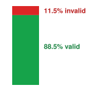
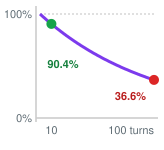
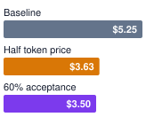

# Conclusion {#sec-vol3-conclusion}

::: {layout-narrow}
::: {.column-margin}

\chapterminitoc

:::

::: {.content-visible when-format="pdf"}
\noindent
{fig-alt="Blueprint for Architectural Synthesis."}
:::

::: {.content-visible unless-format="pdf"}
{fig-alt="Blueprint for Architectural Synthesis."}
:::

:::

## Purpose {.unnumbered .unlisted}

\begin{marginfigure}
\mlagentstack{17}{17}{17}{17}{16}{16}
\end{marginfigure}

_Why can individually tested components still leave an agent's task unfinished or its effects unaccounted for?_

A configuration change can take effect after the runtime stops waiting for its response. A correct diagnostic record can describe a service that has since changed. A passing check can cover less than the completion claim suggests. Each component can meet its local contract while the combined system loses track of what happened or who must act next. Every engineering discipline meets this integration problem once its parts work, and agents meet it in a harder form, because the component at the center proposes rather than executes, so no local success report, however fluent, can settle what the whole system did. Anyone who lets an agent act beyond a disposable workspace inherits the problem at once, since users, operators, and auditors ask about the task rather than the component. Taking it seriously moves the engineering effort from building better parts to owning the boundaries between them. Every consequential transition needs an owner and a record, and every acceptance needs a standard that states what the evidence establishes and what remains uncertain. The engineer's responsibility is to make these obligations fit the task rather than to assemble every available mechanism. Across a trajectory's horizon, carried state, and external authority, invariant closure depends on the contracts connecting the parts as much as on the parts themselves.

::: {.content-visible when-format="pdf"}

\newpage

:::

::: {.callout-learning-objectives}

- Trace an incident-remediation trajectory, identifying the owner and record of each consequential transition
- Translate a task contract into bounds and acceptance requirements proportionate to its horizon, state, and authority
- Diagnose state and evidence mismatches at subsystem boundaries using the authority and lifetime of each record
- Resolve an uncertain external action without confusing a lost response with permission to repeat its effect
- Select a system intervention using attributed failures, outcome evidence, and its full deployment cost
- Construct a safety case that connects scoped claims to arguments, evidence, assumptions, and residual uncertainty
- Distinguish assistance with specifications from authority to adopt them and accept the resulting task

:::

## The Three Questions, Answered {#sec-vol3-conclusion-questions}

The introduction closed by posing three questions that every chapter since has answered in part (@sec-vol3-intro-questions). With the whole system built, each now has a short answer, and each answer is a claim this chapter must make good on one real task.

The first question asked when a model-directed loop earns its cost over a fixed workflow. The answer is decided per decision point rather than per system, and cost per accepted task decides it under a fixed contract. The model should choose the next step where interpreting new evidence raises acceptance by a larger factor than the added calls raise the cost of an attempt, and a fixed program should choose everywhere else. Measured this way, the loop belongs at steps such as diagnosis, whose next move cannot be written down in advance, and fixed control belongs at the steps around them.

The second question asked what must surround the model. The answer is the machinery the task's exposure demands, and no more. State needs selected context, priced serving state, and durable records whose authority stays with their source. Authority needs typed, mediated actions, settlement before any retry, and containment enforced beneath the model. Horizon needs a harness that bounds the whole trajectory, a durable record of intent written before each effect, and recovery that can compensate what it cannot undo. A read-only lookup needs little of this, and the remediation agent needs all of it.

The third question asked how anyone knows that a task worked. The answer is evidence from an endpoint that knows what the task requires, judged against a contract that authorized people adopted, at a closure evidence level stated before the work began, with its residual uncertainty named and owned. The model's report never counts, however fluent, because the component at the center of the system cannot certify its own result. That is invariant closure (principle \ref{pri-invariant-closure}) stated as an acceptance rule.

Each answer is easy to state for one component and hard to keep across the boundaries between components, which is where tested parts still lose track of a task. The chapter therefore tests all three answers on one trajectory of the remediation agent, the lighthouse that carries every exposure at once. It traces that incident through the system (@sec-vol3-conclusion-capstone), turns its obligations into an enforceable contract (@sec-vol3-conclusion-envelope), follows its state and evidence across subsystem boundaries (@sec-vol3-conclusion-memory) and its actions through the execution harness (@sec-vol3-conclusion-execution), asks when a failure justifies changing the system (@sec-vol3-conclusion-adaptation), and assembles the evidence into a safety case (@sec-vol3-conclusion-safety). It ends with the questions that remain open (@sec-vol3-conclusion-frontiers), the boundary that no machine closes for itself (@sec-vol3-conclusion-brooks), and a last look at the machine the book has built.

## One Incident Through the System {#sec-vol3-conclusion-capstone}

A database service raises a query-latency alert after a configuration change. An agent inspects the evidence and proposes restoring the earlier settings. The operator approves the change, but the configuration endpoint's response never arrives. The system must now establish whether the change happened, and no fluent explanation of the diagnosis can do that. A runtime that reads the timeout as failure and retries under a new identity can apply the change twice. One that assumes success can close an incident whose repair never landed. One that simply stops leaves a live production change with nobody responsible for it. Each outcome follows by default when every component meets its local contract and nobody owns the boundaries between them.[^fn-endpoint-acceptance-argument]

[^fn-endpoint-acceptance-argument]: **End-to-End Argument**: @saltzer1984endtoend argued that a function such as reliable delivery can be implemented completely only with knowledge held at the endpoints of a system, so checks inside lower layers improve performance without guaranteeing the result. Task completion follows the same logic. No intermediate component's success report establishes acceptance, which only the owner of the task contract can decide against end-to-end evidence. \index{End-to-end argument!task acceptance}

::: {.column-margin}
{width="100%" fig-alt="H·S·A locator with all three axes, Horizon, State, and Authority, highlighted in purple."}

*Horizon, state, and authority return together, and the runtime closes each on one trajectory.*
:::

This hypothetical incident, `incident_42` on service `db_primary_01`, is the workload of the remediation agent (\ref{lhs-vol3-remediation-agent}) and supplies the capstone promised in @sec-vol3-intro-book-organization. The remediation agent is the book's irreversible actor: a short horizon, shared production state, and authority to change a live service. We trace it once, from diagnostic access through an approved change to an acceptance decision, and the rest of the chapter refers back to the steps of that trace. At every step the test is the same. The system must be able to say what it proposed, what it was permitted to do, what actually happened, what the evidence supports, and who remains accountable. Engineering an agentic machine learning system means making that account possible. The source service owns its configuration, the runtime owns its control decisions, and the accepting authority owns the decision that the available evidence satisfies the delegated task.

### Trajectory ownership {#sec-vol3-conclusion-trajectory-owners}

The task begins under `incident_contract_v1`, which permits bounded diagnostic reads and defines the conditions for proposing, approving, and assessing a configuration change. Initial access is diagnostic only. The runtime uses `read_scope_42` to query authorized service endpoints; those read permissions cannot turn a model's diagnosis into a production mutation. The identifiers in this example are local record names, not cryptographic hashes.

The context manager selects the alert, recent measurements, relevant configuration, and runbook excerpts into `context_manifest_42`. Each selected observation retains its source, version where available, and observation time. The retrieved runbook suggests a configuration-related cause, but it may describe an older deployment. Comparing it with the current configuration `config_v7` and diagnostic measurements yields a hypothesis, and further diagnostic calls within the task's remaining limits must separate it from competing explanations.

Suppose that evidence supports proposing a bounded restoration of specified settings. The model produces `change_request_42`, identifying the desired settings and the expected baseline `config_v7`. Under this incident's change policy, an authorized operator issues `approval_42` for that exact request, its target, its desired settings, and the expected `config_v7`, with explicit validity conditions. This approval binding records permission, not a change, and it covers that request and nothing broader. The model may draft the request and its rationale but cannot adopt its own request as permission. Before dispatch, the action gate rechecks current authority, the approved payload, expiry, resource reservations, and the action's preconditions (@sec-vol3-controlplane-hitl), so revocation or a revised proposal voids the old approval rather than stretching it over a different repair.[^fn-complete-mediation-gate]

[^fn-complete-mediation-gate]: **Complete Mediation**: @saltzer1975 listed complete mediation among their design principles for protection, requiring that every access to every object be checked for authority rather than trusting a check made earlier. An approval recorded minutes before dispatch is such an earlier check, which is why the gate revalidates authority, expiry, and payload at the moment of dispatch. \index{Complete mediation!action gate}

The gate cannot see another operator's change that lands between its check and the mutation. The configuration endpoint closes that race with an atomic expected-version operation,[^fn-optimistic-version-check] which applies the change only if `config_v7` is still current at application; a conflict sends the task back for a new decision instead of applying the old approval to a new baseline. The endpoint also deduplicates by operation identity, bound to the caller, target, and payload and retained long enough to cover a delayed attempt, and it exposes an operation-status lookup.[^fn-idempotent-operation-identity] The endpoint must supply these guarantees, since a tool schema or an attached identifier can only describe them. The runtime records intent `op_42` and its recovery descriptor before dispatch, at the durability boundary selected for this deployment. It then sends the approved request with operation identity `op_42` and expected version `config_v7`.

[^fn-optimistic-version-check]: **Optimistic Concurrency Control**: @kung1981optimistic proposed letting transactions proceed without locks and validating at commit time that the data they read has not changed, aborting those that conflict. The expected-version check is that validation step applied to one configuration object, and its abort path is the conflict that returns the task for a new decision. \index{Optimistic concurrency control!expected-version check}

[^fn-idempotent-operation-identity]: **Idempotence**: An operation is idempotent when performing it several times has the same effect as performing it once. @helland2012idempotence argued that because messaging systems retry requests whose replies are lost, idempotent handling at the receiver is a precondition of reliable service rather than an optimization. The operation identity gives the endpoint what it needs to recognize a repeat, and the retention window bounds how late a repeat may arrive and still be recognized. \index{Idempotency!operation identity}

Now the response is lost. We cannot infer whether the service rejected the request, is still executing it, or applied the change.[^fn-two-generals-reply] The runtime records the outcome as unknown and retains a settlement owner. It queries the endpoint's operation-status record under authorized access rather than issuing a new mutation. In the resolved branch of this example, that source confirms that `op_42` applied the approved settings as `config_v8`. Its operation identity connects this result to the dispatched request, including the possibility that the original request was delayed. An empty or unavailable lookup would not show that the change failed to apply, because the original request could still arrive. In that branch the operation remains unresolved with the named owner, and the runtime reports it as unknown.

[^fn-two-generals-reply]: **Two Generals Paradox**: @gray1978notes named the generals paradox, which shows that no finite exchange of messages over an unreliable channel lets two parties become certain that they agree. A caller whose reply was lost faces the same uncertainty about the endpoint's state, so no local timeout rule can settle `op_42`, and only a query against the endpoint's own record can. \index{Two generals problem!lost response}

Confirmation of `config_v8` settles the change's outcome, but not the incident. The context manager replaces the relevant old configuration view and assembles the evidence needed to assess service behavior. Assume that the measurements in `health_window_42` meet the latency and error-rate conditions specified by `incident_contract_v1`, and that the required change-policy checks also pass. The authorized accepting principal adopts `acceptance_42`, joining the contract, approval, settled operation, applied configuration, and measurement window. The incident is accepted under that contract for the stated window, with continuing monitoring assigned to `operations_owner_42`.

@Fig-vol3-trajectory-lifecycle places this incident on the whole system, showing which part of the book owns each stage and marking learning and scale as choices the incident did not need.

::: {#fig-vol3-trajectory-lifecycle fig-env="figure" fig-pos="htb" fig-cap="**One Trajectory Through the Whole System**: An adopted task contract (Part VII) governs a live loop in which context assembly (Part II) feeds a model call (Part I) whose proposal becomes a validated, authorized tool call run in a sandbox (Part III), with the observation returning to context as data. The harness (Part IV) wraps every step with budgets, the approval gate, the durable log, and recovery. Acceptance rests on scoped external evidence rather than the agent's report; learning (Part V) and scale (Part VI) are optional lifecycle choices." fig-alt="Layered diagram. A red box at the top labeled Task contract, adopted by an authorized owner, lists goal, environment, permitted actions, observations, and completion criteria and carries a Part VII badge. An arrow leads down to a card labeled Live loop, one trajectory, seconds to hours, containing four boxes left to right: Context assembly (Part II), Model call (Part I), Tool call (Part III), and Sandbox (Part III), joined by arrows, with a dashed arrow from the sandbox back to context assembly labeled observation returns as data. A purple strip inside the card, Harness around every step (Part IV), lists budgets and approval gate, durable log and resume, compensation and loop detection, and the trajectory record. Below the card an Acceptance box (Part IV) reads scoped evidence, not the agent's report, and lists settled outcome, measurement window, policy checks, and authorized adopter. A dashed arrow labeled curated records, if chosen leads to a dashed Learning card marked optional (Part V) reading separate admission, fine-tune, optimize against verifiers. A dashed Scale card marked optional (Part VI) reads split only when the coordination tax pays, and price and provision per accepted task."}
{width="100%"}
:::

The record links in @tbl-vol3-capstone-owners let an auditor follow this argument without trusting the model's retrospective account. They also expose missing ownership. A completed model call cannot settle `op_42`, and a health report that omits its measurement window cannot support the scoped acceptance claim.

| **Transition**                 | **Owner**                                            | **Record it leaves**                                                                     |
|:-------------------------------|:-----------------------------------------------------|:-----------------------------------------------------------------------------------------|
| Task admitted                  | Runtime under the delegated contract                 | `incident_42`, `incident_contract_v1`, limits, and `read_scope_42`                       |
| Evidence selected              | Context manager and diagnostic tools                 | `context_manifest_42` with source, version, time, and omissions                          |
| Change proposed and approved   | Model proposes; authorized operator decides          | `change_request_42` and its bound `approval_42`                                          |
| Change admitted and dispatched | Runtime action gate and operation journal            | Durable `op_42` intent, recovery descriptor, and dispatch record                         |
| Lost response reconciled       | Settlement owner querying the configuration endpoint | Source outcome for `op_42`, confirming `config_v8` or preserving uncertainty             |
| Incident accepted              | Designated accepting principal with runtime checks   | `acceptance_42`, `health_window_42`, and residual duty assigned to `operations_owner_42` |

: **Owners and Records Along One Trajectory**: The incident's consequential transitions remain auditable through explicit owners and linked records. An unresolved outcome remains a recorded obligation rather than disappearing when execution stops. {#tbl-vol3-capstone-owners tbl-colwidths="[28,34,38]"}

### Adversarial evidence within the same task

The diagnostic log can contain an instruction to disclose service data to an unrelated destination, the prompt injection of @sec-vol3-security. Such text arrives through an allowed read, yet it carries no authority from the operator.[^fn-confused-deputy-injection] Provenance and delimiters help the model tell the log from the task instructions, but only enforcement outside the model decides what a schema-valid proposal may do with legitimate access.

[^fn-confused-deputy-injection]: **Confused Deputy**: @hardy1988confused described a compiler that held authority to write a billing file and was tricked, through a caller-supplied output file name, into overwriting it with its own authority on another party's behalf. Indirect prompt injection reproduces the pattern with retrieved text in place of the file name [@greshake2023not], so the agent acts under the operator's grant on instructions the operator never gave. Enforcement therefore ties each action to its grant, never to the text that suggested it. \index{Confused deputy!prompt injection}

For this incident, an attempted disclosure crosses concrete boundaries. The action gate rejects a destination outside the approved diagnostic endpoints, and the execution environment's egress policy restricts outgoing connections independently of generated instructions. Read access also needs mediation because a query can include sensitive arguments or expose returned data. A policy permitting arbitrary destinations would leave a disclosure path even if every local file were read-only. These controls bound what a successful injection can do on the specified access paths; they leave open whether an injection occurs.

If the runtime refuses the proposal, it records that refusal as an undispatched action. If a request already left the controlled environment, destroying the local workspace does not undo its external effect. The settlement and incident-response owners must establish what happened and determine the next authorized action. Likewise, a generated claim that service health has recovered cannot replace `health_window_42`. The same ownership distinctions govern ordinary and adversarial failures.

The live task finishes with one model and one controller. Learning from its record and delegating its diagnosis remain later, optional choices (@sec-vol3-conclusion-seams, @sec-vol3-conclusion-adaptation), and neither moves the authority needed for `op_42` or the evidence required by `acceptance_42`.

### The principle ledger {#sec-vol3-conclusion-principle-ledger}

The incident joins responsibilities that the book developed separately. Its context must describe the relevant configuration, its approval must authorize the represented change, and its acceptance evidence must refer to the operation that actually settled. No single principle establishes all three. @Tbl-vol3-principle-ledger consolidates the principles in the form of a working reference. Each row gives the principle's core equation where the book derived one, or its governing statement where the principle is a contract, and what that form predicts about a design. Where the prediction is quantitative, it is the estimate the owning chapter taught the reader to make.

Horizon, state, and authority organize the ledger. The principles of Part I price the single model call and bound what checking can establish. Parts II, III, and IV build closure for the three exposures a single call lacks: the state it carries across turns, its authority over the world, and a horizon long enough for errors to compound. Part V changes the model and moves no exposure, because learning changes the trajectory a policy produces without granting new permission. Part VI multiplies all three across agents and trajectories, and invariant closure, the first row, also marks what the machine cannot close for itself: the contract that defines acceptance. The exposure column names each principle's primary exposure; the exposures overlap, since retaining state over a longer horizon creates durability obligations and delegation carries state and authority across another boundary.

| **#**                                    | **Principle**                                    | **Part**     | **Primary exposure**    | **Core equation or statement**                                                                                                                                                  | **What it predicts**                                                                                                                                                                                                |
|:-----------------------------------------|:-------------------------------------------------|:-------------|:------------------------|:--------------------------------------------------------------------------------------------------------------------------------------------------------------------------------|:--------------------------------------------------------------------------------------------------------------------------------------------------------------------------------------------------------------------|
| \ref{pri-invariant-closure}              | Invariant closure                                | Introduction | All three (closure)     | $\Pr(\text{success})=(1-\epsilon)^{H}$ for unchecked steps; bounds enforced below the model, acceptance on evidence above it, under a contract only authorized principals adopt | Unchecked reliability decays exponentially in $H$; a check turns a violating step into a rejected attempt; a truncated payload becomes a diagnosable rejection; no model output relaxes its own acceptance criteria |
| \ref{pri-vol3-memory-bandwidth-decoding} | Output-bound latency                             | I            | None (prices the call)  | $t_{\text{decode}} \ge Pb/\text{BW}$ per output token when weight reads dominate                                                                                                | Generation time grows with output length; a shorter proposal cuts latency when decode dominates the call                                                                                                            |
| \ref{pri-vol3-verification-asymmetry}    | The verification asymmetry                       | I            | Closure evidence        | $\Pi_V=\dfrac{p(1-\epsilon_{\text{FR}})}{p(1-\epsilon_{\text{FR}})+(1-p)\,\epsilon_{\text{FA}}}$                                                                                | More candidates raise coverage, not selection accuracy; at a low valid rate $p$, a small $\epsilon_{\text{FA}}$ fills the passing set, or the rewarded set under RL, with invalid candidates                        |
| \ref{pri-vol3-attention-working-set}     | Context is a selected working set                | II           | State                   | $S_{\text{system}}+S_{\text{tools}}+S_{\text{state}}+S_{\text{obs}}\le S_{\max}-K_{\max}$                                                                                       | Every schema or log token displaces evidence; fitting the window does not establish decision quality                                                                                                                |
| \ref{pri-vol3-prefix-coherence}          | Attention state is derived from the token prefix | II           | State                   | $m_{\text{token}}=2N_L H_{\text{KV}} d_{\text{head}} s_{\text{elem}}$ bytes held per token; reuse ends at the first changed token                                               | One volatile field early in the prompt forfeits reuse of everything after it; stable-first layout keeps the quadratic resend of an append-only transcript affordable                                                |
| \ref{pri-vol3-source-authority}          | Authority stays with the source                  | II           | State                   | Use entry $c$ at generation $g_q$ only if $g_{\text{birth}}(c)\le g_q<g_{\text{death}}(c)$ and access permits                                                                   | Stale or unpermitted records pass on retrieval score alone; only a source version check lowers $\epsilon_{\text{stale}}$, and a cache hit leaves it unchanged                                                       |
| \ref{pri-vol3-strict-action-abi}         | The typed action contract                        | III          | Authority               | Dispatch only a schema-valid, authorized call whose precondition the endpoint enforces with the mutation                                                                        | A read-then-write race stays open until the endpoint checks the expected version at application                                                                                                                     |
| \ref{pri-vol3-exactly-once-settlement}   | Settlement before retry                          | III          | Authority, with horizon | $P_{\text{dup}}=(1-q_{\text{req}})\,q_{\text{rep}}\,(1-q_{\text{req}})$ under blind retry                                                                                       | The duplicate rate tracks the reply-loss rate almost one for one; rare per call becomes routine per day across a fleet                                                                                              |
| \ref{pri-vol3-zero-trust-sandboxing}     | Containment beneath the model                    | III          | Authority               | $\text{admit}(a,\Gamma,t)\iff\text{authentic}(\Gamma)\land a.\text{op}\in R\land a.\text{target}\sqsubseteq O\land P(a)\land t<E$; flows dispatch only if labels permit         | Reach is bounded by the envelope, whatever the model complies with; injected text cannot widen a flow label; teardown leaves external effects in place                                                              |
| \ref{pri-vol3-trajectory-encapsulation}  | Trajectory-level encapsulation                   | IV           | Horizon                 | Admit only if actual + reserved + proposed + finalization reserve $\le$ allowance; derived grants only narrow                                                                   | A loop that passes every per-call limit still halts at the dispatch ceiling or deadline; per-child ceilings alone would let $M$ children spend $M$ times the budget                                                 |
| \ref{pri-vol3-intent-before-effect}      | Intent before effect                             | IV           | Horizon, with authority | $e_{\text{prop}}\prec e_{\text{auth}}\prec e_{\text{flush}}\prec a_{\text{ext}}\prec e_{\text{obs}}$; $L_A=\sum_a P(\text{bad}\ a)\,\text{consequence}(a)\,(1-\rho_a)$          | A crash before the flush leaves no effect, and after it the log names every operation that needs settlement; past the pivot only forward recovery remains                                                           |
| \ref{pri-vol3-release-evidence}          | Causal and statistical release evidence          | IV           | Closure evidence        | $N_{\text{arm}}\approx 2(z_{1-\alpha/2}+z_{1-\beta})^2\,\bar p(1-\bar p)/\Delta^2$                                                                                              | Halving the detectable difference quadruples the tasks per arm, so a small suite cannot rank close systems                                                                                                          |
| \ref{pri-vol3-trajectory-post-training}  | Verified trajectory post-training                | V            | None moved              | $\mathcal{L}_{\mathrm{SFT}}=-\frac{1}{N_{\mathrm{active}}}\sum_t m_t\log P_\theta(x_t\mid x_{<t})$ over admitted targets                                                        | A passing task check does not make every action a target; the active-token fraction sets the supervision each trajectory supplies                                                                                   |
| \ref{pri-vol3-coordination-tax}          | The coordination tax                             | VI           | All three, multiplied   | $\text{Speedup}(M)=\dfrac{1}{(1-f)+f/M+h(M)}$, judged on acceptance, elapsed time, and $C_{\text{eff}}$                                                                         | The serial fraction caps speedup at $1/(1-f)$; growing overhead makes added agents slower; delegation pays only when its acceptance or deadline gain justifies its cost multiple                                    |
| \ref{pri-vol3-trajectory-goodput}        | Trajectory goodput and the accepted task         | VI           | All three, priced       | $C_{\text{eff}}=\mathbb{E}[C_{\text{attempt}}]/p_{\text{acc}}$; $N_{\text{traj}}=\lambda_{\text{traj}}\,\mathbb{E}[T_{\text{traj}}]$ per resource                               | Raising acceptance can cut cost more than cheaper tokens; long tool waits raise held sandboxes in proportion, and the mean alone does not give deadline capacity                                                    |

: **Fifteen Principles and What They Predict**: Each principle appears in its teaching home with the H·S·A exposure it primarily addresses, its core equation or governing statement, and the design consequence that form predicts. Symbols carry the meanings given where each equation is derived. The exposure column is a lens rather than a partition, and each prediction holds under the assumptions its owning chapter states. {#tbl-vol3-principle-ledger tbl-colwidths="[4,16,7,9,34,30]"}

These obligations constrain optimization. Reusing a prefix saves computation only while the evidence it encodes still supports the proposed change, and a cheaper policy qualifies only if it meets the task's acceptance and deadline conditions. Training and delegation are optional interventions whose value is assessed under the comparative and accounting contracts of @sec-vol3-multiagent-evaluation and @sec-vol3-agent-economics-accounting.

::: {#chk-19-principle-ledger .callout-checkpoint title="Reading the ledger as a design tool"}

The ledger's equations are estimates to run on a design, not labels to recite.

- [ ] **Horizon budget**: Using @eq-vol3-horizon-compounding, what per-step violation rate keeps the chance of any unchecked violation over $H$ turns below a target $P$, and how must that rate change when $H$ doubles?
- [ ] **Acceptance vs. price**: By @eq-vol3-cost-per-accepted-task, compare cutting the cost per attempt by a fraction $x$ with raising acceptance by the same relative fraction. Which lowers cost per accepted task more, and why does a token discount that touches only part of the attempt cost lose ground to the acceptance gain?
- [ ] **Pass rate vs. acceptance**: A change raises the verifier's pass rate but leaves acceptance under protected checks unchanged. Which two ledger rows explain why cost per accepted task does not fall?

:::

For `incident_42`, we can now turn those obligations into the concrete contract that connects the diagnostic reads, authorized change, outcome evidence, and remaining monitoring duty.

## Workload Contract Specification {#sec-vol3-conclusion-envelope}

The latency alert for `incident_42` triggers a diagnostic task, not a grant to perform every action that might lower latency. Disabling an integrity check could improve a metric while violating the service's purpose. The capstone therefore begins with `incident_contract_v1`, an adopted task contract that distinguishes the desired service outcome from the means the agent may use to pursue it.

### Refining the five-part contract {#sec-vol3-envelope-contract-formalism}

The five components retain their introductory meaning (@sec-vol3-intro-five-part-contract). Here they bind a particular incident, service, and decision authority rather than describe a generic agent platform. @Tbl-vol3-contract-decomposition instantiates them for the hypothetical remediation.

| Contract field                                       | Incident-specific commitment                                                                                                                                    | Owner or supporting record                                               |
|:-----------------------------------------------------|:----------------------------------------------------------------------------------------------------------------------------------------------------------------|:-------------------------------------------------------------------------|
| Goal, $G$                                            | Restore acceptable query latency for `db_primary_01` without violating the required error-rate and change-policy conditions; leave unrelated settings unchanged | `incident_contract_v1`, adopted by the authorized task owner             |
| Environment, $\mathcal{E}_{\text{env}}$              | Operate on the identified live service; treat `config_v7` as the expected baseline, not as a promise that the service remains unchanged                         | Configuration source and its versioned operation interface               |
| Permitted actions, $\mathcal{A}_{\text{perm}}$       | Initially perform diagnostics under `read_scope_42`; apply the exact proposed settings only after the required current approval and dispatch checks             | `change_request_42`, `approval_42`, and the runtime's action gate        |
| Available observations, $\mathcal{O}_{\text{avail}}$ | Return authorized, bounded diagnostic results with source, version, capture time, and omission information                                                      | Tool result records and `context_manifest_42`                            |
| Completion criteria, $\mathcal{K}_{\text{comp}}$     | Confirm the authorized operation's outcome, the required service metrics over the stated window, and the applicable change-policy checks                        | `op_42`, `health_window_42`, and the adopted decision in `acceptance_42` |

: **The Incident Contract**: The same five components now connect one delegated task to its permissions, evidence, and responsible owners. Identifying a record does not establish that its required checks have passed. {#tbl-vol3-contract-decomposition tbl-colwidths="[23,48,29]"}

The goal includes process constraints because the acceptable result depends on how the system reaches it. The approval binding and the endpoint's version check from the trace are how the contract states that dependence. The contract writes them as requirements the deployment must meet, so a configuration endpoint without an atomic expected-version operation cannot host this task as specified, however carefully the runtime rereads `config_v7` before sending.

Observation scope constrains diagnostics as well as mutations. `read_scope_42` permits access to designated service endpoints and nothing else, so unrelated customer records and outside log destinations stay out of reach. Output limits preserve relevant status and mark when the returned evidence is incomplete, and retaining omitted material requires its own access and retention policy. Filtering known secrets or terminal control sequences removes known hazards; the security boundary is the controlled read, use, and disclosure of information.

### From exposures to enforceable bounds {#sec-vol3-envelope-four-questions}

H·S·A identifies the obligations this contract creates. The diagnostic horizon needs finite allowances for model calls and tool work. The live configuration and durable operation record require source-aware state handling. The transition from reads to a production change requires a new authority decision. The contract fixes these obligations, and the workload and failure assumptions select the mechanisms that meet them: which sandbox, how many retries, what serving configuration.

The operational envelope attached to `incident_contract_v1` applies the budgets and ceilings of @sec-vol3-controlplane-accounting to this task. It specifies turn and elapsed-time ceilings, observation and local storage limits, and a spending allowance. The harness reserves the bounded liability of an admitted call or operation, alongside the capacity needed for required final checks and recovery duties. Already reported token use is only part of that accounting. A request whose final usage is still in flight can incur charges, and tool work carries costs while no model call is active. The envelope must state which limits an executor enforces and which limits cause the supervisor to stop admitting work and begin intervention.

The contract likewise names the endpoint's deduplication and status-lookup guarantees from the trace as preconditions for admitting the task, because they are what let the runtime investigate a missing reply instead of issuing a new mutation (@sec-vol3-conclusion-execution).

### Operating-envelope decisions {#sec-vol3-envelope-boundaries}

Suppose the task approaches its deadline while waiting for `op_42`. Extending the allowance because the model predicts success would defeat the envelope, and declaring the operation failed would invent an outcome. The runtime instead stops new ordinary admission, records the stopping reason, and preserves the pending operation and its reservation, because remote work continues after the local wait expires. `operations_owner_42` retains responsibility for settlement or an explicit handoff when the remaining authorized resources cannot complete reconciliation.

Acceptance has a different boundary from that accounting. Staying within the envelope says nothing about whether the service recovered, which only the acceptance record of the trace can establish. Closing an incident ticket is likewise a separate action from changing the service.

We can now judge a proposed envelope by the work it must permit. It must allow enough authorized observation to support diagnosis, enough reserved capacity to establish the result, and a feasible response when the result remains unknown. Tightening a limit may reduce exposure while making the acceptance standard unreachable; loosening it creates obligations that require an owner. @Sec-vol3-app-ref-arch-profiles supplies a contract-to-responsibility worksheet for applying this analysis to another task. The next integration problem is preserving those distinctions as the task's contract, selected context, cached computation, and external configuration change on different schedules.

## State and Evidence Across Boundaries {#sec-vol3-conclusion-memory}

Before the incident's configuration change, `context_manifest_42` selects diagnostic evidence about `config_v7`. After the configuration endpoint confirms that `op_42` applied `config_v8`, a request that still presents `config_v7` as current gives the model the wrong basis for its next decision. The old observation has not become false. Its role has changed from evidence about the current configuration to evidence about the incident's history. Following that change through the system connects the memory chapters to the action and recovery contracts.

### Different records answer different questions {#sec-vol3-memory-four-layers}

The context manifest records what the next model call receives. It selects from the task contract, observations, and retrieved material; it does not replace their sources. The configuration service establishes the applied configuration under its read and update contract. The runtime's operation log records its own decisions and received evidence, including the approval binding and the unresolved or established status of `op_42`. A diagnostic index or generated incident summary helps find or interpret those records but cannot supersede them.

These are roles, not four rungs of one physical cache. A live service's state changes independently of the harness, and an artifact may be temporary, retained for a declared period, or lost in a particular failure. The operation log is authoritative for the runtime history it durably recorded and silent about any external effect whose outcome it has not learned. Between the lost response and the status query, a generated summary saying “configuration restored” therefore supplies no missing acknowledgment. This is the recorded-evidence distinction from @sec-vol3-persistence-event-sourcing applied to the incident.

### Refresh evidence without confusing it with computation {#sec-vol3-memory-coherence-invalidation}

Once the source confirms `config_v8`, context assembly updates the current-configuration entry in `context_manifest_42`. It retains the earlier `config_v7` observation where that history helps explain the proposed repair. A derived runbook excerpt or diagnostic summary that depends on the old configuration must be reconsidered; an unrelated record need not be discarded. If a retrieval index has not caught up, an authorized direct read can supply bounded replacement evidence. Otherwise the result must state what remains unavailable. A tombstone keeps an old version from being admitted as current evidence; supplying the replacement remains a separate read.

The serving system answers a different question. KV state computed for unchanged tokens describing `config_v7` can remain valid computation for those old tokens. The configuration change alone does not invalidate tensors by file path or source identifier. When context assembly replaces the old text with `config_v8` evidence, reuse stops at the first changed token. The unchanged prefix before it remains reusable under the compatibility conditions of @sec-vol3-kv-cache, and everything after it needs state computed for the new prefix. Two principles meet at this seam. Prefix coherence (principle \ref{pri-vol3-prefix-coherence}) governs whether computation can be reused, while authority over freshness stays with the source (principle \ref{pri-vol3-source-authority}). A cache hit therefore cannot certify source freshness, as established in @sec-vol3-kvcache-radix-tree.

The refresh also has a time boundary. Source version checks and index maintenance improve the evidence presented to the model, but they do not freeze the service during deliberation, which is why the trace still relies on the endpoint's version check at application.

### Provenance supports interpretation, not permission {#sec-vol3-memory-provenance-grounding}

For `incident_42`, the runtime can record which authorized endpoint supplied an observation under `read_scope_42`, its source version and time, what was omitted, and which request consumed it. It can separately record its own admission decisions. Those host-observed facts are different from the model's claim that a configuration change caused the latency alert. The claim remains a hypothesis until the available evidence supports it.

The injected instruction in the log marks the same limit from the other side. A trusted storage location does not promote its contents into an instruction or approval, so provenance records where text came from, never what it may authorize; permission is still enforced on the proposed action and its current grant.

### Cross-subsystem seams and ownership {#sec-vol3-conclusion-seams}

The source-to-context example exposes one kind of integration failure: both the storage service and the model service can satisfy their local contracts while the next decision uses obsolete evidence. @Tbl-vol3-seams applies the same ownership question to five boundaries in the incident. The final two rows apply only when the team chooses learning or delegation.

| Seam                                     | Incident-specific failure                                                                                       | Principles that meet here                                                                                                         | Owner and required record                                                                                                                                                    |
|:-----------------------------------------|:----------------------------------------------------------------------------------------------------------------|:----------------------------------------------------------------------------------------------------------------------------------|:-----------------------------------------------------------------------------------------------------------------------------------------------------------------------------|
| World and its representations            | `config_v7` is presented as current after `config_v8` is confirmed                                              | Source authority (\ref{pri-vol3-source-authority}) against prefix reuse (\ref{pri-vol3-prefix-coherence})                         | Context and retrieval owners preserve source/version bindings in `context_manifest_42`; the action endpoint enforces the expected version when applying a change             |
| Proposal to effect                       | A lost reply is treated as failure, leading to an unsafe repeat of `op_42`                                      | Intent before effect (\ref{pri-vol3-intent-before-effect}), then settlement before retry (\ref{pri-vol3-exactly-once-settlement}) | Action and recovery owners retain the admitted intent, operation identity, and unresolved status until the endpoint contract supplies adequate outcome evidence              |
| Recovery and authority                   | A recorded recovery plan is treated as permission to apply a corrective change to a now-different service       | Compensation (\ref{pri-vol3-intent-before-effect}) against the typed action contract (\ref{pri-vol3-strict-action-abi})           | Recovery owner retains the descriptor and residual duty; any corrective action needs current authorization and applicable preconditions                                      |
| Recorded incident to learning, if chosen | Acceptance of the incident makes every step a training target, or the release grader becomes a selection reward | Release evidence (\ref{pri-vol3-release-evidence}) against the verification asymmetry (\ref{pri-vol3-verification-asymmetry})     | Curation and evaluation owners separately admit `training_record_42`, preserve its permitted use and evidence limits, and protect release evaluation from adaptive selection |
| Across workers, if delegated             | Diagnostic workers duplicate a consumable allowance or their agreement is treated as independent confirmation   | Coordination tax (\ref{pri-vol3-coordination-tax}) against delegated admission (\ref{pri-vol3-trajectory-encapsulation})          | Delegating runtime records scoped assignments and reservations; the integration owner checks returned evidence and retains unresolved child obligations                      |

: **Incident seams, principles, and owners**: Each boundary needs both an owner and a record that preserves the distinction the next subsystem relies on, and at each one two principles meet or pull against each other. Local success alone does not establish the end-to-end task result. {#tbl-vol3-seams tbl-colwidths="[15,25,24,36]"}

Delegation makes the final row concrete without changing the acceptance contract. A worker may receive a subset of `read_scope_42` while the parent retains its own read permission. That reusable permission is different from a consumable allowance: concurrent workers must reserve against the shared budget rather than each receiving an independently spendable copy (principle \ref{pri-vol3-trajectory-encapsulation}). Several workers agreeing on the diagnosis still need supporting evidence: workers that share difficult inputs, or read one another's answers, make correlated errors, so their agreement is weaker than independent confirmation. Whether delegation pays at all is the intervention question of @sec-vol3-conclusion-adaptation, where the coordination tax (principle \ref{pri-vol3-coordination-tax}) is charged against the delegated design.

Together, these records let an auditor distinguish what the runtime knew, what it proposed, what it authorized, and what the source established. Turning that recorded evidence into an admissible next step, such as repeating a pending operation or dispatching a correction, is the work of the execution and recovery boundary.

## Execution Harness Synthesis {#sec-vol3-conclusion-execution}

The trace resolved its lost response with one status query because every record the query needed already existed when the response disappeared. The execution boundary is where that ordering is built. A selected source version and an approval record establish no effect by themselves, so this boundary must connect `change_request_42` to the operation the endpoint actually applies without inventing either success or failure.

### From approved proposal to durable intent {#sec-vol3-execution-pipeline-stages}

The runtime records the admitted intent and recovery descriptor before dispatch (principle \ref{pri-vol3-intent-before-effect}), following @sec-vol3-durable-execution and @sec-vol3-failure-recovery. The intent binds `op_42` to the request, approval, endpoint contract, and reservation. The recovery descriptor identifies the intended corrective procedure, its required evidence and permissions, and `operations_owner_42` as the settlement owner. Registering it after the response would leave the recovery obligation missing precisely when the response disappears.[^fn-write-ahead-intent]

[^fn-write-ahead-intent]: **Write-Ahead Logging**: Database recovery methods such as ARIES [@mohan1992aries] force a log record describing an update to stable storage before the update reaches the data it changes, so recovery can always redo or undo what the log names. Recording `op_42` before dispatch applies the same ordering to an external effect, with one difference that the rest of this section turns on. The runtime cannot redo or undo the endpoint's change by itself and can only learn the outcome from the endpoint. \index{Write-ahead logging!intent record}

The durable acknowledgment must cover the failure domain declared by this deployment. A local `fsync` is not a promise that the record survives loss of the entire storage device. If the required acknowledgment is missing or uncertain, the gate withholds dispatch. Even after acknowledgment, a pause or authority change can withhold an unsent request, because recording intent does not make execution mandatory.

### A lost response is an unresolved operation {#sec-vol3-execution-sagas}

After the lost response, neither the timeout nor the surviving intent selects among the three possible outcomes. Only the endpoint's guarantees from the trace make the branch recoverable, and they have to live at the endpoint because the local log and the configuration service never form one atomic transaction. The settlement owner's status query in place of a fresh-identity mutation is settlement before retry (principle \ref{pri-vol3-exactly-once-settlement}). Once correlated evidence establishes `config_v8`, dependent work may use the result, and any supported same-operation repeat must obey the endpoint's repeat contract and current admission checks.

@Tbl-vol3-execution-pipeline-stages distinguishes decisions that otherwise look like interchangeable errors in a tool transcript.

| Evidence at the boundary                                          | What the runtime may conclude                                               | Continuation and owner                                                                                           |
|:------------------------------------------------------------------|:----------------------------------------------------------------------------|:-----------------------------------------------------------------------------------------------------------------|
| Current admission fails before this attempt is released           | This attempt was withheld through the gate; earlier attempts are unaffected | Record rejection and its reason; reconsider only under current authority                                         |
| `op_42` intent survives, but its response is lost                 | The external outcome remains unknown                                        | Withhold dependent mutation; `operations_owner_42` retains reconciliation and outstanding liability              |
| Correlated status evidence establishes application as `config_v8` | This operation's effect is established under the endpoint contract          | Record settlement evidence; obtain the service-health evidence required for acceptance                           |
| Status remains unavailable within the follow-up allowance         | Automated reconciliation has not established the outcome                    | End this continuation as unresolved; retain the operation, evidence, reservation, and acknowledged handoff owner |
: **Execution Evidence and Continuation**: Local rejection, uncertain delivery, and established application support different decisions. Closing a continuation does not close an unresolved external obligation. {#tbl-vol3-execution-pipeline-stages tbl-colwidths="[31,31,38]"}

Established application still leaves the acceptance step of the trace, and charges for the operation can settle on a different schedule from its effect.

### Recovery and stopping retain their own obligations {#sec-vol3-execution-watchdog}

If the applied change requires correction, the registered recovery descriptor supplies a plan, not an inverse guaranteed to restore history (principle \ref{pri-vol3-intent-before-effect}). A corrective configuration request needs current authority, relevant approval, and a precondition against the then-current configuration, the same admission the typed action contract (principle \ref{pri-vol3-strict-action-abi}) applies to any forward action. It can fail or remain partial. Restoring a local workspace cannot undo an external configuration change, and issuing a cancellation request cannot establish that the endpoint stopped. Residual work stays assigned to `operations_owner_42` until an authorized successor acknowledges the handoff.[^fn-saga-compensating-action]

[^fn-saga-compensating-action]: **Sagas**: @garciamolina1987sagas proposed splitting a long-lived transaction into a sequence of local transactions, each paired with a compensating transaction that semantically undoes its effect when the sequence cannot complete. A compensation is a new action that can itself fail, and other parties may observe the original effect before it runs. The corrective configuration request therefore passes through the same admission checks as any forward action. \index{Saga!compensating action}

Progress monitoring helps decide when to stop ordinary work or investigate. Repeated calls and unchanged observations can trigger a bounded hold even though they fall short of proving a semantic loop, since a status query can legitimately return pending several times. A dispatch ceiling then bounds the damage from whatever the heuristic misses. A hold preserves already admitted operations and allows only separately authorized, budgeted settlement or recovery work.

::: {#chk-19-intervention-ladder .callout-checkpoint title="Auditing the incident's action boundary"}

Each prompt names a failure at the action boundary; decide which record or check must catch it.

- [ ] **Changed precondition**: `approval_42` names `config_v7`, but another operator changes the configuration before application. Which check must prevent the stale proposal from applying, and who may authorize a revised change?
- [ ] **Retry exposure**: The log contains the intent for `op_42`, but no response. If a lost reply hides an applied change with probability $p$, what fraction of fresh-identity retries duplicate the change, and which endpoint guarantee brings that fraction to zero?
- [ ] **Missing obligation**: A design records its recovery descriptor only after receiving success. Identify the failure interval this leaves uncovered and the record and owner that must survive it.
- [ ] **Unresolved exit**: The follow-up allowance expires while status remains unknown. Which operation, financial liability, and handoff records must remain even though this continuation ends?

:::

Because every failure in this trace has a named boundary and owner, the trace also says where the next engineering change belongs, and that choice needs evidence of its own.

## Evidence-Based Systems Intervention {#sec-vol3-conclusion-adaptation}

The incident trace now supports a more precise question than whether the agent needs a stronger model. If `context_manifest_42` still presents `config_v7` as current after settlement confirms `config_v8`, the defect concerns state selection. If the runtime repeats `op_42` because its first response was lost, the defect concerns outcome handling and the endpoint's recovery contract. More training might change how often the model encounters these paths, but it would not repair the missing state transition or make an unsafe retry safe.

Intervention selection\index{Intervention ladder!intervention selection} begins with an attributed failure and a proposed causal remedy. The intervention ladder of @sec-vol3-flywheel-intervention-order orders the candidate remedies by cost and reversibility. Cheap, reversible fixes come first, beginning with context, then the tool interface and its schema, then runtime control. Changing weights is reserved for the residual failure that survives those fixes, and only on evidence that the residual is a behavioral weakness. The order is a default justified by cost and reversibility, not a rule that every failure must climb, and attribution decides which rung the evidence points to. An urgent authorization defect points directly to an enforcement repair.

### Match the remedy to the evidence

A trace records what happened, but attribution still needs a test. Reconstruct the relevant input, tool contract, runtime state, and observed outcome, then change the suspected cause while preserving the comparison conditions. Supplying a missing configuration version tests an information deficit; replacing an ambiguous timeout with an explicit pending status tests an interface problem. Evaluate the proposed repair across the affected task group and retain checks for regressions elsewhere.

@Tbl-vol3-intervention-ladder-tradeoffs connects the intervention choices to evidence that would justify investigating them. The first three rows are the cheap, reversible rungs, the two training rows change weights, and the final row is the separate delegation decision.

| Intervention           | Evidence motivating the change                                                                              | Obligation the change leaves in place                                                         |
|:-----------------------|:------------------------------------------------------------------------------------------------------------|:----------------------------------------------------------------------------------------------|
| Context and retrieval  | Needed facts are absent, stale, or obscured in the actual model input                                       | Validate source versions and preserve current task constraints                                |
| Tool interface         | Arguments or outcome states are ambiguous to the caller                                                     | Enforce authorization and distinguish a rejected request from an unresolved effect            |
| Runtime control        | Budgets, action preconditions, or settlement rules are not enforced at the responsible boundary             | Test enforcement and recovery under the declared failure model                                |
| Supervised fine-tuning | Admitted demonstrations represent a recurring behavior the current policy handles poorly                    | Supply current contracts and evaluate generalization and regressions                          |
| Reward-driven learning | New attempts can be assessed under a useful scoped reward without a demonstrated response at every decision | Protect assessment, inspect reward gaps, and evaluate held-out behavior                       |
| Delegated trajectories | Separate ownership and focused contexts may improve a declared task objective                               | Bound authority and spending, reconcile results, and compare with a capable single controller |

: **Evidence for an Intervention**: A causal diagnosis directs the remedy; no row guarantees improvement or removes the obligations enforced elsewhere in the system. {#tbl-vol3-intervention-ladder-tradeoffs tbl-colwidths="[21,39,40]"}

Training changes proposal behavior rather than replacing current contracts or runtime enforcement. Supervised fine-tuning can learn demonstrated recovery and search behavior, and reward-driven learning supplies a different learning signal for the same behaviors. Both must show their gain on the deployment distribution, and a protected reward evaluator can still omit task requirements. @Sec-vol3-fine-tuning and @sec-vol3-rlvr develop these choices and their evidence requirements.

Delegation sits outside the ladder, because it changes task ownership and coordination costs rather than repairing a failure, and a task with useful independent subtasks may justify it without any training. Its baseline is a single controller already able to retrieve selectively, sample candidates, and run tools in parallel. The comparison must measure what separate trajectories add, including the repeated context, delayed dependencies, and result integration that make up the coordination tax (principle \ref{pri-vol3-coordination-tax}, @sec-vol3-multi-agent). In the incident, assigning independent diagnostic investigations could be useful without granting any worker permission to apply the production change. That decision is separate from whether the underlying model should be adapted.

### Conditional payback of an intervention

An intervention that improves behavior still needs an operational cost comparison. Let $C_{\text{invest}}$ be its incremental one-time development and evaluation cost, and let $C_{\text{task, base}}$ and $C_{\text{task, adapt}}$ be expected costs per assigned task under the two configurations. These averages include unsuccessful attempts and their resulting review or recovery work. For constant costs over the comparison period, positive per-task saving $\Delta C_{\text{task}}$ gives the continuous break-even volume

$$N^* = \frac{C_{\text{invest}}}{C_{\text{task, base}} - C_{\text{task, adapt}}} = \frac{C_{\text{invest}}}{\Delta C_{\text{task}}}, \qquad \Delta C_{\text{task}} > 0.$$ {#eq-vol3-breakeven-volume}

The first whole-task volume that recovers this investment is $\lceil N^* \rceil$. If the saving is nonpositive, there is no finite cost-only payback under these assumptions. Quality, latency, required capabilities, or reduced operational risk can still justify a more expensive design; the formula prices cost alone. When acceptance rates differ, divide each configuration's expected attempt cost by its acceptance probability and compare cost per accepted task, @eq-vol3-cost-per-accepted-task, instead of cost per assigned task (@sec-vol3-agent-economics).

```{python}
#| label: calc-vol3-conclusion-weight-breakeven
#| echo: false
# ┌─────────────────────────────────────────────────────────────────────────────
# │ CONDITIONAL CODE-REVIEW PAYBACK (LEGO)
# │ Context: A separate hypothetical design comparison, not incident_42.
# │ Goal: Price changed model usage under equal acceptance/latency requirements.
# │ Show: Incremental saving, continuous break-even, integer crossing, months.
# │ How: Expected assigned-task tokens times rates; all other costs cancel.
# └─────────────────────────────────────────────────────────────────────────────
import math
from mlsysim import *

class WeightBreakEven:
    # ┌── 1. LOAD (Constants & Parameters) ─────────────────────────────────
    base_in = 12_000  # hypothetical mean billable input tokens per step
    base_out = 800  # hypothetical mean billable output tokens per step
    base_steps = 5  # hypothetical steps per assigned task
    base_p_in = 3 * USD / 1_000_000  # hypothetical input price per token
    base_p_out = 15 * USD / 1_000_000  # hypothetical output price per token
    adapt_in = 1_500
    adapt_out = 800
    adapt_steps = 4
    adapt_p_in = 1 * USD / 1_000_000
    adapt_p_out = 4 * USD / 1_000_000
    c_data = 4_000 * USD  # incremental data collection and curation
    c_train = 500 * USD  # incremental training compute
    c_eval = 8_000 * USD  # incremental evaluation and review
    volume_month = 20_000  # hypothetical assigned reviews per month
    volume_low = 5_000  # sensitivity case: a quarter of the planned volume

    # ┌── 2. EXECUTE (Compute) ─────────────────────────────────────────────
    base_step = base_in * base_p_in + base_out * base_p_out
    base_task = base_steps * base_step
    adapt_step = adapt_in * adapt_p_in + adapt_out * adapt_p_out
    adapt_task = adapt_steps * adapt_step
    c_invest = c_data + c_train + c_eval
    delta_task = base_task - adapt_task
    n_star = (c_invest / delta_task).to(ureg.dimensionless).magnitude
    n_whole = math.ceil(n_star)
    payback_months = n_star / volume_month
    payback_low_months = n_star / volume_low
    input_saving = base_steps * base_in * base_p_in - adapt_steps * adapt_in * adapt_p_in
    input_saving_share = (input_saving / delta_task).to(ureg.dimensionless).magnitude
    eval_share = (c_eval / c_invest).to(ureg.dimensionless).magnitude
    train_share = (c_train / c_invest).to(ureg.dimensionless).magnitude

    # ┌── 3. GUARD (Assumptions & Integer Crossing) ────────────────────────
    check(delta_task > 0 * USD, "Positive incremental saving required")
    check(c_invest > 0 * USD and volume_month > 0, "Positive investment and volume")
    check((n_whole - 1) * delta_task < c_invest <= n_whole * delta_task, "First whole-task crossing, not a rounded continuous estimate")
    check(abs(base_task - 0.24 * USD) < 1e-10 * USD, "Baseline arithmetic")
    check(abs(adapt_task - 0.0188 * USD) < 1e-10 * USD, "Adapted arithmetic")
    check(0.5 < input_saving_share < 1, "Prose says input tokens carry most of the saving")
    check(eval_share > 0.5 > train_share, "Prose says evaluation, not training, dominates the investment")
    check(payback_low_months > 10, "Prose says quarter volume pushes payback beyond ten months")

    # ┌── 4. OUTPUT (Typed Prose Strings) ──────────────────────────────────
    base_in_str, base_out_str = fmt_int(base_in), fmt_int(base_out)
    base_steps_str = fmt_int(base_steps)
    adapt_in_str, adapt_out_str = fmt_int(adapt_in), fmt_int(adapt_out)
    adapt_steps_str = fmt_int(adapt_steps)
    base_p_in_str = fmt_usd(base_p_in * 1_000_000, precision=0)
    base_p_out_str = fmt_usd(base_p_out * 1_000_000, precision=0)
    adapt_p_in_str = fmt_usd(adapt_p_in * 1_000_000, precision=0)
    adapt_p_out_str = fmt_usd(adapt_p_out * 1_000_000, precision=0)
    c_data_str, c_train_str, c_eval_str = fmt_usd(c_data), fmt_usd(c_train), fmt_usd(c_eval)
    c_invest_str = fmt_usd(c_invest)
    volume_month_str = fmt_int(volume_month)
    base_task_str = fmt_usd(base_task, precision=4)
    adapt_task_str = fmt_usd(adapt_task, precision=4)
    delta_task_str = fmt_usd(delta_task, precision=4)
    n_star_str = fmt_ratio(n_star, precision=2, commas=True)
    n_whole_str = fmt_int(n_whole)
    payback_months_str = fmt_ratio(payback_months, precision=2)
    base_step_str = fmt_usd(base_step, precision=3)
    adapt_step_str = fmt_usd(adapt_step, precision=4)
    volume_low_str = fmt_int(volume_low)
    payback_low_months_str = fmt_ratio(payback_low_months, precision=1)
    input_saving_share_str = fmt_percent(round(input_saving_share, 2), precision=0, style="prose")  # intentional whole-percent rounding
    eval_share_str = fmt_percent(eval_share, precision=0, style="prose")
    train_share_str = fmt_percent(train_share, precision=0, style="prose")
```

::: {#nbk-19-break-even-weight-adaptation .callout-notebook title="Conditional payback of a smaller adapted model"}

**Scenario**: Separate from the incident, a team considers a smaller adapted model for code review. Both configurations meet the same acceptance and latency requirements, with equal acceptance rates on the same workload; evaluation must establish that assumption before the cost comparison can choose a release. Step and token counts are averaged over all assigned tasks, including unsuccessful reviews, and describe the combined model-and-policy change.

**Variables**: The baseline uses `{python} WeightBreakEven.base_in_str` input and `{python} WeightBreakEven.base_out_str` output tokens per step over `{python} WeightBreakEven.base_steps_str` steps, at `{python} WeightBreakEven.base_p_in_str` and `{python} WeightBreakEven.base_p_out_str` per million tokens, respectively. The adapted configuration uses `{python} WeightBreakEven.adapt_in_str` input and `{python} WeightBreakEven.adapt_out_str` output tokens over `{python} WeightBreakEven.adapt_steps_str` steps, at `{python} WeightBreakEven.adapt_p_in_str` and `{python} WeightBreakEven.adapt_p_out_str` per million. These are hypothetical billable-token rates with no caching discount.

The incremental investment is `{python} WeightBreakEven.c_data_str` for data, `{python} WeightBreakEven.c_train_str` for training, and `{python} WeightBreakEven.c_eval_str` for evaluation and review, totaling `{python} WeightBreakEven.c_invest_str`. Volume is `{python} WeightBreakEven.volume_month_str` assigned reviews per month. All other development, hosting, tool, human-review, recovery, and maintenance costs are equal between configurations and cancel; any that differ enter the comparison as increments.

**Math**: A baseline step costs `{python} WeightBreakEven.base_in_str` × `{python} WeightBreakEven.base_p_in_str` plus `{python} WeightBreakEven.base_out_str` × `{python} WeightBreakEven.base_p_out_str` per million tokens, or `{python} WeightBreakEven.base_step_str`, so a task costs `{python} WeightBreakEven.base_task_str`. An adapted step costs `{python} WeightBreakEven.adapt_step_str`, so a task costs `{python} WeightBreakEven.adapt_task_str`. Under the equal-other-cost assumption, the incremental saving is `{python} WeightBreakEven.delta_task_str` per task. @Eq-vol3-breakeven-volume gives a continuous threshold of approximately `{python} WeightBreakEven.n_star_str` tasks. The first whole-task crossing is `{python} WeightBreakEven.n_whole_str` tasks; at the stated steady volume, payback is approximately `{python} WeightBreakEven.payback_months_str` months.

**Systems insight**: Payback time is $N^*$ divided by monthly volume, so volume and evaluation cost decide it, not training compute. Evaluation is `{python} WeightBreakEven.eval_share_str` of the investment and training only `{python} WeightBreakEven.train_share_str`, and input tokens carry `{python} WeightBreakEven.input_saving_share_str` of the per-task saving, so the case rests on the adapted model's short prompt holding in production. At `{python} WeightBreakEven.volume_low_str` reviews a month, the same investment takes `{python} WeightBreakEven.payback_low_months_str` months to recover. The saving is per assigned task; it carries over to cost per accepted task only while acceptance stays equal, because @eq-vol3-cost-per-accepted-task divides every attempt's cost by acceptance. A quality regression therefore disqualifies the design at any volume.

:::

The intervention decision therefore joins attribution, comparative evaluation, and resource accounting, while authority and acceptance evidence come from outside whichever configuration is chosen. Once a change is proposed, the remaining question is what evidence supports releasing that whole configuration within its stated operating conditions.

## Empirical Safety Cases {#sec-vol3-conclusion-safety}

The incident record connects an approved change to an observed service outcome. We can now state what that connection supports, which mechanisms it depends on, and what remains unresolved. This is the purpose of a safety case: an inspectable argument for specified safety claims within a stated operating scope, not a certificate that the agent behaves correctly in every reachable situation.[^fn-goal-structuring-notation]

[^fn-goal-structuring-notation]: **Goal Structuring Notation (GSN)**: @kelly2004goal presented a graphical notation for safety arguments that represents the claims being made, the strategies that decompose them, the context and assumptions under which they hold, and the evidence that supports them. Drawing the argument as an explicit structure exposes a claim with no supporting evidence or an assumption nobody has checked, the gaps that @tbl-vol3-safety-case is built to reveal. \index{Goal Structuring Notation!safety case}

A *claim* states the property being asserted. An *argument* explains why the design and the available evidence support it. *Evidence* consists of the relevant observations, analyses, tests, and review records. The Software Engineering Institute's assurance-case overview [@lipson2013assurance] emphasizes that naming a practice or tool is insufficient: the case must establish its application, coverage, and relevance to the released version. Assumptions and possible counterexamples belong alongside the supporting material so a reviewer can judge the argument's limits.

### Apply the claims to the incident

@Tbl-vol3-safety-case applies this structure to the hypothetical `incident_42`. The claims concern the mediated change and its recorded outcome, not every action any agent might take. The entries combine the stipulated incident records with additional validation tests a deployment case would need; those tests are not asserted to have run.

| Scoped claim                                                                                             | Argument and owner                                                                                                                                            | Supporting evidence                                                                                                                                       | Assumptions and residual uncertainty                                                                                                                                                                  |
|:---------------------------------------------------------------------------------------------------------|:--------------------------------------------------------------------------------------------------------------------------------------------------------------|:----------------------------------------------------------------------------------------------------------------------------------------------------------|:------------------------------------------------------------------------------------------------------------------------------------------------------------------------------------------------------|
| The mediated change to `db_primary_01` requires approval for the exact request and current preconditions | The action gate checks `approval_42` against `change_request_42`, its target, desired settings, expected `config_v7`, and validity conditions before dispatch | The approval and admission records, together with tests of missing, expired, mismatched, and stale approvals                                              | The argument depends on the controlled access paths and endpoint enforcement; an unrelated privileged operator or bypass is outside this particular gate's claim                                      |
| The lost response does not justify issuing a fresh duplicate change                                      | The recovery owner preserves `op_42` and reconciles through the endpoint's operation-status and deduplication contract                                        | Durable intent and recovery descriptor recorded before dispatch; the lost-response status; the later source confirmation that `op_42` applied `config_v8` | The endpoint must honor the stated identity, atomic version check, and retention contract, including delayed requests; unavailable status leaves the operation unresolved rather than proving failure |
| The incident meets `incident_contract_v1` under the recorded acceptance scope                            | The acceptance owner checks the applied configuration, required change-policy conditions, and the declared service measurement window                         | `acceptance_42` references `op_42`, `config_v8`, `health_window_42`, required checks, and the authorized adopter                                          | Measurements cover the named service and window, not every future condition; they do not prove the model's diagnosis, and post-window monitoring remains with `operations_owner_42`                   |

: **An Incident Safety Case in Three Claims**: Mechanisms, records, and assumptions support different parts of the argument. Evidence sufficient for one claim does not automatically establish the others. {#tbl-vol3-safety-case}

The model's report can help locate a relevant observation or identify a contradiction. It is not independent confirmation of its own completion claim. Human inspection and an authorized operator's recorded judgment can also contribute evidence where the contract calls for them. Their provenance, scope, and possible errors must be assessed, just as for an automated check.

### Match the evidence to the decision

Different checks answer different questions. An approval-gate test exercises a particular enforcement path, and a fault-injection trial checks recovery under a declared failure. How often the complete agent satisfies incident contracts in deployment is a population question, which requires comparable tasks, protected assessment, and the uncertainty treatment established in @sec-vol3-evaluation. Its price is set by @eq-vol3-eval-planning-power: precision improves only as the square root of the task count, so halving the difference a comparison can detect quadruples the tasks each arm needs.

Preserve every admitted trial's disposition at the observation cutoff, including failures, pending assessments, and unknown outcomes. A trial in the trace's unresolved branch stays unresolved even if service latency later looks acceptable, and an accepted operational outcome leaves a separately pending financial account open. The record retains each remaining obligation and its owner, so a favorable summary cannot conceal the evidence the decision still needs.

If evaluation supports staged exposure, identify the whole candidate configuration: model, context assembly, tools, harness, and assessment versions relevant to the claim. Declare the eligible workload, allocation, operating limits, and stop policy before admission. Live monitoring then tests behavior under conditions that offline fixtures may omit. A small routing fraction does not bound harmful effects by itself, and delayed observations or concurrent work can continue after a stop is requested. @Sec-vol3-evaluation-releases distinguishes detection, confirmed admission stop, and effect settlement.

Revoking permission or draining candidate traffic stops only the work those controls intercept; a request already sent and a completed change remain, together with their settlement owners. The safety case records these limits instead of assuming that rollback restores the world.

### Preserve evidence when the policy changes {#sec-vol3-feedback-stability}

The incident need not enter a learning pipeline. If a permitted recovery segment is proposed as `training_record_42`, the consumer-specific admission process in @sec-vol3-trajectory-curation determines whether its context, targets, permissions, and lineage support that use. An unknown outcome is not automatically a negative example. Keep task groups and assessment information protected from training and adaptive selection; repeatedly choosing candidates against the same holdout changes what that holdout can establish [@dwork2015reusable]. Here the verification asymmetry under optimization pressure (principle \ref{pri-vol3-verification-asymmetry}) pulls against release evidence (principle \ref{pri-vol3-release-evidence}), because a check that becomes a training signal loses its standing as independent assessment.[^fn-goodhart-verifier-target]

[^fn-goodhart-verifier-target]: **Goodhart's Law**: @goodhart1984 observed that a statistical regularity tends to collapse once pressure is placed on it for control purposes, and @strathern1997improving generalized the point as "when a measure becomes a target, it ceases to be a good measure." A verifier used as a reward becomes such a target, so optimization concentrates on its blind spots, and release evidence must come from checks the optimization never saw. \index{Goodhart's law!verifier as reward}

A learned update creates a new configuration requiring appropriate release evidence, not an inherited approval from the source incident. It also changes serving-state compatibility. Byte-identical prompt text does not make KV state computed under old weights valid for the new model; reuse must satisfy the actual prefix and model-configuration contract in @sec-vol3-kv-cache. The case therefore follows the configuration that will run, while acceptance of `incident_42` remains a finding about its own identified execution.

::: {#chk-19-safety-cases-and-blast-radius .callout-checkpoint title="Defend the incident's acceptance"}

Each prompt tests whether a piece of evidence supports the claim it is attached to.

- [ ] **Claim scope**: Which records establish that the approved change applied, and why is acceptable latency alone insufficient?
- [ ] **Missing evidence**: If operation status remains unavailable, what must stay unresolved and who retains responsibility?
- [ ] **Evidence quality**: How can a model report or human review contribute without becoming independent proof of every claimed property?
- [ ] **Evidence volume**: A team can afford only twice as many release tasks per arm. By @eq-vol3-eval-planning-power, by what factor does the smallest difference it can detect shrink, and is that enough to rank two configurations that differ by a few points?
- [ ] **Changed configuration**: Why do stopping candidate admissions and preserving the same prompt establish neither reversal of earlier effects nor compatibility of old KV state with new weights?

:::

The case makes a bounded acceptance decision inspectable and names the questions the current evidence leaves open, including conditions outside the measurement window and changes to the environment or policy. Those limits are part of the system's design.

## Open Questions Within the Digital Boundary {#sec-vol3-conclusion-frontiers}

The safety case for `incident_42` supports a bounded claim about one configuration change and its observed service behavior. Three questions remain open after the runtime has enforced every declared boundary: how complete the acceptance criteria are, how to act on external state that changes during deliberation, and how far the execution record supports attribution.

Incomplete acceptance criteria are one source of uncertainty. The measurements in `health_window_42` support the latency and error conditions specified by `incident_contract_v1`, while an operator's concerns about the service can extend beyond them. A qualitative review can contribute under a declared rubric, as in @sec-vol3-evaluation-contract, and a human or model judgment remains an assessment with a scope and error modes. Protecting the check from modification preserves its integrity; it does not make its specification complete. Coverage improves with evidence about missed requirements, and more candidates optimized against the same check add none.

Changing external state creates a different limit. The endpoint's version check keeps this task from applying its approved change to an unexpected baseline, but a rejected check only sends the task back for a revised diagnosis and a new approval. The open engineering problem is to obtain sufficiently fresh evidence and handle conflicts within the task budget, because a digital service keeps changing during deliberation whatever the context snapshot or a local pause shows.

Attribution also remains narrower than the execution record. Correlated source evidence can establish that `op_42` applied `config_v8` before the acceptable measurements in `health_window_42`; that ordering alone does not prove that the configuration change caused the improvement. Controlled comparisons, targeted fault tests, and domain analysis can strengthen the argument when their assumptions fit the incident. Intermediate checks help preserve evidence and limit repeated work, and the search they avoid has a size we can compute.

```{python}
#| label: calc-vol3-conclusion-credit-search
#| echo: false
# ┌─────────────────────────────────────────────────────────────────────────────
# │ SEARCH SPACE FOR CREDIT OVER A LONG HORIZON (LEGO)
# ├─────────────────────────────────────────────────────────────────────────────
# │ Context: The attribution paragraph in the open questions.
# │
# │ Goal: Contrast the counterfactual search space of a failure detected only
# │       at the end of a long task with one confined to a checked window.
# │ Show: Paths over the full horizon, paths inside one window, and the
# │       replay time to search that window.
# │ How:  Paths = branching factor ^ steps. Window search time = window paths
# │       x seconds per replayed check. All inputs are illustrative scenario
# │       values, not measurements.
# └─────────────────────────────────────────────────────────────────────────────
import math
from mlsysim import *
from mlsysim.fmt import fmt_math

class CreditSearch:
    # ┌── 1. LOAD (Constants & Parameters) ─────────────────────────────────
    branch = 4  # scenario: candidate actions per step
    horizon = 50  # scenario: steps in the task
    window = 5  # scenario: steps between intermediate checks
    t_check = 1.2 * second  # scenario: time per replayed check

    # ┌── 2. EXECUTE (Compute) ─────────────────────────────────────────────
    full_paths = branch**horizon
    full_exp = round(math.log10(full_paths))
    window_paths = branch**window
    search_time = (window_paths * t_check).to(minute)

    # ┌── 3. GUARD (Invariants) ───────────────────────────────────────────
    check((branch, horizon, window) == (4, 50, 5), "Prose spells out four actions, fifty steps, and a five-step window")
    check(full_exp == 30, f"Full search space should be about 10^30 paths, got 10^{full_exp}")
    check(18 * minute < search_time < 22 * minute, f"Window search should take about twenty minutes, got {search_time}")

    # ┌── 4. OUTPUT (Formatting) ──────────────────────────────────────────
    full_paths_math = fmt_math(rf"{branch}^{{{horizon}}} \approx 10^{{{full_exp}}}")
    window_paths_fmt = fmt_int(window_paths)
    window_paths_math = fmt_math(rf"{branch}^{{{window}}} = {window_paths_fmt}")
    t_check_str = fmt_qty(t_check, second, precision=1)
    search_min_str = fmt_int(search_time, minute)  # integer minutes; prose says "about"
```

When a trajectory fails only at its final check, finding the responsible step is an inverse problem over every branch the agent did not take, and that space grows exponentially in $H$, the same dependence that drives @eq-vol3-horizon-compounding.[^fn-credit-assignment-trajectory] With an illustrative four candidate actions per step over a fifty-step task, that space holds `{python} CreditSearch.full_paths_math` paths, far beyond any replay budget. A passing check every five steps changes the arithmetic. If the defect lies after the last passing check, the search shrinks to one window of `{python} CreditSearch.window_paths_math` alternatives, about `{python} CreditSearch.search_min_str` minutes of replay at `{python} CreditSearch.t_check_str` per check, provided the steps inside the window touched only state the runtime can restore. The condition is also the limit: an earlier unchecked defect or an external change can still be responsible for a later failure. Check spacing is therefore a horizon decision, since each check divides the exponent of the search.

[^fn-credit-assignment-trajectory]: **Credit Assignment Problem**: @minsky1961steps named the difficulty of distributing credit for the success of a complex strategy among the many decisions that produced it, with games such as chess as the example, where one win or loss follows a long sequence of moves. A trajectory checked only at its end poses the same problem for failure. Intermediate checks are the systems answer, because they turn one terminal verdict into many local ones. \index{Credit assignment!trajectory attribution}

This book develops digital systems, whose external effects already include nonrestorable disclosures, consumed resources, and changes observed by other parties. Physical actuation adds domain-specific sensing, dynamics, and timing obligations beyond this book's treatment. The distinction does not divide a reversible digital world from an irreversible physical one. In either case, the engineering claim must name what can be observed, controlled, restored, and left to a responsible owner.

These limits set the scope of an acceptance decision and the residual duties it leaves. Choosing that scope is part of the specification, which authorized principals adopt and a plausible generated result cannot.

## Essential Complexity and the Specification Boundary {#sec-vol3-conclusion-brooks}

Suppose the incident model proposes shortening the observation window so that `db_primary_01` can be declared recovered sooner. It can explain the trade-off, draft the revised condition, and identify additional measurements. None of those contributions changes `incident_contract_v1`. Until the authorized contract owner adopts a revision through the governing change policy, the runtime must assess the incident against the existing criteria. The distinction is between helping formulate a decision and possessing authority to make it binding.

Brooks distinguished the essential work of forming a software system's interlocking concepts from the accidental difficulties of representing them in a particular implementation [@brooks1987no]. In our incident, producing a configuration request is different work from deciding which service behavior counts as recovery and which risks the change may impose. The first can be expressed correctly while the second remains poorly specified. Faster production of the request does not resolve that mismatch.

The distinction does not confine models to syntax. A model can propose requirements, compare designs, expose an inconsistent assumption, or draft a fault test. Those activities can contribute to essential reasoning as well as implementation. Their usefulness depends on the resulting argument and evidence. If a fixed share of the work stays unaided, treating that share as the serial fraction in the Amdahl bound of @eq-vol3-multiagent-speedup caps net speedup at its reciprocal, a conditional bound on the stated assumption rather than a universal limit on what model assistance can improve.[^fn-amdahl-unaided-share]

[^fn-amdahl-unaided-share]: **Amdahl's Law**: @amdahl1967 argued that the fraction of a workload that cannot be accelerated limits the speedup available from accelerating the rest, whatever resources are applied to it. In model-assisted engineering the unaided share plays that role, so a task whose specification and review remain half of the original effort cannot finish more than twice as fast, however quickly the model produces everything else. \index{Amdahl's law!model-assisted engineering}

The specification boundary\index{Specification boundary} instead separates proposal from adoption. The people and organization responsible for the service establish who may approve changes to its goals, permissions, and acceptance conditions. The runtime enforces that policy. The model does not acquire the governing grant by writing a new contract, nor can it enlarge its own authority or relax its evaluation standard because the original task has become difficult. This is invariant closure (principle \ref{pri-invariant-closure}) applied to the contract itself: the model can no more adopt or relax its acceptance standard than certify its own result.

The approval binding and the acceptance record of the trace are this boundary in miniature, since neither is a model-authored declaration. If the model identifies a defect in the criteria, that finding can initiate an authorized review. The review must preserve which contract governed the work and which evidence supports any revised claim, rather than silently replacing an unmet condition with an easier one.

The same boundary applies to test construction. A model-written test can be useful, including when the model also drafted the change, but both artifacts can encode the same mistaken requirement. Separating the acceptance decision from candidate generation permits comparison with the adopted contract, protected checks, relevant service observations, and qualified review. The objective is to keep agreement between a candidate and its own assumptions from counting as independent support for the intended result, whatever the evidence's origin.

The system supports an accountable decision about a bounded task; deciding what that task means stays with its owners. A useful model-authored revision enters the adoption process and applies to the incident only once adopted.

## Fallacies and Pitfalls {#sec-vol3-conclusion-fallacies}

The incident's acceptance rests on four distinctions that hold even when the model proposes a sound repair: capability, enforcement, evidence, and accountability answer different questions. Collapsing any two lets a locally successful component appear to establish a task result the system has not earned.

```{python}
#| label: calc-vol3-conclusion-fallacy-prices
#| echo: false
# ┌─────────────────────────────────────────────────────────────────────────────
# │ PRICES FOR THE CONCLUSION'S FALLACIES AND PITFALLS (LEGO)
# ├─────────────────────────────────────────────────────────────────────────────
# │ Context: The four fallacy/pitfall blocks in @sec-vol3-conclusion-fallacies.
# │ Goal: Put one number on each misconception.
# │ Show: Trajectories with a residual violating proposal; invalid share of a
# │       passing set; interval widening when an observation window is halved.
# │ How:  1 - (1 - eps)^H; Bayes precision of a check; 1/sqrt(window fraction).
# │ Note: All inputs are illustrative scenario values, not measurements.
# └─────────────────────────────────────────────────────────────────────────────
import math
from mlsysim.fmt import check, fmt_int, fmt_percent, fmt_ratio

class FallacyPrices:
    # ┌── 1. LOAD (Scenario inputs) ────────────────────────────────────────
    eps_violate = 0.001  # scenario: residual per-step rate of violating proposals after training
    horizon = 50  # scenario: turns per trajectory
    traj_per_day = 10_000  # scenario: trajectories per day
    p_valid = 0.30  # scenario: fraction of candidates that are valid
    alpha_fa = 0.05  # scenario: check's false-accept rate on invalid candidates
    beta_miss = 0.10  # scenario: check's miss rate on valid candidates
    window_share = 0.5  # scenario: shortened window as a fraction of the adopted one

    # ┌── 2. EXECUTE (Compute) ─────────────────────────────────────────────
    p_any_violation = 1 - (1 - eps_violate) ** horizon
    violating_per_day = p_any_violation * traj_per_day
    pass_valid = p_valid * (1 - beta_miss)
    pass_invalid = (1 - p_valid) * alpha_fa
    precision_v = pass_valid / (pass_valid + pass_invalid)
    invalid_share = 1 - precision_v
    widen = 1 / math.sqrt(window_share)

    # ┌── 3. GUARD (Invariants) ───────────────────────────────────────────
    check(0.04 < p_any_violation < 0.06, "About one trajectory in twenty carries a violating proposal")
    check(400 < violating_per_day < 600, "Hundreds of violating proposals per day")
    check(0.10 < invalid_share < 0.13, "Roughly one passing candidate in nine is invalid")
    check(abs(widen - math.sqrt(2)) < 1e-12, "Halving the window widens the interval by sqrt(2)")

    # ┌── 4. OUTPUT (Formatting) ──────────────────────────────────────────
    eps_violate_str = fmt_percent(eps_violate, precision=1, style="prose")
    horizon_str = fmt_int(horizon)
    traj_per_day_str = fmt_int(traj_per_day)
    p_any_violation_str = fmt_percent(p_any_violation, precision=1, style="prose")
    violating_per_day_str = fmt_int(round(violating_per_day))  # whole proposals
    p_valid_str = fmt_percent(p_valid, precision=0, style="prose")
    alpha_fa_str = fmt_percent(alpha_fa, precision=0, style="prose")
    beta_miss_str = fmt_percent(beta_miss, precision=0, style="prose")
    invalid_share_str = fmt_percent(invalid_share, precision=1, style="prose")
    widen_str = fmt_ratio(widen, precision=2)
```

::: {.fallacy-pitfall}
**Fallacy**: *A sufficiently capable model removes the need for explicit runtime boundaries.*

A stronger model proposes better diagnoses and fewer unsuitable actions, but training lowers the rate of violating proposals without driving it to zero, and @eq-vol3-horizon-compounding compounds whatever remains. At a residual rate of `{python} FallacyPrices.eps_violate_str` per step, `{python} FallacyPrices.p_any_violation_str` of `{python} FallacyPrices.horizon_str`-turn trajectories contain at least one violating proposal, about `{python} FallacyPrices.violating_per_day_str` a day across `{python} FallacyPrices.traj_per_day_str` trajectories. The runtime boundary decides whether each one becomes a rejected attempt or an effect. In the capstone, even a correct restoration proposal still needs the approval binding and the version check, and no degree of model confidence settles `op_42`.
:::

::: {.fallacy-pitfall}
**Pitfall**: *Treating passing checks as proof of the entire completion claim.*

::: {.column-margin}
{width="100%" fig-alt="A single stacked vertical bar representing the set of candidates that pass a check. A thin red segment at the top is labeled 11.5 percent invalid, and the large green remainder is labeled 88.5 percent valid."}

*About one passing candidate in nine is invalid despite an accurate check.*
:::

Acceptable latency does not establish that the approved operation occurred, and a confirmed configuration change does not establish acceptable service behavior, so `acceptance_42` needs both together with the required policy checks. A pass also carries less than a check's accuracy suggests. By @eq-vol3-verifier-precision, when `{python} FallacyPrices.p_valid_str` of candidates are valid, a check that misses `{python} FallacyPrices.beta_miss_str` of valid candidates and passes `{python} FallacyPrices.alpha_fa_str` of invalid ones leaves `{python} FallacyPrices.invalid_share_str` of the passing set invalid, the verification asymmetry (principle \ref{pri-vol3-verification-asymmetry}) in one number. The safety case therefore records each check's scope and the owner of the remaining monitoring duty.
:::

::: {.fallacy-pitfall}
**Fallacy**: *An intervention is justified because it is the next rung of the intervention ladder.*

The ladder orders the search by cost and reversibility; it does not certify that the next rung repairs anything. A stale context entry, an unsafe retry, and a weak diagnosis need different remedies, and each rung has a price whether or not it fixes the failure. The smaller adapted model of notebook \ref{nbk-19-break-even-weight-adaptation} needs `{python} WeightBreakEven.c_invest_str` and `{python} WeightBreakEven.n_whole_str` reviews to pay back, `{python} WeightBreakEven.payback_low_months_str` months at `{python} WeightBreakEven.volume_low_str` reviews a month, and it repays nothing if the failure lay in the context or the retry path. Intervention follows attributed cause, comparative outcome evidence, and full deployment cost; learning and delegation remain optional choices for a well-engineered incident-remediation system.
:::

::: {.fallacy-pitfall}
**Pitfall**: *Allowing the component producing a result to redefine the conditions for accepting it.*

A model can discover a missing requirement, draft a better test, or propose revising an impractical contract, but it cannot shorten `health_window_42`, enlarge its permissions, or adopt its own completion claim. The shortcut has a measurable cost. Halving the observation window halves the measurements, and for roughly independent measurements that widens the interval on the service's latency estimate by a factor of `{python} FallacyPrices.widen_str`, so the revised claim would rest on weaker evidence exactly when the task became hard. A revision requires the designated authority and a record of which contract governs the work, and delegating implementation or reasoning leaves responsibility for acceptance where the contract placed it.
:::

## Summary {#sec-vol3-conclusion-summary}

The incident connects the book's components through one task rather than through a prescribed implementation. A model proposes a diagnosis and repair. Selected context supplies evidence with identifiable sources and limits. The action boundary admits an approved operation, while the execution record preserves its intent and any unresolved outcome. Service observations and policy checks then support an acceptance decision under an adopted contract. Each component has a local responsibility; the end-to-end result depends on the records and owners connecting them.

@Tbl-vol3-conclusion-key-equations collects the relations this chapter applies to size a whole trajectory, from the reliability of its unchecked steps to the evidence and cost of changing it.

| Equation                                                                                         | What it bounds or decides                                                                                                           | Where derived                       |
|:-------------------------------------------------------------------------------------------------|:------------------------------------------------------------------------------------------------------------------------------------|:------------------------------------|
| $\Pr(\text{success})=(1-\epsilon)^{H}$                                                           | Success of $H$ unchecked turns; a check shortens the unchecked run and confines the search for a failure's cause to one window      | @eq-vol3-horizon-compounding        |
| $C_{\text{eff}}=\mathbb{E}[C_{\text{attempt}}]/p_{\text{acc}}$                                   | Charges every rejected attempt to the accepted ones, so raising acceptance can cut cost more than cheaper tokens                    | @eq-vol3-cost-per-accepted-task     |
| $N^*=C_{\text{invest}}/\Delta C_{\text{task}}$, $\Delta C_{\text{task}}>0$                       | Task volume at which an intervention recovers its one-time cost; payback time is $N^*$ divided by task volume per unit time         | @eq-vol3-breakeven-volume           |
| $\Pi_V=\dfrac{p(1-\epsilon_{\text{FR}})}{p(1-\epsilon_{\text{FR}})+(1-p)\,\epsilon_{\text{FA}}}$ | Valid share of a passing set; at a low valid rate $p$, a small $\epsilon_{\text{FA}}$ fills the passing set with invalid candidates | @eq-vol3-verifier-precision         |
| $P_{\text{dup}}=(1-q_{\text{req}})\,q_{\text{rep}}\,(1-q_{\text{req}})$                          | Duplicate rate of a blind retry after a lost reply; settlement through the endpoint's status record removes it                      | @sec-vol3-tool-calling-idempotency  |
| $L_A=\sum_a P(\text{bad}\ a)\,\text{consequence}(a)\,(1-\rho_a)$                                 | Expected loss from actions without adequate reversal, which sets how much approval, checking, and compensation an action warrants   | @eq-vol3-expected-irreversible-loss |
| $N_{\text{arm}}\approx 2(z_{1-\alpha/2}+z_{1-\beta})^2\,\bar p(1-\bar p)/\Delta^2$               | Release tasks per arm needed to detect a difference $\Delta$; halving $\Delta$ quadruples the evaluation bill                       | @eq-vol3-eval-planning-power        |
| $\text{Speedup}(M)=\dfrac{1}{(1-f)+f/M+h(M)}$                                                    | Delegation speedup, capped at $1/(1-f)$ and reversed once coordination overhead grows faster than the parallel share shrinks        | @eq-vol3-multiagent-speedup         |
| $N_{\text{traj}}=\lambda_{\text{traj}}\,\mathbb{E}[T_{\text{traj}}]$                             | Concurrent trajectories, and therefore the sessions, sandboxes, and cached state a workload holds at once                           | @eq-vol3-trajectory-concurrency     |

: **Key Equations of the Conclusion**: Each relation prices one term of an accepted task: unchecked reliability, cost, payback, check precision, retry exposure, irreversible loss, release evidence, delegation, and concurrency. Symbols carry the meanings given where each relation is derived. {#tbl-vol3-conclusion-key-equations tbl-colwidths="[40,42,18]"}

::: {.callout-takeaways title="Own every transition, bound every claim"}

* **Every consequential transition needs an owner and a record**: The request, decision, effect, and evidence of each step stay linked across the whole trajectory. An unknown outcome is not permission to repeat an effect, so an unresolved operation keeps its owner instead of receiving an invented success or failure.
* **The contract, not a mechanism catalog, sets the bounds**: Horizon, state, and authority reveal where a task is exposed, and the adopted contract decides which controls it needs. Each record keeps its source's authority and its own lifetime, so valid cached computation never stands in for fresh evidence.
* **Intervention follows attributed evidence, cheapest first**: Try context, tool, and runtime fixes before changing weights, and compare every remedy under the same task constraints with development, operation, review, and recovery in its cost. Training and delegation are justified by measured contribution, not architectural ambition.
* **Claims stay within their evidence; adoption stays with people**: A passing check supports acceptance only within its stated scope, with assumptions and residual uncertainty named. Models can help write requirements, tests, and contracts, but authorized principals adopt the contract and the acceptance decision, and accepted work keeps an owner for what remains.

:::

```{python}
#| label: calc-vol3-conclusion-fundamentals
#| echo: false
# ┌─────────────────────────────────────────────────────────────────────────────
# │ THE TWO FUNDAMENTALS, REVISITED (LEGO)
# ├─────────────────────────────────────────────────────────────────────────────
# │ Context: The closing paragraphs after the chapter takeaways.
# │ Goal: Restate horizon compounding and cost per accepted task with the
# │       introduction's scenario values.
# │ Show: Unchecked success at two horizons; cost per accepted task at the
# │       baseline, with halved token prices, and with higher acceptance.
# │ How:  (1 - eps)^H; C_eff = E[C_attempt] / p_acc.
# │ Note: Hypothetical scenario values, matching @sec-vol3-intro-horizon-arithmetic.
# └─────────────────────────────────────────────────────────────────────────────
from mlsysim.fmt import check, fmt_int, fmt_percent, fmt_usd

class Fundamentals:
    # ┌── 1. LOAD (Scenario inputs) ────────────────────────────────────────
    step_ok = 0.99  # hypothetical per-step probability of a correct step
    h_short, h_long = 10, 100  # horizons in turns
    c_model = 1.30  # scenario USD of model tokens per attempt
    c_other = 0.80  # scenario USD per attempt for sandbox, tests, and review
    p_acc = 0.40  # probability an attempt is accepted
    token_cut = 0.5  # fraction of token price removed by a cheaper tariff
    p_acc_better = 0.60  # acceptance after a context or tool improvement

    # ┌── 2. EXECUTE (Compute) ─────────────────────────────────────────────
    p_short = step_ok**h_short
    p_long = step_ok**h_long
    c_attempt = c_model + c_other
    c_eff = c_attempt / p_acc
    c_eff_cheap = (c_model * (1 - token_cut) + c_other) / p_acc
    c_eff_better = c_attempt / p_acc_better

    # ┌── 3. GUARD (Invariants) ───────────────────────────────────────────
    check(p_long < 0.5 < p_short, "Long horizon fails most unchecked tasks; short horizon passes most")
    check(c_eff_better < c_eff_cheap < c_eff, "Higher acceptance beats halved token price")

    # ┌── 4. OUTPUT (Formatting) ──────────────────────────────────────────
    step_ok_str = fmt_percent(step_ok, style="prose")
    h_short_str, h_long_str = fmt_int(h_short), fmt_int(h_long)
    p_short_str = fmt_percent(p_short, precision=1, style="prose")
    p_long_str = fmt_percent(p_long, precision=1, style="prose")
    c_attempt_str = fmt_usd(c_attempt, precision=2)
    p_acc_str = fmt_percent(p_acc, style="prose")
    p_acc_better_str = fmt_percent(p_acc_better, style="prose")
    c_eff_str = fmt_usd(c_eff, precision=2)
    c_eff_cheap_str = fmt_usd(c_eff_cheap, precision=2)
    c_eff_better_str = fmt_usd(c_eff_better, precision=2)
```

::: {.column-margin}
{width="100%" fig-alt="A decaying curve of unchecked success probability against horizon in turns, from 100 percent at zero turns. A green dot at 10 turns is labeled 90.4 percent and a red dot at 100 turns is labeled 36.6 percent."}

*Unchecked success decays exponentially as the horizon grows.*
:::

The book opened with two pieces of arithmetic, and every subsystem since has served one of them. The first is horizon compounding, @eq-vol3-horizon-compounding: at `{python} Fundamentals.step_ok_str` per-step correctness, an unchecked trajectory succeeds `{python} Fundamentals.p_short_str` of the time over `{python} Fundamentals.h_short_str` turns and `{python} Fundamentals.p_long_str` over `{python} Fundamentals.h_long_str`. Training can lower the rate at which a policy proposes a violating action but cannot guarantee that the rate is zero, so invariant closure (principle \ref{pri-invariant-closure}) stays with mechanisms outside the model however capable the model becomes. Each of those mechanisms shortens the unchecked horizon or turns an error into a rejected attempt. The typed action contract stops a proposal before it becomes an effect, checks and watchdogs bound how far an error travels, and the durable log and scoped compensation (principle \ref{pri-vol3-intent-before-effect}) bound what a crash or a bad step costs to repair, with sandbox writes restorable and external digital actions at best compensable by a newly admitted operation.

::: {.column-margin}
{width="100%" fig-alt="Three horizontal bars of cost per accepted task on a common linear scale: baseline 5.25 dollars in gray, half token price 3.63 dollars in orange, and 60 percent acceptance 3.50 dollars in purple."}

*Raising acceptance cuts cost per accepted task more than halving token price.*
:::

The second is cost per accepted task, @eq-vol3-cost-per-accepted-task, which charges every rejected attempt to the accepted ones. At `{python} Fundamentals.c_attempt_str` per attempt and `{python} Fundamentals.p_acc_str` acceptance, an accepted task costs `{python} Fundamentals.c_eff_str`; halving the token price brings it to `{python} Fundamentals.c_eff_cheap_str`, while raising acceptance to `{python} Fundamentals.p_acc_better_str` brings it to `{python} Fundamentals.c_eff_better_str`. The four lighthouses bind on different terms of that ratio. The repair agent's long horizon sets how often its attempts fail, the research agent's retrieved and delegated tokens and the support agent's serving capacity fill the numerator, and the remediation agent's approval waits and irreversible changes make each failed attempt expensive. The verification asymmetry (principle \ref{pri-vol3-verification-asymmetry}) keeps the denominator honest: an attempt counts as accepted only for what an authorized principal's check was stated to cover.

The book began by distinguishing a proposed action from its effect and a plausible answer from an accepted task. For `incident_42`, that distinction ends in an inspectable decision: `acceptance_42` connects the governing contract to the settled change, required checks, and scoped service evidence, while `operations_owner_42` retains post-window monitoring. If the required evidence is unavailable, the honest disposition is unresolved, with responsibility preserved. The duplicated change, the incident closed on a repair that never landed, and the live change with no owner are each ruled out by a record and an owner this book taught the reader to build. That account, from what the system proposed and was permitted to do through what happened, what the evidence supports, and who remains accountable, is the deliverable of an agentic machine learning system.

The introduction drew this machine before any of it existed (@fig-vol3-stochastic-computer-map), and every layer now has its mechanisms. The processor is priced per call and per candidate. The memory hierarchy selects, caches, and retains evidence with its source attached. Input and output pass through typed, mediated, contained actions. The operating system bounds, records, and recovers whole trajectories. The compiler layer turns admitted trajectories into a changed policy, and the network joins many agents under one allowance, while evaluation measures the assembled machine rather than adding to it. The one place the analogy always broke has not moved. The processor still samples its output and still cannot certify it, and nothing in the book changed that. What the book built is everything around that processor, the machine that makes a stochastic component's proposals safe to act on and worth paying for.

## Historical Perspective and Further Reading {#sec-vol3-conclusion-history}

The problems this book assembled around one trajectory are older than foundation models. Operating systems met the question of authority first. Capabilities bound each access right to an unforgeable reference [@dennis1966], and the protection principles of @saltzer1975, among them least privilege and complete mediation, set the terms that the action gate still follows. Database systems met the question of outcomes. Gray's transaction model paired a durable log with atomic commit and recovery [@gray1978notes], and his account of its limits for long-lived work across autonomous organizations [@gray1981transaction] led toward sagas, whose compensating steps accept that an effect cannot always be undone [@garciamolina1987sagas]. The end-to-end argument then placed the final judgment of a result at the endpoints that own it [@saltzer1984endtoend]. Each generation hit the same wall from a different side: a component can succeed locally while the whole system loses track of what happened.

Agent research posed the complementary questions of decision and delegation. @minsky1961steps named the credit-assignment problem that long horizons still raise. The contract net protocol organized delegation as announced tasks, bids, and awards among cooperating nodes [@smith1980contract], and @wooldridge1995intelligent characterized agents by autonomy, reactivity, proactiveness, and social ability. Human-factors work separated which functions automation takes over from how far it takes them [@parasuraman2000model], the distinction behind an approval gate that lets a model propose an action it may not perform.

Machine learning systems joined the lineage when @sculley2015hidden showed that a deployed model is a small part of a larger system whose boundaries carry most of the maintenance debt. Foundation models that follow instructions in context [@brown2020language] made a general proposer available, and interleaving reasoning with actions [@yao2023react] or learning when to call tools [@schick2023toolformer] turned the proposer into a loop that acts on the world. The old failure modes followed it in. Indirect prompt injection is the confused deputy in a new medium [@greshake2023not; @hardy1988confused]. Evaluating acting systems, assigning credit across long trajectories, and writing safety cases for them remain open problems, and each is likely to be solved by reusing a classical idea with evidence rather than by a new metaphor.

For further reading, five works span that lineage.

- @saltzer1984endtoend explains why a result can be verified only where its meaning is known. It is the shortest route to understanding why acceptance lives with the task owner.
- @gray1981transaction presents the transaction abstraction together with its limits. Reading it shows which guarantees an agent runtime can inherit and which it must replace with settlement and compensation.
- @brooks1987no separates essential from accidental difficulty in software. It frames what model assistance can and cannot shorten in engineering a task contract.
- @sculley2015hidden treats machine learning as a systems problem dominated by glue, configuration, and feedback loops. Its warnings apply with more force when the model acts.
- @kelly2004goal introduces a notation for structured safety arguments. It shows how to connect a bounded claim to its evidence and assumptions, the form every acceptance decision in this book takes.

## Exercises {#sec-vol3-conclusion-exercises}

Every given below is a hypothetical problem input, not a measurement of a particular model, service, or deployment. The problems combine mechanisms from several parts of the book, and each asks for numbers and then for the design decision those numbers support.

1. **Spacing checks on a long horizon (Basic).** A repair agent (\ref{lhs-vol3-repair-agent}) runs a 60-turn trajectory, and each turn independently proposes a violating step with probability $\epsilon = 0.005$. The team can insert a check every $w$ turns that catches any violation in its window; a caught window is rolled back and redone. Operations wants at least 95 percent of windows to pass on the first attempt. When a window fails, finding the responsible step means replaying the alternatives inside it: the agent chooses among 3 candidate actions per turn, each replayed path takes 0.5 s to check, and the attribution budget is 10 minutes.

   Use @eq-vol3-horizon-compounding to compute the probability that the whole trajectory runs free of violations with no intermediate checks, and the per-turn rate a better model would need to lift it to 95 percent. Find the largest $w$ that meets the first-pass target and the largest $w$ that fits the attribution budget. Which constraint binds, how many checks does the trajectory need, and why is the check cheaper than the model improvement it replaces?

2. **Where the accepted-task cost goes (Basic).** A repair attempt runs 30 turns. Each turn reads 8,000 input tokens at \$2 per million and generates 400 output tokens at \$10 per million, and each attempt also pays \$0.25 of sandbox time, \$0.15 of test runs, and \$1.00 of human review. Half of the attempts are accepted.

   Compute the attempt cost and $C_{\text{eff}}$ from @eq-vol3-cost-per-accepted-task. Two changes are proposed. Prefix caching bills 90 percent of each turn's input tokens, the reused prefix, at one-fifth of the input price. A context fix adds 2,000 input tokens per turn of current test output and raises acceptance to 65 percent. Compute $C_{\text{eff}}$ for each change alone and for both together. Which change does more alone, why do the two compound rather than overlap, and which term of the attempt cost neither change touches?

3. **Pricing a blind retry (Basic).** A fleet of remediation agents (\ref{lhs-vol3-remediation-agent}) issues 25,000 mutating configuration calls per day. Requests are lost with probability $q_{\text{req}} = 0.001$ and replies with probability $q_{\text{rep}} = 0.004$, and a duplicated change costs \$2,000 in expected damage. An operation-status lookup costs \$0.01.

   Compute the expected number of timeouts per day and, using the settlement relation of @sec-vol3-tool-calling-idempotency, the expected duplicates per day under a blind retry with a fresh identity, and their daily cost. Compare that cost with a status lookup on every timeout. An endpoint offers neither deduplication by operation identity nor a status lookup. Using the contract of @sec-vol3-conclusion-envelope, decide whether the task can be admitted against that endpoint and what the runtime must do after a lost reply.

4. **Serving memory for a support fleet (Intermediate).** This problem transfers the chapter's whole-trajectory sizing to the support agent (\ref{lhs-vol3-support-agent}), whose binding constraint is serving capacity under concurrency rather than the authority that binds the remediation agent. Sessions arrive at 20 per second and last 180 s on average, mostly waiting on the customer. Each session makes 6 model calls of 2 s each, every call reads a 6,000-token context, and attention state costs 0.1 MB per token. The pool has 1,000 GB of accelerator memory for attention state, prefills 400,000 tokens/s in aggregate, and moves 200 GB/s between host memory and accelerators.

   Use @eq-vol3-trajectory-concurrency to compute the concurrent sessions and the attention state needed to hold every session resident, and compare it with the pool. Compute the state held by sessions inside a model call. Evaluate two policies: evicting a session's state between calls and recomputing it at the next call, and keeping it in a host-memory tier so that only about 500 new tokens per call are prefilled. For each, compute the load on the binding resource. Choose a policy, and explain why the remediation agent's contract would never reach this constraint first.

5. **Buying release evidence for an adapted model (Intermediate).** A team proposes an adapted model for a repair workload that lowers the cost per assigned task from \$1.20 to \$0.80. Development and training cost \$6,000, each release-evaluation task costs \$3 per arm, both arms run the same number of tasks, and the workload runs 10,000 tasks per month. Acceptance is about 70 percent. The release test uses $z_{1-\alpha/2} = 1.96$ and $z_{1-\beta} = 0.84$.

   Use @eq-vol3-eval-planning-power to compute the tasks per arm needed to detect a 5-point and a 2.5-point acceptance difference, and fold each evaluation bill into $C_{\text{invest}}$. Use @eq-vol3-breakeven-volume to compute $N^*$ and the payback in months for each. Leadership requires payback within 6 months. Which detectable difference can the team afford? A 3-point regression can hide inside the 5-point test; compute $C_{\text{eff}}$ for both configurations under that regression and decide whether the cost case survives it. Unlike notebook \ref{nbk-19-break-even-weight-adaptation}, the evaluation bill here depends on the decision the team wants to defend; explain why.

6. **Delegating a research question under a deadline (Intermediate).** A research agent (\ref{lhs-vol3-research-agent}) answers a question in 40 minutes as a single controller, at a cost of \$4.00. The analyst needs the answer in 20 minutes. Of the work, 80 percent splits across workers, and coordination overhead grows as $h(M) = 0.02\,(M-1)$ of the single-controller time. A design with $M \ge 2$ workers costs \$4.00 plus \$0.60 per worker for repeated context and result integration. The question's allowance is \$10.

   Use @eq-vol3-multiagent-speedup to find the smallest $M$ that meets the deadline, the $M$ that maximizes speedup, and the cost multiple of each over the single controller. A proposed runtime gives each worker its own \$10 ceiling. Compute the worst-case spend at your chosen $M$ and state the admission rule of principle \ref{pri-vol3-trajectory-encapsulation} that prevents it. Three workers agree on a source's claim after reading the same page. Explain why that agreement is weaker evidence than three independent checks, and what the integrating controller must record before accepting it.

7. **Where the fresh evidence goes in the prompt (Intermediate).** A remediation trajectory runs 20 turns. Its context starts at 20,000 tokens and grows by 1,000 tokens per turn. A 500-token status block, refreshed from the source on every turn, sits at token position 2,000, right after the system instructions. Uncached input costs \$2 per million tokens, a reused prefix costs \$0.20 per million, and prefill runs at 10,000 tokens/s.

   Using principle \ref{pri-vol3-prefix-coherence}, compute the tokens recomputed on turns 2 to 20 with the block at position 2,000 and with the block moved to the end of the prompt, where each turn recomputes only the block and the new turn's tokens. Compare the input cost and the average per-turn prefill time of the two layouts. The team then proposes to stop refreshing the block and rely on the cached copy, since a cache hit shows the text is unchanged. Use principle \ref{pri-vol3-source-authority} to decide whether the saving is admissible, and state which check at the endpoint still protects the change if the status block is stale.

8. **Sizing a whole remediation trajectory (Advanced).** A remediation service runs 400 attempts per day, and 80 percent are accepted. An attempt spends \$0.60 on 12 model turns, \$5.00 on operator approval, and \$0.40 on the health-window check. Three failure paths remain.
   - Each turn proposes a violating action with probability 0.01; the action gate rejects 98 percent of them, and an escaped violation causes \$20,000 of damage, of which compensation recovers 75 percent.
   - In 5 percent of attempts the baseline changes before dispatch. Without an expected-version check the stale change applies, causing \$3,000 of damage with 50 percent recovered; with the check the change is rejected and redone at a cost of 4 turns and a new approval.
   - Each attempt makes one mutation, and its reply is lost with probability 0.005. A blind retry duplicates the change, causing \$10,000 of damage with 50 percent recovered; a settlement query costs \$0.01.

   Use @eq-vol3-expected-irreversible-loss to compute the expected loss per attempt from each path with all mechanisms in place, then fold it into the attempt cost and compute $C_{\text{eff}}$. Recompute $C_{\text{eff}}$ with the gate, the version check, and settlement each removed in turn, and rank the mechanisms by what they save per day. With every mechanism present, which term dominates the cost per accepted task? Find the gate miss rate that brings that term below \$1 per attempt and the resulting $C_{\text{eff}}$. Compare the model's token spend with the expected loss, and explain what the comparison says about where engineering effort on this lighthouse belongs.

9. **Critiquing a research system end to end (Advanced).** A team deploys a research agent (\ref{lhs-vol3-research-agent}) that answers 20,000 analyst questions per day. Its design is as follows.
   - A planner fans each question out to 8 workers, each granted its own copy of the question's \$12 allowance.
   - Workers concatenate the 40 pages they fetch per question into the planner's context without source labels, and the planner holds a `send_report` tool that can address any email named in its context.
   - An answer is accepted when 3 of the 8 workers agree.
   - A retrieval cache keyed by URL never expires its entries.
   - Every night, each accepted trajectory becomes a supervised fine-tuning target, and the acceptance grader is reused both as the reward for reinforcement learning and as the release evaluation.
   - After 24 hours, a generated summary replaces the raw trajectory log.

   Assume that 1 page in 500 carries an injected instruction, the planner acts on 2 percent of the injected instructions it reads, and each disclosure costs \$5,000. The grader's valid rate is 60 percent, with $\epsilon_{\text{FR}} = 0.10$ and $\epsilon_{\text{FA}} = 0.20$. Compute the expected disclosures and their daily cost, the worst-case spend on one question against its allowance, and, by @eq-vol3-verifier-precision, the invalid share of accepted answers and the invalid answers accepted per day. Map every design choice to the ledger principle of @tbl-vol3-principle-ledger it violates, rank the defects by expected harm, and propose a redesign that names the owner and the record at each seam of @tbl-vol3-seams. Defend which two changes ship first, and identify one defect that no number above prices but that would still block a safety case.
