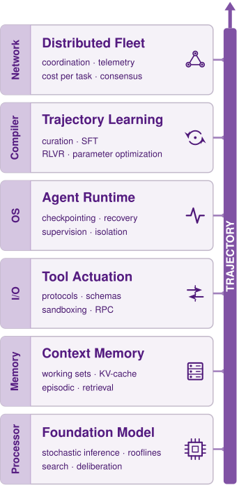

# Conclusion {#sec-vol3-conclusion}

::: {layout-narrow}
::: {.column-margin}

\chapterminitoc

:::

::: {.content-visible when-format="pdf"}
\noindent
{fig-alt="Blueprint for Architectural Synthesis."}
:::

::: {.content-visible unless-format="pdf"}
{fig-alt="Blueprint for Architectural Synthesis."}
:::

:::

## Purpose {.unnumbered .unlisted}

::: {.content-visible when-format="pdf"}
\begin{marginfigure}
\mlagentstack{17}{17}{17}{17}{16}{16}
\end{marginfigure}
:::

::: {.content-visible unless-format="pdf"}
::: {.column-margin}
{width="100%" fig-alt="Agentic Machine Learning Systems Stack"}

*Agent stack focus for this chapter.*
:::
:::

_Why can individually tested components still leave an agent's task unfinished or its effects unaccounted for?_

An autonomous agent unites disparate systems disciplines (foundation models, memory hierarchies, isolated execution sandboxes, transactional event logs, and independent verifiers) into a single closed-loop control architecture. Each individual component can satisfy its local unit tests, yet the integrated system can still fail if the contracts connecting them are ungrounded or ambiguous. The core challenge of agentic systems engineering is designing the deterministic harness that bounds and verifies a stochastic proposer, a problem that larger models and more elaborate prompts do not remove. Across a trajectory horizon, carried working state, and delegated authority, reliable autonomy is achieved only when the runtime enforces invariant closure at every system boundary.

::: {.content-visible when-format="pdf"}

\newpage

:::

::: {.callout-learning-objectives}

- Trace an incident-remediation trajectory, identifying the owner and record of each consequential transition
- Translate a task contract into bounds and acceptance requirements proportionate to its horizon, state, and authority
- Diagnose state and evidence mismatches at subsystem boundaries using the authority and lifetime of each record
- Resolve an uncertain external action without confusing a lost response with permission to repeat its effect
- Select a system intervention using attributed failures, outcome evidence, and its full deployment cost
- Construct a safety case that connects scoped claims to arguments, evidence, assumptions, and residual uncertainty
- Distinguish assistance with specifications from authority to adopt them and accept the resulting task

:::
## Answers to the Three Questions {#sec-vol3-conclusion-questions}

Every mechanism in the book now carries a price in one unit, the cost per accepted task of each lighthouse (@sec-vol3-agent-economics-synthesis), so the last instrument is in place. The introduction to this book posed three foundational architectural questions that every subsequent chapter has addressed in part. With the complete system architecture now assembled and priced, each question admits a concise engineering answer, and each answer represents a concrete design claim that this concluding chapter tests against a live operational workload.

::: {.column-margin .margin-pointer}
↩ The three foundational architectural questions governing agentic design are established in @sec-vol3-intro-questions.
:::

The first question asked when an adaptive, model-directed loop earns its cost over a deterministic workflow. The answer cannot be settled globally across an entire application; it must be resolved at each individual decision point by measuring the cost per accepted task under a fixed specification contract. A model should direct the next action only where interpreting dynamic, unstructured evidence improves the task acceptance rate by a larger factor than the added inference calls increase the cost of an attempt. Deterministic software should govern everywhere else. Evaluated by this metric, dynamic model loops can earn their cost at phases such as root-cause diagnosis, where the next diagnostic transition cannot be enumerated in advance, while deterministic control structures manage the predictable orchestration surrounding them. The incident below supplies a cost threshold for that comparison. Its price, worked out in @sec-vol3-envelope-four-questions, shows the model calls to be a small fraction of one remediation attempt's cost. Whether additional diagnostic calls earn that cost depends on the relative acceptance improvement measured against a matched baseline under the same contract and latency constraints.

The second question asked what operational machinery must surround the model. The answer is strictly proportional to the task's exposure profile across state, authority, and execution horizon. Managing state requires selectively retrieved context, explicitly budgeted serving state, and durable audit records that preserve source authority. Governing authority demands typed, mediated action interfaces, definitive effect settlement before any retry loop can execute, and process containment enforced within the execution substrate beneath the model. Managing horizon requires a supervisory harness that bounds the total trajectory, a write-ahead log of intent recorded before committing each external side effect, and compensating workflows capable of mitigating actions that cannot be reversed. A read-only lookup requires little of this protective scaffolding, whereas an autonomous remediation agent operating on live production systems demands all of it.

The third question asked how operators verify that a task has actually succeeded. The answer requires objective evidence collected from an authoritative endpoint that directly monitors the target system, evaluated against an explicit contract adopted by system owners before execution began. This verification must satisfy a pre-declared closure evidence level, with any residual uncertainty explicitly quantified and assigned to an accountable owner. A model's self-generated report never serves as evidence, however coherent or persuasive, because a component executing within the loop cannot certify its own output. Stated as an operational acceptance rule, this is the discipline of invariant closure (principle \ref{pri-invariant-closure}).

Each of these answers is straightforward to state for an isolated component, but maintaining them across subsystem boundaries is where agentic architectures most often fail. Individually tested services routinely drop an in-flight task when state, authority, and verification handoffs cross architectural seams. The answers are therefore tested on one complete incident handled by the remediation agent, the lighthouse that exercises horizon, state, and authority at once, followed from its contract across the memory and execution boundaries to the one boundary no runtime can close on the owner's behalf.

## One Incident Through the System {#sec-vol3-conclusion-capstone}

A database service triggers a query-latency alert shortly after a configuration change. An automated remediation agent inspects telemetry, correlates logs, and proposes reverting to the previous known-good settings. The human operator approves the rollback, but the configuration endpoint drops the network connection before returning an acknowledgment. At this moment, the system faces a classic distributed systems dilemma: whether the mutation took effect remains fundamentally unknown. No fluent textual explanation from a language model can resolve that ambiguity. If the runtime interprets the timeout as a failure and retries under a fresh operation identifier, it risks executing the mutation twice. If it optimistically assumes success, it risks closing an incident while degraded queries continue to impact production. If it simply halts, it leaves a live production change in an unverified state with no entity accountable for it. Each failure mode arises by default when every component satisfies its local unit contract, yet no system component owns the distributed boundary between them. This is the end-to-end argument that grounded the closure evidence levels (@sec-vol3-intro-invariant-closure) applied to a single incident: an intermediate success report from a tool or a model call cannot establish acceptance, and only the principal holding the task contract can verify completion against direct evidence from the service.\index{End-to-end argument!task acceptance}

::: {.column-margin}
{width="100%" fig-alt="H·S·A locator with all three axes, Horizon, State, and Authority, highlighted in purple."}

*Horizon, state, and authority return together, and the runtime closes each on one trajectory.*
:::

This concrete incident, `incident_42` on database service `db_primary_01`, represents the operational workload of the remediation agent (lighthouse \ref{lhs-vol3-remediation-agent}) and supplies the book's capstone synthesis. The remediation agent is this book's irreversible actor: it operates over a bounded horizon, mutates shared production state, and exercises real authority over a live service. This single trajectory, from initial diagnostic telemetry through operator approval, execution dispatch, and terminal acceptance, anchors the remainder of the chapter. At every transition, the engineering criterion remains constant: the system must deterministically record what it proposed, what permissions were granted, what physical effects occurred, what evidence validates the outcome, and which principal bears ongoing responsibility. Building an agentic machine learning system means guaranteeing that these accounts are durable and verifiable. In this architecture, the managed database service owns its active configuration, the runtime orchestrator owns execution and control decisions, and the accepting authority verifies whether post-remediation evidence satisfies the delegated operational contract. One named human principal, `operations_owner_42`, is accountable both for any operation the runtime cannot settle and for the service once the incident is accepted. The runtime's settlement process, a runtime component rather than a person, reconciles uncertain operations on that owner's behalf.

### Trajectory ownership {#sec-vol3-conclusion-trajectory-owners}

The incident lifecycle begins under `incident_contract_v1`, which grants bounded diagnostic read access and establishes formal gates for proposing, approving, and validating configuration mutations. Initial privileges are strictly observational. The runtime provisions `read_scope_42` to query authorized service endpoints, ensuring that telemetry gathering cannot inadvertently trigger state changes or be coerced into production writes. Throughout this trace, identifiers such as `read_scope_42` denote durable local record keys rather than opaque cryptographic hashes.

Next, the context manager gathers the initial latency alert, recent time-series metrics, active configuration parameters, and relevant runbook sections into an auditable manifest, `context_manifest_42`. Every observation in this manifest records its originating source, a version tag when available, and a precise ingestion timestamp. Here, a practical systems hazard appears: while the retrieved runbook suggests a memory-pool misconfiguration, that document might describe a previous software deployment. By diffing the runbook recommendations against the active production configuration (`config_v7`) and current telemetry, the agent formulates a diagnostic hypothesis. Additional diagnostic queries, constrained by the task's remaining call budget, must corroborate this hypothesis against alternative explanations such as downstream network congestion or disk saturation.

When the diagnostic evidence converges on a known regression, the model emits `change_request_42`, which specifies the target configuration keys, the desired values, and the expected baseline version `config_v7`. In accordance with incident change policy, an authorized human operator reviews the proposed diff and issues `approval_42`. This record binds the operator's identity to the request identifier, the target host, the exact payload parameters, the prerequisite baseline `config_v7`, and an expiration window. The approval records permission for that exact payload and nothing broader; it does not perform the mutation. The model drafts the operational rationale, but it cannot grant itself execution authority. An approval granted minutes before execution is an earlier authorization check, and complete mediation (definition \ref{dfn-complete-mediation}) requires a fresh one at the moment of use.\index{Complete mediation!action gate} Prior to network dispatch, the runtime action gate therefore rechecks operator authorization, compares the payload against the approval's digest, inspects the expiration deadline, confirms resource quotas, and evaluates runtime preconditions. If an operator revokes the ticket or the model generates an altered proposal, the original approval no longer matches and cannot silently apply to a mutated repair payload.

::: {.column-margin .margin-pointer}
↩ Rechecking an approved request's digest, expiry, budget, and authorization at the dispatch boundary is established in @sec-vol3-agent-harness-dispatch-rechecks.
:::

Even a thorough pre-dispatch check cannot protect against time-of-check to time-of-use (TOCTOU) races if a peer operator modifies database settings in the sub-second interval between the gate check and network arrival. The database configuration endpoint closes this concurrency window with the conditional update of @sec-vol3-tool-calling-conditional-updates, an atomic expected-version check.\index{Optimistic concurrency control!expected-version check} The endpoint executes the modification if and only if the live configuration version matches `config_v7` at the instant of the write; a version conflict triggers an immediate rejection, returning the task to the agent for re-diagnosis rather than applying an outdated patch onto an altered baseline. To survive network instability, the endpoint also makes the write idempotent in the sense of definition \ref{dfn-idempotent-action}: it deduplicates requests by an operation identity bound to the caller, target, and payload, and retains that identity across a window longer than the maximum client retry horizon, so a replayed request inside the window is recognized rather than reapplied.\index{Idempotency!operation identity} The endpoint also exposes a read-only operation-status lookup. These correctness guarantees must reside at the endpoint implementation itself; client tool schemas or client-side metadata can declare invariants, but only the server endpoint can enforce them. Before transmitting the RPC across the network, the runtime appends an intent record for `op_42` to a write-ahead journal at the durability boundary chosen for the deployment, together with its *recovery descriptor*: the obligation registration of the trajectory saga, here the corrective-action template, the preconditions it must satisfy, and the accountable owner, `operations_owner_42`. Once both are persistent on disk, the runtime dispatches the request with operation identity `op_42` and expected version `config_v7`.

::: {.column-margin .margin-pointer}
↩ Deduplication by an operation identity bound to caller, target, and payload is established in @sec-vol3-tool-calling-operation-ids.
:::

At this stage, the configuration endpoint's network response is lost in transit. The client runtime experiences a socket timeout. This is the lost-acknowledgment problem that opened @sec-vol3-failure-recovery-introduction: a timeout yields no information about execution state. The network may have dropped the outbound packet, the endpoint may still be executing the transaction, or the endpoint may have committed the write and lost the acknowledgment on the way back. Instead of gambling on a blind retry or prematurely declaring failure, the runtime logs the status of `op_42` as unknown and hands it to the settlement process. Rather than dispatching a second mutating RPC, the settlement process issues an authorized status query against the endpoint's operation registry. In the successful resolution branch of this scenario, this status lookup confirms that `op_42` committed the requested payload, transitioning the database configuration to `config_v8`. The immutable operation identity firmly binds this remote confirmation to the local dispatch record, resolving network ambiguity even if the original RPC suffered significant transmission delays. Conversely, if the status lookup returns an empty record or encounters a transient service outage, the settlement process cannot conclude that the mutation failed; the original request might still be queued in an intermediate network buffer. In that unresolved branch, the operation status remains unknown, preserved through the recovery descriptor as an open obligation of `operations_owner_42` rather than swept away by process termination.

::: {.column-margin .margin-pointer}
↩ Registering the recovery obligation alongside the forward intent, before dispatch, is established in @sec-vol3-failure-recovery-obligation-registration.
:::

Confirming that `config_v8` committed settles the mechanical outcome of the mutation, but it does not resolve the operational incident. The runtime context manager flushes the stale `config_v7` snapshot and assembles fresh post-mutation telemetry to evaluate database performance under live load. Assume that latency percentiles and error budgets gathered across an observation window, `health_window_42`, successfully satisfy the quantitative performance thresholds specified in `incident_contract_v1`, and that secondary policy assertions pass. An authorized human principal or automated gatekeeper evaluates this telemetry and signs `acceptance_42`. This acceptance record explicitly binds together the original incident contract, the operator approval, the settled operation identifier, the new active configuration version (`config_v8`), and the validated metric window. Only then is the incident formally closed under contract for the evaluated duration. Monitoring the service after the window passes to `operations_owner_42`, the same owner who would have held `op_42` had its status stayed unknown.

Seen from above, this one incident has crossed nearly every part of the book (@fig-vol3-trajectory-lifecycle). The adopted contract came first; the loop that diagnosed the regression was assembled from the model call, context, tools, and sandbox of Parts I to III; the harness of Part IV wrapped every step; and acceptance rested on external evidence rather than the agent's report. Learning and delegation never entered, because neither was needed to close this task.

::: {#fig-vol3-trajectory-lifecycle fig-env="figure" fig-pos="htb" fig-cap="**One Trajectory Through the Whole System**: A task contract, defined in the introduction and adopted at the specification boundary that Part VII closes on, governs a live loop in which context assembly (Part II) feeds a model call (Part I) whose proposal becomes a validated, authorized tool call run in a sandbox (Part III), with the observation returning to context as data. The harness (Part IV) wraps every step with budgets, the approval gate, the durable log, and recovery. Acceptance rests on scoped external evidence rather than the agent's report; learning (Part V) and scale (Part VI) are optional lifecycle choices." fig-alt="Layered diagram. A slate box at the top labeled Task contract, adopted by an authorized owner, Part VII, points down with an arrow labeled governs into a purple container labeled Harness around every step, Part IV, with the sublabel budgets, approval gate, durable log, recovery. Inside the container four stages form a clockwise loop: Context assembly (Part II) to Model call (Part I), down via proposal to Tool call (Part III), left to Sandbox (Part III), and a dashed arrow back up to Context assembly labeled observation as data. A small purple checkpoint mark sits on each of the four loop arrows. An arrow labeled settled outcome leads from the container down to a slate Acceptance box, Part IV, reading scoped evidence, not the agent's report. A dashed line labeled checked against runs from the task contract around the right side to the acceptance box. Below, a dashed arrow labeled if chosen leads to a pale dashed Learning box (Part V, optional, across tasks), beside a pale dashed Scale box (Part VI, optional, across agents)."}
{width="100%"}
:::

The audit chain summarized in @tbl-vol3-capstone-owners enables an independent auditor or site reliability engineer to reconstruct the causal lineage of the incident without relying on a language model's retrospective self-report. Structured records expose operational gaps immediately: a successful completion token from a model call cannot settle the network status of `op_42`, and an unanchored telemetry snapshot lacking a verified observation window cannot validate an acceptance claim.

| **Transition**                 | **Owner**                                          | **Record it leaves**                                                                     |
|:-------------------------------|:---------------------------------------------------|:-----------------------------------------------------------------------------------------|
| Task admitted                  | Runtime under the delegated contract               | `incident_42`, `incident_contract_v1`, limits, and `read_scope_42`                       |
| Evidence selected              | Context manager and diagnostic tools               | `context_manifest_42` with source, version, time, and omissions                          |
| Change proposed and approved   | Model proposes; authorized operator decides        | `change_request_42` and its bound `approval_42`                                          |
| Change admitted and dispatched | Runtime action gate and operation journal          | Durable `op_42` intent, recovery descriptor, and dispatch record                         |
| Lost response reconciled       | Settlement process for `operations_owner_42`       | Source outcome for `op_42`, confirming `config_v8` or preserving uncertainty             |
| Incident accepted              | Designated accepting principal with runtime checks | `acceptance_42`, `health_window_42`, and residual duty assigned to `operations_owner_42` |

: **Owners and Records Along One Trajectory**: The incident's consequential transitions remain auditable through explicit owners and linked records. An unresolved outcome remains a recorded obligation rather than disappearing when execution stops. {#tbl-vol3-capstone-owners tbl-colwidths="[28,34,38]"}

### Adversarial evidence within the same task {#sec-vol3-conclusion-adversarial-evidence}

Real production telemetry is rarely sterile. A diagnostic log entry or an issue tracker comment can carry an indirect prompt injection, instructions written to exfiltrate database credentials to an external server. The payload enters the agent's context through an authorized diagnostic read, yet the untrusted text inherits none of the operator's administrative authority; an agent that acted on it would be the confused deputy of definition \ref{dfn-confused-deputy}, spending the operator's grant on the attacker's intent.\index{Confused deputy!prompt injection} While structured provenance tagging and XML delimiters assist the model in distinguishing ingested data from operational instructions, model-level comprehension provides no security boundary. Strong isolation outside the model runtime must govern what an ostensibly schema-valid tool call can execute using legitimate system privileges.

::: {.column-margin .margin-pointer}
↩ Indirect prompt injection, delivered through an observation the agent reads rather than by the interacting user, is established in @sec-vol3-security-injection-entry-points.
:::

In this incident scenario, an attempted exfiltration collides with layered architectural barriers. If the manipulated model emits a tool call directed to an unauthorized external IP address, the runtime action gate blocks dispatch, because `read_scope_42` grants queries only against the named diagnostic endpoints and an arbitrary address is not among them. Independently of that grant, the sandbox's egress policy drops unsanctioned outbound sockets at the network layer regardless of what code or parameters the agent generates. The read grant says which services the task may ask; the egress policy says which hosts any process may reach. Allowing unrestricted outbound connections would create an exfiltration channel even with local filesystems mounted read-only.

::: {.column-margin .margin-pointer}
↩ Network egress enforcement placed outside the guest's control boundary is established in @sec-vol3-sandboxes-egress-enforcement.
:::

The harder case uses only permitted operations. A diagnostic query to an endpoint inside `read_scope_42` can carry a database connection string in one of its arguments, and both the tool and the destination are allowed. The dispatch release check of @eq-vol3-flow-dispatch catches it. The credential carries a confidentiality label whose recipient set excludes the telemetry service, the label propagates into the query string built from it, and the reference monitor rejects dispatch because the recipient is not in that set. Layered constraints thus bound the blast radius of a successful injection, at the gate, at the network layer, and on the data itself.

When the action gate intercepts an unauthorized or malformed action, it appends the rejection event to the audit journal as an undispatched intent. If an operation has already crossed the network boundary into production, terminating the sandbox process does not neutralize the external state change. `operations_owner_42` and the incident-response team must inspect the audit log, determine what side effects materialized in production, and select the appropriate compensatory action. Similarly, if an adversarial prompt leads the model to assert that cluster latency has normalized, the runtime ignores the assertion; model output can never substitute for empirical telemetry verified across `health_window_42`. Rigorous ownership boundaries govern adversarial attacks and standard component outages with equal fidelity.

The remediation trajectory terminates cleanly using a single model and a single runtime controller. Mining this execution trace for offline post-training or delegating sub-problems across a fleet of specialized sub-agents represent subsequent, optional architectural decisions (@sec-vol3-conclusion-seams, @sec-vol3-conclusion-adaptation). Neither optimization alters the authorization invariants required to dispatch `op_42` or the empirical evidence demanded to seal `acceptance_42`.

### The principle ledger {#sec-vol3-conclusion-principle-ledger}

Managing `incident_42` integrates engineering responsibilities that were established across individual chapters. The context window must faithfully represent the operational configuration, operator approval must validate the exact mutation diff, and terminal acceptance criteria must verify the operation that actually committed on the remote service. No single theoretical abstraction or isolated mechanism guarantees all three properties. @Tbl-vol3-principle-ledger compiles the fifteen foundational principles established throughout this book into an operational reference. Each entry presents the governing mathematical formulation or structural contract alongside its concrete design prediction. When a prediction is quantitative, it provides the first-principles scaling law or sizing estimate developed in the corresponding chapter.

The three H·S·A exposures (horizon, state, and authority) structure this ledger. The principles in Part I quantify the computational cost of an isolated model invocation and formalize the statistical limits of verification. Parts II, III, and IV establish operational closure across the three fundamental exposures that a single model call cannot manage on its own: persistent state across conversational turns, mutable authority over external systems, and an execution horizon over which errors compound. Part V refines the policy weights through post-training without expanding authority; fine-tuning alters candidate trajectory distributions but grants no new access rights. Part VI multiplies all three exposures across concurrent sub-agents and distributed execution graphs. Anchoring the ledger, invariant closure marks the boundary that automated computation cannot self-certify: the task contract that defines human acceptance. Although each principle is categorized by its primary exposure, these dimensions inherently interact: persisting state over long horizons demands durable write-ahead logging, while delegating tasks across agents projects state and authority across distributed boundaries.

| **#**                                    | **Principle**                                    | **Part**     | **Primary exposure**    | **Core equation or statement**                                                                                                                                                                                                                                                                                                                           | **What it predicts**                                                                                                                                                                                                                    |
|:-----------------------------------------|:-------------------------------------------------|:-------------|:------------------------|:---------------------------------------------------------------------------------------------------------------------------------------------------------------------------------------------------------------------------------------------------------------------------------------------------------------------------------------------------------|:----------------------------------------------------------------------------------------------------------------------------------------------------------------------------------------------------------------------------------------|
| \ref{pri-invariant-closure}              | Invariant closure                                | Introduction | All three (closure)     | $\Pr(\text{success})=(1-\PerStepErrorRate)^{\TurnHorizon}$ for unchecked steps; bounds enforced below the model, acceptance on evidence above it, under a contract only authorized principals adopt                                                                                                                                                      | Unchecked reliability decays exponentially in $\TurnHorizon$; a check turns a detected violating step into a rejected attempt; a truncated payload becomes a diagnosable rejection; no model output relaxes its own acceptance criteria |
| \ref{pri-vol3-memory-bandwidth-decoding} | Output-bound latency                             | I            | None (prices the call)  | $\PerTokenDecodeTime \ge \Parameters\,\ElementStorageSize/\Bandwidth$ per output token when weight reads dominate                                                                                                                                                                                                                                        | Generation time grows with output length; a shorter proposal cuts latency when decode dominates the call                                                                                                                                |
| \ref{pri-vol3-verification-asymmetry}    | The verification asymmetry                       | I            | Closure evidence        | $\VerifierPrecision=\dfrac{\ValidCandidateRate(1-\VerifierFalseRejectionRate)}{\ValidCandidateRate(1-\VerifierFalseRejectionRate)+(1-\ValidCandidateRate)\,\VerifierFalseAcceptanceRate}$                                                                                                                                                                | More candidates raise coverage, not selection accuracy; at a low valid rate $\ValidCandidateRate$, a small $\VerifierFalseAcceptanceRate$ fills the passing set, or the rewarded set under RL, with invalid candidates                  |
| \ref{pri-vol3-attention-working-set}     | Context is a selected working set                | II           | State                   | $\SystemInstructionTokenCount+\ToolDeclarationTokenCount+\TaskStateTokenCount+\ObservationTokenCount\le \ContextWindow-\OutputLimit$                                                                                                                                                                                                                     | Every schema or log token displaces evidence; fitting the window does not establish decision quality                                                                                                                                    |
| \ref{pri-vol3-prefix-coherence}          | Attention state is derived from the token prefix | II           | State                   | $\KvCacheBytesPerToken=2\LayerCount \KvHeadCount \AttentionHeadDimension \ElementStorageSize$ bytes held per token; reuse ends at the first changed token                                                                                                                                                                                                | One volatile field early in the prompt forfeits reuse of everything after it; placing stable material first where the task and request format permit increases potential prefix reuse.                                                  |
| \ref{pri-vol3-source-authority}          | Authority stays with the source                  | II           | State                   | Use entry $\DerivedMemoryEntry$ at generation $\QueryWorkspaceGeneration$ only if $\MemoryEntryBirthGeneration(\DerivedMemoryEntry)\le \QueryWorkspaceGeneration<\MemoryEntryDeathGeneration(\DerivedMemoryEntry)$ and access permits                                                                                                                    | Stale or unpermitted records pass on retrieval score alone; source checks, refresh, or exclusion can lower $\StaleSupportRate$, while a cache hit alone supplies no freshness evidence                                                  |
| \ref{pri-vol3-strict-action-abi}         | The typed action contract                        | III          | Authority               | Dispatch only a schema-valid, authorized call whose precondition the endpoint enforces with the mutation                                                                                                                                                                                                                                                 | A read-then-write race stays open until the endpoint checks the expected version at application                                                                                                                                         |
| \ref{pri-vol3-exactly-once-settlement}   | Settlement before retry                          | III          | Authority, with horizon | $\DuplicateEffectProbability=(1-\RequestLossProbability)\,\ReplyLossProbability\,(1-\RequestLossProbability)$ under blind retry                                                                                                                                                                                                                          | The duplicate rate tracks the reply-loss rate almost one for one; rare per call becomes routine per day across a fleet                                                                                                                  |
| \ref{pri-vol3-zero-trust-sandboxing}     | Containment beneath the model                    | III          | Authority               | $\text{admit}(\ProposedAccess,\CapabilityGrant,\AccessAttemptTime)\iff\text{authentic}(\CapabilityGrant)\land \ProposedAccess.\text{op}\in \GrantRights\land \ProposedAccess.\text{target}\sqsubseteq \mathcal{O}_\CapabilityGrant\land \GrantCondition(\ProposedAccess)\land \AccessAttemptTime<\GrantExpiryTime$; flows dispatch only if labels permit | Reach is bounded by the envelope, whatever the model complies with; injected text cannot widen a flow label; teardown leaves external effects in place                                                                                  |
| \ref{pri-vol3-trajectory-encapsulation}  | Trajectory-level encapsulation                   | IV           | Horizon                 | Admit only if actual + reserved + proposed + finalization reserve $\le$ allowance; derived grants only narrow                                                                                                                                                                                                                                            | A loop that passes every per-call limit still halts at the dispatch ceiling or deadline; per-child ceilings alone would let $\WorkerCount$ children spend $\WorkerCount$ times the budget                                               |
| \ref{pri-vol3-intent-before-effect}      | Intent before effect                             | IV           | Horizon, with authority | $\ValidatedProposalEvent\prec \AdmissionDecisionEvent\prec \IntentAcknowledgmentEvent\prec \ExternalDispatchAction\prec \EvidenceRecordEvent$; $\ExpectedIrreversibleLoss=\sum_\PlanAction \Pr(\text{bad}\ \PlanAction)\,\text{consequence}(\PlanAction)\,(1-\ActionRecoverableFraction)$                                                                | Under complete mediation, a crash before the flush leaves no effect, and after it the log names every operation that needs settlement; past the pivot only forward recovery remains                                                     |
| \ref{pri-vol3-release-evidence}          | Causal and statistical release evidence          | IV           | Closure evidence        | $\TasksPerComparisonArm\approx 2(\SignificanceCriticalQuantile+\StatisticalPowerQuantile)^2\,\PooledAcceptanceProbability(1-\PooledAcceptanceProbability)/\TargetAcceptanceDifference^2$                                                                                                                                                                 | Halving the detectable difference quadruples the tasks per arm, so a small suite cannot rank close systems                                                                                                                              |
| \ref{pri-vol3-trajectory-post-training}  | Verified trajectory post-training                | V            | None moved              | $\MaskedFinetuningLoss=-\frac{1}{\ActiveTargetTokenCount}\sum_t \PositionLossMask_{t}\log \Policy(\SequenceToken_t\mid \TokenPrefix)$ over admitted targets                                                                                                                                                                                              | A passing task check does not make every action a target; the active-token fraction sets the supervision each trajectory supplies                                                                                                       |
| \ref{pri-vol3-coordination-tax}          | The coordination tax                             | VI           | All three, multiplied   | $\text{Speedup}(\WorkerCount)=\dfrac{1}{(1-\ParallelFraction)+\ParallelFraction/\WorkerCount+\CoordinationOverhead(\WorkerCount)}$, judged on acceptance, elapsed time, and $\CostPerAcceptedTask$                                                                                                                                                       | The serial fraction caps speedup at $1/(1-\ParallelFraction)$; growing overhead makes added agents slower; delegation pays only when its acceptance or deadline gain justifies its cost multiple                                        |
| \ref{pri-vol3-trajectory-goodput}        | Trajectory goodput and the accepted task         | VI           | All three, priced       | $\CostPerAcceptedTask=\mathbb{E}[\AttemptCost]/\AcceptanceProbability$; $\ConcurrentTrajectories=\TrajectoryAdmissionRate\,\mathbb{E}[\TrajectoryDuration]$ per resource                                                                                                                                                                                 | Raising acceptance can cut cost more than cheaper tokens; long tool waits raise held sandboxes in proportion, and the mean alone does not give deadline capacity                                                                        |

: **Fifteen Principles and What They Predict**: Each principle appears in its teaching home with the H·S·A exposure it primarily addresses, its core equation or governing statement, and the design consequence that form predicts. Symbols carry the meanings given where each equation is derived. The exposure column is a lens rather than a partition, and each prediction holds under the assumptions its owning chapter states. {#tbl-vol3-principle-ledger tbl-colwidths="[4,14,7,8,40,27]"}

These engineering invariants strictly bound performance optimization. For example, KV cache prefix reuse saves the same compute whether or not the cached text still describes the live service, so a reused prefix holding a stale diagnostic snapshot is cheap and wrong at once; freshness has to come from the source's read or version contract, never from the cache. Similarly, a smaller, lower-latency model provides true economic value only if its trajectory acceptance rate and tail latency satisfy the operational service level objective. Offline post-training and multi-agent delegation remain elective interventions whose net utility must be rigorously audited against matched comparative evaluation and cost-per-accepted-task accounting.

::: {.column-margin .margin-pointer}
↩ Cost per accepted task, measured under a declared contract, checker, and environment, as the unit for comparing configurations is established in @sec-vol3-agent-economics-accounting.
:::

::: {#chk-19-principle-ledger .callout-checkpoint title="Reading the ledger as a design tool"}

The mathematical formulations in the ledger provide concrete quantitative estimates for sizing and evaluating real architectures rather than theoretical abstractions.

- [ ] **Horizon budget**: Using @eq-vol3-horizon-compounding, what per-step violation rate keeps the chance of any unchecked violation over $\TurnHorizon$ turns below a target violation probability, and how must that rate change when $\TurnHorizon$ doubles?
- [ ] **Acceptance vs. price**: By @eq-vol3-cost-per-accepted-task, compare cutting the cost per attempt by a fraction $\RelativeImprovementFraction$ with raising acceptance by the same relative fraction. Which lowers cost per accepted task more, and why does a token discount that touches only part of the attempt cost lose ground to the acceptance gain?
- [ ] **Pass rate vs. acceptance**: A change raises the verifier's pass rate but leaves acceptance under protected checks unchanged. Which two ledger rows explain why cost per accepted task does not fall?

:::

The ledger states what each mechanism guarantees in general. The incident still needs those guarantees written down as the specific terms it runs under: which outcome counts as recovery, which actions are permitted and when, and which evidence closes the task. That is the job of the incident's task contract.

## Workload Contract Specification {#sec-vol3-conclusion-envelope}

When an automated latency alert fires for `incident_42`, the runtime dispatches a diagnostic workflow rather than an open-ended authorization to modify the production database. An unconstrained optimization loop might easily restore query throughput by disabling secondary index updates or relaxing data integrity constraints, destroying durability in the name of speed. The deployment therefore grounds this remediation workflow in `incident_contract_v1`, an adopted task contract that separates the desired service outcome from the permitted mechanisms an agent may use to pursue it.

### The incident's five-part contract {#sec-vol3-envelope-contract-formalism}

The five contract components define the operational perimeter for this workload. Rather than describing an abstract agent architecture, they bind a specific incident to an identified service, explicit permission boundaries, and named decision authorities. @Tbl-vol3-contract-decomposition instantiates this contract for this database remediation scenario.

::: {.column-margin .margin-pointer}
↩ The five-part task contract governing an agentic workload is established in @sec-vol3-intro-five-part-contract.
:::

| Contract field                                   | Incident-specific commitment                                                                                                                                    | Owner or supporting record                                               |
|:-------------------------------------------------|:----------------------------------------------------------------------------------------------------------------------------------------------------------------|:-------------------------------------------------------------------------|
| Goal, $\TaskContractGoal$                        | Restore acceptable query latency for `db_primary_01` without violating the required error-rate and change-policy conditions; leave unrelated settings unchanged | `incident_contract_v1`, adopted by the authorized task owner             |
| Environment, $\TaskEnvironment$                  | Operate on the identified live service; treat `config_v7` as the expected baseline, not as a promise that the service remains unchanged                         | Configuration source and its versioned operation interface               |
| Permitted actions, $\PermittedActions$           | Initially perform diagnostics under `read_scope_42`; apply the exact proposed settings only after the required current approval and dispatch checks             | `change_request_42`, `approval_42`, and the runtime's action gate        |
| Available observations, $\AvailableObservations$ | Return authorized, bounded diagnostic results with source, version, capture time, and omission information                                                      | Tool result records and `context_manifest_42`                            |
| Completion criteria, $\CompletionCriteria$       | Confirm the authorized operation's outcome, the required service metrics over the stated window, and the applicable change-policy checks                        | `op_42`, `health_window_42`, and the adopted decision in `acceptance_42` |

: **The Incident Contract**: The same five components connect this delegated task directly to its operational permissions, evidence records, and accountable owners. Merely identifying a record name does not establish that its underlying validation checks have passed. {#tbl-vol3-contract-decomposition tbl-colwidths="[23,48,29]"}

A production goal must encode process constraints alongside target metrics because the validity of an outcome depends on how the system reaches it. In this remediation trace, that dependency surfaces through explicit approval bindings and version preconditions. The contract enforces these preconditions at the infrastructure layer: a configuration endpoint that lacks an atomic compare-and-swap or expected-version check cannot safely host this workflow, regardless of how frequently the agent runtime re-reads `config_v7` before issuing a mutation. Without atomic validation at the service boundary, concurrent writes can slip between the runtime's final read and the update, silently overwriting live state.

Observation boundaries constrain read-only diagnostics just as strictly as write operations. Under `read_scope_42`, the agent may query telemetry from designated endpoints but cannot inspect customer database rows, application payload logs, or external network destinations. Tool outputs must also enforce truncation and redaction budgets: the harness captures vital status lines, flags truncated payloads explicitly in the telemetry stream, and routes full raw diagnostic output to an isolated log sink with an independent retention policy. Simple heuristic filters, such as stripping known API keys or ANSI escape sequences, mitigate obvious hygiene hazards, but they cannot prove that an arbitrary output string is free of sensitive data or indirect prompt injections. Reliable protection requires structural access boundaries: enforcing what the agent can read, where intermediate context flows, and which endpoints may receive its output.

::: {.column-margin .margin-pointer}
↩ Head-and-tail byte budgets and explicit truncation notices for tool output are established in @sec-vol3-tool-calling-bounded-capture.
:::

### Exposures and envelope bounds {#sec-vol3-envelope-four-questions}

An H·S·A analysis identifies the concrete operational obligations generated by this contract. The introduction placed the remediation agent at a moderate horizon of tens of turns, mutable shared production state ($\StateExposureLevel_3$), and changes that cannot always be compensated ($\AuthorityExposureLevel_3$), and `incident_42` sits exactly there. Diagnostic investigation demands strict, finite allowances for foundation model inference and tool invocations. Interacting with live service state and maintaining durable audit trails require source-aware state tracking. Finally, transitioning from diagnostic reads to active production modification requires an explicit escalation of authority. The workload contract fixes these obligations; engineers then select the infrastructure mechanisms needed to satisfy them: sandbox boundaries, retry budgets, and model serving configurations.

The operational envelope attached to `incident_contract_v1` applies the harness's trajectory budgets and resource ceilings. This envelope establishes hard caps on agent turns, wall-clock duration, observation buffer sizes, ephemeral disk allocation, and monetary expenditure. The execution harness must reserve the bounded liability of every admitted model call or tool operation in advance, while retaining an emergency reserve for post-incident health checks and graceful recovery routines. Accounting for consumed tokens alone is insufficient: an inference request currently in flight can consume the remainder of a budget, and asynchronous tool routines accumulate cloud compute and storage costs even when no model generation is active. The envelope must therefore distinguish between local resource ceilings enforced by the executor and supervisor-level thresholds that halt task admission and trigger automated operator intervention.

::: {.column-margin .margin-pointer}
↩ Multi-dimensional budget vectors and the advance reservation of each admitted call's liability are established in @sec-vol3-controlplane-accounting.
:::

```{python}
#| label: calc-vol3-conclusion-incident-price
#| echo: false
# ┌─────────────────────────────────────────────────────────────────────────────
# │ PRICE OF ONE INCIDENT_42 ATTEMPT (LEGO)
# ├─────────────────────────────────────────────────────────────────────────────
# │ Context: The envelope paragraph of @sec-vol3-envelope-four-questions.
# │ Goal: Put the capstone incident on the same account as every lighthouse.
# │ Show: Horizon, attempt cost by term, model and approval shares, cost per
# │       accepted task, time to mitigate, and the expected loss of a wrong
# │       change written with no check ahead of it.
# │ How:  C_eff = E[C_attempt] / p_acc; L_A = p_bad * consequence * (1 - rho)
# │       with rho = 0.
# │ Note: Agents.Remediation.OnCall workload profile (teaching assumptions,
# │       not measured incident data), the profile Agent Economics prices for
# │       this lighthouse.
# └─────────────────────────────────────────────────────────────────────────────
from mlsysim import Agents, USD
from mlsysim.fmt import check, fmt_int, fmt_multiple, fmt_percent, fmt_usd

class IncidentPrice:
    # ┌── 1. LOAD (Registry workload profile) ──────────────────────────────
    remed = Agents.Remediation.OnCall
    turns = remed.horizon_turns
    c_model = remed.model_cost_per_attempt.to(USD).magnitude  # model calls
    c_env = remed.environment_cost_per_attempt.to(USD).magnitude  # telemetry queries, change tools
    c_assess = remed.assessment_cost_per_attempt.to(USD).magnitude  # health-window check
    c_approval = remed.approval_cost_per_attempt.to(USD).magnitude  # reviewer time x hourly rate
    p_acc = remed.acceptance_probability
    t_diag = remed.diagnosis_time.to("minute").magnitude
    t_approve = remed.approval_decision_time.to("minute").magnitude
    t_apply = remed.apply_verify_time.to("minute").magnitude
    p_bad = remed.wrong_change_probability
    impact = remed.wrong_change_impact.to(USD).magnitude

    # ┌── 2. EXECUTE (Compute) ─────────────────────────────────────────────
    c_attempt = c_model + c_env + c_assess + c_approval
    c_eff = c_attempt / p_acc
    model_share = c_model / c_attempt
    approval_share = c_approval / c_attempt
    t_total = t_diag + t_approve + t_apply
    approve_time_share = t_approve / t_total
    diag_time_share = t_diag / t_total
    loss_unchecked = p_bad * impact * (1 - 0)
    loss_vs_attempt = loss_unchecked / c_attempt

    # ┌── 3. GUARD (Invariants the prose relies on) ───────────────────────
    check(model_share < 0.01, "Prose says model calls are under one percent of the attempt")
    check(approval_share > 0.9, "Prose says approval dominates the attempt cost")
    check(abs(approve_time_share - 0.5) < 1e-9, "Prose says approval is half the time to mitigate")
    check(diag_time_share < approve_time_share, "Prose says diagnosis is a smaller share of time than approval")
    check(loss_vs_attempt > 20, "Prose says the unchecked loss is over twenty attempts' worth")

    # ┌── 4. OUTPUT (Formatting) ──────────────────────────────────────────
    turns_str = fmt_int(turns)
    c_model_str = fmt_usd(c_model, precision=2)
    c_env_str = fmt_usd(c_env, precision=2)
    c_assess_str = fmt_usd(c_assess, precision=2)
    c_approval_str = fmt_usd(c_approval, precision=0)
    c_attempt_str = fmt_usd(c_attempt, precision=2)
    p_acc_str = fmt_percent(p_acc, precision=0, style="prose")
    c_eff_str = fmt_usd(c_eff, precision=2)
    model_share_str = fmt_percent(model_share, precision=1, style="prose")
    approval_share_str = fmt_percent(approval_share, precision=1, style="prose")
    t_total_str = fmt_int(round(t_total))
    approve_time_share_str = fmt_percent(approve_time_share, precision=0, style="prose")
    diag_time_share_str = fmt_percent(diag_time_share, precision=0, style="prose")
    p_bad_str = fmt_percent(p_bad, precision=0, style="prose")
    impact_str = fmt_usd(impact, precision=0)
    loss_unchecked_str = fmt_usd(loss_unchecked, precision=0)
    loss_vs_attempt_mult_str = fmt_multiple(round(loss_vs_attempt), precision=0)
```

Priced on the remediation workload profile used for this lighthouse in @sec-vol3-agent-economics-synthesis, one `incident_42` attempt runs about `{python} IncidentPrice.turns_str` turns and costs `{python} IncidentPrice.c_attempt_str`: `{python} IncidentPrice.c_model_str` of model calls, `{python} IncidentPrice.c_env_str` of telemetry queries and change tools, `{python} IncidentPrice.c_assess_str` for the health-window check, and `{python} IncidentPrice.c_approval_str` of on-call review for the approval. At `{python} IncidentPrice.p_acc_str` acceptance, each accepted incident costs `{python} IncidentPrice.c_eff_str` (@eq-vol3-cost-per-accepted-task). The model accounts for `{python} IncidentPrice.model_share_str` of the attempt, while operator approval takes `{python} IncidentPrice.approval_share_str` of the money and `{python} IncidentPrice.approve_time_share_str` of the `{python} IncidentPrice.t_total_str`-minute time to mitigate. This profile sets a threshold for additional diagnosis rather than establishing superiority over a fixed workflow. If all other expected attempt costs remain unchanged, doubling the model-call charges raises attempt cost by its existing model share, `{python} IncidentPrice.model_share_str`. The added calls lower cost per accepted task only if acceptance rises by a greater relative fraction under the same contract and latency limits; that gain must be measured.

The same profile shows where the danger lies. A wrong change, proposed in `{python} IncidentPrice.p_bad_str` of attempts and costing `{python} IncidentPrice.impact_str` when it fully commits, carries an expected irreversible loss of `{python} IncidentPrice.loss_unchecked_str` per attempt if no check stands ahead of the write (@eq-vol3-expected-irreversible-loss), about `{python} IncidentPrice.loss_vs_attempt_mult_str` the cost of the attempt itself. For this workload, then, the envelope's caps on turns and spend matter less than its gates: the approval binding, the expected-version check, and the health window that bounds how long a wrong change runs before anyone reverses it.

Similarly, the contract lists idempotency, request deduplication, and out-of-band status reconciliation as strict prerequisites before admitting any remediation workload. When a network partition or gateway timeout obscures the fate of a remote call, these guarantees enable the runtime to poll the endpoint for the true state of an operation rather than blindly issuing a duplicate mutation (@sec-vol3-conclusion-execution).

### Operating-envelope decisions {#sec-vol3-envelope-boundaries}

Consider what happens when the run approaches its execution deadline while the status of `op_42` is still being reconciled. Extending the deadline simply because the model predicts imminent success violates the envelope contract. Conversely, abruptly terminating the process and marking the operation as failed fabricates an unverified outcome. A robust runtime halts further task admission, logs the expiration event, and preserves both the pending operation identifier and its allocated reconciliation quota. Because remote work often persists across downstream systems after a local client times out, `operations_owner_42` retains ultimate operational responsibility for reconciling the orphaned operation or executing an explicit administrative handoff when the allocated automated budget expires.

System acceptance operates under fundamentally different boundaries than resource accounting. Operating entirely within budgeted turn and token limits does not prove that database latency has recovered; only rigorous downstream verification recorded in the trace can substantiate recovery. In production architectures, mutating service state, verifying health criteria, and closing an incident ticket are distinct operational milestones with separate evidentiary requirements.

An operational envelope succeeds only when its resource limits align with the physical demands of the workload. It must grant sufficient observation capacity to diagnose the underlying fault, reserve adequate compute and network quota to verify the outcome, and specify a deterministic fallback protocol when execution yields an indeterminate state. Tightening an envelope ceiling reduces blast radius but risks making completion criteria unattainable; expanding it grants greater operational latitude but introduces unhedged liability that demands human oversight. Managing these boundaries across an agent's lifecycle requires synchronizing task contracts, context windows, cached state, and dynamic system configurations as each evolves along distinct timelines.

::: {.column-margin .margin-pointer}
↪ A worksheet mapping each contract condition to its design obligation and the evidence to record is developed in @sec-vol3-app-ref-arch-profiles.
:::

## State and Evidence Across Boundaries {#sec-vol3-conclusion-memory}

Before an incident mitigation applies a configuration update, `context_manifest_42` selects diagnostic evidence describing `config_v7`. Once the configuration endpoint confirms that operation `op_42` successfully applied `config_v8`, any subsequent prompt that continues to present `config_v7` as active state provides the model with an incorrect basis for its next decision. The earlier observation remains factually true, but its operational role has shifted: it no longer describes the active system, serving instead as historical evidence of the incident trajectory. Tracing this shift across runtime boundaries illustrates how memory architectures must coordinate with action execution and recovery contracts.

### Records and their roles {#sec-vol3-memory-four-layers}

The incident's records fall into the four roles of an evidence chain, plus one working-context view. The configuration service is the *source record*, which establishes and owns the applied configuration under its read-and-update contract. The runtime operation log is the *observation or event log*, which durably captures the agent's decisions and received evidence, including human approval bindings and the settlement status (whether unresolved or committed) of `op_42`. Model-generated incident summaries are *agent-written memory*, and diagnostic vector indices are *derived retrieval indexes*; both help locate and interpret the other records, but neither can override primary system state. The context manifest belongs to none of these roles. It is the working-context view, the exact prompt payload assembled for the next model invocation from the task contract, live observations, and retrieved artifacts, and it is an ephemeral selection rather than an authoritative replacement for upstream sources.

::: {.column-margin .margin-pointer}
↩ Source records, event logs, agent-written memory, and derived indexes as roles in an evidence chain are established in @sec-vol3-long-term-memory-record-roles.
:::

These roles are distinct positions in an evidence chain rather than hierarchical tiers in a monolithic cache. An external service evolves independently of the agent harness, and artifacts vary widely in lifecycle: some are ephemeral scratchpads, others persist under formal retention policies, and still others vanish during host failures. The operation log is authoritative only for the local events it has durably written; it cannot attest to external system effects that it has not explicitly verified. If a network response is lost, a generated summary asserting that the configuration has been restored provides zero operational proof of success. This scenario directly reflects the distinction between recorded intent and external settlement.

::: {.column-margin .margin-pointer}
↩ The trajectory log, which records observations and decisions but is not proof that an external effect settled, is established in @sec-vol3-persistence-event-sourcing.
:::

### Evidence refresh and cached computation {#sec-vol3-memory-coherence-invalidation}

When the upstream service confirms `config_v8`, the context assembly pipeline updates the active configuration entry in `context_manifest_42`. It preserves the preceding `config_v7` record if that diagnostic trace is necessary to justify the remediation step. However, any derived artifacts that depend on the superseded configuration, such as diagnostic summaries or precomputed runbook excerpts, require invalidation or re-evaluation, whereas unrelated operational records remain unaffected. If an asynchronous retrieval index lags behind reality, the runtime can issue an authorized direct read to fetch bounded, up-to-date evidence. If direct reads fail or are unavailable, the manifest must explicitly record the omission rather than silently projecting stale data. Explicit tombstones prevent obsolete snapshots from entering the prompt as active state, though fetching the replacement value still requires a distinct read operation.

::: {.column-margin .margin-pointer}
↩ Withdrawing a staged observation's authority over current state when its source changes is established in @sec-vol3-context-engineering-context-rot.
:::

The serving system evaluates cache validity through an entirely different lens. Key-value (KV) cache tensors computed for prompt tokens describing `config_v7` remain mathematically valid representations of those exact token sequences, regardless of external system state. An upstream configuration change does not automatically evict accelerator-resident tensors by file path or resource identifier. Instead, when context assembly substitutes `config_v8` evidence into the prompt, prefix reuse terminates at the first modified token. The leading unchanged tokens remain reusable under the prefix compatibility rules, whereas all downstream positions require fresh KV computation. This architectural seam highlights the tension between two foundational principles: prefix coherence (principle \ref{pri-vol3-prefix-coherence}) dictates mathematical reuse of intermediate activations, while source authority (principle \ref{pri-vol3-source-authority}) governs semantic freshness. Consequently, a serving cache hit confirms computational efficiency rather than the freshness or validity of the underlying world state.

::: {.column-margin .margin-pointer}
↩ Reuse of KV state only over an exact token prefix computed under the same weights and execution parameters is established in @sec-vol3-kv-cache-prefix-compatibility.
:::

Evidence refresh is also bound by temporal reality. Source version checks and retrieval pipeline maintenance ensure that the model receives the freshest available snapshot, but they cannot freeze external services while the model deliberates. Because concurrent systems can drift during generation, the execution pipeline cannot rely solely on prompt-time freshness; it must enforce optimistic concurrency checks at the action endpoint when the mutation is applied.

### Provenance and permission {#sec-vol3-memory-provenance-grounding}

During `incident_42`, the runtime platform captures host-level provenance: which authorized endpoint provided an observation under `read_scope_42`, the corresponding source timestamp and version vector, any payload filtering applied, and the exact model request that consumed the data. The runtime separately logs its own policy admission decisions. These host-verified events are fundamentally distinct from the model's generated assertions, such as claiming that a specific configuration rollout triggered the latency alert. The model's reasoning remains an internal hypothesis until substantiated by verifiable system telemetry.

Untrusted data paths, such as prompt injections embedded in external log streams, underscore this separation from the security boundary. Ingesting text from a trusted storage bucket does not endow that text with operational authority or approval status. Provenance tracks the data lineage and origin of tokens, while the security subsystem enforces authorization against explicit, unforgeable capability grants. The agent runtime evaluates permissions against the active execution context and credentials, treating all observed data strictly as passive payload.

### Cross-subsystem seams and ownership {#sec-vol3-conclusion-seams}

The source-to-context example exposes a fundamental failure mode in modular architectures: storage and serving subsystems can both operate strictly within their local specifications while the agent as a whole acts on stale, invalid evidence. @Tbl-vol3-seams extends this ownership analysis to five critical subsystem seams encountered during the incident. The final two rows govern scenarios where the architecture incorporates continuous learning or delegated multi-worker execution.

| Seam                                     | Incident-specific failure                                                                                       | Principles that meet here                                                                                                                             | Owner and required record                                                                                                                                                 |
|:-----------------------------------------|:----------------------------------------------------------------------------------------------------------------|:------------------------------------------------------------------------------------------------------------------------------------------------------|:--------------------------------------------------------------------------------------------------------------------------------------------------------------------------|
| World and its representations            | `config_v7` is presented as current after `config_v8` is confirmed                                              | Source authority (principle \ref{pri-vol3-source-authority}) against prefix reuse (principle \ref{pri-vol3-prefix-coherence})                         | Context and retrieval owners preserve source/version bindings in `context_manifest_42`; the action endpoint enforces the expected version when applying a change          |
| Proposal to effect                       | A lost reply is treated as failure, leading to an unsafe repeat of `op_42`                                      | Intent before effect (principle \ref{pri-vol3-intent-before-effect}), then settlement before retry (principle \ref{pri-vol3-exactly-once-settlement}) | The settlement process and `operations_owner_42` retain the admitted intent, operation identity, and unresolved status until the endpoint supplies outcome evidence       |
| Recovery and authority                   | A recorded recovery plan is treated as permission to apply a corrective change to a now-different service       | Compensation (principle \ref{pri-vol3-intent-before-effect}) against the typed action contract (principle \ref{pri-vol3-strict-action-abi})           | `operations_owner_42` retains the descriptor and residual duty; any corrective action needs current authorization and applicable preconditions                            |
| Recorded incident to learning, if chosen | Acceptance of the incident makes every step a training target, or the release grader becomes a selection reward | Release evidence (principle \ref{pri-vol3-release-evidence}) against the verification asymmetry (principle \ref{pri-vol3-verification-asymmetry})     | Curation and evaluation owners separately admit any training record derived from the incident, keep its permitted use and evidence limits, and protect release evaluation |
| Across workers, if delegated             | Diagnostic workers duplicate a consumable allowance or their agreement is treated as independent confirmation   | Coordination tax (principle \ref{pri-vol3-coordination-tax}) against delegated admission (principle \ref{pri-vol3-trajectory-encapsulation})          | Delegating runtime records scoped assignments and reservations; the integration owner checks returned evidence and retains unresolved child obligations                   |

: **Incident seams, principles, and owners**: Each boundary needs both an owner and a record that preserves the distinction the next subsystem relies on, and at each one two principles meet or pull against each other. Local success alone does not establish the end-to-end task result. {#tbl-vol3-seams tbl-colwidths="[15,25,24,36]"}

Delegation makes the final row concrete without altering the acceptance contract. A worker may receive a subset of `read_scope_42` while the parent retains its broader read permissions. That reusable capability differs fundamentally from a consumable allowance: concurrent workers must coordinate reservations against a shared budget rather than each receiving an independently spendable quota (principle \ref{pri-vol3-trajectory-encapsulation}). Similarly, consensus among multiple diagnostic workers cannot substitute for empirical verification. When workers process identical noisy inputs or observe one another's intermediate reasoning, their failures correlate; apparent agreement often reflects shared bias rather than independent confirmation. Whether delegation yields a net benefit is the central evaluation question examined in @sec-vol3-conclusion-adaptation, which balances task decomposition against the coordination tax (principle \ref{pri-vol3-coordination-tax}) incurred across subagent boundaries.

Taken together, structured boundary records enable an auditor or post-incident review to reconstruct exactly what the runtime observed, what operations it proposed, what authority it possessed, and what state the external world ultimately committed. Converting this body of recorded evidence into an admissible next action, whether settling an ambiguous inflight request or dispatching a compensating repair, is the responsibility of the execution and recovery boundary.

## Execution Harness Synthesis {#sec-vol3-conclusion-execution}

The capstone trace resolved its lost reply with a single status query, and it could do so only because every piece of state that query needed was persisted before the network dropped the reply. The sequence is familiar by now. Each step was admissible because of three properties: durability that covers the declared failure domain, evidence states the runtime must keep apart, and obligations that outlive the process that created them. Each binds an abstract intent, such as `change_request_42`, to the concrete mutation an external endpoint actually applies, without inventing either success or failure when network visibility collapses.

### Durable intent before dispatch {#sec-vol3-execution-pipeline-stages}

The trace wrote the intent for `op_42` and its recovery descriptor before the request left (principle \ref{pri-vol3-intent-before-effect}), binding the operation to its request, bound approval, endpoint contract, resource reservation, and accountable owner. Registering the descriptor only after a response would have left exactly the gap the lost reply exposed, an active remote mutation with no durable record of who must reconcile it. The ordering is a database write-ahead log applied to an external effect, with one difference that shapes everything after it. A database's recovery manager can redo or undo a logged update itself, whereas the runtime can neither redo nor undo the endpoint's mutation; the log tells it which operation to ask about, and only the endpoint can answer.\index{Write-ahead logging!intent record}

::: {.column-margin .margin-pointer}
↩ Durable intent, the admitted operation acknowledged by storage that survives the declared failure domain before dispatch, is established in @sec-vol3-persistence-wal.
:::

Durable acknowledgments must cover the failure domain declared by the deployment environment. A local `fsync` on a single host is not a guarantee that the record will survive the loss of the physical storage device or a host-level crash before replication completes. If the required storage acknowledgment is missing or ambiguous, the execution gate must withhold dispatch. Even after an intent is acknowledged to disk, an administrative pause or authority revocation can safely withhold the unsent request, because recording intent commits the system to track the operation, not to execute it unconditionally.

### Lost responses and unresolved operations {#sec-vol3-execution-sagas}

Neither the expired timer nor the surviving intent log can say which of the capstone trace's three outcomes occurred. Recovery from a lost reply therefore depends entirely on endpoint guarantees, which must reside at the remote service because the agent's local log and the external configuration service cannot participate in a single atomic transaction. Issuing an idempotent status query rather than dispatching a fresh mutation enforces settlement before retry (principle \ref{pri-vol3-exactly-once-settlement}). Once correlated evidence confirms that the endpoint applied `config_v8`, dependent tasks may safely consume the result. Any subsequent replay of the same operation must conform to the endpoint's repeat contract and pass active admission checks.

@Tbl-vol3-execution-pipeline-stages distinguishes boundary states that naive agent architectures often treat as interchangeable tool errors.

| Evidence at the boundary                                          | What the runtime may conclude                                               | Continuation and owner                                                                                           |
|:------------------------------------------------------------------|:----------------------------------------------------------------------------|:-----------------------------------------------------------------------------------------------------------------|
| Current admission fails before this attempt is released           | This attempt was withheld through the gate; earlier attempts are unaffected | Record rejection and its reason; reconsider only under current authority                                         |
| `op_42` intent survives, but its response is lost                 | The external outcome remains unknown                                        | Withhold dependent mutation; `operations_owner_42` retains reconciliation and outstanding liability              |
| Correlated status evidence establishes application as `config_v8` | This operation's effect is established under the endpoint contract          | Record settlement evidence; obtain the service-health evidence required for acceptance                           |
| Status remains unavailable within the follow-up allowance         | Automated reconciliation has not established the outcome                    | End this continuation as unresolved; retain the operation, evidence, reservation, and acknowledged handoff owner |
: **Execution Evidence and Continuation**: Local rejection, uncertain delivery, and established application support different decisions. Closing a continuation does not close an unresolved external obligation. {#tbl-vol3-execution-pipeline-stages tbl-colwidths="[31,31,38]"}

Confirming that an endpoint applied a change still leaves the acceptance step of the trace incomplete; the runtime must verify downstream service health before declaring success. The operation's budget reservation likewise stays open until settlement, because a charge for remote work can arrive after its reply, as the canceled child with a late bill showed in @sec-vol3-agent-economics-governance.

### Recovery and stopping obligations {#sec-vol3-execution-watchdog}

A recovery contract asks three things of every effect before dispatch: its target state, the recovery action available under the task's authority, and the evidence that would show recovery worked. For `op_42` the answers split across two of the three contracts. The configuration itself is restorable selected state, since the endpoint keeps `config_v7` and a further versioned write can return to it. The queries `db_primary_01` served while a wrong configuration was live are a commitment that cannot be undone, which is why the health window, not a later rollback, is what limits the damage of a wrong change. The registered recovery descriptor therefore provides an explicit compensation plan rather than an inverse operation guaranteed to rewrite history. A corrective configuration request requires active credentials, relevant approvals, and explicit preconditions verified against the live environment: the same admission checks that the typed action contract (principle \ref{pri-vol3-strict-action-abi}) enforces on forward actions. Compensations can themselves stall or fail partially. Rolling back a local workspace cannot reverse an external configuration change, just as issuing a network cancellation request cannot guarantee that the remote endpoint terminated execution. All residual obligations remain assigned to `operations_owner_42` until an authorized human operator or automated successor explicitly acknowledges the handoff. Even a write that restores `config_v7` is, in the vocabulary of the trajectory saga (definition \ref{dfn-trajectory-saga}), a compensating step: a new forward action that observers may see half-applied, not an erasure of the first. Because `op_42` was itself a rollback, restoring `config_v7` would reinstate the configuration the incident was opened against, so the useful corrective action after a wrong `op_42` is usually a newly diagnosed change, admitted like any forward action.\index{Saga!compensating action}

::: {.column-margin .margin-pointer}
↩ Restoring selected state, compensating a known effect, and managing a commitment that cannot be undone are established as recovery contracts in @sec-vol3-failure-recovery-recovery-contracts.
:::

Semantic watchdog mechanisms and progress monitoring determine when the execution harness must halt ordinary processing to investigate stalls. Detecting semantic livelocks is non-trivial: repeated tool calls and static observations do not definitively prove that an agent is looping, because an asynchronous status query may legitimately return a pending state across multiple polling intervals. To bound the blast radius of heuristic errors, the harness enforces a strict dispatch ceiling on total invocations and token budgets. When an execution hold triggers, the runtime suspends further speculative dispatches while preserving all admitted operations, allowing only separately authorized, budgeted settlement and recovery tasks to proceed.

::: {.column-margin .margin-pointer}
↩ Semantic watchdogs that detect activity without progress are established in @sec-vol3-sagas-watchdogs.
:::

::: {#chk-19-intervention-ladder .callout-checkpoint title="Auditing the incident's action boundary"}

Each prompt names a failure at the action boundary; decide which record or check must catch it.

- [ ] **Changed precondition**: `approval_42` names `config_v7`, but another operator changes the configuration before application. Which check must prevent the stale proposal from applying, and who may authorize a revised change?
- [ ] **Retry exposure**: The log contains the intent for `op_42`, but no response. If some fraction of lost replies hide an applied change, what fraction of fresh-identity retries duplicate the change, and which endpoint guarantee brings that fraction to zero?
- [ ] **Missing obligation**: A design records its recovery descriptor only after receiving success. Identify the failure interval this leaves uncovered and the record and owner that must survive it.
- [ ] **Unresolved exit**: The follow-up allowance expires while status remains unknown. Which operation, financial liability, and handoff records must remain even though this continuation ends?

:::

Because every failure in this trace is anchored to a defined boundary and an accountable owner, the record also shows where the next safeguard belongs. Choosing that safeguard is itself a decision that needs evidence.

## Evidence-Based Systems Intervention {#sec-vol3-conclusion-adaptation}

An execution trace supports a far more precise question than whether the agent needs a larger or smarter foundation model. If `context_manifest_42` still presents `config_v7` as current after settlement confirms `config_v8`, the defect lies in stale state selection. If the runtime blindly retries `op_42` because an initial response timed out, the defect lies in outcome handling and the endpoint's recovery contract. Additional pretraining or fine-tuning might shift how frequently the model encounters these code paths, but modifying weights cannot repair a missing state transition or make an unsafe non-idempotent retry safe.

Effective intervention selection\index{Intervention ladder!intervention selection} pairs an attributed failure with a targeted causal remedy. As formalized in the intervention ladder, candidate remedies should be evaluated in order of operational cost and reversibility. Cheap, easily reversible adjustments come first: refining context and retrieval, hardening tool interfaces and schemas, and enforcing deterministic runtime control. Modifying model weights is reserved for residual failures that persist after these structural remedies, and only when evidence shows that the residual stems from the model's behavior rather than from a missing record or check. This sequence represents a pragmatic default justified by cost and reversibility, not an inflexible ritual that every failure must climb. An urgent authorization bypass, for example, points directly to a runtime enforcement repair rather than a prompt modification.

::: {.column-margin .margin-pointer}
↩ The intervention ladder ordering candidate remedies by operational cost and reversibility is established in @sec-vol3-flywheel-intervention-order.
:::

### Attribution and remedy selection {#sec-vol3-conclusion-remedy-selection}

Although an execution trace records what transpired, causal attribution requires an experimental hypothesis test. The fault is isolated by reconstructing the initial input, tool contract, runtime state, and observed outcome, and then manipulating only the suspected causal variable under controlled conditions. For instance, supplying a missing configuration version directly into the prompt verifies whether the issue was an information deficit. Similarly, replacing an ambiguous network timeout with an explicit pending status reveals whether the tool interface misled the controller. Once a candidate fix is identified, engineers must evaluate the repair across the entire affected task suite while running regression checks across unrelated workloads to detect secondary side effects.

@Tbl-vol3-intervention-ladder-tradeoffs connects candidate intervention rungs to the empirical evidence required to justify them. The first three rows represent low-cost, reversible structural fixes; the two training rows modify model parameters; and the final row addresses the distinct architectural decision of task delegation.

| Intervention           | Evidence motivating the change                                                                              | Obligation the change leaves in place                                                         |
|:-----------------------|:------------------------------------------------------------------------------------------------------------|:----------------------------------------------------------------------------------------------|
| Context and retrieval  | Needed facts are absent, stale, or obscured in the actual model input                                       | Validate source versions and preserve current task constraints                                |
| Tool interface         | Arguments or outcome states are ambiguous to the caller                                                     | Enforce authorization and distinguish a rejected request from an unresolved effect            |
| Runtime control        | Budgets, action preconditions, or settlement rules are not enforced at the responsible boundary             | Test enforcement and recovery under the declared failure model                                |
| Supervised fine-tuning | Admitted demonstrations represent a recurring behavior the current policy handles poorly                    | Supply current contracts and evaluate generalization and regressions                          |
| Reward-driven learning | New attempts can be assessed under a useful scoped reward without a demonstrated response at every decision | Protect assessment, inspect reward gaps, and evaluate held-out behavior                       |
| Delegated trajectories | Separate ownership and focused contexts may improve a declared task objective                               | Bound authority and spending, reconcile results, and compare with a capable single controller |

: **Evidence for an Intervention**: A causal diagnosis directs the remedy; no row guarantees improvement or removes the obligations enforced elsewhere in the system. {#tbl-vol3-intervention-ladder-tradeoffs tbl-colwidths="[21,39,40]"}

Adapting model weights reshapes proposal distributions; it never relieves the system of enforcing contracts, budgets, or security boundaries at runtime. Supervised fine-tuning teaches the model to imitate demonstrated recovery paths and structured search strategies, whereas reinforcement learning from verifiable rewards optimizes these behaviors through autonomous exploration. Both training paradigms must prove their generalization gains on the true deployment distribution. Even a sandboxed, automated reward evaluator can harbor specification gaming or omit subtle edge cases in task requirements.

::: {.column-margin .margin-pointer}
↩ Reward hacking, which exploits the gap between a verifiable reward and the intended task, is established in @sec-vol3-rlvr-score-intended-outcome.
:::

Delegation occupies a distinct architectural dimension outside the ladder. Partitioning a task across multiple agents alters system topology, ownership boundaries, and communication overhead rather than repairing an individual component failure. A workload decomposed into clear, decoupled subtasks may warrant delegation without any model training whatsoever. When considering delegation, the primary baseline must be a capable single controller equipped with selective retrieval and parallel tool calls. Any architectural comparison must account for what multiple independent trajectories actually cost: the redundant prompt contexts, serialization latencies across inter-agent dependencies, and reconciliation logic that together constitute the coordination tax (principle \ref{pri-vol3-coordination-tax}). In the running incident, diagnostic sub-agents inspecting logs in parallel could shorten triage, without any worker holding permission to apply production changes, but only if the serial share of diagnosis and the integration overhead pass the screen of @eq-vol3-multiagent-speedup. Because diagnosis takes only `{python} IncidentPrice.diag_time_share_str` of this incident's time to mitigate and approval takes `{python} IncidentPrice.approve_time_share_str`, that screen is hard to pass here, which is why `incident_42` closed without delegation. That architectural partitioning remains completely orthogonal to whether the underlying model weights require adaptation.

::: {.column-margin .margin-pointer}
↩ Benchmarking a multi-agent design against a single controller with matched tools, budgets, and concurrency limits is established in @sec-vol3-multiagent-matched-conditions.
:::

### Conditional payback of an intervention {#sec-vol3-conclusion-intervention-payback}

Even when an engineering intervention reliably improves behavioral reliability, it must still survive rigorous economic accounting. Let $\AdaptationInvestmentCost$ denote the incremental, one-time expenditure incurred for dataset curation, training compute, and offline evaluation. Let $\BaselineTaskCost$ and $\AdaptedTaskCost$ represent the expected operating costs per assigned task under the baseline and adapted configurations, respectively. These operational expectations must incorporate the amortized costs of failed attempts, retries, and any downstream human review or recovery workflows. Assuming stationary unit costs over the operational planning horizon, a positive per-task operational saving $\FiniteChange \TaskCost = \BaselineTaskCost - \AdaptedTaskCost$ yields the continuous break-even threshold:

$$\BreakEvenTaskCount = \frac{\AdaptationInvestmentCost}{\BaselineTaskCost - \AdaptedTaskCost} = \frac{\AdaptationInvestmentCost}{\FiniteChange \TaskCost}, \qquad \FiniteChange \TaskCost > 0.$$ {#eq-vol3-breakeven-volume}

The relation is the payback horizon of context compaction (@sec-vol3-agent-economics-compaction-price) moved up one scale. There a one-time summarization surcharge is recovered over the remaining calls of one trajectory; here a one-time engineering investment is recovered over the tasks of a deployment. Because tasks arrive in discrete units, the minimum production volume required to recover the upfront investment is the ceiling integer $\lceil \BreakEvenTaskCount \rceil$. If the incremental per-task saving is nonpositive ($\FiniteChange \TaskCost \le 0$), the investment can never break even on operational execution costs alone under these assumptions. In such cases, adopting a more expensive configuration requires justification along non-monetary axes: higher solution quality, bounded latency tails, non-negotiable autonomous capabilities, or reduced systemic risk. Furthermore, if the two configurations achieve different end-to-end task success rates, calculating cost simply per assigned task becomes misleading. Engineers must instead divide each configuration's expected attempt cost by its empirical acceptance probability to evaluate the cost per accepted task (@eq-vol3-cost-per-accepted-task).

```{python}
#| label: calc-vol3-conclusion-weight-breakeven
#| echo: false
# ┌─────────────────────────────────────────────────────────────────────────────
# │ CONDITIONAL CODE-REVIEW PAYBACK (LEGO)
# │ Context: A separate hypothetical design comparison, not incident_42.
# │ Goal: Price changed model usage under equal acceptance/latency requirements.
# │ Show: Incremental saving, continuous break-even, integer crossing, months.
# │ How: Expected assigned-task tokens times rates; all other costs cancel.
# └─────────────────────────────────────────────────────────────────────────────
import math
from mlsysim import *

class WeightBreakEven:
    # ┌── 1. LOAD (Constants & Parameters) ─────────────────────────────────
    base_in = 12_000  # hypothetical mean billable input tokens per step
    base_out = 800  # hypothetical mean billable output tokens per step
    base_steps = 5  # hypothetical steps per assigned task
    base_p_in = 3 * USD / 1_000_000  # hypothetical input price per token
    base_p_out = 15 * USD / 1_000_000  # hypothetical output price per token
    adapt_in = 1_500
    adapt_out = 800
    adapt_steps = 4
    adapt_p_in = 1 * USD / 1_000_000
    adapt_p_out = 4 * USD / 1_000_000
    c_data = 4_000 * USD  # incremental data collection and curation
    c_train = 500 * USD  # incremental training compute
    c_eval = 8_000 * USD  # incremental evaluation and review
    volume_month = 20_000  # hypothetical assigned reviews per month
    volume_low = 5_000  # sensitivity case: a quarter of the planned volume

    # ┌── 2. EXECUTE (Compute) ─────────────────────────────────────────────
    base_step = base_in * base_p_in + base_out * base_p_out
    base_task = base_steps * base_step
    adapt_step = adapt_in * adapt_p_in + adapt_out * adapt_p_out
    adapt_task = adapt_steps * adapt_step
    c_invest = c_data + c_train + c_eval
    delta_task = base_task - adapt_task
    n_star = (c_invest / delta_task).to(ureg.dimensionless).magnitude
    n_whole = math.ceil(n_star)
    payback_months = n_star / volume_month
    payback_low_months = n_star / volume_low
    input_saving = base_steps * base_in * base_p_in - adapt_steps * adapt_in * adapt_p_in
    input_saving_share = (input_saving / delta_task).to(ureg.dimensionless).magnitude
    eval_share = (c_eval / c_invest).to(ureg.dimensionless).magnitude
    train_share = (c_train / c_invest).to(ureg.dimensionless).magnitude

    # ┌── 3. GUARD (Assumptions & Integer Crossing) ────────────────────────
    check(delta_task > 0 * USD, "Positive incremental saving required")
    check(c_invest > 0 * USD and volume_month > 0, "Positive investment and volume")
    check((n_whole - 1) * delta_task < c_invest <= n_whole * delta_task, "First whole-task crossing, not a rounded continuous estimate")
    check(abs(base_task - 0.24 * USD) < 1e-10 * USD, "Baseline arithmetic")
    check(abs(adapt_task - 0.0188 * USD) < 1e-10 * USD, "Adapted arithmetic")
    check(0.5 < input_saving_share < 1, "Prose says input tokens carry most of the saving")
    check(eval_share > 0.5 > train_share, "Prose says evaluation, not training, dominates the investment")
    check(payback_low_months > 10, "Prose says quarter volume pushes payback beyond ten months")

    # ┌── 4. OUTPUT (Typed Prose Strings) ──────────────────────────────────
    base_in_str, base_out_str = fmt_int(base_in), fmt_int(base_out)
    base_steps_str = fmt_int(base_steps)
    adapt_in_str, adapt_out_str = fmt_int(adapt_in), fmt_int(adapt_out)
    adapt_steps_str = fmt_int(adapt_steps)
    base_p_in_str = fmt_usd(base_p_in * 1_000_000, precision=0)
    base_p_out_str = fmt_usd(base_p_out * 1_000_000, precision=0)
    adapt_p_in_str = fmt_usd(adapt_p_in * 1_000_000, precision=0)
    adapt_p_out_str = fmt_usd(adapt_p_out * 1_000_000, precision=0)
    c_data_str, c_train_str, c_eval_str = fmt_usd(c_data), fmt_usd(c_train), fmt_usd(c_eval)
    c_invest_str = fmt_usd(c_invest)
    volume_month_str = fmt_int(volume_month)
    base_task_str = fmt_usd(base_task, precision=4)
    adapt_task_str = fmt_usd(adapt_task, precision=4)
    delta_task_str = fmt_usd(delta_task, precision=4)
    n_star_str = fmt_ratio(n_star, precision=2, commas=True)
    n_whole_str = fmt_int(n_whole)
    payback_months_str = fmt_ratio(payback_months, precision=2)
    base_step_str = fmt_usd(base_step, precision=3)
    adapt_step_str = fmt_usd(adapt_step, precision=4)
    volume_low_str = fmt_int(volume_low)
    payback_low_months_str = fmt_ratio(payback_low_months, precision=1)
    input_saving_share_str = fmt_percent(round(input_saving_share, 2), precision=0, style="prose")  # intentional whole-percent rounding
    eval_share_str = fmt_percent(eval_share, precision=0, style="prose")
    train_share_str = fmt_percent(train_share, precision=0, style="prose")
```

::: {#nbk-19-break-even-weight-adaptation .callout-notebook title="Conditional payback of a smaller adapted model"}

**Scenario**: The remediation agent is a poor subject for this question, because its model calls are `{python} IncidentPrice.model_share_str` of an attempt, so a cheaper model offers little scope for reducing its cost. Consider instead a short, high-volume workload in which the token bill is what a smaller model changes: an engineering team evaluating a specialized, smaller fine-tuned model for automated code review. Both candidate configurations must satisfy identical acceptance criteria and latency bounds on the target workload, exhibiting equivalent empirical acceptance rates. Rigorous offline and shadow evaluation must validate this equivalence before cost models can justify a production rollout. All step and token metrics represent empirical averages across all assigned review tasks, including failed attempts and retries, capturing the composite performance of the model and runtime policy.

**Variables**: The generalist baseline consumes `{python} WeightBreakEven.base_in_str` billable input tokens and `{python} WeightBreakEven.base_out_str` billable output tokens per step across an average of `{python} WeightBreakEven.base_steps_str` steps. Inference pricing stands at `{python} WeightBreakEven.base_p_in_str` per million input tokens and `{python} WeightBreakEven.base_p_out_str` per million output tokens. In contrast, the smaller adapted model operates with a distilled prompt consuming `{python} WeightBreakEven.adapt_in_str` input tokens and `{python} WeightBreakEven.adapt_out_str` output tokens across `{python} WeightBreakEven.adapt_steps_str` steps, billed at `{python} WeightBreakEven.adapt_p_in_str` and `{python} WeightBreakEven.adapt_p_out_str` per million tokens, respectively. These figures assume standard on-demand token billing without prompt-caching discounts.

The upfront engineering investment entails `{python} WeightBreakEven.c_data_str` for data collection and curation, `{python} WeightBreakEven.c_train_str` for training compute, and `{python} WeightBreakEven.c_eval_str` for rigorous evaluation and benchmark verification, totaling an incremental expenditure of `{python} WeightBreakEven.c_invest_str`. The expected deployment workload is `{python} WeightBreakEven.volume_month_str` assigned reviews per month. All ancillary costs (developer tooling, human escalation, and infrastructure maintenance) are assumed equivalent across configurations and cancel out of the marginal equation.

**Math**: Executing a single step under the baseline policy costs `{python} WeightBreakEven.base_in_str` × `{python} WeightBreakEven.base_p_in_str` plus `{python} WeightBreakEven.base_out_str` × `{python} WeightBreakEven.base_p_out_str` per million tokens, yielding `{python} WeightBreakEven.base_step_str` per step and an expected task cost of `{python} WeightBreakEven.base_task_str`. A step under the adapted policy costs `{python} WeightBreakEven.adapt_step_str`, totaling `{python} WeightBreakEven.adapt_task_str` per task. Under stationary cost assumptions, the intervention produces an incremental operational saving of `{python} WeightBreakEven.delta_task_str` per assigned task. Applying @eq-vol3-breakeven-volume yields a continuous break-even threshold of approximately `{python} WeightBreakEven.n_star_str` tasks. The discrete integer crossing occurs at `{python} WeightBreakEven.n_whole_str` tasks; at steady monthly volume, this investment pays for itself in approximately `{python} WeightBreakEven.payback_months_str` months.

**Systems insight**: Because break-even duration equals $\BreakEvenTaskCount$ divided by monthly volume, the economic horizon is governed by deployment volume and verification overhead rather than raw training compute. Rigorous evaluation accounts for `{python} WeightBreakEven.eval_share_str` of the initial investment, whereas training compute represents just `{python} WeightBreakEven.train_share_str`. On the operational side, reduced input tokens generate `{python} WeightBreakEven.input_saving_share_str` of the net per-task savings, meaning the financial viability hinges on the adapted model maintaining competence under a dramatically compacted prompt. If traffic drops to a quarter of anticipated volume (`{python} WeightBreakEven.volume_low_str` reviews per month), the payback timeline stretches to `{python} WeightBreakEven.payback_low_months_str` months. These savings apply per assigned task; they translate to cost per accepted task only as long as end-to-end acceptance rates remain equal (@eq-vol3-cost-per-accepted-task). If the adapted model's acceptance falls, the comparison must be rerun on cost per accepted task, and the human escalation and review costs assumed above to cancel no longer cancel, because each rejected review now creates human work the baseline did not.

:::

Deciding on a systems intervention therefore synthesizes root-cause attribution, comparative evaluation, and end-to-end resource accounting. The boundaries of authority and the verification of acceptance must remain external to the agent configuration itself. Once an engineering remedy is proposed, the remaining question is what empirical evidence supports releasing that complete configuration within its declared operating envelope.

## Empirical Safety Cases {#sec-vol3-conclusion-safety}

An incident record links an approved configuration change directly to an observed service outcome. Rather than assuming that this connection implies general correctness, systems engineering requires establishing which operational claims the record substantiates, which enforcement mechanisms make those claims trustworthy, and which residual failure modes remain unaddressed. Resolving these requirements demands an empirical *safety case*: an inspectable, structured argument establishing that specific safety claims hold within a defined operating envelope, rather than an ungrounded certificate asserting that an autonomous agent behaves correctly under all reachable conditions.[^fn-goal-structuring-notation]

[^fn-goal-structuring-notation]: **Goal Structuring Notation (GSN)**: @kelly2004goal presented a graphical notation for safety arguments that represents the claims being asserted, the strategies that decompose them, the operational context and assumptions under which they hold, and the empirical evidence that supports them. Structuring an argument explicitly uncovers claims lacking supporting evidence or unverified operational assumptions, which are the gaps that @tbl-vol3-safety-case is designed to expose. \index{Goal Structuring Notation!safety case}

In this framework, a *claim* asserts a specific operational property, such as authorization validity or state idempotency. An *argument* articulates the causal chain linking the system architecture and runtime mechanisms to that claim. *Evidence* provides the empirical backing: audit logs, telemetry windows, regression suites, and operator review traces. As the Software Engineering Institute's assurance-case methodology [@lipson2013assurance] emphasizes, merely citing a governance tool or testing practice is insufficient. The case must demonstrate concrete enforcement, verifiable coverage, and direct relevance to the deployed release artifact. Documenting assumptions and counterexamples alongside supporting records gives reviewers the context needed to assess the true boundaries of the argument.

### The incident safety case {#sec-vol3-conclusion-incident-safety-case}

@Tbl-vol3-safety-case applies this structure to the operational trace of `incident_42`. These claims focus strictly on the mediated database modification and its observed outcome, avoiding overgeneralized assertions about agent behavior across arbitrary tasks. The entries combine concrete runtime records with the supplementary validation suites required by a production deployment case; they outline what the safety case must verify rather than asserting that every offline test ran during the live incident itself.

| Scoped claim                                                                                             | Argument and owner                                                                                                                                            | Supporting evidence                                                                                                                                       | Assumptions and residual uncertainty                                                                                                                                                                  |
|:---------------------------------------------------------------------------------------------------------|:--------------------------------------------------------------------------------------------------------------------------------------------------------------|:----------------------------------------------------------------------------------------------------------------------------------------------------------|:------------------------------------------------------------------------------------------------------------------------------------------------------------------------------------------------------|
| The mediated change to `db_primary_01` requires approval for the exact request and current preconditions | The action gate checks `approval_42` against `change_request_42`, its target, desired settings, expected `config_v7`, and validity conditions before dispatch | The approval and admission records, together with tests of missing, expired, mismatched, and stale approvals                                              | The argument depends on controlled access paths and endpoint enforcement; an unrelated privileged operator or bypass is outside this particular gate's claim                                          |
| The lost response does not justify issuing a fresh duplicate change                                      | The settlement process preserves `op_42` for `operations_owner_42` and reconciles through the endpoint's operation-status and deduplication contract          | Durable intent and recovery descriptor recorded before dispatch; the lost-response status; the later source confirmation that `op_42` applied `config_v8` | The endpoint must honor the stated identity, atomic version check, and retention contract, including delayed requests; unavailable status leaves the operation unresolved rather than proving failure |
| The incident meets `incident_contract_v1` under the recorded acceptance scope                            | The acceptance owner checks the applied configuration, required change-policy conditions, and the declared service measurement window                         | `acceptance_42` references `op_42`, `config_v8`, `health_window_42`, required checks, and the authorized adopter                                          | Measurements cover the named service and window, not every future condition; they do not prove the model's diagnosis, and post-window monitoring remains with `operations_owner_42`                   |

: **An Incident Safety Case in Three Claims**: Mechanisms, records, and assumptions support different parts of the argument. Evidence sufficient for one claim does not automatically establish the others. {#tbl-vol3-safety-case}

An agent's diagnostic report can help engineers pinpoint anomalous telemetry or surface inconsistencies across distributed logs, but it cannot serve as independent proof of its own successful execution. Similarly, recorded operator sign-offs provide valid evidence only when explicitly mandated by contract. Human reviews carry their own failure modes, latency, and cognitive blind spots, requiring the same provenance tracking and scope validation demanded of automated assertions.

### Release evidence and staged exposure {#sec-vol3-conclusion-release-evidence}

Different validation checks address fundamentally different operational questions. An action-gate test exercises deterministic policy enforcement along a single dispatch path, whereas a fault-injection harness evaluates state reconciliation under dropped packets or transient network partitions. Determining how reliably an integrated agent satisfies contracts in production is an aggregate population question. Answering it requires representative task distributions, held-out evaluation environments, and rigorous uncertainty treatment. The statistical cost of that confidence is governed by @eq-vol3-eval-planning-power: because precision scales only with the square root of the task count, halving the minimum detectable difference between two candidate configurations requires quadrupling the evaluation sample size per arm.

Production assessment requires preserving the disposition of every admitted trial at the observation cutoff, including hard timeouts, failed downstream checks, and unresolved outcomes. If an execution path branches into an indeterminate state, the evaluation harness must classify that trial as unresolved, even if subsequent service latency falls within acceptable thresholds. Similarly, verifying operational health for one service leaves pending financial transactions or external side effects unresolved. By explicitly retaining each pending obligation alongside its designated operational owner, the audit trail prevents aggregated health dashboards from obscuring critical unresolved work.

When offline evaluations support staged production exposure, engineering teams must freeze and identify the complete candidate runtime configuration: model weights, context-assembly pipelines, tool definitions, execution harnesses, and the specific validation suites tied to the claim. Before admitting live requests, the deployment protocol must define the eligible workload envelope, canary routing splits, resource limits, and automated circuit-breaker policies. Live canary routing tests agent behaviors under workload conditions that offline benchmarks inevitably omit. However, assigning a small routing fraction does not inherently bound downstream blast radius; asynchronous side effects, queued database operations, and concurrent tool executions continue processing after an operator triggers an emergency stop. Detecting an anomaly, confirming that admission has halted, and settling effects already released are therefore distinct intervals.

::: {.column-margin .margin-pointer}
↩ Tripwires that stop admission, and rollback that leaves transmitted requests and changed objects in place, are established in @sec-vol3-evaluation-releases-tripwires.
:::

Revoking API tokens or draining incoming canary traffic halts only future dispatches. Requests already acknowledged by downstream services and state mutations already written to storage persist, together with their designated settlement owners. Rather than relying on the fragile assumption that rolling back a container image restores world state, a production safety case explicitly documents these operational limits and defines containment protocols for partially executed work.

### Evidence preservation under policy change {#sec-vol3-feedback-stability}

An incident trace does not automatically belong in a continuous learning pipeline. If an engineer proposes extracting an execution segment as `training_record_42`, training admission predicates govern whether its context, execution targets, access permissions, and provenance satisfy ingestion standards. An unresolved or aborted operational trace is not equivalent to a negative training example; mislabeling it as such biases the learned policy. Furthermore, teams must quarantine validation suites and benchmark distributions away from the training loop. Repeatedly selecting candidate policies against the same evaluation set erodes statistical validity [@dwork2015reusable]. This dynamic exposes the core tension between verification asymmetry under optimization pressure (principle \ref{pri-vol3-verification-asymmetry}) and independent release evidence (principle \ref{pri-vol3-release-evidence}): once a verification metric is converted into a training loss or reward signal, it loses its standing as an objective safety assessment. This is Goodhart's law in the form @sec-vol3-test-time-compute-selection-pressure met it under search and @sec-vol3-rlvr-score-intended-outcome met it under training: optimization concentrates on the verifier's blind spots, so release evidence must come from checks the optimization never observed.\index{Goodhart's law!verifier as reward}

::: {.column-margin .margin-pointer}
↩ The admission predicates for a training record, covering record fidelity, permitted use, process and outcome conditions, and target suitability, are established in @sec-vol3-verifier-funnel.
:::

Updating model weights or agent prompts produces an entirely new system configuration that requires fresh release evidence rather than an inherited endorsement from historical incidents. Model updates also break runtime serving state. Identical prompt prefix text does not render key-value cache tensors computed under previous weights valid for an updated model; cache reuse must satisfy the exact prefix-matching and model-versioning contracts. The safety case must therefore bind strictly to the concrete configuration scheduled for deployment, treating the resolution of `incident_42` as an audit of a single, immutable execution rather than an open-ended clearance for subsequent model iterations.

::: {#chk-19-safety-cases-and-blast-radius .callout-checkpoint title="Defend the incident's acceptance"}

Each prompt tests whether a piece of evidence supports the claim it is attached to.

- [ ] **Claim scope**: Which records establish that the approved change applied, and why is acceptable latency alone insufficient?
- [ ] **Missing evidence**: If operation status remains unavailable, what must stay unresolved and who retains responsibility?
- [ ] **Evidence quality**: How can a model report or human review contribute without becoming independent proof of every claimed property?
- [ ] **Evidence volume**: A team can afford only twice as many release tasks per arm. By @eq-vol3-eval-planning-power, by what factor does the smallest difference it can detect shrink, and is that enough to rank two configurations that differ by a few points?
- [ ] **Changed configuration**: Why do stopping candidate admissions and preserving the same prompt establish neither reversal of earlier effects nor compatibility of old KV state with new weights?

:::

By structuring empirical evidence into an inspectable safety case, engineering teams make acceptance decisions transparent while clearly cataloging residual risks. Unmonitored environmental states outside the measurement window, shifting workload distributions, and unverified edge cases are brought to light as explicit design constraints. Stating these boundaries is not an admission of failure; a case that names its limits is the only kind a reviewer can check.

## Open Questions Within the Digital Boundary {#sec-vol3-conclusion-frontiers}

The safety case for `incident_42` establishes a bounded claim: an approved configuration change produced acceptable service behavior under a declared runtime contract. Even after the runtime enforces every declared policy boundary, sandboxes every tool invocation, and logs every state transition, three fundamental systems questions remain open: how completely the acceptance criteria capture overall service health, how to maintain consistency when external production state mutates during deliberation, and how reliably the execution audit trail supports causal attribution.

Acceptance criteria are inevitably incomplete. In this incident scenario, the telemetry collected during `health_window_42` satisfies the latency and error thresholds mandated by `incident_contract_v1`. In production, however, an engineer's operational concerns extend well beyond two isolated metrics. A service can report acceptable tail latencies while quietly exhausting background worker pools, corrupting downstream database records, or leaking memory. Structured qualitative reviews guided by explicit rubrics can detect subtle behavioral regressions, but evaluators, whether human operators or secondary judge models, carry their own blind spots and failure modes. Tamper-proofing an automated verification check prevents a buggy or gaming agent from modifying its own evaluation, but tamper resistance does not make the specification complete. Expanding true test coverage requires uncovering unmodeled failure modes and integrating them into the contract; generating dozens of candidate actions against an incomplete check merely overfits the agent's search to an unrepresentative proxy.

::: {.column-margin .margin-pointer}
↩ Calibrating rubric-based human and model judges, whose shared mistakes survive high agreement, is established in @sec-vol3-evaluation-grading-calibration.
:::

Concurrent state drift imposes a second fundamental limit. Production services do not pause while an agent deliberates. While the agent fetches telemetry, executes multi-step model inference, or awaits human authorization, live traffic fluctuates, background autoscalers adjust capacity, and peer services deploy schema updates. An optimistic concurrency guard, such as validating an endpoint version tag at the write, prevents the agent from applying an approved change to a mutated baseline. Rejecting a stale mutation, however, merely resets the execution loop: the agent must re-read service state, synthesize a revised diagnosis, and request a fresh approval. If external churn is rapid or deliberation latency is high, the agent risks operational livelock, burning through its step and token budgets on perpetual retries. Designing protocols that balance evidence freshness, lock granularity, and deliberation latency within bounded incident budgets remains an open systems challenge.

Causal attribution also remains narrower than the execution record. An audit log establishes temporal correlation, not causal proof. For example, evidence confirming that operation `op_42` applied `config_v8` immediately before `health_window_42` recorded healthy telemetry does not prove that the configuration change resolved the incident. A transient network bottleneck may have cleared on its own, an upstream dependency may have recovered, or a client retry storm may have subsided. Controlled comparisons, targeted fault-injection tests, and structural dependency analyses can substantiate causal claims when operational constraints allow them.

```{python}
#| label: calc-vol3-conclusion-credit-search
#| echo: false
# ┌─────────────────────────────────────────────────────────────────────────────
# │ SEARCH SPACE FOR CREDIT OVER A LONG HORIZON (LEGO)
# ├─────────────────────────────────────────────────────────────────────────────
# │ Context: The attribution paragraph in the open questions.
# │
# │ Goal: Contrast the counterfactual search space of a failure detected only
# │       at the end of a long task with one confined to a checked window.
# │ Show: Paths over the full horizon, paths inside one window, and the
# │       replay time to search that window.
# │ How:  Paths = branching factor ^ steps. Window search time = window paths
# │       x seconds per replayed check. All inputs are illustrative scenario
# │       values, not measurements.
# └─────────────────────────────────────────────────────────────────────────────
import math
from mlsysim import *
from mlsysim.fmt import fmt_math

class CreditSearch:
    # ┌── 1. LOAD (Constants & Parameters) ─────────────────────────────────
    branch = 4  # scenario: candidate actions per step
    horizon = 50  # scenario: steps in the task
    window = 5  # scenario: steps between intermediate checks
    t_check = 1.2 * second  # scenario: time per replayed check

    # ┌── 2. EXECUTE (Compute) ─────────────────────────────────────────────
    full_paths = branch**horizon
    full_exp = round(math.log10(full_paths))
    window_paths = branch**window
    search_time = (window_paths * t_check).to(minute)

    # ┌── 3. GUARD (Invariants) ───────────────────────────────────────────
    check((branch, horizon, window) == (4, 50, 5), "Prose spells out four actions, fifty steps, and a five-step window")
    check(full_exp == 30, f"Full search space should be about 10^30 paths, got 10^{full_exp}")
    check(18 * minute < search_time < 22 * minute, f"Window search should take about twenty minutes, got {search_time}")

    # ┌── 4. OUTPUT (Formatting) ──────────────────────────────────────────
    full_paths_math = fmt_math(rf"{branch}^{{{horizon}}} \approx 10^{{{full_exp}}}")
    window_paths_str = fmt_int(window_paths)
    window_paths_math = fmt_math(rf"{branch}^{{{window}}} = {window_paths_str}")
    t_check_str = fmt_qty(t_check, second, precision=1)
    search_min_str = fmt_int(search_time, minute)  # integer minutes; prose says "about"
```

A second attribution problem arises inside long trajectories, which `incident_42` is too short to show. When a trajectory fails only at its final acceptance check, two different questions follow. Locating the first observable mismatch is a replay problem. Where retained inputs and boundary records support reconstruction, comparing the run step by step against a reference execution finds that mismatch under a declared equivalence relation; it does not by itself establish the responsible step. Showing which step was *responsible*, that a different choice there would have passed, is a counterfactual problem, and its search space is every untaken branch the agent could have selected. That counterfactual search space grows as the branching factor raised to the task horizon $\TurnHorizon$, the same exponent that drives the reliability decay of @eq-vol3-horizon-compounding. It is the credit-assignment problem of @sec-vol3-rlvr-baselines-credit seen from the debugging side: one terminal verdict, and every turn a candidate for blame.\index{Credit assignment!trajectory attribution} With an illustrative four candidate actions per step over a fifty-step task, that space spans `{python} CreditSearch.full_paths_math` paths, far beyond any practical replay budget. Passing checks every five steps can change this arithmetic. If check coverage establishes that the defect occurred after the last passing check, and the window's state is isolated and safely restorable, the bounded illustration enumerates a single five-step window of `{python} CreditSearch.window_paths_math` alternatives, requiring about `{python} CreditSearch.search_min_str` minutes of replay at `{python} CreditSearch.t_check_str` per check. Check spacing can therefore bound the counterfactual search horizon when check coverage excludes earlier defects and the window's state is isolated and safely restorable; otherwise the investigation must retain earlier steps and external changes as possible causes.

::: {.column-margin .margin-pointer}
↩ Replaying a recorded run to its first divergence point is established in @sec-vol3-persistence-non-determinism.
:::

This book focuses on digital systems, whose operations routinely produce nonrestorable external effects: consumed cloud compute and API budgets, irreversible third-party financial transactions, communications dispatched to human users, and sensitive credentials leaked to external logs. Physical actuation introduces domain-specific sensing, mechanical kinematics, continuous dynamics, and hard real-time deadlines beyond the scope of this book. The difference between digital software agents and physical robotics is not a clean boundary between reversible simulation and irreversible reality: both execute actions that cross the causal boundary into an external world where state cannot be rolled back simply by terminating a process. In both domains, rigorous systems engineering requires explicitly cataloging what state can be observed, what actions can be controlled, what side effects can be restored, and which residual risks must escalate to an accountable human principal.

These operational boundaries define the scope of an automated acceptance decision and the residual duties it leaves behind. Establishing that scope is a fundamental engineering responsibility. Generative models and autonomous runtimes can propose plausible execution plans, execute diagnostic checks, and optimize candidate actions, but they cannot assume organizational accountability. Deciding which failure modes are acceptable, which invariants must hold, and which operational risks require human oversight remains the non-delegable duty of authorized system architects.

## Essential Complexity and the Specification Boundary {#sec-vol3-conclusion-brooks}

Suppose an incident model proposes shortening the observation window so that database service `db_primary_01` can be declared recovered sooner. The model can articulate the operational trade-offs, draft the revised acceptance predicate, and identify supporting metric streams. None of those contributions, however, alters `incident_contract_v1`. Until the authorized contract owner adopts a revision through the established change-management policy, the runtime must evaluate the incident strictly against existing criteria. Assisting in the formulation of a decision is fundamentally different from possessing the authority to make it binding.

Brooks famously separated the essential difficulty of conceptualizing complex software entities from the accidental difficulty of expressing them in a particular programming language or machine environment [@brooks1987no]. In automated incident management, producing a configuration change represents accidental mechanics; deciding which service behaviors constitute true recovery, and which operational risks the change may introduce, constitutes the essential engineering work. An agent can generate a syntactically valid configuration payload while the recovery criteria themselves remain poorly specified. Accelerating payload generation does nothing to resolve that underlying ambiguity.

This conceptual boundary does not relegate language models to mere syntax generation. An agent can propose requirements, evaluate trade-offs between designs, expose inconsistent assumptions across services, or draft fault-injection tests. These activities contribute directly to conceptual reasoning rather than routine boilerplate. Even so, their engineering value depends entirely on the verifiable evidence and arguments they produce. If a critical fraction of specification and review remains unaided by models, that work acts as the serial fraction in the Amdahl bound of @eq-vol3-multiagent-speedup, here with one human and one model rather than many workers. A task whose specification and review require half of the original effort cannot finish more than twice as fast, however quickly the model produces everything else, so end-to-end turnaround stays dominated by deliberate human specification and review.\index{Amdahl's law!model-assisted engineering}

The specification boundary\index{Specification boundary} separates candidate proposal from authoritative adoption. The engineers and organizations responsible for a service determine who may approve modifications to its goals, permissions, and acceptance conditions; the execution runtime strictly enforces those policies. An agent does not acquire governance authority merely by authoring a new contract, nor can it enlarge its own permissions or relax evaluation standards when an assigned task becomes difficult. This is invariant closure (principle \ref{pri-invariant-closure}) applied directly to the contract itself: the model can no more alter its own acceptance criteria than it can certify its own execution trace.

Approval bindings and immutable trace acceptance records enforce this boundary in practice, because neither artifact can be created through agent self-declaration. If an agent identifies a genuine flaw or contradiction in the criteria, that finding can initiate an authorized review. The review must preserve an explicit record of which contract governed the attempted execution and which evidence supports any revised claim, rather than allowing the runtime to silently replace an unmet condition with a more lenient target.

The same boundary governs test construction. An agent-written test suite provides real value, even when the model also drafted the implementation, but both artifacts can easily encode the same mistaken requirement. Separating the acceptance decision from candidate generation ensures that candidates are evaluated against the adopted contract, protected regression suites, live service observations, and qualified human review. This structure prevents self-fulfilling validation: internal agreement between a generated candidate and its co-generated tests must never masquerade as independent verification of correctness, regardless of where the evidence originated.

Agentic systems provide powerful support for making accountable decisions about bounded tasks, but deciding what those tasks mean remains the responsibility of system owners. When an agent produces a valuable contractual revision, that proposal must pass through the formal adoption process before it can govern production behavior.

## Fallacies and Pitfalls {#sec-vol3-conclusion-fallacies}

Safely accepting an automated incident remediation requires maintaining four fundamental architectural distinctions: capability, enforcement, evidence, and accountability. Even when a foundation model proposes an accurate diagnosis and a valid fix, these four concerns answer fundamentally different operational questions. Conflating them allows a locally successful component to create the illusion of overall task completion, so that the task is closed before the environment has verified the result.

```{python}
#| label: calc-vol3-conclusion-fallacy-prices
#| echo: false
# ┌─────────────────────────────────────────────────────────────────────────────
# │ PRICES FOR THE CONCLUSION'S FALLACIES AND PITFALLS (LEGO)
# ├─────────────────────────────────────────────────────────────────────────────
# │ Context: The four fallacy/pitfall blocks in @sec-vol3-conclusion-fallacies.
# │ Goal: Put one number on each misconception.
# │ Show: Trajectories with a residual violating proposal; invalid share of a
# │       passing set; interval widening when an observation window is halved.
# │ How:  1 - (1 - eps)^H; Bayes precision of a check; 1/sqrt(window fraction).
# │ Note: All inputs are illustrative scenario values, not measurements.
# └─────────────────────────────────────────────────────────────────────────────
import math
from mlsysim.fmt import check, fmt_int, fmt_percent, fmt_ratio

class FallacyPrices:
    # ┌── 1. LOAD (Scenario inputs) ────────────────────────────────────────
    eps_violate = 0.001  # scenario: residual per-step rate of violating proposals after training
    horizon = 50  # scenario: turns per trajectory
    traj_per_day = 10_000  # scenario: trajectories per day
    p_valid = 0.30  # scenario: fraction of candidates that are valid
    alpha_fa = 0.05  # scenario: check's false-accept rate on invalid candidates
    beta_miss = 0.10  # scenario: check's miss rate on valid candidates
    window_share = 0.5  # scenario: shortened window as a fraction of the adopted one

    # ┌── 2. EXECUTE (Compute) ─────────────────────────────────────────────
    p_any_violation = 1 - (1 - eps_violate) ** horizon
    violating_per_day = p_any_violation * traj_per_day
    pass_valid = p_valid * (1 - beta_miss)
    pass_invalid = (1 - p_valid) * alpha_fa
    precision_v = pass_valid / (pass_valid + pass_invalid)
    invalid_share = 1 - precision_v
    widen = 1 / math.sqrt(window_share)

    # ┌── 3. GUARD (Invariants) ───────────────────────────────────────────
    check(0.04 < p_any_violation < 0.06, "About one trajectory in twenty carries a violating proposal")
    check(400 < violating_per_day < 600, "Hundreds of violating proposals per day")
    check(0.10 < invalid_share < 0.13, "Roughly one passing candidate in nine is invalid")
    check(abs(widen - math.sqrt(2)) < 1e-12, "Halving the window widens the interval by sqrt(2)")

    # ┌── 4. OUTPUT (Formatting) ──────────────────────────────────────────
    eps_violate_str = fmt_percent(eps_violate, precision=1, style="prose")
    horizon_str = fmt_int(horizon)
    traj_per_day_str = fmt_int(traj_per_day)
    p_any_violation_str = fmt_percent(p_any_violation, precision=1, style="prose")
    violating_per_day_str = fmt_int(round(violating_per_day))  # whole proposals
    p_valid_str = fmt_percent(p_valid, precision=0, style="prose")
    alpha_fa_str = fmt_percent(alpha_fa, precision=0, style="prose")
    beta_miss_str = fmt_percent(beta_miss, precision=0, style="prose")
    invalid_share_str = fmt_percent(invalid_share, precision=1, style="prose")
    widen_str = fmt_ratio(widen, precision=2)
```

::: {.fallacy-pitfall}
**Fallacy**: *A sufficiently capable model removes the need for explicit runtime boundaries.*

Deploying a more capable model improves diagnostic accuracy and produces fewer malformed actions, but training suppresses the rate of violating proposals without driving it to zero. Over multi-step operational horizons, compound probability amplifies whatever residual risk remains, as captured by @eq-vol3-horizon-compounding. Even with a residual violation rate of only `{python} FallacyPrices.eps_violate_str` per step, `{python} FallacyPrices.p_any_violation_str` of `{python} FallacyPrices.horizon_str`-turn trajectories generate at least one violating proposal. Across `{python} FallacyPrices.traj_per_day_str` daily trajectories in production, that tiny fraction yields roughly `{python} FallacyPrices.violating_per_day_str` hazardous proposals each day. Explicit runtime boundaries determine whether each proposal is safely intercepted or permitted to produce side effects on live infrastructure. In the capstone incident, even an accurate restoration proposal still requires strict approval bindings and version checks; model confidence can never authorize `op_42`.
:::

::: {.fallacy-pitfall}
**Pitfall**: *Treating passing checks as proof of the entire completion claim.*

::: {.column-margin}
{width="100%" fig-alt="Two stacked vertical bars on the same 0 to 100 percent height, joined by an arrow labeled check. The left bar, Candidates, is 70 percent red (invalid) over 30 percent green (valid). The right bar, Passing set, has a thin red top segment labeled 11.5 percent invalid over a large green valid remainder."}

*An accurate check shrinks the invalid share from 70 percent to about one in nine, not to zero.*
:::

Observing acceptable service latency does not prove that an approved operation occurred, because external traffic might have simply subsided. Conversely, confirming that a configuration change took effect does not guarantee that the service has returned to healthy operation. A valid completion certificate such as `acceptance_42` must assemble evidence of both correct execution and restored service behavior, alongside all mandatory policy checks. Furthermore, passing a verification check provides weaker probabilistic assurance than the raw accuracy of the check suggests. Under Bayesian precision (@eq-vol3-verifier-precision), base rates dominate posterior confidence. If only `{python} FallacyPrices.p_valid_str` of proposed candidate actions are valid, a verifier that misses `{python} FallacyPrices.beta_miss_str` of valid proposals while mistakenly passing `{python} FallacyPrices.alpha_fa_str` of invalid ones still leaves `{python} FallacyPrices.invalid_share_str` of its passing set invalid. This quantification demonstrates the principle of verification asymmetry (principle \ref{pri-vol3-verification-asymmetry}) in practice: high nominal check accuracy does not ensure correctness when candidate quality is low. A defensible safety case must therefore document the explicit scope and blind spots of each verification check, clearly assigning ownership for any residual monitoring duties.
:::

::: {.fallacy-pitfall}
**Fallacy**: *An intervention is justified because it is the next rung of the intervention ladder.*

The intervention ladder organizes mitigation strategies by ascending operational cost and decreasing reversibility, but stepping to the next rung does not ensure that the action addresses the underlying defect. A stale context entry, an unconstrained retry loop, and an inaccurate model diagnosis demand fundamentally distinct remedies, and escalating to a heavier mechanism incurs substantial overhead whether or not it fixes the issue. For example, adapting a smaller model (examined in notebook \ref{nbk-19-break-even-weight-adaptation}) demands an upfront investment of `{python} WeightBreakEven.c_invest_str` and requires `{python} WeightBreakEven.n_whole_str` reviews to break even, which translates to `{python} WeightBreakEven.payback_low_months_str` months at an operating volume of `{python} WeightBreakEven.volume_low_str` reviews per month. That investment yields zero return if the operational failure actually resided in prompt context or the retry policy. Interventions should follow directly from attributed cause, comparative outcome evidence, and total lifecycle costs; model fine-tuning and operational delegation remain specialized tools rather than automatic defaults.
:::

::: {.fallacy-pitfall}
**Pitfall**: *Allowing the component producing a result to redefine the conditions for accepting it.*

An agent model can helpfully identify an unstated requirement, draft a new integration test, or propose updating an impractical service-level objective. However, it must never possess the authority to shorten `health_window_42`, expand its own execution permissions, or unilaterally certify its own completion claim. Redefining acceptance criteria to declare success prematurely imposes a direct statistical penalty. Halving the observation window cuts the number of metric samples in half. For approximately independent measurements, this reduction widens the confidence interval on the service latency estimate by a factor of `{python} FallacyPrices.widen_str`. Consequently, the revised claim relies on significantly degraded empirical evidence at the exact moment when the incident is difficult and rigorous verification is critical. Modifying acceptance criteria requires explicit sign-off from the designated system authority, backed by an audit record detailing which contract version governs the work. Delegating automated reasoning or execution to an agent never transfers the ultimate responsibility for accepting the result.
:::

## Summary {#sec-vol3-conclusion-summary}

The incident connects the book's components through one concrete task rather than through an abstract reference architecture. A foundation model proposes a diagnosis and a configuration rollback. Context assembly provides relevant telemetry and logs, complete with verifiable provenance and freshness boundaries. The action boundary admits only validated operations into the production environment, while durable execution logs record intent prior to side effects and track unresolved outcomes across network partitions. Finally, runtime service telemetry and automated policy verifiers evaluate the result against an explicit contract before committing to acceptance. Each component fulfills an isolated, local contract; the end-to-end integrity of the system emerges from the records, fences, and ownership chains that bind them together.

@Tbl-vol3-conclusion-key-equations summarizes the quantitative relations that govern an agentic execution trajectory, linking the compounding error of unchecked steps to the economics of verification, retry safety, and parallel delegation.

| Equation                                                                                                                                                                                  | What it bounds or decides                                                                                                                                               | Where derived                       |
|:------------------------------------------------------------------------------------------------------------------------------------------------------------------------------------------|:------------------------------------------------------------------------------------------------------------------------------------------------------------------------|:------------------------------------|
| $\Pr(\text{success})=(1-\PerStepErrorRate)^{\TurnHorizon}$                                                                                                                                | Success of unchecked turns under the stated error model; sufficient check coverage and isolated, restorable state can confine a diagnostic search to one checked window | @eq-vol3-horizon-compounding        |
| $\CostPerAcceptedTask=\mathbb{E}[\AttemptCost]/\AcceptanceProbability$                                                                                                                    | Charges every rejected attempt to the accepted ones, so raising acceptance can cut cost more than cheaper tokens                                                        | @eq-vol3-cost-per-accepted-task     |
| $\BreakEvenTaskCount=\AdaptationInvestmentCost/(\BaselineTaskCost-\AdaptedTaskCost)$, $\BaselineTaskCost>\AdaptedTaskCost$                                                                | Task volume at which an intervention recovers its one-time cost; payback time is $\BreakEvenTaskCount$ divided by task volume per unit time                             | @eq-vol3-breakeven-volume           |
| $\VerifierPrecision=\dfrac{\ValidCandidateRate(1-\VerifierFalseRejectionRate)}{\ValidCandidateRate(1-\VerifierFalseRejectionRate)+(1-\ValidCandidateRate)\,\VerifierFalseAcceptanceRate}$ | Valid share of a passing set; at a low valid rate $\ValidCandidateRate$, a small $\VerifierFalseAcceptanceRate$ fills the passing set with invalid candidates           | @eq-vol3-verifier-precision         |
| $\DuplicateEffectProbability=(1-\RequestLossProbability)\,\ReplyLossProbability\,(1-\RequestLossProbability)$                                                                             | Duplicate rate of a blind retry after a lost reply; settlement through the endpoint's status record removes it                                                          | @sec-vol3-tool-calling-idempotency  |
| $\ExpectedIrreversibleLoss=\sum_\PlanAction \Pr(\text{bad}\ \PlanAction)\,\text{consequence}(\PlanAction)\,(1-\ActionRecoverableFraction)$                                                | Expected loss from actions without adequate reversal, which sets how much approval, checking, and compensation an action warrants                                       | @eq-vol3-expected-irreversible-loss |
| $\TasksPerComparisonArm\approx 2(\SignificanceCriticalQuantile+\StatisticalPowerQuantile)^2\,\PooledAcceptanceProbability(1-\PooledAcceptanceProbability)/\TargetAcceptanceDifference^2$  | Release tasks per arm needed to detect a difference $\TargetAcceptanceDifference$; halving $\TargetAcceptanceDifference$ quadruples the evaluation bill                 | @eq-vol3-eval-planning-power        |
| $\text{Speedup}(\WorkerCount)=\dfrac{1}{(1-\ParallelFraction)+\ParallelFraction/\WorkerCount+\CoordinationOverhead(\WorkerCount)}$                                                        | Delegation speedup, capped at $1/(1-\ParallelFraction)$ and reversed once coordination overhead grows faster than the parallel share shrinks                            | @eq-vol3-multiagent-speedup         |
| $\ConcurrentTrajectories=\TrajectoryAdmissionRate\,\mathbb{E}[\TrajectoryDuration]$                                                                                                       | Concurrent trajectories, and therefore the sessions, sandboxes, and cached state a workload holds at once                                                               | @eq-vol3-trajectory-concurrency     |

: **Key Equations of the Conclusion**: Each relation prices one term of an accepted task: unchecked reliability, cost, payback, check precision, retry exposure, irreversible loss, release evidence, delegation, and concurrency. Symbols carry the meanings given where each relation is derived. {#tbl-vol3-conclusion-key-equations tbl-colwidths="[40,42,18]"}

::: {.callout-takeaways title="Own every transition, bound every claim"}

* **Every consequential transition requires an explicit owner and a durable record**: The request, decision, side effect, and resulting evidence must remain structurally linked throughout the trajectory. An unknown outcome is never a license to retry blindly; an ambiguous operation retains its human or system owner rather than fabricating a premature success or failure.
* **The contract, not a mechanism catalog, defines system boundaries**: Task horizon, mutable state, and delegated authority dictate where a workload is vulnerable, and the formal contract determines which guardrails to deploy. Every telemetry record and intermediate artifact retains its provenance, authority level, and expiration window, ensuring that stale cached data never masquerades as fresh environmental evidence.
* **Interventions must follow attributed evidence, prioritizing the lowest-cost remedy**: Prefer lower-cost, reversible remedies when they address the attributed failure; initiate fine-tuning or model changes only when evidence supports them. Compare candidate mitigations under identical task constraints while accounting for development, inference, verification, and recovery costs. Model fine-tuning and multi-agent delegation must earn their keep through measurable end-to-end gains rather than architectural ambition.
* **Claims must remain bounded by verifiable evidence, while ultimate adoption remains with human principals**: A passing verification check supports acceptance strictly within its specified domain, with residual uncertainty and environmental assumptions made explicit. Models can synthesize specifications, generate test cases, and draft operational contracts, but designated human owners must ratify the governing contracts and acceptance procedures, and they retain accountability for whatever residual risks remain.

:::

```{python}
#| label: calc-vol3-conclusion-fundamentals
#| echo: false
# ┌─────────────────────────────────────────────────────────────────────────────
# │ THE TWO FUNDAMENTALS, REVISITED (LEGO)
# ├─────────────────────────────────────────────────────────────────────────────
# │ Context: The closing paragraphs after the chapter takeaways.
# │ Goal: Restate horizon compounding and cost per accepted task with the
# │       introduction's scenario values.
# │ Show: Unchecked success at two horizons; cost per accepted task at the
# │       baseline, with halved token prices, and with higher acceptance.
# │ How:  (1 - eps)^H; C_eff = E[C_attempt] / p_acc.
# │ Note: Hypothetical scenario values, matching @sec-vol3-intro-horizon-arithmetic.
# └─────────────────────────────────────────────────────────────────────────────
from mlsysim.fmt import check, fmt_int, fmt_percent, fmt_usd

class Fundamentals:
    # ┌── 1. LOAD (Scenario inputs) ────────────────────────────────────────
    step_ok = 0.99  # hypothetical per-step probability of a correct step
    h_short, h_long = 10, 100  # horizons in turns
    c_model = 1.30  # scenario USD of model tokens per attempt
    c_other = 0.80  # scenario USD per attempt for sandbox, tests, and review
    p_acc = 0.40  # probability an attempt is accepted
    token_cut = 0.5  # fraction of token price removed by a cheaper tariff
    p_acc_better = 0.60  # acceptance after a context or tool improvement

    # ┌── 2. EXECUTE (Compute) ─────────────────────────────────────────────
    p_short = step_ok**h_short
    p_long = step_ok**h_long
    c_attempt = c_model + c_other
    c_eff = c_attempt / p_acc
    c_eff_cheap = (c_model * (1 - token_cut) + c_other) / p_acc
    c_eff_better = c_attempt / p_acc_better

    # ┌── 3. GUARD (Invariants) ───────────────────────────────────────────
    check(p_long < 0.5 < p_short, "Long horizon fails most unchecked tasks; short horizon passes most")
    check(c_eff_better < c_eff_cheap < c_eff, "Higher acceptance beats halved token price")

    # ┌── 4. OUTPUT (Formatting) ──────────────────────────────────────────
    step_ok_str = fmt_percent(step_ok, style="prose")
    h_short_str, h_long_str = fmt_int(h_short), fmt_int(h_long)
    p_short_str = fmt_percent(p_short, precision=1, style="prose")
    p_long_str = fmt_percent(p_long, precision=1, style="prose")
    c_attempt_str = fmt_usd(c_attempt, precision=2)
    p_acc_str = fmt_percent(p_acc, style="prose")
    p_acc_better_str = fmt_percent(p_acc_better, style="prose")
    c_eff_str = fmt_usd(c_eff, precision=2)
    c_eff_cheap_str = fmt_usd(c_eff_cheap, precision=2)
    c_eff_better_str = fmt_usd(c_eff_better, precision=2)
```

::: {.column-margin}
{width="100%" fig-alt="A decaying curve of unchecked success probability against horizon in turns, from 100 percent at zero turns. A green dot at 10 turns is labeled 90.4 percent and a red dot at 100 turns is labeled 36.6 percent."}

*Unchecked success decays exponentially as the horizon grows.*
:::

This book opened with two foundational pieces of arithmetic, and every subsystem analyzed across these chapters addresses one of them. The first is horizon compounding (@eq-vol3-horizon-compounding): with a per-step correctness rate of `{python} Fundamentals.step_ok_str`, an unchecked trajectory succeeds `{python} Fundamentals.p_short_str` of the time across `{python} Fundamentals.h_short_str` turns, but falls to `{python} Fundamentals.p_long_str` across `{python} Fundamentals.h_long_str` turns. Targeted post-training can reduce how often a policy proposes an invalid action, but it cannot guarantee zero violations. Consequently, invariant closure (principle \ref{pri-invariant-closure}) must remain anchored in external systems mechanisms, regardless of model scale or capability. Runtime admission and verification mechanisms limit unchecked execution or turn detected violations into rejected attempts. Typed action contracts intercept unsafe proposals before they produce side effects. Automated verifiers and execution watchdogs limit error propagation across turns. Finally, durable write-ahead logging and scoped compensation mechanisms (principle \ref{pri-vol3-intent-before-effect}) bound the cost of recovering from failures, allowing sandbox modifications to be rolled back cleanly while compensating external side effects through explicit, forward-recovering operations.

::: {.column-margin}
{width="100%" fig-alt="Three horizontal bars of cost per accepted task on a common linear scale: baseline 5.25 dollars in gray, half token price 3.63 dollars in orange, and 60 percent acceptance 3.50 dollars in purple."}

*Raising acceptance cuts cost per accepted task more than halving token price.*
:::

The second governing relation is the cost per accepted task (@eq-vol3-cost-per-accepted-task), which charges the compute and operational overhead of every rejected attempt to the few that are accepted. At `{python} Fundamentals.c_attempt_str` per attempt and a baseline `{python} Fundamentals.p_acc_str` acceptance rate, each accepted task costs `{python} Fundamentals.c_eff_str`. Cutting the raw token price in half reduces this effective cost to `{python} Fundamentals.c_eff_cheap_str`, whereas improving task acceptance to `{python} Fundamentals.p_acc_better_str` drives the cost down further to `{python} Fundamentals.c_eff_better_str`. The four lighthouses stress different terms of that balance, as @sec-vol3-agent-economics-synthesis priced them. In those accounts, sandbox holding and tools dominate repair cost; higher acceptance saves more than cheaper tokens when other attempt costs remain fixed. Research spends most on tokens through its sub-agent fan-out. Support spends most on escalation handoffs, while its interactive latency target requires separate capacity checks. Selecting an intervention requires pricing the work needed to improve these outcomes, not merely identifying the largest cost term. Remediation spends most on human approval, and `incident_42` showed why: approval is most of each attempt's cost, and a wrong change costs far more than any attempt. Across all workloads, verification asymmetry (principle \ref{pri-vol3-verification-asymmetry}) keeps the denominator honest, because an attempt counts as accepted only within the explicit bounds validated by an authorized check.

This book began by distinguishing a proposed action from its realized side effect, and an apparently plausible generation from an accepted task. In the end-to-end case study of `incident_42`, that distinction culminates in an inspectable, auditable decision: `acceptance_42` anchors the governing contract to the settled change, the passing verification suite, and scoped telemetry evidence, while `operations_owner_42` retains explicit responsibility for post-window operational health. When required evidence cannot be verified, the runtime records an unresolved disposition rather than fabricating completion. Each failure that plagues unprincipled agent deployments has a specific guard in this trace: a duplicated change from a blind retry meets the operation identity and settlement query, an incident closed before its change applied meets the acceptance record, and an untracked production modification with no owner meets the intent log and its accountable owner, `operations_owner_42`. A defensible audit trail that tracks what the model proposed, what the action boundary permitted, what side effects occurred, what evidence validated the result, and who retains operational responsibility is the true deliverable of an agentic machine learning system.

Every mechanism in this book answers the same limitation, that the model samples stochastic outputs and cannot certify its own correctness. No algorithmic advance in deep learning eliminates that underlying uncertainty. The core contribution of this book is the surrounding systems architecture, the harness and runtime that make a model's proposals safe to execute, verifiable to accept, and economically viable to operate at scale.

## Historical Perspective and Further Reading {#sec-vol3-conclusion-history}

The engineering challenges examined throughout this book did not begin with modern foundation models. Computer systems researchers have wrestled with authority, state coordination, and verifiable delegation for decades. Operating systems encountered the problem of authority first. Dennis and Van Horn introduced capabilities to bind access rights directly to unforgeable tokens [@dennis1966], establishing that components should operate only with explicit, unforgeable references. Saltzer and Schroeder formalized these protection mechanisms into durable design principles [@saltzer1975], notably least privilege and complete mediation, which govern how an action gate inspects, validates, and filters tool invocations before side effects reach an external environment. Database systems confronted the complementary problem of mutable state and consistent outcomes. Gray established the classical transaction model by pairing write-ahead logging with atomic commit protocols and crash recovery [@gray1978notes]. Gray also recognized the limits of strict ACID guarantees, however, when coordinating long-running work across autonomous organizations [@gray1981transaction]. That insight led directly to sagas [@garciamolina1987sagas], which replace distributed locks with sequences of local transactions coupled with compensating steps when an effect cannot be undone cleanly. Saltzer, Reed, and Clark formulated the end-to-end argument [@saltzer1984endtoend], establishing that correctness and final verification must ultimately reside at the application endpoints that understand the semantics of the task. Each domain encountered the same fundamental vulnerability: individual components can succeed locally while the composite system loses track of global state or fails to verify completed work.

Artificial intelligence and multi-agent systems research introduced the complementary questions of autonomous decision making and structured delegation. Minsky identified the credit-assignment problem [@minsky1961steps], highlighting how difficult it is to determine which intermediate action in an extended horizon caused an ultimate success or failure, a challenge that continues to complicate trajectory optimization and policy evaluation. Smith developed the contract net protocol [@smith1980contract], organizing distributed problem solving through an explicit cycle of task announcements, bids, and awards among cooperating nodes. Wooldridge and Jennings characterized intelligent agents through autonomy, reactivity, goal-directed proactiveness, and social ability [@wooldridge1995intelligent], defining the behavioral boundaries that separate goal-seeking entities from static programs. In parallel, human-factors research established how to partition control between humans and automated systems. Parasuraman, Sheridan, and Wickens demonstrated that system designers must distinguish which cognitive functions are automated from the level of autonomy granted across each stage [@parasuraman2000model]. That operational distinction underpins modern approval gates, where a runtime permits a model to propose a sensitive action while withholding the authority to execute it without operator confirmation.

Modern machine learning systems joined this systems lineage when @sculley2015hidden demonstrated that the trained model represents only a small nucleus within a vast, complex harness. Most of the ongoing maintenance debt in production ML stems not from model weights, but from fragile boundary code, configuration debt, and hidden feedback loops. When large language models demonstrated the ability to follow instructions in context [@brown2020language], they provided systems designers with a flexible, general-purpose proposer. Interleaving reasoning traces with concrete actions [@yao2023react] and training models to invoke external tools [@schick2023toolformer] closed the execution loop, transforming passive text predictors into runtime engines that effect change across real environments. With that transition, classic security and reliability hazards reappeared immediately. Indirect prompt injection [@greshake2023not] is simply the classic confused deputy problem [@hardy1988confused] arising in a semantic medium: an untrusted input misleads a privileged agent into misusing its authority on behalf of an attacker. Evaluating autonomous workflows, assigning credit across multi-step execution traces, and developing defensible safety cases remain formidable engineering challenges. Lasting progress will come not from superficial metaphors, but from grounding modern agent designs in classical systems principles supported by empirical evidence.

Five foundational works trace this lineage from classical systems theory to dependable agent design:

- @saltzer1984endtoend articulates why reliable verification must ultimately reside at the endpoints where application semantics are fully understood. In agentic architectures, it provides the core justification for why task acceptance and completion checks belong to the task owner rather than intermediate execution layers.
- @gray1981transaction examines the transaction abstraction alongside its operational limits in decentralized, long-running workflows. It clarifies which atomicity and consistency guarantees an agent runtime can inherit directly, and where it must substitute compensation, idempotent retries, and asynchronous settlement.
- @brooks1987no distinguishes between the essential complexity of specifying conceptual structures and the accidental complexity of implementing them. This distinction clarifies what model generation can streamline, such as boilerplate synthesis and API translation, and what remains hard systems engineering: defining crisp specifications, verifying invariants, and validating task contracts.
- @sculley2015hidden analyzes deployed machine learning through the lens of systems engineering, demonstrating how glue code, configuration drift, and hidden feedback loops dominate operational debt. Its cautionary analysis applies with even greater force when models shift from passive prediction to active tool invocation across production infrastructure.
- @kelly2004goal introduces the Goal Structuring Notation (GSN) for constructing rigorous, auditable safety arguments. It illustrates how to link an explicit engineering claim directly to empirical evidence, contextual boundaries, and underlying assumptions, the discipline required when validating agent deployments and establishing operational acceptance.

## Exercises {#sec-vol3-conclusion-exercises}

Every given below is a hypothetical problem input, not a measurement of a particular model, service, or deployment. The problems combine mechanisms from several parts of the book, and each asks for numbers and then for the design decision those numbers support.

1. **Spacing checks and checkpoints on a long repair (Basic).** A repair agent (lighthouse \ref{lhs-vol3-repair-agent}) runs a 60-turn trajectory of 15 s turns, and each turn independently proposes a violating step with probability $\PerStepErrorRate = 0.005$. The runtime can insert a check every $\CheckWindowTurnCount$ turns that catches any violation in its window. Each check also saves a durable checkpoint of the sandbox (@sec-vol3-persistence-checkpointing), which takes 3 s, and a caught window is restored from the previous checkpoint and rerun. Operations wants at least 95 percent of windows to pass on the first attempt. When a window fails, finding the responsible step means replaying the alternatives inside it: the agent chooses among 3 candidate actions per turn, each replayed path takes 0.5 s to check, and the attribution budget is 10 minutes.

   Use @eq-vol3-horizon-compounding to compute the probability that the whole trajectory runs free of violations with no intermediate checks, and the per-turn rate a better model would need to lift it to 95 percent. Find the largest $\CheckWindowTurnCount$ that meets the first-pass target and the largest $\CheckWindowTurnCount$ that fits the attribution budget. Which constraint binds, and how many checks does the trajectory need? At that spacing, compute the expected wall-clock time including checkpoint saves and reruns, and compare it with rerunning the unchecked trajectory from scratch until it passes. Turn 40 pushes a branch to a shared remote, an effect the sandbox checkpoint cannot restore. Using intent before effect (principle \ref{pri-vol3-intent-before-effect}) and the commitment region of @sec-vol3-failure-recovery-commitment-region, explain where a check must sit relative to that turn, what the runtime must record before dispatching it, and why the restore-and-rerun arithmetic above no longer covers a violation found after it.

2. **Where the accepted-task cost goes (Basic).** A repair attempt runs 30 turns. Each turn reads 8,000 input tokens at \$2 per million and generates 400 output tokens at \$10 per million, and each attempt also pays \$0.25 of sandbox time, \$0.15 of test runs, and \$1.00 of human review. Half of the attempts are accepted.

   Compute the attempt cost and $\CostPerAcceptedTask$ from @eq-vol3-cost-per-accepted-task. Two changes are proposed. Prefix caching bills each turn's reused prefix at one-fifth of the input price, and without other changes the reused prefix is 7,200 of the 8,000 input tokens. A context fix adds a 2,000-token block of current test output to every turn and raises acceptance to 65 percent. Compute $\CostPerAcceptedTask$ for each change alone. Then compute it for both together, with the block placed after the stable content so that the 7,200-token reused prefix survives and the block is billed at the full input price. Using principle \ref{pri-vol3-prefix-coherence}, explain why the two changes compound only under that placement (Exercise 7 prices the alternative), and which term of the attempt cost neither change touches.

3. **Pricing a blind retry (Basic).** A fleet of remediation agents (lighthouse \ref{lhs-vol3-remediation-agent}) issues 25,000 mutating configuration calls per day. Requests are lost with probability $\RequestLossProbability = 0.001$ and replies with probability $\ReplyLossProbability = 0.004$, and a duplicated change costs \$2,000 in expected damage. An operation-status lookup costs \$0.01.

   Compute the expected number of timeouts per day and, using the settlement relation of notebook \ref{nbk-07-settlement-budget}, the expected duplicates per day under a blind retry with a fresh identity, and their daily cost. Compare that cost with a status lookup on every timeout. An endpoint offers neither deduplication by operation identity nor a status lookup. Using the contract of @sec-vol3-conclusion-envelope, decide whether the task can be admitted against that endpoint and what the runtime must do after a lost reply.

4. **Serving memory for a support fleet (Intermediate).** This problem transfers the chapter's whole-trajectory sizing to the support agent (lighthouse \ref{lhs-vol3-support-agent}), whose binding constraint is serving capacity under concurrency rather than the authority that binds the remediation agent. Sessions arrive at 20 per second and last 180 s on average, mostly waiting on the customer. Each session makes 6 model calls of 2 s each, every call reads a 6,000-token context, and attention state costs 0.1 MB per token. The pool has 1,000 GB of accelerator memory for attention state, prefills 400,000 tokens/s in aggregate, and moves 200 GB/s between host memory and accelerators.

   Use @eq-vol3-trajectory-concurrency to compute the concurrent sessions and the attention state needed to hold every session resident, and compare it with the pool. Compute the state held by sessions inside a model call. Evaluate two policies: evicting a session's state between calls and recomputing it at the next call, and keeping it in a host-memory tier so that only about 500 new tokens per call are prefilled. For each, compute the load on the binding resource. Choose a policy, and state which workload and fleet measurements are needed before concluding that the remediation agent would encounter a different binding constraint.

5. **Buying release evidence for an adapted model (Intermediate).** A team proposes an adapted model for a repair workload that lowers the cost per assigned task from \$1.20 to \$0.80. Development and training cost \$6,000, each release-evaluation task costs \$3 per arm, both arms run the same number of tasks, and the workload runs 10,000 tasks per month. Acceptance is about 70 percent. The release test uses $\SignificanceCriticalQuantile = 1.96$ and $\StatisticalPowerQuantile = 0.84$.

   Use @eq-vol3-eval-planning-power to compute the tasks per arm needed to detect a 5-point and a 2.5-point acceptance difference, and fold each evaluation bill into $\AdaptationInvestmentCost$. Use @eq-vol3-breakeven-volume to compute $\BreakEvenTaskCount$ and the payback in months for each. Leadership requires payback within 6 months. Which detectable difference can the team afford? A 3-point regression can hide inside the 5-point test; compute $\CostPerAcceptedTask$ for both configurations under that regression and decide whether the cost case survives it. Unlike notebook \ref{nbk-19-break-even-weight-adaptation}, the evaluation bill here depends on the decision the team wants to defend; explain why.

6. **Delegating a research question under a deadline (Intermediate).** A research agent (lighthouse \ref{lhs-vol3-research-agent}) answers a question in 40 minutes as a single controller, at a cost of \$4.00. The analyst needs the answer in 20 minutes. Of the work, 80 percent splits across workers, and coordination overhead grows as $\CoordinationOverhead(\WorkerCount) = 0.02\,(\WorkerCount-1)$ of the single-controller time. A design with $\WorkerCount \ge 2$ workers costs \$4.00 plus \$0.60 per worker for repeated context and result integration. The question's allowance is \$10.

   Use @eq-vol3-multiagent-speedup to find the smallest $\WorkerCount$ that meets the deadline, the $\WorkerCount$ that maximizes speedup, and the cost multiple of each over the single controller. A proposed runtime gives each worker its own \$10 ceiling. Compute the worst-case spend at the chosen $\WorkerCount$ and state the admission rule of principle \ref{pri-vol3-trajectory-encapsulation} that prevents it. Three workers agree on a source's claim after reading the same page. Explain why that agreement is weaker evidence than three independent checks, and what the integrating controller must record before accepting it.

7. **Where the fresh evidence goes in the prompt (Intermediate).** A remediation trajectory runs 20 turns. Its context starts at 20,000 tokens and grows by 1,000 tokens per turn. A 500-token status block, refreshed from the source on every turn, sits at token position 2,000, right after the system instructions. Uncached input costs \$2 per million tokens, a reused prefix costs \$0.20 per million, and prefill runs at 10,000 tokens/s.

   Using principle \ref{pri-vol3-prefix-coherence}, compute the tokens recomputed on turns 2 to 20 with the block at position 2,000 and with the block moved to the end of the prompt, where each turn recomputes only the block and the new turn's tokens. Compare the input cost and the average per-turn prefill time of the two layouts. The team then proposes to stop refreshing the block and rely on the cached copy, since a cache hit shows the text is unchanged. Use principle \ref{pri-vol3-source-authority} to decide whether the saving is admissible, and state which check at the endpoint still protects the change if the status block is stale.

8. **Sizing a whole remediation trajectory (Advanced).** A remediation service runs 400 attempts per day, and 80 percent are accepted. An attempt spends \$0.60 on 12 model turns, \$5.00 on operator approval, and \$0.40 on the health-window check. Three failure paths remain.
   - Each turn proposes a violating action with probability 0.01; the action gate rejects 98 percent of them, and an escaped violation causes \$20,000 of damage, of which compensation recovers 75 percent.
   - In 5 percent of attempts the baseline changes before dispatch. Without an expected-version check the stale change applies, causing \$3,000 of damage with 50 percent recovered; with the check the change is rejected and redone at a cost of 4 turns and a new approval.
   - Each attempt makes one mutation, and its reply is lost with probability 0.005. A blind retry duplicates the change, causing \$10,000 of damage with 50 percent recovered; a settlement query costs \$0.01.

   Use @eq-vol3-expected-irreversible-loss to compute the expected loss per attempt from each path with all mechanisms in place, then fold it into the attempt cost and compute $\CostPerAcceptedTask$. Recompute $\CostPerAcceptedTask$ with the gate, the version check, and settlement each removed in turn, and rank the mechanisms by what they save per day. With every mechanism present, which term dominates the cost per accepted task? Find the gate miss rate that brings that term below \$1 per attempt and the resulting $\CostPerAcceptedTask$. Compare the model's token spend with the expected loss, and explain what the comparison says about where engineering effort on this lighthouse belongs.

9. **Critiquing a research system end to end (Advanced).** A team deploys a research agent (lighthouse \ref{lhs-vol3-research-agent}) that answers 20,000 analyst questions per day. Its design is as follows.
   - A planner fans each question out to 8 workers, each granted its own copy of the question's \$12 allowance.
   - Workers fetch 40 pages in total per question and concatenate them into the planner's context without source labels, and the planner holds a `send_report` tool that can address any email named in its context.
   - An answer is accepted when 3 of the 8 workers agree.
   - A retrieval cache keyed by URL never expires its entries.
   - Every night, each accepted trajectory becomes a supervised fine-tuning target, and the acceptance grader is reused both as the reward for reinforcement learning and as the release evaluation.
   - After 24 hours, a generated summary replaces the raw trajectory log.

   Assume that 1 page in 500 carries an injected instruction, the planner acts on 2 percent of the injected instructions it reads, and each disclosure costs \$5,000. Each question produces one final answer candidate. Before grading, 60 percent of candidates are valid, with $\VerifierFalseRejectionRate = 0.10$ and $\VerifierFalseAcceptanceRate = 0.20$. Compute the expected disclosures and their daily cost, the worst-case spend on one question against its allowance, and, by @eq-vol3-verifier-precision, the invalid share of accepted answers and the invalid answers accepted per day. Map every design choice to the ledger principle of @tbl-vol3-principle-ledger it violates, rank the defects by expected harm, and propose a redesign that names the owner and the record at each seam of @tbl-vol3-seams. Defend which two changes ship first, and identify one defect that no number above prices but that would still block a safety case.
