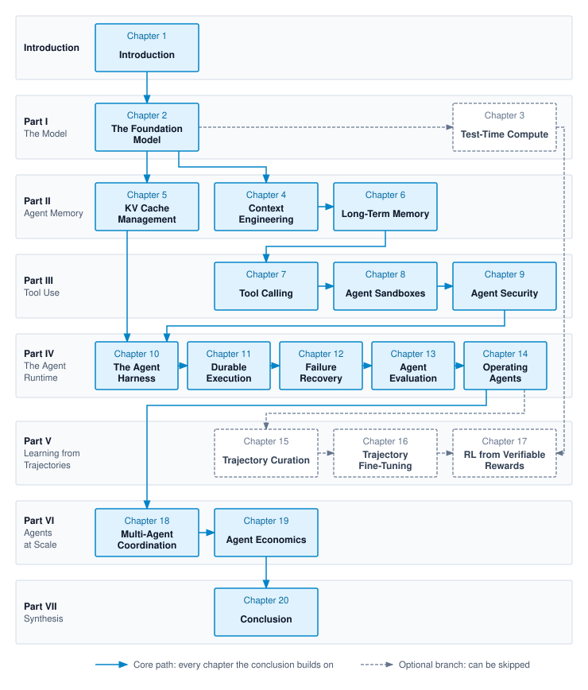

# Preface {#sec-vol3-about .unnumbered}

## Who This Book Is For {#sec-vol3-about-audience}

This book is for senior undergraduates and beginning graduate students in computer science and computer engineering who are taking a course on agentic machine learning systems, and for practicing engineers who build, operate, or evaluate agents. It is written for the engineer who has watched an agent demonstration succeed and now has to ship a system that carries delegated work to an accepted result, day after day, without deleting the wrong directory, looping until a budget runs out, or reporting success on a task it never finished.

The reader should understand foundation-model prompting and token generation and be comfortable with software systems, including APIs, state, concurrency, and process isolation. The book assumes no prior volume of this series. It develops agentic concepts where they are first used and derives the serving-cost relationships needed to reason about agent workloads without requiring accelerator microarchitecture or fleet-scale training.

## Why an Agentic Systems Textbook {#sec-vol3-about-why}

A reasonable engineer might look at the current wave of agent demonstrations and ask a skeptical question. *Is agentic machine learning a systems discipline with durable principles, or a collection of framework wrappers, prompt templates, and API glue that will be rewritten next year?*

The skepticism is fair. Much of what is written about agents concerns surface choices, such as a framework's abstractions, a persona in a system prompt, or a ten-line loop that looks impressive in a demonstration and fails under real workloads. Those choices change every few months. What does not change is the engineering problem underneath them.

A single model call reads a context and returns a proposal. By itself, the call neither executes that proposal nor establishes whether it satisfies the task. An agent puts that call inside a loop. The loop runs for many turns, carries state from one turn to the next, and turns approved proposals into edits, commands, queries, and messages that affect the environment. Each of those departures adds exposure beyond an isolated call, and each fails in its own way. A long loop compounds small errors and can run without advancing. Carried state overflows the context, goes stale, or contradicts itself. Actions leak data, repeat when a timeout hides whether they ran, or cannot be undone. The model cannot close any of these exposures by itself, because its proposal grants no authority and its self-report is insufficient evidence of success. The closure has to come from the machine built around it.

This book teaches how to design, measure, and improve that machine. Its central question is what a delegated task needs around a foundation model to produce a result supported by the required evidence. Readers should leave able to decide when a fixed workflow suffices and when a model-directed loop earns its added cost, what memory, tools, and runtime that loop requires, how to show that it works, and when changing the model or adding agents is worth the price.

## The Trajectory and Its Exposures {#sec-vol3-about-mental-model}

The unit of engineering in this book is the **trajectory**, the ordered record of one delegated task's execution. It holds what the model saw on each turn, what it proposed, what the runtime did with the proposal, and what came back. Accuracy on a single call is not the measure of an agentic system. The measure is whether trajectories reach results that meet the task's acceptance standard, supported by evidence independent of the model's self-report, and at what cost in turns, tokens, seconds, and dollars.

Three exposures describe how far a task departs from a single model call, and the book calls them **H·S·A**.

- **Horizon** is how many turns the trajectory runs, and so how long errors have to compound and how much can go wrong between the start and the result.
- **State** is what the task carries from one turn to the next, from nothing, through the context window and a sandboxed workspace, to durable state that outlives the session or is shared beyond it.
- **Authority** is what the task may do to the world through its tools, from read access, which can still leak, to irreversible external actions such as a payment or a production migration.

Closure is not a fourth exposure. It is the runtime's answer to the three. The **invariant closure principle** separates enforceable bounds from evidence of completion. Runtime mechanisms enforce named constraints, such as resource limits and permitted access, under stated assumptions. Independent checks supply evidence for the properties they cover; making a check deterministic or protecting it from modification does not make its coverage complete. Instructions and fine-tuning can improve proposals, but they do not replace enforcement. Higher exposure demands stronger boundaries and a more demanding acceptance standard. The introduction develops the exposures, the principle, and the forms of evidence that can stand behind a claim that a task is done.

Two relations quantify these obligations throughout the book. **Horizon compounding** is the decay of reliability over unchecked turns. If each of $H$ sequential turns is correct with probability $1-\epsilon$ and nothing checks them, the task succeeds with probability $(1-\epsilon)^{H}$. **Cost per accepted task**, $C_{\text{eff}}$, charges every attempt, failed ones included, to the tasks that meet their acceptance standard, and so states what a mechanism is worth in the unit the task cares about. The introduction derives both.

Four recurring workloads, each bound by a different exposure, keep the argument concrete. A repair agent that fixes a defect in an isolated working copy over a long horizon is the running example in every chapter. A research agent that reads untrusted sources, a remediation agent whose actions on production systems can be irreversible, and a support agent that serves many short interactive sessions at once return wherever the repair agent cannot exercise a constraint. A mechanism that is central for one of these workloads can be pure overhead for another, which is why the book prices mechanisms against a workload rather than ranking them in the abstract.

## What This Book Covers {#sec-vol3-about-covers}

The book builds understanding in dependency order: **model, memory, tools, runtime, measure, learn, scale**. Each part adds responsibilities that the preceding material prepares the reader to evaluate. This teaching sequence is not a requirement to deploy every mechanism. When an agent fails, a related ordering governs the response. The **intervention ladder** ranks remedies by cost and reversibility. Once a failure is attributed to a measured cause, changes to context, to tools and their schemas, and to runtime control come before changes to the model's weights, which are reserved for the failure that survives them and made only on evidence that the change helps. The ladder is a default order rather than a sequence every failure must climb, and @sec-vol3-flywheel-intervention-order develops it.

@Sec-vol3-intro opens the book. It defines the agentic system and the trajectory, names the fail-plausible faults that make agents hard to trust, states the invariant closure principle, and turns a task into a contract. Horizon, state, and authority then help the reader judge the runtime responsibilities needed and choose between a fixed workflow and a model-directed loop. It draws the whole system once, as a single map, and then leaves the analogy behind.

- **Part I: The Model** studies the component every agent is built around through a single call. @Sec-vol3-foundation-model establishes what a call reads, returns, and costs, and why its output is a proposal the runtime must check rather than a result. @Sec-vol3-test-time-compute asks when longer reasoning, additional candidates, or check-and-revise rounds improve the selected result within a bounded budget, and what evidence supports accepting it.
- **Part II: Agent Memory** governs the state exposure. @Sec-vol3-context-engineering decides what each call sees under a fixed budget, @sec-vol3-kv-cache prices what holding that context costs in the serving system, and @sec-vol3-long-term-memory governs what persists across sessions and returns only through retrieval.
- **Part III: Tool Use** governs the authority exposure. @Sec-vol3-tool-calling separates proposal validation, authorization, dispatch, and evidence of the resulting effect, including cases where a timeout leaves the outcome uncertain. @Sec-vol3-sandboxes bounds the reach of executing code, while @sec-vol3-security addresses how untrusted information can misuse otherwise legitimate access.
- **Part IV: The Agent Runtime** governs the horizon exposure. @Sec-vol3-agent-harness runs the loop under budgets and approvals, @sec-vol3-durable-execution preserves progress across stated failure conditions, and @sec-vol3-failure-recovery chooses among repair, compensation, containment, and escalation. The part ends with @sec-vol3-evaluation, which measures the whole single-agent system and establishes the evidence needed to judge later learning and scaling decisions.
- **Part V: Learning from Trajectories** changes model behavior when evaluation justifies that intervention; it does not replace the runtime's boundaries. @Sec-vol3-trajectory-curation decides when a failure warrants changing the weights at all, then selects and prepares records for different learning objectives, including demonstrations of recovery. @Sec-vol3-fine-tuning teaches behavior from those records, and @sec-vol3-rlvr optimizes against verifiable rewards while examining the limits and protection of the reward checks.
- **Part VI: Agents at Scale** multiplies all three exposures. @Sec-vol3-multi-agent splits a task across agents only when the coordination pays for itself, and @sec-vol3-agent-economics prices and provisions agents per accepted task.
- **Part VII: Synthesis** follows a production incident-remediation task through the system in @sec-vol3-conclusion. It ends at the specification boundary, where defining success, judging whether the evidence is sufficient, and answering for the result stay with the engineer.

Reference appendices collect material that supports the chapters without interrupting them: the mathematical background, the inference cost derivations behind the book's serving estimates, the distributed-state guarantees behind durable execution and coordination, a reference architecture, typed tool interfaces, a failure taxonomy, and a glossary.

## How to Read This Book {#sec-vol3-about-reading}

The book is written to be read in order. Each chapter uses only ideas introduced earlier in the book or defined where they appear, and each owns its concepts, so a mechanism is taught once and cited afterward. Every chapter opens with the agent problem it solves, introduces the mechanism as the answer to that problem, and closes with a summary and a handoff to the next chapter. Classical systems ideas, such as write-ahead logs, compensating transactions, idempotency keys, and capabilities, appear where they are the real engineering, introduced as the fix for an agent failure rather than as a lesson in their own right.

Readers with a particular role can weight their reading after the introduction. Engineers who build serving and execution infrastructure will lean on the chapters on the model, the KV cache, sandboxes, durable execution, and economics. Engineers who build agent platforms will lean on context engineering, tool calling, security, the harness, failure recovery, evaluation, and multi-agent coordination. Researchers and post-training teams will lean on the model, test-time compute, evaluation, and all of Part V. These emphases do not remove prerequisites established by earlier chapters. Every path begins with @sec-vol3-intro and ends with @sec-vol3-conclusion.

@Fig-vol3-chapter-dependencies diagrams these pedagogical pathways across eight horizontal part bands: solid blue boxes and directed edges trace the linear core path culminating in the conclusion, while dashed gray boxes isolate the optional post-training and test-time compute track (@sec-vol3-test-time-compute and Part V). Test-time compute and the three chapters of Part V form a branch that no core chapter depends on, so a course on building and operating agents can skip them. A course on post-training keeps that branch and still needs Parts I through IV beneath it, because @sec-vol3-trajectory-curation starts from the evidence that @sec-vol3-evaluation defines.

::: {#fig-vol3-chapter-dependencies fig-env="figure" fig-pos="htb" fig-cap="**Chapter Dependency Map**: Each arrow points from a chapter to a later chapter that consumes its results, derived from the book's cross-references with transitive links omitted. Solid chapters form the core path the conclusion builds on; the dashed branch through test-time compute and Part V can be skipped by a course that does not cover post-training." fig-alt="Eight horizontal bands, one per part of the book from the introduction to Part VII, each holding its chapter boxes. Solid blue boxes and arrows run from Chapter 1 to Chapter 2, through Chapters 4 to 13, then Chapters 17 and 18, to Chapter 19. Dashed gray boxes for Chapter 3 and Chapters 14 to 16 connect by dashed arrows from Chapter 2 to Chapter 3, from Chapter 3 to Chapter 16, and from Chapter 13 through Chapters 14 and 15 to Chapter 16. A legend distinguishes the solid core path from the dashed optional branch."}

:::

### Marginal navigation pointers {#sec-vol3-about-margin-pointers}

The margins carry unnumbered **marginal navigation pointers** that trace dependencies between chapters without interrupting the flow of the prose:

- **`↩` Backward pointer:** Directs the reader back to the earlier chapter where a contract, check, or cost model was established.
- **`↪` Forward pointer:** Directs the reader ahead to the later chapter, or to the appendix, where the current idea is developed, measured, or enforced.
- **`⇄` Contrast:** Marks a place where two chapters treat the same problem differently, so the comparison is visible at a glance.

A pointer only orients. When a sentence depends on another chapter, the reference stays in the text.

## What This Book Is Not {#sec-vol3-about-not}

This is not a prompt-engineering guide. Prompts matter, but the book treats them as one input the runtime assembles, and it never relies on an instruction to the model where a mechanical check is possible. It is not a tutorial for any agent framework, protocol implementation, or model provider, and it does not rank this year's models or benchmarks. Products and benchmarks appear only as examples of a technique or a class of evaluation, with citations. It is not a book about the internals of accelerators. It develops the serving relationships an agent engineer needs, including how prompt processing differs from output generation and when shared-prefix reuse reduces repeated work, with detailed derivations collected in an appendix. Finally, it covers software agents that act through tools on digital systems. Agents that act on the physical world raise problems of their own and are outside its scope.

## A Note on Durability {#sec-vol3-about-durability}

Frameworks, protocols, and model weights will change, some of them before this book reaches print. The text therefore emphasizes the ideas that survive those changes, such as the trajectory as the unit of work, the three exposures and the closure against them, the separation between a model that proposes and a runtime that decides, and the discipline of measuring before changing anything. Current protocols and systems appear throughout to make the ideas concrete, but the principles stand independently of any vendor or tool. Where a question is still open, such as how best to evaluate systems that act or how to structure an agent's long-term memory, the book says so and presents the question as an open problem rather than a settled method.

## Prerequisites {#sec-vol3-about-prerequisites}

Readers should be comfortable with:

- machine learning fundamentals, including how transformer models are trained and how they generate text;
- computer systems fundamentals, including processes, memory, file systems, and networking;
- basic distributed systems concepts, including remote calls, failure, and consistency;
- undergraduate probability; and
- programming in Python or another modern language.

Deeper study of operating systems, databases, or computer security helps, but the book explains how the systems mechanisms it uses apply to agent workloads. Readers who want more background on how machine learning systems are built and served can find it in *Introduction to Machine Learning Systems*, which this book does not assume.
