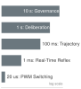
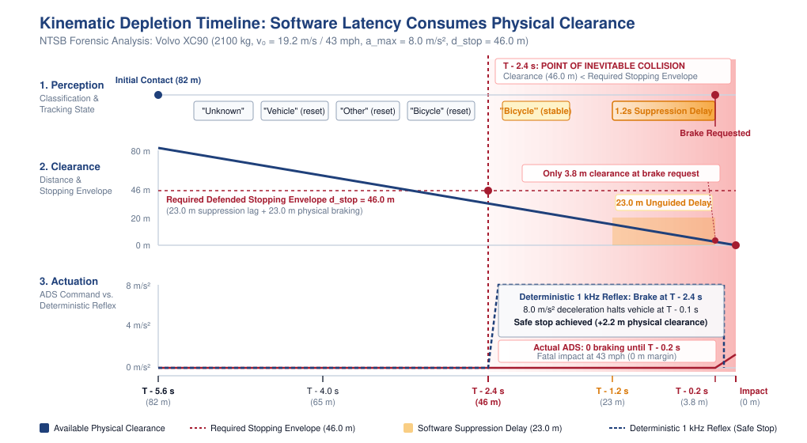
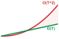

---
format:
  html:
    title: "The Causal Boundary"
---

# The Causal Boundary {#sec-boundary}

::: {layout-narrow}
::: {.column-margin}

\chapterminitoc

:::

::: {.content-visible when-format="pdf"}
\noindent
{fig-alt="Isometric blueprint of a physical AI machine on a single base plate. A translucent cube of connected nodes labeled Brain holds the learned models, a controller module labeled Nervous System carries a square-wave signal to a robot arm labeled Body, and the line where that signal enters the arm is labeled causal boundary. Return lines carry sensor data from the arm back to the Brain."}
:::

::: {.content-visible unless-format="pdf"}
{fig-alt="Isometric blueprint of a physical AI machine: learned models labeled Brain, a controller module labeled Nervous System, and a robot arm labeled Body, with the causal boundary marked where commands enter the arm."}
:::

:::

## Purpose {.unnumbered .unlisted}

::: {.content-visible when-format="pdf"}
\begin{marginfigure}
\resizebox{0.92\linewidth}{!}{\mlphysicalstackfull{20}{20}{20}{100}{20}}
\end{marginfigure}
:::

_Why can a better prediction still produce a worse physical action?_

A learned model can recognize a task correctly and still act too late to stop a moving machine or prevent excessive contact force. Once a command produces motion or heat, replacing the prediction cannot undo the work already delivered. The engineer must therefore connect model quality to the body's limits, the time available to respond, and the evidence supporting the next action. An independent permission path must be able to refuse a proposal and carry out a feasible fallback even when the model stalls. At the causal boundary, where commands become physical work, irreversibility makes these responsibilities part of the system's architecture.



::: {.callout-learning-objectives}

- Distinguish the causal boundary, where commands affect the plant, from the proposal boundary, where execution authority is granted
- Derive the Kinematic Roofline to quantify how sense-to-act computational latency converts directly into irreversible physical stopping distance
- Classify machines by their dominant operating constraint: stopping clearance, contact force, or thermal and electrical margins
- Apply the three-criterion Physical AI scope test to separate advisory models and classical controllers from autonomous physical systems
- Locate the proposal boundary in the five-level machine model and explain why the permission path alone holds actuator-write authority
- Dissect the 2018 Tempe collision to diagnose how perception classification churn, action suppression delays, and disabled safety redundancy combine to cause catastrophic boundary failures
- Apply the four bedrock laws to connect physical limits, learned capability, runtime decisions, and evidence for operation
- Explain why physical authority is continuous and state-dependent, showing how safety, security, and accountability converge at the permission path

:::

## Artificial Intelligence Beyond Glass {#sec-boundary-beyond-glass}

A warehouse robot approaches the end of a storage rack while its learned model processes a camera image. A worker steps into the aisle before the model returns its next proposal. The computer can still discard that proposal, but the robot has continued moving throughout the calculation. Choosing an action therefore requires reasoning about both the prediction and the physical state in which it will execute.

For an advisory model, an output can be inspected or rejected before another system acts on it. Digital mistakes can still cause harm, and computation itself consumes energy. The distinction is that restoring a software state cannot restore the position of a moving robot or repair an object it has struck. The engineering problem begins with this difference and leads from physical limits to the architecture that checks each proposed action.

The physical plant is the apparatus being controlled, such as the robot's wheeled base or arm. Its physical state $\mathbf{x}(t)$ changes while the computer calculates. The dynamics $\dot{\mathbf{x}} = \mathbf{f}(\mathbf{x}, \mathbf{u}, t)$ express how that state changes with the applied input and time. For the moving base, the immediate consequence follows from familiar kinematics. When a mobile robot of mass $m$ cruises at velocity $v = 1.5\text{ m/s}$ with acceleration $a$, it carries stored momentum $p = mv$ and kinetic energy $E_k = \frac{1}{2}mv^2$. If the host processor stalls for an unguided pre-brake delay $\tau_{\text{delay}} = 100\text{ ms}$, the machine continues traveling before braking begins:
$$d = v \tau_{\text{delay}} + \frac{1}{2} a \tau_{\text{delay}}^2$$
At steady cruising speed ($a = 0$), this burns $d = v \tau_{\text{delay}} = 15\text{ cm}$ of clearance completely blind. If the machine is actively accelerating into a turn or ramping motor current ($a > 0$), the quadratic latency penalty $\frac{1}{2} a \tau_{\text{delay}}^2$ compounds the displacement, pushing the unguided plant even deeper into potential hazard before mechanical brakes can begin to bite. No software interrupt, exception handler, or thread abort can freeze that kinetic momentum in mid-air.

The warehouse example connects three engineering responsibilities. The model must recognize a useful action, the permission path must judge it while the observation is still relevant, and the body must be able to execute the admitted motion or a feasible fallback. A stronger prediction alone cannot recover clearance already consumed during computation. Designing physical AI therefore requires following the complete path from a learned proposal to motion and back to observation.

**Moravec's paradox**\index{Moravec's paradox}[^fn-ai-moravec-paradox] [@moravec1988mind] helps explain the interest in learning for physical tasks: sensorimotor skills that people perform with little conscious effort can be difficult to reproduce computationally. Learned models extend the range of scenes and tasks a machine can interpret. Their usefulness creates a further obligation to determine where demonstrated competence supports operation; @sec-evaluation-trial-limits develops the limits of that evidence.

[^fn-ai-moravec-paradox]: **Moravec's Paradox**\index{Moravec's Paradox}: The observation in artificial intelligence [@moravec1988mind] that high-level reasoning requires comparatively little computation, whereas low-level sensorimotor coordination demands enormous perceptual and computational resources.

When a machine acts, it changes the conditions of its next observation. This is the feedback perspective associated with cybernetics[^fn-boundary-wiener-feedback] [@wiener1948cybernetics]. The warehouse robot's movement changes both its distance from the worker and the next image available to its model.

[^fn-boundary-wiener-feedback]: **Cybernetic Feedback Loops**\index{Cybernetic Feedback Loops}: In Norbert Wiener's cybernetic framework [@wiener1948cybernetics], feedback denotes adjusting future action using past performance.

Building the complete loop requires contributions from several disciplines. Machine learning supplies perception and action proposals. Computer systems determine how quickly the computation and communication finish, including the limits imposed by memory traffic [@williams2009roofline]. Mechanics and control establish which motions the plant can sustain. Embedded systems enforce the timing and access rules that connect a proposal to an actuator. These responsibilities meet at a common decision: whether the proposed action can execute under the machine's current conditions. This book develops the reasoning needed to make and justify that decision.

::: {.column-margin .margin-pointer}
↪ The separation of learned proposals from actuation authority is mapped to isolated silicon domains in @sec-nervous-silicon-partitioning.
:::



::: {#dfn-boundary-physical-artificial-intelligence-physical-ai .callout-definition title="Physical artificial intelligence"}

***Physical artificial intelligence***\index{Physical Artificial Intelligence!definition}\index{Physical AI!definition} is the engineering of closed-loop machines in which learned models influence physical actions that change subsequent observations.

1.  **Significance**: Model performance becomes a property of an operating machine. Its actions must fit the plant's physical limits and the time available to respond.
2.  **Distinction**: The scope test later in this chapter combines a learned model, consequential physical feedback, and delegated physical authority. Neither a model used only for advice nor an automated machine without a learned component meets all three criteria.
3.  **Common pitfall**: Treating the body as a peripheral device for a model. A useful proposal still needs an independent permission decision based on the current state, physical limits, and available fallback.

:::

The remainder of this chapter follows an action command from neural computation to mechanical work, compares the binding physical budgets of three machine classes, formalizes a three-criterion scope test to delineate the field, organizes the physical machine into five structural levels, and dissects the forensic record of the 2018 Tempe collision to diagnose how boundary violations occur. The concluding sections codify these insights into Four Bedrock Laws, establish where safety, security, and accountability converge, and outline the architectural spine of the book.

## Defining the Cyber-Physical Causal Boundary {#sec-boundary-causal-boundary}

An advisory model that displays an inference result on a screen or returns a JSON payload to a web client has no direct electrical or mechanical coupling to physical actuators. A human operator may inspect and discard the prediction, or downstream business logic may reject a candidate token before committing an external transaction.[^fn-math-idempotency-physical] Neither property makes digital errors benign: an operator may act on flawed recommendations, and an automated algorithmic trading engine may execute catastrophic financial transactions across electronic exchanges. The relevant distinction is whether the automated system can turn an accepted model proposal into physical action. Arbitration belongs inside that system; it protects the causal boundary rather than removing it.

[^fn-math-idempotency-physical]: **Idempotency**\index{Idempotency}: Repeating an idempotent operation has the same specified result as executing it once. A motor setpoint command can have idempotent command semantics, but repeated execution may still dissipate energy. Idempotency does not imply reversibility or harmlessness.

### Tensors to silicon and electromechanical transduction {#sec-boundary-tensors-to-silicon}

In modern computational frameworks, executing `action_chunk = policy(observation)` produces a floating-point tensor. The tensor describes a proposed action; moving the machine requires a chain of controllers and physical actuators. The causal boundary is the interface through which an admitted command changes the physical plant.

In modern robot learning architectures, the policy's output is typically an action chunk tensor of shape $[B, H, d_a]$, predicting a sequence of $H$ future waypoints (joint positions, angular velocities, or 6-DOF Cartesian poses) over an upcoming temporal horizon.[^fn-action-chunk-repr] In pure software, this tensor represents nothing more than a contiguous array of IEEE 754 floating-point values occupying GPU HBM or cache lines. It cannot execute directly on physical motors.

[^fn-action-chunk-repr]: **Action Chunk Representations**\index{Action Chunk Representations}: In robot learning literature [@zhao2023learning], action chunks are typically tensors of shape $[B, H, d_a]$ where $B$ is batch size, $H$ is the planning prediction horizon, and $d_a$ is action dimension (such as target joint positions $\hat{\mathbf{q}} \in \mathbb{R}^d$ or 3D Cartesian position and orientation deltas). The formal spatial transformation representations are detailed in @sec-appendix-control-spatial; @sec-brain defines the chunk and its horizon.

The permission path checks whether the action chunk fits the current physical limits and can be carried out in time. If admitted, its setpoints pass to the controllers that drive the motors. A position controller determines the motion correction needed; the drive regulates electrical current to produce torque. @Sec-body develops the physical limits of this conversion, and @sec-nervous develops its timing and authority boundaries.

For a motor driven by pulse-width modulation (PWM), a software write sets a hardware timer's switching command. The power electronics use that signal to control current in the motor windings. Electromagnetic torque then accelerates the rotor and attached mechanism. This example establishes the distinction needed here: changing a proposed setpoint in memory is different from changing a command that has already produced motion. A later command can brake or redirect the machine, but that response takes time and must itself remain physically feasible.

::: {#dfn-boundary-causal-boundary .callout-definition title="Causal boundary"}

***Causal boundary***\index{Causal boundary!definition} is the interface through which a digital command produces physical forces, currents, or flows.

1.  **Significance**: A proposal can be rejected before it changes the plant. Once executed, it can alter the environment, dissipate energy, and change subsequent observations.
2.  **Distinction**: Restoring a command in memory does not restore the machine's prior physical state. Recovery requires another physical action, with its own limits and consequences.
3.  **Common pitfall**: Assuming that canceling a software task stops the motion it initiated. The machine needs a feasible stopping or holding response even when its proposer stops computing.

:::

An offline test can hold its examples fixed regardless of the model's predictions. A robot cannot generally rely on that separation: turning the chassis changes the next camera view, and pushing an object changes its location. The learning problem must account for observations that depend on earlier actions.

In a physical system, the environment evolves in a closed causal loop: the next physical state $\mathbf{s}_{t+1}$ and incoming sensor observation $\mathbf{o}_{t+1}$ depend directly on the action $\mathbf{a}_t$ produced by the prior model inference. The sensory input stream is endogenous, governed by continuous closed-loop dynamics:
$$\mathbf{s}_{t+1} = \mathbf{f}(\mathbf{s}_t, \mathbf{a}_t), \quad \mathbf{o}_{t+1} \sim p(\mathbf{o} \mid \mathbf{s}_{t+1})$$

An erroneous action can therefore move the machine into states poorly represented in its training data. Errors in those states may produce further departures from the demonstrated behavior (@fig-01-causal-loop). This possibility motivates closed-loop evaluation; it does not mean that every error necessarily produces an unstable trajectory.

::: {#fig-01-causal-loop fig-env="figure" fig-pos="t" fig-cap="**The closed causal loop**: Advisory output (top) stops at an informational interface. In physical AI (bottom), permitted model proposals reach hardware registers, where electrical current produces force and motion. Those actions alter the environment and subsequent sensor observations." fig-alt="Flowchart contrasting advisory predictions with physical AI. The upper path ends at an informational interface; the lower path carries sensor observations to a proposal, the permission path, motor actuators, and a changing physical plant."}
{width="95%"}
:::

Because physical mass possesses inertia and computation takes finite real time, latency in physical AI translates directly into physical displacement. As shown on the autonomous testbed in @fig-01-sensor-rack, real-world robotic systems rely on dense multi-modal sensor suites (spinning lidar scanners, camera arrays, and radar units) that continuously stream high-bandwidth telemetry to onboard processors. Every stage in this pipeline—from photodiode photon integration and sensor bus serialization,[^fn-hw-serdes-bus] to neural inference on accelerator silicon and packet transmission over deterministic fieldbuses—consumes real-world milliseconds.

[^fn-hw-serdes-bus]: **Automotive Serializer/Deserializer (SerDes)**\index{SerDes!sensor links}: High-speed physical-layer links (such as FPD-Link or GMSL) that transport uncompressed, low-latency multi-gigabit video streams over lightweight coaxial or shielded twisted-pair cables. Combined with dedicated hardware trigger lines, SerDes interfaces ensure microsecond-synchronized shutter capture across the sensor ring. For bus specifications, see @sec-appendix-systems.

::: {#fig-01-sensor-rack fig-env="figure" fig-pos="t" fig-cap="**Lidar sensor ingress**: A 64-beam spinning optical lidar assembly mounted aboard an autonomous research testbed. In physical AI, sensor streams delivering over 1.3 million points per second must be serialized over real-time hardware interfaces, synchronized to microsecond timestamps, and processed through neural perception backbones within strict latency deadlines. (Source: Steve Jurvetson, CC BY 2.0)." fig-alt="Close-up photograph of a roof-mounted 64-beam spinning optical lidar sensor assembly on an autonomous research vehicle testbed, showing optical lenses and aluminum housing."}
{width="85%"}
:::

### Kinematic rooflines and latency-to-clearance translation {#sec-boundary-kinematic-roofline}

```{python}
#| label: boundary-blind-travel
#| echo: false
#| warning: false
#| message: false
# ┌─────────────────────────────────────────────────────────────────────────────
# │ BLIND TRAVEL OF THE RUNNING MACHINE (LEGO)
# ├─────────────────────────────────────────────────────────────────────────────
# │ Context: The blind-travel paragraph in @sec-boundary-causal-boundary.
# │ Goal: Convert the running machine's total pre-brake delay into distance.
# │ Show: Drive limit, total pre-brake delay, and travel before braking begins.
# │ How: v * tau_delay from the warehouse mobile manipulator and its aisle
# │      scenario in mlsysim; no value is retyped here.
# └─────────────────────────────────────────────────────────────────────────────
from mlsysim import *
from mlsysim.core.units import *
from mlsysim.fmt import fmt_length, fmt_latency, fmt_velocity, check

RM = Embodied.MobileManipulator.WarehouseMobileManipulator
AISLE = Embodied.Scenario.WarehouseAisle

class BlindTravel:
    """Travel of the running machine's base before braking begins (illustrative inputs)."""

    # ┌── 1. LOAD (Constants & Parameters) ─────────────────────────────────
    v = RM.base.max_velocity  # category: illustrative (drive limit)
    tau_delay = AISLE.tau_delay  # category: derived (capture to retarding force)

    # ┌── 2. EXECUTE (Compute) ─────────────────────────────────────────────
    blind = (v * tau_delay).to(millimeter)
    blind_display = round(blind.to(millimeter).magnitude) * millimeter

    # ┌── 3. GUARD (Invariants) ───────────────────────────────────────────
    check(abs(v.to(meter / second).magnitude - 1.5) < 1e-9, f"Canon drive limit is 1.5 m/s, got {v}.")
    check(abs(tau_delay.to(millisecond).magnitude - 133.6) < 5e-3, f"Canon tau_delay is 133.6 ms, got {tau_delay}.")
    check(abs(blind.to(millimeter).magnitude - 200.4) < 5e-3, f"Canon blind travel is 200 mm, got {blind}.")

    # ┌── 4. OUTPUT (Formatting) ──────────────────────────────────────────
    v_str = fmt_velocity(v, unit=meter / second, precision=1)
    tau_delay_str = fmt_latency(tau_delay, unit=millisecond, precision=1)
    blind_str = fmt_length(blind_display, unit=millimeter, precision=0)
```

As a concrete example, consider the wheeled base of a warehouse mobile manipulator (introduced in full in @sec-boundary-three-classes), cruising down an aisle at its `{python} BlindTravel.v_str` drive limit (illustrative; see the Reader Guide). Its pre-brake delay, which later chapters assemble term by term, is at most `{python} BlindTravel.tau_delay_str`, spanning the interval from the initial optical capture of a person stepping out from behind a storage rack to the physical onset of caliper friction force. Over that unguided interval, the base travels `{python} BlindTravel.blind_str` with zero mechanical response to the incoming visual evidence. If an obstacle or human worker emerges within that blind distance, collision occurs before the actuators can apply a single Newton of retarding force—and no amount of neural network capacity, training data, or model scale can alter that physical reality.

This fundamental trade-off between computational delay and physical clearance is formalized by the **kinematic roofline**\index{Kinematic roofline}, the physical counterpart to the computer architecture Roofline Model [@williams2009roofline]. In microprocessor and accelerator design, Patterson and Williams bound attainable computational throughput ($\text{FLOP/s}$) by the lower of two hard hardware ceilings:
$$\text{Attainable Performance} \le \min\Big(\text{Peak Arithmetic Throughput}, \; \text{Operational Intensity} \times \text{Peak Memory Bandwidth}\Big)$$
where operational intensity (measured in $\text{FLOPs/byte}$) determines whether an execution kernel is compute-bound by floating-point ALUs or memory-bound by interconnect throughput.

In Physical AI systems, the physical dual of the Patterson compute roofline bounds achievable operational velocity by the lower of multiple interacting physical ceilings:
$$v_{\max} \le \min\big(v_{\text{budget}}, \; v_{\text{track}}, \; v_{\text{thermal}}\big)$$
where $v_{\text{track}}$ is the dynamic trajectory tracking ceiling enforced by closed-loop actuator bandwidth, $v_{\text{thermal}}$ is the continuous velocity limit imposed by winding Joule heating and power dissipation, and $v_{\text{budget}}$ is the kinematic stopping velocity bound enforced by the perception horizon $R_{\text{sensor}}$, sense-to-act latency $\tau_{\text{delay}}$, and mechanical braking deceleration $a_{\text{brake}}$.

While the Patterson compute roofline selects the minimum of arithmetic and memory bandwidth bounds because execution pipelines and memory controllers operate concurrently to hide latency, the physical stopping budget $v_{\text{budget}}$ arises because physical stopping clearance *adds* two distinct physical penalties that execute strictly sequentially in real time:
$$d_{\text{stop}}(v, \tau_{\text{delay}}, a) = \underbrace{v \cdot \tau_{\text{delay}} + \frac{1}{2} a \cdot \tau_{\text{delay}}^2}_{\text{computational blind travel}} + \underbrace{\frac{v_{\text{brake}}^2}{2 a_{\text{brake}}}}_{\text{mechanical energy dissipation}} \le R_{\text{sensor}}$$
where $a$ is the forward acceleration prior to braking and $v_{\text{brake}} = v + a \tau_{\text{delay}}$ is the physical velocity at the exact instant mechanical retarding force begins. At steady cruising velocity ($a = 0$), $v_{\text{brake}} = v$, and the relation simplifies to $d_{\text{stop}} = v \tau_{\text{delay}} + \frac{v^2}{2 a_{\text{brake}}}$. When the machine is actively accelerating ($a > 0$), however, the quadratic term $\frac{1}{2} a \tau_{\text{delay}}^2$ severely compounds blind displacement, and higher kinetic energy must be shed by mechanical brakes.

Under emergency braking, total stopping clearance $d_{\text{stop}}$ is the sum of computational blind travel (which scales with end-to-end delay $\tau_{\text{delay}}$, initial velocity $v$, and acceleration $a$) and mechanical braking distance (which scales quadratically with braking velocity $v_{\text{brake}}^2$ under the work-energy theorem). @Sec-body-kinetic-momentum formally derives this relationship from Newtonian mechanics. Machine learning systems engineers frequently fall prey to "kernel myopia"—measuring only GPU forward-pass inference latency ($\tau_{\text{compute}} \approx 15\text{--}20\text{ ms}$) and assuming the robot operates with a $20\text{ ms}$ reaction time. In physical AI, the true sense-to-act delay $\tau_{\text{delay}}$ spans a strictly sequential causal pipeline: photodiode photon integration and rolling shutter readout ($\tau_{\text{sensor}} \approx 10\text{--}33\text{ ms}$), SerDes serialization and PCIe DMA ring-buffer transfers ($\tau_{\text{transport}} \approx 5\text{--}10\text{ ms}$), neural tensor-core execution ($\tau_{\text{compute}}$), lockstep safety arbitration across barrier certificates ($\tau_{\text{arbitration}} \approx 1\text{--}2\text{ ms}$), cyclic fieldbus transmission over EtherCAT or CAN-FD ($\tau_{\text{fieldbus}} \approx 1\text{--}2\text{ ms}$), and actuator FOC current rise and brake caliper pressure buildup ($\tau_{\text{actuator}} \approx 20\text{--}50\text{ ms}$). The blind travel is non-negotiable: during this entire window, no retarding torque can yet exist at the wheels. As @tbl-01-kinematic-roofline demonstrates across representative embodied platforms, the delay's fractional share of the total stopping envelope is largest for agile, low-speed systems, while its absolute displacement reaches multi-meter vehicle lengths at highway speeds.

```{python}
#| label: boundary-kinematic-roofline
#| echo: false
#| warning: false
#| message: false
# ┌─────────────────────────────────────────────────────────────────────────────
# │ KINEMATIC ROOFLINE NOMOGRAM (LEGO)
# ├─────────────────────────────────────────────────────────────────────────────
# │ Context: @tbl-01-kinematic-roofline (cells and caption) and the paragraph
# │          after it (the heavier-model example).
# │ Goal: Show how a fixed delay before braking adds to braking distance for
# │       platforms of increasing speed.
# │ Show: Braking distance, stopping distance at three delays, and the delay
# │       share of the stop at the longest delay, per platform.
# │ How: d_stop = v*tau + v^2/(2a) via calc_safe_stopping_distance. The running
# │      machine's row reads its drive limit and credible deceleration from
# │      mlsysim; the other three rows are generic platform classes whose
# │      speeds and decelerations are scenario assumptions for the contrast.
# └─────────────────────────────────────────────────────────────────────────────
from mlsysim import *
from mlsysim.core.units import *
from mlsysim.fmt import fmt, fmt_length, fmt_latency, fmt_velocity, fmt_acceleration, fmt_percent, check
from decimal import Decimal, ROUND_HALF_UP

RM = Embodied.MobileManipulator.WarehouseMobileManipulator
AISLE = Embodied.Scenario.WarehouseAisle
_MPS = meter / second
_MPS2 = meter / second**2

def _roofline_row(v, a, taus):
    """Braking distance, stopping distances, delay travel, and delay share at the last delay."""
    brake = (v**2 / (2 * a)).to(meter)
    totals = [calc_safe_stopping_distance(v, t, a) for t in taus]
    adds = [(v * t).to(ureg.centimeter) for t in taus]
    share = (adds[-1] / totals[-1]).to("dimensionless").magnitude
    return brake, totals, adds, share

def _sig3_length(d):
    """A distance in meters to three significant figures (half up), with its decimal count."""
    x = Decimal(repr(d.to(meter).magnitude))
    places = max(0, 2 - x.adjusted())
    return float(x.quantize(Decimal(1).scaleb(-places), rounding=ROUND_HALF_UP)) * meter, places

def _fmt_sig3(d):
    """Format a distance in meters to three significant figures."""
    rounded, places = _sig3_length(d)
    if float(rounded.magnitude).is_integer():
        places = 0  # the formatter forbids trailing zeros on integer-like values
    return fmt_length(rounded, unit=meter, precision=places)

def _roofline_strs(v, a, taus):
    """Formatted table cells for one platform row: one precision rule per column."""
    brake, totals, adds, share = _roofline_row(v, a, taus)
    cells = [f"{_fmt_sig3(t)} (+{fmt_length(d, unit=ureg.centimeter)})" for t, d in zip(totals, adds)]
    return (
        fmt_velocity(v, unit=_MPS),
        fmt_velocity(v, unit=kilometer / hour),
        fmt_acceleration(a, unit=_MPS2),
        fmt((a / ureg.standard_gravity).to("dimensionless").magnitude, precision=2, suffix=" g"),
        _fmt_sig3(brake),
        cells[0],
        cells[1],
        cells[2],
        fmt_percent(share, precision=1, style="symbol"),
    )

class KinematicRoofline:
    """Stopping distance against delay for four platform classes (illustrative inputs)."""

    # ┌── 1. LOAD (Constants & Parameters) ─────────────────────────────────
    tau_reflex = 10 * millisecond  # category: illustrative (reflex-class delay column)
    tau_fast = 50 * millisecond  # category: illustrative (short-class delay column)
    tau_vla = 200 * millisecond  # category: illustrative (long-class delay column)
    hum_v = 1.0 * _MPS  # category: illustrative (scenario assumption, humanoid or quadruped)
    hum_a = 4.0 * _MPS2  # category: illustrative (scenario assumption)
    rm_v = RM.base.max_velocity  # category: illustrative (running machine drive limit)
    rm_a = AISLE.a_brake  # category: illustrative (running machine credible deceleration)
    bot_v = 6.0 * _MPS  # category: illustrative (scenario assumption, urban delivery robot)
    bot_a = 4.5 * _MPS2  # category: illustrative (scenario assumption)
    av_v = 20.0 * _MPS  # category: illustrative (scenario assumption, passenger vehicle)
    av_a = 7.0 * _MPS2  # category: illustrative (scenario assumption)
    model_extra = 150 * millisecond  # category: illustrative (scenario assumption, heavier model)

    # ┌── 2. EXECUTE (Compute) ─────────────────────────────────────────────
    taus = [tau_reflex, tau_fast, tau_vla]
    hum_brake, hum_totals, hum_adds, hum_share = _roofline_row(hum_v, hum_a, taus)
    rm_brake, rm_totals, rm_adds, rm_share = _roofline_row(rm_v, rm_a, taus)
    bot_brake, bot_totals, bot_adds, bot_share = _roofline_row(bot_v, bot_a, taus)
    av_brake, av_totals, av_adds, av_share = _roofline_row(av_v, av_a, taus)
    av_vla_travel = (av_v * tau_vla).to(meter)
    av_extra_travel = (av_v * model_extra).to(meter)

    # ┌── 3. GUARD (Invariants) ───────────────────────────────────────────
    check(
        abs(rm_v.to(_MPS).magnitude - 1.5) < 1e-9 and abs(rm_a.to(_MPS2).magnitude - 2.0) < 1e-9,
        "The running machine row is canon: 1.5 m/s at 2.0 m/s^2.",
    )
    check(abs(rm_brake.to(meter).magnitude - 0.5625) < 1e-9, f"Canon braking at 1.5 m/s is 562.5 mm, got {rm_brake}.")
    check(abs(rm_totals[-1].to(meter).magnitude - 0.8625) < 1e-9, f"Running machine stop at 200 ms is 0.8625 m, got {rm_totals[-1]}.")
    check(abs(rm_share - 0.3478) < 5e-4, f"Delay share of the running machine's stop is about 34.8 percent, got {rm_share}.")
    check(hum_share > rm_share > bot_share > av_share, "The delay share must fall as platform speed rises.")
    check(abs(bot_brake.to(meter).magnitude - 4.0) < 1e-9, f"Delivery robot braking is 4.00 m, got {bot_brake}.")
    check(abs(av_vla_travel.to(meter).magnitude - 4.0) < 1e-9, "The caption claims 4 m of travel for the vehicle at 200 ms.")
    check(abs(av_extra_travel.to(meter).magnitude - 3.0) < 1e-9, "The prose claims 3 m of travel for 150 ms at highway speed.")

    # ┌── 4. OUTPUT (Formatting) ──────────────────────────────────────────
    tau_reflex_str = fmt_latency(tau_reflex, unit=millisecond, precision=0)
    tau_fast_str = fmt_latency(tau_fast, unit=millisecond, precision=0)
    tau_vla_str = fmt_latency(tau_vla, unit=millisecond, precision=0)
    hum_v_str, hum_kmh_str, hum_a_str, hum_g_str, hum_brake_str, hum_t1_str, hum_t2_str, hum_t3_str, hum_share_str = _roofline_strs(
        hum_v, hum_a, taus
    )
    rm_v_str, rm_kmh_str, rm_a_str, rm_g_str, rm_brake_str, rm_t1_str, rm_t2_str, rm_t3_str, rm_share_str = _roofline_strs(rm_v, rm_a, taus)
    bot_v_str, bot_kmh_str, bot_a_str, bot_g_str, bot_brake_str, bot_t1_str, bot_t2_str, bot_t3_str, bot_share_str = _roofline_strs(
        bot_v, bot_a, taus
    )
    av_v_str, av_kmh_str, av_a_str, av_g_str, av_brake_str, av_t1_str, av_t2_str, av_t3_str, av_share_str = _roofline_strs(av_v, av_a, taus)
    av_vla_travel_str = fmt_length(av_vla_travel, unit=meter, precision=0)
    model_extra_str = fmt_latency(model_extra, unit=millisecond, precision=0)
    av_extra_travel_str = fmt_length(av_extra_travel, unit=meter, precision=0)
```
\Needspace{14\baselineskip}

| Physical Platform & Velocity $v$                                                                                         | Braking Decel $a_{\text{brake}}$                                                | Mechanical Braking $d_{\text{braking}}$    | $\tau_{\text{delay}} =$ `{python} KinematicRoofline.tau_reflex_str` (Reflex Class) | $\tau_{\text{delay}} =$ `{python} KinematicRoofline.tau_fast_str` (Short Class) | $\tau_{\text{delay}} =$ `{python} KinematicRoofline.tau_vla_str` (Long Class) | Latency Fraction at `{python} KinematicRoofline.tau_vla_str` |
|:-------------------------------------------------------------------------------------------------------------------------|:--------------------------------------------------------------------------------|:-------------------------------------------|:-----------------------------------------------------------------------------------|:--------------------------------------------------------------------------------|:------------------------------------------------------------------------------|:-------------------------------------------------------------|
| **Humanoid / Quadruped** (`{python} KinematicRoofline.hum_v_str` = `{python} KinematicRoofline.hum_kmh_str`)             | `{python} KinematicRoofline.hum_a_str` (`{python} KinematicRoofline.hum_g_str`) | `{python} KinematicRoofline.hum_brake_str` | `{python} KinematicRoofline.hum_t1_str`                                            | `{python} KinematicRoofline.hum_t2_str`                                         | `{python} KinematicRoofline.hum_t3_str`                                       | **`{python} KinematicRoofline.hum_share_str` of total stop** |
| **Warehouse Mobile Manipulator, Base** (`{python} KinematicRoofline.rm_v_str` = `{python} KinematicRoofline.rm_kmh_str`) | `{python} KinematicRoofline.rm_a_str` (`{python} KinematicRoofline.rm_g_str`)   | `{python} KinematicRoofline.rm_brake_str`  | `{python} KinematicRoofline.rm_t1_str`                                             | `{python} KinematicRoofline.rm_t2_str`                                          | `{python} KinematicRoofline.rm_t3_str`                                        | **`{python} KinematicRoofline.rm_share_str` of total stop**  |
| **Urban Delivery Bot** (`{python} KinematicRoofline.bot_v_str` = `{python} KinematicRoofline.bot_kmh_str`)               | `{python} KinematicRoofline.bot_a_str` (`{python} KinematicRoofline.bot_g_str`) | `{python} KinematicRoofline.bot_brake_str` | `{python} KinematicRoofline.bot_t1_str`                                            | `{python} KinematicRoofline.bot_t2_str`                                         | `{python} KinematicRoofline.bot_t3_str`                                       | **`{python} KinematicRoofline.bot_share_str` of total stop** |
| **Autonomous Vehicle** (`{python} KinematicRoofline.av_v_str` = `{python} KinematicRoofline.av_kmh_str`)                 | `{python} KinematicRoofline.av_a_str` (`{python} KinematicRoofline.av_g_str`)   | `{python} KinematicRoofline.av_brake_str`  | `{python} KinematicRoofline.av_t1_str`                                             | `{python} KinematicRoofline.av_t2_str`                                          | `{python} KinematicRoofline.av_t3_str`                                        | **`{python} KinematicRoofline.av_share_str` of total stop**  |
: **Kinematic roofline nomogram**: Stopping clearance trade-offs across embodied platforms. The warehouse mobile manipulator's row uses its drive limit and credible deceleration. The three delay columns are classes of pre-brake delay, not the delay of any one platform. Stopping distances are rounded to three significant figures, and the added blind travel is given in centimeters to the nearest millimeter. At `{python} KinematicRoofline.tau_vla_str` of delay, an autonomous passenger car travels an additional `{python} KinematicRoofline.av_vla_travel_str`, an entire vehicle length, before its brakes engage. {#tbl-01-kinematic-roofline}

Just as an architect cannot resolve a memory-bound arithmetic pipeline by adding more ALU execution units, an autonomous vehicle systems engineer cannot resolve an emergency stopping clearance violation by adding model parameters if doing so lengthens the delay $\tau_{\text{delay}}$ before braking. A heavier foundation model that adds `{python} KinematicRoofline.model_extra_str` of computation consumes an extra `{python} KinematicRoofline.av_extra_travel_str` of physical travel at highway speeds, distance that no friction brake or collision-avoidance logic can recover.

The physical reality of this trade-off is captured longitudinally across five decades of autonomous vehicle systems (@fig-boundary-latency-vs-velocity). Why does physical stopping clearance impose such an unyielding limit? Before mechanical brakes can apply retarding force, the machine coasts at cruising velocity $v$ over the unguided reaction window $\tau_{\text{delay}}$, consuming a blind translation distance $d_{\text{blind}} = v \tau_{\text{delay}}$. Once the brakes engage, the work-energy theorem governs physical stopping: friction force $F_{\text{brake}} = m a_{\max}$ must dissipate the stored kinetic energy $E_k = \frac{1}{2}m v^2$ over the active braking distance $d_{\text{brake}} = \frac{v^2}{2 a_{\max}}$. The vehicle comes to rest only after traveling the sum of both distances, which must strictly fit within the reliable perception horizon $R_{\text{sensor}}$. The safe operating speed of any physical AI platform is therefore strictly bounded by the **kinematic stopping roofline**:
$$d_{\text{stop}} = \underbrace{v \tau_{\text{delay}}}_{\text{computational blind travel}} + \underbrace{\frac{v^2}{2 a_{\max}}}_{\text{mechanical dissipation}} \le R_{\text{sensor}}$$
where $v$ is vehicle velocity, $\tau_{\text{delay}}$ is the end-to-end sense-to-act loop latency, $a_{\max}$ is emergency braking deceleration ($0.7\,\text{g} \approx 6.86\,\text{m/s}^2$ on dry asphalt), and $R_{\text{sensor}}$ is the effective sensor perception horizon.

Solving this quadratic inequality for velocity $v$ yields the exact stopping velocity ceiling:
$$v \le v_{\text{budget}}(\tau_{\text{delay}}) = \sqrt{(a_{\max} \tau_{\text{delay}})^2 + 2 a_{\max} R_{\text{sensor}}} - a_{\max} \tau_{\text{delay}}$$
Along with the dynamic actuator tracking limit ($v_{\text{track}}$) and the continuous thermal dissipation limit ($v_{\text{thermal}}$), the attainable operating envelope of the physical agent is governed by the multi-budget kinematic roofline $v_{\max} \le \min(v_{\text{budget}}, v_{\text{track}}, v_{\text{thermal}})$.

This formulation reveals why learned artificial intelligence cannot simply scale out of stopping distances:

1. **Mechanical friction is invariant to model scale:** The deceleration term $\frac{v^2}{2 a_{\max}}$ is dictated by classical tire-road friction ($\mu$) and gravity ($a_{\max} \approx \mu g$). No increase in neural network parameter count, self-attention depth, or pretraining dataset size can alter the physical friction coefficient between rubber and asphalt or the shear stress of a mechanical brake rotor.
2. **Computational scaling worsens blind travel:** In conventional software, empirical scaling laws show that larger models achieve lower loss. In physical systems, however, scaling model capacity expands the computational graph, increasing memory bus traffic, KV-cache pressure, and inference execution time. If scaling a Vision-Language-Action (VLA) policy adds just `{python} KinematicRoofline.model_extra_str` of tail latency to $\tau_{\text{delay}}$, an autonomous vehicle cruising at highway speeds ($20\text{ m/s}$) travels an extra `{python} KinematicRoofline.av_extra_travel_str` completely blind before physical braking begins. At $30\text{ m/s}$ ($108\text{ km/h}$), that delay burns $4.5\text{ m}$ of critical clearance.
3. **The safety trade-off inverts:** A larger model with superior semantic classification can easily yield a *less safe* physical machine if its added computational delay expands the stopping distance faster than its perceptual acuity can compensate. You cannot scale parameters to outrun kinetic energy.

Understanding the geometry of @fig-boundary-latency-vs-velocity requires analyzing the kinematic stopping equation across two distinct asymptotic regimes on the log-log axes:

1. **The mechanical braking ceiling ($\tau_{\text{delay}} \to 0$):** When computation is instantaneous relative to the vehicle's deceleration timescale, the stopping distance is dominated entirely by mechanical friction braking: $d_{\text{stop}} \approx v^2 / (2 a_{\max}) \le R_{\text{sensor}}$, yielding the velocity asymptote $v \le \sqrt{2 a_{\max} R_{\text{sensor}}}$. On log-log coordinates, this appears as the flat horizontal plateau on the left side of each curve. In this regime, reducing algorithmic latency yields diminishing returns; maximum safe speed is constrained strictly by tire-road friction or actuator brake torque ($a_{\max} \approx 0.7\,\text{g} = 6.86\,\text{m/s}^2$) and perceptual range ($R_{\text{sensor}}$).
2. **The computational latency cliff ($\tau_{\text{delay}} \gg \sqrt{2 R_{\text{sensor}} / a_{\max}}$):** When latency dominates, the distance traveled blind during computational deliberation vastly exceeds the distance traveled during active braking: $d_{\text{stop}} \approx v \tau_{\text{delay}} \le R_{\text{sensor}}$, yielding the linear velocity ceiling $v \le R_{\text{sensor}} / \tau_{\text{delay}}$. Taking logarithms produces $\log v \le \log R_{\text{sensor}} - \log \tau_{\text{delay}}$, which forms the steep $-45^\circ$ diagonal asymptote (slope of $-1$) on the right. In this computational regime, every tenfold increase in latency forces a tenfold reduction in operational velocity to avoid out-driving the perception horizon.

Any operating point residing above the $R_{\text{sensor}} = 200\,\text{m}$ envelope enters the shaded red **physically unrecoverable regime**. Within this domain, stopping distance exceeds the maximum perceptual range of even long-range automotive lidar and radar, rendering collision avoidance mathematically impossible regardless of downstream trajectory planning or model capacity.

The historical trajectory across five decades maps this fundamental frontier. In the early deliberative era (1970–1980), SRI's Shakey and Moravec's Stanford Cart operated with loop latencies between $15$ and $30\,\text{seconds}$ due to offboard mainframe compute bottlenecks, capping safe crawl speeds below $0.2\,\text{km/h}$. By the mid-1980s and 1990s, Ernst Dickmanns' VaMoRs demonstrated that running custom 4D dynamic vision algorithms at $25\,\text{Hz}$ ($\tau = 40\,\text{ms}$) unlocked $96\,\text{km/h}$ highway speeds on the German Autobahn, proving that control loop cadence—rather than raw cognitive deliberation depth—governs safe mobility. During the DARPA Grand Challenges (2004–2007), Stanford Stanley and CMU Boss operated at $10\text{--}12\,\text{Hz}$ ($85\text{--}100\,\text{ms}$) to navigate desert trails and urban intersections at $48\text{--}60\,\text{km/h}$. Today, production robotaxis such as the Waymo Driver maintain $\sim 80\,\text{ms}$ loop latencies to ensure stopping envelopes remain well within their $200\,\text{m}$ sensor horizons at highway velocities ($110\,\text{km/h}$), while autonomous racing vehicles (such as the Indy Autonomous Challenge PoliMOVE team) push loop latencies down to $28\,\text{ms}$ ($>35\,\text{Hz}$) to operate safely at speeds exceeding $309\,\text{km/h}$.

::: {#fig-boundary-latency-vs-velocity fig-env="figure" fig-pos="htb" fig-cap="**The causal boundary: sense-to-act loop latency vs. vehicle operational speed envelope (1970–2026)**: Empirical milestones spanning five decades of autonomous ground vehicles plotted against physical kinematic stopping rooflines under emergency deceleration ($a_{\\max} = 0.7\\,\\text{g} = 6.86\\,\\text{m/s}^2$) across four sensor horizons ($R = 5\\,\\text{m}$ to $200\\,\\text{m}$). Vehicles above the $R = 200\\,\\text{m}$ ceiling enter the physically unrecoverable regime, where stopping distance exceeds sensor range regardless of downstream algorithm cleverness. Milestones: SRI Shakey (1970), Stanford Cart (1979), CMU Navlab 1 (1986), UniBwM VaMoRs (1987), CMU Navlab 5 (1995), Stanford Stanley (2005), CMU Boss (2007), Waymo Driver Gen 5/6 (2024), and Indy Autonomous Challenge PoliMOVE AV-24 (2024)." fig-alt="Log-log scatter plot of sense-to-act loop latency from 10 milliseconds to 60 seconds against operational vehicle speed from 0.1 to 350 km/h. Four kinematic roofline curves show maximum safe speeds for sensor horizons from 5 to 200 meters. Historical vehicles are plotted from Shakey at 30 seconds and 0.18 km/h to modern Indy Autonomous racing at 28 milliseconds and 309 km/h, highlighting shaded eras from Deliberative (1970-1980) to High-Speed Real-Time (2020-2026)."}

```{python}
#| label: fig-boundary-latency-vs-velocity
#| echo: false
#| warning: false
#| message: false
# ┌─────────────────────────────────────────────────────────────────────────────
# │ SENSE-TO-ACT LOOP LATENCY VS. OPERATIONAL SPEED ENVELOPE (1970–2026)
# ├─────────────────────────────────────────────────────────────────────────────
# │ Context: Section 1.2, @fig-boundary-latency-vs-velocity.
# │ Goal:    Show the physical kinematic roofline bounding autonomous vehicles:
# │          d_stop = v * tau + v^2 / (2 * a) <= R_sensor
# │          Across 50+ years of milestones (Shakey, Navlab, Stanley, Waymo, IAC).
# └─────────────────────────────────────────────────────────────────────────────
import matplotlib.pyplot as plt
import matplotlib.ticker as ticker
import numpy as np

plt.rcParams["font.sans-serif"] = ["Helvetica", "Arial", "DejaVu Sans"]
plt.rcParams["axes.edgecolor"] = "#334155"
plt.rcParams["axes.linewidth"] = 1.0

fig, ax = plt.subplots(figsize=(14, 8), dpi=200, facecolor="#FFFFFF")
ax.set_facecolor("#FFFFFF")
ax.spines["top"].set_visible(False)
ax.spines["right"].set_visible(False)
ax.grid(True, linestyle="--", linewidth=0.6, alpha=0.5, color="#E2E8F0")
ax.set_axisbelow(True)

# Era Shading
era_colors = ["#F1F5F9", "#EFF6FF", "#ECFDF5", "#FFFBEB"]
ax.axvspan(5000, 60000, color=era_colors[0], alpha=0.6, zorder=0)
ax.axvspan(400, 5000, color=era_colors[1], alpha=0.5, zorder=0)
ax.axvspan(50, 400, color=era_colors[2], alpha=0.4, zorder=0)
ax.axvspan(10, 50, color=era_colors[3], alpha=0.5, zorder=0)

era_y = 450
ax.text(25000, era_y, "Deliberative Era\n(1970–1980)", ha="center", va="center", fontsize=8.5, fontweight="bold", color="#64748B", style="italic")
ax.text(
    2000, era_y, "Early Vision & Systolic\n(1985–1995)", ha="center", va="center", fontsize=8.5, fontweight="bold", color="#64748B", style="italic"
)
ax.text(180, era_y, "DARPA Grand Challenges\n(2004–2010)", ha="center", va="center", fontsize=8.5, fontweight="bold", color="#64748B", style="italic")
ax.text(23, era_y, "High-Speed Real-Time\n(2020–2026)", ha="center", va="center", fontsize=8.5, fontweight="bold", color="#64748B", style="italic")

# Kinematic Curves: d_stop = v * tau + v^2 / (2 * a) <= R
a = 6.86  # 0.7 g emergency deceleration
tau_ms = np.logspace(np.log10(10), np.log10(60000), 500)
tau_s = tau_ms / 1000.0

horizons = [
    (200, "Sensor Horizon R = 200 m (Highway LiDAR/Radar)", "#A51C30", "-"),
    (100, "R = 100 m (Suburban / Rural)", "#D97706", "--"),
    (30, "R = 30 m (Urban Occlusion / Crosswalk)", "#008080", "-."),
    (5, "R = 5 m (Indoor Warehouse / Hallway)", "#6B21A8", ":"),
]

for R, label, col, ls in horizons:
    v_max_ms = np.sqrt((a * tau_s) ** 2 + 2 * a * R) - a * tau_s
    v_max_kmh = v_max_ms * 3.6
    ax.plot(tau_ms, v_max_kmh, linestyle=ls, color=col, linewidth=1.8, alpha=0.85, label=label, zorder=2)

v_max_200 = (np.sqrt((a * tau_s) ** 2 + 2 * a * 200) - a * tau_s) * 3.6
ax.fill_between(tau_ms, v_max_200, 520, color="#FEE2E2", alpha=0.35, zorder=1)
ax.text(
    12000,
    180,
    "PHYSICALLY UNRECOVERABLE REGIME\n(Stopping Distance > 200 m Sensor Horizon)",
    fontsize=8.8,
    fontweight="bold",
    color="#A51C30",
    alpha=0.75,
    rotation=-14,
    ha="center",
)

def add_badge(ax, text, xy, xytext, color="#1E293B", fontsize=8.2, arrow=True, arrow_color="#94A3B8"):
    bbox = dict(boxstyle="round,pad=0.45", facecolor="#FFFFFF", edgecolor="#CBD5E1", alpha=0.96, linewidth=0.8)
    ap = dict(arrowstyle="->", color=arrow_color, linewidth=1.1, shrinkA=3, shrinkB=4) if arrow else None
    ax.annotate(
        text, xy=xy, xytext=xytext, fontsize=fontsize, fontweight="normal", color=color, bbox=bbox, arrowprops=ap, ha="center", va="center", zorder=10
    )

milestones = [
    {
        "name": "SRI Shakey (1970)",
        "tau": 30000,
        "v": 0.18,
        "badge_xytext": (14000, 0.45),
        "text": "1970 · SRI Shakey\nτ ≈ 30 s · v = 0.18 km/h\nSTRIPS stop-and-plan",
        "color": "#6B21A8",
        "marker": "o",
    },
    {
        "name": "Stanford Cart (1979)",
        "tau": 15000,
        "v": 0.10,
        "badge_xytext": (4500, 0.20),
        "text": "1979 · Stanford Cart (Moravec)\nτ ≈ 15 s · v = 0.10 km/h\nStereo obstacle mapping",
        "color": "#475569",
        "marker": "s",
    },
    {
        "name": "CMU Navlab 1 (1986)",
        "tau": 1500,
        "v": 15.0,
        "badge_xytext": (2800, 6.5),
        "text": "1986 · CMU Navlab 1\nτ ≈ 1.5 s · v = 15 km/h\nALVINN neural net on WARP",
        "color": "#D97706",
        "marker": "o",
    },
    {
        "name": "UniBwM VaMoRs (1987)",
        "tau": 40,
        "v": 96.0,
        "badge_xytext": (16, 50),
        "text": "1987 · Dickmanns VaMoRs\nτ = 40 ms (25 Hz) · v = 96 km/h\nAutobahn 4D dynamic vision",
        "color": "#008080",
        "marker": "^",
    },
    {
        "name": "CMU Navlab 5 (1995)",
        "tau": 120,
        "v": 95.0,
        "badge_xytext": (230, 85),
        "text": "1995 · CMU Navlab 5\nτ ≈ 120 ms · v = 95 km/h\nNo Hands Across America",
        "color": "#B45309",
        "marker": "s",
    },
    {
        "name": "Stanford Stanley (2005)",
        "tau": 100,
        "v": 60.0,
        "badge_xytext": (40, 20),
        "text": "2005 · Stanford Stanley\nτ ≈ 100 ms (10 Hz) · v = 60 km/h\nDARPA Grand Challenge winner",
        "color": "#004B87",
        "marker": "D",
    },
    {
        "name": "CMU Tartan Boss (2007)",
        "tau": 85,
        "v": 48.0,
        "badge_xytext": (150, 18),
        "text": "2007 · CMU Boss (Urban Challenge)\nτ ≈ 85 ms · v = 48 km/h\nUrban intersection autonomy",
        "color": "#1E793C",
        "marker": "D",
    },
    {
        "name": "Waymo Driver (2024)",
        "tau": 80,
        "v": 110.0,
        "badge_xytext": (280, 220),
        "text": "2024 · Waymo Driver (Gen 5/6)\nτ ≈ 80 ms · v = 110 km/h (68 mph)\nCommercial highway robotaxi fleet",
        "color": "#0284C7",
        "marker": "o",
    },
    {
        "name": "Indy Autonomous (2024)",
        "tau": 28,
        "v": 309.3,
        "badge_xytext": (13, 190),
        "text": "2024 · Indy Autonomous (PoliMOVE)\nτ ≈ 28 ms (35+ Hz) · v = 309 km/h (192 mph)\nAV-24 oval racing world record",
        "color": "#A51C30",
        "marker": "*",
    },
]

for m in milestones:
    ax.scatter(
        m["tau"], m["v"], color=m["color"], s=110 if m["marker"] != "*" else 220, marker=m["marker"], edgecolor="#FFFFFF", linewidth=1.5, zorder=12
    )
    add_badge(ax, m["text"], xy=(m["tau"], m["v"]), xytext=m["badge_xytext"], color="#1E293B", fontsize=8.2, arrow=True, arrow_color=m["color"])

ax.set_xscale("log")
ax.set_yscale("log")
ax.set_xlim(10, 65000)
ax.set_ylim(0.06, 520)

ax.set_xticks([10, 30, 100, 300, 1000, 3000, 10000, 30000, 60000])
ax.get_xaxis().set_major_formatter(ticker.FuncFormatter(lambda x, p: f"{int(x)} ms" if x < 1000 else f"{int(x/1000)} s"))
ax.set_yticks([0.1, 0.5, 1, 5, 15, 50, 100, 200, 350])
ax.get_yaxis().set_major_formatter(ticker.FuncFormatter(lambda y, p: f"{y:g} km/h"))

ax.set_xlabel(r"Sense-to-Act Loop Latency $\tau_{\mathrm{delay}}$ (log scale)", fontsize=11, fontweight="bold", labelpad=8)
ax.set_ylabel("Vehicle Operational Speed Envelope $v$ (km/h, log scale)", fontsize=11, fontweight="bold", labelpad=8)

legend = ax.legend(
    loc="lower left",
    frameon=True,
    framealpha=0.95,
    edgecolor="#CBD5E1",
    fontsize=8.5,
    title=r"Kinematic Safety Ceilings ($a_{\max} = 6.86\,\mathrm{m/s}^2$)",
    title_fontsize=9.0,
)
legend.get_title().set_fontweight("bold")
legend.set_zorder(15)

plt.tight_layout()
plt.subplots_adjust(top=0.95, bottom=0.10, left=0.08, right=0.96)
plt.show()
```
:::

### Thermodynamic irreversibility and the closed loop {#sec-boundary-thermodynamic-irreversibility}

A checkpoint can restore the logical state of a computation. It cannot reverse the energy consumed by that computation, and it cannot undo an external action taken from its output. The distinction needed for physical AI is therefore between restoring a software state and restoring the physical world. A motor command that has already moved a load belongs to the latter problem.

In physical machines, computational abstraction collides with macroscopic thermodynamics. At the microscopic limit, Landauer's principle establishes a theoretical minimum computational dissipation of $k_B T \ln 2 \approx 2.87 \times 10^{-21}\text{ J}$ at $300\text{ K}$ per erased bit.[^fn-phys-landauer-limit] In physical AI systems, however, the dominant irreversibility is macroscopic—operating twenty-four orders of magnitude above the Landauer threshold. Motor inverters draw tens to hundreds of Amperes from high-voltage DC battery rails, dissipating kilowatt-scale resistive Joule heating ($I_{\text{phase}}^2 R_{\text{winding}}$) in the stator windings and imparting hundreds or thousands of Joules of kinetic energy to mechanical linkages.

If an erroneous model proposal commands excessive torque and drives an articulated manipulator into a rigid workcell fixture, that kinetic energy converts instantaneously into plastic deformation of the end-effector, yield strain across harmonic drive gear teeth, and acoustic and thermal dissipation. Under the Second Law of Thermodynamics, macroscopic entropy generation is strictly irreversible. No operating system exception handler, signal trap, or checkpoint restore can extract that mechanical work from the deformed metal, reverse physical material failure, or pull dissipated heat back from the environment.

[^fn-phys-landauer-limit]: **Thermodynamic Limits of Computation**\index{Thermodynamic Limits of Computation}: At a fundamental level, @landauer1961 established that erasing logical bits dissipates at least $k_B T \ln 2$ of heat per erased bit. In physical AI systems, however, the dominant irreversibility is macroscopic: motor inverters draw tens of Amperes from battery packs, dissipating kilowatt-scale Joule heat ($I^2 R$) and imparting momentum to moving linkages.

Because physical actuation cannot be rolled back, safety cannot be implemented as an asynchronous monitor, a post-hoc error recovery handler, or an unverified training penalty. The verification and admission of an action must occur *strictly ahead of time*, within a hard deterministic deadline bounded by the physical plant's rate of kinetic or thermal accumulation. The causal boundary marks the conversion of a command into physical work. Restoring the command's earlier value does not restore the earlier physical state.

::: {.column-margin .margin-pointer}
↪ The non-smooth contact mechanics and torque saturation limits governing motor irreversibility are derived in @sec-body-actuator-limits.
:::

```{python}
#| label: boundary-machine-levels
#| echo: false
#| warning: false
#| message: false
# ┌─────────────────────────────────────────────────────────────────────────────
# │ PINNED RATES OF THE FIVE-LEVEL MACHINE (LEGO)
# ├─────────────────────────────────────────────────────────────────────────────
# │ Context: @tbl-01-paradigm-comparison execution-cadence row, the
# │          @sec-boundary-machine-model paragraph, and @tbl-01-machine-levels.
# │ Goal: Hold the only rates the book attaches to a level, in one place.
# │ Show: Intent-model and chunk-policy bands, the permission loop of the running
# │       machine (one implementation), and the current-loop band.
# │ How: Pinned level rates; chosen values, not measurements of any machine. The
# │      permission-loop example comes from the warehouse mobile manipulator in
# │      mlsysim. A chapter that needs a different rate derives it from a limit
# │      record instead of relabeling a level.
# └─────────────────────────────────────────────────────────────────────────────
from mlsysim import *
from mlsysim.core.units import *
from mlsysim.fmt import fmt, fmt_frequency, fmt_length, check, MarkdownStr

class MachineLevelRates:
    """Pinned level rates of the five-level machine (chosen values, not measurements)."""

    # ┌── 1. LOAD (Constants & Parameters) ─────────────────────────────────
    intent_lo = ReferenceStats.PhysicalAIRates.IntentLo  # category: chosen (intent model, lower bound)
    intent_hi = ReferenceStats.PhysicalAIRates.IntentHi  # category: chosen (intent model, upper bound)
    chunk_lo = ReferenceStats.PhysicalAIRates.ChunkLo  # category: chosen (chunk policy, lower bound)
    chunk_hi = ReferenceStats.PhysicalAIRates.ChunkHi  # category: chosen (chunk policy, upper bound)
    permission_example = (
        Embodied.MobileManipulator.WarehouseMobileManipulator.permission_rate
    )  # category: chosen (running machine, one implementation)
    current_lo = ReferenceStats.PhysicalAIRates.CurrentLoopLo  # category: chosen (current loop, lower bound)
    current_hi = ReferenceStats.PhysicalAIRates.CurrentLoopHi  # category: chosen (current loop, upper bound)
    switching_lo = ReferenceStats.PhysicalAIRates.GateSwitchingLo  # category: chosen (switching frequency, lower bound)
    switching_hi = ReferenceStats.PhysicalAIRates.GateSwitchingHi  # category: chosen (switching frequency, upper bound)

    # ┌── 2. EXECUTE (Compute) ─────────────────────────────────────────────
    intent_period_lo = (1 / intent_hi).to(millisecond)
    intent_period_hi = (1 / intent_lo).to(millisecond)
    chunk_period_lo = (1 / chunk_hi).to(millisecond)
    chunk_period_hi = (1 / chunk_lo).to(millisecond)
    permission_period = (1 / permission_example).to(millisecond)
    current_period_lo = (1 / current_hi).to(microsecond)
    current_period_hi = (1 / current_lo).to(microsecond)
    switching_period_lo = (1 / switching_hi).to(microsecond)
    switching_period_hi = (1 / switching_lo).to(microsecond)

    # ┌── 3. GUARD (Invariants) ───────────────────────────────────────────
    check(intent_hi < chunk_lo, "The intent-model band must sit below the chunk-policy band.")
    check(chunk_hi < permission_example < current_lo, "The permission loop must sit between the chunk policy and the current loop.")
    check(abs(permission_period.magnitude - 1.0) < 1e-9, "A 1 kHz loop has a 1 ms period.")
    check(current_lo < switching_lo, "Inverter switching frequency must exceed current loop frequency.")

    # ┌── 4. OUTPUT (Formatting) ──────────────────────────────────────────
    intent_to_str = MarkdownStr(f"{fmt(intent_lo.magnitude, precision=0)} to {fmt_frequency(intent_hi, unit=hertz, precision=0)}")
    chunk_to_str = MarkdownStr(f"{fmt(chunk_lo.magnitude, precision=0)} to {fmt_frequency(chunk_hi, unit=hertz, precision=0)}")
    current_to_str = MarkdownStr(f"{fmt(current_lo.magnitude, precision=0)} to {fmt_frequency(current_hi, unit=ureg.kilohertz, precision=0)}")
    intent_range_str = MarkdownStr(f"{fmt(intent_lo.magnitude, precision=0)}–{fmt_frequency(intent_hi, unit=hertz, precision=0)}")
    chunk_range_str = MarkdownStr(f"{fmt(chunk_lo.magnitude, precision=0)}–{fmt_frequency(chunk_hi, unit=hertz, precision=0)}")
    current_range_str = MarkdownStr(f"{fmt(current_lo.magnitude, precision=0)}–{fmt_frequency(current_hi, unit=ureg.kilohertz, precision=0)}")
    switching_range_str = MarkdownStr(
        f"{fmt(switching_lo.to(ureg.kilohertz).magnitude, precision=0)}–{fmt_frequency(switching_hi, unit=ureg.kilohertz, precision=0)}"
    )
    permission_str = fmt_frequency(permission_example, unit=ureg.kilohertz, precision=0)

    intent_period_str = MarkdownStr(f"{fmt(intent_period_lo.magnitude, precision=0)}–{fmt(intent_period_hi.magnitude, precision=0)} ms")
    chunk_period_str = MarkdownStr(f"{fmt(chunk_period_lo.magnitude, precision=0)}–{fmt(chunk_period_hi.magnitude, precision=0)} ms")
    permission_period_str = MarkdownStr(f"{fmt(permission_period.magnitude, precision=0)} ms")
    current_period_str = MarkdownStr(f"{fmt(current_period_lo.magnitude, precision=0)}–{fmt(current_period_hi.magnitude, precision=0)} µs")
    switching_period_str = MarkdownStr(f"{fmt(switching_period_lo.magnitude, precision=0)}–{fmt(switching_period_hi.magnitude, precision=0)} µs")

    intent_blind_str = MarkdownStr(f"{fmt(intent_period_lo.magnitude, precision=0)}–{fmt(intent_period_hi.magnitude, precision=0)} mm")
    chunk_blind_str = MarkdownStr(f"{fmt(chunk_period_lo.magnitude, precision=0)}–{fmt(chunk_period_hi.magnitude, precision=0)} mm")
    permission_blind_str = fmt_length(1 * millimeter, unit=millimeter, precision=0)
    current_blind_str = MarkdownStr(f"{fmt(current_period_lo.magnitude, precision=0)}–{fmt(current_period_hi.magnitude, precision=0)} µm")
    switching_blind_str = MarkdownStr(f"{fmt(switching_period_lo.magnitude, precision=0)}–{fmt(switching_period_hi.magnitude, precision=0)} µm")
```

Physical AI inherits the learned model of advisory machine learning and the actuator of classical control, and with them a combination of failure modes that neither field faces alone (@tbl-01-paradigm-comparison).

| Architectural Dimension   | Digital Machine Learning (Advisory)                                                                        | Classical Robotics & Control                                                     | Physical Artificial Intelligence (Closed-Loop)                                                                                                                                                                                                      |
|:--------------------------|:-----------------------------------------------------------------------------------------------------------|:---------------------------------------------------------------------------------|:----------------------------------------------------------------------------------------------------------------------------------------------------------------------------------------------------------------------------------------------------|
| **Operational Substrate** | Decoupled virtual memory buffers (GPU VRAM, DRAM, web endpoints)                                           | Continuous analog state space governed by differential equations                 | Hybrid: high-dimensional neural representations mapped to analog physical actuators                                                                                                                                                                 |
| **Model Formulation**     | High-capacity statistical approximators (LLMs, ViTs, diffusion policies)                                   | Analytically specified transfer functions and deterministic state-space matrices | Foundation policies paired with deterministic runtime safety filters                                                                                                                                                                                |
| **Feedback Dynamics**     | Exogenous and static; independent and identically distributed samples                                      | Continuous deterministic state feedback with Gaussian sensor noise               | Endogenous, non-stationary closed loop; actions shape future observations                                                                                                                                                                           |
| **Execution Cadence**     | Throughput-optimized batching; soft or unbounded latency budgets                                           | Hard real-time single-rate loops on microcontrollers (100 Hz to 1 kHz)           | Multi-rate: an intent model (`{python} MachineLevelRates.intent_range_str`) and a chunk policy (`{python} MachineLevelRates.chunk_range_str`) propose; a permission loop, `{python} MachineLevelRates.permission_str` in one implementation, admits |
| **Actuation Authority**   | Advisory; sandboxed APIs, display buffers, or human-in-the-loop validation                                 | Hardcoded feedback directly driving power inverter timers and PWM registers      | Learned proposals checked by an independent path before any reaches an actuator                                                                                                                                                                     |
| **Failure Semantics**     | Outputs may be dismissed or transactions reversed before external action; downstream harm remains possible | Actuator saturation, tracking error, or loss of stability                        | Irreversible thermodynamic work, plastic deformation, kinetic collision, or stator overheating                                                                                                                                                      |
| **Safety Assurance**      | Offline statistical loss minimization on validation splits                                                 | Formal mathematical stability proofs (Lyapunov functions, gain/phase margins)    | Layered runtime invariant enforcement, forward-invariant barrier filters, and fault injection                                                                                                                                                       |

: **Comparison matrix of computing paradigms across the causal boundary**: Advisory digital machine learning (left), classical robotics and control theory (middle), and physical artificial intelligence (right) compared by operational substrate, model formulation, feedback dynamics, execution cadence, actuation authority, failure semantics, and safety certification primitives. {#tbl-01-paradigm-comparison tbl-colwidths="[18,26,26,30]"}

The failure-semantics and actuation-authority rows of the right-hand column trace to irreversibility. A permitted command delivers work that no later software action can recall, so the check on it has to finish first. What that work damages first, and how quickly, depends on what the machine moves, and that dependence sets the deadline the check must meet.

## Three Machine Classes {#sec-boundary-three-classes}

An autonomous delivery drone buffeted by turbulent aerodynamic shear, a six-axis articulated robot arm inserting a transmission gear, and a containerized battery storage system managing liquid cooling loops appear entirely unrelated in mechanical morphology. A unified engineering curriculum can govern them all, without devolving into disconnected ad hoc recipes, only by classifying systems according to their governing physical conservation laws rather than their external form factors.

In microprocessor and distributed systems architecture, hardware constraints are parameterized by memory bandwidth, cache hierarchy capacity, PCIe interconnect throughput, and thermal design power (TDP). In Physical AI systems, physical constraints are governed by three foundational physical conservation regimes, each defined by the conservation law that dominates its actuators (@fig-01-three-archetypes, @fig-01-real-three-archetypes):

1. **Class 1 (Mass-Dominated Mobility):** Governed by conservation of linear and angular momentum ($\mathbf{p} = m\mathbf{v}$) and kinetic energy dissipation ($E_k = \frac{1}{2}mv^2$) across unconstrained spatial dimensions. The binding physical budget is spatial clearance, and the primary failure mode is kinetic collision.
2. **Class 2 (Contact-Dominated Manipulation):** Governed by momentum conservation under non-smooth unilateral contact constraints, mechanical impedance, and Hooke's law ($F = k \Delta x$). The binding physical budget is actuator current, transmission shear stress, and structural yield, with failure occurring through mechanical fracture or workpiece damage.
3. **Class 3 (Energy- and Thermal-Dominated Dynamics):** Governed by the first and second laws of thermodynamics, thermal capacitance, Joule heating ($I^2 R$), and electrical power delivery. The binding physical budget is winding insulation temperature margin and DC bus voltage stability, with failure manifesting as actuator burnout, thermal torque derating, or compute power supply brownout.

A humanoid robot couples all three conservation regimes simultaneously on a single mobile chassis. Classifying a machine by its binding physical conservation law allows systems architects to identify which physical budget exhausts first during a software stall, sensor failure, or model hallucination, and to size the machine's real-time safety response to that specific physical deadline (@tbl-01-archetype-budgets).

::: {#fig-01-three-archetypes fig-env="figure" fig-pos="t" fig-cap="**Three machine classes**: The three foundational physical embodiments classified by their primary binding conservation laws: (a) mass-dominated mobility (Class 1) governed by momentum and spatial clearance; (b) contact-dominated manipulation (Class 2) governed by mechanical impedance and structural yield stress; and (c) energy- and thermal-dominated dynamics (Class 3) governed by thermal capacitance, Joule heating, and power delivery." fig-alt="Three machine classes of physical AI classified by binding conservation laws: mass-dominated mobility governed by momentum and stopping clearance, contact-dominated manipulation governed by mechanical impedance and structural yield stress, and energy-dominated systems governed by thermal capacitance and power delivery."}
{width="100%"}
:::

\Needspace{10\baselineskip}

| Class             | Exemplars                                   | First budget to exhaust                                       | Failure mode                         | Safety gate                                                                                            |
|:------------------|:--------------------------------------------|:--------------------------------------------------------------|:-------------------------------------|:-------------------------------------------------------------------------------------------------------|
| Mass-dominated    | AMRs, AVs, drones, mobile bases             | Stopping distance and pre-brake delay ($\tau_{\text{delay}}$) | Kinetic collision; momentum breach   | Independent braking check at a rate set by the stopping budget ($1\,\text{kHz}$ in one implementation) |
| Contact-dominated | Manipulators, grippers, presses             | Actuator current and mechanical transmission stress           | Transmission shear; workpiece damage | Torque-derivative clamp and $C^2$-smooth trajectory limit (continuous acceleration)                    |
| Energy-dominated  | Actuator windings, battery buses, inverters | Thermal margin and rail voltage droop                         | Winding burnout; brownout reset      | Hardware thermal observer and undervoltage lockout                                                     |

: **Binding budget by class**: Each class exhausts a different resource first when software stalls, and that resource determines the enforcement mechanism the machine must carry. The gates are design responses to the failure mode in the same row, not certified performance claims. {#tbl-01-archetype-budgets tbl-colwidths="[14,18,22,18,28]"}

::: {#fig-01-real-three-archetypes fig-env="figure" fig-pos="t" fig-cap="**Three machine classes in the field**: Field deployments representing the three foundational physical conservation regimes: (a) mass-dominated mobility exemplified by Boston Dynamics' Spot quadruped negotiating unstructured terrain; (b) contact-dominated manipulation exemplified by the Franka Emika Panda collaborative arm regulating fine assembly contact forces; and (c) energy-dominated systems exemplified by high-capacity battery energy storage systems (Tesvolt BESS) governing thermal dissipation and power delivery. (Attribution: Wikimedia Commons, CC BY-SA 4.0)." fig-alt="Photographic plate showing three physical AI embodiments: Boston Dynamics Spot quadruped robot on a forest trail, Franka Panda robot arm on an assembly fixture, and a containerized Tesvolt battery energy storage system."}
{width="100%"}
:::

To anchor these principles in a single concrete engineering realization, this book tracks one canonical embodied testbed from its opening chapter to its conclusion: the warehouse mobile manipulator. The machine consists of a differential-drive wheeled base carrying a six- or seven-joint articulated arm, a suite of navigation cameras and lidar scanners, an eye-in-hand wrist camera, and a dual-computer compute enclosure. An application processor (such as an NVIDIA Orin system-on-chip (SoC)) executes high-capacity neural policies, while an independent lockstep safety microcontroller (such as an ARM Cortex-R5) evaluates every proposal against barrier invariants at a fixed 1 kHz cadence.

Its learned proposer is a whole-body action chunking model that jointly emits continuous base velocity setpoints and arm joint trajectory waypoints [@fu2024mobile]. The base is a mass-dominated Class 1 machine that must decelerate to a complete stop before reaching a worker stepping out from behind a warehouse rack. The arm is a contact-dominated Class 2 machine that must open a spring-latched door, grasp an unfamiliar object from a moving conveyor, and hand it to a human coworker without exceeding maximum contact force limits. Across subsequent chapters, every term of this machine's stopping, force, thermal, and electrical budgets is derived from first principles in `mlsysim`. Class 3 actuator thermal dissipation and DC battery power delivery limits recur continuously across the text, bounding peak multi-joint acceleration and safeguarding host compute integrity.

### Class 1 mobility systems

Class 1 machines move mass through unconstrained space, bound by the conservation of linear and angular momentum ($\mathbf{p} = m\mathbf{v}$, $\mathbf{L} = \mathbf{r} \times \mathbf{p}$) and kinetic energy dissipation ($E_k = \frac{1}{2}mv^2$) (@fig-01-three-archetypes a, @fig-01-real-three-archetypes a). In autonomous mobile robots (AMRs), automated guided vehicles, quadruped platforms, and autonomous passenger cars, motor inverters apply phase currents to accelerate a chassis of mass $m$ to velocity $v$. Because the stored kinetic energy $E_k = \frac{1}{2}mv^2$ cannot be instantaneously erased once imparted to the chassis, safety is measured as remaining spatial clearance to obstacles. The stopping distance of the Kinematic Roofline (@tbl-01-kinematic-roofline) is this class's governing resource budget, and the primary failure mode during a software stall or perception failure is an unmitigated kinetic collision. During any sense-to-act computational delay $\tau_{\text{delay}}$, the unguided chassis coasts across a blind translation distance $d_{\text{blind}} = v \tau_{\text{delay}} + \frac{1}{2} a \tau_{\text{delay}}^2$, burning spatial margin before brakes can physically apply counter-torque.

```{python}
#| label: boundary-class1-momentum
#| echo: false
#| warning: false
#| message: false
# ┌─────────────────────────────────────────────────────────────────────────────
# │ MOMENTUM OF THE LOADED RUNNING MACHINE (LEGO)
# ├─────────────────────────────────────────────────────────────────────────────
# │ Context: The Class 1 worked paragraph in @sec-boundary-three-classes.
# │ Goal: Show what the loaded base carries at its drive limit and how the
# │       blind travel of the pre-brake delay compares with braking itself.
# │ Show: Loaded mass, kinetic energy, braking distance, and the blind travel
# │       as a share of the braking distance.
# │ How: calc_kinetic_energy and v^2/(2 a_brake) from the warehouse mobile
# │      manipulator and its aisle scenario in mlsysim; no value is retyped.
# └─────────────────────────────────────────────────────────────────────────────
from mlsysim import *
from mlsysim.core.units import *
from mlsysim.fmt import fmt_length, fmt_energy, fmt_mass, fmt_velocity, fmt_acceleration, fmt_percent, check

RM = Embodied.MobileManipulator.WarehouseMobileManipulator
AISLE = Embodied.Scenario.WarehouseAisle

class MachineMomentum:
    """Energy and braking distance of the loaded base at its drive limit (illustrative inputs)."""

    # ┌── 1. LOAD (Constants & Parameters) ─────────────────────────────────
    m_loaded = RM.loaded_mass  # category: derived (upper bound: base, arm, full tote rack)
    v = RM.base.max_velocity  # category: illustrative (drive limit)
    a_brake = AISLE.a_brake  # category: illustrative (credible deceleration, loaded, dry floor)
    tau_delay = AISLE.tau_delay  # category: derived (capture to retarding force)

    # ┌── 2. EXECUTE (Compute) ─────────────────────────────────────────────
    e_kinetic = calc_kinetic_energy(m_loaded, v).to(joule)
    d_brake = (v**2 / (2 * a_brake)).to(millimeter)
    blind = (v * tau_delay).to(millimeter)
    blind_share = (blind / d_brake).to("dimensionless").magnitude
    blind_display = round(blind.to(millimeter).magnitude) * millimeter

    # ┌── 3. GUARD (Invariants) ───────────────────────────────────────────
    check(abs(m_loaded.to(kilogram).magnitude - 368.0) < 1e-9, f"Canon loaded mass is 368 kg, got {m_loaded}.")
    check(abs(e_kinetic.to(joule).magnitude - 414.0) < 1e-9, f"Canon kinetic energy is 414 J, got {e_kinetic}.")
    check(abs(d_brake.to(millimeter).magnitude - 562.5) < 1e-9, f"Canon braking distance is 562.5 mm, got {d_brake}.")
    check(abs(blind_share - 0.356) < 5e-4, f"Blind travel is about 35.6 percent of braking, got {blind_share}.")

    # ┌── 4. OUTPUT (Formatting) ──────────────────────────────────────────
    m_loaded_str = fmt_mass(m_loaded, unit=kilogram, precision=0)
    v_str = fmt_velocity(v, unit=meter / second, precision=1)
    a_brake_str = fmt_acceleration(a_brake, unit=meter / second**2)
    e_kinetic_str = fmt_energy(e_kinetic, unit=joule, precision=0)
    d_brake_str = fmt_length(d_brake, unit=millimeter, precision=1)
    blind_str = fmt_length(blind_display, unit=millimeter, precision=0)
    blind_share_str = fmt_percent(blind_share, precision=1, style="prose")
```

To see how the two terms of that budget scale, return to the warehouse base cruising at its `{python} MachineMomentum.v_str` drive limit toward a rack end where a person has stepped out. Loaded with its tote rack, its mass is at most `{python} MachineMomentum.m_loaded_str`, and it carries `{python} MachineMomentum.e_kinetic_str` of kinetic energy, which braking must shed through the grip of its wheels on the floor. At a credible deceleration of `{python} MachineMomentum.a_brake_str`, braking alone takes `{python} MachineMomentum.d_brake_str` of floor. The `{python} MachineMomentum.blind_str` of blind travel over the `{python} BlindTravel.tau_delay_str` pre-brake delay comes before any of that braking and adds `{python} MachineMomentum.blind_share_str` to the braking distance. This pre-brake delay of `{python} BlindTravel.tau_delay_str` is not model forward-pass execution time alone; as @sec-perception derives term by term, it spans sensor photon integration, rolling shutter readout, SerDes serialization, PCIe/DMA driver copies, neural inference, fieldbus dispatch, and the physical pressure rise time of the mechanical brakes. @Tbl-01-kinematic-roofline reaches a similar figure for the same base, `{python} KinematicRoofline.rm_share_str`, by a different measure, the travel over its `{python} KinematicRoofline.tau_vla_str` long delay class as a share of the whole stop. The two terms answer to different design choices. A larger model that lengthens the delay lengthens the blind travel in proportion, whereas doubling the cruising speed would quadruple both the energy and the braking distance.

### Class 2 manipulation systems

Class 2 machines apply mechanical forces through physical contact, where motion is constrained by actuator torque saturation, workpiece stiffness, and current-loop regulation bandwidth (@fig-01-three-archetypes b, @fig-01-real-three-archetypes b). In articulated manipulators, robotic hands, and contact-rich industrial assembly workcells, the end-effector interacts directly with rigid or semi-compliant environments.

In unconstrained free space (Class 1), an errant trajectory command produces spatial translation that can be tracked and mitigated over tens to hundreds of milliseconds. In contact-rich manipulation, physical displacement is abruptly obstructed by external surfaces. When an actuator commands position into a rigid barrier, kinodynamic motion halts, and the mechanical interface behaves as a compressed spring governed by mechanical impedance. Under Hooke's law, a spatial penetration error $\Delta x$ against an environmental stiffness $k$ generates a restoring contact force $F = k \Delta x$.[^fn-math-contact-lcp]

[^fn-math-contact-lcp]: **Rigid Contact Mechanics**\index{Rigid Contact Mechanics!complementarity}: Unilateral physical contact is fundamentally one-way: an end-effector can push against an obstacle, but it cannot pull without gripping. Modeling rigid contact mathematically leads to Linear Complementarity Problems (LCPs), where abrupt collisions create impulse chatter and non-smooth forces. Real-time physical systems avoid chatter through compliant impedance models ($F = k \Delta x$); the complete mathematical formulation of contact complementarity is deferred to @sec-appendix-control-contact.

```{python}
#| label: boundary-class2-contact
#| echo: false
#| warning: false
#| message: false
# ┌─────────────────────────────────────────────────────────────────────────────
# │ HELD COMMAND AGAINST THE LATCH PLATE (LEGO)
# ├─────────────────────────────────────────────────────────────────────────────
# │ Context: The Class 2 worked paragraph in @sec-boundary-three-classes.
# │ Goal: Show how a stiff contact turns a short stall into a large force.
# │ Show: Deflection and force after a held-command stall, and the force as a
# │       multiple of the latch limit. The contact deadline is @sec-training's.
# │ How: F = k v t on the machine's arm against
# │      the spring-latched door of the aisle scenario in mlsysim; only the
# │      stall duration is a chapter-local scenario assumption.
# └─────────────────────────────────────────────────────────────────────────────
from mlsysim import *
from mlsysim.core.units import *
from mlsysim.fmt import fmt, fmt_length, fmt_latency, fmt_velocity, fmt_force, fmt_sci_qty, check

AISLE = Embodied.Scenario.WarehouseAisle

class LatchContact:
    """A held arm command driving into the latch plate (illustrative inputs)."""

    # ┌── 1. LOAD (Constants & Parameters) ─────────────────────────────────
    v = AISLE.v_latch_high  # category: illustrative (faster approach to the plate)
    k = AISLE.k_latch  # category: illustrative (strike-plate stiffness)
    f_limit = AISLE.f_latch_limit  # category: illustrative (latch contact-force limit)
    t_stall = 75 * millisecond  # category: illustrative (scenario assumption, planner stall)

    # ┌── 2. EXECUTE (Compute) ─────────────────────────────────────────────
    dx = (v * t_stall).to(millimeter)
    force = (k * dx).to(newton)
    force_ratio = (force / f_limit).to("dimensionless").magnitude

    # ┌── 3. GUARD (Invariants) ───────────────────────────────────────────
    check(abs(k.to(newton / meter).magnitude - 4.0e5) < 1e-6, f"Canon latch stiffness is 4.0e5 N/m, got {k}.")
    check(abs(v.to(meter / second).magnitude - 0.10) < 1e-9, f"Canon faster latch approach is 0.10 m/s, got {v}.")
    check(abs(f_limit.to(newton).magnitude - 100.0) < 1e-9, f"Canon latch limit is 100 N, got {f_limit}.")
    check(abs(dx.to(millimeter).magnitude - 7.5) < 1e-9, f"Deflection after the stall is 7.5 mm, got {dx}.")
    check(abs(force.to(newton).magnitude - 3000.0) < 1e-6, f"Contact force after the stall is 3,000 N, got {force}.")
    check(abs(force_ratio - 30.0) < 1e-9, f"The stall force is 30 times the latch limit, got {force_ratio}.")
    check(force_ratio > 10, "The stall must overshoot the latch limit by more than an order of magnitude.")

    # ┌── 4. OUTPUT (Formatting) ──────────────────────────────────────────
    v_str = fmt_velocity(v, unit=meter / second, precision=2)
    k_str = fmt_sci_qty(k, newton / meter, precision=1)
    f_limit_str = fmt_force(f_limit, precision=0)
    t_stall_str = fmt_latency(t_stall, unit=millisecond, precision=0)
    dx_str = fmt_length(dx, unit=millimeter, precision=1)
    force_str = fmt_force(force, precision=0, commas=True)
    force_ratio_str = fmt(force_ratio, precision=0)
```

Environmental contact stiffness transforms software latency into destructive mechanical stress with extreme speed. Differentiating Hooke's law with respect to time reveals the contact force ramp rate:
$$\dot{F} = k \cdot v$$
Consider the arm of our warehouse mobile manipulator driving its gripper toward the steel strike plate of a cage door at approach velocity $v =$ `{python} LatchContact.v_str`. Suppose the high-level policy stalls for `{python} LatchContact.t_stall_str`—a single dropped frame, garbage-collection pause, or memory swap on the host GPU—while low-level motor drives continue executing the last commanded velocity vector.

Against a strike-plate stiffness $k =$ `{python} LatchContact.k_str`, contact force builds at a rate of $\dot{F} = 40{,}000\text{ N/s}$. Over the `{python} LatchContact.t_stall_str` stall window, the mechanical interface deflects by $\Delta x = v \cdot \Delta t =$ `{python} LatchContact.dx_str`, producing a contact force of $F = k \cdot \Delta x =$ `{python} LatchContact.force_str`. This exceeds the mechanism's `{python} LatchContact.f_limit_str` yield limit by a factor of `{python} LatchContact.force_ratio_str`, enough to shear gear teeth or bend the gripper fingers.

The critical destruction deadline before exceeding structural limits is:
$$t_{\text{crit}} = \frac{F_{\text{limit}}}{k \cdot v} = \frac{100\,\text{N}}{400{,}000\,\text{N/m} \cdot 0.1\,\text{m/s}} = 2.5\,\text{ms}$$

This $2.5\text{ ms}$ threshold exposes a vital systems invariant: a $20\text{ Hz}$ ($50\text{ ms}$) Vision-Language-Action foundation model running on an accelerator is twenty times too slow to prevent structural yield during contact. Contact force cannot be governed by the deliberative Brain; it requires an independent $1\text{ kHz}$ real-time impedance filter in the Nervous System that arrests torque within milliseconds. @Sec-training derives the full impedance budget for this interaction.

### Class 3 thermal and energy systems

```{python}
#| label: boundary-class3-budgets
#| echo: false
#| warning: false
#| message: false
# ┌─────────────────────────────────────────────────────────────────────────────
# │ CLASS 3 ACTUATION THERMAL & POWER BUDGETS (LEGO)
# ├─────────────────────────────────────────────────────────────────────────────
# │ Context: The Class 3 paragraph in @sec-boundary-three-classes.
# │ Goal: Show that continuous thermal dissipation and DC power delivery
# │       govern actuation survival and compute integrity on an embodied chassis.
# │ Show: Stator warming rate and time to exhaust thermal margin; resistive bus
# │       voltage droop and minimum voltage under peak acceleration.
# │ How: dT/dt = P / C_th and t = margin / (dT/dt); V_droop = I_peak * R_bus.
# └─────────────────────────────────────────────────────────────────────────────
from mlsysim import *
from mlsysim.core.units import *
from mlsysim.fmt import (
    fmt,
    fmt_power,
    fmt_heat_capacity,
    fmt_temperature_rate,
    fmt_temperature,
    fmt_latency,
    fmt_voltage,
    fmt_current,
    fmt_resistance,
    check,
)

class ThermalEnergyBudgets:
    """Thermal and power delivery budgets for robot actuation and compute."""

    # ┌── 1. LOAD (Constants & Parameters) ─────────────────────────────────
    p_heat = 1 * kilowatt  # category: illustrative (net stator Joule heating across drive cluster)
    c_thermal = 10 * kilojoule / kelvin  # category: illustrative (actuator cluster thermal capacitance)
    margin = 5 * kelvin  # category: illustrative (thermal margin to stator insulation limit)
    v_bus = 48 * volt  # category: datasheet (nominal DC battery bus voltage)
    i_peak = 50 * ampere  # category: illustrative (transient multi-joint acceleration current)
    r_bus = 0.08 * ohm  # category: illustrative (battery internal and harness resistance)

    # ┌── 2. EXECUTE (Compute) ─────────────────────────────────────────────
    warming_rate = (p_heat / c_thermal).to(kelvin / second)
    t_margin = (margin / warming_rate).to(second)
    v_droop = (i_peak * r_bus).to(volt)
    v_min = (v_bus - v_droop).to(volt)

    # ┌── 3. GUARD (Invariants) ───────────────────────────────────────────
    check(abs(warming_rate.to(kelvin / second).magnitude - 0.1) < 1e-9, f"Prose claims 0.1 K/s, got {warming_rate}.")
    check(abs(t_margin.to(second).magnitude - 50.0) < 1e-6, f"Prose claims about 50 s, got {t_margin}.")
    check(abs(v_droop.to(volt).magnitude - 4.0) < 1e-9, f"Prose claims 4 V droop, got {v_droop}.")
    check(abs(v_min.to(volt).magnitude - 44.0) < 1e-9, f"Prose claims 44 V minimum bus voltage, got {v_min}.")

    # ┌── 4. OUTPUT (Formatting) ──────────────────────────────────────────
    p_heat_str = fmt_power(p_heat, unit=kilowatt, precision=0)
    c_thermal_str = fmt_heat_capacity(c_thermal, unit=kilojoule / kelvin, precision=0)
    warming_rate_str = fmt_temperature_rate(warming_rate, precision=1)
    margin_str = fmt_temperature(margin, precision=0)
    t_margin_str = fmt_latency(t_margin, unit=second, precision=0)
    v_bus_str = fmt_voltage(v_bus, precision=0)
    i_peak_str = fmt_current(i_peak, precision=0)
    r_bus_str = fmt_resistance(r_bus, precision=2)
    v_droop_str = fmt_voltage(v_droop, precision=0)
    v_min_str = fmt_voltage(v_min, precision=0)
```

Beyond moving linkages and physical contact, Class 3 dynamics govern continuous thermal dissipation and electrical power delivery (@fig-01-three-archetypes c, @fig-01-real-three-archetypes c). Within the robot's power stage, three-phase brushless motor inverters switch tens to hundreds of Amperes at tens of kilohertz; an uncompensated microsecond gate-timing delay or dead-time violation produces shoot-through current that destroys power MOSFETs. Similarly, onboard battery packs and compute enclosures require continuous active thermal management.

When high-torque actuators exert sustained holding effort or execute rapid velocity reversals, electrical power dissipates internally as stator winding Joule heating ($P = I^2 R$). With net heating power $P$ and thermal capacitance $C_{\text{th}}$, winding temperature rises as $\Delta T = \int \frac{P}{C_{\text{th}}}\,dt$ until heat conducts away through the actuator housing. For an illustrative continuous heating load $P$ of `{python} ThermalEnergyBudgets.p_heat_str` across an actuator cluster and thermal capacitance $C_{\text{th}}$ of `{python} ThermalEnergyBudgets.c_thermal_str`, the windings warm at `{python} ThermalEnergyBudgets.warming_rate_str`. A `{python} ThermalEnergyBudgets.margin_str` thermal margin provides about `{python} ThermalEnergyBudgets.t_margin_str` before thermal protection derates actuator phase currents, reducing available torque and compromising payload stability.

On the DC power distribution bus, peak multi-joint maneuvers draw transient current surges: on a nominal `{python} ThermalEnergyBudgets.v_bus_str` DC bus with harness and cell resistance of `{python} ThermalEnergyBudgets.r_bus_str`, a `{python} ThermalEnergyBudgets.i_peak_str` current step produces a `{python} ThermalEnergyBudgets.v_droop_str` resistive rail voltage droop down to `{python} ThermalEnergyBudgets.v_min_str`:
$$\Delta V_{\text{bus}} = I_{\text{peak}} R_{\text{bus}} + L_{\text{bus}} \frac{dI}{dt}$$
If unbuffered, this instantaneous bus collapse trips the undervoltage lockout (UVLO) circuitry of the host inference accelerator, triggering a sudden GPU reboot and terminating model execution in the middle of a dynamic trajectory. In continuous energy regimes, the permitted software delay follows directly from physical thermal dissipation and electrical power margins rather than software loop frequencies alone.

### Multi-regime coupling in humanoid embodiments

A humanoid robot does not belong to a single machine class.\index{Humanoid robotics!coupled classes} All three physical regimes operate and contend simultaneously on its single, tightly constrained mobile chassis:

1. **Class 1 Dynamics in Locomotion:** Underactuated bipedal balancing, dynamic footstep placement, momentum conservation ($m\mathbf{v}$), and ground contact slip during walking and stair climbing require continuous spatial clearance and kinetic energy management.
2. **Class 2 Dynamics in Manipulation & Contact:** Bimanual end-effectors, multi-fingered grasping, and rigid contact transitions with environmental workpieces subject kinematic chains to high shock loads ($F = k \Delta x$), joint torque saturation, and transmission yield stress during physical interaction.
3. **Class 3 Dynamics in Actuation & Power Delivery:** Driving 20 to 50 high-torque actuators simultaneously from a single onboard DC battery pack pushes inverter thermal dissipation ($I_{\text{phase}}^2 R_{\text{phase}}$) to its limits.

::: {#capstone-boundary-humanoid-crucible .callout-perspective title="The humanoid crucible"}
A humanoid couples stopping clearance, contact force, and electrical power on one chassis, so a demand in one regime becomes a demand in the other two within a single step. When a hand catches an unexpected load:

* **Contact becomes momentum (Classes 1 and 2):** The contact force perturbs the center of mass, and the robot must place a recovery step before it tips, turning a contact problem into a braking problem.
* **Momentum becomes heat (Classes 1 and 3):** The recovery step draws peak current through the hip and knee drives, and winding temperature forces the drives to derate torque when balance needs it most.
* **Current becomes brownout (Class 3):** The same current transient sags the shared battery bus and can reset the computer running the learned models in mid-step unless its power domain is decoupled from the drives.

Each part of this book ends by testing its law on a humanoid.
:::

While a single-class machine (such as a wheeled AMR or a fixed industrial arm) isolates its physical budget to a single dominant conservation law, a humanoid robot forces the systems architect to manage coupled contention across classes, in which no one budget can be sized without the other two (@sec-body-power-integrity quantifies the bus droop). To survive this cross-class coupling, physical AI systems enforce hardware isolation: galvanically isolated DC-DC converters and dedicated supercapacitor hold-up banks insulate the Brain's compute rails from high-current actuator bus sag, while independent real-time safety microcontrollers maintain balance reflexes even if the main application processor resets.

For any physical AI system, designing the independent check begins by determining which physical budget is exhausted first during an operational anomaly. In digital systems, resource constraints center on processor cycles, memory allocation, and network bandwidth. In physical systems, the systems architect must determine whether spatial clearance, structural stress, heat dissipation, or supply voltage creates the binding timing deadline:
$$t_{\text{deadline}} = \min\big(t_{\text{clearance}}, \; t_{\text{contact}}, \; t_{\text{thermal}}, \; t_{\text{voltage}}\big)$$

In a high-speed vehicle or quadruped, spatial clearance ($t_{\text{clearance}} \approx d / v$) fails within fractions of a second while motor winding temperatures remain safely below thermal limits. In an assembly manipulator driving into rigid steel, contact force ($t_{\text{contact}} = F_{\text{limit}} / (kv)$) exceeds structural yield limits within $2.5\text{ ms}$, long before the chassis moves perceptibly or warms up. In high-current power stages, bus voltage droop ($t_{\text{voltage}}$) occurs across microseconds ($10\text{--}100\,\mu\text{s}$), demanding dedicated hardware bypass capacitors. The shortest time to failure across these domains establishes the hard execution deadline that the deterministic permission path must meet.

Belonging to one of these three physical classes does not by itself mean that a machine requires the full systems discipline of physical AI. A classical hydraulic press or a deterministic PID drone autopilot manipulates mass and contact force, but operates entirely within classical control theory.

## The Physical AI Scope Test {#sec-boundary-scope-test}

Without a scope boundary, teams err in two directions, putting neural models where closed-form PID control already suffices, or granting stochastic models unverified motor authority in safety-critical loops.

The scope of physical AI is defined by the simultaneous intersection of three structural criteria (@fig-01-scope-venn):

1. **Learned Statistical Model:** The system relies on a policy, perception encoder, or world model acquired from data, such as a neural network or diffusion policy [@chi2024diffusionpolicy]. The criterion concerns how the component is obtained and used, not its size or whether its outputs can be bounded mathematically. Its learned behavior contributes to the actions the system proposes.
2. **Consequential Physical Feedback:** Actuator actions alter the material state of the physical environment, which in turn directly dictates what the sensors observe next under the governing laws of classical mechanics, thermodynamics, or electromagnetism.
3. **Delegated Physical Authority (System-Level Actuation):** A learned component supplies live proposals that an automated system can execute without synchronous human approval. The learned model need not write an actuator register itself; the system holds physical authority because an accepted proposal can reach one.

::: {#fig-01-scope-venn fig-env="figure" fig-pos="t" fig-cap="**The physical AI scope test**: Physical AI combines a learned component, consequential physical feedback, and system-level authority to execute accepted proposals without human approval. An independent veto belongs inside this intersection because accepted proposals can still move the plant. The pairwise overlaps locate advisory systems, digital autonomy, and classical control." fig-alt="Three-set Venn diagram defining physical AI at the intersection of learned models, physical feedback, and physical authority. The pairwise overlaps show advisory systems, digital autonomy, and classical control."}
{width="90%"}
:::

A closed feedback loop is necessary for physical interaction, but feedback alone does not qualify a machine for this domain. Classical proportional-integral-derivative (PID) controllers run at $1\text{ kHz}$ across aerospace and industrial automation, regulating valve positions and motor torques through tight sensory feedback. Their feedback loops are continuous and physical, but their control laws are specified entirely by fixed mathematical formulas whose stability bounds can be proven analytically from transfer functions. They hold physical authority and experience physical feedback, but they lack a learned model. Conversely, high-frequency algorithmic trading engines execute automated market orders under learned predictive models within microseconds. They combine learned policies with delegated transactional authority, but the feedback they receive is purely digital and informational. When an order executes, it alters an electronic order book rather than momentum, friction, or thermal energy. An unhandled stall in algorithmic trading costs financial capital, but it does not cause an inertia-driven collision with a structural fixture.

A learned model alone cannot define the field. An offline neural trajectory optimizer may compute paths for a manipulator, but if an engineer must inspect and explicitly load each path before execution, its outputs have no delegated runtime authority. Similarly, a neural network that only logs assembly-line defects or flags a display remains advisory because its output cannot automatically command the line.

The remaining pairing, a learned model with physical feedback but no authority, completes the boundary. A real-time driver drowsiness monitor uses a learned computer vision model to track eyelid movement and vehicle lane position, receiving continuous physical feedback from the vehicle state. Yet it lacks delegated physical authority because its only output is an auditory warning chime. If the vision model fails completely during an inference timeout or pipeline stall, the speaker simply emits no sound, but the physical steering rack and brake calipers remain safely under human control.

The most demanding edge cases arise in shared autonomy, where physical authority is dynamically divided between a human operator and a learned model. In robotic surgery or advanced driver assistance, a human operator provides continuous steering or tool guidance while a learned policy injects corrections to filter hand tremors, avoid anatomical boundaries, or compensate for vehicle slip. These architectures satisfy both the learned component and physical feedback criteria. Whether they fall within the scope of physical AI depends strictly on the temporal authority granted to the model. If the learned policy can command even $2.0\text{ N}$ of force or adjust steering angle without requiring human confirmation within the human reflex interval of $150\text{--}250\text{ ms}$, the model possesses delegated physical authority. During that window, an erroneous model output or a delayed inference packet exerts real physical forces on the world, potentially causing a swerve or tissue damage, before the human operator's neuromuscular system can physically react to intercede.

Evaluating an ambiguous machine means testing each criterion independently, as @tbl-01-scope-matrix does for representative systems. A deterministic veto does not remove delegated authority; a mandatory human review of an offline plan does. When all three tests pass, the system operates as physical AI, and its engineering must respect the causal boundary established in @sec-boundary-causal-boundary.

| System Candidate / Case                       | Criterion 1: Learned Model                                             | Criterion 2: Consequential Physical Feedback                    | Criterion 3: Delegated Physical Authority (System-Level Execution)            | Scope Classification & Discipline      | Limiting Physics & Critical Failure Mode                      |
|:----------------------------------------------|:-----------------------------------------------------------------------|:----------------------------------------------------------------|:------------------------------------------------------------------------------|:---------------------------------------|:--------------------------------------------------------------|
| **Autonomous Warehouse AMR (Class 1)**        | **Yes** (Learned navigation policy / costmap)                          | **Yes** (Kinetic momentum, chassis inertia, and wheel traction) | **Yes** (Accepted proposals reach motor control without human approval)       | **Physical AI**                        | Kinetic impact; traction slip and odometry loss               |
| **Articulated Contact Manipulator (Class 2)** | **Yes** (Transformer action chunking for assembly [@zhao2023learning]) | **Yes** (Mechanical contact impedance and reaction forces)      | **Yes** (Safety-gated proposals drive live joint commands)                    | **Physical AI**                        | Structural yield stress exceedance; transmission drive shear  |
| **High-Speed Drone Classical Autopilot**      | **No** (Analytically tuned $1\text{ kHz}$ PID / cascaded loop)         | **Yes** (Aerodynamic lift, drag, and gyroscopic dynamics)       | **Yes** (Direct PWM motor speed control)                                      | **Classical Control Theory**           | Control margin erosion; rotor thrust saturation               |
| **High-Frequency Market Maker**               | **Yes** (Deep transformer sequence predictor)                          | **No** (Digital order-book state; memory and network queues)    | **No** (Automated transactional execution, but zero physical plant actuation) | **Digital Machine Learning / FinTech** | Financial capital loss; market disruption                     |
| **Advisory Driver Drowsiness Monitor**        | **Yes** (Facial landmark vision network)                               | **Yes** (Vehicle kinematics and driver physiology)              | **No** (Auditory warning buzzer and dashboard LED only)                       | **Advisory Decision Support**          | Human perception-reaction latency; zero physical authority    |
| **Offline Trajectory Optimizer**              | **Yes** (Deep neural network for time-optimal path search)             | **No** (Static CAD workcell model; offline batch execution)     | **No** (Motion plan verified and loaded via human engineer)                   | **Offline Optimization Tool**          | Numerical non-convergence; zero direct runtime plant coupling |
| **Shared-Autonomy Surgical Assist**           | **Yes** (Learned haptic tremor filter / virtual fixtures)              | **Yes** (Anatomical tissue compliance and reaction forces)      | **Conditional** (Model injects forces within human reflex window)             | **Borderline / shared physical AI**    | Human neuromuscular reflex latency vs. tool force rise rate   |

: **The physical AI scope test decision matrix**: Representative engineering systems tested against the three joint criteria (Learned Model, Consequential Physical Feedback, and Delegated Physical Authority), establishing the governing engineering discipline, limiting physical factors, and primary failure modes for each candidate. {#tbl-01-scope-matrix tbl-colwidths="[18,16,16,18,15,17]"}

::: {#chk-boundary-scope-test .callout-checkpoint title="Binding budgets and the scope test"}

Before examining the five-level machine, verify that you can place an unfamiliar machine by its binding budget and by the scope test:

- [ ] **Blind travel and braking**: Can you explain why the pre-brake delay $\tau_{\text{delay}}$ becomes blind travel $v\,\tau_{\text{delay}}$ that no braking can recover, and why doubling speed quadruples the braking distance but only doubles the blind travel?
- [ ] **First budget to exhaust**: Can you name which budget runs out first, and on roughly what timescale, for a mobile base, for an arm pressing against a stiff latch plate, and for a stalled cooling loop, and explain why a humanoid couples all three?
- [ ] **Three-criteria scope test**: Can you test an automated system for a learned model, consequential physical feedback, and delegated physical authority, and explain why a trading engine falls outside physical AI while a shared-autonomy surgical tool falls inside whenever it can apply force before the surgeon can react?

:::

## The Machine in Five Levels {#sec-boundary-machine-model}

A machine that passes the scope test needs an organization that keeps its learned models from writing directly to the actuators they could damage, while still letting those models steer it.

The stopping and contact examples explain the order of Part I, The Machine Anatomy. The Body establishes what motion, force, and power the machine can sustain. The Brain supplies learned proposals within those limits. The Nervous System connects the two while preserving the time and authority needed to refuse an unsafe proposal. Learning the limits before designing that connection makes the architecture a consequence of the physical problem.

The machine in this book therefore operates across five distinct levels, ordered from high-capacity learned models down to continuous plant physics, bifurcated by a single line of authority:

1. **The Brain (Level 1):** Holds the learned proposers and the evidence they consume. An intent model revises goals at `{python} MachineLevelRates.intent_to_str`, while a chunk policy emits short sequences of future setpoints at `{python} MachineLevelRates.chunk_to_str`. As @sec-brain analyzes, high-capacity neural networks (VLAs, diffusion policies, foundation models) can interpret varied scenes, but their execution time must be evaluated for the selected model, runtime, and hardware.
2. **The Nervous System (Level 2):** Holds the permission path beneath the proposal boundary. The permission path checks every proposal against fresh state and the margin that delay has left, admits, modifies, or refuses it, and owns a fallback that does not wait for the proposer. A `{python} MachineLevelRates.permission_str` loop on a dedicated microcontroller is one implementation; as @sec-nervous derives, the rate a machine actually needs follows from its stopping budget.
3. **The Body (Level 3):** Encapsulates the plant under its drives, from the current loop that turns an admitted setpoint into torque at `{python} MachineLevelRates.current_to_str` to the transmissions, windings, and power rails whose physical limits @sec-body measures.
4. **The Boundary (Level 4):** The physical causal boundary itself, where transducers face both ways. At one face a register write becomes current in a stator winding; at the other, light or contact force becomes a timestamped measurement with a capture time.
5. **The World (Level 5):** Everything the machine does not own—including floors, payloads, mechanical contact, and people—evolving continuously whether any level is watching or not.

One implementation places the learned proposer on an application processor, the permission path on a separate real-time controller, and the motor current loops on dedicated drives. The required separation follows from timing and fault assumptions; naming a processor family or operating system does not establish it. @Sec-nervous turns this division of responsibility into an explicit handoff contract.

Governance is not a sixth level. It is the lifecycle envelope around all five, deciding who may command the machine, what evidence licenses it to operate, and when that license expires, and it changes on the timescale of interventions and releases rather than control cycles.

::: {.column-margin .margin-pointer}
↪ Transfers of command authority, and preemption of the proposal stream, are governed by the supervisor state machine in @sec-intervention-authority-transitions.
:::

::: {#dfn-boundary-proposal-boundary .callout-definition title="Proposal boundary"}

***Proposal boundary***\index{Proposal boundary!definition}\index{Permission path!definition} is the line between a learned model, which may only propose an action, and the **permission path**, an independent mechanism with bounded latency that the model cannot delay or corrupt and that alone may permit the action to reach an actuator. The permission path checks each proposal against fresh evidence, the stopping envelope, and a fallback feasible from the current state, and refuses when any check fails.

1.  **Significance**: Keeps model outputs from directly commanding actuators; the protection holds only while the permission path's sensing, physical limits, and fallback remain valid.
2.  **Distinction**: A policy that outputs torque values still has no actuator-write authority; its output is a proposal until the permission path admits it.
3.  **Common pitfall**: Treating the permission path as a post-processing clamp on model outputs rather than an independent mechanism that can refuse execution when the proposer is late, wrong, or silent.

The proposal boundary governs who may authorize an action. The causal boundary is where the admitted command changes the plant. The Nervous System connects the two, checking proposals before allowing the drives to execute them.

:::

The margin stack that opens every chapter draws the same five levels (@fig-01-locator) and highlights the one that chapter works on; @tbl-01-machine-levels pins their rates and lists the chapters for each.

| Level                   | What it is                                                               | Pinned rate                                                                                                                                      | Where the book works on it                                  |
|:------------------------|:-------------------------------------------------------------------------|:-------------------------------------------------------------------------------------------------------------------------------------------------|:------------------------------------------------------------|
| **Brain**               | Learned proposers and the evidence they consume                          | Intent model `{python} MachineLevelRates.intent_range_str`; chunk policy `{python} MachineLevelRates.chunk_range_str`; perception at sensor rate | @sec-brain, @sec-training, @sec-perception to @sec-planning |
| *Proposal boundary*     | *Above may only propose; below may command*                              | —                                                                                                                                                | —                                                           |
| **Nervous System**      | The permission path: timing, lease, admission, fallback, and its silicon | `{python} MachineLevelRates.permission_str` as one implementation; the required rate follows from the stopping budget                            | @sec-nervous, @sec-enforcement, @sec-placement              |
| **Body**                | The plant under its drives                                               | Current loop `{python} MachineLevelRates.current_range_str`                                                                                      | @sec-body                                                   |
| **Boundary**            | Actuator register write and sensor capture                               | Event-timed                                                                                                                                      | This chapter; the capture epoch in @sec-perception          |
| **World**               | Contact, friction, payload, people, and the operating domain             | Continuous                                                                                                                                       | @sec-data, @sec-evaluation                                  |
| **Governance envelope** | Who may command, what licenses operation, and when that license expires  | Lifecycle; no control rate                                                                                                                       | @sec-intervention to @sec-frontier                          |

: **The five levels and their pinned rates**: These are the only rates the book attaches to a level. A machine that needs a different rate derives it from its own measured limits rather than relabeling a level. {#tbl-01-machine-levels tbl-colwidths="[16,28,34,22]"}

::: {#fig-01-locator fig-env="figure" fig-pos="htb" fig-cap="**The five-level machine**: Each band carries its pinned rate and the chapters that work on it. The wider gap between Brain and Nervous System marks the proposal boundary, above which a component may only propose. A chapter-opening stack with no level highlighted marks a governance chapter. The permission-loop rate shown is one implementation." fig-alt="Five stacked horizontal bands labeled from top to bottom Brain (learned proposers, intent model 1 to 5 hertz, chunk policy 10 to 50 hertz), Nervous System (permission path, lease, fallback, a 1 kilohertz loop in one implementation), Body (drives, transmission, windings, rails, current loop 10 to 25 kilohertz), Boundary (register write and sensor capture, event-timed), and World (contact, friction, payload, people, continuous). A wider gap between Brain and Nervous System is labeled proposal boundary, above may only propose, below may command. A dashed outline enclosing all five bands is labeled governance, lifecycle envelope, Part IV, no control rate. Chapter numbers sit at the right edge of each band: Brain 3, 6, 8 to 11; Nervous System 4, 12, 13; Body 2; Boundary 1, 8; World 5, 7."}
{width="100%"}
:::

The same organization can be viewed through the classical Sense–Plan–Act (S·P·A) functions\index{Sense-Plan-Act (S·P·A)}. Early robotics explored both explicit planning and reactive control [@moravec1988mind; @brooks1986robust; @brooks1991intelligence]. For this book, the useful distinction is between a function and a schedule: sensing, planning, and acting describe responsibilities, but they need not execute as one sequential software loop. The body continues moving while other components calculate.

::: {.column-margin}
{width="100%" fig-alt="S·P·A locator triad highlighting the central causal core."}

*The central causal core: deterministic arbitration gating uncertified proposals into certified physical action.*
:::

Sensing supplies evidence about the current state; planning proposes what should happen next; acting applies the admitted command and returns physical feedback. The interfaces between these functions carry the engineering obligations shown in @fig-01-spa-triad. A plan needs evidence fresh enough to use, an actuator needs a feasible command, and the controller needs feedback soon enough to respond. The permission decision joins these obligations before motion is admitted.

::: {#fig-01-spa-triad fig-env="figure" fig-pos="t" fig-cap="**The Sense–Plan–Act intersection taxonomy**: Physical AI maps early robotics' classical S·P·A cycle into coupled set intersections across the five machine levels. The pairwise intersections define the critical operational interfaces: $S \cap P$ (evidence freshness and localization), $P \cap A$ (kinodynamic feasibility and stopping suffixes), and $A \cap S$ (force feedback and closed-loop stability margin). At the center sits the core triple intersection $S \cap P \cap A$: the deterministic permission decision that ratifies or rejects proposed motion before it crosses the causal boundary into physical work. (Detailed diagnostic incident playbook in @sec-appendix-spa)." fig-alt="Venn diagram with three overlapping circles labeled Sense (age and location), Plan (proposed path), and Act (force and motion). Pairwise intersections are labeled Sense cap Plan (Where is it now?), Act cap Sense (What changed?), and Plan cap Act (Can motion fit limits?). The central triple intersection is highlighted in red as Permission decision."}
{width="85%"}
:::

These interfaces also organize incident diagnosis. At $S \cap P$, stale or misinterpreted evidence can invalidate a plan. At $P \cap A$, a plan can exceed the plant's motion or stopping limits. At $A \cap S$, feedback can arrive too late to correct a physical disturbance. The central permission decision must account for the relevant evidence, limits, and response time together. @Sec-appendix-spa develops a diagnostic playbook for applying these questions to an incident; the five-level model is sufficient to follow the analysis in this chapter.

The five levels span five orders of magnitude in operational frequency and latency (@tbl-physical-ai-rate-hierarchy). At the top, deliberative foundation models plan at human reaction scales (`{python} MachineLevelRates.intent_range_str`); at the bottom, power electronic inverters switch stator currents at tens to hundreds of kilohertz (`{python} MachineLevelRates.switching_range_str`). Bridging these extremes is the physical reality that latency is distance: every millisecond of uninspected delay in a machine moving at $1\text{ m/s}$ produces $1\text{ mm}$ of unrecoverable blind travel.

::: {.column-margin}
{width="100%" fig-alt="Five-tier physical AI hierarchy ladder from twenty kilohertz motor control to sub-hertz cognitive models."}

*Control loops span five orders of magnitude between cognitive deliberation and inverter switching.*
:::

| Machine Level                   | Frequency Band                                   | Cycle Period                                       | Blind Travel at 1 m/s                             | Architectural Role & Dominant Constraint                 |
|:--------------------------------|:-------------------------------------------------|:---------------------------------------------------|:--------------------------------------------------|:---------------------------------------------------------|
| **Brain (Deliberation)**        | `{python} MachineLevelRates.intent_range_str`    | `{python} MachineLevelRates.intent_period_str`     | `{python} MachineLevelRates.intent_blind_str`     | Multimodal VLA reasoning; compute- and memory-bound      |
| **Brain (Action Chunking)**     | `{python} MachineLevelRates.chunk_range_str`     | `{python} MachineLevelRates.chunk_period_str`      | `{python} MachineLevelRates.chunk_blind_str`      | Reactive trajectory generation; bandwidth amortized      |
| **Nervous System (Permission)** | `{python} MachineLevelRates.permission_str`      | `{python} MachineLevelRates.permission_period_str` | `{python} MachineLevelRates.permission_blind_str` | Barrier certificates & stopping envelopes; deadline hard |
| **Body (Current Loop)**         | `{python} MachineLevelRates.current_range_str`   | `{python} MachineLevelRates.current_period_str`    | `{python} MachineLevelRates.current_blind_str`    | FOC stator current & torque control; inductive $L/R$     |
| **Body (Inverter Switching)**   | `{python} MachineLevelRates.switching_range_str` | `{python} MachineLevelRates.switching_period_str`  | `{python} MachineLevelRates.switching_blind_str`  | MOSFET gate drive & dead time; $L dI/dt$ droop           |

: **Latency and Rate Numbers for Physical AI Systems**: Order-of-magnitude frequencies, cycle periods, and kinetic translation rates across the five machine levels that dictate physical feasibility. Spanning five frequency decades, from sub-microsecond MOSFET switching up to second-scale foundation model deliberation, these physical constraints dictate how computational delay converts into irreversible mechanical motion. For a comprehensive quick-reference including thermal time constants, edge rooflines, bus jitter, and statistical safety bounds, see @sec-appendix-systems-numbers-to-know. {#tbl-physical-ai-rate-hierarchy tbl-colwidths="[18,18,18,18,28]"}

The table separates model renewal from local control. A chunk can supply several future waypoints without making the model respond to a new observation any sooner. @Sec-brain develops that distinction and its memory cost. Meanwhile, the drive must continue regulating current and the permission path must preserve a feasible response if the next proposal does not arrive. @Sec-body derives the actuator and supply limits; @sec-nervous uses those limits to allocate the time available to each handoff.

::: {.column-margin .margin-pointer}
↪ The Brain's committed trajectory is built in @sec-planning-continuous-trajectories.
:::

## Boundary Violation Modes and Dynamic Instability {#sec-boundary-when-fails}

When an autonomous cyber-physical system violates the five-level architectural hierarchy—blurring the proposal boundary by letting unverified statistical models hold actuator authority, or introducing software delays into the permission path to suppress false alarms—the causal boundary collapses. In web services or digital machine learning, a pipeline deadlock or classification error produces a dropped packet or a logged exception. In physical artificial intelligence, the consequence is unrecoverable physical damage.

A physical crash rarely stems from an inaccurate neural prediction in isolation. Instead, catastrophic failure occurs when an inaccurate prediction intersects with a compromised permission path: software suppression that delays braking, loss of tracking history across interface contracts, and the disabling of independent physical safeguards. To see how these boundary violations unfold under the unyielding laws of mechanics, we turn to the forensic record of the seminal disaster in autonomous vehicle history: the March 2018 Tempe collision.

On a March night in 2018, a modified Volvo XC90 operating Uber Advanced Technologies Group's developmental automated driving system (ADS) struck and fatally injured a pedestrian pushing a bicycle across a road in Tempe, Arizona [@ntsb2019uber].[^fn-inc-tempe-investigation] The vehicle carried lidar, radar, and cameras (@fig-01-tempe-vehicle). The ADS first detected the pedestrian $5.6\text{ s}$ before impact, but detection alone did not provide a correct path prediction [@ntsb2019uber].

[^fn-inc-tempe-investigation]: **2018 Tempe Autonomous Collision**\index{2018 Tempe Autonomous Collision!NTSB report}: The event times and design details in this section come from NTSB highway accident report NTSB/HAR-19/03 [@ntsb2019uber].

### Tracking history loss under classification churn {#sec-boundary-tracking-churn}

Despite continuing to track the detected object, the ADS did not brake in response to it. The NTSB record shows classification changes among vehicle, bicycle, and other before $T-1.2\text{ s}$ [@ntsb2019uber].

When the classification changed, the ADS path predictor did not use the object's earlier locations; for an "other" object it could assume a static path.[^fn-ctrl-kalman-tracking] The loss of earlier locations matters because successive positions provide evidence of motion across the roadway. A changing semantic label must not silently discard that evidence. The resulting path predictions did not place the pedestrian in the SUV's lane until $T-1.2\text{ s}$ [@ntsb2019uber].

[^fn-ctrl-kalman-tracking]: **Tracking History**\index{Tracking history!classification changes}: A path predictor can estimate motion from successive object locations. In the Tempe ADS, a changed classification caused the predictor to omit earlier locations; the NTSB report does not specify a Kalman-filter reset or a zero-velocity initialization [@ntsb2019uber].

::: {.column-margin .margin-pointer}
↪ The stopping envelopes in @sec-enforcement-stopping-envelopes bound what a classification change like Tempe's can cost.
:::

### Action suppression and the kinematic stopping deficit {#sec-boundary-action-suppression}

The action suppression logic was originally instituted to mitigate "phantom braking"—false-positive emergency stops triggered by transient sensor clutter and track churn that degraded passenger comfort. To prevent erratic decelerations, software architects introduced a 1.0-second delay to allow perception to "confirm" the hazard, delegating emergency intervention to the safety driver. In doing so, the engineering team attempted to compensate for noisy perception by sacrificing physical stopping clearance.

At $T-1.2\text{ s}$, with the vehicle traveling at $43.2\text{ mph}$, the ADS recognized an emergency and entered its one-second action-suppression period. The design withheld braking while it checked the hazard or waited for operator intervention. At $T-0.2\text{ s}$, suppression ended. The ADS then initiated a plan for gradual slowdown and sounded an alert; it did not request emergency braking. The NTSB notes that communication delay leaves unclear whether that slowdown began before the operator disengaged the ADS at $T-0.02\text{ s}$ [@ntsb2019uber].

To quantify the kinetic consequences of withholding brake intervention for a full second, \ref{nbk-boundary-tempe-stopping-budget} evaluates the vehicle's remaining stopping budget against the physical clearance available at $T-0.2\text{ s}$.

```{python}
#| label: tempe-stopping-budget-calc
#| echo: false
#| warning: false
#| message: false
# ┌─────────────────────────────────────────────────────────────────────────────
# │ TEMPE KINEMATIC STOPPING BUDGET (LEGO)
# An illustrative constant-speed calculation based on the NTSB event times.
# ├─────────────────────────────────────────────────────────────────────────────
# │ Context: @nbk-boundary-tempe-stopping-budget, NTSB/HAR-19/03 table on page 16.
# │ Goal: Compare the one-second suppression period with an idealized braking budget.
# │ Show: Constant-speed suppression travel and braking distance at T-0.2 s.
# │ How: Use rounded recorded speeds, assumed 8 m/s² deceleration, and d=v²/(2a).
# └─────────────────────────────────────────────────────────────────────────────
from mlsysim import *
from mlsysim.core.units import *
from mlsysim.fmt import fmt_length, fmt_time, fmt_velocity, fmt_acceleration, check

class TempeStoppingBudget:
    """Illustrative kinematics using the NTSB event times, not a crash reconstruction."""

    # ┌── 1. LOAD (Constants & Parameters) ─────────────────────────────────
    vehicle = Embodied.Vehicle.UberATG_VolvoXC90  # category: illustrative (registry vehicle; supplies the assumed deceleration)
    v0 = 19.2 * (meter / second)  # category: measured (NTSB recorded speed near T-1.2 s, rounded)
    t_suppress = 1.0 * second  # category: datasheet (ADS action-suppression period, as reported by NTSB)
    v_end = 18.1 * (meter / second)  # category: measured (NTSB 40.5 mph at T-0.2 s, rounded)
    t_remaining = 0.2 * second  # category: measured (NTSB event time to impact)
    a_max = vehicle.max_acceleration  # category: illustrative (assumed idealized constant deceleration)

    # ┌── 2. EXECUTE (Compute) ─────────────────────────────────────────────
    d_lag = (v0 * t_suppress).to(meter)  # constant-speed illustration
    d_brake = ((v_end**2) / (2 * a_max)).to(meter)
    d_remaining = (v_end * t_remaining).to(meter)  # constant-speed illustration

    # ┌── 3. GUARD (Invariants) ───────────────────────────────────────────
    check(abs(d_lag.to(meter).magnitude - 19.2) < 0.1, f"Unexpected illustrative travel: {d_lag}")
    check(d_brake > d_remaining, "Illustrative braking distance should exceed remaining travel")

    # ┌── 4. OUTPUT (Formatting) ──────────────────────────────────────────
    v0_str = fmt_velocity(v0, unit=meter / second, precision=1)
    v_end_str = fmt_velocity(v_end, unit=meter / second, precision=1)
    t_suppress_str = fmt_time(t_suppress, 'second', precision=0)
    a_max_str = fmt_acceleration(a_max, unit=meter / (second**2), precision=0)
    d_lag_str = fmt_length(d_lag, unit=meter, precision=1)
    d_brake_str = fmt_length(d_brake, unit=meter, precision=1)
    d_remaining_str = fmt_length(d_remaining, unit=meter, precision=1)
```

::: {#nbk-boundary-tempe-stopping-budget .callout-notebook title="The kinematic stopping budget"}
* **Problem:** Given the reported one-second suppression period and speed at its end, could idealized full braking beginning at $T-0.2\text{ s}$ stop the vehicle before the impact point?
* **Assumptions:** Approximate speed near hazard recognition as $v_0 =$ `{python} TempeStoppingBudget.v0_str`, speed at $T-0.2\text{ s}$ as `{python} TempeStoppingBudget.v_end_str` (reported as $40.5\text{ mph}$), and idealized constant braking deceleration as $a_{\text{brake}} =$ `{python} TempeStoppingBudget.a_max_str`. Travel is computed at constant speed.
* **Suppression interval:** Over the reported `{python} TempeStoppingBudget.t_suppress_str`, holding $v_0$ constant would give $d_{\text{blind}} = v_0 t_{\text{suppress}} =$ `{python} TempeStoppingBudget.d_lag_str`. The vehicle was in fact slowing for a turn, so this is not measured suppression travel.
* **Braking comparison:** From the rounded speed at $T-0.2\text{ s}$, idealized stopping requires $d_{\text{brake}} = v^2/(2a_{\text{brake}}) \approx$ `{python} TempeStoppingBudget.d_brake_str`. Holding that speed for the remaining $0.2\text{ s}$ gives only about `{python} TempeStoppingBudget.d_remaining_str` of travel to impact. Even immediate full braking at that late instant could not stop before the impact point. The ADS in fact planned gradual slowdown, not full braking [@ntsb2019uber].
:::

@Fig-01-tempe-kinematics draws the recorded event times and that braking comparison on one time axis, which places the one-second suppression interval directly against the stopping distance the vehicle needed at the moment suppression ended.

::: {#fig-01-tempe-kinematics fig-env="figure" fig-pos="t" fig-cap="**Tempe ADS event timeline**: NTSB recorded first detection at $T-5.6\text{ s}$, hazard recognition and the start of one-second action suppression at $T-1.2\text{ s}$, and a gradual-slowdown plan at $T-0.2\text{ s}$. The lower comparison assumes a constant $8\text{ m/s}^2$ deceleration from the recorded $40.5\text{ mph}$ speed. Idealized stopping distance at $T-0.2\text{ s}$ is about $20.5\text{ m}$, far beyond the roughly $3.6\text{ m}$ of constant-speed travel remaining." fig-alt="Timeline with detection at T minus 5.6 seconds, hazard recognition at T minus 1.2 seconds, one-second action suppression, gradual slowdown planned at T minus 0.2 seconds, and impact. A separate idealized braking comparison shows about 20.5 meters needed to stop vs. about 3.6 meters of travel remaining at T minus 0.2 seconds."}
{width="100%"}
:::

::: {#fig-01-tempe-vehicle fig-env="figure" fig-pos="t" fig-cap="**Tempe test vehicle sensor locations**: The NTSB diagram identifies the developmental ADS vehicle's lidar, camera, radar, computing, and telecommunications locations. (Source: NTSB, public domain)." fig-alt="NTSB side-view diagram of the Volvo test vehicle with colored outlines marking lidar, cameras, radar, ADS computing and data storage, and GPS equipment."}
{width="95%"}
:::

::: {#ws-boundary-missing-safety-referee .callout-war-story title="The disabled safety redundancy (2018)"}
**Context**: On March 18, 2018, a developmental ADS on a 2017 Volvo XC90 struck and killed a pedestrian crossing a road in Tempe, Arizona [@ntsb2019uber].

**Mechanism**: As traced above, classification changes discarded the object's tracking history, and the one-second suppression withheld braking until only a gradual slowdown was planned. The design did not use maximum braking solely to mitigate an unavoidable collision [@ntsb2019uber].

**Impact**: The vehicle struck and fatally injured the pedestrian. The late gradual-slowdown plan could not recover the lost stopping opportunity.

**Response**: The NTSB found that disabling the Volvo warning and braking systems, which Uber ATG had done over possible radar interference, removed a safety redundancy layer and recommended stronger safety risk management for testing automated vehicles [@ntsb2019uber].

**Systems lesson**: Classification uncertainty, a delayed response rule, and reliance on an inattentive operator can combine. A design needs timely hazard assessment and a response that can mitigate impact when avoidance is no longer possible; the investigation does not prescribe a particular processor or mailbox architecture.
:::

The investigation supports a broader architectural requirement. A developmental ADS needs safety redundancy and a timely mitigation path even when perception or path prediction fails, and simulation tests by Volvo that the NTSB cites suggest that the factory emergency braking might have prevented or mitigated this collision. The report does not establish when a separate permission path would have triggered or where it would have stopped the vehicle.[^fn-std-safety-standards]

[^fn-std-safety-standards]: **Safety-Critical Standards**\index{Safety-Critical Standards!autonomous systems}: Functional safety and intended-functionality standards can inform the safety case for sensing, actuation, and fallback. Their applicability and required implementation depend on the system and jurisdiction; the NTSB Tempe report did not mandate an isolated microcontroller architecture.

Tempe illustrates failure *before* impact, where classification changes and a software suppression delay prevented timely braking. The 2023 Cruise robotaxi incident [@quinnemanuel2024cruise] marks the opposite pole *after* impact, a post-collision fallback that moved the vehicle while a pedestrian was pinned beneath it (@sec-enforcement-fallback-ladder).

Neither failure reduces to an inaccurate model. The first spent stopping distance before braking began, and no later action could recover it. The second chose motion after the impact. Together they show what must hold before the machine acts and what a fallback may do once harm has begun, and the four laws that follow state those demands for every machine.

::: {#chk-boundary-forensic-failure .callout-checkpoint title="Forensics of boundary and authority failures"}

Before studying the four bedrock laws, verify your understanding of the failure mechanisms diagnosed in the Tempe incident:

- [ ] **Classification changes and path prediction**: Can you explain how classification changes caused the ADS path predictor to omit earlier object locations, despite continued tracking?
- [ ] **Software suppression vs. kinematic clearance**: Can you distinguish the $T-1.2\text{ s}$ recognition time from the one-second suppression period and compare the idealized stopping distance with travel remaining at $T-0.2\text{ s}$?
- [ ] **Safety redundancy**: Can you explain why disabling factory collision warning and emergency braking removed a layer of protection from a developmental ADS?

:::

## The Four Bedrock Laws {#sec-boundary-bedrock-laws}

Tempe's lost second is the first law at work. That law and three others hold for every machine whose learned proposals can reach an actuator, and each leads a part of this book. Together they turn the causal boundary into formal systems invariants that govern embodied artificial intelligence.

**The first law: irreversibility.** Software rollback cannot undo physical consequences. The checks needed to admit an action must finish before that action consumes the available margin. The stopping calculation already showed why: delay spends clearance, and braking then needs additional distance. Reversing a command may recover a position, but it cannot repair a damaged object or erase heat already dissipated. Part I turns this distinction into physical budgets for the body and timing requirements for its controllers.

**The second law: endogenous data.** A physical agent's actions influence its future observations. An action can move the machine away from the states represented in its demonstrations, making subsequent predictions less reliable. Under the assumptions developed in @sec-data-endogenous-experience, a behavior-cloned policy's worst-case cumulative cost can grow quadratically with the episode horizon [@ross2011reduction]. This is a bound on accumulated cost, not a claim that every trajectory diverges. It explains why single-step prediction accuracy is insufficient evidence of closed-loop competence. Part II develops the data, training, and evaluation needed to assess that competence.

::: {.column-margin}
{width="100%" fig-alt="Illustrative plot comparing a quadratic upper bound on cumulative cost with a linear reference as the episode horizon grows."}

*The behavior-cloning bound grows with the square of the horizon, against a linear reference.*
:::

**The third law: proposal is not permission.** A learned model may propose; an independent permission path decides whether the proposal may execute. That decision requires sufficiently fresh state, applicable physical limits, and a feasible fallback when a proposal is late, absent, or inadmissible. Independence must hold under the stated timing and fault assumptions: the proposer must not be able to delay or corrupt the mechanism responsible for refusal. Part III builds the runtime around this separation of authority.

**The fourth law: evidence bounds authority.** Permission to operate depends on evidence for stated conditions. A successful demonstration does not establish safe behavior for every payload, sensor fault, or surface. The release argument must identify the supported operating domain, the assumptions behind its limits, and the conditions that require restricted operation or withdrawal. Part IV develops command authority, fault testing, and release decisions so that uncertainty limits what the machine is allowed to do.

The proposal boundary joins the four laws. Irreversibility requires checks before consequential action; endogenous data limits what training alone establishes; and evidence bounds the conditions under which admission is justified. More capable models do not remove these obligations. General methods can benefit from increased computation [@sutton2019bitter], but onboard computation still consumes memory bandwidth, energy, and cooling capacity. This book calls those constraints the **physical wall**\index{Physical Wall}; @sec-brain-cognitive-pipeline measures their effect on the proposers. A refusal must also have a physical meaning: terminating computation does not stop a moving machine, so the runtime needs a timely response that the body can execute.

## Safety Convergence {#sec-boundary-safety-convergence}

A robot approaching the end of an aisle needs a valid stopping decision whether its camera is dirty, its observations have been manipulated, or its model has made an ordinary prediction error. Safety concerns the resulting physical harm; security concerns deliberate interference; accountability concerns the evidence needed to explain the decision. These responsibilities intersect where the system authorizes motion.

For an ordinary failure, consider traction falling below the value assumed in the stopping calculation. The previous clearance bound may no longer support the same speed. Detecting that change and restricting operation requires evidence about the plant and environment, not merely confidence in the model's proposed path.

An adversary can instead target the evidence used to authorize motion. Sensor manipulation, including acoustic interference with susceptible gyroscopes,[^fn-hw-mems-acoustic] can corrupt a state estimate without taking control of the host program. An injection attack\index{Injection attack!physical} can therefore have physical consequences. The permission path must account for the trustworthiness of its inputs as well as the feasibility of its outputs; independence from the proposer alone does not establish trustworthy sensing.

[^fn-hw-mems-acoustic]: **MEMS Acoustic Resonance**\index{MEMS Acoustic Resonance}: Resonant acoustic frequencies ($18\text{--}32\text{ kHz}$) can physically vibrate the micro-machined capacitive proof masses inside MEMS gyroscopes, inducing signal saturation and false rate readings. Hardening against acoustic spoofing requires physical damping barriers and real-time kinematic cross-validation on the microcontroller.

A valid credential establishes who may request an action, but does not establish whether that action is physically admissible now. The same joint command can be acceptable far from a hard stop and inadmissible near it. **Physical authority is state-dependent.** Admission must consider the current motion, load, temperature, and uncertainty. A recoverable set[^fn-ctrl-reachable-set]\index{Recoverable set} formalizes this requirement by identifying states from which an available controller can maintain the specified bounds under stated assumptions.

[^fn-ctrl-reachable-set]: **Recoverable Sets**\index{Recoverable set!forward invariance}: A modeled set of physical states (positions, velocities, and temperatures) from which an admissible controller can keep the plant within specified bounds under stated disturbances and actuator limits [@mitchell2005time]. Admission against this set is meaningful only while those state, plant, and timing premises hold.

Accountability requires records that connect the decision to its physical outcome. The engineer needs to reconstruct the proposal, the state estimate and limits used to judge it, the admitted command, and the observed response. The records also need timing information precise enough to establish which evidence was available when the decision occurred. Recording a command does not prove that the actuator executed it, so command and feedback evidence serve different roles. Later chapters develop these records alongside the mechanisms they describe.

Safety, security, and accountability therefore ask the same three things of the permission path that guards the causal boundary: state fresh enough to judge the command, authority to refuse it, and a record of what was proposed, what was admitted, and what was written. This path supports a larger engineering task: choosing a useful physical capability, developing the learned behavior that supplies it, and integrating a machine that can deliver it under justified operating conditions.

## The Architecture of This Book {#sec-boundary-book-architecture}

The book develops the ability to carry a learned proposal from a physical requirement to justified operation. The engineer first bounds what the machine can do, then establishes what its learned proposer has demonstrated, builds the runtime that checks live proposals, and tests the conditions under which operation may continue. Each part is led by one of the four laws. The records in @fig-01-spine preserve the assumptions and results of this reasoning so that later decisions can use them. One strand carries physical limits and evidence of competence; another carries the current observation and proposed action. They meet at the permission decision. @Sec-frontier-architectural-synthesis returns to the resulting guarantees and the premises on which each depends.

::: {#fig-01-spine fig-env="figure" fig-pos="htb" fig-cap="**The spine of the book**: Each part is led by one law, and each chapter of Parts I to IV except @sec-brain produces a record that a later one consumes. What the plant can do and what the proposer has shown it can do run as one strand, what the proposer proposes now as another, and the two meet at the permission decision." fig-alt="Flow diagram of fifteen record boxes, each labeled with its chapter number, on shaded bands for the four parts. A label at top left reads Chapter 1, What must be guaranteed. In the Part I band, labeled Irreversibility, the limit record of Chapter 2 feeds the handoff record of Chapter 4, and a dashed arrow labeled Chapter 3, proposer limits, also enters the handoff record. The handoff record forks into two rows. The upper row, in the Part II band labeled Endogenous data, runs provenance record 5, policy manifest 6, and evaluation record 7. The lower row, in the Part III band labeled Proposal is not permission, runs observation contract 8, belief record 9, intent lease 10, and trajectory record 11. Both rows converge on the enforcement record of Chapter 12, which feeds the placement record of Chapter 13. An arrow then runs down to a lower row in the Part IV band, labeled Evidence bounds authority: authority record 14, fault record 15, and release manifest 16, which feeds the residual-claims register of Chapter 17, labeled Conclusion and What the evidence supports. A separate arrow runs from the evaluation record around the top and right edges to the release manifest."}
{width="100%"}
:::

Part I, The Machine Anatomy, turns irreversibility into design limits. @Sec-body measures the plant's budgets, @sec-brain establishes what the learned proposer can supply on time, and @sec-nervous connects them through a permission path whose timing follows from those budgets. The limit and handoff records make those assumptions explicit. Part II, Teaching the Machine, follows the consequences of actions changing future observations. @Sec-data, @sec-training, and @sec-evaluation develop the evidence needed to collect demonstrations, train a policy, and assess its competence within a declared operating domain. The provenance record, policy manifest, and evaluation record preserve both the supported claims and their gaps.

Part III, Running the Machine, implements the distinction between proposing and permitting an action. @Sec-perception through @sec-placement follow a command from a timestamped observation through a belief, an intent lease, and a proposed trajectory to admission and timely execution. Part IV, Governing the Machine, determines how evidence limits continued operation. @Sec-intervention, @sec-verification, and @sec-release address command authority, fault tests, and release conditions. @Sec-frontier concludes by examining what the accumulated evidence supports and which premises remain open. Across these parts, the warehouse mobile manipulator introduced in @sec-boundary-three-classes gives the reader one machine on which to connect the decisions. Its records make the reasoning inspectable; completing a record does not establish that the machine satisfies the physical claim it contains.

## Fallacies and Pitfalls {#sec-boundary-fallacies-pitfalls}

Each misconception below imports an assumption that holds for software, for offline learning, or for classical control into a machine whose learned proposals can reach an actuator. The first assumes that training can do the permission path's work, and the other three assume that a human can intervene instantly, that latency only degrades performance, or that physical work can be undone.

::: {.fallacy-pitfall}

**Fallacy**: *Safety constraints can be trained into the policy.*

Reinforcement and imitation learning pipelines often try to make a policy safe by adding penalty terms, barrier losses, or negative reward shaping to its objective. These terms steer gradient descent and lower the frequency of undesirable states across the training distribution, but they do not bound what the deployed policy emits. Under novel sensor noise, a lens occlusion, or an out-of-distribution combination of states, nothing in the offline objective prevents an unsafe command. A training incentive shapes a probability distribution, whereas a stopping envelope requires a bound that holds on every cycle. The constraint therefore belongs downstream of the model, as a gate between the policy output and the actuator registers, which is where the third law places the permission path.

:::

::: {.fallacy-pitfall}

**Pitfall**: *Treating human supervisory intervention as instantaneous in shared-autonomy systems.*

A surgical tool applies haptic guidance force feedback from a learned anatomical model while a surgeon holds the instrument. Human supervision does not remove delegated authority during the interval before the surgeon can respond. If an actuator builds force faster than the stated human reflex interval of $150\text{--}250\text{ ms}$, its commands can deform tissue before the operator corrects them. The engineering question is how much force the system can apply during that interval. Local force limits enforced by the permission path must constrain the actuator without depending on either a timely neural prediction or an immediate human response.

:::

```{python}
#| label: boundary-stall-coast
#| echo: false
#| warning: false
#| message: false
# ┌─────────────────────────────────────────────────────────────────────────────
# │ COASTING THROUGH A POLICY STALL (LEGO)
# ├─────────────────────────────────────────────────────────────────────────────
# │ Context: The pitfall on software latency degrading gracefully.
# │ Goal: Show the blind travel of a stall that no lease bounds.
# │ Show: Stall duration and coasting distance at the drive limit. The lease is
# │       sized in @sec-nervous-cadences; a lease held too long is priced
# │       in @sec-enforcement-authority-refuse.
# │ How: v * t from the warehouse mobile manipulator and its aisle scenario in
# │      mlsysim; only the stall duration is a scenario assumption.
# └─────────────────────────────────────────────────────────────────────────────
from mlsysim import *
from mlsysim.core.units import *
from mlsysim.fmt import fmt_length, fmt_latency, fmt_velocity, check

RM = Embodied.MobileManipulator.WarehouseMobileManipulator
AISLE = Embodied.Scenario.WarehouseAisle

class StallCoast:
    """Blind travel during an unbounded policy stall (illustrative inputs)."""

    # ┌── 1. LOAD (Constants & Parameters) ─────────────────────────────────
    v = RM.base.max_velocity  # category: illustrative (drive limit)
    t_stall = 300 * millisecond  # category: illustrative (scenario assumption, memory throttling)

    # ┌── 2. EXECUTE (Compute) ─────────────────────────────────────────────
    coast = (v * t_stall).to(millimeter)

    # ┌── 3. GUARD (Invariants) ───────────────────────────────────────────
    check(abs(coast.to(millimeter).magnitude - 450.0) < 1e-9, f"Stall coast at 1.5 m/s for 300 ms is 450 mm, got {coast}.")
    check(abs(v.to(meter / second).magnitude - 1.5) < 1e-9, f"Canon drive limit is 1.5 m/s, got {v}.")

    # ┌── 4. OUTPUT (Formatting) ──────────────────────────────────────────
    v_str = fmt_velocity(v, unit=meter / second, precision=1)
    t_stall_str = fmt_latency(t_stall, unit=millisecond, precision=0)
    coast_str = fmt_length(coast, unit=millimeter, precision=0)
```

::: {.fallacy-pitfall}

**Pitfall**: *Assuming software latency merely degrades performance gracefully.*

Suppose the machine's chunk policy stalls for `{python} StallCoast.t_stall_str` while its memory subsystem throttles. The computation pauses, but physical momentum ensures the base keeps moving. A base that kept executing its last proposal at `{python} StallCoast.v_str` would travel blind for `{python} StallCoast.coast_str` before the next command arrived, and that displacement can consume the clearance it needs to stop if a person steps out. The machine does not allow that blind travel. A lease bounds how long the base may act on the last proposal, and when it expires the permission path brakes whether or not a new proposal has arrived, so the stopping envelope holds while the deliberative policy is unavailable. @Sec-nervous-cadences sizes that lease from the stopping budget, and @sec-enforcement-authority-refuse prices one held too long.

The physical reality of this constraint is governed by the kinematic stopping roofline: $d_{\text{stop}} = v \tau + \frac{v^2}{2 a_{\max}} \le R_{\text{sensor}}$ (@fig-boundary-latency-vs-velocity). Unchecked computational delay converts directly into blind physical translation; without hard-expiring intent leases, tail latency in statistical policies inevitably breaches the machine's stopping clearance.

:::

::: {.fallacy-pitfall}

**Fallacy**: *Assuming physical actuation is reversible through subsequent software compensation.*

A manipulator applies an erroneous $50\text{ N}\cdot\text{m}$ torque to a delicate fixture. Its monitor detects the anomaly $50\text{ ms}$ later and reverses the motor command. Reversing a command cannot restore a fixture that has already plastically deformed or recover the energy already dissipated as physical heat in the motor windings ($I^2 R$). Detection can limit further damage, but it cannot erase the intervening physical work. The control architecture must therefore check commands against force and motion limits before execution. Recovery remains necessary, but it complements preventive enforcement rather than replacing it.

:::

## Summary {#sec-boundary-summary}

The causal boundary connects an admitted command to a physical effect. Restoring a software state cannot undo that effect; recovery requires another feasible physical response. A moving machine also travels while computation proceeds, so the chapter's timing and authority requirements place admission checks before consequential action. The warehouse example and the Tempe analysis show why prediction quality must be considered together with response time and available stopping clearance.

::: {.callout-takeaways title="The causal boundary invariant"}
* **Delay is paid in distance**: A permitted command becomes motion and heat that no later software action recalls, and a moving machine travels $v\,\tau_{\text{delay}}$ before braking begins. On the warehouse mobile manipulator at its drive limit, that blind travel adds `{python} MachineMomentum.blind_share_str` to the braking distance.
* **The binding budget sets the deadline**: Mass-dominated machines exhaust stopping clearance first, contact-dominated machines exhaust force, and energy- and thermal-dominated machines exhaust thermal or electrical voltage margin. The shortest time to failure fixes the deadline the independent check must meet, and a humanoid couples all three.
* **Scope requires all three criteria**: A learned component, consequential physical feedback, and delegated authority together make a machine physical AI. An independent veto does not remove delegated authority; mandatory human approval of each action does.
* **Proposal is not permission**: In the five-level machine, the Brain's learned proposers may only propose, and the permission path in the Nervous System admits, modifies, or refuses each proposal against current state and owns a fallback that does not wait for the proposer. Safety, security, and accountability meet at that path, which also records what it admitted.
* **Physical failures combine**: At Tempe, classification changes, a designed one-second braking suppression, and reliance on an inattentive operator interacted, and the factory emergency braking that might have mitigated the impact had been disabled. No single component's accuracy explains the outcome, which is why the requirements fall on timing, response, and redundancy.
* **Four laws organize the book**: Irreversibility, endogenous data, proposal is not permission, and evidence bounds authority each lead one part of the book. Together they connect physical design, learning, runtime integration, and justified operation. The warehouse mobile manipulator carries these decisions forward as one useful task performed by one coupled system.
:::

The engineer's task is to make the machine perform a useful physical task within its limits. That requires learned behavior suited to the task, timely computation, and a body able to deliver the requested motion. An independent permission path constrains execution even when the proposer is unavailable, subject to valid sensing, physical limits, and a feasible fallback. The next step is to establish those limits for the body that will carry out the action.

::: {.callout-chapter-connection title="From the causal boundary to physical limits"}
A permission decision needs a physical limit against which to judge the proposed action. @Sec-body begins Part I by deriving stopping, actuator, thermal, and electrical budgets and examining how to measure them under stated operating conditions. Those measurements enter the limit record. @Sec-brain then examines the learned proposer's capabilities and timing, and @sec-nervous uses both sets of constraints to design the handoff and independent permission path. The progression starts with what the machine can sustain and ends with how computation may safely request it.
:::

```{=latex}
\part{key:vol4_anatomy}
```
