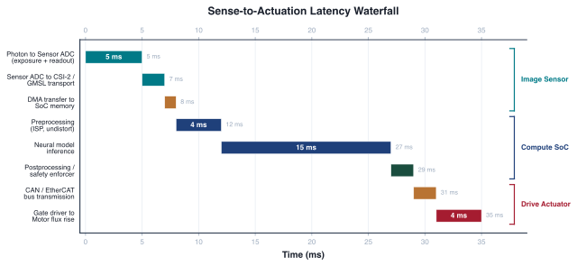
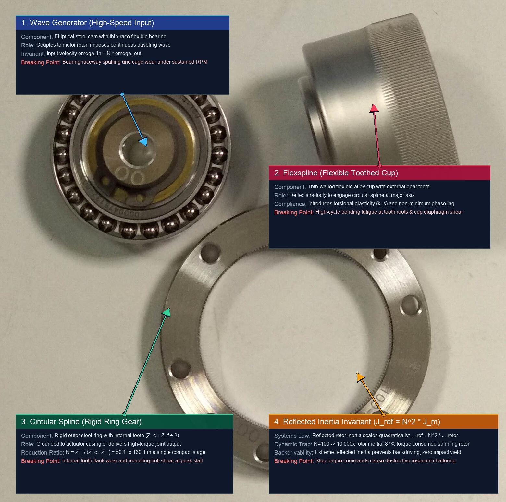
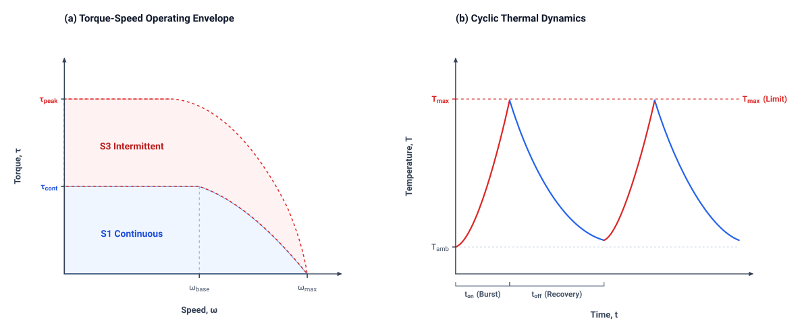
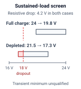

---
format:
  html:
    title: "The Physical Body"
---

# The Physical Body {#sec-body}

::: {layout-narrow}
::: {.column-margin}

\chapterminitoc

:::

::: {.content-visible when-format="pdf"}
\noindent
{fig-alt="Isometric blueprint showing the physical body architecture: Brushless DC (BLDC) motor stator coils, rotor inertia, planetary gearset, optical encoder, output drive flange, and thermal heatsink."}
:::

::: {.content-visible unless-format="pdf"}
{fig-alt="Isometric blueprint showing the physical body architecture: BLDC stator coils, rotor inertia, planetary gearset, optical encoder, output drive flange, and thermal heatsink."}
:::

:::

## Purpose {.unnumbered .unlisted}

::: {.content-visible when-format="pdf"}
\begin{marginfigure}
\resizebox{0.92\linewidth}{!}{\mlphysicalstackfull{20}{20}{100}{20}{20}}
\end{marginfigure}
:::

_Why must a physical AI systems engineer master mechanical inertia, winding thermal limits, and power distribution rail droop before writing a single line of motor control policy?_

A mobile manipulator can recognize an obstacle correctly and still strike it if its body cannot stop within the remaining distance. The same machine can hold a payload without moving while its motor windings overheat, or lose its controller when a sudden demand for current pulls the supply voltage too low. These failures arise from limits that prediction accuracy alone cannot reveal. Physical AI engineering requires connecting a proposed action to the motion, heat, and electrical demand it creates, then establishing which limit the assembled machine reaches first. Measurements must also establish the conditions under which those limits hold, because a change in payload, floor surface, cooling, or battery state changes what the machine can deliver. The body's limits therefore govern what the permission path may admit before a command crosses the causal boundary and produces irreversible physical work.



::: {.callout-learning-objectives}

- Calculate observation freshness limits from measurement age and the machine's allowable motion
- Calculate stopping distance and the admissible speed ceiling from pre-brake delay, credible deceleration, and clearance overheads
- Evaluate actuator and transmission choices against response limits, reflected inertia, and mechanical impedance
- Estimate sustainable motor duty cycles from heat generation, cooling, and operating conditions
- Budget electrical supply margins for simultaneous actuation, computation, and regenerative braking
- Specify the elements of a limit record that states a measured limit's conditions, uncertainty, margin, runtime detector, and evidence category

:::

## The Five Physical Budgets {#sec-body-five-budgets}

The **physical body**\index{Physical body!definition} is the coupled plant of actuators, transmissions, structural linkages, power electronics, and sensors that turns a command into motion. Its limits constrain even a correctly chosen action. A brake command requires time to build force and distance to dissipate kinetic energy; a holding command draws current and accumulates heat even when the arm does not move.

The proposal boundary in @sec-boundary-machine-model gives the permission path responsibility for admitting action. The body supplies the limits that make that decision meaningful: whether the observation is still useful, whether the machine can stop, whether the drive can deliver the requested motion, whether the winding can tolerate its duration, and whether the electrical supply remains usable. These are the five physical budgets. Their mechanisms connect in that order: delay consumes stopping distance; stopping requires delivered torque; torque generates heat and draws current from the shared supply.

1. **Measurement freshness** ($\tau$)\index{Measurement freshness!definition}: The observation must remain useful until the actuator responds. Motion during exposure, transport, computation, and actuation consumes the allowable position error.
2. **Kinetic momentum** ($E_k, p$)\index{Kinetic momentum!definition}: The moving machine carries kinetic energy ($E_k = \frac{1}{2} m v^2$) and momentum ($p = mv$). Stopping requires retarding force over a finite distance, so the chosen speed must leave enough clearance for delay and braking.
3. **Actuator bandwidth and reflected inertia** ($f_a, N^2 J$)\index{Actuator bandwidth!definition}\index{Reflected inertia!definition}: Winding inductance and available voltage limit how quickly torque changes. Gearing increases delivered torque but also increases the rotor inertia that the joint must accelerate, limiting the motion a command can produce.
4. **Thermal capacity** ($T_j$)\index{Thermal capacity!definition}: Current generates heat in the windings and inverter. Cooling limits sustained torque, while stored heat limits the duration and repetition of torque bursts.
5. **Electrical power integrity** ($V_{\text{rail}}$)\index{Electrical power integrity!definition}: Compute and drives draw from a finite shared supply. Simultaneous demand must leave sufficient voltage for control, and braking must leave somewhere for returned energy to go.

Under the **Simultaneous Admission Invariant**, motion permission requires a non-negative margin in every budget before the permission path commits torque to hardware registers. Each margin must be checked in its own units; time, distance, torque, temperature, and voltage are separate constraints, not interchangeable quantities:
$$\begin{aligned}
t_{\text{age}} &\le \Delta t_{\text{fresh}}, \\
d_{\text{stop}} &\le D_{\text{clear}}, \\
|\tau_{\text{cmd}}| &\le \tau_{\text{out, max}}, \\
\hat{T}_{\text{wind}} &\le T_{\text{limit}}, \\
V_{\text{rail, min}} &\ge V_{\text{uvlo}}.
\end{aligned}$$
Here $\tau_{\text{cmd}}$ is requested torque and $\tau_{\text{out, max}}$ is the maximum deliverable output torque under the current conditions. The estimated winding temperature $\hat{T}_{\text{wind}}$ must remain below its limit, while the lowest rail voltage $V_{\text{rail, min}}$ must remain above the undervoltage-lockout threshold $V_{\text{uvlo}}$ at which the supply regulator shuts down. All five inequalities must hold simultaneously. A surplus in four budgets cannot compensate for a deficit in the fifth: a fresh observation cannot prevent a stop from overrunning if kinetic energy exceeds available clearance, and abundant battery energy cannot prevent an actuator from burning out if thermal dissipation limits are violated.

::: {.callout-perspective title="Why physical limits bound physical AI architecture"}
The permission path needs limits on delivered physical behavior. An accepted torque request does not establish that the drive can produce it, and removing electrical power does not establish that the machine will stop within clearance. The five budgets connect software requests to measurable response under declared operating conditions.
:::

```{python}
#| label: body-machine-momentum-calc
#| echo: false
#| warning: false
#| message: false
# ┌─────────────────────────────────────────────────────────────────────────────
# │ THE RUNNING MACHINE'S MOMENTUM (LEGO)
# ├─────────────────────────────────────────────────────────────────────────────
# │ Context: the running-machine sentence in @sec-body-five-budgets.
# │ Goal:    Give the warehouse mobile manipulator's kinetic energy at its
# │          drive limit with the tote rack loaded.
# │ Show:    368 kg (upper bound) at 1.5 m/s carries 414 J.
# │ How:     calc_kinetic_energy on RM.loaded_mass and RM.base.max_velocity.
# └─────────────────────────────────────────────────────────────────────────────
from mlsysim import *
from mlsysim.core.units import *
from mlsysim.fmt import fmt_mass, fmt_velocity, fmt_energy, check

RM = Embodied.MobileManipulator.WarehouseMobileManipulator

class MachineMomentum:
    """Kinetic energy of the loaded running machine at its drive limit."""

    # ┌── 1. LOAD (Constants & Parameters) ─────────────────────────────────
    m_loaded = RM.loaded_mass  # category: derived (upper bound, full tote rack)
    v_drive = RM.base.max_velocity  # category: illustrative (drive limit)

    # ┌── 2. EXECUTE (Compute) ─────────────────────────────────────────────
    e_k = calc_kinetic_energy(m_loaded, v_drive).to(joule)

    # ┌── 3. GUARD (Invariants) ───────────────────────────────────────────
    check(abs(m_loaded.to(kilogram).magnitude - 368.0) < 1e-9, f"Unexpected loaded mass: {m_loaded}")
    check(abs(e_k.magnitude - 414.0) < 1e-6, f"Unexpected kinetic energy: {e_k}")

    # ┌── 4. OUTPUT (Formatting) ──────────────────────────────────────────
    m_loaded_str = fmt_mass(m_loaded, unit=kilogram, precision=0)
    v_drive_str = fmt_velocity(v_drive, unit=meter / second, precision=1)
    e_k_str = fmt_energy(e_k, unit=joule, precision=0)
```

The warehouse mobile manipulator that this book follows draws on all five. Loaded to at most `{python} MachineMomentum.m_loaded_str` and moving at its `{python} MachineMomentum.v_drive_str` drive limit (illustrative; see the Reader Guide), it carries `{python} MachineMomentum.e_k_str` of kinetic energy through aisles it shares with people.

Each budget becomes a limit established on the assembled machine under declared thermal and electrical stress. The first is the age of the measurement on which every command rests, which runs from physical transduction, before any software process receives the data.

## Measurement Freshness {#sec-body-measurement-freshness}

Software benchmarks in machine learning frequently report latency as isolated accelerator execution time (e.g., $18.5\text{ ms}$ for a vision backbone on an edge NPU), creating the dangerous illusion of a responsive $50\text{ Hz}$ control loop. In physical AI systems, however, that compute kernel is only one intermediate stage in an end-to-end silicon-to-plant dataflow pipeline. **A measurement decays continuously from the instant of physical transduction; what governs physical behavior is its total age when torque actually appears at the joint.** That physical age spans the interval from the moment photons strike a photodiode array, magnetic flux passes a Hall sensor, or strain deflects a piezoresistor to the moment motor inverter switches build stator magnetic flux that changes link acceleration. If a perception policy evaluates an obstacle bounding box in $18.5\text{ ms}$, but exposure integration, sensor readout, PCIe transport, kernel scheduling, fieldbus dispatch, and motor electrical current rise add another $40\text{ ms}$, the true physical age of the observation when the joint accelerates is nearly $60\text{ ms}$.

During that entire window, the continuous physical environment continues to evolve unobserved. In distributed data systems, read-after-write consistency windows govern whether a client acts on stale or linearized state. In Physical AI, the physical plant is an autonomous, unpausable concurrent writer: world state $\mathbf{x}(t)$ evolves along continuous trajectories at velocity $\mathbf{v}(t)$. An observation age $\tau_{\text{delay}}$ converts directly into unobserved physical displacement $\Delta x \approx \int_0^{\tau_{\text{delay}}} v(t)\,dt$. High-speed machines inevitably act on historical state.

::: {.column-margin .margin-pointer}
↪ @Sec-memory-belief-through-occlusion derives how long a stored belief stays valid as its measurement ages.
:::

The rate of world-state change dictates how long a measurement remains valid before acting on it introduces intolerable error. Let $e_{\max}$ denote the maximum acceptable error in a tracked state, such as a joint angle or the position of a part on a conveyor, and let $v_{\max}$ denote the fastest credible velocity at which that state can evolve. The freshness deadline $\Delta t_{\text{fresh}}$ is the upper bound on measurement age before a control action based on that measurement becomes invalid, defined by the inequality
$$\Delta t_{\text{fresh}} \le \frac{e_{\max}}{v_{\max}}$$

For a vision-guided picker on a parcel sorter, tracking parcels at a maximum relative velocity $v_{\max} = 1.2\text{ m/s}$ with a geometric clearance tolerance $e_{\max} = 24\text{ mm}$, the freshness deadline is $24\text{ mm} / (1200\text{ mm/s}) = 20\text{ ms}$. If an actuation command reaches the motor based on an image captured $35\text{ ms}$ earlier, the parcel has displaced by $42\text{ mm}$, exceeding the position allowance by $18\text{ mm}$ and missing the grasp. The deadline governs a target that keeps moving while its measurement ages, such as the parcel here or the mug riding the mobile manipulator's pick-station conveyor. For such a target it limits only motion-induced error, and only while relative velocity is bounded and the initial observation is credible; sensing and estimation errors consume additional tolerance. Conversely, a stationary person standing in an aisle does not move while the observation ages; instead, the robot base moves toward the person, so the observation age converts into unguided vehicular travel before braking begins, which @sec-body-kinetic-momentum charges against the kinetic stopping budget.

### Transduction physics, quantization noise, and Nyquist limits {#sec-body-sensor-transduction}

Sensor selection spends both error tolerance and time. A sensor must resolve the motion of interest, and the filtering or scanning needed to obtain that resolution must fit the freshness deadline. Four mechanisms make this trade-off concrete:

1. **Optical Encoders and Velocity Quantization Noise:**
   An encoder measures joint angle in discrete increments. An $n$-bit encoder discretizes the continuous $2\pi$ radian circle into angular resolution $\delta \theta = \frac{2\pi}{2^n}$. For an 18-bit absolute encoder, $\delta \theta \approx 2.4 \times 10^{-5}\text{ rad}$ ($0.0014^\circ$); for a 12-bit magnetic encoder, $\delta \theta \approx 1.53 \times 10^{-3}\text{ rad}$ ($0.088^\circ$). Joint velocity must typically be estimated from successive angle samples across control cycle $\Delta t$:
   $$\dot{\theta}_k \approx \frac{\theta_k - \theta_{k-1}}{\Delta t}$$
   Backward differencing emphasizes rapid changes between samples, much as a high-pass filter does, so small angle errors can become large velocity errors when divided by a short sampling period. If successive quantization errors are independent and uniformly distributed over one encoder step, each has variance $(\delta\theta)^2/12$. Subtracting two such errors adds their variances, giving velocity-error standard deviation $\sigma_{\dot{\theta}} = \frac{\delta\theta}{\sqrt{6}\,\Delta t}$. This statistical model differs from a single count transition. At a $1\text{ kHz}$ servo loop ($\Delta t = 1\text{ ms}$), a one-count change of $1.53\text{ mrad}$ produces a velocity-estimate jump of $1.53\text{ rad/s}$ ($88^\circ/\text{s}$). If fed directly to velocity feedback or velocity-conditioned policy inputs, these jumps can provoke torque chatter and excite structural vibration. A low-pass filter smooths rapid sample changes, but that smoothing also delays the estimate's response to real motion. Filter selection must therefore balance noise suppression against the freshness budget.

2. **Inertial Measurement Units (IMUs) and Nyquist Aliasing:**
   An inertial measurement unit (IMU) measures acceleration and angular velocity. Sampling must distinguish the motion of interest from faster structural vibration. Under the Nyquist-Shannon sampling theorem, a band-limited signal requires sampling above twice its highest frequency ($f_s > 2 f_{\max}$). Without adequate analog anti-aliasing filtering, vibrations above that range can appear as slower motion, misleading the state estimator. Raising the software update rate cannot recover information already aliased at the sensor.

3. **Tactile Sensor Arrays and Scanning Bandwidth:**
   Tactile arrays measure contact stress across a gripper through individual sensing elements called taxels. Scanning their elements sequentially reduces wiring but makes the frame span an interval rather than a single instant.
   Scanning an $M \times N$ matrix sequentially creates an inherent trade-off between spatial taxel count and temporal frame rate. A tactile skin scanning at $60\text{ Hz}$ introduces an immediate $16.7\text{ ms}$ sample-and-hold delay, plus intra-frame temporal skew between the first and last scanned taxel. In dynamic slip detection—where high-frequency micro-vibrations ($200\text{--}500\text{ Hz}$) signal incipient grasp failure as object surfaces shear across finger ridges—a $60\text{ Hz}$ tactile matrix is severely bandwidth-limited and blinded to high-frequency stick-slip transitions.

4. **Cameras and Rolling-Shutter Exposure Skew:**
   In CMOS image sensors, exposure integration represents an analog photon-counting window ($t_{\text{exp}} \approx 5\text{--}16.7\text{ ms}$). Rolling-shutter sensors expose pixel rows sequentially from top to bottom. If a manipulator moves at $1.5\text{ m/s}$ during a $16.7\text{ ms}$ readout, objects imaged at the bottom of the frame are captured after displacing by $2.5\text{ cm}$ relative to objects imaged at the top, inducing non-rigid geometric warping that degrades 3D bounding-box estimation unless compensated by hardware global-shutter sensors or explicit ego-motion undistortion.

### The end-to-end sense-to-actuation latency pipeline {#sec-body-latency-pipeline}

::: {#fig-02-latency-waterfall fig-env="figure" fig-pos="t" fig-cap="**Sense-to-actuation latency waterfall and silicon dataflow pipeline**: The eight-stage causal chain from exposure to motor current rise (panel a) and an illustrative latency profile (panel b). The parcel sorter's $24\text{ mm}$ tolerance at $1.2\text{ m/s}$ sets a $20\text{ ms}$ age deadline, because unguided travel converts elapsed time into displacement at the carriage speed. Both the $35.0\text{ ms}$ median and the $68.4\text{ ms}$ $P_{99.9}$ tail exceed it, corresponding to $4.2\text{ cm}$ and $8.2\text{ cm}$ of motion, respectively." fig-alt="Two-panel diagram. Panel (a) shows eight stages from sensor exposure through transport, inference, command transfer, and motor current rise. Panel (b) shows illustrative 35.0 and 68.4 millisecond timelines, both crossing a 20 millisecond freshness deadline; at 1.2 meters per second they correspond to 4.2 and 8.2 centimeters of parcel motion."}
{width="100%"}
:::

A guided walkthrough of @fig-02-latency-waterfall illustrates how physical latency accumulates across the end-to-end silicon pipeline:

* **Panel (a) Pipeline stages:** The signal path traverses eight distinct hardware and software domains: (1) sensor photon exposure midpoint, (2) serial readout over MIPI CSI-2, (3) direct memory access (DMA) transport into host memory, (4) kernel buffering into user space, (5) neural model deliberation on the accelerator, (6) inter-process communication (IPC) dispatch across processor boundaries, (7) deterministic fieldbus packet transmission over EtherCAT, and (8) power MOSFET gate drive switching to establish stator flux.
* **Panel (b) Latency timelines vs. freshness deadline:** Evaluating these stages against the $20\text{ ms}$ freshness deadline demonstrates why nominal benchmark compute times mislead. While neural inference alone requires only $18.5\text{ ms}$ ($P_{50}$), upstream readout and downstream fieldbus dispatch push the median end-to-end age to $35.0\text{ ms}$, creating $4.2\text{ cm}$ of unguided parcel slip. Under queue congestion and memory bus contention, the $P_{99.9}$ tail swells to $68.4\text{ ms}$ ($8.2\text{ cm}$ of slip), blowing through the physical tolerance budget by more than a factor of three.

Engineers often compute total latency by summing the $P_{99}$ values of individual stages, but the percentile of a sum is not the sum of the percentiles.[^fn-math-quantile-convolution] In embedded system-on-chip (SoC) architectures, shared system bus contention (such as PCIe DMA bursts saturating memory controllers during camera readout), memory bandwidth throttling on edge accelerators, and kernel thread preemption correlate stage delays. The distribution of complete sense-to-torque age must therefore be profiled empirically on the integrated machine under declared multi-tenant compute loads, and even that measured percentile is not the analyzed bound a hard safety deadline demands (@sec-nervous-deterministic-fieldbuses).

[^fn-math-quantile-convolution]: **Quantile Convolution**\index{Quantile convolution!tail non-additivity}: In general, the quantile of a latency sum differs from the sum of equal-percentile stage quantiles ($Q_p(X + Y) \ne Q_p(X) + Q_p(Y)$). Independence alone does not make their arithmetic sum a worst-case bound. Correlation from shared buses and queues changes the end-to-end tail and must be characterized at the system boundary.

To see how stage timing differs from end-to-end age, consider a timing profile for the camera-to-joint path under continuous inference load (@tbl-02-latency-breakdown), judged against the same $20\text{ ms}$ deadline.

| Pipeline Stage                     | Physical Mechanism / Contention Source                           | $P_{50}$ (ms) | $P_{99}$ (ms) | Max (ms) |
|:-----------------------------------|:-----------------------------------------------------------------|:-------------:|:-------------:|:--------:|
| **1–2. Sensor Exposure & Readout** | $60\text{ Hz}$ rolling shutter exposure midpoint                 |     $11.2$    |     $16.6$    |  $16.7$  |
| **3–4. Host Transport & DMA**      | PCIe DMA transfer into host memory                               |     $1.4$     |     $3.2$     |  $6.8$   |
| **5. Vision Backbone & Policy**    | Onboard accelerator inference (memory throttling tail)           |     $18.5$    |     $24.1$    |  $38.4$  |
| **6. OS Scheduling & IPC**         | Kernel preemption and mailbox dispatch to safety microcontroller |     $0.6$     |     $2.1$     |  $12.3$  |
| **7. Fieldbus Transmission**       | Deterministic EtherCAT cyclic packet exchange                    |     $1.0$     |     $1.0$     |  $2.0$   |
| **8. Actuator Current Rise**       | Gate driver switching and stator flux buildup                    |     $2.3$     |     $3.0$     |  $4.5$   |
| **Arithmetic Stage Sum**           | Sum of each column's stage values; not an end-to-end quantile    |    **35.0**   |    **50.0**   | **80.7** |
| **End-to-End Age**                 | System-level profile ($t_{\text{transduction}} \to \tau$)        |    **35.0**   |    **46.2**   | **80.7** |

: **Illustrative sense-to-actuation latency decomposition**: Stage and system-level timings show why the arithmetic sum of stage percentiles is not the end-to-end tail. The example's $P_{99.9} = 68.4\text{ ms}$ exceeds the $20\text{ ms}$ freshness deadline of the parcel sorter. {#tbl-02-latency-breakdown tbl-colwidths="[26,38,12,12,12]"}

The $50.0\text{ ms}$ sum of stage $P_{99}$ values differs from the $46.2\text{ ms}$ system percentile, and against the $20\text{ ms}$ deadline even the $35.0\text{ ms}$ median would be late.

Late feedback can also reinforce a tracking error instead of correcting it,[^fn-math-bode-delay] but the freshness calculation needs no frequency-domain model: the parcel has already moved beyond the allowed tolerance. The architecture must preserve the observation's physical capture time. Hardware timestamps synchronized through **IEEE 1588 gPTP**\index{IEEE 1588 gPTP!hardware timestamping}[^fn-hw-gptp-timestamp] or capture strobes associated with the **MIPI CSI-2**\index{MIPI CSI-2!sensor readout interface}[^fn-hw-mipi-capture] interface provide a timing reference; the sensor's exposure and readout behavior determine how that reference maps to the measurement. The timestamp then travels with the observation through computation.

Before committing a proposal to actuator registers, the permission path compares observation age $t_{\text{age}} = t_{\text{now}} - t_{\text{transduction}}$ with the freshness deadline, reserving time for the remaining actuator response. If $t_{\text{age}} > \Delta t_{\text{fresh}}$, it refuses that proposal. An already active command may continue only while its own evidence and permission remain valid; otherwise the path invokes a qualified fallback within the remaining physical margin [@brooks1986robust]. Refusing a stale replacement and ending valid ongoing motion are separate decisions.

[^fn-math-bode-delay]: **Transport Delay and Feedback Stability**\index{Transport delay!feedback instability}\index{Asynchronous divergence!closed-loop}: Transport delay makes a controller act on historical state. Whether delayed corrections destabilize the loop depends on the plant, controller, and total response. @Sec-appendix-control-zoh develops the phase-margin calculation; delay alone does not establish a particular oscillation or damage outcome.

[^fn-hw-gptp-timestamp]: **IEEE 1588 gPTP**\index{IEEE 1588 gPTP!hardware timestamping}: The Generalized Precision Time Protocol (gPTP) provides sub-microsecond clock synchronization across Ethernet networks by exchanging hardware-timestamped packets directly at the network chip (media access control [MAC] PHY) layer. Capturing the timestamp in hardware keeps the operating system scheduler's jitter out of the measurement.

[^fn-hw-mipi-capture]: **MIPI CSI-2**\index{MIPI CSI-2!sensor readout interface}: The Mobile Industry Processor Interface Camera Serial Interface 2 (MIPI CSI-2) is a high-bandwidth, high-speed differential protocol used for transmitting uncompressed video data directly from image sensors to host system-on-chip (SoC) devices with minimal latency.

::: {.callout-perspective title="The publish timestamp anti-pattern"}
A common architectural defect in robotics software is timestamping sensor observations inside user-space publishers (such as a ROS 2 or DDS node). Doing so discards exposure midpoint, rolling-shutter integration, sensor readout, DMA transfers, and kernel queue latency—often hiding 15 to 30 ms of physical age. Timestamps must be latched at the physical transducer via hardware strobes at the silicon interface (such as MIPI CSI-2 Start-of-Frame or Ethernet PHY hardware timestamps via IEEE 1588 gPTP) before data enters operating-system queues.
:::

Throughout that sense-to-actuation interval, the body continues moving, carrying momentum that no software interrupt can cancel.

## Kinetic Momentum {#sec-body-kinetic-momentum}

```{python}
#| label: body-stopping-budget-calc
#| echo: false
#| warning: false
#| message: false
# ┌─────────────────────────────────────────────────────────────────────────────
# │ THE BODY'S STOPPING DISTANCE ON THE RUNNING MACHINE (LEGO)
# ├─────────────────────────────────────────────────────────────────────────────
# │ Context: @sec-body-kinetic-momentum opener, @fig-02-stopping-distance, and
# │          \ref{nbk-body-stopping-distance-budgeting-high-tail-compute}.
# │ Goal:    Add the body's own terms of @eq-body-stopping-distance for the
# │          loaded warehouse mobile manipulator at its drive limit.
# │ Show:    Rows 1-3 of the stopping budget at 1.5 m/s: braking 562.5 mm,
# │          overhead 150 mm (712.5), brake onset 30 mm (742.5), leaving 357.5 mm
# │          of the 1.10 m clear distance; body-only ceiling 1.91 m/s; at 2.0 m/s
# │          braking is 1000 mm (+77.8 percent); each extra 100 ms adds 150 mm;
# │          figure cases 742.5 / 912.9 / 1417.2 mm.
# │ How:     calc_safe_stopping_distance and calc_max_permitted_velocity with
# │          a_eff = a_brake (constant deceleration), from RM and AISLE. The full
# │          pre-brake delay AISLE.tau_delay appears only in the figure's cases.
# └─────────────────────────────────────────────────────────────────────────────
from mlsysim import *
from mlsysim.core.units import *
from mlsysim.fmt import (
    fmt_mass,
    fmt_length,
    fmt_energy,
    fmt_latency,
    fmt_velocity,
    fmt_acceleration,
    fmt_percent,
    fmt_display_math,
    check,
)

RM = Embodied.MobileManipulator.WarehouseMobileManipulator
AISLE = Embodied.Scenario.WarehouseAisle

class BodyStoppingBudget:
    """Rows 1-3 of the running machine's stopping budget: the terms the body owns."""

    # ┌── 1. LOAD (Constants & Parameters) ─────────────────────────────────
    v = RM.base.max_velocity  # category: illustrative (drive limit)
    a_brake = AISLE.a_brake  # category: illustrative (loaded, dry floor)
    delta_loc = AISLE.delta_loc  # category: illustrative
    delta_margin = AISLE.delta_margin  # category: chosen
    t_act = AISLE.t_brake_onset  # category: illustrative (brake onset)
    d_clear = AISLE.d_clear  # category: illustrative (rack-end clear distance)
    tau_full = AISLE.tau_delay  # category: derived (full pre-brake delay; figure only)
    v_fast = 2.0 * meter / second  # category: illustrative (speed-scaling case above the drive limit)
    dt_extra = 100 * millisecond  # category: illustrative (added pre-brake delay step)

    # ┌── 2. EXECUTE (Compute) ─────────────────────────────────────────────
    d_brake = (v**2 / (2 * a_brake)).to(ureg.millimeter)  # row 1
    total_1 = d_brake
    overhead = (delta_loc + delta_margin).to(ureg.millimeter)  # row 2
    total_2 = (total_1 + overhead).to(ureg.millimeter)
    d_onset = (v * t_act).to(ureg.millimeter)  # row 3
    total_3 = (total_2 + d_onset).to(ureg.millimeter)
    remaining = (d_clear - total_3).to(ureg.millimeter)
    v_ceiling = calc_max_permitted_velocity(d_clear, t_act, a_brake, loc_margin=delta_loc, physical_margin=delta_margin)
    d_brake_fast = (v_fast**2 / (2 * a_brake)).to(ureg.millimeter)
    brake_growth = (d_brake_fast / d_brake - 1).to("dimensionless")
    d_per_extra = (v * dt_extra).to(ureg.millimeter)
    case_body = calc_safe_stopping_distance(v, t_act, a_brake, loc_margin=delta_loc, physical_margin=delta_margin).to(ureg.millimeter)
    case_full = calc_safe_stopping_distance(v, tau_full, a_brake, loc_margin=delta_loc, physical_margin=delta_margin).to(ureg.millimeter)
    case_fast = calc_safe_stopping_distance(v_fast, tau_full, a_brake, loc_margin=delta_loc, physical_margin=delta_margin).to(ureg.millimeter)
    case_full_blind = (v * tau_full).to(ureg.millimeter)
    case_full_margin = (d_clear - case_full).to(ureg.millimeter)
    case_fast_blind = (v_fast * tau_full).to(ureg.millimeter)
    case_fast_breach = (case_fast - d_clear).to(ureg.millimeter)

    # ┌── 3. GUARD (Invariants) ───────────────────────────────────────────
    check(v == MachineMomentum.v_drive, "Stopping budget and momentum must use the same drive limit.")
    check(abs(total_1.magnitude - 562.5) < 1e-6, f"Row 1 must be 562.5 mm: {total_1}")
    check(abs(total_2.magnitude - 712.5) < 1e-6, f"Row 2 running total must be 712.5 mm: {total_2}")
    check(abs(total_3.magnitude - 742.5) < 1e-6, f"Ch2 subtotal must be 742.5 mm: {total_3}")
    check(abs(case_body.magnitude - total_3.magnitude) < 1e-6, "Row sum must equal the equation.")
    check(abs(remaining.magnitude - 357.5) < 1e-6, f"Unexpected remaining clearance: {remaining}")
    check(abs(v_ceiling.magnitude - 1.9098) < 1e-4, f"Body-only ceiling must be 1.9098 m/s: {v_ceiling}")
    check(v_ceiling > v, "The body-only ceiling must exceed the drive limit.")
    check(abs(d_brake_fast.magnitude - 1000.0) < 1e-6, f"Unexpected braking at 2.0 m/s: {d_brake_fast}")
    check(abs(d_per_extra.magnitude - 150.0) < 1e-6, f"Unexpected cost of 100 ms: {d_per_extra}")
    check(abs(tau_full.to(millisecond).magnitude - 133.6) < 1e-6, f"Unexpected tau_delay: {tau_full}")
    check(abs(case_full.magnitude - 912.9) < 1e-6, f"Unexpected full-delay case: {case_full}")
    check(abs(case_fast.magnitude - 1417.2) < 1e-6, f"Unexpected fast case: {case_fast}")
    check(case_full < d_clear < case_fast, "Case 2 must fit and Case 3 must breach the clear distance.")
    check(abs(case_full_blind.magnitude - 200.4) < 1e-6, f"Unexpected case_full_blind: {case_full_blind}")
    check(abs(case_full_margin.magnitude - 187.1) < 1e-6, f"Unexpected case_full_margin: {case_full_margin}")
    check(abs(case_fast_blind.magnitude - 267.2) < 1e-6, f"Unexpected case_fast_blind: {case_fast_blind}")
    check(abs(case_fast_breach.magnitude - 317.2) < 1e-6, f"Unexpected case_fast_breach: {case_fast_breach}")

    # ┌── 4. OUTPUT (Formatting) ──────────────────────────────────────────
    v_str = fmt_velocity(v, unit=meter / second, precision=1)
    a_brake_str = fmt_acceleration(a_brake, unit=meter / second**2, precision=0)
    delta_loc_str = fmt_length(delta_loc, unit=ureg.millimeter, precision=0)
    delta_margin_str = fmt_length(delta_margin, unit=ureg.millimeter, precision=0)
    t_act_str = fmt_latency(t_act, unit=millisecond, precision=0)
    d_clear_str = fmt_length(d_clear, unit=meter, precision=2)
    tau_full_str = fmt_latency(tau_full, unit=millisecond, precision=1)
    v_fast_str = fmt_velocity(v_fast, unit=meter / second, precision=0)
    dt_extra_str = fmt_latency(dt_extra, unit=millisecond, precision=0)

    d_brake_str = fmt_length(d_brake, unit=ureg.millimeter, precision=1)
    overhead_str = fmt_length(overhead, unit=ureg.millimeter, precision=0)
    total_2_str = fmt_length(total_2, unit=ureg.millimeter, precision=1)
    d_onset_str = fmt_length(d_onset, unit=ureg.millimeter, precision=0)
    total_3_str = fmt_length(total_3, unit=ureg.millimeter, precision=1)
    remaining_str = fmt_length(remaining, unit=ureg.millimeter, precision=1)
    v_ceiling_str = fmt_velocity(v_ceiling, unit=meter / second, precision=2)
    d_brake_fast_str = fmt_length(d_brake_fast, unit=ureg.millimeter, precision=0, commas=True)
    brake_growth_pct_str = fmt_percent(brake_growth.magnitude, precision=1, style="prose")
    d_per_extra_str = fmt_length(d_per_extra, unit=ureg.millimeter, precision=0)
    case_body_str = fmt_length(case_body, unit=ureg.millimeter, precision=1)
    case_full_str = fmt_length(case_full, unit=ureg.millimeter, precision=1)
    case_fast_str = fmt_length(case_fast, unit=ureg.millimeter, precision=1, commas=True)
    _case_full_blind_str = fmt_length(case_full_blind, unit=ureg.millimeter, precision=1)
    _case_full_margin_str = fmt_length(case_full_margin, unit=ureg.millimeter, precision=1)
    _case_fast_blind_str = fmt_length(case_fast_blind, unit=ureg.millimeter, precision=1)
    _case_fast_breach_str = fmt_length(case_fast_breach, unit=ureg.millimeter, precision=1)

    d_brake_display_math = fmt_display_math(
        rf"d_{{\text{{brake}}}} = \frac{{v^2}}{{2 a_{{\text{{brake}}}}}} = \frac{{({v_str})^2}}{{2 \times {a_brake_str}}} = {d_brake_str}"
    )
    overhead_display_math = fmt_display_math(
        rf"\delta_{{\text{{loc}}}} + \delta_{{\text{{margin}}}} = {delta_loc_str} + {delta_margin_str} = {overhead_str}"
    )
    d_onset_display_math = fmt_display_math(rf"v\,T_{{\text{{act}}}} = ({v_str}) \times ({t_act_str}) = {d_onset_str}")
    total_display_math = fmt_display_math(
        rf"d_{{\text{{stop}}}}\big|_{{\text{{body}}}} = {d_brake_str} + {overhead_str} + {d_onset_str} = {total_3_str}"
    )
    ceiling_display_math = fmt_display_math(
        rf"v_{{\max}} = -a_{{\text{{brake}}}} T_{{\text{{act}}}} + \sqrt{{(a_{{\text{{brake}}}} T_{{\text{{act}}}})^2 + 2 a_{{\text{{brake}}}} (D_{{\text{{clear}}}} - \delta_{{\text{{loc}}}} - \delta_{{\text{{margin}}}})}} \approx {v_ceiling_str}"
    )
```

The loaded mobile manipulator drives down an aisle at its `{python} BodyStoppingBudget.v_str` drive limit. A person steps out from the end of a rack `{python} BodyStoppingBudget.d_clear_str` ahead and stands in the aisle. Software cannot simply abort execution or instantaneously zero the velocity vector: in physical AI, moving mass carries kinetic momentum ($p = mv$) and kinetic energy ($E_k = \frac{1}{2}mv^2$) that cannot be reclaimed by a garbage collector or flushed from memory registers. Bringing that mass to rest requires dissipating kinetic energy across physical distance through mechanical work ($W = \int F \, dx$). **Stopping distance grows linearly with delay and quadratically with speed, and that scaling asymmetry sets the machine's physical execution roofline.**

### Kinematic stopping distance and pre-brake delay {#sec-body-stopping-distance-prebrake}

From the observation that first captures a stationary hazard to rest, the modeled stop comprises two phases: pre-brake travel and braking travel. The pre-brake delay $\tau_{\text{delay}}$ covers the applicable sensing, decision, communication, and actuator-onset intervals. A proposal-dependent response includes its computation; an independent protective response need not wait for that computation. The budget must follow the path that actually initiates braking. If the hazard can appear between observations, the time until capture also needs an allowance. During the modeled delay, we conservatively credit no retarding force and assume approximately constant speed $v$, giving
$$d_{\text{blind}} = v\,\tau_{\text{delay}}$$

Once the selected braking mechanism develops retarding force, the body enters the braking phase. The mechanical work done by retarding braking force $F_{\text{brake}}$ across physical braking distance\index{Braking distance} $d_{\text{brake}}$ removes the machine's stored kinetic energy, $W = \Delta E_k$. A powered motor stop requires functioning drive electronics and a path to absorb or dissipate returned energy; a mechanical brake has its own onset and stopping characteristics. The credible deceleration belongs to the mechanism actually available in the fault being analyzed.

In an embodied machine, stored kinetic energy includes both translational kinetic energy of the chassis and payload ($E_{k,\text{trans}} = \frac{1}{2} m v^2$) and the rotational kinetic energy stored across spinning wheels, gearboxes, and motor rotors ($E_{k,\text{rot}} = \sum_i \frac{1}{2} J_{\text{rotor}, i} \omega_{i}^2$). Because transmission gear reduction $N_i$ spins the motor rotor at high angular velocity ($\omega_i = N_i \frac{v}{r_{\text{wheel}}}$), the rotor's rotational kinetic energy reflects into the linear translational domain scaled by the square of the gear ratio:
$$E_{k,\text{total}} = \frac{1}{2} m v^2 + \sum_i \frac{1}{2} J_{\text{rotor}, i} \left(N_i \frac{v}{r_{\text{wheel}}}\right)^2 = \frac{1}{2} \left(m + \sum_i \frac{N_i^2 J_{\text{rotor}, i}}{r_{\text{wheel}}^2}\right) v^2$$
This formulation reveals that the effective translational inertia of the machine is $m_{\text{eff}} = m + \sum_i \frac{N_i^2 J_{\text{rotor}, i}}{r_{\text{wheel}}^2}$. For a machine decelerating to rest under sustained retarding force $F_{\text{brake}} = m_{\text{eff}} a_{\text{brake}}$, the work-energy theorem balances mechanical work against total kinetic energy:
$$m_{\text{eff}} a_{\text{brake}} d_{\text{brake}} = \frac{1}{2} m_{\text{eff}} v^2$$
Dividing by effective mass yields the kinematic braking travel:
$$d_{\text{brake}} = \frac{v^2}{2 a_{\text{brake}}}$$
If an engineer evaluates braking capacity using bare chassis mass alone ($a_{\text{nominal}} = F_{\text{brake}} / m$), they ignore the kinetic energy stored in the spinning motor rotors, overestimating deceleration by the factor $m_{\text{eff}} / m$ and underestimating stopping travel by $\frac{m_{\text{eff}} - m}{m} = \sum_i \frac{N_i^2 J_{\text{rotor}, i}}{m r_{\text{wheel}}^2}$. For mobile bases equipped with high-ratio planetary wheel hubs, this unmodeled rotational energy inflates effective stopping inertia by 10 to 25 percent.

The parameter $a_{\text{brake}}$ is the credible sustained deceleration the physical plant can exert against the environment, not an idealized rating copied from an actuator datasheet. Deceleration requires physical retarding force ($F_{\text{brake}} = m a_{\text{brake}}$) that is bounded by the lesser of two physical ceilings: the environmental traction limit ($F_{\text{traction}} \le \mu m g$, where $\mu$ is tire-floor friction coefficient) and the drive-train torque delivery ceiling ($\tau_{\text{out, max}} = \eta N K_t I_{\max}$). If an engineer restricts inverter current limits or if motor back-EMF at high rotational speed robs the inverter of voltage headroom, the drive cannot deliver the required braking torque, silently degrading $a_{\text{brake}}$ and expanding braking travel without software notification. Furthermore, the motor must expend a fraction of its electrical torque merely to decelerate its own spinning rotor ($J_{\text{rotor}} \dot{\omega} = N J_{\text{rotor}} \ddot{q}$), leaving only the net remainder to apply mechanical retarding force against the floor.

Reflected rotor energy also matters during contact. The transmission and contact compliance determine how that energy reaches the obstacle and gear teeth. The stopping calculation therefore cannot substitute for a contact-load assessment; @sec-body-actuator-limits develops the corresponding transmission trade-off.

The constant-deceleration model requires a level surface and a qualified braking response. A conservative approximation can charge the interval until sustained deceleration is available to $\tau_{\text{delay}}$, then use a lower bound $a_{\text{brake}}$. The brake-onset allowance ($T_{\text{act}}$) enters that delay once. A later calculation that models a finite torque ramp must reconcile its ramp travel with this allowance rather than add the same interval twice. Loaded stopping trials across declared conditions establish the applicable response, uncertainty, and margin; a sample percentile alone is not a certified lower bound.

::: {.column-margin .margin-pointer}
↪ Unmanaged kinetic momentum translates directly into the destructive contact shock loads analyzed in @sec-body-actuator-limits.
:::

The differing exponents of the blind-travel and braking terms make velocity the dominant multiplier of spatial risk (@fig-02-stopping-distance), a scaling that \ref{nbk-body-stopping-distance-budgeting-high-tail-compute} works numerically.

In unstructured environments, a machine cannot allocate its entire clearance to nominal stopping dynamics. Obstacle tracking carries state estimation uncertainty, sensor calibration drifts over time, and localization algorithms introduce position error. The stopping distance $d_{\text{stop}}$ that the system defends must therefore include a spatial localization uncertainty bound $\delta_{\text{loc}}$ and a minimum physical clearance margin $\delta_{\text{margin}}$:[^fn-std-iso-separation]

$$d_{\text{stop}} = v\,\tau_{\text{delay}} + \frac{v^2}{2 a_{\text{brake}}} + \delta_{\text{loc}} + \delta_{\text{margin}}$$ {#eq-body-stopping-distance}

The sum $\delta_{\text{loc}} + \delta_{\text{margin}}$ is fixed spatial overhead that must remain unoccupied when the body comes to a complete rest.

[^fn-std-iso-separation]: **ISO/TS 15066 Separation Distance**\index{ISO/TS 15066!separation distance}\index{Speed and Separation Monitoring}: ISO/TS 15066 (Clause 5.5.4), building on ISO 13855, specifies this protective separation distance for Speed and Separation Monitoring (SSM): $S = (v_r \cdot T_r) + (v_h \cdot T_r) + S_r + S_s + C$, where $T_r$ is worst-case processing delay, $S_r$ is braking travel, and $C$ is clearance margin ($100\text{--}200\text{ mm}$). For learning policies operating in collaborative human workspaces, failing to bound compute tail latency directly inflates $T_r$, expanding the required separation zone and forcing premature protective stops.

::: {#dfn-body-dynamic-stopping-distance .callout-definition title="Dynamic stopping distance"}

***Dynamic stopping distance***\index{Dynamic stopping distance!definition}\index{Stopping distance!definition} ($d_{\text{stop}}$) is the minimum physical clearance required to bring a moving mass to a complete halt from its speed $v$ when the hazard is first imaged. It sums the travel during the pre-brake delay $\tau_{\text{delay}}$, which runs from the exposure of the frame that shows the hazard until retarding force begins; the braking travel under the credible deceleration $a_{\text{brake}}$; and the localization bound $\delta_{\text{loc}}$ and protective clearance $\delta_{\text{margin}}$, as @eq-body-stopping-distance states.

1.  **Significance**: Quantifies the non-negotiable physical spatial margin that software proposals must clear before motion permission can be granted.
2.  **Distinction**: Unlike static geometric obstacle clearance in classical kinematics, dynamic stopping distance grows quadratically with speed ($v^2$), so doubling velocity quadruples the braking term whatever the controller loop rate.
3.  **Common pitfall**: Assuming an emergency stop command halts the machine instantaneously, ignoring that moving mass carries kinetic energy ($E_k = \frac{1}{2}m v^2$) that requires finite mechanical work and braking distance to dissipate.

:::

::: {#fig-02-stopping-distance fig-env="figure" fig-pos="t" fig-cap="**Stopping distance of the warehouse mobile manipulator**: Each bar splits the stop into blind travel during the pre-brake delay, braking travel under the credible deceleration, and the fixed overhead of the localization bound and protective clearance, against the `{python} BodyStoppingBudget.d_clear_str` rack-end clear distance. Case 1 counts only the terms the body owns at the `{python} BodyStoppingBudget.v_str` drive limit and stops within `{python} BodyStoppingBudget.case_body_str`. Case 2 adds the full `{python} BodyStoppingBudget.tau_full_str` pre-brake delay that later chapters assemble, the lease path of @sec-nervous-cadences plus the observation age of @sec-perception; at `{python} BodyStoppingBudget.case_full_str` it still fits, although later chapters add a stop profile and a tracking bound. Case 3 raises speed to a hypothetical `{python} BodyStoppingBudget.v_fast_str`, above the drive limit, with the same delay; braking travel grows by `{python} BodyStoppingBudget.brake_growth_pct_str` and the stop, at `{python} BodyStoppingBudget.case_fast_str`, breaches the clear distance." fig-alt="Horizontal stacked bars for three cases, each split into blind travel, braking travel, and fixed overhead, against a dashed vertical line marking the rack-end clear distance. The first two bars end inside the line with the remaining margin shaded green; the third bar extends past the line into a hatched red breach."}

```{python}
#| echo: false
#| warning: false
#| message: false
# ┌─────────────────────────────────────────────────────────────────────────────
# │ STOPPING DISTANCE OF THE RUNNING MACHINE (FIGURE)
# │ Context: @fig-02-stopping-distance
# │ Goal:    show why velocity, not latency, dominates the defended clearance
# │ Show:    the three-term decomposition for the body-only terms, the full
# │          pre-brake delay, and a speed-scaling case, against D_clear
# │ How:     cases from BodyStoppingBudget (calc_safe_stopping_distance with
# │          RM and AISLE); d_stop = v*tau + v^2/(2a) + delta_loc + delta_margin
# ├─────────────────────────────────────────────────────────────────────────────
from mlsysim import viz

MM = ureg.millimeter

# ┌── 1. LOAD (from the stopping-budget cell) ──────────────────────────────────
S = BodyStoppingBudget  # category: derived (values keep their budget-cell categories)
A_BRAKE = S.a_brake  # category: illustrative (loaded, dry floor)
OVERHEAD = S.overhead.to(MM).magnitude  # category: derived (illustrative delta_loc plus chosen delta_margin)
D_CLEAR = S.d_clear.to(MM).magnitude  # category: illustrative (rack-end clear distance)
CASES = [  # category: illustrative and derived (drive-limit and speed-scaling cases from the budget cell)
    ("Case 1", "Body terms", S.v, S.t_act),
    ("Case 2", "Full delay", S.v, S.tau_full),
    ("Case 3", "Full delay, faster", S.v_fast, S.tau_full),
]

# ┌── 2. EXECUTE (Compute) ─────────────────────────────────────────────────────
rows = []
for name, sub, v, tau in CASES:
    react = (v * tau).to(MM).magnitude
    brake = (v**2 / (2 * A_BRAKE)).to(MM).magnitude
    rows.append((name, sub, react, brake, react + brake + OVERHEAD))

# ┌── 3. GUARD ─────────────────────────────────────────────────────────────────
check(abs(rows[0][4] - S.case_body.magnitude) < 1e-6, "Case 1 must match the budget cell.")
check(abs(rows[1][4] - S.case_full.magnitude) < 1e-6, "Case 2 must match the budget cell.")
check(abs(rows[2][4] - S.case_fast.magnitude) < 1e-6, "Case 3 must match the budget cell.")

# ┌── 4. PLOT ──────────────────────────────────────────────────────────────────
fig, ax, COLORS, plt = viz.setup_plot(figsize=(9, 3.6))
H = 0.58
for i, (name, sub, react, brake, stop) in enumerate(rows):
    y = len(rows) - 1 - i
    left = 0.0
    for width, color, label in (
        (react, COLORS["BlueL"], "Blind travel"),
        (brake, COLORS["BlueLine"], "Braking"),
        (OVERHEAD, COLORS["grid"], "Overhead"),
    ):
        ax.barh(y, width, left=left, height=H, color=color, edgecolor="white", linewidth=0.8, label=label if i == 0 else None, zorder=3)
        left += width
    if stop <= D_CLEAR:
        ax.barh(
            y,
            D_CLEAR - stop,
            left=stop,
            height=H,
            color=COLORS["GreenFill"],
            edgecolor="white",
            linewidth=0.8,
            label="Remaining margin" if i == 0 else None,
            zorder=3,
        )
    else:
        ax.barh(
            y,
            stop - D_CLEAR,
            left=D_CLEAR,
            height=H,
            facecolor="none",
            edgecolor=COLORS["RedLine"],
            linewidth=1.0,
            hatch="//",
            label="Breach" if i == len(rows) - 1 else None,
            zorder=4,
        )
    ax.text(-25, y, f"{name}\n{sub}", ha="right", va="center", fontsize=9, linespacing=1.4)
    ax.text(max(stop, D_CLEAR) + 25, y, f"{stop:,.1f} mm", va="center", fontsize=8.5, color=COLORS["primary"], zorder=6)

ax.axvline(D_CLEAR, color=COLORS["RedLine"], lw=1.4, linestyle=(0, (5, 4)), zorder=5)
ax.text(D_CLEAR, len(rows) - 0.42, f"  rack end at {S.d_clear.to(ureg.meter).magnitude:.2f} m", color=COLORS["RedLine"], fontsize=9, va="bottom")

ax.set_yticks([])
ax.set_xlim(0, 1700)
ax.set_ylim(-0.7, len(rows) - 0.25)
ax.set_xlabel("Distance traveled before rest (mm)")
ax.grid(True, axis="x", zorder=0)
ax.grid(False, axis="y")
for side in ("left", "top", "right"):
    ax.spines[side].set_visible(False)
handles, labels = ax.get_legend_handles_labels()
seen = dict(zip(labels, handles))
ax.legend(seen.values(), seen.keys(), loc="upper center", bbox_to_anchor=(0.5, -0.30), ncol=5, frameon=False, fontsize=8.5)
plt.tight_layout()
plt.show()
```

:::

### Dynamic velocity ceilings and clearance budgeting {#sec-body-dynamic-velocity-ceilings}

The bars in @fig-02-stopping-distance separate two design changes. Adding delay at the drive limit consumes part of the remaining clearance; increasing speed also enlarges the braking term quadratically. All three cases are illustrative calculations under the same constant-deceleration model. The first isolates the body's contribution, the second includes a selected end-to-end delay, and the third tests a hypothetical speed above the drive limit. Their comparison motivates a speed ceiling that changes with available clearance, rather than a fixed speed limit independent of the scene.

For a stationary obstacle detected at distance $D_{\text{clear}}$, such as a person standing at the rack end or a dropped tote, the modeled stopping distance must fit the clear path, $d_{\text{stop}} \le D_{\text{clear}}$. This is the condition that principle \ref{pri-vol4-irreversibility} places on every stop, now with each term of $d_{\text{stop}}$ a limit of this machine. With conservative timing and braking bounds, the permission path can solve this inequality for a ceiling on new velocity proposals $v_{\text{max}}$. The positive root of the quadratic inequality[^fn-math-velocity-root] is:
$$v_{\text{max}} = -a_{\text{brake}} \tau_{\text{delay}} + \sqrt{(a_{\text{brake}} \tau_{\text{delay}})^2 + 2 a_{\text{brake}} (D_{\text{clear}} - \delta_{\text{loc}} - \delta_{\text{margin}})}$$
When sensor range degrades or an obstacle enters the trajectory, $D_{\text{clear}}$ contracts and lowers the ceiling, provided the available distance remains nonnegative. At zero available distance the ceiling is zero. If the machine is already moving, however, a zero setpoint cannot remove its current stopping distance; a negative available distance means the admission condition is already violated and requires an emergency response.

[^fn-math-velocity-root]: **Kinematic Velocity Root**\index{Kinematic velocity root!quadratic clearance}: Grouping the constant spatial terms into available physical distance $D_{\text{avail}} = D_{\text{clear}} - \delta_{\text{loc}} - \delta_{\text{margin}}$ yields the quadratic inequality $\frac{1}{2 a_{\text{brake}}} v^2 + \tau_{\text{delay}} v - D_{\text{avail}} \le 0$. Multiplying by $2 a_{\text{brake}}$ produces $v^2 + 2 a_{\text{brake}} \tau_{\text{delay}} v - 2 a_{\text{brake}} D_{\text{avail}} \le 0$. Applying the quadratic formula and taking the positive physical root defines the dynamic velocity ceiling.

::: {#nbk-body-stopping-distance-budgeting-high-tail-compute .callout-notebook title="The body's stopping distance"}
**Problem**: The warehouse mobile manipulator, loaded to at most `{python} MachineMomentum.m_loaded_str`, drives toward a rack end at its $v =$ `{python} BodyStoppingBudget.v_str` drive limit, and a person stands in the aisle at the clear distance $D_{\text{clear}} =$ `{python} BodyStoppingBudget.d_clear_str`. The body owns three terms of @eq-body-stopping-distance: braking travel under the credible deceleration $a_{\text{brake}} =$ `{python} BodyStoppingBudget.a_brake_str` (loaded, dry floor); the fixed overhead of the localization bound $\delta_{\text{loc}} =$ `{python} BodyStoppingBudget.delta_loc_str` and the protective clearance $\delta_{\text{margin}} =$ `{python} BodyStoppingBudget.delta_margin_str`; and the brake onset $T_{\text{act}} =$ `{python} BodyStoppingBudget.t_act_str`, which enters $\tau_{\text{delay}}$. How much of the clear distance do these terms use, what speed would they alone permit, and how do speed and added delay change the answer?

**1. Braking travel:**
For the same credible deceleration, mass cancels from the work-energy balance. The loaded machine's `{python} MachineMomentum.e_k_str` sets the energy the stopping system must absorb or dissipate, while the specified deceleration sets the braking distance. A different payload can change that deceleration and requires a new bound:
`{python} BodyStoppingBudget.d_brake_display_math`
The stopping distance so far is `{python} BodyStoppingBudget.d_brake_str`.

**2. Fixed overhead:**
`{python} BodyStoppingBudget.overhead_display_math`
The running total rises to `{python} BodyStoppingBudget.total_2_str`.

**3. Brake onset:**
Between the brake command and the first retarding force, the base still moves at full speed:
`{python} BodyStoppingBudget.d_onset_display_math`
`{python} BodyStoppingBudget.total_display_math`
The body's own terms leave `{python} BodyStoppingBudget.remaining_str` of the `{python} BodyStoppingBudget.d_clear_str` clear distance for every delay the body does not own.

**4. The body-only ceiling:**
Solving @eq-body-stopping-distance for speed with $\tau_{\text{delay}} = T_{\text{act}}$:
`{python} BodyStoppingBudget.ceiling_display_math`
The body alone would permit `{python} BodyStoppingBudget.v_ceiling_str`, above the drive limit. @Sec-nervous and @sec-perception add the delay terms that spend part of this headroom.

**5. Speed against delay:**
At a hypothetical `{python} BodyStoppingBudget.v_fast_str`, above the drive limit, the braking term alone grows to `{python} BodyStoppingBudget.d_brake_fast_str`, `{python} BodyStoppingBudget.brake_growth_pct_str` more than at the drive limit. At the drive limit, each additional `{python} BodyStoppingBudget.dt_extra_str` of pre-brake delay adds `{python} BodyStoppingBudget.d_per_extra_str`.

**Architect's Rule of Thumb**: *Never raise a velocity setpoint without re-solving the clearance quadratic.*
:::

### Applying the velocity ceiling {#sec-body-velocity-governor-cbf}

A speed ceiling becomes useful when the permission path checks it before accepting each new velocity request. The learned policy proposes a speed; the independent check uses clearance, delay, and available deceleration to decide whether that request fits the stopping budget. A lower requested speed changes future motion, but cannot erase the distance needed to stop from the current speed. The check must therefore examine the current state as well as the candidate command.

The online velocity governor applies this comparison at each control tick. Its modeled feasible set is $\mathcal{C} = \{ (\mathbf{x}, v) : d_{\text{stop}}(v) \le D_{\text{clear}} \}$: the combinations of position and speed for which stopping fits the available clearance under the declared assumptions. Example \ref{exmp-body-dynamic-velocity-ceiling-governor-1-khz} checks current feasibility and clamps a new request to the computed ceiling. Keeping the real machine within that set between checks also requires bounds on timing, obstacle motion, and actuator response; the calculation alone does not establish those bounds.

::: {#exmp-body-dynamic-velocity-ceiling-governor-1-khz .callout-example title="Dynamic velocity ceiling governor"}
**Inputs**:

- $D_{\text{clear}} \in \mathbb{R}_{\ge 0}$: Detected obstacle distance along travel vector $[\text{m}]$.
- $\tau_{\text{delay}} \in \mathbb{R}_{> 0}$: Conservatively bounded sense-to-braking delay, including actuator response $[\text{s}]$.
- $a_{\text{brake}} \in \mathbb{R}_{> 0}$: Conservative lower bound on available brake deceleration under the declared load and surface $[\text{m/s}^2]$.
- $\delta_{\text{loc}}, \delta_{\text{margin}} \in \mathbb{R}_{\ge 0}$: Localization uncertainty bound and physical clearance margin $[\text{m}]$.
- $v_{\text{now}} \in \mathbb{R}_{\ge 0}$: Current forward speed $[\text{m/s}]$.
- $v_{\text{cand}} \in \mathbb{R}_{\ge 0}$: Candidate forward velocity setpoint proposed by neural policy $[\text{m/s}]$.

**Output**:

- $v_{\text{safe}} \in \mathbb{R}_{\ge 0}$: Clamped velocity request within the modeled ceiling $[\text{m/s}]$.

**Admission Check** (while the current state is feasible):

1. Modeled stopping distance: $d_{\text{stop}}(v_{\text{safe}}) = v_{\text{safe}} \tau_{\text{delay}} + \frac{v_{\text{safe}}^2}{2 a_{\text{brake}}} + \delta_{\text{loc}} + \delta_{\text{margin}} \le D_{\text{clear}}$ for a stationary obstacle.
2. Non-Negativity: $v_{\text{safe}} \ge 0.0$.

**Algorithm Steps**:

1. Compute available physical braking distance:
   $$D_{\text{avail}} \leftarrow D_{\text{clear}} - \delta_{\text{loc}} - \delta_{\text{margin}}$$

2. If $D_{\text{avail}} \le 0.0$, no positive travel distance remains within the declared protective margin. Reject the proposal, hold setpoints at zero if stationary, or command the maximum available emergency braking response if moving, and assert the clearance loss flag. Otherwise check $v_{\text{now}}\tau_{\text{delay}} + v_{\text{now}}^2/(2a_{\text{brake}}) \le D_{\text{avail}}$ before admitting another proposal. If that check fails, request the same emergency response and flag lost feasibility. Loss of this modeled margin does not by itself establish an unavoidable collision, and a zero velocity setpoint cannot stop existing motion immediately.
3. Compute quadratic discriminant:
   $$\text{disc} \leftarrow (a_{\text{brake}} \tau_{\text{delay}})^2 + 2 a_{\text{brake}} D_{\text{avail}}$$

4. Solve positive physical root for dynamic velocity ceiling:
   $$v_{\max} \leftarrow -a_{\text{brake}} \tau_{\text{delay}} + \sqrt{\text{disc}}$$

5. Enforce dynamic clamping against policy proposal:
   $$v_{\text{safe}} \leftarrow \min(v_{\text{cand}}, \max(0.0, v_{\max}))$$

6. Return $v_{\text{safe}}$.
:::

The quadratic turns a fixed speed limit into a clearance-dependent ceiling for new proposals. If perception range degrades, sensor latency spikes, or braking friction drops, the permission path must reduce admitted speed before clearance is exhausted or execute a defined risk-reducing fallback. Preserving a feasible set through continuing motion requires a dynamic admission rule; @sec-enforcement develops control barrier functions [@ames2019control] for that purpose. Here the result is a one-dimensional stopping-feasibility check whose assumptions remain explicit.

Enforcing this speed limit assumes the permission path can demand the deceleration $a_{\text{brake}}$ whenever safety requires it. Yet commanding rapid deceleration requires sudden, large mechanical torque from the drive motors and gearboxes. If the permission path requests a torque step that exceeds what the actuator bandwidth budget allows, the mechanical body cannot deliver the required deceleration, invalidating the model-based stopping ceiling and risking collision.

## Actuator Transmission Limits {#sec-body-actuator-limits}

A brake request can reach the drive successfully while the motor delivers less torque than the stopping calculation assumes. Current limits, voltage headroom, and transmission dynamics constrain the physical response even when communication succeeds. **Command acceptance does not establish delivered torque.** The engineering task is to determine the force and response time the assembly can sustain, then make those limits available to the permission path.

### Physical actuation modalities and the actuator contract {#sec-body-actuation-modalities}

An actuator contract cannot be specified in terms of abstract digital setpoints. It must be written at the physical plant interface in terms of delivered force, torque, slew rate limits, response latency, and tracking error. In software systems, an execution target either accepts an instruction or raises a fault; in physical hardware, an actuation request is bounded by stator winding inductance, DC bus voltage headroom, ferromagnetic saturation, and transmission elasticity.

::: {.column-margin}
{width="100%" fig-alt="S·P·A locator triad with the Act node highlighted."}

*The Act axis: non-smooth contact mechanics, reflected inertia, and thermal dissipation.*
:::

While electromechanical drives dominate mobile manipulation and form the primary running machine of this book, broader physical AI embodiments rely on fluid power or mechanical elasticity, each establishing fundamentally distinct physical budgets\index{Actuator!hydraulic}\index{Actuator!pneumatic}\index{Series Elastic Actuator!compliance}:

- **Hydraulic servovalves**: For heavy machinery, construction robots, and high-load dynamic platforms (such as the hydraulic Boston Dynamics Atlas), fluid power achieves operating pressures exceeding 20–35 MPa, delivering specific force densities an order of magnitude beyond what permanent magnets can produce. However, hydraulic control is fundamentally bounded by fluid compressibility (oil bulk modulus $\beta$), valve spool latency (10–50 ms), non-linear orifice flow, and severe cooling demands to prevent hydraulic fluid breakdown.
- **Pneumatics and soft actuation**: Pneumatic artificial muscles and elastomeric chambers provide physical compliance, which can reduce contact loads. Gas compressibility and transport delay also limit response. Compliance alone does not establish safe contact: pressure, stored energy, geometry, and the measured response still require qualification.
- **Series elastic actuators (SEAs)**: By intentionally placing a calibrated spring between the gearbox and the output link (as in the ANYbotics ANYdrive and Baxter), an SEA introduces physical compliance directly into the drive train. The spring acts as an analog low-pass mechanical filter: it isolates delicate gear teeth from shock loads, decouples the large reflected rotor inertia ($N^2 J_{\text{rotor}}$) from the environment during impact, and provides an analog energy buffer that widens the stopping budget before software can react. The trade-off is reduced closed-loop control bandwidth and structural resonance, requiring the permission path to monitor spring deflection rather than assuming rigid load tracking.

### Electrical time constants, back-EMF, and current clamping {#sec-body-electrical-time-constants}

Because electromechanical drives provide the tightest coupling between compute and actuation—delivering millisecond control bandwidths with linear magnetic torque—they serve as the baseline physical plant for our analysis. To an ML engineer accustomed to software abstractions, an actuator might appear as a simple software routine that instantly assigns a target torque tensor $\tau \in \mathbb{R}^m$. In physical reality, **an electric actuator operates as a specialized electromechanical Digital-to-Analog Converter (DAC)**. It converts discrete digital torque setpoints into continuous magnetic flux and mechanical shaft torque through a multi-stage physical conversion pipeline.

The budget needs two results from the motor controller: the torque delivered for a given current and the delay before that current appears. The torque-producing current is $i_q$, with $\tau = K_t i_q$. Field-oriented control (FOC) maintains that current as the rotor turns by measuring winding currents and adjusting inverter voltages.[^fn-hw-foc-current] The current-rise and current-limit relations below supply the quantities needed for admission. The coordinate transformations inside the drive are supporting detail, presented after the transmission choice.

The delay between commanding a torque and delivering it begins in the stator windings. Each phase winding constitutes an inductive-resistive ($RL$) circuit governed by Kirchhoff's Voltage Law:
$$L \frac{di_q(t)}{dt} + R i_q(t) = v_q(t) - e_{\text{bemf}}(t)$$
where $L$ is phase inductance, $R$ is phase resistance, $v_q(t)$ is the applied quadrature voltage from the inverter bridge, and $e_{\text{bemf}}(t) = K_e \omega(t)$ is the back-electromotive force opposing the supply voltage. The stator electrical time constant is:
$$\tau_e = \frac{L}{R}$$
When the inverter applies a step voltage command, current cannot jump discontinuously; it rises along an exponential trajectory $i_q(t) = I_{\text{target}}(1 - e^{-t/\tau_e})$. A policy that assumes torque appears instantaneously spends this rise as unguided drift before the arm can correct or brake.

Torque is strictly proportional to quadrature current ($\tau = K_t i_q$), but the rate at which current can physically rise is bounded by the available DC bus voltage headroom $(V_{\text{bus}} - e_{\text{bemf}})$ divided by stator inductance:
$$\frac{di_q}{dt} \le \frac{V_{\text{bus}} - e_{\text{bemf}}}{L}$$
In neural network optimization, gradient clipping enforces an upper bound on parameter update steps ($||\mathbf{g}|| \le c$) to stabilize stochastic gradient descent. In physical AI, stator inductance ($L$) and voltage headroom ($V_{\text{bus}} - e_{\text{bemf}}$) act as **hardware gradient clipping** on the policy's torque slew rate:
$$\frac{d\tau}{dt} \le \frac{K_t (V_{\text{bus}} - K_e \omega)}{L}$$
At low rotational speed, voltage headroom permits rapid current rise. As speed increases, back-EMF consumes that headroom, reducing the current the inverter can establish. A policy's abrupt torque request therefore becomes a finite physical ramp, and a request above the available slew rate creates tracking error. The stopping budget must use that delivered response. Torque and back-EMF constants must be identified using consistent current and voltage conventions before applying this simplified motor model.

[^fn-hw-foc-current]: **Field-Oriented Control (FOC) as an Actuator HAL**\index{Field-Oriented Control!current loop limits}: Field-Oriented Control executes as an embedded hardware abstraction layer (HAL) on dedicated motor-control silicon at $10\text{--}25\text{ kHz}$. It translates high-level torque requests into coordinated three-phase AC voltages while enforcing hardware current limits. Upstream neural policies issue target torques, but the torque reaches the winding only at the ramp rate permitted by the motor's electrical time constant and DC bus voltage headroom.

Headroom limits how fast current can rise; power inverter electronics limit how much current can flow at all. Motor inverters enforce a maximum current ceiling $I_{\text{max}}$ to protect switching MOSFETs from thermal destruction and avoid magnetic saturation in the stator core. When driving a mechanical transmission with gear reduction ratio $N$ and efficiency $\eta$, the ceiling on delivered joint torque is:
$$\tau_{\text{out, max}} = \eta N K_t I_{\text{max}}$$

This current ceiling answers the question the stopping budget left open: whether the drives can deliver the assumed deceleration when the permission path demands it. A drive may clamp a request locally while continuing to accept commands; the supervisory path must use available saturation status and measured response rather than treating successful transport as successful actuation. If braking requires more torque than the configured ceiling permits, the deceleration premise fails. Changing drive current limits therefore requires reassessing the stopping limit record (@sec-body-measuring-limits).

Current regulation also has losses. In the torque model used here, current not aligned with the torque-producing direction can heat the winding without contributing the intended shaft torque. Inverter switching and its protective dead time further affect delivered response.[^fn-hw-inverter-deadtime] Torque tracking therefore requires measurement at the assembled actuator, not an inference from the requested current alone.

[^fn-hw-inverter-deadtime]: **Inverter Dead Time**\index{Inverter dead time!shoot-through protection}: A short hardware-inserted interval in which both switches of an inverter half-bridge are off, so that the high-side and low-side switches of one leg never conduct together and short the DC bus, a failure called shoot-through.

### Reflected rotor inertia and optimal inertia matching {#sec-body-reflected-rotor-inertia}

Gearing adds a mechanical asymmetry. High-reduction joints use ratios of $50{:}1$ to $160{:}1$ to get high torque from a compact motor, which scales delivered torque by $N$ but spins the rotor $N$ times faster than the joint. A load that backdrives the output must spin the rotor $N$ times faster too, and because kinetic energy scales with the square of speed ($\frac{1}{2} J \dot{\theta}^2$), the rotor's inertia $J_{\text{rotor}}$ resists joint acceleration multiplied by the **square of the gear ratio** (\ref{dfn-body-reflected-rotor-inertia}).

```{python}
#| label: body-reflected-inertia-calc
#| echo: false
#| warning: false
#| message: false
# ┌─────────────────────────────────────────────────────────────────────────────
# │ REFLECTED ROTOR INERTIA AS A FLYWHEEL (LEGO)
# ├─────────────────────────────────────────────────────────────────────────────
# │ Context: the reflected-inertia paragraph in @sec-body-actuator-limits.
# │ Goal:    Give N^2 J_rotor a physical size at the joint.
# │ Show:    a 50 g rotor (5.6e-6 kg m^2) through 100:1 reflects 0.056 kg m^2,
# │          the inertia of an 11.2 kg solid flywheel of 10 cm radius.
# │ How:     J_ref = N^2 J_rotor; solid disk m = 2 J_ref / r^2.
# └─────────────────────────────────────────────────────────────────────────────
from mlsysim import *
from mlsysim.core.units import *
from mlsysim.fmt import fmt_int, fmt_mass, fmt_length, check

class ReflectedInertia:
    """Reflected rotor inertia through a 100:1 transmission, sized as a flywheel."""

    # ┌── 1. LOAD (Constants & Parameters) ─────────────────────────────────
    n_gear = 100  # category: illustrative (joint reduction)
    m_rotor = 50.0 * ureg.gram  # category: illustrative (rotor mass)
    j_rotor = 5.6e-6 * kilogram * meter**2  # category: illustrative (rotor inertia of that rotor)
    r_fly = 0.10 * meter  # category: illustrative (comparison flywheel radius)

    # ┌── 2. EXECUTE (Compute) ─────────────────────────────────────────────
    j_ref = (n_gear**2 * j_rotor).to(kilogram * meter**2)
    m_fly = (2 * j_ref / r_fly**2).to(kilogram)
    k_gyr = ((j_rotor / m_rotor) ** 0.5).to(ureg.millimeter)  # radius of gyration ties J_rotor to the quoted mass

    # ┌── 3. GUARD (Invariants) ───────────────────────────────────────────
    check(abs(j_ref.magnitude - 0.056) < 1e-9, f"Reflected inertia must be 0.056 kg m^2: {j_ref}")
    check(abs(m_fly.magnitude - 11.2) < 1e-9, f"Equivalent flywheel must be 11.2 kg: {m_fly}")
    check(n_gear == 100, f"Quoted joint reduction must be 100:1: {n_gear}")
    check(abs(m_rotor.to(ureg.gram).magnitude - 50.0) < 1e-9, f"Quoted rotor mass must be 50 g: {m_rotor}")
    check(abs(r_fly.to(meter).magnitude - 0.10) < 1e-12, f"Quoted flywheel radius must be 10 cm: {r_fly}")
    check(5.0 < k_gyr.magnitude < 20.0, f"Rotor inertia implausible for a 50 g rotor (k = {k_gyr})")

    # ┌── 4. OUTPUT (Formatting) ──────────────────────────────────────────
    n_gear_str = fmt_int(n_gear)
    m_rotor_str = fmt_mass(m_rotor, unit=ureg.gram, precision=0)
    m_fly_str = fmt_mass(m_fly, unit=kilogram, precision=1)
    r_fly_str = fmt_length(r_fly, unit=ureg.centimeter, precision=0)
```

Through a `{python} ReflectedInertia.n_gear_str`:1 transmission, a `{python} ReflectedInertia.m_rotor_str` rotor presents the joint with the inertia of a `{python} ReflectedInertia.m_fly_str` flywheel of `{python} ReflectedInertia.r_fly_str` radius [@lynch2017modern]. An obstacle striking the gripper must accelerate that flywheel through the gear teeth, whose roots can crack under the shock (@fig-02-real-broken-gear-tooth).

::: {#dfn-body-reflected-rotor-inertia .callout-definition title="Reflected rotor inertia"}

***Reflected rotor inertia***\index{Reflected rotor inertia!definition} ($J_{\text{ref}}$) is the apparent rotational inertia of an actuator rotor at the load-side joint output, scaling with the square of the transmission gear ratio:
$$J_{\text{ref}} = N^2 J_{\text{rotor}}$$

1.  **Significance**: In high-reduction transmissions ($N \ge 100$) it dominates the apparent load, capping joint acceleration $\ddot{q}$ and setting impact shock loads.
2.  **Distinction**: Unlike rotor inertia $J_{\text{rotor}}$ or link inertia $J_{\text{load}}$, it acts through transmission stiffness and backlash, so backdriving from the environment meets an $N^2$ barrier.
3.  **Common pitfall**: Ignoring reflected rotor inertia during collision and contact modeling. Under sudden obstacle impact, the reflected kinetic energy of the spinning rotor concentrates stress directly on gear teeth before drive current can be interrupted.

:::

The combined equation of motion for a geared joint driving load inertia $J_{\text{load}}$ with motor torque $\tau_{\text{motor}}$ is:
$$ \ddot{q} = \frac{N \tau_{\text{motor}}}{J_{\text{load}} + N^2 J_{\text{rotor}}} $$
Maximizing delivered load acceleration $\ddot{q}$ with respect to transmission ratio $N$ establishes the classical **inertia matching ratio**:[^fn-math-inertia-matching]
$$ N^* = \sqrt{\frac{J_{\text{load}}}{J_{\text{rotor}}}} $$

[^fn-math-inertia-matching]: **Inertia Matching and Systems Trade-Offs**: Maximizing joint acceleration $\ddot{q}$ balances load inertia against reflected rotor inertia, establishing the optimum $N^* = \sqrt{J_{\text{load}}/J_{\text{rotor}}}$. While this ratio maximizes theoretical load acceleration, practical robotic systems select lower ratios to protect gear teeth from shock stress, maintain physical backdrivability, and expand top cruise speed.

Below $N^*$, joint acceleration is torque-limited: increasing $N$ leverages motor torque to accelerate the heavy load faster. Above $N^*$, more gearing *decreases* delivered joint acceleration, because the motor expends most of its electromagnetic torque accelerating its own spinning rotor ($N^2 J_{\text{rotor}}$) rather than the external link.

The same ratio also increases the effort needed for an external contact to move the joint. That resistance to imposed motion is mechanical impedance. Inertia, damping, stiffness, and friction all contribute, so a ratio alone cannot establish contact force or a fracture threshold. The transmission choice must consider those effects alongside delivered acceleration.

::: {.column-margin}
{width="100%" fig-alt="Two-tone curve of joint acceleration versus gear ratio peaking at thirty-nine then dropping sharply into a shaded red rotor-inertia-dominated regime."}

*Past the inertia-matching ratio, gearing chokes delivered joint acceleration.*
:::

Abrupt changes in requested motion can excite the elasticity of a geared joint before the link follows the command. Limiting acceleration and its rate of change reduces that excitation, but smoothness alone does not establish tracking. @Sec-planning develops trajectories that respect those limits [@lynch2017modern]; the body must first supply the measured response and contact constraints they must satisfy.

### Transmission compliance, contact impedance, and tooth fracture {#sec-body-transmission-compliance}

Transmissions also introduce backlash and compliance that decouple motor from load. On reversal the motor shaft crosses mechanical clearance before the teeth engage the opposite flank, and torsional compliance in gear teeth and flexible transmission elements (@fig-02-real-strain-wave-gear) makes the link an elastic system rather than a rigid bar [@spong1987modeling], whose flexible-joint model @sec-appendix-control-flexible-joints derives. Discontinuous torque steps excite that elasticity and can drive the transmission into limit-cycle chatter. A motor-side encoder conceals the deadband, because the motor turns smoothly while the output stays still, so the joint position $q_{\text{out}}$ departs from $q_{\text{motor}} / N$ by a load-dependent error $\delta_{\text{lost}}$. The controller sees continuous tracking while the end-effector hesitates and then takes an impulsive shock as the teeth snap closed, and repeated shocks end in fatigue fracture (@fig-02-real-broken-gear-tooth).

```{python}
#| label: body-latch-contact-rate-calc
#| echo: false
#| warning: false
#| message: false
# ┌─────────────────────────────────────────────────────────────────────────────
# │ CONTACT FORCE RISE AT THE CAGE-DOOR LATCH (LEGO)
# ├─────────────────────────────────────────────────────────────────────────────
# │ Context: @psp-body-impedance-control in @sec-body-actuator-limits.
# │ Goal:    Seed the companion contact budget: once the gripper meets the
# │          latch's strike plate, force rises as F = k v t.
# │ Show:    4.0e5 N/m plate: 12 N/ms at the guarded 0.03 m/s approach and
# │          40 N/ms at 0.10 m/s, against the 100 N latch limit.
# │ How:     Force rate k*v from AISLE latch fields. No deadline here;
# │          @sec-training owns the contact deadlines.
# └─────────────────────────────────────────────────────────────────────────────
from mlsysim import *
from mlsysim.core.units import *
from mlsysim.fmt import fmt_force, fmt_force_rate, fmt_sci_qty, fmt_velocity, check

AISLE = Embodied.Scenario.WarehouseAisle

class LatchContactRate:
    """Contact-force rise rate F = k v t at the cage-door latch."""

    # ┌── 1. LOAD (Constants & Parameters) ─────────────────────────────────
    k_latch = AISLE.k_latch  # category: illustrative (strike-plate stiffness)
    v_guarded = AISLE.v_latch_approach  # category: illustrative (guarded approach)
    v_high = AISLE.v_latch_high  # category: illustrative (unsupported approach)
    f_limit = AISLE.f_latch_limit  # category: illustrative (latch force limit)

    # ┌── 2. EXECUTE (Compute) ─────────────────────────────────────────────
    rate_guarded = (k_latch * v_guarded).to(ureg.newton / millisecond)
    rate_high = (k_latch * v_high).to(ureg.newton / millisecond)

    # ┌── 3. GUARD (Invariants) ───────────────────────────────────────────
    check(abs(k_latch.to(ureg.newton / meter).magnitude - 4.0e5) < 1e-6, f"Unexpected plate stiffness: {k_latch}")
    check(abs(rate_guarded.magnitude - 12.0) < 1e-9, f"Guarded force rate must be 12 N/ms: {rate_guarded}")
    check(abs(rate_high.magnitude - 40.0) < 1e-9, f"High-speed force rate must be 40 N/ms: {rate_high}")
    check(abs(f_limit.to(ureg.newton).magnitude - 100.0) < 1e-9, f"Unexpected latch limit: {f_limit}")

    # ┌── 4. OUTPUT (Formatting) ──────────────────────────────────────────
    k_latch_str = fmt_sci_qty(k_latch, ureg.newton / meter, precision=1)
    v_guarded_str = fmt_velocity(v_guarded, unit=meter / second, precision=2)
    v_high_str = fmt_velocity(v_high, unit=meter / second, precision=2)
    rate_guarded_str = fmt_force_rate(rate_guarded, unit=ureg.newton / millisecond, precision=0)
    rate_high_str = fmt_force_rate(rate_high, unit=ureg.newton / millisecond, precision=0)
    f_limit_str = fmt_force(f_limit, precision=0)
```

::: {#psp-body-impedance-control .callout-perspective title="Impedance control for contact safety"}
If a controller drives the arm toward a target coordinate in a rigid environment (contact stiffness $k \ge 10^5\text{ N/m}$), a positional error of $\Delta x = 1\text{ mm}$ raises contact force to $F = k \Delta x = 100\text{ N}$ within milliseconds while the inverter drives maximum current against the obstacle. On the mobile manipulator, the gripper opening the spring-latched cage door meets a strike plate of stiffness `{python} LatchContactRate.k_latch_str`, and once contact begins the force rises as $F = k v t$: `{python} LatchContactRate.rate_guarded_str` at a guarded `{python} LatchContactRate.v_guarded_str` approach and `{python} LatchContactRate.rate_high_str` at `{python} LatchContactRate.v_high_str`, against the latch's `{python} LatchContactRate.f_limit_str` limit.

Impedance control [@hogan1985impedance] frames contact as neither pure position nor pure force control. The environment behaves as an admittance, accepting force and yielding motion, so the manipulator is controlled as an impedance, accepting motion deviations and generating compliant force ($F = Z(v)$). The joint's drive controller converts position setpoints into a **virtual spring-damper system**\index{Virtual spring-damper system!definition}:
$$F_{\text{contact}} = K_p (x_{\text{des}} - x) + K_d (\dot{x}_{\text{des}} - \dot{x})$$
The joint's programmed stiffness $K_p$ and damping $K_d$ make it yield under position error. This can reduce contact loading, but the response still depends on actuator bandwidth, saturation, and contact dynamics; the equation alone does not cap impact force. The allowable approach speed must therefore come from the qualified contact response.
:::

::: {#fig-02-real-strain-wave-gear fig-env="figure" fig-pos="t" fig-cap="**Strain wave gear assembly**: Robotic strain wave transmission component set: (1) elliptical wave generator with flexible ball bearings, (2) flexible cup flexspline with external teeth, (3) rigid circular spline with internal teeth, and (4) transmission systems invariant governing reflected rotor inertia ($J_{\text{ref}} = N^2 J_{\text{rotor}}$). Elastic deformation enables zero initial backlash at high reduction ratios ($50:1$ to $160:1$), but introduces torsional compliance, hysteresis, and tooth fatigue vulnerability under sudden shock loads." fig-alt="Annotated component set of a robotic strain wave gear transmission, highlighting the wave generator, flexspline, circular spline, and reflected inertia invariant."}
{width="70%"}
:::

The strain wave assembly in @fig-02-real-strain-wave-gear obtains its reduction through repeated elastic deformation of the flexspline. That compliance allows the motor and link to move differently under load, so motor-side tracking alone cannot establish the output motion.

::: {#fig-02-real-broken-gear-tooth fig-env="figure" fig-pos="t" fig-cap="**Gear tooth shock fracture under high reflected inertia**: Macro-fracture of a high-torque transmission gear tooth undergoing cyclic stress testing at NASA Glenn Research Center: [①] intact gear tooth flank supporting continuous drive contact; [②] tooth root fillet stress concentration, where cyclic tension initiates micro-cracking; [③] sheared tooth fragment with granular fatigue striations and sudden cleavage fracture under shock load; and [④] reflected rotor inertia ($J_{\text{ref}} = N^2 J_{\text{rotor}}$). A high gear ratio reduces backdrivability and can increase tooth-root stress under impact; compliance and the contact path determine how much energy reaches any one tooth." fig-alt="Annotated macro photograph of a fractured transmission gear tooth, identifying the intact flank, the root fillet crack initiation site, the sheared tooth fragment with granular cleavage surface, and the reflected rotor inertia formula."}
{width="65%"}
:::

The damaged tooth in @fig-02-real-broken-gear-tooth illustrates why repeated contact loads belong in actuator qualification. A transmission that meets static torque requirements may still accumulate damage under reversals and impacts. Smooth proposals reduce excitation, but their admissibility still depends on measured output response and the qualified load envelope.

### Actuation regimes and gear reduction trade-offs {#sec-body-actuation-regimes}

The choice of transmission trades continuous torque density against mechanical backdrivability. Gearboxes amplify motor torque linearly by $N_g$ ($\tau_{\text{out}} = \eta N_g \tau_{\text{motor}}$), but amplify the rotor's rotational inertia quadratically by $N_g^2$ ($J_{\text{ref}} = N_g^2 J_{\text{rotor}}$). This fundamental scaling asymmetry divides robotic actuation into three distinct architectural regimes (@tbl-02-mechanical-drives):

| Transmission                       | Gear Ratio ($N$)                     | Reflected Inertia ($N^2$)                 | Implication for Learned Policies                                                                                                        |
|:-----------------------------------|:-------------------------------------|:------------------------------------------|:----------------------------------------------------------------------------------------------------------------------------------------|
| **Quasi-Direct Drive (QDD)**       | $3:1\text{--}10:1$ ($N \le 10$)      | $N^2 \le 100$ (Low)                       | Lower reflected inertia supports backdriving and current-based torque estimation; contact response still requires qualification.        |
| **Planetary Gearing (Multistage)** | $15:1\text{--}50:1$ ($N \approx 30$) | $N^2 \approx 225\text{--}2500$ (Moderate) | Semi-backdrivable; higher torque density than QDD; gear tooth backlash ($5\text{--}15\text{ arcmin}$) requires load-side joint sensing. |
| **Strain Wave (Harmonic Drive)**   | $50:1\text{--}160:1$ ($N \ge 50$)    | $N^2 \ge 2500\text{--}25{,}600$ (Extreme) | High reflected inertia; zero initial backlash; torsional compliance and impact loading require qualification.                           |

: **Actuator transmission trade-off**: Reduction ratio ($N$), reflected rotor inertia scaling ($N^2$), and the consequence for learned control policies across Quasi-Direct Drive, multi-stage planetary, and strain wave transmissions. {#tbl-02-mechanical-drives tbl-colwidths="[22,18,20,40]"}

Transmission choice must satisfy both the torque requirement and the permitted contact response. Direct drive removes gearbox backlash but requires a motor large enough to supply the output torque itself [@asada1983design]. Reduction allows a smaller motor to deliver the same torque while adding reflected inertia and transmission losses. Backdrivability describes whether an external force at the output can move the motor through that transmission. The simplified reverse-drive relation is:
$$\tau_{\text{ext}} = \frac{N^2 J_{\text{rotor}}}{\eta_{\text{rev}}} \ddot{q} + \frac{\tau_{\text{friction}}}{\eta_{\text{rev}}}$$
where $\eta_{\text{rev}}$ is reverse transmission efficiency. Low reverse efficiency raises the required external torque, while reflected inertia raises the torque needed for rapid acceleration. A high ratio can therefore resist contact motion strongly, but backdrivability must be characterized on the assembly rather than inferred from ratio alone.

**Quasi-direct drive (QDD)** actuation[^fn-hist-qdd-lineage] uses a high-torque motor with a low reduction ratio [@seok2015design; @wensing2017proprioceptive; @katz2019mini]. Reducing the reflected inertia and transmission friction improves mechanical transparency, the ability of forces at the output to produce observable motion and current at the motor. The cost is a greater demand on the motor for a given output torque.

Mechanical transparency also changes what motor current can reveal. In a high-friction transmission, current must overcome internal losses as well as the external load. With sufficiently small friction and inertial contributions, the joint torque estimate simplifies to:
$$\tau_{\text{joint}} \approx \eta N K_t I_q$$
Motor current can then support **proprioceptive sensing** of interaction torque. The estimate requires calibration across the operating conditions; current remains a measurement of motor effort, and acceleration or friction can consume part of that effort. Backdrivability allows contact to move the joint, but neither low gearing nor current sensing alone establishes a safe impact force.

[^fn-hist-qdd-lineage]: **Lineage of direct drive and quasi-direct drive (QDD) robotics**: Direct drive manipulation was pioneered by Haruhiko Asada and Takeo Kanade at CMU (1983), eliminating transmission backlash and friction at the expense of heavy, bulky motors. The modern Quasi-Direct Drive (QDD) paradigm was established by Sangbae Kim, Patrick Wensing, and Benjamin Katz at MIT (Cheetah 3 and Mini Cheetah, 2017–2019), demonstrating that low single-stage planetary gear reductions ($N \le 10{:}1$) preserve backdrivability and proprioceptive current sensing while multiplying continuous torque density fourfold.

For a contact-dominated arm, the choice is a joint whose measured compliance, torque response, and sensing support the intended interaction [@seok2015design; @wensing2017proprioceptive]. Load-side position or torque sensing can expose disagreement hidden by the motor encoder, allowing the permission path to reject further force commands when the qualified response no longer holds.

::: {.column-margin .margin-pointer}
↪ Mechanical gearhead fatigue cycles set the sample efficiency limits for reinforcement learning in @sec-training-learning-by-trial.
:::

### Supporting drive and impedance models {#sec-body-drive-supporting-models}

The actuator decision above depends on measured torque, response time, and contact behavior. For readers inspecting a drive implementation, the following coordinate model explains how FOC represents the torque-producing current. Current sensors measure the three phase currents $(i_a, i_b, i_c)$. Using the amplitude-invariant convention, the Clarke transform projects these currents onto a stationary two-axis frame $(\alpha, \beta)$:
   $$\begin{bmatrix} i_\alpha \\ i_\beta \end{bmatrix} = \frac{2}{3}\begin{bmatrix} 1 & -\frac{1}{2} & -\frac{1}{2} \\ 0 & \frac{\sqrt{3}}{2} & -\frac{\sqrt{3}}{2} \end{bmatrix} \begin{bmatrix} i_a \\ i_b \\ i_c \end{bmatrix}$$

The measured shaft angle $\theta_m$ determines electrical angle $\theta_e = P_n \theta_m$, where $P_n$ is the number of magnetic pole pairs. The Park transform rotates the stationary currents into a frame $(d, q)$ aligned with the rotor flux:
   $$\begin{bmatrix} i_d \\ i_q \end{bmatrix} = \begin{bmatrix} \cos\theta_e & \sin\theta_e \\ -\sin\theta_e & \cos\theta_e \end{bmatrix} \begin{bmatrix} i_\alpha \\ i_\beta \end{bmatrix}$$
In the torque model used here, the controller regulates quadrature current $i_q$ for torque while keeping direct-axis current $i_d$ near zero:
   $$\tau = \frac{3}{2} P_n \Phi_m i_q = K_t i_q$$
Here $\Phi_m$ denotes permanent-magnet flux linkage. Current feedback determines voltage requests; inverse coordinate transforms and pulse-width modulation turn them into inverter switching duty cycles. The current convention used in a drive must match the convention used to identify its torque constant.

For readers using frequency-domain models, mechanical impedance expresses the joint's resistance to imposed motion. With $s$ the Laplace frequency variable, the apparent mechanical impedance $Z_{\text{out}}(s) = \tau_{\text{ext}}(s) / \dot{q}(s)$ at the output flange is:
$$Z_{\text{out}}(s) = s \left(J_{\text{load}} + N^2 J_{\text{rotor}}\right) + B_{\text{joint}} + N^2 B_{\text{motor}} + \frac{K_{\text{joint}}}{s}$$
The coefficients $B_{\text{joint}}$ and $B_{\text{motor}}$ describe viscous damping, and $K_{\text{joint}}$ describes torsional stiffness. The terms collect resistance due to acceleration, velocity, and displacement. Their engineering consequence is the one already used in transmission selection: gearing magnifies rotor inertia and damping, while compliance and friction also determine contact behavior.

Operating near the resulting current and torque limits has a thermodynamic cost. Every ampere that accelerates rotor inertia or sustains peak torque dissipates $I^2 R$ in the copper, and that heat accumulates in the actuator's thermal mass, bounding how long peak torque can last before insulation breaks down.

## Thermal Duty Cycles {#sec-body-thermal-duty-cycles}

Holding a load motionless at full reach places deceptive demands on an articulated arm such as the mobile manipulator's. Maintaining a static load against gravity demands continuous phase current through the stator coils, actively converting electrical energy into accumulating heat. **Heat arrives in seconds and leaves in minutes, making duty cycle a primary design variable.**

### Thermal capacity and insulation breakdown thresholds {#sec-body-thermal-capacity}

In classical mechanics, holding a stationary mass stationary involves zero mechanical work ($W = \int F \cdot dx = 0$). In an electromechanical robot, however, sustaining holding torque against gravity requires continuous phase current to produce magnetic Lorentz force ($\tau = K_t I$). The lumped thermal model uses $I$ in the same convention as its torque constant $K_t$. Here $R$ denotes the effective aggregate loss resistance for that current, so total winding copper loss is:
$$P_{\text{loss}} = I^2 R = \frac{\tau^2}{K_t^2} R$$
For the amplitude-invariant drive convention above, with balanced phase currents, $I=i_q$ and $i_d=0$, this effective resistance is $R=R_{\text{eff}}=\frac{3}{2}R_{\text{phase}}$, where $R_{\text{phase}}$ is resistance per phase. Thus $R$ in the thermal calculations includes the phase-summing factor; it is not the per-phase resistance used in the earlier electrical current-rise model. The following illustrative thermal examples stipulate this effective resistance and matching current convention.

This equation reveals the fundamental physical identity of electric actuation: **torque is current, and current is heat.** Commanded torque scales linearly with current ($\tau = K_t I$), but stator copper loss scales **quadratically with torque** ($\tau^2$). Demanding twice the torque requires four times the thermal dissipation. Because heat has no fast exit, thermal accumulation limits how long an arm can maintain static poses or execute dynamic bursts without mechanical brakes.

Reducing motor current to shed heat also reduces holding torque. A loaded arm therefore needs a response that preserves support, such as transferring the load to a mechanical brake, rather than assuming that thermal derating leaves the task unchanged. Excess winding temperature can damage electrical insulation, while excess rotor temperature can permanently reduce magnet strength. Those material limits bound the allowable temperature trajectory.

The winding and housing respond on different timescales. Copper heats rapidly under current, while the larger core and housing absorb and reject heat more slowly. A case temperature measurement can therefore lag the winding hotspot during a torque burst.

::: {#fig-02-real-burnt-motor-stator fig-env="figure" fig-pos="t" fig-cap="**Stator winding insulation breakdown**: Cutaway view of a damaged electric motor stator showing critical thermal subsystems: (1) copper phase windings (primary $I^2 R$ heat source), (2) dielectric slot liners and Nomex insulation breakdown threshold ($155^\circ\text{C}$, Class F), (3) laminated iron stator core ($C_{\text{th}}$ and dissipation path $\theta_{JA}$), and (4) rotor bore air gap and magnet thermal limits ($80^\circ\text{C}\text{--}150^\circ\text{C}$). (Source: Industrial Electromechanical Diagnostics Archive, CC BY 4.0)." fig-alt="Annotated photograph of a damaged motor stator with callout badges highlighting copper phase windings, dielectric slot liners, laminated stator core, and rotor bore."}
{width="85%"}
:::

A thermal model follows the same energy accounting as the stopping calculation: energy accumulates where the rate entering exceeds the rate leaving. Here the winding receives electrical losses and transfers heat to the core; the core transfers heat to the surroundings. Thermal capacitance measures how much energy raises a component's temperature, while thermal resistance measures how strongly the heat-flow path resists that transfer. Representing the winding and core separately gives the two-node lumped-parameter thermal ordinary differential equation (ODE) system:
$$\begin{aligned}
C_{\text{wind}} \frac{dT_{\text{wind}}(t)}{dt} &= P_{\text{loss}}(t) - \frac{T_{\text{wind}}(t) - T_{\text{core}}(t)}{R_{\text{th, wc}}} \\
C_{\text{core}} \frac{dT_{\text{core}}(t)}{dt} &= \frac{T_{\text{wind}}(t) - T_{\text{core}}(t)}{R_{\text{th, wc}}} - \frac{T_{\text{core}}(t) - T_{\text{amb}}}{R_{\text{th, ca}}}
\end{aligned}$$
where $P_{\text{loss}}(t) = I^2(t) R(T_{\text{wind}}) = \frac{\tau^2(t)}{K_t^2} R(T_{\text{wind}})$ is the Joule dissipation source deposited directly into the copper coils, $C_{\text{wind}}$ is the small thermal capacitance of the winding, $C_{\text{core}}$ is the large thermal capacitance of the laminated stator core and housing, $R_{\text{th, wc}}$ is the conductive thermal resistance from winding to core, and $R_{\text{th, ca}}$ is the convective thermal resistance from core to ambient air.

This separation of timescales creates a dangerous observability gap. Because $C_{\text{wind}} \ll C_{\text{core}}$, under a sudden peak torque burst or sustained stall against gravity, the stator core temperature $T_{\text{core}}$ remains virtually clamped over the initial seconds by its large thermal inertia. The internal copper winding temperature surges at the initial adiabatic rate:
$$\left.\frac{dT_{\text{wind}}}{dt}\right|_{t=0} \approx \frac{P_{\text{loss}}}{C_{\text{wind}}}$$
Within 15 to 30 seconds of sustained peak torque, the internal copper hotspot $T_{\text{wind}}$ can surge past the $155^\circ\text{C}$ Class F dielectric limit, blistering polyimide slot insulation and triggering turn-to-turn short circuits (@fig-02-real-burnt-motor-stator), even while an external thermistor bonded to the motor casing measures a deceptively benign $45^\circ\text{C}$ to $50^\circ\text{C}$.

A first-order approximation can summarize heating over a characterized operating range, with an effective temperature $T$ and fitted thermal parameters:
$$C_{\text{th}} \frac{dT(t)}{dt} = P_{\text{loss}}(t) - \frac{T(t) - T_{\text{amb}}}{\theta_{JA}}$$
where $\theta_{JA} = R_{\text{th, wc}} + R_{\text{th, ca}}$ represents the winding-to-ambient steady-state thermal resistance. The effective capacitance $C_{\text{th}}$ sets the fitted time constant $\tau_{\text{th}} = \theta_{JA} C_{\text{th}}$. This approximation does not resolve a fast winding hotspot separately from the housing; its transient predictions require validation before they can bound a burst.

At thermal steady state ($dT/dt = 0$), heat generation balances heat dissipation to ambient:
$$P_{\text{loss, ss}} = \frac{T_{\max} - T_{\text{amb}}}{\theta_{JA}}$$
Substituting the copper loss identity $P_{\text{loss}} = \frac{\tau^2}{K_t^2} R(T_{\max})$ reveals the **continuous thermal torque ceiling**:
$$\tau_{\text{cont}} = K_t \sqrt{\frac{T_{\max} - T_{\text{amb}}}{R(T_{\max}) \theta_{JA}}}$$
**Continuous torque is limited by thermal dissipation ($T_{\max} \approx 150^\circ\text{C}$), not peak silicon or battery current ratings.** An actuator rated for $30\text{ N}\cdot\text{m}$ peak acceleration torque may sustain only $8\text{ N}\cdot\text{m}$ continuously. A brief torque burst of several seconds causes a rapid transient temperature rise that remains safe if peak temperature stays below insulation ratings ($T_{\text{limit}} = 155^\circ\text{C}$). However, sustained holding torque or high-frequency cycling drives the winding toward an asymptotic thermal equilibrium $T_\infty = T_{\text{amb}} + \bar{P}_{\text{loss}} \theta_{JA}$. If that equilibrium exceeds the insulation threshold, continuous operation destroys the stator winding enamel and causes phase-to-phase short circuits.

```{python}
#| label: body-copper-resistance-rise-calc
#| echo: false
#| warning: false
#| message: false
# ┌─────────────────────────────────────────────────────────────────────────────
# │ COPPER RESISTANCE RISE TO THE ENGINEERING CEILING (LEGO)
# ├─────────────────────────────────────────────────────────────────────────────
# │ Context: the simulation-policy paragraph in @sec-body-thermal-duty-cycles.
# │ Goal:    Price copper's temperature coefficient between the resistance
# │          reference and the engineering ceiling of the thermal notebooks.
# │ Show:    alpha_Cu = 0.00393 1/K; 20 C to 140 C raises R by 47.2 percent,
# │          and I^2 R at fixed current by the same fraction.
# │ How:     R(T)/R_0 - 1 = alpha_Cu (T - T_0).
# └─────────────────────────────────────────────────────────────────────────────
from mlsysim import *
from mlsysim.core.units import *
from mlsysim.fmt import fmt, fmt_math, fmt_temperature, fmt_percent, check

K = ureg.kelvin

class CopperResistanceRise:
    """Fractional rise of winding resistance from 20 C to the 140 C engineering ceiling."""

    # ┌── 1. LOAD (Constants & Parameters) ─────────────────────────────────
    alpha_cu = 0.00393 / K  # category: sourced (annealed copper, 100 percent IACS, at 20 C; NBS Handbook 100, Copper Wire Tables)
    t_0 = ureg.Quantity(20.0, ureg.degC).to(K)  # category: illustrative (resistance reference)
    t_ceiling = ureg.Quantity(140.0, ureg.degC).to(K)  # category: chosen (engineering ceiling)

    # ┌── 2. EXECUTE (Compute) ─────────────────────────────────────────────
    rise = (alpha_cu * (t_ceiling - t_0)).to("dimensionless").magnitude

    # ┌── 3. GUARD (Invariants) ───────────────────────────────────────────
    check(abs(rise - 0.4716) < 1e-4, f"Resistance rise must be 47.2 percent: {rise}")

    # ┌── 4. OUTPUT (Formatting) ──────────────────────────────────────────
    alpha_cu_math = fmt_math(rf"\alpha_{{\text{{Cu}}}} \approx {fmt(alpha_cu.magnitude, precision=5, commas=False)}\text{{ K}}^{{-1}}")
    t_0_str = fmt_temperature(t_0, unit=ureg.degC, precision=0)
    t_ceiling_str = fmt_temperature(t_ceiling, unit=ureg.degC, precision=0)
    rise_pct_str = fmt_percent(rise, precision=1, style="prose")
```

The loss term must also change with temperature. Copper's positive temperature coefficient\index{Copper resistance!temperature dependence}\index{Stator resistance!thermal coefficient} (`{python} CopperResistanceRise.alpha_cu_math`) increases the effective winding resistance by `{python} CopperResistanceRise.rise_pct_str` from `{python} CopperResistanceRise.t_0_str` to the `{python} CopperResistanceRise.t_ceiling_str` engineering ceiling, according to $R(T) = R_0 [1 + \alpha_{\text{Cu}}(T - T_0)]$. Holding the same torque therefore dissipates `{python} CopperResistanceRise.rise_pct_str` more winding power. A fixed-resistance calculation omits this feedback; the burst example below uses that approximation explicitly, and the subsequent stall calculation restores it.

Datasheet thermal ratings are optimistic because they are measured on an unconstrained motor mounted to a large heat sink in free air at $20^\circ\text{C}$ or $25^\circ\text{C}$. Installed in a sealed chassis beside power electronics, battery packs, and other joints, the motor loses convective airflow, which raises $\theta_{JA}$, and neighboring loads can raise its local ambient to $45^\circ\text{C}$ to $55^\circ\text{C}$ before its own coils carry current. Thermal margins must therefore be budgeted from heating and cooling time constants measured with the enclosure sealed and adjacent loads at their $P_{99}$ power draw.

::: {.column-margin .margin-pointer}
↪ Real-time telemetry for thermal and power integrity budgets is transported by the deterministic fieldbuses analyzed in @sec-nervous-deterministic-fieldbuses.
:::

### Transient thermal bursts and periodic duty cycles {#sec-body-transient-thermal-bursts}

Because thermal capacity integrates power over time, a peak torque[^fn-hw-motor-intermittent] or peak current rating is meaningless without four parameters: the initial winding temperature $T(0)$, the allowed duration $t_{\text{on}}$, the ambient $T_{\text{amb}}$, and the recovery time $t_{\text{off}}$. An actuator that can produce three times its continuous torque sustains it only while the integral of $I^2 R$ stays within the margin below the insulation limit, which from a cold winding can last tens of seconds and from a heat-soaked one a fraction of that (\ref{nbk-body-thermal-burst-limits}).

[^fn-hw-motor-intermittent]: **Actuator Intermittent Duty Limits**\index{Actuator!intermittent torque}: Robotics motor datasheets prominently advertise peak torque ($\tau_{\text{peak}}$), but this rating is strictly intermittent, and how long it can be held depends on the winding's starting temperature. Sustained dynamic maneuvering must be budgeted against continuous root-mean-square torque ($\tau_{\text{cont}}$), otherwise aggressive neural policy commands will trip thermal protection and cause mid-motion limb collapse.

```{python}
#| label: body-thermal-burst-calc
#| echo: false
#| warning: false
#| message: false
# ┌─────────────────────────────────────────────────────────────────────────────
# │ THERMAL BURST HORIZONS AND THE DUTY-CYCLE SCREEN (LEGO)
# ├─────────────────────────────────────────────────────────────────────────────
# │ Context: \ref{nbk-body-thermal-burst-limits}, the duty-cycle paragraph in
# │          @sec-body-thermal-duty-cycles, and the ranking of margins in
# │          @sec-body-archetype-matrix.
# │ Goal:    Price a threefold current burst in an arm shoulder joint from a
# │          cold and a heat-soaked start, then test the average-power duty
# │          screen against the first-order periodic peak.
# │ Show:    cold 56.0 s, hot 20.7 s (63.1 percent less); duty <= 14.8 percent;
# │          3 s on, 17.3 s off; the periodic peak reaches 142.7 C > 140 C.
# │ How:     First-order lumped model, fixed R: T(t) = T_inf - (T_inf - T0)
# │          exp(-t/tau); periodic peak rise P theta (1 - e^-ton/tau) /
# │          (1 - e^-tcycle/tau), with the screened off-time rounded up to 0.1 s.
# │ Note:    Reads t_ceiling from CopperResistanceRise (earlier cell) so the
# │          140 C engineering ceiling is declared once.
# └─────────────────────────────────────────────────────────────────────────────
import math
from mlsysim import *
from mlsysim.core.units import *
from mlsysim.fmt import (
    fmt,
    fmt_heat_capacity,
    fmt_thermal_resistance,
    fmt_latency,
    fmt_power,
    fmt_current,
    fmt_resistance,
    fmt_temperature,
    fmt_percent,
    check,
)

K = ureg.kelvin

class ThermalBurst:
    """Burst horizons, duty-cycle screen, and periodic peak for an arm shoulder joint."""

    # ┌── 1. LOAD (Constants & Parameters) ─────────────────────────────────
    r_wind = 1.2 * ureg.ohm  # category: illustrative (aggregate loss resistance for amplitude-invariant i_q, i_d=0; held fixed)
    c_th = 120.0 * joule / K  # category: illustrative (lumped thermal capacitance)
    theta_ja = 2.5 * K / ureg.watt  # category: illustrative (installed thermal resistance)
    t_amb = ureg.Quantity(40.0, ureg.degC).to(K)  # category: illustrative (enclosed ambient)
    t_limit = ureg.Quantity(155.0, ureg.degC).to(K)  # category: sourced (IEC 60085 Class F hotspot)
    t_ceiling = CopperResistanceRise.t_ceiling  # category: chosen (engineering ceiling, declared once in CopperResistanceRise)
    i_cont = 5.0 * ureg.ampere  # category: illustrative (continuous amplitude-invariant i_q, i_d=0)
    i_peak = 15.0 * ureg.ampere  # category: illustrative (threefold i_q burst)
    t_on = 3.0 * second  # category: illustrative (burst length)

    # ┌── 2. EXECUTE (Compute) ─────────────────────────────────────────────
    tau = (theta_ja * c_th).to(second)
    p_cont = (i_cont**2 * r_wind).to(ureg.watt)
    t_equil = (t_amb + p_cont * theta_ja).to(K)
    p_peak = (i_peak**2 * r_wind).to(ureg.watt)
    t_inf = (t_amb + p_peak * theta_ja).to(K)
    t_cold = (tau * math.log(((t_inf - t_amb) / (t_inf - t_limit)).to("dimensionless").magnitude)).to(second)
    t_hot = (tau * math.log(((t_inf - t_equil) / (t_inf - t_limit)).to("dimensionless").magnitude)).to(second)
    hot_cut = (1 - t_hot / t_cold).to("dimensionless").magnitude
    p_avg_max = ((t_ceiling - t_amb) / theta_ja).to(ureg.watt)
    duty = (p_avg_max / p_peak).to("dimensionless").magnitude
    t_off = (t_on * (1 - duty) / duty).to(second)
    t_off_sched = math.ceil(t_off.magnitude * 10) / 10 * second  # screening value rounded up to 0.1 s
    t_cycle = t_on + t_off_sched
    rise_peak = (
        p_peak
        * theta_ja
        * (1 - math.exp(-(t_on / tau).to("dimensionless").magnitude))
        / (1 - math.exp(-(t_cycle / tau).to("dimensionless").magnitude))
    )
    t_peak = (t_amb + rise_peak).to(K)

    # ┌── 3. GUARD (Invariants) ───────────────────────────────────────────
    check(abs(tau.magnitude - 300.0) < 1e-9, f"Unexpected time constant: {tau}")
    check(abs(p_cont.magnitude - 30.0) < 1e-9 and abs(p_peak.magnitude - 270.0) < 1e-9, "Unexpected dissipation.")
    check(abs(t_equil.to(ureg.degC).magnitude - 115.0) < 1e-6, f"Unexpected equilibrium: {t_equil}")
    check(abs(t_inf.to(ureg.degC).magnitude - 715.0) < 1e-6, f"Unexpected asymptote: {t_inf}")
    check(abs(t_cold.magnitude - 56.03) < 0.01, f"Cold-start horizon must be 56.0 s: {t_cold}")
    check(abs(t_hot.magnitude - 20.70) < 0.01, f"Hot-start horizon must be 20.7 s: {t_hot}")
    check(abs(duty - 40.0 / 270.0) < 1e-12, f"Unexpected duty cycle: {duty}")
    check(abs(t_off_sched.magnitude - 17.3) < 1e-9, f"Screening off-time must be 17.3 s: {t_off_sched}")
    check(t_peak > t_ceiling, "The screened schedule must overshoot the 140 C ceiling.")
    check(abs(t_peak.to(ureg.degC).magnitude - 142.65) < 0.01, f"Periodic peak must be about 142.65 C: {t_peak}")

    # ┌── 4. OUTPUT (Formatting) ──────────────────────────────────────────
    r_wind_str = fmt_resistance(r_wind, unit=ureg.ohm, precision=1)
    c_th_str = fmt_heat_capacity(c_th, unit=joule / K, precision=0)
    theta_ja_str = fmt_thermal_resistance(theta_ja, precision=1)
    t_amb_str = fmt_temperature(t_amb, unit=ureg.degC, precision=0)
    t_limit_str = fmt_temperature(t_limit, unit=ureg.degC, precision=0)
    t_ceiling_str = fmt_temperature(t_ceiling, unit=ureg.degC, precision=0)
    tau_str = fmt_latency(tau, unit=second, precision=0)
    i_cont_str = fmt_current(i_cont, unit=ureg.ampere, precision=0)
    i_peak_str = fmt_current(i_peak, unit=ureg.ampere, precision=0)
    p_peak_str = fmt_power(p_peak, unit=ureg.watt, precision=0)
    p_avg_max_str = fmt_power(p_avg_max, unit=ureg.watt, precision=0)
    t_equil_str = fmt_temperature(t_equil, unit=ureg.degC, precision=0)
    t_inf_str = fmt_temperature(t_inf, unit=ureg.degC, precision=0)
    t_cold_str = fmt_latency(t_cold, unit=second, precision=1)
    t_hot_str = fmt_latency(t_hot, unit=second, precision=1)
    hot_cut_pct_str = fmt_percent(hot_cut, precision=1, style="prose")
    duty_pct_str = fmt_percent(duty, precision=1, style="prose")
    t_on_str = fmt_latency(t_on, unit=second, precision=0)
    t_off_str = fmt_latency(t_off_sched, unit=second, precision=1)
    t_peak_str = fmt_temperature(t_peak, unit=ureg.degC, precision=1)
```

::: {#nbk-body-thermal-burst-limits .callout-notebook title="Thermal accumulation across duty cycles"}
An illustrative arm shoulder joint has effective aggregate loss resistance $R =$ `{python} ThermalBurst.r_wind_str`, lumped thermal capacitance $C_{\text{th}} =$ `{python} ThermalBurst.c_th_str`, and installed thermal resistance $\theta_{JA} =$ `{python} ThermalBurst.theta_ja_str`, and it runs in an enclosed ambient $T_{\text{amb}} =$ `{python} ThermalBurst.t_amb_str` with Class F insulation rated to `{python} ThermalBurst.t_limit_str`. The thermal time constant is $\tau = \theta_{JA} C_{\text{th}} =$ `{python} ThermalBurst.tau_str`.

**Problem**: How does the initial winding temperature change how long a threefold rated-current burst can last before the insulation limit?

**Math**:

1. **Continuous equilibrium**: At $I_{\text{cont}} =$ `{python} ThermalBurst.i_cont_str` the winding settles at $T_{\text{eq}} = T_{\text{amb}} + I_{\text{cont}}^2 R\,\theta_{JA} =$ `{python} ThermalBurst.t_equil_str`, below the limit.
2. **Peak burst**: At $I_{\text{peak}} =$ `{python} ThermalBurst.i_peak_str` the dissipation rises ninefold to $P_{\text{peak}} =$ `{python} ThermalBurst.p_peak_str`, whose asymptote $T_\infty = T_{\text{amb}} + P_{\text{peak}}\theta_{JA} =$ `{python} ThermalBurst.t_inf_str` lies far above the limit.
3. **Survival horizons**: With $T(t) = T_\infty - (T_\infty - T(0))\,e^{-t/\tau}$, the time to reach the limit is
   $$t_{\text{limit}} = \tau \ln\frac{T_\infty - T(0)}{T_\infty - T_{\text{limit}}}$$
   which gives `{python} ThermalBurst.t_cold_str` from a cold start at ambient and `{python} ThermalBurst.t_hot_str` from a heat-soaked start at $T_{\text{eq}}$.

**Result**: The heat-soaked joint holds the burst `{python} ThermalBurst.hot_cut_pct_str` less time than the cold one, so peak torque cannot be budgeted without tracking thermal history.
:::

For repeated cycles of period $t_{\text{cycle}} = t_{\text{on}} + t_{\text{off}}$, an engineering ceiling $T_{\max} =$ `{python} ThermalBurst.t_ceiling_str` sets a cycle-average power ceiling $\bar{P}_{\max} = (T_{\max} - T_{\text{amb}})/\theta_{JA} =$ `{python} ThermalBurst.p_avg_max_str`. With peak dissipation during $t_{\text{on}}$ and none during $t_{\text{off}}$, this average-power screen bounds the duty cycle $D = t_{\text{on}}/t_{\text{cycle}}$ by
$$D \le \frac{T_{\max} - T_{\text{amb}}}{P_{\text{peak}} \theta_{JA}}$$
which here is `{python} ThermalBurst.duty_pct_str`, so a `{python} ThermalBurst.t_on_str` burst calls for a recovery of $t_{\text{off}} = t_{\text{on}}(1 - D)/D \approx$ `{python} ThermalBurst.t_off_str`. The average does not bound the hottest instant: because heat arrives in seconds during bursts but dissipates over minutes during recovery, the peak transient hotspot temperature during periodic pulsing strictly exceeds the time-averaged calculation,[^fn-math-thermal-peak] reaching `{python} ThermalBurst.t_peak_str` (above the ceiling) before the rise of $R(T)$ adds more. Average-power screening is optimistic, and a burst schedule is certified only against the transient hotspot trajectory.

[^fn-math-thermal-peak]: **Periodic steady-state thermal peak derivation**: In a periodic duty cycle of period $t_{\text{cycle}} = t_{\text{on}} + t_{\text{off}}$, summing the geometric series of heating and cooling exponentials yields the exact periodic peak temperature rise: $\Delta T_{\text{peak}} = P_{\text{peak}}\theta_{JA}\frac{1 - e^{-t_{\text{on}}/\tau}}{1 - e^{-t_{\text{cycle}}/\tau}}$. As $t_{\text{cycle}} \to 0$, this converges to the average-power screen ($D P_{\text{peak}}\theta_{JA}$); for finite burst durations, peak winding temperature strictly exceeds the average.

### Torque-speed operating envelopes and back-EMF roll-off {#sec-body-torque-speed-envelopes}

The burst calculation limits duration, while the back-EMF relation in @sec-body-electrical-time-constants limits torque at speed. A feasible maneuver must satisfy both. At low speed, the drive can supply the current needed for a burst, but the winding temperature limits how long it may do so. At higher speed, back-EMF consumes voltage headroom and can prevent that current from appearing at all. The torque-speed envelope in @fig-02-motor-torque-speed-envelope combines these constraints instead of treating peak torque as available at every speed and duration.

::: {#fig-02-motor-torque-speed-envelope fig-env="figure" fig-pos="t" fig-cap="**Motor torque-speed operating region**: The permanent magnet synchronous motor torque-speed plane, separating continuous duty $S_1$ at thermal equilibrium from intermittent periodic duty $S_3$ at peak acceleration, alongside the exponential thermal accumulation trajectory during peak bursts and conductive cooling during recovery. Winding thermal limits constrain sustainable duty cycle rather than peak inverter current." fig-alt="Torque-speed characteristic curve for a permanent magnet synchronous motor, contrasting the continuous thermal rating zone with the intermittent peak acceleration region, with an adjacent graph showing temperature rise during active bursts and cooling decay."}
{width="100%"}
:::

The continuous-duty region ($S_1$) permits sustained operation under the declared cooling conditions. The larger intermittent region ($S_3$) permits periodic bursts only with the starting temperature, duration, and recovery interval established above. Both regions narrow when speed consumes the drive's voltage headroom. Their intersection with the current thermal state, rather than the catalog peak, gives the available torque for the next maneuver.

A simulator that uses only a fixed torque clamp can therefore teach a policy an unavailable action: maximum torque while the rotor is already near its voltage-limited speed, or a repeated burst without recovery. The actuator model and permission limits must include speed and thermal history. Temperature-dependent winding resistance further shrinks the available region during a sustained hold.

### Copper resistance feedback and stall thermal runaway {#sec-body-copper-resistance-feedback}

The copper-resistance rise calculated in @sec-body-thermal-capacity must enter the runtime estimate as well as the design calculation. An external thermistor can lag the winding hotspot, so a thermal observer combines measured current with the characterized heating and cooling model. A discrete update of the lumped energy balance is:
$$\hat{T}_{k+1} = \hat{T}_k + \frac{\Delta t}{C_{\text{th}}} \left[ I_k^2 R(\hat{T}_k) - \frac{\hat{T}_k - T_{\text{amb}}}{\theta_{JA}} \right]$$
where $R(\hat{T}_k) = R_0 [1 + \alpha_{\text{Cu}}(\hat{T}_k - T_0)]$. The update interval, model error, and temperature uncertainty must fit the thermal margin. As the estimate approaches its ceiling, the permission path reduces admissible effort or transfers the load to a qualified support mechanism. Removing holding current without securing a gravity-loaded arm would exchange a thermal fault for uncontrolled motion. A static hold shows how copper's feedback changes the sustainable torque (\ref{nbk-body-thermal-stall-derating}).

```{python}
#| label: body-thermal-stall-calc
#| echo: false
#| warning: false
#| message: false
# ┌─────────────────────────────────────────────────────────────────────────────
# │ STALL RUNAWAY AND THERMAL DERATING (LEGO)
# ├─────────────────────────────────────────────────────────────────────────────
# │ Context: \ref{nbk-body-thermal-stall-derating} in @sec-body-thermal-duty-cycles.
# │ Goal:    Find where a stalled arm elbow's winding settles once copper's
# │          resistance rises with temperature, and the hold it can sustain.
# │ Show:    10 A stall, 80 W cold; steady rise 357.8 K (397.8 C); sustainable
# │          63.89 W at 1.224 Ohm hot, 7.22 A, 30.7 N m (27.8 percent derating).
# │ How:     Steady state dT = I^2 R0 [1 + alpha (T_amb - T0 + dT)] theta solved
# │          for dT; derating from P_max = (T_limit - T_amb)/theta at R(T_limit).
# └─────────────────────────────────────────────────────────────────────────────
import math
from mlsysim import *
from mlsysim.core.units import *
from mlsysim.fmt import (
    fmt,
    fmt_int,
    fmt_torque,
    fmt_torque_constant,
    fmt_current,
    fmt_resistance,
    fmt_thermal_resistance,
    fmt_power,
    fmt_temperature,
    fmt_percent,
    check,
)

K = ureg.kelvin

class StallDerating:
    """Steady stall temperature under copper's resistance feedback, and the sustainable hold."""

    # ┌── 1. LOAD (Constants & Parameters) ─────────────────────────────────
    tau_hold = 42.5 * ureg.newton * meter  # category: illustrative (static holding torque)
    k_t = 0.10 * ureg.newton * meter / ureg.ampere  # category: illustrative (torque per amplitude-invariant i_q, i_d=0)
    r_0 = 0.80 * ureg.ohm  # category: illustrative (aggregate loss resistance for i_q at T_0, not per-phase resistance)
    t_0 = ureg.Quantity(20.0, ureg.degC).to(K)  # category: illustrative (resistance reference)
    theta_ja = 1.80 * K / ureg.watt  # category: illustrative (unventilated limb)
    t_amb = ureg.Quantity(40.0, ureg.degC).to(K)  # category: illustrative (limb ambient)
    t_limit = ureg.Quantity(155.0, ureg.degC).to(K)  # category: sourced (IEC 60085 Class F hotspot)
    n_gear = 50  # category: illustrative (cycloidal reduction)
    eta = 0.85  # category: illustrative (gear efficiency)
    alpha_cu = 0.00393 / K  # category: sourced (annealed copper, 100 percent IACS, at 20 C; NBS Handbook 100, Copper Wire Tables)

    # ┌── 2. EXECUTE (Compute) ─────────────────────────────────────────────
    tau_motor = (tau_hold / (eta * n_gear)).to(ureg.newton * meter)
    i_stall = (tau_motor / k_t).to(ureg.ampere)
    p_cold = (i_stall**2 * r_0).to(ureg.watt)
    gain = (i_stall**2 * r_0 * theta_ja).to(K)  # rise per unit of resistance factor
    const = (gain * (1 + alpha_cu * (t_amb - t_0))).to(K)
    slope = (gain * alpha_cu).to("dimensionless").magnitude
    dt_ss = (const / (1 - slope)).to(K)
    t_wind = (t_amb + dt_ss).to(K)
    p_max = ((t_limit - t_amb) / theta_ja).to(ureg.watt)
    r_hot = (r_0 * (1 + alpha_cu * (t_limit - t_0))).to(ureg.ohm)
    i_max = ((p_max / r_hot) ** 0.5).to(ureg.ampere)
    tau_hold_max = (eta * n_gear * k_t * i_max).to(ureg.newton * meter)
    derate = (1 - tau_hold_max / tau_hold).to("dimensionless").magnitude

    # ┌── 3. GUARD (Invariants) ───────────────────────────────────────────
    check(abs(tau_motor.magnitude - 1.0) < 1e-9 and abs(i_stall.magnitude - 10.0) < 1e-9, "Unexpected stall current.")
    check(abs(p_cold.magnitude - 80.0) < 1e-9, f"Unexpected cold dissipation: {p_cold}")
    check(abs(const.magnitude - 155.32) < 0.01 and abs(slope - 0.5659) < 1e-4, "Unexpected feedback terms.")
    check(abs(dt_ss.magnitude - 357.8) < 0.1, f"Steady rise must be 357.8 K: {dt_ss}")
    check(t_wind > t_limit, "The uncontrolled stall must exceed the insulation limit.")
    check(abs(p_max.magnitude - 63.89) < 0.01, f"Unexpected sustainable dissipation: {p_max}")
    check(abs(i_max.magnitude - 7.22) < 0.01, f"Unexpected sustainable current: {i_max}")
    check(abs(tau_hold_max.magnitude - 30.7) < 0.05, f"Sustainable hold must be 30.7 N m: {tau_hold_max}")

    # ┌── 4. OUTPUT (Formatting) ──────────────────────────────────────────
    tau_hold_str = fmt_torque(tau_hold, precision=1)
    n_gear_str = fmt_int(n_gear)
    eta_str = fmt(eta, precision=2)
    k_t_str = fmt_torque_constant(k_t, precision=2)
    r_0_str = fmt_resistance(r_0, unit=ureg.ohm, precision=2)
    t_0_str = fmt_temperature(t_0, unit=ureg.degC, precision=0)
    theta_ja_str = fmt_thermal_resistance(theta_ja, precision=2)
    t_amb_str = fmt_temperature(t_amb, unit=ureg.degC, precision=0)
    t_limit_str = fmt_temperature(t_limit, unit=ureg.degC, precision=0)
    tau_motor_str = fmt_torque(tau_motor, precision=0)
    i_stall_str = fmt_current(i_stall, unit=ureg.ampere, precision=0)
    p_cold_str = fmt_power(p_cold, unit=ureg.watt, precision=0)
    const_str = fmt(const.magnitude, precision=2)
    slope_str = fmt(slope, precision=4)
    dt_ss_str = fmt_temperature(dt_ss, unit=ureg.kelvin, precision=1)
    t_wind_str = fmt_temperature(t_wind, unit=ureg.degC, precision=1)
    dt_max_str = fmt_temperature((t_limit - t_amb).to(K), unit=ureg.kelvin, precision=0)
    p_max_str = fmt_power(p_max, unit=ureg.watt, precision=2)
    r_hot_str = fmt_resistance(r_hot, unit=ureg.ohm, precision=3)
    i_max_str = fmt_current(i_max, unit=ureg.ampere, precision=2)
    tau_hold_max_str = fmt_torque(tau_hold_max, precision=1)
    derate_pct_str = fmt_percent(derate, precision=1, style="prose")
```

::: {#nbk-body-thermal-stall-derating .callout-notebook title="Static holding torque and stall derating"}
An arm elbow holds $\tau_{\text{hold}} =$ `{python} StallDerating.tau_hold_str` at stall ($\omega = 0$) through an $N =$ `{python} StallDerating.n_gear_str`:1 cycloidal gearbox ($\eta =$ `{python} StallDerating.eta_str`). Its motor has $K_t =$ `{python} StallDerating.k_t_str`, cold effective aggregate loss resistance $R_0 =$ `{python} StallDerating.r_0_str` at $T_0 =$ `{python} StallDerating.t_0_str`, and $\theta_{JA} =$ `{python} StallDerating.theta_ja_str`, with a Class F limit of `{python} StallDerating.t_limit_str`, inside an unventilated limb at $T_{\text{amb}} =$ `{python} StallDerating.t_amb_str`.

**Problem**: With copper's resistance rising with temperature, where does the stalled winding settle, and what holding torque is thermally sustainable?

**Math**:

1. **Stall current**: $\tau_{\text{motor}} = \tau_{\text{hold}}/(\eta N) =$ `{python} StallDerating.tau_motor_str`, so $I = \tau_{\text{motor}}/K_t =$ `{python} StallDerating.i_stall_str` and the cold dissipation is $P_0 = I^2 R_0 =$ `{python} StallDerating.p_cold_str`.
2. **Runaway**: With $R(T) = R_0[1 + \alpha_{\text{Cu}}(T - T_0)]$, the steady rise satisfies
   $$\Delta T = I^2 R_0 \left[1 + \alpha_{\text{Cu}}(T_{\text{amb}} - T_0 + \Delta T)\right] \theta_{JA}$$
   Rearranging terms yields $\Delta T = \frac{I^2 R_0 [1 + \alpha_{\text{Cu}}(T_{\text{amb}} - T_0)] \theta_{JA}}{1 - I^2 R_0 \theta_{JA} \alpha_{\text{Cu}}}$. The denominator establishes the **thermal runaway criterion**: if the positive feedback loop gain satisfies $I^2 R_0 \theta_{JA} \alpha_{\text{Cu}} \ge 1$, this fixed-current, linear-resistance model cannot settle to a stable thermal equilibrium. Above one, heat generation increases with temperature faster than heat removal, producing exponential growth; at exactly one, the temperature-dependent terms cancel and the remaining positive heating causes linear growth. In this stall scenario, the feedback factor is `{python} StallDerating.slope_str` $< 1$, so temperature settles at a finite (yet fatal) equilibrium: $\Delta T =$ `{python} StallDerating.const_str` $+$ `{python} StallDerating.slope_str` $\Delta T$, yielding $\Delta T =$ `{python} StallDerating.dt_ss_str` and driving the winding to `{python} StallDerating.t_wind_str`, far above its rating.

3. **Derating**: At the limit the allowable rise is `{python} StallDerating.dt_max_str`, so the sustainable dissipation is $P_{\max} = \Delta T_{\max}/\theta_{JA} =$ `{python} StallDerating.p_max_str`. At the hot resistance $R(T_{\text{limit}}) \approx$ `{python} StallDerating.r_hot_str`, that allows $I_{\max} = \sqrt{P_{\max}/R} \approx$ `{python} StallDerating.i_max_str` and a hold of $\tau_{\text{hold,max}} = \eta N K_t I_{\max} \approx$ `{python} StallDerating.tau_hold_max_str`.

**Result**: Held without control, the stall drives the winding toward `{python} StallDerating.t_wind_str`, and staying within the insulation rating requires a `{python} StallDerating.derate_pct_str` derating, from `{python} StallDerating.tau_hold_str` to `{python} StallDerating.tau_hold_max_str`. Continuous gravity holding above the qualified continuous torque requires another support mechanism, such as a friction brake or counterweight; holding within that torque can remain electrically sustained under the stated thermal conditions.
:::

Delivering the current pulses that generate these thermal loads also stresses the upstream electrical supply, moving the burden from heat in the copper to transient current on the power bus.

## Electrical Power Integrity {#sec-body-power-integrity}

When the mobile manipulator swerves hard to avoid a collision, every drive motor, joint inverter, and accelerator demands peak current at once from one direct-current distribution bus. In simulation, current flows from an idealized source. On hardware, delivery is bounded by finite capacity, source impedance, and transient voltage stability. **A machine that browns out mid-motion fails physically; the electrical supply is a shared resource.**

Rail sag, regenerative overvoltage, and thermal accumulation are manifestations of one bounded energy network on different time scales. Of the three, voltage moves fastest, within microseconds to milliseconds whenever current demand exceeds what the source can deliver at that instant. Compute, sensing, and motor inverters draw from a common bus, so when a policy commands coordinated accelerations across several joints, the sum of their currents changes the voltage delivered to every node on the machine.

### Power distribution impedance, transient droop, and brownout resets {#sec-body-power-distribution-impedance}

The mobile machine's battery, harnesses, connectors, and protection switches all contribute source impedance.[^fn-hw-bus-resistance] Local capacitors supply part of a sudden load increase, so current drawn by the loads need not equal current arriving through the harness. For a source feeding one bus node through resistance and inductance,
$$V_{\text{source}}(t)-V_{\text{bus}}(t)=R_{\text{bus}}I_{\text{source}}(t)+L_{\text{bus}}\frac{dI_{\text{source}}}{dt}$$ {#eq-body-droop}
where $R_{\text{bus}}$ is the lumped source resistance, $L_{\text{bus}}$ is the loop inductance, and $I_{\text{source}}$ is the current through that source path. The local capacitor bank $C_{\text{bus}}$ supplies the difference between load current $I_{\text{load}}$ and source current. In the ideal-capacitor model, charge removed from that bank lowers the same bus voltage:
$$V_{\text{bus}}(0)-V_{\text{bus}}(t)=\frac{1}{C_{\text{bus}}}\int_0^t\left[I_{\text{load}}(s)-I_{\text{source}}(s)\right]ds.$$
These equations jointly determine the voltage response; the capacitor's voltage change is not an additional drop to add to @eq-body-droop. @Sec-appendix-systems-power develops this source-and-capacitor model.

Compute and motion must be budgeted together because they share this path. An obstacle response can require fresh inference at the same time as a large drive-current change. Testing each load separately misses the combined step that the supply must support.

Harness inductance limits how quickly source current can rise. Local capacitors supply the initial current deficit, while harness resistance continues to lower the rail after source current catches up with a sustained load. Once the currents settle, the inductive voltage is zero and the sustained drop is $I_{\text{source}}R_{\text{bus}}$. The worked example below screens that sustained condition; it does not establish the minimum voltage during the transient. If the actual voltage crosses a regulator's undervoltage threshold, computation or communication may stop or reset. Power qualification must establish the voltage at the supplied devices during coincident load and the physical response if those devices lose power.

[^fn-hw-bus-resistance]: **Power distribution bus impedance and capacitor buffering**\index{Bus impedance!power distribution}\index{Brownout reset!undervoltage}: The lumped source resistance is $R_{\text{bus}} = R_{\text{cell}} + R_{\text{harness}} + R_{\text{switch}}$, the sum of battery cell, harness and connector, and protection-switch on-state resistances. Source inductance governs how quickly harness current changes; capacitor discharge bridges the resulting current deficit. Both affect the same bus voltage, so their effects must be solved together rather than added as independent droop estimates. Capacitor series resistance and the actual source response also matter during a transient. The sustained ohmic sag alone is enough to reject the depleted-battery case below.

That reset turns the electrical fault into a mechanical one. Voltage supervisors pull the reset line on microcontrollers and gate drivers, clocks halt, register configurations vanish, and communication buses float. An acceleration command issued just before the reset stays physically active until the gate-driver stage collapses. If the driver then floats, phase current ceases, torque falls to zero, and the body coasts under gravity and inertia into workpieces or hardstops. If it instead shorts the low-side switches for dynamic braking, back-EMF ($e_{\text{bemf}} = K_e \omega$) produces an immediate, violent counter-torque that jerks the mechanics at the joint limits.

```{python}
#| label: body-spring-brake-calc
#| echo: false
#| warning: false
#| message: false
# ┌─────────────────────────────────────────────────────────────────────────────
# │ SPRING-BRAKE ENGAGEMENT ON THE RUNNING MACHINE (LEGO)
# ├─────────────────────────────────────────────────────────────────────────────
# │ Context: the unpowered-states paragraph in @sec-body-power-integrity.
# │ Goal:    Give the interval after coil decay during which a spring-applied
# │          brake on any of the machine's nine axes has not yet engaged.
# │ Show:    30 ms to 80 ms.
# │ How:     RM.spring_brake_engage_min and RM.spring_brake_engage_max.
# └─────────────────────────────────────────────────────────────────────────────
from mlsysim import *
from mlsysim.core.units import *
from mlsysim.fmt import fmt_latency, check

RM = Embodied.MobileManipulator.WarehouseMobileManipulator

class SpringBrake:
    """Spring-brake engagement window after coil decay."""

    # ┌── 1. LOAD (Constants & Parameters) ─────────────────────────────────
    t_engage_min = RM.spring_brake_engage_min  # category: illustrative (fast end)
    t_engage_max = RM.spring_brake_engage_max  # category: illustrative (slow end)

    # ┌── 2. EXECUTE (Compute) ─────────────────────────────────────────────
    t_window = (t_engage_max - t_engage_min).to(millisecond)

    # ┌── 3. GUARD (Invariants) ───────────────────────────────────────────
    check(abs(t_engage_min.to(millisecond).magnitude - 30.0) < 1e-9, f"Unexpected fast engage: {t_engage_min}")
    check(abs(t_engage_max.to(millisecond).magnitude - 80.0) < 1e-9, f"Unexpected slow engage: {t_engage_max}")
    check(t_window.magnitude > 0, "The slow end must follow the fast end.")

    # ┌── 4. OUTPUT (Formatting) ──────────────────────────────────────────
    t_engage_min_str = fmt_latency(t_engage_min, unit=millisecond, precision=0)
    t_engage_max_str = fmt_latency(t_engage_max, unit=millisecond, precision=0)
```

### Unpowered states and unmanaged fallback dynamics {#sec-body-unpowered-states}

Power removal is an unmanaged state transition, not an automatic return to safety. Cutting power leaves an actuator in one of three unpowered states, namely free coasting, phase-short dynamic braking, or spring-engaged mechanical braking, and each enforces a distinct mechanical behavior. An electromechanical friction brake requires `{python} SpringBrake.t_engage_min_str` to `{python} SpringBrake.t_engage_max_str` for its mechanical spring to overcome magnetic coil decay and engage its friction pads, during which gravity accelerates an overhead arm downward. Phase-short dynamic braking generates counter-torque directly proportional to angular velocity ($\tau = \frac{K_t K_e}{R_{\text{phase}}} \omega$), providing electromechanical damping at speed but generating zero holding torque at zero velocity. Free coasting simply allows gravity to accelerate unconstrained joints without any resistance. The trajectory a machine follows after an electrical cutoff must be measured under full mechanical payload, not deduced from circuit diagrams. The choice of which safe fallback state the machine should enter belongs to system safety architecture in @sec-enforcement, but the physical dynamics of an unpowered joint are unalterable mechanical constraints of the body.

### Regenerative overvoltage surges and dynamic brake choppers {#sec-body-regenerative-surges}

Regenerative deceleration drives the bus toward its opposite boundary, overvoltage, as part of the machine's kinetic energy returns electrically. **Returned braking energy needs an absorption or dissipation path.** A battery cannot be assumed to accept it under every state of charge, temperature, or protection state. If the battery management system disconnects charge input, the remaining bus components must handle the regenerated energy without exceeding their voltage ratings.

Under the conservative assumption that the battery management system has disconnected and the local bus capacitance $C_{\text{bus}}$ must absorb the entire returned kinetic energy $E_{\text{regen}}$ without dissipation, the terminal DC bus voltage rises to:
$$V_{\text{final}} = \sqrt{V_{\text{initial}}^2 + \frac{2 E_{\text{regen}}}{C_{\text{bus}}}}$$
where $V_{\text{initial}}$ is the nominal rail voltage prior to deceleration (@sec-appendix-systems derives this energy balance).

The capacitor-only endpoint is a screening calculation: if it exceeds a component rating, the stop requires another energy path. A dynamic brake chopper switches an absorption resistor across the bus when voltage reaches a chosen clamp threshold.[^fn-hw-brake-chopper] Its resistor must handle both the peak regenerated power and the pulse energy, with enough recovery between stops. The worked bus calculation below sizes the peak-power requirement for the warehouse machine.

[^fn-hw-brake-chopper]: **Dynamic Braking Chopper Circuit**\index{Dynamic brake chopper!regenerative clamp}\index{Overvoltage protection!dynamic braking}: A power switch and a low-inductance braking resistor placed across the DC bus. When regenerated energy drives the bus above a comparator threshold, the switch conducts and the resistor dissipates the excess as heat, clamping the bus below the breakdown rating of the inverter and converter silicon.

Power integrity is an architectural constraint. The design sets coordinated power budgets and current slew-rate limits across accelerators and drives, the permission path arbitrates simultaneous multi-axis accelerations so that their $dI/dt$ transients do not compound, and brake choppers protect the inverters from regenerative feedback during emergency stops. \ref{nbk-body-dc-bus-power-integrity} works both halves of that budget, the rail's sag and the stop's regenerative surge, on the mobile manipulator's battery rail.

::: {.column-margin}
{width="100%" fig-alt="Sustained-load voltage comparison against the 18 V regulator dropout. The 70 A load causes a 4.2 V resistive drop: from 24 V to 19.8 V at full charge, and from 21.5 V to 17.3 V when depleted. This comparison does not establish the transient minimum."}

*The sustained resistive drop fits the rail's headroom at full charge but crosses regulator dropout from a depleted battery. The transient minimum requires separate qualification.*
:::

```{python}
#| label: body-dc-bus-calc
#| echo: false
#| warning: false
#| message: false
# ┌─────────────────────────────────────────────────────────────────────────────
# │ BATTERY-RAIL DROOP AND REGENERATIVE SURGE ON THE RUNNING MACHINE (LEGO)
# ├─────────────────────────────────────────────────────────────────────────────
# │ Context: \ref{nbk-body-dc-bus-power-integrity} in @sec-body-power-integrity.
# │ Goal:    Screen sustained coincident load on the 24 V battery rail and
# │          regenerative voltage during a stop from the drive limit; the
# │          transient minimum requires separate qualification.
# │ Show:    70 A sustained load drops the 24 V rail by 4.2 V to 19.8 V, 1.8 V above
# │          the 18 V regulator dropout at full charge; from the 21.5 V
# │          battery-low point the sustained ohmic term alone crosses it;
# │          75 percent of 414 J regenerated = 310.5 J; capacitor-only endpoint
# │          about 169.7 V; stop lasts 750 ms, so the regenerative peak is
# │          828 W and the chopper resistor <= 1.09 Ohm at a 30 V clamp.
# │ How:     Sustained ohmic screen via calc_voltage_droop with the
# │          machine's rail fields (RM.control_rail_*) and the site transient
# │          (AISLE.i_rail_transient); E_k reused from MachineMomentum.e_k;
# │          capacitor energy balance; triangular power pulse under constant
# │          deceleration a_brake over t_stop = v/a_brake.
# └─────────────────────────────────────────────────────────────────────────────
from mlsysim import *
from mlsysim.core.units import *
from mlsysim.fmt import (
    fmt_mass,
    fmt_inductance,
    fmt_capacitance,
    fmt_voltage,
    fmt_current,
    fmt_resistance,
    fmt_power,
    fmt_energy,
    fmt_latency,
    fmt_velocity,
    fmt_acceleration,
    fmt_percent,
    fmt_math,
    fmt_display_math,
    sci_latex,
    check,
)

RM = Embodied.MobileManipulator.WarehouseMobileManipulator
AISLE = Embodied.Scenario.WarehouseAisle

class DriveBusIntegrity:
    """Battery-rail droop, regenerative surge, and chopper sizing for the running machine."""

    # ┌── 1. LOAD (Constants & Parameters) ─────────────────────────────────
    m = RM.loaded_mass  # category: derived (upper bound, full tote rack)
    v = RM.base.max_velocity  # category: illustrative (drive limit)
    a_brake = AISLE.a_brake  # category: illustrative (credible deceleration)
    e_k = MachineMomentum.e_k  # category: derived (loaded machine at its drive limit)
    v_bus_nom = RM.control_rail_nominal  # category: chosen (24 V battery rail)
    v_battery_low = RM.control_rail_battery_low  # category: illustrative (depleted battery)
    r_bus = RM.control_rail_resistance  # category: illustrative (harness resistance)
    v_uvlo = RM.control_rail_dropout  # category: illustrative (point-of-load regulator dropout)
    di = AISLE.i_rail_transient  # category: illustrative (inference burst plus drive)
    i_compute = 4.0 * ureg.ampere  # category: illustrative (application processor's share of the step)
    c_bus = 22000.0 * ureg.microfarad  # category: illustrative (bulk link capacitance)
    v_breakdown = 40.0 * volt  # category: illustrative (inverter MOSFET rating)
    regen_fraction = 0.75  # category: illustrative (share of E_k returned to the rail)
    v_clamp = 30.0 * volt  # category: chosen (chopper clamp threshold)
    r_candidate = 1.0 * ureg.ohm  # category: chosen (candidate chopper resistor)
    p_candidate = 1.0 * ureg.kilowatt  # category: chosen (candidate resistor pulse rating)

    # ┌── 2. EXECUTE (Compute) ─────────────────────────────────────────────
    i_drive = (di - i_compute).to(ureg.ampere)
    dv_r = calc_voltage_droop(di, r_bus).to(volt)
    dv = dv_r  # sustained resistive drop, not a transient minimum
    v_sustained = (v_bus_nom - dv).to(volt)
    headroom = (v_bus_nom - v_uvlo).to(volt)
    margin = (headroom - dv).to(volt)
    v_sag_low = (v_battery_low - dv_r).to(volt)

    e_regen = (regen_fraction * e_k).to(joule)
    v_final = ((v_bus_nom**2 + 2 * e_regen / c_bus) ** 0.5).to(volt)
    t_stop = (v / a_brake).to(millisecond)
    p_peak = (2 * e_regen / t_stop).to(ureg.watt)
    r_max = (v_clamp**2 / p_peak).to(ureg.ohm)

    # ┌── 3. GUARD (Invariants) ───────────────────────────────────────────
    check(abs(dv_r.magnitude - 4.2) < 1e-9, f"Ohmic term must be the canon 4.2 V: {dv_r}")
    check(abs(dv.magnitude - 4.2) < 1e-9, f"Unexpected sustained droop: {dv}")
    check(abs(v_sustained.magnitude - 19.8) < 1e-9, f"Unexpected sustained rail voltage: {v_sustained}")
    check(v_sustained > v_uvlo, "At full charge the sustained-load screen must stay above dropout.")
    check(abs(v_sag_low.magnitude - 17.3) < 1e-9, f"Battery-low ohmic sag must be the canon 17.3 V: {v_sag_low}")
    check(v_sag_low < v_uvlo, "From the battery-low point the ohmic term alone must cross the dropout.")
    check(abs(e_k.magnitude - 414.0) < 1e-6, f"Unexpected kinetic energy: {e_k}")
    check(abs(e_regen.magnitude - 310.5) < 1e-6, f"Unexpected regenerated energy: {e_regen}")
    check(abs(v_final.magnitude - 169.7) < 0.1, f"Unexpected capacitor-only endpoint: {v_final}")
    check(abs(t_stop.magnitude - 750.0) < 1e-6, f"Unexpected stop duration: {t_stop}")
    check(abs(p_peak.magnitude - 828.0) < 1e-6, f"Unexpected regenerative peak: {p_peak}")
    check(
        abs(p_peak.magnitude - (regen_fraction * m * a_brake * v).to(ureg.watt).magnitude) < 1e-6,
        "The triangular-pulse peak must equal the regenerated share of m*a*v.",
    )
    check(abs(r_max.magnitude - 1.0870) < 1e-3, f"Unexpected chopper resistance bound: {r_max}")
    check(r_candidate <= r_max and p_candidate >= p_peak, "The candidate resistor must meet both bounds.")
    check(v_bus_nom < v_clamp < v_breakdown, "The clamp must sit between the rail and the switch rating.")

    # ┌── 4. OUTPUT (Formatting) ──────────────────────────────────────────
    m_str = fmt_mass(m, unit=kilogram, precision=0)
    v_str = fmt_velocity(v, unit=meter / second, precision=1)
    a_brake_str = fmt_acceleration(a_brake, unit=meter / second**2, precision=0)
    v_bus_nom_str = fmt_voltage(v_bus_nom, unit=volt, precision=0)
    v_battery_low_str = fmt_voltage(v_battery_low, unit=volt, precision=1)
    r_bus_str = fmt_resistance(r_bus, unit=ureg.milliohm, precision=0)
    c_bus_str = fmt_capacitance(c_bus, unit=ureg.microfarad, precision=0, commas=True)
    v_uvlo_str = fmt_voltage(v_uvlo, unit=volt, precision=0)
    v_breakdown_str = fmt_voltage(v_breakdown, unit=volt, precision=0)
    i_drive_str = fmt_current(i_drive, unit=ureg.ampere, precision=0)
    i_compute_str = fmt_current(i_compute, unit=ureg.ampere, precision=0)
    di_str = fmt_current(di, unit=ureg.ampere, precision=0)
    dv_display_math = fmt_display_math(rf"\Delta V_{{\text{{sustained}}}} = \Delta I R_{{\text{{bus}}}} = {fmt_voltage(dv, unit=volt, precision=2)}")
    v_sustained_display_math = fmt_display_math(
        rf"V_{{\text{{rail, sustained}}}} = {fmt_voltage(v_bus_nom, unit=volt, precision=0)} - {fmt_voltage(dv, unit=volt, precision=2)} = {fmt_voltage(v_sustained, unit=volt, precision=2)}"
    )
    dv_str = fmt_voltage(dv, unit=volt, precision=2)
    v_sustained_str = fmt_voltage(v_sustained, unit=volt, precision=2)
    v_sag_low_str = fmt_voltage(v_sag_low, unit=volt, precision=1)
    headroom_str = fmt_voltage(headroom, unit=volt, precision=0)
    margin_str = fmt_voltage(margin, unit=volt, precision=2)
    e_k_display_math = fmt_display_math(
        rf"E_k = \tfrac{{1}}{{2}} m v^2 = \tfrac{{1}}{{2}}\,({m_str})({v_str})^2 = {fmt_energy(e_k, unit=joule, precision=0)}"
    )
    regen_pct_str = fmt_percent(regen_fraction, precision=0, style="prose")
    e_regen_str = fmt_energy(e_regen, unit=joule, precision=1)
    v_final_display_math = fmt_display_math(
        rf"V_{{\text{{final}}}} = \sqrt{{V_{{\text{{rail, nom}}}}^2 + \frac{{2 E_{{\text{{regen}}}}}}{{C_{{\text{{bus}}}}}}}} \approx {fmt_voltage(v_final, unit=volt, precision=1)}"
    )
    t_stop_str = fmt_latency(t_stop, unit=millisecond, precision=0)
    v_clamp_str = fmt_voltage(v_clamp, unit=volt, precision=0)
    p_peak_display_math = fmt_display_math(
        rf"P_{{\text{{regen, peak}}}} \approx \frac{{2 E_{{\text{{regen}}}}}}{{t_{{\text{{stop}}}}}} = {fmt_power(p_peak, unit=ureg.watt, precision=0)}"
    )
    r_max_display_math = fmt_display_math(
        rf"R_{{\text{{brake}}}} \le \frac{{V_{{\text{{clamp}}}}^2}}{{P_{{\text{{regen, peak}}}}}} \approx {fmt_resistance(r_max, unit=ureg.ohm, precision=2)}"
    )
    r_max_str = fmt_resistance(r_max, unit=ureg.ohm, precision=2)
    r_candidate_str = fmt_resistance(r_candidate, unit=ureg.ohm, precision=0)
    p_candidate_str = fmt_power(p_candidate, unit=ureg.kilowatt, precision=0)
    p_peak_str = fmt_power(p_peak, unit=ureg.watt, precision=0)
```

::: {#nbk-body-dc-bus-power-integrity .callout-notebook title="DC bus voltage sag and regenerative surge"}
The mobile manipulator's battery feeds one nominal `{python} DriveBusIntegrity.v_bus_nom_str` control rail that carries the drive inverters, the arm's joint drives, and the point-of-load regulators that supply its application processor.

**Problem**: Under the coincident current step of an inference burst and the drive motors, and then a stop from the drive limit, does the rail remain within the operating limits of the regulators and the motor inverters?

**Math**:

1. **Parameters**:
   - Machine mass, travel speed, and credible deceleration: $m =$ `{python} DriveBusIntegrity.m_str` (upper bound, full tote rack), $v =$ `{python} DriveBusIntegrity.v_str`, $a_{\text{brake}} =$ `{python} DriveBusIntegrity.a_brake_str`
   - Rail characteristics: $V_{\text{rail, nom}} =$ `{python} DriveBusIntegrity.v_bus_nom_str`, harness resistance $R_{\text{bus}} =$ `{python} DriveBusIntegrity.r_bus_str`, bulk link capacitance $C_{\text{bus}} =$ `{python} DriveBusIntegrity.c_bus_str`
   - Operating limits: point-of-load regulator dropout $V_{\text{uvlo}} =$ `{python} DriveBusIntegrity.v_uvlo_str`, inverter MOSFET breakdown $V_{\text{breakdown}} =$ `{python} DriveBusIntegrity.v_breakdown_str`
2. **Sustained-load screen**:
   - As an illustrative coincident load, the two drive motors and the arm's joint drives add `{python} DriveBusIntegrity.i_drive_str` while the application processor adds `{python} DriveBusIntegrity.i_compute_str` on the same rail. Their aggregate increase is $\Delta I =$ `{python} DriveBusIntegrity.di_str`. Assume the stated rail voltage is the unloaded source voltage and this coincident demand is the total load in the screen, with no separate compute-rail hold-up.
   - After source current settles to the increased load, the additional resistive drop is:
     `{python} DriveBusIntegrity.dv_display_math`
   - The resulting sustained rail voltage at full charge is:
     `{python} DriveBusIntegrity.v_sustained_display_math`
   - The headroom to the regulators' dropout is `{python} DriveBusIntegrity.headroom_str`, and this `{python} DriveBusIntegrity.dv_str` drop leaves `{python} DriveBusIntegrity.margin_str` of it. This screen does not establish the transient minimum or complete brownout qualification. From the depleted battery, the same sustained drop alone leaves only `{python} DriveBusIntegrity.v_sag_low_str`, below dropout.
3. **Regenerative surge**:
   - During a stop from the drive limit, the loaded machine's kinetic energy must be dissipated:
     `{python} DriveBusIntegrity.e_k_display_math`
   - If the battery management system disconnects charge input and an illustrative `{python} DriveBusIntegrity.regen_pct_str` of kinetic energy returns to the bus ($E_{\text{regen}} =$ `{python} DriveBusIntegrity.e_regen_str`), an unprotected, lossless capacitor-only energy balance would end at:
     `{python} DriveBusIntegrity.v_final_display_math`
   - *Failure mechanism*: Long before the bus reached that endpoint, it would cross the `{python} DriveBusIntegrity.v_breakdown_str` switch rating.
4. **Dynamic braking clamp**:
   - Under deceleration over $t_{\text{stop}} =$ `{python} DriveBusIntegrity.t_stop_str`, regenerative power peaks at `{python} DriveBusIntegrity.p_peak_display_math`
   - To clamp the bus at $V_{\text{clamp}} =$ `{python} DriveBusIntegrity.v_clamp_str` below the switch breakdown rating, the brake chopper must divert this peak power through an absorption resistor:
     `{python} DriveBusIntegrity.r_max_display_math`

**Result**: At full charge the sustained-load screen leaves the rail at `{python} DriveBusIntegrity.v_sustained_str`, only `{python} DriveBusIntegrity.margin_str` above the `{python} DriveBusIntegrity.v_uvlo_str` regulator dropout, so a depleted battery erases the margin. Unbuffered regenerative braking would drive the bus past the `{python} DriveBusIntegrity.v_breakdown_str` MOSFET rating, which calls for a dynamic brake chopper whose resistor is no larger than `{python} DriveBusIntegrity.r_max_str` and absorbs an `{python} DriveBusIntegrity.p_peak_str` peak (satisfied by an illustrative `{python} DriveBusIntegrity.r_candidate_str`, `{python} DriveBusIntegrity.p_candidate_str` component).

**Systems insight**: Mechanical motion and electrical power are bidirectionally coupled. Acceleration requires a supply that sustains the coincident current demand; deceleration requires an adequate absorption or dissipation path. The illustrative chopper meets the modeled peak-power screen, but pulse energy, repetition, cooling, and component tolerances also require qualification.
:::

```{python}
#| label: body-conveyor-freshness-calc
#| echo: false
#| warning: false
#| message: false
# ┌─────────────────────────────────────────────────────────────────────────────
# │ FRESHNESS DEADLINE FOR THE MUG ON THE CONVEYOR (LEGO)
# ├─────────────────────────────────────────────────────────────────────────────
# │ Context: the freshness item of \ref{chk-body-bus-droop-regen}.
# │ Goal:    Give the moving target the freshness deadline applies to on the
# │          running machine: the mug on the pick-station conveyor.
# │ Show:    0.20 m/s, 15 mm grasp tolerance, 3 mm of it spent by the initial
# │          estimate; the answer (not printed) is (15 - 3) / 0.20 = 60 ms.
# │ How:     Delta t_fresh = e_max / v_max with e_max = r_tol - e_0, from AISLE.
# └─────────────────────────────────────────────────────────────────────────────
from mlsysim import *
from mlsysim.core.units import *
from mlsysim.fmt import fmt_length, fmt_velocity, check

AISLE = Embodied.Scenario.WarehouseAisle

class ConveyorFreshness:
    """Freshness deadline for the mug riding the pick-station conveyor."""

    # ┌── 1. LOAD (Constants & Parameters) ─────────────────────────────────
    v_conv = AISLE.v_conveyor  # category: illustrative (conveyor speed)
    r_tol = AISLE.grasp_tolerance  # category: chosen (grasp tolerance)
    e_0 = AISLE.grasp_initial_error  # category: illustrative (initial estimate error)

    # ┌── 2. EXECUTE (Compute) ─────────────────────────────────────────────
    dt_fresh = ((r_tol - e_0) / v_conv).to(millisecond)

    # ┌── 3. GUARD (Invariants) ───────────────────────────────────────────
    check(abs(v_conv.to(meter / second).magnitude - 0.20) < 1e-9, f"Unexpected conveyor speed: {v_conv}")
    check(abs(r_tol.to(ureg.millimeter).magnitude - 15.0) < 1e-9, f"Unexpected grasp tolerance: {r_tol}")
    check(abs(e_0.to(ureg.millimeter).magnitude - 3.0) < 1e-9, f"Unexpected initial error: {e_0}")
    check(abs(dt_fresh.magnitude - 60.0) < 1e-9, f"Conveyor freshness deadline must be 60 ms: {dt_fresh}")

    # ┌── 4. OUTPUT (Formatting) ──────────────────────────────────────────
    v_conv_str = fmt_velocity(v_conv, unit=meter / second, precision=2)
    r_tol_str = fmt_length(r_tol, unit=ureg.millimeter, precision=0)
    e_0_str = fmt_length(e_0, unit=ureg.millimeter, precision=0)
```

::: {#chk-body-bus-droop-regen .callout-checkpoint title="The five physical budgets"}

Before measuring these limits on an assembled machine, verify your understanding of the five budgets:

- [ ] **Freshness deadline**: Can you calculate the maximum allowable measurement age for the mug riding the pick-station conveyor at `{python} ConveyorFreshness.v_conv_str`, with a `{python} ConveyorFreshness.r_tol_str` grasp tolerance of which the initial estimate already spends `{python} ConveyorFreshness.e_0_str`, and explain why that age is counted from exposure on the sensor rather than from the start of inference, and why the base's stop for a standing person instead charges age as blind travel?
- [ ] **Velocity ceiling**: Can you explain why doubling the pre-brake delay expands the stopping distance linearly while doubling travel speed expands the braking term quadratically, and why the admissible speed is the positive root of $d_{\text{stop}} \le D_{\text{clear}}$?
- [ ] **Inertia matching**: Can you explain why the gear ratio that maximizes link acceleration makes reflected rotor inertia equal load inertia ($N^2 J_{\text{rotor}} = J_{\text{load}}$), and why oversizing the gearbox for static torque lowers dynamic joint acceleration?
- [ ] **Thermal horizons and runaway**: Can you explain why an actuator can produce three times its rated torque for seconds but destroys its winding insulation if held there for minutes, and how the temperature coefficient of copper ($\alpha_{\text{Cu}}$) turns a sustained stall into runaway?
- [ ] **Rail sag and regeneration**: Can you explain how a coincident compute and drive current step sags a shared rail through resistance, inductance, and capacitor depletion, and why a stop from speed pumps energy back into the bus that a brake chopper must divert?

:::

## Measuring a Machine's Own Limits {#sec-body-measuring-limits}

A brake that stops an unloaded base on a cool laboratory floor has not established how the loaded mobile manipulator stops after repeated maneuvers. Characterization must connect each calculation to measurements under the conditions in which the machine will use it. A dynamometer, a test stand that applies a controlled mechanical load, isolates actuator behavior (@fig-02-real-motor-dyno-bench); integrated trials then establish what changes when the actuator shares a chassis, cooling path, and power supply with the rest of the machine. A defensible limit states what was measured, how uncertain the result is, and which conditions must remain true for a later decision to rely on it.

### Empirical dynamometer characterization and probe intrusion {#sec-body-dynamometer-characterization}

On a dynamometer, a controlled load machine resists the actuator while torque, speed, current, and voltage are measured on a shared timebase. Four tests connect the earlier models to measurable parameters:

- **Torque and back-EMF transduction ($K_t$ and $K_e$)**: By commanding the inverter's Field-Oriented Control (FOC) current loop across a sweep of quadrature phase currents $i_q$ while the dynamometer absorbs torque at constant speed, engineers measure electromechanical torque transduction:
  $$\tau = K_t i_q$$
  Driving the unpowered motor at known speed and measuring open-circuit voltage supplies the corresponding back-EMF constant $K_e = e_{\text{bemf}} / \omega$. These tests establish the conversion factors used in @sec-body-electrical-time-constants.

- **Electrical rise time and inductive bandwidth ($\tau_e = L/R$)**: Under locked-rotor conditions ($\omega = 0$), the dynamometer clamps the output shaft while the inverter applies a step voltage command. The quadrature current step response:
  $$i_q(t) = \frac{V_{\text{bus}}}{R}\left(1 - e^{-t/\tau_e}\right)$$
  reveals the electrical time constant. The current probe and acquisition path must resolve the rise; otherwise the instrument smooths the response being measured and hides the actuator limit.

- **Enclosed thermal resistance ($\theta_{JA}$) and continuous torque ceilings**: A heating trial under the installed cooling conditions measures the winding temperature rise and loss power, establishing $\theta_{JA} = \Delta T / P_{\text{loss}}$. The continuous torque ceiling from @sec-body-thermal-capacity is then:
  $$\tau_{\text{cont}} = K_t \sqrt{\frac{T_{\max} - T_{\text{amb}}}{R(T_{\max}) \theta_{JA}}}$$
  The test must reproduce the enclosure and neighboring heat loads under which that ceiling will be used.

- **Reverse backdrive efficiency ($\eta_{\text{rev}}$) and impact dynamics**: By driving the actuator output shaft with the dynamometer load motor, the testbed measures the reverse backdrive torque threshold:
  $$\tau_{\text{ext}} = \frac{N_g^2 J_{\text{rotor}}}{\eta_{\text{rev}}} \ddot{q} + \frac{\tau_{\text{friction}}}{\eta_{\text{rev}}}$$
  The measured response establishes whether the transmission can yield under the intended external load. Contact qualification must additionally exercise the relevant compliance and impact conditions; the reverse-drive model alone does not predict tooth failure.

::: {#fig-02-real-motor-dyno-bench fig-env="figure" fig-pos="t" fig-cap="**Electric motor dynamometer testbed**: High-bandwidth actuator characterization stand at NASA Armstrong Flight Research Center. Direct empirical measurement of peak torque saturation, electrical time constants ($\tau_e = L/R$), continuous thermal rise ($\Delta T = P_{\text{loss}} \theta_{JA}$), and regenerative power feedback requires synchronizing multi-channel load cells, optical encoders, and isolated current probes on a shared hardware timebase rather than trusting manufacturer catalog ratings. (Source: NASA, Public Domain)." fig-alt="Photograph of an instrumented electric motor mounted on an optical dynamometer test bench at NASA Armstrong Flight Research Center, showing coupled torque transducers and sensor wiring."}
{width="85%"}
:::

Measurement can change the plant. A series current shunt lowers the supplied voltage, and an embedded temperature probe changes a local heat-flow path. These effects belong in the uncertainty budget along with sensor resolution, bandwidth, and clock alignment.

The sensor mechanisms in @sec-body-sensor-transduction also affect characterization. For example, velocity estimated from encoder samples uses the same backward difference:
  $$\dot{\theta}[k] \approx \frac{\theta[k] - \theta[k-1]}{\Delta t}$$
Its resolution-latency trade-off must therefore enter the reported uncertainty and response time. Vibration above the sensor's sampled bandwidth can likewise appear as slower motion:
  $$f_{\text{alias}} = |f_{\text{vib}} - k f_s|$$
The integer $k$ identifies the sampling-frequency multiple that folds the vibration into the observed band. Qualification must distinguish that measurement artifact from the motion used to establish the limit.

A limit means nothing without the context of its test. Every recorded limit states the payload, ambient temperature, supply voltage, enclosure state, firmware version, and concurrent computational workload of the run. A thermal time constant measured on an open bench at $20^\circ\text{C}$ can differ by an order of magnitude from the same actuator's constant in a sealed fairing in sunlight at $45^\circ\text{C}$, and a rail characterization that omits whether vision-language model inference [@brohan2023rt1; @brohan2023rt2] was running during motor stalls describes an idle board rather than the combined draw of full compute and peak torque.

### Statistical zero-failure bounds and lifecycle degradation {#sec-body-statistical-bounds}

```{python}
#| label: body-zero-failure-bound-calc
#| echo: false
#| warning: false
#| message: false
# ┌─────────────────────────────────────────────────────────────────────────────
# │ ZERO-FAILURE BOUND ON LOADED STOPS (LEGO)
# ├─────────────────────────────────────────────────────────────────────────────
# │ Context: the zero-failure paragraph in @sec-body-measuring-limits.
# │ Goal:    Bound the per-stop failure rate that n failure-free loaded stops
# │          support at 95 percent confidence.
# │ Show:    n = 3,000; -ln(0.05) = 2.996 (the rule of three); upper limit
# │          9.99e-4, about one stop in 1,000.
# │ How:     One-sided zero-failure bound p_upper = -ln(1 - c) / n.
# └─────────────────────────────────────────────────────────────────────────────
import math
from mlsysim.fmt import fmt_int, fmt_percent, check

class ZeroFailureBound:
    """Upper bound on the per-stop failure rate after n failure-free trials."""

    # ┌── 1. LOAD (Constants & Parameters) ─────────────────────────────────
    n_stops = 3000  # category: illustrative (failure-free loaded stops)
    conf = 0.95  # category: chosen (one-sided confidence level)

    # ┌── 2. EXECUTE (Compute) ─────────────────────────────────────────────
    coef = -math.log(1 - conf)
    p_upper = coef / n_stops
    one_in = round(1 / p_upper, -2)

    # ┌── 3. GUARD (Invariants) ───────────────────────────────────────────
    check(abs(coef - 2.9957) < 1e-4, f"Unexpected -ln(0.05): {coef}")
    check(abs(p_upper - 9.986e-4) < 1e-6, f"Unexpected upper bound: {p_upper}")
    check(one_in == 1000, f"Expected about one stop in 1,000: {one_in}")

    # ┌── 4. OUTPUT (Formatting) ──────────────────────────────────────────
    n_str = fmt_int(n_stops)
    conf_pct_str = fmt_percent(conf, precision=0, style="prose")
    one_in_str = fmt_int(one_in)
```

Every number that governs a machine is a direct measurement, a value derived from measurements through a stated model, a datasheet rating, or an illustrative example, and only the first two can support a safety margin or a timeout. A budget the designer sets, such as the protective clearance $\delta_{\text{margin}}$, is instead chosen, and it binds only once it is checked against the measured number it must fit (see the Reader Guide).

The absence of a failure during testing bounds the failure rate statistically; it does not establish safety. If the mobile manipulator completes $n =$ `{python} ZeroFailureBound.n_str` loaded stops without a brownout or an overrun, the data support only a per-stop failure rate below roughly $3/n$ by the Rule of Three (@sec-verification, @eq-verification-rule-of-three), about one stop in `{python} ZeroFailureBound.one_in_str` at `{python} ZeroFailureBound.conf_pct_str` confidence, and only if the trials are independent and stationary: one trial does not influence another, and the failure probability remains unchanged across trials.

Thermal history and wear can change the conditions between trials:

- **Thermal non-stationarity across consecutive trials**: Repeated stops heat the windings, changing resistance and the available torque response. Trials taken at different starting temperatures do not characterize the same operating condition.
- **Electrochemical impedance non-stationarity over the battery lifecycle**: Battery aging increases source resistance, reducing the voltage margin under a current step.
- **Mechanical backlash non-stationarity**: Transmission wear changes reversal response and tracking error, invalidating a limit measured on a less worn assembly.

These changes make characterization a standing obligation. **Lifecycle degradation**\index{Lifecycle degradation!definition} changes the conditions behind a limit, so its record must identify when recalibration or a reduced operating envelope is required.

### The six elements of a limit record {#sec-body-limit-record-schema}

```{python}
#| label: body-limit-records-calc
#| echo: false
#| warning: false
#| message: false
# ┌─────────────────────────────────────────────────────────────────────────────
# │ TWO LIMIT RECORDS ON THE RUNNING MACHINE (LEGO)
# ├─────────────────────────────────────────────────────────────────────────────
# │ Context: @tbl-02-limit-record in @sec-body-measuring-limits, and the rail
# │          decision in @sec-body-archetype-matrix (hold-up, load, store).
# │ Goal:    Fill the six elements of a limit record for the credible
# │          deceleration and for the control rail's regulator dropout, and
# │          give the decision paragraph its hold-up values.
# │ Show:    a_brake 2.0 m/s^2, binding only on floors with mu >= 0.204, loaded
# │          to at most 368 kg, 100 mm protective clearance; dropout 18 V,
# │          1.8 V sustained-load margin at full charge, valid only with the permission path
# │          on its isolated rail; that rail is held up for 2.0 s (70 W,
# │          2.025 F, 140 J), stated at the decision, not in the record.
# │ How:     mu_min = a_brake / g; store C = 2 P t / (V_low^2 - V_dropout^2)
# │          from RM.permission_rail_holdup_capacitance. The hold-up's basis
# │          (the longest commanded stop) is derived in @sec-enforcement.
# └─────────────────────────────────────────────────────────────────────────────
from mlsysim import *
from mlsysim.core.units import *
from mlsysim.fmt import (
    fmt,
    fmt_mass,
    fmt_capacitance,
    fmt_length,
    fmt_latency,
    fmt_power,
    fmt_energy,
    fmt_voltage,
    fmt_acceleration,
    check,
    MarkdownStr,
)

RM = Embodied.MobileManipulator.WarehouseMobileManipulator
AISLE = Embodied.Scenario.WarehouseAisle

class LimitRecords:
    """The a_brake record and the control-rail dropout record for the running machine."""

    # ┌── 1. LOAD (Constants & Parameters) ─────────────────────────────────
    a_brake = AISLE.a_brake  # category: illustrative (credible low tail, loaded, dry floor)
    m_loaded = RM.loaded_mass  # category: derived (upper bound, full tote rack)
    delta_margin = AISLE.delta_margin  # category: chosen (protective clearance)
    imu_name = RM.imu.name  # category: sourced (the machine's IMU part)
    v_dropout = RM.control_rail_dropout  # category: illustrative (regulator dropout)
    v_battery_low = RM.control_rail_battery_low  # category: illustrative (depleted battery)
    holdup = RM.permission_rail_holdup  # category: chosen (permission-rail hold-up)
    p_rail = RM.permission_rail_load  # category: illustrative (permission-path load)
    c_store = RM.permission_rail_holdup_capacitance  # category: derived (store sized for the hold-up)
    margin_full = DriveBusIntegrity.margin  # category: derived (full-charge margin under the sustained 70 A load)

    # ┌── 2. EXECUTE (Compute) ─────────────────────────────────────────────
    mu_min = (a_brake / ureg.standard_gravity).to("dimensionless").magnitude
    e_store = (p_rail * holdup).to(joule)

    # ┌── 3. GUARD (Invariants) ───────────────────────────────────────────
    check(abs(a_brake.to(meter / second**2).magnitude - 2.0) < 1e-9, f"Unexpected a_brake: {a_brake}")
    check(abs(m_loaded.to(kilogram).magnitude - 368.0) < 1e-9, f"Unexpected loaded mass: {m_loaded}")
    check(abs(mu_min - 0.204) < 5e-4, f"Friction premise must be 0.204: {mu_min}")
    check(abs(delta_margin.to(ureg.millimeter).magnitude - 100.0) < 1e-9, f"Unexpected margin: {delta_margin}")
    check(abs(v_dropout.to(volt).magnitude - 18.0) < 1e-9, f"Unexpected dropout: {v_dropout}")
    check(abs(holdup.to(second).magnitude - 2.0) < 1e-9, f"Hold-up must be 2.0 s: {holdup}")
    check(abs(p_rail.to(ureg.watt).magnitude - 70.0) < 1e-9, f"Rail load must be 70 W: {p_rail}")
    check(abs(c_store.to(ureg.farad).magnitude - 2.025) < 5e-4, f"Store must be 2.025 F: {c_store}")
    check(abs(e_store.magnitude - 140.0) < 1e-9, f"Store energy must be 140 J: {e_store}")
    check(
        abs((0.5 * c_store * (v_battery_low**2 - v_dropout**2)).to(joule).magnitude - e_store.magnitude) < 1e-6,
        "The store's usable energy between battery-low and dropout must equal load x hold-up.",
    )
    check(abs(margin_full.to(volt).magnitude - 1.8) < 1e-9, f"Unexpected full-charge margin: {margin_full}")

    # ┌── 4. OUTPUT (Formatting) ──────────────────────────────────────────
    imu_name_str = MarkdownStr(imu_name)
    a_brake_str = fmt_acceleration(a_brake, unit=meter / second**2, precision=0)
    m_loaded_str = fmt_mass(m_loaded, unit=kilogram, precision=0)
    mu_min_str = fmt(mu_min, precision=3)
    delta_margin_str = fmt_length(delta_margin, unit=ureg.millimeter, precision=0)
    v_dropout_str = fmt_voltage(v_dropout, unit=volt, precision=0)
    holdup_str = fmt_latency(holdup, unit=second, precision=0)
    p_rail_str = fmt_power(p_rail, unit=ureg.watt, precision=0)
    c_store_str = fmt_capacitance(c_store, unit=ureg.farad, precision=3)
    margin_full_str = fmt_voltage(margin_full, unit=volt, precision=2)
    e_store_str = fmt_energy(e_store, unit=joule, precision=0)
```

The stopping and power calculations become usable by other layers only when their assumptions travel with their values. A **limit record**\index{Limit record!definition} ($L$) carries those assumptions together with the evidence that supports the limit. The learned proposer in @sec-brain uses the limits to constrain candidate actions, while the independent permission path in @sec-nervous checks them before actuation. Recording a value does not certify it: the illustrative entries below still require measurements and uncertainty estimates before they can support operation. The six elements in @tbl-02-limit-record make that missing evidence visible for the mobile manipulator's credible deceleration and regulator dropout.

A foundational distinction governs this structure: *uncertainty describes what you do not know about the measurement (observation noise, instrument tolerance, sensor bandwidth, and calibration drift); margin is the physical clearance you defend against what you do not know.*

| Element         | What the record states                                                                                                                               | Credible deceleration $a_{\text{brake}}$                                                                                                                                                                                        | Control-rail regulator dropout                                                                                                                                                                        |
|:----------------|:-----------------------------------------------------------------------------------------------------------------------------------------------------|:--------------------------------------------------------------------------------------------------------------------------------------------------------------------------------------------------------------------------------|:------------------------------------------------------------------------------------------------------------------------------------------------------------------------------------------------------|
| **Value**       | The value or empirical distribution, with its sample count and the tail percentiles it reports                                                       | `{python} LimitRecords.a_brake_str`, taken as the credible low tail of loaded stops; no samples yet                                                                                                                             | `{python} LimitRecords.v_dropout_str` at the point-of-load regulators; no samples yet                                                                                                                 |
| **Conditions**  | The context listed earlier under which it was established, plus the surface for any limit that depends on traction                                   | Loaded to at most `{python} LimitRecords.m_loaded_str`; dry floor with $\mu \ge$ `{python} LimitRecords.mu_min_str`; configured drive current limits; usable powered braking and energy absorption; tires at commissioning wear | Regulator dropout under the characterized load; isolation keeps the permission path available during a shared-rail sag, but drive power and physical stopping behavior require separate qualification |
| **Uncertainty** | The measurement uncertainty of each instrument, with its observation point and bandwidth                                                             | Not established                                                                                                                                                                                                                 | Not established                                                                                                                                                                                       |
| **Margin**      | The engineering margin separating the operating target from the breakdown threshold                                                                  | No justified deceleration margin yet; the chosen `{python} LimitRecords.delta_margin_str` protective clearance must be checked against the eventual uncertainty bound                                                           | `{python} LimitRecords.margin_full_str` at full charge under sustained coincident load; transient minimum not established; none from a depleted battery                                               |
| **Detector**    | The runtime check that catches an excursion while the machine runs, such as a phase-current sensor, an optical interrupter, or a supply-rail monitor | Deceleration monitor comparing commanded with measured deceleration from the wheel encoders and the `{python} LimitRecords.imu_name_str` inertial unit, on every stop                                                           | Rail-voltage monitor flags undervoltage; the permission path selects a response whose power and mechanical premises still hold                                                                        |
| **Provenance**  | The evidence category and the instrument or model that produced the value                                                                            | Illustrative, from the base's class profile; to be replaced by loaded stopping trials                                                                                                                                           | Illustrative, from the machine's profile; to be replaced by a rail characterization under coincident load                                                                                             |

: **The limit record on the mobile manipulator**: The six elements of a limit record, filled in for the credible deceleration that sets the stopping distance and for the regulator dropout that bounds the shared control rail. Neither value yet has samples or an established uncertainty, and the provenance element names the measurement that would replace each. {#tbl-02-limit-record tbl-colwidths="[12,28,30,30]"}

Each degradation mechanism above changes a limit's conditions, so a deployed machine re-establishes its records by periodic recalibration rather than trusting the values measured at commissioning. The saturation duration against which the Schiaparelli lander's inertial unit had been accepted was such a limit, and the lander's loss in 2016 shows what follows when a limit's conditions are exceeded in operation and nothing downstream checks the result.

::: {#ws-body-2016-schiaparelli-imu-saturation .callout-war-story title="ExoMars Schiaparelli IMU saturation (2016)"}
**Context**: On October 19, 2016, the European Space Agency's ExoMars Schiaparelli lander executed its atmospheric entry and descent toward the Martian surface, relying on an onboard Guidance, Navigation, and Control (GNC) computer to fuse Inertial Measurement Unit (IMU) gyroscopes with a Doppler radar altimeter [@esa2017schiaparelli].

**Mechanism**: About three minutes after atmospheric entry, the parachute inflated and set the lander oscillating. The IMU measured a pitch rate larger than expected and raised a saturation flag, which persisted longer than the 15 ms assumed when the unit was accepted. While the flag was set, the GNC software integrated the saturation threshold rate as though it were the true rate, although the lander was in reality oscillating, and its attitude estimate drifted by about $165^{\circ}$, nearly upside down. When the radar altimeter later returned valid slant ranges, the software projected them onto that attitude and computed a negative altitude. No onboard check tested that altitude for plausibility.

**Impact**: Taking the negative altitude as a valid estimate, the guidance logic released the parachute and backshell, fired the braking thrusters for $3\text{ seconds}$ instead of the planned $30\text{ seconds}$, and activated its on-ground systems as if it had landed. The lander was still about $3.7\text{ km}$ above the surface. It fell freely for about half a minute and struck the ground at about $150\text{ m/s}$ ($540\text{ km/h}$).

**Response**: The ESA inquiry board recommended robust sanity checks in the onboard software, among them that altitude cannot be negative and cannot change from $3.7\text{ km}$ to a negative value in one second, and a design that handles IMU saturation explicitly, for example by inhibiting IMU inputs during parachute deployment.

**Systems lesson**: A physical body cannot transcend the saturation ranges of its sensory transducers. When a sensor's physical limit (a gyroscope's rate ceiling or an accelerometer's dynamic range) is exceeded, a state estimator that integrates the saturated measurement as if it were valid drifts away from the physical state. The saturation duration against which the IMU had been accepted was a limit with conditions, and once descent exceeded them, no detector checked the estimate before it commanded an irreversible action.
:::

Measured and recorded one at a time, the five limits describe the body budget by budget, each under its own conditions. Which of them binds first depends on the machine and the command.

## Binding Budget Identification and Dominant Constraints {#sec-body-archetype-matrix}

A single command from the chunk policy to accelerate the loaded mobile manipulator spends from all five budgets at once. It rests on a camera frame that is already aging, it adds kinetic energy that the brakes must later remove, it accelerates reflected rotor inertia through the drive gearing, it deposits Joule heat in windings that shed it only over minutes, and it draws current from the rail that also feeds the application processor. @Tbl-02-cross-archetype-matrix sets the five budgets side by side, with the law that governs each, the assumption a policy trained in software makes about it, the machine class it binds first, and the design response and runtime invariant that answer it.

### Archetype-dependent binding constraints {#sec-body-binding-constraints}

The mobile manipulator carries two of the machine classes of @sec-boundary-three-classes on one chassis, a Class 1 base that binds first on momentum and stopping distance and a Class 2 arm that binds first on reflected inertia, contact stiffness, and holding heat.

::: {.column-margin .margin-pointer}
↪ The degraded limits recorded here bound the supervisor intervention thresholds derived in @sec-intervention-authority-transitions.
:::

Those class labels suggest where to look; the current maneuver determines which margin is smallest. Sustained holding can make the arm's thermal budget bind, whereas coincident drive and compute demand can exhaust the electrical margin almost immediately. @Tbl-02-cross-archetype-matrix connects each physical mechanism to the check it requires. The coupled calculation that follows selects the design response for the warehouse machine.

| Physical Budget / Factor            | Governing First Principle & Scaling Law                                                                                                                                                                                                                                                      | Software Illusion vs. Hardware Ground Truth                                                                                                                                                                                                            | Primary Binding Class                                                                                                    | Systems Architect Takeaway & Runtime Invariant                                                                                                                         |
|:------------------------------------|:---------------------------------------------------------------------------------------------------------------------------------------------------------------------------------------------------------------------------------------------------------------------------------------------|:-------------------------------------------------------------------------------------------------------------------------------------------------------------------------------------------------------------------------------------------------------|:-------------------------------------------------------------------------------------------------------------------------|:-----------------------------------------------------------------------------------------------------------------------------------------------------------------------|
| **1. Measurement Freshness & Age**  | $\Delta t_{\text{fresh}} \le \frac{e_{\max}}{v_{\max}}$; $\delta \theta = \frac{2\pi}{2^n}$; end-to-end age measured from exposure                                                                                                                                                           | *Illusion:* High inference rate ($50\text{ Hz}$) guarantees real-time control. *Truth:* Age begins at exposure; encoder differentiation amplifies quantization noise; vibration harmonics alias into IMU attitude drift.                               | **Class 1 & 2:** Erodes clearance margins and destabilizes high-gain contact loops.                                      | Tag frames with hardware timestamps; enforce $t_{\text{age}} \le$ the budgeted age at motor registers; drop stale commands.                                            |
| **2. Momentum & Stopping Distance** | $d_{\text{stop}} = v\,\tau_{\text{delay}} + \frac{v^2}{2 a_{\text{brake}}} + \delta_{\text{loc}} + \delta_{\text{margin}} \le D_{\text{clear}}$; $m_{\text{eff}} = m + \sum_i \frac{N_i^2 J_{\text{rotor}, i}}{r_{\text{wheel}}^2}$                                                          | *Illusion:* Deceleration can be commanded instantaneously. *Truth:* Braking distance scales quadratically ($v^2$); retarding torque must decelerate reflected rotor inertia; the stopping system must absorb or dissipate energy.                      | **Class 1 (Mobility):** Primary constraint. Doubling speed quadruples the braking term.                                  | Solve clearance quadratic $v_{\max}(D_{\text{clear}}, \tau_{\text{delay}})$ on the safety microcontroller at the rate the stopping budget sets; clamp policy velocity. |
| **3. Actuator & Reflected Inertia** | $J_{\text{ref}} = N^2 J_{\text{rotor}}$; $\tau = K_t i_q$; $\tau_e = \frac{L}{R}$; $\frac{d\tau}{dt} \le \frac{K_t(V_{\text{bus}} - e_{\text{bemf}})}{L}$                                                                                                                                    | *Illusion:* Motor torque tracks policy tensors instantaneously. *Truth:* Current rise limits response; gearboxes square rotor inertia ($N^2$); high ratios increase resistance to rapid contact motion.                                                | **Class 2 (Manipulation):** Contact stiffness and reflected inertia constrain interaction.                               | Limit acceleration and torque slew; measure load-side response; select gearing and compliance for the qualified contact envelope.                                      |
| **4. Thermal Limits & Duty Cycle**  | $C_{\text{th}} \frac{dT}{dt} = \frac{\tau^2}{K_t^2} R(T) - \frac{\Delta T}{\theta_{JA}}$; $\tau_{\text{cont}} = K_t \sqrt{\frac{T_{\max} - T_{\text{amb}}}{R(T_{\max}) \theta_{JA}}}$                                                                                                        | *Illusion:* Motors deliver catalog peak torque continuously. *Truth:* Torque is current, current is heat ($P_{\text{loss}} \propto \tau^2$); continuous torque is limited by heat rejection at the characterized winding-temperature limit $T_{\max}$. | **Class 3 (Thermal) & Class 2:** Holding above the qualified continuous torque can overheat the windings.                | Run discrete $I^2 t$ thermal observers on the safety microcontroller; dynamically derate speed and torque when hotspot models approach limits.                         |
| **5. Electrical Power Integrity**   | $V_{\text{source}}-V_{\text{bus}}=R_{\text{bus}}I_{\text{source}}+L_{\text{bus}}\frac{dI_{\text{source}}}{dt}$; $C_{\text{bus}}\frac{dV_{\text{bus}}}{dt}=I_{\text{source}}-I_{\text{load}}$; $V_{\text{final}} = \sqrt{V_{\text{rail, nom}}^2 + \frac{2 E_{\text{regen}}}{C_{\text{bus}}}}$ | *Illusion:* Power rails act as infinite, ideal voltage sources. *Truth:* Bus impedance collapses rail voltage under combined compute+motor bursts; braking surges overvoltage.                                                                         | **Class 1 & 3:** Peak multi-axis acceleration trips microcontroller brownout resets; regen surges destroy inverter FETs. | Enforce coordinated compute-actuation power budgets and $dI/dt$ limits; install dynamic brake choppers; characterize unpowered fallbacks.                              |

: **Cross-class physical constraint matrix**: The five budgets, the law that governs each, the assumption a software-trained policy makes about it, the class it binds first, and the runtime invariant that answers it. {#tbl-02-cross-archetype-matrix tbl-colwidths="[18,20,24,18,20]"}

### Cross-budget coupling and permission rail isolation {#sec-body-permission-rail-isolation}

```{python}
#| label: body-dvfs-throttle-calc
#| echo: false
#| warning: false
#| message: false
# ┌─────────────────────────────────────────────────────────────────────────────
# │ THROTTLED PERCEPTION ON THE RUNNING MACHINE (LEGO)
# ├─────────────────────────────────────────────────────────────────────────────
# │ Context: the ranking of margins in @sec-body-archetype-matrix and the
# │          DVFS pitfall in @sec-body-fallacies-pitfalls.
# │ Goal:    Price the extra observation age a thermally throttled application
# │          processor adds, in travel at the machine's drive limit.
# │ Show:    the 22 ms backbone stretches to 33 ms at two-thirds clock, adding
# │          11 ms, or 16.5 mm at 1.5 m/s.
# │ How:     Backbone time AISLE.t_backbone scaled by the inverse clock ratio
# │          (compute-bound stage); added age times drive-limit speed (the v*tau
# │          term of @eq-body-stopping-distance).
# └─────────────────────────────────────────────────────────────────────────────
from mlsysim import *
from mlsysim.core.units import *
from mlsysim.fmt import fmt_latency, fmt_length, fmt_velocity, check

RM = Embodied.MobileManipulator.WarehouseMobileManipulator
AISLE = Embodied.Scenario.WarehouseAisle

class ThrottledPerception:
    """Travel cost of a DVFS-stretched perception stage on the running machine."""

    # ┌── 1. LOAD (Constants & Parameters) ─────────────────────────────────
    v = RM.base.max_velocity  # category: illustrative (drive limit)
    t_nominal = AISLE.t_backbone  # category: illustrative (vision backbone at full clock)
    clock_ratio = 2 / 3  # category: illustrative (DVFS clock as a fraction of full clock)

    # ┌── 2. EXECUTE (Compute) ─────────────────────────────────────────────
    t_throttled = (t_nominal / clock_ratio).to(millisecond)
    dt = (t_throttled - t_nominal).to(millisecond)
    d_extra = (v * dt).to(ureg.millimeter)

    # ┌── 3. GUARD (Invariants) ───────────────────────────────────────────
    check(abs(v.to(meter / second).magnitude - 1.5) < 1e-9, f"Unexpected drive limit: {v}")
    check(abs(t_nominal.to(millisecond).magnitude - 22.0) < 1e-9, f"Unexpected backbone time: {t_nominal}")
    check(abs(t_throttled.magnitude - 33.0) < 1e-9, f"Unexpected throttled backbone time: {t_throttled}")
    check(abs(dt.magnitude - 11.0) < 1e-9, f"Unexpected added age: {dt}")
    check(abs(d_extra.magnitude - 16.5) < 1e-9, f"Unexpected added travel: {d_extra}")

    # ┌── 4. OUTPUT (Formatting) ──────────────────────────────────────────
    v_str = fmt_velocity(v, unit=meter / second, precision=1)
    t_nominal_str = fmt_latency(t_nominal, unit=millisecond, precision=0)
    t_throttled_str = fmt_latency(t_throttled, unit=millisecond, precision=0)
    dt_str = fmt_latency(dt, unit=millisecond, precision=0)
    d_extra_str = fmt_length(d_extra, unit=ureg.millimeter, precision=1)
```

An aggressive multi-axis acceleration spends these margins together. The drives draw current to accelerate links and reflected rotor inertia; the shared supply sags while winding losses accumulate heat. Bus input current must be characterized at the supply, since winding phase currents do not sum directly into battery current. The rail calculation already provides the coincident input step needed for this comparison.

Under the illustrative depleted-battery load, the shared control rail binds first. The coincident step of \ref{nbk-body-dc-bus-power-integrity} sags a battery at `{python} DriveBusIntegrity.v_battery_low_str` to `{python} DriveBusIntegrity.v_sag_low_str`, below the `{python} DriveBusIntegrity.v_uvlo_str` regulator dropout. By comparison, the modeled heat-soaked arm joint retains `{python} ThermalBurst.t_hot_str` before a sustained threefold current burst reaches the insulation limit. The body's stopping subtotal at the `{python} BodyStoppingBudget.v_str` drive limit leaves `{python} BodyStoppingBudget.remaining_str` for sensing and decision delay, a refined stop profile, and tracking uncertainty. These margins answer different questions; their comparison identifies the electrical deficit that prevents accepting this configuration.

Dynamic voltage and frequency scaling (DVFS) can reduce processor voltage and clock frequency to manage power and temperature. Its timing effect connects compute to physical clearance:
$$\text{SoC thermal dissipation} \longrightarrow \text{DVFS clock throttling} \longrightarrow \text{vision latency stretch} \longrightarrow \text{observation age inflation} \longrightarrow \text{pre-brake travel expansion} \longrightarrow \text{clearance margin erosion}$$
When drive motors and heavy perception heat the shared chassis, the operating system throttles GPU and CPU clocks. The vision backbone stretches from `{python} ThrottledPerception.t_nominal_str` to `{python} ThrottledPerception.t_throttled_str`, adding `{python} ThrottledPerception.dt_str` to observation age $\tau_{\text{delay}}$. At the `{python} ThrottledPerception.v_str` drive limit, this compute lag adds `{python} ThrottledPerception.d_extra_str` of blind travel to the stopping envelope before brakes engage. A software power optimization intended to protect silicon silently erodes the machine's physical clearance margin.

The electrical deficit motivates a **dual-rail architecture**. The shared rail continues to feed the high-current motor inverters and application processor. A separate, reverse-blocked permission rail supplies the safety microcontroller, fieldbus transceivers, and spring-brake coils, so a shared-rail sag need not also erase the controller responsible for the response.

For the selected `{python} LimitRecords.p_rail_str` permission load, a `{python} LimitRecords.c_store_str` supercapacitor store provides a modeled `{python} LimitRecords.e_store_str` of usable energy between battery-low (`{python} DriveBusIntegrity.v_battery_low_str`) and regulator dropout (`{python} LimitRecords.v_dropout_str`). That calculation sizes a `{python} LimitRecords.holdup_str` logic-and-coil hold-up interval. Component tolerances, conversion losses, and the actual load still require qualification. The interval is selected to cover the commanded response developed in @sec-enforcement-fallback-ladder.

Keeping that rail alive preserves the ability to detect undervoltage and request a response; it does not supply traction-drive braking torque. A powered stop additionally requires usable drive voltage, functioning inverters, and an energy-absorption path throughout deceleration. If the shared-rail fault removes those conditions, the applicable bound must come from the qualified unpowered response of @sec-body-unpowered-states. Holding-brake engagement cannot inherit the powered stopping distance merely because its coil controller survives. The resulting design decision is therefore conditional: isolate the permission path, then establish which physical stop remains available under each supply fault. @Sec-nervous-coupled-budget combines the supported stopping and timing premises into an execution lease; later enforcement and qualification must preserve these power premises.

## Fallacies and Pitfalls {#sec-body-fallacies-pitfalls}

Physical limits interact across subsystem boundaries. A design that meets each component budget can still fail when heat, timing, power, and motion change together.

::: {.fallacy-pitfall}

**Fallacy**: *Model inference time defines the measurement freshness latency.*

A team quantizes its vision backbone and reduces inference time from $30\text{ ms}$ to $10\text{ ms}$. The improvement shortens one stage, but the controller still acts on measurements that pass through exposure, readout, transfer, and operating-system queues. Commands then travel over the network fieldbus before the motor coil current rises to apply force. A $45\text{ ms}$ transport spike elsewhere in this chain can consume the clearance margin even when inference meets its benchmark. The engineering budget must measure the true "photon-to-torque" elapsed time from sensing to physical response and bound its tail, rather than declaring the loop real-time from model execution time alone.

**Architect's Countermeasure**: Measure the true end-to-end photon-to-torque latency tail on synchronized hardware clocks; never certify real-time safety from neural network inference benchmarks alone.

:::

::: {.fallacy-pitfall}

**Fallacy**: *Software step commands deliver instantaneous physical torque.*

A simulated policy issues piecewise-constant setpoints at $50\text{ Hz}$ and assumes the actuator acts as an ideal linear force source that follows each tensor update immediately. On physical hardware, however, an electric actuator functions as an electromechanical Digital-to-Analog Converter (DAC): it must synthesize torque through Field-Oriented Control (FOC) current loops, where current rise is strictly bounded by stator winding inductance ($\tau_e = L/R$) and DC bus voltage headroom ($\frac{d\tau}{dt} \le \frac{K_t(V_{\text{bus}} - e_{\text{bemf}})}{L}$). Furthermore, the transmission gearhead amplifies rotor inertia quadratically ($J_{\text{ref}} = N_g^2 J_{\text{rotor}}$), acting as an aggressive mechanical low-pass filter on joint acceleration.

When a policy demands abrupt changes, some motor effort accelerates the rotor rather than the external link, and transmission compliance can turn the mismatch into oscillation. Contact loads then depend on the reflected inertia, friction, and compliance of the assembled joint. Repeated high-current corrections also consume the thermal budget through $P_{\text{loss}} = \frac{\tau^2}{K_t^2} R$. Setpoint shaping must therefore be checked against delivered response, rather than accepted because the command sequence is numerically smooth.

**Architect's Countermeasure**: Bound acceleration and torque slew using measured actuator response, include electrical current rise and reflected inertia in the model, and qualify the chosen transmission and controller for the intended contact task.

:::

::: {.fallacy-pitfall}

**Pitfall**: *Treating isolated component datasheets as operational system guarantees.*

An engineer uses a motor's catalog continuous torque rating or a sensor's nominal accuracy specification to set policy action limits. The motor rating carries the vendor's free-air test conditions (@sec-body-thermal-duty-cycles)—an unconstrained motor mounted to an enormous aluminum heatsink at $20^\circ\text{C}$—not those of a sealed joint operating beside a $70\text{ W}$ compute module inside an unventilated limb. In reality, continuous torque is strictly limited by thermal dissipation ($T_{\max} \approx 150^\circ\text{C}$):
$$\tau_{\text{cont}} = K_t \sqrt{\frac{T_{\max} - T_{\text{amb}}}{R(T_{\max}) \theta_{JA}}}$$
In an enclosed chassis where ambient temperature reaches $45^\circ\text{C}\text{--}55^\circ\text{C}$ and thermal resistance $\theta_{JA}$ increases, the true sustainable continuous torque can fall by 30 to 50 percent below catalog ratings. If the planner treats the catalog number as its operational limit, stator copper losses ($P_{\text{loss}} = \frac{\tau^2}{K_t^2} R$) will exceed the thermal dissipation capacity, melting slot enamel insulation. Similarly, an IMU or optical encoder tested on an isolated bench exhibits far higher variance, quantization noise, and vibration aliasing when bolted to a vibrating mobile chassis. Operational limits must derive from empirical limit records measured on the fully assembled machine under compound operational stress.

**Architect's Countermeasure**: Calibrate actuator continuous torque ceilings and sensor noise profiles on fully assembled, enclosed hardware across the entire operational temperature envelope rather than copying open-bench catalog numbers into planner configuration files.

:::

::: {.fallacy-pitfall}

**Pitfall**: *Treating dynamic voltage and frequency scaling (DVFS) as a transparent software optimization.*

The mobile manipulator's drive motors heat the shared chassis until its application processor triggers dynamic voltage and frequency scaling\index{Dynamic voltage and frequency scaling} (DVFS) to throttle clock frequencies and avoid junction overtemperature. This thermal intervention stretches the vision backbone from `{python} ThrottledPerception.t_nominal_str` to `{python} ThrottledPerception.t_throttled_str`. The extra `{python} ThrottledPerception.dt_str` enters the observation age $t_{\text{age}}$, and at the `{python} ThrottledPerception.v_str` drive limit it adds `{python} ThrottledPerception.d_extra_str` of travel to the stopping budget before any brake command can follow from what the camera saw. The power manager has protected the silicon, but it has silently changed the timing the stopping budget assumed. A previously adequate stopping margin may no longer be adequate. Thermal telemetry must therefore inform the motion budget, with travel speed reduced when processor throttling increases the time needed to perceive and respond.

**Architect's Countermeasure**: Feed SoC thermal and clock-frequency telemetry directly into the motion safety monitor, dynamically derating maximum travel speed whenever compute throttling inflates perception age.

:::

::: {.fallacy-pitfall}

**Pitfall**: *Scaling operational velocity without recalculating quadratic braking distances and thermal dissipation.*

Repeated high-current braking heats the motor windings, so a stop the mobile manipulator survives once at a raised operating speed may exceed its allowable thermal duty cycle (the thermal capacity budget) when repeated through a shift, on top of the quadratic growth in braking travel that Case 3 in @fig-02-stopping-distance shows at `{python} BodyStoppingBudget.v_fast_str`. A higher operating speed requires a new stopping-distance calculation and a thermal assessment of repeated maneuvers before the planner can safely treat that speed as available.

**Architect's Countermeasure**: Treat operating speed as an admission parameter that re-evaluates both quadratic stopping envelopes and multi-cycle thermal accumulation before granting velocity increases.

:::

```{python}
#| label: body-control-rail-calc
#| echo: false
#| warning: false
#| message: false
# ┌─────────────────────────────────────────────────────────────────────────────
# │ CONTROL-RAIL BROWNOUT ON THE RUNNING MACHINE (LEGO)
# ├─────────────────────────────────────────────────────────────────────────────
# │ Context: the shared-rail fallacy in @sec-body-fallacies-pitfalls.
# │ Goal:    Show that a coincident inference and drive transient on the
# │          warehouse mobile manipulator's 24 V control rail crosses the
# │          point-of-load regulators' dropout when the battery is depleted.
# │ Show:    70 A across 60 mOhm drops 4.2 V; 21.5 V sags to 17.3 V < 18 V.
# │ How:     Ohmic droop from calc_voltage_droop with the machine's rail
# │          fields (RM.control_rail_*) and the site transient (AISLE).
# └─────────────────────────────────────────────────────────────────────────────
from mlsysim import *
from mlsysim.core.units import *
from mlsysim.fmt import fmt_voltage, fmt_current, fmt_resistance, check

RM = Embodied.MobileManipulator.WarehouseMobileManipulator
AISLE = Embodied.Scenario.WarehouseAisle

class ControlRailBrownout:
    """Coincident inference and drive transient on the machine's 24 V control rail."""

    # ┌── 1. LOAD (Constants & Parameters) ─────────────────────────────────
    v_nominal = RM.control_rail_nominal  # category: chosen
    v_battery_low = RM.control_rail_battery_low  # category: illustrative (depleted battery)
    r_harness = RM.control_rail_resistance  # category: illustrative
    v_dropout = RM.control_rail_dropout  # category: illustrative (regulator dropout)
    i_transient = AISLE.i_rail_transient  # category: illustrative (inference burst plus drive)

    # ┌── 2. EXECUTE (Compute) ─────────────────────────────────────────────
    v_drop = calc_voltage_droop(i_transient, r_harness).to(volt)
    v_sag = (v_battery_low - v_drop).to(volt)

    # ┌── 3. GUARD (Invariants) ───────────────────────────────────────────
    check(abs(v_drop.magnitude - 4.2) < 1e-9, f"Unexpected harness drop: {v_drop}")
    check(abs(v_sag.magnitude - 17.3) < 1e-9, f"Unexpected sagged rail: {v_sag}")
    check(v_sag < v_dropout, "The sagged rail must fall below the regulator dropout.")
    check(v_dropout < v_battery_low < v_nominal, "Dropout < depleted battery < nominal rail.")

    # ┌── 4. OUTPUT (Formatting) ──────────────────────────────────────────
    v_nominal_str = fmt_voltage(v_nominal, unit=volt, precision=0)
    v_battery_low_str = fmt_voltage(v_battery_low, unit=volt, precision=1)
    r_harness_str = fmt_resistance(r_harness, unit=ureg.milliohm, precision=0)
    v_dropout_str = fmt_voltage(v_dropout, unit=volt, precision=0)
    i_transient_str = fmt_current(i_transient, unit=ureg.ampere, precision=0)
    v_drop_str = fmt_voltage(v_drop, unit=volt, precision=1)
    v_sag_str = fmt_voltage(v_sag, unit=volt, precision=1)
```

::: {.fallacy-pitfall}

**Fallacy**: *Compute accelerators and motor inverters operate on independent, ideal power rails.*

On the mobile manipulator, a heavy inference burst coincides with the drive motors pushing the base over the cage-door threshold. The combined `{python} ControlRailBrownout.i_transient_str` transient across the `{python} ControlRailBrownout.r_harness_str` harness resistance of the shared `{python} ControlRailBrownout.v_nominal_str` control rail produces a `{python} ControlRailBrownout.v_drop_str` drop. With the battery already depleted to `{python} ControlRailBrownout.v_battery_low_str`, the rail sags to `{python} ControlRailBrownout.v_sag_str`, below the `{python} ControlRailBrownout.v_dropout_str` dropout threshold of the onboard point-of-load regulators, and the application processor resets. Had the safety microcontroller shared that rail, the same brownout would have reset it too while the machine carried active momentum, leaving the base and arm to the unpowered states of @sec-body-power-integrity instead of a commanded stop. Separate software budgets for compute and actuation ignore their physical reliance on a shared electrical supply. Power qualification must test coincident peak loads from a depleted battery, with the controller that stops the machine on its own held-up rail (@sec-body-archetype-matrix).

**Architect's Countermeasure**: Isolate the permission logic and brake releases, then qualify both their hold-up and the physical stopping response under coincident motor and compute load at minimum battery state of charge. A powered stop also requires the drive rail and energy-absorption path to remain usable.

:::

::: {.fallacy-pitfall}

**Fallacy**: *Passing isolated single-variable bench tests guarantees physical survival under compound operational stress.*

A robot arm passes a maximum-payload trial in a $20^\circ\text{C}$ air-conditioned laboratory and an empty-gripper trial in a $45^\circ\text{C}$ thermal chamber. Neither test establishes its ability to carry that maximum payload in the hotter environment while running on a depleted battery. Under these combined conditions, the heavy physical load raises resistive winding losses, the hotter surroundings reduce the system's ability to reject that heat, and the lower supply voltage leaves less headroom above back-EMF, capping speed and current slew. Consequently, each subsystem can approach its failure limit much sooner than the separate, isolated trials suggest. Qualification must therefore exercise realistic combinations of payload, temperature, and battery condition on the assembled machine, rather than treating individual test passes as evidence about the combined conditions.

**Architect's Countermeasure**: Test boundary envelopes under worst-case simultaneous physical stress—maximum payload, elevated ambient temperature, depleted battery, and high-frequency actuation—to catch multi-budget coupling failures.

:::

## Summary {#sec-body-summary}

The five budgets turn a requested maneuver into constraints on measurement age, stopping distance, delivered torque, winding temperature, and supply voltage. Their coupling determines the hardware decision. Under the illustrative warehouse load, the depleted shared rail loses voltage margin before the modeled stopping and thermal margins are exhausted. Isolating and holding up the permission path preserves control availability, but qualifying its physical response still requires establishing the drive power or unpowered braking behavior available during the fault.

The limit record carries each value with its conditions, uncertainty, margin, detector, and provenance. On the mobile manipulator at its `{python} BodyStoppingBudget.v_str` drive limit, the body's stopping terms spend `{python} BodyStoppingBudget.total_3_str` of the `{python} BodyStoppingBudget.d_clear_str` clear distance. The remaining `{python} BodyStoppingBudget.remaining_str` is a design budget for sensing and computation, the refined stop profile, and tracking uncertainty. Those illustrative values organize the next engineering decisions; measurements on the assembled machine must establish the limits that operation can rely on.

::: {.callout-takeaways title="The physical body and invariant budgets"}
* **Age begins at physical transduction**: The freshness budget spans sensing through physical response, and an end-to-end percentile is not the sum of stage percentiles. Preserve capture time, account for remaining response delay, and refuse a proposal whose evidence will be too old when the actuator responds.
* **Speed sets the stopping envelope**: Pre-brake travel grows linearly with delay and braking travel quadratically with speed. The clearance quadratic yields a candidate speed ceiling only while the current state, credible deceleration, and selected stopping mechanism satisfy its premises.
* **Gearing trades torque for reflected inertia**: Gearboxes multiply torque by the ratio but reflected rotor inertia by its square. Delivered response also depends on current rise, voltage headroom, friction, and compliance, so command acceptance does not establish physical tracking.
* **Thermal history limits available torque**: Copper loss grows quadratically with current, and winding resistance rises with temperature. A burst schedule must respect its hottest transient, not only average power; reducing holding current also requires a feasible way to support the load.
* **The supply rail is shared**: Motor inverters and application processors draw from a common DC bus, where coincident current steps from a depleted battery can cross point-of-load regulator dropout, and unclamped regenerative stops can destroy inverter switching stages. An isolated, capacitor-held rail keeps the permission path available during a main-rail brownout. A controlled stop still requires sufficient braking energy, torque, and clearance; otherwise the machine depends on its qualified unpowered response.
* **A limit is a record, not a number**: A limit governs a decision only with its conditions, uncertainty, margin, detector, and provenance, and it lapses when lifecycle degradation (thermal resistance rise, battery impedance growth, gear backlash wear) alters those conditions.
:::

::: {.callout-chapter-connection title="From body limits to brain proposals"}
The **limit records** ($L$) state how old an observation may be, how far the loaded base travels before stopping, and how much torque, heat, and electrical demand a maneuver may impose under declared conditions. A learned proposer must supply useful actions within those constraints. @Sec-brain examines what its models can produce, how long a new trajectory chunk takes, and how quickly its supporting observations age. Those proposer limits join the body's limits in @sec-nervous, where the permission path derives execution leases and collects the timing assumptions in the handoff record. The Brain supplies proposals; the permission path decides how long any proposal may drive the actuators.
:::
