# The Physical Body {#sec-body}

::: {layout-narrow}
::: {.column-margin}

\chapterminitoc

:::

::: {.content-visible when-format="pdf"}
\noindent
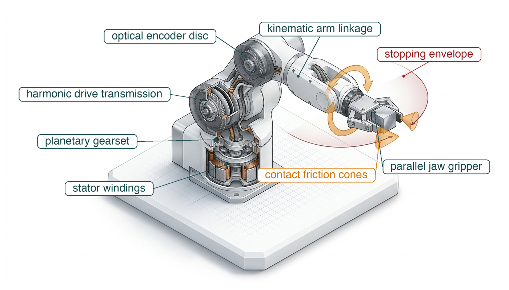{fig-alt="Isometric cutaway blueprint of a robot arm on a square base plate, with labels for the stator windings, planetary gearset, harmonic drive transmission, optical encoder disc, kinematic arm linkage, and parallel jaw gripper; orange contact friction cones sit at the gripper jaws and a red stopping envelope arcs around the gripper."}
:::

::: {.content-visible unless-format="pdf"}
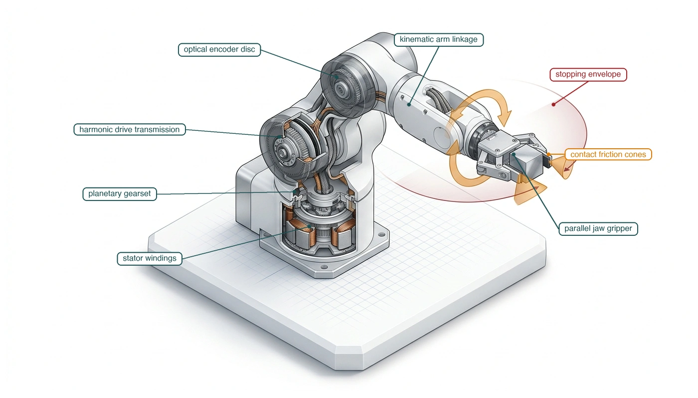{fig-alt="Isometric cutaway blueprint of a robot arm showing stator windings, planetary gearset, harmonic drive transmission, optical encoder disc, arm linkage, parallel jaw gripper, contact friction cones, and a stopping envelope."}
:::

:::

## Purpose {.unnumbered .unlisted}

::: {.content-visible when-format="pdf"}
\begin{marginfigure}
\resizebox{0.92\linewidth}{!}{\mlphysicalstackfull{20}{20}{100}{20}{20}}
\end{marginfigure}
:::

::: {.content-visible unless-format="pdf"}
::: {.column-margin}
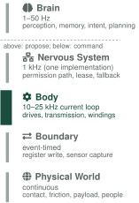{width="100%" fig-alt="Physical AI Systems Stack"}

*Physical AI stack focus for this chapter.*
:::
:::

_Why must a physical AI systems engineer master mechanical inertia, winding thermal limits, and power distribution rail droop before writing a single line of motor control policy?_

A mobile manipulator can recognize an obstacle correctly and still strike it if its body cannot stop within the remaining distance. The same machine can hold a payload without moving while its motor windings overheat, or lose its controller when a sudden demand for current pulls the supply voltage too low. These failures arise from limits that prediction accuracy alone cannot reveal. Physical AI engineering requires connecting a proposed action to the motion, heat, and electrical demand it creates, then establishing which limit the assembled machine reaches first. Measurements must also establish the conditions under which those limits hold, because a change in payload, floor surface, cooling, or battery state changes what the machine can deliver. The body's limits therefore govern what the permission path may admit before a command crosses the causal boundary and produces irreversible physical work.



::: {.callout-learning-objectives}

- Calculate observation freshness limits from measurement age and the machine's allowable motion
- Calculate stopping distance and the admissible speed ceiling from pre-brake delay, credible deceleration, and clearance overheads
- Evaluate actuator and transmission choices against response limits, reflected inertia, and mechanical impedance
- Estimate sustainable motor duty cycles from heat generation, cooling, and operating conditions
- Budget electrical supply margins for simultaneous actuation, computation, and regenerative braking
- Specify the elements of a limit record that states a measured limit's conditions, uncertainty, margin, runtime detector, and evidence category
- Evaluate maneuver-specific binding budgets from qualified evidence and justify holding up the permission supply through covered faults

:::

## The Five Physical Budgets {#sec-body-five-budgets}

Every action a learned model proposes ultimately manifests as electrical current flowing through a motor winding, and from that instant physics governs execution. Machine learning practice rarely contends with this transition. Policies trained in simulation typically interact with idealized plants where commanded torque appears instantaneously, heat never accumulates in windings, and direct current (DC) bus voltages never sag under load. A physical machine honors none of these simplifications. The **physical body**\index{Physical body!definition} is the coupled assembly of actuators, mechanical transmissions, structural linkages, power electronics, and sensors that translates digital commands into mechanical motion. Its physical dynamics bound what even a mathematically optimal policy can achieve. An emergency brake command requires finite time to develop mechanical retarding force and clearance distance to dissipate kinetic energy. Similarly, commanding a manipulator to hold a heavy payload motionless draws continuous phase current, dissipating resistive heat into the stator even though the joint does zero mechanical work.

The proposal boundary in @sec-boundary-machine-model assigns the permission path responsibility for admitting action, and the body provides the concrete physical envelopes that make that gating decision meaningful. Before committing a command to hardware registers, the permission path must evaluate five fundamental physical budgets: it must confirm that the sensor observation remains fresh, that the moving machine can stop within available clearance, that the actuator can deliver the required torque trajectory, that the winding can tolerate the resulting thermal rise, and that the electrical bus can support the transient current demand. These mechanisms form a direct causal chain: sensor and pipeline latencies consume allowable stopping distance; arresting momentum demands delivered actuator torque; generating that torque dissipates heat in motor coils and pulls current from a shared power rail. For any given maneuver, the governing systems question is which of these physical budgets binds first, under what operational stress, and on what empirical evidence.

1. **Measurement freshness** ($\ObservationAge$)\index{Measurement freshness!definition}: The observation must remain valid until the mechanical plant responds. Latency accumulated across sensor exposure, data transport, neural inference, and low-level drive dispatch consumes allowable tracking margins as the physical world continues to move.
2. **Kinetic momentum** ($\KineticEnergy, \LinearMomentum$)\index{Kinetic momentum!definition}: A moving machine carries kinetic energy ($\KineticEnergy = \frac{1}{2} \Mass \BodySpeed^2$) and linear or angular momentum ($\LinearMomentum = \Mass \BodySpeed$). Bringing the plant to rest demands applying retarding force over finite distance and time; safe operating velocity must therefore preserve a stopping envelope well within available physical clearance.
3. **Actuator bandwidth and reflected inertia** ($\GearReductionRatio^2 \RotorInertia$)\index{Actuator bandwidth!definition}\index{Reflected inertia|see{Reflected rotor inertia}}: Winding inductance and supply voltage limit the rate at which torque can change. A gearhead with reduction ratio $\GearReductionRatio$ multiplies delivered torque by $\GearReductionRatio$, but it also scales the motor rotor's inertia $\RotorInertia$ by $\GearReductionRatio^2$ as seen at the joint output (@sec-body-reflected-rotor-inertia), fundamentally constraining instantaneous acceleration.
4. **Thermal capacity** ($\EstimatedWindingTemperature$)\index{Thermal capacity!definition}: Resistive losses ($\WindingLossPower = \TorqueProducingCurrent^2 \EffectiveLossResistance$, with $\EffectiveLossResistance$ the winding's effective loss resistance) deposit thermal energy directly into the stator windings and inverter switching stages. Heat dissipation limits sustained continuous torque, while the thermal mass of the coils constrains the magnitude, duration, and repetition rate of transient torque bursts.
5. **Electrical power integrity** ($\DcRailVoltage$)\index{Electrical power integrity!definition}: Onboard compute clusters and motor inverters draw from a shared DC power rail. Peak motor accelerations must not drag the bus voltage below digital logic thresholds, while regenerative braking must provide an electrical sink so returned kinetic energy does not overvoltage the bus.

Under the **simultaneous admission invariant**\index{Simultaneous admission invariant!definition}, motion permission requires a non-negative margin in every budget before the permission path commits torque to hardware registers. Each margin must be checked in its own units; time, distance, torque, temperature, and voltage are separate constraints, not interchangeable quantities:
$$\begin{aligned}
\ObservationAge &\le \TelemetryFreshnessBound, \\
\StoppingDistance &\le \ClearDistance, \\
|\CommandedJointTorque| &\le \OutputTorqueCeiling, \\
\EstimatedWindingTemperature &\le \WindingTemperatureLimit, \\
\MinimumRailVoltage &\ge \ConverterLockoutVoltage.
\end{aligned}$$
Here $\CommandedJointTorque$ is requested torque and $\OutputTorqueCeiling$ is the maximum deliverable output torque under current electrical and thermal conditions. The estimated winding temperature $\EstimatedWindingTemperature$ must remain below its limit, while the lowest rail voltage $\MinimumRailVoltage$ must remain above the undervoltage-lockout threshold $\ConverterLockoutVoltage$ at which the supply regulator shuts down. The fifth line checks only undervoltage. Permission must also require regenerative braking to stay below the qualified upper operating-voltage limit of the supplied components, with an available absorption or dissipation path. Two lines state their budgets in derived form. The kinetic budget appears as the stopping distance it demands, $\StoppingDistance \le \ClearDistance$, and the actuator line checks only torque magnitude, because the slew-rate limit that winding inductance and reflected inertia impose enters the stopping line instead, through the brake-onset term of the pre-brake delay $\PrebrakeDelay$. All five inequalities must hold simultaneously. A surplus in four budgets cannot compensate for a deficit in the fifth: a fresh observation cannot prevent a stop from overrunning if kinetic energy exceeds available clearance, and abundant battery energy cannot prevent an actuator from burning out if thermal dissipation limits are violated.

::: {.callout-perspective title="Why physical limits bound physical AI architecture"}
The permission path requires concrete bounds on physical behavior, not abstract software promises. Accepting a torque command does not guarantee that the inverter can deliver the requested current against the back electromotive force (back-EMF) the spinning motor induces in its own windings, nor does cutting motor power guarantee that friction will arrest the plant before it breaches a clearance zone. The five physical budgets bridge this gap, tying software proposals to verifiable, empirical responses under declared operating conditions.
:::

```{python}
#| label: body-machine-momentum-calc
#| echo: false
#| warning: false
#| message: false
# ┌─────────────────────────────────────────────────────────────────────────────
# │ THE RUNNING MACHINE'S MOMENTUM (LEGO)
# ├─────────────────────────────────────────────────────────────────────────────
# │ Context: the running-machine sentence in @sec-body-five-budgets.
# │ Goal:    Give the warehouse mobile manipulator's kinetic energy at its
# │          drive limit with the tote rack loaded.
# │ Show:    368 kg (upper bound) at 1.5 m/s carries 414 J.
# │ How:     calc_kinetic_energy on RM.loaded_mass and RM.base.max_velocity.
# └─────────────────────────────────────────────────────────────────────────────
from mlsysim import *
from mlsysim.core.units import *
from mlsysim.fmt import fmt_mass, fmt_velocity, fmt_energy, check

RM = Embodied.MobileManipulator.WarehouseMobileManipulator

class MachineMomentum:
    """Kinetic energy of the loaded running machine at its drive limit."""

    # ┌── 1. LOAD (Constants & Parameters) ─────────────────────────────────
    m_loaded = RM.loaded_mass  # category: derived (upper bound, full tote rack)
    v_drive = RM.base.max_velocity  # category: illustrative (drive limit)

    # ┌── 2. EXECUTE (Compute) ─────────────────────────────────────────────
    e_k = calc_kinetic_energy(m_loaded, v_drive).to(joule)

    # ┌── 3. GUARD (Invariants) ───────────────────────────────────────────
    check(abs(m_loaded.to(kilogram).magnitude - 368.0) < 1e-9, f"Unexpected loaded mass: {m_loaded}")
    check(abs(e_k.magnitude - 414.0) < 1e-6, f"Unexpected kinetic energy: {e_k}")

    # ┌── 4. OUTPUT (Formatting) ──────────────────────────────────────────
    m_loaded_str = fmt_mass(m_loaded, unit=kilogram, precision=0)
    v_drive_str = fmt_velocity(v_drive, unit=meter / second, precision=1)
    e_k_str = fmt_energy(e_k, unit=joule, precision=0)
```

The warehouse mobile manipulator that this book follows draws on all five. Loaded to at most `{python} MachineMomentum.m_loaded_str` and moving at its `{python} MachineMomentum.v_drive_str` drive limit (illustrative; see the Reader Guide), it carries `{python} MachineMomentum.e_k_str` of kinetic energy through aisles it shares with people.

Each budget establishes an empirical operating boundary on the assembled machine under declared thermal and electrical stress, and each ends the chapter as a limit record, the six-element record that @sec-boundary-book-architecture sketched from the stopping notebook: a value, the conditions under which it holds, its uncertainty, the margin defended, a runtime detector, and the provenance of its evidence. The first budget is the age of the measurement on which every command rests, which runs from physical transduction, well before any software process receives the raw sensor data.

## Measurement Freshness {#sec-body-measurement-freshness}

```{python}
#| label: body-latency-profile-calc
#| echo: false
#| warning: false
#| message: false
# ┌─────────────────────────────────────────────────────────────────────────────
# │ THE PICK STATION'S FRESHNESS DEADLINE AND AGE PROFILE (LEGO)
# ├─────────────────────────────────────────────────────────────────────────────
# │ Context: the opening and freshness-deadline paragraphs, the definition,
# │          \ref{nbk-body-freshness-deadline}, @tbl-02-latency-breakdown,
# │          the freshness item of \ref{chk-body-bus-droop-regen}, and the
# │          first problem of @sec-body-problems. (2026-09-29: the waterfall
# │          figure was cut; @tbl-04-event-ledger carries the running
# │          machine's ledger. 2026-09-30: re-anchored from an upstream parcel
# │          sorter to the running machine's pick-station conveyor.)
# │ Goal:    Hold the conveyor's deadline and the illustrative stage profile in
# │          one place so the prose, the table, the notebook, the checkpoint,
# │          and the problem cannot disagree.
# │ Show:    0.20 m/s conveyor, 15 mm grasp tolerance less 3 mm initial error
# │          = 12 mm, so a 60 ms deadline; stage P50 sum 35.0 ms, P99 sum
# │          50.0 ms, max sum 80.7 ms; system P99 46.2 ms and P99.9 68.4 ms;
# │          7 mm of mug travel at the median (5 mm inside the tolerance) and
# │          13.7 mm at P99.9 (1.7 mm past it).
# │ How:     Delta t_fresh = (r_tol - e_0) / v_conv from AISLE; stage sums;
# │          travel = v_conv * age. Every stage value is illustrative: a
# │          measured profile of the integrated machine replaces it.
# └─────────────────────────────────────────────────────────────────────────────
from mlsysim import *
from mlsysim.core.units import *
from mlsysim.fmt import fmt, fmt_latency, fmt_length, fmt_velocity, fmt_frequency, check

AISLE = Embodied.Scenario.WarehouseAisle

class GraspLatencyProfile:
    """Freshness deadline for the conveyor mug and an illustrative capture-to-onset profile."""

    # ┌── 1. LOAD (Constants & Parameters) ─────────────────────────────────
    v_conv = AISLE.v_conveyor  # category: illustrative (pick-station conveyor speed)
    r_tol = AISLE.grasp_tolerance  # category: chosen (grasp tolerance)
    e_0 = AISLE.grasp_initial_error  # category: illustrative (initial estimate error)
    # (name, P50, P99, max) in ms; category: illustrative (not a measured profile)
    stages = [
        ("1–2. Exposure and readout", 11.2, 16.6, 16.7),
        ("3–4. Transport and DMA", 1.4, 3.2, 6.8),
        ("5. Backbone and policy", 18.5, 24.1, 38.4),
        ("6. Scheduling and IPC", 0.6, 2.1, 12.3),
        ("7. Fieldbus", 1.0, 1.0, 2.0),
        ("8. Current rise", 2.3, 3.0, 4.5),
    ]
    sys_p99 = 46.2 * millisecond  # category: illustrative (system-level profile)
    sys_p999 = 68.4 * millisecond  # category: illustrative (system-level tail)

    # ┌── 2. EXECUTE (Compute) ─────────────────────────────────────────────
    e_max = (r_tol - e_0).to(millimeter)  # the tolerance the mug's motion may spend
    t_fresh = (e_max / v_conv).to(millisecond)
    t_backbone = stages[2][1] * millisecond
    sum_p50 = sum(s[1] for s in stages) * millisecond
    sum_p99 = sum(s[2] for s in stages) * millisecond
    sum_max = sum(s[3] for s in stages) * millisecond
    travel_p50 = (v_conv * sum_p50).to(millimeter)
    travel_p999 = (v_conv * sys_p999).to(millimeter)
    margin_p50 = (e_max - travel_p50).to(millimeter)
    excess_p999 = (travel_p999 - e_max).to(millimeter)
    t_rest_p50 = sum_p50 - t_backbone  # every stage but the backbone
    f_backbone = (1 / t_backbone).to(ureg.hertz)  # the loop rate a backbone benchmark suggests

    # ┌── 3. GUARD (Invariants) ───────────────────────────────────────────
    check(abs(v_conv.to(meter / second).magnitude - 0.20) < 1e-9, f"Unexpected conveyor speed: {v_conv}")
    check(abs(r_tol.to(millimeter).magnitude - 15.0) < 1e-9, f"Unexpected grasp tolerance: {r_tol}")
    check(abs(e_0.to(millimeter).magnitude - 3.0) < 1e-9, f"Unexpected initial error: {e_0}")
    check(abs(t_fresh.magnitude - 60.0) < 1e-9, f"Conveyor freshness deadline must be 60 ms: {t_fresh}")
    check(abs(sum_p50.magnitude - 35.0) < 1e-9, f"P50 stage sum drifted: {sum_p50}")
    check(abs(sum_p99.magnitude - 50.0) < 1e-9, f"P99 stage sum drifted: {sum_p99}")
    check(abs(sum_max.magnitude - 80.7) < 1e-9, f"Max stage sum drifted: {sum_max}")
    check(sys_p99 < sum_p99, "The system P99 must differ from (here, sit below) the stage-P99 sum.")
    check(
        abs(travel_p50.magnitude - 7.0) < 1e-9 and abs(margin_p50.magnitude - 5.0) < 1e-9,
        "The notebook states 7 mm of median travel, 5 mm inside the tolerance.",
    )
    check(
        abs(travel_p999.magnitude - 13.68) < 1e-9 and abs(excess_p999.magnitude - 1.68) < 1e-9,
        f"Tail travel drifted: {travel_p999}",
    )
    check(abs(t_rest_p50.magnitude - 16.5) < 1e-9, f"Non-backbone median share drifted: {t_rest_p50}")
    check(
        t_backbone < sum_p50 < sys_p99 < t_fresh < sys_p999,
        "The backbone, the median chain, and the P99 fit the deadline; the P99.9 tail must not.",
    )

    # ┌── 4. OUTPUT (Formatting) ──────────────────────────────────────────
    v_conv_str = fmt_velocity(v_conv, unit=meter / second, precision=2)
    r_tol_str = fmt_length(r_tol, unit=millimeter, precision=0)
    e_0_str = fmt_length(e_0, unit=millimeter, precision=0)
    e_max_str = fmt_length(e_max, unit=millimeter, precision=0)
    t_fresh_str = fmt_latency(t_fresh, unit=millisecond, precision=0)
    sum_p50_str = fmt_latency(sum_p50, unit=millisecond, precision=0)
    sum_p99_str = fmt_latency(sum_p99, unit=millisecond, precision=0)
    sys_p99_str = fmt_latency(sys_p99, unit=millisecond, precision=1)
    sys_p999_str = fmt_latency(sys_p999, unit=millisecond, precision=1)
    t_backbone_str = fmt_latency(t_backbone, unit=millisecond, precision=1)
    t_rest_p50_str = fmt_latency(t_rest_p50, unit=millisecond, precision=1)
    travel_p50_mm_str = fmt_length(travel_p50, unit=millimeter, precision=0)
    margin_p50_mm_str = fmt_length(margin_p50, unit=millimeter, precision=0)
    travel_p999_mm_str = fmt_length(travel_p999, unit=millimeter, precision=1)
    excess_p999_mm_str = fmt_length(excess_p999, unit=millimeter, precision=1)
    f_backbone_str = fmt_frequency(f_backbone, unit=ureg.hertz, precision=1)
    # @tbl-02-latency-breakdown cells: stage k (1-6) at P50, P99, and max, in ms;
    # integer-like values print without a dead decimal (house precision guard).
    s1_p50_str, s1_p99_str, s1_max_str = (fmt(x, precision=0 if round(float(x), 6).is_integer() else 1) for x in stages[0][1:])
    s2_p50_str, s2_p99_str, s2_max_str = (fmt(x, precision=0 if round(float(x), 6).is_integer() else 1) for x in stages[1][1:])
    s3_p50_str, s3_p99_str, s3_max_str = (fmt(x, precision=0 if round(float(x), 6).is_integer() else 1) for x in stages[2][1:])
    s4_p50_str, s4_p99_str, s4_max_str = (fmt(x, precision=0 if round(float(x), 6).is_integer() else 1) for x in stages[3][1:])
    s5_p50_str, s5_p99_str, s5_max_str = (fmt(x, precision=0 if round(float(x), 6).is_integer() else 1) for x in stages[4][1:])
    s6_p50_str, s6_p99_str, s6_max_str = (fmt(x, precision=0 if round(float(x), 6).is_integer() else 1) for x in stages[5][1:])
    sum_p50_num_str = fmt(sum_p50.magnitude, precision=0 if round(float(sum_p50.magnitude), 6).is_integer() else 1)
    sum_p99_num_str = fmt(sum_p99.magnitude, precision=0 if round(float(sum_p99.magnitude), 6).is_integer() else 1)
    sum_max_num_str = fmt(sum_max.magnitude, precision=0 if round(float(sum_max.magnitude), 6).is_integer() else 1)
    sys_p99_num_str = fmt(sys_p99.magnitude, precision=0 if round(float(sys_p99.magnitude), 6).is_integer() else 1)
```

Software benchmarks in machine learning frequently report latency as isolated accelerator execution time, for example `{python} GraspLatencyProfile.t_backbone_str` for the vision backbone of the arm's wrist-camera grasp path on an edge neural processing unit (NPU), a different pipeline from the navigation backbone that the stopping budget of @sec-boundary-kinematic-roofline charges. This narrow focus fosters the illusion of an agile `{python} GraspLatencyProfile.f_backbone_str` control loop. In physical AI systems, however, that compute kernel represents only one intermediate segment in an end-to-end silicon-to-plant dataflow pipeline. A sensor measurement begins decaying the moment physical transduction occurs; what governs physical performance is its total age when torque actually appears at the actuator joint. That physical age spans the entire interval from the moment photons strike a photodiode array, magnetic flux sweeps past a Hall sensor, or strain deflects a piezoresistor to the moment motor inverter switches build stator magnetic flux that alters link acceleration. If a perception policy evaluates an obstacle bounding box in `{python} GraspLatencyProfile.t_backbone_str`, while exposure integration, sensor readout, Peripheral Component Interconnect Express (PCIe) transport, kernel scheduling, fieldbus dispatch, and motor current rise consume an additional `{python} GraspLatencyProfile.t_rest_p50_str` at the median, the true physical age of the observation when the joint accelerates is `{python} GraspLatencyProfile.sum_p50_str`, and the distribution tail extends farther still.

Throughout that capture-to-onset window, the physical environment continues to evolve unobserved. In distributed data systems, read-after-write consistency windows govern whether a client observes stale or linearized state. In physical AI, the physical plant acts as an autonomous, unpausable concurrent writer: spatial position $\CartesianPosition(\TimeInstant)$ evolves along continuous trajectories at velocity $\Velocity(\TimeInstant)$. An observation age $\ObservationAge$ converts directly into unobserved physical displacement $\FiniteChange \CartesianPosition \approx \int_0^{\ObservationAge} \Velocity(\TimeInstant)\,d\TimeInstant$. High-speed machines inevitably act on historical state.

The rate of world-state change dictates how long a measurement remains valid before acting on it introduces intolerable error. Let $\PositionErrorCeiling$ denote the maximum acceptable error in a tracked state, such as a joint angle or the position of a part on a conveyor, and let $\SpeedBound$ denote the fastest credible velocity at which that state can evolve. The freshness deadline $\TelemetryFreshnessBound$ is the upper bound on measurement age before a control action based on that measurement becomes invalid, defined by the inequality
$$\TelemetryFreshnessBound \le \frac{\PositionErrorCeiling}{\SpeedBound}$$ {#eq-body-freshness-deadline}

::: {#dfn-body-freshness-deadline .callout-definition title="Freshness deadline"}

***Freshness deadline***\index{Freshness deadline!definition} ($\TelemetryFreshnessBound$) is the largest age, counted from the capture of a measurement to the onset of the actuator's response, that the measurement of a moving target may reach before the target's motion alone spends the allowable position error $\PositionErrorCeiling$ (@eq-body-freshness-deadline).

1.  **Significance**: It converts a spatial tolerance into a time budget that every stage from exposure to torque onset must share. A `{python} GraspLatencyProfile.e_max_str` tolerance on a target moving at `{python} GraspLatencyProfile.v_conv_str` leaves `{python} GraspLatencyProfile.t_fresh_str` for sensing, inference, transport, and current rise together.
2.  **Distinction**: Unlike an inference-latency budget, which times one stage, the deadline bounds the age at onset; unlike a control-loop period, it is set by the target's speed and the tolerance rather than by the loop rate. When the machine moves toward a stationary obstacle instead, the same age becomes the first term of the pre-brake delay $\PrebrakeDelay$ and is paid as blind travel $\SpeedAtDetection\,\PrebrakeDelay$ in the stopping distance.
3.  **Common pitfall**: Treating the deadline as a property of the sensor or the model. It changes whenever the target moves faster or the tolerance shrinks, so a pipeline qualified on a slow conveyor can miss on a faster one without any change in its own timing.

:::

::: {.column-margin .margin-pointer}
↪ The same deadline applied to a stored belief, which lapses once its region falls out of view, is developed in @sec-memory-belief-through-occlusion.
:::

The running machine meets this bound at its pick station, where the arm grasps a mug from a moving conveyor. The belt carries the mug at speeds up to $\ConveyorSpeed =$ `{python} GraspLatencyProfile.v_conv_str`, and the gripper mechanism tolerates $\PositionalTaskTolerance =$ `{python} GraspLatencyProfile.r_tol_str` of position error. Initial handle-pose estimation already consumes $\InitialTrackingError =$ `{python} GraspLatencyProfile.e_0_str` of this margin. Consequently, the mug's physical motion may spend at most $\PositionErrorCeiling = \PositionalTaskTolerance - \InitialTrackingError =$ `{python} GraspLatencyProfile.e_max_str`, with $\SpeedBound = \ConveyorSpeed$. Notebook \ref{nbk-body-freshness-deadline} evaluates this resulting deadline against the ages an integrated camera-to-joint pipeline delivers in practice. The deadline governs any target that moves while its observation ages. For moving workpieces, it limits motion-induced tracking drift under bounded relative velocity and valid initial observations; sensing and state-estimation noise consume separate slices of the tolerance budget, just as $\InitialTrackingError$ does here. Conversely, when the robot approaches a stationary obstacle, such as a person standing in a warehouse aisle, the target does not move; instead, the mobile base drives toward the person during the latency interval. Observation age then converts directly into unguided vehicular travel before braking begins, which @sec-body-kinetic-momentum charges against the kinetic stopping envelope.

### Transduction physics, quantization noise, and Nyquist limits {#sec-body-sensor-transduction}

Sensor selection consumes both error tolerance and time. A sensor must resolve the physical state of interest, and the analog filtering, sampling, or serial scanning required to extract that signal must fit within the freshness deadline. Four physical mechanisms illustrate this design constraint:

1. **Optical Encoders and Velocity Quantization Noise:**
   An encoder measures joint position in discrete angular increments. An $\EncoderBitCount$-bit encoder discretizes the continuous $2\pi\text{ rad}$ circle into an angular resolution of $\QuantizationStep \EncoderAngle = \frac{2\pi}{2^\EncoderBitCount}$. For an 18-bit absolute optical encoder, $\QuantizationStep \EncoderAngle \approx 2.4 \times 10^{-5}\text{ rad}$ ($0.0014^\circ$); for a 12-bit magnetic encoder, $\QuantizationStep \EncoderAngle \approx 1.53 \times 10^{-3}\text{ rad}$ ($0.088^\circ$). Feedback controllers estimate joint velocity from successive position samples across a discrete control cycle $\FiniteChange \TimeInstant$:
   $${\EncoderVelocityEstimate{}}_{k} \approx \frac{{\EncoderAngle}_{k} - {\EncoderAngle}_{k-1}}{\FiniteChange \TimeInstant}$$
   Backward differencing acts as an effective high-pass filter, scaling high-frequency position fluctuations by $1/\FiniteChange \TimeInstant$. Under an idealized model where successive quantization errors are independent and uniformly distributed across one encoder count, each sample has variance $(\QuantizationStep\EncoderAngle)^2/12$. Differencing two independent samples sums their variances to $(\QuantizationStep\EncoderAngle)^2/6$, yielding a velocity-error standard deviation of $\EncoderVelocityNoise = \frac{\QuantizationStep\EncoderAngle}{\sqrt{6}\,\FiniteChange \TimeInstant}$. At a $1\text{ kHz}$ servo update rate ($\FiniteChange \TimeInstant = 1\text{ ms}$), a single-count jump on a 12-bit encoder ($1.53\text{ mrad}$) registers as an abrupt velocity spike of $1.53\text{ rad/s}$ ($88^\circ/\text{s}$). If routed directly into velocity feedback loops or neural policy state inputs, these discrete impulses cause severe torque chatter and excite mechanical resonances. Downstream low-pass filters or state observers smooth this quantization noise, but filter group delay introduces phase lag, consuming milliseconds of the freshness budget.

2. **Inertial Measurement Units (IMUs) and Nyquist Aliasing:**
   An inertial measurement unit measures linear acceleration and angular velocity. Sampling must isolate macroscopic body dynamics from high-frequency structural vibration. Under the Nyquist-Shannon sampling theorem [@nyquist1928certain; @shannon1949communication], continuous signals require a sampling frequency strictly greater than twice their highest spectral component ($\SamplingRate > 2 \HighestSignalFrequency$). Mechanical sources, including gear mesh harmonics, cooling fans, and motor inverter switching, generate vibrations reaching kilohertz frequencies. Without adequate analog anti-aliasing filters before the analog-to-digital converter (ADC), structural vibrations above the Nyquist frequency fold back into baseband frequencies ($1\text{--}20\text{ Hz}$). The state estimator cannot distinguish these aliased artifacts from genuine chassis acceleration, introducing cumulative drift into dead-reckoning integrations. Raising downstream software loop rates cannot reconstruct information already corrupted at the sensor hardware interface.

3. **Tactile Sensor Arrays and Scanning Bandwidth:**
   Tactile arrays measure contact pressure across a robot gripper using discrete sensing elements called taxels. To minimize cabling across robotic wrists, hardware architectures multiplex taxels across shared row and column lines. Scanning these elements sequentially forces an entire frame to span the multiplexing period. This serial scan time adds directly to the measurement age and limits the bandwidth for detecting rapid contact events, such as the onset of localized slip. Increasing the taxel density without scaling the underlying ADC readout rate produces older tactile observations.

4. **Cameras and Rolling-Shutter Readout:**
   A rolling-shutter CMOS camera exposes and transfers pixel rows sequentially, so a single frame spans its entire readout duration. Image timestamps must therefore anchor to a defined reference, such as the exposure midpoint of a designated row, rather than the frame-arrival interrupt.

::: {.column-margin .margin-pointer}
↪ Rolling-shutter distortion on the navigation camera, and its compensation before images enter the state estimator, is developed in @sec-perception-transduction-calibration.
:::

### The end-to-end sense-to-actuation latency pipeline {#sec-body-latency-pipeline}

A measurement's physical age begins at **capture**\index{Capture!event}, the moment of physical transduction, rather than when an operating system process first receives the data buffer. Three subsequent boundary events demarcate the pipeline from transduction to mechanical work: *dispatch*, when perception publishes dated perceptual evidence to the action proposer; *admission*, when the real-time permission path validates and accepts a proposal built using that evidence; and *onset*, when electrical current in the motor stator windings begins driving physical acceleration at the joint. The four events recur throughout the book, and @tbl-04-event-ledger later budgets the intervals between them for the running machine. For the freshness deadline, capture and onset form the bounding endpoints: the deadline limits the cumulative delay between them.

An illustrative camera-to-joint pipeline reveals how latency compounds across physical and digital boundaries (@tbl-02-latency-breakdown). Between capture and dispatch, the CMOS sensor integrates exposure and reads out raw scanlines over MIPI CSI-2;[^fn-mipi-frame-timestamp] direct memory access (DMA) transfers the frame into host memory, and the vision backbone executes. In this representative architecture, the policy network executes in the same inference pass as the backbone, spanning the dispatch boundary. Between dispatch and admission, inter-process communication (IPC) transmits the proposed trajectory to the safety microcontroller, a dedicated real-time processor that executes the deterministic permission path. Between admission and onset, an EtherCAT fieldbus[^fn-ethercat-cycle-time] delivers target setpoints to individual motor drives, where power-inverter gate drivers switch to ramp up stator current. Neural inference occupies one of the eight stages; under memory bus contention and scheduling delays, the peripheral system stages expand the latency tail substantially more than the neural network execution itself.

[^fn-mipi-frame-timestamp]: **MIPI CSI-2 (Camera Serial Interface 2)**\index{MIPI CSI-2!frame-start timestamp}: The Mobile Industry Processor Interface camera link carries raw frames from the image sensor to the system-on-chip and marks the start and end of each frame with short packets. Latching a hardware timestamp on the frame-start packet ties the frame to a fixed offset from its exposure rather than to the moment software first sees it, which is what lets transduction time, not arrival time, anchor the age budget.

[^fn-ethercat-cycle-time]: **EtherCAT**\index{EtherCAT!cycle determinism}: An industrial Ethernet fieldbus in which one frame passes through every drive on the segment, each node reading and writing its own slice of the frame as it passes. Frame length and node count, not contention for the wire, fix the cycle time, which is why the fieldbus row of @tbl-02-latency-breakdown has equal $\text{p50}$ and $\text{p99}$. @Sec-nervous-schedulability-analysis sizes that cycle for the running machine.

Systems engineers sometimes estimate worst-case pipeline latency by summing the 99th-percentile ($\text{p99}$) latencies of individual stages. However, the percentile of a sum does not equal the sum of the percentiles.[^fn-math-quantile-convolution] In embedded system-on-chip (SoC) architectures, shared hardware resources couple stage delays. For example, PCIe DMA bursts during camera readout contend for memory-controller bandwidth with neural accelerators, while CPU cache evictions during kernel message passing induce thread scheduling jitter. The end-to-end distribution of sense-to-torque latency must therefore be profiled empirically on the integrated hardware platform under concurrent production workloads. Furthermore, an empirical percentile remains a statistical measurement; it does not replace the formal worst-case bounds required for hard real-time safety guarantees.

[^fn-math-quantile-convolution]: **Quantile Convolution**\index{Quantile convolution!tail non-additivity}: In general, the quantile of a latency sum differs from the sum of equal-percentile stage quantiles ($\LatencyQuantileFunction(\UpstreamStageLatency + \DownstreamStageLatency) \ne \LatencyQuantileFunction(\UpstreamStageLatency) + \LatencyQuantileFunction(\DownstreamStageLatency)$). Independence alone does not make their arithmetic sum a worst-case bound. Correlation from shared buses and queues changes the end-to-end tail and must be characterized at the system boundary.

Each stage in @tbl-02-latency-breakdown carries its own tail under continuous inference load, and the two bottom rows separate the arithmetic column sums from the end-to-end age the system actually delivers.

| Pipeline Stage                     | Physical Mechanism / Contention Source                                              |                 $\text{p50}$ (ms)                  |                 $\text{p99}$ (ms)                  |                         Max (ms)                         |
|:-----------------------------------|:------------------------------------------------------------------------------------|:--------------------------------------------------:|:--------------------------------------------------:|:--------------------------------------------------------:|
| **1–2. Sensor Exposure & Readout** | $60\text{ Hz}$ rolling shutter exposure midpoint                                    |     `{python} GraspLatencyProfile.s1_p50_str`      |     `{python} GraspLatencyProfile.s1_p99_str`      |        `{python} GraspLatencyProfile.s1_max_str`         |
| **3–4. Host Transport & DMA**      | PCIe DMA transfer into host memory                                                  |     `{python} GraspLatencyProfile.s2_p50_str`      |     `{python} GraspLatencyProfile.s2_p99_str`      |        `{python} GraspLatencyProfile.s2_max_str`         |
| **5. Vision Backbone & Policy**    | Onboard accelerator inference (memory throttling tail)                              |     `{python} GraspLatencyProfile.s3_p50_str`      |     `{python} GraspLatencyProfile.s3_p99_str`      |        `{python} GraspLatencyProfile.s3_max_str`         |
| **6. OS Scheduling & IPC**         | Kernel preemption and mailbox hand-off to safety microcontroller                    |     `{python} GraspLatencyProfile.s4_p50_str`      |     `{python} GraspLatencyProfile.s4_p99_str`      |        `{python} GraspLatencyProfile.s4_max_str`         |
| **7. Fieldbus Transmission**       | Deterministic EtherCAT cyclic packet exchange                                       |     `{python} GraspLatencyProfile.s5_p50_str`      |     `{python} GraspLatencyProfile.s5_p99_str`      |        `{python} GraspLatencyProfile.s5_max_str`         |
| **8. Actuator Current Rise**       | Gate driver switching and stator flux buildup                                       |     `{python} GraspLatencyProfile.s6_p50_str`      |     `{python} GraspLatencyProfile.s6_p99_str`      |        `{python} GraspLatencyProfile.s6_max_str`         |
| **Arithmetic Stage Sum**           | Sum of each column's stage values; not an end-to-end quantile                       | **`{python} GraspLatencyProfile.sum_p50_num_str`** | **`{python} GraspLatencyProfile.sum_p99_num_str`** |    **`{python} GraspLatencyProfile.sum_max_num_str`**    |
| **End-to-End Age**                 | System-level profile, capture to onset; max bounded within the illustrative profile | **`{python} GraspLatencyProfile.sum_p50_num_str`** | **`{python} GraspLatencyProfile.sys_p99_num_str`** | $\le$ **`{python} GraspLatencyProfile.sum_max_num_str`** |

: **Illustrative sense-to-actuation latency decomposition**: Stage and system-level timings show why the arithmetic sum of stage percentiles is not the end-to-end tail. The example's $\text{p99.9}$ of `{python} GraspLatencyProfile.sys_p999_str` exceeds the `{python} GraspLatencyProfile.t_fresh_str` freshness deadline of the mug on the pick-station conveyor, although its median fits. {#tbl-02-latency-breakdown tbl-colwidths="[26,38,12,12,12]"}

The `{python} GraspLatencyProfile.sum_p99_str` sum of individual stage percentiles overstates the system-level $\text{p99}$ latency of `{python} GraspLatencyProfile.sys_p99_str` because pipeline stages rarely experience worst-case contention simultaneously. For the same reason, the sum of the stage maxima enters the end-to-end row only as an upper bound within the stated illustrative profile and conditions. A measured maximum needs a separately justified allowance or bound before it can support a hard real-time deadline. Coupling pushes the other way. Stages that slow down together, because they contend for the same memory controller or scheduler, fatten the end-to-end tail toward the stage sum, while stages that vary independently usually leave that sum pessimistic, as here. The end-to-end median in the table is set equal to the stage-median sum, a simplification of the illustrative profile that a measured one need not share. Notebook \ref{nbk-body-freshness-deadline} evaluates how this illustrative profile behaves against the conveyor's physical deadline.

::: {#nbk-body-freshness-deadline .callout-notebook title="The freshness deadline"}

**Problem**: The arm grasps a mug riding the pick-station conveyor, acting on camera observations of the handle. Suppose the grasp path had the illustrative age profile of @tbl-02-latency-breakdown. Does it deliver those observations within the freshness deadline, and how far does the mug move at the median and at the tail of the observation age?

**Variables**:

- Grasp tolerance $\PositionalTaskTolerance =$ `{python} GraspLatencyProfile.r_tol_str`, of which the initial estimate spends $\InitialTrackingError =$ `{python} GraspLatencyProfile.e_0_str` (illustrative)
- Conveyor speed $\SpeedBound = \ConveyorSpeed =$ `{python} GraspLatencyProfile.v_conv_str` (illustrative)
- Median backbone time `{python} GraspLatencyProfile.t_backbone_str`, median end-to-end age `{python} GraspLatencyProfile.sum_p50_str`, and $\text{p99.9}$ age `{python} GraspLatencyProfile.sys_p999_str` (illustrative profile of @tbl-02-latency-breakdown)

**Math**:

1. **Deadline**: $\PositionErrorCeiling = \PositionalTaskTolerance - \InitialTrackingError =$ `{python} GraspLatencyProfile.e_max_str`, so $\TelemetryFreshnessBound = \PositionErrorCeiling/\SpeedBound =$ `{python} GraspLatencyProfile.e_max_str` $/$ `{python} GraspLatencyProfile.v_conv_str` $=$ `{python} GraspLatencyProfile.t_fresh_str` (@eq-body-freshness-deadline).
2. **Backbone alone**: `{python} GraspLatencyProfile.t_backbone_str` is less than `{python} GraspLatencyProfile.t_fresh_str`, so the one stage a benchmark times fits with room to spare.
3. **Median chain**: `{python} GraspLatencyProfile.v_conv_str` $\times$ `{python} GraspLatencyProfile.sum_p50_str` $=$ `{python} GraspLatencyProfile.travel_p50_mm_str` of mug travel, `{python} GraspLatencyProfile.margin_p50_mm_str` inside the tolerance.
4. **Tail**: `{python} GraspLatencyProfile.v_conv_str` $\times$ `{python} GraspLatencyProfile.sys_p999_str` $=$ `{python} GraspLatencyProfile.travel_p999_mm_str`, `{python} GraspLatencyProfile.excess_p999_mm_str` past the tolerance.

**Result**: Inference and the median chain both meet the deadline, but the stated $\text{p99.9}$ age exceeds it. The profile therefore does not establish that 99.9 percent of grasps meet the freshness deadline.

**Systems insight**: The whole path from exposure to torque onset spends the freshness deadline, not the model alone, and its tail, not its median, decides whether the grasp holds. When the machine instead drives toward a stationary obstacle, the same age enters the pre-brake delay $\PrebrakeDelay$ as its first term and is paid as blind travel $\SpeedAtDetection\,\PrebrakeDelay$, the first term of the stopping distance that @sec-body-kinetic-momentum sets against the clear distance.

:::

Excessive feedback delay can also degrade closed-loop tracking or destabilize motor control loops,[^fn-delay-loop-stability] but the freshness calculation requires no frequency-domain model: at the latency tail, the mug has already moved beyond mechanical capture tolerance. System architectures must therefore preserve the observation's true physical capture timestamp. Hardware timers synchronized through **IEEE 802.1AS**\index{IEEE 802.1AS!hardware timestamping}, the generalized Precision Time Protocol (gPTP),[^fn-gptp-shared-timebase] or hardware capture strobes associated with the **MIPI CSI-2**\index{MIPI CSI-2!sensor readout interface} receiver provide a common physical timebase. The sensor's exposure and readout characteristics determine how that hardware timestamp maps to the measurement midpoint. Once latched, this capture timestamp accompanies the observation through every subsequent compute kernel.

At the admission boundary, the real-time permission path computes the observation's total elapsed age, $\ObservationAge = \CurrentWallClockTime - \TransductionInstant$, and adds the bounded remaining admission-to-onset interval for fieldbus dispatch and motor current rise. Capture and clock-synchronization uncertainty must also fit the qualified age budget. The permission path rejects the proposed trajectory update if its projected onset age exceeds the freshness deadline. Rejecting a stale trajectory replacement does not necessitate cutting motor torque immediately; an executing command may continue while its qualified physical margin remains valid. If that margin expires before fresh, valid observations arrive, the permission path triggers a qualified fallback maneuver within the remaining stopping distance [@brooks1986robust].

[^fn-delay-loop-stability]: **Transport Delay and Feedback Stability**\index{Transport delay!feedback instability}\index{Asynchronous divergence!closed-loop}: Transport delay makes a controller act on historical state. Whether delayed corrections destabilize the loop depends on the plant, controller, and total response. @Sec-appendix-control-zoh develops the phase-margin calculation; delay alone does not establish a particular oscillation or damage outcome.

[^fn-gptp-shared-timebase]: **IEEE 802.1AS (gPTP)**\index{IEEE 802.1AS!hardware timestamping}\index{IEEE 1588!Precision Time Protocol}: The generalized Precision Time Protocol of IEEE 802.1AS is a profile of the IEEE 1588 Precision Time Protocol [@ieee15882019] for time-sensitive Ethernet networks [@ieee8021as2020]. It synchronizes clocks by exchanging packets timestamped in hardware at the network interface, which keeps the operating-system scheduler's jitter out of the measurement. The age $\ObservationAge = \CurrentWallClockTime - \TransductionInstant$ means something only when the camera, the host, and the drives read one timebase; an offset between their clocks enters the freshness budget as an error that no timestamp reveals.

::: {.callout-perspective title="The publish timestamp anti-pattern"}
A widespread architectural bug in robotics systems is timestamping sensor observations inside user-space publishers, such as a Robot Operating System 2 (ROS 2) node transmitting over Data Distribution Service (DDS) middleware. Latching timestamps in application software discards the duration of sensor exposure, rolling-shutter integration, sensor readout, DMA transfers, and kernel queueing, and so erases stages 1 through 4 of @tbl-02-latency-breakdown (exposure, readout, transport, and DMA), along with any kernel queueing before the publisher runs, from the latency ledger. Hardware strobes must latch timestamps directly at the physical silicon interface (such as MIPI CSI-2 Start-of-Frame interrupts or Ethernet physical-layer transceiver timestamps synchronized via IEEE 802.1AS) before data enters operating-system queues.
:::

Bounding measurement age ensures that control policies act on valid observations rather than historical artifacts, but freshness alone cannot guarantee collision avoidance. Throughout that capture-to-onset interval, the body continues moving under unguided momentum, consuming physical clearance before braking can begin. Halting that physical mass requires dissipating its stored kinetic energy across real distance, an irreversible mechanical process governed by momentum rather than processor clock rates.

## Kinetic Momentum {#sec-body-kinetic-momentum}

```{python}
#| label: body-stopping-budget-calc
#| echo: false
#| warning: false
#| message: false
# ┌─────────────────────────────────────────────────────────────────────────────
# │ THE BODY'S STOPPING DISTANCE ON THE RUNNING MACHINE (LEGO)
# ├─────────────────────────────────────────────────────────────────────────────
# │ Context: @sec-body-kinetic-momentum opener, @fig-02-stopping-distance, and
# │          \ref{nbk-body-stopping-distance-budgeting-high-tail-compute}.
# │ Goal:    Add the body's own terms of @eq-body-stopping-distance for the
# │          loaded warehouse mobile manipulator at its drive limit.
# │ Show:    Rows 1-3 of the stopping budget at 1.5 m/s: braking 562.5 mm,
# │          overhead 150 mm (712.5), brake onset 30 mm (742.5), leaving 357.5 mm
# │          of the 1.10 m clear distance; body-only ceiling 1.91 m/s; at 2.0 m/s
# │          braking is 1000 mm (+77.8 percent); each extra 100 ms adds 150 mm;
# │          figure cases 742.5 / 912.9 / 1417.2 mm.
# │ How:     calc_safe_stopping_distance and calc_max_permitted_velocity with
# │          a_eff = a_brake (constant deceleration), from RM and AISLE. The full
# │          pre-brake delay AISLE.tau_delay appears only in the figure's cases.
# └─────────────────────────────────────────────────────────────────────────────
from mlsysim import *
from mlsysim.core.units import *
from mlsysim.fmt import (
    fmt_mass,
    fmt_length,
    fmt_energy,
    fmt_latency,
    fmt_velocity,
    fmt_acceleration,
    fmt_percent,
    fmt_display_math,
    check,
)

RM = Embodied.MobileManipulator.WarehouseMobileManipulator
AISLE = Embodied.Scenario.WarehouseAisle

class BodyStoppingBudget:
    """Rows 1-3 of the running machine's stopping budget: the terms the body owns."""

    # ┌── 1. LOAD (Constants & Parameters) ─────────────────────────────────
    v = RM.base.max_velocity  # category: illustrative (drive limit)
    a_brake = AISLE.a_brake  # category: illustrative (loaded, dry floor)
    delta_loc = AISLE.delta_loc  # category: illustrative
    delta_margin = AISLE.delta_margin  # category: chosen
    t_act = AISLE.t_brake_onset  # category: illustrative (brake onset)
    d_clear = AISLE.d_clear  # category: illustrative (rack-end clear distance)
    tau_full = AISLE.tau_delay  # category: derived (full pre-brake delay; figure only)
    v_fast = 2.0 * meter / second  # category: illustrative (speed-scaling case above the drive limit)
    dt_extra = 100 * millisecond  # category: illustrative (added pre-brake delay step)

    # ┌── 2. EXECUTE (Compute) ─────────────────────────────────────────────
    d_brake = (v**2 / (2 * a_brake)).to(ureg.millimeter)  # row 1
    total_1 = d_brake
    overhead = (delta_loc + delta_margin).to(ureg.millimeter)  # row 2
    total_2 = (total_1 + overhead).to(ureg.millimeter)
    d_onset = (v * t_act).to(ureg.millimeter)  # row 3
    total_3 = (total_2 + d_onset).to(ureg.millimeter)
    remaining = (d_clear - total_3).to(ureg.millimeter)
    v_ceiling = calc_max_permitted_velocity(d_clear, t_act, a_brake, loc_margin=delta_loc, physical_margin=delta_margin)
    d_brake_fast = (v_fast**2 / (2 * a_brake)).to(ureg.millimeter)
    brake_growth = (d_brake_fast / d_brake - 1).to("dimensionless")
    d_per_extra = (v * dt_extra).to(ureg.millimeter)
    brake_extra = (d_brake_fast - d_brake).to(ureg.millimeter)  # braking travel added by the speed step
    dt_equiv = (brake_extra / v).to(millisecond)  # delay at the drive limit that costs the same distance
    case_body = calc_safe_stopping_distance(v, t_act, a_brake, loc_margin=delta_loc, physical_margin=delta_margin).to(ureg.millimeter)
    case_full = calc_safe_stopping_distance(v, tau_full, a_brake, loc_margin=delta_loc, physical_margin=delta_margin).to(ureg.millimeter)
    case_fast = calc_safe_stopping_distance(v_fast, tau_full, a_brake, loc_margin=delta_loc, physical_margin=delta_margin).to(ureg.millimeter)
    case_full_blind = (v * tau_full).to(ureg.millimeter)
    case_full_margin = (d_clear - case_full).to(ureg.millimeter)
    case_fast_blind = (v_fast * tau_full).to(ureg.millimeter)
    case_fast_breach = (case_fast - d_clear).to(ureg.millimeter)

    # ┌── 3. GUARD (Invariants) ───────────────────────────────────────────
    check(v == MachineMomentum.v_drive, "Stopping budget and momentum must use the same drive limit.")
    check(abs(total_1.magnitude - 562.5) < 1e-6, f"Row 1 must be 562.5 mm: {total_1}")
    check(abs(total_2.magnitude - 712.5) < 1e-6, f"Row 2 running total must be 712.5 mm: {total_2}")
    check(abs(total_3.magnitude - 742.5) < 1e-6, f"Ch2 subtotal must be 742.5 mm: {total_3}")
    check(abs(case_body.magnitude - total_3.magnitude) < 1e-6, "Row sum must equal the equation.")
    check(abs(remaining.magnitude - 357.5) < 1e-6, f"Unexpected remaining clearance: {remaining}")
    check(abs(v_ceiling.magnitude - 1.9098) < 1e-4, f"Body-only ceiling must be 1.9098 m/s: {v_ceiling}")
    check(v_ceiling > v, "The body-only ceiling must exceed the drive limit.")
    check(abs(d_brake_fast.magnitude - 1000.0) < 1e-6, f"Unexpected braking at 2.0 m/s: {d_brake_fast}")
    check(abs(d_per_extra.magnitude - 150.0) < 1e-6, f"Unexpected cost of 100 ms: {d_per_extra}")
    check(abs(brake_extra.magnitude - 437.5) < 1e-6, f"Unexpected braking added at 2.0 m/s: {brake_extra}")
    check(abs(dt_equiv.magnitude - 291.667) < 1e-3, f"Unexpected equivalent delay: {dt_equiv}")
    check(abs(tau_full.to(millisecond).magnitude - 133.6) < 1e-6, f"Unexpected tau_delay: {tau_full}")
    check(abs(case_full.magnitude - 912.9) < 1e-6, f"Unexpected full-delay case: {case_full}")
    check(abs(case_fast.magnitude - 1417.2) < 1e-6, f"Unexpected fast case: {case_fast}")
    check(case_full < d_clear < case_fast, "Case 2 must fit and Case 3 must breach the clear distance.")
    check(abs(case_full_blind.magnitude - 200.4) < 1e-6, f"Unexpected case_full_blind: {case_full_blind}")
    check(abs(case_full_margin.magnitude - 187.1) < 1e-6, f"Unexpected case_full_margin: {case_full_margin}")
    check(abs(case_fast_blind.magnitude - 267.2) < 1e-6, f"Unexpected case_fast_blind: {case_fast_blind}")
    check(abs(case_fast_breach.magnitude - 317.2) < 1e-6, f"Unexpected case_fast_breach: {case_fast_breach}")

    # ┌── 4. OUTPUT (Formatting) ──────────────────────────────────────────
    v_str = fmt_velocity(v, unit=meter / second, precision=1)
    a_brake_str = fmt_acceleration(a_brake, unit=meter / second**2, precision=0)
    delta_loc_str = fmt_length(delta_loc, unit=ureg.millimeter, precision=0)
    delta_margin_str = fmt_length(delta_margin, unit=ureg.millimeter, precision=0)
    t_act_str = fmt_latency(t_act, unit=millisecond, precision=0)
    d_clear_str = fmt_length(d_clear, unit=meter, precision=2)
    tau_full_str = fmt_latency(tau_full, unit=millisecond, precision=1)
    v_fast_str = fmt_velocity(v_fast, unit=meter / second, precision=0)
    dt_extra_str = fmt_latency(dt_extra, unit=millisecond, precision=0)

    d_brake_str = fmt_length(d_brake, unit=ureg.millimeter, precision=1)
    overhead_str = fmt_length(overhead, unit=ureg.millimeter, precision=0)
    total_2_str = fmt_length(total_2, unit=ureg.millimeter, precision=1)
    d_onset_str = fmt_length(d_onset, unit=ureg.millimeter, precision=0)
    total_3_str = fmt_length(total_3, unit=ureg.millimeter, precision=1)
    remaining_str = fmt_length(remaining, unit=ureg.millimeter, precision=1)
    v_ceiling_str = fmt_velocity(v_ceiling, unit=meter / second, precision=2)
    d_brake_fast_str = fmt_length(d_brake_fast, unit=ureg.millimeter, precision=0, commas=True)
    brake_growth_pct_str = fmt_percent(brake_growth.magnitude, precision=1, style="prose")
    d_per_extra_str = fmt_length(d_per_extra, unit=ureg.millimeter, precision=0)
    brake_extra_str = fmt_length(brake_extra, unit=ureg.millimeter, precision=1)
    dt_equiv_str = fmt_latency(dt_equiv, unit=millisecond, precision=1)
    case_body_str = fmt_length(case_body, unit=ureg.millimeter, precision=1)
    case_full_str = fmt_length(case_full, unit=ureg.millimeter, precision=1)
    case_fast_str = fmt_length(case_fast, unit=ureg.millimeter, precision=1, commas=True)
    _case_full_blind_str = fmt_length(case_full_blind, unit=ureg.millimeter, precision=1)
    _case_full_margin_str = fmt_length(case_full_margin, unit=ureg.millimeter, precision=1)
    _case_fast_blind_str = fmt_length(case_fast_blind, unit=ureg.millimeter, precision=1)
    _case_fast_breach_str = fmt_length(case_fast_breach, unit=ureg.millimeter, precision=1)

    d_brake_display_math = fmt_display_math(
        rf"d_{{\text{{brake}}}} = \frac{{v^2}}{{2 a_{{\text{{brake}}}}}} = \frac{{({v_str})^2}}{{2 \times {a_brake_str}}} = {d_brake_str}"
    )
    overhead_display_math = fmt_display_math(
        rf"\delta_{{\text{{loc}}}} + \delta_{{\text{{margin}}}} = {delta_loc_str} + {delta_margin_str} = {overhead_str}"
    )
    d_onset_display_math = fmt_display_math(rf"v\,T_{{\text{{act}}}} = ({v_str}) \times ({t_act_str}) = {d_onset_str}")
    total_display_math = fmt_display_math(
        rf"d_{{\text{{stop}}}}\big|_{{\text{{body}}}} = {d_brake_str} + {overhead_str} + {d_onset_str} = {total_3_str}"
    )
    ceiling_display_math = fmt_display_math(
        rf"v_{{\max}} = -a_{{\text{{brake}}}} T_{{\text{{act}}}} + \sqrt{{(a_{{\text{{brake}}}} T_{{\text{{act}}}})^2 + 2 a_{{\text{{brake}}}} (D_{{\text{{clear}}}} - \delta_{{\text{{loc}}}} - \delta_{{\text{{margin}}}})}} \approx {v_ceiling_str}"
    )
```

The loaded mobile manipulator drives down a warehouse aisle at its `{python} BodyStoppingBudget.v_str` drive limit when a pedestrian steps out from behind a rack `{python} BodyStoppingBudget.d_clear_str` ahead. In pure software systems, handling an unexpected condition is conceptually instantaneous: an exception unwinds the stack, or the runtime terminates a thread. Physical AI affords no such shortcut. A moving machine carries linear momentum ($\LinearMomentum = \Mass \SpeedAtDetection$) and stores kinetic energy ($\KineticEnergy = \frac{1}{2}\Mass \SpeedAtDetection^2$) that cannot be reclaimed by a garbage collector or flushed from CPU registers. Bringing that physical mass to rest requires dissipating its kinetic energy across real space through mechanical work ($\MechanicalWork = \int \AppliedForce \, d\TravelPosition$). Stopping distance grows linearly with pre-brake delay but quadratically with velocity, so above the crossover speed of the elementary stopping budget, the braking term rather than the delay dominates the stop.

### Kinematic stopping distance and pre-brake delay {#sec-body-stopping-distance-prebrake}

Stopping dynamics divide into two distinct phases: pre-brake delay and active braking. During the pre-brake delay $\PrebrakeDelay$, the vehicle travels forward without any retarding force. This latency accounts for the age of the sensory observation when perception hands it downstream, followed by the communication transit, safety validation, and actuator-onset intervals required before mechanical braking begins. It excludes the dispatch-to-admission interval, in which the proposer and the permission path turn that observation into an admitted command, because @sec-enforcement-composite-budget charges that interval separately. An independent protective response need not wait for a motion planning proposal; safety enforcement can trigger immediately along a fast-path monitor. The safety budget must trace whichever concrete execution path initiates braking. Furthermore, if an obstacle can enter the path between sensing cycles, the budget must include an allowance for camera exposure and sampling intervals. The budget conservatively credits zero retarding force during this total pre-brake delay and assumes approximately constant forward speed $\SpeedAtDetection$, which gives the blind travel distance
$$\BlindTravelDistance = \SpeedAtDetection\,\PrebrakeDelay$$

::: {.column-margin .margin-pointer}
↩ The two-phase stopping budget is established in @sec-boundary-kinematic-roofline.
:::

Once the selected braking mechanism engages, the system enters the active braking phase. Mechanical work done by the retarding braking force $\BrakingForce$ over the physical braking distance\index{Braking distance} $\BrakingDistance$ must dissipate the machine's stored kinetic energy, $\MechanicalWork = \FiniteChange \KineticEnergy$. How that retarding force arises depends on the physical hardware. A powered motor stop requires functioning drive inverters, sufficient bus-voltage headroom, and a circuit capable of absorbing or dissipating returned electrical power. A mechanical brake, by contrast, operates independently of electrical power but exhibits distinct engagement latencies and thermal dissipation limits. In any safety certification, the credible deceleration must reflect the specific mechanism available during the fault scenario under analysis.

```{python}
#| label: body-braking-limits-calc
#| echo: false
#| warning: false
#| message: false
# ┌─────────────────────────────────────────────────────────────────────────────
# │ CAN THE DRIVES DELIVER THE CREDIBLE DECELERATION? (LEGO)
# ├─────────────────────────────────────────────────────────────────────────────
# │ Context: the rotating-mass paragraph and the three ceilings in
# │          @sec-body-stopping-distance-prebrake, \ref{nbk-body-braking-drive-limits}
# │          in @sec-body-electrical-time-constants, and the drive-torque column
# │          of @tbl-02-limit-record.
# │ Goal:    Check a_brake = 2.0 m/s^2 against traction, tip-over, and the
# │          torque of the sourced hub-motor drives, and check back-EMF
# │          headroom at the drive limit.
# │ Show:    traction needs mu >= 0.204 with all weight on the driven wheels,
# │          >= 0.250 at the 300 kg/pair load rating; inspected floor gives
# │          1.18 m/s^2; tip-over needs h_cg/d_lead <= 4.90 (CoG needs source);
# │          60 N m per wheel -> 902 N, m_eff <= 387 kg -> >= 2.33 m/s^2
# │          (16.6 percent above), 0.78 m/s^2 at rated current; 108 rpm,
# │          e = 28.2 V, braking needs 10.7 V, driving 45.7 V > 42 V.
# │ How:     calc_braking_limits, calc_drive_torque_deceleration_limit,
# │          calc_required_friction, calc_drive_voltage_headroom with
# │          RM.drive_unit (ZLTECH ZLLG10ASM800 datasheet) and RM.drive_bus_*.
# └─────────────────────────────────────────────────────────────────────────────
from mlsysim import *
from mlsysim.core.units import *
from mlsysim.fmt import (
    fmt,
    fmt_int,
    fmt_mass,
    fmt_length,
    fmt_force,
    fmt_torque,
    fmt_torque_constant,
    fmt_acceleration,
    fmt_velocity,
    fmt_voltage,
    fmt_current,
    fmt_resistance,
    fmt_percent,
    fmt_angular_velocity,
    check,
)

RM = Embodied.MobileManipulator.WarehouseMobileManipulator
AISLE = Embodied.Scenario.WarehouseAisle

class BrakingLimits:
    """Traction, tip-over, drive-torque, and back-EMF checks on the credible deceleration."""

    # ┌── 1. LOAD (Constants & Parameters) ─────────────────────────────────
    m = RM.loaded_mass  # category: derived (upper bound, full tote rack)
    a_req = AISLE.a_brake  # category: illustrative (credible loaded deceleration)
    v = RM.base.max_velocity  # category: illustrative (drive limit)
    hub = RM.drive_unit  # category: sourced (ZLTECH ZLLG10ASM800 datasheet)
    n_wheels = RM.drive_wheel_count  # category: chosen (two driven wheels, casters elsewhere)
    r_wheel = hub.wheel_radius  # category: sourced (266 mm wheel)
    k_t = hub.torque_constant  # category: derived (datasheet peak torque / peak current)
    i_max = RM.drive_current_limit  # category: chosen (the motor's datasheet peak current)
    tau_rated = hub.rated_torque  # category: sourced (at the rated current)
    i_rated = hub.rated_current  # category: sourced
    m_rot_wheel = hub.rotating_mass_bound  # category: sourced (motor mass bounds J / r^2; rotor inertia needs source)
    k_e = hub.back_emf_constant  # category: sourced (line-to-line)
    r_line = hub.line_resistance  # category: sourced (line-to-line)
    load_pair = hub.load_rating_per_pair  # category: sourced
    v_bus_low = RM.drive_bus_battery_low  # category: sourced (48 V-class pack minimum)
    mu_dry = AISLE.mu_dry  # category: illustrative
    mu_insp = AISLE.mu_inspected_floor  # category: illustrative

    # ┌── 2. EXECUTE (Compute) ─────────────────────────────────────────────
    tau_wheel = (k_t * i_max).to(ureg.newton * meter)
    m_rot = (n_wheels * m_rot_wheel).to(kilogram)
    rot_share = (m_rot / m).to("dimensionless").magnitude
    phi_max = RM.drive_wheel_load_share_max
    limits = calc_braking_limits(
        m,
        a_req,
        wheel_torque_max=tau_wheel,
        wheel_radius=r_wheel,
        n_driven_wheels=n_wheels,
        friction_coefficient=mu_dry,
        drive_load_share=phi_max,
        rotating_equivalent_mass=m_rot,
    )
    force = limits["force"]
    m_eff = limits["m_eff"]
    a_torque = limits["a_torque"]
    a_trac_dry = limits["a_traction"]  # dry floor at the rated load share (margin figure)
    torque_margin = (a_torque / a_req - 1).to("dimensionless").magnitude
    a_torque_rated = calc_drive_torque_deceleration_limit(tau_rated, r_wheel, n_wheels, m, m_rot)["a_max"]
    mu_min = calc_required_friction(a_req)
    mu_min_rated = limits["mu_required"]
    phi_min_dry = (a_req / (mu_dry * ureg.standard_gravity)).to("dimensionless").magnitude
    a_insp = calc_traction_deceleration_limit(mu_insp)
    cg_ratio_max = limits["cg_ratio_max"]
    volts = calc_drive_voltage_headroom(k_e, v, r_wheel, v_bus_low, i_max, r_line)
    omega = volts["omega"]
    e_bemf = volts["e_bemf"]
    v_brake = volts["v_brake"]
    v_drive = volts["v_drive"]
    headroom = volts["headroom"]

    # ┌── 3. GUARD (Invariants) ───────────────────────────────────────────
    check(n_wheels == 2, f"Prose says two driven wheels: {n_wheels}")
    check(abs(tau_wheel.magnitude - 60.0) < 1e-9, f"Wheel torque at the limit must be 60 N m: {tau_wheel}")
    check(abs(force.magnitude - 902.26) < 0.01, f"Unexpected retarding force: {force}")
    check(abs(m_eff.magnitude - 387.0) < 1e-9, f"Unexpected effective-mass bound: {m_eff}")
    check(abs(a_torque.magnitude - 2.3314) < 1e-4, f"Unexpected torque ceiling: {a_torque}")
    check(a_torque > a_req, "The drive-torque ceiling must clear the credible deceleration.")
    check(a_torque_rated < a_req, "At rated current the drives must fall short of a_brake.")
    check(abs(mu_min - 0.204) < 5e-4, f"Friction premise must be 0.204: {mu_min}")
    check(abs(phi_max - 300.0 / 368.0) < 1e-12, f"Unexpected load-share bound: {phi_max}")
    check(abs(mu_min_rated - 0.2502) < 1e-4, f"Unexpected rated-share friction premise: {mu_min_rated}")
    check(mu_dry > mu_min_rated and a_insp < a_req, "Dry floor must pass and the inspected floor must fail.")
    check(limits["a_tip"] is None and limits["passes"] is False, "Tip-over must stay unverified until the CoG is sourced.")
    check(abs(cg_ratio_max - 4.9033) < 1e-4, f"Unexpected CoG ratio bound: {cg_ratio_max}")
    # margin_braking_ceilings_envelope.svg fig-alt hand-types 4.80, 2.33, 1.18, 0.78, and 2.0
    check(f"{a_trac_dry.to(meter / second**2).magnitude:.2f}" == "4.80", f"Unexpected dry traction ceiling: {a_trac_dry}")
    check(abs(e_bemf.magnitude - 28.217) < 1e-3, f"Unexpected back-EMF: {e_bemf}")
    check(0 * volt < v_brake < v_bus_low < v_drive, "Braking must fit the depleted bus; driving at peak current must not.")

    # ┌── 4. OUTPUT (Formatting) ──────────────────────────────────────────
    m_str = fmt_mass(m, unit=kilogram, precision=0)
    a_req_str = fmt_acceleration(a_req, unit=meter / second**2, precision=0)
    v_str = fmt_velocity(v, unit=meter / second, precision=1)
    r_wheel_str = fmt_length(r_wheel, unit=ureg.millimeter, precision=0)
    k_t_str = fmt_torque_constant(k_t, precision=1)
    i_max_str = fmt_current(i_max, unit=ureg.ampere, precision=0)
    i_rated_str = fmt_current(i_rated, unit=ureg.ampere, precision=1)
    tau_rated_str = fmt_torque(tau_rated, precision=0)
    tau_wheel_str = fmt_torque(tau_wheel, precision=0)
    force_str = fmt_force(force, precision=1)
    m_rot_wheel_str = fmt_mass(m_rot_wheel, unit=kilogram, precision=1)
    m_eff_str = fmt_mass(m_eff, unit=kilogram, precision=0)
    rot_pct_str = fmt_percent(rot_share, precision=1, style="prose")
    a_torque_str = fmt_acceleration(a_torque, unit=meter / second**2, precision=2)
    torque_margin_pct_str = fmt_percent(torque_margin, precision=1, style="prose")
    torque_margin_pct_sym_str = fmt_percent(torque_margin, precision=1, style="symbol")
    a_torque_rated_str = fmt_acceleration(a_torque_rated, unit=meter / second**2, precision=2)
    mu_min_str = fmt(mu_min, precision=3)
    load_pair_str = fmt_mass(load_pair, unit=kilogram, precision=0)
    phi_max_str = fmt(phi_max, precision=3)
    mu_min_rated_str = fmt(mu_min_rated, precision=3)
    mu_dry_str = fmt(mu_dry, precision=2)
    phi_min_dry_str = fmt(phi_min_dry, precision=2)
    mu_insp_str = fmt(mu_insp, precision=2)
    a_insp_str = fmt_acceleration(a_insp, unit=meter / second**2, precision=2)
    a_trac_dry_str = fmt_acceleration(a_trac_dry, unit=meter / second**2, precision=2)
    cg_ratio_max_str = fmt(cg_ratio_max, precision=2)
    omega_str = fmt_angular_velocity(omega, unit=ureg.rpm, precision=1)
    e_bemf_str = fmt_voltage(e_bemf, unit=volt, precision=1)
    r_line_str = fmt_resistance(r_line, unit=ureg.ohm, precision=1)
    v_brake_str = fmt_voltage(v_brake, unit=volt, precision=1)
    v_drive_str = fmt_voltage(v_drive, unit=volt, precision=1)
    v_bus_low_str = fmt_voltage(v_bus_low, unit=volt, precision=0)
    headroom_str = fmt_voltage(headroom, unit=volt, precision=1)
```

In an embodied machine, stored kinetic energy includes rotating powertrain components as well as the translating chassis. A component spinning at angular velocity $\RotatingBodyAngularSpeed$ stores rotational energy $\frac{1}{2} \RotatingBodyInertia \RotatingBodyAngularSpeed^2$, where its moment of inertia $\RotatingBodyInertia$ (in $\text{kg}\cdot\text{m}^2$) measures resistance to rotational acceleration, playing the same role that mass plays in translational energy $\frac{1}{2} \Mass \SpeedAtDetection^2$. A transmission with **gear ratio**\index{Gear ratio!definition} $\GearReductionRatio$ turns the motor shaft $\GearReductionRatio$ times for every revolution of the wheel, multiplying motor torque by $\GearReductionRatio$ while dividing speed by $\GearReductionRatio$. The machine's total kinetic energy sums the translational energy of the chassis and payload ($\TranslationalKineticEnergy = \frac{1}{2} \Mass \SpeedAtDetection^2$) and the rotational energy of its wheels, gearboxes, and motor rotors ($\RotationalKineticEnergy = \sum_i \frac{1}{2} {\RotorInertia}_i {\RotorAngularSpeed}_i^2$). Because a drive with gear ratio ${\GearReductionRatio}_i$ spins its rotor at angular speed ${\RotorAngularSpeed}_i = {\GearReductionRatio}_i \frac{\SpeedAtDetection}{\WheelRadius}$, the rotor's rotational kinetic energy reflects into the translational frame scaled by the square of the gear ratio:
$$\TotalKineticEnergy = \frac{1}{2} \Mass \SpeedAtDetection^2 + \sum_i \frac{1}{2} {\RotorInertia}_i \left({\GearReductionRatio}_i \frac{\SpeedAtDetection}{\WheelRadius}\right)^2 = \frac{1}{2} \left(\Mass + \sum_i \frac{{\GearReductionRatio}_i^2 {\RotorInertia}_i}{\WheelRadius^2}\right) \SpeedAtDetection^2$$
This formulation reveals that the effective translational inertia of the machine is $\EffectiveImpactMass = \Mass + \sum_i \frac{{\GearReductionRatio}_i^2 {\RotorInertia}_i}{\WheelRadius^2}$. For a platform decelerating to rest under sustained retarding force $\BrakingForce = \EffectiveImpactMass \CredibleBrakingDeceleration$, the work-energy theorem balances mechanical work against total kinetic energy:
$$\EffectiveImpactMass \CredibleBrakingDeceleration \BrakingDistance = \frac{1}{2} \EffectiveImpactMass \SpeedAtDetection^2$$
Dividing both sides by effective mass yields the kinematic braking travel:
$$\BrakingDistance = \frac{\SpeedAtDetection^2}{2 \CredibleBrakingDeceleration}$$
If an engineer evaluates braking capacity using bare chassis mass alone ($\NominalBrakingDeceleration = \BrakingForce / \Mass$), they omit the kinetic energy stored in the spinning motor rotors, overestimating deceleration by the factor $\EffectiveImpactMass / \Mass$ and underestimating stopping travel by $\frac{\EffectiveImpactMass - \Mass}{\Mass} = \sum_i \frac{{\GearReductionRatio}_i^2 {\RotorInertia}_i}{\Mass \WheelRadius^2}$. On the running machine, this correction remains modest. Its two driven wheels use direct-drive hub motors (${\GearReductionRatio}_i = 1$), and because no portion of a hub motor lies outside its tire circumference, each rotor term ${\RotorInertia}_i/\WheelRadius^2$ cannot exceed the motor's `{python} BrakingLimits.m_rot_wheel_str` total mass. The rotating parts add at most `{python} BrakingLimits.rot_pct_str` to the `{python} BrakingLimits.m_str` loaded mass. However, because the inertia reflection scales with ${\GearReductionRatio}_i^2$, this rotational overhead becomes substantial on lightweight robot platforms driven through high-ratio planetary or harmonic gearboxes.

The parameter $\CredibleBrakingDeceleration$ is the credible sustained deceleration the physical plant can reliably exert against the environment, not an idealized rating copied from an actuator datasheet. The retarding force $\BrakingForce = \EffectiveImpactMass \CredibleBrakingDeceleration$ must fit beneath three independent physical ceilings. First, tire-floor traction imposes a strict friction ceiling. Only the braked wheels transmit retarding shear to the ground, and friction there can reach at most $\CoulombFrictionCoefficient$ times the normal force they support, $\DrivenWheelLoadFraction \Mass \Gravity$. This caps deceleration at $\CredibleBrakingDeceleration \le \CoulombFrictionCoefficient \Gravity \DrivenWheelLoadFraction$, where $\CoulombFrictionCoefficient$ is the tire-floor friction coefficient and $\DrivenWheelLoadFraction$ is the fraction of total vehicle weight carried by the driven wheels. Second, vehicle pitch stability limits deceleration through dynamic load transfer. While braking force acts at the floor contact patch, inertial force acts forward through the center of gravity at height $\GravityCenterHeight$ above it. Taking moments about the leading ground support, a horizontal distance $\LeadingSupportDistance$ ahead of the center of gravity, the overturning inertial moment $\Mass \CredibleBrakingDeceleration \GravityCenterHeight$ opposes the restoring gravitational moment $\Mass \Gravity \LeadingSupportDistance$. The platform stays on all wheels only so long as $\CredibleBrakingDeceleration \le \Gravity\,\LeadingSupportDistance/\GravityCenterHeight$. Raising or extending a robotic arm alters both $\GravityCenterHeight$ and $\LeadingSupportDistance$ in real time, making this pitch-stability boundary state-dependent. Third, the electromechanical actuators limit retarding force through the maximum torque their inverter current limit allows, a ceiling that @sec-body-electrical-time-constants derives from the motor torque constant. If an inverter restricts phase current, or if the back-EMF of the spinning rotor leaves the inverter too little headroom to control current, the drive cannot deliver the required braking torque. Deceleration $\CredibleBrakingDeceleration$ degrades silently, expanding braking travel without software notification. The rotor's rotational inertia is already counted in the effective mass $\EffectiveImpactMass$ and must not be charged a second time. @Fig-02-braking-fbd draws the three ceilings on the loaded chassis with the values the running machine puts on each, and notebook \ref{nbk-body-braking-drive-limits} checks them once the next section has derived the drive's torque ceiling.

```{python}
#| label: body-braking-fbd-guard
#| echo: false
#| warning: false
#| message: false
# ┌─────────────────────────────────────────────────────────────────────────────
# │ BRAKING FREE-BODY DIAGRAM (LEGO GUARD FOR A HAND-DRAWN FIGURE)
# ├─────────────────────────────────────────────────────────────────────────────
# │ Context: @fig-02-braking-fbd (fig02_braking_fbd.svg) in
# │          @sec-body-stopping-distance-prebrake.
# │ Goal:    Keep the numbers drawn in the SVG equal to BrakingLimits.
# │ Show:    mu >= 0.204 (phi = 1), 0.250 (phi = 0.815); h_cg/d_lead <= 4.90;
# │          60 N m per wheel, r = 133 mm, 451 N per wheel, 902 N for two;
# │          m_eff <= 387 kg; torque ceiling >= 2.33 m/s^2.
# │ How:     Read BrakingLimits; check() fails the build if a registry change
# │          leaves the SVG labels stale. Nothing prints.
# └─────────────────────────────────────────────────────────────────────────────
from mlsysim.core.units import *
from mlsysim.fmt import check

class BrakingFbdLabels:
    """Values that fig02_braking_fbd.svg draws as text."""

    # ┌── 1. LOAD (Constants & Parameters) ─────────────────────────────────
    B = BrakingLimits

    # ┌── 3. GUARD (Invariants) ───────────────────────────────────────────
    check(f"{B.mu_min:.3f}" == "0.204", f"SVG draws mu >= 0.204; cell says {B.mu_min}.")
    check(f"{B.mu_min_rated:.3f}" == "0.250", f"SVG draws mu >= 0.250; cell says {B.mu_min_rated}.")
    check(f"{B.phi_max:.3f}" == "0.815", f"SVG draws phi = 0.815; cell says {B.phi_max}.")
    check(f"{B.cg_ratio_max:.2f}" == "4.90", f"SVG draws h_cg/d_lead > 4.90; cell says {B.cg_ratio_max}.")
    check(round(B.tau_wheel.to(ureg.newton * meter).magnitude) == 60, f"SVG draws 60 N m; cell says {B.tau_wheel}.")
    check(round(B.r_wheel.to(ureg.millimeter).magnitude) == 133, f"SVG draws r = 133 mm; cell says {B.r_wheel}.")
    check(round((B.force / B.n_wheels).to(ureg.newton).magnitude) == 451, f"SVG draws 451 N per wheel; cell says {B.force}.")
    check(round(B.force.to(ureg.newton).magnitude) == 902, f"SVG draws 902 N; cell says {B.force}.")
    check(round(B.m_eff.to(kilogram).magnitude) == 387, f"SVG draws m_eff <= 387 kg; cell says {B.m_eff}.")
    check(f"{B.a_torque.to(meter / second**2).magnitude:.2f}" == "2.33", f"SVG draws 2.33 m/s^2; cell says {B.a_torque}.")

    # ┌── 4. OUTPUT (Formatting) ──────────────────────────────────────────
    # Guard-only class: the caption reads BrakingLimits directly.
```

::: {#fig-02-braking-fbd fig-env="figure" fig-pos="t" fig-cap="**Three ceilings on the braking base**: (a) Only the driven wheels brake against the floor, so friction there caps the retarding force at $\CoulombFrictionCoefficient \DrivenWheelLoadFraction \Mass \Gravity$; the credible `{python} BrakingLimits.a_req_str` needs $\CoulombFrictionCoefficient \ge$ `{python} BrakingLimits.mu_min_str` with all the weight on those wheels and `{python} BrakingLimits.mu_min_rated_str` at their rated load share. The inertial load $\Mass \CredibleBrakingDeceleration$ acts at the center of gravity, a height $\GravityCenterHeight$ above the floor, and pitches the body about its leading support unless $\GravityCenterHeight/\LeadingSupportDistance \le$ `{python} BrakingLimits.cg_ratio_max_str`; neither length has been measured. (b) Each direct-drive hub wheel turns its `{python} BrakingLimits.tau_wheel_str` current-limited torque into a floor force $\DriveBrakingTorqueCeiling/\WheelRadius$, `{python} BrakingLimits.force_str` for the pair, and the spinning parts are already counted in $\EffectiveImpactMass$. The layout is schematic, not to scale." fig-alt="Two panels. Panel a: side view of a mobile base with a tote rack and an arm, a driven wheel between two casters, and a center of gravity marker. Arrows show the weight m g downward and the inertial load m a brake forward at the center of gravity, normal loads phi m g on the driven wheel and on the casters, and a friction force F at most mu phi m g at the driven wheel pointing against travel. Dimension lines mark the unmeasured height h cg and the distance d lead to the front caster. A red curved arrow at the front caster reads tips if h cg over d lead exceeds 4.90. A line below reads mu at least 0.204 at phi equals 1 and at least 0.250 at the rated phi of 0.815. Panel b: one hub wheel with a hub motor of ratio 1, a braking torque tau equals 60 newton meters, radius 133 millimeters, and a floor force of 451 newtons; notes read two wheels 902 newtons, m eff at most 387 kilograms, and a ceiling of at least 2.33 meters per second squared."}
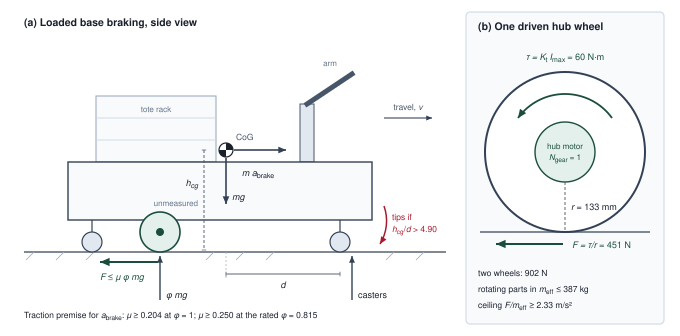{width="100%"}
:::

The constant-deceleration model requires a level surface and a qualified braking response. A conservative implementation charges the transient interval required to develop full retarding force into $\PrebrakeDelay$, then applies a certified lower bound $\CredibleBrakingDeceleration$. The actuator brake-onset allowance ($\ActuatorResponseTime$) enters that delay once. Any subsequent calculation that models a finite torque ramp must reconcile its ramp travel with this allowance rather than add the same interval twice. Furthermore, empirical stopping trials across declared operating conditions establish the credible deceleration, its distribution, and its safety margin; a sample percentile alone does not constitute a certified lower bound.

In unstructured environments, an autonomous machine cannot allocate its entire clearance to nominal stopping dynamics. Obstacle tracking carries state estimation uncertainty, sensor calibration drifts over time, and localization algorithms introduce position error. The stopping distance $\StoppingDistance$ that the system defends must therefore include a spatial localization uncertainty bound $\LocalizationBound$ and a minimum physical clearance margin $\ProtectiveClearanceMargin$:[^fn-std-iso-separation]

$$\StoppingDistance = \SpeedAtDetection\,\PrebrakeDelay + \frac{\SpeedAtDetection^2}{2 \CredibleBrakingDeceleration} + \LocalizationBound + \ProtectiveClearanceMargin$$ {#eq-body-stopping-distance}

The sum $\LocalizationBound + \ProtectiveClearanceMargin$ is fixed spatial overhead that must remain unoccupied when the body comes to a complete rest.

::: {.column-margin .margin-pointer}
↪ The localization bound $\LocalizationBound$ and its dependence on map corrections are developed in @sec-memory-localization-slam.
:::

[^fn-std-iso-separation]: **Protective Separation Distance**\index{ISO/TS 15066!separation distance}\index{Speed and separation monitoring!protective separation distance}: For speed and separation monitoring of robot arms, the collaborative-application requirements that ISO 10218-2:2025 incorporates from ISO/TS 15066 (which itself remains published and under revision) write the protective separation distance as $\ProtectiveSeparationDistance = \PersonApproachTravel + \RobotReactionTravel + \RobotStoppingTravel + \IntrusionDistance + \PersonPositionUncertainty + \RobotPositionUncertainty$: the person's travel, the robot's travel during its reaction time and while stopping, an intrusion distance set by the sensing, and the position uncertainties of person and robot [@isots15066; @iso10218part2; @marvel2017implementing]. The robot's terms map onto @eq-body-stopping-distance, with $\SpeedAtDetection\,\PrebrakeDelay$ as $\RobotReactionTravel$, $\SpeedAtDetection^2/2\CredibleBrakingDeceleration$ as $\RobotStoppingTravel$, and $\LocalizationBound$ as $\RobotPositionUncertainty$, although ISO 10218-2:2025 excludes the hazards specific to a manipulator riding a mobile platform, the running machine's case. For a learned policy, an unbounded compute tail lengthens the reaction time, which enlarges both $\PersonApproachTravel$ and $\RobotReactionTravel$ and forces the protective field outward.

::: {#dfn-body-dynamic-stopping-distance .callout-definition title="Dynamic stopping distance"}

***Dynamic stopping distance***\index{Dynamic stopping distance!definition}\index{Stopping distance!definition} ($\StoppingDistance$) is the minimum physical clearance required to bring a moving mass to a complete halt from its speed $\SpeedAtDetection$ when the hazard is first imaged. It sums the travel during the pre-brake delay $\PrebrakeDelay$, which adds to the observation age of the frame that shows the hazard the lease, tick, bus, and brake-onset intervals that follow it until retarding force begins (the decomposition of @sec-boundary-kinematic-roofline), and excludes the dispatch-to-admission interval, which is charged separately; the braking travel under the credible deceleration $\CredibleBrakingDeceleration$; and the localization bound $\LocalizationBound$ and protective clearance $\ProtectiveClearanceMargin$, as @eq-body-stopping-distance states.

1.  **Significance**: Quantifies the non-negotiable physical spatial margin that software proposals must clear before motion permission can be granted.
2.  **Distinction**: Unlike static geometric obstacle clearance in classical kinematics, dynamic stopping distance depends on the machine's own speed and on every delay before braking, so each velocity setpoint and each delay term changes it.
3.  **Common pitfall**: Assuming an emergency stop command halts the machine instantaneously, ignoring that moving mass carries kinetic energy ($\KineticEnergy = \frac{1}{2}\Mass \SpeedAtDetection^2$) that requires finite mechanical work and braking distance to dissipate.

:::

Three cases on the running machine show how the terms trade against one another (@fig-02-stopping-distance). With only the terms the body owns, the stop needs `{python} BodyStoppingBudget.case_body_str`. Charging the full `{python} BodyStoppingBudget.tau_full_str` pre-brake delay of the elementary stopping budget (@sec-boundary-kinematic-roofline), whose terms later chapters measure one by one, gives that elementary stop plus the `{python} BodyStoppingBudget.overhead_str` fixed overhead, `{python} BodyStoppingBudget.case_full_str`, which still fits the `{python} BodyStoppingBudget.d_clear_str` clear distance. Raising speed above the drive limit with that same delay pushes the stop to `{python} BodyStoppingBudget.case_fast_str`, past the rack end, because speed enters the blind travel linearly and the braking travel quadratically. Notebook \ref{nbk-body-stopping-distance-budgeting-high-tail-compute} works the first case term by term.

::: {#fig-02-stopping-distance fig-env="figure" fig-pos="t" fig-cap="**Stopping distance of the warehouse mobile manipulator**: Each bar splits the stop into blind travel during the pre-brake delay, braking travel under the credible deceleration, and the fixed overhead of the localization bound and protective clearance, against the `{python} BodyStoppingBudget.d_clear_str` rack-end clear distance. Case 1 counts only the terms the body owns at the `{python} BodyStoppingBudget.v_str` drive limit and stops within `{python} BodyStoppingBudget.case_body_str`. Case 2 charges the full `{python} BodyStoppingBudget.tau_full_str` pre-brake delay of the elementary stopping budget (the kinematic roofline); at `{python} BodyStoppingBudget.case_full_str` it still fits, although later chapters add a stop profile and a tracking bound. Case 3 raises speed to a hypothetical `{python} BodyStoppingBudget.v_fast_str`, above the drive limit, with the same delay; braking travel grows by `{python} BodyStoppingBudget.brake_growth_pct_str` and the stop, at `{python} BodyStoppingBudget.case_fast_str`, breaches the clear distance." fig-alt="Horizontal stacked bars for three cases, each split into blind travel, braking travel, and fixed overhead, against a dashed vertical line marking the rack-end clear distance. The first two bars end inside the line with the remaining margin shaded green; the third bar extends past the line into a hatched red breach."}

```{python}
#| echo: false
#| warning: false
#| message: false
# ┌─────────────────────────────────────────────────────────────────────────────
# │ STOPPING DISTANCE OF THE RUNNING MACHINE (FIGURE)
# │ Context: @fig-02-stopping-distance
# │ Goal:    show why velocity, not latency, dominates the defended clearance
# │ Show:    the three-term decomposition for the body-only terms, the full
# │          pre-brake delay, and a speed-scaling case, against D_clear
# │ How:     cases from BodyStoppingBudget (calc_safe_stopping_distance with
# │          RM and AISLE); d_stop = v*tau + v^2/(2a) + delta_loc + delta_margin
# ├─────────────────────────────────────────────────────────────────────────────
from mlsysim import viz

MM = ureg.millimeter

# ┌── 1. LOAD (from the stopping-budget cell) ──────────────────────────────────
S = BodyStoppingBudget  # category: derived (values keep their budget-cell categories)
A_BRAKE = S.a_brake  # category: illustrative (loaded, dry floor)
OVERHEAD = S.overhead.to(MM).magnitude  # category: derived (illustrative delta_loc plus chosen delta_margin)
D_CLEAR = S.d_clear.to(MM).magnitude  # category: illustrative (rack-end clear distance)
CASES = [  # category: illustrative and derived (drive-limit and speed-scaling cases from the budget cell)
    ("Case 1", "Partial budget:\nbody terms only", S.v, S.t_act),
    ("Case 2", "Full delay", S.v, S.tau_full),
    ("Case 3", "Full delay, faster", S.v_fast, S.tau_full),
]

# ┌── 2. EXECUTE (Compute) ─────────────────────────────────────────────────────
rows = []
for name, sub, v, tau in CASES:
    react = (v * tau).to(MM).magnitude
    brake = (v**2 / (2 * A_BRAKE)).to(MM).magnitude
    rows.append((name, sub, react, brake, react + brake + OVERHEAD))

# ┌── 3. GUARD ─────────────────────────────────────────────────────────────────
check(abs(rows[0][4] - S.case_body.magnitude) < 1e-6, "Case 1 must match the budget cell.")
check(abs(rows[1][4] - S.case_full.magnitude) < 1e-6, "Case 2 must match the budget cell.")
check(abs(rows[2][4] - S.case_fast.magnitude) < 1e-6, "Case 3 must match the budget cell.")

# ┌── 4. PLOT ──────────────────────────────────────────────────────────────────
fig, ax, COLORS, plt = viz.setup_plot(figsize=(9, 3.6))
H = 0.58
for i, (name, sub, react, brake, stop) in enumerate(rows):
    y = len(rows) - 1 - i
    left = 0.0
    for width, color, label in (
        (react, COLORS["BlueL"], "Blind travel"),
        (brake, COLORS["BlueLine"], "Braking"),
        (OVERHEAD, COLORS["grid"], "Overhead"),
    ):
        ax.barh(y, width, left=left, height=H, color=color, edgecolor="white", linewidth=0.8, label=label if i == 0 else None, zorder=3)
        left += width
    if stop <= D_CLEAR:
        ax.barh(
            y,
            D_CLEAR - stop,
            left=stop,
            height=H,
            color=COLORS["GreenFill"],
            edgecolor="white",
            linewidth=0.8,
            label="Remaining margin" if i == 0 else None,
            zorder=3,
        )
    else:
        ax.barh(
            y,
            stop - D_CLEAR,
            left=D_CLEAR,
            height=H,
            facecolor="none",
            edgecolor=COLORS["RedLine"],
            linewidth=1.0,
            hatch="//",
            label="Breach" if i == len(rows) - 1 else None,
            zorder=4,
        )
    ax.text(-25, y, f"{name}\n{sub}", ha="right", va="center", fontsize=9, linespacing=1.4)
    ax.text(max(stop, D_CLEAR) + 25, y, f"{stop:,.1f} mm", va="center", fontsize=8.5, color=COLORS["primary"], zorder=6)

ax.axvline(D_CLEAR, color=COLORS["RedLine"], lw=1.4, linestyle=(0, (5, 4)), zorder=5)
ax.text(D_CLEAR, len(rows) - 0.42, f"  rack end at {S.d_clear.to(ureg.meter).magnitude:.2f} m", color=COLORS["RedLine"], fontsize=9, va="bottom")

ax.set_yticks([])
ax.set_xlim(0, 1700)
ax.set_ylim(-0.7, len(rows) - 0.25)
ax.set_xlabel("Distance traveled before rest (mm)")
ax.grid(True, axis="x", zorder=0)
ax.grid(False, axis="y")
for side in ("left", "top", "right"):
    ax.spines[side].set_visible(False)
handles, labels = ax.get_legend_handles_labels()
seen = dict(zip(labels, handles))
ax.legend(seen.values(), seen.keys(), loc="upper center", bbox_to_anchor=(0.5, -0.22), ncol=5, frameon=False, fontsize=8.5)
plt.tight_layout()
plt.show()
```

:::

### Dynamic velocity ceilings and clearance budgeting {#sec-body-dynamic-velocity-ceilings}

The comparative scenarios in @fig-02-stopping-distance show why autonomous systems cannot rely on static, scene-independent speed limits; they require a dynamic velocity ceiling parameterized by instantaneous obstacle clearance.

For a stationary obstacle detected at distance $\ClearDistance$, such as a person standing at an aisle intersection or a dropped storage tote, safe operation demands that defended stopping distance remain strictly within the available clear path: $\StoppingDistance \le \ClearDistance$. This constraint is how the first law, irreversibility (principle \ref{pri-vol4-irreversibility}), binds every motion cycle, with each parameter in $\StoppingDistance$ grounded in the machine's verified physical limits. Using conservative bounds for actuation delay and retarding acceleration, the permission path solves this inequality to determine the maximum permissible command velocity $\SpeedBound$. The symbol is the one that @eq-body-freshness-deadline used for the speed of a tracked target, but here it bounds the machine's own speed. Taking the positive physical root of the resulting quadratic relation[^fn-math-velocity-root] yields:
$$\SpeedBound = -\CredibleBrakingDeceleration \PrebrakeDelay + \sqrt{(\CredibleBrakingDeceleration \PrebrakeDelay)^2 + 2 \CredibleBrakingDeceleration (\ClearDistance - \LocalizationBound - \ProtectiveClearanceMargin)}$$ {#eq-body-velocity-ceiling}
Whenever perceptual range degrades or an obstacle obstructs the trajectory, $\ClearDistance$ contracts, continuously lowering the velocity ceiling. When available distance collapses to zero, the allowable forward velocity becomes zero. If the machine is already in motion, however, issuing a zero-velocity setpoint cannot instantaneously eliminate its accumulated kinetic energy. A negative available distance signals that the platform has already breached safe stopping margins, demanding immediate, full-authority emergency braking.

[^fn-math-velocity-root]: **Kinematic Velocity Root**\index{Kinematic velocity root!quadratic clearance}: Grouping the constant spatial terms into available physical distance $\AvailableBrakingDistance = \ClearDistance - \LocalizationBound - \ProtectiveClearanceMargin$ yields the quadratic inequality $\frac{1}{2 \CredibleBrakingDeceleration} \SpeedAtDetection^2 + \PrebrakeDelay \SpeedAtDetection - \AvailableBrakingDistance \le 0$. Multiplying by $2 \CredibleBrakingDeceleration$ produces $\SpeedAtDetection^2 + 2 \CredibleBrakingDeceleration \PrebrakeDelay \SpeedAtDetection - 2 \CredibleBrakingDeceleration \AvailableBrakingDistance \le 0$. Applying the quadratic formula and taking the positive physical root defines the dynamic velocity ceiling.

::: {#nbk-body-stopping-distance-budgeting-high-tail-compute .callout-notebook title="The body's stopping distance"}

**Problem**: The loaded warehouse mobile manipulator drives toward a rack end at its drive limit, and a person stands in the aisle at the clear distance. The body owns three terms of @eq-body-stopping-distance: braking travel, the fixed overhead, and the brake onset that enters $\PrebrakeDelay$. How much of the clear distance do these terms use, what speed would they alone permit, and how do speed and added delay change the answer?

**Variables**:

- Loaded mass at most `{python} MachineMomentum.m_loaded_str` (derived upper bound, full tote rack) and drive limit $\SpeedAtDetection =$ `{python} BodyStoppingBudget.v_str` (illustrative)
- Clear distance $\ClearDistance =$ `{python} BodyStoppingBudget.d_clear_str` (illustrative)
- Credible deceleration $\CredibleBrakingDeceleration =$ `{python} BodyStoppingBudget.a_brake_str` (illustrative; loaded, dry floor)
- Localization bound $\LocalizationBound =$ `{python} BodyStoppingBudget.delta_loc_str` (illustrative) and protective clearance $\ProtectiveClearanceMargin =$ `{python} BodyStoppingBudget.delta_margin_str` (chosen)
- Brake onset $\ActuatorResponseTime =$ `{python} BodyStoppingBudget.t_act_str` (illustrative)

**Math**:

**1. Braking travel:**
For the same credible deceleration, mass cancels from the work-energy balance. The loaded machine's `{python} MachineMomentum.e_k_str` sets the energy the stopping system must absorb or dissipate, while the specified deceleration sets the braking distance. A different payload can change that deceleration and requires a new bound:
`{python} BodyStoppingBudget.d_brake_display_math`
The stopping distance so far is `{python} BodyStoppingBudget.d_brake_str`.

**2. Fixed overhead:**
`{python} BodyStoppingBudget.overhead_display_math`
The running total rises to `{python} BodyStoppingBudget.total_2_str`.

**3. Brake onset:**
Between the brake command and the first retarding force, the base still moves at full speed:
`{python} BodyStoppingBudget.d_onset_display_math`
`{python} BodyStoppingBudget.total_display_math`
The body's own terms leave `{python} BodyStoppingBudget.remaining_str` of the `{python} BodyStoppingBudget.d_clear_str` clear distance for every delay the body does not own.

**4. The body-only ceiling:**
Solving @eq-body-stopping-distance for speed with $\PrebrakeDelay = \ActuatorResponseTime$:
`{python} BodyStoppingBudget.ceiling_display_math`
The body alone would permit `{python} BodyStoppingBudget.v_ceiling_str`, above the drive limit. The remaining delay terms, added in later chapters, spend part of this headroom.

**5. Speed vs. delay:**
At a hypothetical `{python} BodyStoppingBudget.v_fast_str`, above the drive limit, the braking term alone grows to `{python} BodyStoppingBudget.d_brake_fast_str`, `{python} BodyStoppingBudget.brake_growth_pct_str` more than at the drive limit. At the drive limit, each additional `{python} BodyStoppingBudget.dt_extra_str` of pre-brake delay adds `{python} BodyStoppingBudget.d_per_extra_str`.

**Systems insight**: Platform velocity represents the most sensitive variable in the stopping budget. Accelerating from `{python} BodyStoppingBudget.v_str` to `{python} BodyStoppingBudget.v_fast_str` adds `{python} BodyStoppingBudget.brake_extra_str` in braking travel, as much distance as `{python} BodyStoppingBudget.dt_equiv_str` of additional pre-brake delay at the drive limit. A velocity setpoint may therefore rise only after re-evaluating the clearance quadratic. Because physical braking distance scales with $\SpeedAtDetection^2$, granting an aggressive velocity setpoint expands the defended stopping envelope and rapidly exhausts the clear distance margin defended by $\StoppingDistance \le \ClearDistance$.

:::

::: {.column-margin .margin-pointer}
↪ The chunk lease, the time an admitted trajectory segment may keep executing without a replacement, is one of the delay terms that spend this headroom. Its sizing from this stopping distance is developed in @sec-nervous-lease-sizing.
:::

### Applying the velocity ceiling {#sec-body-velocity-governor-cbf}

A dynamic speed ceiling protects the machine only when an independent check on the permission path tests each new velocity request against it before execution. The learned policy proposes an action; the safety check evaluates clearance, delay, and available deceleration to determine whether that request fits the stopping budget. Requesting a lower speed alters future trajectory points but cannot erase the distance required to stop from the current speed. Consequently, the check must evaluate the platform's instantaneous state alongside candidate commands, keeping the machine inside the region from which it can still stop between control ticks under strict bounds on timing jitter, obstacle motion, and actuator response. That per-tick validation belongs to the permission path; @sec-enforcement-phase-portraits formalizes it around the jerk-limited deceleration profiles executed on the physical platform. What the physical body contributes is the ceiling itself: a clearance-dependent boundary grounded in physical constraints that drops whenever traction degrades, actuator response slows, or localization uncertainty expands.

Enforcing this speed limit assumes the permission path can demand the deceleration $\CredibleBrakingDeceleration$ whenever safety requires it. Commanding rapid deceleration, however, requires sudden, large mechanical torque from the drive motors and gearboxes. If the permission path requests a torque step that exceeds what the actuator bandwidth budget allows, the mechanical body cannot deliver the required deceleration, invalidating the model-based stopping ceiling and risking collision. The same drives also shape what happens if the stop falls short. The reflected rotor energy counted in $\EffectiveImpactMass$ then reaches the obstacle and the gear teeth through the transmission's compliance, so the stopping calculation cannot substitute for a contact-load assessment.

## Actuator Transmission Limits {#sec-body-actuator-limits}

In digital computer systems, successful network packet delivery confirms that an instruction reached its destination. In embodied AI systems, successful packet delivery guarantees almost nothing about physical execution: an emergency brake command can arrive over a Controller Area Network (CAN) bus or EtherCAT with sub-millisecond precision while the motor delivers substantially less torque than the stopping calculation assumes. Stator winding inductance, DC bus voltage headroom, and transmission dynamics govern the actual plant response. The systems engineering challenge is to quantify the torque envelope and dynamic response times that the physical assembly can sustain, exposing those limits directly to the runtime permission path before an unachievable command causes a collision.

### Physical actuation modalities and the actuator contract {#sec-body-actuation-modalities}

An actuator contract cannot be specified in terms of abstract digital setpoints. It must be written at the physical plant interface in terms of delivered force, torque, slew rate limits, response latency, and tracking error. In software systems, an execution target either accepts an instruction or raises a fault; in physical hardware, an actuation request is bounded by stator winding inductance, DC bus voltage headroom, ferromagnetic saturation, and transmission elasticity.

::: {.column-margin}
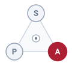{width="100%" fig-alt="S·P·A locator triad with the Act node highlighted."}

*On the sense-plan-act (S·P·A) triad (@sec-appendix-spa), the actuator contract sits at the Act node, where a command must become delivered force.*
:::

While electromechanical drives dominate mobile manipulation and form the primary running machine of this book, broader physical AI embodiments rely on fluid power or mechanical elasticity, each establishing fundamentally distinct physical budgets\index{Actuator!hydraulic}\index{Actuator!pneumatic}\index{Series Elastic Actuator!compliance}:

- **Hydraulic servovalves**: For heavy machinery, construction robots, and high-load dynamic platforms, fluid power trades magnetic force for pressure. A cylinder's force is supply pressure times piston area, $\CylinderForce = \HydraulicSupplyPressure \PistonArea$, so raising the pressure lets a compact actuator deliver a large force, while an electric motor's force is bounded by the magnetic field its magnets and copper can sustain. The miniature servovalves on hydraulic legged robots respond fast, with bandwidths of hundreds of hertz [@scully2015hydraulic], so the valve is rarely the slow element. Hydraulic control is bounded instead by fluid compressibility (oil bulk modulus $\OilBulkModulus$), nonlinear orifice flow, and the plumbing, pumps, and cooling needed to keep the fluid within its operating range. That maintenance burden is one reason Boston Dynamics retired its hydraulic Atlas humanoid in 2024 in favor of an all-electric successor [@bostondynamics2024electric].
- **Pneumatics and soft actuation**: Pneumatic artificial muscles and elastomeric chambers provide physical compliance that naturally cushions impacts. However, gas compressibility, valve flow restrictions, and acoustic transport delays limit closed-loop bandwidth to tens of hertz. Stored pneumatic energy can also discharge violently during rapid venting or line rupture; safety validation requires qualifying the envelope of peak chamber pressure, flow rates, and measured contact dynamics.
- **Series elastic actuators (SEAs)**: By placing a calibrated spring directly between the gearbox and the output link (as in the ANYbotics ANYdrive), an SEA incorporates mechanical compliance into the drivetrain itself. The spring acts as a low-pass mechanical filter: it isolates delicate gear teeth from shock loads and decouples the large reflected rotor inertia ($\GearReductionRatio^2 \RotorInertia$) from the environment during impact. Its measured deflection also serves as a direct force sensor, since spring stiffness times deflection yields output torque [@pratt1995series]. Rather than dissipating energy, the spring stores elastic potential ($\ElasticPotentialEnergy = \frac{1}{2} \SeriesElasticStiffness \FiniteChange\JointAngle^2$) at the joint and can return that energy into an obstacle. The engineering trade-off is reduced closed-loop position bandwidth and low-frequency structural resonance. The safety system and permission path must therefore monitor physical spring deflection directly instead of assuming rigid load tracking.

### Electrical time constants, back-EMF, and current clamping {#sec-body-electrical-time-constants}

The running machine's wheels and arm joints are electric, so the electric drive is the plant whose limits the stopping budget depends on. To a policy, a torque command is a number written to a register; to the motor, it is a current that must be built up in a coil. Three results from introductory physics describe that conversion [@lynch2017modern]. First, a wire carrying current across a magnetic field feels a force proportional to the current. Wound around a rotor, those forces produce a torque proportional to current, $\MotorTorque = \MotorTorqueConstant \WindingCurrent$, where the **torque constant**\index{Torque constant!definition} $\MotorTorqueConstant$ (in $\text{N}\cdot\text{m/A}$) collects the magnet strength and the winding geometry. Second, the same wires, swept through the same field by the spinning rotor, have a voltage induced in them. A spinning motor is therefore also a generator, and its **back-EMF**\index{Back-EMF!definition} (back electromotive force) $\BackEmfVoltage = \MotorBackEmfConstant \RotorAngularSpeed$ opposes the supply. Energy conservation ties the two constants together: the electrical power the motor converts, $\BackEmfVoltage\,\WindingCurrent$, equals the mechanical power it delivers, $\MotorTorque \RotorAngularSpeed$, so $\MotorBackEmfConstant$ and $\MotorTorqueConstant$ are the same number in SI units. A three-phase drive's current and voltage conventions scale them by constant factors, which is why both must be identified under one convention. Third, the winding is a coil, and a coil opposes any change in its current, $\InductiveVoltage = \PhaseInductance\,d\WindingCurrent/d\TimeInstant$ for inductance $\PhaseInductance$. Current, and therefore torque, cannot jump.

The budget needs two results from the motor controller: the torque delivered for a given current and the delay before that current appears. In a three-phase motor, field-oriented control (FOC) measures the winding currents and adjusts the inverter voltages so that the torque-producing current $\TorqueProducingCurrent$ stays at right angles to the rotor's magnetic field as the rotor turns, giving $\MotorTorque = \MotorTorqueConstant \TorqueProducingCurrent$.[^fn-foc-field-orientation] The controller splits the stator current into two components that turn with the rotor: the quadrature, or $\Glyph{q}$-axis, current $\TorqueProducingCurrent$ at right angles to the rotor field, which produces torque, and the direct, or $\Glyph{d}$-axis, current $\DirectAxisCurrent$ along it, which produces none and is normally held at zero. The coordinate transformations inside the drive are supporting detail, presented after the transmission choice.

The delay between commanding a torque and delivering it begins in the stator windings. Adding the three effects around one winding circuit, the supply voltage must cover the resistive drop, the inductive voltage, and the back-EMF, which is Kirchhoff's voltage law for the torque-producing current:
$$\PhaseInductance \frac{d\TorqueProducingCurrent(\TimeInstant)}{d\TimeInstant} + \PhaseResistance \TorqueProducingCurrent(\TimeInstant) = \QuadratureAxisVoltage(\TimeInstant) - \BackEmfVoltage(\TimeInstant)$$
where $\PhaseInductance$ is phase inductance, $\PhaseResistance$ is phase resistance, $\QuadratureAxisVoltage(\TimeInstant)$ is the applied quadrature voltage from the inverter bridge, $\TorqueProducingCurrent(\TimeInstant)$ is the quadrature-axis (torque-producing) current, and $\BackEmfVoltage(\TimeInstant) = \MotorBackEmfConstant \RotorAngularSpeed(\TimeInstant)$ is the back-EMF. The stator electrical time constant is:
$$\ElectricalTimeConstant = \frac{\PhaseInductance}{\PhaseResistance}$$

```{python}
#| label: body-current-rise-calc
#| echo: false
#| warning: false
#| message: false
# ┌─────────────────────────────────────────────────────────────────────────────
# │ CURRENT RISE IN THE RUNNING MACHINE'S HUB MOTORS (LEGO)
# ├─────────────────────────────────────────────────────────────────────────────
# │ Context: the current-rise paragraph in @sec-body-electrical-time-constants
# │          and the electrical-rise test in @sec-body-dynamometer-characterization.
# │ Goal:    Put a number on tau_e for a sourced motor and compare the
# │          voltage-limited current ramp with the brake-onset allowance.
# │ Show:    tau_e = 1.885 mH / 0.7 Ohm = 2.69 ms; from a depleted 42 V pack the
# │          current reaches the 25 A limit in about 1.12 ms, 5.6 percent of the
# │          20 ms brake onset; the full 42 V across the 0.7 Ohm winding would
# │          drive 60 A, 2.4 times the motor's 25 A peak.
# │ How:     tau_e = L/R (line quantities, same ratio as phase quantities for a
# │          star winding); ramp time L I_max / V at stall, where e_bemf = 0;
# │          RM.drive_unit (ZLTECH ZLLG10ASM800 datasheet), AISLE.t_brake_onset.
# └─────────────────────────────────────────────────────────────────────────────
from mlsysim import *
from mlsysim.core.units import *
from mlsysim.fmt import fmt_latency, fmt_inductance, fmt_resistance, fmt_current, fmt_voltage, fmt_percent, fmt_multiple, check

RM = Embodied.MobileManipulator.WarehouseMobileManipulator
AISLE = Embodied.Scenario.WarehouseAisle

class CurrentRise:
    """Electrical time constant and voltage-limited current ramp of the hub motors."""

    # ┌── 1. LOAD (Constants & Parameters) ─────────────────────────────────
    hub = RM.drive_unit  # category: sourced (ZLTECH ZLLG10ASM800 datasheet)
    l_line = hub.line_inductance  # category: sourced (line-to-line)
    r_line = hub.line_resistance  # category: sourced (line-to-line)
    i_max = RM.drive_current_limit  # category: chosen (the motor's datasheet peak current)
    i_peak = hub.peak_current  # category: sourced
    v_low = RM.drive_bus_battery_low  # category: sourced (48 V-class pack minimum)
    t_act = AISLE.t_brake_onset  # category: illustrative (brake onset)

    # ┌── 2. EXECUTE (Compute) ─────────────────────────────────────────────
    tau_e = (l_line / r_line).to(millisecond)
    t_ramp = (l_line * i_max / v_low).to(millisecond)  # stall, e_bemf = 0, full depleted-bus voltage
    ramp_share = (t_ramp / t_act).to("dimensionless").magnitude
    i_full_step = (v_low / r_line).to(ureg.ampere)  # steady current of a full-bus step
    step_over_peak = (i_full_step / i_peak).to("dimensionless").magnitude

    # ┌── 3. GUARD (Invariants) ───────────────────────────────────────────
    check(abs(tau_e.magnitude - 2.693) < 1e-3, f"Unexpected electrical time constant: {tau_e}")
    check(abs(t_ramp.magnitude - 1.122) < 1e-3, f"Unexpected current ramp: {t_ramp}")
    check(t_ramp < 0.1 * t_act, "The current ramp must be small against the brake onset.")
    check(abs(i_full_step.magnitude - 60.0) < 1e-9, f"Unexpected full-bus step current: {i_full_step}")
    check(i_full_step > i_peak, "A full-bus step must exceed the motor's peak current.")

    # ┌── 4. OUTPUT (Formatting) ──────────────────────────────────────────
    l_line_str = fmt_inductance(l_line, unit=ureg.millihenry, precision=3)
    r_line_str = fmt_resistance(r_line, unit=ureg.ohm, precision=1)
    tau_e_str = fmt_latency(tau_e, unit=millisecond, precision=1)
    i_max_str = fmt_current(i_max, unit=ureg.ampere, precision=0)
    v_low_str = fmt_voltage(v_low, unit=volt, precision=0)
    t_ramp_str = fmt_latency(t_ramp, unit=millisecond, precision=1)
    t_act_str = fmt_latency(t_act, unit=millisecond, precision=0)
    ramp_share_pct_str = fmt_percent(ramp_share, precision=1, style="prose")
    i_full_step_str = fmt_current(i_full_step, unit=ureg.ampere, precision=0)
    step_over_peak_mult_str = fmt_multiple(step_over_peak, precision=1)
```

If the inverter applied an uncontrolled voltage step, the current would approach its steady state exponentially along $\TorqueProducingCurrent(\TimeInstant) = \SteadyStateCurrent(1 - e^{-\TimeInstant/\ElectricalTimeConstant})$, taking an entire time constant $\ElectricalTimeConstant$ to reach 63 percent of the target. A closed-loop current controller drives the winding much faster: it applies full bus voltage until current reaches the setpoint, forcing a ramp rate of nearly $(\DcBusVoltage - \BackEmfVoltage)/\PhaseInductance$, at which point the current loop throttles the voltage to maintain regulation. On the running machine, this electrical rise is rapid. The hub motor windings (line inductance `{python} CurrentRise.l_line_str`, line resistance `{python} CurrentRise.r_line_str`) yield $\ElectricalTimeConstant =$ `{python} CurrentRise.tau_e_str`. Starting from rest on a depleted `{python} CurrentRise.v_low_str` pack, the initial current slope gives a resistance-free rise estimate of `{python} CurrentRise.t_ramp_str`, only `{python} CurrentRise.ramp_share_pct_str` of the `{python} CurrentRise.t_act_str` brake onset budgeted for the platform. The resistive drop slows the ramp as current builds, so this estimate is optimistic and the full winding response must be measured. When braking from speed, back-EMF reinforces the inverter voltage, accelerating the current ramp further. In this architecture, electrical rise time does not bottleneck emergency braking; tire traction, maximum inverter current, and voltage headroom at high speed govern the stopping distance, as detailed in notebook \ref{nbk-body-braking-drive-limits}.

Torque tracks current directly, which means available voltage headroom also dictates the maximum torque slew rate:
$$\frac{\DerivativeOperator\MotorTorque}{d\TimeInstant} = \MotorTorqueConstant \frac{d\TorqueProducingCurrent}{d\TimeInstant} \le \frac{\MotorTorqueConstant (\DcBusVoltage - \MotorBackEmfConstant \RotorAngularSpeed)}{\PhaseInductance}$$
Inductance and voltage conventions must align consistently: line-to-line values reported on manufacturer datasheets pair with the full DC bus voltage, whereas per-phase values modeled under space-vector modulation scale by an amplitude of approximately $\DcBusVoltage/\sqrt{3}$, the modulation voltage limit stated in @sec-appendix-systems-actuators. At low wheel speeds, ample voltage headroom enables steep torque ramps. As rotational velocity climbs, back-EMF consumes that headroom, throttling the rate at which the inverter can inject current. An unconstrained policy setpoint requesting an instantaneous torque step is transformed by the motor hardware into a finite physical ramp; any demand exceeding this maximum slew rate produces severe tracking error. The safety stopping budget must account for this rate-limited response. Consistent current and voltage conventions are essential when characterizing motor parameters for safety enforcement.

[^fn-foc-field-orientation]: **Field-Oriented Control (FOC)**\index{Field-Oriented Control!current loop limits}: The drive steers the stator current vector so that it stays at right angles to the rotor's magnetic field, the arrangement that a brushed DC motor's commutator enforces mechanically. An AC machine controlled this way behaves like a DC motor whose torque is set by a single current, $\TorqueProducingCurrent$. That is what lets a policy command torque at all, because its request becomes a current target whose arrival the winding inductance and the voltage headroom then pace.

Voltage headroom bounds the rate of current rise; power electronics define the maximum current that can safely flow. Inverter bridges enforce a strict current ceiling $\InverterCurrentLimit$ to protect the switching power transistors from thermal failure and prevent magnetic core saturation in the stator. For a motor coupled to a mechanical transmission with gear ratio $\GearReductionRatio$ and mechanical efficiency $\GearboxTransmissionEfficiency$, this ceiling caps joint output torque at:
$$\OutputTorqueCeiling = \GearboxTransmissionEfficiency \GearReductionRatio \MotorTorqueConstant \InverterCurrentLimit$$ {#eq-body-torque-ceiling}

This current limit settles a central safety requirement: whether the drives can sustain the deceleration demanded by the supervisory permission path. A motor drive may silently clamp current setpoints while continuing to acknowledge network commands; the safety path must interrogate measured output currents and status flags rather than inferring torque delivery from successful packet transmission. If emergency braking demands more torque than this ceiling allows, the assumed deceleration model breaks down. Any change to inverter current limits therefore invalidates the robot's qualified stopping envelope and requires recomputing the stopping limit record (@sec-body-measuring-limits).

::: {#nbk-body-braking-drive-limits .callout-notebook title="Can the drives deliver the credible deceleration?"}
The running machine brakes through two driven wheels, each a direct-drive 10-inch hub motor (the ZLTECH ZLLG10ASM800, with no gearbox, so $\GearReductionRatio = 1$ and $\GearboxTransmissionEfficiency \approx 1$) [@zltech2022zllg10asm800] with rolling radius $\WheelRadius =$ `{python} BrakingLimits.r_wheel_str`. Its torque constant $\MotorTorqueConstant =$ `{python} BrakingLimits.k_t_str` is the datasheet's peak torque divided by its peak current, and the drive's current limit is set at that peak, $\InverterCurrentLimit =$ `{python} BrakingLimits.i_max_str`. Casters carry the rest of the weight.

**Problem**: Does the loaded machine's credible deceleration $\CredibleBrakingDeceleration =$ `{python} BrakingLimits.a_req_str` fit under the traction, tip-over, and drive-torque ceilings, and does the drive keep control of its current at the `{python} BrakingLimits.v_str` drive limit?

**Math**:

1. **Traction**: Only the driven wheels brake, so $\CredibleBrakingDeceleration \le \CoulombFrictionCoefficient \Gravity \DrivenWheelLoadFraction$. With all the weight on them ($\DrivenWheelLoadFraction = 1$), the floor must supply $\CoulombFrictionCoefficient \ge \CredibleBrakingDeceleration/\Gravity =$ `{python} BrakingLimits.mu_min_str`. The hub motors are rated to carry `{python} BrakingLimits.load_pair_str` per pair, so on the `{python} BrakingLimits.m_str` machine $\DrivenWheelLoadFraction \le$ `{python} BrakingLimits.phi_max_str` and the floor must supply at least $\CoulombFrictionCoefficient =$ `{python} BrakingLimits.mu_min_rated_str`. The dry floor ($\CoulombFrictionCoefficient =$ `{python} BrakingLimits.mu_dry_str`) meets that whenever the driven wheels carry at least a fraction `{python} BrakingLimits.phi_min_dry_str` of the weight, and at the rated load share it supports $\CoulombFrictionCoefficient \Gravity \DrivenWheelLoadFraction =$ `{python} BrakingLimits.a_trac_dry_str`. The inspected floor, a sealed low-traction surface whose friction a facility inspection certifies only down to $\CoulombFrictionCoefficient =$ `{python} BrakingLimits.mu_insp_str`, supports only `{python} BrakingLimits.a_insp_str` even with every kilogram on the driven wheels.
2. **Tip-over**: The machine stays on its wheels while $\CredibleBrakingDeceleration \le \Gravity\,\LeadingSupportDistance/\GravityCenterHeight$, so the credible deceleration requires $\GravityCenterHeight/\LeadingSupportDistance \le \Gravity/\CredibleBrakingDeceleration =$ `{python} BrakingLimits.cg_ratio_max_str`. The machine's specification gives neither the loaded center-of-gravity height nor its distance to the leading support, and extending the arm forward shortens $\LeadingSupportDistance$. This ceiling cannot yet be checked.
3. **Drive torque**: Each wheel delivers $\MotorTorqueConstant \InverterCurrentLimit =$ `{python} BrakingLimits.tau_wheel_str`, so the floor sees $\DriveBrakingForceCeiling = 2 \MotorTorqueConstant \InverterCurrentLimit/\WheelRadius =$ `{python} BrakingLimits.force_str`. With the rotating-mass bound of @sec-body-stopping-distance-prebrake, $\EffectiveImpactMass \le$ `{python} BrakingLimits.m_eff_str`, and the torque ceiling is $\DriveBrakingForceCeiling/\EffectiveImpactMass \ge$ `{python} BrakingLimits.a_torque_str`, at least `{python} BrakingLimits.torque_margin_pct_str` above the credible deceleration. With the current limit set at the rated `{python} BrakingLimits.i_rated_str` instead, each wheel gives its rated `{python} BrakingLimits.tau_rated_str` and the ceiling falls to `{python} BrakingLimits.a_torque_rated_str`.
4. **Voltage at the drive limit**: At `{python} BrakingLimits.v_str` the wheel turns at $\RotorAngularSpeed = \SpeedBound/\WheelRadius =$ `{python} BrakingLimits.omega_str`, and the line-to-line back-EMF is $\BackEmfVoltage = \MotorBackEmfConstant \RotorAngularSpeed =$ `{python} BrakingLimits.e_bemf_str`. Braking current flows with the back-EMF, so holding $\InverterCurrentLimit$ through the `{python} BrakingLimits.r_line_str` line resistance requires only $\BackEmfVoltage - \InverterCurrentLimit \ElectricalResistance =$ `{python} BrakingLimits.v_brake_str` at the terminals, and even a depleted `{python} BrakingLimits.v_bus_low_str` pack sits `{python} BrakingLimits.headroom_str` above $\BackEmfVoltage$. Driving at the same current would need $\BackEmfVoltage + \InverterCurrentLimit \ElectricalResistance =$ `{python} BrakingLimits.v_drive_str`, more than the depleted pack supplies.

**Result**: The drives clear `{python} BrakingLimits.a_req_str` by at least `{python} BrakingLimits.torque_margin_pct_str`, but only with the current limit at the motor's peak. Traction holds on the dry floor if the driven wheels carry at least a fraction `{python} BrakingLimits.phi_min_dry_str` of the weight, and it fails on the inspected floor. The tip-over ceiling remains unverified until the loaded center of gravity is measured, by weighing each wheel on corner scales or by a tilt test, with the arm stowed and extended.

**Systems insight**: The credible deceleration is a conjunction of three ceilings owned by different parts of the machine: the floor, the mass distribution that the arm changes, and the drive configuration. A current limit lowered to protect the windings cuts the torque ceiling below the stopping premise without any software change, so the configured current limit belongs in the limit record's conditions.
:::

::: {.column-margin}
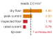{width="100%" fig-alt="Horizontal bars of deceleration ceilings in meters per second squared against a dashed line at the required 2.0: dry floor 4.80 and peak current 2.33 in amber extend past the line; inspected floor 1.18 and rated current 0.78 in red fall short; the tip-over row has no bar and reads unmeasured."}

*A `{python} BrakingLimits.a_req_str` stop must clear every ceiling; two fall short and one is unmeasured.*
:::

Current regulation also incurs electrical and switching losses. Any stator current vector misaligned with the quadrature axis produces resistive heating without contributing shaft torque. Inverter pulse-width modulation and required protective dead times introduce further nonlinear voltage distortion.[^fn-hw-inverter-deadtime] Consequently, dynamic torque tracking must be verified through physical dynamometer measurements on the assembled actuator rather than inferred from current setpoints alone.

[^fn-hw-inverter-deadtime]: **Inverter Dead Time**\index{Inverter dead time!shoot-through protection}: A short hardware-inserted interval in which both switches of an inverter half-bridge are off, so that the high-side and low-side switches of one leg never conduct together and short the DC bus, a failure called shoot-through. The interval distorts the applied voltage most at low speed and near each current zero crossing, so delivered torque departs from the request exactly where slow, fine contact force is commanded.

### Reflected rotor inertia and optimal inertia matching {#sec-body-reflected-rotor-inertia}

Mechanical gearing introduces a fundamental dynamic asymmetry. High-reduction joints employ gear ratios between $50{:}1$ and $160{:}1$ to multiply the output torque of compact, lightweight motors. While this reduces the motor torque required by a factor of $\GearReductionRatio$, the motor rotor must spin $\GearReductionRatio$ times faster than the actuated joint. When an external contact backdrives the joint, it must accelerate that rotor at $\GearReductionRatio$ times the joint's angular acceleration. Because rotational kinetic energy scales with the square of velocity ($\frac{1}{2} \RotorInertia \RotorAngularSpeed^2$), the rotor's physical inertia $\RotorInertia$ resists load-side acceleration multiplied by the **square of the gear ratio** (definition \ref{dfn-body-reflected-rotor-inertia}).

```{python}
#| label: body-reflected-inertia-calc
#| echo: false
#| warning: false
#| message: false
# ┌─────────────────────────────────────────────────────────────────────────────
# │ REFLECTED ROTOR INERTIA AS A FLYWHEEL (LEGO)
# ├─────────────────────────────────────────────────────────────────────────────
# │ Context: the reflected-inertia paragraph in @sec-body-actuator-limits.
# │ Goal:    Give N^2 J_rotor a physical size at the joint.
# │ Show:    a 50 g rotor (5.6e-6 kg m^2) through 100:1 reflects 0.056 kg m^2,
# │          the inertia of an 11.2 kg solid flywheel of 10 cm radius; with an
# │          illustrative 8.5e-3 kg m^2 link, N* = 39, and 100:1 delivers 67.7
# │          percent of the matched-ratio acceleration.
# │ How:     J_ref = N^2 J_rotor; solid disk m = 2 J_ref / r^2;
# │          N* = sqrt(J_load / J_rotor); qdd(N)/qdd(N*) = 2x / (1 + x^2), x = N/N*.
# └─────────────────────────────────────────────────────────────────────────────
from mlsysim import *
from mlsysim.core.units import *
from mlsysim.fmt import fmt_int, fmt_mass, fmt_length, fmt_sci_qty, fmt_percent, check

class ReflectedInertia:
    """Reflected rotor inertia through a 100:1 transmission, sized as a flywheel."""

    # ┌── 1. LOAD (Constants & Parameters) ─────────────────────────────────
    n_gear = 100  # category: illustrative (joint reduction)
    m_rotor = 50.0 * ureg.gram  # category: illustrative (rotor mass)
    j_rotor = 5.6e-6 * kilogram * meter**2  # category: illustrative (rotor inertia of that rotor)
    r_fly = 0.10 * meter  # category: illustrative (comparison flywheel radius)
    j_load = 8.5e-3 * kilogram * meter**2  # category: illustrative (link inertia at the joint)

    # ┌── 2. EXECUTE (Compute) ─────────────────────────────────────────────
    j_ref = (n_gear**2 * j_rotor).to(kilogram * meter**2)
    m_fly = (2 * j_ref / r_fly**2).to(kilogram)
    k_gyr = ((j_rotor / m_rotor) ** 0.5).to(ureg.millimeter)  # radius of gyration ties J_rotor to the quoted mass
    n_star = ((j_load / j_rotor).to("dimensionless").magnitude) ** 0.5
    x_ratio = n_gear / n_star
    accel_share = 2 * x_ratio / (1 + x_ratio**2)  # qdd at n_gear relative to qdd at N*, same motor torque

    # ┌── 3. GUARD (Invariants) ───────────────────────────────────────────
    check(abs(j_ref.magnitude - 0.056) < 1e-9, f"Reflected inertia must be 0.056 kg m^2: {j_ref}")
    check(abs(m_fly.magnitude - 11.2) < 1e-9, f"Equivalent flywheel must be 11.2 kg: {m_fly}")
    check(n_gear == 100, f"Quoted joint reduction must be 100:1: {n_gear}")
    check(abs(m_rotor.to(ureg.gram).magnitude - 50.0) < 1e-9, f"Quoted rotor mass must be 50 g: {m_rotor}")
    check(abs(r_fly.to(meter).magnitude - 0.10) < 1e-12, f"Quoted flywheel radius must be 10 cm: {r_fly}")
    check(5.0 < k_gyr.magnitude < 20.0, f"Rotor inertia implausible for a 50 g rotor (k = {k_gyr})")
    check(abs(n_star - 38.96) < 0.01, f"Inertia-matching ratio must be about 39 (margin figure peak): {n_star}")
    check(abs(accel_share - 0.677) < 1e-3, f"Unexpected acceleration share at 100:1: {accel_share}")

    # ┌── 4. OUTPUT (Formatting) ──────────────────────────────────────────
    n_gear_str = fmt_int(n_gear)
    m_rotor_str = fmt_mass(m_rotor, unit=ureg.gram, precision=0)
    m_fly_str = fmt_mass(m_fly, unit=kilogram, precision=1)
    r_fly_str = fmt_length(r_fly, unit=ureg.centimeter, precision=0)
    j_load_str = fmt_sci_qty(j_load, kilogram * meter**2, precision=1)
    n_star_str = fmt_int(round(n_star))
    accel_share_pct_str = fmt_percent(accel_share, precision=1, style="prose")
    accel_loss_pct_str = fmt_percent(1 - accel_share, precision=1, style="prose")
```

Through a `{python} ReflectedInertia.n_gear_str`:1 transmission, a small `{python} ReflectedInertia.m_rotor_str` rotor imposes the apparent inertia of a massive `{python} ReflectedInertia.m_fly_str` flywheel with a `{python} ReflectedInertia.r_fly_str` radius at the output shaft [@lynch2017modern]. When the end-effector collides with a rigid surface, the contact force must instantly decelerate this equivalent flywheel through the drivetrain, generating extreme peak stresses that can fracture gear teeth at their roots, as documented in @fig-02-real-broken-gear-tooth.

::: {#dfn-body-reflected-rotor-inertia .callout-definition title="Reflected rotor inertia"}

***Reflected rotor inertia***\index{Reflected rotor inertia!definition} ($\ReflectedRotorInertia$) is the apparent rotational inertia of an actuator rotor at the load-side joint output, scaling with the square of the transmission gear ratio:
$$\ReflectedRotorInertia = \GearReductionRatio^2 \RotorInertia$$

1.  **Significance**: In high-reduction transmissions ($\GearReductionRatio \ge 100$) it dominates the apparent load, capping joint acceleration $\JointAcceleration$ and setting impact shock loads.
2.  **Distinction**: Unlike rotor inertia $\RotorInertia$ or link inertia $\LoadInertia$, it acts through transmission stiffness and backlash, so backdriving from the environment meets an $\GearReductionRatio^2$ barrier.
3.  **Common pitfall**: Ignoring reflected rotor inertia during collision and contact modeling. Under sudden obstacle impact, the reflected kinetic energy of the spinning rotor concentrates stress directly on gear teeth before drive current can be interrupted.

:::

The combined equation of motion for a geared joint driving load inertia $\LoadInertia$ with motor torque $\MotorTorque$ is:
$$ \JointAcceleration = \frac{\GearReductionRatio \MotorTorque}{\LoadInertia + \GearReductionRatio^2 \RotorInertia} $$
Maximizing delivered load acceleration $\JointAcceleration$ with respect to transmission ratio $\GearReductionRatio$, by setting $\DerivativeOperator\JointAcceleration/d\GearReductionRatio = 0$, gives $\LoadInertia = \GearReductionRatio^2 \RotorInertia$: acceleration peaks when the reflected rotor inertia equals the load inertia. Solving for $\GearReductionRatio$ establishes the classical **inertia matching ratio**:[^fn-inertia-impedance-matching]
$$ \InertiaMatchingRatio = \sqrt{\frac{\LoadInertia}{\RotorInertia}} $$ {#eq-body-inertia-matching}

[^fn-inertia-impedance-matching]: **Inertia Matching**\index{Inertia matching!impedance matching}: At $\InertiaMatchingRatio$ the reflected rotor inertia equals the load inertia, the mechanical twin of impedance matching in a circuit, where a source delivers the most power to a load whose impedance equals its own. The analogy carries the same caveat: the matched ratio maximizes acceleration, not efficiency or safety, so practical arms choose lower ratios to protect gear teeth from shock, keep the joint backdrivable, and raise top speed.

Below $\InertiaMatchingRatio$, joint acceleration is torque-limited: increasing $\GearReductionRatio$ multiplies motor torque to accelerate the heavy load faster. Above $\InertiaMatchingRatio$, more gearing *decreases* delivered joint acceleration, because the motor expends most of its electromagnetic torque accelerating its own spinning rotor ($\GearReductionRatio^2 \RotorInertia$) rather than the external link. For the `{python} ReflectedInertia.m_rotor_str` rotor above driving an illustrative link of $\LoadInertia =$ `{python} ReflectedInertia.j_load_str`, the matched ratio is $\InertiaMatchingRatio \approx$ `{python} ReflectedInertia.n_star_str`. At `{python} ReflectedInertia.n_gear_str`:1 the same motor torque delivers only `{python} ReflectedInertia.accel_share_pct_str` of the matched-ratio acceleration, because $\JointAcceleration(\GearReductionRatio)/\JointAcceleration(\InertiaMatchingRatio) = 2\NormalizedGearRatio/(1+\NormalizedGearRatio^2)$ with $\NormalizedGearRatio = \GearReductionRatio/\InertiaMatchingRatio$: the extra gearing has cost `{python} ReflectedInertia.accel_loss_pct_str` of the joint's acceleration.

The gear ratio also magnifies the mechanical resistance an external contact meets when attempting to move the link. This resistance to imposed motion constitutes the joint's mechanical impedance. Because link inertia, joint damping, torsional compliance, and seal friction all shape this response, the gear ratio alone does not establish contact forces or structural fracture limits. Transmission selection must balance delivered joint acceleration against the impedance presented to accidental impacts.

::: {.column-margin}
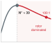{width="100%" fig-alt="Curve of joint acceleration vs. gear ratio that rises in gray to a peak marked N star about 39, then falls in red through a shaded rotor-dominated region, with a red dot marking a 100 to 1 ratio."}

*Past $\InertiaMatchingRatio \approx$ `{python} ReflectedInertia.n_star_str`, gearing chokes acceleration; `{python} ReflectedInertia.n_gear_str`:1 keeps `{python} ReflectedInertia.accel_share_pct_str`.*
:::

Abrupt changes in commanded torque excite the torsional elasticity of geared joints before the physical link responds. Bounding joint acceleration and jerk moderates this excitation, but software trajectory smoothing cannot override mechanical resonance. Trajectory generators formulate control profiles that respect these physical boundaries [@lynch2017modern]; the hardware platform must provide the empirical response rates and contact stiffness limits required to tune them.

::: {.column-margin .margin-pointer}
↪ Trajectory timing under joint torque and jerk bounds is developed in @sec-planning-time-parameterization.
:::

### Transmission compliance, contact impedance, and tooth fracture {#sec-body-transmission-compliance}

Mechanical gearboxes introduce backlash and elasticity that decouple the motor from the driven link. Upon direction reversal, the motor shaft traverses mechanical clearance before the gear teeth engage the opposing flank. Concurrently, as illustrated by the disassembled strain wave gear set in @fig-02-real-strain-wave-gear, torsional compliance in gear teeth and flexible elements[^fn-strain-wave-origin] transforms the rigid link into an elastic system [@spong1987modeling], whose dynamics follow the flexible-joint formulation given in @sec-appendix-control-flexible-joints. Step changes in torque excite this structural spring, driving the drivetrain into limit-cycle[^fn-limit-cycle-backlash] chatter. Motor-side encoders conceal this deadband completely: the motor rotates smoothly while the output shaft remains pinned, causing link position $\LinkOutputPosition$ to diverge from $\MotorShaftPosition / \GearReductionRatio$ by a load-dependent deflection $\LostMotionDeflection$. The motor controller observes flawless setpoint tracking while the end-effector stalls, eventually experiencing an impulsive impact when the gear teeth make contact. Repeated shock cycles culminate in the root fatigue failure shown in @fig-02-real-broken-gear-tooth.

[^fn-strain-wave-origin]: **Strain Wave Gearing**\index{Strain wave gearing!origin}: @musser1959strain patented the mechanism, now sold as the Harmonic Drive: an elliptical wave generator flexes a thin toothed cup inside a rigid ring that carries two more teeth, so a single stage yields a high ratio with near-zero backlash. The flexing that makes the ratio possible is also the joint's torsional compliance, which makes the link elastic.

[^fn-limit-cycle-backlash]: **Limit Cycle**\index{Limit cycle!backlash}: A self-sustained oscillation of fixed amplitude that a nonlinear feedback loop settles into, here excited by the backlash deadband as the motor crosses the gap, the teeth strike, and the controller corrects back across it. Unlike an instability, it does not grow, so it can run unnoticed through a shift while every cycle adds a tooth impact to the fatigue count.

::: {#fig-02-real-strain-wave-gear fig-env="figure" fig-pos="t" fig-cap="**Strain wave gear set**: The three parts of a Harmonic Drive strain wave gear, disassembled: the elliptical wave generator with its thin-race ball bearing (top left), the flexspline cup with external teeth on its open rim (top right), and the rigid circular spline ring with internal teeth (bottom). The wave generator bends the flexspline so that its teeth mesh with the circular spline at two opposite zones; because the flexspline carries slightly fewer teeth, each turn of the wave generator advances it by only that difference, which gives a high reduction with little backlash. (Credit: Pieceofmetalwork, Wikimedia Commons, CC BY-SA 4.0.)" fig-alt="Photograph of three machined steel parts on a white surface: a round ball bearing assembly at top left, a cylindrical cup with fine teeth around its rim at top right, and a flat ring with fine internal teeth and bolt holes at the bottom."}
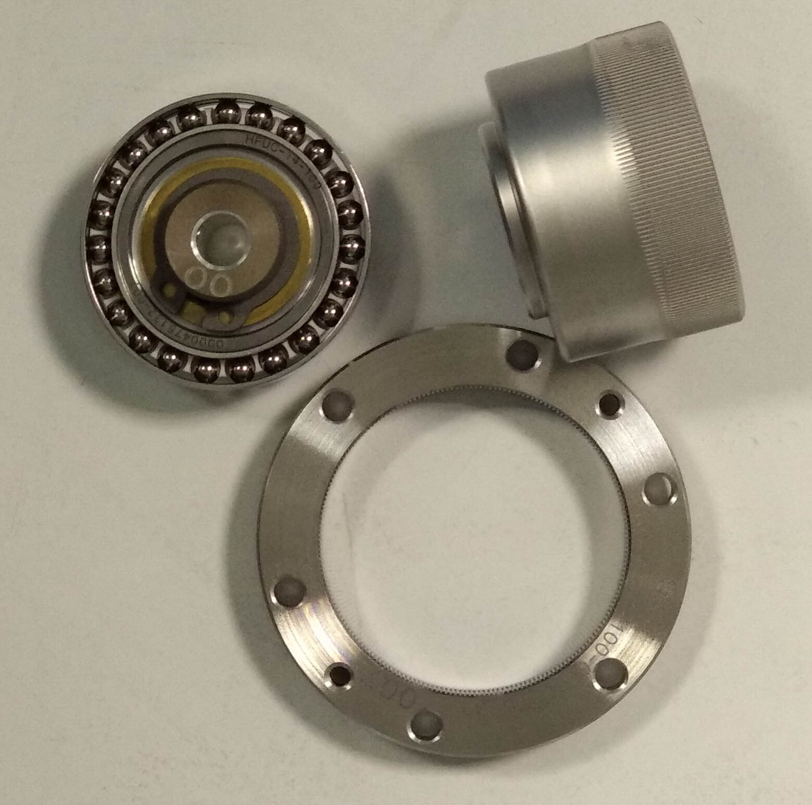{width="70%"}
:::

The strain wave gear of @fig-02-real-strain-wave-gear packs a high reduction into a compact joint by deforming its flexspline continuously, and that elasticity has a cost. This intentional compliance decouples rotor position from link position under dynamic loading: while the motor encoder registers smooth rotation, the flexspline winds up like a torsion spring, introducing unmeasured end-effector deflection.

::: {#fig-02-real-broken-gear-tooth fig-env="figure" fig-pos="t" fig-cap="**Broken gear tooth**: A spur gear from gear research at the NASA Lewis (now Glenn) Research Center, photographed in 1974, with one tooth broken away at its root and the fragment lying in the gap. The root is where a tooth's bending stress concentrates, so repeated or impulsive loading that the transmission passes to the teeth ends here. (Credit: Martin Brown, NASA Glenn Research Center, via the U.S. National Archives, NARA 17417956, public domain.)" fig-alt="Black-and-white close-up of the edge of a spur gear showing several teeth; the middle tooth has broken off at its base, and the broken piece sits in the gap next to a curved fragment of the root."}
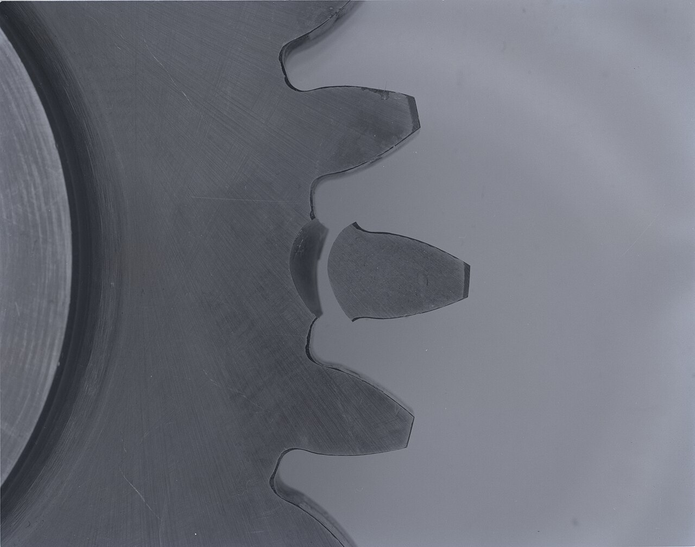{width="65%"}
:::

A tooth broken off at its root (@fig-02-real-broken-gear-tooth) is the end state of that loading. Such failures show why dynamic impact loads, rather than static payload ratings alone, must govern actuator and transmission selection: repeated torque spikes and unmodeled contact shocks concentrate destructive stresses directly at the tooth root fillet. While smooth motion plans mitigate drivetrain vibration, safe physical interaction depends fundamentally on measuring output torque and enforcing strict mechanical load boundaries.

```{python}
#| label: body-latch-contact-rate-calc
#| echo: false
#| warning: false
#| message: false
# ┌─────────────────────────────────────────────────────────────────────────────
# │ CONTACT FORCE RISE AT THE CAGE-DOOR LATCH (LEGO)
# ├─────────────────────────────────────────────────────────────────────────────
# │ Context: @psp-body-impedance-control in @sec-body-actuator-limits.
# │ Goal:    Seed the companion contact budget: once the gripper meets the
# │          latch's strike plate, force rises as F = k v t.
# │ Show:    4.0e5 N/m plate: 12 N/ms at the guarded 0.03 m/s approach and
# │          40 N/ms at 0.10 m/s, against the 100 N latch limit.
# │ How:     Force rate k*v from AISLE latch fields. No deadline here;
# │          @sec-training owns the contact deadlines.
# └─────────────────────────────────────────────────────────────────────────────
from mlsysim import *
from mlsysim.core.units import *
from mlsysim.fmt import fmt_force, fmt_force_rate, fmt_sci_qty, fmt_velocity, check

AISLE = Embodied.Scenario.WarehouseAisle

class LatchContactRate:
    """Contact-force rise rate F = k v t at the cage-door latch."""

    # ┌── 1. LOAD (Constants & Parameters) ─────────────────────────────────
    k_latch = AISLE.k_latch  # category: illustrative (strike-plate stiffness)
    v_guarded = AISLE.v_latch_approach  # category: illustrative (guarded approach)
    v_high = AISLE.v_latch_high  # category: illustrative (unsupported approach)
    f_limit = AISLE.f_latch_limit  # category: illustrative (latch force limit)

    # ┌── 2. EXECUTE (Compute) ─────────────────────────────────────────────
    rate_guarded = (k_latch * v_guarded).to(ureg.newton / millisecond)
    rate_high = (k_latch * v_high).to(ureg.newton / millisecond)

    # ┌── 3. GUARD (Invariants) ───────────────────────────────────────────
    check(abs(k_latch.to(ureg.newton / meter).magnitude - 4.0e5) < 1e-6, f"Unexpected plate stiffness: {k_latch}")
    check(abs(rate_guarded.magnitude - 12.0) < 1e-9, f"Guarded force rate must be 12 N/ms: {rate_guarded}")
    check(abs(rate_high.magnitude - 40.0) < 1e-9, f"High-speed force rate must be 40 N/ms: {rate_high}")
    check(abs(f_limit.to(ureg.newton).magnitude - 100.0) < 1e-9, f"Unexpected latch limit: {f_limit}")

    # ┌── 4. OUTPUT (Formatting) ──────────────────────────────────────────
    k_latch_str = fmt_sci_qty(k_latch, ureg.newton / meter, precision=1)
    v_guarded_str = fmt_velocity(v_guarded, unit=meter / second, precision=2)
    v_high_str = fmt_velocity(v_high, unit=meter / second, precision=2)
    rate_guarded_str = fmt_force_rate(rate_guarded, unit=ureg.newton / millisecond, precision=0)
    rate_high_str = fmt_force_rate(rate_high, unit=ureg.newton / millisecond, precision=0)
    f_limit_str = fmt_force(f_limit, precision=0)
```

::: {#psp-body-impedance-control .callout-perspective title="Impedance control for contact safety"}
When a position-controlled robot encounters a rigid surface (contact stiffness $\ContactStiffness \ge 10^5\text{ N/m}$), a minor setpoint tracking error of $\FiniteChange \ContactPointPosition = 1\text{ mm}$ escalates the contact force to $\ContactForce = \ContactStiffness \FiniteChange \ContactPointPosition = 100\text{ N}$ within milliseconds as the inverter commands maximum current against the obstacle. On the mobile manipulator, the gripper contacting the spring-latched door strikes a steel plate with stiffness `{python} LatchContactRate.k_latch_str`. Once impact occurs, contact force ramps at $\ContactForce = \ContactStiffness \ContactApproachSpeed \TimeInstant$: `{python} LatchContactRate.rate_guarded_str` under a guarded approach velocity of `{python} LatchContactRate.v_guarded_str`, and `{python} LatchContactRate.rate_high_str` at an unconstrained `{python} LatchContactRate.v_high_str`, rapidly exceeding the latch's `{python} LatchContactRate.f_limit_str` structural limit.

Impedance control [@hogan1985impedance] reformulates contact interactions away from pure position or force control. An impedance takes motion in and returns force; an admittance takes force in and returns motion. Because a rigid environment behaves as an admittance, yielding motion only when pushed, the manipulator is made to behave as an impedance, which answers a deviation in position and velocity with a restoring force ($\ContactForce = \MechanicalImpedanceMap(\ContactDirectionVelocity)$, force as a function of the imposed motion). The joint drive controller realizes this relationship by emulating a **virtual spring-damper system**\index{Virtual spring-damper system!definition}:
$$\ContactForce = \PidProportionalGain (\DesiredContactPosition - \ContactPointPosition) + \PidDerivativeGain (\DesiredContactVelocity - \ContactDirectionVelocity)$$
The stiffness $\PidProportionalGain$ multiplies the position error and the damping $\PidDerivativeGain$ the velocity error, the roles a proportional and a derivative gain play in a feedback controller. Tuning them in software causes the arm to yield compliantly under tracking errors, shedding peak impact loads. However, closed-loop impedance behavior is physically bounded by current-loop update rates, inverter voltage headroom, and unmodeled joint elasticity; algebraic control laws cannot alter the unyielding inertia of the rotor during the first milliseconds of an impact. The runtime permission path must therefore enforce approach speed limits derived from physical contact qualification rather than relying on software compliance alone. The impedance command interface, through which a learned policy proposes these gains and the permission path validates them before admission, is defined in @sec-nervous-command-interface.
:::

### Actuation regimes and gear reduction trade-offs {#sec-body-actuation-regimes}

The scaling disparity underlying inertia matching, in which output torque scales linearly with ratio ($\JointOutputTorque = \GearboxTransmissionEfficiency \GearReductionRatio \MotorTorque$) while reflected inertia scales quadratically ($\GearReductionRatio^2$), divides robotic actuation into three primary regimes. These regimes trade continuous torque density against mechanical backdrivability, distinguished by gear design, stage count, and reduction ratio (@tbl-02-mechanical-drives). At the lowest ratios, **quasi-direct drive (QDD)**\index{Quasi-direct drive!definition} pairs an outrunner or high-torque motor with a single compact reduction stage.

| Transmission                                    | Gear Ratio ($\GearReductionRatio$)                     | Reflected Inertia ($\GearReductionRatio^2$)                    | Implication for Learned Policies                                                                                                 |
|:------------------------------------------------|:-------------------------------------------------------|:---------------------------------------------------------------|:---------------------------------------------------------------------------------------------------------------------------------|
| **Quasi-Direct Drive (single-stage planetary)** | $3:1\text{--}10:1$ ($\GearReductionRatio \le 10$)      | $\GearReductionRatio^2 \le 100$ (Low)                          | Lower reflected inertia supports backdriving and current-based torque estimation; contact response still requires qualification. |
| **Multistage Planetary**                        | $15:1\text{--}50:1$ ($\GearReductionRatio \approx 30$) | $\GearReductionRatio^2 \approx 225\text{--}2{,}500$ (Moderate) | Semi-backdrivable; a smaller motor than QDD for the same output torque; gear backlash requires load-side joint sensing.          |
| **Strain Wave (Harmonic Drive)**                | $50:1\text{--}160:1$ ($\GearReductionRatio \ge 50$)    | $\GearReductionRatio^2 \ge 2{,}500\text{--}25{,}600$ (Extreme) | High reflected inertia; zero initial backlash; torsional compliance and impact loading require qualification.                    |

: **Actuator transmission trade-off**: Reduction ratio ($\GearReductionRatio$), reflected rotor inertia scaling ($\GearReductionRatio^2$), and the consequence for learned control policies across quasi-direct-drive (a single low-ratio planetary stage), multistage planetary, and strain wave transmissions. The strain wave range is that of one catalog series [@harmonicdrive2014csg2uh]. {#tbl-02-mechanical-drives tbl-colwidths="[22,18,20,40]"}

Actuator selection must satisfy continuous torque targets and permissible contact dynamics simultaneously. Direct-drive configurations eliminate gear backlash entirely, but require large, heavy motors to produce holding torque [@asada1983design]. Increasing the gear ratio permits a much smaller motor to produce equivalent output torque, but introduces reflected inertia, friction, and transmission compliance.

Motor thermal limits and torque requirements intersect in a fundamental electromagnetic figure of merit. Stator resistive losses follow $\WindingLossPower = \TorqueProducingCurrent^2 \EffectiveLossResistance$, where $\EffectiveLossResistance$ is the winding's effective loss resistance, while electromagnetic torque follows $\MotorTorque = \MotorTorqueConstant \TorqueProducingCurrent$. Combining these expressions reveals that resistive dissipation scales with the square of motor torque: $\WindingLossPower = (\MotorTorque / \MotorConstant)^2$, where the **motor constant**\index{Motor constant!definition} $\MotorConstant = \MotorTorqueConstant / \sqrt{\EffectiveLossResistance}$ (in $\text{N}\cdot\text{m}/\sqrt{\text{W}}$) captures the motor's torque-producing capacity per square root of dissipated heat. Motor datasheets specify this parameter directly [@tq2014ilm]; @sec-body-thermal-capacity relates $\EffectiveLossResistance$ to the phase and line-to-line resistances of @sec-body-electrical-time-constants. When driving a mechanical transmission of ratio $\GearReductionRatio$ and efficiency $\GearboxTransmissionEfficiency$, the motor must supply an internal torque of $\JointOutputTorque/(\GearboxTransmissionEfficiency \GearReductionRatio)$, resulting in:
$$\WindingLossPower = \left(\frac{\JointOutputTorque}{\GearboxTransmissionEfficiency \GearReductionRatio \MotorConstant}\right)^2, \qquad \ReflectedTransmissionInputInertia = \GearReductionRatio^2 \TransmissionInputInertia$$
where $\TransmissionInputInertia$ represents total input inertia (the rotor plus the transmission input stage), and $\ReflectedTransmissionInputInertia$ is that combined inertia reflected to the joint output. Increasing the reduction ratio $\GearReductionRatio$ reduces winding heat by $\GearReductionRatio^2$ while multiplying reflected inertia by $\GearReductionRatio^2$. Consequently, for a selected motor and gearbox geometry, their product is completely invariant to the gear ratio:
$$\WindingLossPower\,\ReflectedTransmissionInputInertia = \frac{\JointOutputTorque^2\,\TransmissionInputInertia}{\GearboxTransmissionEfficiency^2 \MotorConstant^2}$$ {#eq-body-heat-inertia-product}
Adjusting $\GearReductionRatio$ merely relocates the actuator along a fixed trade-off curve between thermal dissipation and reflected inertia. Improving both characteristics concurrently requires selecting a motor with a superior ratio of $\MotorConstant^2/\TransmissionInputInertia$. Notebook \ref{nbk-body-gear-ratio-cost} evaluates this trade-off for the mobile manipulator's arm joints.

```{python}
#| label: body-gear-ratio-cost-calc
#| echo: false
#| warning: false
#| message: false
# ┌─────────────────────────────────────────────────────────────────────────────
# │ WHAT THE GEAR RATIO COSTS IN HEAT AND REFLECTED INERTIA (LEGO)
# ├─────────────────────────────────────────────────────────────────────────────
# │ Context: \ref{nbk-body-gear-ratio-cost} in @sec-body-actuation-regimes, the
# │          continuous-torque paragraph in @sec-body-thermal-capacity, and the
# │          gear efficiency of \ref{nbk-body-thermal-stall-derating}.
# │ Goal:    Price the gear ratio for the arm's Panda-class stand-in joint
# │          holding the arm's 87 N m maximum joint torque: copper loss and
# │          reflected inertia at 50:1 and 100:1, and feasibility at a QDD-class
# │          10:1, with the same TQ ILM 70x18 motor.
# │ Show:    K_m = 0.187/sqrt(0.495) = 0.266 N m/sqrt(W) (matches the data
# │          sheet); 50:1: 2.05 N m, 59.3 W, 0.1835 kg m^2; 100:1: 1.02 N m,
# │          14.8 W, 0.734 kg m^2; product 10.9 W kg m^2 at both; 10:1 needs
# │          10.2 N m, 2.5 times the 4.05 N m motor peak. Motor rated 1.25 N m,
# │          peak 4.05 N m (ratio 3.2).
# │ How:     P = (tau_out / (eta N K_m))^2 with K_m = K_t / sqrt(R_loss);
# │          J_ref = N^2 J_in with J_in = rotor + gear input inertia (the
# │          catalog lists one input inertia per gear size).
# └─────────────────────────────────────────────────────────────────────────────
from mlsysim import *
from mlsysim.core.units import *
from mlsysim.fmt import (
    fmt,
    fmt_qty,
    fmt_int,
    fmt_torque,
    fmt_torque_constant,
    fmt_resistance,
    fmt_power,
    fmt_inertia,
    fmt_sci_qty,
    fmt_multiple,
    fmt_ratio,
    check,
)

class GearRatioCost:
    """Copper loss and reflected inertia against gear ratio for the arm's stand-in joint."""

    # ┌── 1. LOAD (Constants & Parameters) ─────────────────────────────────
    joint = Actuators.PandaClassJoint.CSG_25_50_ILM70x18  # category: sourced (CSG-25-50 gear with TQ ILM 70x18 motor)
    motor = Actuators.FramelessMotor.TQ_ILM70x18  # category: sourced (TQ-RoboDrive data sheet)
    tau_out = Embodied.Manipulator.Panda.max_torque  # category: sourced (Panda axes 1-4 maximum joint torque, Franka control limits)
    k_t = motor.torque_constant  # category: sourced (amplitude-invariant i_q, i_d = 0)
    r_loss = joint.internal_resistance  # category: sourced (0.75 R_TT at 20 C)
    j_in = joint.rotor_inertia  # category: sourced (motor rotor plus CSG-25 input inertia)
    n_joint = joint.gear_ratio  # category: sourced (CSG-25-50)
    n_high = 100  # category: chosen (a catalog CSG-25 ratio)
    n_qdd = 10  # category: illustrative (quasi-direct-drive class ratio)
    eta = 0.85  # category: illustrative (gear efficiency; the catalog's varies with load, speed, and temperature)

    # ┌── 2. EXECUTE (Compute) ─────────────────────────────────────────────
    k_m = (k_t / r_loss**0.5).to(ureg.newton * meter / ureg.watt**0.5)
    tau_m_joint = (tau_out / (eta * n_joint)).to(ureg.newton * meter)
    tau_m_high = (tau_out / (eta * n_high)).to(ureg.newton * meter)
    tau_m_qdd = (tau_out / (eta * n_qdd)).to(ureg.newton * meter)
    p_joint = ((tau_m_joint / k_m) ** 2).to(ureg.watt)
    p_high = ((tau_m_high / k_m) ** 2).to(ureg.watt)
    j_ref_joint = (n_joint**2 * j_in).to(kilogram * meter**2)
    j_ref_high = (n_high**2 * j_in).to(kilogram * meter**2)
    product_joint = (p_joint * j_ref_joint).to(ureg.watt * kilogram * meter**2)
    product_high = (p_high * j_ref_high).to(ureg.watt * kilogram * meter**2)
    qdd_over_peak = (tau_m_qdd / motor.peak_torque).to("dimensionless").magnitude
    peak_over_rated = (motor.peak_torque / motor.rated_torque).to("dimensionless").magnitude

    # ┌── 3. GUARD (Invariants) ───────────────────────────────────────────
    check(abs(k_m.magnitude - motor.motor_constant.magnitude) < 1e-3, "K_t / sqrt(R) must match the data sheet's motor constant.")
    check(abs(p_joint.magnitude - 59.32) < 0.01, f"Loss at 50:1 must match the stall notebook's 59.3 W: {p_joint}")
    check(abs(p_high.magnitude - p_joint.magnitude / 4) < 1e-9, "Doubling N must quarter the loss.")
    check(abs(j_ref_joint.magnitude - 0.1835) < 1e-4, f"Unexpected reflected inertia at 50:1: {j_ref_joint}")
    check(abs(product_joint.magnitude - product_high.magnitude) < 1e-9, "Loss times reflected inertia must not depend on N.")
    check(abs(tau_m_qdd.magnitude - 10.235) < 1e-3 and qdd_over_peak > 1, f"QDD-class ratio must exceed the motor peak: {tau_m_qdd}")
    check(abs(peak_over_rated - 3.24) < 1e-9, f"Unexpected peak-to-rated torque ratio: {peak_over_rated}")

    # ┌── 4. OUTPUT (Formatting) ──────────────────────────────────────────
    tau_out_str = fmt_torque(tau_out, precision=0)
    k_t_str = fmt_torque_constant(k_t, precision=3)
    r_loss_str = fmt_resistance(r_loss, unit=ureg.ohm, precision=3)
    k_m_str = fmt_motor_constant(k_m, precision=3)
    n_joint_str = fmt_int(n_joint)
    n_high_str = fmt_int(n_high)
    n_qdd_str = fmt_int(n_qdd)
    eta_str = fmt(eta, precision=2)
    j_in_str = fmt_sci_qty(j_in, kilogram * meter**2, precision=2)
    tau_m_joint_str = fmt_torque(tau_m_joint, precision=2)
    tau_m_high_str = fmt_torque(tau_m_high, precision=2)
    tau_m_qdd_str = fmt_torque(tau_m_qdd, precision=1)
    p_joint_str = fmt_power(p_joint, unit=ureg.watt, precision=1)
    p_high_str = fmt_power(p_high, unit=ureg.watt, precision=1)
    j_ref_joint_str = fmt_inertia(j_ref_joint, precision=3)
    j_ref_high_str = fmt_inertia(j_ref_high, precision=3)
    peak_str = fmt_torque(motor.peak_torque, precision=2)
    rated_str = fmt_torque(motor.rated_torque, precision=2)
    qdd_over_peak_mult_str = fmt_multiple(qdd_over_peak, precision=1)
    peak_over_rated_str = fmt_ratio(peak_over_rated, precision=1)
```

::: {#nbk-body-gear-ratio-cost .callout-notebook title="What does the gear ratio cost?"}
The running machine's arm is a seven-joint, torque-sensing manipulator in the class of the Franka Emika Panda [@franka2018panda], whose joints use strain-wave gears (@sec-appendix-systems-machine-data-sheet). Franka does not publish the motors in those joints, so this example, like the thermal examples of @sec-body-thermal-duty-cycles, uses a sourced stand-in: a TQ-RoboDrive ILM 70x18 frameless motor [@tq2014ilm] with $\MotorTorqueConstant =$ `{python} GearRatioCost.k_t_str` and effective loss resistance $\EffectiveLossResistance =$ `{python} GearRatioCost.r_loss_str`, driving a CSG-25 strain-wave gear [@harmonicdrive2014csg2uh], whose catalog lists one input inertia for all of that size's ratios. Rotor plus gear input give $\TransmissionInputInertia =$ `{python} GearRatioCost.j_in_str`. The joint must hold the arm's maximum joint torque $\JointOutputTorque =$ `{python} GearRatioCost.tau_out_str` through a gear of efficiency $\GearboxTransmissionEfficiency =$ `{python} GearRatioCost.eta_str` (illustrative).

**Problem**: How do the copper loss and the reflected inertia change if the same motor drives the joint through `{python} GearRatioCost.n_joint_str`:1, `{python} GearRatioCost.n_high_str`:1, or a quasi-direct-drive ratio of `{python} GearRatioCost.n_qdd_str`:1?

**Math**:

1. **Motor constant**: $\MotorConstant = \MotorTorqueConstant/\sqrt{\EffectiveLossResistance} =$ `{python} GearRatioCost.k_m_str`, the value the motor's data sheet publishes.
2. **At `{python} GearRatioCost.n_joint_str`:1**: The motor supplies $\JointOutputTorque/(\GearboxTransmissionEfficiency \GearReductionRatio) =$ `{python} GearRatioCost.tau_m_joint_str`, dissipating $(\MotorTorque/\MotorConstant)^2 =$ `{python} GearRatioCost.p_joint_str`, and the joint reflects $\GearReductionRatio^2 \TransmissionInputInertia =$ `{python} GearRatioCost.j_ref_joint_str`.
3. **At `{python} GearRatioCost.n_high_str`:1**: The motor supplies `{python} GearRatioCost.tau_m_high_str`, the loss falls fourfold to `{python} GearRatioCost.p_high_str`, and the reflected inertia rises fourfold to `{python} GearRatioCost.j_ref_high_str`. The product $\WindingLossPower \ReflectedTransmissionInputInertia$ is unchanged.
4. **At `{python} GearRatioCost.n_qdd_str`:1**: The motor would have to supply `{python} GearRatioCost.tau_m_qdd_str`, `{python} GearRatioCost.qdd_over_peak_mult_str` its `{python} GearRatioCost.peak_str` peak torque. No current can make this motor hold the load.

**Result**: Doubling the ratio buys a fourfold cut in holding heat with a fourfold rise in the inertia that an impact must accelerate, and lowering the ratio toward quasi-direct drive fails outright with this motor. The gear ratio moves the joint along a fixed trade; only the motor sets the trade itself.

**Systems insight**: A low-ratio, backdrivable joint requires a motor with a much larger torque per square root of watt, the route quasi-direct drive takes. A high-ratio arm joint instead accepts the reflected inertia and recovers contact sensitivity by measuring torque at its output.
:::

Mechanical backdrivability measures the ease with which an external load applied at the joint output rotates the motor shaft backward through the transmission. The external torque required to backdrive a geared joint is:
$$\ExternalJointTorque = \GearReductionRatio^2 \RotorInertia \JointAcceleration + \JointFrictionTorque$$
where $\JointFrictionTorque$ denotes total joint friction referred to the output link. This friction varies dynamically with operating state [@lynch2017modern]: breakaway static friction dominates at rest, Coulomb friction opposes motion at constant levels, and viscous damping grows with velocity, accompanied by Stribeck effects at near-zero speeds. Furthermore, gear tooth mesh friction scales with transmitted load, ambient temperature, and lubrication aging. At low velocities, friction dominates the resistance of high-reduction gearboxes; during sudden impacts, reflected rotor inertia dominates. As a result, backdrivability must be verified through empirical load testing on the assembled joint rather than inferred from the reduction ratio alone.

Quasi-direct drive actuation[^fn-qdd-drive-lineage] is the low-ratio route of notebook \ref{nbk-body-gear-ratio-cost}, pairing large-diameter, high-torque motors with a single modest reduction stage [@seok2015design; @wensing2017proprioceptive; @katz2019mini]. Minimizing reflected inertia and internal friction maximizes mechanical transparency, the fidelity with which external interaction forces translate into measurable motor motion and winding currents. The penalty is a substantially heavier motor demand for any given output torque.

Mechanical transparency also dictates what motor currents reveal about contact states. In high-friction gearboxes, motor current primarily overcomes internal transmission losses rather than external loads. Conversely, when transmission friction and inertial resistance remain small, output torque simplifies to:
$$\JointOutputTorque \approx \GearboxTransmissionEfficiency \GearReductionRatio \MotorTorqueConstant \TorqueProducingCurrent$$
This relationship enables **proprioceptive sensing**, allowing the controller to estimate interaction forces directly from motor current without specialized external sensors. However, accurate estimation requires rigorous calibration across operating temperatures and speeds; current setpoints measure motor electromagnetic effort, portions of which are absorbed by acceleration and drivetrain losses. While backdrivability allows external collisions to displace the joint without shearing gear teeth, low gearing and motor current sensing do not guarantee safe contact forces. High link velocities can still impart severe impulsive shock before the current controller can respond; safe interaction mandates qualifying the total closed-loop contact response.

High-reduction joints overcome transmission friction by sensing torque directly at the joint output. Strain gauge torque sensors mounted on the output side of strain wave gearboxes measure delivered torque directly, allowing closed-loop current controllers to cancel gearbox friction and cogging torque [@lynch2017modern]. The running machine's arm adopts this approach, integrating torque sensors within each of its seven joints [@franka2018panda] to achieve transparency through measurement rather than low mechanical reduction. The engineering cost includes increased joint complexity, elevated mass, and the torsional compliance of the strain wave flexsplines, which complicates high-bandwidth motion tracking.

[^fn-qdd-drive-lineage]: **Direct and Quasi-Direct Drive**\index{Quasi-direct drive!history}: @asada1983design built manipulators whose motors drove the links with no transmission, eliminating backlash and gear friction at the cost of heavy, bulky motors. The MIT Cheetah group then showed that a large-diameter motor behind a single low-ratio planetary stage keeps most of that transparency while supplying the torque of a dynamic leg [@seok2015design; @wensing2017proprioceptive; @katz2019mini]. That transparency is what made motor current usable as a contact-torque sensor, the proprioceptive estimate written out below.

Whether mechanical transparency originates by construction (quasi-direct drive) or by active measurement (output torque sensing), contact operations require qualifying joint compliance, closed-loop torque response, and dynamic sensing fidelity against the operating environment. Dual-encoder architectures and load-side torque sensors expose internal transmission windup and mechanical backlash that motor-side encoders conceal. When load-side deflection departs from the qualified dynamic envelope, the runtime safety system can immediately intercede and reject subsequent motion commands.

### Supporting drive and impedance models {#sec-body-drive-supporting-models}

Two results this section has used rest on models it has not yet shown: the torque law $\MotorTorque = \MotorTorqueConstant \TorqueProducingCurrent$ quoted in @sec-body-electrical-time-constants, and the claim that a joint's series compliance hides the rotor's reflected inertia from an impact. This subsection supplies both. Inside the physical drive, FOC holds the $\Glyph{d}$-axis current $\DirectAxisCurrent$ of @sec-body-electrical-time-constants at zero, which minimizes stator losses and makes output torque proportional to the $\Glyph{q}$-axis current alone (@sec-appendix-systems-actuators states the voltage equations that govern both currents in the rotating frame):
$$\MotorTorque = \frac{3}{2} \RotorPolePairCount \PermanentMagnetFluxLinkage \TorqueProducingCurrent = \MotorTorqueConstant \TorqueProducingCurrent$$
where $\RotorPolePairCount$ is the number of magnetic pole pairs on the rotor and $\PermanentMagnetFluxLinkage$ is the permanent-magnet flux linkage, the magnetic flux from the rotor magnets that threads each winding. The $\frac{3}{2}$ scaling factor arises from the amplitude-invariant transformation convention adopted in this chapter; motor drive firmware must enforce a transformation convention consistent with the identified torque constant $\MotorTorqueConstant$.

For frequency-domain dynamic analysis, mechanical impedance quantifies the joint's physical resistance to imposed environmental motion. The Laplace variable $\LaplaceVariable$ stands for differentiation in time, so that for a sinusoidal motion of angular frequency $\AngularFrequency$ it can be read as $\LaplaceVariable = \ImaginaryUnit\AngularFrequency$: an impedance term $\LaplaceVariable \RotatingBodyInertia$ grows with frequency like an inertia, and a term $\RotationalSpringStiffness/\LaplaceVariable$ falls with frequency like a spring. The apparent mechanical impedance $\JointOutputImpedance(\LaplaceVariable) = \ExternalJointTorque(\LaplaceVariable) / \JointVelocity(\LaplaceVariable)$ evaluated at the joint output flange couples the load dynamics directly to the reflected rotor dynamics through the drivetrain's torsional stiffness $\TransmissionTorsionalStiffness$. Because the transmission spring acts in series between the rotor and output link, both stages bear equal torque while their angular velocities sum. The spring impedance $\TransmissionTorsionalStiffness/\LaplaceVariable$ and reflected rotor impedance therefore combine through their reciprocal sum [@spong1987modeling]:
$$\JointOutputImpedance(\LaplaceVariable) = \LaplaceVariable \LoadInertia + \OutputBearingDamping + \left[\frac{1}{\LaplaceVariable \GearReductionRatio^2 \RotorInertia + \GearReductionRatio^2 \MotorShaftDamping} + \frac{\LaplaceVariable}{\TransmissionTorsionalStiffness}\right]^{-1}$$
The coefficients $\OutputBearingDamping$ and $\MotorShaftDamping$ account for viscous damping in the output bearings and motor shaft. At low interaction frequencies, the series spring behaves rigidly relative to the rotor, and the environment experiences the aggregate inertia $\LoadInertia + \GearReductionRatio^2 \RotorInertia$ assumed in rigid-body kinematic models. Above the transmission's natural resonance frequency, the bracketed impedance term simplifies toward $\TransmissionTorsionalStiffness/\LaplaceVariable$: external collision forces compress the joint compliance against the link inertia $\LoadInertia$, temporarily isolating the rotor's reflected inertia. This series compliance cushions sudden impacts in flexible drivetrains and series elastic actuators, reinforcing why the flexible-joint dynamic model is necessary to calculate contact loads during manipulation.

::: {#chk-body-actuator-limits .callout-checkpoint title="Actuator limits"}

The drives decide whether the stopping premise can be delivered, and the transmission decides what that delivery costs in heat and inertia.

- [ ] **Torque ceiling**: Can you compute the deceleration ceiling of the two hub drives when their current limit is set at the motor's rated current rather than its peak, and explain why a current limit lowered to protect the windings breaks the stopping premise without any software change?
- [ ] **Current rise**: Can you estimate how long the hub-motor current takes to reach its limit from rest on a depleted pack, and explain why back-EMF at speed helps a braking current but can starve a driving one?
- [ ] **Inertia matching**: Can you explain why the gear ratio that maximizes link acceleration makes reflected rotor inertia equal load inertia ($\GearReductionRatio^2 \RotorInertia = \LoadInertia$), and why oversizing the gearbox for static torque lowers dynamic joint acceleration?
- [ ] **Heat vs. reflected inertia**: Can you explain why, for a given motor and gear, the ratio cannot reduce holding heat and reflected inertia together, and what must change to improve both?

:::

Operating near these electrical and mechanical ceilings exacts an inevitable thermodynamic toll. Every ampere driving the motor against reflected rotor inertia or sustaining peak clamping torque dissipates resistive heat ($\WindingLossPower = \TorqueProducingCurrent^2 \EffectiveLossResistance$) in the stator windings. That thermal energy accumulates directly in the motor's thermal mass, bounding the operational duration of peak torque before winding insulation suffers accelerated thermal degradation.

## Thermal Duty Cycles {#sec-body-thermal-duty-cycles}

Holding a load motionless at full reach places deceptive demands on an articulated arm such as the mobile manipulator's. Maintaining a static load against gravity demands continuous phase current through the stator coils, actively converting electrical energy into accumulating heat. Heat arrives in seconds and leaves in minutes, making duty cycle a primary design variable.

### Thermal capacity and insulation breakdown thresholds {#sec-body-thermal-capacity}

```{python}
#| label: calc-body-insulation-class
#| echo: false
#| warning: false
#| message: false
# ┌─────────────────────────────────────────────────────────────────────────────
# │ INSULATION CLASS F LIMIT (LEGO)
# ├─────────────────────────────────────────────────────────────────────────────
# │ Context: @sec-body-thermal-capacity, the hot-spot paragraph and the
# │          continuous-torque callout, before the thermal notebooks.
# │ Goal:    Print the Class F hot-spot limit from MLSysIM, not by hand.
# │ Show:    155 degC.
# │ How:     mlsysim.INSULATION_CLASS_F_LIMIT (IEC 60085:2007, class 155).
# └─────────────────────────────────────────────────────────────────────────────
from mlsysim import *
from mlsysim.core.units import *
from mlsysim.fmt import fmt_temperature, check

class InsulationClass:
    """The Class F hot-spot limit that the thermal budgets are held to."""

    # ┌── 1. LOAD (Constants & Parameters) ─────────────────────────────────
    t_limit = INSULATION_CLASS_F_LIMIT  # category: sourced (IEC 60085 Class F hotspot)

    # ┌── 3. GUARD (Invariants) ───────────────────────────────────────────
    check(abs(t_limit.to(ureg.degC).magnitude - 155.0) < 1e-9, f"Class F limit drifted: {t_limit}")

    # ┌── 4. OUTPUT (Format & Export) ────────────────────────────────────────
    t_limit_str = fmt_temperature(t_limit, unit=ureg.degC, precision=0)
```

In classical mechanics, holding a stationary mass stationary involves zero mechanical work ($\MechanicalWork = \int \AppliedForce \cdot d\BodyDisplacement = 0$). In an electromechanical robot, however, sustaining holding torque against gravity requires continuous phase current to produce magnetic Lorentz force ($\MotorTorque = \MotorTorqueConstant \TorqueProducingCurrent$). The lumped thermal model uses $\TorqueProducingCurrent$ in the same convention as its torque constant $\MotorTorqueConstant$. Here $\EffectiveLossResistance$ denotes the effective aggregate loss resistance for that current, so total winding copper loss is:
$$\WindingLossPower = \TorqueProducingCurrent^2 \EffectiveLossResistance = \frac{\MotorTorque^2}{\MotorTorqueConstant^2} \EffectiveLossResistance$$
For the amplitude-invariant drive convention above, with balanced phase currents and $\DirectAxisCurrent=0$, this effective resistance is $\EffectiveLossResistance=\frac{3}{2}\PhaseResistance$, where $\PhaseResistance$ is resistance per phase. Three resistances of one winding therefore appear in this chapter. The phase resistance $\PhaseResistance$ belongs in the Kirchhoff equation of @sec-body-electrical-time-constants. Datasheets quote the line-to-line value measured between two terminals, which for a star-connected winding spans two phases, $2\PhaseResistance$; the hub-motor current-rise example used that line value with the line inductance, whose ratio gives the same time constant. The thermal calculations use $\EffectiveLossResistance = \frac{3}{2}\PhaseResistance$, three quarters of the line-to-line value, and every winding resistance in them, including $\ElectricalResistance(\WindingTemperature)$, is this effective resistance. The following illustrative thermal examples stipulate it and the matching current convention.

This equation reveals the fundamental physical identity of electric actuation: **torque is current, and current is heat.** Commanded torque scales linearly with current ($\MotorTorque = \MotorTorqueConstant \TorqueProducingCurrent$), but stator copper loss scales **quadratically with torque** ($\MotorTorque^2$). Demanding twice the torque requires four times the thermal dissipation. Because heat has no fast exit, thermal accumulation limits how long an arm can maintain static poses or execute dynamic bursts without mechanical brakes.

Reducing motor current to shed heat also reduces holding torque. A loaded arm therefore needs a response that preserves support, such as transferring the load to a mechanical brake, rather than assuming that thermal derating leaves the task unchanged. Excess winding temperature can damage electrical insulation, while excess rotor temperature can permanently reduce magnet strength. Those material limits bound the allowable temperature trajectory.

The winding and housing respond on different timescales. Copper heats rapidly under current, while the larger core and housing absorb and reject heat more slowly. A case temperature measurement can therefore lag the winding hotspot during a torque burst. The stator in @fig-02-real-burnt-motor-stator failed from overheating, and its damage sits where this model puts the heat: in the copper windings and the insulation between them.

::: {#fig-02-real-burnt-motor-stator fig-env="figure" fig-pos="t" fig-cap="**Motor stator damaged by overheating**: The opened stator of an electric motor that failed from overheating, showing the copper phase windings bound with tape at left, the insulating slot liners where the windings leave the laminated iron core, and the end bell with its bearing seat at right. The windings are where resistive heat ($\WindingLossPower = \TorqueProducingCurrent^2 \EffectiveLossResistance$) is generated, and the insulation between them is what accumulated heat ages. (Credit: K. Kudelina, Wikimedia Commons, CC BY 4.0.)" fig-alt="Color photograph looking into an opened electric motor stator: dark copper wire windings bound with fabric tape on the left, pale insulation paper protruding from slots in a laminated steel core that recedes toward the right, and a round end bell with a bearing seat at the far right."}
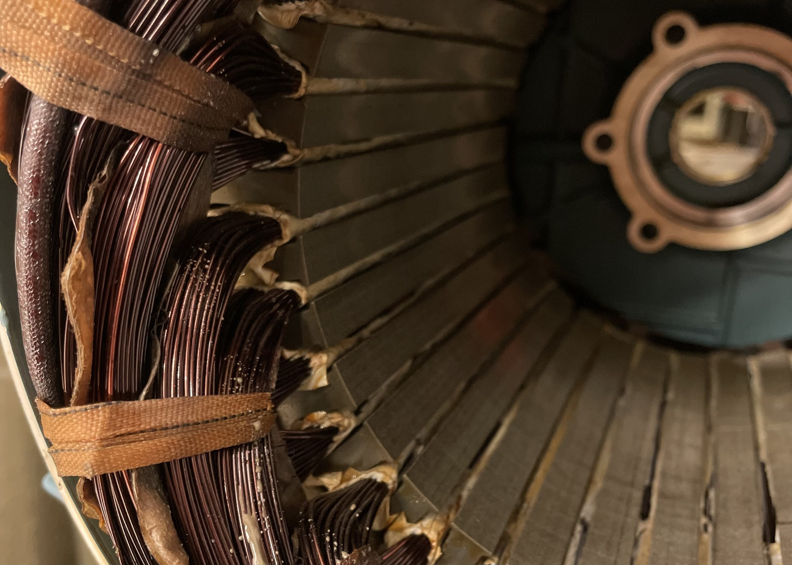{width="85%"}
:::

A thermal model follows the same energy accounting as the stopping calculation: energy accumulates where the rate entering exceeds the rate leaving. Here the winding receives electrical losses and transfers heat to the core; the core transfers heat to the surroundings. Thermal capacitance measures how much energy raises a component's temperature, while thermal resistance measures how strongly the heat-flow path resists that transfer. Representing the winding and core separately gives the two-node lumped-parameter thermal ordinary differential equation (ODE) system:
$$\begin{aligned}
\WindingThermalCapacitance \frac{d\WindingTemperature(\TimeInstant)}{d\TimeInstant} &= \WindingLossPower(\TimeInstant) - \frac{\WindingTemperature(\TimeInstant) - \StatorCoreTemperature(\TimeInstant)}{\WindingCoreThermalResistance} \\
\CoreThermalCapacitance \frac{d\StatorCoreTemperature(\TimeInstant)}{d\TimeInstant} &= \frac{\WindingTemperature(\TimeInstant) - \StatorCoreTemperature(\TimeInstant)}{\WindingCoreThermalResistance} - \frac{\StatorCoreTemperature(\TimeInstant) - \AmbientTemperature}{\CoreAmbientThermalResistance}
\end{aligned}$$
where $\WindingLossPower(\TimeInstant) = \TorqueProducingCurrent^2(\TimeInstant) \ElectricalResistance(\WindingTemperature) = \frac{\MotorTorque^2(\TimeInstant)}{\MotorTorqueConstant^2} \ElectricalResistance(\WindingTemperature)$ is the Joule dissipation source deposited directly into the copper coils, $\WindingThermalCapacitance$ is the small thermal capacitance of the winding, $\CoreThermalCapacitance$ is the large thermal capacitance of the laminated stator core and housing, $\WindingCoreThermalResistance$ is the conductive thermal resistance from winding to core, and $\CoreAmbientThermalResistance$ is the convective thermal resistance from core to ambient air.

This separation of timescales creates a dangerous observability gap. Because $\WindingThermalCapacitance \ll \CoreThermalCapacitance$, under a sudden peak torque burst or sustained stall against gravity, the stator core temperature $\StatorCoreTemperature$ remains virtually clamped over the initial seconds by its large thermal inertia. The internal copper winding temperature surges at the initial adiabatic rate:
$$\left.\frac{d\WindingTemperature}{d\TimeInstant}\right|_{t=0} \approx \frac{\WindingLossPower}{\WindingThermalCapacitance}$$
Under sustained peak torque, the internal copper hotspot $\WindingTemperature$ can climb past the `{python} InsulationClass.t_limit_str` Class F rating within tens of seconds (notebook \ref{nbk-body-thermal-burst-limits}) while an external thermistor bonded to the motor casing still reads far below the hotspot. The class temperature is not a cliff at which the insulation fails. IEC 60085 assigns it as the hot-spot temperature at which an insulation system reaches its rated life [@iec60085-2007], and insulation aging[^fn-insulation-aging-rate] proceeds as a chemical reaction whose rate grows exponentially with temperature [@dakin1948electrical]. Every excursion above the rating therefore spends insulation life faster than the rating assumes, and the accumulated aging culminates in the insulation charring and turn-to-turn electrical failures documented in @fig-02-real-burnt-motor-stator. A thermal budget must count accumulated exposure as well as the instantaneous peak.

[^fn-insulation-aging-rate]: **Thermal Aging as an Exchange Rate**\index{Insulation aging!loading by temperature}: The engineering practice predates the chemistry. @montsinger1930loading proposed loading transformers by the temperature their insulation reaches rather than by current alone, and @dakin1948electrical later explained the exponential dependence as Arrhenius reaction kinetics. The consequence is an exchange rate rather than a threshold. Time spent above the rating costs life at a rate that grows exponentially with the excess, so the limit record must count time at temperature rather than merely the peak.

A first-order approximation can summarize heating over a characterized operating range, with an effective winding temperature $\WindingTemperature$ and fitted thermal parameters:
$$\StatorThermalCapacitance \frac{d\WindingTemperature(\TimeInstant)}{d\TimeInstant} = \WindingLossPower(\TimeInstant) - \frac{\WindingTemperature(\TimeInstant) - \AmbientTemperature}{\ThermalResistance}$$
where $\ThermalResistance = \WindingCoreThermalResistance + \CoreAmbientThermalResistance$ represents the winding-to-ambient steady-state thermal resistance. The effective capacitance $\StatorThermalCapacitance$ sets the fitted time constant $\ThermalTimeConstant = \ThermalResistance \StatorThermalCapacitance$. This approximation does not resolve a fast winding hotspot separately from the housing; its transient predictions require validation before they can bound a burst.

At thermal steady state ($d\WindingTemperature/d\TimeInstant = 0$), heat generation balances heat dissipation to ambient:
$$\SustainableCopperLossPower =\frac{\WindingTemperatureLimit - \AmbientTemperature}{\ThermalResistance}$$
Substituting the copper loss identity $\WindingLossPower = \frac{\MotorTorque^2}{\MotorTorqueConstant^2} \ElectricalResistance(\WindingTemperatureLimit)$ reveals the **continuous thermal torque ceiling**:
$$\ContinuousTorque = \MotorTorqueConstant \sqrt{\frac{\WindingTemperatureLimit - \AmbientTemperature}{\ElectricalResistance(\WindingTemperatureLimit) \ThermalResistance}}$$ {#eq-body-continuous-torque}
**Continuous torque is limited by thermal dissipation, not peak silicon or battery current ratings.** The arm's stand-in motor, for example, is rated for `{python} GearRatioCost.peak_str` peak but only `{python} GearRatioCost.rated_str` continuous, a ratio of `{python} GearRatioCost.peak_over_rated_str` [@tq2014ilm]. A brief torque burst of several seconds causes a rapid transient temperature rise that stays within the insulation rating ($\WindingTemperatureLimit =$ `{python} InsulationClass.t_limit_str`) if its peak does. However, sustained holding torque or high-frequency cycling drives the winding toward an asymptotic thermal equilibrium $\EquilibriumWindingTemperature = \AmbientTemperature + \AverageCopperLossPower \ThermalResistance$. If that equilibrium exceeds the rating, continuous operation ages the winding insulation far faster than its rated life allows and ends in phase-to-phase short circuits.

```{python}
#| label: body-copper-resistance-rise-calc
#| echo: false
#| warning: false
#| message: false
# ┌─────────────────────────────────────────────────────────────────────────────
# │ COPPER RESISTANCE RISE TO THE ENGINEERING CEILING (LEGO)
# ├─────────────────────────────────────────────────────────────────────────────
# │ Context: the simulation-policy paragraph in @sec-body-thermal-duty-cycles.
# │ Goal:    Price copper's temperature coefficient between the resistance
# │          reference and the engineering ceiling of the thermal notebooks.
# │ Show:    alpha_Cu = 0.00393 1/K; 20 C to 140 C raises R by 47.2 percent,
# │          and I^2 R at fixed current by the same fraction.
# │ How:     R(T)/R_0 - 1 = alpha_Cu (T - T_0).
# └─────────────────────────────────────────────────────────────────────────────
from mlsysim import *
from mlsysim.core.units import *
from mlsysim.fmt import fmt, fmt_math, fmt_temperature, fmt_percent, check

K = ureg.kelvin

class CopperResistanceRise:
    """Fractional rise of winding resistance from 20 C to the 140 C engineering ceiling."""

    # ┌── 1. LOAD (Constants & Parameters) ─────────────────────────────────
    alpha_cu = 0.00393 / K  # category: sourced (annealed copper, 100 percent IACS, at 20 C; NBS Handbook 100, Copper Wire Tables)
    t_0 = ureg.Quantity(20.0, ureg.degC).to(K)  # category: illustrative (resistance reference)
    t_ceiling = ureg.Quantity(140.0, ureg.degC).to(K)  # category: chosen (engineering ceiling)

    # ┌── 2. EXECUTE (Compute) ─────────────────────────────────────────────
    rise = (alpha_cu * (t_ceiling - t_0)).to("dimensionless").magnitude

    # ┌── 3. GUARD (Invariants) ───────────────────────────────────────────
    check(abs(rise - 0.4716) < 1e-4, f"Resistance rise must be 47.2 percent: {rise}")

    # ┌── 4. OUTPUT (Formatting) ──────────────────────────────────────────
    alpha_cu_math = fmt_math(rf"\CopperTemperatureCoefficient \approx {fmt(alpha_cu.magnitude, precision=5, commas=False)}\text{{ K}}^{{-1}}")
    t_0_str = fmt_temperature(t_0, unit=ureg.degC, precision=0)
    t_ceiling_str = fmt_temperature(t_ceiling, unit=ureg.degC, precision=0)
    rise_pct_str = fmt_percent(rise, precision=1, style="prose")
```

The loss term must also change with temperature. Copper's positive temperature coefficient\index{Copper resistance!temperature dependence}\index{Stator resistance!thermal coefficient} (`{python} CopperResistanceRise.alpha_cu_math`) increases the effective winding resistance by `{python} CopperResistanceRise.rise_pct_str` from `{python} CopperResistanceRise.t_0_str` to `{python} CopperResistanceRise.t_ceiling_str`, according to $\ElectricalResistance(\WindingTemperature) = \ReferenceWindingResistance [1 + \CopperTemperatureCoefficient(\WindingTemperature - \CopperReferenceTemperature)]$. That upper temperature is the **engineering ceiling**\index{Engineering ceiling!winding temperature} $\EngineeringTemperatureCeiling$, a working limit chosen below the `{python} InsulationClass.t_limit_str` insulation rating $\WindingTemperatureLimit$ to leave room for the error of the thermal model. The burst horizons and the stall derating below are checked against the rating itself, while a schedule of repeated bursts is held to the ceiling, as is the installed continuous rating that the datasheet pitfall of @sec-body-fallacies-pitfalls obtains by evaluating @eq-body-continuous-torque at $\EngineeringTemperatureCeiling$ in place of $\WindingTemperatureLimit$. Holding the same torque at the ceiling therefore dissipates `{python} CopperResistanceRise.rise_pct_str` more winding power than at the reference. A fixed-resistance calculation omits this feedback; the burst example below uses that approximation explicitly, and the subsequent stall calculation restores it.

Datasheet thermal ratings are optimistic because they are measured on an unconstrained motor mounted to a large heat sink in free air at $20^\circ\text{C}$ or $25^\circ\text{C}$. Installed in a sealed chassis beside power electronics, battery packs, and other joints, the motor loses convective airflow, which raises $\ThermalResistance$, and neighboring loads raise its local ambient above the test ambient before its own coils carry current. Thermal margins must therefore be budgeted from heating and cooling time constants measured with the enclosure sealed and adjacent loads at their $\text{p99}$ power draw.

### Transient thermal bursts and periodic duty cycles {#sec-body-transient-thermal-bursts}

Because thermal capacity integrates power over time, a peak torque[^fn-motor-duty-type] or peak current rating is meaningless without four parameters: the initial winding temperature $\WindingTemperature(0)$, the allowed duration $\ActuatorOnTime$, the ambient $\AmbientTemperature$, and the recovery time $\ActuatorOffTime$. An actuator that can produce three times its continuous torque sustains it only while the integral of copper loss ($\WindingLossPower = \TorqueProducingCurrent^2 \EffectiveLossResistance$) stays within the margin below the insulation limit, which from a cold winding can last tens of seconds and from a heat-soaked one a fraction of that (notebook \ref{nbk-body-thermal-burst-limits}).

[^fn-motor-duty-type]: **Duty Type and RMS Torque**\index{Actuator!intermittent torque}\index{Duty type!IEC 60034-1}: IEC 60034-1 rates a motor for a duty type: S1 is continuous running at constant load long enough to reach thermal equilibrium, and S3 is an intermittent periodic duty of identical load-and-rest cycles too short to reach it [@iec60034part1]. Because copper loss grows with $\MotorTorque^2$, the torque that heats the winding over a cycle short compared with the thermal time constant is the root-mean-square value $\RmsMotorTorque = \sqrt{\frac{1}{\Time}\int_0^\Time \MotorTorque^2\,d\TimeInstant}$, and it is the RMS, not the peak, that must stay under the continuous rating. A peak rating means nothing without its duty type, which is why @fig-02-motor-torque-speed-envelope draws the S1 and S3 regions separately.

```{python}
#| label: body-thermal-burst-calc
#| echo: false
#| warning: false
#| message: false
# ┌─────────────────────────────────────────────────────────────────────────────
# │ THERMAL BURST HORIZONS AND THE DUTY-CYCLE SCREEN (LEGO)
# ├─────────────────────────────────────────────────────────────────────────────
# │ Context: \ref{nbk-body-thermal-burst-limits}, the duty-cycle paragraph in
# │          @sec-body-thermal-duty-cycles, and the ranking of margins in
# │          @sec-body-archetype-matrix.
# │ Goal:    Price a threefold current burst in the arm's Panda-class joint
# │          (CSG-25-50 with a TQ ILM 70x18 motor) from a cold and a heat-soaked
# │          start, then test the average-power duty screen against the
# │          first-order periodic peak.
# │ Show:    R = 0.495 Ohm, 6.7 A rated, 20.1 A burst; cold 78.4 s, hot 43.1 s
# │          (45.1 percent less); duty <= 20.0 percent; 3 s on, 12.0 s off;
# │          the periodic peak reaches 142.0 C > 140 C.
# │ How:     First-order lumped model, fixed R: T(t) = T_inf - (T_inf - T0)
# │          exp(-t/tau); periodic peak rise P theta (1 - e^-ton/tau) /
# │          (1 - e^-tcycle/tau), with the screened off-time rounded up to 0.1 s.
# │ Note:    Reads t_ceiling from CopperResistanceRise (earlier cell) so the
# │          140 C engineering ceiling is declared once. C_th and theta_JA stay
# │          illustrative: the motor data sheet publishes no thermal values
# │          because they depend on the installation.
# └─────────────────────────────────────────────────────────────────────────────
import math
from mlsysim import *
from mlsysim.core.units import *
from mlsysim.fmt import (
    fmt,
    fmt_heat_capacity,
    fmt_thermal_resistance,
    fmt_latency,
    fmt_power,
    fmt_current,
    fmt_resistance,
    fmt_temperature,
    fmt_percent,
    check,
)

K = ureg.kelvin

class ThermalBurst:
    """Burst horizons, duty-cycle screen, and periodic peak for the arm's Panda-class joint."""

    # ┌── 1. LOAD (Constants & Parameters) ─────────────────────────────────
    joint = Actuators.PandaClassJoint.CSG_25_50_ILM70x18  # category: sourced (CSG-25-50 gear with TQ ILM 70x18 motor)
    motor = Actuators.FramelessMotor.TQ_ILM70x18  # category: sourced (TQ-RoboDrive data sheet)
    r_wind = joint.internal_resistance  # category: sourced (0.75 R_TT at 20 C, amplitude-invariant i_q, i_d=0; held fixed)
    c_th = 120.0 * joule / K  # category: illustrative (lumped thermal capacitance)
    theta_ja = 2.5 * K / ureg.watt  # category: illustrative (installed thermal resistance)
    t_amb = ureg.Quantity(40.0, ureg.degC).to(K)  # category: illustrative (enclosed ambient)
    t_limit = INSULATION_CLASS_F_LIMIT.to(K)  # category: sourced (IEC 60085 Class F hotspot)
    t_ceiling = CopperResistanceRise.t_ceiling  # category: chosen (engineering ceiling, declared once in CopperResistanceRise)
    i_cont = motor.rated_current  # category: sourced (rated amplitude-invariant i_q, i_d=0)
    burst_factor = 3  # category: chosen (threefold rated-current burst, below the motor's peak torque)
    i_peak = burst_factor * i_cont  # category: derived
    t_on = 3.0 * second  # category: illustrative (burst length)

    # ┌── 2. EXECUTE (Compute) ─────────────────────────────────────────────
    tau = (theta_ja * c_th).to(second)
    p_cont = (i_cont**2 * r_wind).to(ureg.watt)
    t_equil = (t_amb + p_cont * theta_ja).to(K)
    p_peak = (i_peak**2 * r_wind).to(ureg.watt)
    t_inf = (t_amb + p_peak * theta_ja).to(K)
    t_cold = (tau * math.log(((t_inf - t_amb) / (t_inf - t_limit)).to("dimensionless").magnitude)).to(second)
    t_hot = (tau * math.log(((t_inf - t_equil) / (t_inf - t_limit)).to("dimensionless").magnitude)).to(second)
    hot_cut = (1 - t_hot / t_cold).to("dimensionless").magnitude
    p_avg_max = ((t_ceiling - t_amb) / theta_ja).to(ureg.watt)
    duty = (p_avg_max / p_peak).to("dimensionless").magnitude
    t_off = (t_on * (1 - duty) / duty).to(second)
    t_off_sched = math.ceil(t_off.magnitude * 10) / 10 * second  # screening value rounded up to 0.1 s
    t_cycle = t_on + t_off_sched
    rise_peak = (
        p_peak
        * theta_ja
        * (1 - math.exp(-(t_on / tau).to("dimensionless").magnitude))
        / (1 - math.exp(-(t_cycle / tau).to("dimensionless").magnitude))
    )
    t_peak = (t_amb + rise_peak).to(K)

    # ┌── 3. GUARD (Invariants) ───────────────────────────────────────────
    check(abs(tau.magnitude - 300.0) < 1e-9, f"Unexpected time constant: {tau}")
    check(abs(p_cont.magnitude - 22.22) < 0.01 and abs(p_peak.magnitude - 199.98) < 0.01, "Unexpected dissipation.")
    check(abs(p_cont.magnitude - motor.rated_copper_loss.magnitude) < 1e-9, "Rated loss must match the data sheet's 22.2 W.")
    check(i_peak * motor.torque_constant < motor.peak_torque, "The burst must stay below the motor's peak torque.")
    check(abs(t_equil.to(ureg.degC).magnitude - 95.55) < 0.01, f"Unexpected equilibrium: {t_equil}")
    check(abs(t_inf.to(ureg.degC).magnitude - 539.96) < 0.01, f"Unexpected asymptote: {t_inf}")
    check(abs(t_cold.magnitude - 78.42) < 0.01, f"Cold-start horizon must be 78.4 s: {t_cold}")
    check(abs(t_hot.magnitude - 43.08) < 0.01, f"Hot-start horizon must be 43.1 s: {t_hot}")
    check(abs(duty - 0.20002) < 1e-4, f"Unexpected duty cycle: {duty}")
    check(abs(t_off_sched.magnitude - 12.0) < 1e-9, f"Screening off-time must be 12.0 s: {t_off_sched}")
    check(t_peak > t_ceiling, "The screened schedule must overshoot the 140 C ceiling.")
    check(abs(t_peak.to(ureg.degC).magnitude - 142.00) < 0.01, f"Periodic peak must be about 142.0 C: {t_peak}")

    # ┌── 4. OUTPUT (Formatting) ──────────────────────────────────────────
    r_wind_str = fmt_resistance(r_wind, unit=ureg.ohm, precision=3)
    c_th_str = fmt_heat_capacity(c_th, unit=joule / K, precision=0)
    theta_ja_str = fmt_thermal_resistance(theta_ja, precision=1)
    t_amb_str = fmt_temperature(t_amb, unit=ureg.degC, precision=0)
    t_limit_str = fmt_temperature(t_limit, unit=ureg.degC, precision=0)
    t_ceiling_str = fmt_temperature(t_ceiling, unit=ureg.degC, precision=0)
    tau_str = fmt_latency(tau, unit=second, precision=0)
    i_cont_str = fmt_current(i_cont, unit=ureg.ampere, precision=1)
    i_peak_str = fmt_current(i_peak, unit=ureg.ampere, precision=1)
    p_peak_str = fmt_power(p_peak, unit=ureg.watt, precision=1)
    p_avg_max_str = fmt_power(p_avg_max, unit=ureg.watt, precision=0)
    t_equil_str = fmt_temperature(t_equil, unit=ureg.degC, precision=1)
    t_inf_str = fmt_temperature(t_inf, unit=ureg.degC, precision=1)
    t_cold_str = fmt_latency(t_cold, unit=second, precision=1)
    t_hot_str = fmt_latency(t_hot, unit=second, precision=1)
    hot_cut_pct_str = fmt_percent(hot_cut, precision=1, style="prose")
    duty_pct_str = fmt_percent(duty, precision=1, style="prose")
    t_on_str = fmt_latency(t_on, unit=second, precision=0)
    t_off_str = fmt_latency(t_off_sched, unit=second, precision=0)
    t_peak_str = fmt_temperature(t_peak, unit=ureg.degC, precision=1)
```

::: {#nbk-body-thermal-burst-limits .callout-notebook title="Thermal accumulation across duty cycles"}
This example uses the arm's sourced stand-in joint of notebook \ref{nbk-body-gear-ratio-cost}: a CSG-25-50 strain-wave gear [@harmonicdrive2014csg2uh] driven by a TQ-RoboDrive ILM 70x18 frameless motor [@tq2014ilm], whose rated current is $\ContinuousCurrent =$ `{python} ThermalBurst.i_cont_str`. The motor has effective aggregate loss resistance $\EffectiveLossResistance =$ `{python} ThermalBurst.r_wind_str`, lumped thermal capacitance $\StatorThermalCapacitance =$ `{python} ThermalBurst.c_th_str`, and installed thermal resistance $\ThermalResistance =$ `{python} ThermalBurst.theta_ja_str` (both thermal values illustrative, because the motor's data sheet leaves them to the installation), and it runs in an enclosed ambient $\AmbientTemperature =$ `{python} ThermalBurst.t_amb_str` with Class F insulation rated to `{python} ThermalBurst.t_limit_str`. The thermal time constant is $\ThermalTimeConstant = \ThermalResistance \StatorThermalCapacitance =$ `{python} ThermalBurst.tau_str`.

**Problem**: How does the initial winding temperature change how long a threefold rated-current burst can last before the insulation limit?

**Math**:

1. **Continuous equilibrium**: At $\ContinuousCurrent =$ `{python} ThermalBurst.i_cont_str` the winding settles at $\RatedCurrentEquilibriumTemperature = \AmbientTemperature + \ContinuousCurrent^2 \EffectiveLossResistance\,\ThermalResistance =$ `{python} ThermalBurst.t_equil_str`, below the limit.
2. **Peak burst**: At $\PeakCurrent =$ `{python} ThermalBurst.i_peak_str` the dissipation rises ninefold to $\PeakCopperLossPower =$ `{python} ThermalBurst.p_peak_str`, whose asymptote $\EquilibriumWindingTemperature = \AmbientTemperature + \PeakCopperLossPower \ThermalResistance =$ `{python} ThermalBurst.t_inf_str` lies far above the limit.
3. **Survival horizons**: With $\WindingTemperature(\TimeInstant) = \EquilibriumWindingTemperature - (\EquilibriumWindingTemperature - \WindingTemperature(0))\,e^{-\TimeInstant/\ThermalTimeConstant}$, the time to reach the limit is
   $$\BurstSurvivalTime = \ThermalTimeConstant \ln\frac{\EquilibriumWindingTemperature - \WindingTemperature(0)}{\EquilibriumWindingTemperature - \WindingTemperatureLimit}$$
   which gives `{python} ThermalBurst.t_cold_str` from a cold start at ambient and `{python} ThermalBurst.t_hot_str` from a heat-soaked start at $\RatedCurrentEquilibriumTemperature$.

**Result**: The heat-soaked joint holds the burst `{python} ThermalBurst.hot_cut_pct_str` less time than the cold one, so peak torque cannot be budgeted without tracking thermal history.

**Systems insight**: Peak torque is a stock of heat margin that thermal history spends, not a fixed rating. The admission check $\EstimatedWindingTemperature \le \WindingTemperatureLimit$ must use the current estimate of the winding temperature, and these first-order horizons are optimistic, because the winding hotspot of the two-node model runs ahead of the lumped temperature.

:::

For repeated cycles of period $\ActuatorCyclePeriod = \ActuatorOnTime + \ActuatorOffTime$, the engineering ceiling $\EngineeringTemperatureCeiling =$ `{python} ThermalBurst.t_ceiling_str` sets a cycle-average power ceiling $\CycleAveragePowerCeiling = (\EngineeringTemperatureCeiling - \AmbientTemperature)/\ThermalResistance =$ `{python} ThermalBurst.p_avg_max_str`. With peak dissipation during $\ActuatorOnTime$ and none during $\ActuatorOffTime$, this average-power screen bounds the duty cycle $\ActuatorDutyCycle = \ActuatorOnTime/\ActuatorCyclePeriod$ by
$$\ActuatorDutyCycle \le \frac{\EngineeringTemperatureCeiling - \AmbientTemperature}{\PeakCopperLossPower \ThermalResistance}$$ {#eq-body-duty-screen}
which here is `{python} ThermalBurst.duty_pct_str`, so a `{python} ThermalBurst.t_on_str` burst calls for a recovery of $\ActuatorOffTime = \ActuatorOnTime(1 - \ActuatorDutyCycle)/\ActuatorDutyCycle \approx$ `{python} ThermalBurst.t_off_str`. The average does not bound the hottest instant: because heat arrives in seconds during bursts but dissipates over minutes during recovery, the peak transient hotspot temperature during periodic pulsing strictly exceeds the time-averaged calculation,[^fn-math-thermal-peak] reaching `{python} ThermalBurst.t_peak_str` (above the ceiling) before the rise of $\ElectricalResistance(\WindingTemperature)$ adds more. Average-power screening is optimistic, and a burst schedule is certified only against the transient hotspot trajectory.

[^fn-math-thermal-peak]: **Periodic steady-state thermal peak derivation**: In a periodic duty cycle of period $\ActuatorCyclePeriod = \ActuatorOnTime + \ActuatorOffTime$, summing the geometric series of heating and cooling exponentials yields the exact periodic peak temperature rise: $\FiniteChange \PeriodicPeakWindingTemperature = \PeakCopperLossPower \ThermalResistance\frac{1 - e^{-\ActuatorOnTime/\ThermalTimeConstant}}{1 - e^{-\ActuatorCyclePeriod/\ThermalTimeConstant}}$. As $\ActuatorCyclePeriod \to 0$, this converges to the average-power screen ($\ActuatorDutyCycle \PeakCopperLossPower \ThermalResistance$); for finite burst durations, peak winding temperature strictly exceeds the average.

### Torque-speed operating envelopes and back-EMF roll-off {#sec-body-torque-speed-envelopes}

```{python}
#| label: body-torque-speed-envelope-calc
#| echo: false
#| warning: false
#| message: false
# ┌─────────────────────────────────────────────────────────────────────────────
# │ TORQUE-SPEED ENVELOPE OF THE ARM'S JOINT MOTOR (LEGO)
# ├─────────────────────────────────────────────────────────────────────────────
# │ Context: @fig-02-motor-torque-speed-envelope in
# │          @sec-body-torque-speed-envelopes.
# │ Goal:    Show that torque is bounded by duty (S1 vs S3), by speed (back-EMF
# │          plus resistive drop), and by thermal history (burst horizon).
# │ Show:    (a) 1.25 / 4.05 N m, no-load 2,110 rpm, 1,942 rpm at rated and
# │          1,566 rpm at peak current; (b) cold 78.4 s and hot 43.1 s to 155 C.
# │ How:     Line-to-line voltage limit V = K_e,LL w + (sqrt(3)/2) R_TT i with
# │          K_e,LL = V_r / w_0 from the data sheet's no-load speed, i = tau/K_t
# │          (amplitude-invariant current, so the line drop is sqrt(3) i R_TT/2);
# │          inductance neglected. Panel (b) is ThermalBurst's first-order
# │          T(t) = T_inf - (T_inf - T_0) exp(-t/tau).
# │ Note:    The no-load speed is read here from the data sheet; promote it to
# │          Actuators.FramelessMotor.TQ_ILM70x18 (no_load_speed) when the
# │          registry next changes.
# └─────────────────────────────────────────────────────────────────────────────
import math
import numpy as np
from mlsysim import *
from mlsysim import viz
from mlsysim.core.units import *
from mlsysim.fmt import fmt_torque, fmt_voltage, fmt_int, check
import matplotlib.pyplot as plt

class TorqueSpeedEnvelope:
    """Duty and voltage bounds on the TQ ILM 70x18 torque-speed plane."""

    # ┌── 1. LOAD (Constants & Parameters) ─────────────────────────────────
    motor = Actuators.FramelessMotor.TQ_ILM70x18  # category: sourced (TQ-RoboDrive data sheet)
    tau_rated = motor.rated_torque  # category: sourced
    tau_peak = motor.peak_torque  # category: sourced (20 percent deviation from linearity)
    k_t = motor.torque_constant  # category: sourced
    r_tt = motor.terminal_resistance  # category: sourced (at 20 C)
    v_bus = motor.rated_voltage  # category: sourced
    n0 = 2110.0 * ureg.rpm  # category: sourced (data sheet Rev. 0414, star-serial no-load speed at U_r; theoretical)

    # ┌── 2. EXECUTE (Compute) ─────────────────────────────────────────────
    w0 = n0.to(radian / second)
    k_e = (v_bus / w0).to(volt * second / radian)  # line-to-line peak back-EMF constant

    def n_limit(tau, k_t=k_t, r_tt=r_tt, v_bus=v_bus, k_e=k_e):
        i = (tau / k_t).to(ureg.ampere)
        drop = (math.sqrt(3) / 2 * r_tt * i).to(volt)
        return ((v_bus - drop) / k_e).to(ureg.rpm)

    n_rated = n_limit(tau_rated)
    n_peak = n_limit(tau_peak)
    # Consistency: amplitude-invariant K_t implies K_e,LL = (2/sqrt(3)) K_t in SI
    k_e_from_kt = 2 / math.sqrt(3) * k_t.to(ureg.newton * meter / ureg.ampere).magnitude  # N m/A = V s/rad

    # ┌── 3. GUARD (Invariants) ───────────────────────────────────────────
    check(abs(k_e.magnitude - k_e_from_kt) / k_e_from_kt < 0.01, f"Data-sheet no-load speed and K_t disagree: K_e {k_e} vs {k_e_from_kt:.4f}")
    check(abs(n_rated.magnitude - 1942) < 1, f"Rated-current speed limit drifted: {n_rated}")
    check(abs(n_peak.magnitude - 1566) < 1, f"Peak-current speed limit drifted: {n_peak}")

    # ┌── 4. OUTPUT (Formatting) ──────────────────────────────────────────
    tau_rated_str = fmt_torque(tau_rated, precision=2)
    tau_peak_str = fmt_torque(tau_peak, precision=2)
    v_bus_str = fmt_voltage(v_bus, unit=volt, precision=0)
    n0_str = f"{fmt_int(n0.magnitude)} rpm"
    n_peak_str = f"{fmt_int(round(n_peak.magnitude, -1))} rpm"
```

The burst calculation limits duration, while the back-EMF relation in @sec-body-electrical-time-constants limits torque at speed. A feasible maneuver must satisfy both. At low speed, the drive can supply the current needed for a burst, but the winding temperature limits how long it may do so. At higher speed, back-EMF consumes voltage headroom and can prevent that current from appearing at all. @Fig-02-motor-torque-speed-envelope puts both limits on the arm's stand-in joint motor. Back-EMF pulls its voltage limit from `{python} TorqueSpeedEnvelope.n0_str` at no load down to `{python} TorqueSpeedEnvelope.n_peak_str` at peak torque, and the burst that a cold winding sustains for `{python} ThermalBurst.t_cold_str` reaches the insulation class in only `{python} ThermalBurst.t_hot_str` from continuous-duty equilibrium.

::: {#fig-02-motor-torque-speed-envelope fig-env="figure" fig-pos="t" fig-cap="**Torque, speed, and time on one joint motor**: (a) The TQ-RoboDrive ILM 70x18 of the arm's stand-in joint on its `{python} TorqueSpeedEnvelope.v_bus_str` supply. Continuous duty $\Glyph{S_1}$ extends up to the `{python} TorqueSpeedEnvelope.tau_rated_str` rated torque; intermittent duty $\Glyph{S_3}$ extends to the `{python} TorqueSpeedEnvelope.tau_peak_str` peak. Both end where back-EMF plus the resistive drop uses up the supply, from the `{python} TorqueSpeedEnvelope.n0_str` no-load speed down to `{python} TorqueSpeedEnvelope.n_peak_str` at peak torque; winding inductance, neglected here, pulls that boundary lower. (b) The winding temperature of the threefold-current burst of notebook \ref{nbk-body-thermal-burst-limits}, a first-order rise toward `{python} ThermalBurst.t_inf_str` with $\ThermalTimeConstant =$ `{python} ThermalBurst.tau_str`. From ambient the burst reaches the `{python} ThermalBurst.t_limit_str` insulation class after `{python} ThermalBurst.t_cold_str`; from the continuous-duty equilibrium it gets there after `{python} ThermalBurst.t_hot_str`. The thermal values are illustrative, because the data sheet leaves them to the installation." fig-alt="Two panels. Panel a: torque against speed in revolutions per minute. A gray region below 1.25 newton meters is labeled S1 continuous, and an amber band from 1.25 to 4.05 newton meters is labeled S3 intermittent. A sloping line labeled voltage limit bounds both regions on the right, running from 2,110 revolutions per minute at zero torque down to about 1,570 at 4.05 newton meters. Panel b: winding temperature against time from 0 to 100 seconds. Two rising curves that bend over, one starting at 40 degrees Celsius and one at about 96 degrees, cross a red horizontal line at 155 degrees at about 78 and 43 seconds, marked with dots. A dashed gray line marks 140 degrees."}

```{python}
#| label: plot-02-motor-torque-speed-envelope
#| echo: false
#| warning: false
#| message: false
# ┌─────────────────────────────────────────────────────────────────────────────
# │ TORQUE-SPEED ENVELOPE AND BURST HEATING (FIGURE)
# │ Context: @fig-02-motor-torque-speed-envelope
# │ Goal:    draw duty, voltage, and thermal-history bounds on one joint motor
# │ Show:    (a) S1/S3 regions under the voltage limit; (b) cold and hot bursts
# │ How:     TorqueSpeedEnvelope (body-torque-speed-envelope-calc) and
# │          ThermalBurst (body-thermal-burst-calc)
# └─────────────────────────────────────────────────────────────────────────────
import numpy as np
from mlsysim import viz
from mlsysim.core.units import *
import matplotlib.pyplot as plt

# ┌── 5. PLOT ──────────────────────────────────────────────────────────────────
E, T = TorqueSpeedEnvelope, ThermalBurst
R = viz.VOL4_ROLES
AMBER = "#D97706"
viz.set_book_style()
fig, (ax, bx) = plt.subplots(1, 2, figsize=(10, 4.2), gridspec_kw=dict(wspace=0.32))

# (a) torque-speed plane
tr, tp = E.tau_rated.to(ureg.newton * meter).magnitude, E.tau_peak.to(ureg.newton * meter).magnitude
taus = np.linspace(0, tp, 50)
ns = np.array([E.n_limit(t * ureg.newton * meter).magnitude for t in taus])
n0, nr, npk = E.n0.magnitude, E.n_rated.magnitude, E.n_peak.magnitude
m1 = taus <= tr
ax.fill_betweenx(taus[m1], 0, ns[m1], color="#E2E8F0", lw=0)
ax.fill_betweenx(taus[~m1], 0, ns[~m1], color=AMBER, alpha=0.22, lw=0)
ax.plot(ns, taus, color=R["neutral"], lw=1.8)
ax.plot([0, nr], [tr, tr], color=R["neutral"], lw=1.0, ls="--")
ax.plot([0, npk], [tp, tp], color=AMBER, lw=1.4)
ax.text(nr * 0.42, tr * 0.45, "$S_1$ continuous", ha="center", va="center", fontsize=9.5, color=R["neutral"])
ax.text(npk * 0.45, (tr + tp) / 2, "$S_3$ intermittent", ha="center", va="center", fontsize=9.5, color="#9A4F06")
ax.annotate(
    "voltage limit",
    xy=(E.n_limit(2.6 * ureg.newton * meter).magnitude, 2.6),
    xytext=(1900, 3.3),
    fontsize=8.5,
    color=R["neutral"],
    ha="left",
    arrowprops=dict(arrowstyle="-", color=R["neutral"], lw=0.7),
)
for n, t, lab, ha in [(n0, 0, f"{n0:,.0f} rpm", "right"), (npk, tp, f"{round(npk, -1):,.0f} rpm", "left")]:
    ax.plot(n, t, "o", color=R["neutral"], ms=4, zorder=5)
    ax.text(n + (-110 if ha == "right" else 40), t + 0.12, lab, ha=ha, va="bottom", fontsize=8.5, color=R["neutral"])
ax.set_xlim(0, 2500)
ax.set_ylim(0, tp * 1.15)
ax.set_yticks([0, 1, tr, 2, 3, 4, tp])
ax.set_yticklabels(["0", "1", f"{tr:.2f}", "2", "3", "", f"{tp:.2f}"])
ax.set_xlabel("Speed (rpm)")
ax.set_ylabel("Torque (N·m)")
ax.text(0.0, 1.03, "(a)", transform=ax.transAxes, fontsize=10.5, fontweight="bold", ha="left", va="bottom")

# (b) burst heating, first-order
tau_s = T.tau.to(second).magnitude
t_inf = T.t_inf.to(ureg.degC).magnitude
t = np.linspace(0, 100, 400)
for T0, t_hit, lab, xy in [
    (T.t_amb, T.t_cold, "from ambient", (3, 30)),
    (T.t_equil, T.t_hot, "from $S_1$ equilibrium", (14, 172)),
]:  # label above-left of its dashed curve, clear of the solid one
    T0c = T0.to(ureg.degC).magnitude
    curve = t_inf - (t_inf - T0c) * np.exp(-t / tau_s)
    bx.plot(t, curve, color=R["measured"], lw=1.8, ls="-" if xy[0] < 10 else (0, (5, 2)))
    th = t_hit.to(second).magnitude
    bx.plot(th, T.t_limit.to(ureg.degC).magnitude, "o", color=R["consequence"], ms=5, zorder=5)
    bx.text(th + 2, T.t_limit.to(ureg.degC).magnitude - 4, f"{th:.1f} s", fontsize=8.5, color=R["consequence"], va="top", ha="left")
    bx.text(xy[0], xy[1], lab, fontsize=8.5, color=R["measured"], va="center")
tl = T.t_limit.to(ureg.degC).magnitude
tc = T.t_ceiling.to(ureg.degC).magnitude
bx.axhline(tl, color=R["consequence"], lw=1.2)
bx.text(1, tl + 3, f"insulation class {tl:.0f} °C", ha="left", va="bottom", fontsize=8.5, color=R["consequence"])
bx.axhline(tc, color=R["neutral"], lw=0.9, ls="--")
bx.text(99, tc - 3, f"ceiling {tc:.0f} °C", ha="right", va="top", fontsize=8.5, color=R["neutral"])
bx.set_xlim(0, 100)
bx.set_ylim(20, 185)
bx.set_xlabel("Time into the burst (s)")
bx.set_ylabel("Winding temperature (°C)")
bx.text(0.0, 1.03, "(b)", transform=bx.transAxes, fontsize=10.5, fontweight="bold", ha="left", va="bottom")
plt.show()
```
:::

The continuous-duty region ($\Glyph{S}_1$) permits sustained operation under the declared cooling conditions. The larger intermittent region ($\Glyph{S}_3$) permits periodic bursts only with the starting temperature, duration, and recovery interval established above. Both regions narrow when speed consumes the drive's voltage headroom. Their intersection with the current thermal state, rather than the catalog peak, gives the available torque for the next maneuver.

A simulator that uses only a fixed torque clamp can therefore teach a policy an unavailable action: maximum torque while the rotor is already near its voltage-limited speed, or a repeated burst without recovery. The actuator model and permission limits must include speed and thermal history. Temperature-dependent winding resistance further shrinks the available region during a sustained hold.

The standard remedy in legged-robot sim-to-real transfer replaces the clamp with an actuator model identified on the hardware. For the series elastic actuators of the ANYmal quadruped, @hwangbo2019learning trained a small network on a few minutes of logged joint data to map a short history of position errors and velocities to the torque the actuator actually delivered, then ran it inside the simulator in place of an ideal actuator; the ideal model, which assumes any commanded torque appears instantly, failed to predict the measured torque. The same structure carries the envelope of this section into training: an actuator model that also takes speed, bus voltage, and winding temperature as inputs lets the simulator deny the torque the hardware cannot deliver.

::: {.column-margin .margin-pointer}
↪ How actuator dynamics mismatch is measured and closed in the training simulator is developed in @sec-training-sim-to-real-gap.
:::

### Copper resistance feedback and stall thermal runaway {#sec-body-copper-resistance-feedback}

The copper-resistance rise calculated in @sec-body-thermal-capacity must enter the runtime estimate as well as the design calculation. An external thermistor can lag the winding hotspot, so a thermal observer combines measured current with the characterized heating and cooling model. A discrete update of the lumped energy balance is:
$${\EstimatedWindingTemperature{}}_{k+1} = {\EstimatedWindingTemperature{}}_{k} + \frac{\FiniteChange \TimeInstant}{\StatorThermalCapacitance} \left[ {\TorqueProducingCurrent}_{k}^2 \ElectricalResistance({\EstimatedWindingTemperature{}}_{k}) - \frac{{\EstimatedWindingTemperature{}}_{k} - \AmbientTemperature}{\ThermalResistance} \right]$$
where $\ElectricalResistance({\EstimatedWindingTemperature{}}_{k}) = \ReferenceWindingResistance [1 + \CopperTemperatureCoefficient({\EstimatedWindingTemperature{}}_{k} - \CopperReferenceTemperature)]$. The update interval, model error, and temperature uncertainty must fit the thermal margin. As the estimate approaches its ceiling, the permission path reduces admissible effort or transfers the load to a qualified support mechanism. Removing holding current without securing a gravity-loaded arm would exchange a thermal fault for uncontrolled motion. A static hold shows how copper's feedback changes the sustainable torque (notebook \ref{nbk-body-thermal-stall-derating}).

```{python}
#| label: body-thermal-stall-calc
#| echo: false
#| warning: false
#| message: false
# ┌─────────────────────────────────────────────────────────────────────────────
# │ STALL RUNAWAY AND THERMAL DERATING (LEGO)
# ├─────────────────────────────────────────────────────────────────────────────
# │ Context: \ref{nbk-body-thermal-stall-derating} in @sec-body-thermal-duty-cycles.
# │ Goal:    Find where the Panda-class elbow's winding settles if it holds the
# │          arm's 87 N m maximum joint torque at stall once copper's
# │          resistance rises with temperature, and the hold it can sustain.
# │ Show:    2.05 N m motor torque, 10.95 A, 59.3 W cold; steady rise 198.4 K
# │          (238.4 C); sustainable 63.89 W at 0.758 Ohm hot, 9.18 A, 73.0 N m
# │          (16.1 percent derating).
# │ How:     Steady state dT = I^2 R0 [1 + alpha (T_amb - T0 + dT)] theta solved
# │          for dT; derating from P_max = (T_limit - T_amb)/theta at R(T_limit).
# └─────────────────────────────────────────────────────────────────────────────
import math
from mlsysim import *
from mlsysim.core.units import *
from mlsysim.fmt import (
    fmt,
    fmt_int,
    fmt_torque,
    fmt_torque_constant,
    fmt_current,
    fmt_resistance,
    fmt_thermal_resistance,
    fmt_power,
    fmt_temperature,
    fmt_percent,
    check,
)

K = ureg.kelvin

class StallDerating:
    """Steady stall temperature under copper's resistance feedback, and the sustainable hold."""

    # ┌── 1. LOAD (Constants & Parameters) ─────────────────────────────────
    joint = Actuators.PandaClassJoint.CSG_25_50_ILM70x18  # category: sourced (CSG-25-50 gear with TQ ILM 70x18 motor)
    motor = Actuators.FramelessMotor.TQ_ILM70x18  # category: sourced (TQ-RoboDrive data sheet)
    tau_hold = Embodied.Manipulator.Panda.max_torque  # category: sourced (Panda axes 1-4 maximum joint torque, held statically)
    k_t = motor.torque_constant  # category: sourced (torque per amplitude-invariant i_q, i_d=0)
    r_0 = joint.internal_resistance  # category: sourced (0.75 R_TT at T_0 = 20 C, not per-phase resistance)
    t_0 = ureg.Quantity(20.0, ureg.degC).to(K)  # category: illustrative (resistance reference)
    theta_ja = 1.80 * K / ureg.watt  # category: illustrative (unventilated limb)
    t_amb = ureg.Quantity(40.0, ureg.degC).to(K)  # category: illustrative (limb ambient)
    t_limit = INSULATION_CLASS_F_LIMIT.to(K)  # category: sourced (IEC 60085 Class F hotspot)
    n_gear = joint.gear_ratio  # category: sourced (CSG-25-50 strain-wave reduction)
    eta = GearRatioCost.eta  # category: illustrative (gear efficiency, declared once in GearRatioCost)
    alpha_cu = 0.00393 / K  # category: sourced (annealed copper, 100 percent IACS, at 20 C; NBS Handbook 100, Copper Wire Tables)

    # ┌── 2. EXECUTE (Compute) ─────────────────────────────────────────────
    tau_motor = (tau_hold / (eta * n_gear)).to(ureg.newton * meter)
    i_stall = (tau_motor / k_t).to(ureg.ampere)
    p_cold = (i_stall**2 * r_0).to(ureg.watt)
    gain = (i_stall**2 * r_0 * theta_ja).to(K)  # rise per unit of resistance factor
    const = (gain * (1 + alpha_cu * (t_amb - t_0))).to(K)
    slope = (gain * alpha_cu).to("dimensionless").magnitude
    dt_ss = (const / (1 - slope)).to(K)
    t_wind = (t_amb + dt_ss).to(K)
    p_max = ((t_limit - t_amb) / theta_ja).to(ureg.watt)
    r_hot = (r_0 * (1 + alpha_cu * (t_limit - t_0))).to(ureg.ohm)
    i_max = ((p_max / r_hot) ** 0.5).to(ureg.ampere)
    tau_hold_max = (eta * n_gear * k_t * i_max).to(ureg.newton * meter)
    derate = (1 - tau_hold_max / tau_hold).to("dimensionless").magnitude

    # ┌── 3. GUARD (Invariants) ───────────────────────────────────────────
    check(abs(tau_motor.magnitude - 2.0471) < 1e-4 and abs(i_stall.magnitude - 10.947) < 1e-3, "Unexpected stall current.")
    check(tau_motor < motor.peak_torque, "The stall torque must stay within the motor's peak torque.")
    check(abs(p_cold.magnitude - 59.32) < 0.01, f"Unexpected cold dissipation: {p_cold}")
    check(abs(const.magnitude - 115.16) < 0.01 and abs(slope - 0.4196) < 1e-4, "Unexpected feedback terms.")
    check(abs(dt_ss.magnitude - 198.4) < 0.1, f"Steady rise must be 198.4 K: {dt_ss}")
    check(t_wind > t_limit, "The uncontrolled stall must exceed the insulation limit.")
    check(abs(p_max.magnitude - 63.89) < 0.01, f"Unexpected sustainable dissipation: {p_max}")
    check(abs(i_max.magnitude - 9.18) < 0.01, f"Unexpected sustainable current: {i_max}")
    check(abs(tau_hold_max.magnitude - 73.0) < 0.05, f"Sustainable hold must be 73.0 N m: {tau_hold_max}")

    # ┌── 4. OUTPUT (Formatting) ──────────────────────────────────────────
    tau_hold_str = fmt_torque(tau_hold, precision=0)
    n_gear_str = fmt_int(n_gear)
    eta_str = fmt(eta, precision=2)
    k_t_str = fmt_torque_constant(k_t, precision=3)
    r_0_str = fmt_resistance(r_0, unit=ureg.ohm, precision=3)
    t_0_str = fmt_temperature(t_0, unit=ureg.degC, precision=0)
    theta_ja_str = fmt_thermal_resistance(theta_ja, precision=2)
    t_amb_str = fmt_temperature(t_amb, unit=ureg.degC, precision=0)
    t_limit_str = fmt_temperature(t_limit, unit=ureg.degC, precision=0)
    tau_motor_str = fmt_torque(tau_motor, precision=2)
    i_stall_str = fmt_current(i_stall, unit=ureg.ampere, precision=1)
    p_cold_str = fmt_power(p_cold, unit=ureg.watt, precision=1)
    const_str = fmt(const.magnitude, precision=2)
    slope_str = fmt(slope, precision=4)
    dt_ss_str = fmt_temperature(dt_ss, unit=ureg.kelvin, precision=1)
    t_wind_str = fmt_temperature(t_wind, unit=ureg.degC, precision=1)
    dt_max_str = fmt_temperature((t_limit - t_amb).to(K), unit=ureg.kelvin, precision=0)
    p_max_str = fmt_power(p_max, unit=ureg.watt, precision=2)
    r_hot_str = fmt_resistance(r_hot, unit=ureg.ohm, precision=3)
    i_max_str = fmt_current(i_max, unit=ureg.ampere, precision=2)
    tau_hold_max_str = fmt_torque(tau_hold_max, precision=1)
    derate_pct_str = fmt_percent(derate, precision=1, style="prose")
```

::: {#nbk-body-thermal-stall-derating .callout-notebook title="Static holding torque and stall derating"}
The arm's elbow, the same Panda-class stand-in joint as notebook \ref{nbk-body-thermal-burst-limits}, is asked to hold the arm's maximum joint torque $\HoldingTorque =$ `{python} StallDerating.tau_hold_str` at stall ($\RotorAngularSpeed = 0$) through its $\GearReductionRatio =$ `{python} StallDerating.n_gear_str`:1 strain-wave gear ($\GearboxTransmissionEfficiency =$ `{python} StallDerating.eta_str`, illustrative). Its motor has $\MotorTorqueConstant =$ `{python} StallDerating.k_t_str`, cold effective aggregate loss resistance $\ReferenceWindingResistance =$ `{python} StallDerating.r_0_str` at $\CopperReferenceTemperature =$ `{python} StallDerating.t_0_str`, and an illustrative installed $\ThermalResistance =$ `{python} StallDerating.theta_ja_str`, lower than the `{python} ThermalBurst.theta_ja_str` of the burst example and so a better-cooled installation, with a Class F limit of `{python} StallDerating.t_limit_str`, at a limb ambient of $\AmbientTemperature =$ `{python} StallDerating.t_amb_str`.

**Problem**: With copper's resistance rising with temperature, where does the stalled winding settle, and what holding torque is thermally sustainable?

**Math**:

1. **Stall current**: $\MotorTorque = \HoldingTorque/(\GearboxTransmissionEfficiency \GearReductionRatio) =$ `{python} StallDerating.tau_motor_str`, so $\TorqueProducingCurrent = \MotorTorque/\MotorTorqueConstant =$ `{python} StallDerating.i_stall_str` and the cold dissipation is $\ColdCopperLossPower = \TorqueProducingCurrent^2 \ReferenceWindingResistance =$ `{python} StallDerating.p_cold_str`.
2. **Runaway**: With $\ElectricalResistance(\WindingTemperature) = \ReferenceWindingResistance[1 + \CopperTemperatureCoefficient(\WindingTemperature - \CopperReferenceTemperature)]$, the steady rise satisfies
   $$\JouleanTemperatureRise = \TorqueProducingCurrent^2 \ReferenceWindingResistance \left[1 + \CopperTemperatureCoefficient(\AmbientTemperature - \CopperReferenceTemperature + \JouleanTemperatureRise)\right] \ThermalResistance$$
   Rearranging terms yields $\JouleanTemperatureRise = \frac{\TorqueProducingCurrent^2 \ReferenceWindingResistance [1 + \CopperTemperatureCoefficient(\AmbientTemperature - \CopperReferenceTemperature)] \ThermalResistance}{1 - \TorqueProducingCurrent^2 \ReferenceWindingResistance \ThermalResistance \CopperTemperatureCoefficient}$. The denominator establishes the **thermal runaway criterion**: if the positive feedback loop gain satisfies $\TorqueProducingCurrent^2 \ReferenceWindingResistance \ThermalResistance \CopperTemperatureCoefficient \ge 1$, this fixed-current, linear-resistance model cannot settle to a stable thermal equilibrium. Above one, heat generation increases with temperature faster than heat removal, producing exponential growth; at exactly one, the temperature-dependent terms cancel and the remaining positive heating causes linear growth. In this stall scenario, the feedback factor is `{python} StallDerating.slope_str` $< 1$, so temperature settles at a finite (yet fatal) equilibrium: $\JouleanTemperatureRise =$ `{python} StallDerating.const_str` $+$ `{python} StallDerating.slope_str` $\JouleanTemperatureRise$, yielding $\JouleanTemperatureRise =$ `{python} StallDerating.dt_ss_str` and driving the winding to `{python} StallDerating.t_wind_str`, far above its rating.

3. **Derating**: At the limit the allowable rise is `{python} StallDerating.dt_max_str`, so the sustainable dissipation is $\SustainableCopperLossPower = \FiniteChange \WindingTemperatureLimit/\ThermalResistance =$ `{python} StallDerating.p_max_str`. At the hot resistance $\ElectricalResistance(\WindingTemperatureLimit) \approx$ `{python} StallDerating.r_hot_str`, that allows $\ContinuousCurrent = \sqrt{\SustainableCopperLossPower/\ElectricalResistance(\WindingTemperatureLimit)} \approx$ `{python} StallDerating.i_max_str` and a hold of $\SustainableHoldingTorque = \GearboxTransmissionEfficiency \GearReductionRatio \MotorTorqueConstant \ContinuousCurrent \approx$ `{python} StallDerating.tau_hold_max_str`.

**Result**: Held without control, the stall drives the winding toward `{python} StallDerating.t_wind_str`, and staying within the insulation rating requires a `{python} StallDerating.derate_pct_str` derating, from `{python} StallDerating.tau_hold_str` to `{python} StallDerating.tau_hold_max_str`.

**Systems insight**: At stall the motor does no mechanical work, so every watt it draws becomes heat, and copper's rising resistance makes that heat grow with temperature. Continuous gravity holding above the thermally sustainable torque therefore needs another support mechanism, such as a friction brake or counterweight, in the premise the permission path admits; holding within that torque can remain electrically sustained under the stated thermal conditions.

:::

Thermal capacity governs how long an actuator can sustain torque before winding insulation degrades or thermal runaway occurs, bounding continuous holds and transient bursts by the plant's ability to reject heat. Motor windings, however, do not generate those thermal loads in isolation. Delivering the current pulses that drive these torque trajectories simultaneously stresses the upstream power distribution network, shifting the engineering constraint from heat dissipation in copper to transient voltage stability on the shared direct-current bus.

## Electrical Power Integrity {#sec-body-power-integrity}

When the mobile manipulator swerves hard to avoid a collision, every drive motor, joint inverter, and accelerator demands peak current at once from one direct-current distribution bus. In simulation, current flows from an idealized source. On hardware, delivery is bounded by finite capacity, source impedance, and transient voltage stability. A machine that browns out mid-motion fails physically; the electrical supply is a shared resource.

Rail sag, regenerative overvoltage, and thermal accumulation are manifestations of one bounded energy network on different time scales. Of the three, voltage moves fastest, within microseconds to milliseconds whenever current demand exceeds what the source can deliver at that instant. Compute, sensing, and motor inverters draw from a common bus, so when a policy commands coordinated accelerations across several joints, the sum of their currents changes the voltage delivered to every node on the machine.

### Power distribution impedance, transient droop, and brownout resets {#sec-body-power-distribution-impedance}

The mobile machine's battery, harnesses, connectors, and protection switches all contribute source impedance.[^fn-bus-source-resistance] Local capacitors supply part of a sudden load increase, so current drawn by the loads need not equal current arriving through the harness. For a source feeding one bus node through resistance and inductance,
$$\SourceVoltage(\TimeInstant)-\DcBusVoltage(\TimeInstant)=\PowerRailResistance{}\SourceCurrent(\TimeInstant)+\PowerRailInductance\frac{d\SourceCurrent}{d\TimeInstant}$$ {#eq-body-droop}
where $\PowerRailResistance$ is the lumped source resistance, $\PowerRailInductance$ is the loop inductance, and $\SourceCurrent$ is the current through that source path. The local capacitor bank $\DcBusBulkCapacitance$ supplies the difference between load current $\LoadCurrent$ and source current. In the ideal-capacitor model, charge removed from that bank lowers the same bus voltage:
$$\DcBusVoltage(0)-\DcBusVoltage(\TimeInstant)=\frac{1}{\DcBusBulkCapacitance}\int_0^\TimeInstant\left[\LoadCurrent(\IntegrationTimeInstant)-\SourceCurrent(\IntegrationTimeInstant)\right]d\IntegrationTimeInstant.$$
These equations jointly determine the voltage response; the capacitor's voltage change is not an additional drop to add to @eq-body-droop.

::: {.column-margin .margin-pointer}
↪ Sizing the bus capacitance against that droop, and the undervoltage lockout it must avoid, is developed in @sec-appendix-systems-power.
:::

Compute and motion must be budgeted together because they share this path. An obstacle response can require fresh inference at the same time as a large drive-current change. Testing each load separately misses the combined step that the supply must support.

Harness inductance limits how quickly source current can rise. Local capacitors supply the initial current deficit, while harness resistance continues to lower the rail after source current catches up with a sustained load. Once the currents settle, the inductive voltage is zero and the sustained drop is $\SourceCurrent\PowerRailResistance$. The worked example below screens that sustained condition; it does not establish the minimum voltage during the transient. If the actual voltage crosses a regulator's undervoltage threshold, computation or communication may stop or reset. Power qualification must establish the voltage at the supplied devices during coincident load and the physical response if those devices lose power.

[^fn-bus-source-resistance]: **Source Resistance**\index{Bus impedance!power distribution}\index{Brownout reset!undervoltage}: The lumped source resistance is $\PowerRailResistance = \BatteryCellResistance + \HarnessConnectorResistance + \ProtectionSwitchResistance$, the sum of battery cell, harness and connector, and protection-switch on-state resistances. The cell term is the one that moves. It rises as the pack ages and as it cools, so a sustained screen passed at commissioning can fail on a cold morning years later. That drift belongs in the rail's limit record as a condition, with a detector that measures the drop under load.

### Unpowered states and unmanaged fallback dynamics {#sec-body-unpowered-states}

A brownout reset turns the electrical fault into a mechanical one. Voltage supervisors pull the reset line on microcontrollers and gate drivers, clocks halt, register configurations vanish, and communication buses float. An acceleration command issued just before the reset stays physically active until the gate-driver stage collapses. If the driver then floats, phase current ceases, torque falls to zero, and the body coasts under gravity and inertia into workpieces or hardstops. If it instead shorts the low-side switches for dynamic braking, back-EMF ($\BackEmfVoltage = \MotorBackEmfConstant \RotorAngularSpeed$) produces an immediate, abrupt counter-torque that jerks the mechanics at the joint limits.

```{python}
#| label: body-spring-brake-calc
#| echo: false
#| warning: false
#| message: false
# ┌─────────────────────────────────────────────────────────────────────────────
# │ SPRING-BRAKE ENGAGEMENT ON THE RUNNING MACHINE (LEGO)
# ├─────────────────────────────────────────────────────────────────────────────
# │ Context: the unpowered-states paragraph in @sec-body-power-integrity.
# │ Goal:    Give the interval after coil decay during which a spring-applied
# │          brake on any of the machine's nine axes has not yet engaged.
# │ Show:    30 ms to 80 ms.
# │ How:     RM.spring_brake_engage_min and RM.spring_brake_engage_max.
# └─────────────────────────────────────────────────────────────────────────────
from mlsysim import *
from mlsysim.core.units import *
from mlsysim.fmt import fmt_latency, check

RM = Embodied.MobileManipulator.WarehouseMobileManipulator

class SpringBrake:
    """Spring-brake engagement window after coil decay."""

    # ┌── 1. LOAD (Constants & Parameters) ─────────────────────────────────
    t_engage_min = RM.spring_brake_engage_min  # category: illustrative (fast end)
    t_engage_max = RM.spring_brake_engage_max  # category: illustrative (slow end)

    # ┌── 2. EXECUTE (Compute) ─────────────────────────────────────────────
    t_window = (t_engage_max - t_engage_min).to(millisecond)

    # ┌── 3. GUARD (Invariants) ───────────────────────────────────────────
    check(abs(t_engage_min.to(millisecond).magnitude - 30.0) < 1e-9, f"Unexpected fast engage: {t_engage_min}")
    check(abs(t_engage_max.to(millisecond).magnitude - 80.0) < 1e-9, f"Unexpected slow engage: {t_engage_max}")
    check(t_window.magnitude > 0, "The slow end must follow the fast end.")

    # ┌── 4. OUTPUT (Formatting) ──────────────────────────────────────────
    t_engage_min_str = fmt_latency(t_engage_min, unit=millisecond, precision=0)
    t_engage_max_str = fmt_latency(t_engage_max, unit=millisecond, precision=0)
```

```{python}
#| label: body-phase-short-peak-calc
#| echo: false
#| warning: false
#| message: false
# ┌─────────────────────────────────────────────────────────────────────────────
# │ WHERE PHASE-SHORT BRAKING PEAKS ON THE HUB MOTORS (LEGO)
# ├─────────────────────────────────────────────────────────────────────────────
# │ Context: the unpowered-states paragraph in @sec-body-unpowered-states.
# │ Goal:    Locate the speed at which short-circuit braking torque peaks on
# │          the running machine's hub motors and compare it with the drive
# │          limit.
# │ Show:    omega_e = R/L = 371 rad/s; with 20 pole pairs the wheel speed is
# │          18.6 rad/s, about 177 rpm, above the 108 rpm of the 1.5 m/s drive
# │          limit.
# │ How:     tau_short = K^2 omega R / (R^2 + (N_poles omega L)^2) peaks at
# │          N_poles omega L = R; line R and L (same ratio as per phase).
# └─────────────────────────────────────────────────────────────────────────────
from mlsysim import *
from mlsysim.core.units import *
from mlsysim.fmt import fmt_angular_velocity, check

class PhaseShortPeak:
    """Speed of peak short-circuit braking torque for the hub motors."""

    # ┌── 1. LOAD (Constants & Parameters) ─────────────────────────────────
    hub = BrakingLimits.hub  # category: sourced (ZLTECH ZLLG10ASM800 datasheet)
    omega_drive = BrakingLimits.omega  # category: derived (wheel speed at the drive limit)

    # ┌── 2. EXECUTE (Compute) ─────────────────────────────────────────────
    omega_e_peak = (hub.line_resistance / hub.line_inductance).to(ureg.radian / second)
    omega_m_peak = (omega_e_peak / hub.pole_pairs).to(ureg.rpm)

    # ┌── 3. GUARD (Invariants) ───────────────────────────────────────────
    check(abs(omega_e_peak.magnitude - 371.35) < 0.01, f"Unexpected electrical peak speed: {omega_e_peak}")
    check(abs(omega_m_peak.magnitude - 177.31) < 0.01, f"Unexpected wheel speed at the peak: {omega_m_peak}")
    check(omega_m_peak > omega_drive, "The peak must lie above the drive-limit wheel speed.")
    # margin_phase_short_braking_knee.svg fig-alt hand-types 177 and 108 rpm
    check(round(omega_drive.to(ureg.rpm).magnitude) == 108, f"Unexpected drive-limit wheel speed: {omega_drive}")

    # ┌── 4. OUTPUT (Formatting) ──────────────────────────────────────────
    omega_m_peak_str = fmt_angular_velocity(omega_m_peak, unit=ureg.rpm, precision=1)
    omega_drive_str = fmt_angular_velocity(omega_drive, unit=ureg.rpm, precision=1)
```

Power removal is an unmanaged state transition, not an automatic return to safety. Cutting power leaves an actuator in one of three unpowered states, namely free coasting, phase-short dynamic braking, or spring-engaged mechanical braking, and each enforces a distinct mechanical behavior. Free coasting simply allows gravity to accelerate unconstrained joints without any resistance. An electromechanical friction brake requires `{python} SpringBrake.t_engage_min_str` to `{python} SpringBrake.t_engage_max_str` for its mechanical spring to overcome magnetic coil decay and engage its friction pads, during which gravity accelerates an overhead arm downward.

Phase-short dynamic braking generates a counter-torque that at low speed grows in proportion to angular velocity ($\MotorTorque \approx \frac{\MotorTorqueConstant \MotorBackEmfConstant}{\PhaseResistance} \RotorAngularSpeed$) and gives zero holding torque at zero velocity. The proportionality does not last. As speed rises, the winding inductance limits the short-circuit current. The shorted winding is a resistance and an inductance driven by the back-EMF $\MotorBackEmfConstant\RotorAngularSpeed$, which alternates at the electrical speed $\RotorPolePairCount\RotorAngularSpeed$. An inductance opposes an alternating current in proportion to its frequency, with reactance $\RotorPolePairCount\RotorAngularSpeed \PhaseInductance$, and that opposition adds to the resistance in quadrature, so the current is $\MotorBackEmfConstant\RotorAngularSpeed/\sqrt{\PhaseResistance^2 + (\RotorPolePairCount\RotorAngularSpeed \PhaseInductance)^2}$, and the braking torque, the power dissipated in $\PhaseResistance$ divided by $\RotorAngularSpeed$, is $\MotorTorqueConstant \MotorBackEmfConstant \RotorAngularSpeed \PhaseResistance/(\PhaseResistance^2 + (\RotorPolePairCount\RotorAngularSpeed \PhaseInductance)^2)$. That torque peaks where the electrical speed $\RotorPolePairCount \RotorAngularSpeed$ equals $\PhaseResistance/\PhaseInductance$ and falls beyond it, so above that speed a phase short brakes less the faster the joint turns. For the base's hub motors that peak lies at `{python} PhaseShortPeak.omega_m_peak_str` of the wheel, above the `{python} PhaseShortPeak.omega_drive_str` of the drive limit, so braking torque still rises across the base's speed range, though not strictly in proportion to speed; a fast, high-ratio joint motor has no such guarantee.

::: {.column-margin}
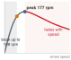{width="100%" fig-alt="Curve of phase-short braking torque against wheel speed that rises through a gray operating band, passes a hollow dot at the 108 rpm drive limit marked by a dashed drop line to the speed axis, peaks at a dot labeled peak 177 rpm, then falls in red through a shaded region labeled fades with speed."}

*Phase-short braking peaks at `{python} PhaseShortPeak.omega_m_peak_str`, above the base's `{python} PhaseShortPeak.omega_drive_str` limit.*
:::

Industrial machine stop categories and drive safety functions sequence these states. The machinery standard defines three stop categories [@iec60204]: remove power at once, stop under control and then remove power, or stop under control and keep power applied. @Tbl-12-iec60204-stopping-categories maps each one to the physical evidence it still requires. Beneath every category lies the body's fact: once torque is removed, a joint enters one of the three unpowered states above. A drive's Safe Torque Off (STO) therefore leaves a moving joint in free coast until a brake engages. The trajectory a machine follows after an electrical cutoff must be measured under full mechanical payload, not deduced from circuit diagrams. The choice of which safe fallback state the machine should enter belongs to system safety architecture, but the physical dynamics of an unpowered joint are unalterable mechanical constraints of the body.

::: {.column-margin .margin-pointer}
↪ The placement of Safe Torque Off in the machine's hardwired interlock is developed in @sec-nervous-actuation-authority.
:::

### Regenerative overvoltage surges and dynamic brake choppers {#sec-body-regenerative-surges}

Regenerative deceleration drives the bus toward its opposite boundary, overvoltage, as part of the machine's kinetic energy returns electrically. **Returned braking energy needs an absorption or dissipation path.** A battery cannot be assumed to accept it under every state of charge, temperature, or protection state. If the battery management system disconnects charge input, the remaining bus components must handle the regenerated energy without exceeding their voltage ratings.

Under the conservative assumption that the battery management system has disconnected and the local bus capacitance $\DcBusBulkCapacitance$ must absorb the entire returned kinetic energy $\RegeneratedBrakingEnergy$ without dissipation, the terminal DC bus voltage rises to:
$$\FinalBusVoltage = \sqrt{\InitialBusVoltage^2 + \frac{2 \RegeneratedBrakingEnergy}{\DcBusBulkCapacitance}}$$ {#eq-body-regen-voltage}
where $\InitialBusVoltage$ is the bus voltage when deceleration begins (@sec-appendix-systems-power derives this energy balance). The worst case is a full pack, the state in which the battery management system refuses further charge.

The capacitor-only endpoint is a screening calculation: if it exceeds a component rating, the stop requires another energy path. A dynamic brake chopper\index{Dynamic brake chopper!regenerative clamp}\index{Overvoltage protection!dynamic braking} switches an absorption resistor across the bus when voltage reaches a chosen clamp threshold. Its resistor must handle both the peak regenerated power and the pulse energy, with enough recovery between stops. The worked bus calculation below sizes the peak-power requirement for the warehouse machine.

Power integrity is an architectural constraint. The design sets coordinated power budgets and current slew-rate limits across accelerators and drives, the permission path arbitrates simultaneous multi-axis accelerations so that their $d\ConductorCurrent/d\TimeInstant$ transients do not compound, and brake choppers protect the inverters from regenerative feedback during emergency stops. Notebook \ref{nbk-body-dc-bus-power-integrity} works both halves of that budget, the bus's sag and the stop's regenerative surge, on the mobile manipulator's 48 V drive bus.

```{python}
#| label: body-dc-bus-calc
#| echo: false
#| warning: false
#| message: false
# ┌─────────────────────────────────────────────────────────────────────────────
# │ 48 V DRIVE-BUS DROOP AND REGENERATIVE SURGE ON THE RUNNING MACHINE (LEGO)
# ├─────────────────────────────────────────────────────────────────────────────
# │ Context: \ref{nbk-body-dc-bus-power-integrity} in @sec-body-power-integrity,
# │          the ranking of margins in @sec-body-archetype-matrix, and the rail
# │          column of @tbl-02-limit-record.
# │ Goal:    Screen sustained coincident load on the 48 V drive bus against the
# │          48-to-24 V converter's undervoltage lockout, and regenerative
# │          voltage during a stop from the drive limit; the transient minimum
# │          requires separate qualification.
# │ Show:    70 A through 60 mOhm drops 4.2 V: 54 -> 49.8 V full, 42 -> 37.8 V
# │          depleted, 4.8 V above the 33 V lockout (150 A would cross it);
# │          75 percent of 414 J = 310.5 J; capacitor-only endpoint from 54 V
# │          about 176.5 V; 750 ms stop, 828 W peak; chopper resistor
# │          <= 4.35 Ohm at the 60 V clamp; 100 V switches.
# │ How:     calc_voltage_droop with RM.drive_bus_* and AISLE.i_rail_transient;
# │          compute share from the Orin TDP through the converter efficiency;
# │          E_k from MachineMomentum.e_k; capacitor energy balance from full
# │          charge; triangular power pulse over t_stop = v / a_brake.
# └─────────────────────────────────────────────────────────────────────────────
from mlsysim import *
from mlsysim.core.units import *
from mlsysim.fmt import (
    fmt_mass,
    fmt_capacitance,
    fmt_voltage,
    fmt_current,
    fmt_resistance,
    fmt_power,
    fmt_energy,
    fmt_latency,
    fmt_velocity,
    fmt_acceleration,
    fmt_percent,
    fmt_display_math,
    check,
)

RM = Embodied.MobileManipulator.WarehouseMobileManipulator
AISLE = Embodied.Scenario.WarehouseAisle

class DriveBusIntegrity:
    """48 V drive-bus droop, regenerative surge, and chopper sizing for the running machine."""

    # ┌── 1. LOAD (Constants & Parameters) ─────────────────────────────────
    m = RM.loaded_mass  # category: derived (upper bound, full tote rack)
    v = RM.base.max_velocity  # category: illustrative (drive limit)
    a_brake = AISLE.a_brake  # category: illustrative (credible deceleration)
    e_k = MachineMomentum.e_k  # category: derived (loaded machine at its drive limit)
    v_full = RM.drive_bus_full_charge  # category: sourced (48 V-class pack maximum)
    v_bus_nom = RM.drive_bus_nominal  # category: sourced (48 V-class pack nominal)
    v_battery_low = RM.drive_bus_battery_low  # category: sourced (48 V-class pack minimum)
    r_bus = RM.drive_bus_resistance  # category: illustrative (source path; needs a measured value)
    v_uvlo = RM.drive_bus_uvlo  # category: sourced (48-to-24 V converter input lockout)
    v_conv_max = RM.drive_bus_converter_max  # category: sourced (converter continuous input maximum)
    eff_conv = RM.drive_bus_converter_efficiency  # category: sourced (converter typical efficiency)
    p_soc = RM.brain_soc.tdp  # category: sourced (application processor TDP)
    di = AISLE.i_rail_transient  # category: illustrative (inference burst plus drive)
    c_bus = 22000.0 * ureg.microfarad  # category: illustrative (bulk link capacitance)
    v_breakdown = RM.drive_bus_switch_rating  # category: chosen (100 V switch class)
    v_clamp = RM.drive_bus_clamp  # category: chosen (chopper clamp threshold)
    regen_fraction = 0.75  # category: illustrative (share of E_k returned to the bus)
    r_candidate = 3.9 * ureg.ohm  # category: chosen (candidate chopper resistor)
    p_candidate = 1.0 * ureg.kilowatt  # category: chosen (candidate resistor pulse rating)

    # ┌── 2. EXECUTE (Compute) ─────────────────────────────────────────────
    i_compute = (p_soc / (eff_conv * v_bus_nom)).to(ureg.ampere)
    i_drive = (di - i_compute).to(ureg.ampere)
    dv = calc_voltage_droop(di, r_bus).to(volt)  # sustained resistive drop, not a transient minimum
    v_sustained = (v_full - dv).to(volt)
    v_sag_low = (v_battery_low - dv).to(volt)
    margin_low = (v_sag_low - v_uvlo).to(volt)
    headroom_low = (v_battery_low - v_uvlo).to(volt)
    i_cross = ((v_battery_low - v_uvlo) / r_bus).to(ureg.ampere)

    e_regen = (regen_fraction * e_k).to(joule)
    v_final = ((v_full**2 + 2 * e_regen / c_bus) ** 0.5).to(volt)
    e_cap_to_clamp = (0.5 * c_bus * (v_clamp**2 - v_full**2)).to(joule)
    t_stop = (v / a_brake).to(millisecond)
    p_peak = (2 * e_regen / t_stop).to(ureg.watt)
    r_max = (v_clamp**2 / p_peak).to(ureg.ohm)

    # ┌── 3. GUARD (Invariants) ───────────────────────────────────────────
    check(abs(dv.magnitude - 4.2) < 1e-9, f"Resistive drop must be 4.2 V: {dv}")
    check(abs(v_sustained.magnitude - 49.8) < 1e-9, f"Unexpected full-charge sustained voltage: {v_sustained}")
    check(abs(v_sag_low.magnitude - 37.8) < 1e-9, f"Unexpected depleted sustained voltage: {v_sag_low}")
    check(abs(margin_low.magnitude - 4.8) < 1e-9, f"Unexpected depleted margin: {margin_low}")
    check(v_sag_low > v_uvlo, "At 48 V the sustained screen must stay above the converter lockout even when depleted.")
    check(abs(i_cross.magnitude - 150.0) < 1e-9, f"Unexpected crossing current: {i_cross}")
    check(i_compute < di, "The compute share must be part of the coincident step.")
    check(abs(e_k.magnitude - 414.0) < 1e-6, f"Unexpected kinetic energy: {e_k}")
    check(abs(e_regen.magnitude - 310.5) < 1e-6, f"Unexpected regenerated energy: {e_regen}")
    check(abs(v_final.magnitude - 176.47) < 0.01, f"Unexpected capacitor-only endpoint: {v_final}")
    check(e_cap_to_clamp < e_regen, "The capacitor alone must not absorb the stop before the clamp.")
    check(abs(t_stop.magnitude - 750.0) < 1e-6, f"Unexpected stop duration: {t_stop}")
    check(abs(p_peak.magnitude - 828.0) < 1e-6, f"Unexpected regenerative peak: {p_peak}")
    check(
        abs(p_peak.magnitude - (regen_fraction * m * a_brake * v).to(ureg.watt).magnitude) < 1e-6,
        "The triangular-pulse peak must equal the regenerated share of m*a*v.",
    )
    check(abs(r_max.magnitude - 4.3478) < 1e-3, f"Unexpected chopper resistance bound: {r_max}")
    check(r_candidate <= r_max and p_candidate >= p_peak, "The candidate resistor must meet both bounds.")
    check(v_full < v_clamp <= v_conv_max < v_breakdown, "Clamp above full charge, within the converter, below the switches.")
    # margin_drive_bus_voltage_window.svg fig-alt hand-types 33, 37.8, 54, 60, 100, and 176.5 volts
    check(
        [round(x.to(volt).magnitude, 1) for x in (v_uvlo, v_full, v_clamp, v_breakdown)] == [33.0, 54.0, 60.0, 100.0],
        "Voltage-window fig-alt values drifted.",
    )

    # ┌── 4. OUTPUT (Formatting) ──────────────────────────────────────────
    m_str = fmt_mass(m, unit=kilogram, precision=0)
    v_str = fmt_velocity(v, unit=meter / second, precision=1)
    a_brake_str = fmt_acceleration(a_brake, unit=meter / second**2, precision=0)
    v_full_str = fmt_voltage(v_full, unit=volt, precision=0)
    v_bus_nom_str = fmt_voltage(v_bus_nom, unit=volt, precision=1)
    v_battery_low_str = fmt_voltage(v_battery_low, unit=volt, precision=0)
    r_bus_str = fmt_resistance(r_bus, unit=ureg.milliohm, precision=0)
    c_bus_str = fmt_capacitance(c_bus, unit=ureg.microfarad, precision=0, commas=True)
    v_uvlo_str = fmt_voltage(v_uvlo, unit=volt, precision=0)
    v_conv_max_str = fmt_voltage(v_conv_max, unit=volt, precision=1)
    v_breakdown_str = fmt_voltage(v_breakdown, unit=volt, precision=0)
    p_soc_str = fmt_power(p_soc, unit=ureg.watt, precision=0)
    eff_conv_pct_str = fmt_percent(eff_conv, precision=0, style="prose")
    i_drive_str = fmt_current(i_drive, unit=ureg.ampere, precision=1)
    i_compute_str = fmt_current(i_compute, unit=ureg.ampere, precision=1)
    di_str = fmt_current(di, unit=ureg.ampere, precision=0)
    dv_str = fmt_voltage(dv, unit=volt, precision=1)
    v_sustained_str = fmt_voltage(v_sustained, unit=volt, precision=1)
    v_sag_low_str = fmt_voltage(v_sag_low, unit=volt, precision=1)
    margin_low_str = fmt_voltage(margin_low, unit=volt, precision=1)
    headroom_low_str = fmt_voltage(headroom_low, unit=volt, precision=0)
    i_cross_str = fmt_current(i_cross, unit=ureg.ampere, precision=0)
    dv_display_math = fmt_display_math(rf"\Delta V_{{\text{{sustained}}}} = \Delta I R_{{\text{{bus}}}} = {dv_str}")
    v_sag_display_math = fmt_display_math(
        rf"V_{{\text{{bus, sustained}}}} = {v_full_str} - {dv_str} = {v_sustained_str} \text{{ (full)}}, \quad {v_battery_low_str} - {dv_str} = {v_sag_low_str} \text{{ (depleted)}}"
    )
    e_k_display_math = fmt_display_math(
        rf"E_k = \tfrac{{1}}{{2}} m v^2 = \tfrac{{1}}{{2}}\,({m_str})({v_str})^2 = {fmt_energy(e_k, unit=joule, precision=0)}"
    )
    regen_pct_str = fmt_percent(regen_fraction, precision=0, style="prose")
    e_regen_str = fmt_energy(e_regen, unit=joule, precision=1)
    v_final_display_math = fmt_display_math(
        rf"V_{{\text{{final}}}} = \sqrt{{V_{{\text{{full}}}}^2 + \frac{{2 E_{{\text{{regen}}}}}}{{C_{{\text{{bus}}}}}}}} \approx {fmt_voltage(v_final, unit=volt, precision=1)}"
    )
    e_cap_to_clamp_str = fmt_energy(e_cap_to_clamp, unit=joule, precision=1)
    t_stop_str = fmt_latency(t_stop, unit=millisecond, precision=0)
    v_clamp_str = fmt_voltage(v_clamp, unit=volt, precision=0)
    p_peak_display_math = fmt_display_math(
        rf"P_{{\text{{regen, peak}}}} \approx \frac{{2 E_{{\text{{regen}}}}}}{{t_{{\text{{stop}}}}}} = {fmt_power(p_peak, unit=ureg.watt, precision=0)}"
    )
    r_max_display_math = fmt_display_math(
        rf"R_{{\text{{brake}}}} \le \frac{{V_{{\text{{clamp}}}}^2}}{{P_{{\text{{regen, peak}}}}}} \approx {fmt_resistance(r_max, unit=ureg.ohm, precision=2)}"
    )
    r_max_str = fmt_resistance(r_max, unit=ureg.ohm, precision=2)
    r_candidate_str = fmt_resistance(r_candidate, unit=ureg.ohm, precision=1)
    p_candidate_str = fmt_power(p_candidate, unit=ureg.kilowatt, precision=0)
    p_peak_str = fmt_power(p_peak, unit=ureg.watt, precision=0)
    v_final_str = fmt_voltage(v_final, unit=volt, precision=1)
```

::: {#nbk-body-dc-bus-power-integrity .callout-notebook title="DC bus voltage sag and regenerative surge"}
The mobile manipulator's lithium-ion pack feeds a `{python} DriveBusIntegrity.v_bus_nom_str` nominal drive bus, with the voltage envelope of a commercial 48 V-class mobile robot's pack [@mir2025mir250]. The bus carries the wheel drives, the arm's joint drives, and a 48-to-24 V converter that supplies the application processor and control electronics. The converter shuts off when its input falls to `{python} DriveBusIntegrity.v_uvlo_str` [@meanwell2026ddr240].

**Problem**: Under the coincident current step of an inference burst and the drive motors, and then a stop from the drive limit, does the bus remain within the operating limits of the converter and the motor inverters?

**Math**:

1. **Parameters**:
   - Machine mass, travel speed, and credible deceleration: $\Mass =$ `{python} DriveBusIntegrity.m_str` (upper bound, full tote rack), $\SpeedAtDetection =$ `{python} DriveBusIntegrity.v_str`, $\CredibleBrakingDeceleration =$ `{python} DriveBusIntegrity.a_brake_str`
   - Bus characteristics: pack voltage from `{python} DriveBusIntegrity.v_full_str` at full charge to `{python} DriveBusIntegrity.v_battery_low_str` depleted, source resistance $\PowerRailResistance =$ `{python} DriveBusIntegrity.r_bus_str` (illustrative), bulk link capacitance $\DcBusBulkCapacitance =$ `{python} DriveBusIntegrity.c_bus_str`
   - Operating limits: converter lockout $\ConverterLockoutVoltage =$ `{python} DriveBusIntegrity.v_uvlo_str`, converter continuous input maximum `{python} DriveBusIntegrity.v_conv_max_str`, inverter switch rating $\SwitchBreakdownVoltage =$ `{python} DriveBusIntegrity.v_breakdown_str`
2. **Sustained-load screen**:
   - As an illustrative coincident load, the two drive motors and the arm's joint drives add `{python} DriveBusIntegrity.i_drive_str` while the application processor, drawing its `{python} DriveBusIntegrity.p_soc_str` thermal design power (TDP) through the converter at `{python} DriveBusIntegrity.eff_conv_pct_str` efficiency, adds `{python} DriveBusIntegrity.i_compute_str`. Their aggregate increase is $\FiniteChange \ConductorCurrent =$ `{python} DriveBusIntegrity.di_str`. Assume the stated pack voltage is the unloaded source voltage and this coincident demand is the total load in the screen.
   - After source current settles to the increased load, the additional resistive drop is:
     `{python} DriveBusIntegrity.dv_display_math`
   - The resulting sustained bus voltage at full charge and when depleted is:
     `{python} DriveBusIntegrity.v_sag_display_math`
   - Even from the depleted pack, the bus stays `{python} DriveBusIntegrity.margin_low_str` above the converter's lockout; it would take a `{python} DriveBusIntegrity.i_cross_str` step to spend the `{python} DriveBusIntegrity.headroom_low_str` between the depleted pack and the lockout. This screen does not establish the transient minimum, which inductance and capacitor depletion push lower.
3. **Regenerative surge**:
   - During a stop from the drive limit, the loaded machine's kinetic energy must be dissipated:
     `{python} DriveBusIntegrity.e_k_display_math`
   - A full pack is the worst case, because that is when the battery management system refuses charge. If it disconnects charge input and an illustrative `{python} DriveBusIntegrity.regen_pct_str` of kinetic energy returns to the bus ($\RegeneratedBrakingEnergy =$ `{python} DriveBusIntegrity.e_regen_str`), an unprotected, lossless capacitor-only energy balance would end at:
     `{python} DriveBusIntegrity.v_final_display_math`
   - *Failure mechanism*: Raising the capacitor from full charge to the `{python} DriveBusIntegrity.v_clamp_str` clamp absorbs only `{python} DriveBusIntegrity.e_cap_to_clamp_str` of the `{python} DriveBusIntegrity.e_regen_str`, so long before the bus reached that endpoint it would cross the converter's input maximum and then the `{python} DriveBusIntegrity.v_breakdown_str` switch rating.
4. **Dynamic braking clamp**:
   - Under constant deceleration over $\StoppingDuration =$ `{python} DriveBusIntegrity.t_stop_str`, speed falls linearly, so the regenerated power, force times speed, falls linearly from its peak to zero, and the peak is twice the average $\RegeneratedBrakingEnergy/\StoppingDuration$: `{python} DriveBusIntegrity.p_peak_display_math`
   - The clamp $\ChopperClampVoltage =$ `{python} DriveBusIntegrity.v_clamp_str` sits above the full-charge voltage, so it never fires while charging, and within the converter's input range. To hold it there, the brake chopper must divert this peak power through an absorption resistor. A resistor across the bus at the clamp voltage dissipates $\ChopperClampVoltage^2/\BrakeChopperResistance$, which must be at least the peak power:
     `{python} DriveBusIntegrity.r_max_display_math`

**Result**: The sustained-load screen leaves the bus at `{python} DriveBusIntegrity.v_sustained_str` from a full pack and `{python} DriveBusIntegrity.v_sag_low_str` from a depleted one, `{python} DriveBusIntegrity.margin_low_str` above the converter lockout. Unbuffered regenerative braking would drive the bus past the converter's input maximum and the `{python} DriveBusIntegrity.v_breakdown_str` switch rating, which calls for a dynamic brake chopper whose resistor is no larger than `{python} DriveBusIntegrity.r_max_str` and absorbs an `{python} DriveBusIntegrity.p_peak_str` peak (satisfied by an illustrative `{python} DriveBusIntegrity.r_candidate_str`, `{python} DriveBusIntegrity.p_candidate_str` component).

**Systems insight**: Mechanical motion and electrical power are bidirectionally coupled. Acceleration requires a supply that sustains the coincident current demand; deceleration requires an adequate absorption or dissipation path. On this 48 V bus the depleted pack still sits `{python} DriveBusIntegrity.headroom_low_str` above the converter lockout, more than twice this step's resistive drop, so the sustained screen passes; the transient minimum, pulse energy, repetition, cooling, and component tolerances still require qualification.
:::

::: {.column-margin}
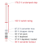{width="100%" fig-alt="Vertical voltage scale for the drive bus with labeled ticks: 33 volts converter lockout in red at the bottom, a gray operating band from 37.8 volts up to 54 volts, 60 volts chopper clamp, 67.2 volts converter max, 100 volts switch rating in red, and 176.5 volts unclamped stop in red at the top, with a dashed red arrow rising from the full pack to the unclamped endpoint."}

*The bus must stay between the `{python} DriveBusIntegrity.v_uvlo_str` lockout and the clamp; an unclamped stop reaches `{python} DriveBusIntegrity.v_final_str`.*
:::

::: {#chk-body-bus-droop-regen .callout-checkpoint title="Freshness, stopping, heat, and supply"}

The actuator budget was checked in checkpoint \ref{chk-body-actuator-limits}. Before measuring these limits on an assembled machine, verify your understanding of the other four:

- [ ] **Freshness deadline**: Can you calculate the maximum allowable measurement age for the mug riding the pick-station conveyor at `{python} GraspLatencyProfile.v_conv_str`, with a `{python} GraspLatencyProfile.r_tol_str` grasp tolerance of which the initial estimate already spends `{python} GraspLatencyProfile.e_0_str`, and explain why that age is counted from exposure on the sensor rather than from the start of inference, and why the base's stop for a standing person instead charges age as blind travel?
- [ ] **Velocity ceiling**: Can you solve $\StoppingDistance \le \ClearDistance$ for the admissible speed on the running machine's numbers, and explain why doubling the pre-brake delay expands the stopping distance linearly while doubling travel speed expands the braking term quadratically?
- [ ] **Thermal horizons and runaway**: Can you explain why an actuator can produce three times its rated torque for seconds but overheats its winding insulation if held there for minutes, and distinguish a sustained stall that reaches an excessive finite equilibrium from one in which copper's resistance feedback causes thermal runaway?
- [ ] **Rail sag and regeneration**: Can you explain how a coincident compute and drive current step sags a shared rail through resistance, inductance, and capacitor depletion, and why a stop from speed pumps energy back into the bus that a brake chopper must divert?

:::

Preserving power integrity ensures that transient acceleration spikes do not trigger brownout resets and that regenerative braking does not overvoltage the bus, completing the analytical formulation of the five physical budgets. Calculating these envelopes from datasheets and circuit models, however, cannot guarantee operational safety on a physical robot. In deployment, source impedances rise as batteries age, contact friction varies across facility floors, and enclosed packaging degrades thermal dissipation. Defending these budgets in production requires measuring what the integrated hardware actually delivers under live operational stress.

## Measuring a Machine's Own Limits {#sec-body-measuring-limits}

A brake that stops an unloaded base on a cool laboratory floor has not established how the loaded mobile manipulator stops after repeated maneuvers. Characterization must connect each calculation to measurements under the conditions in which the machine will use it. A dynamometer, a test stand that applies a controlled mechanical load, isolates actuator behavior, just as the instrumented propulsion test stand in @fig-02-real-motor-dyno-bench evaluates an assembled electromechanical powertrain under live aerodynamic and structural loads. Integrated trials then establish what changes when the actuator shares a chassis, cooling path, and power supply with the rest of the machine. A defensible limit states what was measured, how uncertain the result is, and which conditions must remain true for a later decision to rely on it.

### Empirical dynamometer characterization and probe intrusion {#sec-body-dynamometer-characterization}

On a dynamometer, a controlled load machine resists the actuator while torque, speed, current, and voltage are measured on a shared timebase. Four tests connect the earlier models to measurable parameters:

- **Torque and back-EMF transduction ($\MotorTorqueConstant$ and $\MotorBackEmfConstant$)**: By commanding the inverter's Field-Oriented Control (FOC) current loop across a sweep of quadrature phase currents $\TorqueProducingCurrent$ while the dynamometer absorbs torque at constant speed, engineers measure electromechanical torque transduction:
  $$\MotorTorque = \MotorTorqueConstant \TorqueProducingCurrent$$
  Driving the unpowered motor at known speed and measuring open-circuit voltage supplies the corresponding back-EMF constant $\MotorBackEmfConstant = \BackEmfVoltage / \RotorAngularSpeed$. These tests establish the conversion factors used in @sec-body-electrical-time-constants.

- **Electrical rise time and inductive bandwidth ($\ElectricalTimeConstant = \PhaseInductance/\PhaseResistance$)**: With the rotor held so that the test current produces no torque, the inverter applies a small voltage step $\StepTestVoltage$ across the winding. The current response:
  $$\InstantaneousPhaseCurrent(\TimeInstant) = \frac{\StepTestVoltage}{\PhaseResistance}\left(1 - e^{-\TimeInstant/\ElectricalTimeConstant}\right)$$
  reveals the electrical time constant. The step must stay small, because its steady current $\StepTestVoltage/\PhaseResistance$ flows through a winding of low resistance: the full `{python} CurrentRise.v_low_str` of a depleted pack across a hub motor's `{python} CurrentRise.r_line_str` would drive `{python} CurrentRise.i_full_step_str`, `{python} CurrentRise.step_over_peak_mult_str` the motor's peak current. The current probe and acquisition path must resolve the rise; otherwise the instrument smooths the response being measured and hides the actuator limit.

- **Enclosed thermal resistance ($\ThermalResistance$) and continuous torque ceilings**: A heating trial under the installed cooling conditions measures the winding temperature rise and loss power, establishing $\ThermalResistance = \JouleanTemperatureRise / \WindingLossPower$. The continuous torque ceiling from @sec-body-thermal-capacity is then:
  $$\ContinuousTorque = \MotorTorqueConstant \sqrt{\frac{\WindingTemperatureLimit - \AmbientTemperature}{\ElectricalResistance(\WindingTemperatureLimit) \ThermalResistance}}$$
  The test must reproduce the enclosure and neighboring heat loads under which that ceiling will be used.

- **Backdrive friction and impact dynamics**: By driving the actuator output shaft with the dynamometer load motor, the testbed measures the torque needed to backdrive the joint across speed, load, and temperature:
  $$\ExternalJointTorque = \GearReductionRatio^2 \RotorInertia \JointAcceleration + \JointFrictionTorque$$
  The measured response establishes whether the transmission can yield under the intended external load and maps the friction term that @sec-body-actuation-regimes shows is not a constant. Contact qualification must additionally exercise the relevant compliance and impact conditions; the backdrive model alone does not predict tooth failure.

::: {#fig-02-real-motor-dyno-bench fig-env="figure" fig-pos="t" fig-cap="**An instrumented propulsion test stand**: An electric motor with its propeller, speed controller, and wiring secured at the top of the Airvolt test stand at the NASA Armstrong Flight Research Center in 2016, instrumented to collect data on the propulsion system under load. A stand like this measures what a data sheet only asserts, on the assembled drive under stated conditions. (Credit: Lauren Hughes, NASA Armstrong Flight Research Center, AFRC2016-0100-05, public domain.)" fig-alt="Photograph against a blue sky of a white angled pylon carrying a mounting plate at its top, with a two-blade propeller, an electric motor, a finned electronics box, and bundled orange and red wiring."}
{width="85%"}
:::

Measurement can change the plant. A series current shunt lowers the supplied voltage, and an embedded temperature probe changes a local heat-flow path. These effects belong in the uncertainty budget along with sensor resolution, bandwidth, and clock alignment.

The sensor mechanisms in @sec-body-sensor-transduction also affect characterization. Velocity estimated from encoder samples by backward differencing trades resolution against latency, and that trade-off must enter the reported uncertainty and response time. Vibration above the sensor's sampled bandwidth can likewise appear as slower motion:
  $$\AliasedVibrationFrequency = |\VibrationFrequency - \AliasingHarmonicIndex \SamplingRate|$$
The integer $\AliasingHarmonicIndex$ identifies the sampling-frequency multiple that folds the vibration into the observed band. Qualification must distinguish that measurement artifact from the motion used to establish the limit.

A limit means nothing without the context of its test. Every recorded limit states the payload, ambient temperature, supply voltage, enclosure state, firmware version, and concurrent computational workload of the run. A thermal time constant measured on an open bench does not transfer to the same actuator in a sealed fairing in sunlight, because enclosing the motor raises $\ThermalResistance$ and with it $\ThermalTimeConstant = \ThermalResistance \StatorThermalCapacitance$, while the hotter ambient shrinks the margin below the insulation rating. A rail characterization that omits whether vision-language model inference [@brohan2023rt1; @brohan2023rt2] was running during motor stalls describes an idle board rather than the combined draw of full compute and peak torque.

### Statistical zero-failure bounds and lifecycle degradation {#sec-body-statistical-bounds}

```{python}
#| label: body-zero-failure-bound-calc
#| echo: false
#| warning: false
#| message: false
# ┌─────────────────────────────────────────────────────────────────────────────
# │ ZERO-FAILURE BOUND ON LOADED STOPS (LEGO)
# ├─────────────────────────────────────────────────────────────────────────────
# │ Context: the zero-failure paragraph in @sec-body-measuring-limits.
# │ Goal:    Bound the per-stop failure rate that n failure-free loaded stops
# │          support at 95 percent confidence.
# │ Show:    n = 3,000; -ln(0.05) = 2.996 (the rule of three); upper limit
# │          9.99e-4, about one stop in 1,000.
# │ How:     One-sided zero-failure bound p_upper = -ln(1 - c) / n.
# └─────────────────────────────────────────────────────────────────────────────
import math
from mlsysim.fmt import fmt_int, fmt_percent, check

class ZeroFailureBound:
    """Upper bound on the per-stop failure rate after n failure-free trials."""

    # ┌── 1. LOAD (Constants & Parameters) ─────────────────────────────────
    n_stops = 3000  # category: illustrative (failure-free loaded stops)
    conf = 0.95  # category: chosen (one-sided confidence level)

    # ┌── 2. EXECUTE (Compute) ─────────────────────────────────────────────
    coef = -math.log(1 - conf)
    p_upper = coef / n_stops
    one_in = round(1 / p_upper, -2)
    p_target = 1e-4  # category: illustrative (target per-stop failure rate for the checkpoint)
    target_one_in = round(1 / p_target)

    # ┌── 3. GUARD (Invariants) ───────────────────────────────────────────
    check(abs(coef - 2.9957) < 1e-4, f"Unexpected -ln(0.05): {coef}")
    check(abs(p_upper - 9.986e-4) < 1e-6, f"Unexpected upper bound: {p_upper}")
    check(one_in == 1000, f"Expected about one stop in 1,000: {one_in}")

    # ┌── 4. OUTPUT (Formatting) ──────────────────────────────────────────
    n_str = fmt_int(n_stops)
    conf_pct_str = fmt_percent(conf, precision=0, style="prose")
    one_in_str = fmt_int(one_in)
    target_one_in_str = fmt_int(target_one_in)
```

The absence of a failure during testing bounds the failure rate statistically; it does not establish safety. If the mobile manipulator completes $\ZeroFailureTrialCount =$ `{python} ZeroFailureBound.n_str` loaded stops without a brownout or an overrun, the data support only a per-stop failure rate below roughly $3/\ZeroFailureTrialCount$, the rule of three\index{Rule of three!limit records}, which is about one stop in `{python} ZeroFailureBound.one_in_str` at `{python} ZeroFailureBound.conf_pct_str` confidence. The bound holds only if the trials are independent and stationary, so that one trial does not influence another and the failure probability stays the same from trial to trial.

::: {.column-margin .margin-pointer}
↪ The rule of three, and the trial campaigns it sizes, is developed in @sec-evaluation-closed-loop-survival.
:::

Thermal history and wear can change the conditions between trials:

- **Thermal non-stationarity across consecutive trials**: Repeated stops heat the windings, changing resistance and the available torque response. Trials taken at different starting temperatures do not characterize the same operating condition.
- **Electrochemical impedance non-stationarity over the battery lifecycle**: Battery aging increases source resistance, reducing the voltage margin under a current step.
- **Mechanical backlash non-stationarity**: Transmission wear changes reversal response and tracking error, invalidating a limit measured on a less worn assembly.

These changes make characterization a standing obligation. **Lifecycle degradation**\index{Lifecycle degradation!definition} changes the conditions behind a limit, so its record must identify when recalibration or a reduced operating envelope is required.

### The six elements of a limit record {#sec-body-limit-record-schema}

```{python}
#| label: body-limit-records-calc
#| echo: false
#| warning: false
#| message: false
# ┌─────────────────────────────────────────────────────────────────────────────
# │ THREE LIMIT RECORDS ON THE RUNNING MACHINE (LEGO)
# ├─────────────────────────────────────────────────────────────────────────────
# │ Context: @tbl-02-limit-record in @sec-body-measuring-limits, and the rail
# │          decision in @sec-body-archetype-matrix (hold-up, load, store).
# │ Goal:    Fill the six elements of a limit record for the credible
# │          deceleration, the drive torque ceiling, and the drive bus's
# │          converter lockout, and give the decision paragraph its hold-up
# │          values.
# │ Show:    a_brake 2.0 m/s^2, binding only where mu * phi >= 0.204, loaded
# │          to at most 368 kg, 100 mm protective clearance; drive torque
# │          ceiling >= 2.33 m/s^2 at 25 A (16.6 percent margin); converter
# │          lockout 33 V, 4.8 V sustained-load margin from a depleted pack;
# │          ideal hold-up sizing targets 2.0 s (70 W, 2.025 F, 140 J)
# │          between 21.5 V and the 18 V dropout of its regulators, stated at
# │          the decision, not in the record.
# │ How:     mu_min = a_brake / g; store C = 2 P t / (V_low^2 - V_dropout^2)
# │          from RM.permission_rail_holdup_capacitance. The hold-up's basis
# │          (the longest commanded stop) is derived in @sec-enforcement.
# └─────────────────────────────────────────────────────────────────────────────
from mlsysim import *
from mlsysim.core.units import *
from mlsysim.fmt import (
    fmt,
    fmt_mass,
    fmt_capacitance,
    fmt_length,
    fmt_latency,
    fmt_power,
    fmt_energy,
    fmt_voltage,
    fmt_acceleration,
    check,
    MarkdownStr,
)

RM = Embodied.MobileManipulator.WarehouseMobileManipulator
AISLE = Embodied.Scenario.WarehouseAisle

class LimitRecords:
    """The a_brake, drive-torque, and drive-bus lockout records for the running machine."""

    # ┌── 1. LOAD (Constants & Parameters) ─────────────────────────────────
    a_brake = AISLE.a_brake  # category: illustrative (credible low tail, loaded, dry floor)
    m_loaded = RM.loaded_mass  # category: derived (upper bound, full tote rack)
    delta_margin = AISLE.delta_margin  # category: chosen (protective clearance)
    imu_name = RM.imu.name  # category: sourced (the machine's IMU part)
    v_dropout = RM.control_rail_dropout  # category: illustrative (permission-load regulator dropout)
    v_store_low = RM.control_rail_battery_low  # category: illustrative (lowest store charge voltage)
    holdup = RM.permission_rail_holdup  # category: chosen (ideal permission-rail hold-up target)
    p_rail = RM.permission_rail_load  # category: illustrative (permission-path load)
    c_store = RM.permission_rail_holdup_capacitance  # category: derived (ideal energy sizing for the hold-up target)
    v_uvlo = DriveBusIntegrity.v_uvlo  # category: sourced (48-to-24 V converter lockout)
    margin_low = DriveBusIntegrity.margin_low  # category: derived (depleted-pack margin under the sustained 70 A load)

    # ┌── 2. EXECUTE (Compute) ─────────────────────────────────────────────
    mu_min = (a_brake / ureg.standard_gravity).to("dimensionless").magnitude
    e_store = (p_rail * holdup).to(joule)

    # ┌── 3. GUARD (Invariants) ───────────────────────────────────────────
    check(abs(a_brake.to(meter / second**2).magnitude - 2.0) < 1e-9, f"Unexpected a_brake: {a_brake}")
    check(abs(m_loaded.to(kilogram).magnitude - 368.0) < 1e-9, f"Unexpected loaded mass: {m_loaded}")
    check(abs(mu_min - 0.204) < 5e-4, f"Friction premise must be 0.204: {mu_min}")
    check(abs(delta_margin.to(ureg.millimeter).magnitude - 100.0) < 1e-9, f"Unexpected margin: {delta_margin}")
    check(abs(v_dropout.to(volt).magnitude - 18.0) < 1e-9, f"Unexpected dropout: {v_dropout}")
    check(abs(holdup.to(second).magnitude - 2.0) < 1e-9, f"Hold-up must be 2.0 s: {holdup}")
    check(abs(p_rail.to(ureg.watt).magnitude - 70.0) < 1e-9, f"Rail load must be 70 W: {p_rail}")
    check(abs(c_store.to(ureg.farad).magnitude - 2.025) < 5e-4, f"Store must be 2.025 F: {c_store}")
    check(abs(e_store.magnitude - 140.0) < 1e-9, f"Store energy must be 140 J: {e_store}")
    check(
        abs((0.5 * c_store * (v_store_low**2 - v_dropout**2)).to(joule).magnitude - e_store.magnitude) < 1e-6,
        "The store's usable energy between its lowest charge and dropout must equal load x hold-up.",
    )
    check(abs(margin_low.to(volt).magnitude - 4.8) < 1e-9, f"Unexpected depleted-pack margin: {margin_low}")

    # ┌── 4. OUTPUT (Formatting) ──────────────────────────────────────────
    imu_name_str = MarkdownStr(imu_name)
    a_brake_str = fmt_acceleration(a_brake, unit=meter / second**2, precision=0)
    m_loaded_str = fmt_mass(m_loaded, unit=kilogram, precision=0)
    mu_min_str = fmt(mu_min, precision=3)
    delta_margin_str = fmt_length(delta_margin, unit=ureg.millimeter, precision=0)
    v_dropout_str = fmt_voltage(v_dropout, unit=volt, precision=0)
    holdup_str = fmt_latency(holdup, unit=second, precision=0)
    p_rail_str = fmt_power(p_rail, unit=ureg.watt, precision=0)
    c_store_str = fmt_capacitance(c_store, unit=ureg.farad, precision=3)
    v_store_low_str = fmt_voltage(v_store_low, unit=volt, precision=1)
    v_uvlo_str = fmt_voltage(v_uvlo, unit=volt, precision=0)
    margin_low_str = fmt_voltage(margin_low, unit=volt, precision=1)
    e_store_str = fmt_energy(e_store, unit=joule, precision=0)
```

The stopping and power calculations become usable by other layers only when their assumptions travel with their values. A **limit record**\index{Limit record!definition} carries those assumptions together with the evidence that supports the limit. The learned proposer uses the limits to constrain candidate actions, while the independent permission path checks them before actuation. Recording a value does not certify it: the illustrative entries below still require measurements and uncertainty estimates before they can support operation. The six elements in @tbl-02-limit-record make that missing evidence visible for the mobile manipulator's credible deceleration, the drive torque ceiling that must support it, and the drive bus's undervoltage lockout.

::: {.column-margin .margin-pointer}
↪ The handoff record that carries each limit record to the permission path is developed in @sec-nervous-handoffs-matrix.
:::

Two of the elements are easily conflated. *Uncertainty describes what is not known about the measurement (observation noise, instrument tolerance, sensor bandwidth, and calibration drift); margin is the physical clearance the machine defends against what is not known.* The provenance element then says how far the value itself can be trusted, by naming its evidence category. Every number that governs a machine falls in one of five categories: a direct measurement, a value derived from measurements through a stated model, a datasheet rating, an illustrative example, or a budget the designer chose. Only the first two can support a safety margin or a timeout. A value computed from datasheet inputs, such as the drive torque ceiling below, keeps the datasheet's weaker standing until measurements replace its inputs. A chosen budget, such as the protective clearance $\ProtectiveClearanceMargin$, binds only once it is checked against the measured number it must fit.

| Element         | What the record states                                                                                                                               | Credible deceleration $\CredibleBrakingDeceleration$                                                                                                                                                                                                                                                                                                                                                                                                                                              | Drive torque ceiling                                                                                                                                                                                                     | Drive-bus converter lockout                                                                                                                                            |
|:----------------|:-----------------------------------------------------------------------------------------------------------------------------------------------------|:--------------------------------------------------------------------------------------------------------------------------------------------------------------------------------------------------------------------------------------------------------------------------------------------------------------------------------------------------------------------------------------------------------------------------------------------------------------------------------------------------|:-------------------------------------------------------------------------------------------------------------------------------------------------------------------------------------------------------------------------|:-----------------------------------------------------------------------------------------------------------------------------------------------------------------------|
| **Value**       | The value or empirical distribution, with its sample count and the tail percentiles it reports                                                       | `{python} LimitRecords.a_brake_str`, taken as the credible low tail of loaded stops; no samples yet                                                                                                                                                                                                                                                                                                                                                                                               | At least `{python} BrakingLimits.a_torque_str` from `{python} BrakingLimits.tau_wheel_str` per wheel; computed from datasheet values, no samples yet                                                                     | `{python} LimitRecords.v_uvlo_str` at the 48-to-24 V converter input; no samples on the assembled bus                                                                  |
| **Conditions**  | The context listed earlier under which it was established, plus the surface for any limit that depends on traction                                   | Loaded to at most `{python} LimitRecords.m_loaded_str`; $\CoulombFrictionCoefficient\,\DrivenWheelLoadFraction \ge$ `{python} LimitRecords.mu_min_str`, so $\CoulombFrictionCoefficient \ge$ `{python} BrakingLimits.mu_min_rated_str` at the hub motors' rated load share and never on the inspected floor ($\CoulombFrictionCoefficient =$ `{python} BrakingLimits.mu_insp_str`); tip-over geometry not yet measured; usable powered braking and energy absorption; tires at commissioning wear | Drive current limit at `{python} BrakingLimits.i_max_str`; both driven wheels in traction; rotating mass within the `{python} BrakingLimits.m_rot_wheel_str` per-wheel bound; windings and bus within their rated ranges | Sustained coincident load on the 48 V bus; the permission path isolated on its held-up rail; drive power and physical stopping behavior require separate qualification |
| **Uncertainty** | The measurement uncertainty of each instrument, with its observation point and bandwidth                                                             | Not established                                                                                                                                                                                                                                                                                                                                                                                                                                                                                   | Datasheet tolerances only; the torque constant's tolerance is not published                                                                                                                                              | Not established                                                                                                                                                        |
| **Margin**      | The engineering margin separating the operating target from the breakdown threshold                                                                  | No justified deceleration margin yet; the chosen `{python} LimitRecords.delta_margin_str` protective clearance must be checked against the eventual uncertainty bound                                                                                                                                                                                                                                                                                                                             | At least `{python} BrakingLimits.torque_margin_pct_sym_str` above $\CredibleBrakingDeceleration$; none if the current limit falls to the rated `{python} BrakingLimits.i_rated_str`                                      | `{python} LimitRecords.margin_low_str` from a depleted pack under sustained coincident load; transient minimum not established                                         |
| **Detector**    | The runtime check that catches an excursion while the machine runs, such as a phase-current sensor, an optical interrupter, or a supply-rail monitor | Deceleration monitor comparing commanded with measured deceleration from the wheel encoders and the `{python} LimitRecords.imu_name_str` inertial unit, on every stop                                                                                                                                                                                                                                                                                                                             | Drive saturation flag and measured phase current against the configured limit, read on every stop                                                                                                                        | Bus-voltage monitor flags undervoltage; the permission path selects a response whose power and mechanical premises still hold                                          |
| **Provenance**  | The evidence category and the instrument or model that produced the value                                                                            | Illustrative, from the base's class profile; to be replaced by loaded stopping trials                                                                                                                                                                                                                                                                                                                                                                                                             | Datasheet standing: computed from the hub motor's datasheet values; to be replaced by wheel-torque measurements at the current limit on a loaded braking trial                                                           | Converter datasheet; source resistance illustrative; to be replaced by a bus characterization under coincident load                                                    |

: **The limit record on the mobile manipulator**: The six elements of a limit record, filled in for the credible deceleration that sets the stopping distance, for the drive torque ceiling that must support it, and for the converter lockout that bounds the shared drive bus. None of the three yet has samples or an established uncertainty, and the provenance element names the measurement that would replace each. {#tbl-02-limit-record tbl-colwidths="[10,18,26,23,23]"}

The detector element matters most once the machine leaves the test stand, because operation can carry a limit outside the conditions under which it was established. The saturation duration against which the Schiaparelli lander's inertial unit had been accepted was such a limit, and the lander's loss in 2016 shows what follows when a limit's conditions are exceeded in operation and nothing downstream checks the result.

::: {#ws-body-2016-schiaparelli-imu-saturation .callout-war-story title="ExoMars Schiaparelli IMU saturation (2016)"}
**Context**: On October 19, 2016, the European Space Agency's ExoMars Schiaparelli lander executed its atmospheric entry and descent toward the Martian surface, relying on an onboard Guidance, Navigation, and Control (GNC) computer to fuse Inertial Measurement Unit (IMU) gyroscopes with a Doppler radar altimeter [@esa2017schiaparelli].

**Mechanism**: About three minutes after atmospheric entry, the parachute inflated and set the lander oscillating. The IMU measured a pitch rate larger than expected and raised a saturation flag, which persisted longer than the 15 ms assumed when the unit was accepted. While the flag was set, the GNC software integrated the saturation threshold rate as though it were the true rate, although the lander was in reality oscillating, and its attitude estimate drifted by about $165^{\circ}$, nearly upside down. When the radar altimeter later returned valid slant ranges, the software projected them onto that attitude and computed a negative altitude. No onboard check tested that altitude for plausibility.

**Impact**: Taking the negative altitude as a valid estimate, the guidance logic released the parachute and backshell, fired the braking thrusters for $3\text{ seconds}$ instead of the planned $30\text{ seconds}$, and activated its on-ground systems as if it had landed. The lander was still about $3.7\text{ km}$ above the surface. It fell freely for about half a minute and struck the ground at about $150\text{ m/s}$ ($540\text{ km/h}$).

**Response**: The ESA inquiry board recommended robust sanity checks in the onboard software, among them that altitude cannot be negative and cannot change from $3.7\text{ km}$ to a negative value in one second, and a design that handles IMU saturation explicitly, for example by inhibiting IMU inputs during parachute deployment.

**Systems lesson**: A physical body cannot transcend the saturation ranges of its sensory transducers. When a sensor's physical limit (a gyroscope's rate ceiling or an accelerometer's dynamic range) is exceeded, a state estimator that integrates the saturated measurement as if it were valid drifts away from the physical state. The saturation duration against which the IMU had been accepted was a limit with conditions, and once descent exceeded them, no detector checked the estimate before it commanded an irreversible action.
:::

::: {#chk-body-limit-records .callout-checkpoint title="Limit records"}

A limit governs a decision only together with the conditions, evidence, and detector that travel with it.

- [ ] **Uncertainty vs. margin**: Can you distinguish the uncertainty of a measured deceleration from the margin the machine defends, and explain why only a measured value, or one derived from measurements, can support that margin?
- [ ] **Zero-failure bound**: Can you estimate how many failure-free loaded stops would bound the per-stop failure rate below one in `{python} ZeroFailureBound.target_one_in_str` at `{python} ZeroFailureBound.conf_pct_str` confidence, and state the two assumptions about the trials that the bound requires?
- [ ] **Record conditions**: Can you name the condition of the credible-deceleration record that a lowered drive current limit, the inspected floor, and an arm extended forward would each violate?
- [ ] **Detector**: Can you explain why the Schiaparelli lander's accepted saturation duration failed as a limit in flight, and which detector in @tbl-02-limit-record plays the missing role for the credible deceleration?

:::

Measured and recorded one at a time, the five limits describe the body budget by budget, each under its own conditions. Which of them binds first depends on the machine and the command.

## Binding Budget Identification and Dominant Constraints {#sec-body-archetype-matrix}

A single command from an action-chunking policy to accelerate a loaded mobile manipulator draws concurrently against all five physical budgets, which is why the simultaneous admission invariant of @sec-body-five-budgets admits it only when every margin is non-negative at once. The command executes against a camera frame that has already aged during neural inference. It injects kinetic energy into the chassis that friction brakes or regenerative drives must eventually dissipate. It forces the arm's geared joints to accelerate reflected rotor inertia, while the base's direct-drive hubs add their rotating inertia to the stopping load. It dumps resistive Joule heat into stator windings that can shed thermal energy only over minutes. Simultaneously, it pulls transient current from the shared DC rail that powers the onboard compute host. @Tbl-02-cross-archetype-matrix summarizes these five budgets side by side, detailing the governing physical laws, the common assumptions embedded in software policies, the robotic machine class characteristically vulnerable, and the hardware-enforced runtime invariants required for safety.

### Class-dependent binding constraints {#sec-body-binding-constraints}

A mobile manipulator integrates two of the machine classes from @sec-boundary-three-classes onto a single chassis: a Class 1 wheeled base governed primarily by chassis momentum and stopping distance, and a Class 2 articulated arm constrained by reflected rotor inertia, contact compliance, and static holding heat.

While the classes identify the primary vulnerabilities, the instantaneous maneuver determines which budget binds first. For instance, holding a heavy payload in a cantilevered pose can drive joint windings toward their thermal dissipation limit over tens of seconds. Conversely, a sudden multi-axis acceleration burst coupled with full neural network execution can deplete electrical bus margins within milliseconds. The coupled calculations below compare the evidence behind the running machine's limits and identify a stopping qualification priority. They do not establish an ordering of all five physical margins for an unspecified maneuver.

| Physical Budget / Factor            | Governing First Principle & Scaling Law                                                                                                                                                                                                                                                                                                                                                             | Software Illusion vs. Hardware Ground Truth                                                                                                                                                                                                                                      | Characteristic Vulnerability by Class                                                                                    | Systems Architect Takeaway & Runtime Invariant                                                                                                                          |
|:------------------------------------|:----------------------------------------------------------------------------------------------------------------------------------------------------------------------------------------------------------------------------------------------------------------------------------------------------------------------------------------------------------------------------------------------------|:---------------------------------------------------------------------------------------------------------------------------------------------------------------------------------------------------------------------------------------------------------------------------------|:-------------------------------------------------------------------------------------------------------------------------|:------------------------------------------------------------------------------------------------------------------------------------------------------------------------|
| **1. Measurement Freshness & Age**  | $\TelemetryFreshnessBound \le \frac{\PositionErrorCeiling}{\SpeedBound}$; $\QuantizationStep \EncoderAngle = \frac{2\pi}{2^\EncoderBitCount}$; end-to-end age measured from exposure                                                                                                                                                                                                                | *Illusion:* High inference rate ($50\text{ Hz}$) guarantees real-time control. *Truth:* Age begins at exposure; encoder differentiation amplifies quantization noise; vibration harmonics alias into IMU attitude drift.                                                         | **Class 1 & 2:** Erodes clearance margins and destabilizes high-gain contact loops.                                      | Tag frames with hardware timestamps; enforce $\ObservationAge \le$ the budgeted age at motor registers; drop stale commands.                                            |
| **2. Momentum & Stopping Distance** | $\StoppingDistance = \SpeedAtDetection\,\PrebrakeDelay + \frac{\SpeedAtDetection^2}{2 \CredibleBrakingDeceleration} + \LocalizationBound + \ProtectiveClearanceMargin \le \ClearDistance$; $\EffectiveImpactMass = \Mass + \sum_i \frac{{\GearReductionRatio}_i^2 {\RotorInertia}_i}{\WheelRadius^2}$                                                                                               | *Illusion:* Deceleration can be commanded instantaneously. *Truth:* Braking distance scales quadratically ($\SpeedAtDetection^2$); retarding torque must decelerate reflected rotor inertia; the stopping system must absorb or dissipate energy.                                | **Class 1 (Mobility):** Primary constraint. Doubling speed quadruples the braking term.                                  | Solve clearance quadratic $\SpeedBound(\ClearDistance, \PrebrakeDelay)$ on the safety microcontroller at the rate the stopping budget sets; clamp policy velocity.      |
| **3. Actuator & Reflected Inertia** | $\ReflectedRotorInertia = \GearReductionRatio^2 \RotorInertia$; $\MotorTorque = \MotorTorqueConstant \TorqueProducingCurrent$; $\ElectricalTimeConstant = \frac{\PhaseInductance}{\PhaseResistance}$; $\frac{\DerivativeOperator\MotorTorque}{d\TimeInstant} \le \frac{\MotorTorqueConstant(\DcBusVoltage - \BackEmfVoltage)}{\PhaseInductance}$                                                    | *Illusion:* Motor torque tracks policy tensors instantaneously. *Truth:* Current rise limits response; gearboxes square rotor inertia ($\GearReductionRatio^2$); high ratios increase resistance to rapid contact motion.                                                        | **Class 2 (Manipulation):** Contact stiffness and reflected inertia constrain interaction.                               | Limit acceleration and torque slew; measure load-side response; select gearing and compliance for the qualified contact envelope.                                       |
| **4. Thermal Limits & Duty Cycle**  | $\StatorThermalCapacitance \frac{d\WindingTemperature}{d\TimeInstant} = \frac{\MotorTorque^2}{\MotorTorqueConstant^2} \ElectricalResistance(\WindingTemperature) - \frac{\JouleanTemperatureRise}{\ThermalResistance}$; $\ContinuousTorque = \MotorTorqueConstant \sqrt{\frac{\WindingTemperatureLimit - \AmbientTemperature}{\ElectricalResistance(\WindingTemperatureLimit) \ThermalResistance}}$ | *Illusion:* Motors deliver catalog peak torque continuously. *Truth:* Torque is current, current is heat ($\WindingLossPower \propto \MotorTorque^2$); continuous torque is limited by heat rejection at the characterized winding-temperature limit $\WindingTemperatureLimit$. | **Class 3 (Thermal) & Class 2:** Holding above the qualified continuous torque can overheat the windings.                | Run discrete $\WindingCurrent^2 \TimeInstant$ thermal observers on the safety microcontroller; dynamically derate speed and torque when hotspot models approach limits. |
| **5. Electrical Power Integrity**   | $\SourceVoltage-\DcBusVoltage=\PowerRailResistance{}\SourceCurrent+\PowerRailInductance\frac{d\SourceCurrent}{d\TimeInstant}$; $\DcBusBulkCapacitance\frac{d\DcBusVoltage}{d\TimeInstant}=\SourceCurrent-\LoadCurrent$; $\FinalBusVoltage = \sqrt{\InitialBusVoltage^2 + \frac{2 \RegeneratedBrakingEnergy}{\DcBusBulkCapacitance}}$                                                                | *Illusion:* Power rails act as infinite, ideal voltage sources. *Truth:* Bus impedance collapses rail voltage under combined compute+motor bursts; braking surges overvoltage.                                                                                                   | **Class 1 & 3:** Peak multi-axis acceleration trips microcontroller brownout resets; regen surges destroy inverter FETs. | Enforce coordinated compute-actuation power budgets and $d\SourceCurrent/d\TimeInstant$ limits; install dynamic brake choppers; characterize unpowered fallbacks.       |

: **Cross-class physical constraint matrix**: The five budgets, the law that governs each, the assumption a software-trained policy makes about it, the class characteristically vulnerable, and the runtime invariant that answers it. {#tbl-02-cross-archetype-matrix tbl-colwidths="[18,20,24,18,20]"}

### Cross-budget coupling and permission rail isolation {#sec-body-permission-rail-isolation}

```{python}
#| label: body-dvfs-throttle-calc
#| echo: false
#| warning: false
#| message: false
# ┌─────────────────────────────────────────────────────────────────────────────
# │ THROTTLED PERCEPTION ON THE RUNNING MACHINE (LEGO)
# ├─────────────────────────────────────────────────────────────────────────────
# │ Context: the ranking of margins in @sec-body-archetype-matrix and the
# │          DVFS pitfall in @sec-body-fallacies-pitfalls.
# │ Goal:    Price the extra observation age a thermally throttled application
# │          processor adds, in travel at the machine's drive limit.
# │ Show:    the 22 ms backbone stretches to 33 ms at two-thirds clock, adding
# │          11 ms, or 16.5 mm at 1.5 m/s.
# │ How:     Backbone time AISLE.t_backbone scaled by the inverse clock ratio
# │          (compute-bound stage); added age times drive-limit speed (the v*tau
# │          term of @eq-body-stopping-distance).
# └─────────────────────────────────────────────────────────────────────────────
from mlsysim import *
from mlsysim.core.units import *
from mlsysim.fmt import fmt_latency, fmt_length, fmt_velocity, check

RM = Embodied.MobileManipulator.WarehouseMobileManipulator
AISLE = Embodied.Scenario.WarehouseAisle

class ThrottledPerception:
    """Travel cost of a DVFS-stretched perception stage on the running machine."""

    # ┌── 1. LOAD (Constants & Parameters) ─────────────────────────────────
    v = RM.base.max_velocity  # category: illustrative (drive limit)
    t_nominal = AISLE.t_backbone  # category: illustrative (vision backbone at full clock)
    clock_ratio = 2 / 3  # category: illustrative (DVFS clock as a fraction of full clock)

    # ┌── 2. EXECUTE (Compute) ─────────────────────────────────────────────
    t_throttled = (t_nominal / clock_ratio).to(millisecond)
    dt = (t_throttled - t_nominal).to(millisecond)
    d_extra = (v * dt).to(ureg.millimeter)

    # ┌── 3. GUARD (Invariants) ───────────────────────────────────────────
    check(abs(v.to(meter / second).magnitude - 1.5) < 1e-9, f"Unexpected drive limit: {v}")
    check(abs(t_nominal.to(millisecond).magnitude - 22.0) < 1e-9, f"Unexpected backbone time: {t_nominal}")
    check(abs(t_throttled.magnitude - 33.0) < 1e-9, f"Unexpected throttled backbone time: {t_throttled}")
    check(abs(dt.magnitude - 11.0) < 1e-9, f"Unexpected added age: {dt}")
    check(abs(d_extra.magnitude - 16.5) < 1e-9, f"Unexpected added travel: {d_extra}")

    # ┌── 4. OUTPUT (Formatting) ──────────────────────────────────────────
    v_str = fmt_velocity(v, unit=meter / second, precision=1)
    t_nominal_str = fmt_latency(t_nominal, unit=millisecond, precision=0)
    t_throttled_str = fmt_latency(t_throttled, unit=millisecond, precision=0)
    dt_str = fmt_latency(dt, unit=millisecond, precision=0)
    d_extra_str = fmt_length(d_extra, unit=ureg.millimeter, precision=1)
```

When an autonomous agent commands an aggressive multi-axis acceleration, the physical margins do not degrade in isolation; they deplete together. Drive inverters draw substantial current to overcome both chassis inertia and reflected rotor inertia. This transient current surge causes the shared DC bus voltage to sag, even as resistive losses ($\WindingLossPower = \TorqueProducingCurrent^2 \EffectiveLossResistance$) steadily deposit thermal energy into motor windings. Because motor phase currents are pulse-width modulated by inverters and do not map directly to battery draw, systems architects must evaluate input current at the primary DC bus. This coincident load step establishes the true operating baseline across all subsystems.

On the 48 V drive bus, the sustained electrical screen passes under its stated assumptions. As shown in the coincident power step of notebook \ref{nbk-body-dc-bus-power-integrity}, a depleted battery pack at `{python} DriveBusIntegrity.v_battery_low_str` sags to `{python} DriveBusIntegrity.v_sag_low_str` under the coincident load step. Even under that sustained step, the rail keeps a `{python} DriveBusIntegrity.margin_low_str` buffer above the `{python} DriveBusIntegrity.v_uvlo_str` undervoltage lockout (UVLO) threshold of the 48-to-24 V converter, although the sustained screen does not establish the transient minimum.

The stopping dynamics expose a concrete qualification priority. Under emergency braking, the drive motors clear the required deceleration by only `{python} BrakingLimits.torque_margin_pct_str`, and only with phase current at the motor's catalog peak. The chassis tip-over boundary has not been measured at all. For the arm, the optimistic stand-in thermal model gives a heat-soaked joint a threefold current burst of `{python} ThermalBurst.t_hot_str` before its winding reaches the insulation rating. Additionally, the chassis stopping distance at the full `{python} BodyStoppingBudget.v_str` travel limit leaves `{python} BodyStoppingBudget.remaining_str` of clearance to accommodate perception latency, communication jitter, and tracking variance. The whole stopping budget inherits the credible-deceleration premise, which rests on the peak current limit and the unmeasured center of gravity, so that premise requires qualification before relying on the stop. The transient rail minimum and installed arm thermal response remain unresolved too. Ranking the budgets requires a specified maneuver and duration, with comparably qualified limits for each.

Modern SoC architectures deploy dynamic voltage and frequency scaling\index{Dynamic voltage and frequency scaling} (DVFS) algorithms to regulate die temperature and energy consumption. While DVFS protects silicon from thermal degradation, its timing penalties propagate directly into physical workspace clearance:
$$\text{SoC thermal dissipation} \longrightarrow \text{DVFS clock throttling} \longrightarrow \text{vision latency stretch} \longrightarrow \text{observation age inflation} \longrightarrow \text{pre-brake travel expansion} \longrightarrow \text{clearance margin erosion}$$
When sustained motor currents and high-throughput perception pipelines elevate temperatures across the shared enclosure, the host kernel throttles the clock frequencies of onboard CPU and GPU accelerators. On the running machine, this thermal intervention stretches the navigation backbone that the stopping budget charges, not the grasp path of @tbl-02-latency-breakdown, from `{python} ThrottledPerception.t_nominal_str` to `{python} ThrottledPerception.t_throttled_str`. This delay adds `{python} ThrottledPerception.dt_str` directly to the end-to-end observation age $\ObservationAge$, inflating the pre-braking reaction time $\PrebrakeDelay$. When traveling at the maximum base velocity of `{python} ThrottledPerception.v_str`, this algorithmic latency injects `{python} ThrottledPerception.d_extra_str` of unmonitored chassis travel before emergency brakes can even begin mechanical engagement. In this manner, a standard operating-system power policy designed for digital silicon silently shrinks the robot's stopping margin.

::: {.column-margin .margin-pointer}
↪ Thermal clock throttling on the shared die, and the placement decisions that bound its effect on the safety path, are developed in @sec-placement-thermal-timing-coupling.
:::

Surviving a sustained bus voltage drop does not qualify the shared power rail to support safety-critical control channels. Transient dips during motor reversals remain difficult to bound completely, and electrical faults such as an open circuit breaker, a battery management system (BMS) overcurrent disconnect, or a blown DC-DC stage drop bus voltage to zero instantly. The running machine addresses these common supply faults with a **dual-rail architecture**\index{Dual-rail architecture!permission rail} that decouples motor dynamics from safety enforcement. In this design, the primary shared bus powers high-current traction inverters and steps down voltage for the primary application processor. An isolated, reverse-blocked permission rail separately powers the safety microcontroller, deterministic fieldbus transceivers, and holding-brake release coils. Under the drive-rail faults covered by its isolation and hold-up qualification, this separate supply preserves the permission loads. It does not make the detector, controller, or communication path infallible.

The permission rail incorporates local capacitive energy storage to preserve control availability during a loss of its upstream supply. For the stated constant `{python} LimitRecords.p_rail_str` permission load, ideal energy sizing gives an onboard `{python} LimitRecords.c_store_str` supercapacitor bank `{python} LimitRecords.e_store_str` of usable energy between its minimum nominal charge voltage (`{python} LimitRecords.v_store_low_str`) and regulator dropout (`{python} LimitRecords.v_dropout_str`), targeting `{python} LimitRecords.holdup_str` of hold-up. Establishing a minimum available duration requires qualification of initial charge, capacitance tolerance and aging, conversion losses, equivalent series resistance, current demand, and regulator behavior. The `{python} DriveBusIntegrity.t_stop_str` stop from the drive limit plus the `{python} SpringBrake.t_engage_max_str` slow end of spring-brake engagement is a comparison for the powered stopping model only; total main-battery failure does not establish that this model remains available. The qualified control interval must cover detection and decision, the duration of the response available under the fault, and brake engagement when those stages are sequential, or their actual sequence when they overlap. @Sec-enforcement-fallback-ladder checks the hold-up against the longest stop its fallback ladder commands.

Under the qualified rail and intact detector and controller assumptions, maintaining permission-rail power preserves the opportunity to detect power loss and initiate a response, but it does not supply the mechanical energy or high-current paths necessary for controlled regenerative braking. A controlled, powered stop requires intact inverter switching, sufficient bus voltage, and an operational energy dump, such as a dynamic brake chopper or a regenerative battery sink, to absorb kinetic deceleration energy. When a catastrophic power fault removes the supply or absorption path needed for a powered stop, that stopping model no longer applies. Under such conditions, stopping distances must be governed by the unpowered physical fallbacks analyzed in @sec-body-unpowered-states. A held-up permission rail does not change what the mechanical brakes deliver. Powering their release coils from that rail lets the permission logic choose when the spring brakes engage, but it does not give them the deceleration of a powered drive stop. Systems architects must treat stopping performance as conditional: isolate the safety supervisory rail, and then characterize the exact deceleration capabilities that remain active across every distinct electrical fault state. Downstream runtime enforcement and hardware qualification must rigorously preserve these underlying electrical premises.

## Fallacies and Pitfalls {#sec-body-fallacies-pitfalls}

Physical limits rarely respect subsystem boundaries. In embodied machine learning systems, an architecture whose individual component budgets balance cleanly on paper can fail catastrophically when thermal rise, bus latency, power supply sag, and mechanical dynamics interact under compound operational load.

::: {.fallacy-pitfall}

**Fallacy**: *Model inference time defines the measurement freshness latency.*

Consider an engineering team that compresses its vision backbone, cutting neural network inference time from $30\text{ ms}$ to $10\text{ ms}$. While this optimization provides a threefold compute speedup, the physical robot still executes actions based on visual state that traversed camera exposure, sensor readout, DMA transfers, and kernel queuing delays. Once the model outputs an action, that command must traverse a real-time network fieldbus before motor drive inverters can slew coil currents and produce physical force. A $45\text{ ms}$ scheduling or transport jitter spike elsewhere along this pipeline completely eclipses the $20\text{ ms}$ compute gain, consuming safety margins before the robot can react. Real-time control requires budgeting and bounding the worst-case tail of the entire capture-to-onset pipeline across synchronized hardware clocks, rather than certifying loop safety from isolated model benchmarks.

**Architect's countermeasure**: Measure the true capture-to-onset latency tail on synchronized hardware clocks; never certify real-time safety from neural network inference benchmarks alone.

:::

::: {.fallacy-pitfall}

**Fallacy**: *Software step commands deliver instantaneous physical torque.*

Reinforcement learning policies trained in simulation routinely issue piecewise-constant torque or position setpoints at $50\text{ Hz}$, implicitly assuming the physical actuator behaves as an ideal, memoryless force source. In physical reality, an electric drive is an electromechanical dynamic system governed by electromagnetic and inertial limits. Developing torque requires inner Field-Oriented Control (FOC) loops whose current rise rate is strictly bounded by stator winding electrical time constants ($\ElectricalTimeConstant = \PhaseInductance/\PhaseResistance$) and DC bus voltage headroom ($\frac{\DerivativeOperator\MotorTorque}{d\TimeInstant} \le \frac{\MotorTorqueConstant(\DcBusVoltage - \BackEmfVoltage)}{\PhaseInductance}$). Mechanically, a high-ratio gearhead amplifies rotor inertia quadratically ($\ReflectedRotorInertia = \GearReductionRatio^2 \RotorInertia$), imposing a steep low-pass filter on achievable link acceleration.

When a discrete tensor update demands an abrupt torque step, substantial electromagnetic effort is diverted into accelerating the spinning rotor rather than moving the external link. Transmission compliance and joint elasticity convert these high-frequency torque transients into structural vibration and limit-cycle oscillations. Simultaneously, repeated high-current corrections waste energy as resistive heat dissipation ($\WindingLossPower = \frac{\MotorTorque^2}{\MotorTorqueConstant^2} \EffectiveLossResistance$), rapidly burning through the actuator's thermal margin. Systems architects must filter and shape setpoints against actual plant dynamics, validating commanded trajectories against delivered physical response rather than assuming numerical smoothness in software guarantees smooth physical execution.

**Architect's countermeasure**: Bound acceleration and torque slew using measured actuator response, include electrical current rise and reflected inertia in the model, and qualify the chosen transmission and controller for the intended contact task.

:::

```{python}
#| label: body-catalog-derating-calc
#| echo: false
#| warning: false
#| message: false
# ┌─────────────────────────────────────────────────────────────────────────────
# │ INSTALLED CONTINUOUS TORQUE AGAINST THE CATALOG RATING (LEGO)
# ├─────────────────────────────────────────────────────────────────────────────
# │ Context: the datasheet pitfall in @sec-body-fallacies-pitfalls.
# │ Goal:    Show how far the continuous-torque ceiling falls when a motor
# │          rated at a 25 C test ambient runs at the enclosed 40 C of the
# │          thermal notebooks, and again if installation doubles theta_JA.
# │ Show:    ambient alone: sqrt(100/115) = 0.933, 6.7 percent lower; with
# │          theta_JA doubled as well: 0.659, 34.1 percent lower.
# │ How:     tau_cont proportional to sqrt((T_max - T_amb) / theta_JA), same
# │          motor and ceiling; T_max from CopperResistanceRise, T_amb from
# │          ThermalBurst.
# └─────────────────────────────────────────────────────────────────────────────
from mlsysim import *
from mlsysim.core.units import *
from mlsysim.fmt import fmt_temperature, fmt_percent, check

class CatalogDerating:
    """Continuous-torque ceiling at installed ambient and thermal resistance, relative to the catalog."""

    # ┌── 1. LOAD (Constants & Parameters) ─────────────────────────────────
    t_max = CopperResistanceRise.t_ceiling  # category: chosen (engineering ceiling, declared once)
    t_amb_catalog = ureg.Quantity(25.0, ureg.degC).to(ureg.kelvin)  # category: illustrative (catalog test ambient)
    t_amb_installed = ThermalBurst.t_amb  # category: illustrative (enclosed ambient of the thermal notebooks)
    theta_factor = 2.0  # category: illustrative (installed theta_JA relative to the catalog heat sink)

    # ┌── 2. EXECUTE (Compute) ─────────────────────────────────────────────
    ambient_share = (((t_max - t_amb_installed) / (t_max - t_amb_catalog)).to("dimensionless").magnitude) ** 0.5
    both_share = ambient_share / theta_factor**0.5

    # ┌── 3. GUARD (Invariants) ───────────────────────────────────────────
    check(abs(ambient_share - 0.9325) < 1e-4, f"Unexpected ambient-only share: {ambient_share}")
    check(abs(both_share - 0.6594) < 1e-4, f"Unexpected combined share: {both_share}")

    # ┌── 4. OUTPUT (Formatting) ──────────────────────────────────────────
    t_max_str = fmt_temperature(t_max, unit=ureg.degC, precision=0)
    t_amb_catalog_str = fmt_temperature(t_amb_catalog, unit=ureg.degC, precision=0)
    t_amb_installed_str = fmt_temperature(t_amb_installed, unit=ureg.degC, precision=0)
    ambient_loss_pct_str = fmt_percent(1 - ambient_share, precision=1, style="prose")
    both_loss_pct_str = fmt_percent(1 - both_share, precision=1, style="prose")
```

::: {.fallacy-pitfall}

**Pitfall**: *Treating isolated component datasheets as operational system guarantees.*

Hardware component datasheets report performance envelopes measured under idealized bench conditions. When a motion planner adopts a motor vendor's continuous torque rating or an IMU vendor's nominal noise floor as operational bounds, it ignores the harsh realities of system packaging. A motor catalog rating reflects vendor test benches (@sec-body-thermal-duty-cycles), typically an open motor bolted to an enormous aluminum heatsink in still air at $25\text{ }^\circ\text{C}$, not a sealed robotic joint housing tucked inside an unventilated composite limb on a chassis dissipating heat from a `{python} DriveBusIntegrity.p_soc_str` application processor.

In physical deployment, an actuator's continuous torque is strictly constrained by steady-state heat dissipation up to the winding's engineering ceiling $\EngineeringTemperatureCeiling$, so the installed rating is @eq-body-continuous-torque evaluated at the ceiling rather than the insulation rating:
$$\ContinuousTorque = \MotorTorqueConstant \sqrt{\frac{\EngineeringTemperatureCeiling - \AmbientTemperature}{\ElectricalResistance(\EngineeringTemperatureCeiling) \ThermalResistance}}$$
Given a `{python} CatalogDerating.t_max_str` engineering ceiling, simply shifting the motor from the vendor's `{python} CatalogDerating.t_amb_catalog_str` bench into the `{python} CatalogDerating.t_amb_installed_str` interior of an enclosed chassis strips away `{python} CatalogDerating.ambient_loss_pct_str` of continuous torque. Because thermal dissipation scales inversely with the square root of thermal resistance ($1/\sqrt{\ThermalResistance}$), eliminating forced convection and heatsink mass degrades capacity even further: doubling $\ThermalResistance$ inside the arm housing cuts total usable continuous torque by `{python} CatalogDerating.both_loss_pct_str` relative to the catalog rating. If trajectory planners treat catalog continuous torque as achievable duty, persistent copper losses ($\WindingLossPower = \frac{\MotorTorque^2}{\MotorTorqueConstant^2} \EffectiveLossResistance$) will exceed heat dissipation rates, triggering thermal cutouts or permanently degrading winding insulation.

Sensors exhibit identical systemic degradation: inertial measurement units and optical encoders calibrated on quiet granite surface plates suffer severe vibration rectification, thermal drift, and mechanical aliasing once bolted near high-frequency switching inverters and planetary gearsets. System limits must reflect empirical measurements collected on the fully assembled machine under peak operational stress rather than pristine standalone datasheets.

**Architect's countermeasure**: Calibrate actuator continuous torque ceilings and sensor noise profiles on fully assembled, enclosed hardware across the entire operational temperature envelope rather than copying open-bench catalog numbers into planner configuration files.

:::

::: {.fallacy-pitfall}

**Pitfall**: *Treating dynamic voltage and frequency scaling (DVFS) as a transparent software optimization.*

In server computing, DVFS operates as an invisible operating-system service that reduces clock frequency and core voltages to prevent silicon junction overtemperature. In an embodied system, however, DVFS directly degrades the real-time control contract. Consider a mobile manipulator whose high-current drive motors heat a shared structural chassis during intense maneuvering. As heat conducts into the compute bay, the application processor throttles its clock frequency to avoid thermal shutdown.

The system kernel treats clock throttling as an isolated power-management decision, but a downclocked vision backbone adds observation age, and observation age at speed is unmodeled blind travel before the safety monitor can command braking; @sec-body-permission-rail-isolation prices that travel on the running machine. Although thermal throttling successfully shields the processor silicon, the vehicle's dynamic stopping envelope silently expands beyond calibrated safety margins.

**Architect's countermeasure**: Feed SoC thermal and clock-frequency telemetry directly into the motion safety monitor, dynamically derating maximum travel speed whenever compute throttling inflates perception age.

:::

::: {.fallacy-pitfall}

**Pitfall**: *Scaling operational velocity without recalculating quadratic braking distances and thermal dissipation.*

Facility operators frequently seek to increase robot throughput by simply raising maximum cruise velocity in software configurations. This operational change couples two punishing physical nonlinearities. First, the braking term grows with the square of speed, which is why Case 3 of @fig-02-stopping-distance breaches the clear distance at `{python} BodyStoppingBudget.v_fast_str`.

Second, absorbing the larger kinetic energy demands massive dynamic braking currents that dump heat directly into motor stator windings and drive electronics via Joule heating ($\WindingLossPower = \TorqueProducingCurrent^2 \EffectiveLossResistance$). An isolated emergency stop performed during commissioning may pass thermal checks when the machine starts cold. However, when an autonomous vehicle repeats that higher-speed duty cycle across an eight-hour shift, winding temperatures compound across successive maneuvers, rapidly outstripping the chassis thermal dissipation budget. System planners must treat operating velocity as a gated admission parameter: any commanded speed increase requires re-evaluating both the expanded quadratic stopping envelope and the cumulative multi-cycle thermal duty budget.

**Architect's countermeasure**: Treat operating speed as an admission parameter that re-evaluates both quadratic stopping envelopes and multi-cycle thermal accumulation before granting velocity increases.

:::

::: {.fallacy-pitfall}

**Fallacy**: *Compute accelerators and motor inverters operate on independent, ideal power rails.*

Software architectures typically treat accelerator power consumption and motor drive power as completely decoupled subsystems, verifying each against isolated power supply ratings. In physical mobile machines, however, both systems draw from a shared, unregulated DC battery bus.

Consider a scenario where a heavy neural network vision burst coincides precisely with the drive motors accelerating to push the mobile base over an uneven threshold. On the shared `{python} DriveBusIntegrity.v_bus_nom_str` electrical bus, this coincident current surge demands a combined `{python} DriveBusIntegrity.di_str` step. Drawn through the `{python} DriveBusIntegrity.r_bus_str` source resistance of cell, harness, and switch, this sudden draw induces a sustained `{python} DriveBusIntegrity.dv_str` voltage sag. That sag consumes nearly half of the `{python} DriveBusIntegrity.headroom_low_str` voltage margin separating a depleted battery pack from the `{python} DriveBusIntegrity.v_uvlo_str` UVLO threshold of the application processor's DC-DC converter, even before harness inductance and bulk capacitor discharge deepen the dynamic transient. A step of `{python} DriveBusIntegrity.i_cross_str`, or the identical current demand drawn from an aging or cold battery with sufficiently elevated internal impedance, reaches the UVLO threshold and can interrupt the primary processor's supply.

If safety microcontrollers and brake solenoids share that unbuffered power rail, the resulting brownout crashes the safety supervisor simultaneously. The machine is plunged into the uncontrolled, unpowered fail states described in @sec-body-power-integrity while carrying significant physical momentum, rather than executing an orderly, controlled deceleration. Software power budgets must acknowledge electrical coupling at the physical bus. System qualification demands testing coincident worst-case compute and motor loads at minimum battery state of charge, while ensuring safety permission logic and electro-mechanical brakes operate on an isolated, held-up power rail (@sec-body-archetype-matrix).

**Architect's countermeasure**: Isolate the permission logic and brake releases, then qualify both their hold-up and the physical stopping response under coincident motor and compute load at minimum battery state of charge. A powered stop also requires the drive rail and energy-absorption path to remain usable.

:::

::: {.fallacy-pitfall}

**Fallacy**: *Passing isolated single-variable bench tests guarantees physical survival under compound operational stress.*

Development teams often qualify physical AI systems through single-variable stress testing: a robotic manipulator verifies maximum payload capacity inside a $20^\circ\text{C}$ air-conditioned laboratory, then undergoes thermal validation inside a $45^\circ\text{C}$ environmental chamber with an unloaded gripper. Neither benchmark, however, validates whether the manipulator can lift maximum payload in high ambient heat while operating from a depleted battery pack.

Physical failure modes couple nonlinearly across subsystem domains. Under simultaneous operational stress, manipulating maximum payload demands sustained high motor currents that dramatically increase resistive winding losses ($\WindingLossPower = \TorqueProducingCurrent^2 \EffectiveLossResistance$). An ambient temperature of $45^\circ\text{C}$ severely compresses the thermal gradient required to reject that heat to the environment, accelerating stator insulation degradation. Concurrently, a low battery state of charge depresses DC bus voltage, stripping away the voltage headroom required to overcome motor back-EMF ($\BackEmfVoltage$) and severely degrading current slew rates ($\frac{d\TorqueProducingCurrent}{d\TimeInstant}$). An arm that moves smoothly in isolated tests may experience joint stall, severe tracking errors, or premature thermal shutdown under their compound interaction. Hardware and software qualification cannot rely on orthogonal single-variable test sweeps; engineering teams must validate boundary envelopes on fully integrated machines subjected to simultaneous peak stresses across payload, thermal ambient, battery state of charge, and control frequency.

**Architect's countermeasure**: Test boundary envelopes under worst-case simultaneous physical stress (maximum payload, elevated ambient temperature, depleted battery, and high-frequency actuation) to catch multi-budget coupling failures.

:::

## Summary {#sec-body-summary}

Every motion plan in physical AI must ultimately satisfy hardware invariants. Five coupled budgets translate a high-level trajectory request into concrete engineering constraints: observation age, stopping distance, delivered torque, winding temperature, and supply voltage. Because these budgets are tightly coupled, no single limit can be evaluated in isolation. Consider the warehouse robot operating on a 48 V drive bus: while the sustained electrical draw clears the converter lockout even from a depleted battery pack, the stopping budget rests on fragile assumptions. The machine's credible deceleration margin is narrow and holds only while the drive current limit stays at the motor's peak. Furthermore, its traction model depends on dynamic wheel loading, and its anti-tip threshold lacks empirical center-of-mass validation. Isolating and sustaining the safety permission path on a dedicated capacitor-backed supply protects digital control availability during bus transients, but certifying the physical safety envelope still requires verifying the actual drive power or passive braking dynamics available during an electrical fault.

To make these boundaries enforceable, a physical limit cannot be treated as a bare scalar. Instead, systems engineers structure each boundary as a limit record that documents valid operating conditions, measurement uncertainty, safety margins, runtime detection mechanisms, and calibration provenance. On the reference mobile manipulator traveling at its `{python} BodyStoppingBudget.v_str` drive limit, mechanical stopping dynamics consume `{python} BodyStoppingBudget.total_3_str` of the `{python} BodyStoppingBudget.d_clear_str` clearance distance. That figure already includes the localization bound and protective clearance, so the remaining `{python} BodyStoppingBudget.remaining_str` is a design budget for the delay terms the body does not own (observation age, chunk lease, permission tick, and bus cycle), for stopping-profile shaping, and for the tracking bound that later chapters add. These are the first three rows of the stopping-budget ledger, which @tbl-enforcement-stopping-budget completes term by term, with the chapter that prices each one. These analytical values guide initial system architecture, but physical characterization of the fully assembled robot must establish the empirical envelopes that production controllers enforce.

@Tbl-02-key-equations synthesizes the governing relations across these physical budgets, summarizing the limit each equation bounds, the architectural decision it resolves, and where each derivation appears in the chapter.

| Equation                                                                                                                                                                       | What it bounds or decides                                                                                            | Derived in                    |
|:-------------------------------------------------------------------------------------------------------------------------------------------------------------------------------|:---------------------------------------------------------------------------------------------------------------------|:------------------------------|
| $\TelemetryFreshnessBound \le \PositionErrorCeiling/\SpeedBound$                                                                                                               | The largest observation age before a moving target's own motion spends the position tolerance                        | @eq-body-freshness-deadline   |
| $\StoppingDistance = \SpeedAtDetection\,\PrebrakeDelay + \frac{\SpeedAtDetection^2}{2 \CredibleBrakingDeceleration} + \LocalizationBound + \ProtectiveClearanceMargin$         | Whether the body stops within the clear distance, $\StoppingDistance \le \ClearDistance$                             | @eq-body-stopping-distance    |
| $\SpeedBound = -\CredibleBrakingDeceleration\PrebrakeDelay + \sqrt{(\CredibleBrakingDeceleration\PrebrakeDelay)^2 + 2 \CredibleBrakingDeceleration \AvailableBrakingDistance}$ | The admissible speed for a given clearance, pre-brake delay, and credible deceleration                               | @eq-body-velocity-ceiling     |
| $\OutputTorqueCeiling = \GearboxTransmissionEfficiency \GearReductionRatio \MotorTorqueConstant \InverterCurrentLimit$                                                         | The largest torque the configured current limit allows, and so whether $\CredibleBrakingDeceleration$ is deliverable | @eq-body-torque-ceiling       |
| $\InertiaMatchingRatio = \sqrt{\LoadInertia/\RotorInertia}$                                                                                                                    | The gear ratio that maximizes joint acceleration for a given motor torque                                            | @eq-body-inertia-matching     |
| $\WindingLossPower \ReflectedTransmissionInputInertia = \JointOutputTorque^2 \TransmissionInputInertia/(\GearboxTransmissionEfficiency^2 \MotorConstant^2)$                    | The fixed trade between holding heat and reflected inertia that the gear ratio cannot escape                         | @eq-body-heat-inertia-product |
| $\ContinuousTorque = \MotorTorqueConstant \sqrt{(\WindingTemperatureLimit - \AmbientTemperature)/(\ElectricalResistance(\WindingTemperatureLimit)\,\ThermalResistance)}$       | The torque a winding sustains indefinitely under the declared cooling                                                | @eq-body-continuous-torque    |
| $\ActuatorDutyCycle \le (\EngineeringTemperatureCeiling - \AmbientTemperature)/(\PeakCopperLossPower\,\ThermalResistance)$                                                     | An average-power screen on a burst schedule, optimistic against the transient peak                                   | @eq-body-duty-screen          |
| $\SourceVoltage - \DcBusVoltage = \PowerRailResistance \SourceCurrent + \PowerRailInductance\,d\SourceCurrent/d\TimeInstant$                                                   | Rail droop under a coincident current step, against the undervoltage lockout                                         | @eq-body-droop                |
| $\FinalBusVoltage = \sqrt{\InitialBusVoltage^2 + 2 \RegeneratedBrakingEnergy/\DcBusBulkCapacitance}$                                                                           | The capacitor-only bus voltage after a regenerative stop, and so whether a brake chopper is needed                   | @eq-body-regen-voltage        |

: **Key equations of the physical body**: Each load-bearing equation of the chapter, the limit it bounds or the decision it settles, and the equation where it is derived; $\AvailableBrakingDistance = \ClearDistance - \LocalizationBound - \ProtectiveClearanceMargin$. {#tbl-02-key-equations tbl-colwidths="[40,42,18]"}

::: {.callout-takeaways title="The physical body and invariant budgets"}
* **Age begins at physical transduction**: The data freshness budget spans the entire timeline from physical photon or contact arrival to mechanical force delivery. Because stage latencies vary dynamically, an end-to-end tail percentile is never the simple sum of individual stage percentiles. Robust software must preserve hardware capture timestamps, account for downstream actuation lag, and reject any action proposal whose underlying sensory evidence will be stale when the actuator responds.
* **Speed sets the stopping envelope**: The clearance quadratic determines an admissible velocity ceiling only while runtime state, stopping mechanics, and credible deceleration satisfy its mathematical premises. In turn, credible deceleration cannot exceed the strictest bound among tire traction, vehicle tip-over thresholds, and available motor braking torque.
* **Gearing trades torque for reflected inertia**: A transmission multiplies actuator torque linearly by the gear ratio $\GearReductionRatio$, but reflects rotor inertia back to the joint by $\GearReductionRatio^2$. Because physical motion also depends on current rise times, inverter voltage headroom, mechanical compliance, and joint friction, software acceptance of a setpoint command never guarantees physical trajectory tracking.
* **Thermal history limits available torque**: Resistive copper loss ($\WindingLossPower = \TorqueProducingCurrent^2 \EffectiveLossResistance$) scales quadratically with current, and winding resistance increases as internal temperatures climb. Actuator burst schedules must therefore respect transient thermal peaks rather than relying on average power limits. Furthermore, reducing holding current to alleviate thermal strain requires mechanical brakes or counterbalancing mechanisms capable of supporting static gravity loads.
* **The supply rail is shared**: Motor inverters and digital compute share a common DC bus. Coincident acceleration demands induce inductive rail droop, rapidly depleting voltage headroom above converter undervoltage lockouts, while unclamped regenerative braking can elevate bus voltage and damage inverter stages. An isolated, capacitor-backed power domain preserves safety permission logic through transient brownouts. However, completing a controlled emergency stop still requires sufficient braking torque, energy absorption, and stopping clearance; otherwise, the machine must rely entirely on a qualified unpowered response.
* **A limit is a record, not a number**: An engineering threshold safely governs an execution decision only when coupled with its valid operating regime, measurement uncertainty, safety margin, fault detector, and calibration provenance. Moreover, these limits lapse as hardware degrades (rising thermal resistance, increasing battery internal impedance, transmission backlash wear), so they require continuous lifecycle monitoring and recalibration.
:::

Every budget in this chapter ends the same way, as a number the permission path can compare against a proposal before that proposal becomes current in a winding. That comparison is how the first law, irreversibility (principle \ref{pri-vol4-irreversibility}), enters the machine as engineering rather than as a warning. Work delivered across the causal boundary cannot be recalled, so each command must remain subject to refusal before it produces physical work, and refusing it takes a limit that states its value, the conditions under which it holds, how uncertain it is, and what detects its violation. The limit record is how irreversibility becomes a number.

Every relevant limit record must support the proposed maneuver under its actual conditions. On the running machine, the electrical budget passes only its sustained screen and the arm's illustrative thermal model gives a burst lasting tens of seconds, while the credible deceleration rests on peak drive current, a dry floor, and an unmeasured center of gravity, and every stopping calculation inherits those conditions. When a budget looks comfortable, the first question is which condition of its record the next maneuver could violate, and the second is whether a detector would notice before the stop is needed.

## Historical Perspective and Further Reading {#sec-body-history}

The freshness budget rests on foundations established well before the advent of digital control. @nyquist1928certain quantified the transmission capacity of telegraph channels relative to available bandwidth. @shannon1949communication formalized the sampling theorem in the form used throughout this chapter: a continuous signal band-limited below half the sampling frequency is completely determined by discrete samples, whereas unattenuated higher-frequency dynamics fold back into the passband as aliasing distortion. Clock synchronization subsequently migrated from software operating systems directly into physical networking silicon. The Precision Time Protocol [@ieee15882019] and its profile for time-sensitive Ethernet [@ieee8021as2020] capture packet timestamps at the physical layer interface, allowing an embodied system to preserve each sensor measurement's capture timestamp under bounded capture and clock-synchronization uncertainty as it travels through the compute fabric.

Modern actuator architectures trace back to two distinct engineering lineages. The first lineage eliminated mechanical transmissions entirely to maximize backdrivability. @asada1983design developed early direct-drive robot arms to bypass the nonlinear friction, backlash, and torque ripple inherent in high-ratio gearboxes. Three decades later, the MIT Cheetah quadruped revisited this architecture with the quasi-direct drive of @sec-body-actuation-regimes, coupling high-torque-density motors with low-ratio single-stage planetary gearsets to keep most of that transparency while adding impact resilience [@seok2015design; @wensing2017proprioceptive]. The second lineage treated transmission compliance not as an unwanted defect, but as an explicit design variable. @musser1959strain patented the strain wave gear (harmonic drive), whose compact form factor and high reduction ratio trade off torsional stiffness for torque density. To analyze these mechanics, @spong1987modeling introduced the flexible-joint model, demonstrating how elastic coupling dynamically decouples motor inertia from the load link. Moving beyond rigid position tracking, @hogan1985impedance reframed physical contact as an exchange of energy governed by a programmed mechanical impedance. Building directly on this concept, @pratt1995series introduced series elastic actuators, deliberately placing an elastic element between the gearbox and the output link so that spring deflection provides reliable force sensing while shielding gear teeth from shock impacts. Learned policies successfully mastered these compliant systems once @hwangbo2019learning replaced idealized torque sources in simulation with compact neural networks identified directly from physical hardware.

Thermal and electrical budgets descend from classical electrical machine design and power systems engineering. @montsinger1930loading demonstrated that operational limits for electrical machines should be governed by winding insulation temperature rather than instantaneous current thresholds alone. @dakin1948electrical modeled this insulation degradation as a chemical reaction obeying Arrhenius kinetics, proving that thermal aging accelerates exponentially with operating temperature. Modern international standards such as IEC 60085 [@iec60085-2007] still formalize this fundamental trade-off between operating temperature and motor operational lifespan. Similarly, standardized stop categories and drive safety functions [@iec60204; @iec61800part52] codify decades of industrial safety practice for removing power from moving physical mass under fault conditions. Physical AI introduces a new challenge: learned policy proposers operate without built-in guarantees regarding these physical budgets. Deterministic safety monitors must therefore enforce these boundaries directly, translating thermal, electrical, and kinematic constraints into explicit limit records checked along the permission path.

- **Mechanics and actuation from first principles** [@lynch2017modern]. A comprehensive derivation of rigid-body dynamics, kinematic chains, gearing, and contact mechanics written for computer systems engineers.
- **Impedance control** [@hogan1985impedance]. The seminal paper establishing contact manipulation as dynamic interaction rather than pure position or force control, introducing the virtual spring-damper formulations used to regulate interaction forces.
- **Flexible-joint dynamics** [@spong1987modeling]. The analytical foundation modeling elastic transmission compliance as a torsional spring, demonstrating why motor-side encoders cannot certify link motion or guarantee end-effector trajectory tracking.
- **Series elastic actuators** [@pratt1995series]. The deliberate introduction of mechanical compliance to trade control bandwidth for impact tolerance, energy storage, and accurate force sensing.
- **Proprioceptive actuator design** [@wensing2017proprioceptive]. Details how low-ratio transmissions paired with high-torque electric motors allow motor current to serve as a reliable contact-force signal, highlighting the associated thermal limits and torque-density trade-offs.
- **Learned actuator models** [@hwangbo2019learning]. Demonstrates that compact neural networks trained on minutes of empirical hardware data close the reality gap between idealized simulator torques and nonlinear physical actuators.

::: {.callout-chapter-connection title="From body limits to brain proposals"}
Every budget in this chapter now ends as a limit record, and all five can hold while the machine still does nothing useful. At the pick station the observation can be fresh, the stop inside its clearance, the windings cool, and the bus above lockout, yet nothing in the body says which object on the conveyor is the mug or where its handle is. That judgment comes from a learned proposer, and @sec-brain opens with the cost of supplying it in time. A model large enough to recognize unfamiliar objects streams its weights through the same onboard processor that sensing and control depend on, so it renews its proposal far more slowly than the servo loops run. The chapter derives the two-speed brain that the machine card commits to, a slow intent model above a fast chunk policy, and shows why an action chunk keeps the arm supplied without keeping its evidence fresh. The freshness deadline and stopping budget derived here are the windows those proposals must arrive within, and @sec-nervous joins the two, admitting each chunk only under a bounded lease that the body's limit records define.
:::
