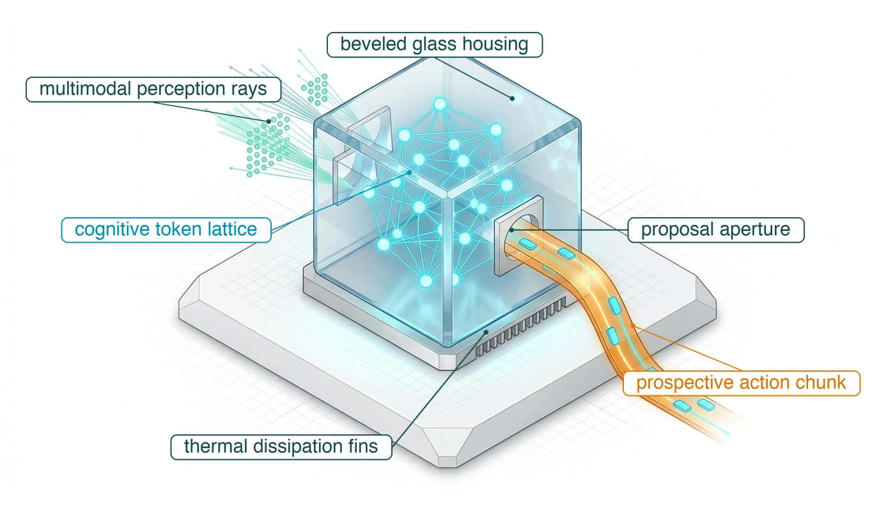
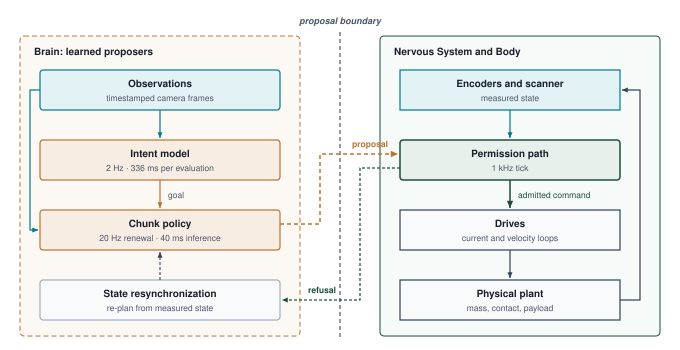
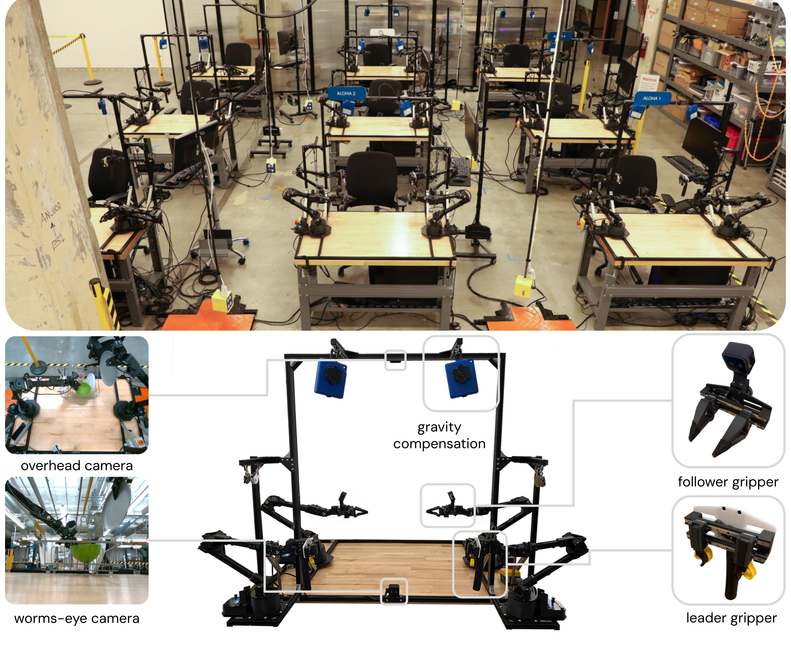
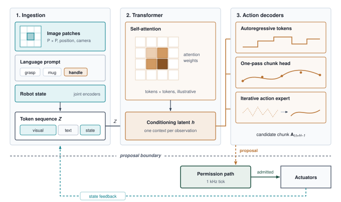
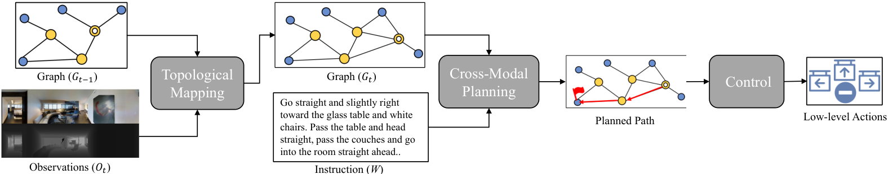
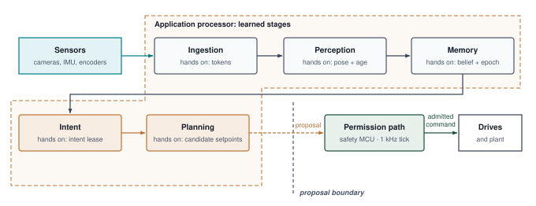
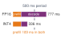
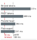
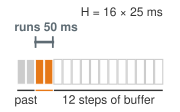

---
format:
  html:
    title: "The Cognitive Brain"
---

# The Cognitive Brain {#sec-brain}

::: {layout-narrow}
::: {.column-margin}

\chapterminitoc

:::

::: {.content-visible when-format="pdf"}
\noindent
{fig-alt="Isometric blueprint of the Brain level, the application processor that runs the learned proposers: a heterogeneous System on Chip (SoC) integrates processing units; a Neural Processing Unit (NPU) with a tensor systolic array handles deep learning matrix operations; stacked High Bandwidth Memory (HBM) dies enhance bandwidth for rapid data access; a high-speed weights streaming bus enables real-time data transfer; and a 3D action chunking token lattice facilitates efficient memory management and retrieval."}
:::

::: {.content-visible unless-format="pdf"}
{fig-alt="Isometric blueprint of the Brain level, the application processor that runs the learned proposers: heterogeneous SoC, NPU tensor systolic array, stacked HBM memory dies, high-speed weights streaming bus, and 3D action chunking token lattice."}
:::

:::

## Purpose {.unnumbered .unlisted}

::: {.content-visible when-format="pdf"}
\begin{marginfigure}
\resizebox{0.92\linewidth}{!}{\mlphysicalstackfull{100}{20}{20}{20}{20}}
\end{marginfigure}
:::

_Why can a robot recognize what to do yet still be too late to act?_

Learned models are what let a physical machine handle objects and scenes that no engineer enumerated, and they are also the largest and least predictable computation the machine carries. A model that recognizes the right object still has to move its weights through an onboard processor that sensing and control also depend on, and a larger model that recognizes more takes longer to answer. While it computes, the world keeps moving, so a correct answer can arrive after the conditions that justified it have changed. Predicting a sequence of future motions keeps the actuators supplied between model updates, but it cannot make those motions respond to observations the model has not yet received, and a proposal that arrives on time can still be wrong in ways the model's own confidence does not reveal. An engineer who treats the learned model as a function that returns actions cannot size the processor, set the rates at which proposals are renewed, or say how long the machine may keep moving on an answer that has gone stale. Because motion beyond the causal boundary cannot be recalled, every learned proposal must remain a request that an independent permission path can refuse in time.



::: {.callout-learning-objectives}

- Compare classical analytical pipelines and learned representations on coverage, sensory robustness, and formal verifiability
- Calculate the memory wall bound on a model's fresh-evaluation rate ($f \le \SustainedMemoryBandwidth / \WeightMemoryWeights$) under the embodied batch size 1 constraint, and explain why weight-only quantization shortens the bandwidth-bound decode but not the compute-bound prefill
- Estimate key-value cache expansion from multi-camera tokenization, hidden dimensions, and retained history windows
- Explain how action chunking ($\Horizon$) amortizes off-chip weight transfers over physical wall-clock time without improving closed-loop reaction latency
- Compare autoregressive, one-pass, and iterative action decoders by the sequential evaluations and off-chip transfers one chunk costs
- Apply replanning period, inference latency, and target drift to size an action chunk for a dynamic target
- Evaluate the interface between a slow and a fast proposer by what the permission path can check against its own evidence
- Diagnose cognitive failure modes: semantic hallucinations, uncalibrated softmax overconfidence, perceptual chattering, and expired intent leases
- Identify the trajectory, timestamps, and validity information a proposer must hand to independent real-time verification

:::

## The Embodied Brain {#sec-brain-embodied}

The body's limit records tell the permission path what it must refuse, but they cannot say what the machine should do next. That choice belongs to the Brain, the deliberative layer that interprets incoming sensor telemetry and proposes what the physical body should execute next. Over the past decade, physical AI architectures have transitioned from hand-authored geometric pipelines and finite-state machines to learned models, notably vision-language-action (VLA) architectures that map natural language instructions and camera pixels directly to candidate end-effector motions for objects no engineer explicitly modeled. This shift places the machine's most computationally intensive workloads on its least predictable path. A deep neural proposer requires billions of operations, contends for shared memory bus bandwidth with low-latency sensing and control tasks, and predicts future actions for an environment that continues to evolve during inference. A fundamental physical constraint governs this interaction: a learned proposal remains useful only if it arrives, and remains physically valid, within the time window permitted by environmental dynamics. Furthermore, every candidate trajectory remains strictly a proposal. The hard-real-time permission path beneath the proposal boundary holds exclusive authority to validate and admit candidate motions before they actuate physical hardware.

The warehouse mobile manipulator illustrates this boundary concretely. The robot can operate within every torque, thermal, voltage, and braking limit of its body, and meet the freshness deadline that the body's budgets set for this same pick-station grasp, yet still fail to grasp an unfamiliar ceramic mug traveling along an active conveyor. Low-level limits safeguard physical actuators against structural and electrical damage, but they cannot identify the geometry of a graspable handle or plan an obstacle-free trajectory around a coworker's arm. A learned vision-action model supplies this missing perceptual interpretation. However, because neural network outputs carry no formal safety guarantees, every generated action sequence remains an unverified candidate until the permission path checks it against fresh telemetry and established safety envelopes.

::: {.column-margin .margin-pointer}
↩ The mobile manipulator's torque, thermal, voltage, and braking limits are established in @sec-body-five-budgets.
:::

This division exposes an inescapable timing dilemma: physical dynamics do not pause while inference runs. As the vision model evaluates sensory frames, the conveyor belt advances, and the manipulator must continue tracking previously admitted waypoints without stalling or jerking. Deploying a larger foundation model can enhance open-world object recognition, but the resulting inference latency delays subsequent updates. Systems architects must therefore decouple three distinct temporal quantities: the observation frequency at which the proposer ingests fresh sensor frames, the trajectory horizon spanning the future waypoints contained within each proposal, and the validity window over which those predictions remain physically accurate. Synthesizing longer action horizons can bridge execution between inference cycles, but generating additional waypoints does not refresh the perceptual evidence that produced them.

```{python}
#| label: brain-two-speed-rates
#| echo: false
#| warning: false
#| message: false
# ┌─────────────────────────────────────────────────────────────────────────────
# │ TWO-SPEED RATES (LEGO GUARD FOR A HAND-DRAWN FIGURE)
# ├─────────────────────────────────────────────────────────────────────────────
# │ Context: @fig-two-speed-brain (fig03_two_speed_brain.svg) in the chapter
# │          opening.
# │ Goal:    Print the caption's rates and keep the SVG's hand-drawn labels
# │          equal to the running machine's registry values.
# │ Show:    intent model 2 Hz, 336 ms; chunk renewal 20 Hz, 40 ms inference;
# │          1 kHz permission tick.
# │ How:     Read the registry; check() fails the build if a registry change
# │          leaves the SVG labels stale.
# └─────────────────────────────────────────────────────────────────────────────
from mlsysim import *
from mlsysim.fmt import fmt_frequency, fmt_latency, check

class TwoSpeedRates:
    """Registry rates that fig03_two_speed_brain.svg draws as text."""

    # ┌── 1. LOAD (Constants & Parameters) ─────────────────────────────────
    RM = Embodied.MobileManipulator.WarehouseMobileManipulator
    f_intent = RM.intent_rate  # category: chosen
    t_intent = RM.intent_inference_latency.to(millisecond)  # category: derived (prefill plus decode)
    f_chunk = RM.chunk_rate  # category: chosen
    t_chunk = RM.chunk_inference_latency.to(millisecond)  # category: illustrative (P99 incl. vision)
    f_tick = RM.permission_rate  # category: chosen

    # ┌── 3. GUARD (Invariants) ───────────────────────────────────────────
    check(abs(f_intent.to(hertz).magnitude - 2.0) < 1e-9, f"SVG draws the intent model at 2 Hz; registry says {f_intent}.")
    check(round(t_intent.magnitude) == 336, f"SVG draws 336 ms per intent evaluation; registry says {t_intent}.")
    check(abs(f_chunk.to(hertz).magnitude - 20.0) < 1e-9, f"SVG draws chunk renewal at 20 Hz; registry says {f_chunk}.")
    check(abs(t_chunk.magnitude - 40.0) < 1e-9, f"SVG draws 40 ms chunk inference; registry says {t_chunk}.")
    check(abs(f_tick.to(hertz).magnitude - 1000.0) < 1e-9, f"SVG draws a 1 kHz permission tick; registry says {f_tick}.")

    # ┌── 4. OUTPUT (Formatting) ──────────────────────────────────────────
    f_intent_str = fmt_frequency(f_intent, unit=hertz, precision=0)
    f_chunk_str = fmt_frequency(f_chunk, unit=hertz, precision=0)
    f_tick_str = fmt_frequency(f_tick, unit=ureg.kilohertz, precision=0)
```

The machine card of @sec-boundary-running-machine already commits the running machine to one answer, the **two-speed brain architecture**\index{Two-speed brain architecture!hybrid control}: a slow intent model revised at `{python} TwoSpeedRates.f_intent_str` above a fast chunk policy renewed at `{python} TwoSpeedRates.f_chunk_str`, both proposing to a permission path that checks measured state on a `{python} TwoSpeedRates.f_tick_str` tick (@fig-two-speed-brain). The card states these rates; this chapter derives them. The slow intent model names a target; the fast chunk policy emits an action chunk, the short sequence of future setpoints from one inference that @sec-boundary-prediction-to-action introduced, so the drives below have motion to track between evaluations [@zhao2023learning; @chi2024diffusionpolicy]. Three claims carry the design, and the sections that follow test each one. No single large model can renew its proposal fast enough to supply the arm. A chunk keeps the arm supplied without keeping the evidence behind it fresh. Finally, the permission path can refuse the slow model's intent, and not only the fast model's motion, only if that intent arrives as a target it can compare with its own depth measurements and clock, which means a pose stamped with the capture time of the frame it came from (@sec-brain-proposer-interface).

::: {#fig-two-speed-brain fig-env="figure" fig-pos="t" fig-cap="**Two-speed brain architecture**: Above the proposal boundary, two learned proposers run at their own rates, an intent model at `{python} TwoSpeedRates.f_intent_str` and a chunk policy renewing at `{python} TwoSpeedRates.f_chunk_str`. Below it, the permission path checks each proposal against measured state on a `{python} TwoSpeedRates.f_tick_str` tick, and the drives close their own current and velocity loops. A proposal carries no authority until it is admitted; a refusal returns the proposers to a plan from measured state." fig-alt="Two regions separated by a dashed vertical line labeled proposal boundary. Left region, Brain learned proposers: observations feed an intent model at 2 hertz and 336 milliseconds per evaluation, which passes a goal to a chunk policy at 20 hertz renewal and 40 milliseconds inference; a state resynchronization box below feeds the chunk policy. Right region, Nervous System and Body: encoders and scanner feed a permission path at a 1 kilohertz tick, which sends an admitted command to drives with current and velocity loops, which move the physical plant; the plant feeds back to the encoders. A dashed proposal arrow crosses from the chunk policy to the permission path, and a dashed refusal arrow returns from the permission path to state resynchronization."}
{width="90%"}
:::

A learned proposer earns its place in an embodied system when training distribution coverage generalizes beyond preprogrammed edge cases. In the conveyor pick task, this capability translates into interpreting natural language instructions, recognizing the target mug amid visual clutter, and proposing reachable grasp affordances. However, high-level semantic identification alone cannot direct a robot arm; the system must project proposed grasp regions into metric Cartesian space using calibrated depth sensing and forward kinematics. Furthermore, environmental challenges such as specular reflections, dynamic shadows, and transient occlusions inevitably induce perceptual errors. Whatever algorithmic sophistication a proposer introduces, its execution demands must conform to the throughput, memory bandwidth, and thermal dissipation envelope of the onboard processor.

A first estimate shows why one model cannot do both jobs. If every fresh evaluation must stream all of a model's weights from off-chip memory, its renewal rate can be no higher than the sustained bandwidth divided by the bytes of weights, a ceiling that falls in proportion to parameter count (@fig-cadence-gap). The intent model stores its weights as 4-bit integers (INT4, priced in @sec-brain-quantization) rather than 16-bit floating point (FP16), which raises its ceiling fourfold. Both of the machine's proposers still sit below their ceilings, because reading the input tokens in one pass through the model (the *prefill*) and then decoding the output add work that weight streaming alone ignores, and neither approaches the kilohertz rate at which the permission path and the servo loops run. The design problem is therefore deciding which computation can finish before the observation it started from goes stale. @Sec-brain-memory-wall derives the ceiling and the work above it; the figure is a preview of where the derivation lands.

::: {#fig-cadence-gap fig-env="figure" fig-pos="htb" fig-cap="**Cadence regimes on the machine's processor**: The weight-streaming ceiling $f \le \SustainedMemoryBandwidth/\WeightMemoryWeights$ on the mobile manipulator's application processor for FP16 and INT4 weights (16-bit floating-point and 4-bit integer representations, @sec-brain-quantization) plotted against model parameter counts, alongside the operating points for the machine's intent model and chunk policy. This ceiling establishes an upper bound on throughput rather than an achieved operating frequency, because input token prefill, vision encoding, and autoregressive generation consume execution cycles beyond raw DRAM weight traffic (@sec-brain-memory-wall)." fig-alt="Log-log plot of update rate against parameter count. Two parallel descending lines show the FP16 and INT4 weight-streaming ceilings. The chunk policy at 80 million parameters and 20 hertz and the intent model at 7 billion parameters and 2 hertz both sit below their ceilings. Shaded bands mark the permission-loop, chunk, and intent rate ranges."}

```{python}
#| label: plot-cadence-gap
#| echo: false
#| warning: false
#| message: false
# ┌─────────────────────────────────────────────────────────────────────────────
# │ CADENCE REGIMES ON THE MACHINE'S PROCESSOR (FIGURE)
# ├─────────────────────────────────────────────────────────────────────────────
# │ Context: @fig-cadence-gap, previewing @sec-brain-memory-wall
# │ Goal:    replace anonymous illustrative points with the computed
# │          weight-streaming ceiling and the machine's two proposers
# │ Show:    f_max = B_sustained / M_weights for FP16 and INT4 weights; intent
# │          model (7B, 2 Hz) and ACT chunk policy (80M, 20 Hz) below them
# │ How:     registry bandwidth x dram_efficiency; RM.intent_rate, RM.chunk_rate
# └─────────────────────────────────────────────────────────────────────────────
import numpy as np
import matplotlib.pyplot as plt
from mlsysim import viz, Embodied
from mlsysim.core.units import GB, second, hertz, param, byte
from mlsysim.fmt import check

RM = Embodied.MobileManipulator.WarehouseMobileManipulator

# ┌── 1. LOAD (Constants & Parameters) ─────────────────────────────────────────
_b_sus = (RM.brain_soc.memory.bandwidth * RM.dram_efficiency).to(GB / second).magnitude  # derived
_bpp = {"FP16 weights": 2.0, "INT4 weights": RM.intent_weight_bytes_per_param.to(byte / param).magnitude}  # chosen
_intent = (RM.intent_model.parameters.to(param).magnitude, RM.intent_rate.to(hertz).magnitude)
_chunk = (RM.chunk_model.parameters.to(param).magnitude, RM.chunk_rate.to(hertz).magnitude)

# ┌── 2. EXECUTE (Compute) ─────────────────────────────────────────────────────
_n = np.logspace(7, 10.5, 200)
_ceiling = {k: _b_sus * 1e9 / (_n * v) for k, v in _bpp.items()}
_intent_wall = _b_sus * 1e9 / (_intent[0] * _bpp["INT4 weights"])
_chunk_wall = _b_sus * 1e9 / (_chunk[0] * 2.0)

# ┌── 3. GUARD (Invariants) ────────────────────────────────────────────────────
check(_intent[1] < _intent_wall, "Intent rate must sit below its INT4 streaming ceiling")
check(_chunk[1] < _chunk_wall, "Chunk rate must sit below its FP16 streaming ceiling")

# ┌── 5. PLOT ──────────────────────────────────────────────────────────────────
fig, ax, COLORS, plt = viz.setup_plot(figsize=(7, 4.5))
ax.set_xscale("log")
ax.set_yscale("log")
ax.axhspan(100, 1000, color="gray", alpha=0.12, label="Permission and servo loops (100–1000 Hz)")
# Vol IV roles: learned proposers in the proposal role (bronze); red is reserved for consequence.
PROPOSAL = "#B87333"
ax.axhspan(10, 50, color="#007A87", alpha=0.08, label="Chunk renewal (10–50 Hz)")
ax.axhspan(1, 5, color="#B87333", alpha=0.08, label="Intent revision (1–5 Hz)")
for (k, f), ls in zip(_ceiling.items(), ["-", "--"]):
    ax.plot(_n, f, ls, color=COLORS["BlueLine"], lw=1.4, label=f"Streaming ceiling, {k}")
ax.plot(*_chunk, "o", ms=9, color=PROPOSAL, zorder=5)
ax.annotate(
    "Chunk policy\n(ACT, 20 Hz)",
    xy=_chunk,
    xytext=(_chunk[0] * 0.18, _chunk[1] * 0.25),
    fontsize=8,
    color=PROPOSAL,
    arrowprops=dict(arrowstyle="->", color=PROPOSAL, lw=0.9),
)
ax.plot(*_intent, "o", ms=9, color=PROPOSAL, zorder=5)
ax.annotate(
    "Intent model\n(INT4, 2 Hz)",
    xy=_intent,
    xytext=(_intent[0] * 0.05, _intent[1] * 0.3),
    fontsize=8,
    color=PROPOSAL,
    arrowprops=dict(arrowstyle="->", color=PROPOSAL, lw=0.9),
)
ax.set_xlim(1e7, 3e10)
ax.set_ylim(0.3, 3e4)
ax.set_xlabel("Parameter count (log scale)")
ax.set_ylabel("Update rate [Hz] (log scale)")
plt.legend(bbox_to_anchor=(1.02, 1), loc="upper left", frameon=False, fontsize=8)
plt.tight_layout()
plt.show()
plt.close()
```

:::

Testing the two-speed design takes four steps. Classical pipelines built on hand-authored geometry and rigid state machines show why a learned proposer is needed at all, because open-world variability exhausts manual rule sets (@sec-brain-classical-wall). Learned representations restore semantic breadth but pay for it in tokens, cache, and bus traffic (@sec-brain-learned-representations). Pricing one fresh evaluation of the intent model on the application processor then exposes the memory wall and what quantization can and cannot do about it (@sec-brain-cognitive-pipeline), and sizing the chunks that keep the arm supplied separates the motion a chunk supplies from the time its evidence stays true (@sec-brain-chunk-supply). Because a proposal can arrive on schedule and still be wrong, the last step examines the failures that leave the permission path to refuse an on-time proposal (@sec-brain-cognitive-vulnerabilities).

## The Classical Wall {#sec-brain-classical-wall}

In a fixed industrial workcell, a robotic gripper can approach the exact same fixture along an identical trajectory on every production cycle. Engineers can specify such repetitive motions through analytical geometry, rigid-body equations of motion, and deterministic state transitions. Classical control theory and traditional robotics flourish within this analytical formulation [@wiener1948cybernetics; @kalman1960new; @craig2005introduction]. The engineering challenge sharpens, however, when moving from a rigid fixture to an unconstrained scenario, such as retrieving a randomly oriented mug from a moving conveyor belt, where the engineer cannot enumerate every combination of object geometry, pose, and physical contact in advance.

Analytical kinematics and dynamics map target end-effector[^fn-endeffector-pose-kinematics] trajectories into joint angles, velocities, and actuator torques.[^fn-manipulator-dynamics-equation] Classical perception routines register incoming sensor point clouds against reference computer-aided design (CAD) models, while a synchronous finite-state machine steps the manipulator through sequential phases: approaching, aligning, grasping, and retracting. In a calibrated workcell, these analytical components reliably solve bounded manipulation tasks under explicit operational assumptions. Their computational latency and real-time execution bounds depend strictly on the chosen numerical solver, processor throughput, and contact dynamics model.

[^fn-endeffector-pose-kinematics]: **End-Effector**\index{End-effector!definition}: The tool, gripper, or hand at the distal tip of a manipulator, the only part of the arm meant to touch the workpiece. Workspace and keep-out checks are written against its pose rather than against joint angles, which is why the proposal payload later in this chapter carries end-effector poses alongside joint targets.

[^fn-manipulator-dynamics-equation]: **Manipulator Equation**\index{Rigid-body dynamics!manipulator equation}\index{Equations of motion!manipulator dynamics}: Classical control computes joint torques from $\GeneralizedInertiaMatrix\ddot{\mathbf{q}} + \CoriolisCentrifugalMatrix\dot{\mathbf{q}} + \GravitationalTorqueVector = \boldsymbol{\tau}$, with a configuration-dependent inertia matrix $\ArticulatedInertiaMatrix$, Coriolis and centripetal terms $\CoriolisMatrix$, and gravity $\mathbf{g}$. Torque is linear in inertia, and a link's inertia grows with the square of its distance from the joint, so an outstretched arm needs more torque for the same angular acceleration. Unmodeled contact, friction, or deformable objects break this rigid-body model, which is the gap learned proposers enter; @sec-appendix-control-feedback-lin shows how classical control inverts this model to compute torque.

Where the operational environment remains structured and bounded, classical methods provide dependable behavior within their modeled operating envelopes. In a body shop (@fig-industrial-welding), the chassis sits in submillimeter tooling fixtures, the lighting never changes, and interlock fencing keeps people out of the cell during live cycles, so every quantity the controller depends on is fixed by construction. Within the causal boundary, this controlled regime permits explicit physical modeling, deterministic servo timing, and formal Lyapunov stability analysis.[^fn-lyapunov-stability-certificate] Control engineers can analytically guarantee trajectory tracking error bounds ($\lVert \mathbf{e}(t) \rVert \le \epsilon$) and certify software execution against rigorous functional safety standards without collecting empirical training datasets.

::: {.column-margin .margin-pointer}
↩ The causal boundary, where an admitted command becomes physical work, is established in @sec-boundary-causal-boundary.
:::

::: {#fig-industrial-welding fig-env="figure" fig-pos="t" fig-cap="**Industrial spot-welding workcell**: Multiple six-degree-of-freedom articulated robots execute preprogrammed spot welding paths on stamped automotive chassis at the BMW Leipzig plant. Operating in a calibrated factory environment with submillimeter repeatable fixtures and safety interlock cages, classical controllers provide deterministic cycle timing and formal stability proofs. (Credit: BMW Werk Leipzig, [Wikimedia Commons](https://commons.wikimedia.org/wiki/File:BMW_Leipzig_MEDIA_050719_Download_Karosseriebau_max.jpg), CC BY-SA 2.0 DE.)" fig-alt="Articulated industrial robots executing automated spot welding on an automotive chassis within a safety-caged factory cell."}
{width="85%"}
:::

[^fn-lyapunov-stability-certificate]: **Lyapunov Stability**\index{Lyapunov stability!energy-like certificate}: Aleksandr Lyapunov's 1892 method proves that a system returns to equilibrium by exhibiting an energy-like function that decreases along every trajectory, without solving the equations of motion [@slotine1991applied]. Writing that function down requires an explicit dynamics model, which is why the method certifies a classical controller and not a learned proposer. The barrier certificates of @sec-enforcement-safe-sets-conditional-permission reuse the idea to keep the machine inside a safe set rather than at a point.

Yet when an embodied machine steps outside the structured factory cage into unstructured, open-world environments, this analytical paradigm hits the **classical wall** [@brooks1991intelligence; @levine2018learning]. Physical reality defies closed-form geometric modeling: real objects deform under contact, ambient illumination shifts unpredictably, and scenes exhibit near-infinite visual and mechanical variety. A rescue test arena of tilted ramps and a victim dummy on a high shelf (@fig-unstructured-rescue) has none of the fixtures that made the welding cell analyzable: no part arrives at a known pose, and no template describes the terrain. In such unmapped, irregular settings, preauthored geometric templates and rigid state machines lose state coverage and fail to generalize.

::: {#fig-unstructured-rescue fig-env="figure" fig-pos="t" fig-cap="**Unstructured search-and-rescue robot**: A four-wheeled rescue robot carrying cameras and a laser scanner on a pan-tilt mast works through a test arena of tilted ramps and narrow openings, with a victim dummy placed on a high shelf. In such unmapped environments, preauthored geometric models and rigid state machines can lose coverage; learned policies may help infer spatial affordances and traversability from sensory streams. (Credit: Hector, Technische Universität Darmstadt, at the 2010 RoboCup German Open; photo by Mike1024, [Wikimedia Commons](https://commons.wikimedia.org/wiki/File:RoboCup_Rescue_robot_Hector_from_Darmstadt_at_2010_German_open.jpg), public domain.)" fig-alt="Four-wheeled robot with a sensor mast on tilted plywood ramps in a rescue test arena, seen through a round cutout, with a doll on a shelf in the background."}
{width="85%"}
:::

Outside structured fixtures, the analytical perception-and-control pipeline fractures under perceptual uncertainty and environmental permutation. A rigid CAD template fails when handling deformable textiles or asymmetric food items; specular reflections or cast shadows can obliterate the depth discontinuities required to segment adjacent parcels; and an unexpected obstacle invalidates the guard conditions of a preauthored grasping state machine. While engineers can introduce additional templates, heuristic filtering thresholds, and recovery branches to patch edge cases, this manual expansion triggers combinatorial complexity. Each added heuristic demands costly bespoke tuning and revalidation, yet still fails to deliver robust coverage across open-world distributions.

Machine learning offers an architectural exit from this combinatorial trap. By training over diverse physical interactions and expert demonstrations, neural representations learn to extract generalized spatial affordances and behavioral policies directly from high-dimensional sensor streams, without a hand-crafted geometric model for every item encountered. Yet this data-driven policy does not replace the downstream analytical controller. Deterministic feedback loops remain essential for enforcing kinematic safety bounds and tracking proposed trajectories at high update rates. Instead, learning introduces a computationally intensive, non-deterministic proposal stage whose memory bandwidth, arithmetic throughput, and inference latency must interface cleanly with the underlying real-time controller.

## Learned Representations {#sec-brain-learned-representations}

When commanded to pick an unfamiliar ceramic mug from a conveyor, a learned model relates the text prompt to visual features of the handle and proposes a plausible grasp region without an exact CAD model. VLA models combine multi-camera imagery, natural-language instructions, and proprioceptive robot state to produce candidate actions [@brohan2023rt1; @brohan2023rt2; @kim2024openvla]. These systems descend from early embodied language models such as SayCan and PaLM-E, which emitted high-level semantic plans rather than low-level motor commands [@ahn2022saycan; @driess2023palme]. The operational value of a VLA stems from broad generalization across diverse objects and ambient environments acquired during large-scale pretraining, rather than formal guarantees of correct scene interpretation.

Teleoperated demonstrations can likewise teach coordinated sensorimotor policies for tasks whose contacts and structural deformations resist analytic kinematic modeling. In a bimanual teleoperation workcell (@fig-aloha-manipulator), an operator moves low-cost leader arms while follower arms with parallel grippers reproduce the motion, and overhead and wrist cameras record what the followers saw; those recordings become the training data for policies that later act alone [@zhao2023learning; @chi2024diffusionpolicy]. The running machine's chunk policy takes its size from ACT, which was trained on exactly such recordings, and what such a policy learns from them is the action chunk itself, a short stretch of the operator's motion predicted from one view. How demonstrations become a policy belongs to @sec-training; this chapter prices what the trained policy costs to run. Although learned representations tolerate sensory variations captured across training distributions, executing any proposed motion safely still demands calibrated spatial geometry and strict physical boundary enforcement. Empirical task success demonstrates capability over tested operating envelopes, but out-of-distribution shifts in illumination, surface friction, or payload dynamics can quickly induce behavioral drift or outright failure.

The computational cost of this capability depends directly on the model's underlying representation. A transformer does not read pixels or words directly; it reads *tokens*\index{Token!embedding of an input slice}, embedding vectors that each represent one slice of input, such as an image patch, a word fragment, or a joint angle. @Fig-vla-architecture traces that token dataflow from camera patches through self-attention to candidate action chunks. Multi-view camera frames consume significant memory bandwidth during ingestion, historical context expands key-value (KV) cache footprints in memory, and the inference engine must produce subsequent actions before the physical state diverges from the initial observation. Evaluating an embodied learned model alongside a classical perception-planning pipeline requires assessing both task generalization and the end-to-end latency required to refresh action proposals.

::: {#fig-aloha-manipulator fig-env="figure" fig-pos="t" fig-cap="**Bimanual teleoperation workcell**: Dual-arm teleoperation setup featuring two six-degree-of-freedom follower arms, two leader arms for kinesthetic teleoperation, multi-view cameras (overhead and wrist-mounted), and parallel grippers mounted to an extruded aluminum frame. The physical AI policy ingests synchronized multi-camera streams to predict continuous end-effector trajectories, and the permission path must refuse any proposal that would cause self-collision or motor over-torquing during closed-loop execution. (Credit: ALOHA 2 Team, ALOHA 2: An Enhanced Low-Cost Hardware for Bimanual Teleoperation, arXiv:2405.02292, CC BY 4.0.)" fig-alt="Dual-arm robotic teleoperation workstation with leader and follower arms, overhead cameras, and grippers mounted on an aluminum frame."}
{width="85%"}
:::

::: {#fig-vla-architecture fig-env="figure" fig-pos="t" fig-cap="**Embodied Vision-Language-Action (VLA) architecture**: A representative dataflow. (1) Camera patches receive 2D image-position and camera identifiers alongside language and robot-state tokens; metric depth still requires calibrated evidence. (2) Self-attention mixes the combined token sequence; the colored grid illustrates internal attention weights, not a verified affordance or grasp pose. (3) Autoregressive token decoders emit tokens sequentially, whereas one-pass chunk heads and iterative action experts generate candidate multi-step chunks ($\ActionChunk_{t:t+\Horizon-1}$) in one pass or over several refinement steps. (4) An independent permission path checks candidate motion against sensed state and modeled limits before actuation. (Synthesized from Brohan et al. [@brohan2023rt1; @brohan2023rt2], Kim et al. [@kim2024openvla], and Octo Model Team [@octo_2023])." fig-alt="Comprehensive architectural schematic of a Vision-Language-Action foundation model showing spatial patch slicing, 2D positional embeddings, multimodal self-attention weights in an illustrative image grid, discrete vs. continuous action decoders, and an independent proposal boundary."}
{width="100%"}
:::

```{python}
#| label: calc-brain-state-of-practice
#| echo: false
#| warning: false
#| message: false
# ┌─────────────────────────────────────────────────────────────────────────────
# │ PUBLISHED VLA AND DUAL-SYSTEM FIGURES (STATE OF PRACTICE, AS OF 2026)
# ├─────────────────────────────────────────────────────────────────────────────
# │ Context: item 3 of @sec-brain-learned-representations, the decoder-family
# │          paragraphs of @sec-brain-action-chunking, @tbl-03-state-of-practice
# │ Goal:    hold every published 2023-2025 system figure the chapter quotes in
# │          one place, each with its source, so the dated table can be refreshed
# │          without touching the argument
# │ Show:    horizons (DP 16/8, pi0 50, ACT 100); OFT 26x; FAST 30-60 tokens;
# │          Helix, GR00T N1, Gemini Robotics rates
# │ How:     literature values, each verified against the paper on 2026-09-29;
# │          promotion candidates for mlsysim literature/registry
# └─────────────────────────────────────────────────────────────────────────────
from mlsysim.core.units import *
from mlsysim.fmt import fmt_int, fmt_params, fmt_frequency, fmt_latency, fmt_multiple, fmt_percent, fmt_memory, check

class StateOfPractice:
    """Published architecture figures, verified against each source (2026-09-29)."""

    # ┌── 1. LOAD (Constants & Parameters) ─────────────────────────────────
    # Chi et al. 2024 (Diffusion Policy): prediction horizon T_p and executed T_a
    dp_predict, dp_execute = 16, 8  # category: literature
    # Zhao et al. 2023 (ACT): chunk size k = 100 at 50 Hz
    act_k = 100  # category: literature
    act_rate = 50 * hertz  # category: literature (ACT control rate)
    # Black et al. 2024 (pi0), Sec. IV and App. A-D
    pi0_params = 3.3e9 * param  # category: literature (total)
    pi0_expert = 300e6 * param  # category: literature (action expert)
    pi0_h = 50  # category: literature
    pi0_steps = 10  # category: literature (flow integration steps)
    pi0_rate = 50 * hertz  # category: literature ("up to 50 Hz")
    pi0_latency = 73 * millisecond  # category: literature (on-board, RTX 4090)
    # Kim et al. 2024 (OpenVLA): about 6 Hz on one RTX 4090 in bfloat16
    openvla_rate = 6 * hertz  # category: literature
    # Kim, Finn, Liang 2025 (OpenVLA-OFT): LIBERO, A100, 8-step chunks
    oft_hz, openvla_hz_a100, oft_chunk = 109.7 * hertz, 4.2 * hertz, 8  # category: literature
    # Pertsch et al. 2025 (FAST): 30-60 tokens per chunk; pi0-FAST ~750 ms vs pi0 ~100 ms (RTX 4090)
    fast_tok_lo, fast_tok_hi = 30, 60  # category: literature
    fast_naive, fast_tok_50hz = 700, 53  # category: literature (shirt fold, 50 Hz, Table I)
    fast_task_rate = 50 * hertz  # category: literature (shirt-fold control rate, Table I)
    fast_latency, flow_latency = 750 * millisecond, 100 * millisecond  # category: literature (approximate)
    # Figure AI 2025 (Helix)
    helix_s2_params, helix_s1_params = 7e9 * param, 80e6 * param  # category: literature
    helix_s2_lo, helix_s2_hi, helix_s1_rate = 7 * hertz, 9 * hertz, 200 * hertz  # category: literature
    helix_dof = 35  # category: literature
    # Bjorck et al. 2025 (GR00T N1)
    gr00t_params, gr00t_vlm = 2.2e9 * param, 1.34e9 * param  # category: literature
    gr00t_s2_rate, gr00t_s1_rate = 10 * hertz, 120 * hertz  # category: literature
    gr00t_h, gr00t_steps = 16, 4  # category: literature
    gr00t_latency = 63.9 * millisecond  # category: literature (16-action chunk, L40, bf16)
    # Gemini Robotics Team 2025 (Gemini Robotics): cloud backbone plus on-robot decoder
    gemini_backbone = 160 * millisecond  # category: literature (upper bound, "under 160 ms")
    gemini_e2e = 250 * millisecond  # category: literature ("approximately 250 ms")
    gemini_rate = 50 * hertz  # category: literature (effective control rate with chunks)

    # ┌── 2. EXECUTE (Compute) ─────────────────────────────────────────────
    oft_speedup = (oft_hz / openvla_hz_a100).to("dimensionless").magnitude
    fast_ratio = fast_naive / fast_tok_50hz

    # ┌── 3. GUARD (Invariants) ───────────────────────────────────────────
    check(abs(oft_speedup - 26.1) < 0.05, f"OFT speedup drifted: {oft_speedup}")
    check(abs(fast_ratio - 13.2) < 0.05, f"FAST compression drifted: {fast_ratio}")
    check(dp_execute < dp_predict < pi0_h < act_k, "Horizon ordering drifted")

    # ┌── 4. OUTPUT (Format & Export) ────────────────────────────────────────
    dp_predict_str, dp_execute_str, act_k_str = fmt_int(dp_predict), fmt_int(dp_execute), fmt_int(act_k)
    act_rate_str = fmt_frequency(act_rate, unit=hertz, precision=0)
    pi0_params_str = fmt_params(pi0_params, precision=1)
    pi0_expert_str = fmt_params(pi0_expert, precision=0)
    pi0_h_str, pi0_steps_str = fmt_int(pi0_h), fmt_int(pi0_steps)
    pi0_rate_str = fmt_frequency(pi0_rate, unit=hertz, precision=0)
    pi0_latency_str = fmt_latency(pi0_latency, unit=millisecond, precision=0)
    openvla_rate_str = fmt_frequency(openvla_rate, unit=hertz, precision=0)
    oft_hz_str = fmt_frequency(oft_hz, unit=hertz, precision=1)
    openvla_hz_a100_str = fmt_frequency(openvla_hz_a100, unit=hertz, precision=1)
    oft_chunk_str = fmt_int(oft_chunk)
    oft_speedup_mult_str = fmt_multiple(round(oft_speedup), precision=0)  # the paper reports "26x"
    fast_tok_lo_str, fast_tok_hi_str = fmt_int(fast_tok_lo), fmt_int(fast_tok_hi)
    fast_naive_str, fast_tok_50hz_str = fmt_int(fast_naive), fmt_int(fast_tok_50hz)
    fast_ratio_mult_str = fmt_multiple(fast_ratio, precision=1)
    fast_task_rate_str = fmt_frequency(fast_task_rate, unit=hertz, precision=0)
    fast_latency_str = fmt_latency(fast_latency, unit=millisecond, precision=0)
    flow_latency_str = fmt_latency(flow_latency, unit=millisecond, precision=0)
    helix_s2_params_str = fmt_params(helix_s2_params, precision=0)
    helix_s1_params_str = fmt_params(helix_s1_params, precision=0)
    helix_s2_lo_num_str = fmt_int(helix_s2_lo.magnitude)
    helix_s2_hi_str = fmt_frequency(helix_s2_hi, unit=hertz, precision=0)
    helix_s1_rate_str = fmt_frequency(helix_s1_rate, unit=hertz, precision=0)
    helix_dof_str = fmt_int(helix_dof)
    gr00t_params_str = fmt_params(gr00t_params, precision=1)
    gr00t_vlm_str = fmt_params(gr00t_vlm, precision=2)
    gr00t_s2_rate_str = fmt_frequency(gr00t_s2_rate, unit=hertz, precision=0)
    gr00t_s1_rate_str = fmt_frequency(gr00t_s1_rate, unit=hertz, precision=0)
    gr00t_h_str, gr00t_steps_str = fmt_int(gr00t_h), fmt_int(gr00t_steps)
    gr00t_latency_str = fmt_latency(gr00t_latency, unit=millisecond, precision=1)
    gemini_backbone_str = fmt_latency(gemini_backbone, unit=millisecond, precision=0)
    gemini_e2e_str = fmt_latency(gemini_e2e, unit=millisecond, precision=0)
    gemini_rate_str = fmt_frequency(gemini_rate, unit=hertz, precision=0)
```

```{python}
#| label: calc-brain-token-footprint
#| echo: false
#| warning: false
#| message: false
# ┌─────────────────────────────────────────────────────────────────────────────
# │ TOKEN AND CACHE FOOTPRINT OF THE ILLUSTRATIVE THREE-CAMERA BACKBONE
# ├─────────────────────────────────────────────────────────────────────────────
# │ Context: items 1-2 of the dataflow list in @sec-brain-learned-representations
# │ Goal:    replace the hand-typed patch, token, embedding, and KV-cache values
# │          with values read from the intent model's registered shape
# │ Show:    (224/14)^2 = 256 patches; 3 x 256 = 768 visual tokens; S ~ 800;
# │          800 x 4096 x 2 bytes ~ 6.55 MB embedding; 2 x 32 x 4096 x 2 =
# │          524,288 bytes (~0.524 MB) of KV cache per token
# │ How:     RM.intent_model.layers and .hidden_dim; the camera count, frame
# │          size, patch size, and prompt/state token counts are illustrative
# └─────────────────────────────────────────────────────────────────────────────
from mlsysim import Embodied
from mlsysim.core.units import byte, MB
from mlsysim.fmt import fmt_int, fmt_memory, fmt_display_math, check

class TokenFootprint:
    """Patch, token, embedding, and per-token KV sizes for the illustrative backbone."""

    # ┌── 1. LOAD (Constants & Parameters) ─────────────────────────────────
    model = Embodied.MobileManipulator.WarehouseMobileManipulator.intent_model  # category: chosen
    n_layers = model.layers  # category: datasheet
    d_model = model.hidden_dim  # category: datasheet
    cameras = 3  # category: illustrative (left wrist, right wrist, overhead)
    frame_px = 224  # category: illustrative (square input frame)
    patch_px = 14  # category: illustrative (ViT patch size)
    prompt_tokens = 32  # category: illustrative
    state_tokens = 16  # category: illustrative
    s_round = 800  # category: illustrative (rounded context length)
    elem_bytes = 2  # category: chosen (FP16)

    # ┌── 2. EXECUTE (Compute) ─────────────────────────────────────────────
    patches = (frame_px // patch_px) ** 2
    visual_tokens = cameras * patches
    embed_mem = (s_round * d_model * elem_bytes * byte).to(MB)
    kv_token_bytes = 2 * n_layers * d_model * elem_bytes
    kv_token_mem = (kv_token_bytes * byte).to(MB)

    # ┌── 3. GUARD (Invariants) ───────────────────────────────────────────
    check(patches == 256 and visual_tokens == 768, f"Patch count drifted: {patches}, {visual_tokens}")
    check(visual_tokens + prompt_tokens + state_tokens > s_round, "S must exceed the rounded 800 tokens")
    check(n_layers == 32 and d_model == 4096, f"Backbone shape drifted: {n_layers} x {d_model}")
    check(kv_token_bytes == 524288, f"KV bytes per token drifted: {kv_token_bytes}")

    # ┌── 4. OUTPUT (Format & Export) ────────────────────────────────────────
    cameras_str = fmt_int(cameras)
    patches_str = fmt_int(patches)
    visual_tokens_str = fmt_int(visual_tokens)
    prompt_tokens_str = fmt_int(prompt_tokens)
    state_tokens_str = fmt_int(state_tokens)
    s_round_str = fmt_int(s_round)
    n_layers_str = fmt_int(n_layers)
    d_model_str = fmt_int(d_model, commas=False)
    kv_token_bytes_str = fmt_int(kv_token_bytes)
    kv_token_mb_str = fmt_memory(kv_token_mem, unit=MB, precision=3)
    embed_display_math = fmt_display_math(
        rf"M_{{\text{{embed}}}} = S \times d \times 2\,\text{{bytes}} = {s_round} \times {d_model} \times 2 \approx {embed_mem.magnitude:.2f}\,\text{{MB}}"
    )
```

To grasp the mug, the model turns camera images and a language instruction into candidate trajectories in three learned stages: tokenization, attention across the tokens in a backbone, and an action decoder that projects the backbone's output into proposed motion. A proposal boundary separates all three from actuation, so every candidate action passes independent permission checks before it reaches the motor drives. Evaluating this pipeline from a systems perspective means tracing what each stage stores in memory, transfers across the memory bus, and delivers to the controllers below it:

1. *Sensory ingestion and spatial tokenization (the inputs).*
   A vision transformer (ViT) frontend [@dosovitskiy2020image] slices each incoming camera frame into a grid of non-overlapping pixel patches of size $p_{\text{patch}}{\times}p_{\text{patch}}$ (typically $14{\times}14$ or $16{\times}16$ pixels). Each patch is linearly projected into a vector of width $\HiddenDimension$, augmented with a position embedding (learned in the SigLIP and DINOv2 encoders that OpenVLA uses [@kim2024openvla], sinusoidal in some other designs), and tagged with a learned camera identifier.

   In an illustrative three-camera configuration (left wrist, right wrist, and an overhead torso mount) capturing $224{\times}224$ images, the image frontend prepares a buffer for each view. Each frame yields $(224 / 14)^2 =$ `{python} TokenFootprint.patches_str` spatial patches. Across `{python} TokenFootprint.cameras_str` cameras, ingestion injects `{python} TokenFootprint.visual_tokens_str` visual tokens into the model's sequence on every perceptual step. When concatenated with tokenized natural language commands (about `{python} TokenFootprint.prompt_tokens_str` tokens) and proprioceptive joint state embeddings (about `{python} TokenFootprint.state_tokens_str` tokens), the initial context runs slightly past `{python} TokenFootprint.s_round_str` tokens, which the estimates below round to $\SequenceLength \approx$ `{python} TokenFootprint.s_round_str`. In 16-bit floating-point (FP16) precision ($2\,\text{bytes}$ per element) with hidden dimension $\HiddenDimension =$ `{python} TokenFootprint.d_model_str`, the token embeddings for one such step occupy
   `{python} TokenFootprint.embed_display_math`
   a few megabytes, negligible beside the multi-gigabyte weights that @sec-brain-memory-wall prices. Tokens therefore cost the machine through the arithmetic every weight performs on each of them and through the cache they leave behind, not through the storage of the embeddings themselves. Neither 2D image coordinates nor internal attention patterns constitute metric depth. Projecting an end-effector into physical 3D space requires calibrated extrinsic camera matrices and depth telemetry.

2. *Multimodal alignment and attention (the backbone).*
   For the illustrative backbone, the token sequence passes through $\NumberOfLayers =$ `{python} TokenFootprint.n_layers_str` transformer layers where standard multi-head self-attention computes pairwise token interactions [@vaswani2017attention]. To relate each new token to the earlier ones, every layer keeps a *key* and a *value* vector for every token it has already processed, the **KV cache**\index{KV cache!definition}. The arithmetic of attention grows with the square of the sequence length ($\mathcal{O}(\SequenceLength^2 \HiddenDimension)$ FLOPs), but the memory the cache occupies grows only linearly with it, as @eq-brain-kv-cache gives:
   $$\KvcacheMemory = 2 \times \NumberOfLayers \times \HiddenDimension \times \SequenceLength \times \ElementStorageSize$$ {#eq-brain-kv-cache}
   The estimate assumes full-width keys and values, meaning every attention head in every layer stores its own. For a `{python} TokenFootprint.n_layers_str`-layer model with $\HiddenDimension =$ `{python} TokenFootprint.d_model_str` using FP16 storage, each context token then claims `{python} TokenFootprint.kv_token_bytes_str` bytes, about `{python} TokenFootprint.kv_token_mb_str`, of KV cache, so an observation step of several hundred tokens holds hundreds of megabytes.

   Whether the machine pays that charge more than once depends on what the model keeps between evaluations. Single-observation VLAs such as OpenVLA rebuild their context from each new frame and carry no cache across control steps, and the running machine's intent model is one of them. Only a design that conditions on retained history rereads the cache on every step, and @sec-brain-two-proposers prices what retaining several seconds of history would cost. Such rereading is not free, because the processor uses a unified memory architecture (UMA), in which the CPU, the GPU, and the camera interfaces share one DRAM. Every byte of cache read is bus time taken from weight streaming and from the direct memory access (DMA) transfers that deliver sensor frames. Grouped-query attention (GQA) narrows the cache by letting several query heads share one key and value; cross-attention can instead limit which retained representations the decoder reads. Either saving depends on the architecture, and action chunking does not provide it.

   Attention weights are also not geometry. A strong weight between the language tokens "mug handle" and a visual patch does not establish a graspable affordance[^fn-affordance-grasp-planning] or collision-free clearance, and the KV cache does not keep track of an object while it is occluded. The formal patch-embedding, position-encoding, and attention formulations appear in @sec-appendix-ml-patch-embedding.

3. *Specialized action decoders (the outputs).*
   Instead of generating open-ended conversational text, the final hidden representation $\mathbf{h}_{\text{context}} \in \mathbb{R}^\HiddenDimension$ is routed to specialized action decoders. The running machine's chunk policy proposes base velocity and arm targets together in one whole-body stream (@sec-brain-two-proposers), so its decoder is a manipulation decoder whose outputs include the base; separate navigation models that decode waypoints over a topological map of the building (@fig-vln-navigation) follow the same proposal rules but are not part of this machine. Manipulation (VLA) models diverge sharply in how they bridge semantic representations to physical motion:

   Discrete action decoders map each action dimension to a categorical token by dividing its continuous range into bins [@brohan2023rt1; @brohan2023rt2; @kim2024openvla]. Autoregressive decoders such as RT-2 and OpenVLA then generate those tokens sequentially, requiring one complete model evaluation per action dimension [@brohan2023rt2; @kim2024openvla]. However, discretization does not fundamentally mandate sequential decoding. RT-1 predicts all action tokens simultaneously in a single forward pass, and its authors demonstrated that autoregressively conditioning each action dimension on preceding dimensions yielded no accuracy gains while more than doubling inference latency [@brohan2023rt1].

   What separates modern decoders in systems practice is the computational cost of generating a trajectory chunk and the volume of model weights reread during inference. Three architectural families dominate implementations as of 2026:

   * *Autoregressive tokens.* Each token requires a separate sequential evaluation. With one token per action dimension per control step, predicting a chunk of $\Horizon$ timesteps across $\ActionDimension$ dimensions demands $\Horizon \ActionDimension$ sequential evaluations, causing inference latency to scale with both horizon and degree of freedom. Per-step binning also breaks down at high control frequencies: consecutive continuous setpoints differ negligibly, producing runs of identical token targets from which next-token training learns almost nothing. Frequency-space action sequence tokenization (FAST) resolves this scaling bottleneck by applying a discrete cosine transform across each action dimension over the chunk horizon, representing the trajectory as a linear combination of cosine basis functions [@pertsch2025fast]. Smooth physical motions concentrate energy in low-frequency coefficients, allowing aggressive truncation. FAST quantizes these coefficients and compresses them with byte-pair encoding, which repeatedly merges the most frequent adjacent pair of symbols into a new token, tying token counts directly to trajectory information complexity rather than $\Horizon \ActionDimension$. On a `{python} StateOfPractice.fast_task_rate_str` bimanual task, FAST compressed `{python} StateOfPractice.fast_naive_str` raw binned tokens to `{python} StateOfPractice.fast_tok_50hz_str`, achieving a `{python} StateOfPractice.fast_ratio_mult_str` reduction [@pertsch2025fast]. Nevertheless, token generation remains sequential: the authors report an inference latency of approximately `{python} StateOfPractice.fast_latency_str` per chunk for FAST-$\pi_0$, compared to `{python} StateOfPractice.flow_latency_str` for the flow-matching variant on an identical desktop GPU.
   * *One-pass chunk heads.* Action Chunking with Transformers (ACT) regresses an entire trajectory chunk in a single feedforward decoder pass [@zhao2023learning]. OpenVLA-OFT adapts an autoregressive VLA into a one-pass generator by passing placeholder action tokens through bidirectional self-attention and directly regressing continuous values for all action steps in parallel, increasing throughput by `{python} StateOfPractice.oft_speedup_mult_str` on `{python} StateOfPractice.oft_chunk_str`-step chunks [@kim2025openvlaoft]. However, deterministic regression heads trained with mean squared error struggle with multimodal demonstration data: when presented with two equally valid paths around an obstacle, a naive regression loss averages them into an infeasible trajectory directly through the obstacle [@chi2024diffusionpolicy]. ACT mitigates this failure mode by conditioning its decoder on a latent style variable, a code that records which of several demonstrated ways of doing the task a trajectory follows, learned with a conditional variational autoencoder (CVAE, @sec-appendix-ml-multimodal).
   * *Iterative action experts.* Diffusion Policy formulates action generation as iterative denoising, starting a candidate chunk from random noise and repeatedly removing the noise a network predicts, adapting continuous diffusion processes originally developed for generative vision models [@ho2020denoising; @chi2024diffusionpolicy]. The $\pi_0$ architecture pairs a `{python} StateOfPractice.pi0_expert_str`-parameter flow-matching[^fn-flow-matching-steps] **action expert**\index{Action expert!flow matching} with a pretrained vision-language model, yielding `{python} StateOfPractice.pi0_params_str` total parameters [@black2024pi0]. The large vision-language backbone processes perceptual observations once and caches its key-value activations; the action expert then generates the continuous trajectory chunk across `{python} StateOfPractice.pi0_steps_str` numerical integration steps while attending to that static cache. Each integration step is a forward Euler step. The expert starts the candidate from Gaussian noise, evaluates a learned velocity field that says which direction moves it toward a plausible action chunk, and moves the candidate a small distance that way; after `{python} StateOfPractice.pi0_steps_str` steps the candidate is the chunk. Each step requires a forward pass only through the lightweight action expert and its cross-attention reads into the cached backbone KV activations, avoiding any re-evaluation of the multi-billion-parameter vision-language backbone. Subsequent designs such as $\pi_{0.5}$ and GR00T N1 employ this exact decoupling [@black2025pi05; @bjorck2025gr00t], with $\pi_{0.5}$ combining FAST-token pretraining on the backbone with flow-expert execution at runtime.

   Across all three families, the continuous output forms a multi-step trajectory chunk:
   $$\ActionChunk_{t:t+\Horizon-1} = [\mathbf{a}_t, \mathbf{a}_{t+1}, \dots, \mathbf{a}_{t+\Horizon-1}] \in \mathbb{R}^{\Horizon \times \ActionDimension}$$
   Here $\Horizon$ specifies the future prediction horizon in discrete setpoints and $\ActionDimension$ denotes the degrees of freedom per action; @sec-brain-action-chunking states the formal definition (\ref{dfn-brain-action-chunking}) once the memory wall has shown why chunks are needed. Published horizons span from tens to hundreds of setpoints: Diffusion Policy predicts `{python} StateOfPractice.dp_predict_str` steps and executes the initial `{python} StateOfPractice.dp_execute_str` [@chi2024diffusionpolicy], $\pi_0$ predicts `{python} StateOfPractice.pi0_h_str` steps [@black2024pi0], and ACT predicts `{python} StateOfPractice.act_k_str` steps at `{python} StateOfPractice.act_rate_str` [@zhao2023learning]. The structural gap between prediction and execution horizons resurfaces in @sec-brain-two-proposers as the interface between asynchronous trajectory generation and real-time permission filtering. A trajectory chunk provides an open-loop sequence of future setpoints derived from a single sensory context, amortizing inference latency without incorporating intervening sensor observations. @Sec-brain-action-chunking evaluates the computational efficiency of these three decoder families on target silicon, while @sec-appendix-ml-multimodal gives the discrete tokenization rule and details how generative decoders capture multimodal demonstration distributions without averaging conflicting trajectories.

4. *The proposal boundary (isolation from actuators).*
   Whether the model plans navigation or manipulation, its output constitutes an unprivileged candidate proposal situated strictly outside the proposal boundary (definition \ref{dfn-boundary-proposal-boundary}).\index{Unprivileged proposal!proposal boundary} Under the concrete machine model established in @sec-boundary-machine-model, the foundation model executes within unprivileged user space on the host application processor and possesses no direct memory-mapped access to pulse-width modulation (PWM) registers or motor coil current drivers.

   The Brain transfers candidate motion proposals alongside the timestamps of the sensory frames that generated them. Downstream real-time loops operating at kilohertz frequencies track admitted trajectory setpoints and regulate motor current using closed-loop encoder and torque telemetry. Protracted neural inference delays cannot preempt or suspend these low-latency control loops, nor can an unverified model proposal bypass safety invariants. @Sec-brain-memory-wall analyzes the DRAM bandwidth limits of refreshing these evaluations.

   Candidate proposals reach the permission path through an explicit architectural handoff. This permission layer rejects unsafe or physically ungrounded proposals whenever telemetry indicates impending collisions, joint limit violations, or kinematic singularities (arm configurations in which the joints lose the ability to move the end effector in some direction), immediately engaging a deterministic fallback controller. @Sec-nervous-actuation-authority isolates this gating logic on a dedicated real-time safety microcontroller, completely segregated from the application processor hosting the learned model.

[^fn-affordance-grasp-planning]: **Affordance**: Gibson's term for the action possibilities an environment offers an agent, defined jointly by object properties and agent physical capabilities [@gibson1979ecological]. A handle affords a grasp only when its physical dimensions and clearance accommodate the robot's gripper geometry and kinematics. While self-attention weights across image patches highlight semantically relevant features such as a handle, they do not certify mechanical grasp stability or kinematic reachability, the failure mode @sec-brain-semantic-hallucinations analyzes. \index{Affordances!grasp geometry}

[^fn-flow-matching-steps]: **Flow Matching**: A training framework that trains a neural network to model a continuous velocity field transporting probability density from Gaussian noise to empirical data distributions along straight trajectories [@lipman2022flow]. These rectified probability paths allow numerical solvers to generate high-fidelity samples in relatively few integration steps, whereas conventional denoising diffusion models often required hundreds or thousands of sequential iterations [@ho2020denoising]. In an embedded robotics architecture, this integration step count represents a direct hardware latency bottleneck, as each solver step rereads the action expert's weight parameters and accesses the cached visual context from off-chip memory. \index{Flow matching!integration steps}

::: {#fig-vln-navigation fig-env="figure" fig-pos="t" fig-cap="**Topological vision-language navigation**: Embodied navigation architecture executing natural-language spatial instructions. Panoramic visual observations are encoded into perceptual tokens, matched against prompt embeddings, and cross-referenced with a dynamically updated topological navigation graph. The action decoder prunes unreachable nodes and emits metric waypoint offsets $(\Delta x, \Delta y)$ and heading setpoints to guide the chassis along traversable semantic frontiers without requiring an exact geometric prior map. (Adapted from @an2023etpnav, arXiv:2304.03047, CC BY 4.0.)" fig-alt="Schematic of topological vision-language navigation showing panoramic observation tokens, topological graph matching, and decoded waypoint offsets and heading setpoints."}
{width="95%"}
:::

The choice of sensory representation and action decoder dictates the memory traffic and latency profile of every control cycle. Maintaining historical token context accumulates KV cache overhead that consumes memory bus bandwidth, while running multi-billion-parameter backbones on resource-constrained embedded systems demands massive weight streaming from off-chip DRAM. An embodied agent needs both semantic breadth and rapid trajectory renewal, and these costs suggest that one monolithic model on an embedded processor cannot deliver both. Whether it can is a question of numbers, and the place to get them is one fresh evaluation of the machine's intent model on its own application processor.

## The Cost of a Fresh Evaluation {#sec-brain-cognitive-pipeline}

At the pick station the mobile manipulator's arm consumes a new setpoint every few tens of milliseconds, while the mug keeps moving along the conveyor. Whether one large model could supply those setpoints depends on how long one fresh evaluation of it takes on the application processor, and that time depends on which resource the evaluation exhausts first, the memory bus or the arithmetic units. This section prices that evaluation for the machine's intent model and asks what quantization can buy back; @sec-brain-chunk-supply then checks the motion buffer that the selected split relies on against the target's drift. The single large-model cases below are alternatives used to expose the trade-off, not changes to the selected machine.

After ingestion (the tokenization of @sec-brain-learned-representations), four learned stages turn those tokens into action proposals, and each hands the next a record that ages (@fig-cognitive-pipeline). Across the proposal boundary, an isolated safety microcontroller (MCU) running the permission path on a `{python} TwoSpeedRates.f_tick_str` tick decides whether candidate setpoints become admitted drive commands. These stages describe what the machine must compute, not how its networks are divided; the three learned stages of @sec-brain-learned-representations describe the inside of one transformer. On the running machine, the intent model recognizes the mug and names the target (perception and intent), a tracker carries the mug's estimate from frame to frame (memory), and the chunk policy, reading its own camera frames, turns the target into setpoints (planning). *Memory* here means the belief the machine keeps about the world, not DRAM. The chapters of Part III, beginning with @sec-perception, develop each stage in depth; here they matter only for what each hands downstream and how quickly that record goes stale.

Perception grounds what it recognizes in metric coordinates relative to the base, so that the mug has a 3D position and orientation (an $\SpecialEuclideanGroup$ pose)[^fn-se3-pose-group] and a graspable handle rather than an abstract semantic label; its output ages from the moment of capture. Memory carries those estimates through occlusion and must let each one expire when the evidence behind it does. Intent decomposes a task such as "take the ceramic mug off the conveyor and hand it to the coworker at the packing station" into subgoals, and because the mug moves while the intent model deliberates, it hands the planner a target that expires, an intent lease\index{Intent lease!temporal contract} in the vocabulary of Part III. Planning converts that target into candidate setpoints for the base and the arm, the proposals the permission path will judge.

::: {.column-margin .margin-pointer}
↪ The observation contract that dates each perception output from its capture epoch is developed in @sec-perception-observation-contract.
:::

::: {.column-margin .margin-pointer}
↪ The intent lease and the deadlines that end it are developed in @sec-intent-lease.
:::

These stages, and the ingestion before them, all run on the application processor and draw on the same memory bus, which is where the machine's cadence is decided. Its memory bandwidth, arithmetic rate, and power envelope are fixed allocations, and scaling the model up only draws harder against them. The rest of this section measures what they cost the intent model.

::: {.column-margin .margin-pointer}
↩ That every added layer of onboard compute draws against fixed memory bandwidth, electrical power, and thermal dissipation is established in @sec-boundary-bedrock-laws.
:::

[^fn-se3-pose-group]: **SE(3) Pose**\index{Special Euclidean group!SE(3) grounding}\index{Metric spatial grounding}: SE(3), the special Euclidean group in three dimensions, is the set of rigid-body poses, a rotation plus a translation with six degrees of freedom; "special" excludes mirror reflections, which no rigid object can undergo. A pose can be compared with measured depth and aged from its capture time, while a semantic label such as "mug handle" can be neither, which is why the handoff to planning is a pose and not a label.

::: {#fig-cognitive-pipeline fig-env="figure" fig-pos="t" fig-cap="**The physical AI cognitive flow**: The learned stages run on the application processor and each hands the next a record that ages: ingestion produces tokens, perception a metric pose with its age, memory a belief with its evidence epoch, intent an intent lease, and planning candidate setpoints. Everything up to planning is proposal. Only the permission path, on its own `{python} TwoSpeedRates.f_tick_str` tick across the proposal boundary, can turn a proposal into an admitted command for the drives." fig-alt="Two rows of boxes. Top row: sensors (cameras, IMU, encoders) feed ingestion (hands on tokens), which feeds perception (hands on pose plus age), which feeds memory (hands on belief plus epoch). An arrow wraps from memory down to the second row: intent (hands on intent lease) feeds planning (hands on candidate setpoints). The learned stages sit inside a dashed region labeled application processor. A dashed proposal arrow from planning crosses a vertical dashed line labeled proposal boundary into a permission path box (safety MCU, 1 kHz tick), which sends an admitted command to drives and plant."}
{width="100%"}
:::

On an edge robotics system-on-chip (SoC) with unified memory, model weights, sensor transfers, and host computation share memory bandwidth. A policy cannot budget the full bus for itself while assuming that new camera frames arrive without interference. The transfer bound below is therefore a lower bound on evaluation time; the worked comparison later uses an assumed sustained fraction of peak bandwidth. @Sec-placement-resource-contention models how weight fetches, camera transfers, and telemetry writes queue for the shared memory controller.

### The memory wall {#sec-brain-memory-wall}

When each evaluation streams weights that cannot remain on-chip, memory bandwidth can limit the update cadence of an embodied neural policy even when arithmetic capacity is available. The memory wall\index{Memory wall!physical inference} describes the limit imposed when operands cannot reach arithmetic units fast enough to use their available throughput. In physical AI, the consequence is a delayed proposal while the body continues moving.

On-chip static RAM (SRAM) and caches can reuse weights and intermediate state without another external transfer, but only while the working set fits the memory available to that workload. Off-chip low-power DRAM (LPDDR5) provides much greater capacity through a narrower shared interface. Cache sizes, access latency, and attainable bandwidth depend on the particular processor and allocation; nominal chip-wide capacity does not establish that an action head will remain resident.

```{python}
#| label: calc-brain-intent-model-latency
#| echo: false
#| warning: false
#| message: false
# ┌─────────────────────────────────────────────────────────────────────────────
# │ INTENT-MODEL LATENCY: MEMORY WALL PLUS PREFILL
# ├─────────────────────────────────────────────────────────────────────────────
# │ Context: nbk-brain-intent-model-latency (canonical memory-wall example),
# │          @fig-patterson-roofline, and the two-proposer notebook
# │ Goal:    price one fresh intent-model evaluation from both roofline terms
# │          and show which rate the machine can state
# │ Show:    98.04 ms FP16 sweep (10.2 Hz wall); 188.5 ms compute-bound prefill
# │          of S = 288 tokens; 6 decode sweeps; FP16 total 777 ms; INT4 total
# │          336 ms (2.98 Hz) against the 336 ms Jetson measurement; 2 Hz rate
# │ How:     calc_vla_inference_latency (prefill max(F/(u Pi), sweep) plus
# │          (D - 1) bandwidth-bound decode sweeps); RM.intent_latency_breakdown
# └─────────────────────────────────────────────────────────────────────────────
from mlsysim import *
from mlsysim.core.units import *
from mlsysim.fmt import (
    fmt_params,
    fmt_memory,
    fmt_bandwidth,
    fmt_latency,
    fmt_frequency,
    fmt_percent,
    fmt_int,
    fmt_qty,
    fmt_arithmetic_intensity,
    fmt_display_math,
    sci_latex,
    check,
)

RM = Embodied.MobileManipulator.WarehouseMobileManipulator

class IntentModelLatency:
    """One fresh intent-model evaluation: FP16 memory wall, prefill, decode, INT4."""

    # ┌── 1. LOAD (Constants & Parameters) ─────────────────────────────────
    model = RM.intent_model  # category: chosen (OpenVLA-sized intent model)
    soc = RM.brain_soc  # category: datasheet (application processor)
    n_params = model.parameters  # category: datasheet
    n_layers = model.layers  # category: datasheet
    d_model = model.hidden_dim  # category: datasheet
    d_action = model.action_dim  # category: datasheet (one token per action dimension)
    s_in = RM.intent_input_tokens  # category: illustrative (256 patches derived + 32 prompt)
    patches = 256  # category: derived; (224 / 14)^2 patches for one 224 x 224 view
    pi_fp16 = soc.compute.precision_flops["fp16"]  # category: datasheet (dense FP16 GPU)
    b_peak = soc.memory.bandwidth  # category: datasheet
    eta = RM.dram_efficiency  # category: illustrative (sustained fraction of peak)
    u = RM.intent_compute_utilization  # category: illustrative (achieved fraction of FP16 peak)
    bpp_fp16 = 2 * (byte / param)  # category: chosen (FP16 weights)
    bpp_int4 = RM.intent_weight_bytes_per_param  # category: chosen (INT4 weights, deployed)
    t_measured = RM.intent_reference_latency  # category: measured (Jetson AI Lab, INT4 on AGX Orin)
    s_three_cameras = 800  # category: illustrative; three views plus prompt and state tokens

    # ┌── 2. EXECUTE (Compute) ─────────────────────────────────────────────
    m_fp16 = memory_from_params(n_params, bpp_fp16)
    m_int4 = RM.intent_weight_memory
    b_sus = (b_peak * eta).to(GB / second)
    ridge = (pi_fp16 / b_peak).to(flop / byte)
    intensity_prefill = (2 * n_params.to(count).magnitude * s_in * flop / (m_fp16)).to(flop / byte)

    fp16 = calc_vla_inference_latency(
        n_params,
        m_fp16,
        s_in,
        d_action,
        pi_fp16,
        b_peak,
        bus_efficiency=eta,
        compute_utilization=u,
        n_layers=n_layers,
        hidden_dim=d_model,
    )
    int4 = RM.intent_latency_breakdown
    int4_parallel = calc_vla_inference_latency(
        n_params,
        m_int4,
        s_in,
        d_action,
        pi_fp16,
        b_peak,
        bus_efficiency=eta,
        compute_utilization=u,
        parallel_decode=True,
        n_layers=n_layers,
        hidden_dim=d_model,
    )
    int4_three = calc_vla_inference_latency(
        n_params,
        m_int4,
        s_three_cameras,
        d_action,
        pi_fp16,
        b_peak,
        bus_efficiency=eta,
        compute_utilization=u,
        n_layers=n_layers,
        hidden_dim=d_model,
    )
    t_sweep_fp16 = fp16["t_weight_sweep"]
    f_wall = (1 / t_sweep_fp16).to(hertz)
    flops_linear = (2 * n_params.to(count).magnitude * s_in) * flop
    flops_attn = (2 * n_layers * d_model * s_in**2) * flop
    t_prefill = int4["t_prefill"]
    t_int4 = RM.intent_inference_latency
    f_int4 = int4["f_max"]
    rate = RM.intent_rate
    t_period = (1 / rate).to(millisecond)
    t_period_next = (1 / (rate + 1 * hertz)).to(millisecond)
    t_period_5hz = (1 / (5 * hertz)).to(millisecond)
    measured_gap = abs((t_int4 - t_measured) / t_measured).to("dimensionless").magnitude
    parallel_slack = ((t_period_5hz - int4_parallel["t_total"]) / t_period_5hz).to("dimensionless").magnitude

    # ┌── 3. GUARD (Invariants) ───────────────────────────────────────────
    check(abs(m_fp16.to(GB).magnitude - 14.0) < 1e-9, f"FP16 weights drifted: {m_fp16}")
    check(abs(t_sweep_fp16.to(millisecond).magnitude - 98.04) < 5e-3, f"FP16 sweep drifted: {t_sweep_fp16}")
    check(abs(f_wall.magnitude - 10.20) < 5e-3, f"Memory-wall rate drifted: {f_wall}")
    check(s_in == 288 and d_action == 7, f"Intent tokens drifted: {s_in}, {d_action}")
    check(intensity_prefill > ridge, "Prefill intensity must exceed the ridge (compute-bound)")
    check(fp16["prefill_bound"] == "compute" and int4["prefill_bound"] == "compute", "Prefill must be compute-bound")
    check(abs(t_prefill.to(millisecond).magnitude - 188.55) < 5e-3, f"Prefill drifted: {t_prefill}")
    check(int4["t_prefill"] == fp16["t_prefill"], "Weight-only quantization must not change the prefill")
    check(abs(fp16["t_total"].to(millisecond).magnitude - 776.78) < 5e-3, f"FP16 total drifted: {fp16['t_total']}")
    check(abs(t_int4.to(millisecond).magnitude - 335.61) < 5e-3, f"INT4 total drifted: {t_int4}")
    check(measured_gap < 0.05, f"Model must stay near the measured INT4 latency: {measured_gap}")
    check(abs(rate.to(hertz).magnitude - 2.0) < 1e-9, f"Intent rate drifted: {rate}")
    check(t_period >= t_int4 > t_period_next, "Rate must be the largest whole-hertz rate the latency supports")
    check(t_int4 > t_period_5hz, "A 5 Hz intent rate must be infeasible at the deployed configuration")
    check(0 < parallel_slack < 0.05, f"Parallel decoding must fit 5 Hz only with thin slack: {parallel_slack}")
    check(abs(int4_three["t_total"].to(millisecond).magnitude - 675.8) < 0.05, f"Three-camera case drifted: {int4_three['t_total']}")
    # margin_intent_prefill_decode_envelope.svg fig-alt hand-types 189, 588, 147, 777, 336, and 500 ms.
    check(
        [round(x.to(millisecond).magnitude) for x in (t_prefill, fp16["t_decode"], int4["t_decode"], t_period)] == [189, 588, 147, 500],
        "Envelope margin labels drifted",
    )

    # ┌── 4. OUTPUT (Format & Export) ────────────────────────────────────────
    params_str = fmt_params(n_params, precision=0)
    n_layers_str = fmt_int(n_layers)
    d_model_str = fmt_int(d_model, commas=False)
    d_action_str = fmt_int(d_action)
    decode_steps_str = fmt_int(int4["decode_steps"])
    s_in_str = fmt_int(s_in)
    patches_str = fmt_int(patches)
    prompt_tokens_str = fmt_int(s_in - patches)
    _u_display = f"{u:g}"
    pi_str = fmt_qty(pi_fp16, unit="TFLOPs/s", precision=0)
    u_pct_str = fmt_percent(u, precision=0, style="prose")
    b_peak_str = fmt_bandwidth(b_peak, unit=GB / second, precision=0)
    eta_pct_str = fmt_percent(eta, precision=0, style="prose")
    b_sus_str = fmt_bandwidth(b_sus, unit=GB / second, precision=1)
    m_fp16_str = fmt_memory(m_fp16, unit=GB, precision=0)
    m_int4_str = fmt_memory(m_int4, unit=GB, precision=1)
    ridge_str = fmt_arithmetic_intensity(ridge, precision=1)
    intensity_str = fmt_arithmetic_intensity(intensity_prefill, precision=0)
    sweep_fp16_str = fmt_latency(t_sweep_fp16, unit=millisecond, precision=1)
    sweep_int4_str = fmt_latency(int4["t_weight_sweep"], unit=millisecond, precision=1)
    f_wall_str = fmt_frequency(f_wall, unit=hertz, precision=1)
    prefill_ms_str = fmt_latency(t_prefill, unit=millisecond, precision=1)
    prefill_whole_str = fmt_latency(round(t_prefill.to(millisecond).magnitude) * millisecond, unit=millisecond, precision=0)
    decode_fp16_str = fmt_latency(round(fp16["t_decode"].to(millisecond).magnitude) * millisecond, unit=millisecond, precision=0)
    decode_int4_str = fmt_latency(round(int4["t_decode"].to(millisecond).magnitude) * millisecond, unit=millisecond, precision=0)
    total_fp16_str = fmt_latency(round(fp16["t_total"].to(millisecond).magnitude) * millisecond, unit=millisecond, precision=0)
    f_fp16_str = fmt_frequency(fp16["f_max"], unit=hertz, precision=1)
    total_int4_str = fmt_latency(round(t_int4.to(millisecond).magnitude) * millisecond, unit=millisecond, precision=0)
    f_int4_str = fmt_frequency(f_int4, unit=hertz, precision=2)
    t_measured_str = fmt_latency(t_measured, unit=millisecond, precision=0)
    measured_gap_str = fmt_percent(measured_gap, precision=1, style="prose")
    rate_str = fmt_frequency(rate, unit=hertz, precision=0)
    rate_next_str = fmt_frequency(rate + 1 * hertz, unit=hertz, precision=0)
    period_str = fmt_latency(t_period, unit=millisecond, precision=0)
    period_next_str = fmt_latency(round(t_period_next.to(millisecond).magnitude) * millisecond, unit=millisecond, precision=0)
    period_5hz_str = fmt_latency(t_period_5hz, unit=millisecond, precision=0)
    rate_5hz_str = fmt_frequency(1 / t_period_5hz, unit=hertz, precision=0)
    parallel_tokens_str = fmt_int(int4_parallel["prefill_tokens"])
    parallel_total_str = fmt_latency(round(int4_parallel["t_total"].to(millisecond).magnitude) * millisecond, unit=millisecond, precision=0)
    parallel_slack_str = fmt_percent(parallel_slack, precision=1, style="prose")
    s_three_str = fmt_int(s_three_cameras)
    three_total_str = fmt_latency(round(int4_three["t_total"].to(millisecond).magnitude) * millisecond, unit=millisecond, precision=0)

    sweep_display_math = fmt_display_math(
        rf"t_{{\text{{sweep}}}} = \frac{{M_{{\text{{weights}}}}}}{{\text{{BW}}_{{\text{{mem}}}}}} = \frac{{{m_fp16_str}}}{{{b_sus_str}}} \approx {sweep_fp16_str}, \qquad f \le \frac{{1}}{{t_{{\text{{sweep}}}}}} \approx {f_wall_str}"
    )
    flops_display_math = fmt_display_math(
        rf"O_{{\text{{prefill}}}} \approx 2 N S + 2 N_{{L}} d S^2 = {sci_latex(flops_linear, precision=2)} + {sci_latex(flops_attn, precision=2)} \approx {sci_latex(int4['prefill_flops'], precision=2)}\ \text{{FLOP}}"
    )
    prefill_display_math = fmt_display_math(
        rf"t_{{\text{{prefill}}}} = \frac{{O_{{\text{{prefill}}}}}}{{\eta_{{\text{{hw}}}}\,R_{{\text{{peak}}}}}} = \frac{{{sci_latex(int4['prefill_flops'], precision=2)}\ \text{{FLOP}}}}{{{_u_display} \times {pi_str}}} \approx {prefill_ms_str}"
    )
    fp16_total_display_math = fmt_display_math(
        rf"t_{{\text{{FP16}}}} = t_{{\text{{prefill}}}} + (S_{{\text{{out}}}}-1)\,t_{{\text{{sweep}}}} \approx {prefill_whole_str} + {decode_steps_str} \times {sweep_fp16_str} \approx {prefill_whole_str} + {decode_fp16_str} = {total_fp16_str}"
    )
    int4_total_display_math = fmt_display_math(
        rf"t_{{\text{{INT4}}}} \approx {prefill_whole_str} + {decode_steps_str} \times {sweep_int4_str} \approx {prefill_whole_str} + {decode_int4_str} = {total_int4_str}, \qquad f \le {f_int4_str}"
    )

IntentModelLatency.u_display = IntentModelLatency._u_display
```

Consider a robot that generates continuous motor actions one discrete step at a time through an autoregressive foundation model, such as a multi-billion-parameter VLA. Its weights are *nonresident*, too large to stay in on-chip memory, so each token step streams them across the external DRAM bus. In single-token decoding with FP16 weights and request batch size $\BatchSize = 1$, the dense weight projections become matrix-vector operations ($\mathbf{y} = \mathbf{W}\mathbf{x}$), in which each fetched weight takes part in a single multiply-add before it is discarded. The bus, not the arithmetic, then sets the pace. The sustained memory bandwidth $\SustainedMemoryBandwidth$ and model weight footprint $\WeightMemoryWeights$ bound the maximum fresh-evaluation frequency, as @eq-brain-memory-wall states:
$$f \le \frac{\SustainedMemoryBandwidth}{\WeightMemoryWeights}$$ {#eq-brain-memory-wall}
This bound must use the bandwidth actually available to the policy and the weights it transfers at the selected precision. It prices only the weight transfer. A fresh evaluation first reads its input tokens (image patches and the instruction) through the backbone in one pass, the **prefill**\index{Prefill!compute-bound phase}, and that pass reuses every fetched weight across all of those tokens, so arithmetic rather than bandwidth can bind it. Notebook \ref{nbk-brain-intent-model-latency} prices both terms for the mobile manipulator's intent model. When a decoder emits one token per action dimension, each action dimension requires another token; if each token revisits off-chip parameters, that decode latency scales linearly with degrees of freedom.

[Single-token decoding at batch size 1]{.heading-3-inline}
Servers can combine independent requests so that a weight matrix multiplies several input vectors at once, reusing fetched weights. A robot waiting for its next action token often has only one such request. Waiting for future observations to form a batch would add delay, and sequentially dependent action tokens cannot all be evaluated at once by an autoregressive decoder. This limits reuse in those projections. It does not make every operation in an embodied model a matrix-vector product. Image patches, multiple camera views, prompt tokens, and parallel action decoders can expose matrix-matrix work within one robot's request. The one-use-per-fetch estimate therefore describes the single-token weight sweep, not the complete perception-and-action workload.

Whether a phase of the evaluation meets the memory wall or the arithmetic limit is decided by how much work it does per byte it moves, its **arithmetic intensity**\index{Arithmetic intensity!roofline} ($\ArithmeticIntensity$), defined in @eq-brain-arithmetic-intensity as:
$$\ArithmeticIntensity = \frac{\text{FLOPs}}{\text{Bytes transferred from off-chip memory}}$$ {#eq-brain-arithmetic-intensity}
For the dense weight projections of single-token decoding at batch size 1, each a matrix-vector product $\mathbf{y} = \mathbf{W}\mathbf{x}$, counting weight traffic alone gives an optimistic estimate, because activation and context traffic add further bytes. In FP16 each weight occupies 2 bytes and participates in exactly one multiply-accumulate operation (2 FLOPs), so
$$I_{\text{token}} = \frac{2\,\text{FLOPs}}{2\,\text{Bytes}} = 1.0\,\text{FLOP/byte}$$
The roofline model [@williams2009roofline] turns that ratio into a bound (@fig-patterson-roofline). It plots attainable throughput against arithmetic intensity as two roofs. Below a crossover, the ridge point, throughput is capped by a sloped roof equal to bandwidth times the intensity; above it, by a flat roof equal to the processor's peak arithmetic rate. It is read the same way as the stopping-budget plot of @sec-boundary-kinematic-roofline, where delay travel and braking travel trade dominance at a crossover speed; both plots show two regimes and the point at which one gives way to the other.

::: {#fig-patterson-roofline fig-env="figure" fig-pos="t" fig-cap="**Illustrative embodied roofline**: Arithmetic intensity (operations per byte moved from off-chip memory, @eq-brain-arithmetic-intensity) against attainable throughput using the application processor's dense FP16 GPU ceiling and rounded peak memory bandwidth. Single-token weight streaming sits deep in the memory-bound region, while the intent model's prefill, which reuses each fetched weight across all of its input tokens, lies past the ridge, the intensity at which the bandwidth roof meets the compute roof, where compute binds. Chunk length alone does not determine arithmetic intensity; chunked workloads require measured operations and memory traffic. A separate real-time loop executes accepted waypoints between fresh model updates." fig-alt="Illustrative roofline diagram plotting arithmetic intensity against attainable throughput, with a single-token weight-streaming point on the sloped memory-bound roof, an intent-model prefill point on the flat compute-bound roof, and a ridge separating the two bounds."}

```{python}
#| echo: false
#| warning: false
#| message: false
# ┌─────────────────────────────────────────────────────────────────────────────
# │ EMBODIED ROOFLINE (FIGURE)
# │ Context: @fig-patterson-roofline, placed after the arithmetic-intensity
# │          and roofline prose of @sec-brain-memory-wall that it illustrates
# │ Goal:    show single-token decode inside the memory-bound regime and the
# │          intent model's prefill past the ridge
# │ Show:    arithmetic intensity against attainable throughput for an edge part
# │ How:     roof from the registry node; one point represents an FP16
# │          matrix-vector weight sweep, excluding other memory traffic; the
# │          other the intent model's prefill (intensity ~ S, from
# │          calc-brain-intent-model-latency, which therefore runs first)
# ├─────────────────────────────────────────────────────────────────────────────
from mlsysim import viz
from mlsysim import Embodied
from mlsysim.fmt import fmt_qty, fmt_arithmetic_intensity, fmt_percent, fmt_display_math, check
from mlsysim.core.units import flop, byte

RM = Embodied.MobileManipulator.WarehouseMobileManipulator

# ┌── 1. LOAD (Constants & Parameters) ─────────────────────────────────────────
soc = RM.brain_soc  # category: datasheet; the mobile manipulator's application processor
# Select dense FP16 GPU throughput; the aggregate sparse INT8 rating is incompatible.
node = soc.model_copy(update={"compute": soc.compute.model_copy(update={"peak_flops": soc.compute.precision_flops["fp16"]})})
I_TOKEN = 1.0  # category: illustrative; FLOP/byte for a single-token weight sweep

# ┌── 2. EXECUTE (Compute) ─────────────────────────────────────────────────────
peak = node.compute.peak_flops.to("TFLOPs/s").magnitude
bw = node.memory.bandwidth.to("GB/s").magnitude
ridge = peak / (bw / 1000)  # FLOP/byte
attainable = lambda ai: min(bw * ai / 1000, peak)

# ┌── 3. GUARD (Invariants) ────────────────────────────────────────────────────
# 2026-09-28: prevent aggregate sparse INT8 TOPS from entering an FP16 roofline.
check(peak == 43, f"Unexpected dense FP16 roof: {peak}")
check(node.compute.peak_flops < soc.compute.peak_flops, "FP16 roof must not use aggregate INT8 TOPS")
check(abs(ridge - 210.7843) < 0.001, f"Unexpected dense FP16 ridge: {ridge}")

# ┌── 4. OUTPUT (Format & Export) ──────────────────────────────────────────────
roof_peak_str = fmt_qty(node.compute.peak_flops, unit="TFLOPs/s", precision=0)
roof_bw_str = fmt_qty(node.memory.bandwidth, unit="GB/s", precision=0)
roof_tdp_str = fmt_qty(soc.tdp_max, unit="W", precision=0)  # datasheet: power mode the roofs assume
roof_tdp_min_str = fmt_qty(soc.tdp_min, unit="W", precision=0)  # datasheet: lowest power mode
roof_ridge_str = fmt_arithmetic_intensity(ridge * flop / byte, precision=1)
roof_attainable_str = fmt_qty(attainable(I_TOKEN) * node.compute.peak_flops.units, unit="TFLOPs/s", precision=3)
roof_fraction_str = fmt_percent(attainable(I_TOKEN) / peak, precision=2, style="prose")
roof_ridge_display_math = fmt_display_math(
    rf"I_{{\text{{ridge}}}} = \frac{{R_{{\text{{peak}}}}}}{{\text{{BW}}}} = \frac{{{roof_peak_str}}}{{{roof_bw_str}}} \approx {roof_ridge_str}"
)

points = [
    ("Autoregressive VLA\n(single token)", I_TOKEN),
    (f"Intent-model prefill\n(S = {IntentModelLatency.s_in} tokens)", IntentModelLatency.intensity_prefill.to(flop / byte).magnitude),
]

# ┌── 5. PLOT ──────────────────────────────────────────────────────────────────
fig, ax = viz.plot_roofline(node)
COLORS = viz.COLORS
ax.set_ylim(peak * 0.0004, peak * 2)  # keep the single-token point on scale
# Vol IV roles: the ridge is a structural fact, not a hazard, so it is drawn in
# ink rather than red; the two proposer workloads use the proposal role (bronze).
INK, PROPOSAL = "#1A202C", "#B87333"
for ln in ax.lines:
    if ln.get_marker() == "D":
        ln.set_color(INK)
    elif ln.get_linestyle() == ":":
        ln.set_color("#4A5568")
for t in ax.texts:
    s = t.get_text()
    if s.startswith("Ridge Point"):
        # move the ridge label into the empty space above the sloped roof,
        # clear of the prefill point that sits just past the ridge
        t.set_color(INK)
        t.xyann = (ridge * 0.12, peak * 0.55)
        t.arrow_patch.set_color(INK)
    elif s.startswith("MEMORY"):
        t.set_position((t.get_position()[0], peak * 0.008))  # below the roof line, clear of the ridge annotation
for idx, (label, ai) in enumerate(points):
    y = attainable(ai)
    ax.plot(ai, y, "o", ms=8, color=PROPOSAL, zorder=11)
    # the lowest point has no room beneath the roof, so its label goes above
    if idx == 0:
        pos, ha, va = (ai * 0.30, y * 4.0), "left", "bottom"
    else:
        # the prefill point sits just past the ridge; its label drops into the compute-bound region
        pos, ha, va = (ai * 2.5, y * 0.25), "left", "top"
    ax.annotate(
        label,
        xy=(ai, y),
        xytext=pos,
        fontsize=8,
        color=PROPOSAL,
        ha=ha,
        va=va,
        zorder=11,
        arrowprops=dict(arrowstyle="->", color=PROPOSAL, lw=0.9),  # leader in the label's proposal role
    )

# the reuse a workload would need before it left the memory-bound regime
ax.annotate(
    f"intensity must reach {ridge:.0f} FLOP/byte\nbefore compute binds",
    xy=(ridge, peak * 0.006),
    xytext=(ridge * 0.30, peak * 0.0012),
    fontsize=8,
    color=COLORS["primary"],
    ha="right",
    zorder=11,
    arrowprops=dict(arrowstyle="->", color=COLORS["primary"], lw=0.9),
)
import matplotlib.pyplot as plt

plt.tight_layout()
plt.show()
```

:::

The mobile manipulator's application processor is a Jetson AGX Orin module (@sec-appendix-systems-machine-data-sheet). In its `{python} roof_tdp_str` maximum-performance power mode, its dense FP16 GPU Tensor Core ceiling is `{python} roof_peak_str`; the aggregate sparse INT8 rating cannot be used for this FP16 workload. Using the registry's rounded peak memory bandwidth of `{python} roof_bw_str`, the hardware ridge point occurs at:
`{python} roof_ridge_display_math`
For this weight-streaming example, $I_{\text{token}} = 1.0\,\text{FLOP/byte}$ is far below `{python} roof_ridge_str`, so memory bandwidth sets the roofline ceiling. Attainable throughput is bounded by the peak bandwidth times $I_{\text{token}}$, or `{python} roof_attainable_str`, about `{python} roof_fraction_str` of the dense FP16 peak; the sustained bandwidth that the notebook below uses lowers it further. That ratio is a workload throughput bound, not a measurement of how many cores are idle. Both roofs also assume the maximum-performance mode. A battery-powered base often runs a lower power mode, down to `{python} roof_tdp_min_str` on this module, where lower clocks drop both the compute and the bandwidth roof; the chassis thermal budget sets the mode the machine can sustain.

::: {#dfn-brain-memory-wall .callout-definition title="Memory wall"}

***Memory wall***\index{Memory wall!definition} is the limit on a workload's rate that arises when its operands cannot reach the arithmetic units as fast as those units could consume them, so that the bytes moved from off-chip memory, not the operations performed, set the time per evaluation.

1.  **Significance**: A proposer whose weights do not stay on chip must stream them at least once per fresh evaluation, which gives @eq-brain-memory-wall. On the machine's application processor, the intent model's `{python} IntentModelLatency.m_fp16_str` of FP16 weights at `{python} IntentModelLatency.b_sus_str` sustained allow at most `{python} IntentModelLatency.f_wall_str` before any vision or decoding work, two orders of magnitude below the `{python} TwoSpeedRates.f_tick_str` permission tick.
2.  **Distinction**: A compute bound yields to faster arithmetic; the memory wall yields only to fewer bytes per evaluation (fewer or narrower weights, or weights that stay resident on chip) or to more bandwidth. It is also distinct from memory capacity: a model can fit in DRAM and still be too slow to stream.
3.  **Common pitfall**: A frequent misconception is that a processor's peak arithmetic rating predicts its batch-1 inference rate. Single-token weight streaming on this processor reaches only about `{python} roof_fraction_str` of its dense FP16 peak, so the rating overstates the attainable rate by orders of magnitude.

:::

On the mobile manipulator's application processor, then, the memory wall[^fn-memory-wall-cadence] caps the intent model's fresh-evaluation rate, before any vision or decoding work, far below the 100–1000 Hz at which stabilization, joint impedance control, and reflex-level collision avoidance run (notebook \ref{nbk-brain-intent-model-latency}). A model renewed that slowly can say where the arm should go, but it cannot close the loop on moving mass, so it proposes waypoints and a faster loop below it tracks them. That conclusion is about timing only. The separate requirement that learned outputs remain proposals, even when they arrive in time, comes from the failures of @sec-brain-cognitive-vulnerabilities.

[^fn-memory-wall-cadence]: **Wulf and McKee**\index{Memory wall!origin}: Their short paper named the memory wall [@wulf1995], observing that processor speed was improving far faster than DRAM latency, so that memory access would eventually dominate run time whatever the processor did. Caches postponed the wall for workloads that reuse their data, but a batch-1 model on a robot meets it directly. When each weight is used once per fetch, the bus, not the arithmetic, sets how often a fresh proposal can arrive.

Repeated off-chip transfers also consume memory-system energy. Their power cost depends on the DRAM, controller, access pattern, and transfer rate, so a bandwidth calculation alone does not establish battery drain or actuator heating. Whatever the processor dissipates is heat released inside the same sealed chassis as the joint motors, and it raises the ambient temperature against which @sec-body-thermal-capacity rates each motor's continuous torque.

A fresh evaluation is not a single point on the roofline. Its prefill reuses each fetched weight across all of its input tokens and lands past the ridge, while its decode returns to the memory-bound point, one full weight sweep per token. For a decoder that emits $\EmittedTokenCountOut$ tokens one after another, @eq-brain-eval-latency adds the two phases:
$$\ProposerInferenceTime \approx \max\!\left(\frac{O_{\text{prefill}}}{\EfficiencyHw\,\PeakRate},\ \frac{\WeightMemoryWeights}{\SustainedMemoryBandwidth}\right) + (\EmittedTokenCountOut-1)\,\frac{\WeightMemoryWeights}{\SustainedMemoryBandwidth}$$ {#eq-brain-eval-latency}
Here $O_{\text{prefill}}$ counts the prefill's operations, $\PeakRate$ is the processor's peak arithmetic rate at the activation precision, and $\EfficiencyHw$ is the fraction of that rate the prefill achieves. The prefill cannot finish before its own weight sweep, hence the maximum; the prefill emits the first token, and each of the other $\EmittedTokenCountOut - 1$ tokens costs one more sweep. Notebook \ref{nbk-brain-intent-model-latency} prices both phases for the machine's intent model.

::: {#nbk-brain-intent-model-latency .callout-notebook title="Pricing one intent-model evaluation"}

**Problem**: The mobile manipulator's intent model is a `{python} IntentModelLatency.params_str`-parameter vision-language model sized after OpenVLA [@kim2024openvla], running on the application processor. Where OpenVLA decodes a step of end-effector motion, the machine's model decodes the same number of tokens to name a target pose (@sec-brain-proposer-interface). How long does one fresh evaluation take, which resource binds each part of it, and what renewal rate can the machine therefore state?

**Variables**:

* Parameters $N =$ `{python} IntentModelLatency.params_str` in $\NumberOfLayers =$ `{python} IntentModelLatency.n_layers_str` layers of width $\HiddenDimension =$ `{python} IntentModelLatency.d_model_str` (Datasheet). The decoder emits $\EmittedTokenCountOut =$ `{python} IntentModelLatency.d_action_str` tokens, one per output dimension, one after another (Datasheet).
* Input tokens $\SequenceLength =$ `{python} IntentModelLatency.s_in_str`: `{python} IntentModelLatency.patches_str` patches from one $224{\times}224$ view (Derived) plus `{python} IntentModelLatency.prompt_tokens_str` instruction tokens (Illustrative).
* Dense FP16 peak $\PeakRate =$ `{python} IntentModelLatency.pi_str` (Datasheet), of which the prefill achieves $\EfficiencyHw =$ `{python} IntentModelLatency.u_pct_str` (Illustrative).
* Peak bandwidth `{python} IntentModelLatency.b_peak_str` (Datasheet), of which `{python} IntentModelLatency.eta_pct_str` is sustained (Illustrative), so $\SustainedMemoryBandwidth =$ `{python} IntentModelLatency.b_sus_str`.
* Stored weights: FP16 (2 bytes per parameter) or INT4 (half a byte), with activations kept in 16 bits (Chosen).

**Math**:

*The memory wall.* FP16 weights occupy `{python} IntentModelLatency.m_fp16_str`. If every evaluation streams them once, the bound above gives
`{python} IntentModelLatency.sweep_display_math`

*The prefill binds on arithmetic.* All $\SequenceLength$ input tokens pass through the backbone together, costing two FLOPs per parameter per token (each weight multiplies one input value and adds the product to a running sum) plus a small attention term:
`{python} IntentModelLatency.flops_display_math`
Each fetched weight now serves $\SequenceLength$ tokens, so the intensity is about $\SequenceLength \approx$ `{python} IntentModelLatency.intensity_str`, beyond the `{python} IntentModelLatency.ridge_str` ridge of @fig-patterson-roofline. Arithmetic binds, and the weight sweep runs underneath it:
`{python} IntentModelLatency.prefill_display_math`

*The decode binds on bandwidth.* The prefill emits the first action token. Each of the remaining $\EmittedTokenCountOut - 1 =$ `{python} IntentModelLatency.decode_steps_str` tokens is a matrix-vector pass that rereads every weight:
`{python} IntentModelLatency.fp16_total_display_math`
That is about `{python} IntentModelLatency.f_fp16_str`.

*INT4 weights shrink only the bandwidth term.* Storing the weights in four bits cuts them to `{python} IntentModelLatency.m_int4_str` and each sweep to `{python} IntentModelLatency.sweep_int4_str`, but the prefill still multiplies 16-bit activations at the FP16 rate:
`{python} IntentModelLatency.int4_total_display_math`

*Sensitivity.* Parallel decoding [@kim2025openvlaoft] moves the action tokens into the prefill ($\SequenceLength + \EmittedTokenCountOut =$ `{python} IntentModelLatency.parallel_tokens_str`) and removes the decode sweeps, giving `{python} IntentModelLatency.parallel_total_str`, only `{python} IntentModelLatency.parallel_slack_str` inside a `{python} IntentModelLatency.period_5hz_str` period with the processor busy for all of it. Three camera views ($\SequenceLength \approx$ `{python} IntentModelLatency.s_three_str`) raise the INT4 total to `{python} IntentModelLatency.three_total_str`.

**Result**: At INT4 one evaluation takes about `{python} IntentModelLatency.total_int4_str`. A published measurement of the same model and quantization on this processor reports `{python} IntentModelLatency.t_measured_str` per frame [@franklin2024openvla], a gap of `{python} IntentModelLatency.measured_gap_str`. That agreement is closer than two illustrative factors deserve. It shows that the model has the right terms, not that $\EfficiencyHw$ and the sustained fraction are exactly right. A `{python} IntentModelLatency.rate_next_str` rate would need a `{python} IntentModelLatency.period_next_str` period, so the machine runs its intent model at `{python} IntentModelLatency.rate_str`, one evaluation per `{python} IntentModelLatency.period_str`.

**Systems insight**: The binding resource depends on the phase. Prefill reuses weights across tokens and is compute-bound; decode rereads them per token and is bandwidth-bound [@pope2023efficiently]. Weight-only quantization attacks only the second, so after INT4 the compute-bound prefill is most of the latency, and the next gain must come from fewer input tokens, lower-precision arithmetic that the processor's kernels support, or a faster compute roof. @Sec-brain-quantization develops that choice and its accuracy cost.

:::

### Quantizing the intent model {#sec-brain-quantization}

```{python}
#| label: calc-brain-quantization
#| echo: false
#| warning: false
#| message: false
# ┌─────────────────────────────────────────────────────────────────────────────
# │ WEIGHT-ONLY QUANTIZATION OF THE INTENT MODEL
# ├─────────────────────────────────────────────────────────────────────────────
# │ Context: @sec-brain-quantization and @tbl-03-intent-quantization
# │ Goal:    price the intent model at FP16, 8-bit, and INT4 weights against
# │          the published measurements on the same module, and show the
# │          prefill ceiling no weight-only format can pass
# │ Show:    777 / 483 / 336 ms computed vs 840 / 471 / 336 ms measured;
# │          prefill 56 percent of INT4 latency; 5.3 Hz weight-only ceiling;
# │          3.1 percent scale overhead at g = 128
# │ How:     calc_vla_inference_latency at each bytes-per-parameter
# │          (weight-only: prefill unchanged); f_ceiling = 1 / t_prefill
# └─────────────────────────────────────────────────────────────────────────────
from mlsysim import *
from mlsysim.core.units import *
from mlsysim.fmt import fmt, fmt_memory, fmt_latency, fmt_frequency, fmt_percent, fmt_int, check

RM = Embodied.MobileManipulator.WarehouseMobileManipulator

def _q_latency(bytes_per_param):
    """Prefill-plus-decode latency of the intent model at one weight precision."""
    L = IntentModelLatency
    return calc_vla_inference_latency(
        L.n_params,
        memory_from_params(L.n_params, bytes_per_param),
        L.s_in,
        L.d_action,
        L.pi_fp16,
        L.b_peak,
        bus_efficiency=L.eta,
        compute_utilization=L.u,
        n_layers=L.n_layers,
        hidden_dim=L.d_model,
    )

class IntentQuantization:
    """The intent model at three weight precisions, computed against measured."""

    # ┌── 1. LOAD (Constants & Parameters) ─────────────────────────────────
    n_params = IntentModelLatency.n_params  # category: datasheet
    bpp_fp16 = 2.0 * (byte / param)  # category: chosen
    bpp_int8 = 1.0 * (byte / param)  # category: chosen (8-bit weights, 16-bit arithmetic)
    bpp_int4 = RM.intent_weight_bytes_per_param  # category: chosen (deployed)
    # Jetson AI Lab, OpenVLA-7B on AGX Orin 64GB, JetPack 6 (prov:jetson-ai-lab-openvla-orin):
    # mean per-frame latency and action-prediction accuracy on BridgeData V2 episodes that
    # were part of OpenVLA's training data (re-verified 2026-09-29). The page labels the
    # 8-bit row "FP8", but its command runs MLC's q8f16_ft mode: 8-bit weights, FP16 compute.
    meas_fp16 = 840 * millisecond  # category: measured (Hugging Face runtime)
    meas_int8 = 471 * millisecond  # category: measured (q8f16_ft, MLC runtime)
    meas_int4 = RM.intent_reference_latency  # category: measured
    acc_fp16, acc_int8, acc_int4 = 0.953, 0.952, 0.901  # category: measured
    # Kim et al. 2024 (OpenVLA), Table 2: real-robot task success on a desktop GPU
    ovla_bf16, ovla_int8, ovla_int4 = 0.713, 0.581, 0.719  # category: literature
    # Kim et al. 2024, Sec. 5.3: int8 ran at 1.2 Hz on the A5000 evaluation GPU, against
    # the 5 Hz control rate of the training data; the authors attribute the drop to that
    ovla_int8_rate, ovla_train_rate = 1.2 * hertz, 5 * hertz  # category: literature
    group = 128  # category: literature (AWQ group size, Lin et al. 2024, Sec. 5.1)
    scale_bits = 16  # category: chosen (one FP16 scale per group)
    weight_bits = 4  # category: chosen (INT4)

    # ┌── 2. EXECUTE (Compute) ─────────────────────────────────────────────
    r_fp16, r_int8, r_int4 = _q_latency(bpp_fp16), _q_latency(bpp_int8), _q_latency(bpp_int4)
    mem_fp16 = memory_from_params(n_params, bpp_fp16).to(GB)
    mem_int8 = memory_from_params(n_params, bpp_int8).to(GB)
    mem_int4 = memory_from_params(n_params, bpp_int4).to(GB)
    gap_fp16 = ((r_fp16["t_total"] - meas_fp16) / meas_fp16).to("dimensionless").magnitude
    gap_int8 = ((r_int8["t_total"] - meas_int8) / meas_int8).to("dimensionless").magnitude
    gap_int4 = ((r_int4["t_total"] - meas_int4) / meas_int4).to("dimensionless").magnitude
    t_prefill = r_int4["t_prefill"]
    prefill_share = (t_prefill / r_int4["t_total"]).to("dimensionless").magnitude
    f_ceiling = (1 / t_prefill).to(hertz)
    scale_overhead = (scale_bits / group) / weight_bits

    # ┌── 3. GUARD (Invariants) ───────────────────────────────────────────
    check(r_fp16["t_prefill"] == r_int8["t_prefill"] == t_prefill, "Weight-only formats must share one prefill")
    check(abs(r_int8["t_total"].to(millisecond).magnitude - 482.66) < 0.01, f"8-bit total drifted: {r_int8['t_total']}")
    check(abs((r_int4["t_total"] - IntentModelLatency.t_int4).to(millisecond).magnitude) < 1e-6, "INT4 row must match the notebook")
    check(abs(gap_int8) < 0.03 and abs(gap_int4) < 0.01, f"Computed must track measured: {gap_int8}, {gap_int4}")
    check(-0.09 < gap_fp16 < -0.06, f"FP16 underestimate drifted: {gap_fp16}")
    check(0.55 < prefill_share < 0.57, f"Prefill share drifted: {prefill_share}")
    check(5.0 < f_ceiling.magnitude < 5.4, f"Weight-only ceiling drifted: {f_ceiling}")
    check(f_ceiling > RM.intent_rate, "The deployed rate must sit below the weight-only ceiling")
    check(abs(scale_overhead - 0.03125) < 1e-12, f"Scale overhead drifted: {scale_overhead}")
    check(ovla_int8_rate < ovla_train_rate, "The int8 run must be slower than the training control rate")

    # ┌── 4. OUTPUT (Format & Export) ────────────────────────────────────────
    bpp_fp16_str = fmt_int(bpp_fp16.magnitude)
    bpp_int8_str = fmt_int(bpp_int8.magnitude)
    bpp_int4_str = fmt(bpp_int4.magnitude, precision=1)
    mem_fp16_str = fmt_memory(mem_fp16, unit=GB, precision=0)
    mem_int8_str = fmt_memory(mem_int8, unit=GB, precision=0)
    mem_int4_str = fmt_memory(mem_int4, unit=GB, precision=1)
    sweep_fp16_str = fmt_latency(r_fp16["t_weight_sweep"], unit=millisecond, precision=1)
    sweep_int8_str = fmt_latency(r_int8["t_weight_sweep"], unit=millisecond, precision=1)
    sweep_int4_str = fmt_latency(r_int4["t_weight_sweep"], unit=millisecond, precision=1)
    pred_fp16_str = fmt_latency(round(r_fp16["t_total"].to(millisecond).magnitude) * millisecond, unit=millisecond, precision=0)
    pred_int8_str = fmt_latency(round(r_int8["t_total"].to(millisecond).magnitude) * millisecond, unit=millisecond, precision=0)
    pred_int4_str = fmt_latency(round(r_int4["t_total"].to(millisecond).magnitude) * millisecond, unit=millisecond, precision=0)
    meas_fp16_str = fmt_latency(round(meas_fp16.to(millisecond).magnitude) * millisecond, unit=millisecond, precision=0)
    meas_int8_str = fmt_latency(round(meas_int8.to(millisecond).magnitude) * millisecond, unit=millisecond, precision=0)
    meas_int4_str = fmt_latency(round(meas_int4.to(millisecond).magnitude) * millisecond, unit=millisecond, precision=0)
    acc_fp16_str = fmt_percent(acc_fp16, precision=1, style="symbol")
    acc_int8_str = fmt_percent(acc_int8, precision=1, style="symbol")
    acc_int4_str = fmt_percent(acc_int4, precision=1, style="symbol")
    acc_fp16_prose_str = fmt_percent(acc_fp16, precision=1, style="prose")
    acc_int4_prose_str = fmt_percent(acc_int4, precision=1, style="prose")
    gap_16_str = fmt_percent(abs(gap_fp16), precision=1, style="prose")
    gap_8_str = fmt_percent(abs(gap_int8), precision=1, style="prose")
    gap_4_str = fmt_percent(abs(gap_int4), precision=1, style="prose")
    prefill_share_str = fmt_percent(round(prefill_share, 2), precision=0, style="prose")
    f_ceiling_str = fmt_frequency(f_ceiling, unit=hertz, precision=1)
    group_str = fmt_int(group)
    scale_overhead_pct_str = fmt_percent(scale_overhead, precision=1, style="prose")
    ovla_bf16_str = fmt_percent(ovla_bf16, precision=1, style="prose")
    ovla_int8_str = fmt_percent(ovla_int8, precision=1, style="prose")
    ovla_int4_str = fmt_percent(ovla_int4, precision=1, style="prose")
    ovla_int8_rate_str = fmt_frequency(ovla_int8_rate, unit=hertz, precision=1)
    ovla_train_rate_str = fmt_frequency(ovla_train_rate, unit=hertz, precision=0)
```

The memory wall leaves two levers on the weight term, fewer weights or fewer bytes per weight. A smaller model gives up the recognition the intent model exists to supply, so the machine keeps the `{python} IntentModelLatency.params_str`-parameter model and pulls the second lever. **Quantization**\index{Quantization!weight-only} stores each weight as a low-precision integer plus a shared scale, and reconstructs an approximate weight when the kernel needs it. In the common symmetric form, the weights are divided into groups of $g$, each group keeps one 16-bit scale $s$, and each weight $w_i$ becomes a $b$-bit integer $q_i$ [@jacob2018quantization; @lin2024awq]:
$$s = \frac{\max_{i \in \text{group}} |w_i|}{2^{b-1} - 1}, \qquad q_i = \operatorname{clamp}\!\left(\operatorname{round}\!\left(\frac{w_i}{s}\right),\, -2^{b-1},\, 2^{b-1} - 1\right), \qquad \hat{w}_i = s\, q_i$$
Rounding moves each reconstructed weight $\hat{w}_i$ at most $s/2$ from $w_i$, so one large weight in a group coarsens the step for all the others; choosing which weights to protect from that error is where quantization methods differ. The stored size is $b/8$ bytes per weight plus the scales' share. At $b = 4$ with the `{python} IntentQuantization.group_str`-weight groups that activation-aware weight quantization (AWQ) uses [@lin2024awq], the scales add `{python} IntentQuantization.scale_overhead_pct_str` to the four-bit payload, which the half-byte-per-parameter figure used here leaves out.

Two families of quantization act on different terms of the latency. *Weight-only* quantization, the machine's choice, restores each weight to 16 bits inside the kernel just before the multiply. It shrinks the bytes every decode sweep rereads, but the arithmetic still runs at the 16-bit rate, so the compute-bound prefill does not move. *Weight-and-activation* quantization makes both operands integers, so the multiplications themselves run on integer units and can shorten the prefill as well. It pays off only when three conditions hold: the processor has fast integer units for that precision, the runtime has kernels for the model's layer shapes, and the activations tolerate the coarser grid. A format without a kernel is only a smaller file.

::: {.column-margin}
{width="100%" fig-alt="Two stacked horizontal bars against a dashed 500 millisecond period line. FP16: a 189 milliseconds prefill segment plus a 588 milliseconds decode segment, 777 ms in total, crossing the period line. INT4: the same 189 milliseconds prefill plus a 147 milliseconds decode, 336 ms in total, inside the period."}

*INT4 shrinks the decode; the `{python} IntentModelLatency.prefill_whole_str` prefill it cannot touch now dominates.*
:::

@Tbl-03-intent-quantization prices the intent model at three weight precisions with the prefill-plus-decode model of notebook \ref{nbk-brain-intent-model-latency}, beside measurements of the same model on the same module [@franklin2024openvla].

| Weight format   |                        Bytes per parameter |                                    Weights |                                 Weight sweep |                            Computed latency |                            Measured latency |                 Action-prediction accuracy |
|:----------------|-------------------------------------------:|-------------------------------------------:|---------------------------------------------:|--------------------------------------------:|--------------------------------------------:|-------------------------------------------:|
| FP16            | `{python} IntentQuantization.bpp_fp16_str` | `{python} IntentQuantization.mem_fp16_str` | `{python} IntentQuantization.sweep_fp16_str` | `{python} IntentQuantization.pred_fp16_str` | `{python} IntentQuantization.meas_fp16_str` | `{python} IntentQuantization.acc_fp16_str` |
| 8-bit           | `{python} IntentQuantization.bpp_int8_str` | `{python} IntentQuantization.mem_int8_str` | `{python} IntentQuantization.sweep_int8_str` | `{python} IntentQuantization.pred_int8_str` | `{python} IntentQuantization.meas_int8_str` | `{python} IntentQuantization.acc_int8_str` |
| INT4 (deployed) | `{python} IntentQuantization.bpp_int4_str` | `{python} IntentQuantization.mem_int4_str` | `{python} IntentQuantization.sweep_int4_str` | `{python} IntentQuantization.pred_int4_str` | `{python} IntentQuantization.meas_int4_str` | `{python} IntentQuantization.acc_int4_str` |

: **Weight-only quantization of the intent model**: Computed latency uses the sustained bandwidth and the illustrative prefill utilization of @sec-brain-memory-wall; measured latency and action-prediction accuracy are the Jetson AI Lab means over BridgeData V2 episodes on the 64 GB Jetson AGX Orin module [@franklin2024openvla]. The episodes were part of the model's training data, so the accuracy column measures how faithfully each format reproduces the FP16 model, not how well it generalizes. The source labels its 8-bit build FP8, but runs it in a mode that stores 8-bit weights and computes in 16 bits, the same weight-only form the computed row assumes. The FP16 measurement used a general-purpose runtime (Hugging Face) rather than the optimized one (MLC) used for the other two. {#tbl-03-intent-quantization tbl-colwidths="[16,12,12,12,16,16,16]"}

The computed and measured columns agree within `{python} IntentQuantization.gap_8_str` for the 8-bit format and `{python} IntentQuantization.gap_4_str` for INT4. The model underestimates the FP16 run by `{python} IntentQuantization.gap_16_str`, consistent with that run's slower runtime, so the comparison supports the model's two terms rather than its exact constants. The table also shows where weight-only quantization stops paying. Each halving of the bytes halves the sweep, but the `{python} IntentModelLatency.prefill_ms_str` prefill is untouched, and at INT4 it is already `{python} IntentQuantization.prefill_share_str` of the latency. Even weights that cost no bytes at all would leave the prefill, so no weight-only format can lift the intent model above `{python} IntentQuantization.f_ceiling_str`. Beyond that ceiling, the gain must come from integer arithmetic in the prefill, fewer input tokens, or a processor with a higher compute roof.

The last column carries the cost. On this module the INT4 build's action-prediction accuracy fell from `{python} IntentQuantization.acc_fp16_prose_str` to `{python} IntentQuantization.acc_int4_prose_str` [@franklin2024openvla]. OpenVLA's authors, measuring task success on a real robot with a desktop GPU, found a different pattern. INT4 weights kept `{python} IntentQuantization.ovla_int4_str` success against `{python} IntentQuantization.ovla_bf16_str` for bfloat16, while INT8 weights through a general-purpose quantization library fell to `{python} IntentQuantization.ovla_int8_str`. The cause was time, not rounding. The library's added quantization operations cost more than the saved bytes, so the INT8 policy ran at `{python} IntentQuantization.ovla_int8_rate_str` on the evaluation GPU, against the `{python} IntentQuantization.ovla_train_rate_str` control rate of its training data, and the robot met each observation later than the demonstrations had [@kim2024openvla]. On the module an 8-bit format was nearly free and INT4 cost accuracy; on the desktop GPU the 8-bit build lost success through its slower loop and INT4 was nearly free. The two 8-bit results used different software and kernels, and the two studies scored different tasks, so the pair shows that a bit width alone does not predict the outcome; the quantization method, the kernels, the control rate they allow, and the task together do. A quantized checkpoint is a different model. It must be evaluated on the machine's own contact tasks at the deployed precision, carry its own calibration, and be named as such by the `model_id` of the proposal payload (@sec-brain-proposer-information). The footprint saving also has a systems value. Dropping from `{python} IntentQuantization.mem_fp16_str` to `{python} IntentQuantization.mem_int4_str` of weights returns memory that retained context and perception also need. How much of the computed saving survives when the cameras and the chunk policy share the bus must be measured under load.

Quantization therefore leaves the machine's intent model at `{python} IntentModelLatency.rate_str`, one fresh proposal every `{python} IntentModelLatency.period_str`, while the arm below it consumes setpoints tens of times faster. No lever on the weight term closes a gap that large, and the gap raises two questions the weights cannot answer: how the arm stays supplied between evaluations, and how long whatever supplies it stays true.

::: {#chk-brain-memory-wall-levers .callout-checkpoint title="The memory wall and its levers"}

One fresh evaluation of a large proposer pays a compute-bound prefill and a bandwidth-bound decode, and each lever moves only one of them.

- [ ] **Weight-streaming ceiling**: Given a model's parameter count, its bytes per parameter, and a sustained bandwidth, can you compute the ceiling of @eq-brain-memory-wall and say what it leaves out?
- [ ] **Prefill vs. decode**: Can you explain, from arithmetic intensity, why the intent model's prefill lands past the ridge of @fig-patterson-roofline while each decode token sits on the sloped roof?
- [ ] **Weight-only quantization**: Which term of @eq-brain-eval-latency does INT4 shrink, and why does that leave a rate ceiling that no weight-only format can pass?
- [ ] **Shorter-input estimate**: The INT4 evaluation is a `{python} IntentModelLatency.prefill_whole_str` prefill of $\SequenceLength =$ `{python} IntentModelLatency.s_in_str` tokens plus `{python} IntentModelLatency.decode_steps_str` sweeps of `{python} IntentModelLatency.sweep_int4_str`. Treating the prefill as proportional to $\SequenceLength$, estimate whether halving the input tokens would fit one evaluation inside the `{python} IntentModelLatency.period_5hz_str` period of a `{python} IntentModelLatency.rate_5hz_str` rate.

:::

## Chunk Supply and Evidence Validity {#sec-brain-chunk-supply}

One INT4 evaluation of the intent model takes `{python} IntentModelLatency.total_int4_str`. Over that interval the mug keeps riding the conveyor, and an arm tracking a new setpoint every few tens of milliseconds would have nothing to track if each proposal named a single setpoint. Predicting a sequence of setpoints per evaluation solves the supply problem but raises a second one that the memory wall never touched. Every setpoint in such a sequence descends from one observation, so the sequence can outlast the evidence behind it. This section sizes the chunks the machine's two proposers supply, then asks how long that supply stays true, what the slow proposer should hand the fast one, and what a proposal must carry for the permission path to refuse it.

### Action chunking {#sec-brain-action-chunking}

The memory bound limits how often a large model can revise its proposal. A controller can track previously admitted motion between those revisions, but a policy that supplies only one future setpoint leaves little planned motion available while it computes. Predicting a trajectory segment gives the controller a sequence to track without making the next fresh observation arrive sooner.

```{python}
#| label: calc-brain-chunk-supply-demand
#| echo: false
#| warning: false
#| message: false
# ┌─────────────────────────────────────────────────────────────────────────────
# │ BANDWIDTH DEMANDED BY SINGLE-STEP VERSUS CHUNKED SUPPLY
# ├─────────────────────────────────────────────────────────────────────────────
# │ Context: the supply-rate paragraph in @sec-brain-action-chunking
# │ Goal:    show why one weight sweep per setpoint cannot feed the arm
# │ Show:    40 Hz x 14 GB = 560 GB/s, 3.9x the 142.8 GB/s sustained; H = 16
# │          cuts demand to 35.0 GB/s, 24.5 percent of sustained (25 ms
# │          setpoint step since M5, 2026-09-28; was 50 Hz / 700 GB/s)
# │ How:     demand = f_supply x M_weights; chunked = demand / H
# └─────────────────────────────────────────────────────────────────────────────
from mlsysim import *
from mlsysim.core.units import *
from mlsysim.fmt import fmt_frequency, fmt_bandwidth, fmt_int, fmt_percent, fmt, check

RM = Embodied.MobileManipulator.WarehouseMobileManipulator

class ChunkSupplyDemand:
    """Weight-sweep bandwidth demanded at the setpoint rate, single-step versus chunked."""

    # ┌── 1. LOAD (Constants & Parameters) ─────────────────────────────────
    f_supply = (1 / RM.chunk_step).to(hertz)  # category: derived (setpoint rate)
    horizon = RM.chunk_horizon  # category: chosen
    m_fp16 = IntentModelLatency.m_fp16  # category: derived (FP16 intent weights)
    b_sus = IntentModelLatency.b_sus  # category: derived (sustained bandwidth)

    # ┌── 2. EXECUTE (Compute) ─────────────────────────────────────────────
    demand = (f_supply * m_fp16).to(GB / second)
    over = (demand / b_sus).to("dimensionless").magnitude
    demand_chunk = (demand / horizon).to(GB / second)
    share_chunk = (demand_chunk / b_sus).to("dimensionless").magnitude

    # ┌── 3. GUARD (Invariants) ───────────────────────────────────────────
    check(abs(f_supply.magnitude - 40.0) < 1e-9, f"Setpoint rate drifted: {f_supply}")
    check(abs(demand.magnitude - 560.0) < 1e-6, f"Single-step demand drifted: {demand}")
    check(over > 1, "Single-step supply must exceed the sustained bandwidth")
    check(demand_chunk < b_sus, "Chunked supply must fit the sustained bandwidth")

    # ┌── 4. OUTPUT (Format & Export) ────────────────────────────────────────
    f_supply_str = fmt_frequency(f_supply, unit=hertz, precision=0)
    f_supply_num_str = fmt_int(f_supply.magnitude)
    demand_str = fmt_bandwidth(demand, unit=GB / second, precision=0)
    over_str = fmt(over, precision=1)
    horizon_str = fmt_int(horizon)
    demand_chunk_str = fmt_bandwidth(demand_chunk, unit=GB / second, precision=0)
    share_chunk_str = fmt_percent(share_chunk, precision=1, style="prose")
```

```{python}
#| label: calc-brain-chunk-schedule
#| echo: false
#| warning: false
#| message: false
# ┌─────────────────────────────────────────────────────────────────────────────
# │ THE CHUNK POLICY'S RENEWAL SCHEDULE
# ├─────────────────────────────────────────────────────────────────────────────
# │ Context: the supply, replanning, and reaction bullets and the temporal
# │          ensembling paragraph in @sec-brain-action-chunking
# │ Goal:    give the three rates of the selected chunk policy and show that
# │          its renewal falls on the setpoint grid
# │ Show:    40 Hz supply (25 ms step); 20 Hz / 50 ms renewal = 2 setpoints;
# │          50 + 40 = 90 ms reaction; 8 chunks cover each step (H = 16)
# │ How:     RM.chunk_schedule (calc_chunk_renewal_schedule), 2026-09-28, M5
# └─────────────────────────────────────────────────────────────────────────────
from mlsysim import *
from mlsysim.core.units import *
import math
from mlsysim.fmt import fmt_frequency, fmt_latency, fmt_int, check

RM = Embodied.MobileManipulator.WarehouseMobileManipulator

class ChunkSchedule:
    """Setpoint supply, renewal, and reaction timing of the machine's chunk policy."""

    # ┌── 1. LOAD (Constants & Parameters) ─────────────────────────────────
    step = RM.chunk_step.to(millisecond)  # category: chosen (setpoint step)
    f_replan = RM.chunk_rate  # category: chosen (renewal rate)
    t_infer = RM.chunk_inference_latency.to(millisecond)  # category: illustrative (P99 incl. vision)
    horizon = RM.chunk_horizon  # category: chosen
    sched = RM.chunk_schedule  # category: derived (calc_chunk_renewal_schedule)

    # ┌── 2. EXECUTE (Compute) ─────────────────────────────────────────────
    f_supply = (1 / step).to(hertz)
    t_replan = sched["renewal_period"]
    n_per_renewal = sched["setpoints_per_renewal"]
    t_reaction = sched["open_loop_span"]
    n_overlap = sched["overlapping_chunks"]
    n_frozen = math.ceil((t_infer / step).to("dimensionless").magnitude)  # setpoints that execute during one inference

    # ┌── 3. GUARD (Invariants) ───────────────────────────────────────────
    check(abs(step.magnitude - 25.0) < 1e-9, f"Setpoint step drifted: {step}")
    check(abs(t_replan.magnitude - 50.0) < 1e-9, f"Renewal period drifted: {t_replan}")
    check(n_per_renewal == 2, f"Setpoints per renewal drifted: {n_per_renewal}")
    check(abs(t_reaction.magnitude - 90.0) < 1e-9, f"Reaction latency drifted: {t_reaction}")
    check(n_overlap == 8, f"Overlapping chunks drifted: {n_overlap}")
    check(n_frozen == 2 and n_frozen < horizon, f"Committed prefix drifted: {n_frozen}")
    # margin_action_chunk_windows_strip.svg fig-alt hand-types 16 steps, 2 past, 2 run, 12 buffer.
    check(horizon == 16 and horizon - n_frozen - n_per_renewal == 12, f"Chunk-strip margin labels drifted: H = {horizon}")

    # ┌── 4. OUTPUT (Format & Export) ────────────────────────────────────────
    f_supply_str = fmt_frequency(f_supply, unit=hertz, precision=0)
    step_str = fmt_latency(step, unit=millisecond, precision=0)
    step_us_str = fmt_int(step.to(microsecond).magnitude)
    f_replan_str = fmt_frequency(f_replan, unit=hertz, precision=0)
    t_replan_str = fmt_latency(t_replan, unit=millisecond, precision=0)
    t_infer_str = fmt_latency(t_infer, unit=millisecond, precision=0)
    t_reaction_str = fmt_latency(t_reaction, unit=millisecond, precision=0)
    n_per_renewal_str = fmt_int(n_per_renewal)
    n_overlap_str = fmt_int(n_overlap)
    n_frozen_str = fmt_int(n_frozen)
    horizon_str = fmt_int(horizon)
```

[Supply rate vs. closed-loop reaction latency]{.heading-3-inline}
To supply dense waypoints despite slow full-model inference, modern physical AI policies employ **action chunking**\index{Action chunking!temporal trajectory} (definition \ref{dfn-brain-action-chunking}) [@zhao2023learning; @chi2024diffusionpolicy]. Each chunk then crosses the proposal boundary as one packet. The transfer saving follows from reusing one evaluation across several outputs.

::: {#dfn-brain-action-chunking .callout-definition title="Temporal action chunking"}

***Temporal action chunking***\index{Temporal action chunking!definition}\index{Action chunking!definition} is the policy formulation that predicts an entire horizon of $\Horizon$ future continuous actions $\ActionChunk_{t:t+\Horizon-1} = [\mathbf{a}_t, \dots, \mathbf{a}_{t+\Horizon-1}]$ in a single neural evaluation or diffusion rollout, amortizing parameter memory transfers across extended physical execution windows.

1.  **Significance**: Chunking divides the weight traffic per supplied setpoint by $\Horizon$, `{python} ChunkSchedule.horizon_str` on the mobile manipulator, but leaves the delay before a new observation can change the motion at one renewal period plus one inference, `{python} ChunkSchedule.t_reaction_str` for its chunk policy. It does not make fresh observations or policy decisions arrive at the waypoint rate; a downstream controller tracks the accepted trajectory between model updates.
2.  **Distinction**: Unlike single-step policies $\mathbf{a}_t \sim \pi(\cdot \mid \MultimodalObservation)$, which condition only on the current observation and re-evaluate the full neural network at every control step, action chunking deliberately generates multi-step feedforward trajectories, executing only the start of each before the next replaces it (receding-horizon execution) and blending across overlapping chunks to reconcile slow neural deliberation with fast closed-loop control.
3.  **Common pitfall**: Executing action chunks open-loop, without smoothing across chunk boundaries or a check by the permission path. Without smooth blending across overlapping chunk boundaries, switching between independently generated horizons injects acceleration jumps and torque shocks that excite mechanical gearbox resonances.

:::

Predicting a horizon[^fn-receding-horizon-control] of $\Horizon$ actions per forward pass spreads the multi-gigabyte DRAM weight streaming cost over $\Horizon \times \Delta t_{\text{step}}$ seconds of physical execution. On the mobile manipulator's application processor, a `{python} IntentModelLatency.params_str` FP16 model (`{python} IntentModelLatency.m_fp16_str`) generating single-step actions at the `{python} ChunkSupplyDemand.f_supply_str` setpoint rate would demand `{python} ChunkSupplyDemand.f_supply_num_str` $\times$ `{python} IntentModelLatency.m_fp16_str` $=$ `{python} ChunkSupplyDemand.demand_str` of memory bandwidth, `{python} ChunkSupplyDemand.over_str` times the `{python} IntentModelLatency.b_sus_str` it can sustain. A chunk of $\Horizon =$ `{python} ChunkSupplyDemand.horizon_str` waypoints cuts that demand to `{python} ChunkSupplyDemand.demand_chunk_str`, `{python} ChunkSupplyDemand.share_chunk_str` of the sustained bandwidth, if one sweep supplies each full chunk. More frequent replanning, decoder work, and competing memory traffic consume additional bandwidth. The saving is in weight traffic per supplied waypoint, not an equal gain in arithmetic intensity; predicting a chunk adds decoder work, and its position on the roofline depends on the operations performed and the bytes actually transferred.

[^fn-receding-horizon-control]: **Receding Horizon**\index{Receding horizon!action chunking}: Model predictive control optimizes over a fixed horizon, executes only the first part of the plan, and then replans from the newly measured state, so the horizon recedes as time advances [@mayne2000constrained]. A chunked policy is the learned analog and inherits the same rule: the unexecuted tail of a chunk is a buffer that the next evaluation may overwrite, never a commitment the machine owes to finish.

Predicting a sequence also changes how a learned policy uses recent actions, but chunking alone does not establish that the policy attends to the right evidence or recovers from an unfamiliar contact. Those properties depend on training and closed-loop evaluation. The supply calculation establishes only the weight traffic needed for the stated execution schedule.

The selected smaller policy has a separate illustrative schedule. Three quantities distinguish its setpoint supply from the delay before a new observation changes a proposal:

* *Setpoint supply cadence* ($f_{\text{supply}} = 1/\Delta t_{\text{step}} =$ `{python} ChunkSchedule.f_supply_str`, $\Delta t_{\text{step}} =$ `{python} ChunkSchedule.step_str`): The rate at which the trajectory queue delivers discrete waypoints to the joint servo loop.
* *Policy replanning rate* ($f_{\text{replan}} =$ `{python} ChunkSchedule.f_replan_str`, period $T_{\text{replan}} =$ `{python} ChunkSchedule.t_replan_str`): The cadence at which the smaller chunk policy begins an evaluation from fresh sensory frames. The period is chosen as a whole number of setpoint steps, here `{python} ChunkSchedule.n_per_renewal_str`, so that every renewal begins on a setpoint boundary.
* *Closed-loop reaction latency* ($T_{\text{reaction}} = T_{\text{replan}} + \ProposerInferenceTime =$ `{python} ChunkSchedule.t_replan_str` $+$ `{python} ChunkSchedule.t_infer_str` $=$ `{python} ChunkSchedule.t_reaction_str`): The worst sampling-phase wait plus the assumed inference time until a revised proposal is available, excluding further admission and physical response delay.

In this illustrative schedule, a disturbance immediately after capture can wait up to `{python} ChunkSchedule.t_reaction_str` for a revised learned proposal, before any additional admission and actuation delay. The independent permission path need not wait for that revision. Current qualified evidence, meaning measurements whose error bound and age have been established for this use (@sec-perception-error-clearance develops how), can trigger a protective response while the policy computes. Its ability to detect the relevant obstacle and complete a feasible response needs its own timing and sensing evidence. Chunking keeps candidate waypoints available; it establishes neither that response nor its deadline.

```{python}
#| label: calc-brain-decoder-families
#| echo: false
#| warning: false
#| message: false
# ┌─────────────────────────────────────────────────────────────────────────────
# │ THE THREE DECODER FAMILIES PRICED ON THE MACHINE'S PROCESSOR
# ├─────────────────────────────────────────────────────────────────────────────
# │ Context: the decoder-family paragraphs in @sec-brain-action-chunking
# │ Goal:    show what one fresh H = 16 chunk costs if the intent-sized
# │          backbone produced it, for each decoder family
# │ Show:    every family pays the ~189 ms compute-bound prefill; binned
# │          autoregressive ~2.9 s, FAST (30 tokens) ~0.9 s, parallel ~0.26 s,
# │          flow expert (300M, 10 steps) ~0.24 s; none fits the 50 ms period
# │ How:     calc_vla_inference_latency (INT4 backbone) with D = H x d_a, the
# │          FAST low-end token count, or parallel decoding; expert steps are
# │          max(compute, (expert weights + prefix KV) / B_sustained)
# └─────────────────────────────────────────────────────────────────────────────
from mlsysim import *
from mlsysim.core.units import *
from mlsysim.fmt import fmt_latency, fmt_memory, fmt_int, fmt_multiple, check

RM = Embodied.MobileManipulator.WarehouseMobileManipulator

def _backbone(action_tokens, parallel=False):
    """The INT4 intent-sized backbone emitting action_tokens (sequential unless parallel)."""
    L = IntentModelLatency
    return calc_vla_inference_latency(
        L.n_params,
        L.m_int4,
        L.s_in,
        action_tokens,
        L.pi_fp16,
        L.b_peak,
        bus_efficiency=L.eta,
        compute_utilization=L.u,
        parallel_decode=parallel,
        n_layers=L.n_layers,
        hidden_dim=L.d_model,
    )

class DecoderFamilies:
    """One fresh H-step chunk from the intent-sized backbone, per decoder family."""

    # ┌── 1. LOAD (Constants & Parameters) ─────────────────────────────────
    horizon = RM.chunk_horizon  # category: chosen (the machine's H)
    d_a = IntentModelLatency.d_action  # category: datasheet (values per action)
    fast_tokens = StateOfPractice.fast_tok_lo  # category: literature (FAST low end, Pertsch et al. 2025)
    expert_params = StateOfPractice.pi0_expert  # category: literature (pi0 action expert)
    expert_steps = StateOfPractice.pi0_steps  # category: literature (pi0 integration steps)
    expert_bpp = 2 * (byte / param)  # category: chosen (16-bit expert weights)
    kv_per_token = (2 * IntentModelLatency.n_layers * IntentModelLatency.d_model * 2 * byte).to(MB)  # derived; full-width FP16 K and V
    b_sus = IntentModelLatency.b_sus  # category: derived
    pi_eff = IntentModelLatency.u * IntentModelLatency.pi_fp16  # category: derived (achieved FP16 rate)
    t_period = ChunkSchedule.t_replan  # category: derived (the machine's renewal period)

    # ┌── 2. EXECUTE (Compute) ─────────────────────────────────────────────
    n_binned = horizon * d_a
    r_binned = _backbone(n_binned)
    r_fast = _backbone(fast_tokens)
    r_parallel = _backbone(n_binned, parallel=True)
    r_prefill = _backbone(1)  # prefill only: the first token comes out of the prefill
    t_prefill = r_prefill["t_total"]
    expert_mem = memory_from_params(expert_params, expert_bpp).to(MB)
    prefix_kv = (kv_per_token * IntentModelLatency.s_in).to(MB)
    t_step_bw = ((expert_mem + prefix_kv) / b_sus).to(millisecond)
    t_step_compute = (2 * expert_params.to(param).magnitude * horizon * flop / pi_eff).to(millisecond)
    t_step = max(t_step_bw, t_step_compute)
    t_expert = (t_prefill + expert_steps * t_step).to(millisecond)
    t_binned, t_fast, t_parallel = r_binned["t_total"], r_fast["t_total"], r_parallel["t_total"]
    spread = (t_binned / t_expert).to("dimensionless").magnitude

    # ┌── 3. GUARD (Invariants) ───────────────────────────────────────────
    check(n_binned == 112, f"Binned token count drifted: {n_binned}")
    check(abs((t_prefill - IntentModelLatency.t_prefill).to(millisecond).magnitude) < 1e-6, "Prefill must match the notebook")
    check(t_step_bw > t_step_compute, "Expert steps must be bandwidth-bound on this processor")
    check(t_binned > t_fast > t_parallel > t_expert > t_prefill, "Family ordering drifted")
    check(abs(t_binned.to(millisecond).magnitude - 2909.1) < 0.1, f"Binned total drifted: {t_binned}")
    check(abs(t_expert.to(millisecond).magnitude - 241.14) < 0.01, f"Expert total drifted: {t_expert}")
    check(abs(t_parallel.to(millisecond).magnitude - 264.37) < 0.01, f"Parallel total drifted: {t_parallel}")
    check(t_prefill > t_period, "The backbone prefill alone must exceed the renewal period")
    # margin_decoder_family_latency_ladder.svg fig-alt hand-types 2.9 s, 899, 264, 241, 189, and 50 ms.
    check(round(t_fast.to(millisecond).magnitude) == 899 and round(t_period.to(millisecond).magnitude) == 50, "Decoder ladder margin labels drifted")

    # ┌── 4. OUTPUT (Format & Export) ────────────────────────────────────────
    n_binned_str = fmt_int(n_binned)
    fast_tokens_str = fmt_int(fast_tokens)
    t_prefill_str = fmt_latency(round(t_prefill.to(millisecond).magnitude) * millisecond, unit=millisecond, precision=0)
    t_binned_str = fmt_latency(t_binned.to(second), unit=second, precision=1)
    t_fast_str = fmt_latency(round(t_fast.to(millisecond).magnitude) * millisecond, unit=millisecond, precision=0)
    t_parallel_str = fmt_latency(round(t_parallel.to(millisecond).magnitude) * millisecond, unit=millisecond, precision=0)
    t_expert_str = fmt_latency(round(t_expert.to(millisecond).magnitude) * millisecond, unit=millisecond, precision=0)
    t_step_str = fmt_latency(t_step, unit=millisecond, precision=1)
    expert_mem_str = fmt_memory(expert_mem, unit=MB, precision=0)
    prefix_kv_str = fmt_memory(round(prefix_kv.magnitude) * MB, unit=MB, precision=0)
    spread_mult_str = fmt_multiple(round(spread), precision=0)
    t_period_str = fmt_latency(t_period, unit=millisecond, precision=0)
```

[Pricing the decoder families]{.heading-3-inline}
The three decoder families of @sec-brain-learned-representations differ in how they turn one observation into a chunk, and the machine's processor prices that difference. Suppose the intent-sized backbone, with its deployed INT4 weights, produced one fresh chunk of $\Horizon =$ `{python} ChunkSchedule.horizon_str` setpoints of `{python} IntentModelLatency.d_action_str` values each. Every family first pays the same compute-bound prefill of the observation, about `{python} DecoderFamilies.t_prefill_str`, and then the families part ways:

* Binned autoregressive tokens need `{python} DecoderFamilies.n_binned_str` sequential decode steps, each rereading the backbone weights, for about `{python} DecoderFamilies.t_binned_str`.
* FAST tokens cut the sequence to about `{python} DecoderFamilies.fast_tokens_str` tokens, the count its authors report per arm for a one-second chunk and therefore generous for this shorter chunk, about `{python} DecoderFamilies.t_fast_str`, still sequential.
* A parallel head folds every action into one longer prefill, about `{python} DecoderFamilies.t_parallel_str`.
* A $\pi_0$-sized action expert of `{python} DecoderFamilies.expert_mem_str` in 16-bit weights integrates `{python} StateOfPractice.pi0_steps_str` steps. Each step rereads the expert and the backbone's `{python} DecoderFamilies.prefix_kv_str` of cached keys and values rather than the backbone weights, about `{python} DecoderFamilies.t_step_str` per step on bandwidth, for about `{python} DecoderFamilies.t_expert_str` in all. @Sec-appendix-ml-diffusion derives the noise-prediction and flow-matching objectives these experts train on.

The decoder choice spans `{python} DecoderFamilies.spread_mult_str` in latency on the same backbone, the cost that parallel decoding and action experts were introduced to remove [@kim2025openvlaoft; @black2024pi0]. None of the four renews within the chunk policy's `{python} DecoderFamilies.t_period_str` period, because the prefill alone exceeds it. A large backbone that reads each observation fresh cannot also be the fast renewer on this processor, whatever its decoder. Deployed dual systems reach the same conclusion by assigning renewal to a separate, smaller model, as @tbl-03-state-of-practice records, and the machine does the same with its ACT chunk policy.

::: {.column-margin}
{width="100%" fig-alt="Log-scale ladder of four horizontal bars for one fresh 16-step chunk: binned tokens 2.9 seconds, FAST tokens 899 milliseconds, parallel head 264 milliseconds, flow expert 241 milliseconds. A dotted line marks the shared prefill at 189 milliseconds and a red dashed line marks the 50 milliseconds renewal period, left of every bar."}

*No decoder renews within `{python} DecoderFamilies.t_period_str`; the prefill alone is too slow.*
:::

Two further points follow from the expert design. Its weights, hundreds of megabytes, far exceed the processor's on-chip caches, so each refinement step pays another off-chip transfer; a head small enough to stay resident would change that term, and the processor's cache capacity decides whether it can. Reducing the number of refinement steps shortens the decoder, provided the proposals keep the required task quality, but it does not touch the prefill of a fresh observation.

Whatever the decoder, chunking creates one more problem, **chunk seam continuity**\index{Chunk seam continuity!jerk}. Because each action chunk is generated independently from rolling sensory observations, the tail of chunk $k$ and the head of chunk $k+1$ may exhibit slight positional and velocity discrepancies. If a controller concatenated these chunks directly, the resulting step-discontinuities in acceleration would inject large jerk ($\dddot{\mathbf{q}}$) into the physical linkages, inducing mechanical shock, acoustic vibration, gear-tooth wear, and motor overcurrent faults.

To reduce discontinuities between overlapping chunks, systems can implement **temporal ensembling**\index{Temporal ensembling!trajectory smoothing}, blending overlapping trajectory predictions via exponentially weighted averaging:

$$\mathbf{a}_t = \frac{\sum_{k=0}^{n-1} w_k \, \mathbf{a}_t^{(k)}}{\sum_{k=0}^{n-1} w_k}, \quad w_k = \exp(-m \cdot k)$$

where $\mathbf{a}_t^{(k)}$ is the action for step $t$ predicted by the $k$-th oldest of the $n$ chunks that cover step $t$ ($k = 0$ is the oldest), and $m > 0$ is a tunable weighting rate. Following ACT, the oldest prediction receives the largest weight, which favors smoothness over responsiveness; a smaller $m$ lets new observations enter the blend faster [@zhao2023learning]. The formula assumes that the policy is queried at every control step, as ACT does, so that $n = \min(t + 1, \Horizon)$. The mobile manipulator's chunk policy renews every `{python} ChunkSchedule.n_per_renewal_str` setpoints instead, and because its `{python} ChunkSchedule.t_replan_str` renewal period is a whole number of `{python} ChunkSchedule.step_str` steps, each new chunk starts on a setpoint boundary. The same formula then applies with $k$ counting renewals rather than steps. A `{python} ChunkSchedule.horizon_str`-setpoint chunk renewed every `{python} ChunkSchedule.n_per_renewal_str` setpoints gives at most $n =$ `{python} ChunkSchedule.n_overlap_str` overlapping predictions at any step. A renewal period that fell between setpoints would leave each chunk's first action off the grid, and the blend would first have to interpolate every chunk onto common setpoint times. Below the proposal boundary, the permission path interpolates the admitted waypoints into a setpoint for every bus cycle, and the drives close their own velocity and current loops on those setpoints.

::: {.column-margin}
{width="100%" fig-alt="Sequence strip of one action chunk of 16 steps at 25 ms each: the first two steps are already past when the chunk arrives, the next two run for 50 ms until the successor chunk takes over, and the remaining 12 are buffer that later chunks overlap."}

*Each chunk runs `{python} ChunkSchedule.n_per_renewal_str` of its `{python} ChunkSchedule.horizon_str` steps; later chunks overlap the rest.*
:::

Ensembling has two limits. It averages, and the average of two valid predictions need not be valid: if an older chunk passes left of an obstacle and a newer one passes right, the blend steers between them [@black2025realtime]. It also ignores what executes while the policy computes. With the assumed `{python} ChunkSchedule.t_infer_str` inference and `{python} ChunkSchedule.step_str` setpoints, the arm consumes `{python} ChunkSchedule.n_frozen_str` setpoints of the previous chunk before the new one exists, so no new prediction can change them. *Real-time chunking*\index{Real-time chunking!committed prefix} treats those setpoints as committed. It freezes the part of the previous chunk that will execute during inference and has a flow or diffusion policy fill in the rest of the new chunk so that it agrees with that frozen prefix, rather than blending afterward [@black2025realtime]. The method arrives from the learning side at this chapter's distinction, in which the committed prefix is motion already admitted and the tail is a buffer that the next evaluation may still rewrite.

::: {.column-margin .margin-pointer}
↪ Temporal ensembling and real-time chunking at chunk seams are developed from the training side in @sec-training-action-chunking.
:::

::: {.callout-perspective title="The temporal ensembling jerk trap"}
Exponentially weighted temporal ensembling averages overlapping predictions, but averaging sampled setpoints alone guarantees neither continuous position nor continuous velocity between samples or at chunk boundaries. The interpolator on the permission path determines those properties. If successive chunks disagree in slope, a controller can receive a step in commanded velocity even when position remains continuous. In joint proportional-derivative (PD) tracking ($\boldsymbol{\tau} = \mathbf{K}_p \mathbf{e} + \mathbf{K}_d \dot{\mathbf{e}}$), that velocity jump produces a finite torque step. With an illustrative derivative gain for one joint, the diagonal entry $\PidDerivativeGain = 40\,\text{N}\cdot\text{m}\cdot\text{s/rad}$ of $\mathbf{K}_d$, and an illustrative velocity discontinuity $\Delta \dot{q} = 0.5\,\text{rad/s}$, the derivative term changes by $\Delta \tau = \PidDerivativeGain \Delta \dot{q} = 20\,\text{N}\cdot\text{m}$. Dividing by the servo period would instead describe a torque slew rate, not a torque. Abrupt torque changes can excite mechanical resonances or exceed drive limits. Interpolation must match position, velocity, and acceleration at adjoining segments, the property called $C^2$ continuity, while enforcing the machine's velocity, acceleration, and torque limits. Smoothness alone does not establish that the requested motion is feasible.
:::

::: {.column-margin .margin-pointer}
↪ The quintic spline that matches position, velocity, and acceleration across a chunk seam is developed in @sec-planning-quintic-splines.
:::

A chunked policy therefore has two rates that a single "action rate" conflates: the spacing of the waypoints it supplies and the interval between the fresh observations that change them. Supplying more waypoints from one sensory context does not refresh the observation on which they depend. A downstream controller can use current state measurements while tracking admitted waypoints between renewals, and its feedback corrects tracking errors within its capabilities, but a newly perceived obstacle still requires a timely checking or replanning response. The mobile manipulator's own budget makes this distinction quantitative, first for supply and then for the time the evidence behind a chunk stays true.

### Two proposers and the evidence horizon {#sec-brain-two-proposers}

Chunking reduces the cost per waypoint, but the decoder pricing showed that each fresh context still waits for the large backbone's prefill, whatever the decoder. The split that follows, a slow intent model above a fast chunk policy, can now be budgeted on the warehouse mobile manipulator, and the chunks the fast policy supplies can be checked against how long they stay true. Notebook \ref{nbk-brain-lpddr5-memory-wall-bottleneck-action-chunking} applies the memory bound to the split and checks whether chunking alone could give the larger model the required renewal cadence.

Budgeting the split also needs a term that the stopping budget of @sec-boundary-kinematic-roofline already charged, a lease, authority that lapses unless it is renewed\index{Lease!authority that lapses}. The motion the chunk policy proposes runs under a chunk lease\index{Chunk lease!proposer side}, the longest an admitted chunk may keep driving the actuators without an admitted successor, which @sec-nervous-lease-sizing sizes against the stopping budget. A renewal that arrives late is contained by that lease, not by the length of the chunk.

```{python}
#| label: calc-brain-action-chunking-lpddr5
#| echo: false
#| warning: false
#| message: false
# ┌─────────────────────────────────────────────────────────────────────────────
# │ MEMORY WALL AND THE MACHINE'S TWO PROPOSERS
# ├─────────────────────────────────────────────────────────────────────────────
# │ Context: nbk-brain-lpddr5-memory-wall-bottleneck-action-chunking and the
# │          memory-wall paragraphs that follow it
# │ Goal:    show why the mobile manipulator's intent model cannot renew a
# │          proposal every few tens of milliseconds while its chunk policy can
# │ Show:    98.0 ms per FP16 intent-model weight sweep (about 10 Hz before
# │          vision); 6.1 ms amortized weight-sweep time per setpoint over
# │          H = 16; 1.12 ms per chunk-policy sweep; intent 2 Hz with a computed
# │          336 ms INT4 latency (calc-brain-intent-model-latency); chunk policy
# │          20 Hz / 40 ms; renewal gap 6.7 periods; proposer weight traffic
# │          7 x 3.5 GB x 2 Hz + 0.16 GB x 20 Hz = 52.2 GB/s (37 percent)
# │ How:     t_stream = M_weights / (B_peak * dram_efficiency);
# │          tau_step = t_stream / H (calc_action_chunk_streaming_amortization);
# │          bus share = (D M_int4 f_intent + M_chunk f_chunk) / B_sustained
# └─────────────────────────────────────────────────────────────────────────────
from mlsysim import *
from mlsysim.core.units import *
from mlsysim.fmt import (
    fmt,
    fmt_params,
    fmt_memory,
    fmt_bandwidth,
    fmt_latency,
    fmt_time,
    fmt_frequency,
    fmt_percent,
    fmt_int,
    fmt_display_math,
    check,
)

RM = Embodied.MobileManipulator.WarehouseMobileManipulator

class ActionChunkingLPDDR5:
    """Memory wall and action chunking amortization on the machine's application processor."""

    # ┌── 1. LOAD (Constants & Parameters) ─────────────────────────────────
    model = RM.intent_model  # category: chosen (the machine's intent model)
    chunk_model = RM.chunk_model  # category: chosen (the machine's chunk policy)
    soc = RM.brain_soc  # category: datasheet (application processor)
    params = model.parameters  # category: datasheet
    chunk_params = chunk_model.parameters  # category: datasheet
    bytes_per_param = 2 * (byte / param)  # category: chosen; FP16 weight storage
    bytes_per_param_int4 = 0.5 * (byte / param)  # category: chosen; INT4 alternative
    b_peak = soc.memory.bandwidth  # category: datasheet
    soc_mem = soc.memory.capacity  # category: datasheet
    bus_efficiency = RM.dram_efficiency  # category: illustrative; sustained fraction of peak
    chunk_horizon = RM.chunk_horizon  # category: chosen
    chunk_step = RM.chunk_step  # category: chosen
    intent_rate = RM.intent_rate  # category: chosen
    intent_latency = RM.intent_inference_latency  # category: derived (calc_vla_inference_latency)
    chunk_rate = RM.chunk_rate  # category: chosen
    chunk_latency = RM.chunk_inference_latency  # category: illustrative; P99 incl. vision
    kv_layers = model.layers  # category: datasheet
    kv_hidden = model.hidden_dim  # category: datasheet
    kv_bytes = 2 * byte  # category: chosen; FP16 key and value storage
    cameras = 3  # category: illustrative; synchronized RGB streams
    patches_per_frame = 256  # category: derived; patch tokens per 224 x 224 frame at P = 14
    context_tokens = 800  # category: illustrative; visual plus language and proprioception tokens per step
    history_window = 5 * second  # category: illustrative; retained visual history
    history_rate = 10 * Hz  # category: illustrative; frames retained per second of history

    # ┌── 2. EXECUTE (Compute) ─────────────────────────────────────────────
    weight_mem = memory_from_params(params, bytes_per_param)
    weight_mem_int4 = memory_from_params(params, bytes_per_param_int4)
    res = calc_action_chunk_streaming_amortization(
        model_weight_memory=weight_mem,
        memory_bandwidth=b_peak,
        chunk_horizon=chunk_horizon,
        bus_efficiency=bus_efficiency,
    )
    b_sustained = res["b_sustained"]
    t_stream = res["t_stream"]
    f_single = res["f_single"]
    tau_step = res["tau_step"]
    chunk_span = (chunk_horizon * chunk_step).to(millisecond)

    chunk_weight_mem = memory_from_params(chunk_params, bytes_per_param)
    chunk_res = calc_action_chunk_streaming_amortization(
        model_weight_memory=chunk_weight_mem,
        memory_bandwidth=b_peak,
        chunk_horizon=chunk_horizon,
        bus_efficiency=bus_efficiency,
    )
    chunk_t_stream = chunk_res["t_stream"]

    # The renewal gap and the two proposers' share of the bus (weight traffic only).
    # The INT4 intent model streams its weights D times per evaluation: once under
    # the compute-bound prefill and once per remaining decode token (eq-brain-eval-latency).
    renewal_gap = (intent_latency * chunk_rate).to("dimensionless").magnitude
    chunk_sweep_share = (chunk_t_stream * chunk_rate).to("dimensionless").magnitude
    sweeps_per_eval = IntentModelLatency.d_action  # category: derived (1 + (D - 1) sweeps)
    intent_bw = (sweeps_per_eval * weight_mem_int4 * intent_rate).to(GB / second)
    chunk_bw = (chunk_weight_mem * chunk_rate).to(GB / second)
    proposer_bw = (intent_bw + chunk_bw).to(GB / second)
    proposer_share = (proposer_bw / b_sustained).to("dimensionless").magnitude
    t_decode_int4 = IntentModelLatency.int4["t_decode"].to(millisecond)
    decode_duty = (t_decode_int4 * intent_rate).to("dimensionless").magnitude

    visual_tokens = cameras * patches_per_frame
    kv_per_token = (2 * kv_layers * kv_hidden * kv_bytes).to(MB)
    kv_per_frame = (kv_per_token * visual_tokens).to(MB)
    history_frames = round((history_window * history_rate).to("dimensionless").magnitude)
    kv_history_visual = (kv_per_frame * history_frames).to(GB)
    kv_per_step = (kv_per_token * context_tokens).to(MB)
    kv_history = (kv_per_step * history_frames).to(GB)
    combined_mem = (weight_mem + kv_history).to(GB)
    combined_ratio = (combined_mem / soc_mem).to("dimensionless").magnitude

    # ┌── 3. GUARD (Invariants) ───────────────────────────────────────────
    check(abs(weight_mem.to(GB).magnitude - 14.0) < 0.1, f"Unexpected weight footprint: {weight_mem}")
    check(abs(b_sustained.to(GB / second).magnitude - 142.80) < 0.05, f"Unexpected sustained bandwidth: {b_sustained}")
    check(abs(t_stream.to(millisecond).magnitude - 98.04) < 0.005, f"Unexpected intent sweep: {t_stream}")
    check(abs(f_single.magnitude - 10.20) < 0.05, f"Unexpected single-sweep frequency: {f_single}")
    check(chunk_horizon == 16, f"Unexpected chunk horizon: {chunk_horizon}")
    check(abs(tau_step.to(millisecond).magnitude - 6.13) < 0.01, f"Unexpected per-setpoint sweep time: {tau_step}")
    check(abs(chunk_span.magnitude - 400.0) < 1e-9, f"Unexpected chunk span: {chunk_span}")  # 16 x 25 ms (M5)
    # 2026-09-28: ACT corrected to about 80M parameters (Zhao et al. 2023); intent
    # latency now computed from prefill plus decode (decision M2).
    check(abs(chunk_t_stream.to(millisecond).magnitude - 1.1204) < 0.0005, f"Unexpected chunk sweep: {chunk_t_stream}")
    check(abs(intent_rate.to(ureg.hertz).magnitude - 2.0) < 1e-9, f"Unexpected intent rate: {intent_rate}")
    check(abs(intent_latency.to(millisecond).magnitude - 335.61) < 5e-3, f"Unexpected intent latency: {intent_latency}")
    check(intent_latency > (1 / chunk_rate), "The intent model's evaluation must exceed the chunk period")
    check(abs(chunk_rate.to(ureg.hertz).magnitude - 20.0) < 1e-9, f"Unexpected chunk rate: {chunk_rate}")
    check(abs(chunk_latency.to(millisecond).magnitude - 40.0) < 1e-9, f"Unexpected chunk latency: {chunk_latency}")
    check(t_stream > (1 / chunk_rate), "The intent sweep alone must exceed the chunk period")
    check(weight_mem_int4 == RM.intent_weight_memory, "INT4 weights must match the deployed intent model")
    check(6.5 < renewal_gap < 7.0, f"Renewal gap drifted: {renewal_gap}")
    check(abs(intent_bw.magnitude - 49.0) < 1e-6 and abs(chunk_bw.magnitude - 3.2) < 1e-6, f"Proposer bandwidth drifted: {intent_bw}, {chunk_bw}")
    check(0.35 < proposer_share < 0.38, f"Proposer bus share drifted: {proposer_share}")
    check(0.25 < decode_duty < 0.35, f"Decode duty drifted: {decode_duty}")
    check(chunk_latency < (1 / chunk_rate), "The chunk policy's inference must fit its own period")
    check(kv_layers == 32 and kv_hidden == 4096, f"Unexpected intent-model shape: {kv_layers} x {kv_hidden}")
    check(visual_tokens == 768 and history_frames == 50, f"Unexpected KV scenario: {visual_tokens}, {history_frames}")
    check(abs(kv_per_token.magnitude - 0.524288) < 1e-9, f"Unexpected KV bytes per token: {kv_per_token}")
    check(abs(kv_history_visual.magnitude - 20.13) < 0.01, f"Unexpected visual KV history: {kv_history_visual}")
    check(abs(kv_history.magnitude - 20.97) < 0.01, f"Unexpected context KV history: {kv_history}")
    check(abs(combined_mem.magnitude - 34.97) < 0.01, f"Unexpected weights plus KV footprint: {combined_mem}")
    check(0.45 < combined_ratio < 0.55, f"Weights plus KV must claim about half the SoC memory: {combined_ratio}")
    # margin_kv_history_memory_ladder.svg fig-alt hand-types 68.7 GB, 21 GB, 14 GB, 419 MB, and 0.52 MB.
    check(round(soc_mem.to(GB).magnitude, 1) == 68.7 and round(kv_per_step.magnitude) == 419, "KV ladder margin labels drifted")

    # ┌── 4. OUTPUT (Format & Export) ────────────────────────────────────────
    params_str = fmt_params(params, precision=0)
    chunk_params_str = fmt_params(chunk_params, precision=0)
    bytes_per_param_str = fmt_int(bytes_per_param.magnitude)
    weight_mem_str = fmt_memory(weight_mem, unit=GB, precision=0)
    weight_mem_int4_str = fmt_memory(weight_mem_int4, unit=GB, precision=1)
    chunk_weight_mem_str = fmt_memory(chunk_weight_mem, unit=GB, precision=2)
    b_peak_str = fmt_bandwidth(b_peak, unit=GB / second, precision=0)
    b_sustained_str = fmt_bandwidth(b_sustained, unit=GB / second, precision=1)
    dram_eff_pct_str = fmt_percent(bus_efficiency, precision=0, style="prose")
    t_stream_ms_str = fmt_latency(t_stream, unit=millisecond, precision=1)
    f_single_str = fmt_frequency(f_single, unit=ureg.hertz, precision=1)
    chunk_horizon_str = fmt_int(chunk_horizon)
    chunk_step_str = fmt_latency(chunk_step, unit=millisecond, precision=0)
    chunk_span_str = fmt_latency(chunk_span, unit=millisecond, precision=0)
    tau_step_str = fmt_latency(tau_step, unit=millisecond, precision=1)
    chunk_t_stream_str = fmt_latency(chunk_t_stream, unit=millisecond, precision=2)
    intent_rate_str = fmt_frequency(intent_rate, unit=ureg.hertz, precision=0)
    intent_latency_str = fmt_latency(round(intent_latency.to(millisecond).magnitude) * millisecond, unit=millisecond, precision=0)
    chunk_rate_str = fmt_frequency(chunk_rate, unit=ureg.hertz, precision=0)
    chunk_latency_str = fmt_latency(chunk_latency, unit=millisecond, precision=0)
    kv_layers_str = fmt_int(kv_layers)
    kv_hidden_str = fmt_int(kv_hidden, commas=False)
    cameras_str = fmt_int(cameras)
    patches_per_frame_str = fmt_int(patches_per_frame)
    visual_tokens_str = fmt_int(visual_tokens)
    context_tokens_str = fmt_int(context_tokens)
    history_window_str = fmt_time(history_window, 'second', precision=0)
    history_rate_str = fmt_frequency(history_rate, unit=ureg.hertz, precision=0)
    kv_per_token_str = fmt_memory(kv_per_token, unit=MB, precision=2)
    kv_per_frame_str = fmt_memory(kv_per_frame, unit=MB, precision=1)
    kv_history_visual_str = fmt_memory(kv_history_visual, unit=GB, precision=1)
    kv_per_step_str = fmt_memory(kv_per_step, unit=MB, precision=1)
    kv_history_str = fmt_memory(kv_history, unit=GB, precision=1)
    combined_mem_str = fmt_memory(combined_mem, unit=GB, precision=1)
    soc_mem_gb_str = fmt_memory(soc_mem, unit=GB, precision=1)

    tau_step_display_math = fmt_display_math(
        rf"t_{{\text{{amort}}}} = \frac{{t_{{\text{{stream}}}}}}{{H}} = \frac{{{t_stream_ms_str}}}{{{chunk_horizon_str}\text{{ setpoints}}}} \approx {tau_step_str}\text{{ per setpoint}}"
    )
    t_replan_str = fmt_latency((1 / chunk_rate).to(millisecond), unit=millisecond, precision=0)
    renewal_gap_str = fmt(renewal_gap, precision=1)
    chunk_sweep_share_str = fmt_percent(chunk_sweep_share, precision=1, style="prose")
    sweeps_per_eval_str = fmt_int(sweeps_per_eval)
    intent_bw_str = fmt_bandwidth(intent_bw, unit=GB / second, precision=0)
    chunk_bw_str = fmt_bandwidth(chunk_bw, unit=GB / second, precision=1)
    proposer_bw_str = fmt_bandwidth(proposer_bw, unit=GB / second, precision=1)
    proposer_share_str = fmt_percent(round(proposer_share, 2), precision=0, style="prose")
    t_decode_int4_str = fmt_latency(round(t_decode_int4.magnitude) * millisecond, unit=millisecond, precision=0)
    intent_period_str = fmt_latency((1 / intent_rate).to(millisecond), unit=millisecond, precision=0)
    renewal_display_math = fmt_display_math(
        rf"\frac{{t_{{\text{{INT4}}}}}}{{T_{{\text{{replan}}}}}} = \frac{{{intent_latency_str}}}{{{t_replan_str}}} \approx {renewal_gap_str}\text{{ renewal periods}}, \qquad \frac{{{chunk_weight_mem_str}}}{{{b_sustained_str}}} \approx {chunk_t_stream_str}"
    )
    bus_display_math = fmt_display_math(
        rf"S_{{\text{{out}}}}\,M_{{\text{{INT4}}}}\,f_{{\text{{intent}}}} + M_{{\text{{chunk}}}}\,f_{{\text{{chunk}}}} = {sweeps_per_eval_str} \times {weight_mem_int4_str} \times {intent_rate_str} + {chunk_weight_mem_str} \times {chunk_rate_str} = {intent_bw_str} + {chunk_bw_str} = {proposer_bw_str}"
    )
```

::: {#nbk-brain-lpddr5-memory-wall-bottleneck-action-chunking .callout-notebook title="The renewal gap"}

**Problem**: Chunking spreads one weight sweep across many setpoints. Can it let the intent model renew proposals within the chunk policy's `{python} ActionChunkingLPDDR5.t_replan_str` period, or does the machine need a second, smaller proposer, and how much of the shared bus do the two proposers then take?

**Variables**:

* Intent model: `{python} ActionChunkingLPDDR5.weight_mem_str` of FP16 or `{python} ActionChunkingLPDDR5.weight_mem_int4_str` of INT4 weights (Derived), an INT4 evaluation of `{python} ActionChunkingLPDDR5.intent_latency_str` that decodes $\EmittedTokenCountOut =$ `{python} ActionChunkingLPDDR5.sweeps_per_eval_str` tokens (Derived, notebook \ref{nbk-brain-intent-model-latency}), run at `{python} ActionChunkingLPDDR5.intent_rate_str` (Chosen).
* Chunk policy: `{python} ActionChunkingLPDDR5.chunk_params_str` parameters, ACT's size (Datasheet), `{python} ActionChunkingLPDDR5.chunk_weight_mem_str` in FP16 (Derived), renewed at `{python} ActionChunkingLPDDR5.chunk_rate_str` (Chosen).
* Chunk of $\Horizon =$ `{python} ActionChunkingLPDDR5.chunk_horizon_str` setpoints at $\Delta t =$ `{python} ActionChunkingLPDDR5.chunk_step_str` (Chosen); sustained bandwidth $\SustainedMemoryBandwidth =$ `{python} ActionChunkingLPDDR5.b_sustained_str` (Derived).

**Math**:

*Amortization.* Counting weight traffic only, as @sec-brain-action-chunking did, and setting aside the prefill's arithmetic and the other decode sweeps, one FP16 sweep that emitted a whole chunk would be shared by $\Horizon$ setpoints:
`{python} ActionChunkingLPDDR5.tau_step_display_math`

*Renewal.* A fresh chunk still waits for a whole INT4 evaluation, prefill and decode together, while the chunk policy streams its own weights in about a millisecond; the rest of its inference target goes to vision encoding and the decoder's arithmetic:
`{python} ActionChunkingLPDDR5.renewal_display_math`

*Bus share.* The INT4 intent model streams its weights $\EmittedTokenCountOut$ times per evaluation, once under the prefill and once per remaining token (@eq-brain-eval-latency); the chunk policy streams its weights once per renewal:
`{python} ActionChunkingLPDDR5.bus_display_math`

**Result**: Amortization cuts the weight time per setpoint to `{python} ActionChunkingLPDDR5.tau_step_str`, but each fresh intent-model chunk arrives `{python} ActionChunkingLPDDR5.renewal_gap_str` renewal periods after its capture. The chunk policy's sweep takes `{python} ActionChunkingLPDDR5.chunk_sweep_share_str` of its period. Together the two proposers average `{python} ActionChunkingLPDDR5.proposer_bw_str` of weight traffic, `{python} ActionChunkingLPDDR5.proposer_share_str` of the sustained bandwidth.

**Systems insight**: Amortization is a supply lever, not a renewal lever, so the machine renews with a second, smaller proposer. The average hides the timing. For `{python} ActionChunkingLPDDR5.t_decode_int4_str` of every `{python} ActionChunkingLPDDR5.intent_period_str`, the intent model's decode sweeps are modeled at the full sustained bandwidth, so a chunk-policy evaluation that overlaps them competes for the same bus, and its latency target holds only if it is measured under that contention. A late renewal is not free: the arm keeps moving on the previous chunk, and the chunk lease bounds how far.

:::

The selected design follows. The `{python} ActionChunkingLPDDR5.chunk_params_str`-parameter chunk policy uses ACT as its size reference and is assumed to be adapted to the mobile manipulator. It proposes base velocity and arm joint targets together at `{python} ActionChunkingLPDDR5.chunk_rate_str` (a `{python} ChunkSchedule.t_replan_str` replanning period), emitting waypoints spaced at $\Delta t =$ `{python} ActionChunkingLPDDR5.chunk_step_str` (a `{python} ChunkSchedule.f_supply_str` supply rate), within a `{python} ActionChunkingLPDDR5.chunk_latency_str` p99 inference target that includes vision, while the permission path interpolates admitted waypoints into per-cycle setpoints and the drives close their velocity and current loops at their own faster rates. The intent model revises its target at `{python} ActionChunkingLPDDR5.intent_rate_str`. That is a candidate architecture, not a measured timing result. Loaded execution must establish the inference target, and a percentile target still permits overruns; the chunk lease contains a missed renewal.

[What retained history would cost]{.heading-3-inline}
The intent model as deployed reads one frame and keeps nothing between evaluations, so the budget above is complete for it. A variant that conditioned on several seconds of history would add memory pressure that the weights alone do not show, and the cost is worth knowing before anyone proposes one. The per-token charge from @sec-brain-learned-representations, `{python} ActionChunkingLPDDR5.kv_per_token_str` of full-width FP16 keys and values across all `{python} ActionChunkingLPDDR5.kv_layers_str` layers through @eq-brain-kv-cache, now scales with history. One synchronized set of `{python} ActionChunkingLPDDR5.cameras_str` $224{\times}224$ frames (`{python} ActionChunkingLPDDR5.cameras_str` $\times$ `{python} ActionChunkingLPDDR5.patches_per_frame_str` $=$ `{python} ActionChunkingLPDDR5.visual_tokens_str` patch tokens) adds `{python} ActionChunkingLPDDR5.kv_per_frame_str`. This is a standard multi-head attention estimate for a hypothetical multi-camera extension, not a measured cache footprint for the published OpenVLA checkpoint. Counting language and proprioception tokens along with the visual patches raises each step to $\SequenceLength \approx$ `{python} ActionChunkingLPDDR5.context_tokens_str` tokens, so each observation step adds `{python} ActionChunkingLPDDR5.kv_per_step_str` of KV cache. Retaining an unpruned `{python} ActionChunkingLPDDR5.history_window_str` historical context window at `{python} ActionChunkingLPDDR5.history_rate_str` would yield `{python} ActionChunkingLPDDR5.kv_history_str` of KV cache. This hypothetical history exceeds the published OpenVLA checkpoint's configured context window; the calculation exposes the storage cost of such an extension, rather than claiming that the checkpoint supports it. Combined with the intent model's `{python} ActionChunkingLPDDR5.weight_mem_str` of weights, this example claims `{python} ActionChunkingLPDDR5.combined_mem_str`, about half of the application processor's `{python} ActionChunkingLPDDR5.soc_mem_gb_str` (the module sold as 64 GB counts in binary gigabytes, $64 \times 2^{30}$ bytes) before runtime overhead, memory that perception, mapping, and the chunk policy also need. Even where memory capacity permits, reading a large cache is further traffic on that same bus. Bounding retained history therefore serves both capacity and timely renewal. Spatial pooling or cross-attention can reduce context traffic; fixed-horizon action output does not by itself bound the observation history retained by the backbone.

::: {.column-margin}
{width="100%" fig-alt="Log-scale ladder of memory footprints: the processor's 68.7 GB, a 5-second retained history of 21 GB, the FP16 weights at 14 GB, one observation step at 419 MB, and one token at 0.52 MB."}

*`{python} ActionChunkingLPDDR5.history_window_str` of retained context outweighs the `{python} ActionChunkingLPDDR5.weight_mem_str` of weights.*
:::

```{python}
#| label: calc-brain-conveyor-chunk-sizing
#| echo: false
#| warning: false
#| message: false
# ┌─────────────────────────────────────────────────────────────────────────────
# │ CONVEYOR CHUNK SIZING
# ├─────────────────────────────────────────────────────────────────────────────
# │ Context: nbk-brain-conveyor-evidence-horizon in @sec-brain-two-proposers
# │ Goal:    size the chunk the mobile manipulator's arm executes against the
# │          mug's drift on the moving conveyor
# │ Show:    60 ms untracked deadline; the 219 ms tracked evidence horizon; the
# │          90 ms open-loop span (50 ms replanning period plus 40 ms
# │          inference) inside it; the 16-step, 400 ms chunk (25 ms steps
# │          since M5, 2026-09-28) as a supply buffer that would breach the
# │          grasp tolerance if executed to its end; half-rate sensitivity
# │          (140 ms, h_min = 6)
# │ How:     tau_ev = sqrt(2 (r_tol - e_0) / a_slip) via MLSysIM
# │          calc_tracked_evidence_horizon (shared with Ch10); open-loop span, h_min, and
# │          chunk span from RM.chunk_schedule; drift = a_slip T^2 / 2
# └─────────────────────────────────────────────────────────────────────────────
import math
from mlsysim import *
from mlsysim.core.units import *
from mlsysim.fmt import fmt, fmt_latency, fmt_velocity, fmt_acceleration, fmt_length, fmt_int, fmt_frequency, fmt_display_math, check

RM = Embodied.MobileManipulator.WarehouseMobileManipulator
AISLE = Embodied.Scenario.WarehouseAisle

class ConveyorChunkSizing:
    """Chunk supply and evidence horizon for the mug on the moving conveyor."""

    # ┌── 1. LOAD (Constants & Parameters) ─────────────────────────────────
    v_conv = AISLE.v_conveyor  # category: illustrative
    a_slip = AISLE.a_conveyor_slip  # category: illustrative
    r_tol = AISLE.grasp_tolerance  # category: chosen
    e_0 = AISLE.grasp_initial_error  # category: illustrative
    chunk_rate = RM.chunk_rate  # category: chosen
    chunk_latency = RM.chunk_inference_latency  # category: illustrative
    chunk_step = RM.chunk_step  # category: chosen
    chunk_horizon = RM.chunk_horizon  # category: chosen

    # ┌── 2. EXECUTE (Compute) ─────────────────────────────────────────────
    tau_ev = calc_tracked_evidence_horizon(r_tol, e_0, a_slip).to(millisecond)  # sqrt(2 (r_tol - e_0) / a_slip)
    sched = RM.chunk_schedule  # calc_chunk_renewal_schedule
    chunk_period = sched["renewal_period"]
    open_loop = sched["open_loop_span"]  # renewal period + inference
    h_min = sched["min_supply_setpoints"]  # ceil(open_loop / step)
    chunk_span = sched["chunk_span"]  # H x step
    drift_open_loop = (0.5 * a_slip * open_loop**2).to(millimeter)
    drift_full = (0.5 * a_slip * chunk_span**2).to(millimeter)
    margin = (r_tol - e_0).to(millimeter)
    t_untracked = (margin / v_conv).to(millisecond)  # freshness deadline e_max / v_max without tracking
    err_full = (e_0 + drift_full).to(millimeter)
    outlast = (chunk_span - tau_ev).to(millisecond)
    sched_half = calc_chunk_renewal_schedule(chunk_rate / 2, chunk_step, chunk_horizon, chunk_latency)  # sensitivity: half the renewal rate
    open_half = sched_half["open_loop_span"]
    h_min_half = sched_half["min_supply_setpoints"]

    # ┌── 3. GUARD (Invariants) ───────────────────────────────────────────
    check(abs(v_conv.to("m/s").magnitude - 0.20) < 1e-9, f"Conveyor speed drifted: {v_conv}")
    check(abs(tau_ev.magnitude - 219.09) < 5e-3, f"Tracked evidence horizon drifted: {tau_ev}")
    check(abs(chunk_period.magnitude - 50.0) < 1e-9, f"Chunk period drifted: {chunk_period}")
    check(abs(open_loop.magnitude - 90.0) < 1e-9, f"Open-loop span drifted: {open_loop}")
    check(open_loop < tau_ev, "The open-loop span must sit inside the evidence horizon")
    check(h_min == 4, f"Minimum supply horizon drifted: {h_min}")
    check(h_min * chunk_step >= open_loop, "The minimum supply must bridge the open-loop span")
    check(chunk_horizon == 16, f"Chunk horizon drifted: {chunk_horizon}")
    check(abs(chunk_span.magnitude - 400.0) < 1e-9, f"Chunk span drifted: {chunk_span}")
    check(chunk_span > tau_ev, "The full chunk must outlast the evidence horizon (buffer, not plan)")
    check(e_0 + drift_full > r_tol, "Executing the whole chunk open-loop must breach the grasp tolerance")
    check(
        abs(t_untracked.magnitude - 60.0) < 1e-6 and t_untracked < open_loop, "Untracked, the mug must leave tolerance before the first replacement"
    )
    check(open_half < tau_ev and h_min_half == 6, f"Half-rate sensitivity drifted: {open_half}, {h_min_half}")

    # ┌── 4. OUTPUT (Format & Export) ────────────────────────────────────────
    v_conv_str = fmt_velocity(v_conv, unit="m/s", precision=2)
    a_slip_str = fmt_acceleration(a_slip, precision=2)
    r_tol_str = fmt_length(r_tol, unit=millimeter, precision=0)
    e_0_str = fmt_length(e_0, unit=millimeter, precision=0)
    _tau_ev_rounded = round(tau_ev.magnitude) * millisecond  # whole-ms display; the guard pins 219.09 ms
    tau_ev_str = fmt_latency(_tau_ev_rounded, unit=millisecond, precision=0)
    chunk_period_str = fmt_latency(chunk_period, unit=millisecond, precision=0)
    chunk_latency_str = fmt_latency(chunk_latency, unit=millisecond, precision=0)
    open_loop_str = fmt_latency(open_loop, unit=millisecond, precision=0)
    h_min_str = fmt_int(h_min)
    chunk_horizon_str = fmt_int(chunk_horizon)
    chunk_step_str = fmt_latency(chunk_step, unit=millisecond, precision=0)
    chunk_span_str = fmt_latency(chunk_span, unit=millisecond, precision=0)
    drift_open_loop_str = fmt_length(drift_open_loop, unit=millimeter, precision=1)
    drift_full_str = fmt_length(drift_full, unit=millimeter, precision=0)
    margin_str = fmt_length(margin, unit=millimeter, precision=0)
    t_untracked_str = fmt_latency(t_untracked, unit=millisecond, precision=0)
    err_full_str = fmt_length(err_full, unit=millimeter, precision=0)
    outlast_str = fmt_latency(round(outlast.magnitude) * millisecond, unit=millisecond, precision=0)
    chunk_rate_half_str = fmt_frequency(chunk_rate / 2, unit=hertz, precision=0)
    open_half_str = fmt_latency(open_half, unit=millisecond, precision=0)
    h_min_half_str = fmt_int(h_min_half)

    # Display arithmetic for nbk-brain-conveyor-evidence-horizon (magnitudes, LaTeX units)
    _mm = fmt(margin.magnitude, precision=0)
    _v = fmt(v_conv.to("m/s").magnitude, precision=2)
    _a = fmt(a_slip.to("m/s**2").magnitude, precision=2)
    _ms = lambda q: fmt_int(round(q.to(millisecond).magnitude))  # whole-ms display; guards pin exact values
    untracked_math = fmt_display_math(
        rf"\frac{{r_{{\text{{tol}}}} - e_0}}{{v_{{\text{{conv}}}}}} = \frac{{{_mm}\ \text{{mm}}}}{{{_v}\ \text{{m/s}}}} = {_ms(t_untracked)}\ \text{{ms}}"
    )
    tau_ev_math = fmt_display_math(
        rf"\tau_{{\text{{ev}}}} = \sqrt{{\frac{{2 \times {_mm}\ \text{{mm}}}}{{{_a}\ \text{{m/s}}^2}}}} \approx {_ms(tau_ev)}\ \text{{ms}}"
    )
    open_loop_math = fmt_display_math(
        rf"T_{{\text{{replan}}}} + t_{{\text{{infer}}}} = {_ms(chunk_period)} + {_ms(chunk_latency)} = {_ms(open_loop)}\ \text{{ms}}, \quad \tfrac{{1}}{{2}} a_{{\text{{slip}}}} T^2 = \tfrac{{1}}{{2}} \times {_a} \times ({fmt(open_loop.to(second).magnitude, precision=2)}\ \text{{s}})^2 \approx {fmt(drift_open_loop.magnitude, precision=1)}\ \text{{mm}}, \quad h_{{\min}} = \left\lceil \tfrac{{{_ms(open_loop)}}}{{{_ms(chunk_step)}}} \right\rceil = {h_min}"
    )
    full_math = fmt_display_math(
        rf"H\,\Delta t_{{\text{{step}}}} = {chunk_horizon} \times {_ms(chunk_step)}\ \text{{ms}} = {_ms(chunk_span)}\ \text{{ms}}, \quad e_0 + \tfrac{{1}}{{2}} \times {_a} \times ({fmt(chunk_span.to(second).magnitude, precision=2)}\ \text{{s}})^2 = {fmt(e_0.to(millimeter).magnitude, precision=0)} + {fmt(drift_full.magnitude, precision=0)} = {fmt(err_full.magnitude, precision=0)}\ \text{{mm}} > {fmt(r_tol.to(millimeter).magnitude, precision=0)}\ \text{{mm}}"
    )

ConveyorChunkSizing.tau_ev_rounded = ConveyorChunkSizing._tau_ev_rounded
```

The split fixes how often each proposer renews. The moving target fixes how long each renewal stays true. At the pick station the arm takes the mug from a moving conveyor, and a chunk is useful only while the mug stays within the grasp tolerance $\PositionalTaskTolerance$ of where the chunk's evidence placed it, starting from the handle estimate's initial error $\InitialTrackingError$. Untracked, the belt's steady speed $v_{\text{conv}}$ uses up the margin $\PositionalTaskTolerance - \InitialTrackingError$ within the freshness deadline $\InitialAndCeilingError/\SpeedBound$ of @sec-body-measurement-freshness, here with $\InitialAndCeilingError = \PositionalTaskTolerance - \InitialTrackingError$ and $\SpeedBound = v_{\text{conv}}$. A tracker removes that steady motion. It is the memory stage of the pipeline, re-estimating the mug's position and velocity from each new frame, and a chunk computed from its estimate aims at where the mug will be if the belt keeps its speed. What that extrapolation cannot foresee is a change of speed after capture, the mug slipping on the belt at a residual acceleration $a_{\text{slip}}$. The chunk's setpoints were fixed at its capture, so later frames do not correct them, and a segment executed open-loop for a time $\Time$ drifts by $\tfrac{1}{2} a_{\text{slip}} T^2$. Setting that drift equal to the margin gives the **tracked evidence horizon**\index{Evidence horizon!definition}, the longest the evidence behind a chunk keeps the mug within tolerance, in @eq-brain-evidence-horizon:
$$\EvidenceHorizon = \sqrt{\frac{2\,(\PositionalTaskTolerance - \InitialTrackingError)}{a_{\text{slip}}}}$$ {#eq-brain-evidence-horizon}
At worst, a chunk is replaced one renewal period plus one inference after the capture it was computed from, the reaction latency $T_{\text{replan}} + \ProposerInferenceTime$ of @sec-brain-action-chunking. That span must fit inside $\EvidenceHorizon$, and the chunk must carry enough setpoints to bridge it, as @eq-brain-min-supply requires:
$$h_{\min} = \left\lceil \frac{T_{\text{replan}} + \ProposerInferenceTime}{\Delta t_{\text{step}}} \right\rceil$$ {#eq-brain-min-supply}
Notebook \ref{nbk-brain-conveyor-evidence-horizon} applies both to the machine's schedule.

::: {#nbk-brain-conveyor-evidence-horizon .callout-notebook title="Buffer, not permission"}

**Problem**: The chunk policy renews every `{python} ConveyorChunkSizing.chunk_period_str`, is assumed to need `{python} ConveyorChunkSizing.chunk_latency_str` per evaluation, and emits `{python} ConveyorChunkSizing.chunk_horizon_str` setpoints `{python} ConveyorChunkSizing.chunk_step_str` apart. Does the schedule depend on tracking the mug, how many setpoints must a chunk carry, and how much of each chunk may the arm execute on the evidence behind it?

**Variables**:

* Conveyor speed $v_{\text{conv}} =$ `{python} ConveyorChunkSizing.v_conv_str` and residual slip acceleration $a_{\text{slip}} =$ `{python} ConveyorChunkSizing.a_slip_str` (Illustrative).
* Grasp tolerance $\PositionalTaskTolerance =$ `{python} ConveyorChunkSizing.r_tol_str` (Chosen) and initial handle error $\InitialTrackingError =$ `{python} ConveyorChunkSizing.e_0_str` (Illustrative), a margin of `{python} ConveyorChunkSizing.margin_str`.
* Renewal period $T_{\text{replan}} =$ `{python} ConveyorChunkSizing.chunk_period_str`, setpoint step $\Delta t_{\text{step}} =$ `{python} ConveyorChunkSizing.chunk_step_str`, and $\Horizon =$ `{python} ConveyorChunkSizing.chunk_horizon_str` (Chosen); inference $\ProposerInferenceTime =$ `{python} ConveyorChunkSizing.chunk_latency_str`, a p99 target that includes vision (Illustrative).

**Math**:

*Untracked deadline.* The belt alone uses up the margin in
`{python} ConveyorChunkSizing.untracked_math`

*Tracked horizon.* With the steady motion removed, @eq-brain-evidence-horizon gives
`{python} ConveyorChunkSizing.tau_ev_math`

*Age at replacement and supply.* @eq-brain-min-supply and the drift over the executed span give
`{python} ConveyorChunkSizing.open_loop_math`

*The whole chunk.* Executed open-loop to its end, one chunk would carry the mug to
`{python} ConveyorChunkSizing.full_math`

*Sensitivity.* Renewing at `{python} ConveyorChunkSizing.chunk_rate_half_str` instead raises the age at replacement to `{python} ConveyorChunkSizing.open_half_str`, still inside $\EvidenceHorizon$, and $h_{\min}$ to `{python} ConveyorChunkSizing.h_min_half_str`.

**Result**: Untracked, the mug leaves tolerance after `{python} ConveyorChunkSizing.t_untracked_str`, before the first replacement at `{python} ConveyorChunkSizing.open_loop_str`, so this schedule depends on the tracker. Tracked, the evidence holds for about `{python} ConveyorChunkSizing.tau_ev_str`: `{python} ConveyorChunkSizing.h_min_str` setpoints bridge each renewal, and the `{python} ConveyorChunkSizing.open_loop_str` executed from each observation drifts only `{python} ConveyorChunkSizing.drift_open_loop_str`. The `{python} ConveyorChunkSizing.chunk_span_str` chunk outlasts its evidence by `{python} ConveyorChunkSizing.outlast_str`.

**Systems insight**: The chunk is sized for supply, not for execution. Its tail beyond $\EvidenceHorizon$ keeps setpoints flowing if a renewal slips, but it is not permission to finish the motion, because the drift it would carry the arm through cannot be taken back once the gripper closes on the wrong place. The permission path therefore ages each chunk's evidence against $\EvidenceHorizon$, and when renewal stops, the chunk lease, not the chunk length, bounds how far the arm may keep going.

:::

On one clock, the schedule looks like @fig-03-chunk-supply-horizon. Each chunk is in force for only `{python} ConveyorChunkSizing.chunk_period_str` before its successor replaces it, so the arm stops executing motion computed from any one capture once that capture is `{python} ConveyorChunkSizing.open_loop_str` old, well inside the `{python} ConveyorChunkSizing.tau_ev_str` the evidence supports; the rest of the `{python} ConveyorChunkSizing.chunk_span_str` chunk is reserve. If the chunk policy overruns its inference target, the notebook's assumption no longer holds, and if renewal stops altogether, a further setpoint remains eligible only while both its evidence and the active chunk lease remain valid. Overlapping chunks and temporal ensembling blend the executed motion across each renewal.

::: {#fig-03-chunk-supply-horizon fig-env="figure" fig-pos="htb" fig-cap="**Chunk supply against the evidence horizon**: Time runs from the capture that the first chunk is computed from. The chunk policy renews every `{python} ConveyorChunkSizing.chunk_period_str` and needs `{python} ConveyorChunkSizing.chunk_latency_str` per evaluation, so each chunk is in force for one renewal period and is replaced when its evidence is `{python} ConveyorChunkSizing.open_loop_str` old. The first chunk predicts `{python} ConveyorChunkSizing.chunk_span_str` of setpoints, but the tracked mug stays within the grasp tolerance only for the `{python} ConveyorChunkSizing.tau_ev_str` evidence horizon; the hatched tail is supply that keeps the setpoint stream full if renewal slips, not permission to execute it." fig-alt="Timing strip with five lanes on a shared millisecond axis from 0 to about 440. Capture ticks every 50 milliseconds; inference bars 40 milliseconds long starting at each capture; a lane showing chunks 0 to 3 each in force for 50 milliseconds starting at 40; the first chunk's span from 40 to 440 split into an executed segment to 90, a segment labeled evidence still valid to a red dashed line at 219, and a hatched segment labeled buffer, not permission to 440; and setpoint ticks every 25 milliseconds. Brackets above mark the 25 millisecond step, the 50 millisecond renewal, and the 90 millisecond age at replacement."}

```{python}
#| label: plot-03-chunk-supply-horizon
#| echo: false
#| warning: false
#| message: false
# ┌─────────────────────────────────────────────────────────────────────────────
# │ CHUNK SUPPLY AGAINST THE EVIDENCE HORIZON (FIGURE)
# ├─────────────────────────────────────────────────────────────────────────────
# │ Context: @fig-03-chunk-supply-horizon, after the conveyor chunk-sizing
# │          paragraphs in @sec-brain-two-proposers
# │ Goal:    show on one clock what a chunk supplies, when it is replaced, and
# │          how much of it the evidence behind it still covers
# │ Show:    captures every 50 ms, 40 ms inference, 25 ms setpoints, 90 ms age
# │          at replacement, H = 16 (400 ms) span, 219 ms evidence horizon
# │ How:     mlsysim.viz.chunk_renewal_strip reads RM.chunk_* and
# │          RM.chunk_schedule; the horizon is ConveyorChunkSizing.tau_ev
# └─────────────────────────────────────────────────────────────────────────────
import matplotlib.pyplot as plt
from mlsysim import viz
from mlsysim.fmt import check

# ┌── 1. LOAD (from calc-brain-conveyor-chunk-sizing) ─────────────────────────
_strip = viz.chunk_renewal_strip(RM, evidence_horizon=ConveyorChunkSizing.tau_ev)

# ┌── 3. GUARD (the strip draws the same schedule the prose prints) ───────────
check(RM.chunk_schedule["open_loop_span"] == ConveyorChunkSizing.open_loop, "Strip and prose disagree on the age at replacement.")
check(RM.chunk_schedule["chunk_span"] == ConveyorChunkSizing.chunk_span, "Strip and prose disagree on the chunk span.")
check(
    ConveyorChunkSizing.open_loop < ConveyorChunkSizing.tau_ev < ConveyorChunkSizing.chunk_span,
    "The horizon must fall between replacement and the end of the chunk.",
)

# ┌── 4. PLOT ─────────────────────────────────────────────────────────────────
fig, ax, _ = viz.plot_timing_strip(_strip)
plt.show()
```
:::

Under the stated assumptions, the conveyor calculation supplies the quantities needed to connect cognition to physical permission. One chunk covers `{python} ConveyorChunkSizing.chunk_span_str` of motion, a new chunk takes up to `{python} ConveyorChunkSizing.chunk_latency_str`, and the evidence stays within the stated grasp tolerance for about `{python} ConveyorChunkSizing.tau_ev_str`. The Nervous System must combine these proposer limits with the body's measured limits to establish its handoff record. That requires more information than a trajectory tensor alone. Timely delivery and usable evidence bound how long a proposal can remain eligible; they do not establish that the proposed grasp was correct.

### Handing intent to the chunk policy {#sec-brain-proposer-interface}

```{python}
#| label: calc-brain-proposer-interface
#| echo: false
#| warning: false
#| message: false
# ┌─────────────────────────────────────────────────────────────────────────────
# │ AGE OF THE INTENT MODEL'S TARGET ON ARRIVAL
# ├─────────────────────────────────────────────────────────────────────────────
# │ Context: @sec-brain-proposer-interface and @tbl-03-state-of-practice
# │ Goal:    show that a target pose from one intent evaluation is already
# │          older than the conveyor's tracked evidence horizon when it arrives
# │ Show:    336 ms evaluation > 219 ms tau_ev, so a tracker must renew the pose
# │ How:     IntentModelLatency.t_int4 against ConveyorChunkSizing.tau_ev
# └─────────────────────────────────────────────────────────────────────────────
from mlsysim import Embodied
from mlsysim.core.units import *
from mlsysim.fmt import fmt_latency, fmt_params, check

RM = Embodied.MobileManipulator.WarehouseMobileManipulator

class ProposerInterface:
    """Age of the intent model's target pose against the tracked evidence horizon."""

    # ┌── 1. LOAD (Constants & Parameters) ─────────────────────────────────
    t_intent = IntentModelLatency.t_int4  # category: derived (calc_vla_inference_latency)
    tau_ev = ConveyorChunkSizing.tau_ev  # category: derived (conveyor slip model)
    chunk_params = RM.chunk_model.parameters  # category: datasheet (ACT)

    # ┌── 2. EXECUTE (Compute) ─────────────────────────────────────────────
    age_ratio = (t_intent / tau_ev).to("dimensionless").magnitude

    # ┌── 3. GUARD (Invariants) ───────────────────────────────────────────
    check(t_intent > tau_ev, "The intent target must be staler on arrival than the evidence horizon")

    # ┌── 4. OUTPUT (Format & Export) ────────────────────────────────────────
    chunk_params_str = fmt_params(chunk_params, precision=0)
```

The split between a slow semantic model and a fast visuomotor policy is not peculiar to this machine. Helix runs a `{python} StateOfPractice.helix_s2_params_str`-parameter vision-language model at `{python} StateOfPractice.helix_s2_lo_num_str` to `{python} StateOfPractice.helix_s2_hi_str` above an `{python} StateOfPractice.helix_s1_params_str`-parameter policy at `{python} StateOfPractice.helix_s1_rate_str` [@figureai2025helix], and GR00T N1 runs its vision-language model at `{python} StateOfPractice.gr00t_s2_rate_str` above a flow-matching transformer at `{python} StateOfPractice.gr00t_s1_rate_str` [@bjorck2025gr00t]. @Tbl-03-state-of-practice collects these and other published designs. Their rates bracket the machine's own `{python} IntentModelLatency.rate_str` and `{python} ActionChunkingLPDDR5.chunk_rate_str`. What separates them is less their rates than what the slow model hands the fast one, and that choice decides what the permission path can check.

Three kinds of interface are in use. The first is a *latent vector*. Helix's slow model passes a single continuous latent that conditions the fast policy [@figureai2025helix], and GR00T N1's policy attends to token embeddings taken from an intermediate layer of its vision-language model [@bjorck2025gr00t]. A latent is trained end to end, carries whatever the fast policy finds useful, and costs no decoding. The second is a *language subtask*. $\pi_{0.5}$ first predicts the next subtask as text and then generates actions conditioned on it [@black2025pi05], and the orchestrating model of Gemini Robotics 1.5 sends its action model natural-language step instructions [@geminirobotics2025gemini15]. The third is a *geometric target*: Gemini Robotics-ER predicts points, two- and three-dimensional boxes, trajectories, and grasps, each with coordinates in the scene [@geminirobotics2025].

The permission path can check only a claim it can compare with its own evidence, and the three interfaces differ exactly there. A latent vector means something only to the network that reads it. No independent checker can tell whether it refers to the mug or to the photograph of a mug on a carton (@sec-brain-semantic-hallucinations), and it carries no position that could age against the evidence horizon $\EvidenceHorizon$. A text subtask can be checked against the task predicates the permission path has admitted, but "pick up the mug" names no location, so it can be neither compared with measured depth nor aged against drift. A geometric target allows both checks. It can be compared with calibrated depth and keep-out geometry, and aged from the capture time of the frame it came from. Only this interface lets an intent lease be enforced, because an intent lease names a grounded target, never a path, and expires at the earliest of the time its evidence stays valid and the deadlines the permission path sets. With a latent or a text interface, the permission path can still check each chunk's motion under the chunk lease, but the intent behind that motion goes unchecked.

The mobile manipulator therefore has its intent model emit a target: a position, an orientation, and a gripper command, the same seven values OpenVLA decodes as a step of motion, together with the capture time of the frame it read. The timing shows why that target cannot stand alone. One evaluation takes `{python} IntentModelLatency.total_int4_str`, longer than the `{python} ConveyorChunkSizing.tau_ev_str` tracked evidence horizon of the conveyor pick, so the pose the intent model read is stale before its target arrives. The intent model therefore contributes which object to take and approximately where, and the tracker of @sec-brain-two-proposers supplies where that object is now. The tracker binds the target to its own latest estimate of the mug, and the `{python} ProposerInterface.chunk_params_str`-parameter chunk policy aims at that fresh pose. The two leases then age against different clocks. The intent lease ages from the capture time of the tracker's latest estimate and is renewed each time the tracker confirms the same mug, so it lapses when tracking is lost or a permission-path deadline passes. Each chunk carries the capture time of the oldest observation behind it, normally the frame the chunk policy itself read, and its evidence ages from that time against $\EvidenceHorizon$.

The geometric bottleneck costs capability. A target pose cannot say how to fold a shirt or where to regrasp a cable, information a latent carries without a schema, so a checkable interface limits the tasks a single target can express. The machine accepts that limit in exchange for an intent the permission path can refuse. The same reasoning applies one level down to the chunk policy's action space. Joint targets can be checked directly against joint limits and end-effector poses against workspace keep-out regions, which is why the proposal payload of @sec-brain-proposer-information carries both.

| System (year)                                                             | Decoder mechanism                                                                               | Reported sizes and rates                                                                                                                                                                                                                                                                                                                                                                             | Slow-to-fast interface                                           |
|:--------------------------------------------------------------------------|:------------------------------------------------------------------------------------------------|:-----------------------------------------------------------------------------------------------------------------------------------------------------------------------------------------------------------------------------------------------------------------------------------------------------------------------------------------------------------------------------------------------------|:-----------------------------------------------------------------|
| OpenVLA (2024) [@kim2024openvla]                                          | Autoregressive binned tokens, one per action dimension                                          | `{python} IntentModelLatency.params_str`; about `{python} StateOfPractice.openvla_rate_str` on a desktop GPU                                                                                                                                                                                                                                                                                         | None (single model)                                              |
| OpenVLA-OFT (2025) [@kim2025openvlaoft]                                   | Parallel decoding, continuous regression head                                                   | `{python} StateOfPractice.oft_hz_str` against `{python} StateOfPractice.openvla_hz_a100_str` throughput for OpenVLA, `{python} StateOfPractice.oft_chunk_str`-step chunks                                                                                                                                                                                                                            | None (single model)                                              |
| $\pi_0$ (2024) [@black2024pi0]                                            | Vision-language backbone with a flow-matching action expert                                     | `{python} StateOfPractice.pi0_params_str` including a `{python} StateOfPractice.pi0_expert_str` expert; $\Horizon =$ `{python} StateOfPractice.pi0_h_str`, `{python} StateOfPractice.pi0_steps_str` integration steps; `{python} StateOfPractice.pi0_latency_str` per chunk on a desktop GPU; control up to `{python} StateOfPractice.pi0_rate_str`                                                  | None (single model)                                              |
| $\pi_0$-FAST (2025) [@pertsch2025fast]                                    | Autoregressive compressed (DCT and byte-pair) tokens                                            | About `{python} StateOfPractice.fast_tok_lo_str` tokens per arm per one-second chunk (`{python} StateOfPractice.fast_tok_hi_str` for two arms); about `{python} StateOfPractice.fast_latency_str` per chunk against about `{python} StateOfPractice.flow_latency_str` for $\pi_0$                                                                                                                    | None (single model)                                              |
| $\pi_{0.5}$ (2025) [@black2025pi05]                                       | One model: text subtask, then flow-matching action expert                                       | `{python} StateOfPractice.pi0_steps_str` integration steps; control at `{python} StateOfPractice.pi0_rate_str`; one text subtask decoded before each action chunk                                                                                                                                                                                                                                    | Language subtask                                                 |
| Helix (2025) [@figureai2025helix]                                         | Vision-language model above a cross-attention visuomotor transformer                            | `{python} StateOfPractice.helix_s2_params_str` at `{python} StateOfPractice.helix_s2_lo_num_str`–`{python} StateOfPractice.helix_s2_hi_str`; `{python} StateOfPractice.helix_s1_params_str` at `{python} StateOfPractice.helix_s1_rate_str` over `{python} StateOfPractice.helix_dof_str` degrees of freedom; onboard embedded GPUs                                                                  | Latent vector                                                    |
| GR00T N1 (2025) [@bjorck2025gr00t]                                        | Vision-language model above a flow-matching transformer                                         | `{python} StateOfPractice.gr00t_params_str` total, `{python} StateOfPractice.gr00t_vlm_str` in the language model; `{python} StateOfPractice.gr00t_s2_rate_str` and `{python} StateOfPractice.gr00t_s1_rate_str`; $\Horizon =$ `{python} StateOfPractice.gr00t_h_str`, `{python} StateOfPractice.gr00t_steps_str` steps; `{python} StateOfPractice.gr00t_latency_str` per chunk on a data center GPU | Intermediate-layer token embeddings (latent)                     |
| Gemini Robotics (2025) [@geminirobotics2025; @geminirobotics2025gemini15] | Cloud-hosted backbone with an on-robot action decoder; embodied-reasoning model as orchestrator | Backbone under `{python} StateOfPractice.gemini_backbone_str`; about `{python} StateOfPractice.gemini_e2e_str` end to end; `{python} StateOfPractice.gemini_rate_str` control with chunks                                                                                                                                                                                                            | Points, boxes, and grasps (ER); language step instructions (1.5) |
| This machine                                                              | INT4 intent model above an ACT chunk policy                                                     | `{python} IntentModelLatency.params_str` at `{python} IntentModelLatency.rate_str` (`{python} IntentModelLatency.total_int4_str` computed); `{python} ProposerInterface.chunk_params_str` at `{python} ActionChunkingLPDDR5.chunk_rate_str`, $\Horizon =$ `{python} ChunkSchedule.horizon_str` at `{python} ChunkSchedule.step_str`                                                                  | Target pose with capture time                                    |

: **State of practice in learned proposers, as of 2026**: Published decoder mechanisms, sizes, and rates, with the interface each dual system passes from its slow model to its fast one. Rates and latencies are as the authors report them on different hardware, so they compare designs, not processors; none was measured on the machine's application processor. {#tbl-03-state-of-practice tbl-colwidths="[16,26,40,18]"}

### Information the proposer must supply {#sec-brain-proposer-information}

The conveyor budget gives each payload field a physical purpose. The receiver needs the candidate motion, the capture time from which its evidence ages, and the conditions limiting its validity. The following illustration groups that information with delivery metadata; it is not a new evidence record in the book's record chain. @Sec-nervous-supervisory-timers wraps this payload in the proposal header the permission path validates, and the Nervous System's handoff record combines this supply with the body's limits.

The **proposal payload**\index{Proposal payload!definition}\index{Proposal contract!definition}\index{Proposal boundary!contract schema} $\mathcal{P}$ is the typed candidate motion that the unprivileged Brain sends to the real-time Nervous System, packaged with the capture time of its evidence, the time after which it lapses, and the provenance the receiver needs to check it:
$$\mathcal{P} = \langle t_{\text{capture}}, t_{\text{valid}}, \Horizon, \Delta t, \mathbf{Q}_{1:\Horizon}, \dot{\mathbf{Q}}_{1:\Horizon}, \mathbf{X}_{1:\Horizon}, \mathbf{g}_{1:\Horizon}, \text{model\_id}, \text{lease\_id}, \hat{p}, \text{crc} \rangle$$
The capture and validity times let the receiver compare the motion with freshness and calibration requirements it establishes independently; for the conveyor pick, $t_{\text{valid}}$ can lie no later than $t_{\text{capture}} + \EvidenceHorizon$. The payload requests motion. It is neither execution permission nor the handoff evidence record, and a payload that omits its observation time or validity horizon invites the receiver to execute a proposal computed from a scene that no longer exists.

The fields in @tbl-03-proposal-record-schema illustrate the information needed to interpret a candidate trajectory, rather than prescribing a second wire format. The proposer supplies trajectory and observation information. Validity claims require supporting evidence, while the receiver applies the separately established chunk lease. A `lease_id` associates the request with that permission process; it does not let the proposer grant itself authority. The header and handoff record specify delivery, admission, and expiration.

| Field         | Type                        | Unit                    | Systems Semantics and Verification Rule                                                                                                                                                                                         |
|:--------------|:----------------------------|:------------------------|:--------------------------------------------------------------------------------------------------------------------------------------------------------------------------------------------------------------------------------|
| `t_capture`   | `uint64_t`                  | $\text{ns}$             | Hardware timestamp of oldest sensory observation conditioning the proposal.                                                                                                                                                     |
| `t_valid`     | `uint64_t`                  | $\text{ns}$             | Monotonic time after which proposal expires ($\le t_{\text{capture}} + \EvidenceHorizon$).                                                                                                                                      |
| `horizon_H`   | `uint16_t`                  | count                   | Number of prospective trajectory setpoints ($\Horizon =$ `{python} ChunkSchedule.horizon_str` on this machine).                                                                                                                 |
| `delta_t`     | `uint32_t`                  | $\mu\text{s}$           | Temporal interval between consecutive waypoints ($\Delta t =$ `{python} ChunkSchedule.step_us_str` $\mu\text{s}$, a `{python} ChunkSchedule.f_supply_str` supply rate).                                                         |
| `q_traj`      | `float32[H][n]`             | $\text{rad}$            | Candidate joint trajectory array across $n$ degrees of freedom.                                                                                                                                                                 |
| `q_dot_traj`  | `float32[H][n]`             | $\text{rad/s}$          | Velocity setpoints; checked for continuity when adjoining chunks meet.                                                                                                                                                          |
| `x_cartesian` | `position + orientation[H]` | $\text{m}, \text{quat}$ | End-effector target poses; verified against workspace keep-out boundaries.                                                                                                                                                      |
| `gripper_cmd` | `float32[H]`                | $[0, 1]$                | Gripper closure target; evaluated against grasp force and slip limits.                                                                                                                                                          |
| `model_id`    | `uint32_t`                  | identifier              | Identifier resolving to the model architecture, weights checkpoint, and calibration profile.                                                                                                                                    |
| `confidence`  | `float32`                   | $[0, 1]$                | Score $\hat{p}$ from the method named in the calibration profile (softmax margin for token decoders; sample dispersion, ensemble disagreement, or a conformal set for continuous decoders); absent when no method is qualified. |
| `lease_id`    | `uint64_t`                  | identifier              | Identifier linking the proposal to a time-limited permission record.                                                                                                                                                            |
| `crc32`       | `uint32_t`                  | checksum                | Integrity checksum protecting shared-memory ring buffer payload.                                                                                                                                                                |

: **Illustrative proposal payload fields**: Candidate-motion information and associated metadata. The proposal header and handoff record belong to the Nervous System; this illustration adds no separate qualification record. {#tbl-03-proposal-record-schema tbl-colwidths="[18,14,14,54]"}

::: {.column-margin .margin-pointer}
↪ **Byte layout:** The wire format that carries a chunk's evidence time, expiry, horizon, and joint setpoints, with offsets, types, and checks, is given in @sec-appendix-systems-wire-header.
:::

::: {#chk-brain-soc-deliberation-limits .callout-checkpoint title="Chunk supply and evidence horizons"}

Before analyzing runtime failure modes, check that you can separate what a chunk supplies from how long the evidence behind it holds.

- [ ] **Amortization vs. renewal**: Can you explain why a chunk cuts the intent model's weight time per setpoint to `{python} ActionChunkingLPDDR5.tau_step_str` yet leaves each fresh intent-model chunk several renewal periods late, and why that forces a second proposer?
- [ ] **KV cache growth**: Can you use @eq-brain-kv-cache to size the cache for a retained history, and explain why reading that cache competes with current sensor transfers on the same bus?
- [ ] **Supply vs. validity**: Can you explain why a chunk must carry at least $h_{\min}$ setpoints to bridge one renewal, why the span executed from one observation must stay inside $\EvidenceHorizon$, and why the remaining setpoints are a buffer rather than a plan?
- [ ] **Slip estimate**: If residual slip on the conveyor quadrupled, by what factor would @eq-brain-evidence-horizon shrink $\EvidenceHorizon$, and would the `{python} ConveyorChunkSizing.open_loop_str` age at replacement still fit inside it?

:::

## Cognitive Vulnerabilities {#sec-brain-cognitive-vulnerabilities}

A chunk proposed by a mobile manipulator's policy can arrive within its `{python} ActionChunkingLPDDR5.chunk_latency_str` execution budget, with every joint setpoint smooth and within kinematic limits, and yet still collide the gripper into the rim of the mug. The trajectory meets its real-time deadline, but its physical content is wrong, and the most consequential failures of learned physical AI systems sit in that gap. Learned foundation models expand task coverage across open-world environments, but no general proof of their integrated, closed-loop behavior across unconstrained state spaces is available. Engineering practice must instead analyze verified components within explicitly bounded operating regions.

Without a verified input domain and sensitivity bound, small sensing changes to a learned proposer can yield unexpectedly large changes in proposed motion, a sensitivity demonstrated early by imperceptible image perturbations that flipped image classification outputs [@szegedy2013intriguing]. Benchmark success does not establish closed-loop stability, timing bounds, or physical safety under unseen operating conditions; those guarantees require independent evidence across the model, the software runtime, and the physical plant.[^fn-math-lipschitz-calibration] Even when a valid sensitivity bound exists, it characterizes only the relationship between input perturbations and output deviations over a specified domain. It provides no proof that the nominal proposed action is collision-free or physically admissible, meaning analytical bounds can inform, but never replace, an independent permission decision.

[^fn-math-lipschitz-calibration]: **Lipschitz Continuity in Neural Policies**\index{Lipschitz continuity!policy sensitivity}\index{Adversarial vulnerability!perturbation bounds}: Although neural networks with smooth activations are continuous on compact domains, a bound $L_{\text{lip}} = \sup_{\MechanicalPlantState_1 \ne \MechanicalPlantState_2} \frac{\lVert \pi(\MechanicalPlantState_1) - \pi(\MechanicalPlantState_2) \rVert}{\lVert \MechanicalPlantState_1 - \MechanicalPlantState_2 \rVert}$ must be established over a specified operating domain. If a valid bound exists, sensor error $\lVert \delta \MechanicalPlantState \rVert \le \epsilon$ implies $\lVert \delta \mathbf{a} \rVert \le L_{\text{lip}}\epsilon$; an unverified $L_{\text{lip}}$ supplies no usable action-error guarantee. Mathematical formulations appear in @sec-appendix-ml-lipschitz.

A numerical interface easily traps malformed tensors, NaN values, and out-of-range floating-point setpoints, but it cannot detect an erroneous grasp plan. Both classical deterministic pipelines and learned models can emit well-formed yet incorrect commands; learning, however, introduces failure modes rooted in high-dimensional latent representations, out-of-distribution hallucinations, and ungrounded model confidence. Independent safety monitors can reject proposals that contradict qualified geometry or physical joint limits, but they cannot deduce true task-level intent. Operating safely in physical environments requires examining these cognitive failure modes systematically and establishing the evidentiary contracts needed beyond basic packet validity.

### Semantic hallucinations {#sec-brain-semantic-hallucinations}

Consider a mobile manipulator clearing items near a conveyor. A discarded shipping carton carries a high-resolution printed photograph of a ceramic mug. The robot's vision backbone attends to the visual texture, and the policy proposes an end-effector trajectory that closes the parallel jaws around the printed handle. Numerically, the trajectory tensor is flawless: it is smooth, satisfies joint velocity and acceleration bounds, and avoids modeled obstacles. Yet the physical affordance it targets does not exist. In web-scale vision models, semantic attention maps reflect statistical correlations across two-dimensional pixel arrays rather than verified three-dimensional metric occupancy.

Independent geometric evidence can directly expose this hallucination. A runtime validator compares the proposed grasp geometry against calibrated depth telemetry, evaluating whether observed physical relief supports the object affordance. If the depth sensor reveals a planar cardboard surface within measurement resolution, the runtime rejects the proposal; if sensor dropouts or occlusions leave the region ambiguous, the proposal remains unverified and execution must pause. In neither case can a 2D attention map serve as a metric measurement of physical volume. The proposer must therefore expose both its target coordinate frame and the supporting observation timestamps, allowing downstream supervisory layers to distinguish a physically grounded motion plan from an unverified perceptual hypothesis.

::: {.column-margin .margin-pointer}
↪ How depth error is bounded and qualified before a spatial claim can be trusted is developed in @sec-perception-error-clearance.
:::

### The softmax illusion and out-of-distribution overconfidence {#sec-brain-softmax-illusion}

Deployment interfaces frequently conflate mathematical normalization with the physical probability of task success. In discrete classification, classification-based tokenization, or categorical action heads, raw output logits are transformed via the softmax operator:[^fn-softmax-function-origin]
$$\sigma(\mathbf{z})_i = \frac{e^{z_i}}{\sum_{j=1}^K e^{z_j}}$$
whose outputs sum to one purely by algebraic construction. When an embodied machine encounters out-of-distribution (OOD) observations, such as novel visual textures, intense specular glare, dynamic shadows, or water droplets on camera lenses, the network can still emit confidence scores near one for physically disastrous actions. Modern deep networks are often overconfident even on in-distribution inputs [@guo2017calibration], and networks constructed from rectified linear units provably approach maximum confidence on inputs far from their training distribution [@hein2019relu].

[^fn-softmax-function-origin]: **Softmax** (soft arg max): @bridle1990probabilistic named the normalized exponential "softmax" because it is a differentiable version of the winner-take-all operation that picks the largest input. A function built to pick a winner keeps doing so far from its training data, pushing its top output toward one whenever one logit separates from the rest, whether or not the input resembles anything the model has seen. \index{Softmax normalization!origin}\index{Probability calibration!algebraic normalization}

Calibration evaluates how closely a model's predicted confidence aligns with observed empirical success rates under specified conditions. A confidence score is useful for selecting or abstaining from a proposal only to the extent that this relationship holds for the deployed task. @Sec-appendix-ml-calibration formalizes binned expected calibration error and post-hoc temperature scaling. From a systems perspective, the execution runtime must bind calibration metadata directly to the model identity (`model_id`), preventing supervisory layers from mistaking uncalibrated algebraic certainty for physical permission.

In modern physical AI systems, populating the action payload's `confidence` field is rarely as straightforward as extracting a softmax probability, because contemporary chunking policies do not operate as discrete classifiers. Action Chunking with Transformers (ACT), for example, decodes each multi-step chunk deterministically at inference time by clamping its latent style variable to the prior mean [@zhao2023learning]. Similarly, diffusion and flow-matching policies iteratively denoise trajectories from Gaussian noise vectors. Neither architecture natively emits a normalized score. For these continuous decoders, confidence must be derived through an explicit, qualified estimation technique. Three primary architectures are used in practice:

* *Sample dispersion.* The system draws multiple trajectory chunks for the identical sensory observation by varying random diffusion noise seeds or sampling latent vectors. Measuring geometric dispersion across these trajectories describes the policy’s sampled output variability. Wide dispersion can reflect several valid motions as well as uncertainty; it does not by itself isolate uncertainty caused by missing knowledge.
* *Ensemble disagreement.* Multiple independently trained policy heads evaluate the same sensory input simultaneously. Downstream monitors measure the variance among their trajectory proposals, treating significant disagreement as an indicator of model uncertainty.
* *Conformal thresholds.* To convert heuristic dispersion or disagreement metrics into actionable statistical guarantees, the runtime applies inductive conformal prediction. Using a held-out calibration dataset, the system establishes an empirical threshold such that, under the assumption of exchangeability,[^fn-exchangeability-conformal-drift] the predicted set covers the calibrated target with a chosen marginal coverage probability. Physical validity still requires independent checks against current geometry and plant limits. If the conformal set is empty or contains mutually conflicting actions, the robot halts or solicits operator intervention [@ren2023robots; @angelopoulos2023gentle].

[^fn-exchangeability-conformal-drift]: **Exchangeability**\index{Exchangeability!conformal guarantee}: The conformal guarantee assumes only that the calibration trials and the new trial are exchangeable, a weaker condition than independent and identically distributed data [@vovk2005algorithmic]. A deployed robot can break even that weaker assumption because its actions change the scenes it meets next, the endogenous data of the second law (@sec-boundary-bedrock-laws). A threshold calibrated under one policy therefore has to be re-established after every policy or deployment change, and its stated coverage lapses in between.

Each uncertainty estimation strategy incurs distinct hardware and memory-bandwidth costs. Generating multiple samples from a single observation can reuse visual backbone features and batch each decoding iteration through the policy head, sharing a weight read across samples. Iterative decoders still revisit their weights across refinement steps, and the balance between arithmetic and memory traffic depends on the batch and kernels. In contrast, an ensemble of disparate models requires reading separate sets of weights across the memory bus for every head, multiplying memory bandwidth traffic by the number of heads. The action payload must therefore treat the confidence scalar $\hat{p}$ as meaningful only when accompanied by the identifier of the method that produced it and the corresponding calibration record, both resolved through `model_id`. A model lacking a qualified estimation pipeline must omit the confidence score entirely rather than emit an ungrounded default value.

The stipulated data in @tbl-03-calibration-degradation illustrate how environmental and hardware shifts induce severe overconfidence mismatches in practice (these values represent nominal illustrative regimes rather than a single deployed benchmark). Across all shifted regimes, reported confidence significantly outstrips actual task success. A supervisory filter relying solely on an uncalibrated score threshold would mistakenly admit hazardous trajectories. Choosing an appropriate supervisory response depends on the integrity of the remaining sensor streams and the physical capabilities of the machine; a confidence discrepancy alone cannot dictate whether the robot should slow down, collect additional sensor frames, or execute an emergency stop.

| Distribution Shift Regime               | Physical & Environmental Trigger                                             | Conf. vs. Success ($\text{conf} \text{ vs. } \text{success}$) | Confidence–Success Gap ($\text{conf}-\text{acc}$) | Downstream Supervisory Action                                                     |
|:----------------------------------------|:-----------------------------------------------------------------------------|:--------------------------------------------------------------|:--------------------------------------------------|:----------------------------------------------------------------------------------|
| **In-Distribution** (Nominal Baseline)  | Clean optics, structured laboratory lighting, nominal workpiece textures     | $\text{conf}=0.91, \, \text{acc}=0.89$                        | $+0.02$                                           | Apply independent limits before nominal execution                                 |
| **Near-OOD Shift** (Covariate Shift)    | Specular reflections, lens water droplets, dynamic shadow transitions        | $\text{conf}=0.89, \, \text{acc}=0.52$                        | $+0.37$                                           | Abstain or seek new evidence; permit probing only with a qualified contact policy |
| **Far-OOD Shift** (Semantic Shift)      | Uncataloged deformable obstacles, human limb intrusion into workspace        | $\text{conf}=0.78, \, \text{acc}=0.08$                        | $+0.70$                                           | Reject proposal; use feasible controlled response                                 |
| **Sensor Degradation** (Hardware Drift) | Photodetector thermal noise ($>75^\circ\text{C}$), focal blur from vibration | $\text{conf}=0.84, \, \text{acc}=0.31$                        | $+0.53$                                           | Restrict operation to modes supported despite the sensor degradation              |

: **Illustrative Confidence–Success gaps under distribution shift**: Stipulated confidence and task-success rates for four operating regimes, with candidate responses requiring separate physical justification. These values are illustrative, not test results. {#tbl-03-calibration-degradation tbl-colwidths="[18,18,20,24,20]"}

### Perceptual chattering and covariate shift {#sec-brain-perceptual-chattering}

When sensory observations hover near decision boundaries between competing latent classes or grasp modes, subtle frame-to-frame sensor noise causes rapid classification toggling, a phenomenon known as *perceptual chattering*. If an unprivileged motion planner interprets each semantic flip as an instantaneous mutation in the physical world state, it continuously discards and resets its trajectory optimization. In the fatal 2018 Tempe autonomous vehicle collision, the National Transportation Safety Board record documents this failure mode in the automated driving system: the perception subsystem alternated between classifying a pedestrian pushing a bicycle as a vehicle, a bicycle, and "other." After each reclassification the path predictor omitted the object's earlier locations, preventing the motion planner from recognizing that the obstacle was crossing the vehicle's path [@ntsb2019uber].\index{Perceptual chattering!state reset hazard}

::: {.column-margin .margin-pointer}
↩ The tracking-history loss under classification changes in the 2018 Tempe collision is established in @sec-boundary-tracking-churn.
:::

In robotic manipulation, perceptual chattering can inject rapid, high-frequency direction reversals into joint trajectory setpoints. Over a discrete control interval $\Delta t$, a sharp step in commanded velocity implies an instantaneous acceleration demand $\Delta \dot{\mathbf{q}} / \Delta t$ that easily exceeds actuator capabilities. PD joint controllers react to the resulting velocity errors by commanding large, opposing motor torques, the same derivative-gain torque step that the temporal ensembling jerk trap of @sec-brain-action-chunking priced at a single chunk seam, now repeated at every flip. The resulting current spikes, tracking errors, and thermal stress strain the power stage and mechanical transmission, risking protective drive faults or structural vibration. Robust physical AI runtimes mitigate perceptual chattering using three complementary architectural mechanisms:

1. *Temporal hysteresis and debouncing.* Demanding that a newly observed semantic class or spatial mode persist across $N$ consecutive perception frames before committing an internal state transition, mirroring the debouncing[^fn-debounce-filter-latency] logic of embedded firmware.
2. *Recursive evidence accumulation.* Fusing successive observations into a persistent estimate, so that a transient, single-frame anomaly cannot abruptly overwrite an established world state.
3. *Kinematic rate and jerk limiting.* Enforcing strict joint-level acceleration and jerk boundaries at the real-time controller tier, ensuring that high-level semantic flickering cannot manifest as high-frequency torque shocks at the motor shafts.

::: {.column-margin .margin-pointer}
↪ Recursive state estimation, which accumulates evidence across frames instead of trusting the latest one, is developed in @sec-perception-state-estimation.
:::

[^fn-debounce-filter-latency]: **Debouncing**\index{Debouncing!latency cost}: The contacts of a mechanical switch bounce for milliseconds when pressed, so embedded firmware accepts a new switch state only after it has persisted for a set interval. The same $N$-frame rule applied to class labels suppresses chattering, but it delays every genuine change by $N$ frames, time charged to the observation-age budget before any proposal is renewed.

### Temporal expiration of intent {#sec-brain-temporal-expiration-intent}

Notebook \ref{nbk-brain-conveyor-evidence-horizon} already showed a chunk outliving its evidence, and the same failure applies one level up, to intent. Renewing a high-level goal identifier, or retransmitting a previous trajectory, does not refresh the observation that placed the mug. High-capacity intent models, which deliberate over long time horizons at low update rates, must therefore provide goals whose validity can be continuously audited against fresh, real-time telemetry while high-frequency reactive policies stream immediate motion.

The execution receiver must distinguish between rejecting a stale proposal and terminating an active, executing trajectory. Dropping an incoming proposal that failed its arrival deadline or validity check does not automatically invalidate the chunk currently running on the motors. The active chunk continues executing so long as its own chunk lease, the evidence behind it, its state bounds, and its safety margins all remain valid. Only when the active lease expires, or the evidence behind the active chunk lapses, without a valid successor must the supervisory permission path trigger an orderly fallback. Because holding position, decelerating to a controlled stop, and removing torque require distinct physical preconditions, @sec-enforcement-fallback-ladder develops the formal fallback ladder across these operational regimes.

Each of the four vulnerabilities ends the same way. Hallucination, overconfidence, chattering, and expiry cannot be reliably ruled out by the proposer’s own output and require checks against independently qualified evidence, which is why the opening comparison of classical and learned methods resolves into a partition rather than a choice. Physical AI architectures assign semantic interpretation to the learned proposer and execution authority to the permission path. @Tbl-03-classical-vs-learned contrasts these paradigms. Learned foundation models supply flexible task coverage across unstructured environments, but their lack of closed-loop formal guarantees requires treating their outputs as unprivileged proposals. Conversely, classical analytical checks enforce strict physical invariances and real-time bounds, yet their guarantees remain conditional on accurate kinematic models and fresh sensor data. Safe embodied intelligence arises not from trusting the neural policy, but from structuring the interface so that unverified cognition can never bypass deterministic physics.

| Systems Dimension                 | Classical Analytical Methods                                                                       | Learned Foundation Models                                                                   | Physical AI Architectural Synthesis                                                   |
|:----------------------------------|:---------------------------------------------------------------------------------------------------|:--------------------------------------------------------------------------------------------|:--------------------------------------------------------------------------------------|
| **Foundational Principle**        | Analytical differential equations, geometry, CAD models, Lyapunov stability                        | High-capacity neural representations fitted to empirical multimodal data                    | **Hybrid Hierarchy:** Learned intent proposals gated by the permission path           |
| **Generalizability & Perception** | **Model-dependent:** Explicit geometry and features may lose coverage under shift                  | **Data-dependent:** Open-vocabulary grounding can improve coverage but may fail under shift | **Unprivileged Deliberation:** Foundation models synthesize continuous semantic goals |
| **Mathematical Verifiability**    | **Conditional:** Selected properties can be proved within model assumptions                        | **Limited:** Empirical behavior needs separate bounds and runtime evidence                  | **Proposal Boundary:** Gate checks modeled limits using independent evidence          |
| **Temporal Pacing**               | **Boundable:** Selected controllers support real-time deadlines under stated execution assumptions | **Multi-Rate:** Full inference, chunk refresh, and waypoint execution have distinct rates   | **Split Proposers:** A small chunk policy renews while the intent model revises goals |
| **Failure Modes & Fallback**      | Implementation defects; model mismatch; failure on uncataloged objects                             | Semantic hallucinations; out-of-distribution overconfidence; expired intent                 | **Conditional Fallback:** Reject detected violations and execute a feasible response  |

: **Classical analytical methods vs. learned foundation models**: Trade-offs across generalizability, verifiability, pacing, and fallback, with the synthesis that partitions proposal capability from execution authority. {#tbl-03-classical-vs-learned tbl-colwidths="[20,26,26,28]"}

::: {#chk-brain-cognitive-vulnerabilities .callout-checkpoint title="Proposals that arrive on time and are wrong"}

A proposal can meet every deadline and still target the wrong thing, so the receiver needs evidence the proposer cannot supply about itself.

- [ ] **Classical vs. learned**: For the welding cell and the conveyor mug pick, which approach would you use to propose motion in each, and which properties could you still prove or measure for each?
- [ ] **Interface checkability**: Can you explain why the permission path can enforce an intent lease on a target pose with a capture time but not on a latent vector?
- [ ] **Hallucination vs. staleness**: For the grasp on the carton photograph and for a smooth chunk that arrives after $\EvidenceHorizon$, which payload field or independent measurement lets the receiver refuse each?
- [ ] **Threshold estimate**: If the receiver admitted every proposal scoring above the far-OOD confidence in @tbl-03-calibration-degradation, which regimes would pass, and what fraction of admitted near-OOD attempts would fail?

:::

## Fallacies and Pitfalls {#sec-brain-fallacies-pitfalls}

Learned models expand the behavioral repertoire of robotic systems, but their predictions remain ungrounded hypotheses until verified against physical dynamics and environmental constraints. In deployed systems, critical failures emerge when software architectures treat statistical confidence, numerical formatting, or kinematic smoothness as an unconditional license to command hardware. Avoiding these hazards requires separating candidate generation from deterministic safety enforcement.

::: {.fallacy-pitfall}

**Fallacy**: *An engineering team must choose entirely between formal classical safety proofs and learned empirical capability.*

Engineers often frame robot control as a mutual exclusion: either adopt a classical controller with provable stability guarantees, or deploy an expressive neural policy that achieves broad task coverage through empirical learning. Consider an assembly plant routing flexible wiring harnesses. A classical model-based controller enforces rigid kinematic constraints and workspace boundaries, yet it struggles to model the nonlinear dynamics of deformable cables. Conversely, a learned diffusion policy navigates cable deformation successfully, but occasionally proposes motions that exceed physical clearance limits.

Separating candidate generation from deterministic safety enforcement resolves this dilemma. The learned model operates as an untrusted proposer, while an independent safety filter monitors and sanitizes every outbound command before it reaches the actuators. A minimal-intervention filter computes the smallest correction necessary to satisfy physical constraints, contingent upon valid state estimation and execution deadlines. When a proposed action violates a safety boundary, the filter alters the command just enough to preserve the modeled safety constraint, without guaranteeing completion of the harness insertion. Systems architects must therefore track task completion, proposer error distribution, and protective intervention frequency as independent performance metrics.

:::

::: {.column-margin .margin-pointer}
↪ The minimal-intervention filter, which replaces an inadmissible command with the smallest correction that satisfies the physical constraints, is developed in @sec-enforcement-minimal-intervention.
:::

::: {.fallacy-pitfall}

**Pitfall**: *Allowing a neural model's high confidence to bypass deterministic geometric boundaries.*

A cleanroom manipulator handling reagent vials mistakes specular glare on a transparent glass partition for open workspace and plans a reach directly through the barrier. The resulting action packet satisfies standard transport validation: joint coordinates are finite and in range, the command arrives on schedule, and the neural proposer reports an output confidence of $\hat{p} = 0.98$. However, a high score indicates only that one output dominated the alternatives, and @sec-brain-softmax-illusion showed that a network can be most confident on inputs far from anything it was trained on. The same specular reflection that deceived the perceptual front-end also corrupts the confidence head, producing an assertive proposal for an impossible motion.

Actuation permission must always derive from deterministic geometric validation rather than statistical self-assessment. Before energizing motor drives, the real-time execution monitor must validate candidate trajectories against qualified local geometric boundaries derived from independent sensors, such as acoustic rangefinders, time-of-flight sensors, or calibrated structural keep-out zones. Because an isolated microcontroller or real-time checker lacks the memory and compute budget to evaluate a full host-resident 3D occupancy grid, the boundary handoff contract must deliver explicit spatial bounds along with verified validity intervals before motors receive current.

:::

::: {.fallacy-pitfall}

**Fallacy**: *Raw softmax probabilities or predicted confidence scores reflect true physical success rates.*

An industrial bin-picking policy can assign near-unity scores to grasp candidates that fail immediately under altered lighting or surface conditions. The softmax function merely transforms unbounded real-valued logits into an artificial probability distribution that sums to one across the discrete candidate set. This mathematical normalization quantifies relative preference across the model's training distribution rather than mechanical stability in physical contact.

Post-hoc calibration methods, such as temperature scaling, align predicted probabilities with empirical accuracy only while operating under conditions identical to the calibration distribution. As the illustrative gaps in @tbl-03-calibration-degradation depict, calibration can degrade sharply when lighting, surface friction, or geometry shifts out of distribution. Relying on an abstention threshold applied to raw model scores will silently allow unstable grasps or collisions during operational shifts. Production systems must backstop model proposals with independent physical verification, including tactile slip sensing, force-torque thresholds, and deterministic geometric checks.

:::

::: {.fallacy-pitfall}

**Pitfall**: *Coupling high-frequency semantic classifications directly to motor setpoints without continuous filtering.*

A delivery robot navigates past reflective tarps flapping over traffic cones. At every perception update ($20\,\text{Hz}$), the vision pipeline alternates its discrete classification between an open corridor, a rigid obstacle, and a compliant drape. If the motion planner maps these discrete classification switches directly into motor setpoints, perceptual noise commands instantaneous velocity reversals. Each reversal is a step in velocity reference, which a PD servo loop turns into the derivative-gain torque step that the temporal ensembling jerk trap computed for a single chunk seam, repeated at every flip. Chattering commands of this kind saturate motor drive currents, cause mechanical backlash wear, and excite dangerous structural resonances throughout the chassis.

Physical architectures must decouple discrete semantic classification from continuous motor control. Engineers introduce temporal debouncing, Bayesian belief filters, or hysteresis thresholds to suppress semantic switching noise. Furthermore, the permission path's interpolator must hold setpoints within explicit acceleration and jerk limits before dispatching them to the drives. Even when the resulting trajectory appears smooth, the real-time execution engine must verify dynamic feasibility against hardware torque and thermal limits.

:::

::: {.fallacy-pitfall}

**Fallacy**: *A numerically valid and smooth action chunk can safely be executed whenever it arrives.*

Modern action-chunking architectures generate sequences of future setpoints to bridge the rate mismatch between slow neural inference on an application processor and fast motor control loops. Consider a mobile manipulator grasping an item from a moving conveyor. A host policy computes a smooth, multi-step arm trajectory toward the target, but operating system scheduling jitter, memory paging, or bus stalls delay packet delivery beyond the sensor evidence horizon. When the action chunk finally reaches the motor controller, its waypoints remain mathematically continuous and within joint kinematic limits. Meanwhile, conveyor motion has shifted the actual object outside the grasp envelope.

Executing an outdated chunk causes the arm to track a phantom path. A motor controller must reject stale packets regardless of their internal smoothness. Action chunks must carry explicit timestamps and temporal validity leases tied to the freshness of their underlying sensor observations. The real-time receiver may execute an active trajectory only while its lease remains valid. If an expected chunk fails to arrive before the lease expires, the controller must execute a qualified deceleration or compliant hold to keep the hardware within safe operational limits. Kinematic smoothness cannot compensate for expired temporal validity.

:::

## Summary {#sec-brain-summary}

Learned representations give the mobile manipulator what hand-authored geometry could not, the ability to recognize and act on objects no engineer enumerated, and the machine pays for that breadth in memory traffic, arithmetic, and time. A fresh evaluation splits into a compute-bound prefill and a bandwidth-bound decode, so weight-only quantization shortens one term and leaves the other, and a large intent model on an embedded processor renews only a few times per second. Supply and validity are therefore separate budgets. A chunk keeps the arm supplied between renewals, but every setpoint in it descends from one observation, so the time the target stays within tolerance, not the length of the chunk, bounds how much of it may run. What the slow proposer hands the fast one decides what the permission path can check, and because a proposal can arrive on time and still be wrong, every proposal must carry its capture time, validity limit, and provenance so that it remains refusable.

Six core quantitative relations govern the system trade-offs analyzed across this chapter. @Tbl-03-key-equations summarizes what each relationship bounds or decides, alongside the point where it was derived.

| Equation                                                                                                                                                                                                                                          | What it bounds or decides                                                                                                                                                                                                      | Derived                        |
|:--------------------------------------------------------------------------------------------------------------------------------------------------------------------------------------------------------------------------------------------------|:-------------------------------------------------------------------------------------------------------------------------------------------------------------------------------------------------------------------------------|:-------------------------------|
| $f \le \SustainedMemoryBandwidth/\WeightMemoryWeights$                                                                                                                                                                                            | The memory wall: the peak renewal frequency when every evaluation cycle streams nonresident weights from memory before performing additional work                                                                              | @eq-brain-memory-wall          |
| $\ArithmeticIntensity = \text{FLOPs}/\text{bytes transferred}$                                                                                                                                                                                    | Arithmetic intensity vs. the processor ridge point, determining whether a workload phase is bandwidth-bound or compute-bound (batch-1 decode sits near one FLOP per byte; prefill approaches $\SequenceLength$ FLOPs per byte) | @eq-brain-arithmetic-intensity |
| $\ProposerInferenceTime \approx \max\!\left(\frac{O_{\text{prefill}}}{\EfficiencyHw\,\PeakRate}, \frac{\WeightMemoryWeights}{\SustainedMemoryBandwidth}\right) + (\EmittedTokenCountOut-1)\frac{\WeightMemoryWeights}{\SustainedMemoryBandwidth}$ | The latency of a complete evaluation, combining compute-bound prefill with bandwidth-bound decode sweeps; weight-only quantization reduces only the second term                                                                | @eq-brain-eval-latency         |
| $\KvcacheMemory = 2 \times \NumberOfLayers \times \HiddenDimension \times \SequenceLength \times \ElementStorageSize$                                                                                                                             | The memory capacity occupied and reread by retained context, scaling linearly with the preserved token sequence length                                                                                                         | @eq-brain-kv-cache             |
| $h_{\min} = \left\lceil (T_{\text{replan}} + \ProposerInferenceTime)/\Delta t_{\text{step}} \right\rceil$                                                                                                                                         | The minimum setpoint count an action chunk must deliver to keep actuators supplied across a complete replanning and inference cycle                                                                                            | @eq-brain-min-supply           |
| $\EvidenceHorizon = \sqrt{2(\PositionalTaskTolerance - \InitialTrackingError)/a_{\text{slip}}}$                                                                                                                                                   | The evidence horizon during which target tracking remains within physical tolerance; the total latency span $T_{\text{replan}} + \ProposerInferenceTime$ must fit inside this limit                                            | @eq-brain-evidence-horizon     |

: **Key equations of the cognitive brain**: The bounds that price a learned proposer on the machine's processor and size its chunks against a moving target, with the place each is derived. {#tbl-03-key-equations tbl-colwidths="[36,46,18]"}

::: {.callout-takeaways title="Learned proposers and deliberation limits"}

* **Memory traffic and arithmetic both bound fresh inference**: When an evaluation cycle streams nonresident weights from memory, the total weight footprint and sustained memory bandwidth establish a hard latency floor. Fetching the intent model's `{python} ActionChunkingLPDDR5.weight_mem_str` of FP16 weights requires `{python} ActionChunkingLPDDR5.t_stream_ms_str`. Input token prefill operates in the compute-bound regime, whereas per-token autoregressive decoding is bandwidth-bound. Consequently, even with INT4 weights, a single evaluation consumes approximately `{python} IntentModelLatency.total_int4_str`. This limits the machine to an intent renewal rate of `{python} IntentModelLatency.rate_str`, which is far too slow to drive real-time actuator chunk renewal directly.
* **Chunking supplies motion without refreshing evidence**: Generating a chunk of `{python} ActionChunkingLPDDR5.chunk_horizon_str` setpoints amortizes a single backbone evaluation across `{python} ActionChunkingLPDDR5.chunk_span_str` of candidate motion. Although this amortizes memory bus traffic across waypoints, the robot executes that motion without incorporating new visual evidence until the subsequent policy evaluation completes.
* **Supply and validity bound different horizons**: In the conveyor pick task, actuator continuity requires a minimum supply horizon of `{python} ConveyorChunkSizing.h_min_str` setpoints to bridge neural renewal intervals, whereas target drift constrains the sensory evidence horizon to approximately `{python} ConveyorChunkSizing.tau_ev_str`. A deeper queue of setpoints cannot extend that validity. A setpoint stays eligible only while the evidence behind it holds and the active chunk lease runs, and when renewal stops, the chunk lease bounds how far the arm continues.
* **Retained context competes with current sensing**: Retaining an unpruned sensory history occupies `{python} ActionChunkingLPDDR5.kv_history_str` of key-value cache memory. Because storing and rereading past attention state directly contends for DRAM bandwidth with incoming sensory observations and proposal generation, temporal context retention must be explicitly managed within the system timing and memory budget.
* **Proposer interfaces dictate runtime verifiability**: An opaque latent embedding passed from a high-level intent model to a low-level policy cannot be cross-referenced with measured workspace geometry or aged against target drift. Conversely, an explicit Cartesian target pose accompanied by an observation timestamp provides a checkable contract. Only an auditable interface allows downstream permission mechanisms to enforce an intent lease alongside the high-rate chunk lease.
* **Reported confidence requires independent physical validation**: A softmax probability or normalized confidence score emitted by a learned model cannot guarantee physical execution success under real-world distribution shift. While calibration validates score reliability across known operating regimes, runtime safety demands independent geometric constraints, kinematic limits, and physical contact monitoring.
* **Proposals must remain rejectable**: Trajectory proposals must bundle explicit observation timestamps, kinematic assumptions, and validity envelopes alongside their raw setpoints. The Nervous System combines these proposer constraints with real-time body state measurements to validate trajectory headers, manage handoffs between successive chunks, and enforce fail-safe execution windows.

:::

The conveyor pick separates two kinds of inadequacy that call for different fixes. A proposer that cannot renew before its evidence expires has design remedies: fewer input tokens, a smaller or differently quantized model, more bandwidth, or a slower target. A proposer that renews in time and still proposes a wrong grasp is not repaired by any of them, which is why its output stays a proposal however fast it arrives. Both cases end at the first law (principle \ref{pri-vol4-irreversibility}). Motion executed on evidence that has gone stale, or toward an affordance that does not exist, delivers energy that cannot be recalled, so the time a proposal may keep driving the machine has to be set below the proposer, from the body's stopping budget, rather than by the proposer's own schedule.

## Historical Perspective and Further Reading {#sec-brain-historical-perspective}

The two-speed architecture developed throughout this chapter, which couples a slow deliberative proposer with a high-frequency execution loop that continuously services the actuators, is robotics' recurring answer to a fundamental timing constraint. Physical machines have wrestled with this division since Shakey's deliberative planning [@nilsson1984shakey], Brooks' reactive subsumption layers [@brooks1986robust], and ALVINN's direct learned steering [@pomerleau1989alvinn]. The classical industrial pipelines examined in @sec-brain-classical-wall retained explicit geometric representations by restricting robot operation to structured, calibrated workcells where rigid kinematic models hold, while end-to-end learning gained broad behavioral coverage from data at the cost of formal analytical guarantees.

::: {.column-margin .margin-pointer}
↩ The lineage from Shakey's deliberative planning through Brooks' subsumption layers to ALVINN's learned steering is established in @sec-boundary-prediction-to-action.
:::

The hardware bottlenecks that govern modern policy inference stem from a parallel evolution in computer architecture. @wulf1995 identified the widening memory wall, showing that microprocessor arithmetic throughput was vastly outrunning DRAM bus bandwidth. @williams2009roofline formalized this relationship into the roofline model, establishing operational arithmetic intensity, the ratio of floating-point operations performed to memory bytes transferred, as the metric that reveals whether an execution phase is memory-bandwidth-bound or compute-bound. Modern autoregressive models collide directly with these bandwidth ceilings. The Transformer architecture requires every newly generated token to attend over cached keys and values from all preceding context tokens [@vaswani2017attention]. As @pope2023efficiently demonstrated through analytical modeling of distributed Transformer inference, this attention mechanism splits execution into a compute-bound prompt prefill phase and a memory-bandwidth-bound autoregressive decoding phase. In embodied setups, where real-time interactive control requires generating action tokens with a batch size of 1, the memory wall dominates the decode, as notebook \ref{nbk-brain-intent-model-latency} prices for the machine and checks against a published measurement on its processor. To alleviate this memory traffic, quantization strategies reduce transfer volumes: integer-only quantization demonstrated that low-precision arithmetic could run efficiently on mobile processors with small accuracy loss on the vision networks it evaluated [@jacob2018quantization], though the intent-model measurements of @tbl-03-intent-quantization show that the cost of a given bit width depends on the method, the kernels, and the task, while modern weight-only formats such as AWQ protect salient weight channels while dramatically reducing the data volume transferred across the memory bus during each sequential decoding pass [@lin2024awq].

Learned proposers emerged when these sequence architectures were adapted to robot sensorimotor trajectories. The Vision Transformer demonstrated that self-attention could replace convolutional feature extractors on raw image patches without losing spatial coherence [@dosovitskiy2020image]. RT-1 and RT-2 extended this foundation to robotics by tokenizing continuous physical actions directly into the vocabulary of large vision-language models [@brohan2023rt1; @brohan2023rt2], while OpenVLA established an open, reproducible seven-billion-parameter architecture that enabled systematic hardware profiling and fine-tuning [@kim2024openvla]. However, evaluating large transformer backbones autoregressively at every single control step proved computationally impractical for low-latency physical loops. Action Chunking with Transformers (ACT) and Diffusion Policy resolved this bottleneck by shifting the unit of prediction from isolated steps to short trajectories [@zhao2023learning; @chi2024diffusionpolicy], amortizing inference latency over multiple timesteps and reducing the compounding of per-step errors. Advancing this approach, $\pi_0$ coupled a high-capacity vision-language backbone with a flow-matching action expert capable of generating high-frequency motor commands [@black2024pi0]. Real-time action chunking hid the inference delay behind execution by freezing the setpoints that run during inference and generating the rest of the next chunk to agree with them [@black2025realtime], a formulation that recasts classical receding-horizon model predictive control through the lens of deep learning [@mayne2000constrained]. Modern embodied platforms, including Helix [@figureai2025helix] and GR00T N1 [@bjorck2025gr00t], adopt the same two-speed separation. The contract between the two tiers remains an open design question. Deployed systems pass latent vectors, language, or geometry from the slow model to the fast one (@tbl-03-state-of-practice), and this chapter's case for a checkable geometric target, together with the invariants a real-time monitor must enforce on it, is one position in that question rather than a settled standard.

Six works trace this lineage from reactive robotics to modern vision-language-action architectures:

- @brooks1986robust introduces the subsumption architecture, organizing autonomous robots into layered, asynchronous behaviors that each close their own sensorimotor loop. The paper presents the foundational systems argument that fast reactive loops must never block on deliberative planning, establishing the conceptual basis for modern two-speed execution.
- @williams2009roofline introduces the roofline model, formulating an intuitive yet rigorous visual framework relating arithmetic intensity to processor compute and memory bandwidth ceilings. The paper provides the standard methodology for diagnosing whether an inference kernel is memory-bound or compute-bound before undertaking hardware optimization.
- @pope2023efficiently models Transformer inference from first principles, demonstrating how batch size, sequence length, and tensor partitioning dictate whether execution binds on memory bandwidth or arithmetic execution units. This analysis underpins the performance characterization of batch-size-1 policy inference explored throughout this chapter.
- @zhao2023learning introduces Action Chunking with Transformers (ACT) and temporal ensembling for precise bimanual manipulation. The authors demonstrate that predicting action sequences rather than individual steps dampens compounding tracking errors and stabilizes learned policies, establishing the trajectory chunking paradigm essential for real-time robotic systems.
- @chi2024diffusionpolicy develops Diffusion Policy, demonstrating why multimodal human demonstrations with multiple valid solutions require expressive generative decoders rather than unimodal regression. The paper explicitly characterizes the systems cost of iterative refinement, quantifying the computational latency required to evaluate multiple diffusion steps per action chunk.
- @kim2024openvla provides a complete, open-source seven-billion-parameter vision-language-action model, detailing its training pipeline, data mixture, and deployment trade-offs. The paper includes comprehensive 4-bit and 8-bit quantization benchmarks, making it the canonical reference point for profiling and optimizing learned embodied policies on edge hardware.

## Problems {#sec-brain-problems}

```{python}
#| label: brain-problems
#| echo: false
#| warning: false
#| message: false
# ┌─────────────────────────────────────────────────────────────────────────────
# │ END-OF-CHAPTER PROBLEM GIVENS (LEGO)
# ├─────────────────────────────────────────────────────────────────────────────
# │ Context: @sec-brain-problems.
# │ Goal:    Print each problem's givens from the registry and the chapter's
# │          cells, and guard the property each problem depends on, so a
# │          registry change cannot silently turn an intended answer around.
# │ Show:    givens only (answers live in the private instructor solutions):
# │          5 Hz target; 25 percent bus cap; 2 s history; 80 ms inference;
# │          doubled slip; 20 ms spare; 0.85 threshold; 250 ms-old proposal;
# │          35 humanoid degrees of freedom (Helix, literature).
# │ How:     Reuses IntentModelLatency, ActionChunkingLPDDR5, DecoderFamilies,
# │          ConveyorChunkSizing, and StateOfPractice; recomputes each guarded
# │          property with calc_vla_inference_latency and
# │          calc_chunk_renewal_schedule.
# └─────────────────────────────────────────────────────────────────────────────
import math
from mlsysim import *
from mlsysim.core.units import *
from mlsysim.fmt import fmt, fmt_int, fmt_latency, fmt_frequency, fmt_percent, fmt_time, check

RM = Embodied.MobileManipulator.WarehouseMobileManipulator

def _intent(bytes_per_param, action_tokens=None, parallel=False, tokens=None):
    """The intent model on the application processor (weight-only formats)."""
    L = IntentModelLatency
    return calc_vla_inference_latency(
        L.n_params,
        memory_from_params(L.n_params, bytes_per_param),
        L.s_in if tokens is None else tokens,
        L.d_action if action_tokens is None else action_tokens,
        L.pi_fp16,
        L.b_peak,
        bus_efficiency=L.eta,
        compute_utilization=L.u,
        parallel_decode=parallel,
        n_layers=L.n_layers,
        hidden_dim=L.d_model,
    )

class BrainProblems:
    """Givens for the Chapter 3 problems, with guards on the answers they imply."""

    # ┌── 1. LOAD (Constants & Parameters) ─────────────────────────────────
    f_target = 1 / IntentModelLatency.t_period_5hz  # category: illustrative (a faster intent rate)
    share_cap = 0.25  # category: illustrative (problem given: weight-traffic cap as a share of sustained bandwidth)
    history_short = 2 * second  # category: illustrative (problem given: shorter retained history)
    t_infer_big = 80 * millisecond  # category: illustrative (problem given: slower vision stack)
    slip_factor = 2  # category: illustrative (problem given: a dirtier belt)
    spare_min = 20 * millisecond  # category: illustrative (problem given: required margin inside tau_ev)
    conf_threshold = 0.85  # category: illustrative (problem given: a proposed admission threshold)
    t_age = 250 * millisecond  # category: illustrative (problem given: age of a late proposal)
    conf_reported = 0.97  # category: illustrative (problem given: the late proposal's score)
    dof_humanoid = StateOfPractice.helix_dof  # category: literature (Helix, Figure AI 2025)

    # ┌── 2. EXECUTE (Compute) ─────────────────────────────────────────────
    t_fp16 = _intent(IntentQuantization.bpp_fp16)["t_total"]
    t_int8 = _intent(IntentQuantization.bpp_int8)["t_total"]
    t_int4 = _intent(IntentQuantization.bpp_int4)["t_total"]
    t_int4_half_s = _intent(IntentQuantization.bpp_int4, tokens=IntentModelLatency.s_in // 2)["t_total"]
    kv_short = (ActionChunkingLPDDR5.kv_per_step * round((history_short * ActionChunkingLPDDR5.history_rate).to("dimensionless").magnitude)).to(GB)
    h_needed = math.ceil((ChunkSupplyDemand.demand / (share_cap * IntentModelLatency.b_sus)).to("dimensionless").magnitude)
    t_expert_10 = (StateOfPractice.pi0_steps * DecoderFamilies.t_step).to(millisecond)
    sched_big = calc_chunk_renewal_schedule(RM.chunk_rate / 2, RM.chunk_step, RM.chunk_horizon, t_infer_big)
    drift_big = (0.5 * ConveyorChunkSizing.a_slip * sched_big["open_loop_span"] ** 2).to(millimeter)
    tau_slip = (ConveyorChunkSizing.tau_ev / math.sqrt(slip_factor)).to(millisecond)
    t_humanoid_seq = _intent(IntentQuantization.bpp_int4, action_tokens=dof_humanoid)["t_total"]
    t_humanoid_par = _intent(IntentQuantization.bpp_int4, action_tokens=dof_humanoid, parallel=True)["t_total"]
    t_latent = _intent(IntentQuantization.bpp_int4, action_tokens=1)["t_total"]
    drift_age = (ConveyorChunkSizing.e_0 + 0.5 * ConveyorChunkSizing.a_slip * t_age**2).to(millimeter)

    # ┌── 3. GUARD (Invariants) ───────────────────────────────────────────
    check(min(t_fp16, t_int8, t_int4) > 1 / f_target, "P1: no weight-only precision may reach the 5 Hz target.")
    check(t_int4_half_s > 1 / f_target, "Checkpoint: halving S must still miss the 5 Hz period.")
    check(
        kv_short + ActionChunkingLPDDR5.weight_mem < ActionChunkingLPDDR5.combined_mem < ActionChunkingLPDDR5.soc_mem,
        "P3: both histories must fit, the shorter one with more room.",
    )
    check(h_needed == RM.chunk_horizon, f"P4: the 25 percent cap must land on the machine's H: {h_needed}.")
    check(t_expert_10 > ChunkSchedule.t_replan, "P5: ten 16-bit expert steps must overrun the renewal period.")
    check(
        sched_big["open_loop_span"] < ConveyorChunkSizing.tau_ev and ConveyorChunkSizing.e_0 + drift_big < ConveyorChunkSizing.r_tol,
        "P6: the 80 ms design must still fit the evidence horizon.",
    )
    check(sched_big["min_supply_setpoints"] <= RM.chunk_horizon, "P6: H must still bridge one renewal.")
    check(
        t_humanoid_seq > 1 * second and t_humanoid_par < 1 / RM.intent_rate,
        "P7: sequential decode must exceed 1 s and parallel fit the intent period.",
    )
    check(
        ConveyorChunkSizing.open_loop + RM.chunk_step + spare_min <= tau_slip < ConveyorChunkSizing.open_loop + 2 * RM.chunk_step + spare_min,
        "P8: exactly the 50 and 75 ms periods must keep the spare.",
    )
    check(t_latent < 1 / f_target < t_int4, "P9: a latent-only interface must reach 5 Hz and the target interface must not.")
    check(t_age > ConveyorChunkSizing.tau_ev and drift_age > ConveyorChunkSizing.r_tol, "P11: the late proposal must be past its evidence horizon.")

    # ┌── 4. OUTPUT (Formatting) ──────────────────────────────────────────
    f_target_str = fmt_frequency(f_target, unit=hertz, precision=0)
    share_cap_str = fmt_percent(share_cap, precision=0, style="prose")
    history_short_str = fmt_time(history_short, "second", precision=0)
    t_infer_big_str = fmt_latency(t_infer_big, unit=millisecond, precision=0)
    spare_min_str = fmt_latency(spare_min, unit=millisecond, precision=0)
    conf_threshold_str = fmt(conf_threshold, precision=2)
    t_age_str = fmt_latency(t_age, unit=millisecond, precision=0)
    conf_reported_str = fmt(conf_reported, precision=2)
    dof_humanoid_str = fmt_int(dof_humanoid)
    slip_factor_str = fmt_int(slip_factor)
    humanoid_tokens_str = fmt_int(IntentModelLatency.s_in + dof_humanoid)
```

Each problem states its givens, which come from the machine card (@tbl-01-machine-card), from this chapter's derivations, or from published empirical systems (@tbl-03-state-of-practice). Givens labeled illustrative are design assumptions defined for the exercise rather than direct empirical measurements. The bracketed tag identifies the engineering task, and the parenthesis defines the systems learning objective the problem evaluates.

1. **[Compute]** (Memory wall and quantization) The intent model contains `{python} IntentModelLatency.params_str` parameters deployed on an application processor that sustains `{python} IntentModelLatency.b_sus_str` of memory bandwidth. Compute the weight-sweep ceiling of @eq-brain-memory-wall across FP16, 8-bit, and INT4 weights. Then use @eq-brain-eval-latency, with the `{python} IntentModelLatency.prefill_whole_str` compute-bound prefill and $\EmittedTokenCountOut =$ `{python} IntentModelLatency.d_action_str` decoded tokens, to calculate each format's evaluation latency and the highest whole-hertz rate it supports. Determine whether any weight-only format supports an illustrative `{python} BrainProblems.f_target_str` intent rate, and explain why the idealized roofline ceiling deviates so substantially from the realized evaluation latency.
2. **[Compute]** (Memory wall and quantization) Retain the INT4 weights. Demonstrate why no weight-only format can raise the intent rate above the reciprocal of the prefill latency. Then, modeling the prefill of $\SequenceLength$ tokens using notebook \ref{nbk-brain-intent-model-latency} ($\EfficiencyHw =$ `{python} IntentModelLatency.u_pct_str` of peak performance `{python} IntentModelLatency.pi_str`), determine the largest input length $\SequenceLength$ for which one evaluation fits within a `{python} BrainProblems.f_target_str` period. After subtracting the `{python} IntentModelLatency.prompt_tokens_str` instruction tokens, calculate how many $14{\times}14$ visual patch tokens remain, and determine what square image resolution they span. State what perceptual resolution the model must sacrifice to achieve that rate.
3. **[Compute]** (Key-value cache) A multi-camera extension of the intent model retains `{python} ActionChunkingLPDDR5.context_tokens_str` context tokens per step at `{python} ActionChunkingLPDDR5.history_rate_str`. Using @eq-brain-kv-cache with $\NumberOfLayers =$ `{python} ActionChunkingLPDDR5.kv_layers_str` transformer layers, hidden dimension $\HiddenDimension =$ `{python} ActionChunkingLPDDR5.kv_hidden_str`, and FP16 storage, calculate the required key-value cache memory footprint for `{python} ActionChunkingLPDDR5.history_window_str` and for an illustrative shortened history of `{python} BrainProblems.history_short_str`. Add the `{python} ActionChunkingLPDDR5.weight_mem_str` required for FP16 weights, and compare both totals against the processor's unified memory capacity of `{python} ActionChunkingLPDDR5.soc_mem_gb_str`. If the model rereads its entire cache once per evaluation at `{python} ActionChunkingLPDDR5.intent_rate_str`, determine what fraction of the `{python} ActionChunkingLPDDR5.b_sustained_str` sustained bandwidth each history window consumes.
4. **[Compute]** (Action chunking) Suppose the FP16 intent model serves as the robotic arm's sole proposer and supplies its `{python} ChunkSupplyDemand.f_supply_str` low-level setpoint stream with one weight sweep per chunk. Find the smallest action horizon $\Horizon$ whose weight traffic stays within an illustrative `{python} BrainProblems.share_cap_str` share of sustained bandwidth. Next, compute that design's reaction latency, taking the renewal period as the shortest whole number of `{python} ChunkSchedule.step_str` steps that accommodates one FP16 evaluation from @tbl-03-intent-quantization, and compare it with the two-tier chunk policy's reaction latency of `{python} ChunkSchedule.t_reaction_str`.
5. **[Compute]** (Decoder families) An engineering team proposes coupling a $\pi_0$-style action expert to the intent backbone to renew chunks at the chunk policy's replanning rate of `{python} ChunkSchedule.f_replan_str`, reusing the backbone's cached prefix representations from the latest intent evaluation so that no renewal cycle pays a prefill phase. Each integration step rereads the `{python} DecoderFamilies.expert_mem_str` of 16-bit expert weights and the `{python} DecoderFamilies.prefix_kv_str` prefix cache. Calculate how many denoising integration steps fit in the `{python} ChunkSchedule.t_replan_str` period, and determine the shortfall when running the published `{python} StateOfPractice.pi0_steps_str` steps. Evaluate whether INT4 expert weights close this execution gap. Finally, compare the age of the reused prefix with the `{python} ConveyorChunkSizing.tau_ev_str` evidence horizon to decide whether the proposal is physically sound.
6. **[Compute]** (Chunk sizing) Use the dynamic conveyor tracking parameters of notebook \ref{nbk-brain-conveyor-evidence-horizon}. (a) As the chunk policy's inference latency approaches the full `{python} ChunkSchedule.t_replan_str` renewal period, determine the resulting age at replacement, minimum reserve $h_{\min}$, and open-loop drift error. (b) A heavier vision pipeline increases inference latency to an illustrative `{python} BrainProblems.t_infer_big_str`, requiring the renewal period to expand to the shortest whole number of `{python} ChunkSchedule.step_str` steps that can contain it. Compute the updated age at replacement, $h_{\min}$, and accumulated tracking error at replacement, and decide whether the `{python} ChunkSchedule.horizon_str`-setpoint chunk capacity and the physical evidence horizon still hold.
7. **[Compute]** (Decoder families, transfer to a humanoid) A bipedal humanoid with `{python} BrainProblems.dof_humanoid_str` actuated degrees of freedom (the joint count reported for Helix [@figureai2025helix]) carries the same application processor and INT4 intent backbone as its only learned proposer. With a binned autoregressive decoder that emits one token per degree of freedom, compute one evaluation's latency and rate from @eq-brain-eval-latency. Repeat the derivation with parallel decoding, which folds the action tokens into a joint prefill of `{python} BrainProblems.humanoid_tokens_str` tokens. Identify the core operational assumption of the warehouse mobile manipulator that the humanoid breaks, and explain what your findings imply for how a humanoid control stack must partition its learned proposers.
8. **[Design]** (Chunk sizing) A second pick station runs a dirtier belt whose residual slip acceleration is an illustrative `{python} BrainProblems.slip_factor_str` times the warehouse baseline; the chunk policy, its `{python} ChunkSchedule.t_infer_str` inference latency, and the `{python} ChunkSchedule.step_str` setpoint grid remain unchanged. Calculate the contracted evidence horizon under this elevated disturbance. Choose an updated renewal period, constrained to a whole number of setpoint steps, that keeps the executed span at least `{python} BrainProblems.spare_min_str` inside the new evidence horizon (illustrative). For this design, report $h_{\min}$, determine the chunk policy's weight traffic as a fraction of sustained memory bandwidth, and decide whether to keep $\Horizon =$ `{python} ChunkSchedule.horizon_str`. Justify the choice against alternative renewal intervals.
9. **[Design]** (Proposer interface) An engineering team proposes that the intent model pass an ungrounded latent feature vector to the chunk policy instead of an explicit target pose, matching the design adopted by Helix. Extracting the latent vector directly from an intermediate network layer preserves the prefill phase but eliminates token decoding. Calculate the intent update rate this allows, and evaluate the temporal staleness of the active target pose relative to $\EvidenceHorizon$. Detail which deterministic checks on the permission path become impossible with an ungrounded latent vector, and identify which invariant checks the chunk lease still enforces. Finally, design an interface contract that preserves the throughput gains of latent conditioning while restoring an enforceable intent lease, and estimate its evaluation latency against an illustrative `{python} BrainProblems.f_target_str` period using the parallel decoding formulation of notebook \ref{nbk-brain-intent-model-latency}.
10. **[Critique]** (Cognitive failure modes) A team proposes admitting any proposal whose internal confidence exceeds an illustrative threshold of `{python} BrainProblems.conf_threshold_str`, citing the in-distribution calibration results of @tbl-03-calibration-degradation as evidence that the score is trustworthy. For each operating regime tabulated, state whether the threshold admits the proposal and compute the failure rate among admitted attempts. Critique the empirical validity of the proposal, specify what field measurements would be required before any learned confidence metric could inform admission, and enumerate the deterministic checks that the permission path must execute regardless of reported confidence.
11. **[Critique]** (Proposal payload) A candidate trajectory proposal for the conveyor grasp arrives at the permission path with a sensor capture timestamp `t_capture` that is an illustrative `{python} BrainProblems.t_age_str` old. Its integrity checksum is valid, every joint waypoint falls within its kinematic limits, its `lease_id` matches an active chunk lease, and it reports an internal confidence of `{python} BrainProblems.conf_reported_str`. An on-call engineer argues that it should execute because every individual field validates. Using @eq-brain-evidence-horizon and @tbl-03-proposal-record-schema, identify the specific metadata field that empowers the receiver to refuse this proposal and quantify its temporal margin violation. Compute the estimated displacement of the target object over this elapsed duration, identify the header fields that fail to guarantee grasp feasibility, and state the real-time physical check that remains mandatory even for a fresh proposal.

::: {.callout-chapter-connection title="From learned proposals to the permission path"}
How long may a single proposal continue driving the physical machine if its successor never arrives? The mobile manipulator's chunk policy targets a proposal period of `{python} ConveyorChunkSizing.chunk_period_str`, whereas the intent model updates at a slower cadence, and either level can stall, miss its deadline, or misjudge the target object. A check that waits on the proposer it checks stalls along with it, so @sec-nervous begins with where the permission path must run to stay independent of the learned models, then derives each tier's rate from a physical time constant and passes proposals between tiers without letting a slow writer block a fast reader. Only then does it answer the opening question, pricing the chunk lease from the body's stopping budget and the proposer's renewal floor so that an admitted chunk commands the joints for a bounded interval before a deterministic fail-safe response begins.
:::
