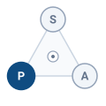

---
format:
  html:
    title: "The Cognitive Brain"
---

# The Cognitive Brain {#sec-brain}

::: {layout-narrow}
::: {.column-margin}

\chapterminitoc

:::

::: {.content-visible when-format="pdf"}
\noindent
{fig-alt="Isometric blueprint of the Brain level, the application processor that runs the learned proposers: a heterogeneous System on Chip (SoC) integrates processing units; a Neural Processing Unit (NPU) with a tensor systolic array handles deep learning matrix operations; stacked High Bandwidth Memory (HBM) dies enhance bandwidth for rapid data access; a high-speed weights streaming bus enables real-time data transfer; and a 3D action chunking token lattice facilitates efficient memory management and retrieval."}
:::

::: {.content-visible unless-format="pdf"}
{fig-alt="Isometric blueprint of the Brain level, the application processor that runs the learned proposers: heterogeneous SoC, NPU tensor systolic array, stacked HBM memory dies, high-speed weights streaming bus, and 3D action chunking token lattice."}
:::

:::

## Purpose {.unnumbered .unlisted}

::: {.content-visible when-format="pdf"}
\begin{marginfigure}
\resizebox{0.92\linewidth}{!}{\mlphysicalstackfull{100}{20}{20}{20}{20}}
\end{marginfigure}
:::

_Why can a robot recognize what to do yet still be too late to act?_

A robot reaching for an unfamiliar mug must infer where to grasp while the mug and the surrounding world keep moving. Learned models extend the machine's ability to interpret such scenes, but a useful answer can arrive after the physical conditions that justified it have changed. Larger models also demand more memory traffic and computation from an onboard processor that must share resources with sensing and control. Predicting a sequence of future motions can keep the arm supplied between model updates, yet it cannot make those motions respond to observations the model has not received. The engineering task is to match learned capability to the time available for fresh decisions while preserving independent control of the body. Because motion beyond the causal boundary cannot be recalled, a learned proposal must remain subject to timely physical permission.



::: {.callout-learning-objectives}

- Compare classical analytical pipelines and learned representations on coverage, sensory robustness, and formal verifiability
- Calculate the memory wall bound on a model's fresh-evaluation rate ($f \le B_{\text{mem}} / M_{\text{weights}}$) under the embodied batch size 1 constraint
- Estimate key-value cache expansion from multi-camera tokenization, hidden dimensions, and retained history windows
- Explain how action chunking ($H$) amortizes off-chip weight transfers over physical wall-clock time without improving closed-loop reaction latency
- Compare action-head working sets with available cache capacity before assuming refinement avoids off-chip transfers
- Apply replanning period, inference latency, and target drift to size an action chunk for a dynamic target
- Diagnose cognitive failure modes: semantic hallucinations, uncalibrated softmax overconfidence, perceptual chattering, and expired intent leases
- Identify the trajectory, timestamps, and validity information a proposer must hand to independent real-time verification

:::

## The Embodied Brain {#sec-brain-embodied}

The warehouse mobile manipulator can stay within the torque, thermal, voltage, and stopping limits established in @sec-body and still fail to grasp an unfamiliar ceramic mug from a moving conveyor. Those limits describe what the body can sustain. They do not identify the mug's handle or choose a path around a coworker's hand. A learned model can supply that missing interpretation, but the model's output remains a candidate action until the permission path checks it against current evidence and physical limits.

The timing problem begins while the model computes. The mug keeps moving, and the arm still needs feedback to track the motion already admitted. A larger model may improve recognition while taking longer to produce the next proposal. The relevant engineering quantities are therefore distinct: how often the model incorporates a fresh observation, how many future setpoints each proposal contains, and how long its evidence remains useful. Increasing the number of setpoints does not renew the evidence behind them.

The resulting **two-speed brain architecture**\index{Two-speed brain architecture!hybrid control} separates learned deliberation from the real-time permission and tracking path (@fig-two-speed-brain). The Brain proposes a goal or a trajectory; faster control continues below the proposal boundary even when deliberation pauses. Action Chunking Transformers (ACT) [@zhao2023learning] and Diffusion Policies [@chi2024diffusionpolicy] can supply multiple future setpoints in one proposal. The permission path determines which part may execute and when continued execution must end. This division gives learning room to improve task capability without giving an inference delay authority to suspend physical protection.

::: {.column-margin}
{width="100%" fig-alt="S·P·A locator triad with the Plan node highlighted."}

*The Plan axis: high-capacity neural deliberation emitting unprivileged action chunks.*
:::

::: {#fig-two-speed-brain fig-env="figure" fig-pos="t" fig-cap="**Two-speed brain architecture**: An unprivileged deliberative realm running at $1\text{--}50\text{ Hz}$ and a real-time realm running at $1000\text{ Hz}$, separated by the proposal-permission privilege boundary. The independent safety enforcer checks sensed state and modeled limits on each control cycle before granting execution permission; a refusal path feeds state resynchronization back to the deliberative policy." fig-alt="Two-speed brain architecture showing unprivileged deliberative planning at 1 to 50 hertz crossing the proposal-permission privilege boundary to 1000 hertz real-time safety enforcement with refusal feedback."}
{width="90%"}
:::

A learned proposer earns its place when training gives it useful coverage beyond the hand-authored cases. For the conveyor pick, that means relating the instruction to the visible mug and proposing a graspable region. Recognition still needs measured geometry before it can specify a reachable pose, and robustness to glare or occlusion depends on the operating conditions represented in the evidence. The added capability must fit the processor and the time available to act.

@Fig-cadence-gap places these workloads beside the rates of physical control. Its points represent different workload regimes, so they do not establish a scaling law from parameter count alone. The design decision is which computation can finish before the current proposal expires; the memory and timing calculations below make that decision concrete for the mobile manipulator.

::: {#fig-cadence-gap fig-env="figure" fig-pos="htb" fig-cap="**Cadence regimes**: Parameter counts and example update rates for different control, vision, and embodied workloads. The points are illustrative workload regimes rather than runs on a common device, and parameter count alone does not determine update rate." fig-alt="Log-log scatter of parameter counts and example update rates for different workload classes, with shaded control and deliberation rate bands."}

```{python}
#| echo: false
#| warning: false
#| message: false
import pandas as pd
import matplotlib.pyplot as plt
from mlsysim import viz

import os

_csv = (
    "vol4/03_brain/data/brain_frequency_vs_parameters.csv"
    if os.path.exists("vol4/03_brain/data/brain_frequency_vs_parameters.csv")
    else (
        "books/vol4/03_brain/data/brain_frequency_vs_parameters.csv"
        if os.path.exists("books/vol4/03_brain/data/brain_frequency_vs_parameters.csv")
        else "data/brain_frequency_vs_parameters.csv"
    )
)
data = pd.read_csv(_csv)
fig, ax, COLORS, plt = viz.setup_plot(figsize=(7, 4.5))

_groups = list(dict.fromkeys(data["Category"]))
_cmap = plt.get_cmap('viridis', max(len(_groups), 2))
for _i, _g in enumerate(_groups):
    _sub = data[data["Category"] == _g]
    ax.scatter(_sub["Parameters"], _sub["Frequency_Hz"], color=_cmap(_i), label=str(_g), s=150)

ax.set_xscale("log")
ax.set_yscale("log")

ax.axhspan(100, 1000, color='gray', alpha=0.12, label='Deterministic Control (100–1000 Hz)')
ax.axhspan(10, 50, color='#0D9488', alpha=0.08, label='Action Chunk Policy (10–50 Hz)')
ax.axhspan(1, 5, color='#E11D48', alpha=0.06, label='Deliberative Intent (1–5 Hz)')

ax.set_xlabel("Parameter Count (Log Scale)")
ax.set_ylabel("Update Rate [Hz] (Log Scale)")
plt.legend(bbox_to_anchor=(1.02, 1), loc='upper left', frameon=False)
ax.margins(x=0.14, y=0.14)
plt.tight_layout()
plt.show()
plt.close()
```

:::

@Sec-brain-classical-wall shows why pipelines built on hand-authored geometry and state machines lose coverage outside the factory cell, and @sec-brain-learned-representations shows what learned representations recover and what they cost in tokens and memory traffic. @Sec-brain-cognitive-pipeline turns that cost into the machine's numbers: the memory wall that bounds how often its intent model can run, the action chunking that keeps the arm supplied between evaluations, and the drift that bounds how long each chunk stays true. @Sec-brain-cognitive-vulnerabilities then takes up the ways a proposal can arrive on time and still be wrong, each of which leaves the permission path with a proposal it must be able to refuse.

## The Classical Wall {#sec-brain-classical-wall}

A gripper in a fixed workcell can approach the same fixture along the same path on every cycle. Engineers can describe that task through geometry, equations of motion, and explicit transitions between stages. Classical control and robotics build on this analytical approach [@wiener1948cybernetics; @kalman1960new; @craig2005introduction]. The difficulty for the conveyor mug is extending the description to objects and conditions that the engineer did not enumerate.

Analytical kinematics and dynamics map desired end-effector[^fn-hw-end-effector] motion into joint motion and actuator torque.[^fn-math-classical-dynamics] Perception can match measured geometry against a known computer-aided design (CAD) model, while a state machine advances through approaching, aligning, grasping, and retracting. In a calibrated workcell these components solve a bounded task with explicit assumptions. Their computational cost and timing still depend on the chosen algorithm, processor, and contact model.

[^fn-hw-end-effector]: **End-Effector**\index{End-effector!definition}: The active tool, gripper, or hand at the distal tip of a robotic manipulator that interacts directly with physical workpieces and the environment.

[^fn-math-classical-dynamics]: **Rigid-Body Dynamics Formulation**\index{Rigid-body dynamics!Euler-Lagrange formulation}\index{Equations of motion!manipulator dynamics}: Classical control computes generalized torques via the standard manipulator equation $\mathbf{M}(\mathbf{q})\ddot{\mathbf{q}} + \mathbf{C}(\mathbf{q}, \dot{\mathbf{q}})\dot{\mathbf{q}} + \mathbf{g}(\mathbf{q}) = \boldsymbol{\tau}$, where $\mathbf{M}(\mathbf{q})$ represents the configuration-dependent inertia matrix, $\mathbf{C}(\mathbf{q}, \dot{\mathbf{q}})$ captures Coriolis and centripetal terms, and $\mathbf{g}(\mathbf{q})$ accounts for gravitational loading. Specifically, $\mathbf{M}(\mathbf{q})$ captures configuration-dependent mass moments: extending an articulated linkage shifts mass outward from the rotational axes, increasing reflected rotational inertia ($I \propto m r^2$) and demanding quadratically higher joint torque for equivalent angular acceleration. This analytical formulation becomes computationally intractable and physically inaccurate when machines interact with unmodeled frictional contacts, fluid drag, or deformable objects. Derivations are provided in @sec-appendix-control.

::: {#fig-industrial-welding fig-env="figure" fig-pos="t" fig-cap="**Industrial spot-welding workcell**: Multiple six-degree-of-freedom articulated robots execute preprogrammed spot welding paths on stamped automotive chassis at the BMW Leipzig plant. Operating in a calibrated factory environment with submillimeter repeatable fixtures and safety interlock cages, classical controllers provide deterministic cycle timing and formal stability proofs. (Credit: BMW Group / Wikimedia Commons, CC BY-SA 2.0 de)." fig-alt="Articulated industrial robots executing automated spot welding on an automotive chassis within a safety-caged factory cell."}
{width="85%"}
:::

Where the operational environment is strictly structured and bounded (@fig-industrial-welding), classical methods provide dependable behavior within their modeled conditions. On an automated automotive assembly line, an industrial robot welds stamped steel panels where every workpiece arrives at an exact coordinate within sub-millimeter tolerances. Ambient lighting is tightly regulated by industrial fixtures, and human workers are excluded by physical interlock safety fences. Within the causal boundary defined in @sec-boundary-causal-boundary, this controlled regime permits explicit models, bounded servo timing, and formal Lyapunov stability analysis under stated assumptions. Engineers can verify trajectory tracking error bounds ($\lVert \mathbf{e}(t) \rVert \le \epsilon$) and certify controller software coverage against safety standards without collecting empirical demonstrations.

Yet when an embodied machine leaves the structured factory cage to operate in unstructured open-world environments (@fig-unstructured-rescue), this analytical paradigm hits the **classical wall** [@brooks1991intelligence; @levine2018learning]. The physical world is not a sterile CAD drawing; it is continuous, deformable, and endlessly variable.

::: {#fig-unstructured-rescue fig-env="figure" fig-pos="t" fig-cap="**Unstructured search-and-rescue robot**: A tracked mobile robot navigates an obstacle course with irregular inclines, loose debris, and visual occlusions. In such unmapped environments, preauthored geometric models and rigid state machines can lose coverage; learned policies may help infer spatial affordances and traversability from sensory streams. (Credit: TU Darmstadt Rescue Robotics / Wikimedia Commons, CC BY-SA 3.0)." fig-alt="Tracked mobile robot traversing irregular rubble and wooden obstacles in an unstructured search-and-rescue test arena."}
{width="85%"}
:::

Outside that workcell, the same pipeline must cope with object variation, imperfect sensing, and unexpected task states. A CAD template does not cover every deformation of a garment; glare can erase the depth edge separating two packages; and an unexpected hand can invalidate a preauthored transition from approach to grasp. Adding templates, thresholds, and branches extends coverage, but each addition requires engineering and validation for the new conditions.

Learning offers a different way to obtain that coverage. Training can associate varied observations with useful object features and demonstrated behavior without requiring a separate geometric template for every instance. This does not replace the analytical controller that tracks a proposed motion. It adds a computationally demanding interpretation stage whose memory traffic and latency must fit above that controller.

## Learned Representations {#sec-brain-learned-representations}

Asked to take the unfamiliar ceramic mug from the conveyor, a learned model can relate the instruction to a visible handle and propose a grasp region without an exact CAD template. Vision-language-action (VLA) models combine images, language, and robot state to produce candidate actions [@driess2023palme; @brohan2023rt1; @brohan2023rt2; @kim2024openvla]. Their value is the coverage obtained from training across objects and conditions, rather than a guarantee that any unfamiliar scene will be interpreted correctly.

Demonstrations can also teach coordinated behavior for tasks whose contacts and deformations are difficult to specify completely, such as routing a cable with two arms (@fig-aloha-manipulator) [@zhao2023learning; @chi2024diffusionpolicy]. Learned sensory features may tolerate variations represented in that training, while a controller still needs measured geometry and physical limits to execute the proposal. Task success under tested conditions supplies evidence of capability; it does not establish behavior under every lighting change, contact, or payload.

The systems cost follows from how that capability is represented. Images become model inputs, retained context occupies memory, and the model must compute a new action before its observations become stale. The useful comparison with a classical pipeline therefore includes both task coverage and the cost of renewing a proposal.

::: {#fig-aloha-manipulator fig-env="figure" fig-pos="t" fig-cap="**Bimanual teleoperation workcell**: Dual-arm teleoperation setup featuring two six-degree-of-freedom follower arms, two leader arms for kinesthetic teleoperation, multi-view cameras (overhead and wrist-mounted), and parallel grippers mounted to an extruded aluminum frame. The physical AI policy ingests synchronized multi-camera streams to predict continuous end-effector trajectories, and the permission path must refuse any proposal that would cause self-collision or motor over-torquing during closed-loop execution. (Credit: Stanford University & Google DeepMind, CC-BY / Apache 2.0)." fig-alt="Dual-arm robotic teleoperation workstation with leader and follower arms, overhead cameras, and grippers mounted on an aluminum frame."}
{width="85%"}
:::

::: {#fig-vla-taxonomy fig-env="figure" fig-pos="t" fig-cap="**Embodied model taxonomy**: Embodied foundation models grouped by perceptual frontend (visual tokens, point clouds, language prompts), neural backbone (transformers, diffusion heads, world models), and target action space. The taxonomy contrasts Vision-Language-Navigation policies that decode topological waypoints and semantic frontiers with Vision-Language-Action policies that emit joint and Cartesian trajectory chunks for articulated manipulators. (Adapted from Ma et al. [@ma2024vision])." fig-alt="Taxonomic diagram categorizing embodied foundation models into inputs, multimodal neural backbones, and navigation or manipulation action spaces."}
{width="95%"}
:::

::: {#fig-vla-architecture fig-env="figure" fig-pos="t" fig-cap="**Embodied Vision-Language-Action (VLA) architecture**: A representative dataflow. (1) Camera patches receive 2D image-position and camera identifiers alongside language and robot-state tokens; metric depth still requires calibrated evidence. (2) Self-attention mixes the combined token sequence; the colored grid illustrates internal attention weights, not a verified affordance or grasp pose. (3) Discrete autoregressive decoders emit tokens sequentially, whereas continuous decoders generate candidate multi-step chunks ($\mathbf{A}_{t:t+H-1}$) through one pass or iterative denoising. (4) An independent permission path checks candidate motion against sensed state and modeled limits before actuation. (Synthesized from Brohan et al. [@brohan2023rt1; @brohan2023rt2], Kim et al. [@kim2024openvla], and Octo Model Team [@octo_2023])." fig-alt="Comprehensive architectural schematic of a Vision-Language-Action foundation model showing spatial patch slicing, 2D positional embeddings, multimodal self-attention weights in an illustrative image grid, discrete vs. continuous action decoders, and an independent proposal boundary."}
{width="100%"}
:::

For the mug pick, the model must turn images and instructions into a candidate motion. The dataflow in @fig-vla-taxonomy and @fig-vla-architecture separates that computation into input encoding, a shared representation, and an action decoder, followed by the handoff to independent permission. A token is a vector representing part of an input, such as an image patch; the backbone combines those vectors, and the decoder turns the combined representation into proposed actions. The engineering comparison below follows what each stage stores, transfers, and delivers:

1. **Sensory Ingestion and Spatial Tokenization (The Inputs):**
   A ViT frontend slices each incoming camera frame into a grid of non-overlapping pixel patches of size $P \times P$ (typically $14 \times 14$ or $16 \times 16$ pixels). Each patch is linearly projected into a vector of width $d$, augmented with 2D spatial sinusoidal positional embeddings, and tagged with a learned camera identifier.

   On a mobile manipulator equipped with three synchronized cameras (e.g., left wrist, right wrist, and an overhead torso mount) capturing $224 \times 224$ images, the image frontend prepares a buffer for each view. Each frame yields $(224 / 14)^2 = 256$ spatial patches. Across three cameras, ingestion injects $3 \times 256 = 768$ visual tokens into the model's sequence on every perceptual step. When concatenated with tokenized natural language commands ($\sim 32$ tokens) and proprioceptive joint state embeddings ($\sim 16$ tokens), the initial context sequence length exceeds $S \approx 800$ tokens. In FP16 precision ($2\,\text{bytes}$ per element) with hidden dimension $d = 4096$, the initial token embedding matrix alone occupies:
   $$M_{\text{embed}} = S \times d \times 2\,\text{bytes} = 800 \times 4096 \times 2 \approx 6.55\,\text{MB}$$
   Crucially, 2D image coordinates and internal attention patterns do not constitute metric depth: projecting an end-effector into physical 3D space requires calibrated extrinsic camera matrices and depth telemetry.

2. **Multimodal Alignment and Attention (The Backbone):**
   The token sequence passes through $L = 32$ transformer layers where multi-head self-attention computes pairwise token interactions. While full self-attention incurs quadratic computational complexity ($O(S^2 d)$ FLOPs), at the systems level the Key-Value (KV) cache that retains prior token states for autoregressive context expands linearly ($O(L \cdot S \cdot d)$):
   $$M_{\text{KV}} = 2 \times L \times d \times S \times \text{bytes}$$
   For a 32-layer model with $d = 4096$ using FP16 storage, each context token claims $2 \times 32 \times 4096 \times 2 = 524{,}288\,\text{bytes} \approx 0.524\,\text{MB}$ of KV cache. Reading this KV cache across off-chip DRAM on every token step creates massive memory bus traffic that directly competes with weight streaming. Because memory bus access under Unified Memory Architecture (UMA) is a shared zero-sum resource, fetching tens of megabytes of KV state per step risks starving real-time sensor DMA buffers. Embodied architectures therefore deploy Grouped-Query Attention (GQA) or cross-attention decoders to compress KV-cache memory traffic by a factor of 4 to 8. Furthermore, strong attention weights between language tokens (such as "mug handle") and visual patches do not prove geometric affordance or collision-free clearance; nor does the KV cache track object permanence during physical occlusions. The formal patch-embedding, position-encoding, and attention formulations appear in @sec-appendix-ml-patch-embedding.

3. **Specialized Action Decoders (The Outputs):**
   Instead of generating open-ended conversational text, the final hidden representation $\mathbf{h}_{\text{context}} \in \mathbb{R}^d$ is routed to specialized action decoders. While vision-language navigation (VLN) models emit topological waypoints or heading rates $(v_t, \omega_t)$ (@fig-vln-navigation), manipulation (VLA) models diverge sharply in how they bridge semantic representations to physical motion:

   Discrete action decoders map each action dimension to a categorical token [@brohan2023rt1; @brohan2023rt2; @kim2024openvla]. Sequential token generation can require several model evaluations for one action vector, and discretization limits spatial resolution. Continuous decoders instead emit a trajectory chunk, either directly or through iterative refinement [@chi2024diffusionpolicy; @octo_2023; @black2024pi0]:
   $$\mathbf{A}_{t:t+H-1} = [\mathbf{a}_t, \mathbf{a}_{t+1}, \dots, \mathbf{a}_{t+H-1}] \in \mathbb{R}^{H \times d_a} \quad (H = 16\text{--}64\text{ steps})$$
   Here $H$ counts future setpoints and $d_a$ counts values per action. A chunk supplies several requested motions from one sensory context; it does not contain new observations. The runtime comparison therefore depends on how many backbone and decoder evaluations produce the chunk, and how long those evaluations take. @Sec-appendix-ml-multimodal derives discrete tokenization and explains how generative decoders represent alternative demonstrated routes without averaging them into an obstacle.

4. **The Proposal Boundary (Isolation from Actuators):**
   Whether the model is a VLN mobility planner or a VLA manipulation policy, its output is a candidate proposal ($p_t$) on the unprivileged side of the proposal boundary (\ref{dfn-boundary-proposal-boundary}).\index{Unprivileged proposal!proposal boundary} Under the machine model of @sec-boundary-machine-model, the foundation model runs in user space on the application processor and has no path to the pulse-width modulation (PWM) registers or to the current in the motor coils.

   The Brain hands over candidate motion together with the time of the observations that support it. Faster downstream loops track admitted setpoints and regulate motor current using current measurements. A long neural inference cannot suspend those loops or renew old evidence. The full latency budget in @sec-brain-memory-wall prices the path from sensing to actuation; @sec-nervous-invariant-checking develops the independent checking responsibility.

::: {#dfn-brain-proposal-contract .callout-definition title="The proposal record"}

***The Proposal Record***\index{Proposal Record!definition}\index{Proposal contract!definition}\index{Proposal boundary!contract schema} ($\mathcal{P}$) is a typed candidate-motion payload sent from the unprivileged Brain to the real-time Nervous System. The payload illustration here packages candidate trajectory setpoints, capture timestamps, evidence validity horizons, and provenance metadata for independent verification before execution permission is granted:
$$\mathcal{P} = \langle t_{\text{capture}}, t_{\text{valid}}, H, \Delta t, \mathbf{Q}_{1:H}, \dot{\mathbf{Q}}_{1:H}, \mathbf{X}_{1:H}, \mathbf{g}_{1:H}, \text{model\_id}, \text{lease\_id}, \hat{p}, \text{crc} \rangle$$

1. **Significance**: By formalizing candidate motion into an explicit contract with capture timestamps and validity bounds, the Nervous System can reject stale or uncalibrated proposals before any setpoint reaches an actuator.
2. **Distinction**: Unlike an internal neural tensor, the Proposal Record is an immutable, verifiable boundary payload checked against physical invariant envelopes.
3. **Common pitfall**: Omitting observation timestamps or validity horizons, causing downstream controllers to execute delayed proposals computed from obsolete scene states.

:::

The fields in @tbl-03-proposal-record-schema illustrate what the receiver needs to interpret a candidate trajectory. The trajectory and its observation time come from the proposer; the header and handoff contract in the Nervous System determine how the receiver checks delivery and expiration. The payload describes requested motion; the handoff record establishes the conditions under which that request may reach the body.

| Field         | Type                        | Unit                    | Systems Semantics and Verification Rule                                                                            |
|:--------------|:----------------------------|:------------------------|:-------------------------------------------------------------------------------------------------------------------|
| `t_capture`   | `uint64_t`                  | $\text{ns}$             | Hardware timestamp of oldest sensory observation conditioning the proposal.                                        |
| `t_valid`     | `uint64_t`                  | $\text{ns}$             | Monotonic time after which proposal expires ($\le t_{\text{capture}} + \tau_{\text{ev}}$).                         |
| `horizon_H`   | `uint16_t`                  | count                   | Number of prospective trajectory setpoints ($H = 16\text{--}64$).                                                  |
| `delta_t`     | `uint32_t`                  | $\mu\text{s}$           | Temporal interval between consecutive waypoints ($\Delta t = 20\,000\,\mu\text{s} \implies 50\text{ Hz}$).         |
| `q_traj`      | `float32[H][D]`             | $\text{rad}$            | Candidate joint trajectory array across $D$ degrees of freedom.                                                    |
| `q_dot_traj`  | `float32[H][D]`             | $\text{rad/s}$          | Velocity setpoints; checked for continuity when adjoining chunks meet.                                             |
| `x_cartesian` | `position + orientation[H]` | $\text{m}, \text{quat}$ | End-effector target poses; verified against workspace keep-out boundaries.                                         |
| `gripper_cmd` | `float32[H]`                | $[0, 1]$                | Gripper closure target; evaluated against grasp force and slip limits.                                             |
| `model_id`    | `uint32_t`                  | identifier              | Identifier resolving to the model architecture, weights checkpoint, and calibration profile.                       |
| `confidence`  | `float32`                   | $[0, 1]$                | Model reported confidence $\hat{p}$; interpreted using calibration evidence from observed outcomes.                |
| `lease_id`    | `uint64_t`                  | identifier              | Identifier linking the proposal to a time-limited permission record; the handoff protocol follows in @sec-nervous. |
| `crc32`       | `uint32_t`                  | checksum                | Integrity checksum protecting shared-memory ring buffer payload.                                                   |

: **The formal Proposal Record schema**: Data contract emitted across the proposal boundary from the unprivileged Brain to the real-time Nervous System. {#tbl-03-proposal-record-schema tbl-colwidths="[18,14,14,54]"}

::: {.column-margin .margin-pointer}
↪ Zero-copy proposal passing between the Brain and the Nervous System relies on the lock-free buffers analyzed in @sec-nervous-cadences.
:::

   Proposals reach the permission path through the handoff of @sec-nervous, and the permission path can refuse a hallucinated proposal when independent measurements, modeled limits, and a feasible fallback support that decision.[^fn-math-unprivileged-control]

[^fn-math-unprivileged-control]: **Proposal Boundary**\index{Proposal boundary!unprivileged proposals}: Treating the neural policy as an unprivileged proposal generator isolates stochastic inference from actuator registers. Candidate trajectory setpoints $\mathbf{q}_{\text{ref}}(t)$ are checked on dedicated safety silicon, so proposals that violate modeled actuator limits or keep-out regions can be rejected before any reaches a drive (@sec-nervous-actuation-authority).

::: {#fig-vln-navigation fig-env="figure" fig-pos="t" fig-cap="**Topological vision-language navigation**: Embodied navigation architecture executing natural-language spatial instructions. Panoramic visual observations are encoded into perceptual tokens, matched against prompt embeddings, and cross-referenced with a dynamically updated topological navigation graph. The action decoder prunes unreachable nodes and emits metric waypoint offsets $(\Delta x, \Delta y)$ and heading setpoints to guide the chassis along traversable semantic frontiers without requiring an exact geometric prior map. (Adapted from An et al. [@an2023etpnav])." fig-alt="Schematic of topological vision-language navigation showing panoramic observation tokens, topological graph matching, and decoded waypoint offsets and heading setpoints."}
{width="95%"}
:::

Each neural stage of this pipeline is paid for in memory traffic. Every patch token must be attended over and held in the KV cache, and every evaluation of the backbone streams its weights from DRAM, so the capabilities this section described arrive at a rate the application processor sets rather than one the task chooses. On the mobile manipulator, that rate for its largest model falls well below the rate at which its arm consumes setpoints.

## Supply, Freshness, and the Memory Wall {#sec-brain-cognitive-pipeline}

At the pick station the mobile manipulator's arm consumes a new setpoint every few tens of milliseconds, while the mug it is reaching for keeps moving along the conveyor. Whatever model proposes those setpoints must settle two questions. The first is how often it can produce a proposal on the application processor the machine actually has; the second is how long each proposal stays true once the mug has moved. The answers explain why the machine carries two learned proposers rather than one.

After ingestion (the tokenization of @sec-brain-learned-representations), four stages turn those tokens into proposals (@fig-cognitive-pipeline), and Part III develops each one. Here they matter only for what each hands downstream and how quickly that goes stale.

On an edge robotics SoC operating with a **Unified Memory Architecture (UMA)**—such as an onboard NVIDIA Jetson Orin or Thor compute module—physical memory bandwidth is a shared zero-sum resource. The CPU host cores, GPU/NPU matrix execution units, Image Signal Processors (ISPs), and DMA controllers all share a single physical LPDDR5 bus ($B_{\text{mem}} \approx 204\,\text{GB/s}$). Saturating this bus with gigabytes of neural weight streaming creates direct real-time safety hazards: when a multi-billion-parameter foundation model consumes 90 percent of memory bus cycles, incoming high-bandwidth sensor streams (such as raw MIPI-CSI camera video and Ethernet LiDAR packets) suffer memory controller arbitration stalls. Internal hardware FIFO buffers overflow, dropping frames and blinding perception precisely while the machine is in motion.

Perception grounds what it recognizes in metric coordinates relative to the base, so that the mug becomes an $SE(3)$ pose and a graspable handle rather than an abstract semantic label;[^fn-brain-metric-grounding] its output ages from the moment of capture, and @sec-perception turns that age into a contract. Memory carries those estimates through occlusion and must let each one expire when the evidence behind it does (@sec-memory). Intent decomposes a task such as "take the ceramic mug off the conveyor and hand it to the coworker at the packing station" into subgoals, and because the mug moves while the intent model deliberates, it hands the planner a target that expires, an intent lease\index{Intent lease!temporal contract} (@sec-intent-lease). Planning converts that target into candidate setpoints for the base and the arm, the proposals the permission path will judge (@sec-planning). These stages, and the ingestion before them, all run on the application processor and draw on the same memory bus, which is where the machine's cadence is decided.

[^fn-brain-metric-grounding]: **Metric Spatial Grounding**\index{Metric spatial grounding}\index{Special Euclidean group!SE(3) grounding}: While disembodied AI operates over discrete semantic tokens, physical AI must ground those semantics in the Special Euclidean group $SE(3)$, mapping entities to metric distances (meters) and spatial orientations (quaternions) relative to the robot's base coordinate frame. Failing to maintain this metric grounding causes neural policies to emit kinematically impossible Cartesian paths that breach actuator workspace boundaries.

::: {#fig-cognitive-pipeline fig-env="figure" fig-pos="t" fig-cap="**The physical AI cognitive flow**: Information flows sequentially from physical sensors through Ingestion (tokenization), Perception (spatial geometry and affordances), Memory (persistent world model belief), Intent (deliberative goal leases), and Planning (multi-step action chunking). The flow ends at the proposal boundary, where the permission path evaluates each proposed action against real-time constraints and resources." fig-alt="Horizontal flowchart of the five-stage cognitive pipeline: Ingestion, Perception, Memory, Intent, and Planning, culminating at the proposal boundary."}
{width="95%"}
:::

::: {.column-margin .margin-pointer}
↪ High-throughput neural inference accelerators are isolated from deterministic cores in @sec-placement-two-paths-one-die.
:::

### The memory wall {#sec-brain-memory-wall}

When each evaluation streams weights that cannot remain on-chip, memory bandwidth can limit the update cadence of an embodied neural policy even when arithmetic capacity is available. In high-performance computing, the **memory wall**\index{Memory wall!physical inference} defines the operational regime where computational execution units spend the vast majority of clock cycles stalled, waiting for operands to arrive from external memory. In physical AI, this architectural bottleneck is exacerbated by the strict real-time requirement to interact continuously with physical mass: while modern edge accelerator silicon delivers hundreds of teraflops of matrix multiplication performance, the physical interconnect pins and memory interfaces between the processor die and off-chip memory packages provide comparatively modest data transfer rates.

On an edge SoC, the memory hierarchy features a stark bandwidth and latency asymmetry:

* **On-Chip SRAM and System-Level Cache (SLC):** Integrated directly onto the silicon die, local SRAM banks and shared SLC deliver massive sustained bandwidth ($> 1.5\text{--}3.0\,\text{TB/s}$) with ultra-low access latency ($< 1\text{--}10\,\text{ns}$). However, physical die-area constraints and static leakage current limit on-chip capacity to tens of megabytes ($32\text{--}64\,\text{MB}$).
* **Off-Chip LPDDR5 DRAM:** External DRAM packages store tens of gigabytes ($32\text{--}64\,\text{GB}$) required to hold multi-billion-parameter model weights, but data must travel across external printed circuit board (PCB) traces and package pins. Sustained transfer bandwidth is throttled to $140\text{--}204\,\text{GB/s}$, and memory controller access latency climbs to $80\text{--}120\,\text{ns}$.

To understand the physical consequence of this bandwidth ceiling, consider what happens if a robot attempts to generate continuous motor actions one discrete step at a time through an autoregressive foundation model (such as a multi-billion-parameter VLA model). For a decoder that revisits nonresident weights at each token step, each evaluation streams those weights across the external DRAM bus. In single-token decoding with request batch size $B = 1$, the dense weight projections become matrix-vector operations ($\mathbf{y} = \mathbf{W}\mathbf{x}$), yielding an arithmetic intensity of just $I \approx 1.0\,\text{FLOP/byte}$. The sustained memory bandwidth $B_{\text{mem}}$ and model weight footprint $M_{\text{weights}}$ strictly bound the maximum fresh-evaluation frequency:
$$f \le \frac{B_{\text{mem}}}{M_{\text{weights}}}$$
Even on flagship edge accelerators equipped with wide LPDDR5 interfaces ($B_{\text{mem}} \approx 140\text{--}204\,\text{GB/s}$ sustained)—such as Jetson Orin or Thor SoCs—executing quantized or compact 3B–7B policies ($M_{\text{weights}} \approx 4.6\text{--}14\,\text{GB}$), this bandwidth ceiling caps inference cadence at:
$$f \le \frac{B_{\text{mem}}}{M_{\text{weights}}} \approx 10\text{--}44\,\text{Hz}$$
before tokenization, multimodal attention, or decoding adds any latency. In single-step autoregressive generation, each action dimension requires predicting additional tokens; if each token revisits off-chip parameters, latency scales linearly with degrees of freedom. Because physical stabilization, joint impedance control, and reflex-level collision avoidance require deterministic update rates of $100\text{--}1000\,\text{Hz}$, **foundation models cannot serve as executive controllers in real-time physical loops**. They are physically trapped behind the memory wall, mathematically forcing an architecture where foundation models operate solely as unprivileged proposal engines.

Deconstructing the complete end-to-end latency budget underscores this architectural partition:
$$\text{Latency}_{\text{E2E}} = t_{\text{shutter}} + t_{\text{MIPI-DMA}} + t_{\text{vision-encoder}} + t_{\text{policy-backbone}} + t_{\text{action-decoder}} + t_{\text{detokenize}} + t_{\text{CAN-bus}} + t_{\text{FOC-driver}}$$
Where camera shutter exposure integration requires $t_{\text{shutter}} \approx 10\text{--}33\,\text{ms}$, serial MIPI CSI-2 DMA frame grab adds $t_{\text{MIPI-DMA}} \approx 1\text{--}2\,\text{ms}$, Vision Transformer feature extraction takes $t_{\text{vision-encoder}} \approx 15\text{--}30\,\text{ms}$, policy backbone evaluation takes $t_{\text{policy-backbone}} \approx 30\text{--}80\,\text{ms}$, action chunk decoding consumes $t_{\text{action-decoder}} \approx 5\text{--}15\,\text{ms}$, action de-tokenization and safety validation takes $t_{\text{detokenize}} \approx 0.5\text{--}1.0\,\text{ms}$, CAN bus transmission adds $t_{\text{CAN-bus}} \approx 0.5\text{--}2.0\,\text{ms}$, and motor driver current control takes $t_{\text{FOC-driver}} \approx 0.05\text{--}0.1\,\text{ms}$, total latency reaches $60\text{--}160\,\text{ms}$. For detailed memory wall derivations and roofline hardware models, see @sec-appendix-systems.

This memory wall[^fn-hw-dram-bandwidth] places single-token streaming deep in the memory-bound region of the roofline (@fig-patterson-roofline) [@williams2009roofline]. On the mobile manipulator's application processor it caps the intent model's fresh-evaluation rate, before any vision or decoding work, far below the rate of a joint controller that asks for a new command every millisecond (\ref{nbk-brain-lpddr5-memory-wall-bottleneck-action-chunking}). A model renewed that slowly can say where the arm should go, but it cannot close the loop on moving mass, so it proposes waypoints and a faster loop below it tracks them.

[Single-token decoding at batch size 1]{.heading-3-inline}
Servers can combine independent requests so that a weight matrix multiplies several input vectors at once, reusing fetched weights. A robot waiting for its next action token often has only one such request. Waiting for future observations to form a batch would add delay, and sequentially dependent action tokens cannot all be evaluated at once by an autoregressive decoder. This limits reuse in those projections. It does not make every operation in an embodied model a matrix-vector product. Image patches, multiple camera views, prompt tokens, and parallel action decoders can expose matrix-matrix work within one robot's request. The low-intensity estimate therefore describes the single-token weight sweep, not the complete perception-and-action workload.

[^fn-hw-dram-bandwidth]: **Autoregressive DRAM Bandwidth Saturation**\index{GPU!memory bandwidth wall}: Sequential action tokens can trigger repeated full-model weight traffic when weights are nonresident and the decoder revisits the backbone; cache behavior and hardware determine the actual bandwidth ceiling. Action chunking is one way to reduce the number of full policy evaluations per unit of physical time.

This continuous data movement also carries an energy penalty. Fetching weights from off-chip DRAM consumes orders of magnitude more energy than the arithmetic computation itself ($\approx 10\text{--}20\,\text{pJ/bit}$, or $80\text{--}160\,\text{pJ/byte}$ for LPDDR5 DRAM access versus $< 0.1\,\text{pJ/FLOP}$ for on-chip FP16 multiply-accumulate). Sweeping a 14 GB model footprint across DRAM dissipates over 1.1 to 2.2 Joules per forward pass purely in memory I/O, generating 11 to 22 Watts of continuous thermal dissipation at a 10 Hz inference cadence. That continuous memory traffic drains battery reserves, and the heat it leaves in the chassis raises the local ambient temperature of the joint actuators, shrinking the thermal winding margins codified in @sec-body-thermal-duty-cycles.

::: {#fig-patterson-roofline fig-env="figure" fig-pos="t" fig-cap="**Illustrative embodied roofline**: Arithmetic intensity against attainable throughput for an example edge accelerator. Single-token weight streaming can be memory-bound. Chunk length alone does not determine arithmetic intensity; chunked workloads require measured operations and memory traffic. A separate real-time loop executes accepted waypoints between fresh model updates." fig-alt="Illustrative roofline diagram plotting arithmetic intensity against attainable throughput, with a single-token weight-streaming point and a ridge separating memory and compute bounds."}

```{python}
#| echo: false
#| warning: false
#| message: false
# ┌─────────────────────────────────────────────────────────────────────────────
# │ EMBODIED ROOFLINE (FIGURE)
# │ Context: @fig-patterson-roofline
# │ Goal:    show that embodied inference sits far inside the memory-bound regime
# │ Show:    arithmetic intensity against attainable throughput for an edge part
# │ How:     roof from the registry node; the point represents an FP16
# │          matrix-vector weight sweep, excluding other memory traffic
# ├─────────────────────────────────────────────────────────────────────────────
from mlsysim import viz
from mlsysim import Embodied

RM = Embodied.MobileManipulator.WarehouseMobileManipulator

# ┌── 1. LOAD (Constants & Parameters) ─────────────────────────────────────────
node = RM.brain_soc  # category: datasheet; the mobile manipulator's application processor
I_TOKEN = 1.0  # category: illustrative; FLOP/byte for a single-token weight sweep

# ┌── 2. EXECUTE (Compute) ─────────────────────────────────────────────────────
peak = node.compute.peak_flops.to("TFLOPs/s").magnitude
bw = node.memory.bandwidth.to("GB/s").magnitude
ridge = peak / (bw / 1000)  # FLOP/byte
attainable = lambda ai: min(bw * ai / 1000, peak)

points = [
    ("Autoregressive VLA\n(single token)", I_TOKEN),
]

# ┌── 3. PLOT ──────────────────────────────────────────────────────────────────
fig, ax = viz.plot_roofline(node)
COLORS = viz.COLORS
ax.set_ylim(peak * 0.0004, peak * 2)  # keep the single-token point on scale
for idx, (label, ai) in enumerate(points):
    y = attainable(ai)
    ax.plot(ai, y, "o", ms=8, color=COLORS["VioletLine"], zorder=11)
    # the lowest point has no room beneath the roof, so its label goes above
    if idx == 0:
        pos, ha, va = (ai * 0.30, y * 4.0), "left", "bottom"
    else:
        pos, ha, va = (ai * 2.4, y * 0.30), "left", "top"
    ax.annotate(
        label,
        xy=(ai, y),
        xytext=pos,
        fontsize=8,
        color=COLORS["VioletLine"],
        ha=ha,
        va=va,
        zorder=11,
        arrowprops=dict(arrowstyle="->", color=COLORS["VioletLine"], lw=0.9),
    )

# the reuse a workload would need before it left the memory-bound regime
ax.annotate(
    f"intensity must reach {ridge:.0f} FLOP/byte\nbefore compute binds",
    xy=(ridge, peak * 0.006),
    xytext=(ridge * 0.30, peak * 0.0012),
    fontsize=8,
    color=COLORS["primary"],
    ha="right",
    zorder=11,
    arrowprops=dict(arrowstyle="->", color=COLORS["primary"], lw=0.9),
)
import matplotlib.pyplot as plt

plt.tight_layout()
plt.show()
```

:::

The roofline model in @fig-patterson-roofline formalizes the hardware boundary governing embodied inference by plotting attainable computational throughput against **arithmetic intensity** ($I$), defined as:
$$I = \frac{\text{FLOPs}}{\text{Bytes transferred from off-chip memory}}$$
Consider the dense weight projections in single-token autoregressive decoding at batch size 1, each evaluating a matrix-vector product $\mathbf{y} = \mathbf{W}\mathbf{x}$. Counting weight traffic alone, with each weight fetched once for that projection, gives an optimistic intensity estimate; activation and context traffic add further bytes. In 16-bit floating-point precision (FP16, 2 bytes per parameter), each weight participates in exactly one multiply-accumulate operation (2 FLOPs), yielding an arithmetic intensity of:
$$I_{\text{token}} = \frac{2\,\text{FLOPs}}{2\,\text{Bytes}} = 1.0\,\text{FLOP/byte}$$
On the mobile manipulator's application processor (`node = RM.brain_soc`, an edge SoC with $\Pi_{\text{peak}} = 275\,\text{TFLOPs/s}$ FP16 compute and $\beta_{\text{mem}} = 204\,\text{GB/s}$ memory bandwidth), the hardware ridge point occurs at:
$$I_{\text{ridge}} = \frac{\Pi_{\text{peak}}}{\beta_{\text{mem}}} = \frac{275 \times 10^{12}\,\text{FLOPs/s}}{204 \times 10^9\,\text{Bytes/s}} \approx 1348\,\text{FLOP/byte}$$
For this weight-streaming example, $I_{\text{token}} = 1.0\,\text{FLOP/byte} \ll I_{\text{ridge}} \approx 1348\,\text{FLOP/byte}$, so memory bandwidth sets the roofline ceiling. Attainable throughput is bounded by $\beta_{\text{mem}} \cdot I_{\text{token}} \approx 0.204\,\text{TFLOPs/s}$, less than 0.1 percent of peak arithmetic throughput. That ratio is a workload throughput bound, not a measurement of how many cores are idle. If a 7-billion-parameter FP16 decoder emits a 7-DoF action through seven sequential tokens and rereads all weights for each token, the seven transfers alone require nearly $500\,\text{ms}$ at the stated bandwidth. A controller that waits for that entire sequence before each motor update would miss a millisecond deadline; a separate tracking loop must continue between policy evaluations.

Action chunking reduces backbone weight traffic per supplied waypoint when one backbone evaluation supports several future actions. That amortization does not establish an equal increase in arithmetic intensity. Predicting a chunk can add decoder work without repeating the backbone's matrix operations for every waypoint; its roofline position depends on the operations performed and the bytes actually transferred.

For an iterative decoder, each refinement pass adds work on the action head. If the head's weights and intermediate state remain resident on chip, later passes can reuse them without another off-chip transfer. If they do not fit, those passes also add memory traffic. Neither the chunk length nor the number of refinement passes alone determines the whole policy's intensity or attainable throughput. The backbone and head must first be budgeted separately, then combined over the same evaluation interval.

### Action chunking {#sec-brain-action-chunking}

The memory bound limits how often a large model can revise its proposal. A controller can track previously admitted motion between those revisions, but a policy that supplies only one future setpoint leaves little planned motion available while it computes. Predicting a trajectory segment gives the controller a sequence to track without making the next fresh observation arrive sooner.

[Supply rate vs. closed-loop reaction latency]{.heading-3-inline}
To supply dense waypoints despite slow full-model inference, modern physical AI policies employ **action chunking**\index{Action chunking!temporal trajectory} (\ref{dfn-brain-action-chunking}) [@zhao2023learning; @chi2024diffusionpolicy]. Each chunk then crosses the proposal boundary as one packet, the chunk payload of @sec-nervous-cadences. The transfer saving follows from reusing one evaluation across several outputs.

Predicting a horizon of $H \in [8, 64]$ actions per forward pass spreads the multi-gigabyte DRAM weight streaming cost over $H \times \Delta t_{\text{step}}$ seconds of physical execution. On an edge SoC with $B_{\text{mem}} \approx 204\,\text{GB/s}$ running a 7B FP16 model ($14\,\text{GB}$), generating single-step actions at $50\,\text{Hz}$ would demand $50 \times 14\,\text{GB} = 700\,\text{GB/s}$ of sustained memory bandwidth—exceeding physical bus capacity by over $3.4\times$. An action chunk of $H = 16$ waypoints reduces demanded bandwidth by sixteenfold to $700 / 16 \approx 43.8\,\text{GB/s}$ if one such sweep supplies each full chunk. More frequent replanning, decoder work, and competing memory traffic consume additional bandwidth.

Predicting a sequence also changes how a learned policy uses recent actions, but chunking alone does not establish that the policy attends to the right evidence or recovers from an unfamiliar contact. Those properties depend on training and closed-loop evaluation. The supply calculation establishes only the weight traffic needed for the stated execution schedule.

However, systems engineers must never confuse **setpoint supply cadence** with **closed-loop reaction bandwidth**:

* *Setpoint supply cadence* ($f_{\text{supply}} = 1/\Delta t_{\text{step}} = 50\,\text{Hz}$): The rate at which the trajectory queue delivers discrete waypoints to the joint servo loop.
* *Policy replanning rate* ($f_{\text{replan}} = 20\,\text{Hz}$, period $T_{\text{replan}} = 50\,\text{ms}$): The cadence at which the neural backbone evaluates new sensory frames.
* *Closed-loop reaction latency* ($T_{\text{reaction}} = T_{\text{replan}} + t_{\text{infer}} = 50\,\text{ms} + 40\,\text{ms} = 90\,\text{ms}$): The true physical delay before an unmodeled external disturbance or obstacle perceived by the camera can alter the proposed path.

Action chunking solves actuator starvation (supply rate), not feedback latency. If an unexpected obstacle appears immediately after camera exposure, the robot continues executing the open-loop chunk for up to $90\,\text{ms}$ before a revised proposal arrives. Disturbance rejection and obstacle compliance cannot rely on chunk policies; they must be guaranteed by the 1 kHz real-time Nervous System.

A chunking policy (such as Action Chunking with Transformers [ACT], Diffusion Policy, or Flow Matching) generates its whole chunk of $H$ setpoints in one backbone pass followed, for an iterative decoder, by $K = 10\text{--}16$ refinement steps.

An iterative decoder refines a candidate trajectory over several passes. Generative decoders can represent alternative routes around an obstacle, whereas direct mean-squared-error regression can average those routes into an unusable path. @Sec-appendix-ml-diffusion derives the noise-prediction and flow-matching objectives. For the runtime budget here, the decisive quantities are the number of refinement passes, the working set each pass touches, and whether refinement reevaluates the large backbone.

In the separated backbone-and-head design considered here, the $K$ iterative refinement steps run **on the compact action head** (typically a $\sim 50\text{M}$-parameter temporal 1D-U-Net or lightweight multilayer perceptron (MLP) or transformer decoder), **without reevaluating the 7-billion-parameter foundation model backbone**. The 7B vision-language backbone executes only once per replanning cycle to extract $\mathbf{h}_{\text{context}}$, streaming its multi-gigabyte weight footprint across off-chip DRAM once every $50\text{--}200\,\text{ms}$.

Because the 50M action head occupies under $100\,\text{MB}$ in FP16 (or $\approx 25\,\text{MB}$ in INT4), cache residency must be checked against the space available for both parameters and intermediate activation tensors. A compact parameter count alone does not establish residency in on-chip SRAM or system-level cache (SLC). When that working set remains resident, the $K$ refinement passes can use on-chip bandwidth ($> 1.5\text{--}3.0\,\text{TB/s}$ SRAM bandwidth) without repeatedly saturating the off-chip DRAM bus ($204\,\text{GB/s}$). Furthermore, executing $K = 10\text{--}16$ iterative steps in standard eager-mode frameworks would dispatch hundreds of small layer kernels, incurring catastrophic **kernel launch overhead** ($\approx 5\text{--}15\,\mu\text{s}$ CPU-to-GPU launch latency per kernel) that serializes execution on host dispatch queues. Embodied runtimes can reduce repeated CPU dispatch overhead via **CUDA Graph capture** or compiled execution graphs (such as TensorRT engines or TorchDynamo ahead-of-time (AOT) compilation), executing the entire iterative denoising loop as a single hardware-scheduled task on device in $5\text{--}15\,\text{ms}$.

Reducing the number of refinement steps can reduce decoder latency, provided the resulting proposals retain the required task quality. That trade-off needs measurement for the selected policy and processor. It does not remove the time required to encode a fresh observation or evaluate the backbone.

::: {#dfn-brain-action-chunking .callout-definition title="Temporal action chunking"}

***Temporal action chunking***\index{Temporal action chunking!definition}\index{Action chunking!definition} is the policy formulation that predicts an entire horizon of $H$ future continuous actions $\mathbf{A}_{t:t+H-1} = [\mathbf{a}_t, \dots, \mathbf{a}_{t+H-1}]$ in a single neural evaluation or diffusion rollout, amortizing parameter memory transfers across extended physical execution windows.

1.  **Significance**: On a bandwidth-limited device, repeating a full model evaluation for every action can be too slow for millisecond control. Temporal action chunking can reuse a backbone evaluation across multiple waypoints; it does not make fresh observations or policy decisions arrive at the waypoint rate. A downstream controller tracks the accepted trajectory between model updates.
2.  **Distinction**: Unlike single-step Markovian policies $\mathbf{a}_t \sim \pi(\cdot \mid \mathbf{o}_t)$ that re-evaluate the full neural network at every control step, action chunking deliberately generates multi-step feedforward trajectories, utilizing receding-horizon execution and blending across overlapping chunks to reconcile slow neural deliberation with fast closed-loop control.
3.  **Common pitfall**: Executing action chunks open-loop without continuous temporal smoothing or runtime safety filtering. Without smooth blending across overlapping chunk boundaries, switching between independently generated horizons injects acceleration jumps and torque shocks that excite mechanical gearbox resonances.

:::
For example, when a canonical bimanual manipulator threads a flexible USB cable (@fig-aloha-manipulator), it executes a 32-step action chunk, a longer chunk than the mobile manipulator uses. The policy emits coordinated 14-DoF joint setpoints that smoothly align both grippers, flex the cable, and insert the connector without pausing between individual control cycles.

::: {.column-margin}
{width="100%" fig-alt="Sequence strip illustrating overlapping action chunk horizons of 32 steps with 12-step replanning and temporal ensembling."}

*Overlapping action chunks blend predictions across receding temporal execution windows.*
:::

However, action chunking introduces the problem of **chunk seam continuity**. Because each action chunk is generated independently from rolling sensory observations, the tail of chunk $k$ and the head of chunk $k+1$ may exhibit slight positional and velocity discrepancies. If a controller concatenated these chunks directly, the resulting step-discontinuities in acceleration would inject large jerk ($\dddot{\mathbf{q}}$) into the physical linkages, inducing mechanical shock, acoustic vibration, cycloidal pin wear, and motor overcurrent faults.

To reduce discontinuities between overlapping chunks, systems can implement **temporal ensembling**\index{Temporal ensembling!trajectory smoothing}, blending overlapping trajectory predictions via exponentially weighted averaging:

$$\mathbf{a}_t = \frac{\sum_{i=0}^{\min(t, H-1)} w_i \, \mathbf{a}_{t \mid t-i}}{\sum_{i=0}^{\min(t, H-1)} w_i}, \quad w_i = \exp(-m \cdot i)$$

where $\mathbf{a}_{t \mid t-i}$ represents the action predicted for time step $t$ by the action chunk initiated at time $t-i$, and $m > 0$ is a tunable temporal discount factor. The permission path interpolates the blended waypoints below the proposal boundary (@sec-nervous-cadences).

::: {.callout-perspective title="The temporal ensembling jerk trap"}
Exponentially weighted temporal ensembling averages overlapping predictions, but averaging sampled setpoints alone guarantees neither continuous position nor continuous velocity between samples or at chunk boundaries. A downstream interpolator determines those properties. If successive chunks disagree in slope, a controller can receive a step in commanded velocity even when position remains continuous. In joint PD tracking ($\boldsymbol{\tau} = \mathbf{K}_p \mathbf{e} + \mathbf{K}_d \dot{\mathbf{e}}$), that velocity jump produces a finite torque step. With derivative gain $K_d = 40\,\text{N}\cdot\text{m}\cdot\text{s/rad}$ and velocity discontinuity $\Delta \dot{q} = 0.5\,\text{rad/s}$, the derivative term changes by $\Delta \tau = K_d \Delta \dot{q} = 20\,\text{N}\cdot\text{m}$. Dividing by the servo period would instead describe a torque slew rate, not a torque. Abrupt torque changes can excite mechanical resonances or exceed drive limits. Interpolation must match position, velocity, and acceleration at adjoining segments to provide $C^2$ continuity, while enforcing the machine's velocity, acceleration, and torque limits. Smoothness alone does not establish that the requested motion is feasible.
:::

The separation between policy renewal and trajectory tracking determines what an action rate means (@fig-03-vla-scaling-timeline). Discrete decoders generate action tokens sequentially [@brohan2023rt1; @brohan2023rt2; @kim2024openvla]. Chunked decoders generate several candidate waypoints from one sensory context, either directly or through iterative refinement [@zhao2023learning; @chi2024diffusionpolicy; @black2024pi0]. Supplying more waypoints from that context does not refresh the observation on which they depend.

A downstream controller can use current state measurements while tracking admitted waypoints between policy renewals. Its feedback corrects tracking errors within its capabilities; a newly perceived obstacle still requires a timely checking or replanning response. The worked mobile-manipulator budget below therefore distinguishes the interval between fresh policy evaluations from the spacing between waypoints.

::: {#fig-03-vla-scaling-timeline fig-env="figure" fig-pos="htb" fig-cap="**Policy renewal and trajectory tracking**: Each fresh policy evaluation produces candidate motion from a sensory context. Overlapping chunks can supply waypoints between renewals, while a downstream controller uses current state feedback to track admitted motion. Additional waypoints do not refresh the policy's evidence. This schematic shows timing relationships, not measured rates or a hardware performance comparison." fig-alt="Three timing rows distinguish fresh observation and policy evaluation events, overlapping candidate chunks, and frequent downstream tracking steps with current state feedback. The shared time axis has no numerical scale."}

```{python}
#| label: fig-03-vla-scaling-timeline
#| echo: false
#| warning: false
#| message: false
# ┌─────────────────────────────────────────────────────────────────────────────
# │ POLICY RENEWAL AND TRAJECTORY TRACKING (SCHEMATIC)
# │ Context: @fig-03-vla-scaling-timeline
# │ Goal:    distinguish renewed evidence from supplied waypoints and feedback
# │ Show:    temporal ordering only; coordinates are layout, not measured data
# │ How:     separate observation, chunk, and downstream tracking rows
# └─────────────────────────────────────────────────────────────────────────────
from mlsysim import viz
import matplotlib.pyplot as plt
from matplotlib.patches import Rectangle

fig, ax, _, _ = viz.setup_plot(figsize=(10, 4.5))
C = viz.COLORS
ax.set_xlim(-3.0, 10.5)
ax.set_ylim(-0.7, 3.4)
ax.axis("off")

rows = [
    (2.6, "Fresh observation\n+ policy evaluation"),
    (1.5, "Candidate chunks\n(subject to permission)"),
    (0.2, "Downstream tracking\n+ current state feedback"),
]
for y, label in rows:
    ax.text(-0.35, y, label, ha="right", va="center", fontsize=9, color=C["primary"])

for x, chunk_y in [(0.3, 1.75), (4.1, 1.40), (7.9, 1.05)]:
    ax.plot(x, 2.6, "o", color=C["BlueLine"], ms=7)
    ax.annotate("", xy=(x + 0.5, chunk_y + 0.14), xytext=(x, 2.48), arrowprops=dict(arrowstyle="->", color=C["primary"], lw=1))

for x, y, end in [(0.8, 1.75, 5.2), (4.6, 1.40, 9.0), (8.4, 1.05, 10.0)]:
    ax.add_patch(Rectangle((x, y - 0.10), end - x, 0.20, facecolor=C["VioletL"], edgecolor=C["VioletLine"], lw=1))
    for j in range(1, int((end - x) / 0.4)):
        xx = x + j * 0.4
        ax.plot([xx, xx], [y - 0.10, y + 0.10], color=C["VioletLine"], lw=0.7)

for j in range(24):
    x = 0.8 + j * 0.4
    ax.plot([x, x], [0.08, 0.32], color=C["GreenLine"], lw=1.3)
ax.annotate("", xy=(10.1, -0.2), xytext=(0.0, -0.2), arrowprops=dict(arrowstyle="->", color=C["primary"], lw=1))
ax.text(10.1, -0.43, "Physical time (schematic)", ha="right", fontsize=9)
ax.text(5.2, 3.2, "A new waypoint is not a new observation", ha="center", fontsize=11)
plt.tight_layout()
plt.show()
```
:::

### Dual proposal pathways in physical inference {#sec-brain-two-proposers}

For the conveyor pick, recognizing the requested object and renewing its motion proposal need not use the same model. The warehouse mobile manipulator assigns task interpretation to a slower intent model and frequent trajectory renewal to a smaller action-chunk policy. Both remain proposers; neither replaces the independent permission path. Notebook \ref{nbk-brain-lpddr5-memory-wall-bottleneck-action-chunking} applies the memory bound to this split and tests whether chunking alone could give the larger model the required renewal cadence.

```{python}
#| label: calc-brain-action-chunking-lpddr5
#| echo: false
#| warning: false
#| message: false
# ┌─────────────────────────────────────────────────────────────────────────────
# │ MEMORY WALL AND THE MACHINE'S TWO PROPOSERS
# ├─────────────────────────────────────────────────────────────────────────────
# │ Context: nbk-brain-lpddr5-memory-wall-bottleneck-action-chunking and the
# │          memory-wall paragraphs that follow it
# │ Goal:    show why the mobile manipulator's intent model cannot renew a
# │          proposal every few tens of milliseconds while its chunk policy can
# │ Show:    98.0 ms per intent-model weight sweep (about 10 Hz before vision);
# │          6.1 ms amortized weight-sweep time per setpoint over H = 16;
# │          0.70 ms per chunk-policy sweep; intent 5 Hz / 160 ms; chunk policy
# │          20 Hz / 40 ms
# │ How:     t_stream = M_weights / (B_peak * dram_efficiency);
# │          tau_step = t_stream / H (calc_action_chunk_streaming_amortization)
# └─────────────────────────────────────────────────────────────────────────────
from mlsysim import *
from mlsysim.core.units import *
from mlsysim.fmt import (
    fmt_params,
    fmt_memory,
    fmt_bandwidth,
    fmt_latency,
    fmt_time,
    fmt_frequency,
    fmt_percent,
    fmt_int,
    fmt_display_math,
    check,
)

RM = Embodied.MobileManipulator.WarehouseMobileManipulator

class ActionChunkingLPDDR5:
    """Memory wall and action chunking amortization on the machine's application processor."""

    # ┌── 1. LOAD (Constants & Parameters) ─────────────────────────────────
    model = RM.intent_model  # category: chosen (the machine's intent model)
    chunk_model = RM.chunk_model  # category: chosen (the machine's chunk policy)
    soc = RM.brain_soc  # category: datasheet (application processor)
    params = model.parameters  # category: datasheet
    chunk_params = chunk_model.parameters  # category: datasheet
    bytes_per_param = 2 * (byte / param)  # category: chosen; FP16 weight storage
    bytes_per_param_int4 = 0.5 * (byte / param)  # category: chosen; INT4 alternative
    b_peak = soc.memory.bandwidth  # category: datasheet
    soc_mem = soc.memory.capacity  # category: datasheet
    bus_efficiency = RM.dram_efficiency  # category: illustrative; sustained fraction of peak
    chunk_horizon = RM.chunk_horizon  # category: chosen
    chunk_step = RM.chunk_step  # category: chosen
    intent_rate = RM.intent_rate  # category: chosen
    intent_latency = RM.intent_inference_latency  # category: illustrative
    chunk_rate = RM.chunk_rate  # category: chosen
    chunk_latency = RM.chunk_inference_latency  # category: illustrative; P99 incl. vision
    kv_layers = model.layers  # category: datasheet
    kv_hidden = model.hidden_dim  # category: datasheet
    kv_bytes = 2 * byte  # category: chosen; FP16 key and value storage
    cameras = 3  # category: illustrative; synchronized RGB streams
    patches_per_frame = 256  # category: derived; patch tokens per 224 x 224 frame at P = 14
    context_tokens = 800  # category: illustrative; visual plus language and proprioception tokens per step
    history_window = 5 * second  # category: illustrative; retained visual history
    history_rate = 10 * Hz  # category: illustrative; frames retained per second of history

    # ┌── 2. EXECUTE (Compute) ─────────────────────────────────────────────
    weight_mem = memory_from_params(params, bytes_per_param)
    weight_mem_int4 = memory_from_params(params, bytes_per_param_int4)
    res = calc_action_chunk_streaming_amortization(
        model_weight_memory=weight_mem,
        memory_bandwidth=b_peak,
        chunk_horizon=chunk_horizon,
        bus_efficiency=bus_efficiency,
    )
    b_sustained = res["b_sustained"]
    t_stream = res["t_stream"]
    f_single = res["f_single"]
    tau_step = res["tau_step"]
    chunk_span = (chunk_horizon * chunk_step).to(millisecond)

    chunk_weight_mem = memory_from_params(chunk_params, bytes_per_param)
    chunk_res = calc_action_chunk_streaming_amortization(
        model_weight_memory=chunk_weight_mem,
        memory_bandwidth=b_peak,
        chunk_horizon=chunk_horizon,
        bus_efficiency=bus_efficiency,
    )
    chunk_t_stream = chunk_res["t_stream"]

    visual_tokens = cameras * patches_per_frame
    kv_per_token = (2 * kv_layers * kv_hidden * kv_bytes).to(MB)
    kv_per_frame = (kv_per_token * visual_tokens).to(MB)
    history_frames = round((history_window * history_rate).to("dimensionless").magnitude)
    kv_history_visual = (kv_per_frame * history_frames).to(GB)
    kv_per_step = (kv_per_token * context_tokens).to(MB)
    kv_history = (kv_per_step * history_frames).to(GB)
    combined_mem = (weight_mem + kv_history).to(GB)
    combined_ratio = (combined_mem / soc_mem).to("dimensionless").magnitude

    # ┌── 3. GUARD (Invariants) ───────────────────────────────────────────
    check(abs(weight_mem.to(GB).magnitude - 14.0) < 0.1, f"Unexpected weight footprint: {weight_mem}")
    check(abs(b_sustained.to(GB / second).magnitude - 142.80) < 0.05, f"Unexpected sustained bandwidth: {b_sustained}")
    check(abs(t_stream.to(millisecond).magnitude - 98.04) < 0.005, f"Unexpected intent sweep: {t_stream}")
    check(abs(f_single.magnitude - 10.20) < 0.05, f"Unexpected single-sweep frequency: {f_single}")
    check(chunk_horizon == 16, f"Unexpected chunk horizon: {chunk_horizon}")
    check(abs(tau_step.to(millisecond).magnitude - 6.13) < 0.01, f"Unexpected per-setpoint sweep time: {tau_step}")
    check(abs(chunk_span.magnitude - 320.0) < 1e-9, f"Unexpected chunk span: {chunk_span}")
    check(abs(chunk_t_stream.to(millisecond).magnitude - 0.700) < 0.0005, f"Unexpected chunk sweep: {chunk_t_stream}")
    check(abs(intent_rate.to(ureg.hertz).magnitude - 5.0) < 1e-9, f"Unexpected intent rate: {intent_rate}")
    check(abs(intent_latency.to(millisecond).magnitude - 160.0) < 1e-9, f"Unexpected intent latency: {intent_latency}")
    check(abs(chunk_rate.to(ureg.hertz).magnitude - 20.0) < 1e-9, f"Unexpected chunk rate: {chunk_rate}")
    check(abs(chunk_latency.to(millisecond).magnitude - 40.0) < 1e-9, f"Unexpected chunk latency: {chunk_latency}")
    check(t_stream > (1 / chunk_rate), "The intent sweep alone must exceed the chunk period")
    check(chunk_latency < (1 / chunk_rate), "The chunk policy's inference must fit its own period")
    check(kv_layers == 32 and kv_hidden == 4096, f"Unexpected intent-model shape: {kv_layers} x {kv_hidden}")
    check(visual_tokens == 768 and history_frames == 50, f"Unexpected KV scenario: {visual_tokens}, {history_frames}")
    check(abs(kv_per_token.magnitude - 0.524288) < 1e-9, f"Unexpected KV bytes per token: {kv_per_token}")
    check(abs(kv_history_visual.magnitude - 20.13) < 0.01, f"Unexpected visual KV history: {kv_history_visual}")
    check(abs(kv_history.magnitude - 20.97) < 0.01, f"Unexpected context KV history: {kv_history}")
    check(abs(combined_mem.magnitude - 34.97) < 0.01, f"Unexpected weights plus KV footprint: {combined_mem}")
    check(0.45 < combined_ratio < 0.55, f"Weights plus KV must claim about half the SoC memory: {combined_ratio}")

    # ┌── 4. OUTPUT (Format & Export) ────────────────────────────────────────
    params_str = fmt_params(params, precision=0)
    chunk_params_str = fmt_params(chunk_params, precision=0)
    bytes_per_param_str = fmt_int(bytes_per_param.magnitude)
    weight_mem_str = fmt_memory(weight_mem, unit=GB, precision=0)
    weight_mem_int4_str = fmt_memory(weight_mem_int4, unit=GB, precision=1)
    chunk_weight_mem_str = fmt_memory(chunk_weight_mem, unit=GB, precision=2)
    b_peak_str = fmt_bandwidth(b_peak, unit=GB / second, precision=0)
    b_sustained_str = fmt_bandwidth(b_sustained, unit=GB / second, precision=1)
    dram_eff_pct_str = fmt_percent(bus_efficiency, precision=0)
    t_stream_ms_str = fmt_latency(t_stream, unit=millisecond, precision=1)
    t_stream_s_str = fmt_time(t_stream.to(second), 'second', precision=4)
    f_single_str = fmt_frequency(f_single, unit=ureg.hertz, precision=1)
    chunk_horizon_str = fmt_int(chunk_horizon)
    chunk_step_str = fmt_latency(chunk_step, unit=millisecond, precision=0)
    chunk_span_str = fmt_latency(chunk_span, unit=millisecond, precision=0)
    tau_step_str = fmt_latency(tau_step, unit=millisecond, precision=1)
    chunk_t_stream_str = fmt_latency(chunk_t_stream, unit=millisecond, precision=2)
    intent_rate_str = fmt_frequency(intent_rate, unit=ureg.hertz, precision=0)
    intent_latency_str = fmt_latency(intent_latency, unit=millisecond, precision=0)
    chunk_rate_str = fmt_frequency(chunk_rate, unit=ureg.hertz, precision=0)
    chunk_latency_str = fmt_latency(chunk_latency, unit=millisecond, precision=0)
    kv_layers_str = fmt_int(kv_layers)
    kv_hidden_str = fmt_int(kv_hidden, commas=False)
    cameras_str = fmt_int(cameras)
    patches_per_frame_str = fmt_int(patches_per_frame)
    visual_tokens_str = fmt_int(visual_tokens)
    context_tokens_str = fmt_int(context_tokens)
    history_window_str = fmt_time(history_window, 'second', precision=0)
    history_rate_str = fmt_frequency(history_rate, unit=ureg.hertz, precision=0)
    kv_per_token_str = fmt_memory(kv_per_token, unit=MB, precision=2)
    kv_per_frame_str = fmt_memory(kv_per_frame, unit=MB, precision=1)
    kv_history_visual_str = fmt_memory(kv_history_visual, unit=GB, precision=1)
    kv_per_step_str = fmt_memory(kv_per_step, unit=MB, precision=1)
    kv_history_str = fmt_memory(kv_history, unit=GB, precision=1)
    combined_mem_str = fmt_memory(combined_mem, unit=GB, precision=1)
    soc_mem_gb_str = fmt_memory(soc_mem, unit=GB, precision=1)

    t_stream_display_math = fmt_display_math(rf"t_{{\text{{stream}}}} = \frac{{{weight_mem_str}}}{{{b_sustained_str}}} \approx {t_stream_ms_str}")
    f_single_display_math = fmt_display_math(
        rf"f_{{\text{{single}}}} = \frac{{1}}{{t_{{\text{{stream}}}}}} \approx \frac{{1}}{{{t_stream_s_str}}} \approx {f_single_str}"
    )
    kv_display_math = fmt_display_math(
        rf"M_{{\text{{KV}}}} = 2 \times L \times d \times S \times \text{{bytes}} = 2 \times {kv_layers_str} \times {kv_hidden_str} \times S \times 2 \approx {kv_per_token_str} \cdot S"
    )
    tau_step_display_math = fmt_display_math(
        rf"\tau_{{\text{{step}}}} = \frac{{t_{{\text{{stream}}}}}}{{H}} = \frac{{{t_stream_ms_str}}}{{{chunk_horizon_str}\text{{ setpoints}}}} \approx {tau_step_str}\text{{ per setpoint}}"
    )
```

::: {#nbk-brain-lpddr5-memory-wall-bottleneck-action-chunking .callout-notebook title="Memory walls, supply, and freshness"}
Can action chunking let a multi-billion-parameter model on an embedded compute module renew proposals as fast as the arm consumes them, or does the machine need a second, smaller proposer?

*1. The single-token memory bottleneck.*
Consider the mobile manipulator's intent model, a `{python} ActionChunkingLPDDR5.params_str` VLA model stored in 16-bit precision (FP16) in the LPDDR5 memory of its application processor, an embedded edge System-on-Chip:

- Weight footprint: $M_{\text{weights}} =$ `{python} ActionChunkingLPDDR5.params_str` params $\times$ `{python} ActionChunkingLPDDR5.bytes_per_param_str` bytes $\approx$ `{python} ActionChunkingLPDDR5.weight_mem_str`.
- Theoretical memory bandwidth: $B_{\text{peak}} =$ `{python} ActionChunkingLPDDR5.b_peak_str`.
- Assumed sustained DRAM bandwidth (`{python} ActionChunkingLPDDR5.dram_eff_pct_str` percent of peak to model bus scheduling and memory overhead): $B_{\text{sustained}} \approx$ `{python} ActionChunkingLPDDR5.b_sustained_str`.

Minimum streaming latency to fetch the weights from DRAM across the silicon bus once:
`{python} ActionChunkingLPDDR5.t_stream_display_math`

Bandwidth-only upper bound on fresh evaluations when each evaluation streams the full weights:
`{python} ActionChunkingLPDDR5.f_single_display_math`

Beyond model weights, autoregressive foundation models also grow their KV cache. When multi-camera sensory feeds (e.g., `{python} ActionChunkingLPDDR5.cameras_str` $224 \times 224$ RGB streams) are ingested, each video frame contributes hundreds of visual patch tokens (`{python} ActionChunkingLPDDR5.cameras_str` $\times$ `{python} ActionChunkingLPDDR5.patches_per_frame_str` $=$ `{python} ActionChunkingLPDDR5.visual_tokens_str` tokens). In the intent model's `{python} ActionChunkingLPDDR5.kv_layers_str`-layer transformer with hidden dimension $d =$ `{python} ActionChunkingLPDDR5.kv_hidden_str`, storing the FP16 Key and Value states consumes `{python} ActionChunkingLPDDR5.kv_per_token_str` per token:
`{python} ActionChunkingLPDDR5.kv_display_math`
Across a `{python} ActionChunkingLPDDR5.visual_tokens_str`-token visual prompt, the KV cache expands by `{python} ActionChunkingLPDDR5.kv_per_frame_str` per frame.

*2. The action chunking amortization.*
Suppose the intent model itself emitted an action chunk of $H =$ `{python} ActionChunkingLPDDR5.chunk_horizon_str` future setpoints ($\Delta t =$ `{python} ActionChunkingLPDDR5.chunk_step_str`, spanning `{python} ActionChunkingLPDDR5.chunk_span_str`) from each forward pass, instead of one action step per DRAM weight sweep.

- Number of weight memory sweeps: 1 sweep (`{python} ActionChunkingLPDDR5.t_stream_ms_str`).
- A chunk can reuse one backbone evaluation across $H$ future setpoints.
- Amortized weight-sweep time per setpoint (excluding all other inference work):
`{python} ActionChunkingLPDDR5.tau_step_display_math`

*3. The machine's split.*
Amortization spreads one sweep across more setpoints, but it does not make a fresh proposal arrive sooner. Each new chunk from the intent model would still wait for at least one `{python} ActionChunkingLPDDR5.t_stream_ms_str` sweep, plus tokenization, attention, and decoding. The mobile manipulator therefore divides the work between two models. Its intent model revises the goal at `{python} ActionChunkingLPDDR5.intent_rate_str` with `{python} ActionChunkingLPDDR5.intent_latency_str` of inference. A separate `{python} ActionChunkingLPDDR5.chunk_params_str`-parameter chunk policy, whose `{python} ActionChunkingLPDDR5.chunk_weight_mem_str` of weights sweep in `{python} ActionChunkingLPDDR5.chunk_t_stream_str`, proposes base velocity and arm joint targets together at `{python} ActionChunkingLPDDR5.chunk_rate_str` ($50\,\text{ms}$ replanning period), emitting waypoints spaced at $\Delta t =$ `{python} ActionChunkingLPDDR5.chunk_step_str` (a $50\,\text{Hz}$ supply rate), within a `{python} ActionChunkingLPDDR5.chunk_latency_str` P99 inference budget that includes vision, while the low-level motor drive interpolates and closes current loops at $10\text{--}25\,\text{kHz}$. The intent model's sweep is too slow to renew a proposal every few tens of milliseconds; the chunk policy's is not. @Sec-nervous turns that difference into a lease.
:::

The `{python} ActionChunkingLPDDR5.t_stream_ms_str` sweep in \ref{nbk-brain-lpddr5-memory-wall-bottleneck-action-chunking} is a floor reached before vision, attention, or decoder work begins. Two alternatives to the machine's split, lower weight precision and a single model with a fast head, would attack it, and neither removes it cheaply. INT4 storage would reduce the nominal weight footprint to `{python} ActionChunkingLPDDR5.weight_mem_int4_str` but needs accuracy validation for contact tasks. A single-model design could instead trade cadence for density without changing weight precision. It would evaluate the `{python} ActionChunkingLPDDR5.params_str` backbone periodically while a lightweight diffusion head denoises candidate trajectories on-chip, supplying dense candidate waypoints from each slower full-model evaluation. Its new-observation rate would still be limited by full inference latency, including vision and decoder work, which is why the mobile manipulator gives renewal to a separate chunk policy instead.

Retained context adds to the pressure the notebook began to measure. Counting language and proprioception tokens along with the visual patches raises each step to $S \approx$ `{python} ActionChunkingLPDDR5.context_tokens_str` tokens, so at `{python} ActionChunkingLPDDR5.kv_per_token_str` of FP16 key-value state per token each observation step adds `{python} ActionChunkingLPDDR5.kv_per_step_str` of KV cache. Retaining an unpruned `{python} ActionChunkingLPDDR5.history_window_str` historical context window at `{python} ActionChunkingLPDDR5.history_rate_str` yields `{python} ActionChunkingLPDDR5.kv_history_str` of KV cache. Combined with the intent model's `{python} ActionChunkingLPDDR5.weight_mem_str` of weights, this example claims `{python} ActionChunkingLPDDR5.combined_mem_str`, about half of the application processor's `{python} ActionChunkingLPDDR5.soc_mem_gb_str` before runtime overhead, memory that perception, mapping, and the chunk policy also need. Even where memory capacity permits, reading a large cache is further traffic on that same bus (@sec-placement-resource-contention). On edge SoCs utilizing a Unified Memory Architecture, this massive memory traffic has direct safety implications: neural accelerators streaming gigabytes of weights and KV cache saturate the shared memory interconnect. DMA engines transferring incoming camera video streams and LiDAR packets experience memory arbitration stalls, causing dropped sensor frames and perceptual blind spots precisely when the robot is moving. Embodied architectures must therefore avoid unpruned autoregressive visual histories, relying instead on spatial pooling, cross-attention feature projections, or fixed-horizon action chunking.

```{python}
#| label: calc-brain-conveyor-chunk-sizing
#| echo: false
#| warning: false
#| message: false
# ┌─────────────────────────────────────────────────────────────────────────────
# │ CONVEYOR CHUNK SIZING
# ├─────────────────────────────────────────────────────────────────────────────
# │ Context: the conveyor-pick paragraph in @sec-brain-cognitive-pipeline
# │ Goal:    size the chunk the mobile manipulator's arm executes against the
# │          mug's drift on the moving conveyor
# │ Show:    the 219 ms tracked evidence horizon; the 90 ms open-loop span
# │          (50 ms replanning period plus 40 ms inference) inside it; the
# │          16-step, 320 ms chunk as a supply buffer that would breach the
# │          grasp tolerance if executed to its end
# │ How:     tau_ev = sqrt(2 (r_tol - e_0) / a_slip); open-loop span = 1/f_chunk +
# │          t_chunk; drift = a_slip T^2 / 2
# └─────────────────────────────────────────────────────────────────────────────
import math
from mlsysim import *
from mlsysim.core.units import *
from mlsysim.fmt import fmt_latency, fmt_velocity, fmt_acceleration, fmt_length, fmt_int, check

RM = Embodied.MobileManipulator.WarehouseMobileManipulator
AISLE = Embodied.Scenario.WarehouseAisle

class ConveyorChunkSizing:
    """Chunk supply and evidence horizon for the mug on the moving conveyor."""

    # ┌── 1. LOAD (Constants & Parameters) ─────────────────────────────────
    v_conv = AISLE.v_conveyor  # category: illustrative
    a_slip = AISLE.a_conveyor_slip  # category: illustrative
    r_tol = AISLE.grasp_tolerance  # category: chosen
    e_0 = AISLE.grasp_initial_error  # category: illustrative
    chunk_rate = RM.chunk_rate  # category: chosen
    chunk_latency = RM.chunk_inference_latency  # category: illustrative
    chunk_step = RM.chunk_step  # category: chosen
    chunk_horizon = RM.chunk_horizon  # category: chosen

    # ┌── 2. EXECUTE (Compute) ─────────────────────────────────────────────
    tau_ev = ((2 * (r_tol - e_0) / a_slip) ** 0.5).to(millisecond)
    chunk_period = (1 / chunk_rate).to(millisecond)
    open_loop = (chunk_period + chunk_latency).to(millisecond)
    h_min = math.ceil((open_loop / chunk_step).to("dimensionless").magnitude)
    chunk_span = (chunk_horizon * chunk_step).to(millisecond)
    drift_open_loop = (0.5 * a_slip * open_loop**2).to(millimeter)
    drift_full = (0.5 * a_slip * chunk_span**2).to(millimeter)

    # ┌── 3. GUARD (Invariants) ───────────────────────────────────────────
    check(abs(v_conv.to("m/s").magnitude - 0.20) < 1e-9, f"Conveyor speed drifted: {v_conv}")
    check(abs(tau_ev.magnitude - 219.09) < 5e-3, f"Tracked evidence horizon drifted: {tau_ev}")
    check(abs(chunk_period.magnitude - 50.0) < 1e-9, f"Chunk period drifted: {chunk_period}")
    check(abs(open_loop.magnitude - 90.0) < 1e-9, f"Open-loop span drifted: {open_loop}")
    check(open_loop < tau_ev, "The open-loop span must sit inside the evidence horizon")
    check(h_min == 5, f"Minimum supply horizon drifted: {h_min}")
    check(chunk_horizon == 16, f"Chunk horizon drifted: {chunk_horizon}")
    check(abs(chunk_span.magnitude - 320.0) < 1e-9, f"Chunk span drifted: {chunk_span}")
    check(chunk_span > tau_ev, "The full chunk must outlast the evidence horizon (buffer, not plan)")
    check(e_0 + drift_full > r_tol, "Executing the whole chunk open-loop must breach the grasp tolerance")

    # ┌── 4. OUTPUT (Format & Export) ────────────────────────────────────────
    v_conv_str = fmt_velocity(v_conv, unit="m/s", precision=2)
    a_slip_str = fmt_acceleration(a_slip, precision=2)
    r_tol_str = fmt_length(r_tol, unit=millimeter, precision=0)
    e_0_str = fmt_length(e_0, unit=millimeter, precision=0)
    tau_ev_rounded = round(tau_ev.magnitude) * millisecond  # whole-ms display; the guard pins 219.09 ms
    tau_ev_str = fmt_latency(tau_ev_rounded, unit=millisecond, precision=0)
    chunk_period_str = fmt_latency(chunk_period, unit=millisecond, precision=0)
    chunk_latency_str = fmt_latency(chunk_latency, unit=millisecond, precision=0)
    open_loop_str = fmt_latency(open_loop, unit=millisecond, precision=0)
    h_min_str = fmt_int(h_min)
    chunk_horizon_str = fmt_int(chunk_horizon)
    chunk_step_str = fmt_latency(chunk_step, unit=millisecond, precision=0)
    chunk_span_str = fmt_latency(chunk_span, unit=millisecond, precision=0)
    drift_open_loop_str = fmt_length(drift_open_loop, unit=millimeter, precision=1)
    drift_full_str = fmt_length(drift_full, unit=millimeter, precision=1)
```

At the pick station, the mobile manipulator's arm takes the mug from a conveyor moving at `{python} ConveyorChunkSizing.v_conv_str`, and each chunk must be executed without letting the mug drift out of reach. Untracked, the belt's steady motion would use up the margin $r_{\text{tol}} - e_0$ between the grasp tolerance and the handle estimate's initial error $e_0$ within the freshness deadline $e_{\max}/v_{\max}$ of @sec-body-measurement-freshness, with $e_{\max} = r_{\text{tol}} - e_0$. A tracker that follows the mug removes that steady motion, but residual slip can still accelerate the target at `{python} ConveyorChunkSizing.a_slip_str`, so a segment executed open-loop for a time $T$ drifts by $\frac{1}{2} a_{\text{slip}} T^2$. Added to the `{python} ConveyorChunkSizing.e_0_str` initial error $e_0$, that drift reaches the `{python} ConveyorChunkSizing.r_tol_str` grasp tolerance after the tracked evidence horizon $\tau_{\text{ev}} = \sqrt{2 (r_{\text{tol}} - e_0) / a_{\text{slip}}} \approx$ `{python} ConveyorChunkSizing.tau_ev_str`. The chunk policy replans every `{python} ConveyorChunkSizing.chunk_period_str` and needs up to `{python} ConveyorChunkSizing.chunk_latency_str` to do so, so while renewals arrive on time the arm executes no more than `{python} ConveyorChunkSizing.open_loop_str` of motion from one observation, which drifts only `{python} ConveyorChunkSizing.drift_open_loop_str` and sits well inside the tracked evidence horizon.

That open-loop span also sets the minimum supply, because a chunk shorter than `{python} ConveyorChunkSizing.h_min_str` setpoints would leave the arm waiting for its successor. The machine's chunk carries `{python} ConveyorChunkSizing.chunk_horizon_str` setpoints at `{python} ConveyorChunkSizing.chunk_step_str` spacing, `{python} ConveyorChunkSizing.chunk_span_str` of motion, longer than the tracked evidence horizon; executed open-loop to its end, it would drift `{python} ConveyorChunkSizing.drift_full_str`, past the tolerance. The setpoints beyond the next replanning instant are therefore a supply buffer, consumed only when renewals stop, and the lease derived in @sec-nervous-cadences ends execution long before that buffer runs out. Overlapping chunks and temporal ensembling then blend the executed motion across each renewal.

::: {.column-margin .margin-pointer}
↪ Bounded action chunk proposals are filtered against forward-invariant barriers in @sec-enforcement-safe-sets-conditional-permission.
:::

The conveyor calculation supplies the quantities needed to connect cognition to physical permission. One chunk covers `{python} ConveyorChunkSizing.chunk_span_str` of motion, a new chunk takes up to `{python} ConveyorChunkSizing.chunk_latency_str`, and the evidence stays within the stated grasp tolerance for about `{python} ConveyorChunkSizing.tau_ev_str`. The proposal payload in @tbl-03-proposal-record-schema carries candidate waypoints and the information needed to judge their age. The Nervous System combines these proposer limits with the body's measured limits to establish its handoff record. Timely delivery and usable evidence bound how long a proposal can remain eligible; they do not establish that the proposed grasp was correct.

::: {#chk-brain-soc-deliberation-limits .callout-checkpoint title="Edge deliberation and memory walls"}

Before analyzing runtime failure modes, verify your understanding of edge deliberation limits across memory and time:

- [ ] **DRAM streaming bounds**: Under what conditions does $t_{\text{stream}} = M_{\text{weights}} / B_{\text{mem}}$ bound full-model cadence, and why does action chunking reduce transfer cost per supplied waypoint without multiplying fresh-policy cadence?
- [ ] **KV cache memory expansion**: Can you describe how multi-camera tokenization drives linear KV storage growth with sequence length (while full attention compute can grow quadratically) across unpruned observation histories, and why reading that cache competes with real-time sensor transfers on the same bus?
- [ ] **Chunk horizon sizing and dynamic drift**: Can you explain why a chunk must cover the replanning period plus its own inference latency to keep the arm supplied, why the span executed from one observation must stay inside the evidence horizon set by open-loop drift ($\Delta x \approx \frac{1}{2} a_{\text{slip}} t^2$), and why the remaining setpoints are a buffer rather than a plan?

:::

## Cognitive Vulnerabilities {#sec-brain-cognitive-vulnerabilities}

A chunk the mobile manipulator's policy proposes for the mug can arrive inside its `{python} ActionChunkingLPDDR5.chunk_latency_str` budget, with every setpoint finite and within joint limits, and still close the gripper on the rim. Its timing is sound and its content is not, and the failure modes of learned models live in that gap. Learned foundation models extend task coverage but make a general proof of integrated closed-loop behavior difficult; specified components and bounded operating regions can still be analyzed.[^fn-math-symbolic-connectionist]

[^fn-math-symbolic-connectionist]: **Connectionist and Symbolic Duality**\index{Connectionist representations!statistical approximation}\index{Symbolic logic!deterministic safety enforcement}: Physical AI architectures reconcile statistical connectionism with deterministic symbolic computation: high-capacity neural networks synthesize open-world behavioral proposals, while formal symbolic logic and invariant monitors verify kinematic validity before setpoints are granted execution authority.

Without a verified input domain and sensitivity bound, small sensing changes to a learned proposer can yield unexpectedly large changes in proposed motion. Benchmark success does not establish closed-loop stability, timing bounds, or safety for unseen conditions; those properties require separate evidence for the model, runtime, and physical plant.[^fn-math-lipschitz-calibration] Calculating the exact Lipschitz constant of a multi-layer transformer with self-attention and GeLU activations is NP-hard. Consequently, systems safety cannot rely on bounded policy sensitivity alone, mandating external runtime gating.

[^fn-math-lipschitz-calibration]: **Lipschitz Continuity in Neural Policies**\index{Lipschitz continuity!policy sensitivity}\index{Adversarial vulnerability!perturbation bounds}: Although neural networks with smooth activations are continuous on compact domains, a bound $L = \sup_{\mathbf{x}_1 \ne \mathbf{x}_2} \frac{\lVert \pi(\mathbf{x}_1) - \pi(\mathbf{x}_2) \rVert}{\lVert \mathbf{x}_1 - \mathbf{x}_2 \rVert}$ must be established over a specified operating domain. If a valid bound exists, sensor error $\lVert \delta \mathbf{x} \rVert \le \epsilon$ implies $\lVert \delta \mathbf{a} \rVert \le L\epsilon$; an unverified $L$ supplies no usable action-error guarantee. Mathematical formulations appear in @sec-appendix-ml.

A learned proposer's failure modes differ fundamentally from traditional software defects. A classical program fails explicitly by throwing a segmentation fault, raising an unhandled exception, or deadlocking in an infinite loop. A deep neural network fails silently: the mug chunk arrives on time, passes every tensor shape assertion, and outputs smooth floating-point values within numerical bounds, yet proposes closing the gripper directly on a fragile rim or reaching through an obstacle. An independent permission path must detect and reject such semantic contradictions before those values can become PWM inverter commands. Systems architects must design around four primary cognitive vulnerabilities:

### Semantic hallucinations {#sec-brain-semantic-hallucinations}

A shipping carton behind the conveyor carries a printed photograph of a mug, and the mobile manipulator's vision backbone attends to the visual texture, proposing an end-effector grasp on the printed handle. The trajectory tensor is numerically smooth and well within joint kinematic limits, yet the physical affordance it targets does not exist. In web-scale vision models, semantic attention maps reflect 2D pixel correlations rather than verified 3D metric occupancy.

To prevent physical collisions against hallucinated entities, systems runtimes implement **geometric cross-validation**: high-level semantic proposals emitted by the GPU/NPU are cross-checked against independent depth telemetry (stereo disparity maps, structured light, or LiDAR point clouds) on a separate deterministic execution thread. When the vision backbone proposes a 3D grasp pose, the geometric validator back-projects local depth pixels into a spatial coordinate frame to evaluate surface normal curvature ($\mathbf{n}$) and physical relief. Finding a flat planar surface ($0\,\text{mm}$ structural depth variation) immediately asserts a geometric contradiction veto, discarding the proposal before actuation authority is granted.

### The softmax illusion and out-of-distribution overconfidence {#sec-brain-softmax-illusion}

Deployment interfaces frequently conflate mathematical normalization with physical probability of task success. In classification, classification-based tokenization, or categorical action heads, output logits are transformed via the softmax operator:[^fn-math-softmax-normalization]
$$\sigma(\mathbf{z})_i = \frac{e^{z_i}}{\sum_{j=1}^K e^{z_j}}$$
whose outputs sum to unity across the categorical simplex $\Delta^K$ purely by algebraic construction. When an embodied machine encounters out-of-distribution (OOD) observations—such as novel optical textures, intense specular glare, heavy shadows, or water droplets on camera lenses—the network can output confidence scores exceeding $\hat{p} > 0.95$ for completely invalid actions simply because one logit arbitrarily exceeds the others.

[^fn-math-softmax-normalization]: **Softmax Normalization and Epistemic Uncertainty**\index{Softmax normalization!epistemic limitations}\index{Probability calibration!algebraic normalization}: The softmax operator $\sigma(\mathbf{z})_i = \frac{e^{z_i}}{\sum_j e^{z_j}}$ enforces normalization across the categorical simplex $\Delta^K$ by algebraic construction rather than Bayesian epistemic confidence. High output confidence reflects only relative logit separation, meaning models assign near-unity probabilities even when evaluating inputs completely outside their training distribution. Derivations appear in @sec-appendix-ml.

Evaluating the true relationship between reported model confidence and empirical physical success requires measuring **Expected Calibration Error (ECE)**\index{Expected Calibration Error!distribution shift}, the weighted absolute difference between binned model confidence and observed empirical accuracy:[^fn-math-ece-math]
$$\text{ECE} = \sum_{m=1}^M \frac{|B_m|}{N} \left| \text{acc}(B_m) - \text{conf}(B_m) \right|$$

[^fn-math-ece-math]: **Expected Calibration Error Formulation**\index{Expected Calibration Error!mathematical formulation}\index{Model calibration!binned calibration error}: Partition predicted confidence into bins. In each bin, compare observed success frequency with mean reported confidence; average the absolute gaps, weighted by the bin's share of samples. Elevated ECE shows that reported confidence is a poor basis for granting physical permission. The equation and bin definitions appear in @sec-appendix-ml-calibration.

The operational regimes in @tbl-03-calibration-degradation illustrate how high reported confidence coexists with collapsing task success under distribution shift. In-distribution data maintains low ECE ($\text{conf} \approx \text{acc}$), whereas near-OOD covariate shift (e.g., lens flare) elevates uncalibrated confidence overconfidence ($\text{conf} - \text{acc} = +0.37$). Far-OOD shifts introduce uncataloged objects or human workspace intrusions where reported confidence remains high ($\hat{p} = 0.78$) while physical success drops to 8 percent. Downstream safety runtimes cannot use raw softmax probabilities as admission gates: permission must rely on empirical calibration profiles, conformal prediction sets, and independent physical boundary checks.

| Distribution Shift Regime               | Physical & Environmental Trigger                                             | Conf. vs. Success ($\text{conf} \text{ vs. } \text{success}$) | Confidence–Success Gap ($\text{conf}-\text{acc}$) | Downstream Supervisory Action                                                      |
|:----------------------------------------|:-----------------------------------------------------------------------------|:--------------------------------------------------------------|:--------------------------------------------------|:-----------------------------------------------------------------------------------|
| **In-Distribution** (Nominal Baseline)  | Clean optics, structured laboratory lighting, nominal workpiece textures     | $\text{conf}=0.91, \, \text{acc}=0.89$                        | $+0.02$                                           | Apply independent limits before nominal execution                                  |
| **Near-OOD Shift** (Covariate Shift)    | Specular reflections, lens water droplets, dynamic shadow transitions        | $\text{conf}=0.89, \, \text{acc}=0.52$                        | $+0.37$                                           | Selective abstention triggered: clamp velocity, initiate exploratory tactile probe |
| **Far-OOD Shift** (Semantic Shift)      | Uncataloged deformable obstacles, human limb intrusion into workspace        | $\text{conf}=0.78, \, \text{acc}=0.08$                        | $+0.70$                                           | Reject proposal; use feasible controlled response                                  |
| **Sensor Degradation** (Hardware Drift) | Photodetector thermal noise ($>75^\circ\text{C}$), focal blur from vibration | $\text{conf}=0.84, \, \text{acc}=0.31$                        | $+0.53$                                           | Trigger operational downgrade; restrict kinematics to certified limits             |

: **Illustrative Confidence–Success gaps under distribution shift**: Confidence and task-success rates for four operating regimes, with the supervisory response each gap calls for. {#tbl-03-calibration-degradation tbl-colwidths="[18,18,20,24,20]"}

### Perceptual chattering and covariate shift {#sec-brain-perceptual-chattering}

When sensory observations hover near decision boundaries between competing latent classes, frame-to-frame sensor noise can cause rapid classification toggling. If an unprivileged motion planner treats each reclassification as an instantaneous change in the physical world state, it resets its trajectory optimization at high rates. In autonomous driving, this perceptual chattering caused the fatal 2018 Tempe collision, where the perception system alternated between classifying a pedestrian as an unknown object, a vehicle, and a bicycle, repeatedly resetting its path prediction history (@sec-boundary-when-fails).\index{Perceptual chattering!state reset hazard}

In physical manipulation, perceptual chattering can inject repeated direction reversals into trajectory setpoints. Over a finite control interval, a commanded velocity change implies a finite requested acceleration, $\Delta \dot{\mathbf{q}} / \Delta t$, which can exceed the actuator's capability. A PD controller also responds to the velocity error with a torque change, as the temporal ensembling example showed. The resulting current demand and tracking error depend on the controller gains, drive limits, and mechanical load; a voltage collapse or protection trip is not inevitable. Physical AI runtimes reduce chattering through three architectural mechanisms:

1. **Temporal hysteresis and debouncing:** Requiring a newly detected semantic class or state transition to persist across $N$ consecutive observation windows before committing a state change.
2. **Bayesian recursive evidence accumulation:** Fusing consecutive latent distributions to prevent single-frame sensor noise from resetting motion plans.
3. **Kinematic rate and jerk limiting:** Enforcing strict acceleration and jerk limits at the real-time tier so that semantic classification jitter cannot propagate as torque shocks to motor shafts.

### Temporal expiration of intent {#sec-brain-temporal-expiration-intent}

A trajectory proposal is valid only as long as the sensory evidence conditioning it remains physically accurate. The conveyor-pick scenario computes this interval as the tracked evidence horizon $\tau_{\text{ev}} \approx$ `{python} ConveyorChunkSizing.tau_ev_str`. If the mobile manipulator's intent model requires `{python} ActionChunkingLPDDR5.intent_latency_str` of inference time, or experiences operating system thread preemption, GPU memory contention, or Garbage Collection (GC) pauses on the host application processor, the target object, dynamic obstacles, and the robot's own linkages continue moving under continuous Newtonian physics across the $60\text{--}160\,\text{ms}$ end-to-end latency budget.

Executing a proposal whose sensory timestamps exceed its validity horizon ($t_{\text{current}} > t_{\text{valid}}$) means commanding the physical body based on an obsolete mental representation of the world. To guarantee deterministic behavior when deliberative models lag or stall, the machine enforces an explicit **intent lease** (@sec-intent-lease) monitored by real-time hardware watchdog timers. When a lease expires without receiving a valid renewal, the permission path needs a response that the body can still execute. The following **graceful degradation ladder** illustrates possible responses; their feasibility depends on the load, contact state, braking capability, and available power:

1. **Controlled stopping:** The real-time path replaces continued task execution with a feasible stopping trajectory before the admitted execution window expires. Remaining buffered task setpoints do not extend that window.
2. **Compliant gravity compensation:** If no renewed proposal arrives, joint drives switch from high-gain trajectory tracking to compliant gravity compensation ($\boldsymbol{\tau} = \mathbf{g}(\mathbf{q})$), reducing tracking stiffness where the load and contact conditions permit compliant motion. Gravity compensation alone does not bound contact forces or make every contact harmless.
3. **Hard timeout failsafe:** Upon breaching a hard maximum lease timeout ($t_{\text{lease\_max}}$), the safety microcontroller may disengage inverter power rails and engage electromechanical spring-set holding brakes only where the resulting unpowered state is supported by the body limits.

The four cognitive vulnerabilities, combined with the memory wall of @sec-brain-cognitive-pipeline, establish three decisive systems arguments against granting learned foundation models direct executive control over actuators:

1. **Bandwidth starvation:** The batch-1 memory wall ($I \approx 1.0\,\text{FLOP/byte}$ on $204\,\text{GB/s}$ LPDDR5 edge accelerators such as Jetson Orin or Thor) prevents multi-billion-parameter models from renewing setpoints at high-frequency physical control rates ($1000\,\text{Hz}$).
2. **Silent stochastic failure:** Semantic hallucinations, uncalibrated softmax overconfidence, and perceptual chattering mean that a neural proposal can be physically catastrophic while appearing mathematically well-formed and highly confident.
3. **Temporal staleness:** Proposals age with continuous time; the $60\text{--}160\,\text{ms}$ end-to-end perception-to-actuation latency and scheduling stalls convert previously valid plans into obsolete, dangerous actuator commands. @Tbl-03-classical-vs-learned sets the learned proposer's limits beside those of the classical methods the chapter began with and shows which side of the proposal boundary each capability occupies.

| Systems Dimension                 | Classical Analytical Methods                                                      | Learned Foundation Models                                                                   | Physical AI Architectural Synthesis                                                   |
|:----------------------------------|:----------------------------------------------------------------------------------|:--------------------------------------------------------------------------------------------|:--------------------------------------------------------------------------------------|
| **Foundational Principle**        | Analytical differential equations, geometry, CAD models, Lyapunov stability       | High-capacity neural representations fitted to empirical multimodal data                    | **Hybrid Hierarchy:** Learned intent proposals gated by the permission path           |
| **Generalizability & Perception** | **Model-dependent:** Explicit geometry and features may lose coverage under shift | **Data-dependent:** Open-vocabulary grounding can improve coverage but may fail under shift | **Unprivileged Deliberation:** Foundation models synthesize continuous semantic goals |
| **Mathematical Verifiability**    | **Conditional:** Selected properties can be proved within model assumptions       | **Limited:** Empirical behavior needs separate bounds and runtime evidence                  | **Proposal Boundary:** Gate checks modeled limits using independent evidence          |
| **Temporal Pacing**               | **Hard Real-Time:** Deterministic millisecond execution loops ($1\text{ kHz}$)    | **Multi-Rate:** Full inference, chunk refresh, and waypoint execution have distinct rates   | **Split Proposers:** A small chunk policy renews while the intent model revises goals |
| **Failure Modes & Fallback**      | Boolean branch crashes; failure on uncataloged objects; rule exhaustion           | Semantic hallucinations; out-of-distribution overconfidence; expired intent                 | **Conditional Fallback:** Reject detected violations and execute a feasible response  |

: **Classical analytical methods vs. learned foundation models**: Trade-offs across generalizability, verifiability, pacing, and fallback, with the synthesis that partitions proposal capability from execution authority. {#tbl-03-classical-vs-learned tbl-colwidths="[20,26,26,28]"}

## Fallacies and Pitfalls {#sec-brain-fallacies-pitfalls}

Learned capability is useful only when the machine can interpret and constrain its proposals. The following mistakes confuse a model's success, confidence, or output format with permission to act.

::: {.fallacy-pitfall}

**Fallacy**: *An engineering team must choose entirely between formal classical safety proofs and learned empirical capability.*

An assembly plant compares a classical wiring-harness controller with a learned diffusion policy. The classical design exposes explicit kinematic constraints but struggles with flexible cable deformation; the learned policy completes 96 percent of trial insertions without establishing worst-case force or velocity bounds. This creates a false architectural dichotomy. Physical AI resolves this tension via **neural shielding and Control Barrier Functions (CBFs)** [@ames2019control] (detailed in @sec-enforcement). The unprivileged foundation model solves the high-dimensional, non-convex cognitive planning problem across the memory wall, emitting candidate trajectory setpoints ($u_{\text{brain}}$) using action chunking to amortize 7B-parameter weight sweeps. At the $1000\,\text{Hz}$ real-time tier, a deterministic Quadratic Program (QP) safety filter—resident entirely within CPU L1/L2 cache ($< 1\,\text{MB}$) and generating zero off-chip memory traffic—minimally adjusts the proposal to guarantee forward invariance within certified physical limits:
$$\min_{u} \frac{1}{2} \|u - u_{\text{brain}}\|^2 \quad \text{s.t.} \quad \dot{h}(\mathbf{x}, u) \ge -\gamma(h(\mathbf{x}))$$
Partitioning capability from enforcement lets the team evaluate task performance and the protection mechanism separately. High empirical success does not establish the supervisor's adequacy or the safety of the integrated machine.

:::

::: {.fallacy-pitfall}

**Pitfall**: *Allowing a neural model's high confidence to bypass deterministic geometric boundaries.*

A cleanroom manipulator mistakes glare on a transparent glass partition for open workspace and proposes reaching through it while carrying reagent vials. The proposal contains finite, in-range coordinates, arrives within its deadline, and carries a reported confidence of $\hat{p} = 0.98$. Those checks establish that the packet is numerically well-formed and that the neural network's internal logit entropy is low, not that its semantic interpretation of the physical scene is correct. High model confidence cannot resolve the same optical ambiguity that caused the perceptual hallucination. Before granting actuation permission, the real-time permission path must validate the candidate trajectory against independently maintained geometric boundaries (such as certified keep-out zones, LiDAR point-cloud occupancy grids, or time-of-flight depth barriers).

:::

::: {.fallacy-pitfall}

**Fallacy**: *Raw softmax probabilities or predicted confidence scores reflect true physical success rates.*

**Softmax output is an algebraic artifact of exponent normalization across the categorical simplex, not a physical probability of mission success.** A bin-picking policy reports $\hat{p} \approx 0.90$ for a group of candidate grasps, but only 64 of 100 physical attempts succeed under real-world lighting shifts. An abstention threshold based directly on the raw softmax score accepts far more failures than its numerical value suggests. The discrepancy stems from model miscalibration: confidence does not match empirical accuracy under covariate shift (as demonstrated in @tbl-03-calibration-degradation). Deploying neural models in safety-critical loops requires measuring Expected Calibration Error (ECE), performing temperature scaling, or constructing conformal prediction sets ($\mathbb{P}(y \in \mathcal{C}(x)) \ge 1 - \alpha$) to bound error rates rigorously before confidence can trigger autonomous action.

:::

::: {.fallacy-pitfall}

**Pitfall**: *Coupling high-frequency semantic classifications directly to motor setpoints without continuous filtering.*

A delivery robot observes reflective tarps flapping over traffic cones. At every perception update ($20\,\text{Hz}$), its vision pipeline alternates classifications between an open corridor, a rigid obstacle, and a compliant drape. If each discrete reclassification immediately resets motor setpoints, sensory noise translates into repeated requests for instantaneous velocity reversals. In a joint PD servo loop ($\boldsymbol{\tau} = \mathbf{K}_p \mathbf{e} + \mathbf{K}_d \dot{\mathbf{e}}$), a velocity-command step changes the requested torque through the derivative term. Repeated reversals can exceed acceleration or drive-current limits and excite mechanical resonances. Temporal debouncing and belief filtering can reduce semantic switching, while trajectory interpolation and explicit motion limits govern the setpoints delivered to the drives. A smooth trajectory still needs a feasibility check.

:::

::: {.fallacy-pitfall}

**Fallacy**: *A numerically valid and smooth action chunk can safely be executed whenever it arrives.*

The mobile manipulator's chunk policy proposes an arm trajectory toward the mug on the conveyor. In an end-to-end pipeline already consuming $60\text{--}160\,\text{ms}$ ($t_{\text{shutter}} + t_{\text{MIPI-DMA}} + t_{\text{vision-encoder}} + t_{\text{policy-backbone}} + t_{\text{action-decoder}} + t_{\text{detokenize}} + t_{\text{CAN-bus}} + t_{\text{FOC-driver}}$), host OS thread contention or GPU memory stalls delay packet delivery by an additional $150\,\text{ms}$, while conveyor slip accelerates the mug toward the edge of the grasp tolerance basin. When the trajectory packet finally arrives, its waypoints remain perfectly smooth, continuous, and within joint limits. However, the physical reality that justified the proposal no longer exists. Executing an action chunk based on stale sensory evidence ($t_{\text{current}} > t_{\text{capture}} + \tau_{\text{ev}}$) is equivalent to acting blindfolded: the arm drives toward the mug's historical position, colliding with the rim or knocking the payload from the belt. Smoothness describes the proposed command; temporal validity determines whether the machine may still act on it. Once the delay breaches the intent lease, the real-time safety runtime terminates the stalled proposer's authority and commands a deterministic deceleration stop.

:::

## Summary {#sec-brain-summary}

Learned representations give the mobile manipulator what hand-authored geometry could not: the open-world semantic capability to recognize and manipulate unfamiliar objects without precomputed CAD models or manual state machine branches. Yet this flexibility is paid for in memory bus traffic, compute latency, and stochastic uncertainty. On a fixed processor, larger nonresident weight footprints raise the transfer-time floor for each fresh evaluation, and every setpoint emitted across the proposal boundary ages continuously with the physical observation that produced it.

::: {.callout-takeaways title="Learned proposers and deliberation limits"}

* **Memory traffic can bound fresh inference**: When every evaluation streams nonresident weights, the weight footprint and sustained bandwidth set a latency floor. Fetching the intent model's `{python} ActionChunkingLPDDR5.weight_mem_str` takes `{python} ActionChunkingLPDDR5.t_stream_ms_str` before vision and decoding, already too slow for the machine's chunk-renewal period.
* **Chunking supplies motion without refreshing evidence**: A chunk of `{python} ActionChunkingLPDDR5.chunk_horizon_str` setpoints spreads one backbone evaluation across `{python} ActionChunkingLPDDR5.chunk_span_str` of candidate motion. It reduces transfer cost per supplied waypoint, but reaction to a new observation still waits for the next policy evaluation.
* **Supply and validity bound different horizons**: The conveyor example needs at least `{python} ConveyorChunkSizing.h_min_str` setpoints to bridge renewal, while target drift limits the evidence horizon to about `{python} ConveyorChunkSizing.tau_ev_str`. A longer queue does not authorize longer execution; the permission path must end motion before the applicable physical budget expires.
* **Retained context competes with current sensing**: The worked unpruned history consumes `{python} ActionChunkingLPDDR5.kv_history_str` of cache state. Its storage and transfer costs share the application's memory resources with new observations and proposal generation, so context retention belongs in the timing and capacity budget.
* **Reported confidence needs independent evidence**: A normalized model score does not establish physical success under distribution shift. Calibration assesses the score over tested conditions, while independent geometry and physical limits constrain the motion that may execute.
* **A proposal must remain rejectable**: Candidate trajectories need observation times and validity information as well as setpoints. The Nervous System combines those proposer limits with measured body limits to define the header, handoff, and permitted execution window.

:::

For the conveyor pick, we can now separate an insufficient proposer from an insufficient permission path. A model that cannot refresh its proposal before the evidence expires needs a different workload, processor allocation, or operating condition. A timely model can still propose the wrong grasp, so its output must remain independently rejectable. The body's limits and the proposer's measured supply together constrain how long the machine may continue when the next proposal is missing.

::: {.callout-chapter-connection title="From learned proposals to the permission path"}
How long may one proposal keep driving the machine if its successor never arrives? The mobile manipulator's chunk policy renews every `{python} ConveyorChunkSizing.chunk_period_str` and its intent model far less often, and either can stall, arrive late, or be wrong about the mug. @Sec-nervous defines the proposal header and uses the proposer limits established here to set the handoff timing. It derives from the stopping budget of @sec-body how long a proposed trajectory may drive the actuators before a stopping response must begin, and records the resulting lease and check cadence in the handoff record.
:::
