# The Nervous System {#sec-nervous}

::: {layout-narrow}
::: {.column-margin}

\chapterminitoc

:::

::: {.content-visible when-format="pdf"}
\noindent
{fig-alt="Isometric blueprint showing the Nervous System architecture: an MCU enforcing strict 1 kHz timing and monitoring jitter, a shielded physical network ring, shared memory for lock-free data exchange, and a high-priority safety override (reflex filter)."}
:::

::: {.content-visible unless-format="pdf"}
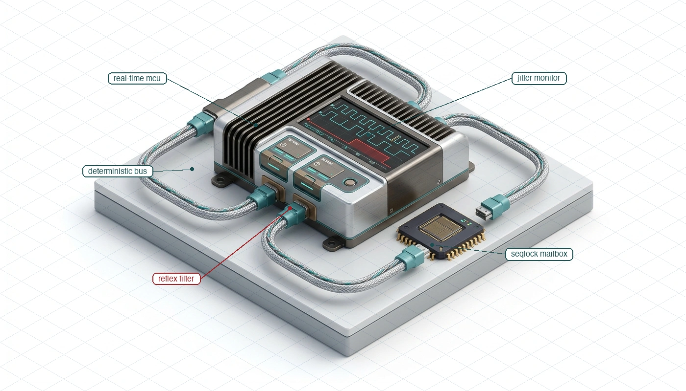{fig-alt="Isometric blueprint showing the Nervous System architecture: embedded real-time MCU, 1 kHz clock and jitter monitor, shielded real-time network ring, shared SRAM seqlock mailbox, and control barrier reflex filter."}
:::

:::

## Purpose {.unnumbered .unlisted}

::: {.content-visible when-format="pdf"}
\begin{marginfigure}
\resizebox{0.92\linewidth}{!}{\mlphysicalstackfull{20}{100}{20}{20}{20}}
\end{marginfigure}
:::

::: {.content-visible unless-format="pdf"}
::: {.column-margin}
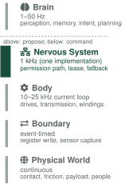{width="100%" fig-alt="Physical AI Systems Stack"}

*Physical AI stack focus for this chapter.*
:::
:::

_Why must a moving machine keep checking its commands when its learned model stops responding?_

A learned model can pause for a fraction of a second while it interprets a scene, but the machine carrying it keeps moving, and a loaded base covers tens of centimeters in that pause. Every delay between a decision and the current it becomes is therefore paid in clearance. A general-purpose computer hides such delays behind queues, retries, and priorities. A moving machine cannot, because a command that arrives late acts on a body that has already moved, and a check that waits on the model it checks protects nothing once that model stalls. Treating timing and communication as implementation details produces machines whose safeguards share a processor, a supply rail, or a memory bus with the model they guard, and so fail together with it. A machine that acts on learned decisions therefore needs a timed path between proposal and actuator whose delays are bounded, whose checks never wait on the proposer, and whose grant of authority to each proposal expires on its own. At the causal boundary, time granted to a proposal becomes motion that software cannot recall.



::: {.callout-learning-objectives}

- Explain why the permission path's independence from the proposer is a requirement to be demonstrated rather than a property of separate processors
- Derive update rates and loop placement from actuator time constants, the phase lag of sampling and transport delay, and proposal renewal limits
- Evaluate mailbox exchanges for bounded reads, complete payloads, and proposal freshness when the writer stalls
- Size a chunk lease between the renewal floor and the pre-brake ceiling, and explain why a host heartbeat cannot renew it
- Distinguish measured latency percentiles from response-time bounds that include computation, blocking, and interference
- Compare position, velocity, torque, and impedance commands by what each leaves the permission path to check
- Evaluate interface timing violations using handoff records that distinguish allocated budgets, supporting evidence, and unresolved bounds

:::

## The Multi-Rate Bridge {#sec-nervous-multi-rate-bridge}

The running machine joins two computational regimes that run on clocks roughly three orders of magnitude apart. A deep neural network processes camera frames into action proposals over tens to hundreds of milliseconds, with latency that fluctuates from frame to frame. An electric motor drive, by contrast, regulates winding current every few tens of microseconds, in a loop that can never pause because the mass it moves keeps its momentum whether or not a new command arrives. The architectural layer between them, the machine's **Nervous System**\index{Nervous system!architecture}, routes action proposals downward toward the actuators, streams physical telemetry back up, and arbitrates whether any proposal is permitted to move the hardware. Industrial motion control, avionics, and automotive engineering solved similar coordination problems decades ago for classical feedback controllers whose worst-case execution times were statically bounded before deployment [@kopetz2011real]. Learned proposers break those classical assumptions. Their inference latencies have long tails, their software runtimes can stall unexpectedly, and their outputs can fail in ways that cannot be exhaustively enumerated at design time.

This asymmetry sets the chapter's central design question, which @sec-brain left open with two proposers (a chunk policy and an intent model, either of which can stall, miss its deadline, or misjudge the target). The question is how long the physical plant may keep executing the last valid proposal when an inference step stalls or drops a frame. That duration cannot be an arbitrary software timeout or the proposer's own schedule; it must follow from the machine's stopping distance and mechanical limits. @Sec-nervous-silicon-partitioning shows why the timed path to the actuators must remain independent of unbounded interference and stalls from deliberative inference, and states the two-processor split that meets this requirement as a hypothesis the machine's silicon must still confirm under load, while @sec-nervous-cadences derives the rate of each tier from a physical time constant and passes proposals between tiers through a mailbox that never blocks the faster reader. @Sec-nervous-lease-sizing then answers the central question with the *chunk lease*, the bounded interval during which an admitted proposal may keep driving the actuators, priced in the stopping budget, and @sec-nervous-deterministic-fieldbuses bounds the computation and the drive network (the *fieldbus*) on which that price depends. Because bounded timing still requires exclusive control of the actuators and survival under host faults, @sec-nervous-actuation-authority and @sec-nervous-hardware-isolation keep the permission path the sole writer of the drives and alive when the proposer fails, @sec-nervous-invariant-checking states the execution contract its checks must meet however fast the proposer runs, and the handoff record of @sec-nervous-handoffs-matrix locates every limit at one of five interfaces, coupling this layer's lease to the stopping distance of the Body and the renewal rate of the Brain.

::: {.column-margin}
{width="100%" fig-alt="S·P·A locator triad highlighting the Plan-Act edge."}

*On the sense-plan-act (S·P·A) triad (@sec-appendix-spa), proposals cross from Plan to Act only through the permission path.*
:::

The running machine, the warehouse mobile manipulator, shows the gap concretely. It regulates current through its brushless motor windings thousands of times per second, whereas the vision-language-action (VLA) policies that plan its grasp on a conveyor-belt mug need orders of magnitude longer to evaluate each frame. If motor regulation ever blocks on deliberative reasoning, or contends for shared memory without a bound on its wait, a heavy inference burst can push the control loop past its hard deadline. Moving mass and electromagnetic coils force one conclusion. *The Brain needs time to deliberate, while the Body needs continuous control.*

Coupling these domains across a shared blocking execution path forces the fast loop to inherit the tail latency of the slow one. If the motor control loop stalls waiting for inference or drains an outdated FIFO queue of stale setpoints, the resulting actuation commands arrive at a physical body that has already moved past the target state. Unmanaged transport delay ($\PureTransportDelay$) also injects phase lag directly into the feedback loop, adding $\DelayPhaseLag = \AngularFrequency \PureTransportDelay$ radians at angular frequency $\AngularFrequency$. That lag erodes the loop's phase margin, the extra lag it can absorb before its corrections start to reinforce the motion instead of damping it (made precise in @sec-nervous-time-constants-phase-lag). The Nervous System must bound these end-to-end transport delays deterministically while ensuring that high-rate local control remains autonomous whenever high-level deliberation stalls.

::: {.column-margin}
<!-- fig-alt hand-types the four periods; MachineTiers guards them (500 ms, 50 ms, 1 ms, 50 us).
     Drawn by generate_margin_figures.py (ch04_cadence_tier_ladder); --check fails on drift. -->
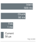{width="100%" fig-alt="Ladder of four horizontal bars on a log time axis, longest at top: intent 500 milliseconds, chunk 50 milliseconds, tick 1 millisecond, current 50 microseconds."}

*Each tier runs at least ten times faster than the one above it, and none may wait on a slower one.*
:::

To enforce this isolation, the Nervous System splits work across four tiers, separating what each tier controls alongside how often it runs. Each tier runs decoupled from the tiers above it, so fast safety and stabilization loops never wait on slower deliberative tiers:

1. **Actuator current and velocity regulation:** Dedicated motor drives close the inner winding-current and joint-velocity loops locally in hardware. Field-oriented control (FOC)[^fn-foc-motor-drive] aligns the stator voltage vector with the rotor's magnetic flux in every carrier period (the switching period of the drive's pulse-width modulation, or PWM), so the winding produces the commanded torque within a few current-loop samples.
2. **Permission and position supervision:** The deterministic real-time supervisory controller verifies proposal freshness and kinematic limits, sends admitted position setpoints across the fieldbus, checks tracking error against physical safety envelopes, and commands a fail-safe stopping trajectory if proposal authority expires.
3. **Action-chunk policy:** The learned mid-level policy emits a short sequence of future waypoints (an action chunk), giving local controllers a continuous motion segment to track between discrete inference steps.
4. **Intent planning:** Slower vision-language or task-planning models read camera frames and language instructions to set high-level goals, steering the action-chunk policy without directly touching drive setpoints.

[^fn-foc-motor-drive]: **Field-Oriented Control (FOC)**: The drive rotates the three measured phase currents into a frame that turns with the rotor's magnetic field, where torque and flux become two slowly varying currents that ordinary proportional-integral loops can hold. The rotation needs a fresh rotor angle in every carrier period, so the loop cannot wait on anything slower than its own sensors. That is why the current loop runs inside the drive, beside the encoder and the current shunts, and why no proposer, however fast, ever sits inside it. \index{Field-oriented control!drive current loop}

@Sec-nervous-time-constants-phase-lag gives each tier its rate, while one rule holds all four together and comes first: a stalled or crashed proposer must never block or delay a lower tier's checks. Conventional computing architectures break that rule because they rely on shared processors, unified memory buses, and multi-level caches managed by general-purpose operating systems. In such environments, hardware isolation is weak. When a large deep neural network streams gigabytes of model weights from DRAM across a shared memory fabric, its high-throughput direct memory access (DMA) bursts contend directly with real-time telemetry and control packets. Because hardware bus transactions cannot be preempted by software thread priorities, control packets queue up at the memory controller. A control path that shares an execution environment with machine learning runtimes is also exposed to operating-system jitter, because kernel page faults, garbage collection cycles, driver interrupts, and thermal frequency throttling can each stall execution for tens of milliseconds. Physical stability therefore demands an architecture in which local control loops keep updating the actuators on schedule whatever delays the inference path suffers.

```{python}
#| label: calc-nervous-machine-stall-travel
#| echo: false
#| warning: false
#| message: false
# ┌─────────────────────────────────────────────────────────────────────────────
# │ BASE TRAVEL DURING ONE PROPOSER INFERENCE (LEGO)
# ├─────────────────────────────────────────────────────────────────────────────
# │ Context: @sec-nervous-multi-rate-bridge, the running-machine bullets.
# │ Goal:    Show how far the base moves while each learned proposer computes.
# │ Show:    60 mm in one 40 ms chunk inference, 503 mm in one computed
# │          336 ms intent inference, at the 1.5 m/s drive limit.
# │ How:     Distance = drive limit x inference latency, all from the registry.
# └─────────────────────────────────────────────────────────────────────────────
from mlsysim import *
from mlsysim.core.units import *
from mlsysim.fmt import fmt_latency, fmt_length, fmt_velocity, check

RM = Embodied.MobileManipulator.WarehouseMobileManipulator

class MachineStallTravel:
    """Base travel at the drive limit during one inference of each learned proposer."""

    # ┌── 1. LOAD (Constants & Parameters) ─────────────────────────────────
    v = RM.base.max_velocity  # category: illustrative (drive limit)
    t_chunk = RM.chunk_inference_latency  # category: illustrative (P99, incl. vision)
    t_intent = RM.intent_inference_latency  # category: derived (prefill plus decode, @sec-brain-memory-wall)

    # ┌── 2. EXECUTE (Compute) ─────────────────────────────────────────────
    d_chunk = (v * t_chunk).to(millimeter)
    d_intent = (v * t_intent).to(millimeter)

    # ┌── 3. GUARD (Invariants) ───────────────────────────────────────────
    check(abs(v.to(meter / second).magnitude - 1.5) < 1e-9, f"Drive limit drifted: {v}")
    check(abs(t_chunk.to(millisecond).magnitude - 40.0) < 1e-9, f"Chunk inference latency drifted: {t_chunk}")
    # 2026-09-28 (M2): intent latency computed, no longer a stipulated 160 ms.
    check(abs(t_intent.to(millisecond).magnitude - 335.61) < 5e-3, f"Intent inference latency drifted: {t_intent}")
    check(abs(d_chunk.magnitude - 60.0) < 1e-6, f"Chunk-inference travel drifted: {d_chunk}")
    check(abs(d_intent.magnitude - 503.41) < 5e-3, f"Intent-inference travel drifted: {d_intent}")

    # ┌── 4. OUTPUT (Format & Export) ────────────────────────────────────────
    v_str = fmt_velocity(v, unit=meter / second, precision=1)
    t_chunk_str = fmt_latency(t_chunk, unit=millisecond, precision=0)
    t_intent_str = fmt_latency(round(t_intent.to(millisecond).magnitude) * millisecond, unit=millisecond, precision=0)
    d_chunk_str = fmt_length(d_chunk, unit=millimeter, precision=0)
    d_intent_str = fmt_length(round(d_intent.magnitude) * millimeter, unit=millimeter, precision=0)
```

```{python}
#| label: calc-nervous-winding-time-constant
#| echo: false
#| warning: false
#| message: false
# ┌─────────────────────────────────────────────────────────────────────────────
# │ WINDING TIME CONSTANT OF THE RUNNING MACHINE'S HUB MOTORS (LEGO)
# ├─────────────────────────────────────────────────────────────────────────────
# │ Context: @sec-nervous-multi-rate-bridge opening and the current-loop tier
# │          in @sec-nervous-cadences.
# │ Goal:    Use the same registry tau_e that @sec-body-electrical-time-constants
# │          computes, and show where the current-loop bandwidth sits.
# │ Show:    tau_e = 1.885 mH / 0.7 Ohm = 2.7 ms, a plant pole near 59 Hz; the
# │          20 kHz sampling rate caps the closed-loop bandwidth near 2 kHz,
# │          about 34 times above the pole.
# │ How:     tau_e = L/R from RM.drive_unit (ZLTECH ZLLG10ASM800 datasheet);
# │          pole = 1 / (2 pi tau_e); bandwidth cap = f_current / 10.
# └─────────────────────────────────────────────────────────────────────────────
import math
from mlsysim import *
from mlsysim.core.units import *
from mlsysim.fmt import fmt_frequency, fmt_latency, check

RM = Embodied.MobileManipulator.WarehouseMobileManipulator

class WindingTimeConstant:
    """Hub-motor electrical time constant and the current-loop bandwidth window."""

    # ┌── 1. LOAD (Constants & Parameters) ─────────────────────────────────
    l_line = RM.drive_unit.line_inductance  # category: sourced (line-to-line)
    r_line = RM.drive_unit.line_resistance  # category: sourced (line-to-line)
    f_current = RM.current_loop_rate  # category: chosen (drive current-loop rate)

    # ┌── 2. EXECUTE (Compute) ─────────────────────────────────────────────
    tau_e = (l_line / r_line).to(millisecond)
    f_pole = (1 / (2 * math.pi * tau_e)).to(hertz)
    f_bw_cap = (f_current / 10).to(hertz)  # a factor of ten below the sampling rate
    room = (f_bw_cap / f_pole).to("dimensionless").magnitude

    # ┌── 3. GUARD (Invariants) ───────────────────────────────────────────
    check(abs(tau_e.magnitude - 2.693) < 1e-3, f"tau_e must match @sec-body (CurrentRise): {tau_e}")
    check(tau_e < RM.chunk_inference_latency, "The winding must settle well inside one chunk inference.")
    check(room > 10, f"The bandwidth window above the pole collapsed: {room:.1f}x")

    # ┌── 4. OUTPUT (Format & Export) ────────────────────────────────────────
    tau_e_str = fmt_latency(tau_e, unit=millisecond, precision=1)
    f_pole_str = fmt_frequency(round(f_pole.magnitude) * hertz, unit=hertz, precision=0)
    f_bw_cap_str = fmt_frequency(f_bw_cap.to(kHz), unit=kHz, precision=0)
```

Learned proposers need tens to hundreds of milliseconds to convert raw camera frames into spatial action plans. In the physical domain, an electromagnetic motor winding has an electrical time constant ($\ElectricalTimeConstant = \PhaseInductance/\PhaseResistance$) of a few milliseconds, `{python} WindingTimeConstant.tau_e_str` for the running machine's direct-drive hub motors (@sec-body-electrical-time-constants), while its moving links carry substantial kinetic energy ($\KineticEnergy = \frac{1}{2} \Mass \BodySpeed^2$). Delaying or dropping an actuation command by a fraction of a second can exhaust the clearance before a new inference cycle finishes. On the warehouse robot the mismatch appears in two mechanical domains:

- The base (Class 1) cruises at up to its `{python} MachineStallTravel.v_str` drive limit (illustrative; see the Reader Guide). At this speed, it travels `{python} MachineStallTravel.d_chunk_str` during a single `{python} MachineStallTravel.t_chunk_str` action-chunk inference, and `{python} MachineStallTravel.d_intent_str` across one `{python} MachineStallTravel.t_intent_str` intent-model inference cycle. Unless an independent supervisory process monitors plant telemetry and commands braking, the chassis travels half a meter open-loop before deliberative planning produces an updated command, nearly half the rack-end clear distance on the machine card.
- The arm (Class 2) couples motor rotors to joints through high-ratio gearboxes, reflecting rotor inertia back to the joint output as $\GearReductionRatio^2 \RotorInertia$, the scaling derived in @sec-body-reflected-rotor-inertia. The drives keep closing their own joint loops when the proposer stalls, but they keep tracking the last admitted command. If that command was set for a grasp on a conveyor mug or a turn of a door latch the scene no longer matches, the reflected inertia and the drives together keep pressing the mechanism into the contact, and contact forces escalate rapidly. Whether this interaction breaches structural limits depends on the contact compliance, surface friction, and mechanical response times alongside the reflected inertia.

::: {.column-margin .margin-pointer}
↩ The intent model's inference latency, priced from its compute-bound prefill and its bandwidth-bound weight sweeps, is established in @sec-brain-memory-wall.
:::

Software discipline, operating system thread priorities, and runtime exception handlers cannot by themselves keep the plant safe. Safety requires an explicit, physically deterministic computing, memory, and communication fabric. That fabric forms the Nervous System of the five-level machine model (@sec-boundary-machine-model), hosting the dedicated permission path so the physical plant retains a measured, feasible response whenever higher-level inference pauses or fails. Its primary design requirement is an interface whose temporal bounds, command authority, and fault responses can be verified directly against the machine's physical safety budget; enforcement algorithms later turn these requirements into per-tick admission decisions, while the mechanisms of this layer fix the contracts those decisions must satisfy.

::: {.column-margin .margin-pointer}
↪ The per-tick admission decisions that must satisfy these contracts are developed in @sec-enforcement-deterministic-gatekeeper.
:::

## The Independence Requirement and the Two-Processor Hypothesis {#sec-nervous-silicon-partitioning}

When an inference model suffers a transient stall or drops a frame, the robot can safely reject the stale proposal and fall back to local control; when a permission check stalls, however, the delay burns directly through the machine's stopping budget, regardless of whether the processor eventually catches up. The two workloads therefore optimize for different guarantees. A neural chunk policy needs high compute throughput and memory bandwidth to stream motion proposals at its target renewal rate, whereas the permission path needs a strict, provable upper bound on the time required to validate and dispatch each step.

Standard operating-system schedulers decide which ready task executes next, but software priority alone cannot guarantee deterministic timing. Raising a control task's priority reduces processor contention, yet it cannot prevent microarchitectural delays. A sudden page fault suspends execution while the virtual memory subsystem resolves the missing page; lock contention on shared kernel primitives leaves a real-time thread waiting behind uncritical background tasks; and memory requests stall at the arbiter while DMA transfers from a GPU or neural accelerator saturate the system interconnect. Long inference latency tails[^fn-math-inference-latency] therefore threaten closed-loop stability even when average proposal latency remains well within nominal bounds.

```{python}
#| label: calc-nervous-tick-vocabulary
#| echo: false
#| warning: false
#| message: false
# ┌─────────────────────────────────────────────────────────────────────────────
# │ THE PERMISSION TICK AS A PERIODIC REAL-TIME TASK (LEGO)
# ├─────────────────────────────────────────────────────────────────────────────
# │ Context: @sec-nervous-silicon-partitioning, the real-time vocabulary
# │          paragraph; reused by the RTA example in @sec-nervous-rta-variance.
# │ Goal:    Give period, deadline, WCET, and unloaded execution time on the
# │          machine's own tick so each term is defined on a real quantity.
# │ Show:    period 1 ms; deadline 400 us; declared WCET 250 us; unloaded 135 us.
# │ How:     All from AISLE (the same values @sec-placement uses).
# └─────────────────────────────────────────────────────────────────────────────
from mlsysim import *
from mlsysim.core.units import *
from mlsysim.fmt import fmt_latency, check

AISLE = Embodied.Scenario.WarehouseAisle

class TickVocabulary:
    """The permission tick's period, deadline, and execution-time terms."""

    # ┌── 1. LOAD (Constants & Parameters) ─────────────────────────────────
    t_period = AISLE.t_tick  # category: chosen (1 kHz permission tick)
    t_deadline = AISLE.enforcer_deadline  # category: chosen
    t_wcet = AISLE.enforcer_wcet  # category: chosen (declared)
    t_unloaded = AISLE.enforcer_unloaded  # category: illustrative

    # ┌── 2. EXECUTE (Compute) ─────────────────────────────────────────────
    t_wcet_gap = (t_wcet - t_unloaded).to(microsecond)

    # ┌── 3. GUARD (Invariants) ───────────────────────────────────────────
    check(abs(t_period.to(millisecond).magnitude - 1.0) < 1e-9, f"Tick period drifted: {t_period}")
    check(abs(t_deadline.to(microsecond).magnitude - 400.0) < 1e-9, f"Tick deadline drifted: {t_deadline}")
    check(abs(t_wcet.to(microsecond).magnitude - 250.0) < 1e-9, f"Declared WCET drifted: {t_wcet}")
    check(abs(t_unloaded.to(microsecond).magnitude - 135.0) < 1e-9, f"Unloaded execution drifted: {t_unloaded}")
    check(t_unloaded < t_wcet < t_deadline < t_period, "Unloaded < WCET < deadline < period")

    # ┌── 4. OUTPUT (Format & Export) ────────────────────────────────────────
    t_period_str = fmt_latency(t_period, unit=millisecond, precision=0)
    t_deadline_str = fmt_latency(t_deadline.to(microsecond), unit=microsecond, precision=0)
    t_wcet_str = fmt_latency(t_wcet.to(microsecond), unit=microsecond, precision=0)
    t_unloaded_str = fmt_latency(t_unloaded.to(microsecond), unit=microsecond, precision=0)
    t_wcet_gap_str = fmt_latency(t_wcet_gap, unit=microsecond, precision=0)
```

Timing guarantees throughout this chapter use the standard terms of real-time scheduling [@buttazzo2011hard; @kopetz2011real], where each term names a part of the permission tick's cycle. The permission tick runs as a periodic task $\RealTimeTaskIndex$ released once every **period**\index{Period (real-time task)} $\TaskPeriod_i$, set here to `{python} TickVocabulary.t_period_str`. Each release is a single job that must finish before its relative **deadline**\index{Deadline!relative} $\TaskRelativeDeadline_i$, measured from the release instant and set here to `{python} TickVocabulary.t_deadline_str`. The deadline is shorter than the period so that each admitted setpoint is ready within the cycle that computed it rather than one tick later, a delay whose cost @sec-nervous-time-constants-phase-lag prices, and so that the rest of the period stays free for lower-priority work. A deadline is *hard* when a single miss can cause a physical hazard, as on the permission tick, where one late check adds one more millisecond of unchecked motion. The total wall-clock time from task release to job completion is its **response time**\index{Response time} $\WorstCaseResponseTime_i$, and the part of that response time spent running the task's own instructions is bounded above by its **worst-case execution time (WCET)**\index{Worst-case execution time}[^fn-wcet-control-tick] $\WorstCaseExecutionTime_i$.

[^fn-wcet-control-tick]: **Worst-Case Execution Time (WCET)**: A static WCET is a bound proved over every path through the binary and every state the processor's caches and pipeline can be in; analyzers compute it by abstract interpretation of the code against a model of that hardware [@wilhelm2008worst]. Caches, branch predictors, and shared buses make that model either pessimistic or intractable, so a timed path earns a tight bound by avoiding them. The bounded sources listed in @sec-nervous-rta-variance therefore favor tightly coupled memory and fixed pipelines, giving up average speed for a bound that analysis can prove. \index{Worst-case execution time!static analysis}

::: {#dfn-nervous-worst-case-execution-time .callout-definition title="Worst-case execution time"}

***Worst-case execution time***\index{Worst-case execution time!definition}\index{WCET!definition} is the longest time a task can take to run to completion on a given processor, over every admissible input and every state its caches, pipeline, and buses can be in, with no other task competing for the processor.

1.  **Significance**: It is the $\WorstCaseExecutionTime_i$ term of every response bound in this chapter, and every margin above it is sized on it. The permission tick declares `{python} TickVocabulary.t_wcet_str` against an unloaded run of `{python} TickVocabulary.t_unloaded_str`, so the `{python} TickVocabulary.t_wcet_gap_str` between them is a claim that analysis must justify before the `{python} TickVocabulary.t_deadline_str` deadline, and the stopping budget behind it, can rely on the number.
2.  **Distinction**: Unlike a mean or a high percentile such as $\text{p99}$, which describe the executions a test happened to reach, the WCET covers every admissible path and processor state. A declared WCET is a third quantity, a number the design commits to, which evidence must show is no smaller than the true one.
3.  **Common pitfall**: Recording the largest measured execution time as the WCET. A measured maximum can refute a declared bound but never establish it, because a test campaign reaches only some of the processor states in which the code can run [@wilhelm2008worst].

:::

The rest of the response time is spent waiting rather than running. **Blocking**\index{Blocking time} $\TaskBlockingTime_i$ is the time a task spends waiting for a lower-priority task to release a shared hardware or software resource, whereas **interference**\index{Interference (scheduling)} $\TaskInterferenceTime_i$ is the time taken by higher-priority tasks, kernel interrupts, and exception handlers that preempt the job. Because blocking and interference vary from one release to the next, the exact timing of recurring events shifts from cycle to cycle, a variation called **jitter**\index{Jitter}. Task releases, sensor samples, and job completions each have their own jitter, so a tick released on schedule can still miss its completion deadline if its internal wait times fluctuate. Later, @sec-nervous-rta-variance combines $\WorstCaseExecutionTime_i$, $\TaskBlockingTime_i$, and $\TaskInterferenceTime_i$ into a provable bound on $\WorstCaseResponseTime_i$.

```{python}
#| label: calc-nervous-permission-tick-strip
#| echo: false
#| warning: false
#| message: false
# ┌─────────────────────────────────────────────────────────────────────────────
# │ LEGO VALUES FOR @fig-04-permission-tick
# ├─────────────────────────────────────────────────────────────────────────────
# │ Context: caption of @fig-04-permission-tick and its plotting cell.
# │ Goal:    Compute and guard the values the caption prints, before the
# │          figure div, so the caption can reference them.
# │ How:     See the class docstring; every value from RM / AISLE.
# └─────────────────────────────────────────────────────────────────────────────
from mlsysim import *
from mlsysim import viz
from mlsysim.core.units import *
from mlsysim.fmt import fmt_latency, fmt_length, fmt_velocity, check
import matplotlib.pyplot as plt

RM = Embodied.MobileManipulator.WarehouseMobileManipulator
AISLE = Embodied.Scenario.WarehouseAisle

class TickPermissionStrip:
    """One permission tick drawn to scale, with travel per tick."""

    # ┌── 1. LOAD (Constants & Parameters) ─────────────────────────────────
    t_period = AISLE.t_tick  # category: chosen
    v = RM.base.max_velocity  # category: datasheet (drive limit)

    # ┌── 2. EXECUTE (Compute) ─────────────────────────────────────────────
    d_tick = (v * t_period).to(millimeter)

    # ┌── 3. GUARD (Invariants) ───────────────────────────────────────────
    check(abs(d_tick.magnitude - 1.5) < 1e-9, f"Travel per tick drifted: {d_tick}")

    # ┌── 4. OUTPUT (Format & Export) ────────────────────────────────────────
    t_period_str = fmt_latency(t_period, unit=millisecond, precision=0)
    d_tick_str = fmt_length(d_tick, unit=millimeter, precision=1)
    v_str = fmt_velocity(v, precision=1)
```

Placed on one axis, the terms separate an illustrative unloaded observation from the bound the schedule assumes (@fig-04-permission-tick). The unloaded run of `{python} TickVocabulary.t_unloaded_str` is an illustrative observation, not a reported measurement; the `{python} TickVocabulary.t_wcet_gap_str` above it, up to the declared `{python} TickVocabulary.t_wcet_str`, is a claim that WCET analysis must certify; and the slack from there to the `{python} TickVocabulary.t_deadline_str` deadline is all the room left for blocking and interference. Underneath, the base covers `{python} TickPermissionStrip.d_tick_str` during every tick at its `{python} TickPermissionStrip.v_str` drive limit, so each of these microsecond terms is ultimately paid in millimeters.

::: {#fig-04-permission-tick fig-env="figure" fig-pos="htb" fig-cap="**One permission tick**: A job is released at the start of each `{python} TickPermissionStrip.t_period_str` period and must finish by its `{python} TickVocabulary.t_deadline_str` deadline. The unloaded run of `{python} TickVocabulary.t_unloaded_str` is an illustrative observation, not a reported measurement; the declared WCET of `{python} TickVocabulary.t_wcet_str` is the bound the schedule assumes, and the hatched `{python} TickVocabulary.t_wcet_gap_str` between them is what WCET analysis must justify. The slack to the deadline is the budget for blocking and interference. The bottom row counts the base's travel on the same axis, `{python} TickPermissionStrip.d_tick_str` per tick at the `{python} TickPermissionStrip.v_str` drive limit." fig-alt="Timing strip over one millisecond. Top row, illustrative observation: a bar from 0 to 135 microseconds labeled unloaded run. Second row, declared: a solid bar to 135 microseconds, a hatched bar from 135 to 250 microseconds labeled declared WCET 250 microseconds with 115 microseconds to justify, and a dashed outline from 250 to 400 labeled slack 150 microseconds. Vertical lines mark the release at 0, a red dashed deadline at 400 microseconds, and the next release at 1000 microseconds, under a bracket labeled period 1 ms. A travel row below marks 0 to 1.5 millimeters, 1.5 millimeters per tick at 1.5 meters per second."}

```{python}
#| label: plot-04-permission-tick
#| echo: false
#| warning: false
#| message: false
# ┌─────────────────────────────────────────────────────────────────────────────
# │ ONE PERMISSION TICK (FIGURE)
# ├─────────────────────────────────────────────────────────────────────────────
# │ Context: @fig-04-permission-tick in @sec-nervous-silicon-partitioning.
# │ Goal:    Put period, deadline, declared WCET, and unloaded execution on one
# │          to-scale axis, with the base's travel during the tick beneath it.
# │ Show:    release 0; unloaded 135 us; WCET 250 us; deadline 400 us; next
# │          release 1000 us; 1.5 mm per tick at 1.5 m/s.
# │ How:     mlsysim.viz.permission_tick_strip(AISLE, RM.base.max_velocity);
# │          every duration from AISLE, as in TickVocabulary.
# └─────────────────────────────────────────────────────────────────────────────
from mlsysim import *
from mlsysim import viz
from mlsysim.core.units import *
from mlsysim.fmt import fmt_latency, fmt_length, fmt_velocity, check
import matplotlib.pyplot as plt

RM = Embodied.MobileManipulator.WarehouseMobileManipulator
AISLE = Embodied.Scenario.WarehouseAisle

strip = viz.permission_tick_strip(AISLE, TickPermissionStrip.v)
strip.lanes[0] = "illustrative observation"
for _s in strip.spans:  # at print width these labels move off the narrow bars
    if _s.label.startswith("slack"):
        _s.label_pos = "below"
    elif _s.label.startswith("unloaded run"):
        _s.label_pos = "above"
        _s.label_dx = 70.0  # clear of the release line
strip.figsize = (6.4, 4.8)  # print scale: the strip's default canvas is 10 in wide
fig, ax, axd = viz.plot_timing_strip(strip)
plt.show()
```
:::

Blocking introduces an architectural vulnerability that priority schemes alone cannot resolve. In **priority inversion**\index{Priority inversion}, a high-priority task waits for a shared resource held by a low-priority task, while medium-priority tasks that need no shared resource preempt the lock holder and so starve the high-priority task for as long as they run. Only a real-time locking protocol, such as priority inheritance or priority ceiling emulation, can bound that wait. The recurring resets of the 1997 Mars Pathfinder spacecraft are the canonical case of an inversion left unbounded; war story \ref{ws-nervous-1997-mars-pathfinder-priority-inversion} in @sec-nervous-rta-variance traces it once the response-time bound it violated is in hand.

POSIX real-time extensions (such as `SCHED_FIFO` priority scheduling and memory locking via `mlockall()`), real-time Linux kernels (`PREEMPT_RT`), and dual-kernel architectures (such as Xenomai) target specific software sources of delay. Locking physical memory via `mlockall()` eliminates demand paging inside the timed control loop; assigning processor affinity confines threads to specific CPU cores to avoid migration latency and cache thrashing; and priority inheritance elevates a low-priority lock holder's priority whenever a high-priority task requests its mutex. These operating-system mechanisms, however, guarantee determinism only when supported by proper configuration, bounded system calls, and verified timing evidence.

::: {.column-margin .margin-pointer}
↪ The scheduling, interrupt, and memory mechanisms whose formal contribution enters a response bound are developed in @sec-appendix-systems-timers.
:::

Shared hardware introduces delays that operating-system software priorities cannot control. A control task cannot read an optical encoder buffer while a high-bandwidth peripheral monopolizes a shared PCI Express (PCIe) link or system memory bus. Any physical infrastructure that two processing domains share, whether system memory, power regulation, a thermal path, or a reference oscillator, can delay or silence the permission path without a single software fault. Cataloging those physical couplings and gathering the evidence required to verify their isolation belongs to placement (@sec-placement-two-paths-one-die). The requirement that analysis tests can be stated now. Under any workload the proposer can generate, the permission path must meet its response bound and keep its authority to refuse an unsafe motion. This chapter calls that requirement independence.

[^fn-math-inference-latency]: **Inference Latency Distribution**\index{Inference latency}: The median and $\text{p99}$ alone do not fix the exceedance probability at a given deadline, which must be measured or modeled separately. Tail-model assumptions and exceedance estimates require representative workload data and an account of dependence and uncertainty; @sec-appendix-ml-evt develops these conditions.

The running machine meets the independence requirement by putting the two paths on two processors, a hypothesis it must still test (@fig-04-two-processor-implementation). An application processor runs perception, the 2 Hz intent model, and the 20 Hz chunk policy. A separate safety microcontroller unit (MCU) runs the permission path and alone drives the motors. Between them runs a board link, a serial peripheral interface (SPI) or Controller Area Network with Flexible Data-rate (CAN FD) bus carrying framed packets with cyclic redundancy checks (CRCs) and sequence numbers. The link is treated as a *black channel*, one the endpoints do not trust, so each frame carries its own integrity and timing checks (@sec-nervous-supervisory-timers). The two paths share no processor cores, caches, or memory buses, and the learned proposers on the host have no memory-mapped input/output (MMIO) access to the drive registers. Candidate chunks cross the link into the MCU's own SRAM through a double buffer. A receive DMA transfer fills a private receive buffer, and the receive interrupt copies each checked frame into a single mailbox slot guarded by a sequence lock, or *seqlock*, whose protocol @sec-nervous-mailbox-exchanges develops. A 1 kHz permission tick reads that slot, checks each proposal's freshness, lease, and kinematic limits against measured encoder feedback, and is the only code that can send an admitted setpoint to the drives. The host is an unprivileged client; the microcontroller, with a short and cycle-counted loop, is the part whose worst-case execution time can be bounded.

Physical separation onto separate chips represents one realization. A single system-on-chip can also host both paths, provided that on-chip interconnects, cache partitioning, and memory controllers demonstrate equivalent response bounds and fault containment under stress. Choosing between discrete silicon and partitioned on-chip cores is the central placement trade-off, and until loaded experiments settle it, physical separation remains a foundational design hypothesis. Scheduling both paths on shared processor cores introduces the problem of *mixed-criticality scheduling*\index{Mixed-criticality scheduling!first use}, in which each task carries execution-time bounds of graduated assurance levels and the operating system guarantees each deadline only under the bound its own criticality demands, allowing the proposer to overrun while the permission path executes deterministically [@vestal2007preemptive]. Sharing memory on a single die also demands explicit memory-bandwidth regulation to prevent tensor accelerators from starving real-time safety routines.

::: {.column-margin .margin-pointer}
↪ Mixed-criticality scheduling, memory-bandwidth regulation, and the other remedies for shared-die contention are developed in @sec-placement-isolation-decisions.
:::

```{python}
#| label: calc-nervous-two-processor-rates
#| echo: false
#| warning: false
#| message: false
# ┌─────────────────────────────────────────────────────────────────────────────
# │ TWO-PROCESSOR RATES (LEGO GUARD FOR A HAND-DRAWN FIGURE)
# ├─────────────────────────────────────────────────────────────────────────────
# │ Context: @fig-04-two-processor-implementation (fig04_two_processor.svg).
# │ Goal:    Keep the rates drawn in the SVG equal to the registry values.
# │ Show:    intent model 2 Hz; chunk renewal 20 Hz; permission tick 1 kHz.
# │ How:     Read the registry; check() fails the build if a registry change
# │          leaves the SVG labels stale. Nothing prints.
# └─────────────────────────────────────────────────────────────────────────────
from mlsysim import *
from mlsysim.core.units import *
from mlsysim.fmt import check

class TwoProcessorRates:
    """Registry rates that fig04_two_processor.svg draws as text."""

    # ┌── 1. LOAD (Constants & Parameters) ─────────────────────────────────
    RM = Embodied.MobileManipulator.WarehouseMobileManipulator
    f_intent = RM.intent_rate.to(hertz).magnitude  # category: chosen
    f_chunk = RM.chunk_rate.to(hertz).magnitude  # category: chosen
    f_tick = RM.permission_rate.to(hertz).magnitude  # category: chosen

    # ┌── 3. GUARD (Invariants) ───────────────────────────────────────────
    check(abs(f_intent - 2.0) < 1e-9, f"SVG draws the intent model at 2 Hz; registry says {f_intent}.")
    check(abs(f_chunk - 20.0) < 1e-9, f"SVG draws chunk renewal at 20 Hz; registry says {f_chunk}.")
    check(abs(f_tick - 1000.0) < 1e-9, f"SVG draws a 1 kHz permission tick; registry says {f_tick}.")

    # ┌── 4. OUTPUT (Formatting) ──────────────────────────────────────────
    # Guard-only class: it pins the values drawn in the figure; no prose outputs.
```

::: {#fig-04-two-processor-implementation fig-env="figure" fig-pos="t" fig-cap="**The two-processor implementation**: The application processor runs the learned proposers and has no access to the drive registers. Proposals cross a black-channel board link as framed packets into a double buffer in the microcontroller's own memory. The receive DMA fills a private receive buffer, and the receive interrupt copies each checked frame into the seqlock-guarded mailbox slot, so the processors share no memory. The permission tick reads the latest proposal, checks it against measured state, freshness, and the lease, and sends only an admitted command to the drives, which close their own current and velocity loops. Measured state returns to the application processor as telemetry over the same link." fig-alt="Three horizontal tiers. Top, application processor: perception feeds an intent model at 2 hertz, which passes a goal to a chunk policy at 20 hertz renewal. Middle band: a dashed black-channel board link, a serial peripheral interface (SPI) bus or a Controller Area Network with Flexible Data-Rate (CAN FD) bus, framed packets with CRC and sequence number, no shared memory. A dashed proposal arrow runs from the chunk policy through the link into a double buffer with seqlock, filled by receive DMA in MCU-local SRAM, inside the safety MCU. The buffer feeds a permission tick at 1 kilohertz that checks freshness, lease, and limits. Bottom: the tick sends an admitted command to drives with current and velocity loops, which move the physical plant; the plant feeds back to encoders and scanner, which feed the permission tick and send telemetry up through the link to perception."}
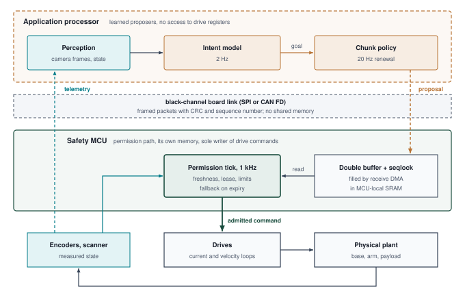{width="100%"}
:::

Designating an embedded controller as a *safety microcontroller*\index{Safety microcontroller!definition} claims far more than physical separation on a circuit board. It denotes a device developed, qualified, and assessed under the IEC 61508 functional-safety standard, accompanied by a safety manual specifying its certified integrity level and the operational conditions that support depends on [@iec61508-2-2010]. At the silicon level, a safety MCU integrates specialized hardware redundancy to detect internal faults autonomously: dual processor cores execute in lockstep while a comparator flags divergent execution; error-correcting codes (ECC) protect internal SRAM and flash memories against single-event upsets; a hardware memory protection unit (MPU) confines each task to its assigned memory range; and analog monitors continuously watch the clock and supply voltages. Built-in self-tests run at power-up and periodically during operation to verify internal logic. An external watchdog timer, clocked by its own oscillator and serviced within a strict time window or through challenge-response messages, monitors the core. Because the watchdog relies on an independent clock source, a physical fault that stops the microcontroller's oscillator cannot stall the watchdog, allowing it to detect that silent processor failure and command a qualified out-of-band response. Successful physical containment still depends on the response path, its surviving power, and the actuator premises.

Two different protections meet at this microcontroller, and keeping them apart explains the standards that follow. The chunk lease protects the stopping budget against a proposer that stalls or misbehaves. The rated claim that the machine will not strike a person rests elsewhere, on the independent protective path of @sec-boundary-kinematic-roofline (a certified safety scanner wired to the drives, with its own sensing, timing, and power) and on the drives' certified stop functions. Hardware diagnostic features alone do not confer a safety rating on the robot. Under functional safety standards, integrity belongs to a specific safety function, such as revoking actuator authority when a lease expires, rather than to an individual chip. The industrial standard IEC 61508 classifies safety functions by Safety Integrity Level\index{Safety integrity level (IEC 61508)} (SIL 1 through SIL 4), where each numerical increment demands approximately an order-of-magnitude reduction in the allowable rate of dangerous failure [@iec61508]. The machinery standard ISO 13849-1 grades safety functions by Performance Level\index{Performance level (ISO 13849)} (PL a through PL e) [@iso13849part1]. A Performance Level combines four architectural factors: the structural Category (ranging from single-channel architectures using well-tried components in Categories B and 1, through single channels with periodic diagnostic testing in Category 2, to dual-channel redundant designs in Categories 3 and 4 where no single hardware fault defeats safety enforcement); component reliability, quantified as the mean time to dangerous failure; diagnostic coverage\index{Diagnostic coverage}, defining the fraction of dangerous failures detected by internal testing; and physical defenses against common-cause failure\index{Common-cause failure}, where a shared disturbance disables redundant channels simultaneously. The safety microcontroller contributes certified failure rates and diagnostic coverage to this calculation, while the target Performance Level is dictated by the severity and exposure of the physical hazard the safety function must mitigate.

::: {.column-margin .margin-pointer}
↪ The Performance Level each certified stop and speed function of the running machine must reach is developed in @sec-enforcement-certified-functions.
:::

The physical architecture of the robot makes a deliberate engineering trade-off that functional safety certification must evaluate. Its permission path executes real-time performance tasks, validating trajectory proposals and interpolating admitted waypoints into drive setpoints, alongside the safety function intended for qualification: revoking actuator authority and commanding a safe stop when a chunk lease expires or the host heartbeat falls silent. The algorithmic admission checks themselves carry no formal safety rating, which is why the protective claim stays with the scanner and the drive stop circuits (@sec-enforcement-certified-functions). Standard functional-safety practice keeps complex control algorithms out of the certified safety channel, relying instead on an independent monitoring channel to satisfy Category 3 and Category 4 redundancy requirements. Modern motor drives supply part of that second channel through integrated hardware safety functions such as Safe Stop 1 (SS1), which brakes the motor under drive control and then removes torque.

::: {.column-margin .margin-pointer}
↪ How Safe Stop 1 and the other drive safety functions realize the industrial stop categories is developed in @sec-enforcement-stop-categories.
:::

Any hardware split must keep the permission path the sole writer of the actuators and bound its check time across all expected hardware and software faults. Putting the two paths on separate chips is the cleanest way to start, though empirical timing evidence under load must still confirm that isolation. Separate processors, however, run on asynchronous clocks at very different rates, so the link between them must pass trajectory updates continuously without ever forcing the fast permission reader to wait on the slower host writer.

## Multi-Rate Cadences {#sec-nervous-cadences}

A motor drive cannot wait for the next camera-based proposal before regulating winding current. Conversely, forcing a learned policy to evaluate at current-loop rates wastes compute without generating fresher sensory observations. Decoupling these cadences allows each workload to meet its distinct physical or computational deadline, provided the boundary interface preserves data freshness and never blocks local real-time control.

### Physical time constants and sampling phase lag {#sec-nervous-time-constants-phase-lag}

```{python}
#| label: calc-nervous-machine-tiers
#| echo: false
#| warning: false
#| message: false
# ┌─────────────────────────────────────────────────────────────────────────────
# │ THE RUNNING MACHINE'S RATE TIERS (LEGO)
# ├─────────────────────────────────────────────────────────────────────────────
# │ Context: @sec-nervous-cadences, the four-tier sentence, the perception
# │          paragraph, and the chunk-policy tier paragraph.
# │ Goal:    Give the machine's own proposer rates and chunk horizon, and the
# │          base's travel during one camera exposure.
# │ Show:    chunk policy 20 Hz (50 ms = 2 x 25 ms setpoints, M5), intent model
# │          2 Hz (500 ms), H = 16; permission tick 1 kHz (1000 us, +/- 10 us
# │          release jitter, illustrative); 22.5 mm of base
# │          travel in a 15 ms exposure at the 1.5 m/s drive limit.
# │ How:     Rates and horizon from RM; travel = drive limit x exposure, with
# │          the exposure a scenario input.
# └─────────────────────────────────────────────────────────────────────────────
from mlsysim import *
from mlsysim.core.units import *
from mlsysim.fmt import fmt_frequency, fmt_int, fmt_latency, fmt_length, fmt_velocity, check

RM = Embodied.MobileManipulator.WarehouseMobileManipulator

class MachineTiers:
    """Proposer rates, chunk horizon, and exposure travel on the running machine."""

    # ┌── 1. LOAD (Constants & Parameters) ─────────────────────────────────
    f_chunk = RM.chunk_rate  # category: chosen (chunk-policy renewal rate)
    f_intent = RM.intent_rate  # category: chosen (intent-model rate)
    chunk_horizon = RM.chunk_horizon  # category: chosen (setpoints per chunk)
    chunk_step = RM.chunk_step  # category: chosen (setpoint step)
    f_current = RM.current_loop_rate  # category: chosen (drive current-loop rate)
    f_perm = RM.permission_rate  # category: chosen (permission tick)
    t_tick_jitter = 10 * microsecond  # category: illustrative (release-jitter allowance of the tick; scenario assumption)
    v = RM.base.max_velocity  # category: illustrative (drive limit)
    t_exp = 15 * millisecond  # category: illustrative (exposure in a 300 lux scene; scenario assumption)

    # ┌── 2. EXECUTE (Compute) ─────────────────────────────────────────────
    d_exp = (v * t_exp).to(millimeter)
    t_chunk_period = RM.chunk_period  # renewal period, a whole number of setpoint steps
    n_per_renewal = RM.chunk_schedule["setpoints_per_renewal"]
    t_current = (1 / f_current).to(microsecond)  # current-loop sampling period
    t_perm = (1 / f_perm).to(microsecond)  # permission-tick period

    # ┌── 3. GUARD (Invariants) ───────────────────────────────────────────
    check(abs(f_current.to(kHz).magnitude - 20.0) < 1e-9, f"Current-loop rate drifted: {f_current}")
    # margin_cadence_tier_ladder.svg fig-alt hand-types 500 ms, 50 ms, 1 ms, 50 us.
    check(abs(t_current.magnitude - 50.0) < 1e-9, f"Current-loop period drifted: {t_current}")
    check(abs(RM.chunk_period.to(millisecond).magnitude - 50.0) < 1e-9, "Ladder: chunk period drifted")
    check(abs((1 / f_intent).to(millisecond).magnitude - 500.0) < 1e-9, "Ladder: intent period drifted")
    # The ladder caption says each tier runs at least ten times faster than the one above it.
    check(
        f_current >= 10 * RM.permission_rate and RM.permission_rate * RM.chunk_period >= 10 and RM.chunk_period * 10 <= 1 / f_intent,
        "Ladder caption: tier ratio fell below ten",
    )
    check(abs(f_chunk.to(hertz).magnitude - 20.0) < 1e-9, f"Chunk rate drifted: {f_chunk}")
    check(abs(f_intent.to(hertz).magnitude - 2.0) < 1e-9, f"Intent rate drifted: {f_intent}")
    check(abs(t_perm.magnitude - 1000.0) < 1e-9, f"Permission-tick period drifted: {t_perm}")
    check(t_tick_jitter <= 0.01 * t_perm, "Tick release jitter must be small against the period.")
    check(chunk_horizon == 16, f"Chunk horizon drifted: {chunk_horizon}")
    check(abs(chunk_step.to(millisecond).magnitude - 25.0) < 1e-9, f"Setpoint step drifted: {chunk_step}")
    check(n_per_renewal == 2, f"Setpoints per renewal drifted: {n_per_renewal}")
    check(abs(v.to(meter / second).magnitude - 1.5) < 1e-9, f"Drive limit drifted: {v}")
    check(abs(d_exp.magnitude - 22.5) < 1e-9, f"Exposure travel drifted: {d_exp}")

    # ┌── 4. OUTPUT (Format & Export) ────────────────────────────────────────
    f_chunk_str = fmt_frequency(f_chunk, unit=hertz, precision=0)
    f_intent_str = fmt_frequency(f_intent, unit=hertz, precision=0)
    t_intent_period_str = fmt_latency((1 / f_intent).to(millisecond), unit=millisecond, precision=0)
    chunk_horizon_str = fmt_int(chunk_horizon)
    chunk_step_str = fmt_latency(chunk_step, unit=millisecond, precision=0)
    t_chunk_period_str = fmt_latency(t_chunk_period, unit=millisecond, precision=0)
    f_current_str = fmt_frequency(f_current, unit=kHz, precision=0)
    t_current_str = fmt_latency(t_current, unit=microsecond, precision=0)
    f_perm_str = fmt_frequency(f_perm.to(kHz), unit=kHz, precision=0)
    t_perm_str = fmt_latency(t_perm, unit=microsecond, precision=0)
    t_tick_jitter_str = fmt_latency(t_tick_jitter, unit=microsecond, precision=0)
    n_per_renewal_str = fmt_int(n_per_renewal)
    v_str = fmt_velocity(v, unit=meter / second, precision=1)
    t_exp_str = fmt_latency(t_exp, unit=millisecond, precision=0)
    d_exp_str = fmt_length(d_exp, unit=millimeter, precision=1)
```

The mobile manipulator's motor inverters regulate winding current every `{python} MachineTiers.t_current_str` (`{python} MachineTiers.f_current_str`), while its chunk policy requires `{python} MachineStallTravel.t_chunk_str` at p99 latency to ingest camera frames and generate an action chunk. No single cadence can serve both the winding's electromagnetic dynamics and the cost of deep visual inference. The four tiers named in @sec-nervous-multi-rate-bridge therefore each take their rate from a different time constant:

1. **Inner Commutation and Current Loop (`{python} MachineTiers.f_current_str`, `{python} MachineTiers.t_current_str` cycle):** The PWM carrier frequency, selected to balance switching losses, current ripple, and acoustic noise, fixes the sampling instants. Phase currents are sampled once per carrier period at its midpoint, so a `{python} MachineTiers.f_current_str` carrier yields $\SamplingPeriod =$ `{python} MachineTiers.t_current_str`. The stator winding's electrical time constant establishes the plant pole that the current regulator must compensate. For the hub motors, $\ElectricalTimeConstant = \PhaseInductance/\PhaseResistance =$ `{python} WindingTimeConstant.tau_e_str` (@sec-body-electrical-time-constants) places that pole near `{python} WindingTimeConstant.f_pole_str`. The closed-loop current bandwidth is tuned well above this pole and at least a factor of ten below the sampling rate, reaching at most about `{python} WindingTimeConstant.f_bw_cap_str` [@franklin1998digital]. This loop executes directly within drive silicon and commands electromagnetic torque through the motor controller.
2. **Permission and Position-Supervision Tick (`{python} MachineTiers.f_perm_str`, `{python} MachineTiers.t_perm_str` $\pm$ `{python} MachineTiers.t_tick_jitter_str` cycle):** The rate here is set by distance rather than by a plant pole. Each tick of detection delay is base travel the stopping budget must absorb, and each tick must also supply the drives a fresh position setpoint. At one tick per millisecond both demands are met with the margins quantified below, while the drives close the subordinate velocity and current loops.
3. **Action-Chunk Policy Stream (`{python} MachineTiers.f_chunk_str`, `{python} MachineTiers.t_chunk_period_str` cycle):** Bridging observation age and mechanical execution, the local policy emits receding-horizon action chunks ($\ActionChunkHorizon =$ `{python} MachineTiers.chunk_horizon_str` waypoints spaced `{python} MachineTiers.chunk_step_str` apart). On this machine, the policy is a compact visuomotor network following the Action Chunking with Transformers (ACT) architecture, which decodes an entire chunk in a single forward pass; @sec-brain-action-chunking priced it against the iterative diffusion and flow-matching heads that trade more passes for expressiveness. Each pass must stream the model's weights from memory on the application processor's accelerator, which caps the pass rate near $\PolicyPassRate \le \SustainedMemoryBandwidth/\WeightMemory$. Because one pass yields all `{python} MachineTiers.chunk_horizon_str` setpoints, that sweep is paid once per chunk rather than once per setpoint, which is what lets the policy renew at this rate.
4. **Multimodal Intent Planner (`{python} MachineTiers.f_intent_str`, `{python} MachineTiers.t_intent_period_str` cycle):** A high-capacity VLA model turns camera frames and a natural-language instruction into task goals and navigation targets. Its period is set by the prefill and weight sweeps of @sec-brain-memory-wall, not by any plant dynamics, which is why it may steer the chunk policy but never hold a chunk lease, the authority to keep driving the actuators that @sec-nervous-lease-sizing sizes in tens of milliseconds.

The two proposer cadences reflect mainstream action-chunking and VLA architectures as of 2026, and their frequencies will shift as models and accelerators evolve. The method developed below does not depend on them. It anchors the lease's lower limit to what the proposer can supply and its upper limit to the physical stopping budget.

The current-loop rate follows directly from the winding's electrical time constant $\PhaseInductance/\PhaseResistance$, and the loop closes within the drive's local inverter. The harder timing question arises one level up, at the joint. There, inertia and structural compliance set the required closed-loop bandwidth, and every digital stage between sensor and actuator (sampling, computation, bus transport) exacts a penalty in phase lag. The crossover frequency $\CrossoverFrequency$ marks the point where open-loop gain equals unity. At this frequency, the phase margin[^fn-phase-margin-bode] defines the maximum additional phase lag the system can absorb before feedback transitions from stabilizing attenuation to self-reinforcing oscillation.

[^fn-phase-margin-bode]: **Phase Margin**: @bode1945network introduced gain and phase margins to measure how far a feedback amplifier sits from instability, turning the stability criterion of @nyquist1932regeneration into a practical design margin. In cyber-physical loops, delay erodes the modeled phase reserve and can destabilize the loop under its nominal assumptions. Establishing actual damping and stability requires the complete sampled plant, compensation, and timing response. Because a pure transport or compute delay $\PureTransportDelay$ subtracts $\CrossoverFrequency \PureTransportDelay$ radians of phase regardless of cause, bus cycles, compute stages, and zero-order holds all draw from the same finite phase budget. \index{Phase margin!delay budget}

```{python}
#| label: calc-nervous-tick-delay-budget
#| echo: false
#| warning: false
#| message: false
# ┌─────────────────────────────────────────────────────────────────────────────
# │ TOTAL-DELAY PHASE BUDGET FOR A LOOP CLOSED THROUGH THE TICK (LEGO)
# ├─────────────────────────────────────────────────────────────────────────────
# │ Context: @sec-nervous-time-constants-phase-lag, the delay-budget paragraphs.
# │ Goal:    Show that a 20 Hz joint loop closed across the permission tick
# │          and fieldbus exceeds the chosen phase erosion allowance (M1).
# │ Show:    ZOH 3.6 deg + bus 7.2 deg + compute 1.8 deg = 12.6 deg against a
# │          5 deg allowance (0.69 ms of total delay); next-tick output 18.0 deg;
# │          highest crossover at 1 kHz 7.9 Hz; 500 Hz ZOH alone 7.2 deg;
# │          1.5 mm of base travel per millisecond of detection delay.
# │ How:     calc_phase_lag_total (appendix_control total-delay formula);
# │          tick, bus, WCET from AISLE; crossover and allowance chosen.
# └─────────────────────────────────────────────────────────────────────────────
from mlsysim import *
from mlsysim.core.units import *
from mlsysim.fmt import fmt, fmt_frequency, fmt_latency, fmt_length, fmt_multiple, check

RM = Embodied.MobileManipulator.WarehouseMobileManipulator
AISLE = Embodied.Scenario.WarehouseAisle

class TickDelayBudget:
    """Phase erosion of a joint loop closed through the permission tick and the bus."""

    # ┌── 1. LOAD (Constants & Parameters) ─────────────────────────────────
    f_c = 20.0 * hertz  # category: chosen (illustrative joint-loop crossover)
    phi_allow = 5.0 * degree  # category: chosen (illustrative erosion allowance)
    t_tick = AISLE.t_tick  # category: chosen (1 kHz permission tick)
    t_bus = AISLE.t_bus  # category: illustrative (EtherCAT cycle)
    t_comp = AISLE.enforcer_wcet  # category: chosen (declared enforcer WCET)
    t_tick_slow = 2.0 * millisecond  # category: illustrative (500 Hz comparison)
    v = RM.base.max_velocity  # category: illustrative (drive limit)

    # ┌── 2. EXECUTE (Compute) ─────────────────────────────────────────────
    same_tick = calc_phase_lag_total(f_c, t_tick, compute_delay=t_comp, transport_delay=t_bus, phase_allowance=phi_allow)
    next_tick = calc_phase_lag_total(f_c, t_tick, compute_delay=t_tick, transport_delay=t_bus, phase_allowance=phi_allow)
    slow_zoh = calc_phase_lag_total(f_c, t_tick_slow)
    phi_zoh = same_tick["phase_zoh"].to(degree).magnitude
    phi_bus = same_tick["phase_transport"].to(degree).magnitude
    phi_comp = same_tick["phase_compute"].to(degree).magnitude
    phi_total = same_tick["phase_total"].to(degree).magnitude
    phi_next = next_tick["phase_total"].to(degree).magnitude
    phi_slow = slow_zoh["phase_zoh"].to(degree).magnitude
    tau_total = same_tick["tau_total"].to(millisecond)
    tau_next = next_tick["tau_total"].to(millisecond)
    tau_allowed = same_tick["tau_allowed"].to(millisecond)
    f_max = same_tick["f_crossover_max"].to(hertz)
    over_ratio = phi_total / phi_allow.magnitude
    mm_per_ms = (v * (1 * millisecond)).to(millimeter)
    n_fir = 9  # category: illustrative (moving-average taps, fn-fir-smoothing)
    tau_fir = ((n_fir - 1) / 2 * t_tick).to(millisecond)  # FIR group delay, (N-1)/2 samples
    phi_fir = (360.0 * f_c * tau_fir).to(dimensionless).magnitude  # degrees at crossover

    # ┌── 3. GUARD (Invariants) ───────────────────────────────────────────
    check(abs(tau_fir.magnitude - 4.0) < 1e-9, f"FIR group delay drifted: {tau_fir}")
    check(abs(phi_fir - 28.8) < 1e-9, f"FIR phase at crossover drifted: {phi_fir}")
    # margin_tick_phase_budget_envelope.svg fig-alt hand-types 20 Hz, 5, 3.6, 1.8, 7.2, 12.6 degrees (guarded here).
    check(abs(phi_zoh - 3.6) < 1e-9, f"ZOH phase drifted: {phi_zoh}")
    check(abs(phi_bus - 7.2) < 1e-9, f"Bus phase drifted: {phi_bus}")
    check(abs(phi_comp - 1.8) < 1e-9, f"Compute phase drifted: {phi_comp}")
    check(abs(phi_total - 12.6) < 1e-9, f"Total phase drifted: {phi_total}")
    check(abs(phi_next - 18.0) < 1e-9, f"Next-tick total phase drifted: {phi_next}")
    check(abs(phi_slow - 7.2) < 1e-9, f"500 Hz ZOH phase drifted: {phi_slow}")
    check(phi_zoh < phi_allow.magnitude < phi_bus, "ZOH alone fits the allowance; the bus alone does not")
    check(t_bus > tau_allowed, "The bus cycle alone exceeds the whole delay allowance")
    check(abs(f_max.magnitude - 7.9365) < 1e-3, f"Highest supported crossover drifted: {f_max}")
    check(abs(mm_per_ms.magnitude - 1.5) < 1e-9, f"Travel per millisecond drifted: {mm_per_ms}")

    # ┌── 4. OUTPUT (Format & Export) ────────────────────────────────────────
    f_c_str = fmt_frequency(f_c, unit=hertz, precision=0)
    phi_allow_str = fmt(phi_allow.magnitude, precision=0)
    t_tick_str = fmt_latency(t_tick, unit=millisecond, precision=0)
    t_bus_str = fmt_latency(t_bus, unit=millisecond, precision=0)
    t_comp_str = fmt_latency(t_comp.to(microsecond), unit=microsecond, precision=0)
    phi_zoh_str = fmt(phi_zoh, precision=1)
    phi_bus_str = fmt(phi_bus, precision=1)
    phi_comp_str = fmt(phi_comp, precision=1)
    phi_total_str = fmt(phi_total, precision=1)
    phi_next_str = fmt(phi_next, precision=0)
    phi_slow_str = fmt(phi_slow, precision=1)
    tau_total_str = fmt_latency(tau_total, unit=millisecond, precision=2)
    tau_next_str = fmt_latency(tau_next, unit=millisecond, precision=1)
    tau_allowed_str = fmt_latency(tau_allowed, unit=millisecond, precision=2)
    f_max_str = fmt_frequency(f_max, unit=hertz, precision=1)
    over_mult_str = fmt_multiple(over_ratio, precision=1)
    mm_per_ms_str = fmt_length(mm_per_ms, unit=millimeter, precision=1)
    n_fir_str = fmt(n_fir, precision=0)
    tau_fir_str = fmt_latency(tau_fir, unit=millisecond, precision=0)
    phi_fir_str = fmt(phi_fir, precision=1)
    fir_over_mult_str = fmt_multiple(phi_fir / phi_allow.magnitude, precision=1)
```

Excess phase lag causes corrective control torques to arrive out of phase with physical joint motion, eventually turning stabilizing negative feedback into unstable positive feedback [@nyquist1932regeneration]. Closing a feedback loop across the permission tick accumulates three distinct sources of latency. The discrete sample-and-hold introduces an effective transport delay equal to half the sample period ($\SamplingPeriod/2$); the enforcer requires compute time ($\EnforcerComputeTime$) to evaluate constraints; and the resulting command incurs fieldbus transit latency ($\CommandTransportTime$) before reaching the drive. Because a pure delay $\PureTransportDelay$ removes $\AngularFrequency \PureTransportDelay$ radians of phase across all frequencies, these stages collectively erode the phase margin at crossover according to @eq-nervous-delay-phase, the total-delay relation given in @sec-appendix-control-zoh:
$$\DelayPhaseLag = \CrossoverFrequency\left(\frac{\SamplingPeriod}{2} + \EnforcerComputeTime + \CommandTransportTime\right)$$ {#eq-nervous-delay-phase}

Consider an illustrative joint-loop crossover of `{python} TickDelayBudget.f_c_str` and a design phase erosion allowance of `{python} TickDelayBudget.phi_allow_str`$^\circ$. A `{python} TickDelayBudget.t_tick_str` tick's sample-and-hold accounts for `{python} TickDelayBudget.phi_zoh_str`$^\circ$, which fits comfortably within the budget. However, the `{python} TickDelayBudget.t_bus_str` fieldbus transit cycle contributes `{python} TickDelayBudget.phi_bus_str`$^\circ$ on its own, and the enforcer's declared worst-case execution time of `{python} TickDelayBudget.t_comp_str` adds another `{python} TickDelayBudget.phi_comp_str`$^\circ$. The combined delay of `{python} TickDelayBudget.tau_total_str` imposes `{python} TickDelayBudget.phi_total_str`$^\circ$ of phase lag, `{python} TickDelayBudget.over_mult_str` the allowance. If the controller delays output release until the subsequent tick boundary, total phase erosion escalates to `{python} TickDelayBudget.phi_next_str`$^\circ$ over `{python} TickDelayBudget.tau_next_str`. Because the phase budget tolerates at most `{python} TickDelayBudget.tau_allowed_str` of total delay, less than a single bus cycle, no increase in tick frequency can keep a `{python} TickDelayBudget.f_c_str` loop closed across this communication bus within its erosion allowance. The loop might remain stable, but it would spend phase margin the design never allocated to delay. Given `{python} TickDelayBudget.tau_total_str` of unavoidable transit and processing latency, a `{python} TickDelayBudget.t_tick_str` tick stays within the chosen phase erosion allowance only at crossover frequencies no greater than `{python} TickDelayBudget.f_max_str`. Reducing the tick rate to $500\text{ Hz}$ increases the sample-and-hold penalty alone to `{python} TickDelayBudget.phi_slow_str`$^\circ$, whereas driving the tick frequency toward infinity still leaves the bus transport penalty untouched. Loop placement, rather than clock scaling, resolves this architectural constraint.

::: {.column-margin}
<!-- fig-alt hand-types the phase terms; TickDelayBudget guards them (3.6, 1.8, 7.2, 12.6 against 5 degrees).
     Drawn by generate_margin_figures.py (ch04_phase_budget_envelope); --check fails on drift. -->
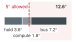{width="100%" fig-alt="One stacked horizontal bar of phase lag at a 20 hertz crossover: hold 3.6 degrees, compute 1.8 degrees, and bus 7.2 degrees, totaling 12.6 degrees. A dashed red line at 5 degrees allowed falls inside the compute segment, and the whole bus segment lies in the shaded region past it."}

*The bus cycle alone spends more phase than the loop can spare.*
:::

Consequently, the machine closes its high-rate joint velocity and current loops directly within the decentralized motor drives, where co-located encoder sampling bypasses the fieldbus entirely. The centralized `{python} TickDelayBudget.t_tick_str` permission tick operates strictly as a supervisor and trajectory setpoint generator. This decouples the tick from joint-level phase margin constraints, replacing them with two distinct systems requirements. First, as a safety supervisor, each millisecond of detection delay incurs `{python} TickDelayBudget.mm_per_ms_str` of unbraked base travel at maximum drive velocity, directly consuming clearance from the stopping budget (notebook \ref{nbk-nervous-watchdog-stopping-lease}). Second, as a setpoint source, the tick must evaluate the admitted trajectory frequently enough to supply smooth kinematic references to the drives. Transport delay along this reference path introduces tracking lag rather than eroding the drive loop's phase margin, because the reference sits outside the feedback loop. Any outer supervisory corrections closed across the bus, such as cartesian compliance trims, must restrict their crossover bandwidth below `{python} TickDelayBudget.f_max_str`.

Closing those loops in the drive is a hardware arrangement rather than merely a firmware setting. The fastest loop sits beside its sensor and its switch, so phase current is measured and switched next to the winding with no host processor in the loop, and dedicated PWM timers in the same silicon enforce the gap between complementary switch transitions that keeps the power bridge from shorting.[^fn-hw-epwm-deadtime] The running machine's brushless hub drives follow this arrangement at a larger scale; the small stepper-motor driver of @fig-real-motor-controller shows it on one chip.

[^fn-hw-epwm-deadtime]: **Dead-Time Delay**\index{Dead-time delay}: The interval in which both switches of a half-bridge leg are off, so the leg never shorts the DC bus, is the inverter dead time introduced in @sec-body-electrical-time-constants. Dedicated pulse-width modulation timers insert it in hardware ($100\text{--}500\text{ ns}$) on every transition, and drive firmware applies online volt-second compensation for the voltage error it introduces.

::: {#fig-real-motor-controller fig-env="figure" fig-pos="t" fig-cap="**Integrated motor-driver silicon**: A Trinamic TMC2209 stepper-motor driver in a quad flat no-lead (QFN) package, with a low-value current-sense resistor (marked R110) beside it on the board. The chip carries its own power transistors and current regulation, so the winding current is measured and switched next to the motor it drives rather than by the host processor. A photograph shows the placement; the timing of the current loop is a property of the silicon that the datasheet and measurement must establish. (Photo: Phiarc, [Wikimedia Commons](https://commons.wikimedia.org/wiki/File:Trinamic_TMC2209_stepper_motor_controller_chip.jpg), CC BY-SA 4.0)." fig-alt="Macro photograph of a square QFN integrated circuit marked TMC2209-LA on a black printed circuit board, with a larger surface-mount resistor marked R110 at upper left and small capacitors and copper traces around it."}
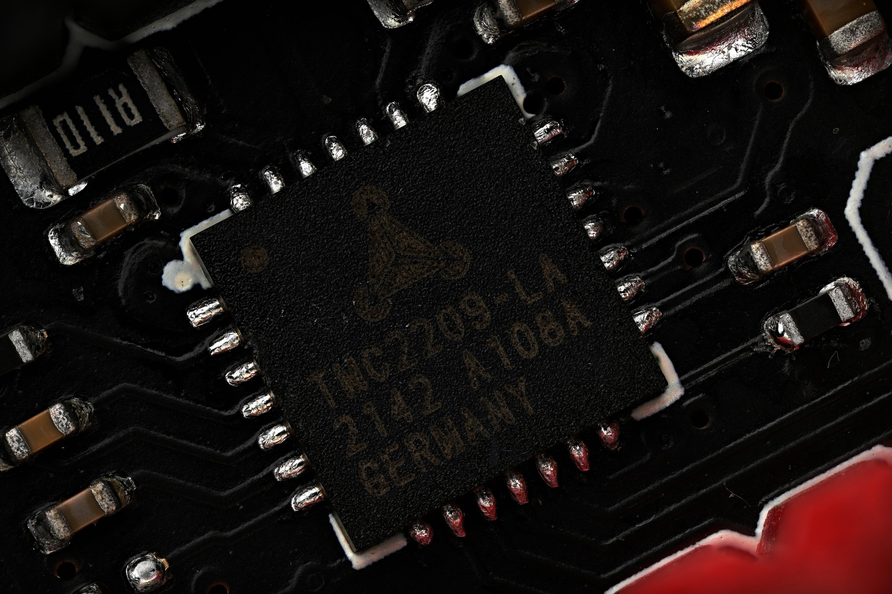{width="85%"}
:::

Perception pipelines feeding the policy stream execute at intermediate cadences constrained by optical physics, sensor exposure durations, and relative scene velocity. In a typical $300\text{ lux}$ warehouse lighting environment requiring a `{python} MachineTiers.t_exp_str` exposure, the robot base traveling at its `{python} MachineTiers.v_str` drive limit covers $\ExposureTravelDistance = \SpeedAtDetection\,\ExposureDuration =$ `{python} MachineTiers.d_exp_str` while the shutter is open. Resulting image-plane blur interacts with scene depth and optical geometry, setting physical limits on feature tracking. The achievable signal-to-noise ratio, spatial motion blur, and image preprocessing latency jointly establish the feasible sensing cadence for visual control, a trade-off @sec-perception develops. For the permission path the exposure matters as time. An observation is dated at its exposure midpoint, so half the exposure is already part of its age before any processing begins, and that age is the first interval the lease budget must charge (@tbl-04-event-timing).

The chunk-policy generation rate must satisfy the proposal-supply budget set in @sec-brain-action-chunking. For our mobile manipulator, a `{python} MachineTiers.f_chunk_str` renewal cycle paired with an $\ActionChunkHorizon =$ `{python} MachineTiers.chunk_horizon_str` waypoint horizon [@zhao2023learning] bridges visual perception and high-rate actuation. The `{python} MachineTiers.t_chunk_period_str` renewal period matches `{python} MachineTiers.n_per_renewal_str` discrete setpoint steps of `{python} MachineTiers.chunk_step_str`, so every scheduled renewal lands on a setpoint boundary, provided the handoff between the two clocks never makes the faster reader wait.

### Lock-free and wait-free mailbox exchanges {#sec-nervous-mailbox-exchanges}

If a `{python} MachineTiers.f_perm_str` safety loop blocks on a mutual exclusion lock held by a `{python} MachineTiers.f_chunk_str` neural network runtime, one page fault or scheduling hiccup in the runtime becomes an unbounded priority inversion, and the hard real-time controller misses its cycle deadline. Because the tiers run on different processors at different rates, every exchange across a rate boundary must give the faster reader bounded, nonblocking access. Panel (b) of @fig-04-multirate-cadence-buffer follows the remedy developed here, the mailbox, through a clean exchange, a write preempted by the tick, and a stalled host, and in none of the three does the reader wait. Panel (a), which shows what the tick does when the proposer stops renewing altogether, returns in @sec-nervous-lease-sizing once the lease that governs it is defined.

Standard inter-process communication libraries rarely provide deterministic execution bounds out of the box. Message serialization, dynamic memory allocation, intermediate queueing, and thread scheduling can each introduce unpredictable delivery stalls. While shared memory eliminates buffer copying and kernel context switches, it requires concurrency controls to prevent the reader from ingesting partially written, inconsistent command payloads. The communication protocol must strictly bound the consumer's execution time, even when the producer stalls at the most unfavorable point in its write cycle.

While a first-in, first-out (FIFO) queue guarantees sequential message delivery, message ordering is the wrong semantic model for physical motion control. If the control consumer falls behind the rate of production, queued motion plans represent progressively stale physical state estimates. Backpressure, the queue's way of slowing a producer, cannot pause moving mass. The real-time enforcer requires the freshest complete proposal, paired with a strict temporal deadline. This principle does not prevent the controller from buffering the future waypoints of an already admitted trajectory; those waypoints follow an explicit execution schedule governed by a valid lease. Rather, it prevents treating the delayed consumption of historical commands as valid control inputs. Real-time distributed systems distinguish these two communication semantics. An *event message*\index{Event message} is queued and consumed exactly once, where dropping a message loses state history, whereas a *state message*\index{State message} represents current environmental state and updates in place, allowing new observations to overwrite older ones without queuing [@kopetz2011real]. The proposal mailbox implements state-message semantics via a single-slot seqlock, following the non-blocking write protocol of @kopetz1993nbw to ensure mutual independence between writer progress and reader execution.

```{python}
#| label: calc-nervous-multirate-stall
#| echo: false
#| warning: false
#| message: false
# ┌─────────────────────────────────────────────────────────────────────────────
# │ LEGO VALUES FOR @fig-04-multirate-cadence-buffer
# ├─────────────────────────────────────────────────────────────────────────────
# │ Context: caption of @fig-04-multirate-cadence-buffer and its plotting cell.
# │ Goal:    Compute and guard the values the caption prints, before the
# │          figure div, so the caption can reference them.
# │ How:     See the class docstring; every value from RM / AISLE.
# └─────────────────────────────────────────────────────────────────────────────
from mlsysim import *
from mlsysim import viz
from mlsysim.core.units import *
from mlsysim.fmt import fmt_latency, check
import matplotlib.pyplot as plt

RM = Embodied.MobileManipulator.WarehouseMobileManipulator
AISLE = Embodied.Scenario.WarehouseAisle

class MultirateStall:
    """One proposer stall on the running machine's clocks, drawn to scale."""

    # ┌── 1. LOAD (Constants & Parameters) ─────────────────────────────────
    t_renew = RM.chunk_period.to(millisecond)  # category: chosen (M5)
    t_infer = RM.chunk_inference_latency.to(millisecond)  # category: illustrative (P99)
    t_step = RM.chunk_step.to(millisecond)  # category: chosen (M5)
    t_lease = AISLE.t_lease.to(millisecond)  # category: chosen
    t_tick = AISLE.t_tick.to(millisecond)  # category: chosen
    t_bus = AISLE.t_bus.to(millisecond)  # category: derived (fieldbus cycle)
    t_onset = AISLE.t_brake_onset.to(millisecond)  # category: illustrative

    # ┌── 2. EXECUTE (Compute) ─────────────────────────────────────────────
    # Renewals begin at 0, T, 2T; the third never completes (the stall).
    t_last_adm = t_renew + t_infer  # last admission
    t_expiry = t_last_adm + t_lease  # lease lapses
    t_brake = t_expiry + t_tick + t_bus + t_onset
    renewal_to_onset = (t_brake - t_last_adm).to(millisecond)

    # ┌── 3. GUARD (Invariants) ───────────────────────────────────────────
    check(abs(t_last_adm.magnitude - 90.0) < 1e-9, f"Last admission drifted: {t_last_adm}")
    check(abs(t_expiry.magnitude - 150.0) < 1e-9, f"Lease expiry drifted: {t_expiry}")
    check(abs(renewal_to_onset.magnitude - 82.0) < 1e-9, f"Renewal-to-onset drifted: {renewal_to_onset}")
    check(t_renew + (t_renew - t_infer) / 2 < t_lease, "The lease must outlast one renewal period")

    # ┌── 4. OUTPUT (Format & Export) ────────────────────────────────────────
    t_renew_str = fmt_latency(t_renew, unit=millisecond, precision=0)
    t_infer_str = fmt_latency(t_infer, unit=millisecond, precision=0)
    t_step_str = fmt_latency(t_step, unit=millisecond, precision=0)
    t_lease_str = fmt_latency(t_lease, unit=millisecond, precision=0)
    renewal_to_onset_str = fmt_latency(renewal_to_onset, unit=millisecond, precision=0)
```

::: {#fig-04-multirate-cadence-buffer fig-env="figure" fig-pos="t" fig-cap="**Multi-rate cadence and the mailbox exchange**: (a) The running machine's clocks during a proposer stall, to scale. The chunk policy renews every `{python} MultirateStall.t_renew_str` and needs `{python} MultirateStall.t_infer_str`; the admitted chunk supplies a setpoint every `{python} MultirateStall.t_step_str`. When the third renewal never completes, the tick keeps executing the admitted chunk only until the `{python} MultirateStall.t_lease_str` lease from the last admission lapses; the tick, bus, and brake onset then put the fallback stop `{python} MultirateStall.renewal_to_onset_str` after that admission. (b) The single-slot seqlock in the microcontroller's own memory, in event order. The receive interrupt makes the counter odd, copies a checked frame, and makes it even; the tick accepts a copy only when it reads the same even value before and after. A tick that preempts a write reads an odd value and keeps its last validated chunk, and a stalled application processor leaves the slot unchanged while the lease runs." fig-alt="Two panels. Panel a, a timeline from 0 to about 210 milliseconds with five lanes. Chunk policy: inference bars from 0 to 40 and 50 to 90, then a hatched stalled bar from 100 onward. Setpoints: ticks every 25 milliseconds from 40 to 140. Lease: a dashed outline from 40 to 100 and a filled bar from 90 to 150 labeled lease 60 ms from last admission. Permission tick: fine lines every 1 millisecond. Drives: tracking until 150, a short green interval to 172 labeled tick plus bus plus onset 22 ms, then a red fallback stop. Dashed vertical lines mark last admission at 90, lease expiry at 150, and a red brake onset at 172. Panel b, three lanes in event order: receive ISR writer, sequence counter, and permission tick reader, in three cases. Clean exchange: the writer copies a frame while the counter goes 7 then 8, and the reader reads 8 twice and accepts. Tick preempts a write: the counter reads 9 during a paused write, the reader rejects, then after the counter becomes 10 the reader accepts. Application processor stalls: no frame arrives and the reader reads 10 again twice."}

```{python}
#| label: plot-04-multirate-cadence-buffer
#| echo: false
#| warning: false
#| message: false
# ┌─────────────────────────────────────────────────────────────────────────────
# │ MULTI-RATE CADENCE AND THE MCU-LOCAL SEQLOCK (FIGURE)
# ├─────────────────────────────────────────────────────────────────────────────
# │ Context: @fig-04-multirate-cadence-buffer in @sec-nervous-mailbox-exchanges.
# │ Goal:    (a) Show a proposer stall on the machine's own clocks, to scale:
# │          renewal, setpoint supply, lease, tick, and the fallback stop.
# │          (b) Show the single-slot seqlock on the MCU: the receive interrupt
# │          writes, the tick reads, and parity rejects a torn read.
# │ Show:    renewals every 50 ms with 40 ms inference; setpoints every 25 ms;
# │          last admission 90 ms; lease 60 ms to expiry at 150 ms; tick + bus
# │          + onset to brake onset 82 ms after the last admission.
# │ How:     RM.chunk_period / chunk_inference_latency / chunk_step and
# │          AISLE.t_lease / t_tick / t_bus / t_brake_onset (M5). Panel (b) is
# │          an event-order schematic with no time scale.
# └─────────────────────────────────────────────────────────────────────────────
from mlsysim import *
from mlsysim import viz
from mlsysim.core.units import *
from mlsysim.fmt import fmt_latency, check
import matplotlib.pyplot as plt

RM = Embodied.MobileManipulator.WarehouseMobileManipulator
AISLE = Embodied.Scenario.WarehouseAisle

M = MultirateStall
R = viz.VOL4_ROLES
tint = lambda c, a: tuple(1 - a * (1 - int(c[i : i + 2], 16) / 255) for i in (1, 3, 5))
renew, infer, step = M.t_renew.magnitude, M.t_infer.magnitude, M.t_step.magnitude
adm, exp_, brake = M.t_last_adm.magnitude, M.t_expiry.magnitude, M.t_brake.magnitude
tick = M.t_tick.magnitude
x1 = brake + 38

viz.set_book_style()
fig, (ax, bx) = plt.subplots(2, 1, figsize=(6.4, 8.6), gridspec_kw=dict(height_ratios=[1.4, 1], hspace=0.36))

# ── (a) cadences, to scale ────────────────────────────────────────────────
lanes = ["chunk policy", "setpoints", "lease", "permission tick", "drives"]
y = {name: len(lanes) - 1 - i for i, name in enumerate(lanes)}
H = 0.52
for i, name in enumerate(lanes):
    if i % 2 == 0:
        ax.axhspan(y[name] - 0.5, y[name] + 0.5, color="#F4F6F9", lw=0, zorder=0)
for k in range(2):
    t0 = k * renew
    ax.barh(y["chunk policy"], infer, left=t0, height=H, color=tint(R["proposal"], 0.22), ec=R["proposal"], lw=1, zorder=3)
    ax.text(t0 + infer / 2, y["chunk policy"], f"infer {infer:.0f}", ha="center", va="center", fontsize=9, color=R["proposal"], zorder=4)
    ax.plot([t0 + infer] * 2, [-0.5, len(lanes) - 0.5], color=R["proposal"], lw=0.8, ls=(0, (1, 2)), zorder=2)
ax.barh(y["chunk policy"], x1 - 2 * renew, left=2 * renew, height=H, color="white", ec=R["proposal"], lw=1, hatch="///", zorder=3)
ax.text(
    2 * renew + 3,
    y["chunk policy"],
    "stalled",
    ha="left",
    va="center",
    fontsize=9,
    color=R["proposal"],
    zorder=4,
    bbox=dict(boxstyle="square,pad=0.1", fc="white", ec="none"),
)
t = infer
while t <= exp_ + 1e-9:
    ax.plot([t, t], [y["setpoints"] - H / 2, y["setpoints"] + H / 2], color=R["structural"], lw=2.2, zorder=3)
    t += step
ax.text(1, y["setpoints"], f"every {step:.0f} ms", ha="left", va="center", fontsize=9, color=R["structural"])
ax.barh(y["lease"], M.t_lease.magnitude, left=infer, height=H * 0.55, color="white", ec=R["structural"], lw=0.9, ls=(0, (3, 2)), zorder=3)
ax.barh(y["lease"], M.t_lease.magnitude, left=adm, height=H, color=tint(R["structural"], 0.25), ec=R["structural"], lw=1, zorder=4)
ax.text(
    adm + M.t_lease.magnitude / 2,
    y["lease"],
    f"lease {M.t_lease.magnitude:.0f} ms from\nlast admission",
    linespacing=1.0,
    ha="center",
    va="center",
    fontsize=9,
    color=R["structural"],
    zorder=5,
)
ax.axhspan(y["permission tick"] - H / 2, y["permission tick"] + H / 2, xmin=0, xmax=1, color=tint(R["structural"], 0.12), lw=0, zorder=1)
tt = 0.0
while tt <= x1:
    ax.plot([tt, tt], [y["permission tick"] - H / 2, y["permission tick"] + H / 2], color=R["structural"], lw=0.35, alpha=0.7, zorder=2)
    tt += tick
ax.text(x1 - 2, y["permission tick"] + H / 2 + 0.06, f"every {tick:.0f} ms", ha="right", va="bottom", fontsize=9, color=R["structural"])
ax.barh(y["drives"], exp_, left=0, height=H, color=tint(R["neutral"], 0.15), ec=R["neutral"], lw=0.9, zorder=3)
ax.text(infer / 2, y["drives"], "tracking", ha="center", va="center", fontsize=9, color=R["neutral"], zorder=4)
ax.barh(y["drives"], brake - exp_, left=exp_, height=H, color=tint(R["structural"], 0.35), ec=R["structural"], lw=0.9, zorder=3)
ax.barh(y["drives"], x1 - brake, left=brake, height=H, color=R["consequence"], ec=R["consequence"], lw=0.9, zorder=3)
ax.text(brake + (x1 - brake) / 2, y["drives"], "fallback stop", ha="center", va="center", fontsize=9, color="white", zorder=4)
ax.annotate(
    f"tick + bus + onset {brake - exp_:.0f} ms",
    xy=((exp_ + brake) / 2, y["drives"] - H / 2),
    xytext=((exp_ + brake) / 2 - 30, y["drives"] - 0.78),
    fontsize=9,
    color=R["structural"],
    ha="center",
    va="top",
    arrowprops=dict(arrowstyle="-", color=R["structural"], lw=0.7),
)
for tx, lab, c, ha in [
    (adm, "last admission", R["structural"], "center"),
    (exp_, "lease expiry", R["structural"], "center"),
    (brake, "brake onset", R["consequence"], "left"),
]:
    ax.plot([tx, tx], [-0.5, len(lanes) - 0.5 + 0.12], color=c, lw=0.9, ls=(0, (4, 3)), zorder=2)
    ax.text(tx, len(lanes) - 0.5 + 0.16, lab, ha=ha, va="bottom", fontsize=9, color=c, bbox=dict(boxstyle="square,pad=0.06", fc="white", ec="none"))
ax.set_xlim(-4, x1)
ax.set_ylim(-1.3, len(lanes) - 0.5 + 0.7)
ax.set_yticks([y[n] for n in lanes])
ax.set_yticklabels(lanes, fontsize=9)
ax.tick_params(axis="y", length=0)
ax.grid(False)
for s in ("left", "right", "top"):
    ax.spines[s].set_visible(False)
ax.set_xlabel("Time from the first renewal (ms)")
ax.text(-0.13, 1.06, "(a)", transform=ax.transAxes, fontsize=11, fontweight="bold", va="bottom")

# ── (b) seqlock on the MCU, schematic ────────────────────────────────────
blanes = ["receive ISR\n(writer)", "sequence\ncounter", "permission tick\n(reader)"]
by = {name: 2 - i for i, name in enumerate(blanes)}
for i, name in enumerate(blanes):
    if i % 2 == 0:
        bx.axhspan(by[name] - 0.5, by[name] + 0.5, color="#F4F6F9", lw=0, zorder=0)
bh = 0.5

def wbar(a, b, lab=""):
    bx.barh(by["receive ISR\n(writer)"], b - a, left=a, height=bh, color=tint(R["proposal"], 0.22), ec=R["proposal"], lw=1, zorder=3)
    if lab:
        bx.text((a + b) / 2, by["receive ISR\n(writer)"] + bh / 2 + 0.05, lab, ha="center", va="bottom", fontsize=9, color=R["proposal"], zorder=4)

def rbar(a, b, lab, ok):
    c = R["structural"]
    bx.barh(
        by["permission tick\n(reader)"],
        b - a,
        left=a,
        height=bh,
        color=tint(c, 0.25) if ok else "white",
        ec=c,
        lw=1,
        hatch=None if ok else "///",
        zorder=3,
    )
    bx.text((a + b) / 2, by["permission tick\n(reader)"] - bh / 2 - 0.06, lab, ha="center", va="top", fontsize=9, color=c, zorder=4)

def cval(t, v):
    odd = v % 2 == 1
    bx.text(
        t,
        by["sequence\ncounter"],
        str(v),
        ha="center",
        va="center",
        fontsize=9,
        fontweight="bold",
        color="white" if odd else R["neutral"],
        zorder=4,
        bbox=dict(boxstyle="square,pad=0.3", fc=R["neutral"] if odd else "white", ec=R["neutral"], lw=0.8),
    )

# case 1: clean write, then clean read
wbar(0.6, 2.0, "copy frame")
cval(0.6, 7)
cval(2.0, 8)
rbar(3.0, 4.2, "read 8 ... 8:\naccept", True)
# case 2: tick preempts a write in progress
wbar(5.6, 6.2)
wbar(7.4, 8.2)
cval(5.6, 9)
cval(8.2, 10)
bx.plot([6.2, 7.4], [by["receive ISR\n(writer)"]] * 2, color=R["proposal"], lw=1, ls=(0, (2, 2)), zorder=2)
bx.text(6.8, by["receive ISR\n(writer)"] + bh / 2 + 0.05, "preempted", ha="center", va="bottom", fontsize=9, color=R["proposal"])
rbar(6.2, 7.4, "read 9, odd:\nreject", False)
rbar(9.0, 10.2, "read 10 ... 10:\naccept", True)
# case 3: no frames arrive
rbar(12.0, 13.2, "read 10\nagain", True)
rbar(14.4, 15.6, "read 10\nagain", True)
bx.text(
    13.8,
    by["receive ISR\n(writer)"],
    "no frame arrives;\nthe lease keeps running",
    ha="center",
    va="center",
    fontsize=9,
    color=R["neutral"],
    style="italic",
)
for xa, lab in [(0.2, "clean exchange"), (5.2, "tick preempts a write"), (11.6, "application processor stalls")]:
    bx.text(xa, 2.72, lab, ha="left", va="bottom", fontsize=9, fontweight="bold", color=R["neutral"])
for xs in (4.8, 11.0):
    bx.plot([xs, xs], [-0.95, 2.95], color="#CBD5E1", lw=0.8, zorder=1)
bx.set_xlim(0, 16.2)
bx.set_ylim(-1.0, 3.05)
bx.set_yticks([by[n] for n in blanes])
bx.set_yticklabels(blanes, fontsize=9)
bx.tick_params(axis="y", length=0)
bx.set_xticks([])
bx.grid(False)
for s in ("left", "right", "top"):
    bx.spines[s].set_visible(False)
bx.set_xlabel("Event order on the MCU (not to scale)")
bx.text(-0.13, 1.02, "(b)", transform=bx.transAxes, fontsize=11, fontweight="bold", va="bottom")
plt.show()
```
:::

A baseline nonblocking exchange uses a **single-producer single-consumer (SPSC) seqlock mailbox**\index{Sequence lock}[^fn-seqlock-versioned-read] in the microcontroller's own static memory. The proposal first crosses the board-level link as a framed packet, which a DMA transfer lands in a private receive buffer. A receive interrupt outside the tick checks the frame's CRC and sequence number and copies the proposal into the mailbox slot. Both participants therefore execute on the microcontroller, the receive interrupt as writer and the permission tick as reader, and the application processor never touches mailbox memory.

::: {.column-margin .margin-pointer}
↪ The boundary contract that keeps the application processor out of the microcontroller's mailbox memory is developed in @sec-placement-boundary-contract.
:::

[^fn-seqlock-versioned-read]: **Versioned Read**: @lamport1977concurrent showed that a reader can detect a concurrent, overlapping write without acquiring mutual exclusion locks. By incrementing a version counter before and after updating payload data, and having the reader sample the counter in reverse order, any mismatch reliably flags a torn read. \index{Sequence lock!Lamport versioned read}

The writer increments the sequence counter to an odd value, copies the checked frame into the slot, and increments the counter to an even value using store-release memory ordering. The reader makes exactly one bounded read attempt per control cycle and rejects the snapshot if the counter begins odd or changes before the read finishes. A snapshot that passes becomes the active chunk only after its integrity, freshness, and physical-admissibility checks succeed, and the tick then interpolates it into setpoints (@sec-nervous-rate-interpolation). A rejected read leaves the previously admitted chunk in force, so the reader never blocks on the writer. Because the timer tick has higher priority than the receive interrupt, a tick that arrives mid-write sees the odd counter, discards the torn read in $\mathcal{O}(1)$ time without spinning, and keeps executing the active chunk for as long as its lease and evidence remain valid. A crashed or stalled application processor cannot leave the counter odd, because it never writes the slot. Its failure appears only as an absence of incoming frames, and the active chunk's lease expires on schedule.

Formally, the reader validates the snapshot using two boundary counter observations\index{Sequence lock!shared memory}:
$$\ReadStartSequenceCount \equiv \ReadEndSequenceCount \equiv 0 \pmod 2 \quad \text{and} \quad \ReadStartSequenceCount = \ReadEndSequenceCount,$$
where an odd count signals an active write and a value mismatch signals preemption during the copy. Unlike mutexes or semaphores, this protocol never suspends either participant. Because the reader never retries within a single tick, its computational overhead remains strictly $\mathcal{O}(1)$ regardless of writer activity. Correct execution requires that memory loads occur in strict programmatic order. Within a single core arbitrating between an interrupt handler and the periodic tick, compiler optimization barriers prevent instruction reordering. However, when a DMA engine or a second processor core writes the slot directly, hardware memory barriers become mandatory. On Arm Cortex-M profile cores, this requires the full-system data memory barrier instruction (`DMB`) [@arm2012an321]. Omitting this barrier allows out-of-order execution pipelines to speculatively load payload fields before validating the sequence counter, silently allowing torn data into the control loop.

A **wait-free three-slot mailbox**[^fn-wait-free-mailbox] can avoid read/write collisions by assigning separate slots to the writer, the published proposal, and the reader. Atomic publication transfers slot ownership; it must never let the writer overwrite the reader's active slot. Unlike the one-attempt seqlock, this design can provide a complete published snapshot without discarding a collided read. Its extra storage and ownership protocol must still be checked on the target hardware. Simpson's four-slot mechanism reaches the same guarantee, a complete snapshot for a reader that never waits, using only single-bit control variables written with ordinary stores and no atomic read-modify-write instruction [@simpson1990four]. Neither design makes an old proposal fresh or extends its lease.

[^fn-wait-free-mailbox]: **Wait-Free**: @herlihy1991waitfree defined an implementation as wait-free when every operation finishes in a bounded number of its own steps, whatever the other processes do. That is stronger than lock-free progress, which guarantees only that some operation completes while a particular one may retry indefinitely. The one-attempt seqlock read is bounded but can come back empty-handed; the slot mailbox is bounded and always returns a complete snapshot, and the extra slot is the price of that second property. \index{Wait-free synchronization!slot mailbox}

Sequential diagnostic telemetry, by contrast, operates under event semantics. A single-producer single-consumer (SPSC) ring buffer preserves an ordered log of events until its bounded capacity fills, whereas the proposal mailbox exposes only the latest complete candidate state. The permission interface relies on these bounded-access guarantees to eliminate wait states; it intentionally discards historical command queues.

::: {.column-margin .margin-pointer}
↪ The memory-ordering primitives, cache-line padding, and slot-ownership protocols that implement both exchanges are developed in @sec-appendix-systems-ipc.
:::

No robotics middleware setting can stand in for the chunk lease, because none derives its parameters from the physical stopping budget and none executes on the consumer's own hardware clock at the point of actuation. Middleware can still approximate the mailbox's state-message semantics, and the mapping shows how far configuration goes. In ROS 2, communication relies on the Data Distribution Service (DDS) or equivalent publish-subscribe transports [@macenski2022robot], whose Quality-of-Service (QoS) policies reflect real-time contracts only partially [@omg2015dds]. Configuring a *keep-last* history depth of one provides state-message semantics by retaining only the freshest sample. Selecting *best-effort* reliability drops lost packets rather than triggering retransmissions, avoiding the burst of stale samples that *reliable* delivery releases after network blips. A DDS *deadline* policy raises notification events when sample inter-arrival times exceed a threshold, acting as an alerting heartbeat without enforcing authority revocation. Similarly, a DDS *lifespan* policy purges samples whose age exceeds a configured threshold, but this mechanism relies on synchronized network clocks, defaults to arrival timestamps when synchronization degrades, and controls only message transport rather than granted actuation authority. Callback scheduling within middleware executors also introduces variable dispatch jitter, requiring dedicated response-time analyses across end-to-end processing chains [@casini2019response]. At the direct hardware interface, the ros2_control framework implements a nonblocking realtime buffer using a single try-lock attempt: if the writer holds the mutex, the read aborts and the controller retains its prior command [@rostools2025realtime], mimicking the one-attempt semantics of a seqlock. Regardless of middleware abstractions, the physical permission path must independently enforce its own freshness checks and lease bounds.

::: {.column-margin .margin-pointer}
↪ The inverse failure, middleware that reports healthy delivery while transmitting stale payload data, is developed in @sec-memory-failure-modes.
:::

Because the receive interrupt write routine is brief and resumes immediately after the tick completes, an access collision discards at most one read attempt without delaying the tick. However, if the upstream link halts completely, the mailbox slot remains unchanged across thousands of consecutive ticks. Bounded reader execution time does not guarantee bounded publication latency. The system therefore requires an explicit physical policy governing how long a previously admitted motion chunk may continue commanding actuators. Under the first law, irreversibility (principle \ref{pri-vol4-irreversibility}), every millisecond that a stalled proposal retains actuation authority produces physical displacement that cannot be retracted. That exposure has to be priced against the stopping budget, which makes the length of a proposal's authority the next design decision.

## Chunk Lease Sizing from the Stopping Budget {#sec-nervous-lease-sizing}

A learned policy runtime can stall for many reasons: a page fault, thermal throttling on the vision accelerator, memory fragmentation, or an uncaught exception in perception preprocessing. The robot does not stop when its software does. A loaded base keeps its momentum ($\LinearMomentum = \Mass \SpeedAtDetection$) and covers `{python} TickDelayBudget.mm_per_ms_str` every millisecond at the drive limit, while the downstream controller keeps converting the remaining waypoints of the last admitted chunk into setpoints. To keep an unrenewed chunk from driving the machine into an obstacle, the permission path must end that chunk's authority on its own hardware clock, whether or not the proposer ever reports its failure. How long it should wait before doing so is a question about distance, not software.

```{python}
#| label: calc-nervous-machine-lease-budget
#| echo: false
#| warning: false
#| message: false
# ┌─────────────────────────────────────────────────────────────────────────────
# │ CHUNK LEASE AGAINST THE STOPPING BUDGET (LEGO)
# ├─────────────────────────────────────────────────────────────────────────────
# │ Context: @nbk-nervous-watchdog-stopping-lease, the three-timer paragraph,
# │          the overrun paragraph, @sec-nervous-hardware-isolation,
# │          the H4 paragraph, and the summary takeaways.
# │ Goal:    Add the lease path (stopping-budget row 4) to the running total
# │          that @sec-body-kinetic-momentum left, and state the pre-brake
# │          ceiling the lease must fit inside.
# │ Show:    ceiling 258.3 ms; row 4 = 93.0 mm; running total 742.5 -> 835.5 mm;
# │          renewal-to-onset 82 ms; 176.3 ms of ceiling left; renewal
# │          floor 50 + 5 = 55 ms below the 60 ms lease.
# │ How:     calc_watchdog_lease_bound on D_clear less the fixed overheads;
# │          every term from RM / AISLE (canon §3.2-§3.4).
# └─────────────────────────────────────────────────────────────────────────────
from mlsysim import *
from mlsysim.core.units import *
from mlsysim.fmt import fmt, fmt_length, fmt_velocity, fmt_acceleration, fmt_latency, fmt_frequency, fmt_display_math, check

RM = Embodied.MobileManipulator.WarehouseMobileManipulator
AISLE = Embodied.Scenario.WarehouseAisle

class MachineLeaseBudget:
    """Chunk lease sized from the mobile manipulator's stopping budget at its drive limit."""

    # ┌── 1. LOAD (Constants & Parameters) ─────────────────────────────────
    v = RM.base.max_velocity  # category: illustrative (drive limit)
    a_brake = AISLE.a_brake  # category: illustrative (loaded, dry floor)
    d_clear = AISLE.d_clear  # category: illustrative (rack-end clear distance)
    delta_loc = AISLE.delta_loc  # category: illustrative
    delta_margin = AISLE.delta_margin  # category: chosen
    t_act = AISLE.t_brake_onset  # category: illustrative
    t_lease = AISLE.t_lease  # category: chosen
    t_tick = AISLE.t_tick  # category: chosen (1 kHz permission loop)
    t_bus = AISLE.t_bus  # category: illustrative (EtherCAT cycle)
    f_heartbeat = AISLE.heartbeat_rate  # category: chosen
    t_heartbeat_timeout = AISLE.heartbeat_timeout  # category: chosen
    t_self_watchdog = AISLE.mcu_self_watchdog  # category: chosen
    f_chunk = RM.chunk_rate  # category: chosen (chunk-policy renewal rate)
    t_renewal_jitter = 5 * millisecond  # category: chosen (renewal-jitter allowance; scenario assumption)

    # ┌── 2. EXECUTE (Compute) ─────────────────────────────────────────────
    overhead = (delta_loc + delta_margin).to(millimeter)
    ceiling = calc_watchdog_lease_bound(
        clearance_distance=d_clear - delta_loc - delta_margin,
        initial_velocity=v,
        max_deceleration=a_brake,
    )
    d_brake = ceiling["d_brake"].to(millimeter)
    t_ceiling = ceiling["t_total_delay_max"].to(millisecond)  # whole pre-brake delay, onset included
    d_onset = (v * t_act).to(millimeter)
    prior_total = (d_brake + overhead + d_onset).to(millimeter)  # rows 1-3 (@sec-body-kinetic-momentum)
    t_lease_path = (t_lease + t_tick + t_bus).to(millisecond)
    d_lease_path = (v * t_lease_path).to(millimeter)  # row 4
    running_total = (prior_total + d_lease_path).to(millimeter)
    remaining = (d_clear - running_total).to(millimeter)
    t_renewal_to_onset = (t_lease_path + t_act).to(millisecond)
    t_ceiling_left = (t_ceiling - t_renewal_to_onset).to(millisecond)
    mm_per_ms = (v * (1 * millisecond)).to(millimeter)
    t_chunk_period = (1 / f_chunk).to(millisecond)
    t_renewal_need = (t_chunk_period + t_renewal_jitter).to(millisecond)  # lease lower limit

    # ┌── 3. GUARD (Invariants) ───────────────────────────────────────────
    check(abs(t_ceiling.magnitude - 258.333) < 5e-3, f"Pre-brake ceiling drifted: {t_ceiling}")
    check(abs(d_brake.magnitude - 562.5) < 1e-6, f"Braking row drifted: {d_brake}")
    check(abs(prior_total.magnitude - 742.5) < 1e-6, f"Rows 1-3 total drifted: {prior_total}")
    check(abs(t_lease_path.magnitude - 62.0) < 1e-6, f"Lease path drifted: {t_lease_path}")
    check(abs(d_lease_path.magnitude - 93.0) < 1e-6, f"Row 4 drifted: {d_lease_path}")
    check(abs(running_total.magnitude - 835.5) < 1e-6, f"Running total drifted: {running_total}")
    check(abs(remaining.magnitude - 264.5) < 1e-6, f"Remaining clear distance drifted: {remaining}")
    check(abs(t_renewal_to_onset.magnitude - 82.0) < 1e-6, f"Renewal-to-onset drifted: {t_renewal_to_onset}")
    check(
        abs((remaining / v).to(millisecond).magnitude - t_ceiling_left.magnitude) < 1e-6,
        "Time left in the ceiling must equal the remaining distance at the drive limit",
    )
    check(abs(t_lease.to(millisecond).magnitude - 60.0) < 1e-9, f"Chunk lease drifted: {t_lease}")
    check(abs(f_heartbeat.to(hertz).magnitude - 100.0) < 1e-9, f"Heartbeat rate drifted: {f_heartbeat}")
    check(abs(t_heartbeat_timeout.to(millisecond).magnitude - 30.0) < 1e-9, f"Heartbeat timeout drifted: {t_heartbeat_timeout}")
    check(abs(t_self_watchdog.to(millisecond).magnitude - 5.0) < 1e-9, f"Self-watchdog timeout drifted: {t_self_watchdog}")
    check(abs(t_chunk_period.magnitude - 50.0) < 1e-6, f"Chunk period drifted: {t_chunk_period}")
    check(abs(t_renewal_need.magnitude - 55.0) < 1e-6, f"Lease lower limit drifted: {t_renewal_need}")
    check(t_renewal_need < t_lease, "Lease rule: chunk period plus jitter must be shorter than the lease")

    # ┌── 4. OUTPUT (Format & Export) ────────────────────────────────────────
    v_str = fmt_velocity(v, unit=meter / second, precision=1)
    a_brake_str = fmt_acceleration(a_brake, unit=meter / second**2, precision=0)
    d_clear_str = fmt_length(d_clear, unit=meter, precision=2)
    d_onset_str = fmt_length(d_onset, unit=millimeter, precision=0)
    prior_total_str = fmt_length(prior_total, unit=millimeter, precision=1)
    t_ceiling_str = fmt_latency(t_ceiling, unit=millisecond, precision=1)
    t_act_str = fmt_latency(t_act, unit=millisecond, precision=0)
    t_lease_str = fmt_latency(t_lease, unit=millisecond, precision=0)
    t_tick_str = fmt_latency(t_tick, unit=millisecond, precision=0)
    t_bus_str = fmt_latency(t_bus, unit=millisecond, precision=0)
    d_lease_path_str = fmt_length(d_lease_path, unit=millimeter, precision=0)
    running_total_str = fmt_length(running_total, unit=millimeter, precision=1)
    t_renewal_to_onset_str = fmt_latency(t_renewal_to_onset, unit=millisecond, precision=0)
    t_ceiling_left_str = fmt_latency(t_ceiling_left, unit=millisecond, precision=1)
    mm_per_ms_str = fmt_length(mm_per_ms, unit=millimeter, precision=1)
    f_heartbeat_str = fmt_frequency(f_heartbeat, unit=hertz, precision=0)
    t_heartbeat_timeout_str = fmt_latency(t_heartbeat_timeout, unit=millisecond, precision=0)
    t_self_watchdog_str = fmt_latency(t_self_watchdog, unit=millisecond, precision=0)
    t_chunk_period_str = fmt_latency(t_chunk_period, unit=millisecond, precision=0)
    t_renewal_jitter_str = fmt_latency(t_renewal_jitter, unit=millisecond, precision=0)
    t_renewal_need_str = fmt_latency(t_renewal_need, unit=millisecond, precision=0)
    delta_loc_str = fmt_length(delta_loc, unit=millimeter, precision=0)
    delta_margin_str = fmt_length(delta_margin, unit=millimeter, precision=0)

    _v = fmt(v, unit=meter / second, precision=1)
    _a = fmt(a_brake, unit=meter / second**2, precision=0)
    _clear = fmt(d_clear, unit=millimeter, precision=0, commas=False)
    _over = fmt(overhead, unit=millimeter, precision=0)
    _brake = fmt(d_brake, unit=millimeter, precision=1)
    _ceil = fmt(t_ceiling, unit=millisecond, precision=1)
    _lease = fmt(t_lease, unit=millisecond, precision=0)
    _tick = fmt(t_tick, unit=millisecond, precision=0)
    _bus = fmt(t_bus, unit=millisecond, precision=0)
    _act = fmt(t_act, unit=millisecond, precision=0)
    _path = fmt(t_lease_path, unit=millisecond, precision=0)
    _row4 = fmt(d_lease_path, unit=millimeter, precision=0)
    _prior = fmt(prior_total, unit=millimeter, precision=1)
    _run = fmt(running_total, unit=millimeter, precision=1)
    _rem = fmt(remaining, unit=millimeter, precision=1)
    _onset = fmt(t_renewal_to_onset, unit=millisecond, precision=0)
    _left = fmt(t_ceiling_left, unit=millisecond, precision=1)
    _period = fmt(t_chunk_period, unit=millisecond, precision=0)
    _jit = fmt(t_renewal_jitter, unit=millisecond, precision=0)
    _need = fmt(t_renewal_need, unit=millisecond, precision=0)
    brake_math = fmt_display_math(
        rf"\frac{{v^2}}{{2a_{{\text{{brake}}}}}} = \frac{{({_v}\ \text{{m/s}})^2}}{{2 \times {_a}\ \text{{m/s}}^2}} = {_brake}\ \text{{mm}}"
    )
    ceiling_math = fmt_display_math(
        rf"\tau_{{\text{{delay}}}} \le \frac{{{_clear} - {_over} - {_brake}\ \text{{mm}}}}{{{_v}\ \text{{m/s}}}} = {_ceil}\ \text{{ms}}"
    )
    row4_math = fmt_display_math(
        rf"v\,(T_{{\text{{lease}}}} + T_{{\text{{tick}}}} + T_{{\text{{bus}}}}) = {_v}\ \text{{m/s}} \times ({_lease} + {_tick} + {_bus})\ \text{{ms}} = {_row4}\ \text{{mm}}"
    )
    total_math = fmt_display_math(rf"{_prior} + {_row4} = {_run}\ \text{{mm}}, \quad {_clear} - {_run} = {_rem}\ \text{{mm}}")
    time_math = fmt_display_math(rf"{_path} + {_act} = {_onset}\ \text{{ms}}, \quad {_ceil} - {_onset} = {_left}\ \text{{ms}}")
    floor_math = fmt_display_math(
        rf"T_{{\text{{chunk}}}} + T_{{\text{{jitter}}}} = {_period} + {_jit} = {_need}\ \text{{ms}} < T_{{\text{{lease}}}} = {_lease}\ \text{{ms}}"
    )
```

::: {#dfn-nervous-chunk-lease .callout-definition title="Chunk lease"}

***Chunk lease***\index{Chunk lease!definition}\index{Lease!stopping budget} is the interval, counted on the permission path's own clock from a chunk's admission, during which that admitted chunk may keep driving the actuators without a successful replacement; when it expires, the permission path ends the chunk's authority and commands the state-matched fallback, a stop profile chosen from the machine's measured speed and pose.

1.  **Significance**: The lease enters the pre-brake delay $\PrebrakeDelay$ of the stopping budget, so each millisecond of it costs $\SpeedAtDetection$ of clear distance, `{python} MachineLeaseBudget.mm_per_ms_str` at the running machine's drive limit. The machine's `{python} MachineLeaseBudget.t_lease_str` lease, with the tick and bus cycle that detect and deliver its expiry, adds `{python} MachineLeaseBudget.d_lease_path_str` to the stopping budget (notebook \ref{nbk-nervous-watchdog-stopping-lease}).
2.  **Distinction**: Unlike a heartbeat timeout, which shows only that the host is alive, a lease is renewed only by a freshly admitted proposal, and its length is derived from the plant rather than configured: above the proposer's renewal floor and below the stopping budget's ceiling. Unlike an evidence deadline, it bounds how long one motion segment may execute, not how long the observation behind it stays valid.
3.  **Common pitfall**: Lengthening the lease to ride out proposer hiccups. A longer lease buys continuity with clearance, and a lease that reaches the pre-brake ceiling commits the machine to motion it can no longer stop in time.

:::

In classical distributed systems, a lease grants bounded access to a shared digital resource, such as a distributed lock or cache entry, expiring automatically if the leaseholder crashes [@gray1989leases]. In physical AI, the leased resource is the kinetic authority to move mass through space. Because physical motion cannot be undone, the duration of a lease must be formally derived from the physical stopping budget. The distance covered during the lease, the detection latency, the fieldbus transit, and the brake onset, together with the braking distance itself, must fit within the available clearance $\ClearDistance$ after the localization uncertainty and protective margin are subtracted. Rearranging the stopping-distance relation of @eq-body-stopping-distance, $\SpeedAtDetection\,\PrebrakeDelay + \SpeedAtDetection^2/2\CredibleBrakingDeceleration + \LocalizationBound + \ProtectiveClearanceMargin \le \ClearDistance$, and dividing the remaining pre-braking distance by vehicle velocity yields the **pre-brake ceiling**\index{Pre-brake ceiling}, representing the maximum tolerable delay $\PrebrakeDelay$ before physical braking deceleration must commence:
$$\PrebrakeDelay \le \frac{\ClearDistance - \LocalizationBound - \ProtectiveClearanceMargin - \SpeedAtDetection^2/2\CredibleBrakingDeceleration}{\SpeedAtDetection}$$ {#eq-nervous-prebrake}
where $\SpeedAtDetection$ represents operating velocity, $\CredibleBrakingDeceleration$ denotes verified braking deceleration, and $\LocalizationBound$ and $\ProtectiveClearanceMargin$ represent the localization uncertainty and safety clearance of that formulation. As operating speed $\SpeedAtDetection$ decreases, the required braking distance shrinks quadratically while the velocity divisor decreases linearly, causing the pre-brake ceiling to expand toward infinity at rest. At maximum operating speed, however, every millisecond allocated to the lease path consumes exactly $\SpeedAtDetection$ units of stopping clearance.

Panel (a) of @fig-04-multirate-cadence-buffer draws the lease on the running machine's own clocks. The chunk policy renews twice and then stalls; the tick keeps executing the last admitted chunk only until the lease counted from that admission lapses, and the next tick, one bus cycle, and the brake onset then bring the fallback stop. Notebook \ref{nbk-nervous-watchdog-stopping-lease} evaluates @eq-nervous-prebrake for the mobile manipulator at its drive limit and prices that sequence inside it.

::: {#nbk-nervous-watchdog-stopping-lease .callout-notebook title="The price of a lease"}

**Problem**: In the illustrative aisle scenario, the warehouse mobile manipulator cruises at its drive limit toward a person who has stepped out from a rack end and stopped. The permission path admits one last chunk and then receives no admissible replacement. How much time remains before braking must begin, and how much of it, and of the clear distance, does the chunk lease spend?

**Variables**:

* Speed $\SpeedAtDetection =$ `{python} MachineLeaseBudget.v_str`, the drive limit (illustrative); braking deceleration $\CredibleBrakingDeceleration =$ `{python} MachineLeaseBudget.a_brake_str`, loaded on a dry floor (illustrative).
* Clear distance $\ClearDistance =$ `{python} MachineLeaseBudget.d_clear_str` (illustrative), less localization error $\LocalizationBound =$ `{python} MachineLeaseBudget.delta_loc_str` (illustrative) and protective clearance $\ProtectiveClearanceMargin =$ `{python} MachineLeaseBudget.delta_margin_str` (chosen).
* Brake onset $\ActuatorResponseTime =$ `{python} MachineLeaseBudget.t_act_str` (illustrative); permission tick $\PermissionLoopPeriod =$ `{python} MachineLeaseBudget.t_tick_str` (chosen); bus cycle $\CommandTransportTime =$ `{python} MachineLeaseBudget.t_bus_str` (illustrative).
* Chunk lease $\ChunkLease =$ `{python} MachineLeaseBudget.t_lease_str`; renewal period $\ChunkRenewalPeriod =$ `{python} MachineLeaseBudget.t_chunk_period_str` with a `{python} MachineLeaseBudget.t_renewal_jitter_str` variation allowance $\RenewalJitterAllowance$ (all chosen).

**Math**: The braking term and the ceiling of @eq-nervous-prebrake:
`{python} MachineLeaseBudget.brake_math`
`{python} MachineLeaseBudget.ceiling_math`
The stopping-budget terms that @sec-body-kinetic-momentum already charged (braking, the localization and clearance overheads, and onset travel $\SpeedAtDetection\,\ActuatorResponseTime =$ `{python} MachineLeaseBudget.d_onset_str`) hold `{python} MachineLeaseBudget.prior_total_str` of the clear distance. The lease path, lease plus the tick that notices its expiry plus the bus cycle that delivers the stop, is the next term:
`{python} MachineLeaseBudget.row4_math`
`{python} MachineLeaseBudget.total_math`
In time, from the last admission to brake onset, and against the ceiling:
`{python} MachineLeaseBudget.time_math`
Continuous tracking also sets a floor under the lease:
`{python} MachineLeaseBudget.floor_math`

**Systems insight**: A chunk lease is a term in the stopping budget, not a timeout chosen for convenience. Each millisecond added to it costs `{python} MachineLeaseBudget.mm_per_ms_str` of clear distance at the drive limit, distance that the observation age and the stop profile still need, so the lease sits just above its renewal floor rather than anywhere under the ceiling.

:::

The renewal floor is the lease duration needed to cover the budgeted inter-arrival interval between successful admissions without starving trajectory execution. Because this floor cannot rely solely on the model's 99th-percentile ($\text{p99}$) inference latency, it must accommodate bus transit, validation overhead, and mailbox synchronization jitter. If a renewal fails to arrive before the lease expires, the system terminates trajectory tracking rather than granting an unearned extension. The `{python} MachineLeaseBudget.t_ceiling_left_str` remaining under the pre-brake ceiling is not spare margin either. It must still absorb the observation's age at admission, which @sec-nervous-coupled-budget charges against it, and the jerk limits of the braking profile.

```{python}
#| label: calc-nervous-event-timing
#| echo: false
#| warning: false
#| message: false
# ┌─────────────────────────────────────────────────────────────────────────────
# │ THE CAPTURE-TO-BRAKE-ONSET EVENT TIMING (LEGO)
# ├─────────────────────────────────────────────────────────────────────────────
# │ Context: @tbl-04-event-timing in @sec-nervous-lease-sizing; the table
# │          that @sec-body-latency-pipeline, @sec-perception-latency-waterfall,
# │          @sec-planning-horizon-tradeoff, and @sec-placement-isolation-decisions
# │          point to.
# │ Goal:    Name the four events once and show every interval between them from
# │          its one registry owner, so no chapter keeps its own stage list.
# │ Show:    capture -> dispatch 51.6 ms; dispatch -> admission 63.3 ms;
# │          L = 114.9 ms; admission -> brake onset 82 ms; capture -> brake
# │          onset 196.9 ms (= tau_delay 133.6 + Delta_da 63.3).
# │ How:     AISLE.perception_age, AISLE.t_dispatch_to_admission,
# │          AISLE.t_capture_to_admission, AISLE.t_admission_to_brake_onset,
# │          AISLE.t_capture_to_brake_onset (MLSysIM).
# └─────────────────────────────────────────────────────────────────────────────
from mlsysim import *
from mlsysim.core.units import *
from mlsysim.fmt import fmt_latency, check

AISLE = Embodied.Scenario.WarehouseAisle

class CaptureToBrakeTiming:
    """Three intervals between four events, each from its one registry owner."""

    # ┌── 1. LOAD (Constants & Parameters) ─────────────────────────────────
    t_age = AISLE.perception_age.to(millisecond)  # category: derived (capture to dispatch)
    t_da = AISLE.t_dispatch_to_admission.to(millisecond)  # category: derived (allocation; dispatch to admission)
    t_resp = AISLE.t_admission_to_brake_onset.to(millisecond)  # category: derived (lease, tick, bus, onset)
    t_validate = AISLE.t_plan_validate.to(millisecond)  # category: illustrative (inside t_da)
    tau_delay = AISLE.tau_delay.to(millisecond)  # category: derived (the pre-brake delay, without t_da)

    # ┌── 2. EXECUTE (Compute) ─────────────────────────────────────────────
    t_replace = AISLE.t_capture_to_admission.to(millisecond)  # replacement latency L
    t_total = AISLE.t_capture_to_brake_onset.to(millisecond)

    # ┌── 3. GUARD (Invariants) ───────────────────────────────────────────
    check(abs(t_age.magnitude - 51.6) < 1e-9, f"Capture-to-dispatch age drifted: {t_age}")
    check(abs(t_da.magnitude - 63.31072) < 1e-6, f"Dispatch-to-admission allocation drifted: {t_da}")
    check(abs((t_age + t_da - t_replace).magnitude) < 1e-9, "L must be the sum of the first two intervals.")
    check(abs(t_resp.magnitude - 82.0) < 1e-9, f"Admission-to-onset response drifted: {t_resp}")
    check(abs((t_replace + t_resp - t_total).magnitude) < 1e-9, "The three intervals must close on the total.")
    check(abs((tau_delay + t_da - t_total).magnitude) < 1e-9, "The pre-brake delay plus Delta_da must equal the total.")
    check(t_validate < t_da, "Validation is counted once, inside Delta_da.")

    # ┌── 4. OUTPUT (Formatting) ──────────────────────────────────────────
    t_age_str = fmt_latency(t_age, unit=millisecond, precision=1)
    t_da_str = fmt_latency(t_da, unit=millisecond, precision=1)
    t_replace_str = fmt_latency(t_replace, unit=millisecond, precision=1)
    t_resp_str = fmt_latency(t_resp, unit=millisecond, precision=0)
    t_total_str = fmt_latency(t_total, unit=millisecond, precision=1)
    tau_delay_str = fmt_latency(tau_delay, unit=millisecond, precision=1)
```

Every charge in this budget is an interval between the four boundary events introduced in @sec-body-latency-pipeline\index{Capture!event}. *Capture* dates an observation at its exposure midpoint, *dispatch* hands that evidence to the proposer, *admission* accepts a chunk built on it and starts the chunk's lease, and *brake onset* marks the first physical braking force at the drives. Between these four events lie three intervals, each derived in exactly one chapter (@tbl-04-event-timing). Only row 3, the stalled-proposer response, is derived here, from the lease notebook. Rows 1 and 2 enter Part I as allocations: the observation age that @sec-perception-latency-waterfall will build stage by stage, and the dispatch-to-admission interval that @sec-placement-dispatch-admission will charge to the board link and the validator. Later chapters charge time against these events and this table rather than keeping their own stage lists.

| Interval                                                  | Opens at  | Closes at   | What it contains                                                                                                             |                                        Allocation | Derived in                        |
|:----------------------------------------------------------|:----------|:------------|:-----------------------------------------------------------------------------------------------------------------------------|--------------------------------------------------:|:----------------------------------|
| **1.** Observation age $\ObservationAge$                  | capture   | dispatch    | Half the exposure, readout, transport, DMA, image signal processing, perception backbone, hand-off to the proposer           |         `{python} CaptureToBrakeTiming.t_age_str` | @sec-perception-latency-waterfall |
| **2.** Dispatch to admission $\DispatchAdmissionInterval$ | dispatch  | admission   | Proposer inference (charged in full), board link, deserialization, whole-plan validation, activation, wait for the next tick |          `{python} CaptureToBrakeTiming.t_da_str` | @sec-placement-dispatch-admission |
| **1 + 2.** Replacement latency $\Latency$                 | capture   | admission   | Rows 1 and 2; validation is counted once, inside row 2                                                                       | **`{python} CaptureToBrakeTiming.t_replace_str`** | @sec-planning-horizon-tradeoff    |
| **3.** Stalled-proposer response                          | admission | brake onset | Chunk lease, one permission tick, one fieldbus cycle, brake onset                                                            |        `{python} CaptureToBrakeTiming.t_resp_str` | @sec-nervous-lease-sizing         |
| **1 + 2 + 3.** Capture to brake onset                     | capture   | brake onset | All three intervals                                                                                                          |   **`{python} CaptureToBrakeTiming.t_total_str`** | @sec-enforcement-composite-budget |

: **The capture-to-brake-onset timing budget of the running machine**: Four events bound three intervals, and each interval is derived in one chapter. Rows 1 and 3 together form the `{python} CaptureToBrakeTiming.tau_delay_str` pre-brake delay of the stopping budget; row 2 is the allocation that budget must still pay for. Row 2 charges the whole inference after dispatch, although its vision stage already lies in row 1, so the sum is conservative. Every value is an allocation or an illustrative stage time to qualify on the loaded machine, not a measurement. {#tbl-04-event-timing tbl-colwidths="[20,9,9,34,12,16]"}

The table also shows why the stopping budget and the lease rule charge different ages. The stopping budget's pre-brake delay sums rows 1 and 3 and leaves row 2 to be paid from the spare that the elementary budget of @sec-boundary-kinematic-roofline left, because row 2's length depends on where the proposer and the permission path run, a decision @sec-placement-dispatch-admission makes. A renewal cannot defer that payment. A replacement chunk spends row 2 before its lease even starts, so the evidence age that the lease rule of @sec-nervous-coupled-budget charges at admission is rows 1 and 2 together.

### Supervisory timers and proposal wire contracts {#sec-nervous-supervisory-timers}

Granting a fresh lease at admission without charging the time the observation already spent in inference and board-link transit, or waiting on a single timeout while a hung policy thread sits inside a live host kernel, lets the drives keep tracking a trajectory whose sensory evidence is already stale or whose producer has stopped updating. Evidence keeps aging from capture onward, and admitting a chunk starts its lease on the microcontroller's clock without rolling that age back; because neither the dispatch timestamp nor the newly granted lease accounts for the dispatch-to-admission interval, the evidence-age check must charge row 2 of @tbl-04-event-timing explicitly. Authority over an admitted chunk then ends at the earliest of four events: its evidence freshness deadline passes, its lease expires without a successful replacement, the host heartbeat times out, or an independent safety reflex such as the protective scanner path detects an obstacle. None of these waits for the others, and which fires first depends on the scene. At the conveyor, the tracked evidence horizon that @sec-brain-two-proposers computed is several times longer than the lease, so there a stalled chunk loses its authority to the lease. The chunk lease bounds how long one admitted motion segment may execute. How long the strategic goal stays meaningful is a separate grant, the intent lease of @sec-intent-lease, and neither is the nominal planning horizon.

::: {.column-margin .margin-pointer}
↩ The freshness deadline that bounds how old evidence may be at actuation is established in @sec-body-measurement-freshness.
:::

Three independent supervisory timers guard the exchange, and each monitors a distinct failure domain:

1. **The chunk lease ($\ChunkLease =$ `{python} MachineLeaseBudget.t_lease_str`):** Bounds how long an admitted proposal may command actuators. Only a freshly validated, admitted proposal chunk renews the lease. Its duration is derived directly from the physical stopping budget, sitting between the renewal floor and the pre-brake ceiling (notebook \ref{nbk-nervous-watchdog-stopping-lease}).
2. **The host heartbeat ($\HostHeartbeatRate =$ `{python} MachineLeaseBudget.f_heartbeat_str`, timeout `{python} MachineLeaseBudget.t_heartbeat_timeout_str`):** Asserts that the application processor operating system kernel and user-space runtime remain alive. Expiry of this timeout revokes the active proposal without waiting for the chunk lease. Heartbeat pulses **never renew the chunk lease**, because a live process can easily suffer algorithmic livelock or produce corrupted, out-of-distribution setpoints.
3. **The microcontroller self-watchdog ($\SelfWatchdogTimeout =$ `{python} MachineLeaseBudget.t_self_watchdog_str`):** Monitors whether the permission path completes its required checks within the watchdog interval. The permission loop feeds this hardware watchdog only upon successfully completing all verification checks in a tick; a hung enforcer trips the watchdog even if timer interrupts continue firing (@sec-nervous-fallacies-pitfalls).

A watchdog refresh confirms only that the specific task servicing the timer is still executing. In *Bookout v. Toyota* (2013), litigation centered on whether a timer-tick interrupt could continue petting a watchdog while application-level control tasks had hung [@barr2013toyota]. Although federal investigations by NASA and NHTSA identified no electronic mechanism capable of causing large unintended accelerations [@nasa2011toyota], the dispute highlights an essential real-time principle: watchdog refresh points must be coupled to the completion of safety-critical algorithmic cycles rather than independent periodic interrupts.

Real-time safety requires wrapping the proposer's payload in a transport and authority envelope. The system enforces chunk leases through the **proposal header**\index{Proposal header}, a structured wire contract that enables the permission path to validate candidate trajectories without placing trust in host application software. The header encapsulates a monotonically increasing sequence number, the evidence timestamp of the source sensory frame (including clock conversion error bounds), the host dispatch timestamp, the requested lease duration (which the permission path caps at the lease it derives, so a proposer can ask for less authority but never more), a cryptographic parent-record digest for provenance tracking, the coordinate frame identifier, the payload type enum, and a 32-bit cyclic redundancy check (CRC-32). For the default payload type the payload consists of $\ActionChunkHorizon$ kinematic waypoints specifying joint coordinates and velocities; the payload-type field is where other command forms announce themselves, so an impedance target (@sec-nervous-command-interface) carries its stiffness and damping gains beside its equilibrium waypoints. In this layered architecture, the learned policy expresses kinematic intent, the permission enforcer converts admitted waypoints into position setpoints, and the drives regulate joint velocity and motor current. The payload deliberately omits raw torque commands; while direct-torque policies require alternate wire representations and specialized admission checks, their outputs remain untrusted proposals. In all cases, an admitted proposal retains execution authority only until the earlier of its lease expiration and its evidence freshness deadline, regardless of whether cancellation packets arrive across the network.

::: {.column-margin .margin-pointer}
↩ The proposal payload, the candidate motion and the evidence times it carries, is established in @sec-brain-proposer-information.
:::

Industrial safety networking adopted the same transport safeguards decades before the advent of learned robotic proposers. Functional-safety fieldbus standards such as IEC 61784-3 establish the **black-channel principle**\index{Black-channel principle}: transmission media, network controllers, and intermediate switches are treated as untrusted, fallible channels, requiring safety-critical packets to encapsulate self-contained integrity and timing protections verified exclusively at communication endpoints [@iec61784-3-2021]. Fieldbus profiles like PROFIsafe and Safety over EtherCAT (FSoE) exemplify this architecture. FSoE protects frames against corruption using CRCs, against repetition and packet loss using sequence counters, against misrouting using unique connection identifiers, and against transit delay using watchdog timers; missing or delayed frames force the receiver into a deterministic safe state [@etg2019fsoe]. The proposal header mirrors this design field for field: checksums guard integrity, sequence numbers detect drops, payload identifiers ensure proper dispatch, and the chunk lease replaces the watchdog timer. The physical link between host application processor and safety microcontroller operates as an untrusted black channel; end-to-end header checks allow the permission path to enforce its declared physical admission contract without trusting host operating system integrity. Classical real-time theory provides the complementary semantic foundation. Kopetz defines a computing system's internal representation of a dynamic physical entity as a *real-time image*, which remains *temporally accurate*\index{Temporal accuracy} only during a bounded physical duration following the initial observation [@kopetz2011real]. The proposal's evidence deadline represents this temporal accuracy window applied to sensory inputs, while the chunk lease bounds the duration of derived actuation. This architecture adds one thing to these precedents, the grounding of temporal validity. Whereas industrial fieldbuses configure watchdog timeouts empirically and real-time images reflect passive plant dynamics, the chunk lease is derived analytically from the physical stopping budget above and the proposer's renewal floor below (@eq-nervous-prebrake, notebook \ref{nbk-nervous-watchdog-stopping-lease}).

::: {.column-margin .margin-pointer}
↪ **Byte layout:** The proposal header's and chunk payload's fields, types, and offsets are given in @sec-appendix-systems-wire-header.
:::

Every record crossing the proposal boundary expresses temporal quantities referenced to the safety microcontroller's monotonic clock. Upstream producers operating on independent oscillator domains map timestamps using a versioned affine transformation and transmit explicit synchronization error bounds, which the safety consumer adds to all age evaluations. Wall-clock calendar time is restricted to diagnostic logging and software release expiration; it never enters real-time safety gating.

Individual boundary records guard against three orthogonal failure modes through three distinct mechanisms, only two of them cryptographic. A checksum across the header and payload, a CRC rather than a cryptographic function, detects transmission bit flips and memory corruption during transit, leaving origin authentication unaddressed. Similarly, a cryptographic digest of the parent record establishes computational lineage without authenticating the sender. Cryptographic message authentication codes (MACs) appear exclusively where sender identity conveys explicit operational authority: network teleoperation commands, immutable authority audit logs, and release artifacts verified during deployment. Learned model proposals omit cryptographic signatures entirely, because the permission enforcer validates candidates based on physical admissibility and temporal freshness rather than origin. A cryptographic key stored inside an untrusted host environment provides no assurance of kinematic safety.

::: {.column-margin .margin-pointer}
↪ How a teleoperation command's authentication tag is verified and priced against the fallback deadline is developed in @sec-intervention-authenticating-intervention.
:::

The reader's possible failures fall into four classes (@tbl-04-boundary-fallbacks), and none of them lets a failed producer make the permission path wait. The classes keep the exchange from blocking; they do not by themselves contain the plant, because the fallback each one selects still needs bounded timing and a validated stop, and even a valid admitted chunk still has to be stepped from the proposer's coarse waypoint spacing down to the permission tick's rate.

| Failure Class        | Reader Detection Condition                                       | Physical Systems Fallback Action                                        | Bounded Response                      |
|:---------------------|:-----------------------------------------------------------------|:------------------------------------------------------------------------|:--------------------------------------|
| **Torn / In-Flight** | Odd $\ReadStartSequenceCount$ or changed $\ReadEndSequenceCount$ | Reject current snapshot; use admissible prior chunk or fallback         | One bounded attempt; measure duration |
| **Malformed**        | Checksum or configured command bound fails                       | Reject candidate; retain admissible active chunk or use fallback        | Measure check and response            |
| **Stale**            | Past proposal expiry or evidence deadline (local clock)          | Reject stale candidate; end active authority if its own deadline passed | Deadline from plant budget            |
| **Missing**          | Sequence gap                                                     | Record audit gap; evaluate current record on its own merits             | One tick for flag                     |

: **Boundary contract failure classes and deterministic fallback matrix**: Exchange faults across the proposal boundary by class, with the fallback each selects. Fallback paths are selected without waiting on host recovery. {#tbl-04-boundary-fallbacks tbl-colwidths="[20,30,35,15]"}

### Rate interpolation and boundary fallback execution {#sec-nervous-rate-interpolation}

Holding each admitted waypoint constant for its full `{python} MachineTiers.chunk_step_str` spacing until the next waypoint arrives injects staircase position steps into the drives rather than a smooth trajectory, delaying reference tracking by half the step spacing on average and exciting high-frequency structural resonances. Bridging the learned policy's renewal rate (`{python} MachineTiers.f_chunk_str`) and the real-time permission tick (`{python} TickDelayBudget.t_tick_str`) without those disturbances requires guarding against three sampled-data failure modes: reference lag, spectral aliasing, and buffer starvation. Because the zero-order hold's latency sits entirely on the feedforward reference path outside the feedback loop, it appears as tracking error rather than eroding feedback phase margins (@sec-nervous-time-constants-phase-lag), and confusing reference lag with closed-loop phase lag often leads engineers to misdiagnose tracking errors as plant instability. To eliminate discrete steps across chunk boundaries, the permission enforcer constructs a quintic Hermite spline bridge matching boundary position, velocity, and acceleration. These six boundary constraints guarantee $\DifferentiabilityClass^2$ continuity across chunk transitions, meaning position, velocity, and acceleration all stay continuous. Evaluating this admitted spline at `{python} MachineTiers.f_perm_str` yields continuous position references, smooth velocity feeds, and feedforward acceleration profiles for the underlying joint controllers.

::: {.column-margin .margin-pointer}
↩ Action chunking, which produces the trajectory segments this interpolator densifies, is established in @sec-brain-action-chunking.
:::

Spectral aliasing occurs when unmodeled high-frequency mechanical vibration or sensor noise, sampled too slowly, reappears as a false low-frequency signal in the slower streams that estimators and the tick consume. The architecture mitigates aliasing through front-end analog filtering followed by multi-rate digital decimation,[^fn-fir-smoothing-delay] low-pass filtering a fast sample stream before keeping only one sample in several, within the high-rate microcontroller domain. Classical sampled-data control models assume constant, deterministic sampling periods. Temporal jitter, a sampling interval that varies from cycle to cycle, degrades phase margin more severely than a constant delay of equivalent mean duration [@cervin2003control]. Discrete trajectory execution also assumes setpoints replenish continuously before downstream buffers drain. The permission path enforces these invariants via cycle-deterministic hardware timer interrupts and real-time buffer-depth accounting. If the upstream planner stalls and the trajectory buffer reaches its terminal waypoint, the enforcer rejects stale extrapolation and commands a validated local stopping profile.

[^fn-fir-smoothing-delay]: **Filter Group Delay**: Digital smoothing filters commonly applied in machine learning pipelines introduce significant phase lag when placed inside feedback control loops. An $\FilterTapCount$-tap moving-average finite impulse response (FIR) filter imposes an average group delay of $(\FilterTapCount-1)/2$ sample intervals. Consequently, a `{python} TickDelayBudget.n_fir_str`-tap moving average operating at the `{python} TickDelayBudget.t_tick_str` permission tick delays feedback signals by `{python} TickDelayBudget.tau_fir_str`. At the illustrative `{python} TickDelayBudget.f_c_str` crossover frequency from @sec-nervous-time-constants-phase-lag, this delay burns `{python} TickDelayBudget.phi_fir_str`$^\circ$ of phase, `{python} TickDelayBudget.fir_over_mult_str` the design allowance. In real-time control paths, decimation and filter topologies must be selected for minimal phase lag rather than cosmetic smoothing. \index{Finite impulse response filter!group delay}

An overrun costs something different at each of the four tiers:

* **Current loop (`{python} MachineTiers.f_current_str`):** Its jitter allowance is below $10\,\MicroUnitPrefix\text{s}$ (@tbl-04-synthesis-grid). A timing overrun, gate-drive desynchronization, or current spike trips a hardware fault line that disables the inverter's PWM stages.
* **Permission tick (`{python} MachineTiers.f_perm_str`):** A deadline overrun by the enforcer software sends the machine to the local deceleration stop.
* **Chunk policy (`{python} MachineTiers.f_chunk_str`):** Inference latency is stochastic (`{python} MachineStallTravel.t_chunk_str` at p99), so some chunks arrive late. A late chunk costs nothing until the active chunk's lease or evidence deadline runs out, and the enforcer never waits on the proposer's optimistic estimate of when it will finish. When either deadline passes, the enforcer commands the state-matched fallback.
* **Intent planner (`{python} MachineTiers.f_intent_str`):** Its goals expire under a separate *intent lease*, a longer grant of authority over the goal itself rather than over any motion (developed in @sec-intent-lease). When it lapses, the system holds station instead of chasing a stale goal.

The lease notebook charged the tick and the bus cycle as fixed terms, `{python} MachineLeaseBudget.t_tick_str` and `{python} MachineLeaseBudget.t_bus_str`, as though each were certain to finish on time. That premise is the next thing to establish. It requires a worst-case response bound for every stage between the mailbox and the drives, and no benchmark or faster processor substitutes for one.

## Real-Time Command Transport and Bus Determinism {#sec-nervous-deterministic-fieldbuses}

A profiling campaign can run the permission tick for days without a missed deadline and still not establish the tick's worst case. An empirical percentile says how often sampled executions stayed under a threshold; it says nothing about executions that meet a combination of competing tasks, memory contention, or peripheral delay the campaign never produced. The lease budget needs the other kind of number: a response-time bound that accounts for every unit of permitted computation and queuing delay along the critical path under defined operating conditions. In an embodied system, timing determinism protects both stability and safety, because delayed feedback erodes the controller's phase margin and delayed actuation consumes stopping clearance before the chassis can decelerate. Bounding the tick on the microcontroller comes first; bounding the drive network that carries its admitted setpoints to the motors follows the same logic [@kopetz2011real].

### Response time analysis and execution variance {#sec-nervous-rta-variance}

A permission tick whose own instructions finish in `{python} TickVocabulary.t_wcet_str` can still miss its `{python} TickVocabulary.t_deadline_str` deadline if a lower-priority link driver masks interrupts while re-arming a DMA descriptor or a burst of higher-priority timer interrupts preempts the tick mid-cycle. Response Time Analysis (RTA) bounds a task's total response time by summing the three constituents introduced in @sec-nervous-silicon-partitioning: execution time, blocking delay, and preemption interference [@joseph1986finding; @audsley1993applying]. To guarantee schedulability, each term requires an analytical upper bound under specified operating conditions:
$$\WorstCaseResponseTime_i = \WorstCaseExecutionTime_i + \TaskBlockingTime_i + \TaskInterferenceTime_i \le \TaskRelativeDeadline_i$$ {#eq-nervous-response-budget}
where $\WorstCaseExecutionTime_i$ is the worst-case execution time (WCET) of task $\RealTimeTaskIndex$, $\TaskBlockingTime_i$ is the maximum blocking time spent waiting for lower-priority tasks to vacate shared critical sections, $\TaskInterferenceTime_i$ is the maximum interference from preempting higher-priority tasks, timer interrupts, and DMA transfers, and $\TaskRelativeDeadline_i$ is the relative deadline.

Each term demands distinct evidentiary backing. Formal static timing analysis against an accurate cycle-level processor model can establish a bound on the WCET $\WorstCaseExecutionTime_i$. High-watermark profiling under stress-bench conditions instead characterizes observed execution times; it can refute a declared WCET but cannot establish one. The blocking term $\TaskBlockingTime_i$ represents the longest critical section of any lower-priority task that can lock a shared resource required by task $\RealTimeTaskIndex$. The priority ceiling protocol establishes a provable bound on $\TaskBlockingTime_i$. In this protocol, each synchronization lock carries a priority ceiling equal to the highest priority of any task that may acquire it. A task may acquire a lock only if its priority strictly exceeds the priority ceilings of all locks currently held by other tasks. Furthermore, any lock holder that blocks a higher-priority task temporarily inherits that task's elevated priority. Under these constraints, a task is blocked by at most a single lower-priority critical section across its entire execution [@sha1990priority]. An immediate priority ceiling protocol (IPCP), which instantly elevates a lock holder to the resource ceiling upon acquisition, guarantees the same blocking bound with lower runtime overhead. Finally, the interference term $\TaskInterferenceTime_i$ aggregates the execution time of all higher-priority tasks and interrupt service routines released during the response window. Because a longer response time provides a wider window for higher-priority tasks to re-trigger, calculating $\TaskInterferenceTime_i$ requires solving a fixed-point recurrence relation; @sec-appendix-systems-timers details this formulation, and @eq-nervous-response-budget defines the overarching budget that the recurrence resolves, which notebook \ref{nbk-nervous-response-margin} evaluates for the permission tick.

```{python}
#| label: calc-nervous-rta-budget
#| echo: false
#| warning: false
#| message: false
# ┌─────────────────────────────────────────────────────────────────────────────
# │ RESPONSE-TIME BUDGET FOR THE PERMISSION TICK (LEGO)
# ├─────────────────────────────────────────────────────────────────────────────
# │ Context: @sec-nervous-rta-variance, the RTA example paragraph.
# │ Goal:    Compose R = C + B + I for the tick and compare with its deadline,
# │          then price a missed deadline in base travel.
# │ Show:    250 + 50 + 40 = 340 us <= 400 us deadline, 60 us margin; one
# │          missed period costs 1 ms, or 1.5 mm at the drive limit.
# │ How:     C, D, T from TickVocabulary (AISLE); B and I are scenario bounds.
# └─────────────────────────────────────────────────────────────────────────────
from mlsysim import *
from mlsysim.core.units import *
from mlsysim.fmt import fmt, fmt_latency, fmt_length, fmt_display_math, check

RM = Embodied.MobileManipulator.WarehouseMobileManipulator

class TickResponseBudget:
    """R = C + B + I for the permission tick against its deadline."""

    # ┌── 1. LOAD (Constants & Parameters) ─────────────────────────────────
    t_wcet = TickVocabulary.t_wcet  # category: chosen (declared WCET)
    t_deadline = TickVocabulary.t_deadline  # category: chosen
    t_period = TickVocabulary.t_period  # category: chosen
    t_block = (
        AISLE.enforcer_blocking
    )  # category: illustrative (longest tick-masking section in lower-priority driver code; the seqlock adds none; scenario bound)
    t_interf = AISLE.enforcer_interference  # category: illustrative (timer and bus-interrupt work per response window; scenario bound)
    v = RM.base.max_velocity  # category: illustrative (drive limit)

    # ┌── 2. EXECUTE (Compute) ─────────────────────────────────────────────
    t_resp = (t_wcet + t_block + t_interf).to(microsecond)
    t_margin = (t_deadline - t_resp).to(microsecond)
    d_miss = (v * t_period).to(millimeter)  # travel during one extra period of detection delay

    # ┌── 3. GUARD (Invariants) ───────────────────────────────────────────
    check(abs(t_resp.magnitude - 340.0) < 1e-9, f"Tick response bound drifted: {t_resp}")
    check(abs(t_margin.magnitude - 60.0) < 1e-9, f"Tick response margin drifted: {t_margin}")
    check(t_resp <= t_deadline, "The tick's response bound must meet its deadline")
    check(abs(d_miss.magnitude - 1.5) < 1e-9, f"Travel per missed period drifted: {d_miss}")

    # ┌── 4. OUTPUT (Format & Export) ────────────────────────────────────────
    t_wcet_str = fmt_latency(t_wcet.to(microsecond), unit=microsecond, precision=0)
    t_block_str = fmt_latency(t_block, unit=microsecond, precision=0)
    t_interf_str = fmt_latency(t_interf, unit=microsecond, precision=0)
    t_resp_str = fmt_latency(t_resp, unit=microsecond, precision=0)
    t_deadline_str = fmt_latency(t_deadline.to(microsecond), unit=microsecond, precision=0)
    t_period_str = fmt_latency(t_period, unit=millisecond, precision=0)
    d_miss_str = fmt_length(d_miss, unit=millimeter, precision=1)
    _us = lambda q: fmt(q, unit=microsecond, precision=0)
    resp_math = fmt_display_math(
        rf"R_i = C_i + B_i + I_i = {_us(t_wcet)} + {_us(t_block)} + {_us(t_interf)} = {_us(t_resp)}\ \mu\text{{s}} \le D_i = {_us(t_deadline)}\ \mu\text{{s}}, \quad D_i - R_i = {_us(t_margin)}\ \mu\text{{s}}"
    )
```

::: {#nbk-nervous-response-margin .callout-notebook title="The response-time margin"}

**Problem**: The permission tick must finish within its deadline after every release. With its declared WCET and illustrative bounds on blocking and interference, does it meet the deadline, and what happens to the margin when one term loses its bound?

**Variables**:

* Declared WCET $\WorstCaseExecutionTime_i =$ `{python} TickResponseBudget.t_wcet_str` and deadline $\TaskRelativeDeadline_i =$ `{python} TickResponseBudget.t_deadline_str` (both chosen).
* Blocking $\TaskBlockingTime_i =$ `{python} TickResponseBudget.t_block_str`, the longest section in which lower-priority code masks the tick, such as the link driver re-arming its DMA descriptor (illustrative). The mailbox adds nothing to $\TaskBlockingTime_i$, because the seqlock never makes the tick wait for the receive interrupt.
* Interference $\TaskInterferenceTime_i =$ `{python} TickResponseBudget.t_interf_str`, the timer and bus interrupts that can preempt the tick within one response window (illustrative).

**Math**:
`{python} TickResponseBudget.resp_math`

**Systems insight**: The margin is only as dependable as its weakest constituent bound. For instance, moving the mailbox copy into a low-priority task guarded by a standard mutex without priority inheritance or priority ceilings leaves $\TaskBlockingTime_i$ completely unbounded, because medium-priority work can preempt the lock holder indefinitely, which is the Mars Pathfinder pathology of war story \ref{ws-nervous-1997-mars-pathfinder-priority-inversion}. Similarly, permitting unscheduled DMA traffic on the tick's memory path destroys the upper bound on $\TaskInterferenceTime_i$. If even a single term loses its bound, the tick lacks a defensible worst-case response time, leaving the stopping budget's $\PermissionLoopPeriod$ parameter with no engineering foundation.

:::

::: {.column-margin .margin-pointer}
↪ How host memory traffic would inflate the permission tick's interference if both paths shared one die is developed in @sec-placement-resource-contention.
:::

Neither a low average latency nor a modest processor utilization can substitute for that analytical bound,[^fn-math-liu-layland] because a single missed deadline degrades the machine across multiple architectural layers. When a deadline slips, distributed motor drives must hold their previous position setpoint for an entire additional bus cycle. Consequently, the actuator setpoint lags by a full period (`{python} TickResponseBudget.t_period_str`) rather than the conventional half-period delay associated with a zero-order hold. Repeated deadline misses manifest as timing jitter, which @cervin2003control analyze as a direct erosion of phase margin in digital feedback loops closed through the tick. Within the safety subsystem, a delayed tick evaluates an expired lease or safety violation late; at the drive velocity limit, each `{python} TickResponseBudget.t_period_str` delay incurs an irreversible loss of `{python} TickResponseBudget.d_miss_str` in physical stopping clearance.

[^fn-math-liu-layland]: **Rate-Monotonic Scheduling**\index{Rate-monotonic scheduling}: @liu1973scheduling established that static-priority rate-monotonic scheduling guarantees periodic task schedulability when total processor utilization satisfies $\TaskSetUtilization \le \PeriodicTaskCount(2^{1/\PeriodicTaskCount} - 1)$, converging to $\ln(2) \approx 0.693$ for large $\PeriodicTaskCount$. The utilization bound is sufficient, not necessary, so a task set that exceeds it may still meet every deadline; with shared-resource blocking and deadlines shorter than periods, only the exact response-time test of @sec-appendix-systems-timers decides.

Bounding these response terms requires categorizing every potential source of timing variability according to whether an analytical bound exists:

1. **Bounded Sources:** Hardware mechanisms that admit analytical upper bounds from vendor architectural specifications. Examples include deterministic instruction pipelines, round-robin interconnect arbitration, zero-wait-state tightly coupled memory (TCM/SRAM), and deterministic vectored interrupt controllers on real-time microcontrollers.
2. **Experimentally Characterized Sources:** Microarchitectural behaviors that cannot be proved strictly from first principles but can be enveloped empirically under frozen hardware configurations. Examples include bounded cache-line misses under hardware cache partitioning, write-buffer draining latencies, periodic DRAM auto-refresh pauses, and thermal throttling profiles stabilized by closed-loop active cooling.
3. **Unbounded Sources:** Software and hardware mechanisms that have no finite mathematical worst-case bound and must be purged from the real-time critical path. Examples include operating-system page faults under demand paging, preemptive thread synchronization lacking priority inheritance, dynamic heap allocation over fragmented memory pools, and unscheduled peripheral bus contention.

A credible timing guarantee must therefore explicitly enumerate all permissible operations along the execution path. While the hardware partitioning and core isolation strategies from @sec-nervous-silicon-partitioning eliminate broad classes of timing interference, and a **zero-allocation static architecture**\index{Zero-allocation static architecture} pre-allocates all buffers and queues at boot time to eliminate memory-management overhead, these strategies cannot eliminate contention for shared memory buses. Response-time analysis must account for every remaining shared-resource transaction, because a high task priority alone never guarantees real-time execution, as the Mars Pathfinder resets showed.

::: {#ws-nervous-1997-mars-pathfinder-priority-inversion .callout-war-story title="The Mars Pathfinder priority inversion (1997)"}
**Context**: In July 1997, shortly after landing on Mars, the Mars Pathfinder spacecraft's avionics computer ran the VxWorks real-time operating system with preemptive priority-based scheduling across mission tasks [@reeves1997pathfinder].

**Mechanism**: A high-priority thread (`bc_dist`) distributed critical spacecraft bus telemetry, while a low-priority thread (`ASI/MET`) published meteorological sensor observations through a shared pipe. The mutex serializing access to this pipe was not explicitly declared in mission application code; rather, it was embedded deep within the operating system's `select()` implementation to protect internal file-descriptor queues [@reeves1997pathfinder]. When `ASI/MET` acquired this internal mutex, long-running medium-priority communications tasks preempted it. Because these medium-priority tasks outranked the meteorological thread, they starved it of CPU cycles, preventing it from releasing the mutex while `bc_dist` remained blocked, an unbounded priority inversion.

**Impact**: The blocked `bc_dist` thread missed its execution deadline. When the supervisory `bc_sched` watchdog initiated the subsequent bus cycle and detected that `bc_dist` had not completed, it flagged a critical timing fault and commanded a total system reset. Although telemetry collected prior to the reset survived in non-volatile storage, the resets recurred repeatedly during operational surface maneuvers.

**Response**: NASA engineers diagnosed the pathology on an identical ground testbed using VxWorks execution tracing, subsequently uploading an inflight software patch that enabled priority inheritance [@sha1990priority] on the underlying mutex semaphore.

**Systems lesson**: Preempting a low-priority lock holder with medium-priority work blocks high-priority consumers indefinitely. Priority inheritance resolves this vulnerability by temporarily elevating the lock holder's priority to match that of the blocked high-priority task, allowing it to complete its critical section promptly. In robotic actuator and motor-control paths, engineers must either rigorously bound blocking duration ($\TaskBlockingTime_i$) using priority inheritance protocols or eliminate shared locks altogether through lock-free communication structures.
:::

### Event-triggered and time-triggered bus architectures {#sec-nervous-fieldbus-architectures}

Once the permission tick finishes its check on the microcontroller, the admitted setpoint still has to cross a shared physical wire to reach the motor drives, where the same blocking and interference questions reappear. If a high-priority servo command arrives at a shared bus just after a lower-priority diagnostic frame has started transmitting, the command cannot preempt the bits already on the wire and must wait for the frame to finish. Physical buses handle shared medium access in one of two ways: on an event-triggered bus, nodes transmit whenever new data is ready and resolve collisions through dynamic bus arbitration, whereas on a time-triggered bus, a fixed global schedule assigns dedicated transmission windows to each node in advance. Neither design guarantees bounded delivery by its name alone; establishing a worst-case bound requires pricing payload sizes, competing traffic, error-recovery overhead, and device controller delays.

The Controller Area Network (CAN) and its CAN FD variant resolve message collisions via bitwise priority arbitration. While a high-priority frame preempts lower-priority traffic competing for an idle bus, it must wait for any frame already in transmission to finish. Switching to CAN FD accelerates payload serialization by elevating the data-phase bitrate, yet it retains the rule that an in-progress frame cannot be preempted. The blocking duration depends on the longest eligible frame at its nominal and data-phase rates. A valid worst-case response budget must therefore combine both the frame's own transmission time and the maximum duration of a lower-priority transmission already in progress.

EtherCAT adopts an on-the-fly time-triggered model: an Ethernet coordinator issues a single master frame that traverses all connected motor drives in a physical ring. Dedicated hardware controllers in each drive read incoming setpoints and write sensor feedback directly into designated bit offsets as the Ethernet frame streams through the physical layer. This architecture eliminates arbitration contention across the motor drives, while distributed clock synchronization synchronizes local PWM switching cycles. Time-Sensitive Networking (TSN) achieves comparable determinism over switched Ethernet through IEEE 802.1Qbv time-aware traffic shapers. A TSN delivery guarantee relies on synchronized network gates, bounded clock skew, and strict admission controls that gate best-effort traffic.

::: {.column-margin .margin-pointer}
↪ The protocol engines and analytical response-time models of concrete fieldbus deployments are developed in @sec-appendix-systems-fieldbus.
:::

::: {.column-margin}
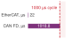{width="100%" fig-alt="Schematic of two bus lines for three drives. On the CAN FD line, six separate violet frames numbered 1, 1, 2, 2, 3, 3 sit apart, a command frame and a feedback frame per drive. On the EtherCAT line, one much shorter violet frame is divided into three slots numbered 1, 2, 3. Widths are schematic, not to scale."}

*CAN FD arbitrates a separate frame per message; EtherCAT carries every drive in one frame.*
:::

For an integrated mobile manipulator, the core architectural question is whether cyclic actuator commands and feedback fit within the allocated bus period while preserving sufficient margin for MCU control loop execution and motor drive processing. High-bandwidth perception streams (such as camera and LiDAR data) and asynchronous supervisory middleware require separate networks or prioritized channels to prevent unmodeled queuing delays from invading the motor command path. Industrial controllers build that separation into the hardware (@fig-industrial-ethercat-controller), with ports that serve only the deterministic drive network and local I/O attached through terminals on the controller itself rather than through host software. The running machine does not use this controller; the photograph shows the pattern its own permission path follows.

::: {#fig-industrial-ethercat-controller fig-env="figure" fig-pos="t" fig-cap="**Real-time distributed controller with modular I/O**: Dedicated embedded real-time controller and adjacent hardware I/O modules. The unit acts as a deterministic bus coordinator, synchronizing distributed sensor acquisition and motor drive terminals via hardware-scheduled Ethernet telegrams. (Photo: Oleg Yunakov, [Wikimedia Commons](https://commons.wikimedia.org/wiki/File:Beckhoff_IoT_controller_CX5120.jpg), CC BY-SA 4.0)." fig-alt="Photograph of an embedded real-time controller with Ethernet ports and modular I/O terminals."}
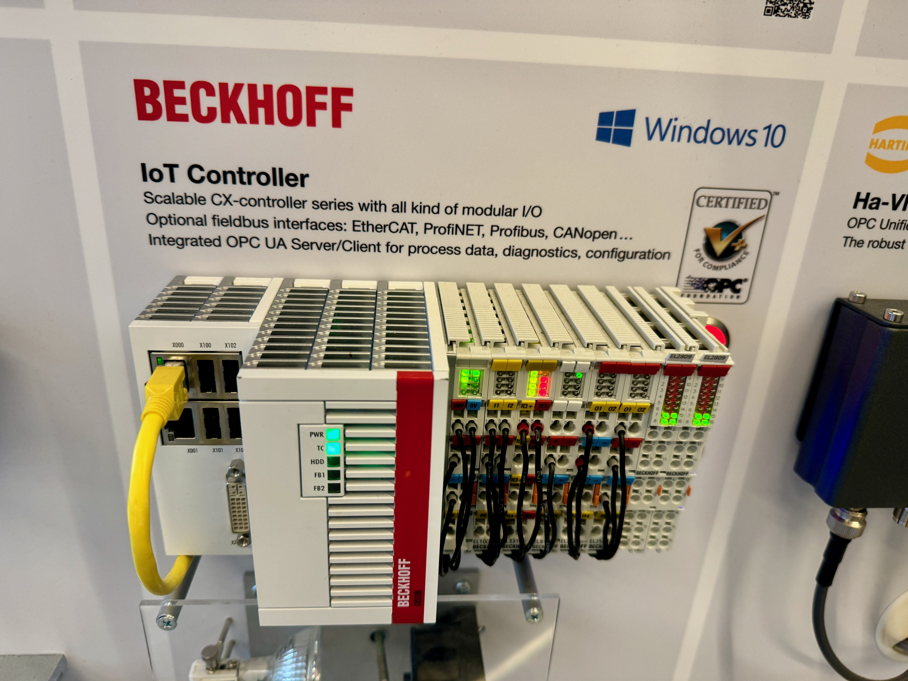{width="85%"}
:::

Clock synchronization aligns the sampling and actuation instants across distributed drives;[^fn-hw-ethercat-dc] however, phase alignment reveals nothing about the transport latency required for a newly computed setpoint to traverse the physical bus. Even if every drive clock fires simultaneously, the actuators will merely execute stale commands if transit delays stall delivery. A sound design therefore requires independent bounds for both command transport latency and multi-axis synchronization jitter, starting with whether the serialized frames fit inside the cycle at all.

[^fn-hw-ethercat-dc]: **Distributed Clock**\index{Distributed clock}: EtherCAT Distributed Clocks (DC) synchronize distributed drive nodes to a reference clock by measuring propagation delays around the ring. Receive-time latches at each node let the coordinator discipline every node's timer, so the hardware `SYNC0` events that start the drives' update cycles occur in close alignment. Clock alignment alone does not bound the complete control cycle, which must also account for controller response time and PWM gate update latency.

### Comparing bus occupancy on CAN FD and EtherCAT {#sec-nervous-schedulability-analysis}

Wiring all nine servo axes of the mobile manipulator onto a single shared CAN FD bus without pricing arbitration headers and worst-case bit stuffing pushes the command and feedback frames alone past the 1 ms bus cycle before any controller delay or bus contention is counted. To keep each link within its cycle budget, communication links on the mobile manipulator separate into three tiers by rate and scope:

1. **Board-Level Peripheral Interconnects (SPI, Memory-Mapped I/O):** Synchronous SPI links and memory-mapped register transfers link local microcontrollers directly to joint position encoders, current-shunt analog-to-digital converters (ADCs), and inverter gate drivers with sub-microsecond latency ($< 1\,\MicroUnitPrefix\text{s}$) along rigid, hardware-timed schedules.
2. **Deterministic Drive Command Buses (EtherCAT, TSN Ethernet):** Deterministic industrial networks transport cyclic joint position setpoints and motor feedback across all distributed drive inverters within an allocated `{python} TickDelayBudget.t_bus_str` bus cycle ($\CommandTransportTime$), maintaining sub-microsecond synchronization jitter ($\TimingJitter < 100\text{ ns}$).
3. **Chassis and Auxiliary Diagnostic Buses (CAN FD):** Priority-arbitrated buses service lower-rate peripherals, such as battery management systems (BMS), thermal monitors, and chassis diagnostics, where arbitration delays remain acceptable under verified worst-case utilization bounds.

None of these bounds belongs to a protocol acronym alone. Each guarantee depends on the physical network topology, transceiver hardware, payload geometries, and cyclic schedules. The first check is whether every servo axis can exchange its command and feedback payloads within the permission path's allocated bus cycle budget.

```{python}
#| label: calc-nervous-fieldbus-schedulability
#| echo: false
#| warning: false
#| message: false
# ┌─────────────────────────────────────────────────────────────────────────────
# │ FIELDBUS SERIALIZATION OCCUPANCY: CAN FD VS. ETHERCAT (LEGO)
# ├─────────────────────────────────────────────────────────────────────────────
# │ Context: @nbk-nervous-fieldbus-serialization-latency-wcet-schedulability,
# │          @fig-04-fieldbus-evolution, and the margin figure.
# │ Goal:    Quantify bus occupancy for the running machine's servo axes with
# │          command AND feedback frames; full response time needs more terms.
# │ Show:    CAN FD frame (8 B, worst-case stuffing) 56.6 us = 34 bits at
# │          1 Mbps + 113 bits at 5 Mbps; one bus, 18 frames = 1018.8 us > 1 ms;
# │          one bus per limb: arm 14 frames = 792.4 us, base 4 frames =
# │          226.4 us; EtherCAT one frame (16 B/axis) + 9 hops = 22.0 us.
# │ How:     calc_canfd_bus_utilization (ISO 11898-1:2015 frame bits) and
# │          calc_ethercat_cycle_time; axis counts and cycle from RM; PDO
# │          sizes and bit rates are scenario inputs.
# └─────────────────────────────────────────────────────────────────────────────
from mlsysim import *
from mlsysim.core.units import *
from mlsysim.fmt import fmt, fmt_latency, fmt_percent, fmt_int, fmt_display_math, check

RM = Embodied.MobileManipulator.WarehouseMobileManipulator

class FieldbusSchedulability:
    """Scenario serialization and forwarding occupancy, not end-to-end schedulability."""

    # ┌── 1. LOAD (Constants & Parameters) ─────────────────────────────────
    num_axes = RM.servo_axes  # category: chosen (arm joints + drive wheels)
    arm_axes = RM.arm.dofs  # category: datasheet
    cycle_time = RM.fieldbus_cycle  # category: illustrative (EtherCAT cycle, T_bus)

    # Frame parameters below are scenario assumptions (chosen for this comparison)
    pdo_bytes = 8  # category: chosen (position-mode record: 32-bit position + two 16-bit words, each direction)
    frames_per_axis = 2  # category: chosen (one command frame and one feedback frame per axis per cycle)
    canfd_baud_arb = 1.0 * (megabit / second)  # category: chosen (nominal rate)
    canfd_baud_data = 5.0 * (megabit / second)  # category: chosen (data-phase rate)
    ethercat_baud = 100.0 * (megabit / second)  # category: datasheet (100BASE-TX link rate)
    ethercat_header = 64  # category: illustrative
    ethercat_hop = 0.6 * microsecond  # category: illustrative

    # ┌── 2. EXECUTE (Compute) ─────────────────────────────────────────────
    drive_axes = num_axes - arm_axes
    canfd_kw = dict(
        payload_bytes=pdo_bytes,
        baud_arbitration=canfd_baud_arb,
        baud_data=canfd_baud_data,
        cycle_time=cycle_time,
        frames_per_axis=frames_per_axis,
    )
    one_bus = calc_canfd_bus_utilization(num_axes=num_axes, **canfd_kw)
    arm_bus = calc_canfd_bus_utilization(num_axes=arm_axes, **canfd_kw)
    base_bus = calc_canfd_bus_utilization(num_axes=drive_axes, **canfd_kw)
    ethercat = calc_ethercat_cycle_time(
        num_axes=num_axes,
        bytes_per_axis=frames_per_axis * pdo_bytes,  # command and feedback share one frame
        baud_rate=ethercat_baud,
        header_bytes=ethercat_header,
        hop_delay=ethercat_hop,
        cycle_time=cycle_time,
    )

    t_frame = one_bus["t_tx"]
    t_nom = one_bus["t_nominal"]
    t_dat = one_bus["t_data"]
    bits_nom = one_bus["bits_nominal"]
    bits_dat = one_bus["bits_data"]
    stuff_bits = one_bus["stuff_bits_nominal"] + one_bus["stuff_bits_data"]
    n_frames = one_bus["n_frames"]
    t_total_one = one_bus["t_total_tx"]
    rho_one = one_bus["utilization"]
    n_frames_arm = arm_bus["n_frames"]
    t_total_arm = arm_bus["t_total_tx"]
    rho_arm = arm_bus["utilization"]
    t_left_arm = (cycle_time - t_total_arm).to(microsecond)
    n_frames_base = base_bus["n_frames"]
    t_total_base = base_bus["t_total_tx"]
    rho_base = base_bus["utilization"]

    t_frame_ethercat = ethercat["t_tx"]
    t_hop_ethercat = ethercat["t_forward"]
    t_total_ethercat = ethercat["t_cycle_total"]
    t_margin_ethercat = ethercat["t_margin"]
    rho_ethercat = ethercat["utilization"]

    # ┌── 3. GUARD (Invariants) ───────────────────────────────────────────
    # 2026-09-28 (M1): command AND feedback frames, CRC and stuffing in the data
    # phase, 8-byte records; replaces the 9-frame, 64-byte, CRC-at-nominal model.
    check(num_axes == 9 and arm_axes == 7 and drive_axes == 2, f"Axis split drifted: {num_axes} = {arm_axes} + {drive_axes}")
    check(abs(cycle_time.to(millisecond).magnitude - 1.0) < 1e-9, f"Bus cycle drifted: {cycle_time}")
    check(bits_nom == 34 and bits_dat == 113, f"CAN FD frame bits drifted: {bits_nom} + {bits_dat}")
    check(abs(t_frame.to(microsecond).magnitude - 56.6) < 1e-6, f"Unexpected CAN FD frame time: {t_frame}")
    check(abs(t_total_one.to(microsecond).magnitude - 1018.8) < 1e-6, f"Unexpected single-bus total: {t_total_one}")
    check(rho_one > 1.0, "One CAN FD bus for nine axes must overrun the 1 ms cycle")
    check(abs(t_total_arm.to(microsecond).magnitude - 792.4) < 1e-6, f"Unexpected arm-bus total: {t_total_arm}")
    check(abs(t_total_base.to(microsecond).magnitude - 226.4) < 1e-6, f"Unexpected base-bus total: {t_total_base}")
    check(rho_arm < 1.0 and rho_base < 1.0, "Per-limb buses must pass the serialization check")
    check(abs(t_total_ethercat.to(microsecond).magnitude - 22.04) < 1e-6, f"Unexpected EtherCAT total: {t_total_ethercat}")
    check(abs(t_margin_ethercat.to(microsecond).magnitude - 977.96) < 1e-6, f"Unexpected unallocated bus time: {t_margin_ethercat}")
    check(rho_ethercat < 0.05, "EtherCAT utilization must be under 5%")

    # ┌── 4. OUTPUT (Format & Export) ────────────────────────────────────────
    num_axes_str = fmt_int(num_axes)
    arm_axes_str = fmt_int(arm_axes)
    drive_axes_str = fmt_int(drive_axes)
    cycle_time_str = fmt_latency(cycle_time, unit=millisecond, precision=0)
    pdo_bytes_str = fmt_int(pdo_bytes)

    bits_nom_str = fmt_int(bits_nom)
    bits_dat_str = fmt_int(bits_dat)
    stuff_bits_str = fmt_int(stuff_bits)
    t_frame_str = fmt_latency(t_frame, unit=microsecond, precision=1)
    n_frames_str = fmt_int(n_frames)
    t_total_one_str = fmt_latency(t_total_one, unit=microsecond, precision=1)
    rho_one_pct_str = fmt_percent(rho_one, precision=1, style="prose")
    n_frames_arm_str = fmt_int(n_frames_arm)
    t_total_arm_str = fmt_latency(t_total_arm, unit=microsecond, precision=1)
    rho_arm_pct_str = fmt_percent(rho_arm, precision=1, style="prose")
    t_left_arm_str = fmt_latency(t_left_arm, unit=microsecond, precision=1)
    n_frames_base_str = fmt_int(n_frames_base)
    t_total_base_str = fmt_latency(t_total_base, unit=microsecond, precision=1)

    t_total_ethercat_str = fmt_latency(t_total_ethercat, unit=microsecond, precision=1)
    t_margin_ethercat_str = fmt_latency(t_margin_ethercat, unit=microsecond, precision=1)
    rho_ethercat_pct_str = fmt_percent(rho_ethercat, precision=1, style="prose")
    ethercat_hop_str = fmt_latency(ethercat_hop, unit=microsecond, precision=1)
    ethercat_header_str = fmt_int(ethercat_header)

    _us1 = lambda q: fmt(q, unit=microsecond, precision=1, commas=False)
    canfd_frame_math = fmt_display_math(
        rf"t_{{\text{{frame}}}} = \frac{{{bits_nom}\ \text{{bits}}}}{{{fmt(canfd_baud_arb, unit=megabit / second, precision=0)}\ \text{{Mbps}}}} + \frac{{{bits_dat}\ \text{{bits}}}}{{{fmt(canfd_baud_data, unit=megabit / second, precision=0)}\ \text{{Mbps}}}} = {fmt(t_nom, unit=microsecond, precision=0)} + {_us1(t_dat)} = {_us1(t_frame)}\ \mu\text{{s}}"
    )
    canfd_bus_math = fmt_display_math(
        rf"{n_frames} \times {_us1(t_frame)} = {_us1(t_total_one)}\ \mu\text{{s}} > {fmt(cycle_time, unit=microsecond, precision=0, commas=False)}\ \mu\text{{s}}, \qquad {n_frames_arm} \times {_us1(t_frame)} = {_us1(t_total_arm)}\ \mu\text{{s}}"
    )
    ethercat_math = fmt_display_math(
        rf"\frac{{({ethercat_header} + {num_axes} \times {frames_per_axis * pdo_bytes})\ \text{{B}} \times 8}}{{{fmt(ethercat_baud, unit=megabit / second, precision=0)}\ \text{{Mbps}}}} + {num_axes} \times {_us1(ethercat_hop)}\ \mu\text{{s}} = {fmt(t_frame_ethercat, unit=microsecond, precision=2)} + {_us1(t_hop_ethercat)} = {fmt(t_total_ethercat, unit=microsecond, precision=2)}\ \mu\text{{s}}"
    )
```

::: {#nbk-nervous-fieldbus-serialization-latency-wcet-schedulability .callout-notebook title="Fieldbus serialization before schedulability"}

**Problem**: The mobile manipulator's permission path exchanges position setpoints and feedback with its servo axes once per bus cycle. How much of that cycle do CAN FD frames, or one EtherCAT frame, occupy before controller and device delays are counted, and which buses pass this necessary check?

**Variables**:

* `{python} FieldbusSchedulability.num_axes_str` servo axes, `{python} FieldbusSchedulability.arm_axes_str` arm joints and `{python} FieldbusSchedulability.drive_axes_str` drive wheels (datasheet), exchanged every `{python} FieldbusSchedulability.cycle_time_str` bus cycle (illustrative).
* An `{python} FieldbusSchedulability.pdo_bytes_str`-byte record per axis in each direction, a 32-bit position and two 16-bit words (chosen).
* CAN FD at $1\text{ Mbps}$ nominal and $5\text{ Mbps}$ in the data phase (chosen). A CAN frame carries one message, so each axis needs a command frame and a feedback frame. The arbitration field and the trailer run at the nominal rate, `{python} FieldbusSchedulability.bits_nom_str` bits; the data-length code, payload, stuff count, and 17-bit CRC run at the data rate, `{python} FieldbusSchedulability.bits_dat_str` bits [@iso11898-1-2015; @bosch2012canfd]. Both counts include the worst-case `{python} FieldbusSchedulability.stuff_bits_str` dynamic stuff bits, because a bound must assume the bit pattern that lengthens the frame most.
* EtherCAT at $100\text{ Mbps}$ (datasheet), one frame carrying every axis's command and feedback with a `{python} FieldbusSchedulability.ethercat_header_str`-byte header, and a forwarding delay of `{python} FieldbusSchedulability.ethercat_hop_str` per node, the shift-register pass-through of a slave controller that never buffers the frame (both illustrative).

**Math**: One CAN FD frame, then all frames on one bus and on an arm bus:
`{python} FieldbusSchedulability.canfd_frame_math`
`{python} FieldbusSchedulability.canfd_bus_math`
The base's `{python} FieldbusSchedulability.n_frames_base_str` frames take `{python} FieldbusSchedulability.t_total_base_str`. For EtherCAT, serialization plus forwarding:
`{python} FieldbusSchedulability.ethercat_math`

**Result**: One CAN FD bus fills `{python} FieldbusSchedulability.rho_one_pct_str` of the cycle on serialization alone. A bus per limb passes, the arm bus at `{python} FieldbusSchedulability.rho_arm_pct_str` with `{python} FieldbusSchedulability.t_left_arm_str` left for blocking, competing frames, and retransmissions. EtherCAT occupies `{python} FieldbusSchedulability.rho_ethercat_pct_str` and leaves `{python} FieldbusSchedulability.t_margin_ethercat_str` unallocated by this calculation.

**Systems insight**: CAN FD's accelerated data phase cannot salvage a single shared bus topology. Every transmitted frame still incurs arbitration and trailer bit times at the lower nominal rate, and CAN requires distinct command and feedback frames for each joint axis. EtherCAT, in contrast, aggregates all axes into a single circulating telegram processed on the fly. Neither occupancy figure represents an end-to-end response bound: a rigorous CAN FD analysis must incorporate message arbitration, non-preemptive blocking, and retransmissions, whereas an EtherCAT budget must include coordinator cycle jitter, slave hardware propagation, and drive firmware latencies. Any unmodeled delay that creeps into the physical command path consumes stopping clearance at a rate of $\SpeedAtDetection\,\UnmodeledCommandPathDelay$.

:::

### Bandwidth, response time, and multi-axis synchronization jitter {#sec-nervous-synchronization-frontier}

A network link with plenty of raw bandwidth can still deliver a joint setpoint late if frames queue behind camera traffic, and a bus that delivers setpoints quickly on average can still twist a coordinated multi-joint motion if the drives apply their updates at slightly different instants. Analyzing serialization occupancy separates three metrics that industrial datasheets often conflate: raw bandwidth, command response time, and multi-axis synchronization jitter. Bandwidth governs the total payload volume the link can carry per unit time; command response time measures the complete latency, including queueing, arbitration, transmission, and drive input decoding, before an actuator applies a setpoint; and synchronization jitter bounds the time spread across multi-axis updates. A network design can improve any one of these metrics while leaving the others unconstrained.

Set against the cycle, the notebook's occupancies separate into one failure and three passes (@fig-04-fieldbus-evolution). Only the single shared CAN FD bus fails, needing `{python} FieldbusSchedulability.t_total_one_str` before any contention or retransmission is counted; the per-limb buses (`{python} FieldbusSchedulability.t_total_arm_str` for the arm) and EtherCAT (`{python} FieldbusSchedulability.t_total_ethercat_str`) leave room for controller execution and clock synchronization. Staying within the cycle budget provides neither a synchronization-jitter bound nor a complete response bound. A defensible CAN FD analysis requires upper bounds on asynchronous message interference and non-preemptive blocking; an EtherCAT path demands explicit master cycle jitter, slave hardware propagation, and drive firmware latencies; a TSN schedule requires reserved transmission windows and bounded clock-synchronization errors.[^fn-net-tsn-fieldbus] These factors represent essential inputs to the response-time equation, not inherent guarantees achieved simply by selecting a protocol standard.

Actuator commands also demand strict temporal freshness. Even when delivered comfortably within a deterministic transport window, a setpoint computed from stale perception is functionally hazardous. The evidence timestamp and lease expiry embedded in the command proposal remain vital safeguards even over nanosecond-synchronized fieldbuses. The transport budget must reserve adequate headroom for physical actuation to execute, and the real-time permission path must reject any setpoint whose authoritative validity window has expired.

[^fn-net-tsn-fieldbus]: **Time-Sensitive Networking**\index{Time-sensitive networking}: IEEE 802.1Qbv Time-Sensitive Networking provides bounded Ethernet delivery by configuring time-aware traffic shapers across network switches. High-priority control frames travel inside dedicated, pre-scheduled transmission windows, while asynchronous high-bandwidth traffic (such as uncompressed camera streams) is held back at the switch gates. This scheduled time-division multiplexing lets camera streams and microsecond servo commands share a physical link without packet collisions or switch-queue buildup.

::: {#fig-04-fieldbus-evolution fig-env="figure" fig-pos="htb" fig-cap="**Scenario bus occupancy before response qualification**: Modeled serialization and forwarding terms for the configured servo-axis example, command and feedback included, compared with the allocated bus cycle. One CAN FD bus for all axes exceeds the allocation before other delays are counted. A CAN FD bus per limb and EtherCAT leave unallocated time, but controller response, competing traffic, device delays, and fault allowances still need qualification. These calculated values are not measured end-to-end response or synchronization bounds." fig-alt="Horizontal bars compare modeled occupancy for one CAN FD bus carrying all axes, a CAN FD bus for the arm, a CAN FD bus for the base, and EtherCAT. The single CAN FD bus exceeds the vertical line marking the allocated bus cycle; the other bars remain below it."}

```{python}
#| label: plot-04-fieldbus-evolution
#| echo: false
#| warning: false
#| message: false
# ┌─────────────────────────────────────────────────────────────────────────────
# │ CONFIGURED FIELDBUS OCCUPANCY AGAINST THE ALLOCATED CYCLE
# ├─────────────────────────────────────────────────────────────────────────────
# │ Context: @fig-04-fieldbus-evolution, after the serialization notebook.
# │ Goal:    Separate a necessary occupancy check from response qualification.
# │ Show:    Three scenario occupancies and the allocated bus-cycle limit.
# │ How:     Reuse the guarded FieldbusSchedulability results above.
# └─────────────────────────────────────────────────────────────────────────────
import matplotlib.pyplot as plt
from mlsysim import viz

viz.set_book_style()
fig, ax = plt.subplots(figsize=(6.2, 3.8))
occupancy_us = [
    FieldbusSchedulability.t_total_one.to(microsecond).magnitude,
    FieldbusSchedulability.t_total_arm.to(microsecond).magnitude,
    FieldbusSchedulability.t_total_base.to(microsecond).magnitude,
    FieldbusSchedulability.t_total_ethercat.to(microsecond).magnitude,
]
labels = [
    f"CAN FD, one bus: {FieldbusSchedulability.n_frames_str} frames",
    f"CAN FD, arm bus: {FieldbusSchedulability.n_frames_arm_str} frames",
    f"CAN FD, base bus: {FieldbusSchedulability.n_frames_base_str} frames",
    "EtherCAT: one frame + hops",
]
formatted = [
    FieldbusSchedulability.t_total_one_str,
    FieldbusSchedulability.t_total_arm_str,
    FieldbusSchedulability.t_total_base_str,
    FieldbusSchedulability.t_total_ethercat_str,
]
cycle_us = FieldbusSchedulability.cycle_time.to(microsecond).magnitude
bars = ax.barh(labels, occupancy_us, color=viz.COLORS["VioletL"], edgecolor=viz.COLORS["VioletLine"], height=0.5)
bars[0].set_hatch("///")
ax.invert_yaxis()
for bar, label in zip(bars, formatted):
    ax.text(bar.get_width() + cycle_us * 0.02, bar.get_y() + bar.get_height() / 2, label, va="center")
ax.axvline(cycle_us, color=viz.COLORS["RedLine"], linestyle="--", label=f"Allocated cycle: {FieldbusSchedulability.cycle_time_str}")
ax.set_xlim(0, max(occupancy_us) * 1.22)
ax.set_xlabel("Modeled serialization and forwarding occupancy (µs)")
ax.grid(axis="y", visible=False)
ax.set_axisbelow(True)
ax.spines[["top", "right"]].set_visible(False)
ax.legend(loc="lower center", frameon=False)
fig.tight_layout()
plt.show()
```

:::

```{python}
#| label: calc-nervous-checkpoint-estimates
#| echo: false
#| warning: false
#| message: false
# ┌─────────────────────────────────────────────────────────────────────────────
# │ CHECKPOINT ESTIMATE GIVENS (LEGO)
# ├─────────────────────────────────────────────────────────────────────────────
# │ Context: @chk-nervous-response-bounds and @chk-nervous-hardware-invariants.
# │ Goal:    Print the givens of the checkpoints' estimate items and guard the
# │          verdict each item expects, without printing the answer.
# │ Show:    blocking 50 -> 120 us (tick misses 400 us by 10 us); 56.6 us
# │          frames, two per axis (8 axes per 1 ms bus); lease 60 -> 100 ms
# │          (60 mm at 1.5 m/s).
# │ How:     Reuses TickResponseBudget, FieldbusSchedulability, and
# │          MachineLeaseBudget; the two changed values are checkpoint givens.
# └─────────────────────────────────────────────────────────────────────────────
from mlsysim import *
from mlsysim.core.units import *
from mlsysim.fmt import fmt_latency, fmt_velocity, check

class CheckpointEstimates:
    """Givens for the checkpoint estimate items, with guards on their verdicts."""

    # ┌── 1. LOAD (Constants & Parameters) ─────────────────────────────────
    t_block_new = 120 * microsecond  # category: illustrative (checkpoint given: a longer tick-masking section)
    t_lease_new = 100 * millisecond  # category: illustrative (checkpoint given: a lengthened lease)
    t_block = TickResponseBudget.t_block  # category: illustrative
    t_wcet = TickResponseBudget.t_wcet  # category: chosen
    t_interf = TickResponseBudget.t_interf  # category: illustrative
    t_deadline = TickResponseBudget.t_deadline  # category: chosen
    t_frame = FieldbusSchedulability.t_frame  # category: derived
    cycle = FieldbusSchedulability.cycle_time  # category: illustrative
    t_lease = MachineLeaseBudget.t_lease  # category: chosen
    v = MachineLeaseBudget.v  # category: illustrative

    # ┌── 2. EXECUTE (Compute) ─────────────────────────────────────────────
    t_resp_new = (t_wcet + t_block_new + t_interf).to(microsecond)
    axes_per_bus = int((cycle / (2 * t_frame)).to("dimensionless").magnitude)
    d_extra = (v * (t_lease_new - t_lease)).to(millimeter)

    # ┌── 3. GUARD (Invariants) ───────────────────────────────────────────
    check(t_resp_new > t_deadline, "Checkpoint: the longer blocking section must break the deadline.")
    check(abs((t_resp_new - t_deadline).to(microsecond).magnitude - 10.0) < 1e-9, f"Checkpoint deadline miss drifted: {t_resp_new}")
    check(axes_per_bus == 8, f"Checkpoint: axes per CAN FD bus drifted: {axes_per_bus}")
    check(abs(d_extra.magnitude - 60.0) < 1e-9, f"Checkpoint lease cost drifted: {d_extra}")

    # ┌── 4. OUTPUT (Format & Export) ────────────────────────────────────────
    t_block_str = fmt_latency(t_block, unit=microsecond, precision=0)
    t_block_new_str = fmt_latency(t_block_new, unit=microsecond, precision=0)
    t_deadline_str = fmt_latency(t_deadline.to(microsecond), unit=microsecond, precision=0)
    t_frame_str = fmt_latency(t_frame, unit=microsecond, precision=1)
    cycle_str = fmt_latency(cycle, unit=millisecond, precision=0)
    t_lease_str = fmt_latency(t_lease, unit=millisecond, precision=0)
    t_lease_new_str = fmt_latency(t_lease_new, unit=millisecond, precision=0)
    v_str = fmt_velocity(v, unit=meter / second, precision=1)
```

::: {#chk-nervous-response-bounds .callout-checkpoint title="Response bounds and command transport"}

The lease budget counts the permission tick and the bus cycle as bounded terms. These items test whether you can supply the bounds it assumes.

- [ ] **Percentile vs. bound**: Can you explain why a measured $\text{p99}$ response time, however long the test that produced it, may enter the handoff record only as a measured distribution and never as a proven bound?
- [ ] **Response-time estimate**: If the longest tick-masking section in the link driver grew from `{python} CheckpointEstimates.t_block_str` to `{python} CheckpointEstimates.t_block_new_str`, with the tick's WCET and interference unchanged, would the tick still meet its `{python} CheckpointEstimates.t_deadline_str` deadline, and by how much would it pass or miss?
- [ ] **Bus occupancy estimate**: With one command frame and one feedback frame per axis at `{python} CheckpointEstimates.t_frame_str` each, how many axes can one CAN FD bus serve within a `{python} CheckpointEstimates.cycle_str` cycle before any blocking is counted?
- [ ] **Synchronization vs. latency**: Can you explain why tightly synchronized drive clocks do not bound how long a newly issued command takes to reach the drives?

:::

A fieldbus path qualified under declared traffic and fault conditions bounds command delivery within its allocated cycle, but on-time delivery says nothing about whether the command should have been sent. That depends on which node may issue setpoints at all, and on whether each setpoint is checked against the machine's physical limits before it leaves.

## Actuation Authority {#sec-nervous-actuation-authority}

A shared mailbox cannot protect a mobile manipulator if the host processor retains a diagnostic route, an auxiliary bus master, or a JTAG debug port that writes directly to a drive. The silicon partition established in @sec-nervous-silicon-partitioning therefore requires exclusive physical control over every electrical path capable of energizing the motor windings. Actuation authority is this exclusive physical ability to modify drive states, encompassing PWM configuration registers, current references, gate-driver outputs, and bridge-enable lines. Under this architecture, the host publishes candidate proposals $\CandidateProposal_t$ and the safety microcontroller's permission path alone turns them into admitted commands $\AdmittedCommand_t$. The difference between holding that authority and merely appearing to is a question of wiring (@fig-04-privilege-enforcer-registers). When the permission path is the sole writer of the drive registers and can trip a drive inhibit, every motion passes its checks; when the host can also write those registers, one unchecked write reaches the motors and proposer and drives share a single failure domain.

::: {#fig-04-privilege-enforcer-registers fig-env="figure" fig-pos="t" fig-cap="**Hardware proposal boundary**: (a) The application processor proposes across a black-channel board link into the safety microcontroller's own double buffer; the permission path on that microcontroller is the sole writer of the drive registers and can trip a drive inhibit. (b) When the application processor can write the drive registers directly, an unchecked write reaches the motors, and proposer and drives share a single failure domain." fig-alt="Two panels. (a) Separate permission path: a dashed bronze application processor box, learned proposers with no drive access, sends proposal p t through a dashed black-channel board link with CRC and sequence into a safety MCU container, which has its own memory and is the sole writer of drive registers. Inside it, an MCU-local double buffer feeds the permission path at a 1 kHz tick, which checks state, freshness, and lease. The permission path sends admitted command u t to drive registers and then drives and motors; a red trip line from the permission path sends drive inhibit to the drives and motors. (b) Collapsed, host writes drives: inside a red dashed box labeled one failure domain, the application processor sends an unchecked register write straight to the drive registers, which feed the drives and motors."}
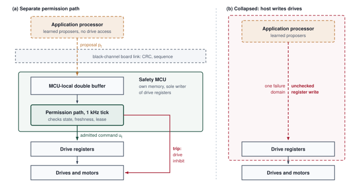{width="90%"}
:::

::: {.column-margin .margin-pointer}
↪ How exclusive authority over each actuator channel passes between the learned policy, an operator, and the fallback is developed in @sec-intervention-discrete-states.
:::

The microcontroller continuously evaluates physical safety invariants: verifying that commanded joint positions lie within certified reach envelopes, that joint velocities stay within qualified limits, and that projected decelerations remain safely within dynamic stopping clearance ($\StoppingDistance \le \ClearDistance$). When a proposal satisfies all invariants, the microcontroller admits the command and interpolates waypoints into cyclic position setpoints for each bus cycle, which the drives track through their internal velocity and current loops. When a candidate proposal violates an invariant or expires, the enforcer refuses it ($\bot$). A refusal does not automatically revoke a previously admitted, actively executing trajectory chunk. Instead, the active chunk continues running as long as its state, sensor evidence, and chunk lease remain valid. When those conditions lapse or fail, the enforcer terminates execution authority and transitions the system into a controlled deceleration or hold. In parallel, a separate hardware trip zone stands ready to cut motor drive torque upon catastrophic electrical faults, though simply de-energizing an inverter does not by itself brake moving mass.[^fn-hw-tripzone-break]

[^fn-hw-tripzone-break]: **Hardware Trip Zone**\index{Hardware trip zone}: Microcontroller hardware trip zones couple analog overcurrent and overvoltage comparators directly to timer output logic. Upon fault detection, configured trip logic may force gate signals high-impedance or activate a validated braking mode. These have different mechanical consequences: torque removal can leave the plant coasting, while dynamic braking requires a rated energy path.

::: {.column-margin .margin-pointer}
↪ The refusal authority and the state invariants it checks are developed in @sec-enforcement-authority-refuse.
:::

At the causal boundary the root cause of an aberrant proposal does not matter. A remote memory exploit in a host operating system daemon, an adversarial optical perturbation that induces a vision model hallucination, and an arithmetic overflow in an acceleration tensor engine can all produce invalid proposals for the same boundary filter to reject. A proposal that passes the physical checks may still pursue the wrong task, so admission does not establish semantic correctness. Because the enforcer evaluates physical invariant bounds against direct sensor feedback from optical encoders and current shunts rather than inspecting internal neural network weights, it requires no internal model of why the proposer failed. Because the host lacks bus-master privileges to actuator registers, a compromised host has no bypass around this check. Complete protection against a rogue host nonetheless requires four physical foundations: independent sensing, an accurate kinematic and dynamic limit model, sufficient actuator capability, and a physically feasible fallback trajectory.

::: {.column-margin .margin-pointer}
↩ The causal boundary, where a command becomes current in a winding and mass begins to move, is established in @sec-boundary-tensors-to-silicon.
:::

Controlled stopping and torque removal impose fundamentally different engineering obligations. Powered braking actively uses the drive inverters to decelerate the plant to zero velocity before disabling torque. Immediate torque removal, by contrast, de-energizes the motor windings instantly, which can leave a wheeled base coasting uncontrollably or allow a vertically loaded manipulator arm to collapse under gravity. Maintaining a held position requires either continuous motor torque or a certified mechanical restraint. At the actuation authority interface, the systems designer must explicitly designate the physical fallback response and reserve both the execution time and thermal energy budget that it demands.

A refusal that leaves no admissible active continuation carries an unavoidable physical cost. When the enforcer rejects an invalid proposal and commands dynamic braking on a fast-moving joint, the physical braking path must supply sufficient torque, clearance, and thermal dissipation capacity to arrest the moving mass. Over an arrest interval spanning several hundred milliseconds, the motor winding resistance, dynamic brake chopper resistor, or friction brake lining must absorb the joint's accumulated kinetic energy within the thermal limits detailed in @sec-body-thermal-duty-cycles. This dissipation must occur without degrading winding insulation or permitting the manipulator to breach its physical clearance boundary.

::: {.column-margin .margin-pointer}
↪ The stopping-distance model this braking path must satisfy is developed in @sec-appendix-systems-stopping.
:::

If the safety microcontroller itself hangs or suffers a clock failure, it cannot execute a software-directed stop. A hardwired, out-of-band interlock must therefore supervise the system and enforce a qualified fallback state. Safe Torque Off (STO) accomplishes this by disabling gate-driver optocouplers or charge pumps through hardware logic, preventing the inverter from generating rotating magnetic fields.[^fn-std-iec61800-sto] STO does not isolate the high-voltage DC bus from the mains, nor does it guarantee that momentum will dissipate within the stopping clearance allocated for powered deceleration. Complete electrical isolation requires an upstream safety contactor, and containing gravitational drop or mechanical drift requires a certified electromechanical brake. A dual-channel interlock circuit, the relay network @fig-real-estop diagrams, decouples torque inhibition entirely from the host software stack; safety qualification must still verify that the system remains resilient against common-cause failures in power rails, clock crystals, and harness wiring.

[^fn-std-iec61800-sto]: **Safe Torque Off (STO)**\index{Safe torque off}: An STO implementation removes torque-producing drive signals through a hardware interlock. An IEC 61800-5-2 integrity rating depends on the actual devices, diagnostic coverage, wiring, and validation, not on the circuit pattern alone [@iec61800part52].

::: {#fig-real-estop fig-env="figure" fig-pos="t" fig-cap="**Illustrative out-of-band interlock and STO path**: Each emergency-stop contact holds its own force-guided relay, and each relay's enable contact holds one of the drive's two STO inputs, so a single welded contact or shorted wire leaves the other channel able to remove torque. The EDM contacts report a relay that failed to release before restart. Removing torque leaves the motor free to coast; the spring-applied brake is a separate circuit that clamps when its supply is removed. The diagram shows a hardware response path, not a certified integrity level or a stopping distance (synthesized from ISO 13849-1 and IEC 61800-5-2)." fig-alt="Two-channel schematic. A red positive-break E-stop is mechanically linked to two normally closed contacts, S1 and S2, each fed from 24 volts. S1 feeds the coil of force-guided relay K1 and S2 the coil of relay K2; each relay has a normally open enable contact and a normally closed EDM contact. K1 sends STO1 enable and K2 sends STO2 enable to two STO terminals on the drive, which feed the gate-drive supply and then the inverter bridge driving motor M. A red tag above the motor reads tau equals 0, and a note below reads may coast. The two EDM contacts are wired in series with a dashed teal line to a reset monitor, restart only if K1 and K2 released. At the bottom, a brake supply on its own circuit, switched by K1 and K2, contacts not drawn, feeds a spring brake that clamps on power loss and acts on the motor shaft. A note reads hardware only, no processor in this path."}
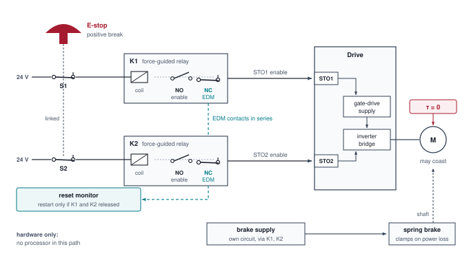{width="100%"}
:::

In @fig-real-estop, dual positive-break E-stop contacts ($\EmergencyStopContact_1$, $\EmergencyStopContact_2$) drive independent force-guided relays ($\ForceGuidedRelay_1$, $\ForceGuidedRelay_2$), routing dual STO enable signals into the motor drive while series-wired normally closed external device monitoring (EDM) contacts prevent system restart if either relay fails to open. At the bottom, a dedicated brake supply drops a spring-applied mechanical brake directly onto the motor shaft upon power loss, enforcing torque removal ($\MotorTorque = 0$) and holding restraint without software or processor intervention. However, engineers must not confuse a static holding brake with a dynamic stopping brake. Under normal operational sequences, the drive decelerates the motor to zero velocity electrically before engaging the spring brake to hold position. Dropping a holding brake onto a spinning shaft during a high-speed emergency stop subjects the brake pads and hub to severe friction heating and mechanical shock, requiring independent thermal rating and stopping-distance validation. The stop-category selections and timing sequences depend directly on these electromechanical limits.

::: {#psp-nervous-hardware-authority .callout-perspective title="Hardware authority invariant"}
If an unverified learned policy has direct memory-mapped write access to actuator gate-driver registers, the machine has no mediated proposal path, and its next out-of-distribution input reaches the motors unchecked.
:::

Write privilege is a physical reality dictated by memory mapping, bus arbitration, and physical trace layout, never a configurable software flag. The host processor holds no write privilege to drive registers. While hardware partitioning determines which processor may issue physical commands to an actuator, the engineer must still decide what physical quantity those admitted commands specify, because each choice leaves a different set of failure modes for the permission path to catch.

### What a proposal may command {#sec-nervous-command-interface}

A digital motor drive accepts setpoints across a nested cascade of control loops: position, velocity, and winding current, with current running innermost at the highest bandwidth. Sending raw current targets directly to the drive bypasses its position and velocity loops and leaves the permission path to predict how gravity, inertia, and external contact will move the joint, whereas sending pure position targets lets the drive bound its own speed and current at the cost of ramping winding current against an unmodeled obstacle until the inverter saturates or the mechanism breaks. The level at which a proposal enters this cascade therefore decides which physical states the drive hardware regulates on its own and which quantities the permission path must verify before admitting the command. Four command interfaces dominate physical AI systems, each placing a different prediction and checking burden on the enforcer.

A *position target* $\JointPositionTarget$ delegates the entire trajectory tracking problem to the drive's internal cascaded loops. Because the drive firmware enforces its own configured speed and current limits, the enforcer's verification burden remains relatively compact: it validates that the target lies within the geometric reach envelope, bounds the discrete step between consecutive targets (which position gains convert directly into velocity and torque demands), and ensures adequate dynamic stopping clearance. However, a pure position target cannot modulate interaction force. When encountering an unmodeled rigid obstacle, a stiff proportional-integral position loop interprets physical contact as a tracking error to be eliminated, ramping winding current until the inverter saturates or the mechanical structure breaks; the impedance-control analysis in @sec-body-transmission-compliance quantified this exact failure mode on a cage-door latch.

A *velocity target* $\JointVelocityTarget$ shifts kinematic integration to the host proposer, bypassing the drive's position loop. Because the proposal omits an explicit geometric endpoint, the enforcer cannot simply validate a target coordinate against static workspace limits. Instead, the enforcer forward-integrates the commanded velocity over the duration of the active chunk lease to predict the joint's worst-case state at lease expiration. It then checks both the reach envelope and the dynamic stopping distance against this forward projection. As with pure position control, contact force remains unregulated, and unmodeled collisions will produce maximum drive torque.

A *torque target* $\JointTorqueTarget$, delivered as a direct current reference, bypasses both outer loops. The drive regulates only electromagnetic winding current. Consequently, all kinematic state evolution, including velocity, position, and braking distance, becomes an emergent consequence of plant dynamics, gravity, and external contact forces rather than an enforced setpoint. The enforcer must bound the resulting state evolution and preserve a feasible fallback, using a plant model or effort-space constraints, while constraining torque slew rates and tracking the cumulative mechanical energy injected into the system. Torque control offers maximum responsiveness for dynamic locomotion and manipulation, but it imposes the heaviest computational burden on the permission path while providing the least explicit intent.

An *impedance target* specifies a virtual equilibrium pose alongside stiffness gains $\PidProportionalGain$ and damping gains $\PidDerivativeGain$, so the actuator behaves as a virtual spring-damper [@hogan1985impedance], the same model introduced in @sec-body-transmission-compliance:
$$\ImpedanceRestoringForce = \PidProportionalGain (\ImpedanceEquilibriumPosition - \ImpedanceControlledPosition) + \PidDerivativeGain (\ImpedanceEquilibriumVelocity - \ImpedanceControlledVelocity)$$
Its dynamic dual, an *admittance target*, measures external contact force via load cells and commands motion in response. Both formulations explicitly regulate the dynamic relationship between motion and force, a coupling that position, velocity, and torque interfaces leave unconstrained. This capability makes impedance and admittance formulations standard in contact-rich manipulation tasks. The enforcer's verification role expands accordingly: it must evaluate both the equilibrium setpoint and the commanded stiffness gains. Under quasi-static contact, the maximum contact force is bounded by the product of the commanded stiffness and the largest displacement the environment can impose. Consequently, a stiffness parameter that exceeds the structural limits of the workpiece or fixture is just as inadmissible as a trajectory crossing a workspace wall. However, steady-state gains do not govern transient impact forces, which depend heavily on approach velocity, rotor inertia, structural compliance, and control-loop latency. @Sec-enforcement-intentional-contact establishes the energy and contact-force barriers needed to bound these transient impact phases.

On the reference mobile manipulator, the enforcer admits position waypoints, interpolating them into fine setpoints for each bus cycle while the motor drives close their own internal velocity and current loops. When the manipulator engages the sprung latch of an equipment cage door, the host switches to an impedance command, introducing stiffness and damping parameters that the real-time tick must validate before transmission. No command interface eliminates the verification burden of the permission path: shifting the command interface inward, from position setpoints toward raw current references, strips away explicit geometric intent and forces the safety layer to predict complex electrodynamic behavior. Write privilege and command filtering protect the physical plant only if the enforcer also maintains physical independence from the host whose proposals it evaluates, because if the safety microcontroller and the host application processor share a power rail, a common system clock, or a unified memory bus, a failure in the host can brown out the microcontroller, corrupt its timing, or deadlock the bus, silencing the safety layer without issuing a single illegal drive command.

## Hardware Isolation and Fault Containment {#sec-nervous-hardware-isolation}

A large current transient during a neural accelerator burst can pull down a shared power rail and brown out or reset the permission processor without warning, while memory bus contention on a shared interconnect can delay safety checks past the hard real-time execution tick. Even when safety enforcement executes on a dedicated processor, physical coupling to the proposal engine can silently undermine software isolation. Containing faults across the two paths therefore requires isolating or bounding shared physical resources across four domains: execution hardware, reference oscillators, power distribution rails, and memory hierarchies.[^fn-std-iso26262-ffi] Where any of those resources remain shared, the architecture must demonstrate that cross-domain interference and declared common-cause faults cannot prevent the permission path from meeting its execution deadline or initiating its qualified fallback.

[^fn-std-iso26262-ffi]: **Freedom from Interference (FFI)**\index{Freedom from interference}: ISO 26262 defines FFI in its vocabulary, Part 1, as the absence of cascading failures between two or more elements that could lead to the violation of a safety requirement [@iso26262]. Part 6 lists the software interference it covers (timing and execution, memory, and exchange of information), whereas shared power, clocks, and heat are common-cause and cascading faults that Part 9 treats in its dependent-failure analysis and that IEC 61508 addresses as independence between elements [@iec61508-2-2010]. A neural policy sharing silicon with the permission path therefore needs both arguments, FFI for its software and a dependent-failure analysis for the resources underneath.

```{python}
#| label: calc-nervous-permission-rail
#| echo: false
#| warning: false
#| message: false
# ┌─────────────────────────────────────────────────────────────────────────────
# │ SHARED DRIVE BUS VS. THE HELD-UP PERMISSION RAIL (LEGO)
# ├─────────────────────────────────────────────────────────────────────────────
# │ Context: @sec-nervous-hardware-isolation, the design-choice paragraph
# │          (the full four-coupling inventory lives in @sec-placement-two-paths-one-die).
# │ Goal:    Name the bus the application processor shares with the drives and
# │          the isolated, held-up rail the permission path runs on instead.
# │ Show:    47.7 V nominal drive bus, 42 V depleted, the application
# │          processor's converter locking out at 33 V, 2 s hold-up.
# │ How:     Registry fields on RM (M6: 48 V drive bus, MiR250-class pack,
# │          MEAN WELL DDR-240C-24 converter). The sustained sag screen is
# │          derived in @sec-body-power-integrity, and the hold-up is sized in
# │          @sec-body-permission-rail-isolation.
# └─────────────────────────────────────────────────────────────────────────────
from mlsysim import *
from mlsysim.core.units import *
from mlsysim.fmt import fmt_voltage, fmt_latency, check

RM = Embodied.MobileManipulator.WarehouseMobileManipulator

class PermissionRail:
    """The permission path's isolated, held-up rail beside the shared drive bus."""

    # ┌── 1. LOAD (Constants & Parameters) ─────────────────────────────────
    v_bus_nom = RM.drive_bus_nominal  # category: datasheet (48 V-class pack, nominal)
    v_bus_low = RM.drive_bus_battery_low  # category: datasheet (pack minimum)
    v_uvlo = RM.drive_bus_uvlo  # category: datasheet (converter input lockout)
    t_holdup = RM.permission_rail_holdup  # category: chosen (permission-rail hold-up)

    # ┌── 2. EXECUTE (Compute) ─────────────────────────────────────────────
    v_headroom_low = (v_bus_low - v_uvlo).to(volt)  # headroom a depleted pack starts with

    # ┌── 3. GUARD (Invariants) ───────────────────────────────────────────
    check(abs(v_bus_nom.to(volt).magnitude - 47.7) < 1e-9, f"Drive bus nominal drifted: {v_bus_nom}")
    check(abs(v_uvlo.to(volt).magnitude - 33.0) < 1e-9, f"Converter lockout drifted: {v_uvlo}")
    check(abs(t_holdup.to(second).magnitude - 2.0) < 1e-9, f"Permission-rail hold-up drifted: {t_holdup}")
    check(abs(v_headroom_low.magnitude - 9.0) < 1e-9, "Even a depleted pack starts 9 V above the converter lockout")

    # ┌── 4. OUTPUT (Format & Export) ────────────────────────────────────────
    v_bus_nom_str = fmt_voltage(v_bus_nom, unit=volt, precision=1)
    v_uvlo_str = fmt_voltage(v_uvlo, unit=volt, precision=0)
    t_holdup_str = fmt_latency(t_holdup, unit=second, precision=0)
```

The running machine's two-processor architecture addresses each of these four fault paths with an explicit hardware design choice. The permission path executes from private memory over a dedicated board-level link, clocks from an independent oscillator, and draws power from the isolated rail specified in @sec-body-permission-rail-isolation rather than from the primary `{python} PermissionRail.v_bus_nom_str` drive bus feeding the application processor. Diode-isolated storage capacitors hold up this safety rail for `{python} PermissionRail.t_holdup_str`. If a transient load fault pulls the drive bus down to the host converter's undervoltage lockout threshold at `{python} PermissionRail.v_uvlo_str`, the safety microcontroller stays powered long enough to capture the undervoltage interrupt, log the event, and command a graceful fallback while the primary host resets, provided that the required detector, actuator power, and braking path survive the fault.

Keeping the logic powered does not guarantee motor torque or braking capability. Bringing a moving machine to a controlled stop requires sufficient DC bus energy, healthy inverter stages, and adequate obstacle clearance. If electrical drive power collapses entirely, the system must execute a qualified unpowered fallback whose mechanical brake engagement delay and subsequent stopping motion fit within the pre-allocated physical envelope. These isolation guarantees are design assertions that must be empirically verified on physical hardware. Every shared dependency must be carried forward into the formal verification handoff record.

::: {.column-margin .margin-pointer}
↪ The four substrate couplings that board layout must sever, and the fault-injection experiments that test their isolation, are developed in @sec-placement-two-paths-one-die.
:::

::: {.column-margin}
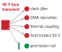{width="100%" fig-alt="Blast-radius sketch: a red square labeled drive bus sag sends arrows to two red dots labeled motor drives and host lockout 33 V. A dashed branch toward a green dot labeled permission rail, 2 s hold-up, ends at a green bar before reaching it."}

*A sag on the shared bus reaches every load; the permission rail rides through on its own.*
:::

Substrate isolation ensures that the permission path stays alive when the host crashes, but the enforcer's downstream action depends entirely on how the proposer failed: through unresponsiveness or through corruption. Unresponsiveness occurs when an inference pipeline deadlocks, thread scheduling misses a deadline, or kernel memory fragmentation stalls process execution, yielding no new trajectory packets. A complete host crash trips the hardware heartbeat timer. Conversely, the host operating system might remain healthy while the user-space neural policy pipeline hangs; in that scenario, the proposer simply stops emitting admissible action chunks, allowing the active chunk's lease or evidence deadline to lapse. These complementary deadlines form the supervisory timing hierarchy established in @sec-nervous-supervisory-timers.

Corruption occurs when the proposer continues running and satisfies its heartbeat deadline, but outputs invalid or hazardous setpoints. Examples include kinematically unreachable joint configurations, step discontinuities in velocity requests, or floating-point NaNs and infinities caused by out-of-distribution visual tokens or matrix overflow. The enforcer handles these two failure profiles through orthogonal mechanisms: unresponsiveness triggers trajectory revocation as soon as the chunk lease or the heartbeat timer expires, whereas corruption prompts an immediate invariant rejection at the boundary filter upon the arrival of the malformed packet. A live heartbeat therefore never extends motion authority; only an admitted chunk renews it, and authority ends when the chunk lease runs out. Whether the chunk policy can renew quickly enough to keep the machine moving, and why the slower intent model supplies goals rather than holding chunk leases itself, is the coupled budget of @sec-nervous-coupled-budget.

When active motion authority lapses without an admissible continuation, the permission path must execute an explicit degradation strategy rather than cutting motor bus power unconditionally. As detailed in @sec-body-unpowered-states, de-energizing an inverter drops the actuators into uncontrolled freewheeling or dynamic short-circuit braking, neither of which produces an orderly, predictable stop. Instead, the safety path evaluates the plant's instantaneous kinematic state and selects the safest feasible deceleration profile. An optional brief continuation along the last validated trajectory is permissible only while its state estimates, sensor evidence validity, chunk lease window, and obstacle clearance margins all remain valid.

Once that lease expires, any separately authorized fallback delay $\FallbackHold$ is absorbed into the total reaction latency $\PrebrakeDelay$ and must fit, together with the evidence age, within the `{python} MachineLeaseBudget.t_ceiling_left_str` left under the pre-brake ceiling once the lease path and brake onset are charged at the drive limit (notebook \ref{nbk-nervous-watchdog-stopping-lease}). If measured latency bounds exceed this headroom, the enforcer must initiate deceleration sooner. Controlled braking uses the available actuator torque characterized in @sec-body-actuator-limits to arrest motion within the remaining clearance. On gravity-loaded manipulators, motion arrest must be backed by engaging rated mechanical holding brakes once the joints reach standstill, preventing gravitational backdriving when drive power is subsequently removed.

After the physical plant comes to a complete halt, the architecture executes a **recovery handshake**\index{Recovery handshake} before restoring autonomous proposal authority. The safety microcontroller asserts a persistent `FAULT_HELD` latch in its exported status register and publishes the plant's confirmed physical rest pose $(\RestConfiguration, \GeneralizedVelocities = \ZeroVector)$. In turn, the application processor must discard all pending action chunks, invalidate internal state tied to the interrupted motion, capture fresh sensor observations tagged with synchronized hardware timestamps, and formulate a newly aligned trajectory proposal.

This recovery sequence must also purge any proposal-side state that assumes the robot executed its planned trajectory to completion. For autoregressive policies and VLA models, this requires flushing token buffers and the key-value (KV) attention cache; retaining pre-fault keys and values would bias future action generation toward a physical trajectory that was interrupted. However, clearing software caches does not by itself establish physical continuity. Before deasserting the `FAULT_HELD` latch and restoring proposal authority, the safety microcontroller inspects the opening waypoint $\ProposalFirstWaypoint$ of the incoming proposal, verifying that it aligns with the robot's measured physical rest pose within a strict spatial bound ($||\ProposalFirstWaypoint - \RestConfiguration|| \le \RecoveryPoseTolerance$).

Architectural independence cannot simply be read off a schematic or block diagram; it must be empirically validated against identified common-cause faults on the physical board. Similarly, the chunk lease that constrains a malfunctioning proposer derives directly from physical dynamics, sized from the stopping margin that remains after detection delays and actuator responses. Together, these defenses bound a proposer that crashes, stalls, or publishes corrupted actions. The separation leaves one question open, whether a neural policy engineered to execute deterministically at the enforcer's own update rate still requires an external runtime monitor.

::: {.column-margin .margin-pointer}
↪ The fault injection that tests this independence on the physical board is developed in @sec-verification-hardware-fault-injection.
:::

## Invariant Checking {#sec-nervous-invariant-checking}

A proposer fast enough to keep pace with the permission tick invites a shortcut. Learned locomotion controllers already emit joint targets within an order of magnitude of a millisecond, and a designer may be tempted to let such a policy write the motor registers directly. Rate does not confer authority. A fast network emitting joint targets or torques carries the same statistical uncertainty as a large model generating waypoints a few times a second, and even when policy and enforcer share one period, the network's output remains a proposal that must pass the proposal boundary before it changes current in a winding. What the permission path can still guarantee when a learned policy commands at control rate, and what it gives up, is examined in @sec-enforcement-thesis-bends.

The interface must reject an inadmissible candidate without waiting for the producer, and recheck the active command against current physical state. Position and velocity limits ($\GeneralizedCoordinates \in [\JointPositionLowerLimit, \JointPositionUpperLimit]$ and $|\GeneralizedVelocities| \le \JointVelocityLimit$) are necessary but do not by themselves establish a feasible stop. A torque-slew constraint, $|\JointTorqueSlew| = |(\JointTorque_k - \JointTorque_{k-1})/\FiniteChange \TimeInstant| \le \JointTorqueSlewLimit$, can limit command changes, but a command that meets the slew limit must still satisfy the other physical limits. Contact may additionally require accounting for exchanged energy, $\int \JointTorque^\top \GeneralizedVelocities\,d\TimeInstant$.

::: {.column-margin .margin-pointer}
↪ The passivity framework that accounts for energy exchanged in contact is developed in @sec-appendix-control-passivity.
:::

Choosing and composing those filters is the work of @sec-enforcement, which constructs the admissibility calculation and selects a feasible continuation, hold, or stop. What the Nervous System fixes is the execution contract those filters must run under, whatever they compute. On the running machine the contract has numbers. The recheck of the active command must finish inside the tick's `{python} TickVocabulary.t_deadline_str` deadline under the response bound of @eq-nervous-response-budget, it must read measured wheel and joint encoder state rather than commanded setpoints (the fallacy of @sec-nervous-fallacies-pitfalls shows what the commanded setpoints miss), and it must leave the safety microcontroller the only writer of the drive registers. Neither fast inference nor a fast rejection routine establishes that contract on its own.

The same reasoning covers the one proposer that is not learned. A remote operator is a third proposer. Its commands pass the same permission path, and network delay spends the same pre-brake budget. Neither speed nor a human origin gives a proposal authority; only passing the permission path's checks does, and each check spends part of a budget that the next section lays out handoff by handoff.

::: {.column-margin .margin-pointer}
↪ How an operator's reaction and link delays are charged against the stopping budget is developed in @sec-intervention-reaction-drift.
:::

::: {#chk-nervous-hardware-invariants .callout-checkpoint title="Hardware isolation and invariant checking"}

Before turning to the handoffs between proposer and actuator, verify your understanding of the exchange, hardware isolation, and pre-actuation invariant defenses:

- [ ] **Nonblocking exchange**: Can you explain how the seqlock reader detects a torn read in one bounded attempt, and why a writer stopped mid-write cannot extend the active spline's state, evidence, or lease validity?
- [ ] **Independence as a hypothesis**: Can you state the independence requirement the permission path must meet, and explain why the two-processor split satisfies it only once loaded tests on the machine's silicon support the claim?
- [ ] **Chunk lease cost**: Can you explain why the chunk lease must be sized from stopping distance and clearance rather than chosen as a software timeout, why a heartbeat never renews it, and how much clear distance lengthening it from `{python} CheckpointEstimates.t_lease_str` to `{python} CheckpointEstimates.t_lease_new_str` would spend at the `{python} CheckpointEstimates.v_str` drive limit?
- [ ] **Command interface**: Can you state what the permission path must check or predict for a position, a velocity, a torque, and an impedance target, and why a velocity target leaves it to predict motion over the whole lease?
- [ ] **Rate matching and authority**: Can you explain why a policy that runs at the plant's own rate still produces only proposals, and what timing, state, and fallback obligations remain?

:::

## The Handoffs Matrix {#sec-nervous-handoffs-matrix}

When a mobile manipulator overruns a stop, the diagnosis begins by locating the fault at one of five canonical handoffs between the photons collected by its cameras and the current delivered to its drives. A cloud service governs its interfaces with statistical service-level objectives (SLOs), such as a $\text{p99}$ request latency; when a tail event violates that target, the runtime absorbs the delay through retries, request rerouting, or graceful degradation. The five handoffs of an embodied machine define **hard cyber-physical service-level objectives** instead. Software cannot recall physical momentum or undo resistive heating in an actuator winding, so no retry mechanism can mask an unbudgeted interface violation.

Upstream, sensing hardware transfers raw transducer signals to perception pipelines. Perception yields intermediate geometric and semantic representations that fuse into an estimated world state. This state feeds the learned policy to produce an action plan, which in turn submits candidate trajectories to the safety enforcer. Finally, the approved command passes from the enforcer to the physical motor drives. Across each boundary, five interface limits govern feasibility: latency ($\Latency$), bandwidth ($\Bandwidth$), energy and heat ($\HeatDissipationPower$), determinism ($\TimingJitter$), and fault domain isolation ($\FaultDomainIsolation$). The five handoffs and five interface limits form a five-by-five matrix mapping every signal path to the physical budgets of the machine. These interface limits are distinct from the body's five mechanical budgets, which enter the matrix primarily through its latency and energy columns. The contract that records these budgets, the handoff record defined below, joins the physical limit records of @sec-body-limit-record-schema to the proposer limits of the Brain, so latency, renewal rate, and evidence age are written in one schema.

::: {.column-margin .margin-pointer}
↩ The body's five mechanical budgets are established in @sec-body-five-budgets.
:::

The allocation in @tbl-04-synthesis-grid illustrates which limits are design-limiting at each handoff, using chosen design budgets rather than empirical measurements. The matrix gathers the physical budgets of the machine's mechanical, cognitive, and sensory systems, together with the sensor capture that the five-level machine model places at the Boundary. In the Boundary row ($\SignalHandoff_1$), where the physical world becomes digital measurement, bandwidth and latency bind first: raw multi-camera pixel streams saturate the serializer-deserializer (SerDes) lanes, and the exposure window imposes a strict floor on image age before serialization even begins. The Brain rows ($\SignalHandoff_2$, $\SignalHandoff_3$) bind first on energy and latency, reflecting the heavy inference costs of the learned proposers. The Body row ($\SignalHandoff_5$) binds first on determinism and heat, because the drives' current loops must hold their timing jitter below $10\,\MicroUnitPrefix\text{s}$, and every ampere delivered dissipates heat across the windings and power inverter stages.

The Nervous System row ($\SignalHandoff_4$) forms the architectural bridge coupling the Brain and the Body. The proposal boundary between the learned planner and the enforcer carries an action proposal ($\CandidateProposal_t$), typically structured as a compact spline parameterization or waypoint chunk. For the compact payload assumed in this grid, the required throughput is modest ($\Bandwidth < 100\text{ kB/s}$), so bandwidth does not bind; instead, latency, determinism ($\TimingJitter$), and fault domain isolation ($\FaultDomainIsolation$) govern the interface. The permission path isolates stochastic model proposals using nonblocking mailboxes and expiring leases. On the mobile manipulator, the latency limit is the chunk lease, which consumes `{python} MachineLeaseBudget.t_lease_str` of the `{python} MachineLeaseBudget.t_ceiling_str` pre-brake ceiling available at the drive limit (@sec-nervous-lease-sizing), while the active command is rechecked within each `{python} MachineLeaseBudget.t_tick_str` permission tick. Full trajectory admission has a separate computation and response budget and must complete before any candidate chunk activates; the tick interval does not imply that arbitrary occupancy queries or whole-trajectory collision checks fit within that brief slice. Fault isolation relies on a private peripheral bus, an independent oscillator, and the isolated, held-up power rail detailed in @sec-nervous-hardware-isolation.

From the causal boundary perspective, any interface failure localizes to the specific handoff and budget it violates. Semantic mistakes or flawed physical assumptions can still escape an otherwise timely interface; the matrix does not substitute for task-level evaluation or hazard analysis. When diagnosing an over-budget stop, trajectory overrun, or subsystem fault, engineers navigate @tbl-04-synthesis-grid through a three-step operational root-cause procedure:

1. *Locate the boundary seam:* Identify which physical handoff ($\SignalHandoff_1\text{--}\SignalHandoff_5$) recorded the initial timing excursion, sequence gap, torn payload, or thermal trip.
2. *Check the binding dimension:* Query the specific physical limit ($\Latency, \Bandwidth, \HeatDissipationPower, \TimingJitter, \FaultDomainIsolation$) designated as *BINDING* for that handoff cell, identifying the primary resource bottleneck governing the interface.
3. *Evaluate like-for-like evidence:* Compare runtime diagnostic traces directly against the recorded bound kind (`requirement`, `proven bound`, or `measured distribution`), verifying whether the failure stemmed from an unmodeled microarchitectural tail event or a direct physical budget violation.

A handoff diagnosis must strictly compare like evidence. For the $\SignalHandoff_2$ state-estimation path, suppose engineers allocate a $30.0\text{ ms}$ latency budget and measure $\text{p99} = 24.5\text{ ms}$ during a baseline hardware-in-the-loop run, yielding a sampled margin of $+5.5\text{ ms}$. Under thermal throttling, a subsequent run measuring $\text{p99} = 85.0\text{ ms}$ reveals a $-55.0\text{ ms}$ deficit against that design budget. The appropriate remedy is to reduce or reallocate computational workload while preserving independent safety enforcement during revalidation. A sampled $\text{p99}$ latency diagnoses a performance regression; it does not constitute a worst-case timing proof.

| Canonical Handoff Boundary                                     | Latency Limit ($\Latency$)                                                                                                                                                                                                                                                                                                                            | Bandwidth Limit ($\Bandwidth$)                                                                                        | Energy & Heat Limit ($\HeatDissipationPower$)                                                                           | Determinism Limit ($\TimingJitter$)                                                                                  | Fault Domain Isolation ($\FaultDomainIsolation$)                                                |
|:---------------------------------------------------------------|:------------------------------------------------------------------------------------------------------------------------------------------------------------------------------------------------------------------------------------------------------------------------------------------------------------------------------------------------------|:----------------------------------------------------------------------------------------------------------------------|:------------------------------------------------------------------------------------------------------------------------|:---------------------------------------------------------------------------------------------------------------------|:------------------------------------------------------------------------------------------------|
| **$\SignalHandoff_1$: Sensing $\to$ Perception** *(Boundary)*  | **BINDING** \newline $\Latency \le 16.7\text{ ms}$, one frame period (sensor age dated at the frame's middle row; the oldest row is older, @sec-perception-observation-contract)                                                                                                                                                                      | **BINDING** \newline $\Bandwidth \ge 1.2\text{ GB/s}$ (multi-camera 4K uncompressed streams)                          | *Non-binding* \newline $\HeatDissipationPower < 3\text{ W}$ (sensor head dissipation isolated)                          | **BINDING** \newline $\TimingJitter \le 1.0\text{ ms}$ (frame-sync triggers prevent skew)                            | *Non-binding* \newline Defended by SerDes hardware & DMA ring buffers                           |
| **$\SignalHandoff_2$: Perception $\to$ State** *(Brain)*       | **BINDING** \newline $\Latency \le 30.0\text{ ms}$ (camera and inertial motion estimate & feature window)                                                                                                                                                                                                                                             | *Non-binding* \newline $\Bandwidth\approx 10\text{--}50\text{ MB/s}$ (compressed image features & 3D occupancy cells) | **BINDING** \newline $\HeatDissipationPower \approx 15\text{--}35\text{ W}$ (edge vision backbone accelerator envelope) | *Non-binding* \newline Defended by sliding-window state estimator buffers                                            | **BINDING** \newline Spatial memory isolation: MPUs prevent memory corruption                   |
| **$\SignalHandoff_3$: State $\to$ Plan** *(Brain)*             | **BINDING** \newline chunk policy `{python} MachineStallTravel.t_chunk_str` p99 inside its `{python} MachineTiers.t_chunk_period_str` renewal period (@sec-brain-two-proposers); autoregressive intent model `{python} MachineStallTravel.t_intent_str` inside its `{python} MachineTiers.t_intent_period_str` period (@sec-brain-cognitive-pipeline) | *Non-binding* \newline $\Bandwidth < 5\text{ MB/s}$ (low-dimensional state & prompt embeddings)                       | **BINDING** \newline $\HeatDissipationPower \approx 30\text{--}75\text{ W}$ (transformer/diffusion matrix accelerators) | *Non-binding* \newline Defended by receding-horizon chunking & spline buffers                                        | **BINDING** \newline Host faults must not halt the independent permission path                  |
| **$\SignalHandoff_4$: Plan $\to$ Enforcer** *(Nervous System)* | **BINDING** \newline chunk lease `{python} MachineLeaseBudget.t_lease_str` (candidate allocation; age at admission from @tbl-04-event-timing); active-command checks within each `{python} MachineLeaseBudget.t_tick_str` tick; full admission budget recorded separately                                                                             | *Non-binding* \newline Defended by compact parameterized splines ($\Bandwidth < 100\text{ kB/s}$)                     | *Non-binding* \newline $\HeatDissipationPower < 0.5\text{ W}$ (fixed-point constraint evaluation on MCU)                | **BINDING** \newline $\TimingJitter \le 100\,\MicroUnitPrefix\text{s}$ (cycle-deterministic packet reception on MCU) | **BINDING** \newline Hardware boundary: private bus, separate oscillator, isolated held-up rail |
| **$\SignalHandoff_5$: Enforcer $\to$ Actuator** *(Body)*       | **BINDING** \newline $\Latency \le$ `{python} TickDelayBudget.t_tick_str` (servo interval `{python} TickDelayBudget.t_bus_str`; current loop `{python} MachineTiers.t_current_str`)                                                                                                                                                                   | *Non-binding* \newline $\Bandwidth\approx 1\text{--}5\text{ Mbps}$ (cyclic packets over deterministic command bus)    | **BINDING** \newline $\WindingCurrent^2 \ElectricalResistance$ copper winding dissipation, MOSFET switching losses      | **BINDING** \newline $\TimingJitter < 10\,\MicroUnitPrefix\text{s}$ (hard real-time PWM phase alignment & FOC)       | **BINDING** \newline Galvanic isolation, out-of-band analog E-stops, STO circuits               |

: **Handoffs-by-limits synthesis grid**: A five-by-five matrix mapping five canonical signal handoffs ($\SignalHandoff_1\text{--}\SignalHandoff_5$) across the Boundary (@sec-boundary-machine-model), Brain (@sec-brain), Body (@sec-body), and Nervous System (@sec-nervous) against five physical limits ($\Latency, \Bandwidth, \HeatDissipationPower, \TimingJitter, \FaultDomainIsolation$). Cells marked *BINDING* are the budgets that drive selection; *Non-binding* means the scenario budget meets that dimension with margin. These illustrative allocations organize the timing and isolation evidence still required; a non-binding cell is not a qualification verdict. {#tbl-04-synthesis-grid tbl-colwidths="[16,16,18,18,16,16]"}

::: {#dfn-nervous-handoff-record .callout-definition title="Handoff record"}

***Handoff record***\index{Handoff record!definition} is the record that states one interface limit at one of the five handoffs between sensing and actuation: its value, the conditions under which it holds, its uncertainty and margin, the detector that catches an excursion, its provenance, and whether the value is a requirement, a proven bound, or a measured distribution.

1.  **Significance**: It is the second record in the record chain, after the limit record of the Body, and the first that ties a timing claim to the interface where the time is spent. On the running machine its $\SignalHandoff_4$ entry is the `{python} MachineLeaseBudget.t_lease_str` chunk lease, recorded as a requirement whose margin depends on the intervals of @tbl-04-event-timing.
2.  **Distinction**: Unlike a limit record, which describes a physical envelope of the plant such as credible deceleration, a handoff record describes an interface between two subsystems and names the clock on which its times are expressed. Unlike a latency in a profiling log, it states its bound kind, so a percentile cannot pass for a worst case.
3.  **Common pitfall**: Recording a bench $\text{p99}$ as a proven bound. The record then carries a number that the permission path trusts in conditions the bench never reached.

:::

Every boundary condition in the grid is recorded this way, so the budgets survive changes of hardware, firmware, and model. Each entry carries the six elements of a limit record and adds the fields that locate the limit at a handoff and state what evidence supports it (@tbl-04-schema-notebook).

| Field Name               | Physical SI Units                                                             | Structural Invariant & Description                                                                                                              |
|:-------------------------|:------------------------------------------------------------------------------|:------------------------------------------------------------------------------------------------------------------------------------------------|
| `signal_id`              | dimensionless                                                                 | Unique alphanumeric identifier (for example, `SIG_VIO_01`, `SIG_TRQ_AX1`).                                                                      |
| `source_subsystem`       | dimensionless                                                                 | Originating hardware or software module (`Camera_SerDes`, `Planner_VLA`).                                                                       |
| `destination_subsystem`  | dimensionless                                                                 | Receiving hardware or software module (`State_Estimator`, `Safety_MCU`).                                                                        |
| `handoff`                | dimensionless                                                                 | The handoff the signal crosses ($\SignalHandoff_1$ to $\SignalHandoff_5$).                                                                      |
| `physical_dimension`     | dimensionless                                                                 | Target limit category ($\Latency$, $\Bandwidth$, $\HeatDissipationPower$, $\TimingJitter$, $\FaultDomainIsolation$).                            |
| `value`                  | SI units ($\text{ms}$, $\text{MB/s}$, $\text{W}$, $\MicroUnitPrefix\text{s}$) | Allocated budget, or the measured distribution it is checked against; for $\SignalHandoff_4$, the chunk lease derived from the stopping budget. |
| `conditions`             | as recorded                                                                   | Payload, temperature, supply voltage, firmware build, and concurrent workload under which the value holds; the value lapses when they change.   |
| `uncertainty`            | same as `value`                                                               | Error bound of the instrument or model that produced the value.                                                                                 |
| `margin`                 | same as `value`                                                               | Engineering margin between the operating target and the breakdown threshold.                                                                    |
| `detector`               | dimensionless                                                                 | Runtime monitor that catches an excursion (for example, a lease timer, a rail-voltage monitor, or a phase-current sensor).                      |
| `provenance`             | dimensionless                                                                 | Source of the value, including its evidence category (measured, derived, datasheet, or illustrative).                                           |
| `bound_kind`             | dimensionless                                                                 | `requirement`, `proven bound`, or `measured distribution`; only a proven bound may stand in for a worst case.                                   |
| `clock_domain`           | dimensionless                                                                 | Clock on which every time-valued field is expressed; a handoff that feeds the permission path uses the safety microcontroller's clock.          |
| `verification_timestamp` | UTC timestamp                                                                 | Date of bench falsification and sign-off; a log field, never an input to an age test.                                                           |

: **Conceptual fields of the handoff record**: The six limit-record elements of @sec-body-limit-record-schema, extended with the handoff, bound kind, and clock domain that locate a limit in the machine and state what evidence supports it. {#tbl-04-schema-notebook tbl-colwidths="[22,24,54]"}

The four timing events of @tbl-04-event-timing sit on this grid's handoffs, capture within $\SignalHandoff_1$, dispatch at $\SignalHandoff_2$, admission at $\SignalHandoff_4$, and brake onset at $\SignalHandoff_5$, so the grid's latency column follows the same single execution path as the timing table, and every time in it is expressed on the safety microcontroller's clock. Together, those rows show that the chunk lease at $\SignalHandoff_4$ cannot be chosen in isolation from the stopping distance below it or the inference renewal rate above it.

### Coupling the distance, lease, and supply budgets {#sec-nervous-coupled-budget}

```{python}
#| label: calc-nervous-coupled-budget
#| echo: false
#| warning: false
#| message: false
# ┌─────────────────────────────────────────────────────────────────────────────
# │ PART I COUPLED BUDGET: DISTANCE -> LEASE -> SUPPLY -> LEASE RULE (LEGO)
# ├─────────────────────────────────────────────────────────────────────────────
# │ Context: @sec-nervous-coupled-budget.
# │ Goal:    Join Ch2's distance terms, this chapter's lease, and Ch3's supply
# │          rates into the lease rule for the running machine.
# │ Show:    ceiling 258.3 ms; running total 835.5 mm; intent sweep 98.0 ms,
# │          intent 2 Hz / 336 ms computed (INT4 sweep 24.5 ms); chunk sweep
# │          1.12 ms, 20 Hz / 40 ms;
# │          50 + 5 = 55 ms < 60 ms lease; upper limit 236.3 ms, 184.7 ms
# │          after the 51.6 ms capture-to-dispatch age, 121.4 ms after the
# │          114.9 ms capture-to-admission age of @tbl-04-event-timing
# │          (@eq-nervous-lease-rule).
# │ How:     ceiling and running total read from MachineLeaseBudget;
# │          calc_action_chunk_streaming_amortization on RM / AISLE; the 5 ms renewal jitter is a scenario assumption.
# └─────────────────────────────────────────────────────────────────────────────
from mlsysim import *
from mlsysim.core.units import *
from mlsysim.fmt import fmt_length, fmt_velocity, fmt_latency, fmt_frequency, check

RM = Embodied.MobileManipulator.WarehouseMobileManipulator
AISLE = Embodied.Scenario.WarehouseAisle

class PartOneCoupledBudget:
    """The chunk lease as the meeting point of Part I's distance, timing, and supply budgets."""

    # ┌── 1. LOAD (Constants & Parameters) ─────────────────────────────────
    v = RM.base.max_velocity  # category: illustrative (drive limit)
    d_clear = AISLE.d_clear  # category: illustrative
    t_lease = AISLE.t_lease  # category: chosen
    t_tick = AISLE.t_tick  # category: chosen
    t_bus = AISLE.t_bus  # category: illustrative
    t_act = AISLE.t_brake_onset  # category: illustrative
    f_intent = RM.intent_rate  # category: chosen
    t_intent = RM.intent_inference_latency  # category: derived (prefill plus decode, @sec-brain-memory-wall)
    f_chunk = RM.chunk_rate  # category: chosen
    t_chunk = RM.chunk_inference_latency  # category: illustrative (P99, incl. vision)
    t_renewal_jitter = MachineLeaseBudget.t_renewal_jitter  # category: chosen (from calc-nervous-machine-lease-budget)

    # ┌── 2. EXECUTE (Compute) ─────────────────────────────────────────────
    t_ceiling = MachineLeaseBudget.t_ceiling  # from calc-nervous-machine-lease-budget
    running_total = MachineLeaseBudget.running_total  # one source for the stopping budget

    intent_sweep = calc_action_chunk_streaming_amortization(
        model_weight_memory=RM.intent_weight_memory,  # deployed INT4 weights
        memory_bandwidth=RM.brain_soc.memory.bandwidth,
        chunk_horizon=RM.chunk_horizon,
        bus_efficiency=RM.dram_efficiency,
    )["t_stream"].to(millisecond)
    chunk_sweep = calc_action_chunk_streaming_amortization(
        model_weight_memory=memory_from_params(RM.chunk_model.parameters, BYTES_FP16 / param),
        memory_bandwidth=RM.brain_soc.memory.bandwidth,
        chunk_horizon=RM.chunk_horizon,
        bus_efficiency=RM.dram_efficiency,
    )["t_stream"].to(millisecond)

    t_chunk_period = (1 / f_chunk).to(millisecond)
    t_renewal_need = (t_chunk_period + t_renewal_jitter).to(millisecond)  # lease lower limit
    t_lease_upper = (t_ceiling - t_tick - t_bus - t_act).to(millisecond)  # before observation age
    t_age = AISLE.perception_age.to(millisecond)  # capture-to-dispatch age only (@sec-perception)
    t_lease_upper_age = (t_lease_upper - t_age).to(millisecond)  # before the dispatch-to-admission allocation
    t_age_admit = CaptureToBrakeTiming.t_replace  # capture to admission, rows 1 + 2 of @tbl-04-event-timing
    t_lease_upper_admit = (t_lease_upper - t_age_admit).to(millisecond)  # with Delta_da allocated
    mm_per_ms = (v * (1 * millisecond)).to(millimeter)

    # ┌── 3. GUARD (Invariants) ───────────────────────────────────────────
    check(abs(t_ceiling.magnitude - 258.333) < 5e-3, f"Pre-brake ceiling drifted: {t_ceiling}")
    check(abs(running_total.magnitude - 835.5) < 1e-6, f"Running total drifted: {running_total}")
    # 2026-09-28 (M2): deployed INT4 intent weights; ACT corrected to about 80M parameters.
    check(abs(intent_sweep.magnitude - 24.51) < 5e-3, f"Intent weight sweep drifted: {intent_sweep}")
    check(abs(chunk_sweep.magnitude - 1.1204) < 5e-4, f"Chunk weight sweep drifted: {chunk_sweep}")
    check(abs(f_chunk.to(hertz).magnitude - 20.0) < 1e-9, f"Chunk rate drifted: {f_chunk}")
    check(abs(f_intent.to(hertz).magnitude - 2.0) < 1e-9, f"Intent rate drifted: {f_intent}")
    check(abs(t_chunk.to(millisecond).magnitude - 40.0) < 1e-9, f"Chunk inference latency drifted: {t_chunk}")
    check(abs(t_intent.to(millisecond).magnitude - 335.61) < 5e-3, f"Intent inference latency drifted: {t_intent}")
    check(abs(t_chunk_period.magnitude - 50.0) < 1e-6, f"Chunk period drifted: {t_chunk_period}")
    check(t_intent > t_lease, "The intent model must be unable to renew a chunk lease")
    check(t_chunk < t_chunk_period, "Chunk inference must finish within the chunk period")
    check(abs(t_renewal_need.magnitude - 55.0) < 1e-6, f"Lease lower limit drifted: {t_renewal_need}")
    check(t_renewal_need < t_lease, "Lease rule: chunk period plus jitter must be shorter than the lease")
    check(abs(t_lease_upper.magnitude - 236.333) < 5e-3, f"Lease upper limit (before age) drifted: {t_lease_upper}")
    check(t_lease <= t_lease_upper - AISLE.perception_age, "Lease rule: lease must fit the ceiling after tick, bus, onset, and age")
    check(abs(t_age.magnitude - 51.6) < 1e-6, f"Capture-to-dispatch age drifted: {t_age}")
    # margin_lease_rule_envelope.svg fig-alt hand-types 55, 60, and 121.4 ms.
    check(abs(t_lease.to(millisecond).magnitude - 60.0) < 1e-9, f"Lease drifted: {t_lease}")
    check(abs(t_lease_upper_age.magnitude - 184.733) < 5e-3, f"Lease upper limit after age drifted: {t_lease_upper_age}")
    check(abs(t_lease_upper_admit.magnitude - 121.423) < 5e-3, f"Lease upper limit at admission drifted: {t_lease_upper_admit}")
    check(t_lease < t_lease_upper_admit, "Lease rule: the lease must still fit once Delta_da is allocated")

    # ┌── 4. OUTPUT (Format & Export) ────────────────────────────────────────
    v_str = fmt_velocity(v, unit=meter / second, precision=1)
    d_clear_str = fmt_length(d_clear, unit=meter, precision=2)
    t_ceiling_str = fmt_latency(t_ceiling, unit=millisecond, precision=1)
    running_total_str = fmt_length(running_total, unit=millimeter, precision=1)
    intent_sweep_str = fmt_latency(intent_sweep, unit=millisecond, precision=1)
    t_intent_str = fmt_latency(round(t_intent.to(millisecond).magnitude) * millisecond, unit=millisecond, precision=0)
    f_intent_str = fmt_frequency(f_intent, unit=hertz, precision=0)
    chunk_sweep_str = fmt_latency(chunk_sweep, unit=millisecond, precision=2)
    f_chunk_str = fmt_frequency(f_chunk, unit=hertz, precision=0)
    t_chunk_str = fmt_latency(t_chunk, unit=millisecond, precision=0)
    t_chunk_period_str = fmt_latency(t_chunk_period, unit=millisecond, precision=0)
    t_renewal_jitter_str = fmt_latency(t_renewal_jitter, unit=millisecond, precision=0)
    t_renewal_need_str = fmt_latency(t_renewal_need, unit=millisecond, precision=0)
    t_lease_str = fmt_latency(t_lease, unit=millisecond, precision=0)
    t_lease_upper_str = fmt_latency(t_lease_upper, unit=millisecond, precision=1)
    t_age_str = fmt_latency(t_age, unit=millisecond, precision=1)
    t_lease_upper_age_str = fmt_latency(t_lease_upper_age, unit=millisecond, precision=1)
    t_age_admit_str = fmt_latency(t_age_admit, unit=millisecond, precision=1)
    t_lease_upper_admit_str = fmt_latency(t_lease_upper_admit, unit=millisecond, precision=1)
    mm_per_ms_str = fmt_length(mm_per_ms, unit=millimeter, precision=1)
```

Shortening the chunk lease to save stopping distance without checking how fast the proposer renews causes the lease to expire before the next chunk arrives so the robot stutters from stop to stop, whereas lengthening the lease to ride out slow renewals lets the robot overrun its rack-end clearance before braking begins. The machine's physical, cognitive, and nervous subsystems therefore meet at a single shared budget, with the chunk lease at their point of convergence. In @sec-body-kinetic-momentum, the loaded machine moving at its `{python} PartOneCoupledBudget.v_str` drive limit had to come to a complete stop within the `{python} PartOneCoupledBudget.d_clear_str` clearance available at a rack end, and accounting for deceleration mechanics and fixed braking overheads left `{python} PartOneCoupledBudget.t_ceiling_str` for all computational and communication activities preceding brake onset. @Sec-nervous-lease-sizing then allocated a portion of this window: when a proposer stalls, it retains motion authority for one chunk lease before the emergency stop command reaches the motor drives one tick and one bus cycle later, bringing the running stopping budget to `{python} PartOneCoupledBudget.running_total_str`.

Because the proposer needs enough time to renew that lease before it expires, @sec-brain-cognitive-pipeline sets the lower bound from what each learned model can supply. The intent model's INT4 weights require `{python} PartOneCoupledBudget.intent_sweep_str` just to stream across the memory bus, and a complete inference pass of compute-bound prefill followed by bandwidth-bound autoregressive decoding consumes `{python} PartOneCoupledBudget.t_intent_str`, which means that at `{python} PartOneCoupledBudget.f_intent_str` the intent model cannot renew proposals on tens-of-milliseconds timescales. By contrast, the action chunking policy streams its parameters in `{python} PartOneCoupledBudget.chunk_sweep_str`, and its target `{python} PartOneCoupledBudget.f_chunk_str` cadence supplies a fresh trajectory chunk every `{python} PartOneCoupledBudget.t_chunk_period_str`. Its illustrative `{python} PartOneCoupledBudget.t_chunk_str` $\text{p99}$ inference latency makes this cadence a feasible nominal supply target rather than a guaranteed worst-case bound, so intercepting late, dropped, or corrupt renewals remains the responsibility of the independent permission path.

::: {.column-margin}
<!-- fig-alt hand-types 55, 60, and 121.4 ms; PartOneCoupledBudget guards them.
     Drawn by generate_margin_figures.py (ch04_lease_rule_envelope); --check fails on drift. -->
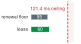{width="100%" fig-alt="Two horizontal bars in milliseconds against a dashed red upper limit at 121.4 milliseconds, the lease limit after the full capture-to-admission age: renewal floor 55 milliseconds and lease 60 milliseconds, both far to the left of the ceiling."}

*The lease must outlast renewal and expire well before the stopping budget runs out.*
:::

These constraints dictate the **lease rule**\index{Chunk lease!lease rule} for the machine. For continuous, uninterrupted trajectory tracking, the lease duration must exceed the proposer's renewal interval plus an allowance for tail jitter. Simultaneously, to guarantee physical safety, the lease must fit within the pre-brake ceiling of @eq-nervous-prebrake once detection latency, bus transport, actuator brake onset, and sensor evidence age at admission are deducted:
$$\ChunkRenewalPeriod + \RenewalJitterAllowance < \ChunkLease \le \frac{\ClearDistance - \LocalizationBound - \ProtectiveClearanceMargin - \SpeedAtDetection^2/2\CredibleBrakingDeceleration}{\SpeedAtDetection} - \PermissionLoopPeriod - \CommandTransportTime - \ActuatorResponseTime - \ObservationAge$$ {#eq-nervous-lease-rule}
where $\ChunkRenewalPeriod$ is the chunk policy's nominal renewal period, $\RenewalJitterAllowance$ is the margin allocated for interarrival timing variations, and $\ObservationAge$ is charged as the evidence's age at admission, rows 1 and 2 of @tbl-04-event-timing together, not its age at dispatch alone. This inequality captures the coupled cyber-physical budget in a single mathematical relation. The left side reflects compute supply, bounded by the neural proposer. The first term on the right reflects physical mechanics, governed by vehicle speed, workspace clearance, and braking deceleration. The remaining subtractive terms account for detection and communication delays, actuator brake onset, and the observation age accumulated across the perception pipeline. A faster vehicle, a less aggressive brake, or a tighter workspace lowers the upper bound; a slower or more jitter-prone neural network raises the lower bound. If the two bounds cross, no lease can preserve both uninterrupted proposal tracking and the stopping guarantee at that velocity; the permission path must interrupt tracking before authority expires.

On the mobile manipulator, the lower bound evaluates to the `{python} PartOneCoupledBudget.t_renewal_need_str` renewal floor derived in notebook \ref{nbk-nervous-watchdog-stopping-lease}. The upper bound provides `{python} PartOneCoupledBudget.t_lease_upper_str` prior to deducting observation age; subtracting the `{python} PartOneCoupledBudget.t_age_str` capture-to-dispatch age allocated in row 1 of @tbl-04-event-timing leaves `{python} PartOneCoupledBudget.t_lease_upper_age_str`. Because the observation must also traverse the dispatch-to-admission pipeline before execution, charging that interval's budget from @tbl-04-event-timing increases total evidence age at admission to `{python} PartOneCoupledBudget.t_age_admit_str`, leaving an effective upper limit of `{python} PartOneCoupledBudget.t_lease_upper_admit_str`. This is the same subtraction as the notebook's, taken in a different order. The notebook charged the lease first and left `{python} MachineLeaseBudget.t_ceiling_left_str` under the ceiling for evidence age and the stop profile; the lease rule charges the age first and leaves this limit for the lease. The selected `{python} PartOneCoupledBudget.t_lease_str` lease sits just above the lower renewal bound, reflecting the physical reality that every additional millisecond of lease duration consumes `{python} PartOneCoupledBudget.mm_per_ms_str` of stopping clearance at maximum drive velocity. This value remains an unverified allocation until the physical vehicle demonstrates that all constituent intervals fit within budget under load. Artificially inflating the lease duration to mask software latency spikes merely consumes stopping clearance, trading mechanical safety margin for compute slack.

Because each chunk packages base velocities and arm joint targets together, the architecture enforces a single shared chunk lease across both subsystems. When that lease expires, each physical body must execute a kinematically feasible, state-matched fallback maneuver. The base's `{python} PartOneCoupledBudget.t_ceiling_str` pre-brake ceiling governs this allocation; it does not imply that the arm possesses surplus margin. The arm analysis in @sec-planning-handoff evaluates stopping distance and response travel against its own localized workspace clearances. Validating the shared lease requires verifying timing, evidence age, dynamic state, and fallback limits simultaneously across both base and manipulator. The goal the intent model supplies is governed by a different timer, the intent lease, which limits how long a high-level goal remains active before it must be renewed and is sized in its own chapter, not from this stopping budget.

::: {.column-margin .margin-pointer}
↪ The intent lease and its contract are developed in @sec-intent-lease.
:::

::: {#chk-nervous-handoffs-grid .callout-checkpoint title="The handoffs matrix and physical budgets"}

Before testing the lease on a humanoid and reviewing the engineering fallacies, verify your understanding of system-wide interface contracts:

- [ ] **Signal handoff classification**: Can you identify the five canonical handoffs ($\SignalHandoff_1\text{--}\SignalHandoff_5$) bridging physical plant mechanics to high-level deliberative reasoning?
- [ ] **Binding physical constraints**: Can you explain why sensory handoffs bind first on bandwidth and exposure latency, whereas actuation handoffs bind first on determinism and heat?
- [ ] **Handoff record provenance**: Can you describe why every numerical limit in an autonomous system must record its evidence category, operating conditions, bound kind, and verification status?
- [ ] **The lease rule**: Can you state the two limits on the chunk lease, one set by successful-admission interarrival and one by the pre-brake ceiling, and explain why a p99 inference time alone proves neither?

:::

```{python}
#| label: calc-nervous-humanoid-fall-deadline
#| echo: false
#| warning: false
#| message: false
# ┌─────────────────────────────────────────────────────────────────────────────
# │ HUMANOID FALL TIMESCALE FOR THE PART I CAPSTONE (LEGO)
# ├─────────────────────────────────────────────────────────────────────────────
# │ Context: @sec-nervous-coupled-budget, the Part I humanoid capstone
# │          (canon §3.7).
# │ Goal:    State the deadline a fall sets, in place of the stop's pre-brake
# │          ceiling, so the lease question can be asked of a biped.
# │ Show:    tau_fall = sqrt(z_c / g) ~ 303 ms for a 0.9 m center-of-mass height.
# │ How:     calc_inverted_pendulum_fall_time on the Unitree H1 CoM height
# │          (Embodied.Humanoid.Unitree_H1.com_height, an MLSysIM estimate, not a
# │          datasheet value; shared with Ch13 P9).
# └─────────────────────────────────────────────────────────────────────────────
from mlsysim import *
from mlsysim.core.units import *
from mlsysim.fmt import fmt, fmt_int, fmt_latency, fmt_length, fmt_math, check

class HumanoidFallDeadline:
    """Characteristic fall timescale of an upright biped modeled as an inverted pendulum."""

    # ┌── 1. LOAD (Constants & Parameters) ─────────────────────────────────
    z_c = Embodied.Humanoid.Unitree_H1.com_height  # category: illustrative (registry estimate; no published CoM height)

    # ┌── 2. EXECUTE (Compute) ─────────────────────────────────────────────
    t_fall = calc_inverted_pendulum_fall_time(effective_length=z_c).to(millisecond)
    t_fall_rounded = round(t_fall.magnitude) * millisecond  # prose says "about"

    # ┌── 3. GUARD (Invariants) ───────────────────────────────────────────
    check(abs(z_c.to(meter).magnitude - 0.9) < 1e-9, f"Humanoid CoM height drifted: {z_c}")
    check(abs(t_fall.magnitude - 302.9) < 0.5, f"Humanoid fall timescale drifted: {t_fall}")

    # ┌── 4. OUTPUT (Format & Export) ────────────────────────────────────────
    t_fall_str = fmt_latency(t_fall_rounded, unit=millisecond, precision=0)
    z_c_m_str = fmt_length(z_c, unit=meter, precision=1)
    _z = fmt(z_c.to(meter).magnitude, precision=1)
    _t_s = fmt(t_fall.to(second).magnitude, precision=3)
    t_fall_math = fmt_math(
        rf"\BalanceDivergenceTime = \sqrt{{{_z} / 9.81}} \approx {_t_s}\,\text{{s}} = {fmt_int(round(t_fall.magnitude))}\,\text{{ms}}"
    )
```

::: {#capstone-nervous-humanoid-crucible .callout-perspective title="A deadline set by a fall"}
**Question**: Does the split among proposer, lease, and permission path still hold when the deadline comes from a fall rather than a stop?

An upright biped diverges from balance on the characteristic timescale $\BalanceDivergenceTime = \sqrt{\MassCenterHeight/\Gravity}$, where $\MassCenterHeight$ is its center-of-mass height. Modeling the biped in the sagittal plane as an inverted pendulum of point mass $\Mass$ pivoting above a contact point at height $\MassCenterHeight$ (the linear inverted pendulum model that @kajita2001lipm introduced for walking-pattern generation), Newton's second law for a small angular deflection $\TiltAngle$ from vertical yields:
$$\Mass \MassCenterHeight^2 \BipedTiltAcceleration = \Mass \Gravity \MassCenterHeight \sin\TiltAngle \implies \BipedTiltAcceleration \approx \frac{\Gravity}{\MassCenterHeight} \TiltAngle$$
The characteristic equation $\BipedTiltAcceleration - \PendulumNaturalFrequency^2 \TiltAngle = 0$ yields natural divergence modes $e^{\pm \PendulumNaturalFrequency \TimeInstant}$ with natural frequency $\PendulumNaturalFrequency = \sqrt{\Gravity/\MassCenterHeight}$. The growing exponential mode governs how quickly an unrecovered perturbation tilts out of control, with characteristic divergence timescale:
$$\BalanceDivergenceTime = \frac{1}{\PendulumNaturalFrequency} = \sqrt{\frac{\MassCenterHeight}{\Gravity}}$$
For an adult-scale humanoid with its center of mass near hip height ($\MassCenterHeight =$ `{python} HumanoidFallDeadline.z_c_m_str`) and gravitational acceleration $\Gravity = 9.81\,\text{m/s}^2$, this evaluates to `{python} HumanoidFallDeadline.t_fall_math` (about `{python} HumanoidFallDeadline.t_fall_str`). This figure represents a characteristic divergence rate, not an absolute recovery deadline. The actual time available to recover depends on the biped's initial angular deflection, its angular velocity, support polygon geometry, and available kinematic reach. Nonetheless, this timescale demonstrates why deliberative inference cannot be placed in the feedback loop governing local balance: an explicit, state-dependent recovery calculation must define the hard real-time deadline.

The architectural partition between proposer, lease, and permission path remains valid for bipeds, but the recovery deadline becomes dynamic and state-dependent. Rather than bringing drives to a standstill, balance recovery requires placing a foot at the dynamic capture point [@pratt2006capture], a process demanding both finite swing time and peak joint torque. The interface lease must accommodate these physical demands:

* **The lease is sized from the dynamic capture-point deadline.** On a wheeled base, an expired lease triggers mechanical braking to bring the vehicle to rest ($\SpeedAtDetection \cdot \ChunkLease$). On an underactuated biped, locking the joints mid-stride makes the fall worse, because engaging holding brakes while the center of mass moves forward causes the torso to pivot forward into an uncontrolled ground impact. Where reach, swing-time, torque, and energy limits permit recovery, the lease fallback action must therefore execute an **emergency capture-point step**. The chunk lease, permission tick, fieldbus transit, and observation age must all fit within the dynamic recovery budget while reserving sufficient time to swing and plant the foot. The characteristic fall timescale frames this constraint but cannot substitute for dynamic simulation.
* **The proposer must meet the recovery budget.** An inference renewal period that consumes a major fraction of the characteristic fall timescale cannot safely participate in posture stabilization. High-level intent models must remain decoupled from balance reflexes. Whether a mid-level chunk policy can safely control locomotion depends on whether its renewal interval and tail jitter leave adequate margin for fallback step execution.
* **Actuator thermal limits and supply sag constrain the recovery step.** Executing an emergency recovery step demands simultaneous peak torque across multiple leg joints. This surge draws massive transient current, inducing resistive heating in motor windings and risking DC bus voltage collapse (@sec-body-power-distribution-impedance). Consequently, the permission path must evaluate candidate recovery trajectories against instantaneous thermal and electrical reserves before admission.
:::

Whether the deadline comes from a warehouse rack end or a biped's fall, the handoff matrix and the lease rule only protect the machine if the hardware and firmware underneath them honor the boundaries the equations assume. In practice, subtle implementation shortcuts in watchdog servicing, calibration ports, state feedback, and middleware configurations routinely bypass those boundaries without triggering a compile or bench error.

## Fallacies and Pitfalls {#sec-nervous-fallacies-pitfalls}

A block diagram draws a clean boundary between high-level deliberation and low-level real-time enforcement, but physical boards and firmware routinely couple the two through shared power rails, common clock domains, interrupt lines, or auxiliary diagnostic ports. When a planning subsystem crashes or misbehaves, those hidden couplings decide whether the safety enforcement loop actually survives.

::: {.fallacy-pitfall}
**Pitfall**: *Servicing a safety watchdog inside a high-priority timer interrupt rather than an application-verified safety loop.*

The mobile manipulator relies on a hardware self-watchdog to trigger the Safe Torque Off path of @sec-nervous-actuation-authority if it receives no feed within `{python} MachineLeaseBudget.t_self_watchdog_str`. Because an enforcer that stops executing can no longer command a coordinated stop, this immediate hardware cutoff is essential. A dangerous design mistake occurs when engineers service this watchdog from a high-priority hardware timer interrupt rather than directly from the safety loop. If the lower-priority enforcement task deadlocks on a mutex or crashes, the hardware timer interrupt continues firing every `{python} MachineLeaseBudget.t_tick_str` tick. The watchdog remains fed while the enforcer has silently lost its ability to evaluate torque limits, kinematic clearances, and lease budgets.

In distributed systems engineering, this error is known as the confusion of liveness with correctness. A node responding to network ping heartbeats can be livelocked, thrashing on memory allocation, or deadlocked on an internal mutex. Servicing a watchdog must never signify mere scheduler activity. Instead, every refresh pulse must be conditioned on the successful, sequential retirement of all required verification stages, for example by requiring a monotonic task-completion token before a windowed hardware watchdog is serviced. An independent timer tick confirms only that interrupt dispatching still operates; it provides zero evidence that the controller has safely evaluated the machine's physical state (@sec-nervous-supervisory-timers).

**Architect's countermeasure**: Bind watchdog refresh pulses strictly to the verified completion of the safety loop's invariant checks, deploying windowed hardware watchdogs that trip on both execution underruns and spurious early feeds.
:::

::: {.fallacy-pitfall}
**Pitfall**: *Leaving auxiliary diagnostic or calibration interfaces unmediated in production operation.*

Suppose the mobile manipulator validates base velocity proposals through its permission path, yet its drive-wheel motor drives retain an unmonitored serial calibration interface. If a diagnostic daemon writes a $35.0\text{ A}$ test value directly into an inverter register through that port, the proposal mailbox continues reporting zero velocity. Checking the mailbox reveals nothing about the bypassed command, yet the drive wheels produce torque that no motion safety check ever evaluated or approved. Actuation authority is not defined by a logical software diagram; it encompasses every physical wire, bus transceiver, and digital interface capable of changing a power-stage register. Service interfaces must therefore incorporate operational interlocks or hardware jumpers that prevent calibration writes from bypassing the enforcer during production runs.

**Architect's countermeasure**: Electrically isolate, physically jumper, or cryptographically interlock all auxiliary diagnostic and calibration ports during operational modes, routing all register writes exclusively through the real-time enforcer.
:::

::: {.fallacy-pitfall}
**Fallacy**: *Evaluating safety barrier invariants on commanded trajectory setpoints is equivalent to evaluating physical plant state.*

Suppose an arm controller evaluates safety using a control barrier function [@ames2019control], a scalar function $\BarrierFunction$ of the state space that remains positive within the safe set and is kept from going negative by filtering unacceptable control inputs. To conserve fieldbus bandwidth, an engineer might evaluate $\BarrierFunction$ using commanded joint positions rather than load-side encoder feedback. If a transmission gear strips or a drive belt shears, the trajectory interpolator continues generating valid, smooth setpoints. The enforcer calculates that the system remains safely inside the barrier set ($\BarrierFunction(\CommandedJointConfiguration) > 0$), even while the decoupled arm collapses into an obstacle. Safety enforcement belongs at the causal boundary, which means it must ingest ground-truth physical state measurements through dependable sensory channels and account for sensor noise and latency. Auditing the command stream reveals what the planner intended, but only independent physical feedback captures where the machinery actually moves.

**Architect's countermeasure**: Close safety barrier evaluations strictly around verified, independent sensor measurements (such as optical load encoders and current shunts) rather than planned trajectory setpoints.
:::

::: {.column-margin .margin-pointer}
↪ The control barrier function and the safety filter that keeps it nonnegative are developed in @sec-enforcement-safe-sets-conditional-permission.
:::

::: {.fallacy-pitfall}
**Fallacy**: *Nominal, fault-free operating logs are sufficient to prove physical architectural isolation.*

Logging thousands of operating hours without a missed deadline demonstrates nominal stability, but clean telemetry cannot expose hidden cross-subsystem couplings that awaken only during failure modes. Subsystem isolation often breaks down under unmodeled physical interactions, such as supply-rail voltage sags when multiple inverters switch simultaneously, bus contention storms, or memory corruption spilling across addressing domains. Rigorous qualification requires deliberate fault injection: inducing power transients, flooding communication buses, corrupting policy memory, and mechanically locking motor shafts on a dynamometer. Each experiment must evaluate an explicit, quantitative response bound, such as locked-rotor detection clamping motor current within $2.0\text{ ms}$, rather than treating the mere absence of an operating system crash as validation. Fault experiments support the isolation claim within their stated fault and load coverage when the system maintains invariant enforcement or reaches the specified fallback within the quantitative response bounds. They do not establish coverage of untested fault combinations.

**Architect's countermeasure**: Validate fault-domain independence through active fault-injection regimes (power sags, clock glitches, bus flooding, and memory corruption) with quantitative pass-fail response bounds.
:::

::: {.fallacy-pitfall}
**Pitfall**: *Assuming zero packet loss in robotics middleware equates to deterministic real-time delivery.*

A publish-subscribe transport configured for reliable delivery attempts to recover lost packets, but successful recovery does not establish deterministic real-time delivery. After congestion or interference, a reliable transport delivers the burst of queued, obsolete setpoints that @sec-nervous-mailbox-exchanges traced, each describing a robot state that no longer exists. While switching to a freshest-sample policy prevents queue backlogs, dropping stale frames does not inherently bound scheduling jitter, serialization delay, or driver execution latency. The cycle-critical actuation path requires two separate guarantees: an engineered worst-case delivery bound across the physical communication bus and an explicit freshness deadline enforced by the receiver before executing any torque command.

**Architect's countermeasure**: Budget the complete transport response under declared traffic and fault conditions, enforce deadline-based freshness at the consumer, and isolate cycle-critical commands from supervisory middleware traffic regardless of the bus architecture.
:::

## Summary {#sec-nervous-summary}

@Sec-body derived the physical stopping budget for the loaded machine, and @sec-brain established the operational cadences for proposal generation and evidence age. This chapter introduced the real-time permission path designed to enforce those constraints, establishing a two-processor architecture whose physical isolation still awaits evaluation under load. To guarantee deterministic safety, the permission path holds exclusive write access to the motor drive registers. It communicates with the unprivileged proposal engine through a lock-free mailbox that never stalls the high-frequency control tick, while communication and computation delays mandate closing joint-level feedback loops directly within the drives. By evaluating command interfaces, from joint positions to operational-space impedances, the permission path prices each check against available stopping clearance. Combining these constraints yields a bounded time window during which an action proposal is permitted to drive physical actuators. On the running machine, this analysis produces a chunk lease that exceeds the proposer's renewal interval while fitting within the pre-brake delay budget. The resulting handoff record documents this lease alongside its validity conditions and evidence requirements. This lease and the mechanisms behind it remain claims until they are verified under worst-case compute jitter, bus contention, malformed proposals, sensor faults, and degraded braking. @Tbl-04-key-equations summarizes the four governing relations that define the nervous system's timing, lease duration, and response guarantees, along with the engineering decisions they resolve.

| Equation                                                                                                                                                                          | What it bounds or decides                                                                                                                                                           | Derived                     |
|:----------------------------------------------------------------------------------------------------------------------------------------------------------------------------------|:------------------------------------------------------------------------------------------------------------------------------------------------------------------------------------|:----------------------------|
| $\DelayPhaseLag = \CrossoverFrequency\left(\dfrac{\SamplingPeriod}{2} + \EnforcerComputeTime + \CommandTransportTime\right)$                                                      | The phase lost to sample-and-hold, computation, and transport delay at crossover, dictating whether a control loop can close across the network bus or must reside inside the drive | @eq-nervous-delay-phase     |
| $\PrebrakeDelay \le \dfrac{\ClearDistance - \LocalizationBound - \ProtectiveClearanceMargin - \SpeedAtDetection^2/2\CredibleBrakingDeceleration}{\SpeedAtDetection}$              | The pre-brake ceiling: the maximum allowable delay before braking onset that still guarantees stopping within available clearance                                                   | @eq-nervous-prebrake        |
| $\ChunkRenewalPeriod + \RenewalJitterAllowance < \ChunkLease \le \PrebrakeDelayCeiling - \PermissionLoopPeriod - \CommandTransportTime - \ActuatorResponseTime - \ObservationAge$ | The lease rule, bounding chunk lease duration between the proposer's renewal floor and the ceiling imposed by detection, transport, brake onset, and evidence age                   | @eq-nervous-lease-rule      |
| $\WorstCaseResponseTime_i = \WorstCaseExecutionTime_i + \TaskBlockingTime_i + \TaskInterferenceTime_i \le \TaskRelativeDeadline_i$                                                | Worst-case response-time schedulability for hard real-time tasks, verifying that execution, blocking, and interference fit within the task deadline                                 | @eq-nervous-response-budget |

: **Key equations of the nervous system**: The four relations behind the chapter's rate, lease, and response decisions, with the place each is derived. $\PrebrakeDelayCeiling$ is the right side of the pre-brake ceiling. {#tbl-04-key-equations tbl-colwidths="[40,42,18]"}

::: {.callout-takeaways title="The permission path and determinism"}
* **The permission path alone writes the drives:** Learned models act only as unprivileged proposal engines ($\CandidateProposal_t$). Write access to the motor drive registers belongs to the deterministic real-time enforcer alone, hosted on silicon whose isolation from the proposer must be verified experimentally.
* **Cadence is dictated by physics, not software:** The four-tier concurrency hierarchy (`{python} MachineTiers.f_current_str` FOC current regulation, `{python} MachineTiers.f_perm_str` kinematic enforcer checks, `{python} MachineTiers.f_chunk_str` action-chunk renewal, and `{python} MachineTiers.f_intent_str` multimodal deliberation on the running machine) is governed by physical time constants ($\ElectricalTimeConstant = \PhaseInductance/\PhaseResistance$), total loop delay (a phase lag $\DelayPhaseLag = \CrossoverFrequency(\SamplingPeriod/2 + \EnforcerComputeTime + \CommandTransportTime)$, which keeps the joint loops in the drives), exposure horizons, and model execution budgets.
* **The exchange never waits, and every proposal expires:** The permission path reads the mailbox in a single bounded attempt per tick, retaining the currently active, independently admissible chunk if a write collision occurs. Every proposal carries an evidence timestamp and an explicit expiration horizon that terminates its authority even if an explicit cancellation never arrives.
* **Stopping dynamics dimension the chunk lease:** For the mobile manipulator operating at its drive limits, the pre-brake ceiling is `{python} MachineLeaseBudget.t_ceiling_str`. Sizing the lease at `{python} MachineLeaseBudget.t_lease_str` places it just above the proposer's renewal floor. The interval from the final admitted chunk to brake onset takes `{python} MachineLeaseBudget.t_renewal_to_onset_str`, and its lease path brings the stopping budget's running total to `{python} MachineLeaseBudget.running_total_str` of the `{python} MachineLeaseBudget.d_clear_str` clear distance before evidence age and the remaining stop margins are charged (row 4 of @tbl-enforcement-stopping-budget).
* **Worst-case bounds outrank empirical distributions:** Tail-latency percentiles such as $\text{p99}$ cannot establish real-time safety. Deterministic enforcement requires bounding worst-case computation, blocking, and interference ($\WorstCaseResponseTime_i = \WorstCaseExecutionTime_i + \TaskBlockingTime_i + \TaskInterferenceTime_i \le \TaskRelativeDeadline_i$) under rigorously qualified operating conditions.
* **The permission path is only as independent as what it shares:** If the permission path shares a clock source, power rail, memory bus, or silicon die with the proposal engine, faults in the proposer can compromise the enforcer. The two-processor split is an architectural hypothesis that requires empirical validation through stress testing and fault injection (@sec-placement-testing-separation), not an assumed property of separate software processes.
* **The command interface sets what the permission path must check:** Joint position targets express kinematic intent that the enforcer can verify geometrically, but they cannot bound contact forces. Velocity interfaces require a bounded motion projection, while torque interfaces require dynamic bounds and a feasible fallback. Impedance targets bound steady-state interaction forces, but only if the enforcer validates the stiffness and damping gains alongside the reference trajectory.
* **Locate interface regressions at their handoff:** The system handoff record maps every timing and clearance limit to one of five architectural boundaries, binding each to operational preconditions, evidence categories, and bound types. When performance regresses, engineers can isolate the offending subsystem against its allocated budget using like-for-like evidence.
:::

Physical stopping limits, inference renewal rates, and the Nervous System's response delays converge on one governing parameter, how long an admitted proposal may command the actuators. When a timing question arises on a new machine, the first diagnostic is to price that parameter, converting the lease path to distance at the operating speed and comparing it with what the stopping budget has left. A lease that cannot fit between the renewal floor and the pre-brake ceiling cannot sustain uninterrupted proposal tracking at that speed, and a faster processor helps only if it lets the renewal period, and with it the floor, shrink.

This chapter closes Part I, and with it the argument that the first law, irreversibility (principle \ref{pri-vol4-irreversibility}), set in motion. The Body turned irreversibility into distances and limit records, the Brain into proposals that arrive late and expire, and the Nervous System into a rule of authority. Motion that cannot be undone may be granted only for as long as the stopping budget can still guarantee the stop. The chunk lease is that rule written as a number, and the handoff record is where the number is kept. Everything the machine later learns or is permitted to do inherits this bound, including the demonstrations it collects while the permission path is watching.

## Historical Perspective and Further Reading {#sec-nervous-history}

The phase-margin arguments that keep high-bandwidth joint feedback loops inside local motor drives predate digital computing. @nyquist1932regeneration established the foundational stability criterion that determines whether a closed-loop feedback amplifier will oscillate, and @bode1945network formalized these dynamics into the gain and phase margins that control engineers budget today. When mechanical and analog controllers transitioned to software, sampled-data control theory formalized how digital sample-and-hold stages, discrete computation steps, and communication transport introduce pure time delays that consume this margin [@franklin1998digital]. High-bandwidth feedback-loop placement in this chapter follows directly from this phase accounting: a control loop must close physically close to its sensors and actuators because any transport latency erodes phase margin that high-bandwidth physical dynamics cannot spare.

Predictable execution and real-time scheduling supply the second pillar of this architecture. @liu1973scheduling proved that assigning static priorities monotonically by rate guarantees schedulability for periodic task sets up to a theoretical utilization bound. Subsequent response-time analysis transformed this sufficient condition into an exact test by summing worst-case execution time, resource blocking, and higher-priority task interference [@joseph1986finding; @audsley1993applying]. When shared resources threatened these guarantees with priority inversion, @sha1990priority bounded the duration of blocking through priority inheritance and the priority ceiling protocol. The Mars Pathfinder mission in 1997 demonstrated precisely what the absence of such bounds costs in production, when unmanaged priority inversions triggered repeated system resets on the Martian surface [@reeves1997pathfinder]. Extending predictability to distributed embedded systems, @kopetz2011real established the foundations of time-triggered design, arguing that safety-critical systems must remain statically analyzable prior to execution and introducing the concepts of state messages and temporal accuracy that govern the proposal headers in this chapter.

The lock-free coordination between the high-level policy proposer and the low-level safety permission path descends from foundational work on sharing state without waiting. @lamport1977concurrent demonstrated that a concurrent reader can detect an overlapping write using version sequence numbers alone. @simpson1990four developed the asynchronous four-slot mechanism for flight-control avionics running on unrelated clocks, @herlihy1991waitfree formalized the theoretical hierarchy of wait-free synchronization, and @kopetz1993nbw formulated the non-blocking write protocol specifically for real-time readers. Industrial networks confronted similar timing and isolation challenges on the wire: Controller Area Network (CAN) bus architectures resolved medium access through deterministic, bitwise priority arbitration [@iso11898-1-2015], while the functional-safety profiles of IEC 61784-3 established the black-channel principle, encapsulating integrity and freshness guarantees within the messages so that the transmission medium itself need not be trusted [@iec61784-3-2021]. Finally, the concept of bounded temporal leases originated in distributed systems, where @gray1989leases restricted how long a client could rely on cached data so that an unresponsive client blocked the server for at most one lease period. Physical AI systems adapt this lease mechanism to an entirely different physical objective: rather than preserving distributed cache consistency, the lease is bounded by the kinetic stopping budget and renewal deadlines of the safety monitor.

For readers seeking deeper exploration, six works trace the lineage from classical feedback theory to modern real-time permission paths:

- @franklin1998digital provides the definitive treatment of digital and sampled-data control, analyzing how zero-order hold circuits, computation time, and transport latencies introduce phase lag. This analysis forms the theoretical foundation for the multi-rate cadence decisions in @sec-nervous-cadences.
- @liu1973scheduling is a concise, classic paper that remains the clearest demonstration of how rate-monotonic priority assignment guarantees schedulability under worst-case task arrival patterns.
- @sha1990priority formalizes the priority inheritance and priority ceiling protocols alongside their mathematical blocking bounds. This work explains both the recovery strategy deployed on Mars Pathfinder and the derivation of the blocking term $\TaskBlockingTime_i$ in @eq-nervous-response-budget.
- @buttazzo2011hard offers an authoritative textbook treatment of hard real-time systems, fixed-priority and deadline-driven scheduling, and response-time analysis, complete with concrete task sets that readers can verify by hand.
- @kopetz2011real develops real-time architectures from the time-triggered perspective. Its chapters on real-time entities, temporal accuracy, and communication clarify why our proposal mailbox exchanges idempotent state messages rather than transient event queues.
- @simpson1990four presents the four-slot mechanism in its original flight-critical avionics context, demonstrating how four memory slots decouple an asynchronous reader and writer without locking, waiting, or sample loss.

::: {.callout-chapter-connection title="From anatomy to closed-loop learning"}
When an embodied machine modifies or rejects a human command before execution, the recorded demonstration no longer reflects unconstrained intent. The Body, the Brain, and the Nervous System establish physical limits, learned proposals, and a timed permission path. During data collection, such as teleoperated openings of the spring-latched cage door, that path may clamp, rate-limit, or refuse an operator's request, while the body may deliver motion that differs from the admitted command. The limit and handoff records preserve the conditions behind those interventions. In Part II, @sec-data begins from the reality that a physical machine manufactures its own training data, so each executed action changes the observations that follow and each record carries what the operator requested, what the permission path admitted, and what the body delivered. It then establishes what a demonstration must retain so that a policy can learn the task without mistaking the collecting machine's limitations for intended behavior.
:::

```{=latex}
\part{key:vol4_learning}
```
