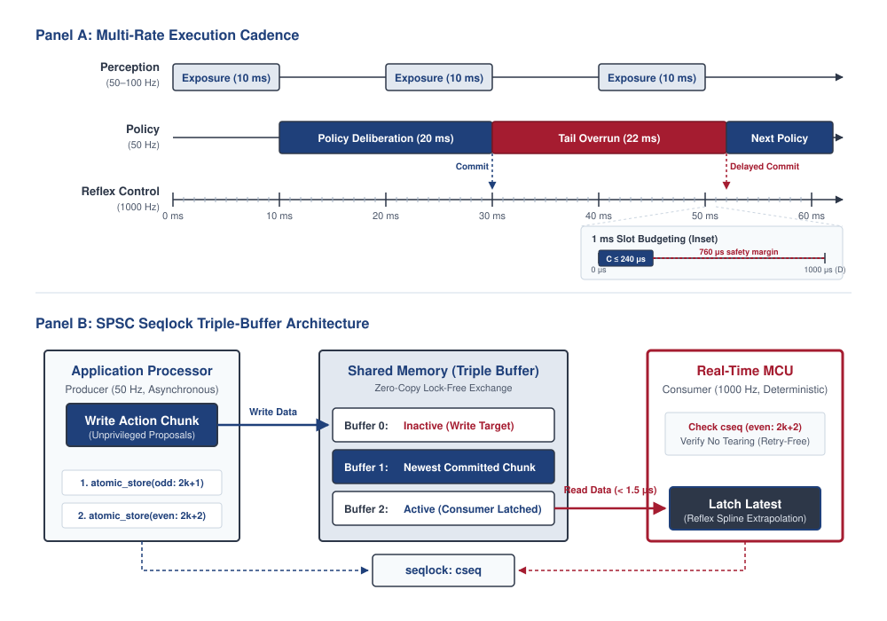

---
format:
  html:
    title: "The Nervous System"
---

# The Nervous System {#sec-nervous}

::: {layout-narrow}
::: {.column-margin}

\chapterminitoc

:::

::: {.content-visible when-format="pdf"}
\noindent
{fig-alt="Isometric blueprint showing the Nervous System architecture: an MCU enforcing strict 1 kHz timing and monitoring jitter, a shielded physical network ring, shared memory for lock-free data exchange, and a high-priority safety override (reflex filter)."}
:::

::: {.content-visible unless-format="pdf"}
{fig-alt="Isometric blueprint showing the Nervous System architecture: embedded real-time MCU, 1 kHz clock and jitter monitor, shielded real-time network ring, shared SRAM seqlock mailbox, and control barrier reflex filter."}
:::

:::

## Purpose {.unnumbered .unlisted}

::: {.content-visible when-format="pdf"}
\begin{marginfigure}
\resizebox{0.92\linewidth}{!}{\mlphysicalstackfull{20}{100}{20}{20}{20}}
\end{marginfigure}
:::

_Why must a moving machine keep checking its commands when its learned model stops responding?_

A learned model can pause while it interprets a scene, but the machine carrying it continues to move. A delayed replacement command therefore spends clearance, and a rejected command still leaves a body that needs a feasible response. The Nervous System separates these responsibilities. It lets learned models propose motion while an independent permission path checks whether that motion remains admissible and ends its authority when the proposal expires. Communication and execution must leave enough time for the body to respond, even when inference stalls. The engineering task is to derive those timing limits from the machine's physical limits and keep the checking path available under the faults it must contain. At the causal boundary, time granted to a proposal becomes motion that software cannot recall.



::: {.callout-learning-objectives}

- Derive suitable update rates from actuator time constants, sampling delay, and learned proposal renewal limits
- Evaluate mailbox exchanges for bounded reads, complete payloads, and proposal freshness when the writer stalls
- Distinguish measured latency percentiles from response-time bounds that include computation, blocking, and interference
- Evaluate whether shared execution, clock, power, and memory resources can defeat the permission path
- Size a proposal lease between the renewal floor and the stopping budget's pre-brake ceiling
- Diagnose interface timing violations by comparing each handoff's allocated budget with like-for-like evidence
- Construct Transport Budget records that state operating conditions, evidence categories, detectors, and bound kinds

:::

## The Multi-Rate Bridge {#sec-nervous-multi-rate-bridge}

The warehouse mobile manipulator that this book follows regulates the current in its motor windings thousands of times per second, while the learned models that proposed its grasp on the conveyor mug in @sec-brain need orders of magnitude longer to digest each camera frame. If motor regulation waits on deliberative reasoning or on shared resources without a bounded response time, an inference workload can delay the control loop past its deadline. The physics of moving mass and electromagnetic coils create a strict architectural requirement: *the Brain needs time to deliberate, while the Body needs continuous control to survive.*

A shared blocking path makes the faster loop depend on the slower one. If control waits for inference or drains a queue of old setpoints, the command reaches a body that has already moved. Transport delay ($\tau_{\text{transport}}$) also adds phase lag to feedback ($\Delta\phi = -\omega \tau_{\text{transport}}$): a correction arrives later in the motion it was intended to regulate. The **Nervous System**\index{Nervous system!architecture} must bound those delays while keeping local control available when deliberation stalls.

The four tiers separate responsibilities as well as update rates. Faster tiers must continue their checks without waiting for slower ones:

1. **Actuator current regulation:** The motor drive closes the winding-current loop locally. Field-Oriented Control (FOC) coordinates the applied voltage with rotor position to produce the requested torque.
2. **Permission and joint control:** The permission path checks proposal freshness and physical limits, tracks admitted motion, and requests a feasible fallback when authority expires.
3. **Action-chunk policy:** The learned policy proposes a short sequence of waypoints, allowing local control to proceed between inference results.
4. **Intent planning:** The slower model supplies task goals that guide the chunk policy without directly commanding the drives.

The rate calculation in @sec-nervous-time-constants-phase-lag assigns these roles their timing budgets. Enforcement algorithms and joint dynamics are developed in @sec-enforcement; the architectural requirement here is that a stalled proposer cannot suspend the faster checks.

::: {.column-margin}
{width="100%" fig-alt="S·P·A locator triad highlighting the Plan-Act edge."}

*The Plan $\cap$ Act interface: deterministic permission arbitration bridging neural deliberation with real-time actuation.*
:::

In standard computer systems, workloads share processors, caches, and memory interconnects under general-purpose operating systems. When a neural network streams multi-gigabyte weight tensors across a shared memory bus, its transfers can contend with control traffic,[^fn-nervous-bus-contention] and no thread priority can preempt a hardware transaction already occupying the bus. A control path that waits for that engine can also lose timely setpoint updates during a garbage-collection pause, page fault, or thermal throttle. Local control must remain available without waiting for fresh inference.

[^fn-nervous-bus-contention]: **Interconnect Crossbar Contention**\index{Interconnect crossbar contention}: When an accelerator streams multi-gigabyte foundation model weights across shared AXI or PCIe crossbars, dense burst transactions saturate dynamic RAM banks and arbitration queues. Co-located real-time processor cores attempting to read motor encoder registers face unbudgeted hardware wait states that software priorities cannot preempt. Maintaining microsecond-scale control stability therefore requires dedicated physical memory channels or isolated on-chip SRAM for the real-time domain.

```{python}
#| label: calc-nervous-machine-stall-travel
#| echo: false
#| warning: false
#| message: false
# ┌─────────────────────────────────────────────────────────────────────────────
# │ BASE TRAVEL DURING ONE PROPOSER INFERENCE (LEGO)
# ├─────────────────────────────────────────────────────────────────────────────
# │ Context: @sec-nervous-multi-rate-bridge, the running-machine bullets.
# │ Goal:    Show how far the base moves while each learned proposer computes.
# │ Show:    60 mm in one 40 ms chunk inference, 240 mm in one 160 ms intent
# │          inference, at the 1.5 m/s drive limit.
# │ How:     Distance = drive limit x inference latency, all from the registry.
# └─────────────────────────────────────────────────────────────────────────────
from mlsysim import *
from mlsysim.core.units import *
from mlsysim.fmt import fmt_latency, fmt_length, fmt_velocity, check

RM = Embodied.MobileManipulator.WarehouseMobileManipulator

class MachineStallTravel:
    """Base travel at the drive limit during one inference of each learned proposer."""

    # ┌── 1. LOAD (Constants & Parameters) ─────────────────────────────────
    v = RM.base.max_velocity  # category: illustrative (drive limit)
    t_chunk = RM.chunk_inference_latency  # category: illustrative (P99, incl. vision)
    t_intent = RM.intent_inference_latency  # category: illustrative

    # ┌── 2. EXECUTE (Compute) ─────────────────────────────────────────────
    d_chunk = (v * t_chunk).to(millimeter)
    d_intent = (v * t_intent).to(millimeter)

    # ┌── 3. GUARD (Invariants) ───────────────────────────────────────────
    check(abs(v.to(meter / second).magnitude - 1.5) < 1e-9, f"Drive limit drifted: {v}")
    check(abs(t_chunk.to(millisecond).magnitude - 40.0) < 1e-9, f"Chunk inference latency drifted: {t_chunk}")
    check(abs(t_intent.to(millisecond).magnitude - 160.0) < 1e-9, f"Intent inference latency drifted: {t_intent}")
    check(abs(d_chunk.magnitude - 60.0) < 1e-6, f"Chunk-inference travel drifted: {d_chunk}")
    check(abs(d_intent.magnitude - 240.0) < 1e-6, f"Intent-inference travel drifted: {d_intent}")

    # ┌── 4. OUTPUT (Format & Export) ────────────────────────────────────────
    v_str = fmt_velocity(v, unit=meter / second, precision=1)
    t_chunk_str = fmt_latency(t_chunk, unit=millisecond, precision=0)
    t_intent_str = fmt_latency(t_intent, unit=millisecond, precision=0)
    d_chunk_str = fmt_length(d_chunk, unit=millimeter, precision=0)
    d_intent_str = fmt_length(d_intent, unit=millimeter, precision=0)
```

@Sec-brain established how long each learned proposer on the machine needs to turn camera frames into a proposal. An electromagnetic motor coil has an electrical time constant ($\tau_e = L/R$) measured in fractions of a millisecond, while moving linkages carry kinetic energy ($E_k = \frac{1}{2} m v^2$). Delaying or miscalculating the current command can therefore exhaust a physical margin before deliberation finishes. On the mobile manipulator, the mismatch takes two forms:

- The base (Class 1) cruises at up to its `{python} MachineStallTravel.v_str` drive limit (illustrative; see the Reader Guide), so it travels `{python} MachineStallTravel.d_chunk_str` during one `{python} MachineStallTravel.t_chunk_str` chunk-policy inference and `{python} MachineStallTravel.d_intent_str` during one `{python} MachineStallTravel.t_intent_str` intent-model inference, and nothing brakes it in that time unless a process other than the proposer is watching.
- The arm (Class 2) carries reflected rotor inertia ($N^2 J$) through its gearboxes; if its high-rate impedance loops are interrupted while the gripper is on a door latch or a mug, continuing motion can raise the contact force. Whether the force exceeds its limit depends on the measured friction, compliance, and motion response as well as the reflected inertia.

Software discipline, OS thread priorities, and runtime exception handlers cannot by themselves keep the plant safe. Safety requires an explicit, deterministic computing, memory, and communication fabric. That fabric is the Nervous System of the five-level machine (@sec-boundary-machine-model), and it holds the permission path.

Every signal crossing between deliberation and physical actuation is constrained by five interface limits, which @sec-nervous-handoffs-matrix lays out handoff by handoff. Reconciling them requires an architecture that delivers microsecond cycle determinism ($1\text{ kHz}$ to $20\text{ kHz}$) to preserve controller stability margin against transport delay, maintains lock-free asynchronous decoupling to prevent slow neural inference from blocking inner control loops, isolates actuator writes from host crashes, restricts actuation privilege to the permission path, and requests a validated local response when a proposal's chunk lease expires.

The first decision is where the two workloads execute. The separation in @sec-nervous-silicon-partitioning keeps inference off the timed actuator path. The design in @sec-nervous-cadences then budgets their exchange and sizes the lease that ends a stale proposal's authority; @sec-nervous-deterministic-fieldbuses bounds the time a command takes to reach the drives. The remaining sections locate actuator authority, fault isolation, and invariant checks, and close Part I with the Transport Budget handoff record and one budget that couples this chapter's lease to the limits of @sec-body and @sec-brain. Each mechanism must leave the physical plant a measured, feasible response when the proposer pauses.

The design requirement at this stage is an interface whose timing, authority, and fault response can be checked against the physical budget. The enforcement algorithms in @sec-enforcement turn that requirement into per-tick decisions; @sec-placement tests whether the chosen hardware preserves it under shared-resource interference. The mechanisms below establish what those later implementations must deliver.

## Silicon Partitioning and the Permission Path {#sec-nervous-silicon-partitioning}

The chunk policy needs enough computation and memory bandwidth to publish proposals at its renewal rate. The permission path needs an upper bound on the time required to check and act on them. These are different requirements. A delayed inference result can be rejected while local control continues; a delayed permission check spends part of the response budget whether or not the processor eventually catches up.

An operating-system scheduler decides which ready task executes next. Raising a control task's priority can reduce competition for the processor, but it cannot make every operation that task performs finish on time. A page fault may suspend the task while memory becomes available; a shared lock may leave it waiting for another task; a memory request may wait behind accelerator transfers already occupying the bus. Inference latency tails[^fn-math-inference-latency] therefore matter even when the average proposal arrives on time.

Real-time operating-system mechanisms address particular sources of delay. Preallocating and locking memory avoids demand paging in the timed loop; assigning processor affinity avoids migrations; priority inheritance lets a low-priority lock holder finish when a higher-priority task needs its lock. These mechanisms need configuration and timing evidence. @Sec-appendix-systems-timers develops the scheduling, interrupt, and memory mechanisms needed to calculate their contribution to a response bound.

Shared hardware adds delays that software priority does not control. Memory-map updates can interrupt other cores,[^fn-os-tlb-shootdown] and direct memory transfers may require cache-coherence work.[^fn-hw-dma-coherence] More fundamentally, a control task cannot read an encoder buffer while another device monopolizes the route to that buffer. The **Unified Memory Architecture (UMA) Crossbar Trap**\index{Unified Memory Architecture!crossbar trap} is this mismatch between a high-priority software task and a shared physical memory path. @Sec-appendix-systems-dram explains how memory arbitration creates the waits; @sec-placement-resource-contention evaluates their effect on placement.

Dedicated motor-control hardware shortens the path from sensing to actuation. Local sensor interfaces, timer registers, and on-chip memory keep current regulation independent of the host's inference runtime. The controller in @fig-real-motor-controller illustrates this arrangement: current-sense resistors provide feedback, power routing carries drive current, and gate-drive outputs switch the inverter. Hardware timers also enforce the separation between complementary switch transitions needed to avoid a short circuit through the bridge.[^fn-hw-epwm-deadtime]

[^fn-math-inference-latency]: **Inference Latency Distribution**\index{Inference latency}: Log-normal and shifted Weibull models are common descriptions of measured inference tails. The median and $P_{99}$ alone do not fix the exceedance probability at a given deadline, which must be measured or modeled separately. For the formal derivation of latency exceedance probabilities in real-time inference, see @sec-appendix-ml.

[^fn-os-tlb-shootdown]: **TLB Shootdown**\index{Translation lookaside buffer!shootdown}: When an operating system modifies page tables, it broadcasts inter-processor interrupts (IPIs) to invalidate stale Translation Lookaside Buffer entries across all active cores. Receiving cores must suspend thread execution and flush affected entries, introducing unbudgeted multi-microsecond stalls. In shared-silicon architectures, these unpredictable synchronization pauses destroy the cycle determinism demanded by inner motor regulation loops.

[^fn-hw-dma-coherence]: **DMA Cache Coherence**\index{Direct memory access!cache coherence}: Direct memory access transfers bypass CPU cache hierarchies, requiring explicit cache line invalidation or write-back operations to maintain memory consistency between peripherals and cores. Without hardware-enforced snoop filtering or explicit barriers, processors read stale sensor frames or overwrite pending actuator commands. These maintenance operations inject variable latency penalties into high-rate control routines unless static, unbuffered SRAM regions are dedicated to peripheral transfers.

[^fn-hw-epwm-deadtime]: **Dead-Time Delay**\index{Dead-time delay}: Dedicated pulse-width modulation timers (TI `ePWM`, STM32 `TIM1`) inject hardware-enforced dead-time delays ($100\text{--}500\text{ ns}$) between complementary high-side and low-side gate signals (`TIMx_BDTR`, `DBRED`). This delay ensures that the conducting power switch fully turns off before its opposing switch conducts, preventing shoot-through short circuits across high-voltage DC rails. Because dead time slightly distorts the applied phase voltage, motor control firmware incorporates online volt-second compensation to maintain smooth torque generation.

::: {#fig-real-motor-controller fig-env="figure" fig-pos="t" fig-cap="**Motor drive controller silicon**: Macro view of an embedded motor drive integrated circuit featuring precision current-sense shunt resistors (R110), multi-layer power routing, and direct gate-drive outputs. Dedicated real-time control silicon executes cycle-deterministic current commutation loops without operating system schedulers, cache hierarchies, or bus contention. (Credit: Wikimedia Commons, CC BY-SA 4.0)." fig-alt="Macro view of an embedded motor drive integrated circuit showing current-sense shunt resistors, PCB power routing, and gate-drive pins."}
{width="85%"}
:::

In the two-processor implementation (@fig-04-two-processor-implementation), deliberative planning and reactive enforcement do not share a processor core, a cache hierarchy, or a common memory bus. The slow, stochastic path runs on parallel hardware (Linux host application processors and tensor accelerators) optimized for raw throughput across wide data streams, while the fast, deterministic path runs on isolated hardware (bare-metal microcontrollers or FPGA cores) optimized for worst-case execution time and cycle-counted predictability. On the mobile manipulator, the permission path runs on the safety microcontroller (MCU). Structurally, this establishes a hardware-enforced capability ring: the host machine acts strictly as an unprivileged client with zero memory-mapped input/output (MMIO) access to motor drive registers, while the microcontroller holds exclusive hardware write privilege. Separate chips are one realization; a single die can also host the permission path if its response bound and fault containment are shown to hold (@sec-placement-two-paths-one-die).

::: {#fig-04-two-processor-implementation fig-env="figure" fig-pos="t" fig-cap="**The two-processor implementation**: An application processor publishes learned proposals to a shared mailbox. An independently scheduled microcontroller, which runs the permission path, checks freshness and physical limits before commanding motor current and executes a defined fallback on stale or unsafe proposals." fig-alt="Block diagram with an application processor proposing action chunks through a shared mailbox to a microcontroller permission controller, which checks commands before motor inverters drive the plant."}
{width="100%"}
:::

Safety in physical AI is an architectural partition in silicon, not an operating system scheduling priority. The high-throughput deliberative engine acts strictly as an unprivileged client, while dedicated real-time silicon acts as the hardware gatekeeper. The partition settles where each workload runs, but it leaves the two sides on separate clocks at rates that differ by orders of magnitude, and every proposal must still cross between them without either side waiting for the other.

## Multi-Rate Cadences {#sec-nervous-cadences}

Mechanical linkages, electromagnetic motor windings, and deep neural accelerators operate under fundamentally different physical and computational laws. While software execution in pure cyber environments can be paused, buffered, or rescheduled without physical consequence, the physical world moves forward inexorably under the conservation of momentum and energy. To bridge this temporal impedance mismatch, an embodied machine must partition its real-time communication across a structured, four-tier distributed systems concurrency hierarchy.

### Physical time constants and sampling phase lag {#sec-nervous-time-constants-phase-lag}

```{python}
#| label: calc-nervous-machine-tiers
#| echo: false
#| warning: false
#| message: false
# ┌─────────────────────────────────────────────────────────────────────────────
# │ THE RUNNING MACHINE'S RATE TIERS (LEGO)
# ├─────────────────────────────────────────────────────────────────────────────
# │ Context: @sec-nervous-cadences, the four-tier sentence, the perception
# │          paragraph, and the chunk-policy tier paragraph.
# │ Goal:    Give the machine's own proposer rates and chunk horizon, and the
# │          base's travel during one camera exposure.
# │ Show:    chunk policy 20 Hz, intent model 5 Hz, H = 16; 22.5 mm of base
# │          travel in a 15 ms exposure at the 1.5 m/s drive limit.
# │ How:     Rates and horizon from RM; travel = drive limit x exposure, with
# │          the exposure a scenario input.
# └─────────────────────────────────────────────────────────────────────────────
from mlsysim import *
from mlsysim.core.units import *
from mlsysim.fmt import fmt_frequency, fmt_int, fmt_latency, fmt_length, fmt_velocity, check

RM = Embodied.MobileManipulator.WarehouseMobileManipulator

class MachineTiers:
    """Proposer rates, chunk horizon, and exposure travel on the running machine."""

    # ┌── 1. LOAD (Constants & Parameters) ─────────────────────────────────
    f_chunk = RM.chunk_rate  # category: chosen (chunk-policy renewal rate)
    f_intent = RM.intent_rate  # category: chosen (intent-model rate)
    chunk_horizon = RM.chunk_horizon  # category: chosen (setpoints per chunk)
    v = RM.base.max_velocity  # category: illustrative (drive limit)
    t_exp = 15 * millisecond  # category: illustrative (exposure in a 300 lux scene; scenario assumption)

    # ┌── 2. EXECUTE (Compute) ─────────────────────────────────────────────
    d_exp = (v * t_exp).to(millimeter)

    # ┌── 3. GUARD (Invariants) ───────────────────────────────────────────
    check(abs(f_chunk.to(hertz).magnitude - 20.0) < 1e-9, f"Chunk rate drifted: {f_chunk}")
    check(abs(f_intent.to(hertz).magnitude - 5.0) < 1e-9, f"Intent rate drifted: {f_intent}")
    check(chunk_horizon == 16, f"Chunk horizon drifted: {chunk_horizon}")
    check(abs(v.to(meter / second).magnitude - 1.5) < 1e-9, f"Drive limit drifted: {v}")
    check(abs(d_exp.magnitude - 22.5) < 1e-9, f"Exposure travel drifted: {d_exp}")

    # ┌── 4. OUTPUT (Format & Export) ────────────────────────────────────────
    f_chunk_str = fmt_frequency(f_chunk, unit=hertz, precision=0)
    f_intent_str = fmt_frequency(f_intent, unit=hertz, precision=0)
    chunk_horizon_str = fmt_int(chunk_horizon)
    v_str = fmt_velocity(v, unit=meter / second, precision=1)
    t_exp_str = fmt_latency(t_exp, unit=millisecond, precision=0)
    d_exp_str = fmt_length(d_exp, unit=millimeter, precision=1)
```

The mobile manipulator's motor inverters regulate winding current every $50\ \mu\text{s}$ ($20\text{ kHz}$), while its chunk policy requires `{python} MachineStallTravel.t_chunk_str` at P99 to ingest camera frames and generate an action chunk. No single execution cadence serves both the body's continuous electromagnetic dynamics and the computational cost of deep visual inference. An embodied machine therefore operates across four coupled cadences (@fig-04-multirate-cadence-buffer), each dictated by a distinct physical and systems time constant:

1. **Inner Commutation and Current Loop ($20\text{ kHz}$, $50\,\mu\text{s}$ cycle):** Governed by the stator winding electrical time constant ($\tau_e = L/R \approx 0.5\text{ ms}$). Sampling phase currents ten times per electrical time constant synchronously with PWM carrier midpoints fixes $T_s = 50\,\mu\text{s}$. Operating directly inside dedicated motor drive silicon or real-time FPGA logic, this loop executes Clarke and Park vector transforms, proportional-integral current regulation in the rotor reference frame, and space-vector PWM modulation to command electromagnetic torque without phase distortion.
2. **Kinematic Safety Enforcer and Joint Impedance Loop ($1\text{ kHz}$, $1000\,\mu\text{s} \pm 10\,\mu\text{s}$ cycle):** Operating on an isolated real-time microcontroller, this loop evaluates safety barrier certificates, validates proposal freshness and checksums, interpolates admitted trajectory chunks into fine-grained joint setpoints using $C^2$ quintic splines, calculates gravity compensation and joint impedance ($\boldsymbol{\tau} = \mathbf{J}^T (\mathbf{K} \mathbf{e} + \mathbf{D} \dot{\mathbf{e}})$), and executes emergency stopping fallbacks upon lease expiry.
3. **Action-Chunk Policy Stream (`{python} MachineTiers.f_chunk_str`, $50\text{ ms}$ cycle):** Bridging observation age and mechanical execution, the local policy emits receding-horizon action chunks ($H =$ `{python} MachineTiers.chunk_horizon_str` waypoints). Compact visuomotor networks (such as Action Chunking with Transformers or Diffusion Policy heads) run on an edge neural accelerator, amortizing memory bandwidth weight-streaming overhead ($f \le B/M$) across physical wall-clock execution time.
4. **Multimodal Intent Planner (`{python} MachineTiers.f_intent_str`, $200\text{ ms}$ cycle):** High-capacity Vision-Language-Action (VLA) foundation models evaluate multi-camera video, linguistic instructions, and scene affordances to emit strategic task goals and navigation targets.

::: {.column-margin .margin-pointer}
↩ Microsecond interrupt latency requirements build upon the sensor freshness bounds introduced in @sec-body-measurement-freshness.
:::

The inner loop rate is governed by the physical time constants of the actuator and the structural resonance of the machine. For an actuator with electrical time constant $\tau_e = L/R$, stator winding current responds to applied voltage over that interval. For an illustrative winding with $L/R = 0.5\text{ ms}$, choosing ten current samples per electrical time constant gives $T_s = 50\,\mu\text{s}$, or $20\text{ kHz}$. For the winding $L/R$ derivation, see @sec-appendix-systems. At the joint level, the mechanical time constant and structural stiffness dictate the required closed-loop bandwidth, and a discrete sample-and-hold loop introduces phase delay proportional to computation latency and sampling interval.[^fn-math-zoh-phaselag] At an assumed joint-loop crossover of $20\text{ Hz}$, a $1\text{ ms}$ sample-and-hold interval contributes $\Delta\phi = -(2\pi \cdot 20)(0.001)/2 \approx -3.6^\circ$ of phase lag. If the allowed sampling erosion is $5^\circ$, the interval must be below about $1.39\text{ ms}$; $1\text{ kHz}$ is one feasible choice before computation and transport delays are added.

[^fn-math-zoh-phaselag]: **Zero-Order Hold Phase Lag**\index{Zero-order hold}: Holding a discrete control command constant across sampling interval $T_s$ introduces an effective delay of $T_s/2$, producing a linear phase reduction $\Delta \phi = -\omega T_s / 2$. In high-bandwidth robotic actuators, this delay directly reduces open-loop stability margins, driving lightly damped mechanical modes into resonance. For the formal frequency-domain derivation of discrete sampling phase erosion, see @sec-appendix-control.

Slow control loops erode the stability margin of the feedback controller. Accumulated phase lag causes corrective torques to arrive out of phase with physical link motion, converting negative feedback stabilization into positive feedback amplification. At the same $20\text{ Hz}$ crossover, a $500\text{ Hz}$ loop adds about $7.2^\circ$ of sample-and-hold lag, above the $5^\circ$ allowance.

Perception, which feeds the chunk policy, executes at an intermediate rate dictated by photon collection physics, exposure windows, and target velocity relative to the sensor field of view. In an illustrative $300\text{ lux}$ scene with a `{python} MachineTiers.t_exp_str` exposure, the base at its `{python} MachineTiers.v_str` drive limit travels $\Delta x = v\,T_{\text{exp}} =$ `{python} MachineTiers.d_exp_str` during the exposure; image-plane blur additionally depends on depth, optics, and camera motion. Exposure signal-to-noise, this displacement, and processing time jointly bound a useful perception rate for the task.

The chunk-policy rate is chosen within the renewal latency that @sec-brain-cognitive-pipeline measures on the application processor. On the mobile manipulator, a `{python} MachineTiers.f_chunk_str` renewal and a `{python} MachineTiers.chunk_horizon_str`-waypoint chunk, the chunk horizon $H$ of action-chunking policies [@zhao2023learning], bridge observation and actuation rates.

### Lock-free and wait-free mailbox exchanges {#sec-nervous-mailbox-exchanges}

Because these cadences execute on isolated hardware domains at different frequencies, data exchange across rate boundaries must be asynchronous, nonblocking, and zero-copy (@fig-04-multirate-cadence-buffer). If a $1\text{ kHz}$ control loop waits on a mutex lock held by a $20\text{ Hz}$ neural network runtime, a single scheduling delay in the operating system immediately causes priority inversion, forcing the real-time controller to miss its execution deadline.

A communication library does not by itself establish this property. Serialization, memory allocation, queues, and task scheduling can all delay delivery. Shared memory avoids some copying and kernel work, but it still needs a rule that prevents the reader from using a half-written proposal. The contract must bound the reader's work even when the writer stops at the worst possible point.

::: {#fig-04-multirate-cadence-buffer fig-env="figure" fig-pos="t" fig-cap="**Multi-rate cadence and buffer exchange**: (a) Representative perception, policy, and permission-tick rates; the permission tick retains the last valid spline during a policy overrun only until its freshness limit. (b) A conceptual three-slot mailbox; the text describes a simpler single-slot seqlock baseline. A production three-slot variant additionally needs atomic publication and reader-slot ownership (synthesized from Slotine & Li [-@slotine1991applied] and ARM Architecture Reference Manual)." fig-alt="Two-panel schematic: (a) Different perception, policy, and permission-tick update rates; (b) Three-slot shared-memory mailbox with separate slots for a writer, published proposal, and reader. The text describes a single-slot baseline."}
{width="95%"}
:::

A baseline nonblocking exchange uses a **single-producer single-consumer (SPSC) seqlock mailbox**\index{Sequence lock} in shared static memory.

::: {#dfn-nervous-lock-free-seqlock .callout-definition title="Lock-free seqlock buffer"}

***Lock-free seqlock buffer***\index{Lock-free seqlock buffer!definition}\index{Sequence lock!shared memory} is a nonblocking shared-memory synchronization mechanism that couples an atomic sequence counter with explicit hardware memory barriers, allowing an unprivileged writer to publish multi-word trajectory payloads without blocking and enabling concurrent readers to verify payload integrity via counter parity checks:
$$c_{\text{start}} \equiv c_{\text{end}} \pmod 2 \quad \text{and} \quad c_{\text{start}} = c_{\text{end}}$$
where an odd counter value signals active writer mutation, and an identical even counter pair confirms an uncorrupted, race-free payload read.

1.  **Significance**: Decouples high-rate real-time control loops ($1\text{ kHz}$) from variable-latency neural policy processes ($10\text{--}50\text{ Hz}$) without mutual exclusion locks, preventing operating system priority inversion from causing hard real-time deadline misses.
2.  **Distinction**: Unlike mutexes or semaphores that suspend thread execution during contention, a seqlock reader never blocks; if a collision or torn read is detected, the reader retains its previously validated trajectory spline within a bounded execution budget ($O(1)$ time).
3.  **Common pitfall**: Omitting bidirectional hardware memory barriers (`DMB OSH` / `DMB OSHLD` on ARM) around payload accesses, which allows out-of-order processor pipelines to speculate or hoist memory loads ahead of the initial sequence counter validation.

:::

The writer, the untrusted application processor, makes the counter odd, copies the complete proposal into the shared slot, makes the payload visible across the interconnect, and then makes the counter even with release ordering. The reader, the permission path, makes one bounded copy attempt per tick. It rejects the attempt if the counter was odd or changed during the copy, and otherwise promotes the copy to its active spline only after the checksum and freshness checks pass, so a rejected read leaves the active spline unchanged and the reader never waits for the writer. Because the writer is a preemptible user-space process rather than a kernel thread, a writer stopped mid-write can leave the counter odd indefinitely; the reader then immediately drops the corrupted snapshot in $\mathcal{O}(1)$ time without spinning, keeps its last validated spline, and when that spline's lease expires, safely initiates the fallback stop.

A first-in, first-out queue preserves publication order, but that is not always the right contract for motion. If the consumer falls behind, queued proposals describe progressively older physical states. **Backpressure cannot pause moving physical mass**. The reader needs the latest complete admissible proposal and a deadline for using it. This does not forbid buffering the waypoints of an admitted trajectory; those waypoints have a defined execution schedule and remain subject to the proposal's lease. It forbids treating eventual delivery of historical proposals as evidence of timely control.

A **wait-free three-slot mailbox** can avoid read/write collisions by assigning separate slots to the writer, the published proposal, and the reader. Atomic publication transfers slot ownership; it must never let the writer overwrite the reader's active slot. Unlike the one-attempt seqlock, this design can provide a complete published snapshot without discarding a collided read. Its extra storage and ownership protocol must still be checked on the target hardware. Neither design makes an old proposal fresh or extends its lease.

Sequential telemetry has a different requirement. A single-producer single-consumer ring buffer preserves a sequence of records until its bounded capacity fills, whereas the proposal mailbox exposes the latest complete candidate. @Sec-appendix-systems-ipc supplies the shared-memory, slot-ownership, and ring-buffer mechanisms, including memory ordering and cache-line separation. The permission interface needs their bounded access and publication guarantees; it does not need a queue of historical motion commands.

The single-slot mailbox's own collisions are rare and cheap. A read collides only when it overlaps a write, and a write occupies the slot for microseconds once per chunk period. If the writer's and reader's clocks drift against each other, only a small fraction of reads collide; if they lock at an unfavorable phase, one read may collide with every write. Either way, a write far shorter than one reader tick cannot overlap two adjacent reads, so a detected odd or changed counter makes the reader discard one attempt and keep its last validated spline. A collision therefore costs one tick of freshness.

How long a spline's lease may run is a question about the plant, not the mailbox. Under the irreversibility law (principle \ref{pri-vol4-irreversibility}), each millisecond a stalled proposal keeps its authority is travel that no later check can recall, so the lease must be paid for out of the stopping budget.

### Proposal lease sizing from the stopping budget {#sec-nervous-lease-sizing}

When a learned policy stream stalls—whether due to an operating system page fault, a thermal throttle event on the vision accelerator, dynamic memory fragmentation, or an unhandled exception in the perception pipeline—the physical robot does not freeze instantly in place. Because physical mass possesses momentum ($p = mv$), the actuators continue executing whatever trajectory spline was last committed to the motor drive inverters. To prevent an unrenewed proposal from driving the robot blindly into an obstacle, the deterministic nervous system enforces an explicit **proposal lease**\index{Proposal lease!definition}\index{Lease!stopping budget}. The lease represents a hard, non-negotiable physical lifespan attached to each admitted chunk: if a fresh proposal does not arrive and pass validation before the lease expires, the safety microcontroller unilaterally revokes tracking authority and transitions the machine into a controlled braking fallback.

Critically, a proposal lease cannot be selected as an arbitrary software convenience (such as a generic $500\text{ ms}$ heartbeat timeout). In distributed systems, leases govern access to transient shared resources; in physical AI, a lease governs the physical kinetic energy of heavy machinery. Because software rollback is physically impossible, the lease duration must be derived directly from the physical stopping budget: the elapsed time of the lease plus the communication transport latency, the mechanical brake onset latency, and the braking distance itself must strictly fit within the remaining obstacle clearance $D_{\text{clear}}$.

```{python}
#| label: calc-nervous-machine-lease-budget
#| echo: false
#| warning: false
#| message: false
# ┌─────────────────────────────────────────────────────────────────────────────
# │ CHUNK LEASE AGAINST THE STOPPING BUDGET (LEGO)
# ├─────────────────────────────────────────────────────────────────────────────
# │ Context: @nbk-nervous-watchdog-stopping-lease, the three-timer paragraph,
# │          the overrun paragraph, @sec-nervous-hardware-isolation,
# │          the H4 paragraph, and the summary takeaways.
# │ Goal:    Add the lease path (stopping-budget row 4) to the running total
# │          that @sec-body-kinetic-momentum left, and state the pre-brake
# │          ceiling the lease must fit inside.
# │ Show:    ceiling 258.3 ms; row 4 = 93.0 mm; running total 742.5 -> 835.5 mm;
# │          renewal-to-onset 82 ms; 176.3 ms of ceiling left; renewal
# │          floor 50 + 5 = 55 ms below the 60 ms lease.
# │ How:     calc_watchdog_lease_bound on D_clear less the fixed overheads;
# │          every term from RM / AISLE (canon §3.2-§3.4).
# └─────────────────────────────────────────────────────────────────────────────
from mlsysim import *
from mlsysim.core.units import *
from mlsysim.fmt import fmt_length, fmt_velocity, fmt_acceleration, fmt_latency, fmt_frequency, check

RM = Embodied.MobileManipulator.WarehouseMobileManipulator
AISLE = Embodied.Scenario.WarehouseAisle

class MachineLeaseBudget:
    """Chunk lease sized from the mobile manipulator's stopping budget at its drive limit."""

    # ┌── 1. LOAD (Constants & Parameters) ─────────────────────────────────
    v = RM.base.max_velocity  # category: illustrative (drive limit)
    a_brake = AISLE.a_brake  # category: illustrative (loaded, dry floor)
    d_clear = AISLE.d_clear  # category: illustrative (rack-end clear distance)
    delta_loc = AISLE.delta_loc  # category: illustrative
    delta_margin = AISLE.delta_margin  # category: chosen
    t_act = AISLE.t_brake_onset  # category: illustrative
    t_lease = AISLE.t_lease  # category: chosen
    t_tick = AISLE.t_tick  # category: chosen (1 kHz permission loop)
    t_bus = AISLE.t_bus  # category: illustrative (EtherCAT cycle)
    f_heartbeat = AISLE.heartbeat_rate  # category: chosen
    t_heartbeat_timeout = AISLE.heartbeat_timeout  # category: chosen
    t_self_watchdog = AISLE.mcu_self_watchdog  # category: chosen
    f_chunk = RM.chunk_rate  # category: chosen (chunk-policy renewal rate)
    t_renewal_jitter = 5 * millisecond  # category: chosen (renewal-jitter allowance; scenario assumption)

    # ┌── 2. EXECUTE (Compute) ─────────────────────────────────────────────
    overhead = (delta_loc + delta_margin).to(millimeter)
    ceiling = calc_watchdog_lease_bound(
        clearance_distance=d_clear - delta_loc - delta_margin,
        initial_velocity=v,
        max_deceleration=a_brake,
    )
    d_brake = ceiling["d_brake"].to(millimeter)
    t_ceiling = ceiling["t_total_delay_max"].to(millisecond)  # whole pre-brake delay, onset included
    d_onset = (v * t_act).to(millimeter)
    prior_total = (d_brake + overhead + d_onset).to(millimeter)  # rows 1-3 (@sec-body-kinetic-momentum)
    t_lease_path = (t_lease + t_tick + t_bus).to(millisecond)
    d_lease_path = (v * t_lease_path).to(millimeter)  # row 4
    running_total = (prior_total + d_lease_path).to(millimeter)
    remaining = (d_clear - running_total).to(millimeter)
    t_renewal_to_onset = (t_lease_path + t_act).to(millisecond)
    t_ceiling_left = (t_ceiling - t_renewal_to_onset).to(millisecond)
    mm_per_ms = (v * (1 * millisecond)).to(millimeter)
    t_chunk_period = (1 / f_chunk).to(millisecond)
    t_renewal_need = (t_chunk_period + t_renewal_jitter).to(millisecond)  # lease lower limit

    # ┌── 3. GUARD (Invariants) ───────────────────────────────────────────
    check(abs(t_ceiling.magnitude - 258.333) < 5e-3, f"Pre-brake ceiling drifted: {t_ceiling}")
    check(abs(d_brake.magnitude - 562.5) < 1e-6, f"Braking row drifted: {d_brake}")
    check(abs(prior_total.magnitude - 742.5) < 1e-6, f"Rows 1-3 total drifted: {prior_total}")
    check(abs(t_lease_path.magnitude - 62.0) < 1e-6, f"Lease path drifted: {t_lease_path}")
    check(abs(d_lease_path.magnitude - 93.0) < 1e-6, f"Row 4 drifted: {d_lease_path}")
    check(abs(running_total.magnitude - 835.5) < 1e-6, f"Running total drifted: {running_total}")
    check(abs(remaining.magnitude - 264.5) < 1e-6, f"Remaining clear distance drifted: {remaining}")
    check(abs(t_renewal_to_onset.magnitude - 82.0) < 1e-6, f"Renewal-to-onset drifted: {t_renewal_to_onset}")
    check(
        abs((remaining / v).to(millisecond).magnitude - t_ceiling_left.magnitude) < 1e-6,
        "Time left in the ceiling must equal the remaining distance at the drive limit",
    )
    check(abs(t_lease.to(millisecond).magnitude - 60.0) < 1e-9, f"Chunk lease drifted: {t_lease}")
    check(abs(f_heartbeat.to(hertz).magnitude - 100.0) < 1e-9, f"Heartbeat rate drifted: {f_heartbeat}")
    check(abs(t_heartbeat_timeout.to(millisecond).magnitude - 30.0) < 1e-9, f"Heartbeat timeout drifted: {t_heartbeat_timeout}")
    check(abs(t_self_watchdog.to(millisecond).magnitude - 5.0) < 1e-9, f"Self-watchdog timeout drifted: {t_self_watchdog}")
    check(abs(t_chunk_period.magnitude - 50.0) < 1e-6, f"Chunk period drifted: {t_chunk_period}")
    check(abs(t_renewal_need.magnitude - 55.0) < 1e-6, f"Lease lower limit drifted: {t_renewal_need}")
    check(t_renewal_need < t_lease, "Lease rule: chunk period plus jitter must be shorter than the lease")

    # ┌── 4. OUTPUT (Format & Export) ────────────────────────────────────────
    v_str = fmt_velocity(v, unit=meter / second, precision=1)
    a_brake_str = fmt_acceleration(a_brake, unit=meter / second**2, precision=0)
    d_clear_str = fmt_length(d_clear, unit=meter, precision=2)
    overhead_str = fmt_length(overhead, unit=millimeter, precision=0)
    d_brake_str = fmt_length(d_brake, unit=millimeter, precision=1)
    d_onset_str = fmt_length(d_onset, unit=millimeter, precision=0)
    prior_total_str = fmt_length(prior_total, unit=millimeter, precision=1)
    t_ceiling_str = fmt_latency(t_ceiling, unit=millisecond, precision=1)
    t_act_str = fmt_latency(t_act, unit=millisecond, precision=0)
    t_lease_str = fmt_latency(t_lease, unit=millisecond, precision=0)
    t_tick_str = fmt_latency(t_tick, unit=millisecond, precision=0)
    t_bus_str = fmt_latency(t_bus, unit=millisecond, precision=0)
    t_lease_path_str = fmt_latency(t_lease_path, unit=millisecond, precision=0)
    d_lease_path_str = fmt_length(d_lease_path, unit=millimeter, precision=0)
    running_total_str = fmt_length(running_total, unit=millimeter, precision=1)
    remaining_str = fmt_length(remaining, unit=millimeter, precision=1)
    t_renewal_to_onset_str = fmt_latency(t_renewal_to_onset, unit=millisecond, precision=0)
    t_ceiling_left_str = fmt_latency(t_ceiling_left, unit=millisecond, precision=1)
    mm_per_ms_str = fmt_length(mm_per_ms, unit=millimeter, precision=1)
    f_heartbeat_str = fmt_frequency(f_heartbeat, unit=hertz, precision=0)
    t_heartbeat_timeout_str = fmt_latency(t_heartbeat_timeout, unit=millisecond, precision=0)
    t_self_watchdog_str = fmt_latency(t_self_watchdog, unit=millisecond, precision=0)
    t_chunk_period_str = fmt_latency(t_chunk_period, unit=millisecond, precision=0)
    t_renewal_jitter_str = fmt_latency(t_renewal_jitter, unit=millisecond, precision=0)
    t_renewal_need_str = fmt_latency(t_renewal_need, unit=millisecond, precision=0)
```

Notebook \ref{nbk-nervous-watchdog-stopping-lease} walks through the exact mathematical derivation sizing the mobile manipulator's chunk lease at its drive limit.

::: {#nbk-nervous-watchdog-stopping-lease .callout-notebook title="Lease sizing from the stopping budget"}
**Problem**: The warehouse mobile manipulator cruises down an aisle at its `{python} MachineLeaseBudget.v_str` drive limit toward a person who has stepped out from a rack end and stopped `{python} MachineLeaseBudget.d_clear_str` ahead. Its chunk policy renews one last proposal and then stalls. How much time remains before braking must begin, and how much of it does the chunk lease spend?

*1. What @sec-body-kinetic-momentum left*:

- Braking at the credible deceleration $a_{\text{brake}} =$ `{python} MachineLeaseBudget.a_brake_str` takes $v^2/2a_{\text{brake}} =$ `{python} MachineLeaseBudget.d_brake_str`, the braking term of @eq-body-stopping-distance; localization and protective clearance, $\delta_{\text{loc}} + \delta_{\text{margin}}$, take `{python} MachineLeaseBudget.overhead_str`; brake onset, $T_{\text{act}} =$ `{python} MachineLeaseBudget.t_act_str`, takes `{python} MachineLeaseBudget.d_onset_str`.
- The stopping budget therefore stands at `{python} MachineLeaseBudget.prior_total_str` of the `{python} MachineLeaseBudget.d_clear_str` clear distance.

*2. The pre-brake ceiling*:

- Everything that happens before braking force begins must fit in the time that the distance left by the braking term and the overheads allows at speed $v$:
  $$\tau_{\text{delay}} \le \frac{D_{\text{clear}} - \delta_{\text{loc}} - \delta_{\text{margin}} - v^2/2a_{\text{brake}}}{v}.$$
  Here the right-hand side is `{python} MachineLeaseBudget.t_ceiling_str`, and brake onset has already spent `{python} MachineLeaseBudget.t_act_str` of it.

*3. The lease path (row 4 of the stopping budget)*:

- The stalled proposal keeps its authority for the chosen chunk lease, $T_{\text{lease}} =$ `{python} MachineLeaseBudget.t_lease_str`. The permission path notices the expiry on its next tick, $T_{\text{tick}} =$ `{python} MachineLeaseBudget.t_tick_str`, and the stop command reaches the drives one bus cycle later, $T_{\text{bus}} =$ `{python} MachineLeaseBudget.t_bus_str`. Each of the three enters $\tau_{\text{delay}}$. The joint loop's stability latency margin sets the tick; at `{python} MachineLeaseBudget.mm_per_ms_str` per millisecond the stopping budget can afford it.
- The row adds $v\,(T_{\text{lease}} + T_{\text{tick}} + T_{\text{bus}})$, the distance covered in `{python} MachineLeaseBudget.t_lease_path_str` at `{python} MachineLeaseBudget.v_str`, which is `{python} MachineLeaseBudget.d_lease_path_str`. The running total rises from `{python} MachineLeaseBudget.prior_total_str` to `{python} MachineLeaseBudget.running_total_str`, leaving `{python} MachineLeaseBudget.remaining_str`.
- From the last valid renewal to brake onset, the machine spends `{python} MachineLeaseBudget.t_renewal_to_onset_str`, and `{python} MachineLeaseBudget.t_ceiling_left_str` of the ceiling remains for the terms that later chapters add.
- The lease has a floor as well as a ceiling. The chunk policy publishes a fresh chunk every `{python} MachineLeaseBudget.t_chunk_period_str`, and with a `{python} MachineLeaseBudget.t_renewal_jitter_str` allowance for renewal jitter any lease shorter than `{python} MachineLeaseBudget.t_renewal_need_str` would let a healthy proposer's own chunks expire. The chosen `{python} MachineLeaseBudget.t_lease_str` sits just above that floor.

**Systems insight**: A chunk lease is a term in the stopping budget, not a timeout chosen for convenience. Every millisecond added to it costs `{python} MachineLeaseBudget.mm_per_ms_str` of clear distance at the drive limit, distance that the observation age and the planner's stop profile will need. **The pre-brake ceiling is an unyielding temporal budget; the chunk lease is an explicit expenditure. Every millisecond granted to the lease is physical stopping clearance permanently deducted from perception and braking margins.**
:::

### Supervisory timers and proposal wire contracts {#sec-nervous-supervisory-timers}

The worst case is a proposer that renews its lease on the frame before an obstacle appears and then stalls while its heartbeat stays live. Nothing reads the frame showing the obstacle, and braking begins only when the lease expires, plus one tick, one bus cycle, and brake onset; the frame's own age, which @sec-perception measures, adds to that. The permission path bounds this worst-case exposure without needing to inspect raw camera frames, because the enforcer reads the encoders, the IMU, and the evidence time stamped in the proposal's header.

Three independent supervisory timers guard the exchange, and each monitors a distinct failure domain:

1. **The Chunk Lease ($T_{\text{lease}} =$ `{python} MachineLeaseBudget.t_lease_str`):** Bounds how long an admitted proposal may command the actuators. Only a freshly validated, admitted proposal chunk renews the lease. Its duration is derived directly from the physical stopping budget, sitting between the renewal floor and the pre-brake ceiling (\ref{nbk-nervous-watchdog-stopping-lease}).
2. **The Host Heartbeat ($f_{\text{heartbeat}} =$ `{python} MachineLeaseBudget.f_heartbeat_str`, timeout `{python} MachineLeaseBudget.t_heartbeat_timeout_str`):** Asserts that the application processor OS kernel and user-space runtime are alive. Its silence revokes the active proposal immediately without waiting for the lease. Crucially, heartbeat pulses **never renew the chunk lease**, because a live process can easily suffer algorithmic livelock or produce corrupted, out-of-distribution setpoints.
3. **The Microcontroller Self-Watchdog ($T_{\text{self}} =$ `{python} MachineLeaseBudget.t_self_watchdog_str`):** Certifies that the permission path itself is successfully executing its invariant checks. The permission loop feeds this hardware watchdog only upon successfully completing all verification checks in a tick; a hung enforcer trips the watchdog even if timer interrupts continue firing (@sec-nervous-hardware-isolation).

The lease is enforced through the **proposal header**\index{Proposal header}, the structured wire contract that allows the permission path to validate candidate trajectories without trusting host software. By contract, the header carries a sequence number, the evidence timestamp of the sensory frame the proposal was computed from (along with clock conversion error bounds), the issue timestamp, the lease expiry, a cryptographic digest of the parent record for lineage tracing, the coordinate frame identifier, the payload type, and a cyclic redundancy check (CRC-32). The payload contains a compact sequence of $H$ waypoints specifying joint positions and velocities. It carries no raw torque commands, because learned policies specify kinematic intent, whereas torque is computed by the cycle-deterministic joint tracker on the permission path. A proposal retains authority only until the earlier of its lease expiry and its evidence deadline, regardless of whether explicit cancellation packets arrive.

::: {.column-margin}
**Byte layout:** The proposal header's and chunk payload's fields, types, and offsets are given in @sec-appendix-systems-wire-header.
:::

Every record that crosses the proposal boundary carries its times on the safety microcontroller's clock. A producer on another clock converts with a versioned mapping and carries that mapping's error bound, which the consumer adds to every age it checks. Calendar time appears only in logs and in a release verdict's expiry, never in an age test.

A record crossing the boundary is protected against three different failures by three different fields. A checksum over header and payload detects accidental corruption; it proves nothing about who wrote the bytes. A digest of the record it was derived from establishes lineage; it is not an authenticator either. A keyed tag appears only where the sender's identity itself confers authority: on operator commands that arrive over a network (@sec-intervention-authenticating-intervention), on the forensic log (@sec-intervention-trustworthy-logs), and on offline evidence and release artifacts (@sec-verification-fault-manifest, @sec-release-manifest). Proposals from the learned model carry no keyed tag, because the permission path admits by content, not origin, and a key held by a compromised proposer would authenticate nothing.

The reader's possible failures fall into four classes (@tbl-04-boundary-fallbacks), and none of them lets a failed producer make the permission path wait. The classes keep the exchange from blocking; they do not by themselves contain the plant, because the fallback each one selects still needs bounded timing and a validated stop.

| Failure Class        | Reader Detection Condition                              | Physical Systems Fallback Action                                | Bounded Response                      |
|:---------------------|:--------------------------------------------------------|:----------------------------------------------------------------|:--------------------------------------|
| **Torn / In-Flight** | Odd $c_{\text{start}}$ or changed $c_{\text{end}}$      | Reject current snapshot; use admissible prior chunk or fallback | One bounded attempt; measure duration |
| **Malformed**        | Checksum or configured command bound fails              | Reject proposal; use independently checked fallback             | Measure check and response            |
| **Stale**            | Past proposal expiry or evidence deadline (local clock) | End tracking authority; enter the state-matched fallback        | Deadline from plant budget            |
| **Missing**          | Sequence gap                                            | Record audit gap; evaluate current record on its own merits     | One tick for flag                     |

: **Boundary contract failure classes and deterministic fallback matrix**: Exchange faults across the proposal boundary by class, with the fallback each selects. Fallback paths are selected without waiting on host recovery. {#tbl-04-boundary-fallbacks tbl-colwidths="[20,30,35,15]"}

### Rate interpolation and boundary fallback execution {#sec-nervous-rate-interpolation}

Rate mismatches between neural policy inference ($20\text{ Hz}$) and inner motor control ($1\text{ kHz}$) introduce three classical systems failure modes: phase lag accumulation, aliasing, and buffer starvation. In a discrete-to-continuous conversion, a Zero-Order Hold (ZOH) maintains setpoints constant across the planning period $T_{\text{plan}}$, delivering piecewise-constant position steps rather than a smooth trajectory. This step quantization introduces an intrinsic half-sample phase lag $\Delta \phi = -\frac{\omega T_{\text{plan}}}{2}$. Directly feeding raw planner waypoints to inner motor loops at $10\text{ Hz}$ incurs $50\text{ ms}$ of uncompensated phase delay, degrading tracking margins and exciting unmodeled mechanical resonances. Across the latched waypoint seam, the real-time enforcer uses a quintic spline bridge that matches position, velocity, and acceleration at both endpoints. Those six boundary conditions provide $C^2$ continuity across chunk transitions, and evaluating the admitted spline at $1\text{ kHz}$ generates smooth velocity setpoints and feedforward acceleration profiles for the joint controllers.

::: {.column-margin .margin-pointer}
↩ High-rate joint interpolation of action chunks builds on the proposal generator in @sec-brain-cognitive-pipeline.
:::

Aliasing occurs when high-frequency sensor noise folds into low-rate estimators, which the system prevents through analog anti-aliasing filters and digital decimation[^fn-anti-moving-average] within the high-rate microcontroller domain. Classical stability guarantees [@slotine1991applied] assume inner-loop execution jitter remains strictly bounded and setpoints arrive before the trajectory buffer drains. The permission path enforces these conditions through cycle-deterministic microcontroller interrupts and buffer depth tracking. If the planner stalls and the buffer reaches its final valid waypoint, the permission path rejects stale proposals and requests its validated local deceleration or hold.

[^fn-anti-moving-average]: **Phase Lag in Moving Average Smoothing**\index{Antipatterns!moving average filtering}: Averaging noisy actuator feedback using an $N$-tap finite impulse response (FIR) filter introduces a group delay of $(N-1)/2$ sample periods. In high-gain position control, this artificial transport delay consumes stability margin, turning stabilizing feedback into positive feedback that drives the actuator into self-excited limit cycles.

An overrun means something different at each tier of the concurrency hierarchy:

* **Commutation Loop ($20\text{ kHz}$):** Sub-microsecond timing jitter budget. An overrun or overcurrent fault trips inverter gate drives immediately in hardware.
* **Permission Tick ($1\text{ kHz}$):** Update budget of $1000\,\mu\text{s}$. An overrun triggers a deterministic transition to the validated local stopping trajectory.
* **Chunk Policy Stream (`{python} MachineTiers.f_chunk_str`):** Inference latency (`{python} MachineStallTravel.t_chunk_str` P99) is stochastic. The system tolerates tail latency jitter up to the `{python} MachineLeaseBudget.t_lease_str` chunk lease. If an inference overrun exceeds the lease, the enforcer revokes tracking authority and halts the machine.
* **Intent Planner (`{python} MachineTiers.f_intent_str`):** Strategic goals expire under their own supervisory lease, triggering a state-matched station-keeping hold.

Every timed cadence is a deadline, and the lease budget assumes that the tick, the bus cycle, and brake onset meet theirs on every cycle. That assumption needs a worst-case bound on every step between the enforcer's check and the drives, and neither a faster processor nor a longer latency measurement supplies one.

## Real-Time Command Transport and Bus Determinism {#sec-nervous-deterministic-fieldbuses}

The lease budget reserves time for the permission tick and command transport. A measured latency percentile describes how often sampled executions stayed below a threshold; it does not bound an execution that encounters a different combination of competing tasks, memory traffic, or device delays. Even a long run with no deadline miss leaves those cases unresolved.

A response bound instead accounts for the permitted work and waiting along the path under stated operating conditions. This matters twice: delayed feedback consumes the controller's timing margin, and delayed braking consumes clearance before the body can slow. The distinction between event-triggered and scheduled communication [@kopetz2011real] helps identify which waits the analysis must include.

### Response time analysis and execution variance {#sec-nervous-rta-variance}

Establishing a mathematically defensible worst-case response time requires bounding every term in the classical Response Time Analysis (RTA) recurrence [@liu1973scheduling; @sha1990priority]:
$$R_i = C_i + B_i + I_i \le D_i$$
where $C_i$ is the worst-case execution time (WCET) of task $\tau_i$, $B_i$ is the maximum blocking time spent waiting for lower-priority tasks to exit shared critical sections (bounded by priority inheritance or priority ceiling protocols), $I_i$ is the maximum interference time incurred from higher-priority preempting tasks, timer interrupts, and bus transactions, and $D_i$ is the relative deadline.

Consider a cycle-critical joint control loop running at $1.0\text{ kHz}$ ($D_i = 1000\,\mu\text{s}$). If worst-case control computation requires $C_i = 150\,\mu\text{s}$, blocking on a shared trajectory buffer under a priority ceiling protocol is bounded at $B_i = 50\,\mu\text{s}$, and higher-priority timer and deterministic bus interrupt interference is bounded at $I_i = 40\,\mu\text{s}$, the worst-case response time is:
$$R_i = 150\,\mu\text{s} + 50\,\mu\text{s} + 40\,\mu\text{s} = 240\,\mu\text{s} \le 1000\,\mu\text{s}$$
This yields an analyzed timing margin of $760\,\mu\text{s}$. If even one term—such as lock contention on an unmediated mutex ($B_i \to \infty$) or unscheduled direct memory access traffic competing for memory buses ($I_i \to \infty$)—lacks an analyzed mathematical upper bound, the system has no bound on its worst-case response time, however small the mean latency appears in statistical benchmarks.[^fn-math-liu-layland] When $R_i$ exceeds $D_i$, the real-time enforcer misses its execution slot. In the physical machine, a missed deadline freezes the motor inverters on stale setpoints, introducing phase erosion ($\Delta\phi = -\omega T_s / 2$) that destabilizes high-gain feedback loops. In the safety budget, if the enforcer is delayed by priority inversion or bus starvation, it cannot evaluate chunk freshness or command emergency deceleration on time: every millisecond that scheduling latency expands response delay directly consumes $v \cdot \Delta t$ ($1.5\text{ mm}$ per millisecond at the drive limit) of physical stopping clearance.

[^fn-math-liu-layland]: **Rate-Monotonic Scheduling**\index{Rate-monotonic scheduling}: @liu1973scheduling established that static-priority rate-monotonic scheduling guarantees periodic task schedulability when total processor utilization satisfies $U \le n(2^{1/n} - 1)$, converging to $\ln(2) \approx 0.693$ for large $n$. In distributed robotic architectures with arbitrary execution deadlines and shared resource blocking, systems engineers deploy exact Response Time Analysis ($R_i = C_i + B_i + I_i \le D_i$) to verify deterministic schedulability. For the formal mathematical derivation of response time recurrences, see @sec-appendix-systems.

::: {.column-margin .margin-pointer}
↪ Deterministic fieldbus jitter bounds provide the execution baseline for heterogeneous placement in @sec-placement-resource-contention.
:::

Bounding these terms requires categorizing every source of execution variance by whether its worst-case bound exists:

1. **Bounded Sources:** Admit analytical upper bounds from hardware specifications. Examples include fixed-pipeline instructions, round-robin bus arbitration, zero-wait-state tightly coupled memory (TCM/SRAM), and vectored interrupt dispatch on a bare-metal microcontroller.
2. **Experimentally Characterized Sources:** Cannot be proven from first principles but can be enveloped under locked hardware configurations. Examples include last-level cache misses under hardware cache line locking, write-buffer drains, periodic DRAM refresh cycles, and thermal throttling under closed-loop active cooling.
3. **Unbounded Sources:** Have no finite mathematical worst-case bound and must be purged from the real-time safety path. Examples include operating system page faults under demand paging, preemptive thread scheduling without priority inheritance (war story \ref{ws-nervous-1997-mars-pathfinder-priority-inversion}), general-purpose heap allocation over fragmented free lists, and unscheduled PCIe DMA crossbar contention.

A timing claim must therefore name the operations permitted inside the critical path. The memory and scheduling controls of @sec-nervous-silicon-partitioning remove some sources of delay; the response analysis must still account for every remaining wait. The following case shows why a high-priority task alone does not establish a bound.

::: {#ws-nervous-1997-mars-pathfinder-priority-inversion .callout-war-story title="The Mars Pathfinder priority inversion (1997)"}
**Context**: In July 1997, shortly after landing on Mars, the Mars Pathfinder spacecraft's avionics computer ran the VxWorks real-time operating system with preemptive priority-based scheduling across mission tasks [@reeves1997pathfinder].

**Mechanism**: A high-priority thread (`bc_dist`) distributed critical spacecraft bus telemetry, while a low-priority thread (`ASI/MET`) gathered meteorological sensor data through a shared mutex-protected pipe. When `ASI/MET` held the mutex, medium-priority tasks preempted it. Because they outranked the meteorological thread, they kept it from running while `bc_dist` blocked waiting for the mutex it held, an unbounded priority inversion.

**Impact**: The high-priority bus distribution task missed its deadline. When the `bc_sched` task started the next bus cycle and found `bc_dist` unfinished, the flight software reset the computer. Data already collected survived each reset, but the resets recurred until the software was changed.

**Response**: Engineers reproduced the reset on a ground replica of the spacecraft with VxWorks event tracing, then uploaded a patch that enabled priority inheritance [@sha1990priority] on the mutex semaphore.

**Systems lesson**: The medium-priority tasks kept the low-priority mutex holder from running, so the high-priority bus task could not progress. Priority inheritance let the holder finish and release the mutex. In a motor-control path, engineers must bound such blocking time ($B$) or remove the shared lock from the cycle-critical exchange.
:::

A **zero-allocation static architecture**\index{Zero-allocation static architecture} makes one part of that analysis smaller by allocating the permission path's buffers and state before operation. It removes runtime allocator work from the tick, but does not remove waits on shared hardware.

### Event-triggered and time-triggered bus architectures {#sec-nervous-fieldbus-architectures}

Command transport contributes to the blocking and interference terms in response-time analysis. Two mechanisms produce different timing obligations. On an event-triggered bus, a node requests transmission when it has data, then competes with other traffic. On a time-triggered bus, a configured schedule reserves access in advance. Neither mechanism supplies a complete response bound without assumptions about payloads, competing traffic, faults, and device processing.

Controller Area Network (CAN) and its Flexible Data-Rate variant (CAN-FD) resolve simultaneous requests by message priority. A higher-priority frame wins arbitration, but it still waits for a frame already in progress to finish. Increasing the data bitrate shortens serialization; it does not remove this non-preemptive blocking. The response budget must include both the bytes sent and the longest permitted wait for access.

EtherCAT instead lets a coordinator send a frame that passes through the drives, whose interface hardware reads commands and inserts feedback as the frame passes. A schedule avoids competition among those drives for transmission, while hardware clock synchronization aligns their local updates. Time-Sensitive Networking (TSN) reserves transmission windows on configured Ethernet switches. Its bound depends on the gate schedule, clock error, and traffic admitted to the network. @Sec-appendix-systems-fieldbus supplies the protocol mechanisms and response-time models for evaluating a concrete configuration.

For the mobile manipulator, the design decision is whether the drive commands and feedback fit the allocated bus cycle with enough time left for controller and device response. High-throughput camera links and supervisory middleware need their own budgets, but they must not introduce an unbounded wait into this path. The real-time controller and modular interfaces in @fig-industrial-ethercat-controller illustrate how command coordination can remain local to the drives.

::: {#fig-industrial-ethercat-controller fig-env="figure" fig-pos="t" fig-cap="**Real-time distributed controller with modular I/O**: Dedicated embedded real-time controller and adjacent hardware I/O modules. The unit acts as a deterministic bus coordinator, synchronizing distributed sensor acquisition and motor drive terminals via hardware-scheduled Ethernet telegrams. (Photo: Oleg Yunakov, [Wikimedia Commons](https://commons.wikimedia.org/wiki/File:Beckhoff_IoT_controller_CX5120.jpg), CC BY-SA 4.0)." fig-alt="Photograph of an embedded real-time controller with Ethernet ports and modular I/O terminals."}
{width="85%"}
:::

Clock synchronization aligns the instants at which distributed drives sample or update;[^fn-hw-ethercat-dc] it does not measure how long a newly issued command takes to reach them. A tightly aligned set of clocks can still apply an old command if its delivery was delayed. Both command response time and update alignment therefore need explicit bounds.

[^fn-hw-ethercat-dc]: **Distributed Clock**\index{Distributed clock}\index{Time-to-digital converter!timestamp synchrony}: Under IEC 61158-4-12, EtherCAT Distributed Clocks (DC) synchronize distributed servo drive nodes to a reference clock timebase by measuring physical propagation delays across the ring topology. Dedicated Time-to-Digital Converter (TDC) units in each peripheral node controller latch arrival timestamps at physical transceiver pins when the Start of Frame Delimiter (SFD) traverses the port, allowing the bus coordinator to evaluate bidirectional delays ($t_{\text{prop}}$) and discipline local timers so that hardware `SYNC0` pulses fire simultaneously across all joint inverters within $\le 50\text{ ns}$. Clock alignment alone does not bound the complete control cycle, which must also account for controller response time and PWM gate update latency.

### Protocol schedulability comparison between CAN-FD and EtherCAT {#sec-nervous-schedulability-analysis}

On the mobile manipulator the candidate communication links sort strictly by hierarchy:

1. **Board-Level Peripheral Interconnects (SPI, Memory-Mapped I/O):** Connects microcontrollers directly to joint encoders, current-shunt ADCs, and gate drivers with sub-microsecond latency ($< 1\,\mu\text{s}$) under a fixed transfer schedule.
2. **Deterministic Drive Command Buses (EtherCAT, TSN Ethernet):** Transports cyclic joint setpoints and sensor feedback across all distributed drive inverters within a guaranteed $1.0\text{ ms}$ bus cycle ($T_{\text{bus}}$) with sub-microsecond synchronization jitter ($\sigma_{\text{jitter}} < 100\text{ ns}$).
3. **Chassis and Auxiliary Diagnostic Buses (CAN-FD):** Manages lower-rate battery management systems (BMS), environmental sensors, and diagnostic telemetry where priority arbitration is acceptable under verified worst-case bus load.

None of these bounds belongs to a protocol acronym alone. Each depends on the configured devices, wiring, payload sizes, and schedule. The critical architectural question is whether all servo axes fit within the permission path's bus cycle budget.

```{python}
#| label: calc-nervous-fieldbus-schedulability
#| echo: false
#| warning: false
#| message: false
# ┌─────────────────────────────────────────────────────────────────────────────
# │ FIELDBUS SERIALIZATION OCCUPANCY: CAN-FD VS. ETHERCAT (LEGO)
# ├─────────────────────────────────────────────────────────────────────────────
# │ Context: @nbk-nervous-fieldbus-serialization-latency-wcet-schedulability
# │ Goal:    Quantify bus occupancy for the running machine's servo axes;
# │          full response time needs more terms.
# │ Show:    CAN-FD serialization = 1.264 ms vs. EtherCAT frame/hops = 33.6 us
# │          for 9 axes (7 arm joints + 2 drive wheels) in a 1 ms bus cycle.
# │ How:     Serialization and hardware forwarding models; axis count and
# │          bus cycle from RM, frame parameters are scenario inputs.
# └─────────────────────────────────────────────────────────────────────────────
from mlsysim import *
from mlsysim.core.units import *
from mlsysim.fmt import fmt_latency, fmt_percent, fmt_int, check

RM = Embodied.MobileManipulator.WarehouseMobileManipulator

class FieldbusSchedulability:
    """Scenario serialization and forwarding occupancy, not end-to-end schedulability."""

    # ┌── 1. LOAD (Constants & Parameters) ─────────────────────────────────
    num_axes = RM.servo_axes  # category: chosen (arm joints + drive wheels)
    arm_axes = RM.arm.dofs  # category: datasheet
    cycle_time = RM.fieldbus_cycle  # category: illustrative (EtherCAT cycle, T_bus)

    # Frame parameters below are scenario assumptions (chosen for this comparison)

    # CAN-FD parameters
    canfd_payload_64 = 64  # category: chosen
    canfd_payload_32 = 32  # category: chosen
    canfd_baud_arb = 1.0 * (megabit / second)  # category: chosen
    canfd_baud_data = 5.0 * (megabit / second)  # category: chosen
    canfd_ifs = 6.0 * microsecond  # category: illustrative

    # EtherCAT parameters
    ethercat_payload_axis = 32  # category: chosen
    ethercat_baud = 100.0 * (megabit / second)  # category: datasheet (100BASE-TX link rate)
    ethercat_header = 64  # category: illustrative
    ethercat_hop = 0.6 * microsecond  # category: illustrative

    # ┌── 2. EXECUTE (Compute) ─────────────────────────────────────────────
    canfd_64 = calc_canfd_bus_utilization(
        num_axes=num_axes,
        payload_bytes=canfd_payload_64,
        baud_arbitration=canfd_baud_arb,
        baud_data=canfd_baud_data,
        cycle_time=cycle_time,
        interframe_spacing=canfd_ifs,
    )
    canfd_32 = calc_canfd_bus_utilization(
        num_axes=num_axes,
        payload_bytes=canfd_payload_32,
        baud_arbitration=canfd_baud_arb,
        baud_data=canfd_baud_data,
        cycle_time=cycle_time,
        interframe_spacing=canfd_ifs,
    )
    ethercat = calc_ethercat_cycle_time(
        num_axes=num_axes,
        bytes_per_axis=ethercat_payload_axis,
        baud_rate=ethercat_baud,
        header_bytes=ethercat_header,
        hop_delay=ethercat_hop,
        cycle_time=cycle_time,
    )

    t_tx_canfd_64 = canfd_64["t_tx"]
    t_total_canfd_64 = canfd_64["t_total_tx"]
    rho_canfd_64 = canfd_64["utilization"]

    t_tx_canfd_32 = canfd_32["t_tx"]
    t_total_canfd_32 = canfd_32["t_total_tx"]
    rho_canfd_32 = canfd_32["utilization"]

    drive_axes = num_axes - arm_axes

    t_frame_ethercat = ethercat["t_tx"]
    t_hop_ethercat = ethercat["t_forward"]
    t_total_ethercat = ethercat["t_cycle_total"]
    t_margin_ethercat = ethercat["t_margin"]
    rho_ethercat = ethercat["utilization"]

    # ┌── 3. GUARD (Invariants) ───────────────────────────────────────────
    check(abs(t_tx_canfd_64.to(microsecond).magnitude - 140.4) < 0.5, f"Unexpected CAN-FD 64B frame time: {t_tx_canfd_64}")
    check(num_axes == 9 and arm_axes == 7 and drive_axes == 2, f"Axis split drifted: {num_axes} = {arm_axes} + {drive_axes}")
    check(abs(cycle_time.to(millisecond).magnitude - 1.0) < 1e-9, f"Bus cycle drifted: {cycle_time}")
    check(abs(t_total_canfd_64.to(microsecond).magnitude - 1263.6) < 0.5, f"Unexpected CAN-FD 64B total: {t_total_canfd_64}")
    check(rho_canfd_64 > 1.0, "CAN-FD 64B must overrun 1.0 ms cycle time")
    check(abs(t_total_ethercat.to(microsecond).magnitude - 33.56) < 0.05, f"Unexpected EtherCAT total: {t_total_ethercat}")
    check(abs(t_margin_ethercat.to(microsecond).magnitude - 966.44) < 0.05, f"Unexpected unallocated bus time: {t_margin_ethercat}")
    check(rho_ethercat < 0.05, "EtherCAT utilization must be under 5%")

    # ┌── 4. OUTPUT (Format & Export) ────────────────────────────────────────
    num_axes_str = fmt_int(num_axes)
    arm_axes_str = fmt_int(arm_axes)
    drive_axes_str = fmt_int(drive_axes)
    cycle_time_str = fmt_latency(cycle_time, unit=millisecond, precision=0)

    t_tx_canfd_64_str = fmt_latency(t_tx_canfd_64, unit=microsecond, precision=1)
    t_total_canfd_64_us_str = fmt_latency(t_total_canfd_64, unit=microsecond, precision=1)
    t_total_canfd_64_ms_str = fmt_latency(t_total_canfd_64, unit=millisecond, precision=3)
    rho_canfd_64_pct_str = fmt_percent(rho_canfd_64, precision=1)

    t_tx_canfd_32_str = fmt_latency(t_tx_canfd_32, unit=microsecond, precision=1)
    t_total_canfd_32_str = fmt_latency(t_total_canfd_32, unit=microsecond, precision=1)
    rho_canfd_32_pct_str = fmt_percent(rho_canfd_32, precision=1)

    t_frame_ethercat_str = fmt_latency(t_frame_ethercat, unit=microsecond, precision=1)
    t_hop_ethercat_str = fmt_latency(t_hop_ethercat, unit=microsecond, precision=1)
    t_total_ethercat_str = fmt_latency(t_total_ethercat, unit=microsecond, precision=1)
    t_margin_ethercat_str = fmt_latency(t_margin_ethercat, unit=microsecond, precision=1)
    rho_ethercat_pct_str = fmt_percent(rho_ethercat, precision=2)
```

::: {#nbk-nervous-fieldbus-serialization-latency-wcet-schedulability .callout-notebook title="Fieldbus serialization before schedulability"}
**Practical engineering question**: The mobile manipulator's permission path commands `{python} FieldbusSchedulability.num_axes_str` servo axes, `{python} FieldbusSchedulability.arm_axes_str` arm joints and `{python} FieldbusSchedulability.drive_axes_str` drive wheels, once per `{python} FieldbusSchedulability.cycle_time_str` bus cycle. How much of that cycle do the listed CAN-FD frames or one EtherCAT frame occupy before controller and device delays are counted?

*1. CAN-FD Serialization and Arbitration Latency (`{python} FieldbusSchedulability.num_axes_str` Axes, 64-byte payload per axis):*
- Bitrate: $1.0\text{ Mbps}$ arbitration phase, $5.0\text{ Mbps}$ data phase.
- Per-frame bit count: 32 bits arbitration/CRC overhead at $1.0\text{ Mbps}$ ($32\,\mu\text{s}$), 512 bits payload at $5.0\text{ Mbps}$ ($102.4\,\mu\text{s}$), plus inter-frame spacing $\approx 6.0\,\mu\text{s}$.
- Transmission time per axis: $t_{\text{tx}} \approx$ `{python} FieldbusSchedulability.t_tx_canfd_64_str`.
- For `{python} FieldbusSchedulability.num_axes_str` axes polling cyclically: `{python} FieldbusSchedulability.num_axes_str` $\times$ `{python} FieldbusSchedulability.t_tx_canfd_64_str` $=$ `{python} FieldbusSchedulability.t_total_canfd_64_us_str` ($=$ `{python} FieldbusSchedulability.t_total_canfd_64_ms_str`).
- Result: Bus utilization exceeds 100 percent ($\rho \approx$ `{python} FieldbusSchedulability.rho_canfd_64_pct_str` $> 1.0$), so this schedule of `{python} FieldbusSchedulability.num_axes_str` frames cannot fit a `{python} FieldbusSchedulability.cycle_time_str` bus cycle even before processing. If payload is reduced to 32 bytes ($t_{\text{tx}} \approx$ `{python} FieldbusSchedulability.t_tx_canfd_32_str`), total bus time is `{python} FieldbusSchedulability.t_total_canfd_32_str` (`{python} FieldbusSchedulability.rho_canfd_32_pct_str` utilization). This reduced payload still needs arbitration, error/retransmission allowances, competing frames, and response-time analysis; no universal 70 percent utilization threshold establishes schedulability.

*2. EtherCAT On-The-Fly Processing (`{python} FieldbusSchedulability.num_axes_str` Axes, Daisy-Chain Ring):*
- Bitrate: $100\text{ Mbps}$ full-duplex Fast Ethernet ($10\text{ ns/bit}$).
- A single standard Ethernet frame carries all `{python} FieldbusSchedulability.num_axes_str` joint commands and sensor returns in one pass.
- Frame serialization time: `{python} FieldbusSchedulability.t_frame_ethercat_str`.
- Hardware forwarding mechanism: Dedicated EtherCAT peripheral node controller application-specific integrated circuits (ASICs) (such as the Beckhoff ET1100) utilize internal hardware shift registers to extract commanded setpoints and insert sensor feedback on the fly as the physical Ethernet telegram traverses the node. Because the frame is never stored in a software buffer before retransmission, each physical peripheral node introduces only an internal silicon gate delay ($0.6\,\mu\text{s}$ per hop).
- Node forwarding delay: `{python} FieldbusSchedulability.num_axes_str` peripheral ASIC controller hops at $0.6\,\mu\text{s}$ per hop $=$ `{python} FieldbusSchedulability.t_hop_ethercat_str`.
- Modeled frame serialization plus `{python} FieldbusSchedulability.num_axes_str` forwarding hops: $T_{\text{bus}} =$ `{python} FieldbusSchedulability.t_frame_ethercat_str` $+$ `{python} FieldbusSchedulability.t_hop_ethercat_str` $=$ `{python} FieldbusSchedulability.t_total_ethercat_str`.
- Result: These modeled bus terms occupy `{python} FieldbusSchedulability.rho_ethercat_pct_str` of the cycle, leaving `{python} FieldbusSchedulability.t_margin_ethercat_str` **unallocated by this bus calculation**. Coordinator/node processing, propagation, clock synchronization, retries, application computation, and actuator response still consume the end-to-end deadline.

**Systems insight**: For the machine's `{python} FieldbusSchedulability.num_axes_str` axes at 64 bytes per axis, CAN-FD serialization alone misses the `{python} FieldbusSchedulability.cycle_time_str` bus cycle, while EtherCAT frame and forwarding occupancy leaves room for other work. In cyber-physical safety, every millisecond of bus latency or serialization delay adds directly to pre-brake delay $\tau_{\text{delay}}$, consuming $v \cdot \Delta t_{\text{bus}}$ ($1.5\text{ mm}$ per millisecond at the drive limit) of stopping clearance. Worse, CAN-FD arbitration is non-preemptive: if an emergency stop command arrives while an unprivileged telemetry frame is transmitting, the brake command blocks for at least $140.4\,\mu\text{s}$, and retransmissions under electromagnetic noise compound this delay across multiple cycles. By circulating a single frame through hardware shift registers, EtherCAT confines bus transit to `{python} FieldbusSchedulability.t_total_ethercat_str`, guaranteeing that emergency braking commands reach drive inverters deterministically within the budgeted $T_{\text{bus}} =$ `{python} FieldbusSchedulability.cycle_time_str`. **TSN Ethernet**\index{Time-sensitive networking} can carry gigabit camera feeds and microsecond servo frames on one physical link, but only if its time-gated queues are configured and verified across every switch so that video bursts cannot collide with time-critical control slots.
:::

### Bandwidth and jitter trade-offs on the synchronization frontier {#sec-nervous-synchronization-frontier}

The serialization example separates three quantities that a bus specification can otherwise blur. Bandwidth bounds how many bytes fit in an interval. Command response time includes waiting, transmission, and processing before a drive can act. Synchronization jitter bounds variation in the relative timing of distributed updates. A design can improve one while leaving another unchanged.

The protocol landscape in @fig-04-fieldbus-evolution compares bandwidth and timing regimes. It cannot supply the response bound for the machine's configured network. A CAN-FD schedule needs a bound on competing frames and non-preemptive blocking; an EtherCAT path needs frame, forwarding, and device delays; a TSN schedule needs reserved windows and clock-error allowances.[^fn-net-tsn-fieldbus] These are inputs to the response calculation, not guarantees obtained by selecting a protocol name.

Freshness adds a further requirement. Even a command delivered within its transport bound may have been computed from old evidence. The proposal header's evidence timestamp and expiry therefore remain necessary on a synchronized network. The transport budget must leave room for the command's physical response, and the permission path must refuse a command whose authority has ended.

::: {.column-margin}
<!-- fig-alt below hand-types values because fig-alt cannot hold inline python. Keep them in sync with these cell outputs:
     "nine servo axes"           = FieldbusSchedulability.num_axes_str
     "1263.6 microseconds"       = FieldbusSchedulability t_total_canfd_64 (guarded at 1263.6 us)
     "33.6 microseconds"         = FieldbusSchedulability.t_total_ethercat_str (guarded at 33.56 us)
     "one-millisecond bus cycle" = FieldbusSchedulability.cycle_time_str -->
{width="100%" fig-alt="Scenario bus occupancy for the mobile manipulator's nine servo axes: nine 64-byte CAN-FD frames take 1263.6 microseconds and exceed the one-millisecond bus cycle, while one EtherCAT frame and its forwarding hops take 33.6 microseconds."}

*For the machine's `{python} FieldbusSchedulability.num_axes_str` servo axes, EtherCAT frame and hop time uses `{python} FieldbusSchedulability.rho_ethercat_pct_str` percent of the bus cycle.*
:::

[^fn-net-tsn-fieldbus]: **Time-Sensitive Networking**\index{Time-sensitive networking}: IEEE 802.1Qbv Time-Sensitive Networking establishes deterministic Ethernet communication by configuring time-aware traffic shapers across network switches. High-priority control frames execute within dedicated, pre-scheduled transmission windows, while asynchronous high-bandwidth payloads (such as uncompressed camera streams) are temporarily gated. This scheduled time-division multiplexing allows vision telemetry and microsecond servo commands to coexist over a unified physical link without packet collision or buffer bloat.

::: {#fig-04-fieldbus-evolution fig-env="figure" fig-pos="htb" fig-cap="**The nervous system frontier: fieldbus bandwidth vs. clock synchronization jitter across industrial robotic protocols (1979–2026)**: Trade-off between raw transmission bandwidth (log scale, $100\\,\\text{kbps}$ to $10\\,\\text{Gbps}$) and worst-case synchronization jitter (log scale, $10\\,\\text{ns}$ to $20\\,\\text{ms}$). Regime I (top): Non-deterministic soft real-time protocols (Modbus RTU, CAN 2.0B, CAN-FD) subject to CSMA/CR collision arbitration and unmanaged queuing jitter ($0.2\\text{--}20\\,\\text{ms}$). Regime II (middle): Coordinated multi-axis joint servo loops ($1\\,\\text{kHz}$, jitter $\\le 100\\,\\mu\\text{s}$) utilizing switched Ethernet and static TDMA (FlexRay, PROFINET RT). Regime III (bottom): Sub-microsecond motor inverter and physical AI synchronization frontier (EtherCAT, EtherCAT G, IEEE TSN 802.1AS/Qbv), achieving sub-100 ns clock alignment via hardware distributed clocks and processing-on-the-fly forwarding to eliminate torque ripple during $20\\text{--}40\\,\\text{kHz}$ PWM field-oriented control." fig-alt="Log-log plot of fieldbus raw bandwidth from 0.05 Mbps to 25 Gbps on the horizontal axis against worst-case synchronization jitter from 10 ns to 50 ms on the vertical axis. Three distinct shaded regions demarcate soft real-time CSMA protocols, 1 kHz coordinated joint servo protocols, and sub-microsecond hardware-synchronized EtherCAT and TSN fabrics. Specific milestones from 1979 Modbus to 2024 TSN highlight bandwidth gains and jitter reductions."}

```{python}
#| label: fig-04-fieldbus-evolution
#| echo: false
#| warning: false
#| message: false
# ┌─────────────────────────────────────────────────────────────────────────────
# │ NERVOUS SYSTEM FRONTIER: FIELDBUS BANDWIDTH VS. JITTER (FIGURE)
# ├─────────────────────────────────────────────────────────────────────────────
# │ Context: Section 4.5, @fig-04-fieldbus-evolution.
# │ Goal:    Show the trade-off between raw transmission bandwidth and clock
# │          synchronization jitter across 40+ years of industrial fieldbuses.
# └─────────────────────────────────────────────────────────────────────────────
import matplotlib.pyplot as plt
import matplotlib.ticker as ticker
from matplotlib.lines import Line2D
import numpy as np

plt.rcParams["font.sans-serif"] = ["Helvetica", "Arial", "DejaVu Sans"]
plt.rcParams["axes.edgecolor"] = "#334155"
plt.rcParams["axes.linewidth"] = 1.0

fig, ax = plt.subplots(figsize=(14, 8.5), dpi=200, facecolor="#FFFFFF")
ax.set_facecolor("#FFFFFF")
ax.spines["top"].set_visible(False)
ax.spines["right"].set_visible(False)
ax.grid(True, linestyle="--", linewidth=0.6, alpha=0.5, color="#E2E8F0")
ax.set_axisbelow(True)

# 1. Regimes
ax.axhspan(1000.0, 50000.0, color="#FEF2F2", alpha=0.55, zorder=0)
ax.axhspan(1.0, 1000.0, color="#FFFBEB", alpha=0.45, zorder=0)
ax.axhspan(0.006, 1.0, color="#ECFDF5", alpha=0.55, zorder=0)

ax.text(
    2.5,
    22000.0,
    "NON-DETERMINISTIC / SOFT REAL-TIME REGIME\nCSMA/CR arbitration, unmanaged switches, non-preemptive packet delays\nSuitable for supervisory diagnostics, BMS telemetry, and human interfaces",
    fontsize=8.2,
    fontweight="bold",
    color="#B91C1C",
    alpha=0.9,
    va="center",
)

ax.text(
    0.07,
    40.0,
    "COORDINATED MULTI-AXIS JOINT SERVO REGIME (1 kHz Control Loops)\nHardware-scheduled TDMA or priority-bypassed Layer 2 industrial Ethernet\nRequired for smooth multi-axis trajectory interpolation, impedance control, and haptics",
    fontsize=8.0,
    fontweight="bold",
    color="#B45309",
    alpha=0.9,
    va="center",
)

ax.text(
    0.07,
    0.021,
    "SUB-MICROSECOND INVERTER &\nPHYSICAL AI SYNCHRONIZATION FRONTIER\nHardware Distributed Clocks (EtherCAT DC) & IEEE 802.1AS gPTP\nEnables 20–40 kHz PWM Field-Oriented Control (FOC) without torque ripple",
    fontsize=8.0,
    fontweight="bold",
    color="#047857",
    alpha=0.95,
    va="center",
)

# 2. Deadlines
deadlines = [
    (1000.0, "1,000 µs (1 ms): Soft Real-Time Supervisory & Telemetry Limit", "#475569", "-."),
    (100.0, "100 µs: 1 kHz Coordinated Multi-Axis Joint Servo Jitter Boundary", "#D97706", ":"),
    (1.0, "1.0 µs: Motor Inverter PWM Commutation Deadline (FOC 20–40 kHz)", "#A51C30", "--"),
    (0.1, "100 ns: Ultra-Precision Distributed Clocks Boundary (Beckhoff DC / IEEE 1588)", "#1E793C", ":"),
]
for jitter, lbl, col, ls in deadlines:
    ax.axhline(jitter, color=col, linestyle=ls, linewidth=1.2, alpha=0.75, zorder=1)
    ax.text(22000.0, jitter * 1.15, lbl, fontsize=7.5, fontweight="bold", color=col, ha="right", va="bottom")

# 3. Frontier Line & Fill
fx = [100.0, 1000.0, 10000.0]
fy = [0.05, 0.035, 0.02]
ax.plot(fx, fy, color="#1E793C", lw=2.2, ls="-", zorder=3, alpha=0.85)

ax.fill_between([80.0, 100.0, 1000.0, 10000.0, 23000.0], [0.05, 0.05, 0.035, 0.02, 0.02], 0.006, color="#A7F3D0", alpha=0.25, zorder=1)

ax.text(
    220.0,
    0.28,
    "Physical AI Actuation Frontier\nEtherCAT · EtherCAT G · IEEE TSN (802.1AS/Qbv)\nSub-100 ns sync for 50+ coordinated actuators",
    fontsize=8.0,
    fontweight="bold",
    color="#1E793C",
    va="center",
)

def add_badge(ax, text, xy, xytext, color="#1E293B", fontsize=7.8, arrow=True, arrow_color="#94A3B8"):
    bbox = dict(boxstyle="round,pad=0.45", facecolor="#FFFFFF", edgecolor="#CBD5E1", alpha=0.96, linewidth=0.8)
    ap = dict(arrowstyle="->", color=arrow_color, linewidth=1.1, shrinkA=3, shrinkB=4) if arrow else None
    ax.annotate(
        text, xy=xy, xytext=xytext, fontsize=fontsize, fontweight="normal", color=color, bbox=bbox, arrowprops=ap, ha="center", va="center", zorder=10
    )

protocols = [
    {
        "name": "Modbus RTU",
        "bw": 0.115,
        "jitter": 20000.0,
        "year": 1979,
        "color": "#475569",
        "marker": "s",
        "badge_xytext": (0.10, 26000.0),
        "text": "1979 · Modbus RTU (RS-485)\n115.2 kbps · ~20 ms jitter\nSerial polling master-slave",
    },
    {
        "name": "CAN 2.0B",
        "bw": 1.0,
        "jitter": 2500.0,
        "year": 1986,
        "color": "#A51C30",
        "marker": "o",
        "badge_xytext": (0.22, 2500.0),
        "text": "1986 · Classic CAN 2.0B\n1 Mbps · 1,000–5,000 µs jitter\nCSMA/CR priority arbitration",
    },
    {
        "name": "CAN-FD",
        "bw": 5.0,
        "jitter": 350.0,
        "year": 2012,
        "color": "#E11D48",
        "marker": "o",
        "badge_xytext": (8.5, 350.0),
        "text": "2012 · CAN-FD\n5 Mbps · 200–500 µs jitter\n64-byte payload, dual bitrate",
    },
    {
        "name": "FlexRay",
        "bw": 10.0,
        "jitter": 1.5,
        "year": 2005,
        "color": "#008080",
        "marker": "^",
        "badge_xytext": (3.5, 4.5),
        "text": "2005 · FlexRay\n10 Mbps · 1–2 µs jitter\nDeterministic static TDMA cycle",
    },
    {
        "name": "PROFINET RT",
        "bw": 100.0,
        "jitter": 1000.0,
        "year": 2003,
        "color": "#D97706",
        "marker": "D",
        "badge_xytext": (32.0, 2200.0),
        "text": "2003 · PROFINET RT\n100 Mbps · ~1 ms jitter\nSoftware Layer 2 bypass",
    },
    {
        "name": "PROFINET IRT",
        "bw": 100.0,
        "jitter": 0.5,
        "year": 2006,
        "color": "#B45309",
        "marker": "D",
        "badge_xytext": (25.0, 0.45),
        "text": "2006 · PROFINET IRT\n100 Mbps · 0.2–0.5 µs jitter\nHardware TDMA ASIC + PTCP sync",
    },
    {
        "name": "EtherCAT (100BASE-TX)",
        "bw": 100.0,
        "jitter": 0.05,
        "year": 2003,
        "color": "#1E793C",
        "marker": "*",
        "badge_xytext": (20.0, 0.045),
        "text": "2003 · EtherCAT (Beckhoff)\n100 Mbps · 20–80 ns jitter\nProcessing-on-the-fly, Distributed Clocks",
    },
    {
        "name": "EtherCAT G",
        "bw": 1000.0,
        "jitter": 0.035,
        "year": 2018,
        "color": "#004B87",
        "marker": "*",
        "badge_xytext": (420.0, 0.016),
        "text": "2018 · EtherCAT G\n1 Gbps · 30–50 ns jitter\nBranch controller gigabit fabric",
    },
    {
        "name": "IEEE TSN (802.1AS/Qbv)",
        "bw": 10000.0,
        "jitter": 0.02,
        "year": 2024,
        "color": "#6B21A8",
        "marker": "*",
        "badge_xytext": (3200.0, 0.040),
        "text": "2024 · IEEE TSN (802.1AS + 802.1Qbv)\n1–10 Gbps · 10–30 ns jitter\nConverged IT/OT Time-Aware Shaper",
    },
]

for p in protocols:
    s_size = 220 if p["marker"] == "*" else (110 if p["marker"] == "D" else 100)
    ax.scatter(p["bw"], p["jitter"], color=p["color"], s=s_size, marker=p["marker"], edgecolor="#FFFFFF", linewidth=1.5, zorder=10)
    add_badge(ax, p["text"], xy=(p["bw"], p["jitter"]), xytext=p["badge_xytext"], color="#1E293B", fontsize=7.8, arrow=True, arrow_color=p["color"])

ax.set_xscale("log")
ax.set_yscale("log")

ax.set_xlim(0.05, 25000.0)
ax.set_ylim(0.006, 50000.0)

ax.yaxis.set_minor_locator(ticker.NullLocator())

ax.set_xticks([0.1, 1.0, 10.0, 100.0, 1000.0, 10000.0])
ax.get_xaxis().set_major_formatter(
    ticker.FuncFormatter(lambda x, p: f"{int(x*1000)} kbps" if x < 1.0 else (f"{int(x)} Mbps" if x < 1000.0 else f"{int(x/1000)} Gbps"))
)

ax.set_yticks([0.01, 0.1, 1.0, 10.0, 100.0, 1000.0, 10000.0])
ax.get_yaxis().set_major_formatter(
    ticker.FuncFormatter(lambda y, p: f"{int(y*1000)} ns" if y < 1.0 else (f"{int(y)} µs" if y < 1000.0 else f"{int(y/1000)} ms"))
)

ax.set_xlabel("Fieldbus Raw Bandwidth / Bitrate (log scale)", fontsize=11, fontweight="bold", labelpad=8)
ax.set_ylabel(
    "Worst-Case Clock Synchronization Jitter (log scale)  [ $\\downarrow$ Lower Jitter = Higher Determinism ]",
    fontsize=10.5,
    fontweight="bold",
    labelpad=8,
)

legend_elements = [
    Line2D([0], [0], marker='s', color='w', markerfacecolor='#475569', markersize=8, label='Serial Master-Slave (Modbus RS-485)'),
    Line2D([0], [0], marker='o', color='w', markerfacecolor='#A51C30', markersize=8, label='Asynchronous CSMA/CR (CAN, CAN-FD)'),
    Line2D([0], [0], marker='^', color='w', markerfacecolor='#008080', markersize=8, label='Time-Triggered Static TDMA (FlexRay)'),
    Line2D(
        [0], [0], marker='D', color='w', markerfacecolor='#B45309', markersize=8, label='Switched / Isochronous Industrial Ethernet (PROFINET RT/IRT)'
    ),
    Line2D([0], [0], marker='*', color='w', markerfacecolor='#1E793C', markersize=12, label='On-the-Fly & Converged TSN (EtherCAT, TSN 802.1AS/Qbv)'),
]
legend = ax.legend(
    handles=legend_elements,
    loc="upper right",
    frameon=True,
    framealpha=0.96,
    edgecolor="#CBD5E1",
    fontsize=7.8,
    title="Industrial Fieldbus Architectures",
    title_fontsize=8.2,
)
legend.get_title().set_fontweight("bold")
legend.set_zorder(15)

plt.tight_layout()
plt.subplots_adjust(top=0.95, bottom=0.10, left=0.08, right=0.94)
plt.show()
```

:::

A bounded path delivers each command to the drives within its cycle, but it is indifferent to which commands it carries. Which processor may place a command on that path, and what that processor must check first, is a question of authority rather than timing.

## Actuation Authority {#sec-nervous-actuation-authority}

Authority on the mobile manipulator is the physical ability to write the drive registers that energize its base and arm windings and deliver mechanical power. In modern operating systems, hardware memory management units (MMUs) and execution rings (such as x86 Ring 0 kernel mode versus Ring 3 user mode, or ARM Exception Levels EL1 versus EL0) enforce process isolation: an unprivileged user application cannot execute privileged CPU instructions or directly mutate page tables. In physical AI architectures, actuation authority establishes the cyber-physical equivalent of hardware privilege separation.

In an embodied machine, allowing complex, uncertified perception and planning software to write actuator control registers directly is a fatal architectural anti-pattern. A learned foundation model or trajectory planner on an application processor must run in an unprivileged domain (Ring 3), possessing zero physical authority to write PWM timer registers (`TIMx_CCR`), set gate-driver current references, or toggle motor bridge enable pins that govern current delivery to stator windings. Instead, high-level software generates unprivileged trajectory proposals ($p_t$). These proposals pass across an isolated memory transport interface into a deterministic safety microcontroller operating as the privileged supervisor (Ring 0). As contrasted in @fig-04-privilege-enforcer-registers, decoupling proposal generation from physical execution privilege ensures that a software crash, kernel panic, or runaway GPU kernel cannot command unverified torque to the motors.

::: {#fig-04-privilege-enforcer-registers fig-env="figure" fig-pos="t" fig-cap="**Hardware proposal boundary**: (a) Decoupled enforcer on an isolated safety microcontroller with exclusive write privilege over motor drive registers, while the host processor proposes trajectories across a shared-memory link. (b) Collapsed unsafe architecture where unverified host software writes actuator registers directly, creating a single failure domain." fig-alt="Comparison of hardware privilege architectures: (a) Decoupled real-time enforcer gating actuator registers with a separate torque-cutoff trip branch; (b) Unsafe collapsed architecture with direct unchecked writes from host to motor registers."}
{width="90%"}
:::

::: {.column-margin .margin-pointer}
↪ Actuator override masking registers implement the hardware preemption tiers formulated in @sec-intervention-authority-log.
:::

The microcontroller continuously evaluates physical safety invariants: verifying that commanded joint positions lie within physical reach envelopes, that joint velocities do not exceed certified limits, and that projected decelerations remain safely within dynamic stopping clearance ($d_{\text{stop}} \le D_{\text{clear}}$). If a proposal satisfies all invariants, the microcontroller grants execution permission, interpolates waypoints into high-frequency current references ($u_t$), and writes to the physical gate-driver registers. If a proposal is invalid or expired, the enforcer revokes permission ($\bot$) and requests a controlled deceleration or hold. A separate hardware trip zone can remove drive torque on a fault; opening switches does not itself brake moving mass.[^fn-hw-tripzone-break]

[^fn-hw-tripzone-break]: **Hardware Trip Zone**\index{Hardware trip zone}: Microcontroller hardware trip zones (such as TI `EPWM_TZFRC` or STM32 `TIMx_BDTR` Break inputs) couple analog overcurrent and overvoltage comparators directly to timer output logic. Upon fault detection, configured trip logic may force gate signals high-impedance or activate a validated braking mode. These have different mechanical consequences: torque removal can leave the plant coasting, while dynamic braking requires a rated energy path.

Controlled stopping and torque removal impose different obligations. Powered braking uses the drives to remove motion before torque is disabled; immediate torque removal can leave a base coasting or a loaded arm falling. Holding position requires continued torque or a separately rated restraint. The stop-category comparison in @sec-enforcement-stop-categories develops these alternatives. At this interface, the requirement is to specify the physical response and reserve the time and energy it needs.

The refusal carries its own physical cost. If the enforcer rejects an invalid proposal and commands dynamic braking on a fast-moving joint, the braking path must have enough torque, clearance, and thermal capacity to arrest the mass.[^fn-math-braking-dynamics] Over a braking interval of hundreds of milliseconds, the winding resistance, brake resistor, or friction that forms that path must absorb the joint's kinetic energy within the thermal limits of @sec-body-thermal-duty-cycles, without damaging the winding insulation or letting the mass coast past its clearance.

[^fn-math-braking-dynamics]: **Braking Dynamics**\index{Braking dynamics}: Arresting a high-inertia manipulator joint transfers kinetic energy into the implemented braking path: winding and power electronics losses, a rated brake resistor, or mechanical friction. The trajectory must satisfy stopping clearance ($d_{\text{stop}} \le D_{\text{clear}}$) and each component's pulse-energy and thermal limits; $\int I^2R\,dt$ accounts for the winding share when resistive motor braking is used. For the complete derivation of kinematic stopping envelopes and transient thermal dissipation, see @sec-appendix-control.

By virtue of the causal boundary established in @sec-boundary-causal-boundary, the enforcer treats the origin of an aberrant proposal as irrelevant. A remote memory exploit in an operating system daemon, an adversarial camera perturbation inducing model hallucination, and an arithmetic overflow in a neural matrix multiplier all produce the same boundary event, an invalid proposal packet. Because the enforcer evaluates invariant bounds against physical sensor feedback from optical encoders and current shunts rather than inspecting neural network weights, it needs no model of why a proposal went wrong, and the host, which cannot write actuator registers directly, has no path around it. Protection against a compromised host still depends on independent sensing, a correct limit model, actuator capability, and a feasible fallback.

To guard against internal hardware faults or microcontroller latch-ups within the enforcer itself, the system incorporates out-of-band supervisory channels and physical disconnects. These channels consist of unprogrammable analog circuits, hardwired emergency stop mushroom push buttons, and dual-channel safety relays that sever power to the motor inverter bridges independently of all digital logic through Safe Torque Off (@fig-real-estop, IEC 61800-5-2), which physically interrupts gate-driver bias to prevent torque-producing stator current.[^fn-std-iec61800-sto] These disconnects cost availability. Re-energizing a tripped high-voltage DC bus requires pre-charging the inverter filter capacitors through current-limiting resistors, because closing the contactor onto empty capacitors draws an inrush large enough to weld its contacts, and the pre-charge takes hundreds of milliseconds before motor control can resume. A disconnect therefore trades availability and active control for a fault response whose mechanical consequences depend on brakes, load, and stored energy, and it can act when the primary controller fails only if it shares no hidden clock, power rail, or silicon with that controller.

[^fn-std-iec61800-sto]: **Safe Torque Off (STO)**\index{Safe torque off}: An STO implementation removes torque-producing drive signals through a hardware interlock. An IEC 61800-5-2 integrity rating depends on the actual devices, diagnostic coverage, wiring, and validation, not on the circuit pattern alone.

::: {#fig-real-estop fig-env="figure" fig-pos="t" fig-cap="**Illustrative out-of-band interlock and STO path**: A dual-channel emergency switch and monitored relays remove torque-producing gate bias; a separate spring-applied holding brake is shown. This diagram describes a hardware response path, not a certified integrity level or proof of stopping distance (synthesized from ISO 13849-1 and IEC 61800-5-2)." fig-alt="Four-stage out-of-band safety interlock schematic: Dual-channel positive-break E-stop, force-guided safety relays with EDM feedback, gate bias cutoff with holding brake, and motor plant de-energized to zero torque."}
{width="100%"}
:::

The hardware interlock shown in @fig-real-estop executes this protection across four discrete stages:

1. *Stage 1 (Dual-channel positive-break input):* An emergency stop mushroom pushbutton incorporates dual normally closed contacts. Depressing the actuator mechanically forces both contact sets open, even in the presence of contact welding.
2. *Stage 2 (Monitored safety relays with EDM):* Redundant force-guided safety relays cross-check both contact channels and monitor relay state via External Device Monitoring (EDM) feedback. Any channel discordance (such as a cut wire or welded contact) permanently prevents circuit reset.
3. *Stage 3 (Optocoupled gate-bias cutoff):* Opening the safety relays severs the power rail feeding the optocouplers that supply gate-bias voltage ($+15\,\text{V}$) to the motor inverter gate drivers. Without gate bias, the high-side and low-side power switches remain in an open, high-impedance state, physically preventing torque generation regardless of software PWM commands.
4. *Stage 4 (Spring-applied holding brake engagement):* De-energizing the circuit simultaneously cuts current to an electromechanical holding brake solenoid, allowing mechanical springs to clamp friction pads against the motor shaft and arrest rotating inertia.

::: {#psp-nervous-hardware-authority .callout-perspective title="Hardware authority invariant"}
If an unverified learned policy has direct memory-mapped write access to actuator gate-driver registers, the machine has no safety layer, and its next out-of-distribution input reaches the motors unchecked.
:::

Write privilege is therefore a physical fact about wires and registers, not a software permission, and the Brain holds none of it. That privilege protects the plant only while the enforcer stays independent of the processor whose proposals it refuses. If the two share a clock, a rail, or a memory bus, a fault in the proposer can silence the enforcer without ever writing to a drive.

## Hardware Isolation {#sec-nervous-hardware-isolation}

Independence between the application processor and the permission path is a claim that often fails its first verification. In server-side machine learning infrastructure, multi-tenant workloads are considered isolated when encapsulated in software abstractions—such as Linux cgroups, Docker containers, or virtual machine hypervisors. In cyber-physical AI systems, however, **software virtualization is an architectural illusion of isolation**. Virtual partitions share the same physical silicon substrate, memory interconnect, power distribution network (PDN), and clock distribution trees. A software exception in a containerized vision daemon cannot breach memory protection directly, but an accelerator power spike or memory bus sweep executed by that daemon immediately propagates across shared physical hardware channels.

Verifying true fault-domain independence requires proving physical isolation across four distinct hardware dimensions: independent execution silicon with private instruction pipelines, separate timing references from segregated crystal oscillators, isolated power rails from independent regulators, and segregated memory domains without shared dynamic random-access memory chips or interconnect arbitration buses.[^fn-std-iso26262-ffi] Any shared substrate needs a formal common-cause fault analysis demonstrating that failure in the unprivileged deliberative domain cannot compromise the cycle-deterministic execution of the independent permission path.

[^fn-std-iso26262-ffi]: **Freedom from Interference (FFI)**\index{Freedom from interference}: ISO 26262-9 and IEC 61508 formalize Freedom from Interference (FFI) as the absence of cascading faults between software elements possessing different safety integrity levels. Unverified neural policies sharing silicon or bus fabrics with safety-critical tasks require architects to demonstrate spatial (memory protection), temporal (independent scheduling and timers), and electrical isolation (independent power rails). Shared resources require evidence that interference cannot defeat the specified enforcement deadlines and fault response.

```{python}
#| label: calc-nervous-permission-rail
#| echo: false
#| warning: false
#| message: false
# ┌─────────────────────────────────────────────────────────────────────────────
# │ SHARED CONTROL RAIL VS. THE HELD-UP PERMISSION RAIL (LEGO)
# ├─────────────────────────────────────────────────────────────────────────────
# │ Context: @sec-nervous-hardware-isolation, the shared-infrastructure paragraph.
# │ Goal:    Name the rail the application processor shares and the isolated,
# │          held-up rail the permission path runs on instead.
# │ Show:    24 V shared control rail, 18 V regulator dropout, 2 s hold-up.
# │ How:     Registry fields on RM; the sag below the dropout is derived in
# │          @sec-body-power-integrity, and the hold-up is sized in
# │          @sec-enforcement-stopping-envelopes.
# └─────────────────────────────────────────────────────────────────────────────
from mlsysim import *
from mlsysim.core.units import *
from mlsysim.fmt import fmt_voltage, fmt_latency, check

RM = Embodied.MobileManipulator.WarehouseMobileManipulator

class PermissionRail:
    """The permission path's isolated, held-up rail beside the shared control rail."""

    # ┌── 1. LOAD (Constants & Parameters) ─────────────────────────────────
    v_rail = RM.control_rail_nominal  # category: chosen (shared 24 V control rail)
    v_dropout = RM.control_rail_dropout  # category: illustrative (regulator dropout)
    t_holdup = RM.permission_rail_holdup  # category: chosen (permission-rail hold-up)

    # ┌── 2. EXECUTE (Compute) ─────────────────────────────────────────────
    v_headroom = (v_rail - v_dropout).to(volt)  # headroom a full-charge rail starts with

    # ┌── 3. GUARD (Invariants) ───────────────────────────────────────────
    check(abs(v_rail.to(volt).magnitude - 24.0) < 1e-9, f"Control rail drifted: {v_rail}")
    check(abs(v_dropout.to(volt).magnitude - 18.0) < 1e-9, f"Regulator dropout drifted: {v_dropout}")
    check(abs(t_holdup.to(second).magnitude - 2.0) < 1e-9, f"Permission-rail hold-up drifted: {t_holdup}")
    check(v_headroom.magnitude > 0, "The shared rail must start above its regulator dropout")

    # ┌── 4. OUTPUT (Format & Export) ────────────────────────────────────────
    v_rail_str = fmt_voltage(v_rail, unit=volt, precision=0)
    v_dropout_str = fmt_voltage(v_dropout, unit=volt, precision=0)
    t_holdup_str = fmt_latency(t_holdup, unit=second, precision=0)
```

Shared electrical and physical infrastructure creates cross-domain failure modes that bypass all software access controls. On the mobile manipulator, the application processor and the permission path share a primary battery but not a power rail. When drive motors accelerate under peak torque or GPU accelerators launch sudden inference bursts, transient current draws can sag the shared `{python} PermissionRail.v_rail_str` control rail below its regulators' `{python} PermissionRail.v_dropout_str` dropout threshold (@sec-body-power-integrity), causing unisolated processors to brown out and reset. If the safety microcontroller shared that unisolated rail, a brownout would float its GPIO lines to high impedance during reboot; floating gate-driver pins risk destructive shoot-through across inverter MOSFETs or leave the machine's moving kinetic momentum ($E_k = \frac{1}{2} m v^2$) coasting uncontrolled through clearance. To keep the permission path available during this transient, it runs on the isolated rail of @sec-body-archetype-matrix, held up with diode-isolated storage capacitors for `{python} PermissionRail.t_holdup_str`. While the application processor reboots, the held-up rail lets the safety microcontroller receive the undervoltage flag and request a fallback. Continued logic power does not guarantee braking power or torque. A controlled stop still requires sufficient drive power, braking capability, and clearance; if those are unavailable, the design needs a qualified unpowered response whose brake engagement and resulting motion fit the physical budget.

On a shared silicon package or common thermal heat sink, sustained computational load on the application processor elevates junction temperatures beyond $105^\circ\text{C}$, triggering thermal throttling or silicon shutdown in adjacent real-time cores. When communication relies on an arbitrated interface such as a shared peripheral interconnect or memory bus, a high-bandwidth visual pipeline or a misbehaving direct memory access controller can saturate bus bandwidth, starving the permission path of encoder feedback and sensor telemetry. Even a common clock oscillator creates an unbudgeted single point of failure, where thermal drift, mechanical vibration, or crystal cracking desynchronizes both domains at the same instant.

::: {.column-margin}
{width="100%" fig-alt="Blast radius diagram showing a compute and drive transient sagging the shared control rail, with thermal coupling, DMA starvation, and clock jitter spreading across a shared substrate, and the sag stopping at the isolated, held-up permission rail."}

*A transient on the shared rail reaches every load that draws from it; the permission path rides through on its own isolated, held-up rail.*
:::

The permission path must distinguish two failure modes of the proposer, unresponsiveness and corruption. Unresponsiveness occurs when an inference pipeline hangs, a scheduling deadline is missed, or operating system memory fragmentation blocks execution, producing no output. The permission path detects it through the heartbeat of @sec-nervous-cadences, which the application processor must deliver across an isolated channel before its timeout.

Corruption occurs when the proposer remains fully active and passes its heartbeat deadline, but generates kinematically impossible setpoints, discontinuous velocity requests, or numerical infinities resulting from out-of-distribution visual inputs or matrix overflow. The enforcer answers the two failures through separate mechanisms. A missing fresh chunk or a missed heartbeat revokes the proposal when its timer expires, whereas corruption triggers an immediate invariant rejection on the arrival of the malformed proposal packet.

The chunk lease is distinct from the host heartbeat. When the application processor stays alive but stops publishing admissible chunks, the drives would otherwise keep tracking the last admitted setpoints, and the machine would keep moving under a proposal that nothing has renewed, until the enforcer detects the expiry and begins deceleration. Enforcing the lease at the causal boundary (@sec-boundary-causal-boundary) bounds that interval. On the mobile manipulator, @sec-nervous-cadences sized that interval as a term of the stopping budget and charged it against the pre-brake ceiling.[^fn-math-watchdog-lease] The heartbeat can report that the process is alive, but it cannot renew an expired chunk, and its period is independent of the proposer's. Only the chunk policy renews often enough to hold the lease, and @sec-nervous-coupled-budget shows why the intent model cannot.

[^fn-math-watchdog-lease]: **Chunk Lease Bound**\index{Watchdog lease!bound}: For a constant-speed approach, the chunk lease, the tick, the bus cycle, and brake onset must satisfy the pre-brake inequality of @sec-nervous-cadences once the observation age $t_{\text{age}}$ joins them on the left side, and a post-expiry hold $T_{\text{hold}}$ adds to that side as well. The right-hand side is the pre-brake ceiling, not a lease to spend in full. For the complete algebraic derivation of lease bounds under bounded deceleration, see @sec-appendix-control-teleop-leases.

A timer feed proves only that the feed path ran. In *Bookout v. Toyota* (2013), a plaintiff expert argued that a timer-tick interrupt kept servicing the watchdog while other tasks could die [@barr2013toyota]; this is a reported trial mechanism, not a finding that electronic faults caused unintended acceleration in every investigated vehicle.

When a lease expires or an enforcer rejects a corrupted proposal, the permission path executes an explicit degradation strategy rather than an unconditioned power cut, because cutting power hands a moving actuator to whichever unpowered state its drive falls into (@sec-body-power-integrity), and none of those states is a controlled stop. Degradation follows a deterministic state hierarchy calculated within the permission path. An optional short continuation of the last validated trajectory is permissible only while its chunk lease remains valid and its stopping margin is feasible. After expiry, any further hold or dead reckoning $T_{\text{hold}}$ enters $\tau_{\text{delay}}$ and must fit in the `{python} MachineLeaseBudget.t_ceiling_left_str` of pre-brake ceiling that the lease path and brake onset leave at the drive limit (\ref{nbk-nervous-watchdog-stopping-lease}); the enforcer must begin braking sooner if the measured bounds of the remaining terms do not fit. If communication does not resume within that budget, the permission path requests controlled deceleration using the available torque and thermal budget established in @sec-body-actuator-limits. It reaches rest only if clearance and braking capability remain sufficient. A gravity-loaded arm may require a rated mechanical holding brake after motion has been arrested.

Once the physical plant is brought to a complete, stationary halt, the architecture executes a **recovery handshake**\index{Recovery handshake} before restoring autonomous proposal authority. The safety microcontroller asserts a persistent `FAULT_HELD` latch in a status word it owns and reports the exact physical rest pose $(\mathbf{q}_{\text{rest}}, \dot{\mathbf{q}} = \mathbf{0})$. The application processor must discard stale action chunks, invalidate state tied to the interrupted motion, ingest fresh observations tagged with new hardware timestamps, and publish a re-synchronized chunk proposal.

Recovery must also invalidate proposal-side state that assumes the pre-fault motion continued. For an autoregressive policy, this can include cached tokens or a key-value (KV) attention cache; the required reset depends on what the model stores and how it incorporates fresh observations. A cache flush alone does not establish physical continuity. The microcontroller verifies that the initial waypoint of the new proposal matches the physical rest state within a strict spatial epsilon ($||\mathbf{a}_0 - \mathbf{q}_{\text{rest}}|| \le \epsilon_{\text{sync}}$) before releasing the fault latch and restoring proposal authority.

::: {.column-margin .margin-pointer}
↪ Real-time bus fault-recovery state machines are verified via hardware fault-injection in @sec-verification-hardware-fault-injection.
:::

Verifying that these isolation boundaries function as designed requires physical falsification on the test bench. Four specific fault-injection regimes must be executed against the physical prototype: power-rail droop testing (injecting maximum-slew current steps to verify less than $50\text{ mV}$ of rail cross-coupling noise), clock glitching (verifying independent timing domains maintain stable cycle counts under frequency drift), communication bus flooding (saturating links to verify heartbeat telemetry retains deterministic transmission slots),[^fn-hw-canfd-arbitration] and numerical fault injection (streaming synthetic proposals containing NaNs and infinite floats to verify single-cycle rejection without execution stalls).

[^fn-hw-canfd-arbitration]: **CAN Arbitration**\index{CAN arbitration}: Controller Area Network protocols resolve bus contention at the physical layer using wired-AND dominant ('0') and recessive ('1') signaling. If a defective transceiver continuously asserts a dominant state (a "babbling idiot" fault), it monopolizes the shared physical bus and blocks all higher-level communication. Hardware bus guardians and dominant-timeout clamp circuits monitor transmission duration, physically disconnecting jabbering nodes to preserve network availability for remaining safety participants.

Independence is therefore validated against identified common-cause faults rather than read off a block diagram, and the lease that bounds a stopped proposer comes from the stopping margin that remains after detection and actuation delays. Both defenses bound a proposer that stops or fails, which leaves open whether a proposer running at the enforcer's own rate still needs a separate check.

## Invariant Checking {#sec-nervous-invariant-checking}

Locomotion policies and compact visuomotor models compiled for edge accelerators can emit a new actuator command every $2.0\text{ ms}$, which tempts designers to let the policy write the motor registers directly. Rate matching does not confer authority. A neural network emitting torques at $500\text{ Hz}$ is governed by the same statistical uncertainty as a large model generating waypoints at $5\text{ Hz}$, and even when policy and enforcer share one $2.0\text{ ms}$ period, the network's output remains a proposal that must pass the proposal boundary of @sec-boundary-machine-model before it changes current in a winding.

Placing an unverified policy inside the fast loop exposes the plant to three classical systems failure modes:

1. *Compute underrun:* Occurs when tail latency jitter pushes an inference pass beyond the actuation deadline ($t_{\text{infer}} > D_i$), leaving the motor inverter without a fresh setpoint unless a deterministic default is latched.
2. *Out-of-distribution torque spikes:* Occurs when an adversarial visual input or unseen physical contact state produces an instantaneous, discontinuous torque reversal within a single cycle.
3. *Structural limit cycling:* Occurs when unmodeled gearbox compliance or sensor phase lag couples with high-gain neural policy feedback into self-excited limit-cycle resonance.

In distributed networking systems, in-line packet firewalls (such as kernel-level eBPF filters) inspect network packets at line rate, dropping or rewriting malformed packets in bounded $\mathcal{O}(1)$ time before they reach application sockets. In physical AI, the safety microcontroller acts as a **deterministic in-line packet firewall for physical actuation**. Operating within a microsecond execution budget inside tightly coupled memory (TCM/SRAM), the enforcer inspects every candidate proposal through a three-stage pre-actuation intervention pipeline:

1. *Stage 1 (Kinematic boundary clamping):* The enforcer projects commanded joint positions and velocities against certified kinematic limits, clamping setpoints that exceed workspace envelopes ($\mathbf{q} \in [\mathbf{q}_{\min}, \mathbf{q}_{\max}]$) or velocity ceilings ($|\dot{\mathbf{q}}| \le \dot{\mathbf{q}}_{\max}$).
2. *Stage 2 (Rate-of-change torque limiter):* To prevent high-frequency current spikes that stress motor drive inverters and excite unmodeled structural resonances, the enforcer bounds torque slew: $|\dot{\boldsymbol{\tau}}| = |(\boldsymbol{\tau}_k - \boldsymbol{\tau}_{k-1})/\Delta t| \le \dot{\boldsymbol{\tau}}_{\max}$. Commands exceeding the maximum allowable rate of torque change are rate-limited to preserve drive thermal margins and prevent mechanical shock.
3. *Stage 3 (Passivity energy observer):* The enforcer maintains a virtual energy tank that monitors the cumulative energy exchanged between the controller and the physical plant ($\int \boldsymbol{\tau}^T \dot{\mathbf{q}}\,dt$). If out-of-distribution neural policy chattering begins injecting non-passive energy into high-frequency structural modes, the passivity observer detects the energy surplus and immediately injects virtual damping or transitions the machine to a safe holding state before destructive resonance occurs (@sec-appendix-control-passivity).

Under deadline misses or compute underruns, the firewall does not stall or spin: it drops the late proposal in $\mathcal{O}(1)$ time, evaluates remaining lease clearance, and executes a certified stopping suffix.

The same reasoning covers the one proposer that is not learned. A remote operator is a third proposer. Its commands pass the same permission path, and network delay spends the same pre-brake budget (@sec-intervention-human-authority). Neither speed nor a human origin gives a proposal authority; only passing the permission path's checks does, and each check spends part of a budget that the next section lays out handoff by handoff.

::: {#chk-nervous-hardware-invariants .callout-checkpoint title="Hardware isolation and invariant checking"}

Before turning to the handoffs between proposer and actuator, verify your understanding of the exchange, hardware isolation, and pre-actuation invariant defenses:

- [ ] **Nonblocking exchange**: Can you explain how the seqlock reader detects a torn read in one bounded attempt, and why a writer stopped mid-write leaves the active spline valid only until its lease expires?
- [ ] **Four dimensions of physical isolation**: Can you enumerate the four physical boundaries (silicon pipelines, timing crystals, power rails, memory buses) that a check for fault-domain independence must cover, and explain how shared paths would need validation?
- [ ] **Physical derivation of chunk leases**: Can you explain why the chunk lease must be sized from stopping distance and clearance rather than chosen as a software timeout, and why a heartbeat never renews it?
- [ ] **Rate matching and authority**: Can you explain why a policy that runs at the plant's own rate still produces only proposals, and which check answers each of its three failure modes?

:::

## The Handoffs Matrix {#sec-nervous-handoffs-matrix}

When the mobile manipulator overruns a stop, the diagnosis starts by locating the fault at one of five canonical handoffs between the photons its cameras collect and the current its drives deliver. In distributed systems engineering, microservices communicate across typed interface contracts governed by service-level objectives (SLOs)—such as target $P_{99}$ request latencies, network throughput allocations, and error budgets. In cloud environments, these are soft contracts: when a microservice violates an SLO, the distributed runtime absorbs the error via exponential-backoff retries, request rerouting, circuit breaking, or degraded response modes. In physical AI architectures, however, the five canonical handoffs define **hard cyber-physical service-level objectives**. Because software cannot recall moving kinetic momentum or undo thermal copper heating, an unbudgeted interface violation cannot be masked by software retries.

Upstream, sensing transfers raw transducer signals to perception pipelines. Perception yields intermediate representations that fuse into an estimated world state. The state feeds the learned policy to produce an action plan. The plan submits candidate trajectories to the safety enforcer. Finally, the approved command passes from the enforcer to the physical actuators. Across each boundary, five interface limits govern feasibility: latency ($\tau$), bandwidth ($\beta$), energy and heat ($\mathcal{E}$), determinism ($\sigma_t$), and fault domain isolation ($\mathcal{F}$). The five handoffs and the five interface limits form a five-by-five matrix that maps every signal path to the physical budgets of the machine. The limits are distinct from the body's five budgets of @sec-body-five-budgets, which enter the matrix chiefly through its latency and energy columns. The record this section produces, the **Transport Budget** (formalized on the machine as the **handoff record**\index{Transport budget!contract}\index{Handoff record}), consumes the Limit Record of @sec-body-measuring-limits and the proposer limits established in @sec-brain, including latency, renewal frequency, and evidence age in the same structural format.

The example allocation in @tbl-04-synthesis-grid marks which limits are design-limiting at each handoff, and its numbers are chosen budgets, not measurements. The matrix gathers the budgets of all three Part I chapters, together with the sensor capture that @sec-boundary-machine-model places at the Boundary. In the Boundary row ($\mathcal{H}_1$), where the world becomes measurement, bandwidth and latency bind first, because raw multi-camera pixels stream over SerDes lanes and the exposure window sets a floor on image age before serialization begins. The Brain rows ($\mathcal{H}_2$, $\mathcal{H}_3$) bind first on energy and latency, the inference costs that @sec-brain established. The Body row ($\mathcal{H}_5$) binds first on determinism and heat, because the current loops of @sec-body must run on time and every ampere they deliver warms the windings and the power stage.

The Nervous System row ($\mathcal{H}_4$) is the architectural bridge that ties the Brain and the Body together. The proposal boundary (@sec-boundary-machine-model) between the learned planner and the enforcer carries an action proposal ($p_t$), which consists of a compact spline parameterization or waypoint chunk. For the compact payload assumed in this grid, $\beta < 100\text{ kB/s}$ is budgeted, so bandwidth does not bind at this boundary; latency, determinism ($\sigma_t$), and fault domain isolation ($\mathcal{F}$) do. The permission path isolates stochastic proposals with nonblocking mailboxes and expiring leases. On the mobile manipulator the latency limit is the chunk lease, which takes `{python} MachineLeaseBudget.t_lease_str` of the `{python} MachineLeaseBudget.t_ceiling_str` pre-brake ceiling at the drive limit (@sec-nervous-cadences), and each chunk is admitted or refused within one `{python} MachineLeaseBudget.t_tick_str` permission tick. Isolation rests on a private bus, a separate oscillator, and the isolated, held-up rail of @sec-nervous-hardware-isolation.

From the causal boundary perspective framed in @sec-boundary-causal-boundary, when a physical AI system fails, the breakdown manifests as an unbudgeted limit crossing at a specific handoff cell rather than an abstract deficiency in learned intelligence. When diagnosing an over-budget stop, trajectory overrun, or subsystem fault, engineers walk @tbl-04-synthesis-grid through a three-step operational root-cause procedure:

1. *Locate the boundary seam:* Identify which physical handoff ($\mathcal{H}_1\text{--}\mathcal{H}_5$) recorded the initial timing excursion, sequence gap, torn payload, or thermal trip.
2. *Check the binding dimension:* Query the specific physical limit ($\tau, \beta, \mathcal{E}, \sigma_t, \mathcal{F}$) designated as *BINDING* for that handoff cell, which dictates the resource bottleneck governing the interface.
3. *Evaluate like-for-like evidence:* Compare runtime diagnostic traces directly against the certified bound kind (`requirement`, `proven bound`, or `measured distribution`), verifying whether the failure stemmed from an unmodeled microarchitectural tail event or a physical budget violation.

A handoff diagnosis must compare like evidence. For the $\mathcal{H}_2$ state-estimation path, suppose engineers allocate a $30.0\text{ ms}$ latency budget and measure $P_{99}=24.5\text{ ms}$ on a baseline hardware-in-the-loop run, a sampled margin of $+5.5\text{ ms}$. After thermal throttling, a measured $P_{99}=85.0\text{ ms}$ gives $-55.0\text{ ms}$ against that design budget. The decision is to reduce or reallocate workload and retain independent enforcement while revalidating. A $P_{99}$ sample diagnoses the regression; it is not a worst-case timing proof.

| Canonical Handoff Boundary                                  | Latency Limit ($\tau$)                                                                                                                                                                                            | Bandwidth Limit ($\beta$)                                                                                      | Energy & Heat Limit ($\mathcal{E}$)                                                                 | Determinism Limit ($\sigma_t$)                                                                     | Fault Domain Isolation ($\mathcal{F}$)                                                          |
|:------------------------------------------------------------|:------------------------------------------------------------------------------------------------------------------------------------------------------------------------------------------------------------------|:---------------------------------------------------------------------------------------------------------------|:----------------------------------------------------------------------------------------------------|:---------------------------------------------------------------------------------------------------|:------------------------------------------------------------------------------------------------|
| **$\mathcal{H}_1$: Sensing $\to$ Perception** *(Boundary)*  | **BINDING** \newline $\tau \le 16.7\text{ ms}$ (exposure & readout sets sensor age)                                                                                                                               | **BINDING** \newline $\beta \ge 1.2\text{ GB/s}$ (multi-camera 4K uncompressed streams)                        | *Non-binding* \newline $P < 3\text{ W}$ (sensor head dissipation isolated)                          | **BINDING** \newline $\sigma_t \le 1.0\text{ ms}$ (frame-sync triggers prevent skew)               | *Non-binding* \newline Defended by SerDes hardware & DMA ring buffers                           |
| **$\mathcal{H}_2$: Perception $\to$ State** *(Brain)*       | **BINDING** \newline $\tau \le 30.0\text{ ms}$ (visual-inertial odometry & feature window)                                                                                                                        | *Non-binding* \newline $\beta \approx 10\text{--}50\text{ MB/s}$ (compressed keypoints & voxels)               | **BINDING** \newline $P \approx 15\text{--}35\text{ W}$ (edge vision backbone accelerator envelope) | *Non-binding* \newline Defended by sliding-window state estimator buffers                          | **BINDING** \newline Spatial memory isolation: MPUs prevent memory corruption                   |
| **$\mathcal{H}_3$: State $\to$ Plan** *(Brain)*             | **BINDING** \newline $\tau \le 100.0\text{ ms}$ (autoregressive tokenization & diffusion horizon)                                                                                                                 | *Non-binding* \newline $\beta < 5\text{ MB/s}$ (low-dimensional state & prompt embeddings)                     | **BINDING** \newline $P \approx 30\text{--}75\text{ W}$ (transformer/diffusion matrix accelerators) | *Non-binding* \newline Defended by receding-horizon chunking & spline buffers                      | **BINDING** \newline Sandboxed policy container prevents host panics halting telemetry          |
| **$\mathcal{H}_4$: Plan $\to$ Enforcer** *(Nervous System)* | **BINDING** \newline chunk lease `{python} MachineLeaseBudget.t_lease_str` (chosen, inside limits derived from the stopping budget); per-tick admission within each `{python} MachineLeaseBudget.t_tick_str` tick | *Non-binding* \newline Defended by compact parameterized splines ($\beta < 100\text{ kB/s}$)                   | *Non-binding* \newline $P < 0.5\text{ W}$ (fixed-point constraint evaluation on MCU)                | **BINDING** \newline $\sigma_t \le 100\,\mu\text{s}$ (cycle-deterministic packet reception on MCU) | **BINDING** \newline Hardware boundary: private bus, separate oscillator, isolated held-up rail |
| **$\mathcal{H}_5$: Enforcer $\to$ Actuator** *(Body)*       | **BINDING** \newline $\tau \le 1.0\text{ ms}$ (servo interval $1.0\text{ ms}$; PWM loop $50\,\mu\text{s}$)                                                                                                        | *Non-binding* \newline $\beta \approx 1\text{--}5\text{ Mbps}$ (cyclic packets over deterministic command bus) | **BINDING** \newline $I^2 R$ copper winding dissipation, MOSFET switching losses                    | **BINDING** \newline $\sigma_t < 10\,\mu\text{s}$ (hard real-time PWM phase alignment & FOC)       | **BINDING** \newline Galvanic isolation, out-of-band analog E-stops, STO circuits               |

: **Handoffs-by-limits synthesis grid**: A five-by-five matrix mapping five canonical signal handoffs ($\mathcal{H}_1\text{--}\mathcal{H}_5$) across the Boundary (@sec-boundary-machine-model), Brain (@sec-brain), Body (@sec-body), and Nervous System (@sec-nervous) against five physical limits ($\tau, \beta, \mathcal{E}, \sigma_t, \mathcal{F}$). Cells marked *BINDING* are the budgets that drive selection; *Non-binding* means the scenario budget meets that dimension with margin. The matrix is the diagnostic rubric for Part I, in which safety and determinism appear as properties of isolated hardware boundaries, not software conventions. {#tbl-04-synthesis-grid tbl-colwidths="[16,16,18,18,16,16]"}

To ensure these budgets survive the lifecycle of the machine, every boundary condition in the grid is recorded as part of the machine's Transport Budget handoff record, the verifiable contract between hardware designers, systems engineers, and model developers. Each entry carries the six elements of a limit record (@sec-body-measuring-limits) and adds the fields that locate the limit at a handoff and say what kind of bound it is (@tbl-04-schema-notebook).

| Field Name               | Physical SI Units                                                | Structural Invariant & Description                                                                                                            |
|:-------------------------|:-----------------------------------------------------------------|:----------------------------------------------------------------------------------------------------------------------------------------------|
| `signal_id`              | dimensionless                                                    | Unique alphanumeric identifier (e.g. `SIG_VIO_01`, `SIG_TRQ_AX1`).                                                                            |
| `source_subsystem`       | dimensionless                                                    | Originating hardware or software module (`Camera_SerDes`, `Planner_VLA`).                                                                     |
| `destination_subsystem`  | dimensionless                                                    | Receiving hardware or software module (`State_Estimator`, `Safety_MCU`).                                                                      |
| `handoff`                | dimensionless                                                    | The handoff the signal crosses ($\mathcal{H}_1$ to $\mathcal{H}_5$).                                                                          |
| `physical_dimension`     | dimensionless                                                    | Target limit category ($\tau$, $\beta$, $\mathcal{E}$, $\sigma_t$, $\mathcal{F}$).                                                            |
| `value`                  | SI units ($\text{ms}$, $\text{MB/s}$, $\text{W}$, $\mu\text{s}$) | Allocated budget, or the measured distribution it is checked against; for $\mathcal{H}_4$, the chunk lease derived from the stopping budget.  |
| `conditions`             | as recorded                                                      | Payload, temperature, supply voltage, firmware build, and concurrent workload under which the value holds; the value lapses when they change. |
| `uncertainty`            | same as `value`                                                  | Error bound of the instrument or model that produced the value.                                                                               |
| `margin`                 | same as `value`                                                  | Engineering margin between the operating target and the breakdown threshold.                                                                  |
| `detector`               | dimensionless                                                    | Runtime monitor that catches an excursion (for example, a lease timer, a rail-voltage monitor, or a phase-current sensor).                    |
| `provenance`             | dimensionless                                                    | Source of the value, including its evidence category (measured, derived, datasheet, or illustrative).                                         |
| `bound_kind`             | dimensionless                                                    | `requirement`, `proven bound`, or `measured distribution`; only a proven bound may stand in for a worst case.                                 |
| `clock_domain`           | dimensionless                                                    | Clock on which every time-valued field is expressed; a handoff that feeds the permission path uses the safety microcontroller's clock.        |
| `verification_timestamp` | UTC timestamp                                                    | Date of bench falsification and sign-off; a log field, never an input to an age test.                                                         |

: **Conceptual fields of the handoff record**: The six limit-record elements of @sec-body-measuring-limits, extended with the handoff, bound kind, and clock domain that locate a limit in the machine and state what evidence supports it. {#tbl-04-schema-notebook tbl-colwidths="[22,24,54]"}

### Coupled budget synthesis for machine anatomy {#sec-nervous-coupled-budget}

The individual physical limits established across Part I do not operate in isolation: stopping distance, cognitive inference latency, memory bandwidth streaming, and deterministic command bus schedules converge into a single coupled timing equation. By linking the distance budget of the Body with the compute throughput of the Brain, the Nervous System establishes the allowable operational envelope for the entire embodied machine.

```{python}
#| label: calc-nervous-coupled-budget
#| echo: false
#| warning: false
#| message: false
# ┌─────────────────────────────────────────────────────────────────────────────
# │ PART I COUPLED BUDGET: DISTANCE -> LEASE -> SUPPLY -> LEASE RULE (LEGO)
# ├─────────────────────────────────────────────────────────────────────────────
# │ Context: @sec-nervous-coupled-budget.
# │ Goal:    Join Ch2's distance terms, this chapter's lease, and Ch3's supply
# │          rates into the lease rule for the running machine.
# │ Show:    ceiling 258.3 ms; running total 835.5 mm; intent sweep 98.0 ms,
# │          intent 5 Hz / 160 ms; chunk sweep 0.70 ms, 20 Hz / 40 ms;
# │          50 + 5 = 55 ms < 60 ms lease; upper limit 236.3 ms less age.
# │ How:     ceiling and running total read from MachineLeaseBudget;
# │          calc_action_chunk_streaming_amortization on RM / AISLE; the 5 ms renewal jitter is a scenario assumption.
# └─────────────────────────────────────────────────────────────────────────────
from mlsysim import *
from mlsysim.core.units import *
from mlsysim.fmt import fmt_length, fmt_velocity, fmt_latency, fmt_frequency, check

RM = Embodied.MobileManipulator.WarehouseMobileManipulator
AISLE = Embodied.Scenario.WarehouseAisle

class PartOneCoupledBudget:
    """The chunk lease as the meeting point of Part I's distance, timing, and supply budgets."""

    # ┌── 1. LOAD (Constants & Parameters) ─────────────────────────────────
    v = RM.base.max_velocity  # category: illustrative (drive limit)
    d_clear = AISLE.d_clear  # category: illustrative
    t_lease = AISLE.t_lease  # category: chosen
    t_tick = AISLE.t_tick  # category: chosen
    t_bus = AISLE.t_bus  # category: illustrative
    t_act = AISLE.t_brake_onset  # category: illustrative
    f_intent = RM.intent_rate  # category: chosen
    t_intent = RM.intent_inference_latency  # category: illustrative
    f_chunk = RM.chunk_rate  # category: chosen
    t_chunk = RM.chunk_inference_latency  # category: illustrative (P99, incl. vision)
    t_renewal_jitter = MachineLeaseBudget.t_renewal_jitter  # category: chosen (from calc-nervous-machine-lease-budget)

    # ┌── 2. EXECUTE (Compute) ─────────────────────────────────────────────
    t_ceiling = MachineLeaseBudget.t_ceiling  # from calc-nervous-machine-lease-budget
    running_total = MachineLeaseBudget.running_total  # one source for the stopping budget

    intent_sweep = calc_action_chunk_streaming_amortization(
        model_weight_memory=memory_from_params(RM.intent_model.parameters, BYTES_FP16 / param),
        memory_bandwidth=RM.brain_soc.memory.bandwidth,
        chunk_horizon=RM.chunk_horizon,
        bus_efficiency=RM.dram_efficiency,
    )["t_stream"].to(millisecond)
    chunk_sweep = calc_action_chunk_streaming_amortization(
        model_weight_memory=memory_from_params(RM.chunk_model.parameters, BYTES_FP16 / param),
        memory_bandwidth=RM.brain_soc.memory.bandwidth,
        chunk_horizon=RM.chunk_horizon,
        bus_efficiency=RM.dram_efficiency,
    )["t_stream"].to(millisecond)

    t_chunk_period = (1 / f_chunk).to(millisecond)
    t_renewal_need = (t_chunk_period + t_renewal_jitter).to(millisecond)  # lease lower limit
    t_lease_upper = (t_ceiling - t_tick - t_bus - t_act).to(millisecond)  # before observation age
    mm_per_ms = (v * (1 * millisecond)).to(millimeter)

    # ┌── 3. GUARD (Invariants) ───────────────────────────────────────────
    check(abs(t_ceiling.magnitude - 258.333) < 5e-3, f"Pre-brake ceiling drifted: {t_ceiling}")
    check(abs(running_total.magnitude - 835.5) < 1e-6, f"Running total drifted: {running_total}")
    check(abs(intent_sweep.magnitude - 98.04) < 5e-3, f"Intent weight sweep drifted: {intent_sweep}")
    check(abs(chunk_sweep.magnitude - 0.700) < 5e-4, f"Chunk weight sweep drifted: {chunk_sweep}")
    check(abs(f_chunk.to(hertz).magnitude - 20.0) < 1e-9, f"Chunk rate drifted: {f_chunk}")
    check(abs(f_intent.to(hertz).magnitude - 5.0) < 1e-9, f"Intent rate drifted: {f_intent}")
    check(abs(t_chunk.to(millisecond).magnitude - 40.0) < 1e-9, f"Chunk inference latency drifted: {t_chunk}")
    check(abs(t_intent.to(millisecond).magnitude - 160.0) < 1e-9, f"Intent inference latency drifted: {t_intent}")
    check(abs(t_chunk_period.magnitude - 50.0) < 1e-6, f"Chunk period drifted: {t_chunk_period}")
    check(intent_sweep > t_lease and t_intent > t_lease, "The intent model must be unable to renew a chunk lease")
    check(t_chunk < t_chunk_period, "Chunk inference must finish within the chunk period")
    check(abs(t_renewal_need.magnitude - 55.0) < 1e-6, f"Lease lower limit drifted: {t_renewal_need}")
    check(t_renewal_need < t_lease, "Lease rule: chunk period plus jitter must be shorter than the lease")
    check(abs(t_lease_upper.magnitude - 236.333) < 5e-3, f"Lease upper limit (before age) drifted: {t_lease_upper}")
    check(t_lease <= t_lease_upper - AISLE.perception_age, "Lease rule: lease must fit the ceiling after tick, bus, onset, and age")

    # ┌── 4. OUTPUT (Format & Export) ────────────────────────────────────────
    v_str = fmt_velocity(v, unit=meter / second, precision=1)
    d_clear_str = fmt_length(d_clear, unit=meter, precision=2)
    t_ceiling_str = fmt_latency(t_ceiling, unit=millisecond, precision=1)
    running_total_str = fmt_length(running_total, unit=millimeter, precision=1)
    intent_sweep_str = fmt_latency(intent_sweep, unit=millisecond, precision=1)
    t_intent_str = fmt_latency(t_intent, unit=millisecond, precision=0)
    f_intent_str = fmt_frequency(f_intent, unit=hertz, precision=0)
    chunk_sweep_str = fmt_latency(chunk_sweep, unit=millisecond, precision=2)
    f_chunk_str = fmt_frequency(f_chunk, unit=hertz, precision=0)
    t_chunk_str = fmt_latency(t_chunk, unit=millisecond, precision=0)
    t_chunk_period_str = fmt_latency(t_chunk_period, unit=millisecond, precision=0)
    t_renewal_jitter_str = fmt_latency(t_renewal_jitter, unit=millisecond, precision=0)
    t_renewal_need_str = fmt_latency(t_renewal_need, unit=millisecond, precision=0)
    t_lease_str = fmt_latency(t_lease, unit=millisecond, precision=0)
    t_lease_upper_str = fmt_latency(t_lease_upper, unit=millisecond, precision=1)
    mm_per_ms_str = fmt_length(mm_per_ms, unit=millimeter, precision=1)
```

The three chapters of Part I each set terms of one budget, and the chunk lease is where they meet. @Sec-body-kinetic-momentum fixed the distance side. At its `{python} PartOneCoupledBudget.v_str` drive limit the loaded machine must stop inside the `{python} PartOneCoupledBudget.d_clear_str` clear distance at a rack end, and the braking term and the fixed overheads leave `{python} PartOneCoupledBudget.t_ceiling_str` for everything that happens before braking force begins. @Sec-nervous-cadences spent part of that time. A proposer that stalls keeps its authority for one lease, the stop reaches the drives one tick and one bus cycle later, and the stopping budget stands at `{python} PartOneCoupledBudget.running_total_str`.

The lease cannot be made as short as the budget would like, because a proposer must renew it. @Sec-brain-cognitive-pipeline established what each learned proposer can supply. The intent model's weights take `{python} PartOneCoupledBudget.intent_sweep_str` to stream from memory once, before any vision work, and a full inference takes `{python} PartOneCoupledBudget.t_intent_str`, so at `{python} PartOneCoupledBudget.f_intent_str` it cannot renew a proposal every few tens of milliseconds. The chunk policy's weights stream in `{python} PartOneCoupledBudget.chunk_sweep_str`, and at `{python} PartOneCoupledBudget.f_chunk_str` it publishes a fresh chunk every `{python} PartOneCoupledBudget.t_chunk_period_str`, each within its `{python} PartOneCoupledBudget.t_chunk_str` P99 inference time, so it can.

These facts fix the **lease rule**\index{Chunk lease!lease rule} for this machine. The lease must outlast one chunk period plus an allowance for renewal jitter, which together set the `{python} PartOneCoupledBudget.t_renewal_need_str` floor of \ref{nbk-nervous-watchdog-stopping-lease}. It must also fit inside the pre-brake ceiling once the tick, the bus cycle, and brake onset are reserved, which leaves `{python} PartOneCoupledBudget.t_lease_upper_str` less the observation age that @sec-perception measures. The chosen `{python} PartOneCoupledBudget.t_lease_str` sits just above the lower limit, because every millisecond of lease costs `{python} PartOneCoupledBudget.mm_per_ms_str` at the drive limit, and later chapters add terms that need that distance.

Each chunk carries the base's velocity and the arm's joint targets together, so one lease governs both bodies, and when it lapses each body enters its own stop. The lease is sized on the base's `{python} PartOneCoupledBudget.t_ceiling_str` pre-brake ceiling because that ceiling is tighter than the limit the arm's commitment sets. The same lease bounds the arm, and @sec-planning-handoff derives the arm's limit and checks its lease path and ceiling against its own clearance. The arm's evidence horizon bounds a different lease, the intent lease, which limits how long an admitted goal from the intent model stays valid, and the intent model's slower targets expire under it (@sec-intent-lease).

The $\mathcal{H}_4$ row of @tbl-04-synthesis-grid is this chapter's Transport Budget handoff record filled in, combining the Limit Record (@sec-body) with the proposer limits from @sec-brain. Its value is the `{python} PartOneCoupledBudget.t_lease_str` chunk lease handed from the chunk policy to the permission path, a `requirement` chosen inside limits derived from the stopping budget and valid up to the `{python} PartOneCoupledBudget.v_str` drive limit, loaded, on a dry floor, at the chunk period above; its margin is the span between the renewal floor and the ceiling-derived upper limit less the observation age, and its detector is the lease timer on the safety microcontroller, counted on that processor's own clock.

::: {#chk-nervous-handoffs-grid .callout-checkpoint title="The handoffs matrix and physical budgets"}

Before testing the lease on a humanoid and reviewing the engineering fallacies, verify your understanding of system-wide interface contracts:

- [ ] **Signal handoff classification**: Can you identify the five canonical handoffs ($\mathcal{H}_1\text{--}\mathcal{H}_5$) bridging physical plant mechanics to high-level deliberative reasoning?
- [ ] **Binding physical constraints**: Can you explain why sensory handoffs bind first on bandwidth and exposure latency, whereas actuation handoffs bind first on determinism and heat?
- [ ] **Handoff record provenance**: Can you describe why every numerical limit in an autonomous system must record its evidence category, operating conditions, bound kind, and verification status?
- [ ] **The lease rule**: Can you state the two limits on the chunk lease, one set by the proposer's renewal period and one by the pre-brake ceiling, and explain why the chunk policy can renew the lease while the intent model cannot?

:::

```{python}
#| label: calc-nervous-humanoid-fall-deadline
#| echo: false
#| warning: false
#| message: false
# ┌─────────────────────────────────────────────────────────────────────────────
# │ HUMANOID FALL TIMESCALE FOR THE PART I CAPSTONE (LEGO)
# ├─────────────────────────────────────────────────────────────────────────────
# │ Context: @sec-nervous-coupled-budget, the Part I humanoid capstone
# │          (canon §3.7).
# │ Goal:    State the deadline a fall sets, in place of the stop's pre-brake
# │          ceiling, so the lease question can be asked of a biped.
# │ Show:    tau_fall = sqrt(z_c / g) ~ 303 ms for a 0.9 m center-of-mass height.
# │ How:     calc_inverted_pendulum_fall_time; the registry's humanoids carry no
# │          center-of-mass height, so z_c is a scenario input.
# └─────────────────────────────────────────────────────────────────────────────
from mlsysim import *
from mlsysim.core.units import *
from mlsysim.fmt import fmt_latency, check

class HumanoidFallDeadline:
    """Characteristic fall timescale of an upright biped modeled as an inverted pendulum."""

    # ┌── 1. LOAD (Constants & Parameters) ─────────────────────────────────
    z_c = 0.9 * meter  # category: illustrative (scenario center-of-mass height; no registry field)

    # ┌── 2. EXECUTE (Compute) ─────────────────────────────────────────────
    t_fall = calc_inverted_pendulum_fall_time(effective_length=z_c).to(millisecond)
    t_fall_rounded = round(t_fall.magnitude) * millisecond  # prose says "about"

    # ┌── 3. GUARD (Invariants) ───────────────────────────────────────────
    check(abs(t_fall.magnitude - 302.9) < 0.5, f"Humanoid fall timescale drifted: {t_fall}")

    # ┌── 4. OUTPUT (Format & Export) ────────────────────────────────────────
    t_fall_str = fmt_latency(t_fall_rounded, unit=millisecond, precision=0)
```

::: {#capstone-nervous-humanoid-crucible .callout-perspective title="A deadline set by a fall"}
**Question**: Does the split among proposer, lease, and permission path still hold when the deadline comes from a fall rather than a stop?

An upright biped diverges from balance on the characteristic timescale $\tau_{\text{fall}} = \sqrt{z_c/g}$, where $z_c$ is its center-of-mass height. Modeling the biped in the sagittal plane as an inverted pendulum of point mass $m$ pivoting above a contact point at height $z_c$, Newton's second law for a small angular deflection $\theta$ from vertical yields:
$$m z_c^2 \ddot{\theta} = m g z_c \sin\theta \implies \ddot{\theta} \approx \frac{g}{z_c} \theta$$
The characteristic equation $\ddot{\theta} - \omega_0^2 \theta = 0$ yields natural divergence modes $e^{\pm \omega_0 t}$ with natural frequency $\omega_0 = \sqrt{g/z_c}$. The unstable positive pole governs how quickly an unrecovered perturbation tilts out of control, with characteristic divergence timescale:
$$\tau_{\text{fall}} = \frac{1}{\omega_0} = \sqrt{\frac{z_c}{g}}$$
For an adult-scale humanoid with center of mass near hip height ($z_c = 0.9\,\text{m}$) and gravitational acceleration $g = 9.81\,\text{m/s}^2$, this evaluates to $\tau_{\text{fall}} = \sqrt{0.9 / 9.81} \approx 0.303\,\text{s} = 303\,\text{ms}$ (about `{python} HumanoidFallDeadline.t_fall_str`). This is a characteristic growth timescale, not a universal deadline for recovery. The latest feasible recovery action also depends on the initial lean and angular velocity, the support geometry, and the steps the machine can reach. The timescale shows why deliberation cannot suspend local balance control; a state-dependent recovery calculation must establish the actual deadline.

The split holds, and what changes is the deadline its terms answer to:

* **The lease is sized from the dynamic capture-point deadline.** On a wheeled mobile base, an expired lease commands mechanical deceleration to rest ($v \cdot T_{\text{lease}}$). On an underactuated biped, static halting is catastrophic: applying mechanical holding brakes mid-gait causes the torso to pivot forward into an uncontrolled ground collision. The lease fallback action therefore transitions from mechanical braking to **emergency capture-point step execution**. The lease, the tick, the bus cycle, and the observation age must fit inside the state-dependent recovery budget while leaving time to execute the step. The characteristic fall timescale motivates this calculation but does not replace it.
* **The proposer must meet the recovery budget.** A renewal period that consumes most of the characteristic fall timescale is a reason to keep the slower intent model outside local balance control. Whether a chunk policy can renew the lease must be checked against the actual recovery deadline and the time needed to execute the fallback.
* **Heat and supply sag limit the step.** The recovery step draws peak current in both legs at once, heating windings and sagging the supply (@sec-body-power-integrity), so the permission path must admit only a step that the supply and the windings can deliver at that moment.
:::

## Fallacies and Pitfalls {#sec-nervous-fallacies-pitfalls}

A block diagram draws a logical line between high-level deliberation and low-level enforcement, but physical hardware often connects them invisibly through shared power rails, interrupt lines, or back-channel diagnostic interfaces. These physical couplings dictate whether the permission loop remains standing when a complex subsystem fails.

::: {.fallacy-pitfall}
**Pitfall**: *Servicing a safety watchdog inside a high-priority timer interrupt rather than an application-verified safety loop.*

The mobile manipulator's self-watchdog removes drive power through the Safe Torque Off path of @sec-nervous-actuation-authority if it receives no feed within `{python} MachineLeaseBudget.t_self_watchdog_str`, because an enforcer that has stopped completing its checks can no longer command a controlled stop. Suppose engineers refresh it from a high-priority timer interrupt and the lower-priority enforcement task deadlocks. The interrupt continues firing every `{python} MachineLeaseBudget.t_tick_str` tick even though the task has frozen and stopped checking torque limits, clearance, and chunk leases. The watchdog therefore stays fed while the enforcer has silently lost its safety function.

In distributed systems engineering, this represents the classic **liveness versus semantic correctness fallacy**: a node that responds to network ping heartbeats can be completely livelocked, thrashing on memory allocation, or deadlocked on an internal mutex. A watchdog service pulse must never assert mere scheduler activity; it must be conditioned on the successful, sequential retirement of all required verification stages (a windowed hardware watchdog pet conditioned on a monotonic task-completion token). An independent timer tick establishes only that hardware interrupt vectors still cycle, not that the controller has safely evaluated the machine's physical state (@sec-nervous-hardware-isolation).

**Architect's countermeasure**: Bind watchdog refresh pulses strictly to the verified completion of the safety loop's invariant checks, deploying windowed hardware watchdogs that trip on both execution underruns and spurious early feeds.
:::

::: {.fallacy-pitfall}
**Pitfall**: *Leaving auxiliary diagnostic or calibration interfaces unmediated in production operation.*

Suppose the mobile manipulator validates base velocity proposals through its permission path, yet its drive-wheel motor drives retain an unmonitored serial calibration interface. A diagnostic daemon uses that interface to write a $35.0\text{ A}$ test value directly into an inverter register. The proposal mailbox still contains zero velocity, so checking that mailbox does not reveal the bypassed command. The drive wheels can then produce torque that no motion check ever saw or approved. True actuation authority includes every physical wire or digital interface capable of changing a power-stage register. Service interfaces therefore need operational interlocks or equivalent enforcement that prevents calibration writes from bypassing the controller during normal operation.

**Architect's countermeasure**: Electrically isolate, physically jumper, or cryptographically interlock all auxiliary diagnostic and calibration ports during operational modes, routing all register writes exclusively through the real-time enforcer.
:::

::: {.fallacy-pitfall}
**Fallacy**: *Evaluating safety barrier invariants on commanded trajectory setpoints is equivalent to evaluating physical plant state.*

Suppose the machine's arm evaluates a control barrier function [@ames2019control] using commanded joint positions instead of load-side encoder measurements to reduce bus traffic. When a gear fails and the link moves away from its commanded trajectory, the interpolator continues producing valid setpoints. The enforcer still calculates that all is safe ($h(\mathbf{q}_{\text{cmd}}) > 0$), even as the physical link enters a forbidden region. Computing the wrong input faster cannot correct it. Safety enforcement belongs at the causal boundary (@sec-boundary-causal-boundary), so it must evaluate physical state measurements through a dependable sensory channel and account for their limitations; inspecting the command stream merely establishes what the planner intended, not where the heavy machinery actually is.

**Architect's countermeasure**: Close safety barrier evaluations strictly around verified, independent sensor measurements (optical load encoders, current shunts) rather than planned trajectory setpoints.
:::

::: {.fallacy-pitfall}
**Fallacy**: *Nominal, fault-free operating logs are sufficient to prove physical architectural isolation.*

The mobile manipulator completes normal trials without a missed enforcement deadline. Those logs show behavior under a fault-free workload; they do not expose the hidden physical couplings that emerge only under faults. Qualification therefore injects power transients, floods communication buses, corrupts policy memory, and locks a shaft on a dynamometer. Each experiment must check an explicit response bound, such as whether locked-rotor detection clamps current within $2.0\text{ ms}$, rather than treating the absence of a crash as success. Evidence for isolation comes from exercising the claimed fault boundaries and measuring continued enforcement or the required safe transition.

**Architect's countermeasure**: Validate fault-domain independence through active fault-injection regimes (power sags, clock glitches, bus flooding, and memory corruption) with quantitative pass-fail response bounds.
:::

::: {.fallacy-pitfall}
**Pitfall**: *Assuming zero packet loss in robotics middleware equates to deterministic real-time delivery.*

A common architectural error is deploying general-purpose publish-subscribe middleware (such as ROS 2 over DDS) configured with "Reliable" Quality of Service (QoS) on a cycle-critical control link. While Reliable QoS guarantees eventual packet delivery without data loss, it achieves this by buffering unacknowledged packets and retransmitting dropped frames across the network. When temporary bus congestion or wireless interference causes packet loss, the middleware triggers a retransmission storm. Transport latency surges from sub-millisecond nominal values to tens or hundreds of milliseconds, starving the motor drive of fresh setpoints. In physical motion control, lossless queuing is a hazard. Cycle-critical control requires either deterministic hardware buses (EtherCAT) or middleware configured for "Best Effort" delivery with a queue depth of one (lossy freshest-value delivery), where late packets are dropped immediately in $\mathcal{O}(1)$ time rather than retransmitted.

**Architect's countermeasure**: Restrict general-purpose publish-subscribe middleware to supervisory perception and diagnostic streams. Use hardware time-triggered buses or zero-allocation, wait-free shared-memory mailboxes with depth-one freshest-value semantics for all cycle-critical actuation paths.
:::

## Summary {#sec-nervous-summary}

@Sec-body derived an illustrative stopping budget for the loaded machine, and @sec-brain established illustrative budgets for proposal supply and evidence age. This chapter set the permission path's check rate from the joint loop's stability latency margin, and it combined those budgets to allocate the time for which a proposal may drive the actuators. The result on the mobile manipulator is a chunk lease long enough to outlast one renewal of the chunk policy and short enough to fit inside the pre-brake ceiling, and the Transport Budget handoff record carries that lease, with its conditions and its evidence, to every later chapter. The lease and every other mechanism of this chapter remain claims until they have been exercised under compute delays, bus faults, bad proposals, sensor errors, and loss of braking authority. Part I opened on the irreversibility law (principle \ref{pri-vol4-irreversibility}), and the lease closes Part I as a rule about authority, since motion that cannot be recalled may be commanded only for as long as the stopping budget can pay for its travel.

::: {.callout-takeaways title="The permission path and determinism"}
* **Proposal is not permission:** High-level learned models act strictly as unprivileged proposal engines ($p_t$). Physical write privilege over motor drive registers is reserved exclusively for the deterministic real-time enforcer, on silicon whose isolation from the proposer has been demonstrated.
* **Cadence is dictated by physics, not software:** The 4-tier concurrency hierarchy ($20\text{ kHz}$ FOC current regulation, $1\text{ kHz}$ kinematic enforcer checks, $20\text{--}50\text{ Hz}$ action-chunk inference, and $1\text{--}5\text{ Hz}$ multimodal deliberation) is governed by physical time constants ($\tau_e = L/R$), discrete phase-lag margins ($\Delta\phi = -\omega T_s / 2$), exposure horizons, and model execution budgets.
* **The exchange never waits, and every proposal expires:** The permission path reads the mailbox in one bounded attempt per tick and keeps its last validated chunk on a collision, and the proposal header's evidence time and expiry end that chunk's authority whether or not any cancellation arrives.
* **Worst-case bounds outrank empirical distributions:** A statistical latency percentile ($P_{99}$) cannot prove real-time safety. Deterministic certification requires analytical Response Time Analysis ($R_i = C_i + B_i + I_i \le D_i$), eliminating unbounded bus contention and memory allocations from the safety path.
* **The veto is only as independent as what it shares:** A permission path that shares a clock, a power rail, a memory bus, or silicon with the proposer can be silenced by the proposer's faults, so independence is a claim that fault injection must demonstrate, not a property of separate processes.
* **Stopping dynamics dimension the chunk lease:** On the mobile manipulator at its drive limit, the pre-brake ceiling is `{python} MachineLeaseBudget.t_ceiling_str`. The chosen `{python} MachineLeaseBudget.t_lease_str` lease sits just above the shortest lease the chunk policy can renew, and the path from its last renewal to brake onset spends `{python} MachineLeaseBudget.t_renewal_to_onset_str`, bringing the stopping budget to `{python} MachineLeaseBudget.running_total_str` of the `{python} MachineLeaseBudget.d_clear_str` clear distance.
* **A failure is an over-budget limit at one handoff:** The Transport Budget handoff record places each limit at one of five handoffs with its conditions, evidence category, and bound kind, so a regression is diagnosed against its allocated budget with like-for-like evidence.
:::

The Body's stopping limits, the Brain's renewal rate, and the Nervous System's response delays now constrain the same decision: how long a proposal may retain authority. The Transport Budget records the resulting allocation and the evidence still needed to justify it. This architectural account does not establish that every stop is feasible; the remaining observation, planning, and enforcement terms must also fit. It does establish a machine through which experience can be gathered without granting the collecting policy unrestricted actuation authority.

::: {.callout-chapter-connection title="From anatomy to closed-loop learning"}
What does a demonstration teach when the machine changes the command before executing it? The Body (@sec-body), the Brain (@sec-brain), and the Nervous System establish physical limits, learned proposals, and a timed permission path. During data collection, that path may clamp, rate-limit, or refuse an operator's request, while the body may deliver motion that differs from the admitted command. The limit and handoff records preserve the conditions behind those interventions. In Part II, @sec-data begins with the gap between requested action and delivered motion, establishing what a demonstration must retain so that a policy can learn the task without mistaking the collecting machine's limitations for intended behavior.
:::

```{=latex}
\part{key:vol4_learning}
```
