---
format:
  html:
    title: "Physical Data"
notation-local: [\ActiveMotionDuration, \AggregationRoundCount, \ApproachSpeed, \AttemptCycleDuration, \AttemptDuration, \AutocorrelationLagIndex, \BaseFramePoint, \BaseToCameraTransform, \BehaviorCloningLoss, \BusSerializationTime, \CableFlexCycleCount, \CableRatedFatigueLife, \CameraMountTiltAngle, \CollectionStateVisitationDistribution, \ConditionalDistribution, \ContactForceMagnitude, \DemonstrationActionLabel, \DemonstrationRetentionRate, \DiscretizationBinCount, \DisplayPipelineLatency, \DriverInterruptLatency, \ElbowSwivelAngle, \EndEffectorFirstAxisPosition, \EndEffectorPitchAngle, \EndEffectorRollAngle, \EndEffectorSecondAxisPosition, \EndEffectorThirdAxisPosition, \EndEffectorYawAngle, \EnforcedCommandLabel, \EnsembleSpreadThreshold, \EstimatedDivergenceInstant, \ExogenousDataDistribution, \ExpertStateVisitationDistribution, \ExploratoryStateVisitationDistribution, \ExposureMidpointTime, \ExposureStartTime, \FirstErrorStepIndex, \FollowerJointPositions, \FollowerMechanicalLatency, \GearRatedFatigueLife, \GearTorqueReversalCount, \GripperContactAngle, \GripperOpeningCommand, \HermiteInterpolationFraction, \HostArrivalTimestamp, \ImmediateTaskCostScore, \InputDistribution, \JacobianPseudoinverse, \JitterBufferPlayoutDelay, \LatchClearance, \LeaderJointPositions, \LeaderWristRollAngle, \LearnerStateVisitationDistribution, \LedgerCellRecordCount, \MeasuredJointVelocities, \MinimumCellSupportCount, \MotionCyclePeriod, \NextProprioceptiveObservation, \NormalizedActionCommand, \NullSpaceVelocityBias, \ObservationPairingLag, \ObservedPixelCoordinates, \OperatorResponseLatency, \PairingLagCeiling, \PassiveModelPrediction, \PlantDynamicsParameters, \PolicyEnsembleCovariance, \PolicyImitationLoss, \PortCycleNetEnergy, \PortVelocity, \PtpHardwareTimestamp, \RawRecordCount, \RecoveryCompletionInstant, \ReflectedContactForce, \ReprojectionResidual, \RequiredLedgerCellCount, \RequiredScenarioSet, \ResetDuration, \RollingShutterFrameSkew, \RowExposureStartTime, \ScheduledSessionDuration, \SerialAutocorrelation, \SessionAttemptCount, \StageEpisodeCount, \OccupiedLedgerCellCount, \SyncPairingDisplacement, \TakeoverInstant, \TakeoverStateVisitationDistribution, \TelemetryTickInterval, \TeleoperationCommandLatency, \TeleoperationRoundTripLatency, \TeleoperationStateVisitationDistribution, \TimestampJitterDelay, \ToolCartesianPose, \ToolCartesianVelocity, \TrainingLabelMask, \UsableDemonstrationYield, \ValidatedMotionDuration]
---

# Physical Data {#sec-data}

::: {layout-narrow}
::: {.column-margin}

\chapterminitoc

:::

::: {.content-visible when-format="pdf"}
\noindent
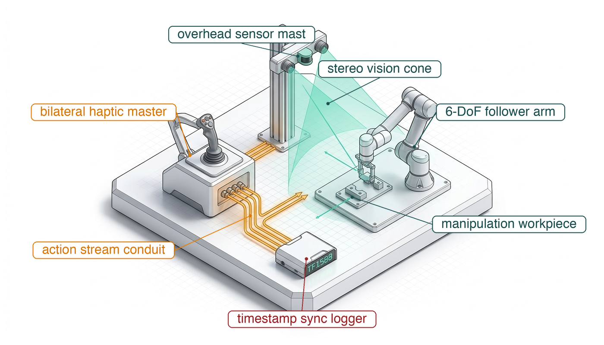{fig-alt="Isometric blueprint showing the physical data and ingestion pipeline: The system includes key components: a bilateral teleoperation leader arm for precise manipulation; a 6-axis operator load cell measuring force and providing control feedback; a calibrated stereo vision sensor head for depth perception; a micro-lidar rangefinder using laser pulses for accurate distance measurement; an optical calibration checkerboard ensuring sensor alignment precision; and a deterministic flash logger for reliable data storage under varying conditions."}
:::

::: {.content-visible unless-format="pdf"}
{fig-alt="Isometric blueprint showing the physical data and ingestion pipeline: bilateral teleoperation leader arm, 6-axis operator load cell, calibrated stereo vision sensor head, micro-lidar rangefinder, optical calibration checkerboard, and deterministic flash logger."}
:::

:::

## Purpose {.unnumbered .unlisted}

::: {.content-visible when-format="pdf"}
\begin{marginfigure}
\resizebox{0.92\linewidth}{!}{\mlphysicalstackfull{20}{20}{20}{20}{100}}
\end{marginfigure}
:::

_Why can a large archive of successful demonstrations leave a robot unable to recover from its first mistake?_

A successful demonstration shows how one machine completed a task under one set of conditions. It shows almost nothing about what to do after a slip, a shifted fixture, or a worn gripper, yet a learned policy's first error carries it into exactly those states, where the archive holds no instruction. Repeating the demonstration enlarges the archive without filling that gap. The recorded motion also carries the operator's delay, the machine's limits, and every correction the permission path applied, so a training process that cannot separate these influences learns a safeguard's intervention or a mechanical limitation as if it were skill. Gathering the missing experience costs operator time and component life, and the collection itself must stay within the machine's physical limits. Physical data must therefore be engineered, from the choice of experiences to the meaning, timing, and physical origin of every label and the conditions the archive leaves uncovered. Because every collected action crosses the causal boundary, its irreversible costs decide what a machine can learn and where its evidence stops.



::: {.callout-learning-objectives}

- Analyze the conditional quadratic imitation-cost bound and distinguish dataset occupancy from evaluated closed-loop competence
- Select the action tap a dataset imitates and align multi-rate sensor and action streams to hardware exposure-midpoint timestamps within the task's spatial tolerance
- Estimate usable demonstration yield from collection time, operator rest, and physical reset overhead, and budget the mechanical component wear a campaign consumes
- Identify collection gaps by joining empirical state-action occupancy against a required scenario ledger
- Separate failed autonomous actions from admissible human recovery across the divergence, takeover, and stabilization timestamps of an intervention episode
- Evaluate whether an embodiment's mechanical, sensing, and timing assumptions transfer to another machine without falling into the normalization fallacy
- Detect silent calibration and plant drift in a demonstration archive using kinematic reprojection and repeated excitation trajectories
- Design an immutable provenance record linking each observation to its four-stream action taps ($\RequestedActionTap, \MappedCommandTap, \EnforcedCommandTap, \MeasuredResponseTap$) and to the collecting plant

:::

## Endogenous Experience {#sec-data-endogenous-experience}

In most machine learning, the dataset exists before the engineering begins. A text corpus or an image benchmark is gathered independently of the model, costs little per additional example, and does not change in response to anything the model predicts. A physical machine has no such corpus. Collecting demonstrations on the robot consumes operator time and component life; robot-free and synthetic sources avoid that robot wear but still require qualification for the target machine. Every telemetry record reflects who commanded the action, what the permission path admitted, and how the physical body moved. Furthermore, each executed action changes the physical state of the system, dictating what subsequent observations can reveal. Physical data is therefore an engineered artifact. The central challenge of physical data engineering is deciding which experiences to collect, and what to record about them, so that a policy learns the task rather than the idiosyncrasies of its collection. Answering this challenge requires four elements: accounting for collection costs in operator time and hardware wear, defining an unambiguous meaning for every recorded action label, establishing a metric for state-space coverage independent of the archive's internal contents, and explicitly auditing what the archive omits.

Consider a warehouse mobile manipulator tasked with opening a spring-latched cage door: the robot can flawlessly enforce its low-level motion limits and yet fail because it lacks the operational experience to unlatch the door. During a demonstration, a human operator commands motion, the safety permission path checks and filters it, and the robot's physical body drives against the mechanical latch. The onboard sensor log captures the output of that entire coupled loop. The limits and handoffs that Part I recorded for this machine, in the limit record of @sec-body-limit-record-schema and the handoff record of @sec-nervous-handoffs-matrix, therefore become preconditions on the training data fed to the learned policy proposer, since every logged command was shaped by them before the body moved. Choosing which physical experiences to collect demands a rigorous accounting of how control inputs shift future sensory states; choosing what to imitate requires cleanly separating the operator's raw request from the safety-filtered command and the measured physical response.

A policy fit by supervised imitation to nominal, clean teleoperated demonstrations of door openings (behavioral cloning, defined below) can execute flawlessly in simulation yet jam the latch during its first autonomous deployment. The primary culprit is the distribution shift that the machine's own closed-loop actions induce. Unlike passive inference on a fixed benchmark, an action executed within an embodied Markov decision process (MDP), in which the next state depends on the current state and action, physically alters the robot's spatial trajectory, camera viewpoint, and contact states. That displacement changes the probability distribution of every subsequent sensory observation ($\DecisionProcessState_{t+1} \sim \EnvironmentTransitionDistribution(\DecisionProcessState \mid \DecisionProcessState_{t}, \CognitivePolicyAction_{t})$).

::: {.column-margin .margin-pointer}
↪ The Markov decision process, with its transition model and reward, is developed for the latch task in @sec-training-rl-primer.
:::

::: {#dfn-data-endogenous-covariate-shift .callout-definition title="Endogenous covariate shift"}

***Endogenous covariate shift***\index{Endogenous covariate shift!definition}\index{Covariate drift!physical AI} is the closed-loop distribution discrepancy wherein an embodied agent's executed actions alter its subsequent physical states and sensory observations ($\DecisionProcessState_{t+1} \sim \EnvironmentTransitionDistribution(\DecisionProcessState \mid \DecisionProcessState_{t}, \CognitivePolicyAction_{t})$), driving the system into state-space regimes unsupported by its training demonstrations.

1.  **Significance**: Explains how offline behavioral cloning can fail during closed-loop physical execution: a perturbation may drive the system into states where the policy lacks training support.
2.  **Distinction**: Unlike exogenous dataset shift caused by changing ambient lighting or seasonal weather, endogenous shift is actively generated by the agent's own closed-loop actions altering its subsequent observation distribution.
3.  **Common pitfall**: Attempting to fix closed-loop policy failure by collecting more nominal expert demonstrations, which only increases data density along the success manifold without providing the corrective recovery data needed to escape boundary excursions.

:::

This distribution shift is how the second law, endogenous data (principle \ref{pri-vol4-endogenous-drift}), shows up in data collection, where the machine's own actions choose the states its archive must later answer for. An archive composed exclusively of flawless executions without recovery trajectories becomes an operational liability: the moment the autonomous policy commits its first sub-millimeter tracking error, the robot enters states never encountered during training.

### Mechanics of endogenous covariate shift {#sec-data-covariate-shift}

In classical statistical learning theory, empirical risk minimization assumes that samples are drawn independent and identically distributed (i.i.d.) from an exogenous, stationary distribution $\ExogenousDataDistribution$. An image classifier that misidentifies a dog as a cat does not alter the pixels of subsequent images in the test set. The covariate shift encountered in imitation learning is the closed-loop, endogenous counterpart to this setting. Passive machine learning uses the term *covariate shift* to describe an open-loop observational phenomenon: the marginal input distribution $\InputDistribution$ changes (such as evaluating a vision model trained on sunny daytime driving under rainy nighttime illumination) while the underlying conditional data-generating function $\ConditionalDistribution$ remains stationary. In that setting, the model remains a passive observer: its predictions $\PassiveModelPrediction$ exert zero physical back-action on the environment, and an inference error does not physically mutate subsequent inputs.

::: {.column-margin .margin-pointer}
↩ The closed loop through which a flawed proposal carries the machine into states missing from its training distribution is established in @sec-boundary-tensors-to-silicon.
:::

In an embodied physical system, two distinct mechanisms distort what the learner encounters. The first mechanism shifts the states that the policy visits even when the underlying hardware remains unchanged; the second mechanism actively alters how the physical plant responds to any given control input:

1. **Endogenous state distribution shift**: The policy's executed actions $\CognitivePolicyAction_{t} = \Policy(\MultimodalObservation_{t})$ directly drive the physical state transition $\DecisionProcessState_{t+1} \sim \EnvironmentTransitionDistribution(\DecisionProcessState \mid \DecisionProcessState_{t}, \CognitivePolicyAction_{t})$, actively determining the sensory observations $\MultimodalObservation_{t+1}$ the robot encounters next. A single control error displaces the physical body into an unvisited region of the state space, immediately mutating the incoming observation distribution.
2. **Active physical plant drift**: The physical plant is a continuous dynamical system governed by differential equations of motion $\PlantStateRate = \PlantDynamicsFunction(\MechanicalPlantState, \ControlInput; \PlantDynamicsParameters(\TimeInstant))$ whose parameters actively drift over operational time. Actuator Joule heating ($\TorqueProducingCurrent^2 \ElectricalResistance(\WindingTemperature)$) elevates winding temperature and increases copper resistance via $\ElectricalResistance(\WindingTemperature) = \ElectricalResistance_0(1 + \CopperTemperatureCoefficient \JouleanTemperatureRise)$. This resistance rise compresses the motor drive's available voltage headroom, capping the electrical current and peak torque delivered at high joint velocities. Over extended operating cycles, continuous loading degrades strain-wave gearbox lubrication, lowering torsional stiffness and expanding mechanical lost motion. Similarly, compliant elastomer gripper pads wear down and deform, shrinking the Coulomb friction cone ($\lVert \TangentialContactShear \rVert \le \CoulombFrictionCoefficient \NormalContactForce$). Finally, physical workpieces exhibit unmodeled variations in mass, center of gravity, and surface texture across trials, perturbing both the inertial loads the arm must accelerate and the gravitational torques the joints must sustain.

In embodied control, the policy's closed-loop actions induce an *endogenous state visitation distribution* $\LearnerStateVisitationDistribution(\DecisionProcessState)$, defined as the expected fraction of time steps that a rollout of policy $\pi$ spends in state $\DecisionProcessState$. When an agent is trained via offline behavioral cloning on demonstrations generated by an expert policy $\pi^*$, empirical risk minimization optimizes the imitation objective strictly over the expert's occupancy distribution $\ExpertStateVisitationDistribution(\DecisionProcessState)$. During autonomous execution, however, the learned policy must generate control actions under its own induced distribution $\LearnerStateVisitationDistribution(\DecisionProcessState)$. Any divergence between $\ExpertStateVisitationDistribution$ and $\LearnerStateVisitationDistribution$ can trigger cascading execution errors whenever the policy encounters a state lacking demonstrated corrective actions.

::: {#dfn-data-behavioral-cloning .callout-definition title="Behavioral cloning"}

***Behavioral cloning***\index{Behavioral cloning!definition} is imitation learning posed as supervised learning: a policy is fit to map each recorded observation to the action the demonstrator took there, with the loss weighted by the demonstrator's own state occupancy $\ExpertStateVisitationDistribution$.

1.  **Significance**: Training error is measured only on states the demonstrator visited, while deployment cost accrues on the states the learned policy visits. Under a 0–1 action loss (one whenever the policy's action differs from the expert's, zero otherwise) the worst-case excess cost can therefore grow with the square of the horizon $\BehaviorCloningHorizon$, the episode length in control steps, rather than linearly, as the next subsection derives.
2.  **Distinction**: Unlike corrective aggregation, which obtains expert labels at states the learner itself reaches (@sec-data-intervention-recovery develops it), behavioral cloning never observes the consequences of its own mistakes; unlike reinforcement learning, it needs demonstrations but no reward.
3.  **Common pitfall**: Reading a low held-out loss as evidence of closed-loop competence. A held-out split drawn from the same demonstrations shares their occupancy, so it cannot contain the states the policy's first error reaches.

:::

### Recovery and compounding error {#sec-data-curse-dimensionality-recoverability}

Opening a latch from a nominal centered approach and recovering from an off-axis sideways slip require different physical actions (@fig-05-latch-corridor). Every retained demonstration guides the gripper forward along the narrow corridor centered on the strike plate, populating the archive with thousands of forward-progress actions. The archive contains zero demonstrations starting from a gripper displaced a few millimeters toward the fixture that return it to the centerline. A skilled human operator rarely permits the gripper to drift into those boundary regimes, and teleoperation runs that exhibited noticeable drift were routinely aborted or discarded during curation.[^fn-alvinn-recovery-latch] At such a displaced state, nothing in the training data constrains the policy's output. The **recoverability problem**\index{Recoverability problem} is precisely this absence of demonstrated corrective actions directing the system back into the nominal corridor.

[^fn-alvinn-recovery-latch]: **ALVINN (Autonomous Land Vehicle in a Neural Network)**\index{ALVINN!recovery data}: Pomerleau's road-following network learned to steer from a human driver who kept the van centered, so its training images held almost no off-center views [@pomerleau1989alvinn]. His remedy shifted each camera image sideways in software and corrected the steering label to match, synthesizing recovery examples about 20 years before Dataset Aggregation (DAgger, @sec-data-intervention-recovery) [@pomerleau1991efficient]. A warp could fill that gap because the missing state was only a viewpoint of a flat road, whereas a gripper displaced toward the fixture also lacks contact forces that no image transform can manufacture, so its recoveries must be demonstrated or collected.

::: {#fig-05-latch-corridor fig-env="figure" fig-pos="t" fig-cap="**The latch corridor seen from above**: Retained demonstrations supply dense forward-progress actions inside a narrow corridor centered on the strike plate. A gripper displaced toward the fixture sits where the archive holds no demonstration, so nothing in the data specifies the action that returns it to the corridor, and an unconstrained output can carry it farther toward contact." fig-alt="Top-view sketch. A shaded horizontal corridor runs left to right toward a strike plate on the right, with five arrows pointing along its centerline. Above the corridor, a small square marks a displaced gripper. A dashed arrow from the gripper toward the corridor is labeled as the missing return action, and a dashed arrow from the gripper toward a shaded fixture band at the top is labeled as drift into contact."}
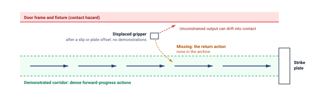{width="100%"}
:::

Whether this missing return action leads to task failure depends on the closed-loop dynamics of the complete physical plant. Because the robot's physical state encompasses joint coordinates, joint velocities, motor drive currents, contact wrenches (combined three-axis contact forces and torques), and raw camera streams, a nominal demonstration traces an infinitesimally thin manifold through a high-dimensional state space. Almost any unmodeled disturbance displaces the system off this path. If the physical plant and its low-level joint controllers inherently restore small lateral displacements toward the centerline through compliant passive dynamics, an imperfect policy output near the corridor boundary will naturally attenuate. If the system dynamics lack this self-centering stability, the tracking error will persist or compound until a learned recovery policy, the safety permission path, or a human supervisor intervenes. While production demonstration archives often contain occasional human corrections, their coverage cannot be assumed; it must be audited against an explicit scenario ledger (@sec-data-policy-coverage).

The quadratic worst-case scaling of behavioral cloning can be derived through a discrete summation over horizon steps. Suppose an autonomous agent follows the expert trajectory until encountering its first execution error at step $\FirstErrorStepIndex \in \{1, \dots, \BehaviorCloningHorizon\}$. If this error propels the system into an unsupported state from which it never recovers, the agent incurs an adverse task cost at every remaining step ($\BehaviorCloningHorizon - \FirstErrorStepIndex$). Assigning each time step an upper bound $\SingleStepImitationError$ on the probability of committing a first error and normalizing the per-step cost to unity ($\ImmediateTaskCostScore_t = 1$) yields the following worst-case cost accumulation. This discrete summation serves as an upper-bound derivation rather than an exact expectation over independent failure events:
$$\sum_{\FirstErrorStepIndex=1}^\BehaviorCloningHorizon \SingleStepImitationError (\BehaviorCloningHorizon - \FirstErrorStepIndex) = \SingleStepImitationError \left( \BehaviorCloningHorizon^2 - \sum_{\FirstErrorStepIndex=1}^\BehaviorCloningHorizon \FirstErrorStepIndex \right) = \SingleStepImitationError \left( \BehaviorCloningHorizon^2 - \frac{\BehaviorCloningHorizon(\BehaviorCloningHorizon+1)}{2} \right) = \frac{\BehaviorCloningHorizon(\BehaviorCloningHorizon-1)}{2} \SingleStepImitationError \approx \frac{1}{2} \BehaviorCloningHorizon^2 \SingleStepImitationError.$$
Contrast this result with open-loop supervised learning: if per-step inference errors were independent and exerted zero feedback on subsequent model inputs, an error rate of $\SingleStepImitationError$ per step would scale linearly over $\BehaviorCloningHorizon$ steps as $\sum_{t=1}^\BehaviorCloningHorizon \SingleStepImitationError = \BehaviorCloningHorizon\SingleStepImitationError$. The extra factor of $\BehaviorCloningHorizon$ appearing in $\CovariateDriftBound$ is the mathematical signature of closed-loop endogenous feedback.

This quadratic bound characterizes the accumulation of task cost over time, not the physical trajectory of the machine. The result does not imply that spatial tracking errors grow quadratically as $\TimeInstant^2$. Closed-loop contact forces, mechanical compliance, and actuator saturation govern how physical trajectories evolve; the derivation formalizes only the cost of operating in states where the policy lacks training support.

Formally, let $\pi$ represent the learned policy, $\pi^*$ the expert demonstration policy, $\ExpectedTaskCostSum$ the expected cumulative task cost over horizon $\BehaviorCloningHorizon$, and $\SingleStepImitationError$ the upper bound on the probability of action disagreement across expert-visited states under a 0–1 action loss: $\mathbb{E}_{\DecisionProcessState \sim \ExpertStateVisitationDistribution} [\IndicatorFunction(\pi(\DecisionProcessState) \ne \pi^*(\DecisionProcessState))] \le \SingleStepImitationError$. Assuming per-step task costs lie in $[0,1]$, behavioral cloning\index{Behavioral cloning!quadratic error compounding} admits the worst-case bound (@eq-data-quadratic-drift) derived by @ross2010efficient and restated by @ross2011reduction:
$$\ExpectedTaskCostSum(\pi)-\ExpectedTaskCostSum(\pi^*) \le \BehaviorCloningHorizon^2\SingleStepImitationError.$$ {#eq-data-quadratic-drift}
The published theorem carries a constant of one rather than the sketch's one half; both are worst-case bounds, and their quadratic dependence on the horizon is the same.

In practice, this theoretical bound can exceed the maximum possible cost achievable in a finite episode. Because per-step costs are bounded in $[0,1]$, the excess cost is trivially bounded by $\BehaviorCloningHorizon$; hence, $\min(\BehaviorCloningHorizon, \BehaviorCloningHorizon^2\SingleStepImitationError)$ represents the operational upper bound. Once the quadratic expression surpasses $\BehaviorCloningHorizon$, it provides no meaningful prediction regarding physical failure rates or contact severity. The practical engineering value of this bound lies in exposing why behavioral cloning has no defense in states its demonstrations never reached, rather than in predicting exact physical collision rates.

::: {.column-margin .margin-pointer}
↪ The full derivation of the quadratic bound, with its loss and cost assumptions, is developed in @sec-appendix-ml-compounding.
:::

The actual scaling with horizon length depends heavily on the chosen loss function, the action space, and the closed-loop plant stability; consequently, @eq-data-quadratic-drift reflects a classical result for discrete 0–1 loss rather than an absolute law for all imitation architectures. When trained under logarithmic loss (minimizing the negative log-probability assigned to expert actions) over a well-specified policy class containing the expert, behavioral cloning can achieve a sample complexity that does not grow with the horizon length, provided total reward is bounded and the policy class capacity is controlled [@foster2024behavior]. Continuous action spaces, however, introduce the opposite challenge. Even when the physical closed loop is exponentially stable (small mechanical perturbations decay at a fixed rate) and the expert policy is smooth and deterministic, any smooth, deterministic imitator can exhibit closed-loop execution errors that scale exponentially with horizon length relative to its training loss [@simchowitz2025pitfalls]. The same analysis identifies two ways around this compounding [@simchowitz2025pitfalls]. The first changes the policy class: a policy that is non-smooth, that is non-Markovian (its action depends on the recent history and not only the current observation), or whose action distribution is multimodal (it can place probability on several distinct actions at once, rather than averaging them) escapes the result, and action chunking and diffusion decoders have these properties. The second changes the data: demonstrations deliberately spread across a wide tube surrounding the nominal trajectory. That second remedy is a data-collection decision, and @sec-data-intervention-recovery returns to it as noise injection during teleoperation. Because the mobile manipulator operates in a continuous control space, closed-loop success ultimately hinges on whether the combined policy and low-level controllers actively restore a displaced gripper to the nominal path.

::: {.column-margin .margin-pointer}
↩ Action chunking, in which the policy emits a short sequence of setpoints per inference, is established in @sec-brain-action-chunking.
:::

Collecting more nominal expert demonstrations does not resolve endogenous covariate shift. Adding another thousand hours of clean, centered door openings merely increases sample density along the nominal trajectory; the empirical support outside this narrow tube remains strictly zero ($\ExpertStateVisitationDistribution(\DecisionProcessState) = 0$). This pitfall is the *nominal demonstration trap*. Furthermore, logging physical robot experience carries direct hardware costs. While a web crawler scrapes static text with zero marginal mechanical wear, every recorded second of robot telemetry consumes actuator fatigue life, heats motor windings ($d\WindingTemperature/d\TimeInstant$), wears down gearbox teeth, and depletes battery reserves. In practical data-collection campaigns, required pauses for operator fatigue, sensor recalibration, scene resets, and discarded trials often leave less than one quarter of scheduled workcell time as usable demonstration data (@sec-data-teleop-costs). Physical telemetry is scarce, wear-intensive, and costly; collecting it without modeling closed-loop recovery dynamics compromises policy training.

::: {.column-margin .margin-pointer}
↩ Actuator thermal dissipation ($d\WindingTemperature/d\TimeInstant$) and winding damage limits are established in @sec-body-thermal-duty-cycles.
:::

A physical command also undergoes substantial semantic shifts as it traverses the control stack toward the actuators. In a system partitioned by the proposal boundary, an operator's or policy's requested action is mapped into a trajectory setpoint, evaluated and potentially modified by the safety permission path, and executed by the physical plant to produce a measured response. Logging only the raw requested action trains the policy on commands the plant may be physically incapable of realizing. Conversely, logging only the measured plant response teaches the policy to reproduce structural deflection, link flexure, and gear backlash as though they represented intentional human control skill.

::: {.column-margin .margin-pointer}
↩ The proposal boundary, which separates a learned proposer from the permission path that alone may admit an action, is established in @sec-boundary-machine-model.
:::

A physical data-collection campaign must therefore resolve two architectural decisions before recording its first trajectory: which controller source dictates the actions, and which of these four representations of one command (the request, the mapped setpoint, the admitted command, and the measured response) the dataset will preserve as its training label.

## Physical Telemetry Sources and Ingestion Modalities {#sec-data-collection-sources}

Manipulating a mechanism such as a warehouse cage-door latch reveals how heavily the telemetry source shapes the resulting dataset. An engineer can physically guide the robot arm, command it through a remote teleoperation rig, or dispatch an automated controller to execute the trajectory. Each ingestion path fundamentally alters which tracking errors, recovery maneuvers, and transient contacts reach the archive. Because collection on the robot consumes machine operating hours, joint wear, and human engineering effort, selecting a telemetry source represents an architectural trade-off between operational cost and the useful experience yielded per attempted episode.

In a streaming telemetry architecture, physical data sources separate according to who chooses the action and how the control stream enters the ingestion pipeline:

1. In **kinesthetic teaching**, a colocated human demonstrator physically grasps and guides the unpowered or gravity-compensated links of the mechanism. The logging pipeline records joint encoder positions at the native controller rate without network transport delays. However, human biomechanics govern the motion's bandwidth, moving far more slowly than the controller's sampling loop, while labor costs scale $1:1$ with demonstrator time. Furthermore, the demonstrator's body frequently occludes onboard camera views, introducing systematic visual distribution shifts relative to autonomous operation.
2. In **teleoperation**, a remote operator manipulates an input device to puppet the follower robot across a network fabric.[^fn-goertz-force-teleop] Teleoperation interfaces differ in how operator inputs map to robot actuators and how much physical contact information reflects back to the human. Joint-space leader-follower arms such as ALOHA [@zhao2023learning] and GELLO [@wu2023gello] mirror the follower's joint topology, often at reduced scale, streaming joint angles directly to the follower without inverse kinematics (computing the joint angles that place the tool at a commanded pose). In contrast, tracked spatial controllers and rate-controlled space mice command Cartesian tool poses or velocities that require inverse kinematics solvers at runtime, while force-reflecting bilateral arms actively transmit measured contact forces back to the operator's hands. @Tbl-05-teleop-taxonomy compares these interfaces and names the artifact each leaves in the recording.
3. In **scripted collection**, a deterministic trajectory generator executes automated motion primitives, such as cubic splines or impedance-governed state machines. Ingestion rates are high and predictable ($50\text{--}500\text{ Hz}$), but trajectories traverse rigid, repetitive manifolds. Because these paths fail to generate corrective recovery data during off-nominal contact, the manipulator risks jamming whenever workpiece dimensions deviate by even a millimeter.
4. In **exploratory collection**, an active neural policy or reinforcement learning agent selects actions to maximize an information-theoretic objective, such as epistemic entropy or intrinsic curiosity. Although data throughput matches the robot's peak policy cadence ($50\text{--}100\text{ Hz}$), unconstrained exploratory actions risk high-energy collisions, tripping hardware safety tripwires or degrading mechanical gearboxes through repeated high-torque shock loads.
5. In **autonomous deployment logging**, production policies control actuators during routine factory or warehouse operation, streaming multimodal telemetry into local circular buffers in situ. This channel yields zero-marginal-labor data at the system's full execution rate ($10\text{--}50\text{ Hz}$ for high-level policies, $1\text{ kHz}$ for joint servos). However, runtime safety barriers heavily censor the recorded state distribution, capturing almost exclusively nominal operating regimes while excluding boundary failures.
6. In **robot-free demonstration**, the operator carries a hand-held gripper fitted with a wrist camera and performs tasks directly in the physical environment, as in the Universal Manipulation Interface (UMI) [@chi2024umi]. Collection incurs zero robot operating hours or actuator wear, allowing a single demonstrator to gather data across locations where no robot is deployed. The engineering cost shifts to label synthesis: because the hand-held rig records its own Cartesian trajectory and visual feed without robot joint states, actions must be expressed relative to the gripper's pose frame and executed downstream through the target robot's controller. Furthermore, the deployed robot's observation and actuation latencies must be calibrated to match the recording timing (@sec-data-multimodal-time-sync).

[^fn-goertz-force-teleop]: **Bilateral Telemanipulation**\index{Raymond Goertz!bilateral telemanipulation}: Raymond Goertz's 1949 master-slave manipulator at Argonne National Laboratory moved tongs behind radiation shielding in exact correspondence with a master handle, and its mechanical linkage returned the forces at the tongs to the operator's hand [@goertz1949master; @hokayem2006bilateral]. Remote manipulation therefore began with contact force inside the loop. A demonstration recorded through an interface that drops that force channel cannot contain the contact corrections the operator would have made by feel.

A seventh source removes physical hardware entirely. Simulation pipelines eliminate mechanical wear by substituting a numerical contact model for the physical plant, generating synthetic demonstrations at scale. Trajectory generators can expand a few hundred human seed demonstrations across novel object poses and scene layouts, replaying them in physics engines to synthesize tens of thousands of varied trajectories [@mandlekar2023mimicgen]. Downstream policies can then co-train on simulated and real telemetry at a specified mixing ratio. However, these synthetic streams require rigorous metadata tagging: records must log their source generator, physics engine build, integrator step size, and contact solver parameters. Furthermore, the dataset's scenario ledger, the list of required operating conditions that @sec-data-curse-dimensionality-recoverability-geometry builds, must flag every condition covered solely by synthetic rollouts, ensuring that training diagnostics can isolate simulation artifacts from measured physical plant behavior. The provenance requirements for synthetic telemetry appear under dataset degradation (@sec-data-sim-to-real-artifacts).

Because the ingestion source determines how the machine interacts with its physical environment, these data streams occupy disjoint state-action manifolds even when executing identical manipulation tasks. Consider releasing the warehouse mobile manipulator's cage-door latch. A colocated demonstrator guiding the arm feels the latch bind through direct tactile resistance and immediately modulates wrist compliance. A remote teleoperator viewing compressed video streams lacks haptic feedback and exhibits step-and-wait hunting, pausing frequently to verify strike plate contact. A scripted controller advances along a fixed geometric path at constant velocity, producing an identical, rigid contact force spike on every repetition. An exploratory policy approaches at oblique angles, binding the latch until safety tripwires abort the trial. Far from representing noisy variations of a single ground-truth trajectory, these recorded streams reflect distinct dynamical systems characterized by divergent bandwidths, transport latencies, and mechanical compliance profiles, as systematized in @tbl-05-sources-taxonomy.

| Physical Data Source                     | Ingestion Bandwidth & Cadence                                                    | Contact Compliance & Force Awareness                     | Scaling Labor Economics                                     | Collection Boundary Conditions to Check                              |
|:-----------------------------------------|:---------------------------------------------------------------------------------|:---------------------------------------------------------|:------------------------------------------------------------|:-------------------------------------------------------------------|
| **Kinesthetic teaching**                 | Controller rate; motion bandwidth set by the human arm                           | High (direct physical feel of binding and compliance)    | Very high ($1:1$ dedicated human demonstrator)              | Human contact with links; qualified force and speed limits                |
| **Teleoperation (bilateral/isomorphic)** | Moderate ($20\text{--}50\text{ Hz}$, network + human latency)                    | Moderate to high (depends on haptic force feedback)      | High ($1:1$ human operator per active cell)                 | Bounded delay and visibility; isolation and qualified response        |
| **Scripted primitives**                  | High ($50\text{--}500\text{ Hz}$, deterministic trajectory generators)           | Low (rigid trajectories unless impedance-governed)       | Low (automated once authored; engineering upfront)          | Fixture mismatch and contact; guarded trajectory     |
| **Exploratory policy**                   | High ($50\text{--}100\text{ Hz}$, active neural exploration)                     | Variable (learned or randomized contact behaviors)       | Very low (fully autonomous hardware execution)              | Bounded exploration; qualified containment |
| **Autonomous deployment logging**        | Full system rate ($10\text{--}50\text{ Hz}$ policy, $1\text{ kHz}$ joint servos) | Operational (reflects live deployed closed-loop control) | Zero marginal labor (harvested passively during production) | Qualified operating domain and runtime enforcement            |
| **Robot-free hand-held device**          | Device camera and pose rate; no robot joint stream                               | High (operator feels real contact through the device)    | Moderate (one person per device; no robot time or wear)     | No robot actuation during capture; target execution separately qualified         |
| **Synthetic generation**                 | Simulator step rate, limited by compute                                          | Modeled (contact set by engine and parameters)           | Low after seed demonstrations are recorded                  | No physical actuation during generation; model fidelity and target qualification      |

: **Systems trade-offs across physical demonstration and telemetry sources**: Seven collection sources compared across control dynamics, contact awareness, human labor economics, and the boundary conditions that collection must satisfy. {#tbl-05-sources-taxonomy tbl-colwidths="[20,20,20,20,20]"}

```{python}
#| label: calc-data-effective-sample-size
#| echo: false
#| warning: false
#| message: false
# ┌─────────────────────────────────────────────────────────────────────────────
# │ EFFECTIVE SAMPLE SIZE OF CORRELATED TELEMETRY (LEGO)
# ├─────────────────────────────────────────────────────────────────────────────
# │ Context: @sec-data-collection-sources (effective sample size paragraph)
# │ Goal:    Show how few independent observations one hour of 1 kHz logging
# │          holds when adjacent records are almost perfectly correlated.
# │ Show:    Records per hour; lag-1 correlation; effective sample size.
# │ How:     N = rate * 1 h; N_eff = N (1 - rho) / (1 + rho) for an AR(1)
# │          statistic (Thiebaux and Zwiers 1984).
# └─────────────────────────────────────────────────────────────────────────────
from mlsysim import *
from mlsysim.core.units import *
from mlsysim.fmt import fmt, fmt_int, fmt_sci, fmt_frequency, fmt_latency, check

RM = Embodied.MobileManipulator.WarehouseMobileManipulator

class EffectiveSampleSize:
    """Effective sample size of one hour of permission-tick telemetry."""

    # ┌── 1. LOAD (Constants & Parameters) ─────────────────────────────────
    f_log = RM.permission_rate  # one record per permission tick; category: datasheet
    t_log = 1.0 * hour  # category: chosen
    rho = 0.999  # lag-1 autocorrelation of a slowly varying statistic; category: illustrative

    # ┌── 2. EXECUTE (Compute) ─────────────────────────────────────────────
    n_records = (f_log * t_log).to("").magnitude
    n_eff = n_records * (1.0 - rho) / (1.0 + rho)
    ratio = n_records / n_eff

    # ┌── 3. GUARD (Assertions) ────────────────────────────────────────────
    check(abs(n_records - 3.6e6) < 1e-6, "One hour at 1 kHz should be 3.6 million records")
    check(1790 < n_eff < 1810, "Effective sample size should be about 1,800")
    check(1000 < ratio < 10000, "Step count should overstate independent samples by three orders of magnitude")

    # ┌── 4. OUTPUT (Format & Export) ────────────────────────────────────────
    f_log_str = fmt_frequency(f_log, unit=ureg.kilohertz, precision=0)
    n_records_str = fmt_sci(n_records, precision=1)
    rho_str = fmt(rho, precision=3)
    n_eff_str = fmt_int(round(n_eff, -2))
    t_tick_str = fmt_latency((1 / f_log).to(millisecond), unit=millisecond, precision=0)
```

The cheapest sources in @tbl-05-sources-taxonomy also produce the highest volume of records. This abundance frequently invites a misconception borrowed from disembodied machine learning, where empirical scaling laws correlate model capability directly with raw token count or pretraining dataset volume ($\RawRecordCount$). In physical telemetry, treating every logged control step as an independent observation is a fundamental category error. An edge logger sampling at `{python} EffectiveSampleSize.f_log_str` records `{python} EffectiveSampleSize.n_records_str` state-action pairs every hour, yet adjacent timesteps exhibit near-total temporal autocorrelation ($\SerialAutocorrelation \to 1.0$). Successive kinematic readings sampled `{python} EffectiveSampleSize.t_tick_str` apart differ only by sub-millimeter structural displacements and sensor quantization noise. For a stationary scalar telemetry statistic with geometrically decaying autocorrelation $\SerialAutocorrelation_k = \SerialAutocorrelation^\AutocorrelationLagIndex$, as characterized by a first-order autoregressive AR(1) process, the large-sample *effective sample size* (ESS)[^fn-ess-correlated-telemetry] for estimating its mean is:
$$\EffectiveSampleSize = \RawRecordCount \frac{1 - \SerialAutocorrelation}{1 + \SerialAutocorrelation}.$$ {#eq-data-effective-sample-size}
Under this autoregressive model, an autocorrelation of $\SerialAutocorrelation =$ `{python} EffectiveSampleSize.rho_str` across `{python} EffectiveSampleSize.n_records_str` raw records yields only `{python} EffectiveSampleSize.n_eff_str` statistically independent observations.

While lag-1 correlation alone does not govern ESS across every non-stationary telemetry stream, high-frequency sampling still cannot substitute for operational diversity. In language modeling, consecutive tokens represent high-entropy semantic transitions across an extensive vocabulary. High-rate telemetry can resolve fast contact transients even when the slowly varying statistic used in the ESS example changes little. Increasing its sampling rate does not populate an unvisited scenario cell. Physical dataset coverage expands through independent physical episodes, diverse workpiece placements, varying illumination, and shifting friction coefficients, and never through the clock frequency of the logger. A curated archive containing several hundred episodes that systematically sweep initial geometric and mechanical conditions provides far richer empirical support than millions of repetitive timesteps collected across a static test bench.

[^fn-ess-correlated-telemetry]: **Effective Sample Size**\index{Effective sample size!serially correlated telemetry}: The factor $(1-\SerialAutocorrelation)/(1+\SerialAutocorrelation)$ is the effective-sample-size correction for the mean of a first-order autoregressive series, the correction climatologists apply to serially correlated weather records before testing a trend [@thiebaux1984interpretation]. At the correlation used here it turns an hour of permission-tick records into about `{python} EffectiveSampleSize.n_eff_str` independent ones, so a step count overstates the independent information available for estimating this statistic’s mean by three orders of magnitude before coverage is even considered.

### Human demonstration idiosyncrasies and mechanical artifacts {#sec-data-human-idiosyncrasies}

Because a human operator executes the motions in teleoperated demonstrations, the resulting telemetry permanently embeds the demonstrator's biomechanical limitations, motor recruitment patterns, and perceptual latencies into the training dataset:

- **Neuromuscular sub-movements and physiological tremor:** Human motor control operates through discrete motor unit recruitment bursts rather than continuous, smooth trajectories. These neuromuscular dynamics introduce corrective sub-movements at $2\text{--}3\text{ Hz}$ overlaid with involuntary physiological tremor at $8\text{--}12\text{ Hz}$. If a high-frequency behavioral cloning policy trains on raw joint velocities without low-pass filtering, the neural network imitates this biological tremor as high-frequency torque chatter, accelerating mechanical fatigue in the robot's harmonic drives and gearboxes.
- **Visual latency and step-and-wait hunting:** When an operator guides a manipulator toward a contact fixture using 2D camera monitors, monocular depth ambiguity and video compression latency force an unnatural *step-and-wait* hunting cycle. The operator inches the gripper forward by a few millimeters, pauses for $200\text{--}400\text{ ms}$ to visually confirm clearance or contact across the video stream, and only then resumes motion. An imitation policy trained on uncurated velocity streams treats these latency-induced pauses as deliberate actions, yielding deployed behaviors that stutter, oscillate, or stall mid-trajectory.
- **Attentional narrowing and gaze-conditioned bias:** Human demonstrators naturally focus visual attention on the active tool center point (TCP). Because the operator rarely tracks the peripheral links of the arm during fine manipulation, the robot's elbow or shoulder links frequently sweep perilously close to structural supports or table edges. An imitation policy trained on these demonstrations inherits trajectories that graze workspace obstacles, yet lacks the human's peripheral situational awareness or rapid collision avoidance reflexes.

Because an ingestion logger records every physical tremor, visual hesitation, and marginal joint clearance as an intended demonstration, imitation policies reproduce these operational flaws unless the training pipeline explicitly filters or abstracts them. Selecting a physical telemetry source dictates what raw experience reaches the archive; formulating the corresponding action labels dictates what control dynamics the policy extracts from that experience.

## Action Label Selection and Supervisory Grounding {#sec-data-action-label}

By the time the gripper contacts the strike plate on the cage-door latch, the operator's input motion has transformed into four distinct numerical signals across the system hierarchy. Which signal the ingestion pipeline designates as the supervisory target determines what behavioral dynamics the neural policy internalizes. The robot splits its computational architecture across two decoupled processing domains:

- The unprivileged **Linux application processor** executes perception pipelines, handles video frame ingestion, runs teleoperation input mapping, and computes the neural policy forward pass ($\Policy(\MultimodalObservation_{t})$).
- On the permission side of the proposal boundary, a hard real-time **safety microcontroller (MCU)** runs joint and permission checks at the chosen `{python} EffectiveSampleSize.f_log_str` cadence. Dedicated motor-drive logic closes the faster field-oriented current loop; its current samples remain distinct from the telemetry retained at each permission tick.[^fn-capture-encoder-dma]

[^fn-capture-encoder-dma]: **Hardware Input Capture**\index{Input capture!DMA latching}: On real-time MCUs, a timer's input-capture unit latches encoder counts and current-shunt conversions at a hardware edge, and Direct Memory Access (DMA) moves them to memory without waiting on software. Sampling jitter stays within microseconds, so the denominator of a numerically differentiated velocity or acceleration carries no scheduling noise.

### The four-stream action tap tuple {#sec-data-four-stream-action-tap}

A command can be logged at each of the four causal stages it passes through, and the **four-stream action tap**\index{Four-stream action tap!definition}\index{Action tap!definition} $(\RequestedActionTap, \MappedCommandTap, \EnforcedCommandTap, \MeasuredResponseTap)$ is the tuple that records all four, two on each side of the boundary between the unprivileged Linux host and the discrete safety MCU (@fig-05-action-taps). Tap 1 ($\RequestedActionTap$) captures raw policy or operator intent before kinematic mapping; Tap 2 ($\MappedCommandTap$) logs the mapped command prior to the black-channel link; Tap 3 ($\EnforcedCommandTap$) captures the admitted command following the 1 kHz permission check; and Tap 4 ($\MeasuredResponseTap$) records the physical plant response measured by joint encoders and current shunts. All four streams converge into a hardware-synchronized telemetry log, ensuring that interventions and tracking errors remain fully auditable.

::: {#fig-05-action-taps fig-env="figure" fig-pos="t" fig-cap="**Four-stream action tap tuple**: Four places a command can be logged, from raw policy intent on the application processor through to measured plant response. Which tap a dataset records decides what the model learns to imitate. The four-tap decomposition is this book's construct; the teleoperation rigs it instruments follow @zhao2023learning and @wu2023gello." fig-alt="Block diagram. On the application processor, a policy or operator box feeds a kinematic mapping box; tap 1, a req, sits between them and tap 2, a cmd, sits after the mapping. A black-channel link with no shared memory crosses the dashed proposal boundary to the discrete safety MCU, which holds the permission path at a 1 kHz tick. Tap 3, a enf, sits after the permission path, which feeds the drives that close the current loops and apply the torque limit. The drives move the plant, joint encoders measure the motion over an interval, and tap 4, a meas, leaves the encoders. All four taps run down to a synchronized telemetry log stamped with hardware timestamps."}
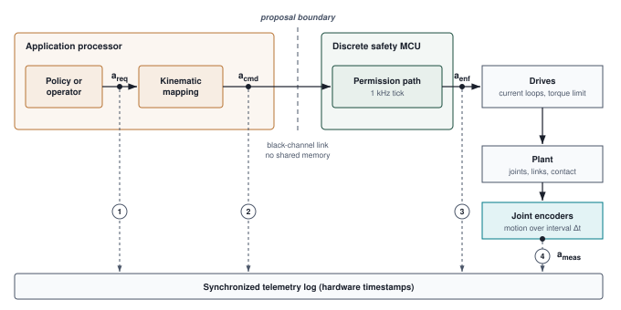{width="100%"}
:::

Dividing telemetry logging across the unprivileged Linux host and the hard real-time MCU captures four distinct physical semantics:

- **Tap 1: The requested action ($\RequestedActionTap$, "Asked"):** Logged in user space on the application processor, this represents unconstrained human operator input (from a leader arm or joystick) or the raw forward-pass output from an unverified policy, tagged with its native coordinate frame and issue timestamp prior to software validation. This proposal reflects unadulterated human or policy intent, but it frequently demands infeasible joint accelerations or violates spatial bounding envelopes.
- **Tap 2: The mapped command ($\MappedCommandTap$, "Mapped"):** The kinematically retargeted setpoint (such as Cartesian end-effector velocities converted to joint space setpoints via inverse kinematics), incorporating coordinate frame transformations, trajectory interpolation, and workspace limits before transmission across the black-channel board link to the safety MCU.
- **Tap 3: The enforced command ($\EnforcedCommandTap$, "Allowed"):** Logged on the bare-metal MCU on the permission side of the boundary, this represents the command after deterministic Control Barrier Functions (CBFs, safety filters that keep states within a forward-invariant safe set), velocity and acceleration clamps, torque saturation envelopes, and collision guards have checked or modified the proposal. Whichever tap a dataset chooses as its label, the imitation loss has the same form; written for the admitted command, it is:
  $$\PolicyImitationLoss(\ModelParameters) = \mathbb{E}_{(\MultimodalObservation_{t}, \EnforcedCommandLabel) \sim \DemonstrationDataset} \left[ \LossFunction(\Policy(\MultimodalObservation_{t}), \EnforcedCommandLabel) \right],$$
  Here the training dataset must contain curated, correctly attributed targets. Passing the permission check does not make a command an expert demonstration: a clamp or emergency stop may be a safeguard's response to a poor request. Override flags and companion taps determine which records can serve as imitation targets and which remain evidence of intervention.
- **Tap 4: The measured response ($\MeasuredResponseTap$, "Done"):** The physical plant reaction measured by optical joint encoders and motor current shunt resistors over the executed control tick, recording actual mechanical displacement and electrical effort. This measured response serves as proprioceptive state input ($\NextProprioceptiveObservation$) for subsequent policy steps rather than an action label.

::: {.column-margin .margin-pointer}
↪ Control barrier functions and the forward-invariant safe sets they enforce are developed in @sec-enforcement-safe-sets-conditional-permission.
:::

These distinctions become critical when commanded intent and physical motion diverge. If a teleoperator requests an aggressive movement that the safety permission path clamps, the resulting state transition follows the enforced command ($\EnforcedCommandTap$), not the unconstrained request ($\RequestedActionTap$). Pairing that transition only with the request conceals the safety intervention and teaches a policy to repeat demands the physical machine cannot execute.

At the latch, the opposite ambiguity arises. Contact resistance can bring measured joint velocities to zero ($\MeasuredJointVelocities \approx \ZeroVector$) while the motors continue exerting holding torque against the strike plate. Treating that response as a deliberate zero-velocity target loses the distinction between maintaining effort against the latch and choosing to stop. The appropriate imitation target depends on the policy's action interface; the other taps explain how that target became physical motion.

Retaining all four streams is what makes any single choice of label interpretable. A policy trained on the request alone learns commands the permission path would have clamped, and one trained on the measured response alone learns the arm's compliance, backlash, and external disturbances as if they were intended control. A log that keeps only the final encoder state or only the operator's input discards exactly the stages at which software and safety hardware changed the command. The tuple is also only as reliable as its shared clock. The application processor and the MCU must stamp their taps in one hardware-synchronized timebase, such as the IEEE 1588 Precision Time Protocol (PTP), written $\PtpHardwareTimestamp$, because a few milliseconds of skew between them misaligns each visual observation from the torque it prompted (@sec-data-multimodal-time-sync).

For the latch campaign, the imitation target is the mapped command whenever it represents an expert request that the permission path accepted unchanged. In that case $\MappedCommandTap$ and $\EnforcedCommandTap$ carry the same value, so the choice between the two taps matters only for commands the permission path modified. A modified command remains a separate, attributed intervention; a curated recovery can later supply an expert target at that state. Each training pair therefore carries two times. The observation is dated when its physics was true, at the exposure midpoint, and the command is dated when the operator issued it. The gap between them is part of the demonstration and is recorded rather than erased, because it contains the operator's own reaction time (@sec-data-bilateral-passivity). The alignment developed below supplies the first of these times.

### Multi-modal time synchronization and exposure midpoint alignment {#sec-data-multimodal-time-sync}

Recording the right action tap does not settle when each recorded value was physically true. In embodied platforms, sensory modalities operate at widely different sampling cadences and physical propagation regimes: cameras integrate photons over exposure windows of $10\text{--}35\text{ ms}$ at $30\text{--}60\text{ Hz}$, 6-axis force-torque sensors stream over a Serial Peripheral Interface (SPI) or Controller Area Network (CAN) bus at $100\text{--}500\text{ Hz}$, joint and permission telemetry is retained at the MCU's chosen $1\text{ kHz}$ tick while motor-drive current sampling serves the faster local current loop, and neural policy models dispatch setpoints at $10\text{--}50\text{ Hz}$. A naive data loader that simply latches the latest available sensor sample pairs each action with a camera frame whose exposure was centered $25\text{--}40\text{ ms}$ before the frame arrived in host memory, and it records that frame as the present state. The resulting policy learns to map historical visual states to present actions, baking artificial phase lag directly into its weights. This timing error belongs to the logging pipeline, not to the demonstration, so correct timestamps let the pairing process account for it.

```{python}
#| label: calc-data-sync-displacement
#| echo: false
#| warning: false
#| message: false
# ┌─────────────────────────────────────────────────────────────────────────────
# │ OBSERVATION-ACTION SYNC DISPLACEMENT (LEGO)
# ├─────────────────────────────────────────────────────────────────────────────
# │ Context: @sec-data-multimodal-time-sync
# │ Goal:    Compare the displacement an uncompensated observation-action lag
# │          injects against the latch clearance, at transit and latch speeds.
# │ Show:    Displacement at 0.50 m/s transit and at the two latch approaches;
# │          the largest tolerable lag at each latch speed.
# │ How:     dx = v * lag; lag_max = clearance / v. Latch speeds from AISLE;
# │          transit speed, lag, and clearance are chapter-local scenario inputs.
# └─────────────────────────────────────────────────────────────────────────────
from mlsysim import *
from mlsysim.core.units import *
from mlsysim.fmt import fmt_length, fmt_velocity, fmt_latency, fmt_multiple, check

AISLE = Embodied.Scenario.WarehouseAisle

class SyncDisplacement:
    """Displacement from pairing an observation with an action across a lag."""

    # ┌── 1. LOAD (Constants & Parameters) ─────────────────────────────────
    v_transit = 0.50 * meter / second  # generic arm transit speed; category: illustrative
    t_lag = 35.0 * millisecond  # uncompensated exposure-to-arrival lag; category: illustrative
    clearance = 2.0 * millimeter  # latch clearance; scenario assumption; category: illustrative
    v_guarded = AISLE.v_latch_approach  # category: illustrative
    v_fast = AISLE.v_latch_high  # category: illustrative
    t_skew_lo = 15.0 * millisecond  # full-frame rolling-shutter skew, fast readout; category: illustrative
    t_skew_hi = 33.0 * millisecond  # full-frame rolling-shutter skew, one 30 Hz frame; category: illustrative
    clearance_tight = 1.0 * millimeter  # tighter strike plate asked about in the checkpoint; category: illustrative

    # ┌── 2. EXECUTE (Compute) ─────────────────────────────────────────────
    dx_transit = (v_transit * t_lag).to(millimeter)
    dx_guarded = (v_guarded * t_lag).to(millimeter)
    dx_fast = (v_fast * t_lag).to(millimeter)
    transit_over_clearance = (dx_transit / clearance).to("").magnitude
    lag_max_guarded = (clearance / v_guarded).to(millisecond)
    lag_max_fast = (clearance / v_fast).to(millisecond)
    dx_skew_transit = (v_transit * t_skew_hi).to(millimeter)
    dx_skew_fast = (v_fast * t_skew_hi).to(millimeter)
    lag_max_tight = (clearance_tight / v_fast).to(millisecond)  # checkpoint answer; not printed

    # ┌── 3. GUARD (Assertions) ────────────────────────────────────────────
    check(abs(dx_transit.magnitude - 17.5) < 1e-9, "Transit displacement should be 17.5 mm")
    check(dx_guarded < clearance, "The guarded approach should fit the clearance at this lag")
    check(dx_fast > clearance, "The faster approach should exceed the clearance at this lag")
    check(abs(lag_max_fast.magnitude - 20.0) < 1e-9, "Largest tolerable lag at 0.10 m/s should be 20 ms")
    check(dx_skew_fast > clearance, "Worst-case rolling-shutter skew at 0.10 m/s should exceed the clearance")
    check(lag_max_tight < t_lag, "The checkpoint's tighter plate should reject the uncompensated lag at the faster approach")

    # ┌── 4. OUTPUT (Format & Export) ────────────────────────────────────────
    v_transit_str = fmt_velocity(v_transit, precision=2)
    t_lag_str = fmt_latency(t_lag, unit=millisecond, precision=0)
    clearance_str = fmt_length(clearance, unit=millimeter, precision=0)
    v_guarded_str = fmt_velocity(v_guarded, precision=2)
    v_fast_str = fmt_velocity(v_fast, precision=2)
    dx_transit_str = fmt_length(dx_transit, unit=millimeter, precision=1)
    dx_guarded_str = fmt_length(dx_guarded, unit=millimeter, precision=2)
    dx_fast_str = fmt_length(dx_fast, unit=millimeter, precision=1)
    transit_over_clearance_mult_str = fmt_multiple(transit_over_clearance, precision=1)
    lag_max_guarded_str = fmt_latency(lag_max_guarded, unit=millisecond, precision=1)
    lag_max_fast_str = fmt_latency(lag_max_fast, unit=millisecond, precision=0)
    t_skew_lo_str = fmt_latency(t_skew_lo, unit=millisecond, precision=0)
    t_skew_hi_str = fmt_latency(t_skew_hi, unit=millisecond, precision=0)
    dx_skew_transit_str = fmt_length(dx_skew_transit, unit=millimeter, precision=1)
    dx_skew_fast_str = fmt_length(dx_skew_fast, unit=millimeter, precision=1)
    clearance_tight_str = fmt_length(clearance_tight, unit=millimeter, precision=0)
```

To quantify the physical hazard of temporal misalignment, consider the spatial tracking error $\SyncPairingDisplacement$ injected into the dataset when an observation and an action are paired across an uncompensated phase lag $\ObservationPairingLag$:
$$\SyncPairingDisplacement(\TimeInstant) = \int_{t - \ObservationPairingLag}^{\TimeInstant} \Velocity(\IntegrationDummyTime)\,d\IntegrationDummyTime \approx \Velocity(\TimeInstant) \cdot \ObservationPairingLag.$$ {#eq-data-sync-displacement}
The latch campaign moves far more slowly than an arm in transit, and notebook \ref{nbk-data-pairing-lag} applies @eq-data-sync-displacement at both speeds.

::: {#nbk-data-pairing-lag .callout-notebook title="The pairing lag"}

**Problem**: A logger pairs each action with a camera frame whose exposure midpoint lies an uncompensated `{python} SyncDisplacement.t_lag_str` earlier. Does the resulting pairing error fit the `{python} SyncDisplacement.clearance_str` latch clearance at transit speed and at the latch campaign's two approach speeds, and how much lag can each approach tolerate?

**Variables**:

- Uncompensated lag $\ObservationPairingLag =$ `{python} SyncDisplacement.t_lag_str` (illustrative; exposure-to-arrival delay of an untimed logger)
- Latch clearance $\LatchClearance =$ `{python} SyncDisplacement.clearance_str` (illustrative)
- Transit speed `{python} SyncDisplacement.v_transit_str` (illustrative); guarded approach `{python} SyncDisplacement.v_guarded_str` and faster approach `{python} SyncDisplacement.v_fast_str` (illustrative scenario speeds of the running machine)

**Math**:

1. **Transit**: `{python} SyncDisplacement.v_transit_str` $\times$ `{python} SyncDisplacement.t_lag_str` $=$ `{python} SyncDisplacement.dx_transit_str`, `{python} SyncDisplacement.transit_over_clearance_mult_str` the clearance.
2. **Guarded approach**: `{python} SyncDisplacement.v_guarded_str` $\times$ `{python} SyncDisplacement.t_lag_str` $=$ `{python} SyncDisplacement.dx_guarded_str`, inside the clearance.
3. **Faster approach**: `{python} SyncDisplacement.v_fast_str` $\times$ `{python} SyncDisplacement.t_lag_str` $=$ `{python} SyncDisplacement.dx_fast_str`, outside it.
4. **Lag ceilings**: $\PairingLagCeiling = \LatchClearance/\ApproachSpeed$, so `{python} SyncDisplacement.clearance_str` $/$ `{python} SyncDisplacement.v_guarded_str` $=$ `{python} SyncDisplacement.lag_max_guarded_str` and `{python} SyncDisplacement.clearance_str` $/$ `{python} SyncDisplacement.v_fast_str` $=$ `{python} SyncDisplacement.lag_max_fast_str`.

**Result**: The same lag fits the modeled pairing-error allocation at the guarded approach and exceeds it at the faster one.

**Systems insight**: A timing error becomes a position error at the speed of the motion, just as observation age becomes blind travel $\SpeedAtDetection\,\PrebrakeDelay$ in the stopping budget derived in @sec-body-stopping-distance-prebrake. The faster approach cannot be collected without the exposure-midpoint alignment of the four-stage pipeline in @sec-data-alignment-pipeline.

:::

When an imitation learning model trains on misaligned pairs, it fits a relationship in which the action appears to precede the visual evidence that prompted it. During closed-loop deployment, that artificial phase lag appears as overshoot, control hunting, and chattering against rigid surfaces. Because displacement grows linearly with lag, each approach speed has a lag ceiling equal to the clearance divided by the speed, and @fig-05-sync-displacement places those ceilings beside a second timing error the notebook did not count. A full-frame rolling-shutter skew of `{python} SyncDisplacement.t_skew_lo_str` to `{python} SyncDisplacement.t_skew_hi_str` is comparable to the uncompensated lag, so a logger that stamps every frame correctly can still breach the faster approach's `{python} SyncDisplacement.lag_max_fast_str` ceiling through readout alone.

::: {#fig-05-sync-displacement fig-env="figure" fig-pos="t" fig-cap="**One lag, three verdicts**: Pairing an observation with an action across an uncompensated lag displaces the recorded state by speed times lag. At `{python} SyncDisplacement.t_lag_str` the transit pairing is `{python} SyncDisplacement.dx_transit_str` off, the faster latch approach exceeds the `{python} SyncDisplacement.clearance_str` clearance, and the guarded approach stays inside it. The clearance tolerates at most `{python} SyncDisplacement.lag_max_fast_str` of lag at `{python} SyncDisplacement.v_fast_str` and `{python} SyncDisplacement.lag_max_guarded_str` at `{python} SyncDisplacement.v_guarded_str`; a full-frame rolling-shutter skew alone spans `{python} SyncDisplacement.t_skew_lo_str` to `{python} SyncDisplacement.t_skew_hi_str`." fig-alt="Log-log plot of pairing displacement in millimeters against observation-to-action lag in milliseconds, 1 to 100 ms. Three straight parallel lines: transit at 0.50 meters per second on top, the faster latch approach at 0.10 meters per second, and the guarded approach at 0.03 meters per second at the bottom. A red dashed horizontal line marks the 2 millimeter latch clearance. A dotted vertical line at 35 ms marks the uncompensated lag, with a dot on each line. Red squares where the latch lines cross the clearance are labeled at most 20 ms and at most 66.7 ms. A gray band from 15 to 33 ms marks full-frame rolling-shutter skew."}

```{python}
#| label: plot-05-sync-displacement
#| echo: false
#| warning: false
#| message: false
# ┌─────────────────────────────────────────────────────────────────────────────
# │ OBSERVATION-ACTION LAG AGAINST THE LATCH CLEARANCE (FIGURE)
# ├─────────────────────────────────────────────────────────────────────────────
# │ Context: @fig-05-sync-displacement in @sec-data-multimodal-time-sync,
# │          after calc-data-sync-displacement.
# │ Goal:    Show that the same pairing lag is harmless at the guarded approach
# │          and disqualifying at the faster one.
# │ Show:    dx = v * lag for the transit and both latch speeds; the latch
# │          clearance; the 35 ms uncompensated lag; each speed's largest
# │          tolerable lag; the full-frame rolling-shutter skew band.
# │ How:     Every value reads SyncDisplacement (no literals).
# └─────────────────────────────────────────────────────────────────────────────
import numpy as np
import matplotlib.pyplot as plt
from mlsysim import viz
from mlsysim.fmt import check

S = SyncDisplacement
ms = lambda q: q.to(millisecond).magnitude
mm = lambda q: q.to(millimeter).magnitude
mmps = lambda q: q.to(millimeter / millisecond).magnitude
c = mm(S.clearance)
lag = ms(S.t_lag)
lines = [  # label, speed, role color
    (f"transit {S.v_transit_str}", mmps(S.v_transit), "#4A5568"),
    (f"faster latch approach {S.v_fast_str}", mmps(S.v_fast), "#B87333"),
    (f"guarded latch approach {S.v_guarded_str}", mmps(S.v_guarded), "#007A87"),
]
check(abs(mmps(S.v_transit) * lag - mm(S.dx_transit)) < 1e-9, "transit line matches dx_transit")
check(abs(c / mmps(S.v_fast) - ms(S.lag_max_fast)) < 1e-9, "fast crossing matches lag_max_fast")

fig, ax, COLORS, plt = viz.setup_plot(figsize=(6.4, 3.4))
t = np.geomspace(1, 100, 400)
ax.axvspan(ms(S.t_skew_lo), ms(S.t_skew_hi), color="#A0AEC0", alpha=0.18, lw=0)
ax.text((ms(S.t_skew_lo) * ms(S.t_skew_hi)) ** 0.5, 60, "full-frame\nrolling-shutter skew", fontsize=7.5, color="#4A5568", ha="center", va="top")
ax.axhline(c, color="#A51C30", lw=1.2, ls=(0, (5, 3)))
ax.text(1.1, c * 1.1, f"latch clearance {S.clearance_str}", fontsize=8, color="#A51C30", ha="left", va="bottom")
ax.axvline(lag, color="#1A202C", lw=0.9, ls=(0, (2, 2)))
ax.text(lag * 1.05, 0.12, f"uncompensated\nlag {S.t_lag_str}", fontsize=7.5, color="#1A202C", va="bottom")
for lab, v, col in lines:
    ax.plot(t, v * t, color=col, lw=1.8)
    ax.plot(lag, v * lag, "o", color=col, ms=5, zorder=5)
    ax.text(105, v * 100, lab, fontsize=7.5, color=col, va="center")
for v, lab in ((mmps(S.v_fast), S.lag_max_fast_str), (mmps(S.v_guarded), S.lag_max_guarded_str)):
    tx = c / v
    ax.plot(tx, c, "s", color="#A51C30", ms=4.5, zorder=6)
    ax.text(tx * 1.07, c * 0.86, f"≤ {lab}", fontsize=7.5, color="#A51C30", ha="left", va="top")
ax.set_yscale("log")
ax.set_xscale("log")
ax.set_xlim(1, 100)
ax.set_ylim(0.1, 100)
ax.set_xlabel("observation-to-action pairing lag (ms)")
ax.set_ylabel("pairing displacement (mm)")
for s in ("top", "right"):
    ax.spines[s].set_visible(False)
plt.tight_layout()
plt.show()
plt.close()
```
:::

#### Hardware timestamps vs. software arrival timestamps {#sec-data-hw-vs-sw-timestamps}

The root of temporal corruption lies in conflating when an optical or electrical event occurred in physics with when the operating system kernel noticed it in software:

- **Software arrival timestamps ($\HostArrivalTimestamp$):** In naive logging pipelines, an image frame or CAN packet is timestamped when the Linux kernel handles the device interrupt or when a user-space thread dequeues the buffer from Video4Linux2 (V4L2) or a socket. This host timestamp incorporates camera pixel readout time, USB 3 or MIPI CSI-2 bus serialization, Direct Memory Access (DMA) latency, and operating system scheduling jitter:
  $$\HostArrivalTimestamp = \ExposureMidpointTime + \frac{\ExposureDuration}{2} + \FrameReadoutTime + \BusSerializationTime + \DriverInterruptLatency + \TimestampJitterDelay.$$
  Host timestamps lag physical reality by $20\text{--}45\text{ ms}$. In an untuned system, operating system scheduling jitter ($\TimestampJitterDelay = \pm 5\text{--}15\text{ ms}$), driven by kernel preemption latency, CPU C-state power wake-up transitions, and USB host controller interrupt coalescing (where packets are held in hardware buffers until a threshold count or timer expires), corrupts numerical differentiation. When joint velocities are computed via backward difference:
  $$\GeneralizedVelocities_k = \frac{\GeneralizedCoordinates_k - \GeneralizedCoordinates_{k-1}}{\TimeInstant_k - \TimeInstant_{k-1}},$$
  a nominal $1\text{ kHz}$ sampling interval ($\FiniteChange \TimeInstant = 1.0\text{ ms}$) perturbed by software timestamp jitter $\TimestampJitterDelay = \pm 0.5\text{ ms}$ causes the denominator to fluctuate between $0.5\text{ ms}$ and $1.5\text{ ms}$, doubling the inferred velocity at the shorter interval or reducing it by one third at the longer interval for the same measured displacement. If thread preemption reverses packet dequeuing order ($\TimeInstant_k < \TimeInstant_{k-1}$), the computed velocity reverses sign, injecting spurious velocity spikes into the training targets.
- **Hardware PTP timestamps ($\PtpHardwareTimestamp$):** Hardware timestamps isolate the physical event from host scheduling delays. IEEE 1588 Precision Time Protocol (PTP) estimates clock offset across distributed nodes using a deterministic two-way message exchange.[^fn-ptp-pairing-bias] The reference clock sends at $\TimeInstant_1$ and receives the reply at $\TimeInstant_4$; the remote clock receives at $\TimeInstant_2$ and replies at $\TimeInstant_3$. Under symmetric path delays, the propagation delay and offset are:
  $$\PtpPropagationDelay = \frac{(\TimeInstant_4 - \TimeInstant_1) - (\TimeInstant_3 - \TimeInstant_2)}{2}, \qquad \ClockOffset = \frac{(\TimeInstant_2 - \TimeInstant_1) - (\TimeInstant_4 - \TimeInstant_3)}{2}.$$
  Engineers must treat the symmetric-path assumption with care. Hardware timestamping bounds uncertainty, but a network packet timestamp does not automatically equal an optical exposure midpoint. Production logs must preserve the capture event, clock domain identity, and bounded conversion error. The key collection decision is whether that uncertainty fits within the task's spatial alignment tolerance.

::: {.column-margin .margin-pointer}
↪ **Protocol:** The IEEE 1588 message exchange, its clock servo, and its path-asymmetry uncertainty are developed in @sec-appendix-systems-ptp.
:::

[^fn-ptp-pairing-bias]: **Precision Time Protocol (PTP)**\index{IEEE 1588 Precision Time Protocol!pairing error}: IEEE 1588 was first published in 2002 for test-and-measurement and industrial-automation networks, and its current revision dates from 2019 [@ieee15882019]. It reaches sub-microsecond agreement only when both endpoints timestamp packets in hardware at the network interface. Its weak point is the symmetric-path assumption in the offset formula, because a link whose two directions differ in delay biases the computed offset by half that difference, and every observation-action pairing in the archive inherits the bias.

#### Rolling shutter skew across camera streams {#sec-data-rolling-shutter-skew}

A severe and frequently overlooked visual artifact in physical AI pipelines is **rolling shutter skew**. Low-cost consumer sensors and webcams expose pixel rows sequentially rather than instantaneously. For a sensor with $\ImageHeight$ vertical scanlines and line readout duration $\RollingShutterRowReadout$, row $\SensorRowIndex \in [0, \ImageHeight-1]$ begins its exposure at $\RowExposureStartTime(\SensorRowIndex)$, and its exposure midpoint, half an exposure later, depends linearly on its vertical coordinate:
$$\RowExposureStartTime(\SensorRowIndex) + \frac{\ExposureDuration}{2} = \ExposureStartTime + \SensorRowIndex \, \RollingShutterRowReadout + \frac{\ExposureDuration}{2}.$$
Across a full frame, the temporal skew between the top row ($\SensorRowIndex = 0$) and bottom row ($\SensorRowIndex = \ImageHeight - 1$) accumulates to:
$$\RollingShutterFrameSkew = (\ImageHeight - 1) \, \RollingShutterRowReadout,$$ {#eq-data-rolling-shutter-skew}
which for common sensors lies between about `{python} SyncDisplacement.t_skew_lo_str` and `{python} SyncDisplacement.t_skew_hi_str`, the upper end being one full frame period at 30 Hz. When the robot arm or camera moves at `{python} SyncDisplacement.v_transit_str`, the bottom of the manipulator in the image is captured while the physical link has moved up to `{python} SyncDisplacement.dx_skew_transit_str` relative to the top of the link in the same frame. Even at the faster latch approach of `{python} SyncDisplacement.v_fast_str`, the worst-case skew moves the gripper `{python} SyncDisplacement.dx_skew_fast_str` within one frame, exceeding the `{python} SyncDisplacement.clearance_str` clearance. This geometric warping (the "jello effect") deforms straight edges into curved arcs and breaks rigid-body geometry.

Independent rolling shutters can depict the same moving arm at different poses within nominally simultaneous frames. Hardware-triggered global shutters simplify alignment; rolling shutters require a row-time model and a motion bound or correction. Sensor choice must follow the task tolerance rather than an unyielding demand for a single shutter architecture.

#### A four-stage alignment pipeline {#sec-data-alignment-pipeline}

Hardware timestamps fix when each sample was taken, and the row-time model fixes when each part of an image was exposed. A collection pipeline still has to turn those facts into training pairs whose pairing error fits inside the clearance budget of notebook \ref{nbk-data-pairing-lag}. It can implement that alignment contract in four stages:

1. **Hardware-triggered optical exposure midpoint:** The real-time MCU dispatches hardware GPIO sync pulses or PTP-synchronized trigger packets to every triggerable camera. The rig mixes shutter types: the wrist camera's global shutter exposes all rows together, while the navigation camera and the external cameras' color sensors read out row by row, so their frames also need the row-time model above to assign each row its own midpoint. The camera latches the trigger at $\ExposureStartTime$, and the driver calculates the true optical midpoint $\ExposureMidpointTime = \ExposureStartTime + \ExposureDuration / 2$ in hardware PTP clock units ($\PtpHardwareTimestamp$), avoiding host arrival time as the exposure timestamp.[^fn-trigger-camera-exposure]
2. **Lock-free time-sorted jitter compensation:** Because network and bus transfers exhibit variable transport delay $\TimestampJitterDelay$, incoming sensor packets are stamped with their hardware PTP capture timestamp and inserted into a lock-free, time-sorted jitter ring buffer in shared memory. An asynchronous consumer thread advances a playhead lagging real-time by a fixed, bounded window ($\JitterBufferPlayoutDelay = 15\text{--}25\text{ ms}$), absorbing transport bursts and re-ordering packets into monotonic hardware timestamp sequence.
3. **Cubic Hermite kinematic interpolation:** Because joint encoders sample at $1\text{ kHz}$ ($1\text{ ms}$ period) while cameras capture at $30\text{ Hz}$ or $60\text{ Hz}$, the camera midpoint $\ExposureMidpointTime$ falls between two discrete MCU telemetry ticks $\TimeInstant_k$ and $\TimeInstant_{k+1}$. The synchronization thread interpolates joint angles $\GeneralizedCoordinates(\ExposureMidpointTime)$ using cubic Hermite splines across the bounding kinematic records $(\TimeInstant_k, \GeneralizedCoordinates_k, \GeneralizedVelocities_k)$ and $(\TimeInstant_{k+1}, \GeneralizedCoordinates_{k+1}, \GeneralizedVelocities_{k+1})$:
   $$\GeneralizedCoordinates(\ExposureMidpointTime) = \HermiteBasisFunction_{00}(\HermiteInterpolationFraction) \GeneralizedCoordinates_k + \HermiteBasisFunction_{10}(\HermiteInterpolationFraction) \TelemetryTickInterval \GeneralizedVelocities_k + \HermiteBasisFunction_{01}(\HermiteInterpolationFraction) \GeneralizedCoordinates_{k+1} + \HermiteBasisFunction_{11}(\HermiteInterpolationFraction) \TelemetryTickInterval \GeneralizedVelocities_{k+1},$$
   where $\TelemetryTickInterval = \TimeInstant_{k+1} - \TimeInstant_k = 1\text{ ms}$, $\HermiteInterpolationFraction = (\ExposureMidpointTime - \TimeInstant_k)/\TelemetryTickInterval \in [0, 1]$ is the fraction of the tick elapsed at the exposure midpoint, and $\HermiteBasisFunction_{ij}(\HermiteInterpolationFraction)$ are the cubic Hermite basis functions (@sec-appendix-control-splines). This gives a smooth state estimate between valid samples. The interpolation error still needs a bound, especially across contact or missing telemetry.
4. **Pre-serialization alignment:** Container formats store multi-rate topics with the timestamps provided by the logger. Alignment may occur during capture or in a versioned preprocessing pass. Preserve the raw timestamps and interpolation provenance in either case, so the training pair carries an estimated state and its uncertainty rather than an assertion of exact simultaneity.

The same pairing contract governs deployment. A policy trained on aligned pairs must also be fed aligned observations and have its actions executed when the training data implies. UMI measures each observation stream's latency and aligns all streams to the slowest, usually the camera, then sends commands ahead of time to cover the arm's and gripper's execution latency and discards actions whose execution time has already passed; with latency matching disabled, the same policy's motion became visibly jittery [@chi2024umi]. UMI also expresses actions relative to the gripper's current pose rather than in a fixed robot frame, which removes the dependence on a base calibration and lets one policy run on more than one arm.

[^fn-trigger-camera-exposure]: **Hardware Exposure Triggering**\index{Camera triggering!hardware sync pulse}: A dedicated GPIO or TTL pulse from the real-time microcontroller starts every camera's exposure on the same electrical edge, instead of a software trigger issued through the host's driver stack. Triggered global-shutter cameras then begin exposing within microseconds of one another, which leaves the exposure duration, not the trigger path, as the dominant term in the midpoint timestamp.

::: {.column-margin .margin-pointer}
↪ The capture timestamp, taken in hardware at the exposure midpoint, is operationalized for every sensor in @sec-perception-handoff.
:::

::: {#chk-data-action-label-timing .callout-checkpoint title="Action labels and pairing time"}

A training pair is only as trustworthy as the tap it imitates and the time it assigns to each observation.

- [ ] **Clamped request**: A teleoperator requests a motion that the permission path clamps. Which tap does the resulting state transition follow, and where does the record keep the evidence of the clamp?
- [ ] **Stalled latch**: Measured joint velocity is zero while the motors hold torque against the latch. Why is $\MeasuredResponseTap$ the wrong imitation target at that step?
- [ ] **Unchanged mapped command**: Under what condition can $\MappedCommandTap$ serve as the expert target, and what happens to the pair when that condition fails?
- [ ] **Lag budget**: A tighter strike plate leaves only `{python} SyncDisplacement.clearance_tight_str` of clearance. At the faster approach of `{python} SyncDisplacement.v_fast_str`, what is the largest uncompensated lag the pairing tolerates, and does a logger with the `{python} SyncDisplacement.t_lag_str` lag of notebook \ref{nbk-data-pairing-lag} meet it?

:::

A tap and a timestamp are only as good as the loop that produced them. In teleoperation that loop runs through a human, and the interface between human and machine shapes the recorded dynamics long before the data reaches a model.

## Teleoperation Demonstration Costs {#sec-data-teleop-costs}

When an operator guides a leader arm to unlatch the warehouse cage door, every corrective nudge must traverse a multi-stage physical loop before the robot can respond. Teleoperation is a data-generation pipeline with a human embedded in the real-time feedback loop, and it charges for each demonstration in three currencies that this section prices in turn: the phase lag and stability margin of the loop itself, the write bandwidth and storage the session demands, and the cell time and component life a campaign consumes. The loop comes first (@fig-05-teleop-rig). The operator sees the scene on a display after a delay $\DisplayPipelineLatency$ and perceives, decides, and moves the leader in $\OperatorResponseLatency$; the command crosses to the follower in $\TeleoperationCommandLatency$, and the follower's actuators accelerate the links against inertia, drivetrain friction, and contact in $\FollowerMechanicalLatency$ before the camera shows the result on the next cycle.

::: {#fig-05-teleop-rig fig-env="figure" fig-pos="t" fig-cap="**Kinematically isomorphic teleoperation loop**: The operator moves a leader arm whose joints mirror the follower's, and the host copies joint angles across, as in low-cost leader-follower rigs such as GELLO [@wu2023gello]. Because the leader shares the follower's joint structure, the interface needs no inverse kinematics and inherits none of its singularities (configurations where joints align and the arm loses a direction of motion), preserving the operator's direct joint-level coordination. The loop still closes through the operator: human reaction, command transfer, mechanical response, and display delay all enter the recording as phase lag, so the demonstration carries the operator's delay as if it were policy." fig-alt="Block diagram of a teleoperation loop. An operator box labeled see, decide, move sends an arrow labeled t hum to a small leader arm with joints q1, q2, and q3. The leader feeds a joint copy box stating q follower equals q leader, noted no inverse kinematics, which sends an arrow labeled t cmd to a larger follower arm with the same three joints, reaching toward a latch across a gap labeled t mech. A dashed arrow runs from the follower down to a workspace camera, whose arrow labeled t disp runs left to a display, which feeds back up to the operator."}
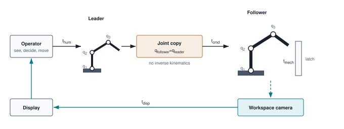{width="100%"}
:::

By mapping each leader joint directly to the corresponding follower joint ($\LeaderJointPositions \equiv \FollowerJointPositions$), this isomorphic leader-follower topology sidesteps numerical inverse kinematics and algorithmic kinematic singularities. Even without software kinematic conversion, however, every recorded trajectory remains bound to the physical transport and neuromuscular delays of the complete loop, placing hard upper bounds on corrective bandwidth.

### Human-in-the-loop latency and bilateral passivity breakdown {#sec-data-bilateral-passivity}

```{python}
#| label: calc-data-teleop-loop-latency
#| echo: false
#| warning: false
#| message: false
# ┌─────────────────────────────────────────────────────────────────────────────
# │ TELEOPERATION ROUND-TRIP LATENCY (LEGO)
# ├─────────────────────────────────────────────────────────────────────────────
# │ Context: @sec-data-bilateral-passivity
# │ Goal:    Sum the four stages of the human-in-the-loop correction and show
# │          that the operator's own reaction dominates the loop.
# │ Show:    Display, human, command, and mechanical latencies; their sum; the
# │          instant the correction is commanded; the human share.
# │ How:     t_loop = t_disp + t_hum + t_cmd + t_mech. Stage values are the
# │          chapter's illustrative reference setup (see the Reader Guide).
# └─────────────────────────────────────────────────────────────────────────────
from mlsysim import *
from mlsysim.core.units import *
from mlsysim.fmt import fmt_latency, fmt_percent, check

class TeleopLoopLatency:
    """Round-trip latency of one teleoperated correction."""

    # ┌── 1. LOAD (Constants & Parameters) ─────────────────────────────────
    t_disp = 50.0 * millisecond  # exposure, decode, raster refresh; category: illustrative
    t_hum = 200.0 * millisecond  # perception, planning, neuromuscular; category: illustrative
    t_cmd = 10.0 * millisecond  # quantization, packetization, bus; category: illustrative
    t_mech = 80.0 * millisecond  # torque ramp and structural inertia; category: illustrative

    # ┌── 2. EXECUTE (Compute) ─────────────────────────────────────────────
    t_loop = (t_disp + t_hum + t_cmd + t_mech).to(millisecond)
    t_commanded = (t_disp + t_hum).to(millisecond)  # correction commanded after contact
    hum_share = (t_hum / t_loop).to("").magnitude

    # ┌── 3. GUARD (Assertions) ────────────────────────────────────────────
    # margin_teleop_loop_latency_strip.svg fig-alt hand-types the same stage values.
    check(abs(t_loop.magnitude - 340.0) < 1e-9, "Round-trip latency should be 340 ms")
    check(abs(t_commanded.magnitude - 250.0) < 1e-9, "Correction should be commanded 250 ms after contact")
    check(t_hum > t_disp + t_cmd + t_mech, "The operator's reaction should exceed the other stages combined")

    # ┌── 4. OUTPUT (Format & Export) ────────────────────────────────────────
    t_disp_str = fmt_latency(t_disp, unit=millisecond, precision=0)
    t_hum_str = fmt_latency(t_hum, unit=millisecond, precision=0)
    t_cmd_str = fmt_latency(t_cmd, unit=millisecond, precision=0)
    t_mech_str = fmt_latency(t_mech, unit=millisecond, precision=0)
    t_loop_str = fmt_latency(t_loop, unit=millisecond, precision=0)
    t_commanded_str = fmt_latency(t_commanded, unit=millisecond, precision=0)
    hum_share_pct_str = fmt_percent(hum_share, precision=1, style="prose")
```

Each stage in this distributed loop introduces latency that shifts the phase of any corrective action. In an illustrative reference setup with a high-speed camera and a wired local network, display pipeline processing requires $\DisplayPipelineLatency =$ `{python} TeleopLoopLatency.t_disp_str` across sensor exposure, H.264 decoding, and display raster refresh. Human visual perception, cognitive motor planning, and neuromuscular transmission contribute an operator response latency of $\OperatorResponseLatency =$ `{python} TeleopLoopLatency.t_hum_str` for continuous trajectory tracking. Command quantization, packetization, and fieldbus transport to the robot controller add $\TeleoperationCommandLatency =$ `{python} TeleopLoopLatency.t_cmd_str`. Finally, actuator torque ramp-up and structural link inertia impose a mechanical response latency of $\FollowerMechanicalLatency =$ `{python} TeleopLoopLatency.t_mech_str` before the manipulator achieves the commanded acceleration. The **teleoperation round-trip latency** $\TeleoperationRoundTripLatency$, defined as the elapsed time from a physical contact disturbance to the corrective actuator response, is their sum:
$$\TeleoperationRoundTripLatency = \DisplayPipelineLatency + \OperatorResponseLatency + \TeleoperationCommandLatency + \FollowerMechanicalLatency.$$ {#eq-data-teleop-loop-latency}

Consider the causal sequence when a contact misalignment occurs at time $\TimeInstant$. The operator sees the error on the display `{python} TeleopLoopLatency.t_disp_str` later, dispatches a physical correction `{python} TeleopLoopLatency.t_commanded_str` after the event, and the follower arm finally pushes back at $\TimeInstant +{}$ `{python} TeleopLoopLatency.t_loop_str`. During this `{python} TeleopLoopLatency.t_loop_str` interval, the arm continues to drift under momentum and contact compliance. If the logger naively pairs observation $\MultimodalObservation_{t}$ with the command issued at that same instant, it pairs the current physical state with an action selected for a state that is `{python} TeleopLoopLatency.t_commanded_str` stale. A policy trained by behavioral cloning learns this delay as intentional strategy. When subsequently evaluated autonomously at high control frequencies, the policy over-corrects and enters destructive oscillations. Round-trip latency is therefore a property of the resulting dataset rather than just an artifact of the rig: it injects a systematic phase lag into every recorded demonstration, dominated by the operator's own reaction time (`{python} TeleopLoopLatency.hum_share_pct_str` of the loop in this setup).

This delay differs in kind from the sensor-pipeline delay of @sec-data-multimodal-time-sync. That one was a pairing artifact of the logger, and exposure-midpoint stamping lets the alignment pipeline account for it. The operator's delay is a real property of the demonstrator, so no timestamp correction can remove it, and silently erasing it would misstate what the demonstration contains. The logger therefore keeps both times of every pair (the observation's exposure midpoint and the command's issue time) and records the session's measured loop latency. Training can then treat the observation-to-action interval as a declared part of the demonstration, either by conditioning the policy on enough observation history to span it or by pairing each command with the earlier frame the operator was answering, and deployment can match the interval it was trained with, as UMI's latency matching does (@sec-data-alignment-pipeline). Because the operator's reaction varies from command to command, no single fixed shift recovers the exact frame each command answered, which is why the latch campaign records the interval instead of baking one correction into the archive.

::: {.column-margin}
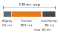{width="100%" fig-alt="One horizontal bar divided into the four stages of a teleoperated correction, drawn to scale under a bracket labeled 340 milliseconds loop: display 50 ms, human 200 ms, command 10 ms, and mechanics 80 ms. The human segment is the longest by far."}

*The operator's own reaction is `{python} TeleopLoopLatency.hum_share_pct_str` of the `{python} TeleopLoopLatency.t_loop_str` correction loop.*
:::

Force reflection introduces a deeper stability challenge into the collection interface. In **bilateral teleoperation**, the operator manipulates the leader device while measured contact forces from the follower arm reflect back across a delayed communication channel. Over a closed motion cycle of period $\MotionCyclePeriod$, the net mechanical energy delivered at that port is:
$$\PortCycleNetEnergy = \int_0^{\MotionCyclePeriod} \ReflectedContactForce(\TimeInstant - \PureTransportDelay) \PortVelocity(\TimeInstant)\,d\TimeInstant.$$
The sign of $\PortCycleNetEnergy$ depends on the force–velocity phase relationship. Under the declared port orientation, energy delivered in excess of received and initially stored energy violates passivity[^fn-passivity-delay-teleop]; a positive value over one cycle alone does not establish that excess. Transmission delay $\PureTransportDelay$ can produce such a violation and excite contact instability [@anderson1989bilateral]. The wave-variable transformation derived in @sec-appendix-control-passivity keeps the ideal delayed channel passive and lossless under its constant-delay model, while passivity observers (monitors that track the energy a port has generated and dissipate any excess) restore passivity by injecting variable damping. Preserving channel passivity imposes a force-fidelity cost at contact. Injected damping, and the explicit low-pass filtering often added to delayed force channels, suppress the fastest components of the reflected force first, so a stabilized channel behaves as a low-pass filter on contact. In data collection, this imposes an unavoidable label-fidelity trade-off. The filtering that stabilizes delayed haptic feedback also attenuates the sharp contact transients the operator needs to demonstrate precise tactile insertion. System builders must log the active feedback architecture and filter cutoffs alongside raw trajectories to document this phase distortion.

[^fn-passivity-delay-teleop]: **Passivity**\index{Passivity!bilateral teleoperation}: A passive system cannot deliver more energy through its ports than it has received or initially stored. A well-posed, power-conserving interconnection of passive components preserves their combined passivity inequality. Stronger stability conclusions require bounds on stored energy and appropriate strictness or detectability conditions, as developed in @sec-appendix-control-passivity. @anderson1989bilateral showed that a delayed communication channel need not be passive and restored passivity for any constant delay with a scattering transformation, and @niemeyer1991stable recast the idea as wave variables. The price is paid in force fidelity at contact, and the demonstrations record that price.

The mechanical interface therefore filters which behaviors can reach the archive at all. A force-reflecting leader allows an operator to feel mechanical binding and ease off insertion forces; a visual-only Cartesian rate controller instead forces the step-and-wait hunting of @sec-data-human-idiosyncrasies, because the operator must wait for display frames to confirm each small motion. A backdriven joint-space leader such as ALOHA, recorded at $50\text{ Hz}$ [@zhao2023learning], occupies an intermediate design point, providing inertial and friction feedback from the leader mechanism itself without reflecting follower contact forces. Across all these interfaces, human operators instinctively decelerate prior to contact, because closing a high-gain corrective loop around round-trip latency $\TeleoperationRoundTripLatency$ would erode phase margin to zero. @Tbl-05-teleop-taxonomy categorizes the dominant teleoperation architectures and the specific data collection artifacts they produce.

| Interface and feedback                                        | Command mapping                                                                      | Contact information available to operator                                  | Possible collection artifact to check                                             |
|:--------------------------------------------------------------|:-------------------------------------------------------------------------------------|:---------------------------------------------------------------------------|:----------------------------------------------------------------------------------|
| **Force-reflecting bilateral leader**                         | Leader motion mapped to follower joints; measured follower force reflected to leader | Vision and physical contact force, subject to link delay and fidelity      | Contact corrections and oscillation when delayed force reflection loses passivity |
| **Backdriven joint-space leader (ALOHA)** [@zhao2023learning] | Leader joint positions copied to follower; demonstration recorded at $50\text{ Hz}$  | Vision and leader mechanism feel, without active follower force reflection | Joint-space posture preferences and unobserved follower contact forces            |
| **Rate-controlled 3D mouse**                                  | Device deflection mapped to Cartesian velocity, then inverse kinematics              | Primarily visual feedback unless a separate haptic channel exists          | Step-and-wait motion and zero-velocity pauses under delayed feedback              |
| **Tracked spatial controller**                                | Tracked hand pose mapped to tool pose with clutching and scale                       | Visual feedback; optional vibration is not directional force reflection    | Clutch discontinuities and pose-tracking gaps                                     |
| **Instrumented exoskeleton**                                  | Wearable joint motion retargeted to robot joints                                     | Depends on whether active force feedback is fitted                         | Biomechanical calibration and retargeting bias                                    |

: **Teleoperation interface mechanisms for physical demonstration collection**: Mapping and feedback determine what the operator can demonstrate, and the last column names the artifact to check on a given rig, task, and operator. {#tbl-05-teleop-taxonomy tbl-colwidths="[22,28,24,26]"}

### Ingestion rate and the preservation requirement {#sec-data-telemetry-ingestion-storage}

The loop's latency is the first cost a demonstration carries; the second is what it takes to keep everything the loop produced. A teleoperated session concludes as a persistent multi-modal telemetry archive, and the collection rig must record every synchronized stream (all four action taps of @sec-data-four-stream-action-tap, high-rate joint torques, and multi-view video) without dropping frames or samples under transient load. Whether an edge collection computer can sustain that workload is storage-bus arithmetic, the aggregate sustained data rate set against the sequential write bandwidth of the onboard storage.

```{python}
#| label: calc-data-multi-camera-ingestion
#| echo: false
#| warning: false
#| message: false
# ┌─────────────────────────────────────────────────────────────────────────────
# │ MULTI-CAMERA TELEOPERATION INGESTION BUDGET (LEGO)
# ├─────────────────────────────────────────────────────────────────────────────
# │ Context: @nbk-data-ingestion-bandwidth-storage-budgets-multi-camera
# │ Goal:    Size the raw ingestion rate and storage of one teleoperated
# │          door-opening session on the warehouse mobile manipulator.
# │ Show:    Per-camera raw rates, the 9-axis kinematic stream, the total, the
# │          hourly and per-shift storage, and the 8x-compressed rate against
# │          SATA and Gen4 NVMe write bandwidth.
# │ How:     Camera geometry and frame rates from the registry (navigation
# │          IMX477, wrist IMX296, two external RealSense D435i); axis count and
# │          logging rate from RM; calc_teleop_ingestion_budget per camera group.
# └─────────────────────────────────────────────────────────────────────────────
from mlsysim import *
from mlsysim.core.units import *
from mlsysim.fmt import fmt_bandwidth, fmt_memory, fmt_frequency, fmt_int, fmt_multiple, fmt_percent, check

RM = Embodied.MobileManipulator.WarehouseMobileManipulator
AISLE = Embodied.Scenario.WarehouseAisle

class MultiCameraIngestionBudget:
    """Raw telemetry bandwidth and storage for the machine's teleoperation sessions."""

    # ┌── 1. LOAD (Constants & Parameters) ─────────────────────────────────
    cam_nav = RM.nav_camera  # category: datasheet
    cam_wrist = RM.wrist_camera  # category: datasheet
    cam_ext = Sensors.Camera.Intel_RealSense_D435i  # category: datasheet
    n_ext = 2  # scenario assumption; category: chosen
    bytes_per_px_rgb = 3  # 24-bit RGB after debayering; category: chosen
    bytes_per_px_depth = 2  # uint16 depth aligned to the color frame; category: chosen

    n_axes = RM.servo_axes  # 2 base + 7 arm; category: datasheet
    f_log = RM.permission_rate  # kinematics logged every permission tick; category: chosen
    values_per_axis = 6  # position, velocity (a_meas), torque, a_req, a_cmd, a_enf; category: chosen
    bytes_per_value = 4  # float32; category: chosen
    bytes_timestamp = 8  # one 64-bit timestamp per step; category: chosen

    shift_hours = 8.0  # scenario assumption; category: chosen
    compression_ratio = 8.0  # intra-frame video codec; category: illustrative
    bw_sata = Systems.Storage.SataSsd.bandwidth  # category: datasheet
    bw_nvme = Hardware.Tech.Storage.NvmeGen4.bandwidth  # category: datasheet

    # ┌── 2. EXECUTE (Compute) ─────────────────────────────────────────────
    bytes_per_step = n_axes * values_per_axis * bytes_per_value + bytes_timestamp
    bw_kin = (bytes_per_step * byte * f_log).to(MB / second)

    res_nav = calc_teleop_ingestion_budget(
        num_cameras=1,
        rgb_width=cam_nav.resolution_width,
        rgb_height=cam_nav.resolution_height,
        rgb_fps=cam_nav.frame_rate.to(hertz).magnitude,
        rgb_bytes_per_pixel=bytes_per_px_rgb,
        kinematics_bytes_per_sec=bw_kin,
    )
    res_wrist = calc_teleop_ingestion_budget(
        num_cameras=1,
        rgb_width=cam_wrist.resolution_width,
        rgb_height=cam_wrist.resolution_height,
        rgb_fps=cam_wrist.frame_rate.to(hertz).magnitude,
        rgb_bytes_per_pixel=bytes_per_px_rgb,
    )
    res_ext = calc_teleop_ingestion_budget(
        num_cameras=n_ext,
        rgb_width=cam_ext.resolution_width,
        rgb_height=cam_ext.resolution_height,
        rgb_fps=cam_ext.frame_rate.to(hertz).magnitude,
        rgb_bytes_per_pixel=bytes_per_px_rgb,
        depth_width=cam_ext.resolution_width,
        depth_height=cam_ext.resolution_height,
        depth_fps=cam_ext.frame_rate.to(hertz).magnitude,
        depth_bytes_per_pixel=bytes_per_px_depth,
    )

    bw_nav = res_nav["bw_rgb"]
    bw_wrist = res_wrist["bw_rgb"]
    bw_ext_rgb = res_ext["bw_rgb"]
    bw_ext_depth = res_ext["bw_depth"]
    bw_ext = res_ext["bw_vision"]
    bw_total = (res_nav["bw_total"] + res_wrist["bw_total"] + res_ext["bw_total"]).to(MB / second)
    storage_hour = (res_nav["storage_per_hour"] + res_wrist["storage_per_hour"] + res_ext["storage_per_hour"]).to(TB)
    storage_shift = (storage_hour * shift_hours).to(TB)

    nav_over_sata = (bw_nav / bw_sata).to("").magnitude
    kin_share = (bw_kin / bw_total).to("").magnitude
    bw_compressed = (bw_total / compression_ratio).to(MB / second)
    storage_hour_compressed = (storage_hour / compression_ratio).to(TB)

    # ┌── 3. GUARD (Assertions) ────────────────────────────────────────────
    check(n_axes == 9, "The machine logs 9 axes (2 base, 7 arm)")
    check(bytes_per_step == 224, "Unexpected kinematic record size")
    check(abs(bw_kin.to(MB / second).magnitude - 0.224) < 1e-9, "Unexpected kinematic rate")
    check(abs(bw_nav.to(MB / second).magnitude - 2219.44) < 0.01, "Unexpected navigation-camera rate")
    check(abs(bw_wrist.to(MB / second).magnitude - 279.94) < 0.01, "Unexpected wrist-camera rate")
    check(abs(bw_ext.to(MB / second).magnitude - 622.08) < 0.01, "Unexpected external-camera rate")
    check(abs(bw_total.to(MB / second).magnitude - 3121.68) < 0.01, "Unexpected total ingestion rate")
    check(abs(storage_hour.to(TB).magnitude - 11.24) < 0.005, "Unexpected hourly storage")
    check(abs(storage_shift.to(TB).magnitude - 89.91) < 0.01, "Unexpected shift storage")
    check(bw_total < bw_nvme, "Raw ingestion must fit Gen4 NVMe write bandwidth")
    check(3.9 < nav_over_sata < 4.1, "Navigation camera alone should be about four times SATA")
    check(kin_share < 1e-4, "Kinematic stream should be under 0.01 percent of the bytes")
    check(abs(bw_compressed.to(MB / second).magnitude - 390.2) < 0.1, "Unexpected compressed rate")

    # ┌── 4. OUTPUT (Format & Export) ────────────────────────────────────────
    nav_w_str = fmt_int(cam_nav.resolution_width, commas=False)
    nav_h_str = fmt_int(cam_nav.resolution_height, commas=False)
    nav_fps_str = fmt_frequency(cam_nav.frame_rate, precision=0)
    wrist_w_str = fmt_int(cam_wrist.resolution_width, commas=False)
    wrist_h_str = fmt_int(cam_wrist.resolution_height, commas=False)
    wrist_fps_str = fmt_frequency(cam_wrist.frame_rate, precision=0)
    ext_w_str = fmt_int(cam_ext.resolution_width, commas=False)
    ext_h_str = fmt_int(cam_ext.resolution_height, commas=False)
    ext_fps_str = fmt_frequency(cam_ext.frame_rate, precision=0)
    n_ext_str = fmt_int(n_ext)
    n_axes_str = fmt_int(n_axes)
    f_log_str = fmt_frequency(f_log, unit=ureg.kilohertz, precision=0)
    bytes_per_step_str = fmt_int(bytes_per_step)
    values_per_axis_str = fmt_int(values_per_axis)
    bytes_per_value_str = fmt_int(bytes_per_value)
    bytes_timestamp_str = fmt_int(bytes_timestamp)
    bytes_px_rgb_str = fmt_int(bytes_per_px_rgb)
    bytes_px_depth_str = fmt_int(bytes_per_px_depth)

    bw_nav_str = fmt_bandwidth(bw_nav, unit=MB / second, precision=2)
    bw_wrist_str = fmt_bandwidth(bw_wrist, unit=MB / second, precision=2)
    bw_ext_rgb_str = fmt_bandwidth(bw_ext_rgb, unit=MB / second, precision=2)
    bw_ext_depth_str = fmt_bandwidth(bw_ext_depth, unit=MB / second, precision=2)
    bw_ext_str = fmt_bandwidth(bw_ext, unit=MB / second, precision=2)
    bw_kin_str = fmt_bandwidth(bw_kin, unit=MB / second, precision=2)
    bw_total_str = fmt_bandwidth(bw_total, unit=MB / second, precision=2)
    bw_total_gb_str = fmt_bandwidth(bw_total, unit=GB / second, precision=2)
    storage_hour_str = fmt_memory(storage_hour, unit=TB, precision=2)
    storage_shift_str = fmt_memory(storage_shift, unit=TB, precision=1)
    shift_hours_str = fmt_int(int(shift_hours))

    bw_sata_str = fmt_bandwidth(bw_sata, unit=MB / second, precision=0)
    bw_nvme_str = fmt_bandwidth(bw_nvme, unit=GB / second, precision=0)
    nav_over_sata_mult_str = fmt_multiple(nav_over_sata, precision=1)
    kin_share_pct_str = fmt_percent(kin_share, precision=3, style="prose")
    compression_mult_str = fmt_multiple(compression_ratio, precision=0)
    bw_compressed_str = fmt_bandwidth(bw_compressed, unit=MB / second, precision=1)
    storage_hour_compressed_str = fmt_memory(storage_hour_compressed, unit=TB, precision=2)
```

::: {#nbk-data-ingestion-bandwidth-storage-budgets-multi-camera .callout-notebook title="The cheapest stream"}

**Problem**: One teleoperated door-opening session on the warehouse mobile manipulator logs every camera and every axis raw. What sustained write rate and storage does it demand, and what share of the bytes carries the four action taps?

**Variables** (camera geometry is datasheet; logging formats and shift length are chosen):

- **Navigation camera:** `{python} MultiCameraIngestionBudget.nav_w_str` by `{python} MultiCameraIngestionBudget.nav_h_str` px at `{python} MultiCameraIngestionBudget.nav_fps_str`, logged as 24-bit RGB (`{python} MultiCameraIngestionBudget.bytes_px_rgb_str` bytes/px).
- **Wrist camera:** `{python} MultiCameraIngestionBudget.wrist_w_str` by `{python} MultiCameraIngestionBudget.wrist_h_str` px at `{python} MultiCameraIngestionBudget.wrist_fps_str`, logged the same way.
- **External cameras:** `{python} MultiCameraIngestionBudget.n_ext_str` RGB-D cameras viewing the door, color at `{python} MultiCameraIngestionBudget.ext_w_str` by `{python} MultiCameraIngestionBudget.ext_h_str` px and `{python} MultiCameraIngestionBudget.ext_fps_str`, with depth aligned to the color frame as raw `uint16` millimeters (`{python} MultiCameraIngestionBudget.bytes_px_depth_str` bytes/px).
- **Kinematics:** `{python} MultiCameraIngestionBudget.n_axes_str` axes (two base wheels, seven arm joints) logged at `{python} MultiCameraIngestionBudget.f_log_str`. Each step stores, for every axis, `{python} MultiCameraIngestionBudget.values_per_axis_str` values of `{python} MultiCameraIngestionBudget.bytes_per_value_str` bytes (position and velocity, which form the measured response $\MeasuredResponseTap$; measured torque; and the requested, mapped, and enforced commands), plus one `{python} MultiCameraIngestionBudget.bytes_timestamp_str`-byte timestamp.
- **Shift:** `{python} MultiCameraIngestionBudget.shift_hours_str` hours of collection on one machine.

**Math**:

1. **Kinematic stream**: `{python} MultiCameraIngestionBudget.n_axes_str` $\times$ `{python} MultiCameraIngestionBudget.values_per_axis_str` $\times$ `{python} MultiCameraIngestionBudget.bytes_per_value_str` B $+$ `{python} MultiCameraIngestionBudget.bytes_timestamp_str` B $=$ `{python} MultiCameraIngestionBudget.bytes_per_step_str` B per step, and at `{python} MultiCameraIngestionBudget.f_log_str` that is `{python} MultiCameraIngestionBudget.bw_kin_str`.
2. **Navigation camera**: `{python} MultiCameraIngestionBudget.nav_w_str` $\times$ `{python} MultiCameraIngestionBudget.nav_h_str` px $\times$ `{python} MultiCameraIngestionBudget.bytes_px_rgb_str` B $\times$ `{python} MultiCameraIngestionBudget.nav_fps_str` $=$ `{python} MultiCameraIngestionBudget.bw_nav_str`. The wrist camera's product is `{python} MultiCameraIngestionBudget.bw_wrist_str`.
3. **External pair**: `{python} MultiCameraIngestionBudget.n_ext_str` $\times$ `{python} MultiCameraIngestionBudget.ext_w_str` $\times$ `{python} MultiCameraIngestionBudget.ext_h_str` px $\times$ (`{python} MultiCameraIngestionBudget.bytes_px_rgb_str` B $+$ `{python} MultiCameraIngestionBudget.bytes_px_depth_str` B) $\times$ `{python} MultiCameraIngestionBudget.ext_fps_str` $=$ `{python} MultiCameraIngestionBudget.bw_ext_str`, of which `{python} MultiCameraIngestionBudget.bw_ext_rgb_str` is color and `{python} MultiCameraIngestionBudget.bw_ext_depth_str` depth.
4. **Total and storage**: The streams sum to `{python} MultiCameraIngestionBudget.bw_total_str`, about `{python} MultiCameraIngestionBudget.bw_total_gb_str`; over one hour that is `{python} MultiCameraIngestionBudget.storage_hour_str`, and over the shift `{python} MultiCameraIngestionBudget.storage_shift_str`.

**Result**: Raw logging needs a sustained `{python} MultiCameraIngestionBudget.bw_total_gb_str` write path, and the kinematic stream is `{python} MultiCameraIngestionBudget.kin_share_pct_str` of the bytes.

**Systems insight**: The navigation camera alone writes `{python} MultiCameraIngestionBudget.nav_over_sata_mult_str` what a SATA SSD sustains (`{python} MultiCameraIngestionBudget.bw_sata_str`). The full session fits within a Gen4 NVMe drive's `{python} MultiCameraIngestionBudget.bw_nvme_str`, but only by consuming storage at `{python} MultiCameraIngestionBudget.storage_hour_str` per hour. Intra-frame video compression at an illustrative `{python} MultiCameraIngestionBudget.compression_mult_str` brings the rate to about `{python} MultiCameraIngestionBudget.bw_compressed_str` (`{python} MultiCameraIngestionBudget.storage_hour_compressed_str` per hour) at the cost of encoder latency and artifacts in the frames the policy will train on. The kinematic stream carries all four action taps, so the record that preserves the causal chain is the cheapest stream to log, and a logger that drops data under buffer pressure must never drop it first.

:::

::: {.column-margin}
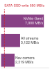{width="100%" fig-alt="Horizontal bar ladder of write bandwidth in megabytes per second: an NVMe Gen4 drive at 7,000, all camera and kinematic streams together at 3,122, the navigation camera alone at 2,219, and the session compressed eightfold at 390. A red dashed line marks the SATA solid-state drive write ceiling at 550; every raw bar crosses it and only the compressed bar stays below."}

*The navigation camera alone writes `{python} MultiCameraIngestionBudget.nav_over_sata_mult_str` what a SATA SSD sustains; only the compressed session fits under it.*
:::

While ingestion throughput dictates edge storage hardware requirements, archival fidelity dictates downstream dataset utility. Regardless of whether an engineering team stores trajectories in custom HDF5 containers, ROS 2 MCAP bags (a container file format for multimodal robotics data), or standardized dataset formats such as LeRobot [@cadene2024lerobot], the preservation invariant remains identical. The logging daemon must capture all four control taps, hardware timestamps, master clock domain identifiers, missing-sample flags, and spatial calibration parameters across every conversion stage. Furthermore, the storage subsystem must flush complete chunks to durable non-volatile storage before sudden power disruptions or process halts can corrupt write buffers. Video compression is a fundamental engineering compromise rather than a benign storage optimization: lossy encoders discard high-frequency spatial detail and inject blocking artifacts directly into the visual features that train the policy. Finally, successful deserialization of a dataset file proves only syntactic integrity; it does not guarantee that sensory and motor streams remain physically synchronized.

### Operational yield and mechanical fatigue budgeting {#sec-data-yield-fatigue-budgeting}

Sustained storage bandwidth bounds the volume of telemetry an edge rig can physically capture; operational yield and mechanical durability bound the volume of validated training data a physical campaign can produce. In embodied AI, scheduled facility hours rarely translate into equivalent robot demonstration time. Cell setup routines, multi-sensor extrinsic recalibrations, operator ergonomics, automated scene resets, and post-hoc quality assurance filtering consume the vast majority of active floor time. Moreover, because physical demonstration collection subjects robotic drivetrains and internal cable harnesses to cyclic mechanical strain, collection campaigns must be sized against mechanical fatigue limits rather than wall-clock facility reservations.

```{python}
#| label: calc-data-demonstration-yield-fatigue
#| echo: false
#| warning: false
#| message: false
# ┌─────────────────────────────────────────────────────────────────────────────
# │ DEMONSTRATION YIELD & ACTUATOR FATIGUE SIZING (LEGO)
# ├─────────────────────────────────────────────────────────────────────────────
# │ Context: @sec-data-teleop-costs, @tbl-05-collection-budget
# │ Goal:    Estimate retained door-opening demonstrations and wrist gear/cable
# │          wear per campaign on the warehouse mobile manipulator.
# │ Show:    Expected retained episodes per session and campaign wear budget;
# │          the latch tripwire that ends a failed attempt.
# │ How:     Floor active time / cycle time (one opening plus one re-latch),
# │          apply retention, then count cycles. Tripwire from AISLE.
# └─────────────────────────────────────────────────────────────────────────────
import math
from mlsysim import *
from mlsysim.core.units import *
from mlsysim.fmt import fmt, fmt_time, fmt_force, fmt_int, fmt_percent, fmt_multiple, check

RM = Embodied.MobileManipulator.WarehouseMobileManipulator
AISLE = Embodied.Scenario.WarehouseAisle

class DemonstrationYieldFatigue:
    """Facility operational yield and mechanical component wear budgeting."""

    # ┌── 1. LOAD (Constants & Parameters) ─────────────────────────────────
    f_trip = AISLE.f_latch_tripwire  # category: illustrative
    t_sched = 60.0 * minute  # declared session length; category: chosen
    t_motion = 35.0 * minute  # category: illustrative
    t_startup = 8.0 * minute  # cell startup and bus sync; category: illustrative
    t_calib = 7.0 * minute  # sensor calibration and nulling; category: illustrative
    t_rest = 10.0 * minute  # operator rest; category: illustrative
    t_att = 25.0 * second  # category: illustrative
    t_rst = 15.0 * second  # category: illustrative
    t_cyc = t_att + t_rst  # category: derived

    failure_rate = 0.20  # category: illustrative
    qa_filter_rate = 0.15  # category: illustrative
    retention_rate = (1.0 - failure_rate) * (1.0 - qa_filter_rate)  # category: derived

    n_campaign_target = 5000  # benchmark target; category: chosen
    n_gear_reversals = 14  # category: illustrative
    n_cable_open = 6  # flexes while opening; category: illustrative
    n_cable_return = 2  # flexes on the return stroke during the re-latch; category: illustrative
    n_cable_flex = n_cable_open + n_cable_return  # category: derived
    l10_gear_life = 5_000_000  # rated stress cycles; category: illustrative
    l10_cable_life = 200_000  # rated bending cycles; category: illustrative

    # ┌── 2. EXECUTE (Compute) ─────────────────────────────────────────────
    n_raw_attempts = int(t_motion.to(second) // t_cyc.to(second))
    n_usable = n_raw_attempts * retention_rate
    t_idle = (t_motion - n_raw_attempts * t_cyc).to(second)  # active time too short for one more cycle
    t_yield = (n_usable * t_att).to(minute)
    yield_pct = (t_yield / t_sched).magnitude * 100.0

    n_total_attempts = int(math.ceil(n_campaign_target / retention_rate))
    t_sched_campaign = (n_total_attempts / n_raw_attempts) * (1.0 * hour)
    overhead_factor = t_sched_campaign.magnitude / ((n_campaign_target * t_att).to(hour).magnitude)

    gear_cycles = n_total_attempts * n_gear_reversals
    cable_cycles = n_total_attempts * n_cable_flex
    gear_fatigue_pct = (gear_cycles / l10_gear_life) * 100.0
    cable_fatigue_pct = (cable_cycles / l10_cable_life) * 100.0

    # Per-session rows of @tbl-05-collection-budget
    t_resets = (n_raw_attempts * t_rst).to(second)
    t_attempts = (n_raw_attempts * t_att).to(second)
    t_fail = (-failure_rate * t_attempts).to(second)
    t_qa = (-qa_filter_rate * (t_attempts + t_fail)).to(second)
    t_net = (t_attempts + t_fail + t_qa).to(second)
    ep_fail = -failure_rate * n_raw_attempts
    ep_qa = -qa_filter_rate * (n_raw_attempts + ep_fail)
    sess_return_flex = n_raw_attempts * n_cable_return
    sess_reversals = n_raw_attempts * n_gear_reversals
    sess_open_flex = n_raw_attempts * n_cable_open

    # ┌── 3. GUARD (Assertions) ────────────────────────────────────────────
    check(n_raw_attempts == 52, "Unexpected raw attempts count")
    check(abs(retention_rate - 0.68) < 1e-4, "Unexpected retention rate")
    check(abs(n_usable - 35.36) < 0.01, "Unexpected usable episode yield")
    check(abs(t_idle.magnitude - 20.0) < 1e-9, "Unexpected idle remainder of the active window")
    check(abs(t_yield.magnitude - 14.73) < 0.05, "Unexpected valid yield duration")
    check(abs(yield_pct - 24.55) < 0.1, "Unexpected yield percentage")
    check(n_total_attempts == 7353, "Unexpected total campaign attempts")
    check(abs(t_sched_campaign.magnitude - 141.4) < 0.5, "Unexpected campaign hours")
    check(abs(overhead_factor - 4.07) < 0.05, "Unexpected facility overhead ratio")
    check(gear_cycles == 102942, "Unexpected cumulative gear cycles")
    check(cable_cycles == 58824, "Unexpected cumulative cable bends")
    check(abs(f_trip.to(newton).magnitude - 15.0) < 1e-9, "Latch tripwire should be 15 N")
    check(n_campaign_target == 5000, "Campaign target should be 5,000 retained demonstrations")
    check(cable_fatigue_pct > 10 * gear_fatigue_pct, "The flex cable, not the gear, should bind")
    check(abs((t_startup + t_calib + t_rest + t_motion - t_sched).to(second).magnitude) < 1e-9, "Session stages must fill the schedule")
    check(abs((t_net - t_yield).to(second).magnitude) < 1e-6, "Table net row must equal the computed yield")
    check(abs(n_raw_attempts + ep_fail + ep_qa - n_usable) < 1e-9, "Table episode rows must sum to the usable yield")

    # ┌── 4. OUTPUT (Format & Export) ────────────────────────────────────────
    n_raw_str = fmt_int(n_raw_attempts)
    n_usable_str = fmt(n_usable, precision=2)
    retention_str = fmt(retention_rate, precision=2)
    n_target_str = fmt_int(n_campaign_target, commas=True)
    t_yield_str = fmt_time(t_yield, unit=minute, precision=2)
    t_idle_str = fmt_time(t_idle, unit=second, precision=0)
    yield_pct_str = fmt_percent(yield_pct / 100.0, precision=1, style="prose")
    n_total_str = fmt_int(n_total_attempts, commas=True)
    t_sched_campaign_str = fmt_time(t_sched_campaign, unit=hour, precision=1)
    overhead_factor_mult_str = fmt_multiple(overhead_factor, precision=2)
    gear_cycles_str = fmt_int(gear_cycles, commas=True)
    cable_cycles_str = fmt_int(cable_cycles, commas=True)
    gear_fatigue_pct_str = fmt_percent(gear_fatigue_pct / 100.0, precision=1, style="prose")
    cable_fatigue_pct_str = fmt_percent(cable_fatigue_pct / 100.0, precision=1, style="prose")
    gear_fatigue_pct_tbl_str = fmt_percent(gear_fatigue_pct / 100.0, precision=1, style="symbol")
    cable_fatigue_pct_tbl_str = fmt_percent(cable_fatigue_pct / 100.0, precision=1, style="symbol")
    f_trip_str = fmt_force(f_trip, precision=0)
    t_sched_str = fmt_time(t_sched, unit=minute, precision=0)
    t_motion_str = fmt_time(t_motion, unit=minute, precision=0)
    t_att_str = fmt_time(t_att, unit=second, precision=0)
    t_rst_str = fmt_time(t_rst, unit=second, precision=0)
    t_cyc_str = fmt_time(t_cyc, unit=second, precision=0)
    failure_pct_str = fmt_percent(failure_rate, precision=0, style="prose")
    qa_pct_str = fmt_percent(qa_filter_rate, precision=0, style="prose")
    failure_pct_tbl_str = fmt_percent(failure_rate, precision=0, style="symbol")
    qa_pct_tbl_str = fmt_percent(qa_filter_rate, precision=0, style="symbol")
    failure_frac_str = fmt(failure_rate, precision=2)
    qa_frac_str = fmt(qa_filter_rate, precision=2)
    n_gear_str = fmt_int(n_gear_reversals)
    n_cable_str = fmt_int(n_cable_flex)
    n_cable_open_str = fmt_int(n_cable_open)
    n_cable_return_str = fmt_int(n_cable_return)
    l_gear_str = fmt_int(l10_gear_life, commas=True)
    l_cable_str = fmt_int(l10_cable_life, commas=True)

    # @tbl-05-collection-budget cells: minutes, seconds, and share of the scheduled hour
    startup_min_str = fmt(t_startup.to(minute).magnitude, precision=0)
    startup_sec_str = fmt(t_startup.to(second).magnitude, precision=0)
    share_startup_str = fmt_percent((t_startup / t_sched).to("").magnitude, precision=1, allow_negative=True)
    calib_min_str = fmt(t_calib.to(minute).magnitude, precision=0)
    calib_sec_str = fmt(t_calib.to(second).magnitude, precision=0)
    share_calib_str = fmt_percent((t_calib / t_sched).to("").magnitude, precision=1, allow_negative=True)
    rest_min_str = fmt(t_rest.to(minute).magnitude, precision=0)
    rest_sec_str = fmt(t_rest.to(second).magnitude, precision=0)
    share_rest_str = fmt_percent((t_rest / t_sched).to("").magnitude, precision=1, allow_negative=True)
    resets_min_str = fmt(t_resets.to(minute).magnitude, precision=0)
    resets_sec_str = fmt(t_resets.to(second).magnitude, precision=0)
    share_resets_str = fmt_percent((t_resets / t_sched).to("").magnitude, precision=1, allow_negative=True)
    attempts_min_str = fmt(t_attempts.to(minute).magnitude, precision=2)
    attempts_sec_str = fmt(t_attempts.to(second).magnitude, precision=0)
    share_attempts_str = fmt_percent((t_attempts / t_sched).to("").magnitude, precision=1, allow_negative=True)
    fail_min_str = fmt(t_fail.to(minute).magnitude, precision=2)
    fail_sec_str = fmt(t_fail.to(second).magnitude, precision=0)
    share_fail_str = fmt_percent((t_fail / t_sched).to("").magnitude, precision=1, allow_negative=True)
    qa_min_str = fmt(t_qa.to(minute).magnitude, precision=2)
    qa_sec_str = fmt(t_qa.to(second).magnitude, precision=0)
    share_qa_str = fmt_percent((t_qa / t_sched).to("").magnitude, precision=1, allow_negative=True)
    net_min_str = fmt(t_net.to(minute).magnitude, precision=2)
    net_sec_str = fmt(t_net.to(second).magnitude, precision=0)
    share_net_str = fmt_percent((t_net / t_sched).to("").magnitude, precision=1, allow_negative=True)
    ep_fail_str = fmt(ep_fail, precision=1)
    ep_qa_str = fmt(ep_qa, precision=2)
    sess_return_flex_str = fmt_int(sess_return_flex)
    sess_reversals_str = fmt_int(sess_reversals)
    sess_open_flex_str = fmt_int(sess_open_flex)
```

The ultimate metric of collection efficiency is **demonstration yield**\index{Teleoperation!demonstration yield}: the number of validated, policy-ready trajectory records produced in a scheduled session after accounting for cell startup, sensor calibration, operator rest, mechanical resets, and offline quality filtering. Given an active motion window $\ActiveMotionDuration$, an attempt-and-reset cycle duration $\AttemptCycleDuration = \AttemptDuration + \ResetDuration$, and an end-to-end retention rate $\DemonstrationRetentionRate$, the session yields:
$$\UsableDemonstrationYield = \left\lfloor \frac{\ActiveMotionDuration}{\AttemptCycleDuration} \right\rfloor \DemonstrationRetentionRate.$$ {#eq-data-demonstration-yield}
Mechanical fatigue accumulates per physical motion cycle rather than per facility hour. This illustrative accounting assigns the same stress-cycle counts to failed and successful attempts and assumes component ratings expressed under the $\RatedFatigueLife$ convention: the cumulative cycle count at which 10 percent of an identical component population is statistically expected to fail.[^fn-l10-rated-campaign] Notebook \ref{nbk-data-flex-cable-ceiling} evaluates an illustrative door-opening collection session and its full campaign in both currencies: facility hours and component fatigue cycles.

::: {#nbk-data-flex-cable-ceiling .callout-notebook title="The flex-cable ceiling"}

**Problem**: The latch campaign must retain `{python} DemonstrationYieldFatigue.n_target_str` demonstrations. How much scheduled cell time does that cost, and which wrist component's rated life does it spend fastest?

**Variables** (illustrative except the chosen session length and target):

- Session $\ScheduledSessionDuration =$ `{python} DemonstrationYieldFatigue.t_sched_str` (chosen), leaving an active window $\ActiveMotionDuration =$ `{python} DemonstrationYieldFatigue.t_motion_str` after startup, calibration, and operator rest
- Attempt $\AttemptDuration =$ `{python} DemonstrationYieldFatigue.t_att_str`, one teleoperated opening; reset $\ResetDuration =$ `{python} DemonstrationYieldFatigue.t_rst_str`, the door re-latched by its fixture
- In-trial failure rate `{python} DemonstrationYieldFatigue.failure_pct_str`; post-collection quality filtering `{python} DemonstrationYieldFatigue.qa_pct_str`
- Wear per attempt: $\GearTorqueReversalCount =$ `{python} DemonstrationYieldFatigue.n_gear_str` torque reversals of the wrist's strain-wave gear; $\CableFlexCycleCount =$ `{python} DemonstrationYieldFatigue.n_cable_str` flex cycles of its internal cable bundle (`{python} DemonstrationYieldFatigue.n_cable_open_str` while opening, `{python} DemonstrationYieldFatigue.n_cable_return_str` on the return stroke)
- Rated lives $\GearRatedFatigueLife =$ `{python} DemonstrationYieldFatigue.l_gear_str` stress cycles and $\CableRatedFatigueLife =$ `{python} DemonstrationYieldFatigue.l_cable_str` bending cycles

**Math**:

1. **Session**: $\AttemptCycleDuration =$ `{python} DemonstrationYieldFatigue.t_att_str` $+$ `{python} DemonstrationYieldFatigue.t_rst_str` $=$ `{python} DemonstrationYieldFatigue.t_cyc_str`, and $\lfloor$ `{python} DemonstrationYieldFatigue.t_motion_str` $/$ `{python} DemonstrationYieldFatigue.t_cyc_str` $\rfloor =$ `{python} DemonstrationYieldFatigue.n_raw_str` attempts, with `{python} DemonstrationYieldFatigue.t_idle_str` left idle.
2. **Yield** (@eq-data-demonstration-yield): $\DemonstrationRetentionRate = (1 -$ `{python} DemonstrationYieldFatigue.failure_frac_str`$)(1 -$ `{python} DemonstrationYieldFatigue.qa_frac_str`$) =$ `{python} DemonstrationYieldFatigue.retention_str`, so $\UsableDemonstrationYield =$ `{python} DemonstrationYieldFatigue.n_raw_str` $\times$ `{python} DemonstrationYieldFatigue.retention_str` $=$ `{python} DemonstrationYieldFatigue.n_usable_str` episodes, `{python} DemonstrationYieldFatigue.t_yield_str` of validated motion, `{python} DemonstrationYieldFatigue.yield_pct_str` of the scheduled hour.
3. **Campaign**: $\lceil$ `{python} DemonstrationYieldFatigue.n_target_str` $/$ `{python} DemonstrationYieldFatigue.retention_str` $\rceil =$ `{python} DemonstrationYieldFatigue.n_total_str` attempts at `{python} DemonstrationYieldFatigue.n_raw_str` per session, or `{python} DemonstrationYieldFatigue.t_sched_campaign_str` of scheduled cell time, `{python} DemonstrationYieldFatigue.overhead_factor_mult_str` the `{python} DemonstrationYieldFatigue.n_target_str` $\times$ `{python} DemonstrationYieldFatigue.t_att_str` of motion the campaign keeps.
4. **Wear**: `{python} DemonstrationYieldFatigue.n_total_str` $\times$ `{python} DemonstrationYieldFatigue.n_gear_str` $=$ `{python} DemonstrationYieldFatigue.gear_cycles_str` gear cycles, `{python} DemonstrationYieldFatigue.gear_fatigue_pct_str` of $\GearRatedFatigueLife$; `{python} DemonstrationYieldFatigue.n_total_str` $\times$ `{python} DemonstrationYieldFatigue.n_cable_str` $=$ `{python} DemonstrationYieldFatigue.cable_cycles_str` cable bends, `{python} DemonstrationYieldFatigue.cable_fatigue_pct_str` of $\CableRatedFatigueLife$.

**Result**: Less than a quarter of each scheduled hour survives as retained demonstration time, and one campaign spends far more of the cable's rated life than of the gear's.

**Systems insight**: The internal flex cable consumes the larger fraction of its assumed rating, informing maintenance planning rather than setting an individual replacement schedule. Three campaigns on one machine would consume most of its rated life, and an intermittent conductor break corrupts the very sensor streams being recorded. Because every attempt costs wear whether or not it is retained, the retention rate $\DemonstrationRetentionRate$ divides both bills, while a faster reset shortens only the cell time.

:::

Operator rest requirements and fatigue rates depend heavily on interface ergonomics and cognitive task difficulty; teams must empirically calibrate sustained operator throughput and retention on their specific hardware. A robust collection campaign must be budgeted simultaneously in validated trajectory time and consumable hardware fatigue life, rather than superficial facility clock hours. @Tbl-05-collection-budget breaks down the time and mechanical wear budgets of the illustrative session stage by stage.

::: {.column-margin}
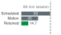{width="100%" fig-alt="Three bars on a shared minute axis for the scheduled session, its active motion window, and the retained demonstration time, with a gray dashed line marking the end of the scheduled session."}

*In this illustrative session, resets and retention losses leave about a quarter of scheduled time as usable demonstrations.*
:::

[^fn-l10-rated-campaign]: **$\RatedFatigueLife$ Rated Life**\index{L10 rated life!collection campaign}: The convention comes from rolling-bearing fatigue theory, where @lundberg1949dynamic modeled the scatter of bearing life as a probability of survival and rated a bearing by the life that 90 percent of a population reaches. A rating chosen that way is a population statistic, not a guarantee for one part. A fleet of ten collection arms, each run to its cable's rated life, should therefore expect about one cable to fail before the budget says it will.

::: {.column-margin .margin-pointer}
↪ Per-cycle wear accounting for trial-based learning on the machine is developed in @sec-training-learning-by-trial.
:::

| Session Stage / Activity         | Allocated Duration ($\FiniteChange \TimeInstant$)                                                                                     | Wall-Clock Share (\%)                                     | Physical Operation & Control State                                                                                                                              | Hardware Stress & Wear Mechanism                                                                                                                                                                                                                                                                                                                                                                                                                                         | Net Trajectory Output ($\StageEpisodeCount$ / $\ValidatedMotionDuration$)                                                                        |
|:---------------------------------|:--------------------------------------------------------------------------------------------------------------------|:----------------------------------------------------------|:----------------------------------------------------------------------------------------------------------------------------------------------------------------|:-------------------------------------------------------------------------------------------------------------------------------------------------------------------------------------------------------------------------------------------------------------------------------------------------------------------------------------------------------------------------------------------------------------------------------------------------------------------------|:------------------------------------------------------------------------------------------------------------------------------------------|
| **Cell Startup & Bus Sync**      | `{python} DemonstrationYieldFatigue.startup_min_str` min (`{python} DemonstrationYieldFatigue.startup_sec_str` s)   | `{python} DemonstrationYieldFatigue.share_startup_str`\%  | Bus synchronization (EtherCAT/CANopen), safety watchdog verification, optical homing                                                                            | Power-on electrical inrush; thermal warm-up in motor windings and sensor bridges                                                                                                                                                                                                                                                                                                                                                                                         | $\StageEpisodeCount = 0\text{ ep}$, $0.0\text{ min}$ yield                                                                                                 |
| **Sensor Calibration & Nulling** | `{python} DemonstrationYieldFatigue.calib_min_str` min (`{python} DemonstrationYieldFatigue.calib_sec_str` s)       | `{python} DemonstrationYieldFatigue.share_calib_str`\%    | Camera intrinsic/extrinsic sweep, joint-torque bias nulling, encoder homing                                                                                     | Static holding torque; sensor bridge thermal stabilization; zero dynamic gear wear                                                                                                                                                                                                                                                                                                                                                                                       | $\StageEpisodeCount = 0\text{ ep}$, $0.0\text{ min}$ yield                                                                                                 |
| **Operator Rest & Ergonomics**   | `{python} DemonstrationYieldFatigue.rest_min_str` min (`{python} DemonstrationYieldFatigue.rest_sec_str` s)         | `{python} DemonstrationYieldFatigue.share_rest_str`\%     | Mandatory operator breaks to mitigate visual fatigue, cognitive saturation, and tremor drift                                                                    | Passive standby; electromagnetic brakes engaged or zero-velocity holding current                                                                                                                                                                                                                                                                                                                                                                                         | $\StageEpisodeCount = 0\text{ ep}$, $0.0\text{ min}$ yield                                                                                                 |
| **Physical Scene Resets**        | `{python} DemonstrationYieldFatigue.resets_min_str` min (`{python} DemonstrationYieldFatigue.resets_sec_str` s)     | `{python} DemonstrationYieldFatigue.share_resets_str`\%   | Door closed and re-latched by its fixture, arm return stroke (`{python} DemonstrationYieldFatigue.t_rst_str` per attempt)                                       | `{python} DemonstrationYieldFatigue.n_raw_str` return strokes $\times$ `{python} DemonstrationYieldFatigue.n_cable_return_str` bends $=$ `{python} DemonstrationYieldFatigue.sess_return_flex_str` cable flex cycles; zero contact payload                                                                                                                                                                                                                               | $\StageEpisodeCount = 0\text{ ep}$, $0.0\text{ min}$ yield                                                                                                 |
| **Active Teleoperated Attempts** | `{python} DemonstrationYieldFatigue.attempts_min_str` min (`{python} DemonstrationYieldFatigue.attempts_sec_str` s) | `{python} DemonstrationYieldFatigue.share_attempts_str`\% | Real-time human teleoperation guiding handle approach, latch release, and door swing (`{python} DemonstrationYieldFatigue.t_att_str` per attempt)               | `{python} DemonstrationYieldFatigue.n_raw_str` $\times$ `{python} DemonstrationYieldFatigue.n_gear_str` $=$ `{python} DemonstrationYieldFatigue.sess_reversals_str` torque reversals on harmonic drive; `{python} DemonstrationYieldFatigue.n_raw_str` $\times$ `{python} DemonstrationYieldFatigue.n_cable_open_str` $=$ `{python} DemonstrationYieldFatigue.sess_open_flex_str` cable flex cycles; contact monitored against the `{python} DemonstrationYieldFatigue.f_trip_str` tripwire | $\StageEpisodeCount =$ `{python} DemonstrationYieldFatigue.n_raw_str` raw attempts, `{python} DemonstrationYieldFatigue.attempts_min_str` min gross motion |
| **In-Trial Failures (Labeled)**  | `{python} DemonstrationYieldFatigue.fail_min_str` min (`{python} DemonstrationYieldFatigue.fail_sec_str` s)         | `{python} DemonstrationYieldFatigue.share_fail_str`\%     | Handle slip, latch bind, contact tripwire above `{python} DemonstrationYieldFatigue.f_trip_str` (`{python} DemonstrationYieldFatigue.failure_pct_tbl_str` loss) | High-force contact transients; abrasive wear on gripper silicone pads                                                                                                                                                                                                                                                                                                                                                                                                    | `{python} DemonstrationYieldFatigue.ep_fail_str` ep from success yield; valid logs kept                                                   |
| **Post-Collection QA Filtering** | `{python} DemonstrationYieldFatigue.qa_min_str` min (`{python} DemonstrationYieldFatigue.qa_sec_str` s)             | `{python} DemonstrationYieldFatigue.share_qa_str`\%       | Offline filtering: link latency $>100\text{ ms}$, visual occlusion, operator hesitation (`{python} DemonstrationYieldFatigue.qa_pct_tbl_str` loss)              | Zero hardware wear (offline computational validation pass)                                                                                                                                                                                                                                                                                                                                                                                                               | `{python} DemonstrationYieldFatigue.ep_qa_str` ep discarded                                                                               |
| **Net Validated Dataset Yield**  | **`{python} DemonstrationYieldFatigue.net_min_str` min (`{python} DemonstrationYieldFatigue.net_sec_str` s)**       | **`{python} DemonstrationYieldFatigue.share_net_str`\%**  | High-quality synchronized multi-modal trajectories ($\PhysicalWorldState_{t}, \DemonstrationActionLabel_t$) admitted into training buffer                                          | Consumes `{python} DemonstrationYieldFatigue.gear_fatigue_pct_tbl_str` of wrist gear life and `{python} DemonstrationYieldFatigue.cable_fatigue_pct_tbl_str` of internal flex cable life per `{python} DemonstrationYieldFatigue.n_target_str`-episode campaign                                                                                                                                                                                                          | **$\UsableDemonstrationYield =$ `{python} DemonstrationYieldFatigue.n_usable_str`** episodes                                                      |

: **Physical demonstration collection budget across a scheduled 60-minute session**: Illustrative facility clock time, yield losses, and component wear by stage for one session of the latch campaign ($\SessionAttemptCount =$ `{python} DemonstrationYieldFatigue.n_raw_str` attempts of $\AttemptDuration =$ `{python} DemonstrationYieldFatigue.t_att_str`, reset $\ResetDuration =$ `{python} DemonstrationYieldFatigue.t_rst_str`). The `{python} DemonstrationYieldFatigue.t_idle_str` of active time left after the last full cycle is idle and has no row. Less than a quarter of the hour survives as retained demonstration data. {#tbl-05-collection-budget tbl-colwidths="[16,16,18,18,16,16]"}

The three costs compound into a fourth that no bill shows. Teleoperated demonstrations are bounded by what a human operator can perceive through video displays, coordinate through mechanical input devices, and stabilize against closed-loop delays, and a campaign that pays for every attempt in cell time and cable life spends its budget where the operator is comfortable. The resulting dataset reflects the behavioral envelope of the coupled human-machine composite rather than the robot's full physical dynamics. That selection bias decides which situations the archive covers, and measuring it requires a standard outside the archive (@sec-data-policy-coverage).

## Collection Policy Coverage {#sec-data-policy-coverage}

Every logged latch record carries an ingestion cost, an attributed action label, and a hardware timestamp, yet these provenance metadata reveal nothing about which physical situations the archive actually covers. Because a physical dataset arises from executing closed-loop policies on hardware and logging the resulting transitions, it violates the independent-and-identically-distributed assumption underpinning standard empirical risk minimization (@sec-data-covariate-shift). It is the trace of an **empirical state-action occupancy distribution**\index{Empirical state-action occupancy distribution} [@spencer2021feedback] $\CollectionStateVisitationDistribution(\DecisionProcessState, \DemonstrationActionLabel)$ generated by a specific collecting policy $\pi_{\text{col}}$ operating under its idiosyncratic control biases, interface delays, and risk tolerance. Formally, imitation learning minimizes prediction error weighted exclusively by this empirical occupancy:
$$\BehaviorCloningLoss(\ModelParameters) = \mathbb{E}_{(\DecisionProcessState, \DemonstrationActionLabel) \sim \CollectionStateVisitationDistribution} \left[ \ell(\Policy(\DecisionProcessState), \DemonstrationActionLabel) \right].$$
Consequently, the learned policy $\Policy$ receives supervisory gradient updates only over the empirical support hull $\text{supp}(\CollectionStateVisitationDistribution) = \{ \DecisionProcessState \in \WorldStateSpace \mid \CollectionStateVisitationDistribution(\DecisionProcessState) > 0 \}$. Outside this narrow support hull, the network's outputs are completely ungrounded by training demonstrations.

Consider an illustrative contact task, a gripper aligning with a workpiece edge, whose deployment requires contact angles over $\GripperContactAngle \in [-15.0^\circ, +15.0^\circ]$ and normal forces up to $20.0\text{ N}$. Binned at $1.0^\circ$ and $1.0\text{ N}$, that forms an operational grid of 600 discrete cells. Suppose two collection policies each record $1{,}000{,}000$ transitions at $100\text{ Hz}$ with identical sensors. A cautious teleoperator maintains contact within $\pm 2.0^\circ$ of perpendicular under $4.0\text{ to }6.0\text{ N}$ of normal force, populating 8 cells and leaving 98.7 percent of the grid empty. An exploratory policy approaches across the full angular range, slips, and loads the contact between $1.0\text{ and }18.0\text{ N}$, filling 510 cells and leaving 15.0 percent empty. Although both datasets contain identical record counts and storage byte sizes, they answer different operational questions. Record count therefore fails as a measure twice over. Correlated control steps hold few independent samples (@eq-data-effective-sample-size), and even independent samples support only the cells where they land.

Supervisory labels exist only where the collecting policy visited and commanded an actuator action. In unvisited states, the dataset contains neither an optimal control response nor proof that a safe trajectory exists. Furthermore, supervised loss functions cannot distinguish an inherently unstable physical configuration from a benign unvisited state or an outright collision hazard. Whether an autonomous policy generalizes in such regions, fails silently, or triggers a safety stop cannot be deduced from the archive alone; resolving that uncertainty requires targeted recovery demonstrations, expert relabeling, or explicit run-time gating. Consider a policy trained exclusively on the cautious teleoperation data. If unexpected surface friction perturbs the gripper to contact angle $\GripperContactAngle = +4.5^\circ$, outside the eight demonstrated cells, the policy network evaluates an input unconstrained by demonstrations. One control step later, its ungrounded action drives the contact to $+6.0^\circ$ at $11.0\text{ N}$, another state lacking corrective labels in the training corpus. Compounding errors push the manipulator progressively farther from the nominal corridor until the gripper jams against the fixture. This cascade illustrates endogenous covariate shift (definition \ref{dfn-data-endogenous-covariate-shift}) triggered by a coverage gap.

### Choosing a tractable coverage ledger {#sec-data-curse-dimensionality-recoverability-geometry}

The contact-angle example uses a compact grid because it isolates the parameters relevant to a single mating feature. Extending that dense discretization across all robot state variables triggers the **curse of dimensionality in continuous physical interaction**.[^fn-bellman-coverage-ledger] Consider a mobile manipulator with a 7-degree-of-freedom (7-DoF) arm, a 2-DoF differential-drive base, a 6-axis force-torque sensor at the wrist, and a 6-DoF target workpiece pose. The continuous state space has dimension:
$$\StateSpaceDimension = 7\text{ (joint angles)} + 7\text{ (joint velocities)} + 2\text{ (wheel speeds)} + 6\text{ (wrench components)} + 6\text{ (workpiece pose)} = 28.$$
```{python}
#| label: calc-data-state-space-coverage
#| echo: false
#| warning: false
#| message: false
# ┌─────────────────────────────────────────────────────────────────────────────
# │ BRUTE-FORCE STATE-SPACE COVERAGE (LEGO)
# ├─────────────────────────────────────────────────────────────────────────────
# │ Context: @sec-data-curse-dimensionality-recoverability-geometry
# │ Goal:    Show that a 28-dimensional grid cannot be covered by logging.
# │ Show:    Cells at B = 10 bins per axis; records from a 1,000-robot fleet
# │          logging at 1 kHz for the age of the universe; the largest
# │          fraction of cells those records could visit.
# │ How:     cells = B^d; records = fleet * rate * age; fraction = records/cells.
# └─────────────────────────────────────────────────────────────────────────────
from mlsysim import *
from mlsysim.core.units import *
from mlsysim.fmt import fmt_int, fmt_sci, fmt_percent, check

class StateSpaceCoverage:
    """Upper bound on grid coverage from brute-force logging."""

    # ┌── 1. LOAD (Constants & Parameters) ─────────────────────────────────
    d = 7 + 7 + 2 + 6 + 6  # joint angles, velocities, wheels, wrench, workpiece pose; category: derived
    bins = 10  # bins per axis; category: illustrative
    bins_fine = 100  # bins per axis fine enough to guide contact; category: illustrative
    n_fleet = 1000  # robots; category: illustrative
    f_log = 1000.0 * hertz  # category: illustrative
    t_universe = 13.8e9 * year  # age of the universe (Planck 2018, 13.8 Gyr); category: physical constant

    # ┌── 2. EXECUTE (Compute) ─────────────────────────────────────────────
    n_cells = float(bins) ** d
    n_cells_fine = float(bins_fine) ** d
    n_records = n_fleet * (f_log * t_universe).to("").magnitude
    frac_max = n_records / n_cells

    # ┌── 3. GUARD (Assertions) ────────────────────────────────────────────
    check(d == 28, "State dimension should be 28")
    check(4.3e23 < n_records < 4.4e23, "Unexpected record count")
    check(frac_max < 1e-4, "Coverage bound should be far below one percent")
    check(n_cells == 1e28 and n_cells_fine == 1e56, "Prose hand-types 10^28 and 10^56 cells")

    # ┌── 4. OUTPUT (Format & Export) ────────────────────────────────────────
    n_fleet_str = fmt_int(n_fleet, commas=True)
    n_records_str = fmt_sci(n_records, precision=2)
    frac_pct_str = fmt_percent(frac_max, precision=3, style="prose")
```

If an engineering team partitions each dimension into a crude $\DiscretizationBinCount = 10$ bins ($36^\circ$ per angle bin and $10\text{ N}$ per wrench bin, far too coarse to guide contact tasks whose tolerances are a few millimeters), the discretized state space contains $\DiscretizationBinCount^{\StateSpaceDimension} = 10^{28}$ cells. A fleet of `{python} StateSpaceCoverage.n_fleet_str` robots logging at $1\text{ kHz}$ since the universe began, about 13.8 billion years ago, would hold `{python} StateSpaceCoverage.n_records_str` records, enough to visit at most `{python} StateSpaceCoverage.frac_pct_str` of those cells even if every record landed in a different one. At a resolution fine enough to guide contact ($\DiscretizationBinCount = 100$ bins per axis), the count grows to $10^{56}$ cells. Brute-force observation cannot cover a continuous physical state space; a ledger must parameterize the task instead.

::: {.column-margin}
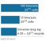{width="100%" fig-alt="Log-scale ladder of counts: 10 to the 56 cells at 100 bins per axis, 10 to the 28 cells at 10 bins per axis, and 4.35 times 10 to the 23 records from 1,000 robots logging at 1 kilohertz for the age of the universe, a rung too short to reach the coarse grid."}

*A fleet logging since the universe began could visit at most `{python} StateSpaceCoverage.frac_pct_str` of even the coarse grid.*
:::

[^fn-bellman-coverage-ledger]: **Curse of Dimensionality**\index{Curse of dimensionality!coverage ledger}: Bellman coined the phrase for dynamic programming, whose value tables grow exponentially with the number of state variables [@bellman1957dynamic]. A raw physical coverage ledger meets the same combinatorial barrier. Dynamic programming scaled by approximating value functions over compact feature spaces; a physical coverage ledger achieves tractability similarly, indexing the compact task invariants that determine operational success rather than the dense continuous state.

Evaluating dataset completeness against the empirical extremes of collected values is fundamentally circular. A collection logger that records forces exclusively between $4.0\text{ N}$ and $6.0\text{ N}$ trivially reports full coverage of that observed interval. Coverage must instead be evaluated against the operational conditions that deployment demands, formulated before any demonstration data is collected.

::: {#dfn-data-operational-design-domain .callout-definition title="Operational design domain"}

***Operational design domain (ODD)***\index{Operational design domain!definition} is the declared set of conditions (object poses, surface conditions, payloads, speeds, and disturbances) under which a machine is intended to operate, stated independently of any data collected within it.

1.  **Significance**: The ODD serves as the denominator for every coverage claim. For example, the latch archive, as the ledger join later in this section shows, populates only a single cell of the ledger required by its door mechanism, a fraction that no volume of redundant nominal episodes can increase. Subsequent verification, evaluation, and release records can assert operational authority only over explicitly supported regions of the ODD.
2.  **Distinction**: Deployment requirements define the ODD, whereas the collecting policy defines empirical occupancy. Coverage measured against observed telemetry extremes merely restates empirical occupancy in ODD terminology, producing an illusion of completeness. A **scenario ledger**\index{Scenario ledger} partitions the continuous ODD into structured discrete cells so that deployment requirements and empirical occupancy can be joined.
3.  **Common pitfall**: Defining the ODD post hoc based on conditions where the machine has already operated successfully rather than where it is required to function. Letting the dataset define its own requirements masks known unvisited failure modes.

:::

In high-dimensional continuous systems, a scenario ledger avoids voxelizing raw camera pixel streams or continuous joint spaces, which would trigger an intractable combinatorial explosion. Instead, it parameterizes low-dimensional task invariants and environmental boundaries, such as workpiece pose offsets ($\pm 5\text{ mm}$), surface friction coefficients, approach speeds, lighting variations ($100\text{--}1000\text{ lux}$), and payload masses ($0\text{--}2\text{ kg}$). These parameters ground verification in concrete physical operating constraints. While this relational join identifies where the dataset holds empirical experience, populating a cell does not demonstrate that a model trained on those samples executes successfully. A populated cell provides supervisory targets, but verifying autonomous competence still requires closed-loop policy evaluation.

The missing recovery actions identified in @fig-05-latch-corridor demonstrate why even a tractable ledger must explicitly index off-nominal perturbations. Repeatedly executing a flawless motion samples progress along the nominal path, whereas corrective demonstrations supply actions that return the machine after an unexpected displacement. A sound scenario ledger distinguishes recovery experiences from nominal runs rather than treating repeated nominal cycles as coverage of the adjacent state space.

Unsupported operational regimes are exposed by a **support envelope relational join**\index{Support envelope relational join!definition}, which cross-references empirical occupancy $\CollectionStateVisitationDistribution(\DecisionProcessState,\DemonstrationActionLabel)$ (where the machine went) against the scenario ledger $\RequiredScenarioSet$ (where the machine must be able to go). The ledger declares a count unit (transitions, independent episodes, or retained demonstrations), an eligibility and retention rule, and a minimum in that same unit. For each cell, the join tallies $\LedgerCellRecordCount$ under this policy and partitions the ledger into cells meeting the minimum ($\LedgerCellRecordCount \ge \MinimumCellSupportCount$), low-count cells, and unvisited blind spots ($\LedgerCellRecordCount = 0$). A populated cell has a nonzero count; it need not meet the minimum. The contact-angle example counts transitions, while Problem 8 counts retained demonstrations. These bins define collection categories. The threshold $\MinimumCellSupportCount$ represents a declared data requirement rather than a test of policy competence; neither an occupied cell nor a large sample count confers autonomous deployment authority.

A held-out validation split drawn from the same collecting policy can evaluate action prediction accuracy over that occupancy while remaining completely blind to gaps in the required operational domain. The comparison in @tbl-data-collector-coverage-ledger separates collection coverage metrics from downstream policy outcomes. Its loss row is the root-mean-square error, in radians, of the predicted action on held-out records, and the cautious archive posts the lower value precisely because a narrow, repetitive archive is easier to fit. Low validation loss does not demonstrate recovery capability in unvisited conditions, just as wide exploratory coverage does not prove that collected corrective labels are dynamically stabilizing. Closed-loop evaluation must test the candidate policy directly against the declared task population.

| Metric                                                        | Cautious Teleoperation ($\TeleoperationStateVisitationDistribution$) | Exploratory Policy ($\ExploratoryStateVisitationDistribution$) | Systems Consequence               |
|:--------------------------------------------------------------|:---------------------------------------------------------------------|:---------------------------------------------------------------|:----------------------------------|
| **Recorded Transitions**                                      | $1{,}000{,}000$ transitions ($100\text{ Hz}$)                        | $1{,}000{,}000$ transitions ($100\text{ Hz}$)                  | Equivalent dataset scale          |
| **Operational Grid Coverage**                                 | $8\,/\,600$ bins ($1.3\%$)                                           | $510\,/\,600$ bins ($85.0\%$)                                  | Populated collection cells        |
| **Zero-Count Blind Spots** ($\LedgerCellRecordCount = 0$) | $592\,/\,600$ bins ($98.7\%$)                                        | $90\,/\,600$ bins ($15.0\%$)                                   | Collection gaps                   |
| **Held-Out RMS Action Error** ($\ValidationLoss$)             | $0.001\text{ rad}$                                                   | $0.012\text{ rad}$                                             | Validation loss is non-diagnostic |
| **Closed-Loop Capability**                                    | Not established by occupancy                                         | Not established by occupancy                                   | Requires candidate evaluation     |
| **Collection Decision**                                       | Target missing cells                                                 | Inspect labels and remaining gaps                              | Occupancy guides collection       |

: **Empirical coverage and validation loss metrics across operational scenario bins**: Illustrative counts and held-out losses compare two collection distributions; neither column supplies measured closed-loop capability. {#tbl-data-collector-coverage-ledger tbl-colwidths="[25,25,25,25]"}

```{python}
#| label: calc-data-latch-scenario-ledger
#| echo: false
#| warning: false
#| message: false
# ┌─────────────────────────────────────────────────────────────────────────────
# │ LATCH SCENARIO LEDGER (LEGO)
# ├─────────────────────────────────────────────────────────────────────────────
# │ Context: @sec-data-policy-coverage (closing paragraph)
# │ Goal:    Show that one door-opening dataset looks complete against a
# │          nominal ledger and mostly empty against the ledger the door needs.
# │ Show:    Plate offset {nominal, +3, -3 mm} x approach {0.03, 0.10 m/s};
# │          demonstrations only in (nominal, 0.03 m/s); 5 of 6 cells at zero.
# │ How:     Approach speeds and tripwire from AISLE; plate offsets and the
# │          logged offset band are chapter-local scenario inputs.
# └─────────────────────────────────────────────────────────────────────────────
from mlsysim import *
from mlsysim.core.units import *
from mlsysim.fmt import fmt_length, fmt_velocity, fmt_force, check, MarkdownStr

RM = Embodied.MobileManipulator.WarehouseMobileManipulator
AISLE = Embodied.Scenario.WarehouseAisle

class LatchScenarioLedger:
    """Scenario-ledger join for the cage-door latch demonstrations."""

    # ┌── 1. LOAD (Constants & Parameters) ─────────────────────────────────
    v_guarded = AISLE.v_latch_approach  # category: illustrative
    v_fast = AISLE.v_latch_high  # category: illustrative
    f_trip = AISLE.f_latch_tripwire  # category: illustrative
    f_limit = AISLE.f_latch_limit  # category: illustrative (latch damage limit)
    plate_offset = 3.0 * ureg.millimeter  # scenario assumption; category: illustrative
    logged_offset = 0.5 * ureg.millimeter  # scenario assumption; category: illustrative
    offsets = [0.0 * ureg.millimeter, plate_offset, -plate_offset]  # category: illustrative
    speeds = [v_guarded, v_fast]  # category: illustrative

    # ┌── 2. EXECUTE (Compute) ─────────────────────────────────────────────
    # Demonstrated cells: the plate within the logged band and the guarded speed.
    n_cells = len(offsets) * len(speeds)
    n_supported = 0
    for _d in offsets:
        for _v in speeds:
            if abs(_d) <= logged_offset and _v == v_guarded:
                n_supported += 1
    n_zero = n_cells - n_supported
    # Successor archive after latch-recovery-02: adds the positive-offset guarded cell.
    n_supported_recovery = n_supported + offsets.count(plate_offset)
    n_zero_recovery = n_cells - n_supported_recovery

    # ┌── 3. GUARD (Assertions) ────────────────────────────────────
    check(abs(v_guarded.to(ureg.meter / ureg.second).magnitude - 0.03) < 1e-9, "Guarded approach should be 0.03 m/s")
    check(abs(v_fast.to(ureg.meter / ureg.second).magnitude - 0.10) < 1e-9, "Unsupported approach should be 0.10 m/s")
    check(abs(f_trip.to(ureg.newton).magnitude - 15.0) < 1e-9, "Latch tripwire should be 15 N")
    check(f_trip < f_limit, "The collection tripwire must sit below the latch damage limit")
    check(n_cells == 6 and n_supported == 1 and n_zero == 5, "Ledger should have one supported cell of six")
    # Values drawn in fig05_collector_coverage_ledger.svg (hand-placed labels).
    check(abs(plate_offset.to(ureg.millimeter).magnitude - 3.0) < 1e-9, "ledger figure draws plate offsets of -3, 0, +3 mm")
    check(n_supported_recovery == 2 and n_zero_recovery == 4, "ledger figure panel (c) draws 2 of 6 cells populated")

    # ┌── 4. OUTPUT (Format & Export) ────────────────────────────────────────
    v_guarded_str = fmt_velocity(v_guarded, precision=2)
    v_fast_str = fmt_velocity(v_fast, precision=2)
    f_trip_str = fmt_force(f_trip, precision=0)
    f_limit_str = fmt_force(f_limit, precision=0)
    plate_offset_str = fmt_length(plate_offset, unit=ureg.millimeter, precision=0)
    logged_offset_str = fmt_length(logged_offset, unit=ureg.millimeter, precision=1)
    _words = {1: "one", 2: "two", 3: "three", 4: "four", 5: "five", 6: "six"}
    n_cells_str = MarkdownStr(_words[n_cells])
    n_zero_str = MarkdownStr(_words[n_zero])
    n_zero_recovery_str = MarkdownStr(_words[n_zero_recovery])
```

The cage-door latch campaign illustrates this relational join for the running machine. Its six-cell example records occupancy, without supplying per-cell counts or a minimum-count requirement. Every retained episode approaches the strike plate at the guarded speed of `{python} LatchScenarioLedger.v_guarded_str` with the plate aligned within ±`{python} LatchScenarioLedger.logged_offset_str` of nominal, and every successful demonstration stays below the illustrative `{python} LatchScenarioLedger.f_trip_str` detection threshold. This observation does not itself qualify the collection response. Evaluated against an uncritical ledger containing only the nominal plate position at the guarded speed, the archive appears exhaustive. Against the operational ledger the deployment actually demands, three plate positions (nominal and ±`{python} LatchScenarioLedger.plate_offset_str`) crossed with two approach speeds (`{python} LatchScenarioLedger.v_guarded_str` and `{python} LatchScenarioLedger.v_fast_str`), the identical dataset populates only one cell of `{python} LatchScenarioLedger.n_cells_str`. Every off-nominal plate displacement and every fast approach at `{python} LatchScenarioLedger.v_fast_str` contains zero demonstrations. The raw logged telemetry does not change between these two assessments; the difference lies entirely in the standard of audit applied. The `{python} LatchScenarioLedger.n_zero_str` unvisited cells therefore travel with the dataset into training as documented operational absences, establishing that the current demonstrations provide no empirical foundation for competence claims in those regimes. Targeted collection can acquire the missing recovery trajectories, but downstream training and closed-loop testing must verify what the resulting policy achieves. @Fig-05-collector-coverage-ledger sets the two audits side by side and adds a third, the stipulated recovery collection `latch-recovery-02` of @sec-data-intervention-recovery, which fills one more cell and still leaves `{python} LatchScenarioLedger.n_zero_recovery_str` known absences.

::: {#fig-05-collector-coverage-ledger fig-env="figure" fig-pos="t" fig-cap="**Scenario-ledger join for the latch**: The same retained demonstrations joined against ledgers of strike-plate offset and approach speed. Against a ledger holding only the nominal plate at `{python} LatchScenarioLedger.v_guarded_str` (a), the archive looks complete. Against the ledger the door needs (b), it fills one cell of `{python} LatchScenarioLedger.n_cells_str` and the other `{python} LatchScenarioLedger.n_zero_str` hold zero demonstrations. The stipulated recovery collection `latch-recovery-02` (c) adds the positive-offset guarded cell and leaves `{python} LatchScenarioLedger.n_zero_recovery_str` known absences. Occupancy describes available experience, not evaluated competence or permission to act." fig-alt="Three panels, each a grid of plate offset minus 3, 0, and plus 3 millimeters against approach speed 0.03 and 0.10 meters per second. Panel a shows only the nominal-offset, 0.03 meters per second cell as the ledger, populated, with the other cells dotted as outside the ledger. Panel b shows all six cells in the ledger, the nominal slow cell populated and five cells marked zero. Panel c adds a populated plus-3-millimeter slow cell, leaving four cells marked zero. A legend distinguishes populated, unvisited, and outside-the-ledger cells."}
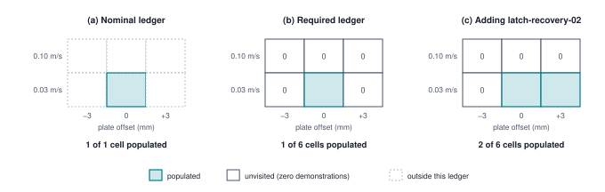{width="100%"}
:::

::: {#chk-data-collector-coverage-ledger .callout-checkpoint title="Empirical occupancy and scenario ledger joins"}

Before evaluating policy coverage across an operational design domain, verify your understanding of dataset occupancy and scenario ledger accounting:

- [ ] **Empirical support vs. validation loss**: Can you explain why an imitation policy can achieve near-zero validation loss on held-out test data while leaving 98 percent of the ODD's required cells unsupported?
- [ ] **Unsupported states**: What can an unvisited scenario cell establish about policy behavior, and what additional evidence or refusal decision is needed?
- [ ] **Scenario ledger relational joins**: Can you distinguish cells meeting the declared minimum, low-count cells, and unvisited cells when joining telemetry against an operational scenario ledger?
- [ ] **Ledger growth**: If the latch ledger adds a third approach speed between the two it holds, how many cells does it contain, and how many of them are known absences for the original archive?

:::

Logging additional nominal demonstrations along an unperturbed trajectory cannot eliminate coverage blind spots. Exposing the policy to recovery dynamics requires forcing the system toward its operational boundaries, either through deliberate demonstrator noise injection or through expert supervisory interventions [@kelly2019hgdagger; @laskey2017dart]. Before collecting either, a team must know why each empty cell is empty, and recorded interventions add a harder question, because they mix the learner's commands and the expert's in one trace (@sec-data-intervention-recovery).

## Intervention and Recovery Data {#sec-data-intervention-recovery}

When a hazardous or boundary state does not appear in a training dataset, an engineer cannot conclude that the physical system avoids that state naturally. An absent state in an empirical log reflects one of four distinct physical mechanisms during data collection:

1. **Unvisited nominal path**: The collecting policy never visited the state because nominal rollouts remained entirely within the primary task corridor. This absence represents unmonitored nominal operation, verifiable by cross-referencing trajectory logs against the scenario ledger.
2. **Permission-path interception**: An active safety barrier or deterministic reflex in the permission path detected an impending boundary violation and truncated the motion before reaching the state, as the `{python} DemonstrationYieldFatigue.f_trip_str` contact tripwire does during a misaligned latch attempt. The permission path logs record this barrier trip directly.
3. **Human supervisory takeover**: A human safety operator perceived a developing hazard and disengaged the autonomous policy before contact occurred. The permission path's log flags this disengagement explicitly.
4. **Post-collection censoring**: The machine entered the hazardous state and collided with an obstacle or jammed a joint, but an automated ingestion script discarded the episode as corrupt or incomplete. Dataset inspection cannot detect this absence because the failure transitions were purged before the training arrays were serialized to disk.

Each mechanism produces an identical zero count in the scenario ledger, yet each calls for a different response. An unvisited cell calls for targeted collection. An intercepted state belongs to the permission path, which already refuses it, and is not a target for the policy to learn. A takeover leaves learner-visited states that curation can turn into corrective supervision. A censored episode is a pipeline defect, recoverable only if the raw recording still exists. Conflating them leads to wrong conclusions about closed-loop policy stability, and the third mechanism needs the most care.

Human takeovers and automated disengagements introduce a selection trap into fleet data. An intervention occurs precisely when the autonomous policy wanders into a region of state space that it handles poorly, causing tracking error or model uncertainty to exceed an operational threshold. Because disengagements are triggered by failing rollouts, the recorded intervention data is never drawn from the nominal state distribution of the task. Instead, a trajectory recorded after takeover captures an expert recovering from an edge-case disturbance. The distribution of states visited during these rescues, denoted $\TakeoverStateVisitationDistribution$, is strictly conditioned on policy failure rather than standard task execution. Treating intervention logs as if they were drawn from the nominal distribution $\ExpertStateVisitationDistribution$ distorts the training distribution toward states that exist only because the prior policy failed.

Appending a rescued episode directly to a behavioral cloning dataset can make unsafe policy commands look like expert demonstrations. Before takeover, the learned policy may issue commands that compound heading error or contact force; after takeover, the expert issues corrective commands from states the learner visited. Those drift states are valuable for corrective aggregation (expert labeling of the states the learner itself reaches, developed below) when an expert can label a safe action there. If a pipeline trains on the entire recorded trajectory without curation, it commits **learner-action contamination**\index{Learner-action contamination}: the failing policy's own commands enter the dataset as expert labels, and the network learns to answer the visual cues of an approaching hazard (such as the gripper sliding off the handle or the base drifting toward a rack upright) with the high-risk commands that produced them, accelerating divergence rather than correcting it. Learner-action contamination corrupts the training targets directly by injecting errant commands, whereas **causal confusion**\index{Causal confusion!imitation learning} occurs when a policy trained on uncorrupted expert targets locks onto spurious correlations [@dehaan2019causal]. The driving example from that work is a brake indicator on the dashboard. The light turns on because the expert braked, so it predicts the braking label almost perfectly, and a policy can learn to brake when the light is on rather than when an obstacle appears. At the latch, a measured joint current that climbs because the operator has already begun to push could play the same role, a consequence of the label that a policy mistakes for its cause.

```{python}
#| label: calc-data-lookback-window
#| echo: false
#| warning: false
#| message: false
# ┌─────────────────────────────────────────────────────────────────────────────
# │ PRE-TRIGGER LOOKBACK WINDOW (LEGO)
# ├─────────────────────────────────────────────────────────────────────────────
# │ Context: @sec-data-intervention-recovery (divergence search and the
# │          authority-record entry)
# │ Goal:    Size the ring buffer's lookback from the sourced takeover time.
# │ Show:    The lookback window.
# │ How:     AISLE.pre_trigger_window: the design out-of-loop takeover (90th
# │          percentile condition-mean take-over time plus console transport)
# │          rounded up to whole seconds; @sec-intervention-trustworthy-logs
# │          uses the same window.
# └─────────────────────────────────────────────────────────────────────────────
from mlsysim import *
from mlsysim.core.units import second
from mlsysim.embodied.datasheet import machine_card
from mlsysim.fmt import fmt_latency, check, MarkdownStr

AISLE = Embodied.Scenario.WarehouseAisle

class DataLookbackWindow:
    """Lookback window that reaches back past the design takeover."""

    # ┌── 1. LOAD (Constants & Parameters) ─────────────────────────────────
    t_takeover = AISLE.t_takeover_out_of_loop  # category: derived (sourced p90 take-over time + transport)
    t_lookback = AISLE.pre_trigger_window  # category: derived
    card = {r.key: r for r in machine_card()}  # the machine card rows of @tbl-01-machine-card

    # ┌── 2. EXECUTE (Compute) ─────────────────────────────────────────────
    headroom = (t_lookback - t_takeover).to(second)

    # ┌── 3. GUARD (Assertions) ────────────────────────────────────────────
    check(t_lookback >= t_takeover, "The lookback must reach back past the design takeover.")
    # fig05_compounding_error_flywheel.svg draws this window as "= 5 s".
    check(abs(t_lookback.to(second).magnitude - 5.0) < 1e-9, f"lookback window: {t_lookback}")
    check(abs((card["t_takeover_out"].value - t_takeover).to(second).magnitude) < 1e-9, "Prose prints the machine card's out-of-loop takeover")

    # ┌── 4. OUTPUT (Formatting) ──────────────────────────────────────────
    t_lookback_str = fmt_latency(t_lookback, unit=second, precision=0)
    t_takeover_str = MarkdownStr(card["t_takeover_out"].value_str)  # printed as the machine card prints it
```

Separating these labels requires locating the **divergence point**\index{Divergence point!intervention curation} where the autonomous policy departed the nominal path, rather than treating takeover as the first error. The divergence precedes the takeover by at least the time a supervisor needs to respond. A remote operator who was not watching continuously must notice the hazard, reorient to the scene, and take control. The running machine's card in @sec-boundary-running-machine budgets that out-of-loop takeover at `{python} DataLookbackWindow.t_takeover_str`, from published take-over studies plus console video and handshake (@sec-intervention-reaction-drift derives it). Edge loggers therefore keep a circular ring buffer spanning a fixed lookback window $\PreTriggerWindowDuration =$ `{python} DataLookbackWindow.t_lookback_str`, that takeover time rounded up to whole seconds. Because dynamic memory allocation during safety-critical events introduces non-deterministic latency spikes, the buffer is pre-allocated in locked memory (`mlock`) or non-volatile storage and populated deterministically at the permission tick rate (`{python} EffectiveSampleSize.f_log_str`). When a human safety supervisor hits an override button or an MCU safety enforcer trips a barrier, the pipeline latches the intervention timestamp $\TakeoverInstant$ and freezes the preceding ring buffer. An out-of-loop supervisory takeover takes longer than the teleoperation loop's continuous correction (@sec-data-teleop-costs); at an illustrative 100 Hz, that delay spans hundreds of control cycles, all logged under the learner's authority.

::: {.column-margin .margin-pointer}
↪ The authority record, which logs on every control cycle which entity held authority and the root cause of any preemption, is developed in @sec-intervention-authority-log.
:::

Detecting the divergence instant $\DivergenceInstant$, estimated below as $\EstimatedDivergenceInstant$, in offline ingestion pipelines requires searching backwards in time from the physical override timestamp across this synchronized pre-trigger telemetry buffer. For the latch, $\TrajectoryDivergenceResidual(\TimeInstant)$ is the lateral gripper-position error between measured and planned kinematics in the declared fixture frame, and $\DivergenceTolerance$ is its positive tolerance in meters. The divergence estimate is:
$$\begin{aligned}
\EstimatedDivergenceInstant = \min \Bigl\{ \TimeInstant \in [\TakeoverInstant - \PreTriggerWindowDuration, \TakeoverInstant] \;\Big|\; &|\TrajectoryDivergenceResidual(\TimeInstant)| > \DivergenceTolerance \\
&\lor\; \text{Tr}(\PolicyEnsembleCovariance(\TimeInstant)) > \EnsembleSpreadThreshold^2 \Bigr\}.
\end{aligned}$$ {#eq-data-divergence-point}
The pipeline scans the lookback window for the first threshold crossing. The policy ensemble covariance is computed after normalizing each action component by its declared scale, so its trace and variance threshold are dimensionless. In unstructured contact manipulation where no static reference trajectory exists, divergence detection instead evaluates declared physical residuals against admissible safety envelope boundaries, such as velocity-to-obstacle clearance margins or anomalous contact force derivatives $d\ContactForceMagnitude/d\TimeInstant$. The detection thresholds are scenario-specific and calibrated to the sensor noise floor. The minimum defines an estimate only when the retained window contains a threshold crossing from below; an empty set or a residual already above threshold at the start of the window leaves the onset unresolved. Learner commands remain excluded from expert supervision, while retained states may receive independently established corrective labels and a stabilized, reviewed recovery segment may qualify under the third curation rule.

**Intervention curation**\index{Intervention curation!definition} separates learner commands, expert labels on learner-visited states, and post-takeover recovery at timestamps the permission path logs for every takeover, the entries of the authority record that @sec-intervention formalizes. The takeover instant $\TakeoverInstant$ is the permission tick at which the authority commit revokes the policy's ownership of the arm, and the three curation rules below are measured from it:

1. **Quarantine drift commands:** The actions issued by the failing autonomous policy during the drift window $[\DivergenceInstant, \TakeoverInstant)$ are retained in the forensic audit log with their safety flags, but strictly masked out ($\TrainingLabelMask = 0$) from imitation training targets.
2. **Preserve drift states for relabeling:** The physical states visited during $[\DivergenceInstant, \TakeoverInstant)$ capture off-nominal boundary conditions that are absent from nominal demonstrations. These states are admitted to training only when an automated expert, such as a planner with privileged state, supplies corrective labels ($\DemonstrationActionLabel^*(\DecisionProcessState)$); a person replaying a logged state cannot reliably say what they would have commanded while closing the loop on it.
3. **Admit only stabilized recovery:** The post-takeover trajectory is not one demonstration. It opens with the enforcer's blend, in which the enforcer, still the only writer to the drives, ramps its single admitted command smoothly from the learner's last checked reference to the operator's, so the actuators never see a step and no two sources ever command them at once. The operator's reorientation follows. Neither interval is expert behavior, and both stay masked. Only the segment after the operator's measured stabilization $\OperatorStabilizationInstant$, the instant the operator's corrections settle into a steady return toward the corridor, up to recovery at $\RecoveryCompletionInstant$, and only where the episode passes task-validity review, becomes an expert recovery demonstration that teaches the policy how to steer from boundary states back to the nominal manifold. @Sec-intervention-recovery-eligibility defines the blend, reorientation, and stabilization intervals and the criterion that ends reorientation.

For the latch campaign, consider a stipulated follow-up collection, `latch-recovery-02`, at the positive `{python} LatchScenarioLedger.plate_offset_str` strike-plate offset and the guarded `{python} LatchScenarioLedger.v_guarded_str` approach. The same `{python} LatchScenarioLedger.f_trip_str` tripwire remains active. An expert takes over from a misaligned approach, withdraws and reseats the gripper, then releases the latch. The stipulated archive contains valid, reviewed recovery sequences; this is a worked teaching branch, not a report of collected trials or measured improvement.

The three rules decide what this archive keeps. The unsuccessful learner commands are retained for diagnosis, expert relabeling is used only where a corrective target is available, and the expert's recovery is admitted only from its stabilized, reviewed segment. A new provenance digest binds those labels to the displaced fixture, the original plant contract, and the collection safeguards. The original archive remains immutable. Its successor now contains experience for the positive-offset guarded cell, while the negative-offset and faster-approach cells remain known absences. @Sec-training uses this archive to construct the candidate `latch-bc-recovery-02`, and closed-loop evaluation must test recovery and nominal-task regressions before any expanded competence claim follows.

::: {.column-margin .margin-pointer}
↪ The qualification of `latch-bc-recovery-02` against fresh nominal and displaced-plate trials is developed in @sec-evaluation-recovery-update.
:::

The states between divergence and takeover are the second law, endogenous data, made concrete. The learner's own control actions chose them, and the original nominal archive supplied no corrective supervision there; they are exactly the off-corridor states of @fig-05-latch-corridor, now visited and logged. Curated, they supply the missing return actions. Training on nominal expert demonstrations alone leaves the compounding-error problem of @sec-data-curse-dimensionality-recoverability in place, bounded in the worst case by the quadratic growth of @eq-data-quadratic-drift, $\CovariateDriftBound$. Labeling the states the learner itself reaches changes how that bound grows.

In **corrective aggregation**\index{Corrective aggregation}, such as Dataset Aggregation (DAgger) [@ross2011reduction], an expert labels states visited by the learner, including eligible pre-takeover drift states. Training on states sampled from the learner's induced distribution ($\DecisionProcessState \sim \LearnerStateVisitationDistribution$), rather than solely the expert's distribution ($\DecisionProcessState \sim \ExpertStateVisitationDistribution$), directly counters the covariate shift that nominal demonstrations leave unaddressed. The resulting performance guarantee depends on a constant determined by plant dynamics and task geometry rather than the learning algorithm. After $\AggregationRoundCount$ rounds of aggregation, at least one policy $\AggregationLearnedPolicy$ in the sequence satisfies
$$\ExpectedTaskCostSum(\AggregationLearnedPolicy) \le \ExpectedTaskCostSum(\pi^*) + \DeviationDisadvantage\,\BehaviorCloningHorizon\,\AggregatedSurrogateLoss + \mathcal{O}(1),$$ {#eq-data-dagger-bound}
where $\AggregatedSurrogateLoss$ represents the surrogate loss of the best single policy on the aggregated learner-visited states (a different quantity from the per-step disagreement $\SingleStepImitationError$ of @eq-data-quadratic-drift), and $\DeviationDisadvantage$ is the **recoverability constant**\index{Recoverability constant}, the maximum increase in the expert's remaining cost-to-go incurred by a single errant action before the expert resumes control.[^fn-math-dagger-bound] This bound scales linearly with the task horizon $\BehaviorCloningHorizon$ only while $\DeviationDisadvantage$ remains bounded, which is to say only while the expert can undo any single mistake at a bounded price. If $\DeviationDisadvantage$ scales in proportion to $\BehaviorCloningHorizon$, the product $\DeviationDisadvantage \BehaviorCloningHorizon\AggregatedSurrogateLoss$ reverts to $\mathcal{O}(\BehaviorCloningHorizon^2\AggregatedSurrogateLoss)$, wiping out the linear advantage over behavioral cloning; @ross2011reduction observed this exact failure mode in their predecessor forward-training scheme.

```{python}
#| label: calc-data-bound-comparison
#| echo: false
#| warning: false
#| message: false
# ┌─────────────────────────────────────────────────────────────────────────────
# │ BEHAVIORAL CLONING VS. AGGREGATION BOUND ORDERS (LEGO)
# ├─────────────────────────────────────────────────────────────────────────────
# │ Context: @sec-data-intervention-recovery, @eq-data-quadratic-drift,
# │          @eq-data-dagger-bound
# │ Goal:    Compare T^2*eps with u*T*eps (u = 1) at a per-step error small
# │          enough that the quadratic bound is not vacuous.
# │ Show:    Horizon in steps, both bound values, and the per-step error above
# │          which T^2*eps exceeds the episode's maximum cost T.
# │ How:     T = episode duration x control rate; crossover eps = 1/S.
# └─────────────────────────────────────────────────────────────────────────────
from mlsysim import *
from mlsysim.core.units import *
from mlsysim.fmt import fmt, fmt_int, fmt_time, fmt_frequency, check

class BoundComparison:
    """Illustrative horizon dependence of the two imitation cost bounds."""

    # ┌── 1. LOAD (Constants & Parameters) ─────────────────────────────────
    t_episode = 5.0 * second  # category: illustrative
    f_ctrl = 100.0 * hertz  # category: illustrative
    eps = 1.0e-3  # per-step disagreement probability; category: illustrative
    u = 1.0  # recoverability constant for a recoverable task; category: illustrative

    # ┌── 2. EXECUTE (Compute) ─────────────────────────────────────────────
    T = int(round((t_episode * f_ctrl).to("").magnitude))
    bc = T * T * eps
    agg = u * T * eps
    eps_vacuous = 1.0 / T

    # ┌── 3. GUARD (Assertions) ────────────────────────────────────────────
    check(T == 500, "Horizon should be 500 steps")
    check(bc < T, "The quadratic bound must stay below the episode maximum at this eps")
    check(abs(bc - 250.0) < 1e-9 and abs(agg - 0.5) < 1e-9, "Unexpected bound values")
    check(eps < eps_vacuous, "Chosen eps must sit below the vacuous threshold")

    # ┌── 4. OUTPUT (Format & Export) ────────────────────────────────────────
    T_str = fmt_int(T)
    t_episode_str = fmt_time(t_episode, unit=second, precision=0)
    f_ctrl_str = fmt_frequency(f_ctrl, precision=0)
    eps_str = fmt(eps, precision=3)
    bc_str = fmt(bc, precision=0)
    agg_str = fmt(agg, precision=1)
    eps_vacuous_str = fmt(eps_vacuous, precision=3)
```

For a horizon of $\BehaviorCloningHorizon =$ `{python} BoundComparison.T_str` steps (`{python} BoundComparison.t_episode_str` at `{python} BoundComparison.f_ctrl_str`) and $\SingleStepImitationError =$ `{python} BoundComparison.eps_str`, the behavioral cloning bound $\BehaviorCloningHorizon^2\SingleStepImitationError =$ `{python} BoundComparison.bc_str`, whereas the aggregation term $\DeviationDisadvantage\,\BehaviorCloningHorizon\AggregatedSurrogateLoss$ in @eq-data-dagger-bound evaluates to `{python} BoundComparison.agg_str` for a recoverable task with $\DeviationDisadvantage = 1$ and matching per-step error. In this setting, the quadratic cloning bound equals half the episode's maximum budget, while the leading aggregation term is less than the cost of a single control step. This comparison is conceptual, since the two error terms evaluate losses over different state distributions and both bounds omit problem-dependent leading constants. Notably, the quadratic bound becomes vacuous whenever $\SingleStepImitationError$ exceeds $1/\BehaviorCloningHorizon =$ `{python} BoundComparison.eps_vacuous_str`, at which point $\BehaviorCloningHorizon^2\SingleStepImitationError$ exceeds the maximum possible episode cost of $\BehaviorCloningHorizon$. @Fig-05-compounding-error-flywheel joins the two halves of this section, the feedback loop that makes cloning's worst case quadratic and the curation timeline that turns one takeover into labels the linear bound can use.

The worst case, where $\DeviationDisadvantage$ grows in proportion to the remaining horizon, is the first law, irreversibility (principle \ref{pri-vol4-irreversibility}), written in the language of imitation bounds. Once the plant enters an unrecoverable state, such as a bent latch, a sheared cable harness, or a dropped brittle workpiece, no subsequent expert command can restore the lost objective. In these failure modes, the cost penalty spans the entire remaining task horizon ($\DeviationDisadvantage \sim \BehaviorCloningHorizon$), and aggregating additional learner states cannot recover linear error bounds. A policy cannot learn recovery from states where recovery is physically impossible; the deterministic permission path must prevent entry into those states altogether. The latch campaign draws this boundary explicitly. Withdrawing and reseating a misaligned gripper is recoverable, so `latch-recovery-02` records corrections there. Contact forces approaching the illustrative `{python} LatchScenarioLedger.f_limit_str` component damage threshold are unrecoverable; the illustrative `{python} LatchScenarioLedger.f_trip_str` tripwire is a detection threshold, not a contact-force ceiling. Its use requires a qualified collection-response envelope accounting for detection, command and actuator response, and peak-force overshoot below the damage threshold. Without that evidence, the lower threshold alone cannot authorize collection. Those damaging states belong to the safety-enforcer domain rather than the policy learning targets.

Gathering expert supervision on learner-visited states takes several architectural forms, and the curation rules detailed above instantiate one of them. Classical DAgger requires an expert to query and label every state visited during autonomous execution, an impossible requirement for a human supervisor when the policy issues commands at control rates. **Human-gated aggregation**\index{Human-gated aggregation} resolves this bottleneck by allowing a human supervisor to take over only when necessary, appending labels exclusively from the resulting intervention episodes [@kelly2019hgdagger]. The three curation rules refine this approach with tap-level telemetry attribution: quarantined learner commands, relabeled drift states, and expert recovery actions maintain isolated provenance records. Where standard human-gated aggregation retains the entire human takeover stream, rule 3 explicitly filters out the transitional controller blend and operator reorientation intervals. Two refinements address the scarcity of supervisor attention. One queries the expert only when policy uncertainty or novelty exceeds a threshold, spending a fixed intervention budget where the policy is least sure [@hoque2022thriftydagger]. The other upweights the sparse recovery segments relative to the dense nominal trajectories during training, so a few minutes of rescue are not drowned by hours of nominal motion [@mandlekar2020humanintheloop].

A team can also avoid online interventions entirely, and this is the wide-tube remedy promised in @sec-data-curse-dimensionality-recoverability. Injecting small noise perturbations into the teleoperator's commands pushes the robot off the nominal path during ordinary collection, so the operator's corrections back toward the corridor appear in the initial demonstration set itself [@laskey2017dart]. Each perturbation consumes hardware life from the fatigue budget in @sec-data-yield-fatigue-budgeting and must stay within recoverable bounds. Ingestion pipelines therefore log the collection mode of every episode explicitly (nominal, noise-injected, or gated intervention), because the three modes put different kinds of states and labels into the archive.

[^fn-math-dagger-bound]: **Corrective Aggregation Error Bound**\index{DAgger!linear error bound}: The bound is Theorem 3.2 of @ross2011reduction. It holds for some policy in the sequence of $\AggregationRoundCount$ iterations, with $\AggregationRoundCount$ of order $\DeviationDisadvantage \BehaviorCloningHorizon$ up to logarithmic factors, and $\DeviationDisadvantage$ bounds the change in the expert's cost-to-go after any single action. @Sec-appendix-ml-compounding states the finite-sample form, in which the same constant appears as $\Glyph{u_{\max}}$.

::: {#fig-05-compounding-error-flywheel fig-env="figure" fig-pos="t" fig-cap="**Covariate shift and intervention curation**: (a) The learned policy's own actions choose the states it sees next. The worst-case cost bound grows as $\CovariateDriftBound$ for behavioral cloning and as $\mathcal{O}(\DeviationDisadvantage\BehaviorCloningHorizon\AggregatedSurrogateLoss)$ for aggregation on a recoverable task; these are bound orders, not measured drift. (b) One takeover. The `{python} DataLookbackWindow.t_lookback_str` lookback reaches back past the divergence point; states between divergence and takeover are eligible for expert relabeling while the learner's commands there are masked. After takeover, the enforcer's blend and the operator's re-orientation are retained for diagnosis but excluded from expert imitation targets, and only the reviewed segment from measured stabilization to recovery becomes an expert demonstration. Based on @ross2011reduction and @spencer2021feedback." fig-alt="Two panels. Left: a closed loop in which a learned policy sends an action to the plant, a disturbance enters the plant, and the plant state returns to the policy, with the bound orders big-O of S squared epsilon for behavioral cloning and big-O of u S epsilon for aggregation written inside the loop. Right: tracking error against time, flat until t div and rising under the learner to a peak at t takeover. A dashed segment marks the enforcer blend, an oscillating segment marks the operator's re-orientation, and from t stabilize the expert's curve falls smoothly to zero at t rec. A bracket marks a 5-second lookback window ending at t takeover and reaching back past t div. Below the axis, a row names the four intervals: drift, blend, re-orient, and stabilized. A states row marks drift as relabel-eligible, blend and re-orient as excluded, and stabilized as expert recovery. A commands row marks drift, blend, and re-orient as masked and stabilized as expert labels."}
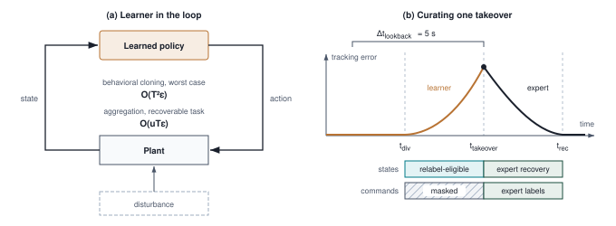{width="100%"}
:::

Training successive policy generations on drift-window commands mislabeled as expert actions triggers a destructive retraining cascade. Consider an initial policy generation exhibiting minor kinematic drift that steers a manipulator toward a joint torque limit until a human supervisor intervenes with an override pendant. If the subsequent policy trains on those uncurated drift-window commands as if they were expert demonstrations, it reinforces the exact behaviors that produced the initial departure. In subsequent deployments, the policy drives even more aggressively toward the joint limit, forcing operators to intervene earlier and more frequently. Ingestion pipelines that monitor only offline validation loss will miss the failure entirely: offline loss on the mislabeled validation split steadily improves as the network memorizes the corrupt labels, even as real-world physical stability collapses.

Preventing this cascade requires the permission path to record every takeover or safety-barrier trip as an explicit entry in the authority record\index{Authority record!intervention entry}.[^fn-edr-takeover-lookback] An actionable authority entry requires far more than a simple boolean disengagement tag overlaid on video. The ingestion pipeline requires a fully populated pre-trigger ring buffer matching the declared lookback window (`{python} DataLookbackWindow.t_lookback_str`), hardware-synchronized sensor observations and actuator taps, monotonic override timestamps, unique authority identifiers, and precise timestamps marking the blend completion and supervisor stabilization. Without this synchronized pre-trigger telemetry, ingestion pipelines cannot locate the true divergence point $\DivergenceInstant$, rendering it impossible to isolate errant learner commands from the boundary states eligible for expert relabeling.

[^fn-edr-takeover-lookback]: **Event Data Recorder**\index{Event data recorder!pre-trigger buffer}: US vehicle rules under 49 CFR Part 563 require an automotive event data recorder to preserve a fixed window of telemetry recorded prior to a crash trigger, recognizing that the root cause of an incident precedes the trigger event itself [@nhtsa2024edr]. Human supervisory takeovers exhibit identical temporal causality: the initial divergence $\DivergenceInstant$ always precedes the override timestamp $\TakeoverInstant$. A logging pipeline that begins capturing telemetry only upon trigger activation has already discarded the critical drift data required for policy curation.

::: {#chk-data-intervention-curation-bounds .callout-checkpoint title="Intervention curation and error bounds"}

Before curating human intervention logs for policy retraining, verify your understanding of compounding error dynamics and timestamp attribution:

- [ ] **Takeover vs. divergence timestamps**: Why retain learner-visited drift states for possible expert relabeling while excluding their unsafe learner commands from expert imitation targets?
- [ ] **Retraining cascade progression**: Can you describe how training successive policy generations on uncurated intervention logs accelerates policy degradation despite improving training metrics?
- [ ] **Conditional error bounds**: Which assumptions distinguish the behavioral-cloning quadratic worst-case cost bound from DAgger's linear-horizon result?
- [ ] **Bound threshold**: For an episode twice as long as the `{python} BoundComparison.t_episode_str` comparison, at the same `{python} BoundComparison.f_ctrl_str` control rate, above what per-step error $\SingleStepImitationError$ does the quadratic bound stop constraining the cost?

:::

Even with expert labels on learner-visited states, the resulting demonstration archive remains tethered to the kinematics and dynamics of the collecting machine. Pooling demonstrations across robot arms, bases, and end-effectors raises the cross-embodiment questions in @sec-data-cross-embodiment.

## Cross-Embodiment Transfer {#sec-data-cross-embodiment}

Physical demonstration trajectories never represent a manipulation task in the abstract. Every recorded stream of sensor observations and actuator commands couples the physical dynamics of the logging hardware directly into its numerical values: link lengths, joint velocity limits, camera optical paths, bus communication latencies, and contact-surface compliances. Reusing demonstration datasets across heterogeneous robots requires establishing explicit contracts between environmental task invariants and embodiment-specific realizations, validating kinematic and dynamic transfer, and resolving topological mismatches. The mobile manipulator confronts these constraints directly when its latch-servicing campaign supplements local demonstrations with data collected on foreign robotic arms and grippers.

### Embodiment contracts and the normalization fallacy {#sec-data-embodiment-contracts}

An observation-action trajectory $(\MultimodalObservation_{t}, \DemonstrationActionLabel_t)$ permanently encodes the **embodiment contract**\index{Embodiment contract!definition} established between a specific machine and its physical surroundings. This contract encompasses the sensor geometry and optical calibration, the sampling period and transport latency of the perception bus, the coordinate frames and kinematic limits of the actuators, the torque-speed saturation curves of the motors (including reflected rotor inertia $\GearReductionRatio^2 \RotorInertia$ in geared transmissions), and the friction and compliance of the contact interface. For the running machine's recorded teleoperation, the contract specifies a rolling-shutter navigation camera at `{python} MultiCameraIngestionBudget.nav_w_str` by `{python} MultiCameraIngestionBudget.nav_h_str` px and `{python} MultiCameraIngestionBudget.nav_fps_str`, a global-shutter wrist camera at `{python} MultiCameraIngestionBudget.wrist_w_str` by `{python} MultiCameraIngestionBudget.wrist_h_str` px on its dedicated bracket, and a `{python} MultiCameraIngestionBudget.n_axes_str`-axis kinematic log sampled at the `{python} MultiCameraIngestionBudget.f_log_str` permission tick (notebook \ref{nbk-data-ingestion-bandwidth-storage-budgets-multi-camera}). Every latch demonstration in that archive reflects that camera suite, that sensor bracket, and that exact arm. Altering any parameter in this contract alters the mapping between commanded inputs and physical state transitions. Even when two robots follow an identical Cartesian tool trajectory $\ToolCartesianPose(\TimeInstant)$, their required actuator torques diverge. Written per joint, Newton's second law for a serial manipulator yields the manipulator equation, met earlier as the model classical control inverts:
$$\JointTorque = \GeneralizedInertiaMatrix(\GeneralizedCoordinates)\GeneralizedAccelerations + \CoriolisCentrifugalMatrix(\GeneralizedCoordinates, \GeneralizedVelocities)\GeneralizedVelocities + \GravitationalTorqueVector(\GeneralizedCoordinates) + \ExternalContactTorque,$$
where $\GeneralizedCoordinates$ denotes joint positions, $\GeneralizedInertiaMatrix(\GeneralizedCoordinates)$ is the configuration-dependent mass matrix, $\CoriolisCentrifugalMatrix(\GeneralizedCoordinates, \GeneralizedVelocities)$ collects Coriolis and centrifugal forces, $\GravitationalTorqueVector(\GeneralizedCoordinates)$ is the gravitational torque vector, and $\ExternalContactTorque$ represents torques exerted by external contact forces; @sec-planning-rigidbody-dynamics builds this equation up from the single-joint case. Because every term depends directly on link masses, rotor inertias, and gear ratios, the same tool trajectory demands fundamentally different torque profiles across different robot embodiments.

::: {.column-margin .margin-pointer}
↩ The manipulator equation, which classical control inverts to compute joint torques, is established in @sec-brain-classical-wall.
:::

::: {.column-margin .margin-pointer}
↩ Reflected rotor inertia, $\GearReductionRatio^2 \RotorInertia$, and its effect on joint dynamics are established in @sec-body-reflected-rotor-inertia.
:::

While the embodiment contract defines the physics of a single machine, the **cross-embodiment compatibility contract**\index{Cross-embodiment compatibility contract!definition} determines whether trajectories logged under one embodiment contract can safely serve as action targets on another. This compatibility contract defines the forward kinematics mapping (translating joint angles to tool pose), control-rate transformations ($\FiniteChange \TimeInstant$), and actuator effort bounds that prevent a high-force profile or rapid spatial velocity demonstrated on a rigid industrial arm from driving a lightweight cobot beyond its structural limits. Large pooled corpora rarely provide such guarantees. Open X-Embodiment maps action fields into a coarsely aligned seven-dimensional end-effector format and normalizes each dataset independently, but it deliberately leaves coordinate frames unaligned and allows action vectors to represent either absolute or relative poses and velocities across different sub-corpora [@open_x_embodiment_collaboration2024open]. A multi-task model trained on this pool learns to interpret identical action vectors differently based on embodiment tokens. In contrast, DROID sidesteps embodiment mismatch altogether by collecting all data on a single standardized robot model [@khazatsky2024droid]. Heterogeneous data can enrich representation learning without an explicit compatibility contract, but such a contract becomes strictly mandatory the moment borrowed actions are imitated directly as supervisory labels or dispatched to a physical plant.

Building a robust data-reuse pipeline requires cleanly separating environmental task invariants from embodiment-specific realizations. A task invariant is a geometric or dynamical condition imposed by the physical process: for example, bringing a compliant probe into contact with a terminal pad within $5^\circ$ of the surface normal while sustaining a normal contact force between $2.0\text{ N}$ and $5.0\text{ N}$. An embodiment realization is the concrete sequence of joint encoder counts, pulse-width modulation duty cycles, perception transport latencies, and sensor pixel rasters used to achieve that condition on a particular test rig. While the contact goal exists in world coordinates, the dataset stores only the realization. When a model trains directly on raw hardware realizations, it internalizes the idiosyncratic mechanics of the source testbed, including structural flexure, drive backlash, and sensor mounting oscillations.

Consider transferring a demonstration dataset collected on Machine A to Machine B for an identical pick-and-place task:

- **Machine A** operates a parallel-jaw gripper with a stroke of $0\text{ to }100\text{ mm}$, a $50\text{ Hz}$ command rate ($20\text{ ms}$ period), a continuous grasp force limit of $40\text{ N}$, and a wrist camera mounted $45\text{ mm}$ behind the tool center point with a $15\text{ ms}$ transport delay.
- **Machine B** operates a compact gripper with a stroke of $0\text{ to }60\text{ mm}$, a $20\text{ Hz}$ command rate ($50\text{ ms}$ period), a continuous force limit of $15\text{ N}$, and a wrist camera mounted $20\text{ mm}$ behind the tool center point with a $35\text{ ms}$ transport delay.

Projecting Machine A's demonstrations directly through the physical constraints of Machine B reveals immediate points of hardware failure. For a workpiece of width $75\text{ mm}$, Machine A commands a gripper aperture of $80\text{ mm}$. That command exceeds Machine B's mechanical stroke by $20\text{ mm}$, driving its leadscrew into the mechanical endstop. During the hold phase, Machine A applies $30\text{ N}$ of clamping force; executing that command on Machine B doubles its continuous rating of $15\text{ N}$ and forces its motor amplifier into current saturation. In the time domain, subsampling the $50\text{ Hz}$ trajectory onto Machine B's $20\text{ Hz}$ bus aliases rapid contact dynamics and introduces $15\text{ ms}$ of additional zero-order hold phase lag (@sec-appendix-control-zoh). Compounded by the $20\text{ ms}$ difference in camera transport delay ($35\text{ ms} - 15\text{ ms}$), the added low-frequency phase-equivalent delay is $35\text{ ms}$, of which the camera difference contributes $20\text{ ms}$. At the assumed constant approach velocity of $0.10\text{ m/s}$, that phase approximation corresponds to an equivalent displacement of $3.5\text{ mm}$. Actual contact overrun requires measured or bounded sampling phase, capture and transport, computation, actuation, and plant response; the phase-equivalent value does not establish when the first correction dispatches. Meanwhile, the $25\text{ mm}$ disparity in wrist camera mounting introduces optical parallax that shifts the apparent position of the workpiece boundary across the camera raster.

Standard machine learning pipelines often attempt to reconcile these physical discrepancies by normalizing observation and action channels to $[0, 1]$ or $[-1, 1]$. This normalization produces a cosmetic alignment of tensor values while leaving the underlying physical incompatibility completely unaddressed. If an aperture command is normalized relative to maximum actuator travel, a normalized action $\NormalizedActionCommand = 0.80$ corresponds to an $80\text{ mm}$ opening on Machine A, safely clearing the $75\text{ mm}$ workpiece. On Machine B, that same normalized value $\NormalizedActionCommand = 0.80$ maps to an aperture of just $48\text{ mm}$ ($0.80 \times 60\text{ mm}$), causing the gripper fingers to collide with the object during the approach phase. Normalizing feature ranges rescales numerical values, but it cannot lengthen a mechanical leadscrew, lower motor coil resistance, or recover bus transport latency. Demonstration trajectories plotted in normalized unit spaces may appear indistinguishable, yet only the subset within the strict physical intersection (apertures below $60\text{ mm}$, forces under $15\text{ N}$, and command frequencies below $20\text{ Hz}$) can execute on the target hardware without inducing saturation or contact damage.

### Kinematic topology mismatches and null-space projection {#sec-data-kinematic-topology}

Even when end-effectors, force ratings, and control rates align, combining robots with different kinematic structures introduces topological conflicts. An identical hand pose often requires completely different joint configurations across arms, and some of those configurations place intermediate links in collision with fixtures or human operators. Discarding joint telemetry in favor of an abstract Cartesian action representation erases essential postural intent. Two fundamental kinematic mismatches govern this loss of information:

1. **Action space incompatibility**: A 7-DoF arm records joint positions $\GeneralizedCoordinates \in \mathbb{R}^7$, a bimanual workstation records $\GeneralizedCoordinates \in \mathbb{R}^{14}$, and a mobile base logs planar velocities $(\BaseLongitudinalVelocity, \BaseLateralVelocity, \BaseHeadingRate)$. Because joint-space commands cannot transfer directly across distinct kinematic arrangements, multi-embodiment models project action sequences into a common Cartesian end-effector displacement:
   $$\FiniteChange \ToolCartesianPose_t = (\FiniteChange \EndEffectorFirstAxisPosition, \FiniteChange \EndEffectorSecondAxisPosition, \FiniteChange \EndEffectorThirdAxisPosition, \FiniteChange \EndEffectorRollAngle, \FiniteChange \EndEffectorPitchAngle, \FiniteChange \EndEffectorYawAngle) \in \mathbb{R}^{6}, \quad \GripperOpeningCommand \in [0, 1],$$
   where the final three elements represent local roll, pitch, and yaw increments under a declared rotation convention. This displacement vector is not itself a member of the Special Euclidean group $\SpecialEuclideanGroup$; any numerical integration must handle angle wrapping and representation singularities. Projecting into Cartesian space standardizes spatial geometry, but it strips away actuator dynamics. A Cartesian step that an industrial arm executes effortlessly near its nominal pose can force a lighter arm through a kinematic singularity. The manipulator Jacobian $\ManipulatorJacobian(\GeneralizedCoordinates)$ maps joint velocities to tool spatial velocities through $\ToolCartesianVelocity = \ManipulatorJacobian(\GeneralizedCoordinates)\GeneralizedVelocities$. When $\ManipulatorJacobian(\GeneralizedCoordinates)$ loses row rank at a singularity, no finite joint velocity can generate motion along the lost Cartesian direction. Commanded displacements near such poses demand joint velocities that immediately exceed the target machine's actuator velocity bounds.
2. **Null-space projection and elbow swivel ambiguity**: Away from singularities, mapping a 7-DoF arm into a 6-DoF Cartesian delta projects out the one-dimensional null space ($7 - 6 = 1$ redundant degree of freedom). For a redundant manipulator with Jacobian $\ManipulatorJacobian(\GeneralizedCoordinates) \in \mathbb{R}^{6 \times 7}$, the general kinematic relationship between Cartesian velocity $\ToolCartesianVelocity$ and joint velocity $\GeneralizedVelocities$ is:
   $$\GeneralizedVelocities = \JacobianPseudoinverse(\GeneralizedCoordinates) \ToolCartesianVelocity + \left( \IdentityMatrix - \JacobianPseudoinverse(\GeneralizedCoordinates) \ManipulatorJacobian(\GeneralizedCoordinates) \right) \NullSpaceVelocityBias,$$
   where $\JacobianPseudoinverse = \ManipulatorJacobian^\top (\ManipulatorJacobian \ManipulatorJacobian^\top)^{-1}$ is the Moore-Penrose pseudoinverse (the least-squares solution that yields the minimum-norm joint velocity producing $\ToolCartesianVelocity$ whenever $\ManipulatorJacobian$ has full row rank), and $\NullSpaceVelocityBias \in \mathbb{R}^7$ represents an arbitrary joint-velocity bias. The projection operator $(\IdentityMatrix - \JacobianPseudoinverse \ManipulatorJacobian)$ filters $\NullSpaceVelocityBias$ into self-motion velocities that generate zero net velocity at the end-effector. For an anthropomorphic arm with shoulder and wrist geometry that admits this construction, a fixed end-effector pose in $\SpecialEuclideanGroup$ and a fixed shoulder anchor leave an elbow orbit around the shoulder-to-wrist axis, parameterized by the **elbow swivel angle** $\ElbowSwivelAngle$. A general redundant arm instead requires its own configuration parameter or the full joint vector; one redundant degree of freedom does not imply this circular geometry. Discarding this internal degree of freedom to impose a uniform 6-DoF action representation completely erases the human operator's postural intent. When the target robot receives this 6-DoF command stream, its local inverse kinematics (IK) solver must resolve the redundancy using an arbitrary mathematical heuristic, such as joint-limit centering or manipulability maximization. Without the original swivel angle, the solver may adopt an elbow posture that drives joints into hard stops or sweeps the elbow into nearby shelving, fixtures, or personnel during a motion that was entirely collision-free in the source environment. Preserving the applicable redundancy parameter, or the complete joint-state vector, within the trajectory's provenance metadata retains the operator's postural intent for target-specific retargeting and collision checks. The running mobile manipulator archive maintains this intent directly: its arm has redundant kinematics, and its logger captures all `{python} MultiCameraIngestionBudget.n_axes_str` axes of the arm and base at the `{python} MultiCameraIngestionBudget.f_log_str` permission tick. Any pooled 6-DoF delta generated from a latch-servicing trajectory can always be traced back to the demonstrator's original elbow posture.

::: {.column-margin .margin-pointer}
↪ Forward kinematics, the manipulator Jacobian, its singularities, and the pseudoinverse are developed in @sec-appendix-control-kinematics.
:::

Reusing physical data across heterogeneous hardware requires two distinct validation gates at the ingestion boundary, reflecting two fundamentally different training roles:

- The **pretraining admission gate** evaluates whether a trajectory can safely contribute to general representation learning. This gate validates data provenance, observation integrity, coordinate frame conventions, action semantics (reference frame, absolute vs. relative representations, position vs. velocity modes), and sampling rates. Crucially, source actions admitted at this gate do not need to be physically executable on the target robot. Multi-embodiment foundation models rely on this gate to ingest broad visual and task structures across dozens of robot morphologies before fine-tuning on target hardware [@open_x_embodiment_collaboration2024open; @black2024pi0].
- The **target-label gate** applies whenever recorded actions serve as direct imitation labels or execution setpoints on the physical plant. This gate maps the source trajectory through target forward kinematics to verify coordinate consistency [@lynch2017modern], confirms that commanded joint velocities and accelerations remain within the target plant's dynamic envelope [@tedrake2023manipulation], and verifies that task-critical features remain within the field of view and dynamic range of the target sensors. When commanded trajectories violate kinematic reach or motor torque limits, an ingestion pipeline cannot simply clamp the values to target boundaries. Clamping distorts velocity profiles, alters phase relationships, and destroys the causal link between observed spatial errors and corrective control outputs. Trajectories that satisfy the target dynamics pass untouched; trajectories that admit valid geometric retargeting through inverse kinematics are relabeled; and trajectories that demand unobtainable actuator authority or rely on unobservable states are rejected.

Evaluating the two-gripper scenario of @sec-data-embodiment-contracts through this target-label gate resolves each trajectory segment systematically. The initial opening phase must be rejected rather than relabeled: satisfying the task invariant (clearing the $75\text{ mm}$ workpiece) demands an aperture that Machine B cannot physically achieve. The $30\text{ N}$ grasp hold is rejected on identical grounds, as it exceeds Machine B's continuous motor rating. Conversely, the $50\text{ Hz}$ trajectory can be resampled and relabeled onto Machine B's $20\text{ Hz}$ control bus only if the slower command stream preserves the task-critical contact dynamics and remains within the target's verified tracking and force limits. The data record must also log the added zero-order hold lag and camera transport delay so that policy training accounts for the altered timing. An ingestion pipeline lacking this gate injects dynamically invalid trajectories into the training distribution. A policy trained on such unvetted data fails in deployment not because of neural network underfitting, but because its training labels were physically valid only on the donor hardware. For the latch-servicing campaign, the target plant is the mobile manipulator's own arm and gripper. Every borrowed trajectory proposed as a latch training label must pass this gate against the mobile manipulator's verified limit record, regardless of the donor platform's reported capabilities.

::: {.column-margin .margin-pointer}
↩ The limit record, which states each measured limit with its operating conditions, uncertainty, and margin, is established in @sec-body-limit-record-schema.
:::

```{python}
#| label: calc-data-conveyor-label-transfer
#| echo: false
#| warning: false
#| message: false
# ┌─────────────────────────────────────────────────────────────────────────────
# │ STATIC-SURFACE PICK LABELS AT THE PICK-STATION CONVEYOR (LEGO)
# ├─────────────────────────────────────────────────────────────────────────────
# │ Context: @sec-data-kinematic-topology (target-label gate, conveyor pick)
# │ Goal:    Show how far the part moves during one setpoint step and one
# │          action chunk, against the grasp tolerance, so a static-surface
# │          pick label cannot be imitated unchanged at the belt.
# │ Show:    Belt speed; travel per setpoint step and per chunk; ratio of the
# │          chunk travel to the grasp tolerance.
# │ How:     d = v_conveyor * t. Belt speed and grasp tolerance from AISLE;
# │          setpoint step and chunk horizon from RM.
# └─────────────────────────────────────────────────────────────────────────────
from mlsysim import *
from mlsysim.core.units import *
from mlsysim.fmt import fmt_length, fmt_velocity, fmt_latency, fmt_int, fmt_multiple, check

RM = Embodied.MobileManipulator.WarehouseMobileManipulator
AISLE = Embodied.Scenario.WarehouseAisle

class ConveyorLabelTransfer:
    """Part travel at the pick-station conveyor during one step and one chunk."""

    # ┌── 1. LOAD (Constants & Parameters) ─────────────────────────────────
    v_belt = AISLE.v_conveyor  # category: illustrative (pick-station conveyor speed)
    tol = AISLE.grasp_tolerance  # category: illustrative
    t_step = RM.chunk_step  # category: chosen
    n_horizon = RM.chunk_horizon  # category: chosen

    # ┌── 2. EXECUTE (Compute) ─────────────────────────────────────────────
    t_chunk = (t_step * n_horizon).to(millisecond)
    d_step = (v_belt * t_step).to(millimeter)
    d_chunk = (v_belt * t_chunk).to(millimeter)
    chunk_over_tol = (d_chunk / tol).to("").magnitude

    # ┌── 3. GUARD (Assertions) ────────────────────────────────────────────
    check(abs(d_step.magnitude - 5.0) < 1e-9, "Belt travel per 25 ms step should be 5 mm")
    check(abs(d_chunk.magnitude - 80.0) < 1e-9, "Belt travel per 16-step chunk should be 80 mm")
    check(d_step < tol < d_chunk, "One step fits the grasp tolerance; one chunk does not")

    # ┌── 4. OUTPUT (Format & Export) ────────────────────────────────────────
    v_belt_str = fmt_velocity(v_belt, precision=2)
    tol_str = fmt_length(tol, unit=millimeter, precision=0)
    t_step_str = fmt_latency(t_step, unit=millisecond, precision=0)
    n_horizon_str = fmt_int(n_horizon)
    t_chunk_str = fmt_latency(t_chunk, unit=millisecond, precision=0)
    d_step_str = fmt_length(d_step, unit=millimeter, precision=0)
    d_chunk_str = fmt_length(d_chunk, unit=millimeter, precision=0)
    chunk_over_tol_mult_str = fmt_multiple(chunk_over_tol, precision=1)
```

The warehouse conveyor pick demonstrates a transfer mismatch rooted in task dynamics rather than robot kinematics. At the sorting station, the arm grasps a workpiece moving along a belt at `{python} ConveyorLabelTransfer.v_belt_str`. The workpiece translates `{python} ConveyorLabelTransfer.d_step_str` during each `{python} ConveyorLabelTransfer.t_step_str` control step and advances `{python} ConveyorLabelTransfer.d_chunk_str` over a single `{python} ConveyorLabelTransfer.n_horizon_str`-step action chunk of `{python} ConveyorLabelTransfer.t_chunk_str`, a displacement of `{python} ConveyorLabelTransfer.chunk_over_tol_mult_str` the allowable `{python} ConveyorLabelTransfer.tol_str` grasp tolerance. A borrowed tabletop demonstration recorded on a stationary bench defines its grasp trajectory entirely in the static table frame. If a policy imitates that trajectory unchanged at the conveyor, an open-loop action chunk aims at the spatial location the part occupied when the chunk was generated. The target-label gate can adapt such a static trajectory only by transforming the end-effector path into the moving workpiece coordinate frame. This coordinate transformation requires both the instantaneous object pose in the donor metadata and the conveyor velocity in the target environment record. An external trajectory lacking this telemetry can enter the pipeline solely through the pretraining admission gate. Teleoperation data collected directly on the warehouse machine requires no such mathematical rescue, as the human operator generated the demonstration commands with the conveyor in motion.

### Choosing pooled experience for the target task {#sec-data-scaling-frontier}

Large-scale pooled corpora such as DROID [@khazatsky2024droid], BridgeData v2 [@walke2023bridgedata], and Open X-Embodiment [@open_x_embodiment_collaboration2024open] offer extensive scene diversity and multi-robot demonstrations. Their value to a specific deployment, such as the latch campaign, depends on what information survives the admission gates of @sec-data-kinematic-topology. Even when hardware kinematic mismatches prevent direct imitation of donor joint commands, foreign demonstrations can supply critical visual representations, object affordances, and high-level task structures.

```{python}
#| label: calc-data-state-of-practice
#| echo: false
#| warning: false
#| message: false
# ┌─────────────────────────────────────────────────────────────────────────────
# │ STATE OF PRACTICE IN ROBOT DEMONSTRATION DATA, AS OF 2026 (LEGO)
# ├─────────────────────────────────────────────────────────────────────────────
# │ Context: @sec-data-scaling-frontier, @tbl-05-state-of-practice
# │ Goal:    Hold the reported scale and headline result of each dated system
# │          in one place so a later edition can refresh them.
# │ Show:    Corpus sizes and the reported scaling and transfer results.
# │ How:     Literature values, each from the cited paper (section in comment).
# │          Promotion candidate: MLSysIM literature registry.
# └─────────────────────────────────────────────────────────────────────────────
from mlsysim.fmt import fmt_int, fmt_percent, check

class StateOfPractice:
    """Reported scale of dated robot-data systems (literature values)."""

    # ┌── 1. LOAD (Constants & Parameters) ─────────────────────────────────
    oxe_datasets = 60  # Open X-Embodiment, Fig. 2; category: literature
    oxe_embodiments = 22  # Open X-Embodiment, Fig. 2; category: literature
    oxe_rt1x_gain = 0.50  # RT-1-X mean success vs. original methods, Fig. 4; category: literature
    droid_traj = 76_000  # DROID, Fig. 1 ("76k trajectories"); category: literature
    droid_hours = 350  # DROID, Fig. 1; category: literature
    droid_scenes = 564  # DROID, Fig. 1; category: literature
    agibot_traj = 1_001_552  # AgiBot World, Sec. 3; category: literature
    agibot_robots = 100  # AgiBot World, "more than 100 homogeneous robots"; category: literature
    agibot_tasks = 217  # AgiBot World, Sec. 3; category: literature
    agibot_gain = 0.30  # average gain over OXE pretraining, abstract; category: literature
    lin_demos = 40_000  # Lin et al., Sec. 1 ("over 40,000 demonstrations"); category: literature
    lin_envs = 32  # Lin et al., Sec. 1 recipe; category: literature
    lin_demos_per_env = 50  # Lin et al., Sec. 1 recipe; category: literature
    lin_success = 0.90  # Lin et al., Sec. 1, new environment and object; category: literature
    pi05_homes_min = 3  # pi0.5, Sec. V-B; category: literature
    pi05_homes_max = 104  # pi0.5, Sec. V-B; category: literature
    pi05_hours = 400  # pi0.5, Sec. I, mobile manipulation in homes; category: literature
    mimicgen_seed = 200  # MimicGen, abstract (~200 human demonstrations); category: literature
    mimicgen_generated = 50_000  # MimicGen, abstract (over 50K); category: literature
    mimicgen_tasks = 18  # MimicGen, abstract; category: literature
    cotrain_gain = 0.38  # sim-and-real co-training, abstract (average); category: literature
    droid_recal = 36_000  # DROID website, April 2025 release of improved calibrations; category: literature

    # ┌── 2. EXECUTE (Compute) ─────────────────────────────────────────────
    agibot_over_droid = agibot_traj / droid_traj
    mimicgen_mult = mimicgen_generated / mimicgen_seed
    lin_recipe_demos = lin_envs * lin_demos_per_env

    # ┌── 3. GUARD (Assertions) ────────────────────────────────────────────
    check(agibot_traj > 10 * droid_traj, "AgiBot World should be over ten times DROID")
    check(lin_recipe_demos == 1600, "Lin et al. recipe: 32 environments x 50 demonstrations")
    check(mimicgen_mult >= 250, "MimicGen generates at least 250 demonstrations per seed")

    # ┌── 4. OUTPUT (Format & Export) ────────────────────────────────────────
    oxe_datasets_str = fmt_int(oxe_datasets)
    oxe_embodiments_str = fmt_int(oxe_embodiments)
    oxe_rt1x_gain_pct_str = fmt_percent(oxe_rt1x_gain, precision=0, style="symbol")
    droid_traj_str = fmt_int(droid_traj, commas=True)
    droid_hours_str = fmt_int(droid_hours)
    droid_scenes_str = fmt_int(droid_scenes)
    agibot_traj_str = fmt_int(agibot_traj, commas=True)
    agibot_robots_str = fmt_int(agibot_robots)
    agibot_tasks_str = fmt_int(agibot_tasks)
    agibot_gain_pct_str = fmt_percent(agibot_gain, precision=0, style="symbol")
    lin_demos_str = fmt_int(lin_demos, commas=True)
    lin_envs_str = fmt_int(lin_envs)
    lin_demos_per_env_str = fmt_int(lin_demos_per_env)
    lin_success_pct_str = fmt_percent(lin_success, precision=0, style="prose")
    pi05_homes_min_str = fmt_int(pi05_homes_min)
    pi05_homes_max_str = fmt_int(pi05_homes_max)
    pi05_hours_str = fmt_int(pi05_hours)
    mimicgen_seed_str = fmt_int(mimicgen_seed)
    mimicgen_generated_str = fmt_int(mimicgen_generated, commas=True)
    mimicgen_tasks_str = fmt_int(mimicgen_tasks)
    cotrain_gain_pct_str = fmt_percent(cotrain_gain, precision=0, style="symbol")
    droid_recal_str = fmt_int(droid_recal, commas=True)
```

Empirical scaling studies since 2024 corroborate a foundational principle of the scenario ledger: policy generalizability expands with environmental conditions rather than unvaried repetitions. In an extensive empirical evaluation spanning more than `{python} StateOfPractice.lin_demos_str` demonstrations collected with handheld grippers, policy success across novel environments and unseen objects scaled as a power law with the count of distinct training environments and objects; adding further demonstrations within existing environments yielded sharply diminishing returns once a modest baseline was achieved. A dataset collecting `{python} StateOfPractice.lin_demos_per_env_str` demonstrations across each of `{python} StateOfPractice.lin_envs_str` environments achieved `{python} StateOfPractice.lin_success_pct_str` on novel environment-object pairs [@lin2025datascaling]. Similarly, evaluating mobile manipulation across residential settings revealed steady performance gains as the training distribution expanded from `{python} StateOfPractice.pi05_homes_min_str` to `{python} StateOfPractice.pi05_homes_max_str` homes; at `{python} StateOfPractice.pi05_homes_max_str` locations, the generalized model matched the performance of an in-domain baseline trained exclusively within the evaluation homes [@black2025pi05]. Viewed through the scenario ledger, the primary scaling axis is the count of distinct operational cells populated by the corpus. The declared minimum coverage threshold $\MinimumCellSupportCount$ identifies cells that still need collection; it does not establish that additional trajectories within a populated cell have no value. Populating operational cells is necessary but not sufficient on its own. As @belkhale2023dataquality demonstrate, dataset utility depends on two additional quality metrics: action divergence (the discrepancy between expert actions and learned policy outputs at reachable states) and transition diversity (the stochasticity of outcomes from given state-action pairs). Crucially, uncurated state diversity does not yield uniform performance improvements.

These demonstration corpora also diverge in how they acquire operational diversity. Open X-Embodiment aggregates `{python} StateOfPractice.oxe_datasets_str` distinct datasets across `{python} StateOfPractice.oxe_embodiments_str` different robotic embodiments with heterogeneous, unaligned action spaces; despite this lack of structural alignment, joint pretraining improved success rates across the smaller constituent datasets [@open_x_embodiment_collaboration2024open]. DROID and AgiBot World instead hold the embodiment contract constant while maximizing environmental and task diversity. DROID deploys a single manipulator model across `{python} StateOfPractice.droid_scenes_str` in-the-wild environments [@khazatsky2024droid]. AgiBot World scales this principle with a homogeneous fleet of more than `{python} StateOfPractice.agibot_robots_str` identical robots, producing pretraining data that demonstrated superior downstream transfer compared to Open X-Embodiment [@bu2025agibot]. A homogeneous fleet removes nominal kinematic mismatches, but each unit must still satisfy the target-label gate through verified calibration and dynamic compatibility. The fleet also remains vulnerable to the shared kinematic blind spots of that specific platform. Conversely, a heterogeneous corpus can broaden perceptual learning through the pretraining gate; its actions become target labels only after passing the target-label gate. Balancing these disparate data streams requires deliberate weighting within the training mixture; dynamically weighting datasets to safeguard the worst-performing target domain significantly outperforms uniform data sampling across Open X-Embodiment [@hejna2025remix]. @Tbl-05-state-of-practice summarizes the empirical scale and headline findings of these benchmark systems as documented in the primary literature.

| System (year)                                                           | Collection regime                                           | Reported scale                                                                                                                                                                                                          | What it shows for the scenario ledger                                             |
|:------------------------------------------------------------------------|:------------------------------------------------------------|:------------------------------------------------------------------------------------------------------------------------------------------------------------------------------------------------------------------------|:----------------------------------------------------------------------------------|
| **Open X-Embodiment** (2024) [@open_x_embodiment_collaboration2024open] | Heterogeneous pool of existing datasets                     | `{python} StateOfPractice.oxe_datasets_str` datasets, `{python} StateOfPractice.oxe_embodiments_str` embodiments; RT-1-X `{python} StateOfPractice.oxe_rt1x_gain_pct_str` higher mean success than the original methods | Breadth without aligned actions; target labels require the target-label gate |
| **DROID** (2024) [@khazatsky2024droid]                                  | One robot model, distributed in-the-wild collection         | `{python} StateOfPractice.droid_traj_str` trajectories, `{python} StateOfPractice.droid_hours_str` h, `{python} StateOfPractice.droid_scenes_str` scenes                                                                | Scene diversity under a single embodiment contract                                |
| **UMI** (2024) [@chi2024umi]                                            | Robot-free hand-held grippers                               | Relative-trajectory actions; latency matched at deployment                                                                                                                                                              | Collection decoupled from robot time and wear                                     |
| **Data scaling study** (2025) [@lin2025datascaling]                     | Hand-held grippers across many environments                 | `{python} StateOfPractice.lin_demos_str` demonstrations; power law in environments and objects                                                                                                                          | Fill more cells before adding episodes per cell                                   |
| **AgiBot World** (2025) [@bu2025agibot]                                 | Homogeneous fleet of identical robots                       | `{python} StateOfPractice.agibot_traj_str` trajectories, `{python} StateOfPractice.agibot_tasks_str` tasks; `{python} StateOfPractice.agibot_gain_pct_str` average gain over pretraining on Open X-Embodiment           | Shared embodiment; unit compatibility still requires verification                 |
| **$\pi_{0.5}$** (2025) [@black2025pi05]                                 | Mobile manipulators in homes, co-trained with other sources | About `{python} StateOfPractice.pi05_hours_str` h in homes; `{python} StateOfPractice.pi05_homes_min_str` to `{python} StateOfPractice.pi05_homes_max_str` training locations                                           | Generalization grows with the number of locations                                 |
| **MimicGen** (2023) [@mandlekar2023mimicgen]                            | Synthetic generation from seed demonstrations               | Over `{python} StateOfPractice.mimicgen_generated_str` from about `{python} StateOfPractice.mimicgen_seed_str` human demonstrations, `{python} StateOfPractice.mimicgen_tasks_str` tasks                                | Cells filled only by synthetic data must be marked as such                        |
| **Sim-and-real co-training** (2025) [@maddukuri2025cotraining]          | Simulated and real demonstrations mixed in training         | `{python} StateOfPractice.cotrain_gain_pct_str` average gain in real-robot success                                                                                                                                      | Synthetic data helps when its provenance is kept                                  |

: **State of practice in robot demonstration data, as of 2026**: Named systems illustrate the mechanisms of this chapter at one point in time; each scale and result is as reported by the cited paper, measured on that paper's own tasks and not comparable across rows. {#tbl-05-state-of-practice tbl-colwidths="[20,20,34,26]"}

The core engineering decision is whether incorporating compatible pooled experience improves target-task policy performance relative to an identical baseline trained strictly on in-domain data. Rigorous evaluation requires fixing the target task distribution and test protocol, maintaining full data provenance, and benchmarking both nominal task completion and recovery behavior. Merely increasing the number of embodiments in a dataset does not guarantee positive transfer. In the mobile manipulator's displaced-latch campaign, the control baseline is a policy trained exclusively on `{python} DemonstrationYieldFatigue.n_target_str` retained teleoperation demonstrations from the machine itself, populating a single cell within the `{python} LatchScenarioLedger.n_cells_str`-cell scenario ledger. An expanded multi-robot corpus justifies its training overhead and ingestion complexity only if the resulting policy improves robustness on long-tail target conditions without regressing nominal latch-servicing performance.

While cross-embodiment compatibility contracts guard the ingestion boundary against hardware mismatches, demonstration data collected on the native machine can fail through internal mechanisms. Teleoperator drift, sensor calibration drift, fixture flexure, and misclassified execution failures corrupt physical datasets without altering tensor dimensions or triggering schema errors (@sec-data-failure-modes).

## Dataset Degradation and Physical Distribution Shift {#sec-data-failure-modes}

In physical learning systems, datasets capture closed-loop interactions between controllers and dynamical environments rather than static observations. A recorded trajectory can satisfy nominal coverage targets in a scenario ledger while silently concealing altered sensor extrinsics, shifting actuator thermal dynamics, or misattributed execution failures. Verifying physical datasets therefore requires auditing the mechanical, optical, and temporal interpretation of recorded trajectories alongside schema consistency and task coverage metrics.

### Silent plant drift and kinematic reprojection verification {#sec-data-plant-drift}

During an extended data collection campaign within a supported operational scenario, both the physical machine and the policy used to collect demonstrations undergo continuous change. Disentangling behavioral drift from plant drift determines whether an anomalous record requires revised conditioning labels, sensor recalibration, or targeted physical re-collection.

#### Passive covariate shift vs. physical dynamics shift {#sec-data-passive-vs-physical-shift}

The distinction introduced in @sec-data-covariate-shift becomes a crucial curation decision during long-term campaigns. Environmental changes, such as shifting diurnal lighting, alter the passive observation distribution without modifying how the robot responds to control signals. Conversely, actuator heating, transmission wear, worn gripper fingertips, and fluctuating payload masses directly alter physical plant dynamics. Before an ingestion pipeline pools or partitions demonstration episodes, it must determine which underlying physical conditions have shifted. Motor heating shows why the answer depends on where in its envelope the machine operated. A hot winding has higher resistance, which leaves the drive less voltage headroom. Inside the current-regulated region of the torque-speed envelope the drive still delivers the commanded torque, so the modeled voltage-headroom effect alone does not distinguish slow, hot and slow, cold demonstrations; other thermal and plant changes still require checking. Near the voltage limit at high joint speed, the same resistance rise caps the current and lowers the available torque, as @sec-data-covariate-shift described, so a fast demonstration recorded hot reflects a weaker plant than one recorded cold.

::: {.column-margin .margin-pointer}
↩ The torque-speed envelope and the back-EMF roll-off at high speed are established in @sec-body-torque-speed-envelopes.
:::

That dependence is why pipelines stratify episodes before pooling them. Stratifying by measured actuator temperatures, maintenance logs, and workpiece wear enables engineers to verify whether identical actuation commands yield consistent plant dynamics. The standard diagnostic tool for this verification is a repeatable excitation trajectory: at the start of each operating shift, the manipulator replays a predetermined joint-space trajectory while stationary. If the tracking error residual exceeds an established threshold, the pipeline flags the plant as mechanically altered. Logging timestamps alone cannot establish that a machine degraded during an operational shift; dataset curation pipelines must justify pooling across sessions based on verified physical invariants and intended training objectives rather than superficial uniformity of array dimensions.

Demonstration collection policies drift just as readily as mechanical hardware. Across `{python} DemonstrationYieldFatigue.t_sched_campaign_str` of scheduled cell time, teleoperators naturally adapt their control strategies. An operator who initially moved cautiously, executing small corrective sub-movements and pausing deliberately before striking a latch plate, gradually develops muscle memory. Over time, that operator rounds corners, anticipates contact forces, and exploits system momentum. These mature demonstrations rely on feedforward compensation and tight timing rather than reflecting changes in joint friction. Partitioning datasets into temporal windows and monitoring episode durations, corrective jerk counts, command amplitudes, and teleoperator intervention rates exposes these subtle shifts in human behavior. This behavioral tracking reveals whether later trajectories contribute advanced manipulation skills or introduce an entirely distinct behavioral regime that requires segregated dataset splits or specialized behavioral labels.

Sensor calibration also deteriorates silently across operating sessions. Standard storage containers such as HDF5, Zarr, and Apache Parquet preserve array topologies, data types, and chunk structures, but they cannot verify whether stored coordinates correspond to physical reality. If a robot is serviced, bumped by personnel, or re-zeroed between collection sessions, joint encoder offsets and external camera poses shift. A camera mount displaced by merely $3\text{ mm}$ moves workpiece pixels across image frames while the stored arrays remain syntactically valid. Clock synchronization drift across distributed fieldbus controllers introduces comparable corruption, skewing the temporal alignment between visual frames and tactile force measurements by tens of milliseconds.

::: {.column-margin .margin-pointer}
↩ Distributed-clock synchronization across fieldbus drive nodes is established in @sec-nervous-fieldbus-architectures.
:::

To detect this silent drift, automated ingestion pipelines rely on **kinematic reprojection verification**, formulated below and evaluated across a photographic mosaic in @fig-05-camera-calibration. Let $\GeneralizedCoordinates \in \mathbb{R}^\JointCount$ denote the joint angles latched from optical encoders at the optical exposure midpoint. Forward kinematics $\ForwardKinematicsMap(\GeneralizedCoordinates)$ maps these angles to the 3D surface vertices of the robot's links in the base coordinate frame, $\BaseFramePoint \in \mathbb{R}^3$. The camera's extrinsic spatial transformation $\BaseToCameraTransform = \begin{bmatrix} \DirectionalCosineMatrix & \RigidTransformTranslation \\ \ZeroVector^\top & 1 \end{bmatrix} \in \SpecialEuclideanGroup$ maps base coordinates into the camera's optical frame ($\CameraFramePoint = \DirectionalCosineMatrix \BaseFramePoint + \RigidTransformTranslation$). Under the pinhole camera model parameterized by intrinsic matrix $\CameraIntrinsicCalibrationMatrix \in \mathbb{R}^{3 \times 3}$,[^fn-zhang-calibration-reprojection] link points project to homogeneous image pixel coordinates $\HomogeneousPixelCoordinates = [\PixelColumnCoordinate, \PixelRowCoordinate, 1]^\top$:
$$\CameraFrameDepth \begin{bmatrix} \PixelColumnCoordinate \\ \PixelRowCoordinate \\ 1 \end{bmatrix} = \CameraIntrinsicCalibrationMatrix \left( \DirectionalCosineMatrix \, \ForwardKinematicsMap(\GeneralizedCoordinates) + \RigidTransformTranslation \right) = \begin{bmatrix} \HorizontalFocalLength & 0 & \PrincipalPointColumn \\ 0 & \VerticalFocalLength & \PrincipalPointRow \\ 0 & 0 & 1 \end{bmatrix} \left( \DirectionalCosineMatrix \, \ForwardKinematicsMap(\GeneralizedCoordinates) + \RigidTransformTranslation \right),$$
where $\CameraFrameDepth$ is the point's depth along the camera's optical axis, the scale that division removes when the projection $\operatorname{proj}_{\CameraIntrinsicCalibrationMatrix}$ maps a camera-frame point to its pixel. An automated check run on every recording session evaluates the reprojection residual between the projected link wireframe and the observed physical arm in the image:
$$\ReprojectionResidual = \left\| \ObservedPixelCoordinates - \operatorname{proj}_{\CameraIntrinsicCalibrationMatrix}\left( \BaseToCameraTransform \, \ForwardKinematicsMap(\GeneralizedCoordinates) \right) \right\|_2.$$ {#eq-data-reprojection-residual}
If mechanical vibration, fastener relaxation, or an accidental impact displaces the camera bracket by even $\FiniteChange \RigidTransformTranslation = 3\text{ mm}$ or tilts it by extrinsic misalignment $\FiniteChange \CameraMountTiltAngle = 0.5^\circ$, the reprojection residual $\ReprojectionResidual$ rises from its calibrated baseline of roughly one pixel to a large geometric offset determined by the focal length and working distance. While the underlying HDF5 or Zarr arrays remain syntactically flawless, an end-to-end visuomotor policy trained on shifted frames learns an erroneous spatial mapping between pixel coordinates and the end-effector tool center point (TCP). During closed-loop autonomous deployment, the policy issues reaching commands that miss physical targets by the uncompensated calibration offset, converting valid demonstrations into persistent latching jams or collisions with fixtures.

[^fn-zhang-calibration-reprojection]: **Camera Calibration**\index{Camera calibration!planar target}: In practice $\CameraIntrinsicCalibrationMatrix$ is estimated from a few views of a planar checkerboard, the method @zhang2000flexible introduced, and the extrinsics come from a separate hand-eye calibration. Both describe one mounting at one time. The reprojection residual is therefore a calibration test repeated every session, not a setup step performed once.

@Fig-05-camera-calibration displays this verification pipeline across a $7 \times 7$ grid of workspace scenes from the DROID dataset: a colored silhouette of the robot arm, rendered from its Unified Robot Description Format (URDF) kinematic mesh at the recorded joint angles, is projected through each camera's extrinsic calibration matrix and overlaid directly onto the raw photographic frame. Where the mask and the physical arm coincide, camera extrinsics and joint encoders are geometrically aligned; where the colored silhouette departs from the links, the check exposes camera mount slippage before corrupted trajectory pairs enter training. Large-scale empirical robotics datasets underscore the necessity of continuous validation. In the DROID dataset, cameras were initially calibrated using checkerboard targets during data collection; however, independent re-analysis revealed that rendered kinematic masks barely overlapped visible robot links across numerous recorded episodes [@lu2025ctrnetx]. The DROID research team subsequently evaluated stored extrinsics by measuring mask intersection-over-union, discarded failed sessions, re-estimated camera poses using learning-based hand-eye estimators, and published updated calibrations for approximately `{python} StateOfPractice.droid_recal_str` episodes [@khazatsky2024droid]. This calibration error shipped within a major open-source corpus because it was completely transparent to standard file format parsers. To prevent these silent failures, ingestion architectures must bind every recorded episode to an immutable calibration identifier and real-time clock synchronization metrics. Trajectories collected under conflicting geometric or temporal calibrations force neural policies to average incompatible sensorimotor distributions within identical state spaces.

::: {#fig-05-camera-calibration fig-env="figure" fig-pos="t" fig-cap="**Camera-to-robot calibration check on DROID scenes**: Randomly chosen DROID scenes with a robot mask rendered from the robot's URDF mesh at the recorded joint angles and projected through each camera's audited calibration, from the dataset's own post-hoc recalibration [@khazatsky2024droid]. Where the mask and the visible arm coincide, the extrinsics are consistent with the joint encoders; a displaced camera shows up as a mask that misses the arm, before any corrupted trajectory reaches the training pipeline. Source: Khazatsky et al., Fig. 13, CC BY 4.0." fig-alt="A seven-by-seven grid of darkened robot workspace photographs from many different rooms. In each, a colored silhouette of the robot arm, rendered from its kinematic model and recorded joint angles, is overlaid on the camera image."}
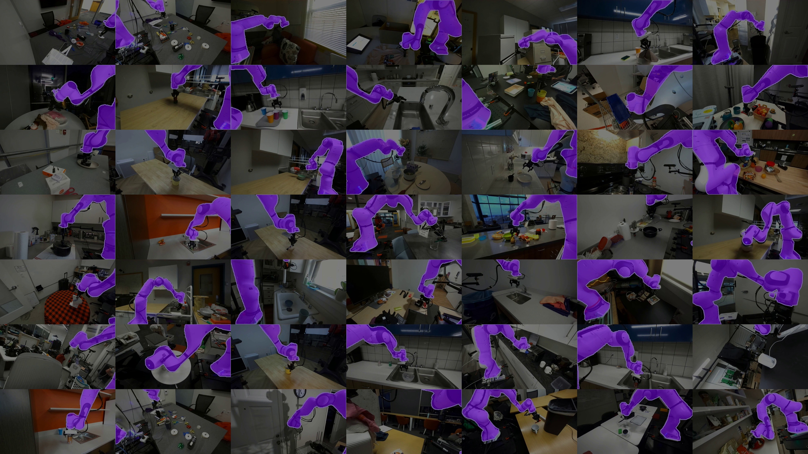{width="95%"}
:::

### Sim-to-real transfer artifacts in rigid-body simulators {#sec-data-sim-to-real-artifacts}

Synthetic data generation replaces physical component wear with systematic modeling approximations. Consequently, degradation in synthetic datasets reflects numerical and kinematic assumptions within the simulation engine rather than sensor slippage or operator fatigue. Discrete-time physics engines resolve contact constraints once per integration step. The chosen mathematical formulation, whether strict complementarity constraints [@stewart1996implicit], convex soft-contact relaxations [@todorov2012mujoco], or penalty-based spring-damper models, determines penetration depths, frictional slip thresholds, and drivetrain compliance. While reinforcement learning agents actively exploit numerical quirks to maximize synthetic reward, behavioral cloning policies passively inherit them. Supervised imitation directly clones whatever unphysical contact impulses, penetrations, or frictionless transitions the simulator generates. Co-training on simulated and physical demonstrations can nonetheless substantially improve real-world policy success despite noticeable discrepancies between the two data regimes (@tbl-05-state-of-practice) [@maddukuri2025cotraining]. A physical ingestion pipeline cannot enforce perfect dynamic fidelity across arbitrary contact geometries; its core responsibility is maintaining end-to-end data provenance. Every synthetic trajectory must record its simulation engine, software version, contact solver parameters, and integration time step, while the scenario ledger explicitly identifies coverage cells populated exclusively by synthetic rollouts (@tbl-05-provenance-schema). Documenting these parameters enables downstream training and diagnostic pipelines to distinguish unphysical solver behavior from true hardware dynamics. Evaluating whether a simulator achieves sufficient fidelity for a specific manipulation task remains a training-time challenge: @sec-training-contact-exploit examines how relaxed contact formulations influence learned policy behavior.

::: {.column-margin .margin-pointer}
↪ The decomposition of transfer discrepancies into dynamics, sensing, appearance, and timing channels, sized from paired command-response traces, is developed in @sec-training-sim-to-real-gap.
:::

### Rig-to-rig divergence across nominally identical fleets {#sec-data-fleet-divergence}

Beyond temporal drift on an isolated machine, two distinct failure modes emerge when demonstration pipelines aggregate data across multi-robot fleets: hardware divergence among nominally identical systems and the conflation of operational task failures with logging faults.

Hardware divergence manifests immediately when a secondary manipulator collects latching demonstrations intended for deployment across a fleet. Even among factory-identical robots of the same model number, individual units exhibit distinct gearbox backlash, thermal dissipation profiles, and motor controller filter tunings. For example, a newly commissioned arm may exhibit $0.02^\circ$ of backlash, whereas a heavily cycled arm displays $0.35^\circ$ of joint play accompanied by a $22\text{ ms}$ torque-response lag. Demonstrations recorded on the degraded arm embed aggressive lead compensation and high feedback gains to counteract deadband and phase delay; when replayed or imitated on the new arm, these aggressive actions induce severe limit-cycle oscillations. To protect fleet-wide models, data ingestion systems must bind a record of each unit's embodiment contract (its kinematic parameters, actuator serial numbers, controller firmware revisions, and identified dynamic models) to every recorded file, filtering out trajectories from hardware that violates the target platform's compatibility constraints.

The second hazard involves conflating physical execution failures with telemetry recording faults. A failed attempt represents a complete, physically valid sequence in which the robot attempted a task but failed to reach the objective. Discarding these episodes introduces severe survivorship bias[^fn-wald-survivorship-archive] and strips the dataset of the boundary states, recovery paths, and negative feedback signals needed to train stabilizing closed-loop policies. Conversely, a failed recording is an infrastructure defect, such as a dropped network packet, a corrupted image frame, or a circular buffer overrun. Ingesting a corrupted recording without explicit tracking presents missing or irregular sample intervals as a continuous, fixed-rate control stream, corrupting the policy's estimation of state derivatives. Data pipelines must therefore classify every session into one of three strict categories: a retained success, a retained physical failure, or an excluded logging fault annotated with diagnostic error codes. In a door-latching campaign, for instance, an episode halted by a contact-force tripwire constitutes a valid physical failure and remains in the provenance archive, whereas a run during which the 6-axis force-torque sensor dropped packets is quarantined with its associated bus error code. Retaining the failure does not admit its commands as expert imitation targets; only stabilized, reviewed recovery segments or expert-relabeled states qualify under the intervention curation rules.

[^fn-wald-survivorship-archive]: **Survivorship Bias**\index{Survivorship bias!Wald aircraft vulnerability}: During the Second World War, Abraham Wald of Columbia's Statistical Research Group estimated the vulnerability of combat aircraft from the damage on the planes that came back; the planes that were hit in the most vulnerable places were the ones missing from the sample [@mangel1984wald]. A demonstration archive filtered to successes has the same hole. The attempts that reached the failure boundary are exactly the ones absent, so the archive understates how often the boundary is reached and holds no states from it.

Hardware contracts can fail silently through unit mismatches that bypass traditional schema validators (war story \ref{ws-data-mars-climate-orbiter-unit-mismatch}).

::: {#ws-data-mars-climate-orbiter-unit-mismatch .callout-war-story title="Mars Climate Orbiter unit mismatch (1999)"}
**Context**: During its nine-month cruise to Mars in 1998 and 1999, the Mars Climate Orbiter fired small thrusters to desaturate its reaction wheels, and the navigation team on the ground folded the resulting velocity changes into the trajectory models used to plan each correction maneuver [@nasa1999mco].

**Mechanism**: A ground software file (called "Small Forces" in the investigation) reported thruster impulse in pound-force-seconds ($\text{lbf}\cdot\text{s}$), while the trajectory models that consumed it assumed newton-seconds ($\text{N}\cdot\text{s}$) as the interface specification required. Because $1\text{ lbf}\cdot\text{s} = 4.45\text{ N}\cdot\text{s}$, every desaturation event entered the models too small by a factor of $4.45$. The values were well formed, in range, and of the expected type, so no schema check could flag them.

**Impact**: The accumulated error was never resolved during cruise. At orbit insertion the spacecraft passed about $57\text{ km}$ above the surface instead of the planned $226\text{ km}$ and was lost.

**Response**: The Mishap Investigation Board traced the loss to the missing unit conversion in the ground file and recommended that the Mars Polar Lander project verify consistent units throughout design and operations and audit all data transferred between JPL and Lockheed Martin Astronautics for compliance with the interface specification, along with stronger navigation review and anomaly escalation.

**Systems lesson**: A number carries its meaning only together with its units and its frame. A robot dataset runs the same risk on every action tap and every calibration. A record that stores a value without the units, frame, and calibration identifier it was produced under lets a mismatched rig pass every tensor check, which is why the provenance record of @sec-data-schema binds each tap to them.
:::

### Operational design domain blind spots and catastrophic interpolation {#sec-data-odd-blind-spots}

Encountering an unobserved operational state does not cause a learned neural controller to halt execution. Instead, the policy continues predicting control outputs, often executing familiar primitives in regimes where their physical prerequisites are completely violated. The `latch-recovery-02` demonstration archive described in @sec-data-intervention-recovery illustrates this vulnerability on the running machine. Its withdraw-and-reseat recovery behaviors were collected exclusively during low-speed guarded approaches at `{python} LatchScenarioLedger.v_guarded_str`. If contact occurs during the faster approach at `{python} LatchScenarioLedger.v_fast_str`, a regime documented as an unpopulated cell in the scenario ledger, the policy can naively select that same withdrawal motion. At elevated velocities, however, contact impulses and stored mechanical strain are substantially larger; attempting an unbraked withdrawal without first dissipating impact energy risks bending mechanical latch pins or damaging end-effector linkages. Operational safety demands that recovery primitives define explicit scenario ledger coverage for the physical states under which they execute, rather than merely logging the triggering failure conditions. Collection supplies experience, and closed-loop evaluation must establish competence in the conditions where the policy is to operate. A qualified permission restriction or physical constraint must exclude regimes that remain unsupported. The 2023 Cruise pullover recounted in @sec-boundary-when-fails is the same failure at road scale, in which a familiar maneuver, the pullover toward a minimal-risk condition, ran in a state no one had covered, with a pedestrian beneath the vehicle (war story \ref{ws-enforcement-cruise-fallback-dragging} gives the full account).

Sensor calibrations, human operator habits, actuator wear states, and operational design domain boundaries define the physical semantics of every recorded trajectory. If data ingestion pipelines strip these physical metadata to generate flat, uniform tensors, downstream evaluations cannot determine whether an autonomous failure stems from model capacity limitations or from unmodeled distribution shifts embedded within the training corpus. The structured provenance schema presented in @sec-data-schema establishes the formal architectural mechanisms required to preserve this physical context throughout dataset lifecycle operations.

## The Dataset Schema {#sec-data-schema}

Consider an audit of two trajectory files from the latch campaign, each holding the exact same number of state-action pairs logged at the same frequency. File A records trajectories from four authorized operators across several days, with no permission-path clamps and consistent fingertip pads throughout. File B records a single operator, logs 620 steps where safety logic clamped joint velocities, and spans an unannounced force-sensor re-zeroing midway through the session. A standard validation script checking only tensor dimensions and value ranges accepts both files without complaint. Yet treating them as interchangeable training data introduces silent, corrupting bugs. File B requires explicit intervention attribution and recalibration metadata before an engineer can interpret its action labels correctly. Furthermore, neither file's tensor geometry reveals which physical latch conditions the recorded data actually covers.

The dataset schema organizes the contextual evidence required to make ingestion decisions safely. It preserves the physical origin and timing of every signal, logs collection costs and dropouts, and documents which physical conditions the archive covers or omits. These fields reflect the mechanical and operational realities of the collection cell. While complete metadata cannot guarantee that a learned policy will operate successfully in closed loop, omitting it ensures that downstream pipelines will misinterpret physical signals.

The **provenance record**\index{Provenance record!definition}\index{Provenance record!physical AI contract} is the immutable, machine-readable artifact bound directly to a demonstration archive. It links every recorded trajectory to the specific plant, sensor calibrations, component wear state, four action taps, collection denominators, and scenario-ledger join ($\OccupiedLedgerCellCount / \RequiredLedgerCellCount$), including its count unit, eligibility and retention rule, and minimum, under which data collection occurred. Standard tensor shapes and training loss curves cannot validate a physical dataset. By recording an archive's empirical boundaries, the provenance record allows the policy manifest and the safety case to distinguish demonstrated historical experience from the operational competence that physical testing must establish. Datasheets for datasets [@gebru2021datasheets] standardize documentation for static corpora; embodied archives additionally require tracking physical wear, permission-path interventions, and tap histories across the causal boundary. Furthermore, this record must travel with the trajectory data itself. Because detachable sidecar files easily separate from their payloads during format conversions, engineers serialize the record as an immutable, hashed header within the container's root metadata, such as an MCAP top-level metadata record or a Zarr root attribute dictionary.

::: {.column-margin .margin-pointer}
↪ The fifteen-record chain, in which the provenance record is the third record, is developed in @sec-appendix-systems-record-register.
:::

This schema establishes a direct lineage from low-level hardware characterization to policy training. It propagates the operating boundaries and thermal thresholds documented in the limit record, alongside the clock domains and jitter budgets established by the handoff record. The proposal boundary defines whose control authority each action tap reflects. During logging, the collection runtime appends unique plant identifiers, calibration matrices, mechanical wear metrics, yield denominators, and the scenario-ledger coverage join. This metadata establishes the recorded collection conditions and empirical coverage provided to the policy manifest, setting a baseline that subsequent evaluation suites test under closed-loop control.

::: {.column-margin .margin-pointer}
↩ The handoff record, which extends each limit with the handoff and clock domain that locate it in the machine, is established in @sec-nervous-handoffs-matrix.
:::

Every trajectory admitted into the training corpus must identify its collection source, collector policy, and execution authority. For human teleoperation, the record logs the operator identifier, the interface hardware, and transport timing characteristics, for example a 6-DoF leader arm sampled at $100\text{ Hz}$ with $0.8\text{ ms}$ of input jitter. Storing an operator identifier, or capturing human faces on peripheral camera streams, makes an episode a record of people as well as of the robot. The schema therefore documents the legal and institutional basis under which each person was recorded, the authorized deployment purposes, and strict retention schedules. This governance ensures that an episode collected to teach latch insertion is not repurposed to evaluate the worker who demonstrated it. When data originates from an autonomous or mixed controller, the record stores the exact policy checkpoint, the planner version, and the active enforcement configuration, including Cartesian bounding boxes, joint velocity limits, and contact-force clamping thresholds. Trajectories must also record the active retention rule, documenting whether the runtime committed an episode automatically upon task completion, retained it after explicit operator review, or flagged it for inclusion as an instructive failure recovery.

::: {.column-margin .margin-pointer}
↪ Purpose limits and retention schedules for records that capture people are enforced in @sec-release-recorded-people.
:::

A physical machine cannot be identified by a generic catalog name or model string. In real hardware, two nominally identical robot arms exhibit distinct mechanical behaviors due to manufacturing tolerances and component aging. The data record specifies the individual plant through its intrinsic and extrinsic sensor calibrations, embodiment contract (@sec-data-embodiment-contracts), motor drive firmware revisions, and component wear state. Replaceable contact surfaces alter the governing dynamics. A parallel gripper fitted with compliant silicone pads of Shore 30A hardness (a durometer scale for rubbers, on which higher numbers are stiffer) produces vastly different friction and compliance than the same mechanism fitted with worn Shore 60A polyurethane pads under identical joint commands. Maintenance milestones such as cable retensioning, drive belt replacements, gearbox swaps, and camera remounts are logged directly in the machine state record. If technicians recalibrated joint offsets between morning and afternoon collection shifts, the dataset must expose that boundary so downstream imitation learning does not attempt to resolve two conflicting kinematic mappings into a single policy.

Collection denominators reconcile every physical attempt as a retained success, a retained failure, or an excluded recording, while exposing the wall-clock time spent resetting the scene. Alongside those yield counts, the four action taps of @sec-data-four-stream-action-tap, override flags, and exclusion codes preserve the critical distinction between demonstrated behavior and permission-path intervention. When safety logic intervenes to clamp velocity or limit contact forces, the data pipeline must attribute those adjustments correctly rather than misinterpreting supervisory interventions as expert demonstrations.

The scenario join records dataset-supported cells (configurations containing retained demonstrations) and catalogues known absences where no empirical data exists. The ledger-policy digest binds the count unit, eligibility and retention rule, and declared minimum; when a minimum is specified, the record distinguishes occupied cells from those meeting it. Here, dataset support reflects historical logging coverage and must not be conflated with the evaluated support of a deployed policy. For the latch campaign, the record below connects collection cost to coverage; @tbl-05-provenance-schema maps its field groups to the decisions they support.

- **Denominators:** `{python} DemonstrationYieldFatigue.n_raw_str` attempts per scheduled session at a net retention rate of `{python} DemonstrationYieldFatigue.retention_str`, so `{python} DemonstrationYieldFatigue.n_target_str` retained successful demonstrations cost `{python} DemonstrationYieldFatigue.n_total_str` attempts over `{python} DemonstrationYieldFatigue.t_sched_campaign_str` of scheduled cell time.
- **Retention rule:** an attempt whose contact force crosses the `{python} DemonstrationYieldFatigue.f_trip_str` tripwire triggers the qualified collection response and is kept as a labeled failure, outside the demonstration count, when its telemetry is valid; a recording that fails quality filtering is excluded with its exclusion code.
- **Scenario ledger:** plate offset (nominal, +`{python} LatchScenarioLedger.plate_offset_str`, −`{python} LatchScenarioLedger.plate_offset_str`) crossed with approach speed (`{python} LatchScenarioLedger.v_guarded_str`, `{python} LatchScenarioLedger.v_fast_str`), `{python} LatchScenarioLedger.n_cells_str` cells, held with the count and retention policy in the record as a digest rather than as a copy.
- **`supported_cells`:** the nominal plate at `{python} LatchScenarioLedger.v_guarded_str`, the only cell the original retained demonstrations occupy.
- **`known_absences`:** the other `{python} LatchScenarioLedger.n_zero_str` cells, every displaced plate and every approach at `{python} LatchScenarioLedger.v_fast_str`.

\Needspace{28\baselineskip}

| Provenance record           | Evidence retained                                                                                                                                                                                                           | Admission decision                                                                                  |
|:----------------------------|:----------------------------------------------------------------------------------------------------------------------------------------------------------------------------------------------------------------------------|:----------------------------------------------------------------------------------------------------|
| **Session**                 | Collector, operator, policy version, source type (physical, robot-free, or synthetic with generator and engine versions), collection mode (nominal, noise-injected, or gated intervention), sample rate, and timing jitter. | Check operator authorization and the session jitter budget.                                         |
| **Embodiment**              | Robot identity, geometry, gearing, backlash, firmware, and the redundancy parameter (elbow swivel angle or full joint vector).                                                                                              | Check reach, dynamics, and joint limits on the target plant.                                        |
| **Sensor calibration**      | Camera geometry, clock synchronization, and force/torque bias.                                                                                                                                                              | Check calibration age and timebase error.                                                           |
| **Contact wear**            | End-effector material, hardness, friction, flex cycles, and maintenance history.                                                                                                                                            | Revalidate contact data after material or compliance changes.                                       |
| **Four action taps**        | Requested, mapped, enforced, and measured values, each with its units and frame, plus override and clamp codes.                                                                                                             | Compare aligned values; attribute modified commands before choosing labels.                         |
| **Transition timing**       | Times of exposure midpoint, action issue, mapping, enforcement, response start, and response end, with clock IDs and synchronization errors.                                                                                | Check causal order and the declared response window.                                                |
| **Collection denominators** | Scheduled cell time, motion time, attempts, retained successes and failures, excluded recordings, and task configurations.                                                                                                  | Reconcile attempts against retained and excluded episodes.                                          |
| **Scenario support**        | Scenario-ledger and count-policy digest (unit, eligibility, retention, minimum), occupied cells, cells meeting any declared minimum, synthetic-only cells, and known absences.                                                                                                     | Identify collection gaps; require separate evidence for deployment claims.                          |
| **Consent and retention**   | People recorded (operator and any bystander in view), the consent or other basis for recording each, the declared purposes, the retention period, and who may read the record.                                              | Admit an episode only for a purpose its basis covers; delete or de-identify it when retention ends. |

: **Demonstration dataset provenance schema**: Evidence retained and the admission check applied to each field group of the provenance record; the embodiment, sensor calibration, and contact wear groups bind the individual plant that collected the data. {#tbl-05-provenance-schema tbl-colwidths="[24,38,38]"}

The policy manifest of @sec-training-policy-manifest cites each contributing archive by digest, including `latch-recovery-02` in the stipulated follow-up branch. The original record continues to describe the original campaign; new experience receives new provenance rather than rewriting old absences. Operator and override history also informs supervisory evaluation, while coverage and calibration evidence contributes to the release argument. Binding the metadata to the trajectory container helps preserve these relationships through ingestion, but cryptographic hashes do not automatically prevent misuse. Data loaders and ingestion pipelines must actively verify that trajectory arrays remain bound to their declared schema and calibration headers before training begins.

::: {.column-margin .margin-pointer}
↪ The release manifest, which binds this provenance record and its operating-domain coverage into the release argument, is developed in @sec-release-manifest.
:::

## Fallacies and Pitfalls {#sec-data-fallacies-pitfalls}

In pure software systems, data collection can often treat storage growth as an unvarnished positive: more web pages, text tokens, or labeled images generally broaden coverage. In physical artificial intelligence, however, datasets are tightly coupled to the mechanical dynamics, calibration state, and physical limits of the collection hardware. A dataset that passes every structural schema check, with zero dropped packets and consistent tensor dimensions, can still leave a deployed machine entirely blind to critical operational states. The operational distribution of physical data reflects three intertwined factors: the collecting policy (whether driven by human teleoperation or automated planning), the physical capabilities and wear of the collection rig, and the curation filters applied before admission to the archive. Neglecting these physical constraints leads to predictable engineering fallacies and costly operational pitfalls.

::: {.fallacy-pitfall}

**Fallacy**: *Massive sample volume compensates for lack of operational state-space coverage.*

Surface-tracking tasks provide a clear illustration: suppose a manipulation policy must operate reliably across 500 distinct combinations of normal force, surface friction, and contact angle, but the archive covers only 45. Logging another collection run that adds $72{,}000$ control steps by repeating nominal trajectories through those same 45 states inflates the database, but it leaves physical coverage completely unchanged. High-frequency sampling in familiar regions merely records the same dynamic trajectory more densely, adding zero evidence about the unvisited friction regimes or steep contact angles. Ingestion pipelines that report massive data growth and zero dropped packets can create a false sense of security while leaving downstream policies brittle. A collection campaign earns its cost by addressing a declared coverage, label-quality, or evidence deficit. A populated cell may still need more or better demonstrations, while nominal repetition alone supplies no evidence about unvisited regimes.

**Architect's countermeasure:** Gate dataset admission on a support envelope relational join against an explicit scenario ledger, rather than step counts or raw byte volume. Require that new data collection campaigns specify which coverage, label-quality, or evidence deficit they target, and track scenario coverage ($\OccupiedLedgerCellCount / \RequiredLedgerCellCount$) as a primary engineering KPI alongside validation loss.

:::

::: {.fallacy-pitfall}

**Pitfall**: *Assuming physical demonstration labels survive mechanical or contact hardware maintenance.*

Archived demonstrations do not retain physical validity when the underlying hardware changes, even if array shapes and data schemas remain identical. Consider what happens when a technician replaces a parallel gripper's compliant fingertips with stiffer pads and re-torques an adjacent camera bracket. The historical dataset still passes every automated pipeline check: sensor channels, array dimensions, and datatypes match expected specifications. If the camera bracket shifts, a known transformation matrix allows mathematical reprojection of visual coordinates. Contact mechanics, however, cannot be reprojected geometrically. The stiffer pads alter normal compliance and contact friction, causing grasp slip at substantially lower shear thresholds than the compliant material tolerated. Telemetry recorded before the swap captures the physical behavior of an obsolete body; training a closed-loop force controller on those historical tactile profiles will cause grasping failures on the modified hardware. Data provenance must track the full mechanical and calibration state of the collection rig so that any hardware alteration immediately triggers targeted review and recollected baselines.

**Architect's countermeasure:** Bind every trajectory file to an immutable hardware state hash that captures camera extrinsics, motor serial numbers, and contact surface material specifications. When maintenance events alter contact stiffness or camera mountings, invalidate historical tactile and force labels for that cell until an automated revalidation protocol verifies dynamic equivalence.

:::

::: {.fallacy-pitfall}

**Pitfall**: *Filtering out aborted safety interventions to sanitize the demonstration dataset.*

Purging aborted demonstrations to produce a flawless training set introduces severe survivorship bias into physical policies.\index{Survivorship bias!in physical datasets} Consider an automated peg-insertion pipeline spanning 1,000 recorded attempts. Of these, 180 runs triggered a safety cutoff when contact forces reached or exceeded a $15.0\text{ N}$ trip threshold, leaving 820 nominal runs that succeeded with an 82 percent yield. A curation script discards the 180 aborted and recovery episodes, preserving only the smooth runs where forces stayed comfortably below $8.0\text{ N}$. When deployed in production, minor surface misalignment inevitably pushes an insertion force to $9.5\text{ N}$. Although this force remains below the $15.0\text{ N}$ trip threshold, the policy encounters a state completely outside its training support. Because the sanitization script erased every observation between nominal tracking and failure, the archive supplies no supervision for these near-boundary dynamics, so recovery behavior remains unsupported. Pruning near-boundary and intervention data strips away the exact state-action pairs the policy needs to regain stability after a disturbance.

**Architect's countermeasure:** Implement three-way intervention curation at data ingestion. Quarantine learner commands between divergence ($\DivergenceInstant$) and takeover ($\TakeoverInstant$) for safety auditing only, preserve the visited boundary states for expert relabeling via corrective aggregation (DAgger), and admit the subsequent human recovery as an expert sequence only after the operator's measured stabilization ($\OperatorStabilizationInstant$), masking the blend and re-orientation that precede it.

:::

::: {.fallacy-pitfall}

**Pitfall**: *Merging demonstrations collected across kinematically asymmetric leader interfaces.*

Merging trajectories across disparate teleoperation input interfaces can quietly bake kinematic dead zones into the dataset.\index{Teleoperation!kinematic asymmetry} Suppose two operators collect snap-fit assembly demonstrations using different leader devices to puppet identical follower arms. The first leader mechanism features detented wrist mechanics that restrict roll to two discrete positions ($\LeaderWristRollAngle \in \{0.0^\circ, 90.0^\circ\}$). The second leader uses a continuous gimbal that mechanically limits roll travel to $[-15.0^\circ, +15.0^\circ]$. Merging the two collections yields 4,000 episodes and increases overall sample volume, but neither interface can express orientations between $20.0^\circ$ and $70.0^\circ$. Even though the follower arm can navigate that full range, the combined archive contains zero training targets within this $50.0^\circ$ gap. Aggregating heterogeneous inputs cannot fill gaps that neither device can mechanically traverse. Downstream imitation policies trained on the combined dataset will fail whenever initial conditions or part tolerances demand intermediate orientations.

**Architect's countermeasure:** Apply the cross-embodiment compatibility contract to the leader interface itself, checking before recording that the leader and follower share the required reachable poses, joint motion ranges, and ability to move in the required directions. Enforce continuous orientation coverage checks across task-space degrees of freedom during data QA to detect mechanical dead-zones.

:::

::: {.fallacy-pitfall}

**Fallacy**: *Physical data collection scales linearly with labor hours just like internet scraping scales with compute.*\index{Data collection!linear scaling fallacy}

Treating physical data collection as an easily parallelized, linear process like web scraping ignores the mechanical entropy and human fatigue inherent to physical experimentation.\index{Data collection!linear scaling fallacy} Teams often extrapolate campaign timelines from early pilot runs, for example by projecting that an initial pace of 50 successful episodes per operator-hour will scale linearly across weeks of shifts. In reality, continuous operation degrades both hardware and teleoperator consistency. Repetitive contact impacts cause backlash and tooth wear in strain-wave gearboxes, thermal expansion and sensor drift cause uncalibrated joint encoders to drift away from physical ground truth, and human fatigue introduces latency spikes and jerky trajectories. As wear accumulates, the proportion of episodes passing quality filtering steadily drops, even while scheduled labor hours remain constant. Pilot runs conducted on pristine hardware systematically overstate long-term collection yield. Campaign planning must budget for routine recalibration, mechanical maintenance, ergonomic rests, and discarded runs alongside raw operator hours.

**Architect's countermeasure:** Budget collection campaigns in net validated demonstration yield ($\UsableDemonstrationYield = \lfloor \ActiveMotionDuration / \AttemptCycleDuration \rfloor \cdot \DemonstrationRetentionRate$) and component fatigue cycles ($\RatedFatigueLife$ ratings for strain-wave gears and internal flex harnesses), rather than gross scheduled operator hours. Estimate the overhead multiplier from the campaign's calibration, reset, retention, and rest assumptions; validate it against sustained collection yield.

:::

## Summary {#sec-data-summary}

A physical machine manufactures its own training data, so every record carries the loop that produced it: the operator's request, the permission path's admission, and the body's response, all under the machine's current calibration and wear. Collecting that data is costly in a way scraping is not. In the latch campaign, only `{python} DemonstrationYieldFatigue.yield_pct_str` of each scheduled hour survives as retained demonstration motion once startup, calibration, operator rest, resets, failed attempts, and quality filtering are paid for, and the wrist's flex cable consumes the larger fraction of its assumed fatigue rating. Because every attempt spends cell time and component life whether or not it is kept, and because correlated control steps hold few independent samples, a campaign earns its cost by addressing a declared coverage, label-quality, or evidence deficit, including inadequate evidence within a populated cell.

Which states the archive holds is a question the archive cannot answer about itself. Coverage is a join between empirical occupancy and a scenario ledger derived from the declared operational design domain, and against the ledger the door actually demands, the baseline latch archive fills one cell of `{python} LatchScenarioLedger.n_cells_str`. Inside even a populated cell, a cloned policy's first error carries it off the demonstrated corridor into states where nothing in the archive constrains its output, which is why behavioral cloning's worst-case cost grows with the square of the horizon. Interventions supply the missing learner-visited states, but only after curation at the divergence, takeover, and stabilization timestamps separates the learner's commands from the expert's recovery. Aggregating expert labels on those states makes the worst-case cost linear in the horizon only while the recoverability constant stays bounded; where a mistake cannot be undone, the state belongs to the permission path, not to the dataset.

A label is only as meaningful as the tap, clock, and plant behind it. Imitating the request teaches commands the permission path would have clamped, imitating the measured response teaches compliance and backlash as intent, and pairing either with a misdated frame converts timing error into position error at the speed of the motion. Range normalization cannot carry a label to another embodiment, and a bumped camera bracket or worn pad silently changes what a stored tuple means. The provenance record binds each archive to its taps, timestamps, plant, calibration, collection denominators, and known absences, so that training and evaluation can tell demonstrated experience from evaluated competence.

@Tbl-05-key-equations summarizes the load-bearing equations introduced throughout this chapter, detailing the physical boundaries each expression defines, the architectural decisions it governs, and its formal derivation.

| Equation                                                                                                                                                                                              | What it bounds or decides                                                                                                                                                             | Derived in                     |
|:------------------------------------------------------------------------------------------------------------------------------------------------------------------------------------------------------|:--------------------------------------------------------------------------------------------------------------------------------------------------------------------------------------|:-------------------------------|
| $\ExpectedTaskCostSum(\pi)-\ExpectedTaskCostSum(\pi^*) \le \BehaviorCloningHorizon^2\SingleStepImitationError$                                                                                        | The worst-case excess cost of cloning on expert states under a 0–1 action loss; the bound becomes uninformative once $\SingleStepImitationError > 1/\BehaviorCloningHorizon$          | @eq-data-quadratic-drift       |
| $\ExpectedTaskCostSum(\AggregationLearnedPolicy) \le \ExpectedTaskCostSum(\pi^*) + \DeviationDisadvantage\,\BehaviorCloningHorizon\,\AggregatedSurrogateLoss + \mathcal{O}(1)$                        | The cost after aggregating expert labels on learner-visited states, linear in $\BehaviorCloningHorizon$ only while the recoverability constant $\DeviationDisadvantage$ stays bounded | @eq-data-dagger-bound          |
| $\EffectiveSampleSize = \RawRecordCount(1-\SerialAutocorrelation)/(1+\SerialAutocorrelation)$                                                                                                         | The effective number of independent observations contained in a serially correlated telemetry stream for a single statistic                                                           | @eq-data-effective-sample-size |
| $\SyncPairingDisplacement \approx \Velocity\,\ObservationPairingLag$                                                                                                                                  | The spatial error introduced by inter-sensor pairing latency, defining the maximum allowable delay for a specified task clearance                                                     | @eq-data-sync-displacement     |
| $\RollingShutterFrameSkew = (\ImageHeight - 1)\,\RollingShutterRowReadout$                                                                                                                            | The temporal skew across a rolling-shutter frame, which end-effector motion translates into geometric image distortion                                                                | @eq-data-rolling-shutter-skew  |
| $\TeleoperationRoundTripLatency = \DisplayPipelineLatency + \OperatorResponseLatency + \TeleoperationCommandLatency + \FollowerMechanicalLatency$                                                     | The round-trip phase lag in teleoperation between an observed state and the physical execution of the human correction                                                                | @eq-data-teleop-loop-latency   |
| $\UsableDemonstrationYield = \lfloor \ActiveMotionDuration/\AttemptCycleDuration \rfloor \DemonstrationRetentionRate$                                                                                 | The yield of usable demonstrations per scheduled session, determining the cell time and mechanical wear required for a campaign target                                                | @eq-data-demonstration-yield   |
| $\EstimatedDivergenceInstant$: first threshold crossing, when captured, in $[\TakeoverInstant - \PreTriggerWindowDuration,\, \TakeoverInstant]$                                                       | The estimated onset of trajectory drift before human takeover, determining whether the lookback window captures the causal error                                                      | @eq-data-divergence-point      |
| $\ReprojectionResidual = \lVert \ObservedPixelCoordinates - \operatorname{proj}_{\CameraIntrinsicCalibrationMatrix}(\BaseToCameraTransform\,\ForwardKinematicsMap(\GeneralizedCoordinates)) \rVert_2$ | The extrinsic reprojection residual used to verify that camera calibration remains aligned with kinematic joint encoders                                                              | @eq-data-reprojection-residual |

: **Key equations of physical data**: Each load-bearing equation of the chapter, the limit it bounds or the decision it settles, and the equation where it is derived. {#tbl-05-key-equations tbl-colwidths="[40,42,18]"}

::: {.callout-takeaways title="Physical data collection and provenance"}
* **Coverage measures distinct physical configurations rather than sample volume:** Repeated nominal trajectories add millions of telemetry rows without expanding scenario coverage. Adjacent control steps are so strongly autocorrelated that an hour of permission-tick records holds only about `{python} EffectiveSampleSize.n_eff_str` independent samples for a slowly varying statistic, and even independent samples support only the cells where they land. An engineering team must measure dataset completeness by joining logged trajectories against an explicit scenario ledger that spans the operational design domain, rather than relying on raw row counts or the archive's own observed extremes.
* **Offline validation loss cannot detect coverage deficits:** Because conventional train-validation splits sample from the same underlying trajectory distribution, a policy can exhibit near-zero validation loss while leaving critical operational cells completely unvisited. Only auditing the dataset against an independent scenario ledger reveals these silent omissions before deployment.
* **Every action tap represents a distinct physical control signal:** An operator's commanded request, the resolved kinematic setpoint, the safety-filtered actuator command, and the measured joint response diverge whenever hardware limiters, friction, or permission guards intervene. Logging each tap alongside synchronized timestamps ensures the supervisory target remains causal and preserves unambiguous evidence of physical interventions.
* **Preserve aborted runs and interventions with rigorous causal attribution:** Discarding failed attempts discards the most valuable boundary-adjacent states in the operational envelope. Autonomous commands preceding a human takeover must be archived for fault analysis and counterfactual relabeling rather than misattributed as expert demonstrations, while the subsequent corrective maneuver should be reviewed, trimmed, and stored as an explicit recovery trajectory.
* **Physical telemetry remains bound to specific hardware embodiments:** While optical perspectives can be reprojected across camera geometries, dynamic properties such as joint friction, structural compliance, and gearbox backlash are embedded directly into recorded force and torque signals. Simple range normalization masks these physical discrepancies without resolving them, requiring thorough re-calibration and verification whenever data is transferred across hardware platforms.
* **Targeted recovery data broadens operational competence under new provenance:** An immutable dataset records the boundary conditions of a specific collection campaign, but engineers can systematically expand policy capabilities by appending verified recovery sequences under separate provenance tags. Asserting an expanded operational claim, however, requires end-to-end closed-loop validation on the physical machine under those target conditions.
:::

Each latch archive in this chapter ended the same way, with a short list of supported cells and a longer list of known absences. That ratio is not a defect of one campaign. It is what the second law, endogenous data (principle \ref{pri-vol4-endogenous-drift}), costs in practice. A machine whose actions choose its next states can only record the states its collecting policy chose, and every additional state it records is paid for in cell time and component life. The known absences in the provenance record are the price list. They say which experience the machine never bought, and therefore which claims no amount of training on this archive can support.

Read that way, the engineering question shifts from how much data a campaign collected to which absences it retired and what each one cost. The displaced-plate cell that `latch-recovery-02` fills moves from the absence list to the supported list under new provenance. The faster approach, which no one collected, stays on the list, and the permission path must keep refusing it until evidence arrives.

## Historical Perspective and Further Reading {#sec-data-history}

Demonstration in robotics began not as data collection for machine learning, but as teleoperation for hazardous environments. At Argonne National Laboratory, Raymond Goertz developed mechanically coupled master-slave manipulators to handle radioactive materials behind heavy shielding [@goertz1949master]. These early systems linked the operator's handle directly to remote mechanical tongs through cables and counterweights; because the transmission was entirely mechanical, contact forces against objects reflected instantly and passively back to the operator's hand.

The systems challenge shifted radically when electrical servos and digital communication networks replaced mechanical linkages. Introducing transmission latency into the bilateral loop between the operator interface and the actuated follower can inject artificial energy into the feedback channel, quickly driving the coupled system into violent instability. @anderson1989bilateral proved that even small transmission delays can destabilize a bilateral teleoperator and established a framework that preserves delayed-channel passivity under its constant-delay model. Stability of the complete loop also depends on the connected systems and their interconnection conditions. @niemeyer1991stable reformulated this remedy through wave variables, transforming power variables (force and velocity) into traveling wave representations that behave as passive transmission lines under the constant-delay model. In their comprehensive survey, @hokayem2006bilateral trace the progression from Goertz's early linkages to modern delay-robust control schemes. Every teleoperation data-collection interface operates under the fundamental compromise illuminated by these works: balancing faithful haptic transparency against the conditions needed to preserve passivity. The physical trajectories, contact transitions, and actuation commands captured in an embodied training archive inherently reflect the compromises of the collection hardware.

Synthesizing feedback controllers directly from recorded demonstrations followed an equally grounded trajectory. In one of the earliest end-to-end vision-based driving systems, ALVINN mapped camera frames to steering angles for an autonomous van [@pomerleau1989alvinn; @pomerleau1991efficient]. ALVINN immediately ran into the recovery gap: because expert drivers kept the van centered within the lane, the recorded dataset contained virtually no examples of drifting off course or recovering from road shoulders. Pomerleau resolved this issue through an early form of data augmentation, synthetically warping camera images and computing the corresponding corrective steering angles to teach the network how to return to the road center.

As the field matured, @argall2009survey unified robot learning from demonstration into a comprehensive framework, formalizing how data collection modalities dictate policy representations and analyzing the kinematic correspondence problem between the demonstrator and the physical robot. The theoretical mechanics of compounding execution errors were established by @ross2010efficient, who proved that naive behavioral cloning yields an error bound that grows quadratically with the task horizon ($\CovariateDriftBound$) under covariate shift. To escape this quadratic penalty, @ross2011reduction introduced Dataset Aggregation (DAgger), demonstrating that rolling out the learner while querying the expert along the induced state distribution achieves an optimal linear bound ($\mathcal{O}(\BehaviorCloningHorizon\SingleStepImitationError)$), provided the environment satisfies a finite recoverability condition. Practical robotics deployments adapted this theoretical machinery to human supervisors who cannot label millions of counterfactual query states. Human-gated DAgger [@kelly2019hgdagger] transferred control to a human expert only during critical trajectory deviations, while DART [@laskey2017dart] injected continuous stochastic noise into the actuators during teleoperation to force human demonstrators to execute recovery maneuvers naturally. The empirical intervention strategies and recovery curation workflows in @sec-data-intervention-recovery trace directly to these foundational methods.

The accounting of state-space coverage and sampling validity borrows from older statistical and control foundations. @bellman1957dynamic named the curse of dimensionality to describe the exponential explosion of discrete state spaces in dynamic programming. In environmental time series, climatologists demonstrated that serially correlated records dramatically reduce the effective degrees of freedom, requiring explicit adjustments to compute true sample sizes [@thiebaux1984interpretation]. Simultaneously, Abraham Wald's wartime analysis of returning aircraft showed that evaluating only surviving samples systematically blinds the observer to critical failure modes [@mangel1984wald].

Robot learning confronted all three phenomena as datasets evolved from isolated laboratory demonstrations into massive multi-robot corpora [@walke2023bridgedata; @khazatsky2024droid; @open_x_embodiment_collaboration2024open]. While cross-institution pooling supplies visual and environmental variations that no single robotic cell can generate, it also aggregates heterogeneous actuator dynamics, unmodeled camera latencies, and latent operator selection biases. Standardizing such corpora requires both an explicit compatibility contract across kinematics and a rigorous accounting of unobserved conditions. Although dataset documentation frameworks [@gebru2021datasheets] originally addressed provenance and social biases in digital corpora, physical robotics demands tracking hardware-level ground truths. The physical dataset schema and provenance architecture detailed in @sec-data-schema extend these documentation principles to capture actuator tap points, calibration matrices, dynamic delays, and known boundary omissions.

The following readings chart the progression from classical bilateral teleoperation to modern pooled robot corpora:

- @hokayem2006bilateral provides an exhaustive survey of bilateral teleoperation control, charting the historical transition from mechanically coupled manipulators to passivity-based and wave-variable architectures. It explains the core control-theoretic tension between transparent force reflection and robust stability when non-negligible communication delays separate the operator from the robot.
- @pomerleau1991efficient presents a compact, highly practical diagnosis of the recovery gap and compounding errors in end-to-end behavioral cloning. The paper details how synthetic visual transformations of road images generated corrective training labels, demonstrating the necessity of off-trajectory recovery data decades before formal distribution-shift theory was codified.
- @argall2009survey synthesizes robot learning from demonstration into a foundational taxonomy based on demonstration collection mechanisms and policy derivation techniques. It highlights the correspondence problem across differing human and robotic kinematic structures, which @sec-data-cross-embodiment formalizes as a strict cross-embodiment mapping contract.
- @ross2011reduction introduces the Dataset Aggregation (DAgger) algorithm and establishes the formal reduction of imitation learning to online convex optimization. It proves that querying an expert along the learner's visited trajectory distribution converts the quadratic error growth of behavioral cloning into a linear bound, defining the critical recoverability constant presented in @eq-data-dagger-bound.
- @open_x_embodiment_collaboration2024open documents the Open X-Embodiment initiative, pooling over one million trajectories across dozens of robot platforms and institutions. The paper is essential reading for systems engineers, illustrating both the positive transfer enabled by scale and the severe architectural challenges of normalizing disparate action spaces, sampling rates, and sensor configurations.
- @gebru2021datasheets establishes the foundational methodology for documenting dataset motivation, composition, collection workflows, and intended use. Contrasting this general framework with @tbl-05-provenance-schema clarifies the specialized physical, electrical, and dynamical metadata required to safely train and deploy embodied controllers.

## Problems {#sec-data-problems}

```{python}
#| label: calc-data-problems
#| echo: false
#| warning: false
#| message: false
# ┌─────────────────────────────────────────────────────────────────────────────
# │ GIVENS FOR THE END-OF-CHAPTER PROBLEMS (LEGO)
# ├─────────────────────────────────────────────────────────────────────────────
# │ Context: @sec-data-problems.
# │ Goal:    Hold the givens the problems add to the chapter's cells: the
# │          compute module's memory, the navigation camera's readout time,
# │          an illustrative wrist-camera geometry for reprojection, an
# │          illustrative takeover trace, a chosen per-cell requirement, and
# │          the transfer source (a bimanual leader-follower arm cell).
# │          Answers are not printed; the private solution script computes them.
# │ Show:    64 GiB; 16.6 ms; 900 px, 0.60 m, 3 mm, 0.5 deg, 1.5 px; drift
# │          window = design out-of-loop takeover; 1.5 s and 6.0 s after takeover;
# │          2 s short lookback; N_min = 50; ALOHA 14 DoF at 50 Hz, 0.5 kg.
# │ How:     Registry reads (RM, AISLE, Embodied.Manipulator); other givens are
# │          labeled illustrative or chosen in the problem text.
# └─────────────────────────────────────────────────────────────────────────────
from mlsysim import *
from mlsysim.core.units import *
from mlsysim.fmt import fmt, fmt_int, fmt_memory_capacity, fmt_latency, fmt_length, fmt_frequency, fmt_mass, fmt_time, check

RM = Embodied.MobileManipulator.WarehouseMobileManipulator
AISLE = Embodied.Scenario.WarehouseAisle

class DataProblems:
    """Givens that the chapter's problems add beyond the worked examples."""

    # ┌── 1. LOAD (Constants & Parameters) ─────────────────────────────────
    soc_mem = RM.brain_soc.memory.capacity  # category: datasheet
    nav_readout = RM.nav_camera.readout_time  # category: datasheet
    f_px = 900.0  # wrist-camera focal length in pixels; category: illustrative
    z_work = 0.60 * meter  # camera-to-gripper working distance; category: illustrative
    shift = 3.0 * millimeter  # bracket shift, as in @sec-data-plant-drift; category: illustrative
    tilt_deg = 0.5  # bracket tilt in degrees, as in @sec-data-plant-drift; category: illustrative
    thresh_px = 1.5  # session reprojection threshold; category: illustrative
    t_drift = AISLE.t_takeover_out_of_loop  # category: derived (sourced p90 take-over time + transport)
    t_stab = 1.5 * second  # stabilization after takeover; category: illustrative
    t_rec = 6.0 * second  # latch release after takeover; category: illustrative
    lookback_short = 2.0 * second  # category: illustrative
    servo = RM.permission_rate  # category: datasheet
    n_min = 50  # retained demonstrations per ledger cell; category: chosen
    src = Embodied.Manipulator.ALOHA_Bimanual  # category: literature
    arm = RM.arm  # category: datasheet

    # ┌── 2. EXECUTE (Compute) ─────────────────────────────────────────────
    lookback = AISLE.pre_trigger_window
    reproj_shift = f_px * (shift / z_work).to("").magnitude  # checked, not printed

    # ┌── 3. GUARD (Invariants) ───────────────────────────────────────────
    check(
        RM.nav_camera.shutter_type == "rolling" and RM.wrist_camera.shutter_type == "global",
        "Problem 3 assumes a rolling navigation camera and a global-shutter wrist camera",
    )
    check(t_drift < lookback, "Problem 7: the drift window must fit the design lookback")
    check(t_drift > lookback_short, "Problem 7: the short lookback must lose the divergence point")
    check(t_rec > t_stab, "Recovery must end after stabilization")
    check(reproj_shift > thresh_px, "Problem 6: the 3 mm shift must exceed the threshold")
    check(n_min > DemonstrationYieldFatigue.n_usable, "Problem 8: one cell should need more than one session")
    check(src.control_frequency < servo and src.dofs != arm.dofs, "Problem 9 needs a slower, topologically different source")

    # ┌── 4. OUTPUT (Formatting) ──────────────────────────────────────────
    soc_mem_str = fmt_memory_capacity(soc_mem, unit=GiB, precision=0)
    nav_readout_str = fmt_latency(nav_readout, unit=millisecond, precision=1)
    f_px_str = fmt_int(int(f_px))
    z_work_str = fmt_length(z_work, unit=meter, precision=2)
    shift_str = fmt_length(shift, unit=millimeter, precision=0)
    tilt_str = fmt(tilt_deg, precision=1)
    thresh_str = fmt(thresh_px, precision=1)
    t_drift_str = fmt_time(t_drift, unit=second, precision=3)
    t_stab_str = fmt_time(t_stab, unit=second, precision=1)
    t_rec_str = fmt_time(t_rec, unit=second, precision=0)
    lookback_short_str = fmt_time(lookback_short, unit=second, precision=0)
    servo_str = fmt_frequency(servo, unit=ureg.kilohertz, precision=0)
    n_min_str = fmt_int(n_min)
    src_dofs_str = fmt_int(src.dofs)
    src_rate_str = fmt_frequency(src.control_frequency, precision=0)
    src_payload_str = fmt_mass(src.payload_capacity, unit=kilogram, precision=1)
    arm_dofs_str = fmt_int(arm.dofs)
    arm_payload_str = fmt_mass(arm.payload_capacity, unit=kilogram, precision=0)
```

The problems below build on the physical parameters, timing budgets, and hardware specifications established across this chapter's worked examples. Where physical measurements have not yet been logged on the physical machine, illustrative parameters stand in as baseline engineering assumptions. Each problem centers on a concrete operational decision. The bracketed tags specify the analytical mode (direct computation, systems design, or architectural critique) along with the corresponding learning objectives (LO) assessed.

1. **[Compute, LO3] The reset tax.** In the collection session analyzed in notebook \ref{nbk-data-flex-cable-ceiling}, installing a faster re-latch fixture would halve the `{python} DemonstrationYieldFatigue.t_rst_str` reset duration, whereas an improved strike-plate guide would halve the `{python} DemonstrationYieldFatigue.failure_pct_str` in-trial failure rate. For each modification independently, use @eq-data-demonstration-yield to recompute the total attempts required per session, the scheduled cell occupancy time to collect `{python} DemonstrationYieldFatigue.n_target_str` retained demonstrations, and the percentage of rated flex-cable fatigue life consumed by the campaign. Determine which investment to prioritize when cell time binds, and which to fund when flex-cable fatigue binds.
2. **[Compute, LO5] Sizing the pre-trigger buffer.** The real-time logger described in @sec-data-intervention-recovery must maintain a `{python} DataLookbackWindow.t_lookback_str` lookback window. Calculate the required buffer capacity across three configurations: for the kinematic stream alone (`{python} MultiCameraIngestionBudget.bytes_per_step_str` bytes per step logged at `{python} MultiCameraIngestionBudget.f_log_str`), for all sensor streams combined at the raw `{python} MultiCameraIngestionBudget.bw_total_str` bandwidth of notebook \ref{nbk-data-ingestion-bandwidth-storage-budgets-multi-camera}, and for the complete session compressed to `{python} MultiCameraIngestionBudget.bw_compressed_str`. Compare each memory footprint against the `{python} DataProblems.soc_mem_str` physical memory of the onboard compute module, and decide which streams belong in the locked, pre-allocated ring buffer.
3. **[Compute, LO2] Rolling shutter at the latch.** The navigation camera reads out its sensor rows over `{python} DataProblems.nav_readout_str` (datasheet specification), whereas the wrist camera uses a global shutter that exposes every row simultaneously. Modeling this row readout as the full-frame skew in @eq-data-rolling-shutter-skew, determine the physical displacement across one navigation frame at the `{python} SyncDisplacement.v_transit_str` transit velocity and at both latch approach speeds. Compare each resulting displacement against the latch mechanism's `{python} SyncDisplacement.clearance_str` clearance, and calculate the maximum approach speed at which raw navigation frames can serve directly as latch observations without requiring row-time timestamp corrections.
4. **[Compute, LO1] Effective samples in the latch archive.** Apply @eq-data-effective-sample-size with autocorrelation parameter $\SerialAutocorrelation =$ `{python} EffectiveSampleSize.rho_str` to the `{python} DemonstrationYieldFatigue.n_target_str` retained demonstrations, each lasting `{python} DemonstrationYieldFatigue.t_att_str` and recorded at `{python} EffectiveSampleSize.f_log_str`. Treat the selected scalar statistic as stationary with the stated autoregressive correlation and the same mean and variance within each episode, and treat separate episodes as independent. Use the chapter's large-sample approximation for each episode and sum those episode estimates; finite episode boundaries limit its accuracy. Compare four metrics for the campaign: raw record count, effective sample size, total episode count, and the fraction of the latch scenario ledger covered, as charted in @fig-05-collector-coverage-ledger. Explain which metric fundamentally limits what a trained policy can accomplish when encountering a displaced strike plate, and why the other three metrics fail to expose that limitation.
5. **[Compute, LO1] When the bound says nothing.** A single latch attempt lasts `{python} DemonstrationYieldFatigue.t_att_str`. Assuming the `{python} BoundComparison.f_ctrl_str` control rate used in the comparison following @eq-data-dagger-bound, calculate the discrete horizon $\BehaviorCloningHorizon$, the per-step imitation error threshold above which the compounding error bound in @eq-data-quadratic-drift becomes vacuous, and the numerical value of both bounds at $\SingleStepImitationError =$ `{python} BoundComparison.eps_str` with recovery parameter $\DeviationDisadvantage = 1$. Explain why the training loss $\AggregatedSurrogateLoss$ differs fundamentally from the true policy error $\SingleStepImitationError$, and analyze how the bound comparison behaves if $\DeviationDisadvantage$ grows proportionally with $\BehaviorCloningHorizon$.
6. **[Compute, LO7] A bumped bracket in pixels.** A wrist camera with a focal length of `{python} DataProblems.f_px_str` px observes the gripper at a working distance of `{python} DataProblems.z_work_str`. Using the pinhole camera model from @sec-data-plant-drift, estimate the reprojection residual (@eq-data-reprojection-residual) produced by a `{python} DataProblems.shift_str` lateral bracket shift, and separately by a `{python} DataProblems.tilt_str`° angular tilt. For these estimates, place the observed point initially on the optical axis, translate the camera perpendicular to that axis for the lateral shift, and rotate it about its optical center around an axis perpendicular to the viewing direction for the tilt; neglect distortion and other calibration errors. Given a session diagnostic threshold that flags residuals exceeding `{python} DataProblems.thresh_str` px, find the smallest lateral shift this check can detect. Decide whether this automated gate reliably catches a calibration misalignment as large as the latch's `{python} SyncDisplacement.clearance_str` mechanical clearance.
7. **[Design, LO5] Curating an intervention episode.** In an illustrative `latch-recovery-02` trial, the gripper's lateral error crosses the tolerance threshold $\DivergenceTolerance$ one design out-of-loop takeover duration, `{python} DataProblems.t_drift_str`, before the human operator overrides autonomous control at $\TakeoverInstant$. The operator stabilizes the arm `{python} DataProblems.t_stab_str` after taking control, and the latch releases `{python} DataProblems.t_rec_str` after the takeover event. The system logger samples at `{python} DataProblems.servo_str`, while the learning policy issues commands at `{python} BoundComparison.f_ctrl_str`. Map the segmentation intervals from @fig-05-compounding-error-flywheel onto this timeline, calculate the number of logged states eligible for expert action relabeling, determine how many autonomous learner commands must be masked out, and give the duration of the admitted expert recovery trajectory. Verify whether the drift window fits within the `{python} DataLookbackWindow.t_lookback_str` lookback buffer. Finally, identify what information a truncated `{python} DataProblems.lookback_short_str` lookback loses, and specify how the curation pipeline must handle the resulting episode.
8. **[Design, LO4] A pad-wear axis.** Expand the scenario coverage ledger of @fig-05-collector-coverage-ledger by adding a pad-wear axis (distinguishing between new and worn gripper pads), setting a target coverage requirement of $\MinimumCellSupportCount =$ `{python} DataProblems.n_min_str` retained demonstrations per cell. Assuming the baseline campaign operated exclusively with new pads, catalog the occupied cells and documented absences for both the initial archive and its `latch-recovery-02` successor. Distinguish occupancy from meeting the retained-demonstration minimum; mark successor count sufficiency as unknown wherever counts are not supplied. Using the retained demonstration yield per session derived in notebook \ref{nbk-data-flex-cable-ceiling}, calculate the number of physical sessions needed to populate one empty cell to $\MinimumCellSupportCount$. Propose an execution plan for the subsequent data collection campaign, identifying which operating cells must remain protected within the deterministic permission envelope rather than targeted for autonomous collection.
9. **[Design, LO6] Borrowing from a bimanual arm cell.** An engineering team proposes incorporating door-opening demonstrations collected on a bimanual leader-follower teleoperation station (`{python} DataProblems.src_dofs_str` degrees of freedom across two arms and their grippers, commanded at `{python} DataProblems.src_rate_str`, with a `{python} DataProblems.src_payload_str` payload capacity) into the mobile manipulator's latch dataset. The target robot features a single arm with `{python} DataProblems.arm_dofs_str` joints, a `{python} DataProblems.arm_payload_str` payload capacity, and a `{python} DataProblems.servo_str` permission tick rate. Determine which architectural compatibility gate from @sec-data-kinematic-topology these source demonstrations must satisfy for self-supervised representation pretraining vs. direct supervised action labeling. When generating target labels, identify an action representation that can transfer across these embodiments, determine what the target's inverse kinematics solver must infer that the teleoperation setup never captured, and calculate the source system's zero-order hold lag (half the command period, as shown in @sec-appendix-control-zoh). Identify the target command-period information needed for the comparison without substituting its permission tick. Finally, state what evidence would let the target-label gate admit, relabel, or reject the approach, contact, and latch-release segments of the source trajectories.
10. **[Design, LO8] The successor's provenance record.** Construct the full dataset provenance record for the `latch-recovery-02` release, completing every field group in @tbl-05-provenance-schema with explicit values from this chapter or marking unmeasured entries as *to be measured*. Explain how its supported cells and known absences contrast with those of the baseline archive, specify what entries must populate its collection-mode and intervention fields under the filtering protocols of @sec-data-intervention-recovery, and describe how the schema establishes verifiable lineage back to the parent archive without mutating historical records.
11. **[Critique, LO1, LO4] A large archive with a small loss.** A team presents the conservative demonstration archive from @tbl-data-collector-coverage-ledger, citing its low validation loss on held-out trajectories as evidence that the policy is ready for autonomous contact tasks. Critique this readiness claim. Identify precisely what distribution the validation loss evaluates, compute the fraction of the operational scenario grid actually populated by the archive, and analyze which absence mechanisms from @sec-data-intervention-recovery account for the unpopulated cells. Formulate three essential questions the team must answer before deploying the policy to autonomous hardware, specifying the empirical evidence required for each answer.
12. **[Critique, LO3, LO7] A plan budgeted in demonstration time.** A data-collection proposal budgets `{python} DemonstrationYieldFatigue.n_target_str` latch demonstrations by estimating active teleoperation time as `{python} DemonstrationYieldFatigue.n_target_str` $\times$ `{python} DemonstrationYieldFatigue.t_att_str`, scheduling only a single camera calibration at the start of the campaign. Critique this operational plan against the fatigue and cell scheduling model in notebook \ref{nbk-data-flex-cable-ceiling}. Compute the planned demonstration time, the actual scheduled cell time demanded by the illustrative session parameters, and the ratio between the two. Identify the physical wear mechanisms that this budget neglects. Then determine which structural and environmental drift modes go undetected by an initial calibration across `{python} DemonstrationYieldFatigue.t_sched_campaign_str` of operational cell time, and outline the periodic verification routines the team must add (@sec-data-plant-drift).

::: {.callout-chapter-connection title="From demonstrations to policies"}
What does a policy learn from an archive whose provenance record lists more absences than supported cells? It learns the supported cells, and its training score gives no sign of where the absences begin. The baseline latch archive covers only the nominal strike plate at the guarded approach, and @sec-training opens with two candidates built on it: `latch-bc-01`, cloned from those demonstrations, and `latch-sim-02`, distilled from a simulator teacher that learned the fast approach no one collected on the machine. Each improves in training while hiding a dependency the hardware will expose. The chapter then carries the curated `latch-recovery-02` archive into a recovery candidate and writes each candidate's evidence into a policy manifest whose declared operating domain cannot exceed the cells its provenance supports. @Sec-evaluation then tests whether that declared domain holds on the machine.
:::
