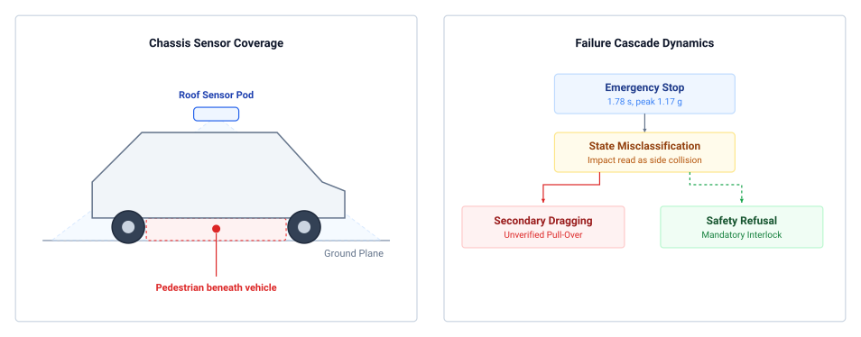

---
format:
  html:
    title: "Physical Data"
---

# Physical Data {#sec-data}

::: {layout-narrow}
::: {.column-margin}

\chapterminitoc

:::

::: {.content-visible when-format="pdf"}
\noindent
{fig-alt="Isometric blueprint showing the physical data and ingestion pipeline: The system includes key components: a bilateral teleoperation leader arm for precise manipulation; a 6-axis operator load cell measuring force and providing control feedback; a calibrated stereo vision sensor head for depth perception; a micro-lidar rangefinder using laser pulses for accurate distance measurement; an optical calibration checkerboard ensuring sensor alignment precision; and a deterministic flash logger for reliable data storage under varying conditions."}
:::

::: {.content-visible unless-format="pdf"}
{fig-alt="Isometric blueprint showing the physical data and ingestion pipeline: bilateral teleoperation leader arm, 6-axis operator load cell, calibrated stereo vision sensor head, micro-lidar rangefinder, optical calibration checkerboard, and deterministic flash logger."}
:::

:::

## Purpose {.unnumbered .unlisted}

::: {.content-visible when-format="pdf"}
\begin{marginfigure}
\resizebox{0.92\linewidth}{!}{\mlphysicalstackfull{20}{20}{20}{20}{100}}
\end{marginfigure}
:::

_Why can a large archive of successful demonstrations leave a robot unable to recover from its first mistake?_

A successful demonstration shows how a particular machine completed a task under particular conditions. It may show little about recovering after a slip, handling a changed fixture, or acting with a worn gripper. Repeating that demonstration enlarges the archive without necessarily filling those gaps. The recorded motion also reflects the operator's delay, the machine's limits, and any intervention by the permission path. Without separating these influences, training can mistake a safeguard's correction or a mechanical limitation for the behavior it should imitate. Gathering the missing experience costs operator time and component life, and the collection process must itself stay within physical limits. Physical data engineering therefore joins the choice of experiences to the meaning, timing, and physical origin of their labels. Because collection actions cross the causal boundary, their irreversible costs and consequences determine both what can be learned and what the evidence leaves unsupported.



::: {.callout-learning-objectives}

- Estimate usable demonstration yield from collection time, operator rest, and physical reset overhead, and budget the mechanical component wear a campaign consumes
- Analyze the conditional quadratic imitation-cost bound and distinguish dataset occupancy from evaluated closed-loop competence
- Separate failed autonomous actions from human recovery trajectories across the divergence and takeover timestamps in authority-record entries
- Evaluate whether an embodiment's mechanical, sensing, and timing assumptions transfer to another machine without falling into the normalization fallacy
- Design an immutable demonstration provenance record linking each observation to its four-stream action taps ($a_{\text{req}}, a_{\text{cmd}}, a_{\text{enf}}, a_{\text{meas}}$) and to the collecting plant
- Identify collection gaps by joining empirical state-action occupancy against a required scenario ledger

:::

## Endogenous Experience {#sec-data-endogenous-experience}

The warehouse mobile manipulator can enforce its motion limits and still lack the experience needed to open its spring-latched cage door. During a demonstration, an operator requests motion, the permission path checks it, and the body moves against the latch. The sensor log records the outcome of that entire loop. The limit records and the handoff record established by the machine's anatomy therefore become conditions on the data used to teach its learned proposer. Choosing what experience to collect requires understanding how actions change subsequent observations; choosing what to imitate requires separating the requested action from the permitted command and measured response.

::: {.column-margin}
{width="100%" fig-alt="S·P·A locator triad highlighting the Sense node."}

*The Sense axis: harvesting physical experience through multimodal sensory telemetry.*
:::

A policy trained on the retained demonstrations of a door-opening campaign—clean teleoperated openings of the warehouse mobile manipulator's spring-latched cage door—can still fail at the latch on its first autonomous attempt. One fundamental cause is the shift the machine's own actions create.[^fn-data-causal-loop] In a fixed offline vision dataset, the model's prediction does not change the next stored example. In an embodied Markov Decision Process (MDP), an executed action changes the body's physical trajectory, camera pose, and contact states, thereby altering the distribution of all subsequent observations ($s_{t+1} \sim P(s \mid s_t, a_t)$).

[^fn-data-causal-loop]: **Causal Boundary**\index{Causal boundary!thermodynamic constraint}: The causal boundary between computation and physics is established in @sec-boundary-causal-boundary. Because state evolution depends on motor actuation, policy actions perturb the distribution of future observations, which breaks the independent and identically distributed (i.i.d.) assumption of disembodied machine learning.

::: {#dfn-data-endogenous-covariate-shift .callout-definition title="Endogenous covariate shift"}

***Endogenous covariate shift***\index{Endogenous covariate shift!definition}\index{Covariate drift!physical AI} is the closed-loop distribution discrepancy wherein an embodied agent's executed actions alter its subsequent physical states and sensory observations ($s_{t+1} \sim P(s \mid s_t, a_t)$), driving the system into state-space regimes unsupported by its training demonstrations.

1.  **Significance**: Explains how offline behavioral cloning can fail during closed-loop physical execution: a perturbation may drive the system into states where the policy lacks training support.
2.  **Distinction**: Unlike exogenous dataset shift caused by changing ambient lighting or seasonal weather, endogenous shift is actively generated by the agent's own closed-loop actions altering its subsequent observation distribution.
3.  **Common pitfall**: Attempting to fix closed-loop policy failure by collecting more nominal expert demonstrations, which only increases data density along the success manifold without providing the corrective recovery data needed to escape boundary excursions.

:::

This shift is the collection-side face of principle \ref{pri-vol4-endogenous-drift}. It makes an archive of flawless executions without recovery trajectories an operational liability, because the policy's first mistake moves the robot outside the demonstrated states.

### Mechanics of endogenous covariate shift {#sec-data-covariate-shift}

In classical statistical learning theory, empirical risk minimization assumes that samples are drawn independent and identically distributed (i.i.d.) from an exogenous, stationary distribution $\mathcal{D}$. An image classifier that misidentifies a dog as a cat does not alter the pixels of subsequent images in the test set. In passive machine learning, covariate shift is an open-loop observational phenomenon: the marginal input distribution $P(X)$ changes (such as evaluating a vision model trained on sunny daytime driving under rainy nighttime illumination) while the underlying conditional data-generating function $P(Y \mid X)$ remains stationary. Crucially, the model is a passive observer: its predictions $\hat{Y}$ exert zero physical back-action on the data source, and an inference error does not physically mutate subsequent inputs.

In a physical machine, two distinct mechanisms can change what the learner encounters. The first changes which states the policy visits even when the plant is unchanged; the second changes how the plant responds to an action:

1. **Endogenous state distribution shift**: The policy's executed actions $\mathbf{a}_t = \pi_\theta(\mathbf{o}_t)$ directly alter the state transition $\mathbf{s}_{t+1} \sim P(\mathbf{s} \mid \mathbf{s}_t, \mathbf{a}_t)$, actively shaping what sensory observations $\mathbf{o}_{t+1}$ the machine encounters next. An execution error displaces the physical body into an unvisited state, immediately mutating the input distribution.
2. **Active physical plant drift**: The governing physical plant is a continuous dynamical system whose differential equations of motion $\dot{\mathbf{x}} = \mathbf{f}(\mathbf{x}, \mathbf{u}; \boldsymbol{\theta}_{\text{plant}}(t))$ actively drift over operational time. Actuator Joule heating ($I^2 R$) raises winding temperature and copper resistance $R(T) = R_0(1 + \alpha \Delta T)$, which reduces the drive's voltage headroom and therefore the current, and torque, it can deliver at speed; cyclic loading of strain-wave gears degrades lubrication, lowers torsional stiffness, and increases lost motion; compliant elastomer gripper pads abrade and deform, shrinking the Coulomb friction cone ($\|\mathbf{F}_t\| \le \mu F_n$); and manipulated workpieces exhibit unmodeled variations in mass, center of gravity, and surface roughness across trials, altering the system's mass matrix $\mathbf{M}(\mathbf{q})$ and gravitational wrenches $\mathbf{g}(\mathbf{q})$.

In embodied control, the policy's actions induce an *endogenous state visitation distribution* $d^\pi(s)$, the fraction of time steps at which a rollout of policy $\pi$ occupies state $s$. When a policy trains via offline behavioral cloning on demonstrations generated by an expert policy $\pi^*$, it minimizes imitation loss over the expert's occupancy distribution $d^{\pi^*}(s)$. During autonomous execution, however, the policy must generate actions under its own induced distribution $d^\pi(s)$. The divergence between $d^{\pi^*}$ and $d^\pi$ can compound errors when the learned policy lacks a recovery action.

### Recovery and compounding error {#sec-data-curse-dimensionality-recoverability}

Opening the latch from a centered approach and recovering from a sideways slip require different actions. @Fig-05-latch-corridor shows the approach from above. Every retained demonstration moves the gripper forward along a narrow corridor centered on the strike plate, so the archive holds thousands of forward-progress actions. It holds no action that starts from a gripper displaced a few millimeters toward the fixture and returns it to the centerline, because a skilled operator rarely lets the gripper drift there, and a run that did drift was usually stopped or discarded. At such a displaced state no demonstration constrains the policy's output. The **recoverability problem**\index{Recoverability problem} is this missing instruction for returning to the corridor.

::: {#fig-05-latch-corridor fig-env="figure" fig-pos="t" fig-cap="**The latch corridor seen from above**: Retained demonstrations supply dense forward-progress actions inside a narrow corridor centered on the strike plate. A gripper displaced toward the fixture sits where the archive holds no demonstration, so nothing in the data specifies the action that returns it to the corridor, and an unconstrained output can carry it farther toward contact." fig-alt="Top-view sketch. A shaded horizontal corridor runs left to right toward a strike plate on the right, with five arrows pointing along its centerline. Above the corridor, a small square marks a displaced gripper. A dashed arrow from the gripper toward the corridor is labeled as the missing return action, and a dashed arrow from the gripper toward a shaded fixture band at the top is labeled as drift into contact."}
{width="100%"}
:::

Whether the missing return action matters depends on the closed loop. The robot's state includes joint coordinates, velocities, drive currents, contact wrenches, and camera images, so a nominal demonstration samples only a thin path through a high-dimensional space, and most small displacements lead off that path. If the plant and its low-level controllers pull a small lateral error back toward the centerline on their own, an imperfect policy output near the corridor still lets the error decay. If they do not, the error persists or grows until a recovery action, the permission path, or a human intervenes. Actual archives do include some corrections, and their support must be measured against the scenario ledger rather than assumed (@sec-data-policy-coverage).

We can see the quadratic worst-case scaling through basic discrete summation. Consider a possible first error at step $t \in \{1, \dots, T\}$, before which the agent has followed the expert trajectory. If the deviation reaches an unsupported state and the agent never recovers, the remaining horizon can incur a penalty at every step ($T - t$). Assigning each possible error time the same upper probability contribution $\epsilon$ and a normalized unit cost ($c_t = 1$) gives the following accumulation. It illustrates an upper-bound argument, not an exact expectation over independent first-error events:
$$\sum_{t=1}^T \epsilon (T - t) = \epsilon \left( T^2 - \sum_{t=1}^T t \right) = \epsilon \left( T^2 - \frac{T(T+1)}{2} \right) = \frac{T(T-1)}{2} \epsilon \approx \frac{1}{2} T^2 \epsilon.$$
Contrast this result with open-loop supervised prediction: if errors at each step were independent and did not alter future inputs, an $\epsilon$ per-step error rate would accumulate linearly over $T$ steps as $\sum_{t=1}^T \epsilon = T\epsilon$. The extra factor of $T$ in $\mathcal{O}(T^2\epsilon)$ is the mathematical signature of closed-loop endogenous feedback.

The quadratic term describes accumulated task cost, not a trajectory. It does not say that position error grows as $t^2$. Feedback, contact, and saturation shape how a physical deviation evolves; the argument concerns only the cost of time spent in states where the policy lacks a demonstrated correction.

Formally, let $\pi$ be the learned policy, $\pi^*$ the expert, $J$ expected cumulative task cost over $T$ steps, and $\epsilon$ the probability of disagreement on expert-visited states under 0–1 action loss: $\mathbb{E}_{s \sim d^{\pi^*}} [\mathbb{I}(\pi(s) \ne \pi^*(s))] \le \epsilon$. If per-step task cost lies in $[0,1]$, behavioral cloning admits the worst-case bound (@eq-data-quadratic-drift) derived by @ross2010efficient and restated by @ross2011reduction:
$$J(\pi)-J(\pi^*) \le T^2\epsilon.$$ {#eq-data-quadratic-drift}

The bound can exceed the total cost available in a finite episode. With nonnegative per-step cost at most one, the excess cost is also bounded by $T$, so $\min(T, T^2\epsilon)$ is the useful upper bound. Once the quadratic expression exceeds $T$, it supplies no tighter prediction of failure frequency or physical severity. Its engineering value is to expose the missing recovery assumption, not to predict that every small error causes a collision.[^fn-ai-covariate-shift]

[^fn-ai-covariate-shift]: **Behavioral Cloning Bound**\index{Covariate shift!endogenous feedback}\index{Behavioral cloning!quadratic error compounding}: The bound is a worst case on expected cumulative cost, not a prediction of tracking error; actual drift depends on the plant, task, policy, and safeguards. @Sec-appendix-ml-compounding derives the bound and states its loss and bounded-cost assumptions.

Which horizon dependence applies depends on the loss, the action space, and the closed loop, so @eq-data-quadratic-drift is best read as the classical result for a 0–1 action loss rather than as a law of behavioral cloning. Trained with the logarithmic loss (the negative log-probability the learned policy assigns to the expert's action) on a policy class that contains the expert, behavioral cloning can reach a sample complexity, the number of demonstrations needed for a given excess cost, that does not grow with the horizon, provided cumulative reward is bounded and the policy class is not too rich [@foster2024behavior]. Continuous actions push the other way. Even when the closed loop is exponentially stable, so that the effect of a small perturbation decays at a fixed exponential rate, and the expert is smooth and deterministic, any smooth deterministic imitator can suffer execution error exponentially larger in the horizon than its error on the expert's own states. The escapes are policies that are non-smooth, non-Markovian, or strongly state-dependent in their randomness, as action-chunking and diffusion decoders are, or demonstrations spread widely enough around the expert's path [@simchowitz2025pitfalls]. The latch policy acts in a continuous space, so the question the corridor sketch poses, whether the closed loop pulls a displaced gripper back, is the one on which the modern theory turns.

Crucially, attempting to resolve endogenous covariate shift by simply recording more nominal expert demonstrations—the *nominal demonstration trap*—is fundamentally flawed. Adding another thousand hours of clean, centered demonstrations increases sample density along the nominal trajectory, but the empirical support outside the nominal tube remains strictly zero ($d^{\pi^*}(s) = 0$). Gathering physical experience also has a physical price. Unlike web crawlers that ingest static text asynchronously at zero marginal hardware depreciation, every recorded second of physical robotics telemetry consumes actuator fatigue life, heats motor windings ($dT/dt$), cycles gearbox teeth, and drains the battery.[^fn-data-hardware-wear] In the illustrative campaign below, operator rest, calibration, scene resets, and rejected trials leave less than one quarter of scheduled cell time as retained demonstration data (@sec-data-teleop-costs). Physical demonstration data is scarce and expensive; logging it without accounting for closed-loop dynamics misleads policy training.

[^fn-data-hardware-wear]: **Hardware Fatigue Life**\index{Hardware wear!actuator thermal duty cycle}: Actuator thermal limits and gearbox wear, detailed in @sec-body-actuator-limits and @sec-body-thermal-duty-cycles, change joint friction over a campaign, so a pipeline that assumes stationary plant dynamics meets drift as the collection machine ages.

::: {.column-margin .margin-pointer}
↩ Actuator thermal dissipation ($dT/dt$) and winding damage limits are derived in @sec-body-thermal-duty-cycles.
:::

A physical command also changes meaning on its way to the actuators. In a machine divided by the proposal boundary,[^fn-data-proposal-permission] the operator's or policy's request is mapped into a setpoint, admitted or modified by the permission path, and answered by the plant with a measured response. Logging only the request trains the policy on demands the plant could never execute, and logging only the response teaches it structural deflection and gear backlash as though they were deliberate human skill.

[^fn-data-proposal-permission]: **Proposal Boundary**\index{Proposal boundary!demonstration data}: The proposal boundary, defined in @sec-boundary-machine-model, separates learned proposals from the permission path that alone may admit them to the actuators (@sec-enforcement). Logging the action on both sides of it keeps permission-path interventions out of the demonstrator's labels.

A collection campaign therefore makes two decisions before it records anything: which source will choose the actions, and which of those four forms of each action the dataset will keep as its label.

## Physical Telemetry Sources and Ingestion Modalities {#sec-data-collection-sources}

For the cage-door latch, an operator can guide the arm directly, command it through a remote interface, or let a controller choose the next motion. Each choice changes which errors and corrections reach the archive. Physical collection also consumes plant time and wear, so choosing a source is a decision about useful experience per attempted episode.

In a streaming telemetry architecture, physical data sources separate according to who chooses the action and how the control stream enters the ingestion pipeline:

1. In **kinesthetic teaching**, a colocated human demonstrator physically grasps and guides the unpowered or gravity-compensated links of the mechanism. The pipeline logs joint encoder positions at the controller rate without teleoperation transport latency, but the demonstrated motion's bandwidth is set by the human arm, which moves far more slowly than the controller samples, and labor cost scales $1:1$ with demonstrator time. The demonstrator's body also occludes camera fields of view, altering the visual distribution compared to autonomous operation.
2. In **teleoperation**, a remote operator manipulates an input device to puppet the follower robot across a network fabric.[^fn-hist-goertz-teleop] Interfaces differ in how the operator's motion maps to the robot and in what contact information returns to the operator. Joint-space leader-follower arms such as ALOHA [@zhao2023learning] and GELLO [@wu2023gello] share the follower's joint topology, usually at reduced scale, so leader joint angles copy to the follower without inverse kinematics; tracked spatial controllers and rate-controlled space mice command tool poses or velocities through inverse kinematics; and force-reflecting bilateral arms return measured contact force to the operator's hands. @Tbl-05-teleop-taxonomy compares these interfaces and names the artifact each leaves in the recording.
3. In **scripted collection**, a deterministic trajectory generator executes automated motion primitives, such as cubic splines or impedance-governed state machines. Ingestion rates are high and deterministic ($50\text{--}500\text{ Hz}$), but trajectories follow rigid, repetitive manifolds that fail to generate corrective data for off-nominal contacts, jamming when workpiece dimensions deviate by even a millimeter.
4. In **exploratory collection**, an active neural policy or reinforcement learning agent selects actions to maximize an information-theoretic objective (such as epistemic entropy or intrinsic curiosity). While data throughput matches the robot's maximum control cadence ($50\text{--}100\text{ Hz}$), unbounded exploratory commands risk high-energy collisions, tripping safety enforcers or damaging mechanical gearboxes through repeated high-torque shock loads.
5. In **autonomous deployment logging**, production policies control the actuators during factory or warehouse operation, streaming multimodal telemetry into local circular buffers in situ. This stream provides zero-marginal-labor data at the full system execution rate ($10\text{--}50\text{ Hz}$ policy, $1\text{ kHz}$ joint servos), but logged states are heavily censored by runtime safety barriers and reflect only nominal operating regimes.
6. In **robot-free demonstration**, the operator carries a hand-held gripper fitted with a wrist camera and performs the task directly in the environment, as in the Universal Manipulation Interface [@chi2024umi]. Collection consumes neither robot time nor actuator life, and one device can gather data where no robot is installed. The cost moves to the labels. The device records its own trajectory and camera view but no robot's joint commands, so the action must be expressed relative to the gripper's pose and later executed through the target robot's own controller, and the deployed robot's observation and actuation latencies must be matched to the recording (@sec-data-multimodal-time-sync).

[^fn-hist-goertz-teleop]: **Bilateral Teleoperation Lineage**\index{Raymond Goertz!bilateral telemanipulation}: Raymond Goertz built the first bilateral master-slave telemanipulators at Argonne National Laboratory in the late 1940s and 1950s for handling radioactive materials. His linkages reflected force across a physical barrier, because operators without kinesthetic resistance jammed the remote mechanism.

### Human demonstration idiosyncrasies and mechanical artifacts {#sec-data-human-idiosyncrasies}

Teleoperation datasets do not capture pure, ideal control laws; they permanently record the physiological idiosyncrasies and biomechanical limitations of the human demonstrator:

- **Neuromuscular sub-movements and physiological tremor:** Human motor control is not a continuous, smooth spline. Neuromuscular execution operates via discrete motor unit recruitment bursts, producing intermittent corrections at $2\text{--}3\text{ Hz}$ superimposed with physiological tremor at $8\text{--}12\text{ Hz}$. When high-frequency behavioral cloning models train on raw joint velocities without low-pass filtering, the neural network learns to reproduce this neuromuscular tremor as high-frequency torque ripple, inducing rapid mechanical wear on robot gearboxes.
- **Visual latency and step-and-wait hunting:** When an operator guides a manipulator toward a contact fixture using 2D monitor displays, depth ambiguity and transport latency force the operator to adopt a *step-and-wait* control strategy: they advance the gripper a few millimeters, pause for $200\text{--}400\text{ ms}$ to visually verify contact on the video stream, and then resume motion. A policy trained on these raw pauses internalizes periodic velocity dropouts, causing the autonomous robot to stutter and freeze mid-trajectory during deployment.
- **Attentional narrowing and gaze-conditioned bias:** Human demonstrators focus visual attention narrowly on the active tool center point (TCP). Because the human's gaze does not monitor peripheral joints, elbow links often sweep close to tables or fixtures during demonstrations. A policy that imitates these demonstrations inherits elbow trajectories that flirt with the boundary of collision without possessing the demonstrator's implicit spatial awareness.

Because the source determines how the machine interacts with its physical environment, these ingestion streams occupy disjoint state-action manifolds even when executing the identical manipulation task. Consider releasing the warehouse mobile manipulator's cage-door latch. A colocated demonstrator guiding the arm feels the latch bind through direct tactile resistance and immediately modulates wrist compliance. A remote teleoperator watching compressed video streams lacks direct tactile feedback and exhibits step-and-wait hunting, pausing to visually verify strike plate contact. A scripted controller advances along a fixed geometric path at constant velocity, producing an identical, rigid contact force spike on every repetition. An exploratory policy approaches at oblique angles, binding the latch until the safety contact tripwire halts the attempt. These recorded streams are not noisy variations of a single ground-truth trajectory; they are outputs of fundamentally distinct dynamical systems characterized by divergent bandwidths, latencies, and mechanical compliance profiles, as systematized in @tbl-05-sources-taxonomy.

| Physical Data Source                     | Ingestion Bandwidth & Cadence                                                    | Contact Compliance & Force Awareness                     | Scaling Labor Economics                                     | ODD Boundary Safety Risk                                           |
|:-----------------------------------------|:---------------------------------------------------------------------------------|:---------------------------------------------------------|:------------------------------------------------------------|:-------------------------------------------------------------------|
| **Kinesthetic teaching**                 | Controller rate; motion bandwidth set by the human arm                           | High (direct physical feel of binding and compliance)    | Very high ($1:1$ dedicated human demonstrator)              | Low (demonstrator immediately feels binding forces)                |
| **Teleoperation (bilateral/isomorphic)** | Moderate ($20\text{--}50\text{ Hz}$, network + human latency)                    | Moderate to high (depends on haptic force feedback)      | High ($1:1$ human operator per active cell)                 | Low to moderate (guarded by operator situational awareness)        |
| **Scripted primitives**                  | High ($50\text{--}500\text{ Hz}$, deterministic trajectory generators)           | Low (rigid trajectories unless impedance-governed)       | Low (automated once authored; engineering upfront)          | High (blind trajectory replay jams on geometric misalignments)     |
| **Exploratory policy**                   | High ($50\text{--}100\text{ Hz}$, active neural exploration)                     | Variable (learned or randomized contact behaviors)       | Very low (fully autonomous hardware execution)              | Very high (unbounded exploratory actions risk destructive contact) |
| **Autonomous deployment logging**        | Full system rate ($10\text{--}50\text{ Hz}$ policy, $1\text{ kHz}$ joint servos) | Operational (reflects live deployed closed-loop control) | Zero marginal labor (harvested passively during production) | Guarded (governed by certified runtime safety enforcer)            |
| **Robot-free hand-held device**          | Device camera and pose rate; no robot joint stream                               | High (operator feels real contact through the device)    | Moderate (one person per device; no robot time or wear)     | None to the robot; labels need execution on a target robot         |
| **Synthetic generation**                 | Simulator step rate, limited by compute                                          | Modeled (contact set by engine and parameters)           | Low after seed demonstrations are recorded                  | None during collection; model artifacts surface at deployment      |

: **Systems trade-offs across physical demonstration and telemetry sources**: Seven collection sources compared across control dynamics, contact awareness, human labor economics, and physical safety risks during data capture. {#tbl-05-sources-taxonomy tbl-colwidths="[20,20,20,20,20]"}

::: {.column-margin .margin-pointer}
⇄ **Contrast:** The display and operator-response delay that paces a teleoperator's step-and-wait motion (@sec-data-teleop-costs) contrasts with the $1\text{ ms}$ permission tick on which each command is checked (@sec-nervous-cadences).
:::

In disembodied machine learning, empirical scaling laws correlate model performance directly with raw token count or pretraining sample volume ($N$). In cyber-physical telemetry, treating each logged control step as an independent sample is a catastrophic category error. An edge logger running at $1\text{ kHz}$ generates $3.6\times 10^6$ state-action records per hour, but adjacent records exhibit near-total temporal autocorrelation ($\rho \to 1.0$). Two kinematic records sampled one millisecond apart differ only by sub-millimeter displacements and sensor quantization noise. For a stationary scalar telemetry statistic with geometrically decaying autocorrelation $\rho_k = \rho^k$, as in an AR(1) model, the large-sample *effective sample size* (ESS) for estimating its mean is:
$$N_{\text{eff}} = N \frac{1 - \rho}{1 + \rho}.$$
Under this model, $\rho = 0.999$ and $3.6\times 10^6$ records give approximately 1,800 effective observations for that statistic. Lag-1 correlation alone does not determine ESS for a general telemetry process, and ESS is not a count of covered task conditions. Unlike text tokens in large language models, where consecutive tokens represent high-entropy semantic transitions, consecutive high-frequency robot telemetry steps contain virtually zero new information about the task manifold. Autoregressive token volume does not equal physical state-space support. Dataset coverage scales with the number of independent physical episodes, workpiece initializations, lighting conditions, and surface friction coefficients, not with the sampling clock. An archive of 500 episodes spanning diverse geometric and mechanical initial conditions provides substantially broader empirical support than 5,000,000 steps logged across repetitive passes over a single stationary fixture.

Simulation pipelines avoid hardware wear but replace the physical plant with a numerical model, and simulation now supplies demonstrations in its own right. A generator can adapt a few hundred human demonstrations to new object poses and scene layouts and replay them in simulation to produce tens of thousands more [@mandlekar2023mimicgen], and a policy can be co-trained on simulated and real data at a declared mixing ratio. Such records must identify their source, generator, engine version, and contact parameters, and the scenario ledger must mark any cell that only synthetic experience fills, so that training and diagnosis can distinguish simulator artifacts from measured plant behavior. The contact approximations receive closer treatment under dataset degradation (@sec-data-sim-to-real-artifacts), while @sec-training examines their consequences for learning. Source selection determines which experience enters the archive; action-label selection determines what the policy learns to imitate.

## Action Label Selection and Supervisory Grounding {#sec-data-action-label}

By the time the gripper contacts the strike plate on the cage-door latch, the operator's input motion has transformed into four distinct numerical signals across the system hierarchy (@fig-05-action-taps). Which signal the ingestion pipeline designates as the supervisory target determines what behavioral dynamics the neural policy internalizes. The robot splits its computational architecture across two decoupled processing domains:

- The unprivileged **Linux application processor** executes perception pipelines, handles video frame ingestion, runs teleoperation input mapping, and computes the neural policy forward pass ($\pi_\theta(o_t)$).
- On the permission side of the causal proposal boundary (@sec-boundary-machine-model), a hard real-time **safety microcontroller (MCU)** runs the joint and permission checks at the chosen $1\text{ kHz}$ cadence. Dedicated motor-drive logic closes the faster field-oriented current loop; its current samples are distinct from the telemetry retained at each permission tick.[^fn-hw-encoder-capture]

[^fn-hw-encoder-capture]: **Hardware Timer Interrupt**\index{Hardware timer interrupt!DMA latching}: On real-time MCUs, encoder counts and current-shunt readings are latched by hardware timers and Direct Memory Access (DMA), which holds sampling jitter to microseconds and keeps timestamp jitter out of numerical differentiation for velocity and acceleration.

### The four-stream action tap tuple {#sec-data-four-stream-action-tap}

The four taps in @fig-05-action-taps locate the transformations between operator input and plant response. Preserving each stage lets the training pipeline select a target while retaining the evidence needed to explain interventions and tracking error.

::: {#fig-05-action-taps fig-env="figure" fig-pos="t" fig-cap="**Four-stream action tap tuple**: Four places a command can be logged, from raw policy intent on the application processor through to measured plant response. Which tap a dataset records decides what the model learns to imitate. The four-tap decomposition is this book's construct; the teleoperation rigs it instruments follow @zhao2023learning and @wu2023gello." fig-alt="The Four-Stream Action Tap Tuple across the Application Processor and MCU Boundary. On a heterogeneous edge architecture, data logging captures four distinct physical semantics: (1) areq (raw operator or policy intent on the Linux application processor prior to software checks), (2) acmd (kinematically retargeted setpoint), (3) aenf (safety-governed command post-CBF barrier enforcement and motor torque clamping on the MCU), and (4) ameas (measured motion derived from joint encoders over a stated response interval, with motor current logged separately). Logging only areq trains the model on commands the actuators may never have executed, while logging only ameas can misattribute mechanical compliance, link deflection, and backlash to demonstrated human skill."}
{width="100%"}
:::

As mapped across the proposal boundary in @fig-05-action-taps, logging divided between the unprivileged Linux host and the hard real-time MCU captures four distinct physical semantics:

- **Tap 1: The requested action ($a_{\text{req}}$, "Asked"):** Logged in user space on the application processor, this represents unconstrained human operator input (from a leader arm or joystick) or the raw forward-pass output from an unverified policy, tagged with its native coordinate frame and issue timestamp prior to software validation. This proposal reflects unadulterated human or policy intent, but it frequently demands infeasible joint accelerations or violates spatial bounding envelopes.
- **Tap 2: The mapped command ($a_{\text{cmd}}$, "Mapped"):** The kinematically retargeted setpoint (such as Cartesian end-effector velocities converted to joint space setpoints via inverse kinematics), incorporating coordinate frame transformations, trajectory interpolation, and workspace limits before transmission across the fieldbus.
- **Tap 3: The enforced command ($a_{\text{enf}}$, "Allowed"):** Logged on the bare-metal MCU on the permission side of the boundary, this represents the command after deterministic Control Barrier Functions (CBFs), velocity and acceleration clamps, torque saturation envelopes, and collision guards have checked or modified the proposal. For a training objective that imitates permitted commands, the loss can take the following form:
  $$\mathcal{L}_{\text{policy}}(\theta) = \mathbb{E}_{(o_t, a_{\text{enf}, t}) \sim \mathcal{D}} \left[ \mathcal{D}_{\text{loss}}(\pi_\theta(o_t), a_{\text{enf}, t}) \right],$$
  Here the training dataset must contain curated, correctly attributed targets. Passing the permission check does not make a command an expert demonstration: a clamp or emergency stop may be a safeguard's response to a poor request. Override flags and the other taps determine which records can serve as imitation targets and which remain evidence of intervention.
- **Tap 4: The measured response ($a_{\text{meas}}$, "Done"):** The physical plant reaction measured by optical joint encoders and motor current shunt resistors over the executed control tick, recording actual mechanical displacement and electrical effort. This measured response serves as proprioceptive state input ($o_{\text{proprio}, t+1}$) for subsequent policy steps rather than an action label.

The distinction matters when the command and the motion disagree. If a teleoperator requests a rapid movement that the permission path clamps, the resulting state transition follows the enforced command. Pairing that transition only with the request hides the intervention and can teach a policy to repeat demands the machine did not execute.

At the latch, the opposite ambiguity arises. Contact resistance can bring measured joint velocities to zero ($\dot{\mathbf{q}}_{\text{meas}} \approx \mathbf{0}$) while the motors continue exerting holding torque. Treating that response as a deliberate zero-velocity target loses the distinction between maintaining effort against the latch and choosing to stop. The appropriate imitation target depends on the policy's action interface; the other taps explain how that target became physical motion.

::: {#dfn-data-four-stream-action-tap-tuple .callout-definition title="Four-stream action tap"}

***Four-stream action tap***\index{Four-stream action tap!definition}\index{Action tap!definition} $(a_{\text{req}}, a_{\text{cmd}}, a_{\text{enf}}, a_{\text{meas}})$ is the time-synchronized multi-tier telemetry record that captures an action signal across its four causal transformation stages: unprivileged operator or policy intent ($a_{\text{req}}$), kinematically retargeted setpoint ($a_{\text{cmd}}$), safety-governed command ($a_{\text{enf}}$), and physical plant response ($a_{\text{meas}}$).

1.  **Significance**: Training imitation learning policies on raw requested actions ($a_{\text{req}}$) injects dynamically infeasible commands that trigger safety trips in deployment. Conversely, training on measured responses ($a_{\text{meas}}$) causes the model to imitate mechanical compliance, backlash, and external disturbances rather than intentional control. Logging all four streams disambiguates control intent from permission-path intervention.
2.  **Distinction**: Unlike classical robot telemetry logs that capture only final motor encoder states or raw teleoperation joystick inputs, the four-stream tap preserves the exact causal filtering stages applied by intermediate software and safety hardware.
3.  **Common pitfall**: Logging streams without timestamps synchronized in hardware over the IEEE 1588 Precision Time Protocol (PTP), written $t_{\text{PTP}}$. Even a few milliseconds of clock skew between the application processor and the MCU corrupts the temporal alignment between visual observations and corresponding torque actions.

:::

### Multi-modal time synchronization and exposure midpoint alignment {#sec-data-multimodal-time-sync}

For the latch campaign, we choose the mapped command as the imitation target when it represents an expert request that the permission path accepted unchanged. A modified command remains a separate, attributed intervention; a curated recovery can later supply an expert target at that state. Each training pair joins the observation at its capture time to the expert command issued from the available observation history, with the command response interval recorded separately. Interpolating encoder state to an image exposure midpoint aligns observations; it does not move a later human decision backward in time.

Recording the right action tap does not settle when each recorded value was physically true. In embodied platforms, sensory modalities operate at radically disparate sampling cadences and physical propagation regimes: cameras integrate photons over exposure windows of $10\text{--}35\text{ ms}$ at $30\text{--}60\text{ Hz}$, 6-axis force-torque sensors stream over SPI or CAN at $100\text{--}500\text{ Hz}$, joint and permission telemetry is retained at the MCU's chosen $1\text{ kHz}$ tick while motor-drive current sampling serves the faster local current loop, and neural policy models dispatch setpoints at $10\text{--}50\text{ Hz}$. A naive data loader that simply latches the latest available sensor sample pairs each action with a camera frame whose exposure was centered $25\text{--}40\text{ ms}$ before the frame arrived in host memory. The resulting policy learns to map historical visual states to present actions, baking artificial phase lag directly into its weights.

```{python}
#| label: calc-data-sync-displacement
#| echo: false
#| warning: false
#| message: false
# ┌─────────────────────────────────────────────────────────────────────────────
# │ OBSERVATION-ACTION SYNC DISPLACEMENT (LEGO)
# ├─────────────────────────────────────────────────────────────────────────────
# │ Context: @sec-data-multimodal-time-sync
# │ Goal:    Compare the displacement an uncompensated observation-action lag
# │          injects against the latch clearance, at transit and latch speeds.
# │ Show:    Displacement at 0.50 m/s transit and at the two latch approaches;
# │          the largest tolerable lag at each latch speed.
# │ How:     dx = v * lag; lag_max = clearance / v. Latch speeds from AISLE;
# │          transit speed, lag, and clearance are chapter-local scenario inputs.
# └─────────────────────────────────────────────────────────────────────────────
from mlsysim import *
from mlsysim.core.units import *
from mlsysim.fmt import fmt_length, fmt_velocity, fmt_latency, fmt_multiple, check

AISLE = Embodied.Scenario.WarehouseAisle

class SyncDisplacement:
    """Displacement from pairing an observation with an action across a lag."""

    # ┌── 1. LOAD (Constants & Parameters) ─────────────────────────────────
    v_transit = 0.50 * meter / second  # generic arm transit speed; category: illustrative
    t_lag = 35.0 * millisecond  # uncompensated exposure-to-arrival lag; category: illustrative
    clearance = 2.0 * millimeter  # latch clearance; scenario assumption; category: illustrative
    v_guarded = AISLE.v_latch_approach  # category: illustrative
    v_fast = AISLE.v_latch_high  # category: illustrative
    t_skew_lo = 15.0 * millisecond  # full-frame rolling-shutter skew, fast readout; category: illustrative
    t_skew_hi = 33.0 * millisecond  # full-frame rolling-shutter skew, one 30 Hz frame; category: illustrative

    # ┌── 2. EXECUTE (Compute) ─────────────────────────────────────────────
    dx_transit = (v_transit * t_lag).to(millimeter)
    dx_guarded = (v_guarded * t_lag).to(millimeter)
    dx_fast = (v_fast * t_lag).to(millimeter)
    transit_over_clearance = (dx_transit / clearance).to("").magnitude
    lag_max_guarded = (clearance / v_guarded).to(millisecond)
    lag_max_fast = (clearance / v_fast).to(millisecond)
    dx_skew_transit = (v_transit * t_skew_hi).to(millimeter)
    dx_skew_fast = (v_fast * t_skew_hi).to(millimeter)

    # ┌── 3. GUARD (Assertions) ────────────────────────────────────────────
    check(abs(dx_transit.magnitude - 17.5) < 1e-9, "Transit displacement should be 17.5 mm")
    check(dx_guarded < clearance, "The guarded approach should fit the clearance at this lag")
    check(dx_fast > clearance, "The faster approach should exceed the clearance at this lag")
    check(abs(lag_max_fast.magnitude - 20.0) < 1e-9, "Largest tolerable lag at 0.10 m/s should be 20 ms")
    check(dx_skew_fast > clearance, "Worst-case rolling-shutter skew at 0.10 m/s should exceed the clearance")

    # ┌── 4. OUTPUT (Format & Export) ────────────────────────────────────────
    v_transit_str = fmt_velocity(v_transit, precision=2)
    t_lag_str = fmt_latency(t_lag, unit=millisecond, precision=0)
    clearance_str = fmt_length(clearance, unit=millimeter, precision=0)
    v_guarded_str = fmt_velocity(v_guarded, precision=2)
    v_fast_str = fmt_velocity(v_fast, precision=2)
    dx_transit_str = fmt_length(dx_transit, unit=millimeter, precision=1)
    dx_guarded_str = fmt_length(dx_guarded, unit=millimeter, precision=2)
    dx_fast_str = fmt_length(dx_fast, unit=millimeter, precision=1)
    transit_over_clearance_mult_str = fmt_multiple(transit_over_clearance, precision=1)
    lag_max_guarded_str = fmt_latency(lag_max_guarded, unit=millisecond, precision=1)
    lag_max_fast_str = fmt_latency(lag_max_fast, unit=millisecond, precision=0)
    t_skew_lo_str = fmt_latency(t_skew_lo, unit=millisecond, precision=0)
    t_skew_hi_str = fmt_latency(t_skew_hi, unit=millisecond, precision=0)
    dx_skew_transit_str = fmt_length(dx_skew_transit, unit=millimeter, precision=1)
    dx_skew_fast_str = fmt_length(dx_skew_fast, unit=millimeter, precision=1)
```

To quantify the physical hazard of temporal misalignment, consider the spatial tracking error $\Delta \mathbf{x}_{\text{sync}}$ injected into the dataset when an observation and an action are paired across an uncompensated phase lag $\Delta t_{\text{lag}}$:
$$\Delta \mathbf{x}_{\text{sync}}(t) = \int_{t - \Delta t_{\text{lag}}}^t \mathbf{v}(\tau)\,d\tau \approx \mathbf{v}(t) \cdot \Delta t_{\text{lag}}.$$
If a robotic manipulator moves at a nominal transit speed of `{python} SyncDisplacement.v_transit_str`, an uncorrected phase lag of `{python} SyncDisplacement.t_lag_str` pairs each action with a view of the arm `{python} SyncDisplacement.dx_transit_str` behind where it actually was, `{python} SyncDisplacement.transit_over_clearance_mult_str` a `{python} SyncDisplacement.clearance_str` latch clearance. The latch campaign moves far more slowly. At the guarded approach of `{python} SyncDisplacement.v_guarded_str`, the same lag displaces the pairing by `{python} SyncDisplacement.dx_guarded_str`, inside the clearance; at `{python} SyncDisplacement.v_fast_str` it displaces it by `{python} SyncDisplacement.dx_fast_str`, outside it. The clearance tolerates at most `{python} SyncDisplacement.lag_max_guarded_str` of uncompensated lag at the guarded speed and `{python} SyncDisplacement.lag_max_fast_str` at the faster one, so the faster approach cannot be collected without the exposure-midpoint alignment of the four-stage pipeline that follows. When an imitation learning model trains on misaligned pairs, it fits a relationship in which the action appears to precede the visual evidence that prompted it. During closed-loop deployment, that artificial phase lag appears as overshoot, control hunting, and chattering against rigid surfaces.

#### Hardware timestamps vs. software arrival timestamps {#sec-data-hw-vs-sw-timestamps}

The root of temporal corruption lies in conflating when an optical or electrical event occurred in physics with when the operating system kernel noticed it in software:

- **Software arrival timestamps ($t_{\text{host}}$):** In naive logging pipelines, an image frame or CAN packet is timestamped when the Linux kernel handles the device interrupt or when a user-space thread dequeues the buffer from Video4Linux2 (V4L2) or a socket. This host timestamp incorporates camera pixel readout time, USB3 or MIPI CSI-2 bus serialization, Direct Memory Access (DMA) latency, and operating system scheduling jitter:
  $$t_{\text{host}} = t_{\text{mid}} + \frac{\Delta t_{\text{exp}}}{2} + t_{\text{readout}} + t_{\text{bus}} + t_{\text{driver\_irq}} + \delta_{\text{jitter}}.$$
  Host timestamps lag physical reality by $20\text{--}45\text{ ms}$. In an untuned system, operating system scheduling jitter ($\delta_{\text{jitter}} = \pm 5\text{--}15\text{ ms}$), driven by kernel preemption latency, CPU C-state power wake-up transitions, and USB host controller interrupt coalescing (where packets are held in hardware buffers until a threshold count or timer expires), corrupts numerical differentiation. When joint velocities are computed via backward difference:
  $$\dot{\mathbf{q}}_k = \frac{\mathbf{q}_k - \mathbf{q}_{k-1}}{t_k - t_{k-1}},$$
  a nominal $1\text{ kHz}$ sampling interval ($\Delta t = 1.0\text{ ms}$) perturbed by software timestamp jitter $\delta_{\text{jitter}} = \pm 0.5\text{ ms}$ causes the denominator to fluctuate between $0.5\text{ ms}$ and $1.5\text{ ms}$, doubling the inferred velocity at the shorter interval or reducing it by one third at the longer interval for the same measured displacement. If thread preemption reverses packet dequeuing order ($t_k < t_{k-1}$), the computed velocity reverses sign, injecting spurious velocity spikes into the training targets.
- **Hardware PTP timestamps ($t_{\text{PTP}}$):** Hardware timestamps remove host scheduling delay from the recorded event time. PTP estimates clock offset using a two-way exchange. The reference clock sends at $t_1$ and receives the reply at $t_4$; the remote clock receives at $t_2$ and replies at $t_3$. Under symmetric path delays, the propagation delay and offset are:
  $$\tau_{\text{prop}} = \frac{(t_4 - t_1) - (t_3 - t_2)}{2}, \qquad \theta_{\text{offset}} = \frac{(t_2 - t_1) - (t_4 - t_3)}{2}.$$
  The symmetric-path assumption matters. Hardware timestamping does not make clock conversion exact, and a network timestamp is not automatically a camera exposure timestamp. The record must retain the capture event, clock identity, and bounded conversion error. @Sec-appendix-systems-ptp develops the exchange and its uncertainty; the collection decision here is whether that uncertainty fits the task's spatial alignment tolerance.

#### Rolling shutter skew across camera streams {#sec-data-rolling-shutter-skew}

A severe and frequently overlooked visual artifact in physical AI pipelines is **rolling shutter skew**. Low-cost consumer sensors and webcams expose pixel rows sequentially rather than instantaneously. For a sensor with $H$ vertical scanlines and line readout duration $\tau_{\text{line}}$, the exposure midpoint of row $y \in [0, H-1]$ depends linearly on its vertical coordinate:
$$t_{\text{row}}(y) = t_{\text{start}} + y \cdot \tau_{\text{line}} + \frac{\Delta t_{\text{exp}}}{2}.$$
Across a full frame, the temporal skew between the top row ($y = 0$) and bottom row ($y = H - 1$) accumulates to:
$$\Delta t_{\text{skew}} = (H - 1) \cdot \tau_{\text{line}},$$
which for common sensors lies between about `{python} SyncDisplacement.t_skew_lo_str` and `{python} SyncDisplacement.t_skew_hi_str`, the upper end being one full frame period at 30 Hz. When the robot arm or camera moves at `{python} SyncDisplacement.v_transit_str`, the bottom of the manipulator in the image is captured while the physical link has moved up to `{python} SyncDisplacement.dx_skew_transit_str` relative to the top of the link in the same frame. Even at the faster latch approach of `{python} SyncDisplacement.v_fast_str`, the worst-case skew moves the gripper `{python} SyncDisplacement.dx_skew_fast_str` within one frame, more than the `{python} SyncDisplacement.clearance_str` clearance. This geometric warping (the "jello effect") deforms straight edges into curved arcs and breaks rigid-body geometry.

Independent rolling shutters can depict the same moving arm at different poses within nominally simultaneous frames. Hardware-triggered global shutters simplify alignment; rolling shutters require a row-time model and a motion bound or correction. Sensor choice must follow the task tolerance rather than a universal requirement for one shutter type.

A collection pipeline can implement the alignment contract in four stages:

1. **Hardware-triggered optical exposure midpoint:** The real-time MCU dispatches hardware GPIO sync pulses or PTP-synchronized trigger packets to every triggerable camera. The rig mixes shutter types: the wrist camera's global shutter exposes all rows together, while the navigation camera and the external cameras' color sensors read out row by row, so their frames also need the row-time model above to assign each row its own midpoint. The camera latches the trigger at $t_{\text{start}}$, and the driver calculates the true optical midpoint $t_{\text{mid}} = t_{\text{start}} + \Delta t_{\text{exp}} / 2$ in hardware PTP clock units ($t_{\text{PTP}}$), avoiding host arrival time as the exposure timestamp.[^fn-hw-camera-trigger]
2. **Lock-free time-sorted jitter compensation:** Because network and bus transfers exhibit variable transport delay $\delta_{\text{jitter}}$, incoming sensor packets are stamped with their hardware PTP capture timestamp and inserted into a lock-free, time-sorted jitter ring buffer in shared memory. An asynchronous consumer thread advances a playhead lagging real-time by a fixed, bounded window ($\tau_{\text{jitter}} = 15\text{--}25\text{ ms}$), absorbing transport bursts and re-ordering packets into monotonic hardware timestamp sequence.
3. **Cubic Hermite kinematic interpolation:** Because joint encoders sample at $1\text{ kHz}$ ($1\text{ ms}$ period) while cameras capture at $30\text{ Hz}$ or $60\text{ Hz}$, the camera midpoint $t_{\text{mid}}$ falls between two discrete MCU telemetry ticks $t_k$ and $t_{k+1}$. The synchronization thread interpolates joint angles $\mathbf{q}(t_{\text{mid}})$ using cubic Hermite splines across the bounding kinematic records $(t_k, \mathbf{q}_k, \dot{\mathbf{q}}_k)$ and $(t_{k+1}, \mathbf{q}_{k+1}, \dot{\mathbf{q}}_{k+1})$:
   $$\mathbf{q}(t_{\text{mid}}) = h_{00}(\lambda) \mathbf{q}_k + h_{10}(\lambda) \Delta t_s \dot{\mathbf{q}}_k + h_{01}(\lambda) \mathbf{q}_{k+1} + h_{11}(\lambda) \Delta t_s \dot{\mathbf{q}}_{k+1},$$
   where $\Delta t_s = t_{k+1} - t_k = 1\text{ ms}$, $\lambda = (t_{\text{mid}} - t_k)/\Delta t_s \in [0, 1]$ is the fraction of the tick elapsed at the exposure midpoint, and $h_{ij}(\lambda)$ are the cubic Hermite basis functions (@sec-appendix-control-splines). This gives a smooth state estimate between valid samples. The interpolation error still needs a bound, especially across contact or missing telemetry.
4. **Pre-serialization alignment:** Container formats store multi-rate topics with the timestamps provided by the logger. Alignment may occur during capture or in a versioned preprocessing pass. Preserve the raw timestamps and interpolation provenance in either case, so the training pair carries an estimated state and its uncertainty rather than an assertion of exact simultaneity.

The same pairing contract governs deployment. A policy trained on aligned pairs must also be fed aligned observations and have its actions executed when the training data implies. UMI measures each observation stream's latency and aligns all streams to the slowest, usually the camera, then sends commands ahead of time to cover the arm's and gripper's execution latency and discards actions whose execution time has already passed; with latency matching disabled, the same policy's motion became visibly jittery [@chi2024umi]. UMI also expresses actions relative to the gripper's current pose rather than in a fixed robot frame, which removes the dependence on a base calibration and lets one policy run on more than one arm.

[^fn-hw-camera-trigger]: **Hardware optical exposure triggering**: Software USB triggers (such as V4L2 ioctl calls) introduce variable kernel scheduling jitter of $\pm 5\,\text{ms}$. To eliminate temporal uncertainty, high-assurance collection rigs utilize dedicated hardware GPIO or TTL sync pulses generated by the real-time microcontroller. This aligns global shutters across multi-camera rigs to within microseconds.

::: {.column-margin .margin-pointer}
↪ The capture timestamp, taken in hardware at the exposure midpoint, is defined for every sensor in @sec-perception-handoff.
:::

### Standardized demonstration storage containers and serialization formats {#sec-data-storage-containers}

The archive has two access patterns. Capture appends asynchronous sensor and action streams while training samples episodes and temporal windows. An append-oriented log preserves original event times and survives interruptions only to the extent that complete records reached durable storage. A training representation organizes aligned arrays or separates tabular kinematics from compressed video, as in LeRobot [@cadene2024lerobot]; episode formats such as RLDS preserve step boundaries across pooled corpora [@open_x_embodiment_collaboration2024open].

The format choice must preserve all four taps, missing-sample flags, and provenance through conversion. Crash recovery and random access require explicit tests on the chosen implementation. Neither a container name nor successful deserialization establishes physical alignment. The multi-camera budget below determines the sustained write rate and the compression trade-off.

A tap and a timestamp are only as good as the loop that produced them. In teleoperation, still the standard way to gather high-quality physical trajectories, that loop runs through a human, and the interface between human and machine shapes the recorded dynamics long before the data reaches a model.

## Teleoperation Demonstration Costs {#sec-data-teleop-costs}

In physical data engineering, teleoperation is not merely a manual control mechanism—it is an end-to-end, asynchronous cyber-physical data generation pipeline with a human in the loop (@fig-05-teleop-rig). A workspace camera captures the physical scene and streams encoded frames across a network fabric to an operator console; the human operator perceives the visual display, cognitively decides on a trajectory correction, and displaces an input device; the host workstation maps that motion into a kinematically retargeted setpoint and transmits it across a fieldbus to the motor drives; the actuators accelerate the robot's physical links against inertia, friction, and environmental contact; and the updated scene arrives at the camera sensor on the subsequent cycle.

::: {#fig-05-teleop-rig fig-env="figure" fig-pos="t" fig-cap="**Kinematically isomorphic teleoperation rigs**: Demonstration capture on three leader-follower rigs whose leader devices mirror follower kinematics [@wu2023gello]. Because the leader shares the follower's joint structure, the interface needs no inverse kinematics and inherits none of its singularities (mathematical dead-zones where joints align and lose mobility), preserving the operator's direct joint-level coordination. The operator's continuous-correction latency still enters the recording as phase lag, so the demonstration carries the operator's delay as if it were policy." fig-alt="Kinematically Isomorphic Leader-Follower Teleoperation Architecture across Heterogeneous Manipulators. Demonstration acquisition on physical robot platforms using low-cost, kinematically isomorphic leader controllers (canonical architecture [@wu2023gello]). (A) Bimanual teleoperation setup with twin 6-DoF leader arms mapped directly to dual heavy-payload follower manipulators during a compliant liquid-pouring task. (B) Single-arm leader-follower configuration controlling a torque-controlled manipulator with an overhead task camera. (C) Precision pick-and-place manipulation with passive gravity compensation and joint-angle direct drive. Because the leader device mirrors follower kinematics without requiring numerical inverse kinematics (IK), the interface eliminates IK singularities while preserving the operator's direct joint-level coordination. However, the operator's continuous-correction latency and communication delays still introduce phase lag into the recorded (st, at) demonstration tuples. Source: Adapted from Wu et al. [@wu2023gello], CC BY 4.0."}
{width="95%"}
:::

The rigs in @fig-05-teleop-rig map each leader joint directly to the corresponding follower joint ($\mathbf{q}_{\text{leader}} \equiv \mathbf{q}_{\text{follower}}$), avoiding numerical inverse kinematics in the input mapping. The demonstration still carries the operator's visual-neuromuscular response and the transport delay, whose combined effect limits corrective timing.

### Human-in-the-loop latency and bilateral passivity breakdown {#sec-data-bilateral-passivity}

Each stage in this distributed loop introduces latency that affects the timing of the correction. In a reference setup with a high-speed camera and a wired local network (illustrative; see the Reader Guide), display processing requires $t_{\text{disp}} = 50\text{ ms}$ across exposure integration, H.264 decoding, and monitor raster refresh. Human visual perception, cognitive motor planning, and neuromuscular transmission introduce an operator response latency of $t_{\text{hum}} = 200\text{ ms}$ for continuous path corrections. Command quantization, packetization, and bus transport to the robot controller add $t_{\text{cmd}} = 10\text{ ms}$. Actuator torque ramp-up and structural inertia impose a mechanical response latency of $t_{\text{mech}} = 80\text{ ms}$ before the robot achieves the commanded acceleration. The **teleoperation round-trip latency** $t_{\text{loop}}$, the time from a contact event to the corrective actuator response, is their sum:
$$t_{\text{loop}} = t_{\text{disp}} + t_{\text{hum}} + t_{\text{cmd}} + t_{\text{mech}} = 50\text{ ms} + 200\text{ ms} + 10\text{ ms} + 80\text{ ms} = 340\text{ ms}.$$

When a contact misalignment occurs at time $t$, the operator sees it on the display at $t + 50\text{ ms}$, commands a physical correction at $t + 250\text{ ms}$, and the arm pushes back at $t + 340\text{ ms}$, while the arm keeps moving under momentum and contact forces. A logger that naively pairs the observation $s_t$ with the command issued at the same instant pairs a state with an action chosen for a state $250\text{ ms}$ older. The policy learns that delay as deliberate behavior and over-corrects or oscillates when it runs autonomously at the control rate. The round-trip latency is therefore a property of the dataset, not only of the rig, because it enters every demonstration as phase lag dominated by the operator's own reaction time.

Force reflection adds another constraint to the collection interface. In **bilateral teleoperation**, the operator moves the leader while the follower's contact force returns through a delayed link. The work delivered at that port over a cycle is:
$$\Delta E = \int_0^{T_{\text{cycle}}} F_{\text{contact}}(t - \tau) v(t)\,dt.$$
The sign depends on the force–velocity phase relationship; delay does not make every interaction unstable. It can compromise the passivity of the coupled system and excite oscillation [@anderson1989bilateral]. Wave variables or passivity controllers address that risk under their stated assumptions (@sec-appendix-control-passivity). For collection, the consequence is a label-fidelity trade-off: filtering that stabilizes force feedback can also attenuate the contact transients the operator needs to demonstrate. Record the feedback and filtering configuration alongside the trajectory.

The interface thus filters what a demonstration can express. A force-reflecting leader lets the operator feel binding; a visual-only rate controller encourages short moves and pauses while the operator checks the video. A backdriven joint-space leader such as ALOHA, recorded at $50\text{ Hz}$ [@zhao2023learning], sits between them, conveying the leader's mechanical feel without follower force. With any of these interfaces, operators slow down near contact, because a high-gain loop closed around $t_{\text{loop}}$ would lose its phase margin. @Tbl-05-teleop-taxonomy lists these behaviors as artifacts to check on a given rig rather than as universal ranges.

| Interface and feedback                                        | Command mapping                                                                      | Contact information available to operator                                  | Possible collection artifact to check                                             |
|:--------------------------------------------------------------|:-------------------------------------------------------------------------------------|:---------------------------------------------------------------------------|:----------------------------------------------------------------------------------|
| **Force-reflecting bilateral leader**                         | Leader motion mapped to follower joints; measured follower force reflected to leader | Vision and physical contact force, subject to link delay and fidelity      | Contact corrections and oscillation when delayed force reflection loses passivity |
| **Backdriven joint-space leader (ALOHA)** [@zhao2023learning] | Leader joint positions copied to follower; demonstration recorded at $50\text{ Hz}$  | Vision and leader mechanism feel, without active follower force reflection | Joint-space posture preferences and unobserved follower contact forces            |
| **Rate-controlled 3D mouse**                                  | Device deflection mapped to Cartesian velocity, then inverse kinematics              | Primarily visual feedback unless a separate haptic channel exists          | Step-and-wait motion and zero-velocity pauses under delayed feedback              |
| **Tracked spatial controller**                                | Tracked hand pose mapped to tool pose with clutching and scale                       | Visual feedback; optional vibration is not directional force reflection    | Clutch discontinuities and pose-tracking gaps                                     |
| **Instrumented exoskeleton**                                  | Wearable joint motion retargeted to robot joints                                     | Depends on whether active force feedback is fitted                         | Biomechanical calibration and retargeting bias                                    |

: **Teleoperation interface mechanisms for physical demonstration collection**: Mapping and feedback determine what the operator can demonstrate, and the last column names the artifact to check on a given rig, task, and operator. {#tbl-05-teleop-taxonomy tbl-colwidths="[22,28,24,26]"}

### High-throughput telemetry ingestion and storage hierarchy {#sec-data-telemetry-ingestion-storage}

Whatever interface the operator holds, the collection rig must record every stream the session produces, including all four action taps of \ref{dfn-data-four-stream-action-tap-tuple}, high-rate joint torques, and multi-view video. Recording all of it exposes a systems trade-off between write bandwidth during capture and random-access decode cost during training. Video codecs sit on a spectrum set by the group-of-pictures (GOP) length, the number of frames between independently decodable keyframes:

- **Intra-frame coding** (a GOP of one, as in MJPEG or ProRes) compresses each frame independently. Compression is moderate, but any frame decodes on its own, so a training sampler that draws random time windows pays one frame's decode per sample.
- **Inter-frame coding** (H.264, H.265, AV1) exploits temporal redundancy within each GOP and compresses several times further, but reaching an arbitrary frame requires decoding forward from the preceding keyframe, so the cost of a random sample grows with the GOP length. LeRobot's dataset format encodes episodes as AV1 video with a default GOP of two frames, giving up some compression to keep random access cheap [@cadene2024lerobot].

The GOP length is therefore a parameter chosen against the sampler's access pattern and the decode hardware, not a binary choice between codec families.

Sizing the raw ingestion pipeline against physical NVMe and SATA storage bandwidth determines whether the collection computer can stream multi-modal telemetry without dropping frames.

```{python}
#| label: calc-data-multi-camera-ingestion
#| echo: false
#| warning: false
#| message: false
# ┌─────────────────────────────────────────────────────────────────────────────
# │ MULTI-CAMERA TELEOPERATION INGESTION BUDGET (LEGO)
# ├─────────────────────────────────────────────────────────────────────────────
# │ Context: @nbk-data-ingestion-bandwidth-storage-budgets-multi-camera
# │ Goal:    Size the raw ingestion rate and storage of one teleoperated
# │          door-opening session on the warehouse mobile manipulator.
# │ Show:    Per-camera raw rates, the 9-axis kinematic stream, the total, the
# │          hourly and per-shift storage, and the 8x-compressed rate against
# │          SATA and Gen4 NVMe write bandwidth.
# │ How:     Camera geometry and frame rates from the registry (navigation
# │          IMX477, wrist IMX296, two external RealSense D435i); axis count and
# │          logging rate from RM; calc_teleop_ingestion_budget per camera group.
# └─────────────────────────────────────────────────────────────────────────────
from mlsysim import *
from mlsysim.core.units import *
from mlsysim.fmt import fmt_bandwidth, fmt_memory, fmt_frequency, fmt_int, fmt_multiple, fmt_percent, check

RM = Embodied.MobileManipulator.WarehouseMobileManipulator
AISLE = Embodied.Scenario.WarehouseAisle

class MultiCameraIngestionBudget:
    """Raw telemetry bandwidth and storage for the machine's teleoperation sessions."""

    # ┌── 1. LOAD (Constants & Parameters) ─────────────────────────────────
    cam_nav = RM.nav_camera  # category: datasheet
    cam_wrist = RM.wrist_camera  # category: datasheet
    cam_ext = Sensors.Camera.Intel_RealSense_D435i  # category: datasheet
    n_ext = 2  # scenario assumption; category: chosen
    bytes_per_px_rgb = 3  # 24-bit RGB after debayering; category: chosen
    bytes_per_px_depth = 2  # uint16 depth aligned to the color frame; category: chosen

    n_axes = RM.servo_axes  # 2 base + 7 arm; category: datasheet
    f_log = RM.permission_rate  # kinematics logged every permission tick; category: chosen
    values_per_axis = 6  # position, velocity (a_meas), torque, a_req, a_cmd, a_enf; category: chosen
    bytes_per_value = 4  # float32; category: chosen
    bytes_timestamp = 8  # one 64-bit timestamp per step; category: chosen

    shift_hours = 8.0  # scenario assumption; category: chosen
    compression_ratio = 8.0  # intra-frame video codec; category: illustrative
    bw_sata = Systems.Storage.SataSsd.bandwidth  # category: datasheet
    bw_nvme = Hardware.Tech.Storage.NvmeGen4.bandwidth  # category: datasheet

    # ┌── 2. EXECUTE (Compute) ─────────────────────────────────────────────
    bytes_per_step = n_axes * values_per_axis * bytes_per_value + bytes_timestamp
    bw_kin = (bytes_per_step * byte * f_log).to(MB / second)

    res_nav = calc_teleop_ingestion_budget(
        num_cameras=1,
        rgb_width=cam_nav.resolution_width,
        rgb_height=cam_nav.resolution_height,
        rgb_fps=cam_nav.frame_rate.to(hertz).magnitude,
        rgb_bytes_per_pixel=bytes_per_px_rgb,
        kinematics_bytes_per_sec=bw_kin,
    )
    res_wrist = calc_teleop_ingestion_budget(
        num_cameras=1,
        rgb_width=cam_wrist.resolution_width,
        rgb_height=cam_wrist.resolution_height,
        rgb_fps=cam_wrist.frame_rate.to(hertz).magnitude,
        rgb_bytes_per_pixel=bytes_per_px_rgb,
    )
    res_ext = calc_teleop_ingestion_budget(
        num_cameras=n_ext,
        rgb_width=cam_ext.resolution_width,
        rgb_height=cam_ext.resolution_height,
        rgb_fps=cam_ext.frame_rate.to(hertz).magnitude,
        rgb_bytes_per_pixel=bytes_per_px_rgb,
        depth_width=cam_ext.resolution_width,
        depth_height=cam_ext.resolution_height,
        depth_fps=cam_ext.frame_rate.to(hertz).magnitude,
        depth_bytes_per_pixel=bytes_per_px_depth,
    )

    bw_nav = res_nav["bw_rgb"]
    bw_wrist = res_wrist["bw_rgb"]
    bw_ext_rgb = res_ext["bw_rgb"]
    bw_ext_depth = res_ext["bw_depth"]
    bw_ext = res_ext["bw_vision"]
    bw_total = (res_nav["bw_total"] + res_wrist["bw_total"] + res_ext["bw_total"]).to(MB / second)
    storage_hour = (res_nav["storage_per_hour"] + res_wrist["storage_per_hour"] + res_ext["storage_per_hour"]).to(TB)
    storage_shift = (storage_hour * shift_hours).to(TB)

    nav_over_sata = (bw_nav / bw_sata).to("").magnitude
    kin_share = (bw_kin / bw_total).to("").magnitude
    bw_compressed = (bw_total / compression_ratio).to(MB / second)
    storage_hour_compressed = (storage_hour / compression_ratio).to(TB)

    # ┌── 3. GUARD (Assertions) ────────────────────────────────────────────
    check(n_axes == 9, "The machine logs 9 axes (2 base, 7 arm)")
    check(bytes_per_step == 224, "Unexpected kinematic record size")
    check(abs(bw_kin.to(MB / second).magnitude - 0.224) < 1e-9, "Unexpected kinematic rate")
    check(abs(bw_nav.to(MB / second).magnitude - 2219.44) < 0.01, "Unexpected navigation-camera rate")
    check(abs(bw_wrist.to(MB / second).magnitude - 279.94) < 0.01, "Unexpected wrist-camera rate")
    check(abs(bw_ext.to(MB / second).magnitude - 622.08) < 0.01, "Unexpected external-camera rate")
    check(abs(bw_total.to(MB / second).magnitude - 3121.68) < 0.01, "Unexpected total ingestion rate")
    check(abs(storage_hour.to(TB).magnitude - 11.24) < 0.005, "Unexpected hourly storage")
    check(abs(storage_shift.to(TB).magnitude - 89.91) < 0.01, "Unexpected shift storage")
    check(bw_total < bw_nvme, "Raw ingestion must fit Gen4 NVMe write bandwidth")
    check(3.9 < nav_over_sata < 4.1, "Navigation camera alone should be about four times SATA")
    check(kin_share < 1e-4, "Kinematic stream should be under 0.01 percent of the bytes")
    check(abs(bw_compressed.to(MB / second).magnitude - 390.2) < 0.1, "Unexpected compressed rate")

    # ┌── 4. OUTPUT (Format & Export) ────────────────────────────────────────
    nav_w_str = fmt_int(cam_nav.resolution_width, commas=False)
    nav_h_str = fmt_int(cam_nav.resolution_height, commas=False)
    nav_fps_str = fmt_frequency(cam_nav.frame_rate, precision=0)
    wrist_w_str = fmt_int(cam_wrist.resolution_width, commas=False)
    wrist_h_str = fmt_int(cam_wrist.resolution_height, commas=False)
    wrist_fps_str = fmt_frequency(cam_wrist.frame_rate, precision=0)
    ext_w_str = fmt_int(cam_ext.resolution_width, commas=False)
    ext_h_str = fmt_int(cam_ext.resolution_height, commas=False)
    ext_fps_str = fmt_frequency(cam_ext.frame_rate, precision=0)
    n_ext_str = fmt_int(n_ext)
    n_axes_str = fmt_int(n_axes)
    f_log_str = fmt_frequency(f_log, unit=ureg.kilohertz, precision=0)
    bytes_per_step_str = fmt_int(bytes_per_step)

    bw_nav_str = fmt_bandwidth(bw_nav, unit=MB / second, precision=2)
    bw_wrist_str = fmt_bandwidth(bw_wrist, unit=MB / second, precision=2)
    bw_ext_rgb_str = fmt_bandwidth(bw_ext_rgb, unit=MB / second, precision=2)
    bw_ext_depth_str = fmt_bandwidth(bw_ext_depth, unit=MB / second, precision=2)
    bw_ext_str = fmt_bandwidth(bw_ext, unit=MB / second, precision=2)
    bw_kin_str = fmt_bandwidth(bw_kin, unit=MB / second, precision=2)
    bw_total_str = fmt_bandwidth(bw_total, unit=MB / second, precision=2)
    bw_total_gb_str = fmt_bandwidth(bw_total, unit=GB / second, precision=2)
    storage_hour_str = fmt_memory(storage_hour, unit=TB, precision=2)
    storage_shift_str = fmt_memory(storage_shift, unit=TB, precision=1)
    shift_hours_str = fmt_int(int(shift_hours))

    bw_sata_str = fmt_bandwidth(bw_sata, unit=MB / second, precision=0)
    bw_nvme_str = fmt_bandwidth(bw_nvme, unit=GB / second, precision=0)
    nav_over_sata_mult_str = fmt_multiple(nav_over_sata, precision=1)
    kin_share_str = fmt_percent(kin_share, precision=3)
    compression_mult_str = fmt_multiple(compression_ratio, precision=0)
    bw_compressed_str = fmt_bandwidth(bw_compressed, unit=MB / second, precision=1)
    storage_hour_compressed_str = fmt_memory(storage_hour_compressed, unit=TB, precision=2)
```

::: {#nbk-data-ingestion-bandwidth-storage-budgets-multi-camera .callout-notebook title="Multi-camera ingestion and storage budgets"}
**Question**: What sustained ingestion rate and storage does one teleoperated door-opening session on the warehouse mobile manipulator generate when every camera and every axis is logged raw?

**Parameters** (camera geometry is datasheet; logging formats are chosen):

- **Navigation camera:** `{python} MultiCameraIngestionBudget.nav_w_str` by `{python} MultiCameraIngestionBudget.nav_h_str` px at `{python} MultiCameraIngestionBudget.nav_fps_str`, logged as 24-bit RGB ($3\text{ bytes/px}$).
- **Wrist camera:** `{python} MultiCameraIngestionBudget.wrist_w_str` by `{python} MultiCameraIngestionBudget.wrist_h_str` px at `{python} MultiCameraIngestionBudget.wrist_fps_str`, logged the same way.
- **External cameras:** `{python} MultiCameraIngestionBudget.n_ext_str` RGB-D cameras viewing the door, color at `{python} MultiCameraIngestionBudget.ext_w_str` by `{python} MultiCameraIngestionBudget.ext_h_str` px and `{python} MultiCameraIngestionBudget.ext_fps_str`, with depth aligned to the color frame as raw `uint16` millimeters ($2\text{ bytes/px}$).
- **Kinematics:** `{python} MultiCameraIngestionBudget.n_axes_str` axes (two base wheels, seven arm joints) logged at `{python} MultiCameraIngestionBudget.f_log_str`. Each step stores, for every axis, position and velocity (the measured response $a_{\text{meas}}$), measured torque, and the requested, mapped, and enforced commands as 32-bit values, plus one 64-bit timestamp, for `{python} MultiCameraIngestionBudget.bytes_per_step_str` bytes per step.

**Calculation**:

1. **Raw video bandwidth:** the navigation camera streams `{python} MultiCameraIngestionBudget.bw_nav_str` and the wrist camera `{python} MultiCameraIngestionBudget.bw_wrist_str`. The external pair adds `{python} MultiCameraIngestionBudget.bw_ext_rgb_str` of color and `{python} MultiCameraIngestionBudget.bw_ext_depth_str` of depth, `{python} MultiCameraIngestionBudget.bw_ext_str` in all.
2. **Kinematic bandwidth:** `{python} MultiCameraIngestionBudget.bytes_per_step_str` bytes per step at `{python} MultiCameraIngestionBudget.f_log_str` is `{python} MultiCameraIngestionBudget.bw_kin_str`.
3. **Total sustained ingestion rate:** the streams sum to `{python} MultiCameraIngestionBudget.bw_total_str`, about `{python} MultiCameraIngestionBudget.bw_total_gb_str`.
4. **Hourly and shift storage consumption:** uncompressed telemetry accumulates at `{python} MultiCameraIngestionBudget.storage_hour_str` per hour, or `{python} MultiCameraIngestionBudget.storage_shift_str` across a `{python} MultiCameraIngestionBudget.shift_hours_str`-hour collection shift on one machine.

**Systems insight**:
The navigation camera alone writes `{python} MultiCameraIngestionBudget.nav_over_sata_mult_str` what a SATA SSD sustains (`{python} MultiCameraIngestionBudget.bw_sata_str`). The full session fits within a Gen4 NVMe drive's `{python} MultiCameraIngestionBudget.bw_nvme_str`, but only by consuming storage at `{python} MultiCameraIngestionBudget.storage_hour_str` per hour. Intra-frame video compression at an illustrative `{python} MultiCameraIngestionBudget.compression_mult_str` brings the rate to about `{python} MultiCameraIngestionBudget.bw_compressed_str` (`{python} MultiCameraIngestionBudget.storage_hour_compressed_str` per hour) at the cost of encoder latency and artifacts in the frames the policy will train on. The kinematic stream, which carries all four action taps, is `{python} MultiCameraIngestionBudget.kin_share_str` percent of the bytes. The record that preserves the causal chain is the cheapest stream to log, so a logger that drops data under buffer pressure must never drop it first.
:::

::: {.column-margin}
{width="100%" fig-alt="Vertical ladder comparing camera raw bandwidth against USB, SATA, and NVMe bus ceilings."}

*Multi-camera raw telemetry overwhelms legacy storage interfaces, requiring direct PCIe NVMe logging.*
:::

### Operational yield and mechanical fatigue budgeting {#sec-data-yield-fatigue-budgeting}

Raw storage bandwidth bounds how much telemetry an edge rig can physically capture; operational yield and hardware durability bound how much validated data a campaign can produce. In physical AI, scheduled facility hours do not translate directly into training demonstrations: setup routines, sensor calibrations, teleoperator ergonomics, automated scene resets, and quality filtering consume the majority of active floor time. Furthermore, because physical data collection subjects mechanical drivetrains and internal wiring to cyclic strain, campaigns must be budgeted against actuator fatigue limits rather than wall-clock labor schedules.

```{python}
#| label: calc-data-demonstration-yield-fatigue
#| echo: false
#| warning: false
#| message: false
# ┌─────────────────────────────────────────────────────────────────────────────
# │ DEMONSTRATION YIELD & ACTUATOR FATIGUE SIZING (LEGO)
# ├─────────────────────────────────────────────────────────────────────────────
# │ Context: @sec-data-teleop-costs, @tbl-05-collection-budget
# │ Goal:    Estimate retained door-opening demonstrations and wrist gear/cable
# │          wear per campaign on the warehouse mobile manipulator.
# │ Show:    Expected retained episodes per session and campaign wear budget;
# │          the latch tripwire that ends a failed attempt.
# │ How:     Floor active time / cycle time (one opening plus one re-latch),
# │          apply retention, then count cycles. Tripwire from AISLE.
# └─────────────────────────────────────────────────────────────────────────────
import math
from mlsysim import *
from mlsysim.core.units import *
from mlsysim.fmt import fmt_time, fmt_force, fmt_int, check

RM = Embodied.MobileManipulator.WarehouseMobileManipulator
AISLE = Embodied.Scenario.WarehouseAisle

class DemonstrationYieldFatigue:
    """Facility operational yield and mechanical component wear budgeting."""

    # ┌── 1. LOAD (Constants & Parameters) ─────────────────────────────────
    f_trip = AISLE.f_latch_tripwire  # category: illustrative
    t_sched = 60.0 * minute  # declared session length; category: chosen
    t_motion = 35.0 * minute  # category: illustrative
    t_att = 25.0 * second  # category: illustrative
    t_rst = 15.0 * second  # category: illustrative
    t_cyc = t_att + t_rst  # category: derived

    failure_rate = 0.20  # category: illustrative
    qa_filter_rate = 0.15  # category: illustrative
    retention_rate = (1.0 - failure_rate) * (1.0 - qa_filter_rate)  # category: derived

    n_campaign_target = 5000  # benchmark target; category: chosen
    n_gear_reversals = 14  # category: illustrative
    n_cable_flex = 6 + 2  # opening flexes plus return stroke; category: illustrative
    l10_gear_life = 5_000_000  # rated stress cycles; category: illustrative
    l10_cable_life = 200_000  # rated bending cycles; category: illustrative

    # ┌── 2. EXECUTE (Compute) ─────────────────────────────────────────────
    n_raw_attempts = int(t_motion.to(second) // t_cyc.to(second))
    n_usable = n_raw_attempts * retention_rate
    t_idle = (t_motion - n_raw_attempts * t_cyc).to(second)  # active time too short for one more cycle
    t_yield = (n_usable * t_att).to(minute)
    yield_pct = (t_yield / t_sched).magnitude * 100.0

    n_total_attempts = int(math.ceil(n_campaign_target / retention_rate))
    t_sched_campaign = (n_total_attempts / n_raw_attempts) * (1.0 * hour)
    overhead_factor = t_sched_campaign.magnitude / ((n_campaign_target * t_att).to(hour).magnitude)

    gear_cycles = n_total_attempts * n_gear_reversals
    cable_cycles = n_total_attempts * n_cable_flex
    gear_fatigue_pct = (gear_cycles / l10_gear_life) * 100.0
    cable_fatigue_pct = (cable_cycles / l10_cable_life) * 100.0

    # ┌── 3. GUARD (Assertions) ────────────────────────────────────────────
    check(n_raw_attempts == 52, "Unexpected raw attempts count")
    check(abs(retention_rate - 0.68) < 1e-4, "Unexpected retention rate")
    check(abs(n_usable - 35.36) < 0.01, "Unexpected usable episode yield")
    check(abs(t_idle.magnitude - 20.0) < 1e-9, "Unexpected idle remainder of the active window")
    check(abs(t_yield.magnitude - 14.73) < 0.05, "Unexpected valid yield duration")
    check(abs(yield_pct - 24.55) < 0.1, "Unexpected yield percentage")
    check(n_total_attempts == 7353, "Unexpected total campaign attempts")
    check(abs(t_sched_campaign.magnitude - 141.4) < 0.5, "Unexpected campaign hours")
    check(abs(overhead_factor - 4.07) < 0.05, "Unexpected facility overhead ratio")
    check(gear_cycles == 102942, "Unexpected cumulative gear cycles")
    check(cable_cycles == 58824, "Unexpected cumulative cable bends")
    check(abs(f_trip.to(newton).magnitude - 15.0) < 1e-9, "Latch tripwire should be 15 N")
    check(n_campaign_target == 5000, "Campaign target should be 5,000 retained demonstrations")

    # ┌── 4. OUTPUT (Format & Export) ────────────────────────────────────────
    n_raw_str = fmt_int(n_raw_attempts)
    n_usable_str = fmt(n_usable, precision=2)
    retention_str = fmt(retention_rate, precision=2)
    n_target_str = fmt_int(n_campaign_target, commas=True)
    t_yield_str = fmt_time(t_yield, unit=minute, precision=2)
    t_idle_str = fmt_time(t_idle, unit=second, precision=0)
    yield_pct_str = fmt_percent(yield_pct / 100.0, precision=1)
    n_total_str = fmt_int(n_total_attempts, commas=True)
    t_sched_campaign_str = fmt_time(t_sched_campaign, unit=hour, precision=1)
    overhead_factor_mult_str = fmt_multiple(overhead_factor, precision=2)
    gear_cycles_str = fmt_int(gear_cycles, commas=True)
    cable_cycles_str = fmt_int(cable_cycles, commas=True)
    gear_fatigue_pct_str = fmt_percent(gear_fatigue_pct / 100.0, precision=1)
    cable_fatigue_pct_str = fmt_percent(cable_fatigue_pct / 100.0, precision=1)
    f_trip_str = fmt_force(f_trip, precision=0)
```

The useful output is **demonstration yield**\index{Teleoperation!demonstration yield} ($Y_{\text{usable}} = \lfloor T_{\text{motion}} / t_{\text{cyc}} \rfloor \cdot R$), the number of retained trajectory records a scheduled session produces after startup, calibration, operator rest, resets, and quality filtering have taken their share.

Consider one illustrative session of the latch campaign, declared to last $T_{\text{sched}} = 60.0\text{ min}$. Startup, sensor calibration, and mandatory operator rest leave an active motion window of $T_{\text{motion}} = 35.0\text{ min}$. Each attempt is one teleoperated opening of $t_{\text{att}} = 25.0\text{ s}$, followed by a re-latch of the door by its fixture of $t_{\text{rst}} = 15.0\text{ s}$ ($t_{\text{cyc}} = 40.0\text{ s}$), so the session fits `{python} DemonstrationYieldFatigue.n_raw_str` attempts. In-trial failures (20 percent) and post-collection quality filtering (15 percent) give a net retention rate $R = (1 - 0.20)(1 - 0.15) =$ `{python} DemonstrationYieldFatigue.retention_str`, and the session yields `{python} DemonstrationYieldFatigue.n_usable_str` retained episodes, `{python} DemonstrationYieldFatigue.t_yield_str` of validated data. That is a net session fraction, validated trajectory time over scheduled cell time, of `{python} DemonstrationYieldFatigue.yield_pct_str` percent. A target of `{python} DemonstrationYieldFatigue.n_target_str` retained demonstrations therefore costs `{python} DemonstrationYieldFatigue.n_total_str` attempts and `{python} DemonstrationYieldFatigue.t_sched_campaign_str` of scheduled cell time, `{python} DemonstrationYieldFatigue.overhead_factor_mult_str` the demonstration time the campaign keeps (@tbl-05-collection-budget). The assumed rest allocation belongs to this collection schedule; sustained operator performance and retention must be measured on the actual rig. A collection campaign must therefore be budgeted in validated trajectory time and component fatigue life, never in raw facility hours.

::: {.column-margin}
{width="100%" fig-alt="Budget envelope showing scheduled sixty-minute recording shift burning down to 14.7 minutes of usable data."}

*In this illustrative session, resets and retention losses leave about a quarter of scheduled time as usable demonstrations.*
:::

Wear accumulates per physical cycle, not per facility hour. In an illustrative wear model of the arm's wrist, the strain-wave gear is rated for $L_{\text{gear}} = 5{,}000{,}000$ stress cycles and the internal cable bundle for $L_{\text{cable}} = 200{,}000$ bending cycles. Each is a rated life, often written $L_{10}$: the cycle count at which 10 percent of a population of such parts is expected to have failed. Finding the handle, releasing the latch, and swinging the door add about $n_{\text{gear}} = 14$ torque reversals and $n_{\text{cable}} = 6$ flex cycles per opening, and the return stroke during the re-latch adds two more flex cycles. Failed attempts wear the joint as much as retained ones, so the bill is paid on all `{python} DemonstrationYieldFatigue.n_total_str` attempts: `{python} DemonstrationYieldFatigue.gear_cycles_str` gear stress cycles, `{python} DemonstrationYieldFatigue.gear_fatigue_pct_str` percent of rated life, and `{python} DemonstrationYieldFatigue.cable_cycles_str` cable bends, `{python} DemonstrationYieldFatigue.cable_fatigue_pct_str` percent of rated life, for one campaign. The internal flex cable, not the gear, sets the replacement schedule. Three campaigns on one machine would consume most of the cable's rated life, and an intermittent conductor break corrupts the very sensor streams being recorded.

| Session Stage / Activity         | Allocated Duration ($\Delta t$)         | Wall-Clock Share (\%) | Physical Operation & Control State                                                                             | Hardware Stress & Wear Mechanism                                                                                                                                                  | Net Trajectory Output ($N_{\text{episodes}}$ / $T_{\text{yield}}$) |
|:---------------------------------|:----------------------------------------|:----------------------|:---------------------------------------------------------------------------------------------------------------|:----------------------------------------------------------------------------------------------------------------------------------------------------------------------------------|:-------------------------------------------------------------------|
| **Cell Startup & Bus Sync**      | $8.0\text{ min}$ ($480\text{ s}$)       | $13.3\%$              | Bus synchronization (EtherCAT/CANopen), safety watchdog verification, optical homing                           | Power-on electrical inrush; thermal warm-up in motor windings and sensor bridges                                                                                                  | $N = 0\text{ ep}$, $0.0\text{ min}$ yield                          |
| **Sensor Calibration & Nulling** | $7.0\text{ min}$ ($420\text{ s}$)       | $11.7\%$              | Camera intrinsic/extrinsic sweep, joint-torque bias nulling, encoder homing                                    | Static holding torque; sensor bridge thermal stabilization; zero dynamic gear wear                                                                                                | $N = 0\text{ ep}$, $0.0\text{ min}$ yield                          |
| **Operator Rest & Ergonomics**   | $10.0\text{ min}$ ($600\text{ s}$)      | $16.7\%$              | Mandatory operator breaks to mitigate visual fatigue, cognitive saturation, and tremor drift                   | Passive standby; electromagnetic brakes engaged or zero-velocity holding current                                                                                                  | $N = 0\text{ ep}$, $0.0\text{ min}$ yield                          |
| **Physical Scene Resets**        | $13.0\text{ min}$ ($780\text{ s}$)      | $21.7\%$              | Door closed and re-latched by its fixture, arm return stroke ($15.0\text{ s/attempt}$)                         | $52\text{ return strokes} \times 2\text{ bends} = 104\text{ cable flex cycles}$; zero contact payload                                                                             | $N = 0\text{ ep}$, $0.0\text{ min}$ yield                          |
| **Active Teleoperated Attempts** | $21.67\text{ min}$ ($1300\text{ s}$)    | $36.1\%$              | Real-time human teleoperation guiding handle approach, latch release, and door swing ($25.0\text{ s/attempt}$) | $52 \times 14 = 728\text{ torque reversals}$ on harmonic drive; $52 \times 6 = 312\text{ cable flex cycles}$; contact loads below `{python} DemonstrationYieldFatigue.f_trip_str` | $N = 52\text{ raw attempts}$, $21.67\text{ min}$ gross motion      |
| **In-Trial Failures (Labeled)**  | $-4.33\text{ min}$ ($-260\text{ s}$)    | $-7.2\%$              | Handle slip, latch bind, contact tripwire above `{python} DemonstrationYieldFatigue.f_trip_str` ($20\%$ loss)  | High-force contact transients; abrasive wear on gripper silicone pads                                                                                                             | $-10.4\text{ ep}$ from success yield; valid logs kept              |
| **Post-Collection QA Filtering** | $-2.60\text{ min}$ ($-156\text{ s}$)    | $-4.3\%$              | Offline filtering: link latency $>100\text{ ms}$, visual occlusion, operator hesitation ($15\%$ loss)          | Zero hardware wear (offline computational validation pass)                                                                                                                        | $-6.24\text{ ep}$ discarded                                        |
| **Net Validated Dataset Yield**  | **$14.73\text{ min}$** ($884\text{ s}$) | **$24.6\%$**          | High-quality synchronized multi-modal trajectories ($s_t, a_t$) admitted into training buffer                  | Consumes $2.1\%$ of wrist gear life and $29.4\%$ of internal flex cable life per $5000\text{ episode}$ campaign                                                                   | **$N_{\text{usable}} = 35.36$** episodes                           |

: **Physical demonstration collection budget across a scheduled 60-minute session**: Illustrative facility clock time, yield losses, and component wear by stage for one session of the latch campaign ($N_{\text{att}} = 52$ attempts of $t_{\text{att}} = 25.0\text{ s}$, reset $t_{\text{rst}} = 15.0\text{ s}$). The `{python} DemonstrationYieldFatigue.t_idle_str` of active time left after the last full cycle is idle and has no row. Less than a quarter of the hour survives as retained demonstration data. {#tbl-05-collection-budget tbl-colwidths="[16,16,18,18,16,16]"}

Teleoperated demonstrations are bounded by what an operator can perceive through a display, coordinate through an interface, and stabilize against the loop delay, so the dataset reflects the human-interface composite rather than an unconstrained sample of the plant's dynamics, and that bias sets the dataset's coverage (@sec-data-policy-coverage).

## Collection Policy Coverage {#sec-data-policy-coverage}

A physical dataset is generated by executing closed-loop actions on hardware and logging the resulting transitions. In statistical learning theory, empirical risk minimization assumes access to an independent and identically distributed sample of the problem domain. In Physical AI, an offline dataset is not an unbiased sample of the physical state space; it is the trace of an **empirical state-action occupancy distribution**\index{Empirical state-action occupancy distribution} [@spencer2021feedback] $d^{\pi_{\text{col}}}(s, a)$ generated by a specific collecting policy $\pi_{\text{col}}$ operating under its idiosyncratic control biases, interface delays, and risk tolerance. Formally, imitation learning minimizes prediction error weighted exclusively by this empirical occupancy:
$$\mathcal{L}_{\text{BC}}(\theta) = \mathbb{E}_{(s, a) \sim d^{\pi_{\text{col}}}} \left[ \ell(\pi_\theta(s), a) \right].$$
Consequently, the learned policy $\pi_\theta$ receives supervisory gradient updates only over the empirical support hull $\text{supp}(d^{\pi_{\text{col}}}) = \{ s \in \mathcal{S} \mid d^{\pi_{\text{col}}}(s) > 0 \}$. Outside this narrow support hull, the network's outputs are completely ungrounded by training demonstrations.

Consider an illustrative contact task, a gripper aligning with a workpiece edge, whose deployment requires contact angles over $\theta \in [-15.0^\circ, +15.0^\circ]$ and normal forces up to $20.0\text{ N}$. Binned at $1.0^\circ$ and $1.0\text{ N}$, that is a grid of 600 cells. Two collectors each record $1{,}000{,}000$ transitions with identical sensors. A cautious teleoperator holds contact within $\pm 2.0^\circ$ of perpendicular under $4.0$ to $6.0\text{ N}$ and fills 8 cells, leaving 98.7 percent of the grid empty. An exploratory policy approaches across the full angle range, slips, and loads the contact between $1.0$ and $18.0\text{ N}$, filling 510 cells and leaving 15.0 percent empty. The byte counts are identical; the questions the two datasets can answer are not.

An action label exists only because the collecting policy visited that state and issued a command. At a state with zero visits, the dataset holds neither a preferred action nor evidence that none exists, and the loss function cannot tell an unstable configuration from a safe but unvisited one or a damaging one. A policy may generalize there, fail, or be stopped by a separate safeguard, and the dataset alone cannot say which; only targeted collection, expert relabeling, or a refusal of autonomous authority settles the cell. Suppose a policy trained on the cautious data is perturbed by a friction variation to $\theta = +4.5^\circ$, outside its 8 demonstrated cells. Its network now evaluates an input no demonstration constrains, and the unvalidated action carries it to $+6.0^\circ$ at $11.0\text{ N}$ one control step later, a state from which the archive holds no correction. Each further action moves it farther from the corridor until the gripper jams against the fixture. That is endogenous covariate shift (\ref{dfn-data-endogenous-covariate-shift}) acting on a coverage gap.

### Choosing a tractable coverage ledger {#sec-data-curse-dimensionality-recoverability-geometry}

The contact-angle example uses a small grid because it isolates the conditions relevant to a particular task. Extending that strategy to every robot variable creates the **curse of dimensionality in continuous physical interaction**. Consider a mobile manipulator with a 7-DoF arm, a 2-DoF differential base, a 6-axis force-torque sensor at the wrist, and a 6-DoF target workpiece pose. The continuous state space has dimension:
$$d = 7\text{ (joint angles)} + 7\text{ (joint velocities)} + 2\text{ (wheel speeds)} + 6\text{ (wrench components)} + 6\text{ (workpiece pose)} = 28.$$
```{python}
#| label: calc-data-state-space-coverage
#| echo: false
#| warning: false
#| message: false
# ┌─────────────────────────────────────────────────────────────────────────────
# │ BRUTE-FORCE STATE-SPACE COVERAGE (LEGO)
# ├─────────────────────────────────────────────────────────────────────────────
# │ Context: @sec-data-curse-dimensionality-recoverability-geometry
# │ Goal:    Show that a 28-dimensional grid cannot be covered by logging.
# │ Show:    Cells at B = 10 bins per axis; records from a 1,000-robot fleet
# │          logging at 1 kHz for the age of the universe; the largest
# │          fraction of cells those records could visit.
# │ How:     cells = B^d; records = fleet * rate * age; fraction = records/cells.
# └─────────────────────────────────────────────────────────────────────────────
from mlsysim import *
from mlsysim.core.units import *
from mlsysim.fmt import fmt_int, fmt_sci, fmt_percent, check

class StateSpaceCoverage:
    """Upper bound on grid coverage from brute-force logging."""

    # ┌── 1. LOAD (Constants & Parameters) ─────────────────────────────────
    d = 7 + 7 + 2 + 6 + 6  # joint angles, velocities, wheels, wrench, workpiece pose; category: derived
    bins = 10  # bins per axis; category: illustrative
    n_fleet = 1000  # robots; category: illustrative
    f_log = 1000.0 * hertz  # category: illustrative
    t_universe = 13.8e9 * year  # age of the universe (Planck 2018, 13.8 Gyr); category: physical constant

    # ┌── 2. EXECUTE (Compute) ─────────────────────────────────────────────
    n_cells = float(bins) ** d
    n_records = n_fleet * (f_log * t_universe).to("").magnitude
    frac_max = n_records / n_cells

    # ┌── 3. GUARD (Assertions) ────────────────────────────────────────────
    check(d == 28, "State dimension should be 28")
    check(4.3e23 < n_records < 4.4e23, "Unexpected record count")
    check(frac_max < 1e-4, "Coverage bound should be far below one percent")

    # ┌── 4. OUTPUT (Format & Export) ────────────────────────────────────────
    n_fleet_str = fmt_int(n_fleet, commas=True)
    n_records_str = fmt_sci(n_records, precision=2)
    frac_pct_str = fmt_percent(frac_max, precision=3)
```

If an engineering team partitions each dimension into a crude $B = 10$ bins ($36^\circ$ per angle bin and $10\text{ N}$ per wrench bin, far too coarse to guide contact tasks whose tolerances are a few millimeters), the discretized state space contains $B^d = 10^{28}$ cells. A fleet of `{python} StateSpaceCoverage.n_fleet_str` robots logging at $1\text{ kHz}$ since the universe began, about 13.8 billion years ago, would hold `{python} StateSpaceCoverage.n_records_str` records, enough to visit at most `{python} StateSpaceCoverage.frac_pct_str` percent of those cells even if every record landed in a different one. At a resolution fine enough to guide contact ($B = 100$ bins per axis), the count grows to $10^{56}$ cells. Brute-force observation cannot cover a continuous physical state space; a ledger must parameterize the task instead.

The latch corridor of @fig-05-latch-corridor explains why even a tractable ledger must include departures from the nominal path. Repeating a successful motion samples progress along that path; corrective demonstrations supply actions that return the machine after a displacement. The ledger must distinguish those experiences instead of treating repeated nominal runs as coverage of their surroundings.

Measuring coverage against the extremes of the collected values is circular. A collector that logs forces only between $4.0$ and $6.0\text{ N}$ reports complete coverage of that interval. Coverage must instead be evaluated against an external **scenario ledger**\index{Scenario ledger}, a table of the conditions the deployment requires, divided into cells. The scenario ledger is the **operational design domain** (ODD) written down: the object poses, surface conditions, payloads, speeds, and disturbances in which the machine is meant to operate.\index{Operational design domain!definition} Crucially, in high-dimensional continuous systems, a scenario ledger does not attempt to voxelize raw camera pixel arrays or continuous joint spaces, which would trigger an intractable combinatorial explosion. Instead, it parameterizes the low-dimensional task manifold and environmental invariants—such as workpiece pose offsets ($\pm 5\text{ mm}$), surface friction coefficients, approach speeds, lighting variations ($100\text{--}1000\text{ lux}$), and payload masses ($0\text{--}2\text{ kg}$)—grounding verification in concrete physical operational bounds. The join identifies where the dataset contains experience; it does not establish successful learned behavior in those cells. A populated cell still needs suitable supervisory targets, and the trained candidate needs closed-loop evaluation.

Unsupported regions are found by a **support envelope relational join**\index{Support envelope relational join!definition}, which cross-references the empirical occupancy $d^{\pi_{\text{col}}}(s,a)$ (where the machine went) against the scenario ledger $\mathcal{S}_{\text{req}}$ (where it needs to go). For each ledger cell the join reports the transition count $N_{\text{cell}}$ and partitions the ledger into sufficiently populated cells ($N_{\text{cell}} \ge N_{\text{min}}$), low-count cells, and unvisited cells ($N_{\text{cell}} = 0$). These are collection categories. The threshold is a declared data requirement, not a competence test; neither an occupied cell nor a large count grants deployment authority.

A held-out split drawn from the same collecting policy can test prediction on that occupancy while missing gaps in the required domain. The illustrative comparison in @tbl-data-collector-coverage-ledger and @fig-05-collector-coverage-ledger therefore reports collection coverage separately from policy outcomes. Low validation loss does not establish recovery in unvisited conditions, and broad exploration does not establish that useful corrective labels were collected. Closed-loop evaluation must test the candidate against the declared task population.

| Metric                                             | Cautious Teleoperation ($d^{\pi_{\text{teleop}}}$) | Exploratory Policy ($d^{\pi_{\text{expl}}}$)  | Systems Consequence               |
|:---------------------------------------------------|:---------------------------------------------------|:----------------------------------------------|:----------------------------------|
| **Recorded Transitions**                           | $1{,}000{,}000$ transitions ($100\text{ Hz}$)      | $1{,}000{,}000$ transitions ($100\text{ Hz}$) | Equivalent dataset scale          |
| **Operational Grid Coverage**                      | $8\,/\,600$ bins ($1.3\%$)                         | $510\,/\,600$ bins ($85.0\%$)                 | Populated collection cells        |
| **Zero-Count Blind Spots** ($N_{\text{cell}} = 0$) | $592\,/\,600$ bins ($98.7\%$)                      | $90\,/\,600$ bins ($15.0\%$)                  | Collection gaps                   |
| **Held-Out Validation Loss** ($L_{\text{val}}$)    | $0.001\text{ rad}$                                 | $0.012\text{ rad}$                            | Validation loss is non-diagnostic |
| **Closed-Loop Capability**                         | Not established by occupancy                       | Not established by occupancy                  | Requires candidate evaluation     |
| **Collection Decision**                            | Target missing cells                               | Inspect labels and remaining gaps             | Occupancy guides collection       |

: **Empirical coverage and validation loss metrics across operational scenario bins**: Illustrative counts and held-out losses compare two collection distributions; neither column supplies measured closed-loop capability. {#tbl-data-collector-coverage-ledger tbl-colwidths="[25,25,25,25]"}

::: {#fig-05-collector-coverage-ledger fig-env="figure" fig-pos="t" fig-cap="**Collector occupancy and scenario join**: Illustrative visitation distributions joined against the required scenario ledger. Repeated nominal collection leaves most cells unvisited; broader collection fills more cells. The partition describes available experience, not evaluated competence or permission to act. Counts alone establish neither label quality nor successful recovery." fig-alt="Illustrative cautious and exploratory visitation patterns beside a scenario-ledger join that partitions populated, low-count, and unvisited cells."}
{width="100%"}
:::

```{python}
#| label: calc-data-latch-scenario-ledger
#| echo: false
#| warning: false
#| message: false
# ┌─────────────────────────────────────────────────────────────────────────────
# │ LATCH SCENARIO LEDGER (LEGO)
# ├─────────────────────────────────────────────────────────────────────────────
# │ Context: @sec-data-policy-coverage (closing paragraph)
# │ Goal:    Show that one door-opening dataset looks complete against a
# │          nominal ledger and mostly empty against the ledger the door needs.
# │ Show:    Plate offset {nominal, +3, -3 mm} x approach {0.03, 0.10 m/s};
# │          demonstrations only in (nominal, 0.03 m/s); 5 of 6 cells at zero.
# │ How:     Approach speeds and tripwire from AISLE; plate offsets and the
# │          logged offset band are chapter-local scenario inputs.
# └─────────────────────────────────────────────────────────────────────────────
from mlsysim import *
from mlsysim.core.units import *
from mlsysim.fmt import fmt_length, fmt_velocity, fmt_force, check, MarkdownStr

RM = Embodied.MobileManipulator.WarehouseMobileManipulator
AISLE = Embodied.Scenario.WarehouseAisle

class LatchScenarioLedger:
    """Scenario-ledger join for the cage-door latch demonstrations."""

    # ┌── 1. LOAD (Constants & Parameters) ─────────────────────────────────
    v_guarded = AISLE.v_latch_approach  # category: illustrative
    v_fast = AISLE.v_latch_high  # category: illustrative
    f_trip = AISLE.f_latch_tripwire  # category: illustrative
    f_limit = AISLE.f_latch_limit  # category: illustrative (latch damage limit)
    plate_offset = 3.0 * ureg.millimeter  # scenario assumption; category: illustrative
    logged_offset = 0.5 * ureg.millimeter  # scenario assumption; category: illustrative
    offsets = [0.0 * ureg.millimeter, plate_offset, -plate_offset]  # category: illustrative
    speeds = [v_guarded, v_fast]  # category: illustrative

    # ┌── 2. EXECUTE (Compute) ─────────────────────────────────────────────
    # Demonstrated cells: the plate within the logged band and the guarded speed.
    n_cells = len(offsets) * len(speeds)
    n_supported = 0
    for _d in offsets:
        for _v in speeds:
            if abs(_d) <= logged_offset and _v == v_guarded:
                n_supported += 1
    n_zero = n_cells - n_supported

    # ┌── 3. GUARD (Assertions) ────────────────────────────────────────────
    check(abs(v_guarded.to(ureg.meter / ureg.second).magnitude - 0.03) < 1e-9, "Guarded approach should be 0.03 m/s")
    check(abs(v_fast.to(ureg.meter / ureg.second).magnitude - 0.10) < 1e-9, "Unsupported approach should be 0.10 m/s")
    check(abs(f_trip.to(ureg.newton).magnitude - 15.0) < 1e-9, "Latch tripwire should be 15 N")
    check(f_trip < f_limit, "The collection tripwire must sit below the latch damage limit")
    check(n_cells == 6 and n_supported == 1 and n_zero == 5, "Ledger should have one supported cell of six")

    # ┌── 4. OUTPUT (Format & Export) ────────────────────────────────────────
    v_guarded_str = fmt_velocity(v_guarded, precision=2)
    v_fast_str = fmt_velocity(v_fast, precision=2)
    f_trip_str = fmt_force(f_trip, precision=0)
    f_limit_str = fmt_force(f_limit, precision=0)
    plate_offset_str = fmt_length(plate_offset, unit=ureg.millimeter, precision=0)
    logged_offset_str = fmt_length(logged_offset, unit=ureg.millimeter, precision=1)
    _words = {1: "one", 2: "two", 3: "three", 4: "four", 5: "five", 6: "six"}
    n_cells_str = MarkdownStr(_words[n_cells])
    n_zero_str = MarkdownStr(_words[n_zero])
```

The latch campaign shows the join on the running machine. Every retained episode approaches the strike plate at the guarded `{python} LatchScenarioLedger.v_guarded_str` with the plate within $\pm$`{python} LatchScenarioLedger.logged_offset_str` of nominal, and every retained success stays below the `{python} LatchScenarioLedger.f_trip_str` tripwire. Against a ledger holding only the nominal plate at the guarded speed, the dataset looks complete. Against the ledger the door needs, three plate positions (nominal and $\pm$`{python} LatchScenarioLedger.plate_offset_str`) crossed with two approach speeds (`{python} LatchScenarioLedger.v_guarded_str` and `{python} LatchScenarioLedger.v_fast_str`), the same data fills one cell of `{python} LatchScenarioLedger.n_cells_str`, and every displaced plate and every approach at `{python} LatchScenarioLedger.v_fast_str` holds zero demonstrations. Nothing inside the dataset differs between the two answers; only the external ledger does. The `{python} LatchScenarioLedger.n_zero_str` empty cells therefore travel with the dataset into @sec-training as its known absences, and current demonstrations provide no basis for a competence claim in those conditions. Targeted collection can add experience; training and evaluation must determine what a new candidate can do with it.

::: {#chk-data-collector-coverage-ledger .callout-checkpoint title="Empirical occupancy and scenario ledger joins"}

Before evaluating policy coverage across an operational design domain, verify your understanding of dataset occupancy and scenario ledger accounting:

- [ ] **Empirical support vs. validation loss**: Can you explain why an imitation policy can achieve near-zero validation loss on held-out test data while leaving 98 percent of the ODD's required cells unsupported?
- [ ] **Unsupported states**: What can an unvisited scenario cell establish about policy behavior, and what additional evidence or refusal decision is needed?
- [ ] **Scenario ledger relational joins**: Can you distinguish populated cells, low-count cells, and unvisited cells when joining telemetry against an operational scenario ledger?
:::

Recording more nominal demonstrations along the corridor cannot fill a blind spot. Reaching boundary states takes supervisory takeovers or deliberate perturbation of the demonstrator [@kelly2019hgdagger; @laskey2017dart], and the data they produce raises attribution problems of its own (@sec-data-intervention-recovery).

## Intervention and Recovery Data {#sec-data-intervention-recovery}

When a hazardous or boundary state does not appear in a training dataset, an engineer cannot conclude that the physical system avoids that state naturally. An absent state in the empirical log corresponds to one of four distinct physical mechanisms during data collection:

1. **Unvisited nominal path**: The collecting policy never visited the state because nominal rollouts remained entirely within the primary task corridor. This absence represents unmonitored nominal operation, detected by cross-referencing trajectory logs against the scenario ledger.
2. **Permission-path interception**: An active safety barrier or deterministic reflex in the permission path detected an impending boundary violation and truncated the motion before the state was reached, as the `{python} DemonstrationYieldFatigue.f_trip_str` contact tripwire does to a latch attempt. This absence is detected directly in the permission path's logs, which record the barrier trip.
3. **Human supervisory takeover**: A human safety operator perceived a developing hazard and disengaged the autonomous policy before contact occurred. This absence is detected through the takeover disengagement flag on the vehicle or manipulator bus.
4. **Post-collection censoring**: The machine actually entered the hazardous state and collided with an obstacle or jammed a joint, but an automated post-processing script discarded the episode as corrupt or incomplete. This absence is not detected by dataset inspection, because the failure transitions were purged before the training arrays were written to disk.

Each mechanism produces an identical zero count in a scenario cell, yet treating them identically leads to incorrect conclusions about policy stability.

Human takeovers and automated disengagements introduce a selection trap into fleet data. An intervention occurs precisely when the autonomous policy has entered a region of state space that it handles poorly, causing tracking error or model uncertainty to exceed an operational threshold. Because disengagements are triggered by failing rollouts, the collected intervention data is not drawn from the nominal state distribution of the task. A trajectory recorded after such a takeover captures an expert recovering from an edge-case disturbance. The distribution of states visited during these rescues, denoted $d^{\text{takeover}}$, is conditioned on policy failure rather than standard task execution. Treating intervention logs as if they were drawn from the nominal distribution $d^{\pi^*}$ distorts the training distribution toward states that only exist because the prior policy failed.

Appending a rescued episode directly to a behavioral cloning dataset can make unsafe policy commands look like expert demonstrations. Before takeover, the learned policy may issue commands that increase heading error or contact force; after takeover, the expert issues corrective commands from states the learner visited. Those drift states are valuable for corrective aggregation when an expert can label a safe action there. If a pipeline trains on the entire recorded trajectory without curation, it commits **learner-action contamination**\index{Learner-action contamination}: the failing policy's own commands enter the dataset as expert labels, and the network learns to answer the visual cues of an approaching hazard (such as tilting toward a wall or skidding on ice) with the high-risk commands that produced them, accelerating divergence rather than correcting it. The failure differs from **causal confusion**\index{Causal confusion!imitation learning}, in which a policy trained on genuine expert labels keys on a cue that merely co-occurs with the expert's action, such as a dashboard indicator that lights because the expert braked, instead of the cue that caused the braking [@dehaan2019causal]. Contamination corrupts the labels; causal confusion misreads correct ones.

```{python}
#| label: calc-data-lookback-window
#| echo: false
#| warning: false
#| message: false
# ┌─────────────────────────────────────────────────────────────────────────────
# │ PRE-TRIGGER LOOKBACK WINDOW (LEGO)
# ├─────────────────────────────────────────────────────────────────────────────
# │ Context: @sec-data-intervention-recovery (divergence search and the
# │          authority-record entry)
# │ Goal:    Size the ring buffer's lookback from the sourced takeover time.
# │ Show:    The lookback window.
# │ How:     AISLE.pre_trigger_window: the design out-of-loop takeover (90th
# │          percentile condition-mean take-over time plus console transport)
# │          rounded up to whole seconds; @sec-intervention-trustworthy-logs
# │          uses the same window.
# └─────────────────────────────────────────────────────────────────────────────
from mlsysim import *
from mlsysim.core.units import second
from mlsysim.fmt import fmt_latency, check

AISLE = Embodied.Scenario.WarehouseAisle

class DataLookbackWindow:
    """Lookback window that reaches back past the design takeover."""

    # ┌── 1. LOAD (Constants & Parameters) ─────────────────────────────────
    t_takeover = AISLE.t_takeover_out_of_loop  # category: derived (sourced p90 take-over time + transport)
    t_lookback = AISLE.pre_trigger_window  # category: derived

    # ┌── 2. EXECUTE (Compute) ─────────────────────────────────────────────
    headroom = (t_lookback - t_takeover).to(second)

    # ┌── 3. GUARD (Assertions) ────────────────────────────────────────────
    check(t_lookback >= t_takeover, "The lookback must reach back past the design takeover.")
    check(abs(t_lookback.to(second).magnitude - 5.0) < 1e-9, f"lookback window: {t_lookback}")

    # ┌── 4. OUTPUT (Formatting) ──────────────────────────────────────────
    t_lookback_str = fmt_latency(t_lookback, unit=second, precision=0)
```

Separating these labels requires locating the **divergence point** where the autonomous policy departed the nominal path, rather than treating takeover as the first error. In a streaming telemetry pipeline, edge loggers maintain a circular rolling ring buffer in locked memory or fast non-volatile storage spanning a fixed lookback window, $\Delta t_{\text{lookback}} =$ `{python} DataLookbackWindow.t_lookback_str`: the design out-of-loop takeover time of @sec-intervention-human-authority, rounded up to whole seconds, because the operator's response alone spans that interval after the divergence has begun. Because memory allocation during emergency events introduces non-deterministic latency, this buffer operates as a zero-allocation, pre-allocated ring buffer populated at the hardware servo tick ($1\text{ kHz}$). When a human safety supervisor hits an override button or an MCU safety enforcer trips a barrier, the pipeline latches the intervention timestamp $t_{\text{takeover}}$ and freezes the preceding ring buffer. An out-of-loop supervisory takeover (@sec-intervention-human-authority budgets its latency) takes longer than the teleoperation loop's continuous correction (@sec-data-teleop-costs); at an illustrative $100\text{ Hz}$ that delay spans many control cycles, all logged under the learner's authority.

Detecting $t_{\text{div}}$ in offline ingestion pipelines requires searching backwards in time from the physical override timestamp across this synchronized pre-trigger telemetry buffer:
$$\begin{aligned}
\hat{t}_{\text{div}} = \min \Bigl\{ t \in [t_{\text{takeover}} - \Delta t_{\text{lookback}}, t_{\text{takeover}}] \;\Big|\; &\|\mathbf{x}_{\text{plant}}(t) - \mathbf{x}_{\text{ref}}(t)\|_2 > \delta_{\text{tol}} \\
&\lor\; \text{Tr}(\boldsymbol{\Sigma}_{\pi}(t)) > \sigma_{\text{thresh}}^2 \Bigr\}.
\end{aligned}$$
The pipeline scans the lookback window for the first threshold crossing. In structured tasks with nominal motion plans, $\mathbf{x}_{\text{ref}}(t)$ represents the planned kinematic trajectory dispatched by the high-level motion planner. In unstructured contact manipulation where no static reference trajectory exists, divergence detection evaluates residuals against admissible safety envelope boundaries—such as velocity-to-obstacle clearance margins, anomalous contact force derivatives $dF/dt$, or epistemic policy ensemble variance $\text{Tr}(\boldsymbol{\Sigma}_{\pi}(t))$. The detection thresholds are scenario-specific and calibrated to the sensor noise floor.

**Intervention curation**\index{Intervention curation!definition} separates learner commands, expert labels on learner-visited states, and post-takeover recovery at the divergence and takeover timestamps:

1. **Quarantine drift commands:** The actions issued by the failing autonomous policy during the drift window $[t_{\text{div}}, t_{\text{takeover}}]$ are retained in the forensic audit log with their safety flags, but strictly masked out ($\mathcal{M}_{\text{train}} = 0$) from imitation training targets.
2. **Preserve drift states for relabeling:** The physical states visited during $[t_{\text{div}}, t_{\text{takeover}}]$ capture off-nominal boundary conditions that are absent from nominal demonstrations. These states are admitted to training only when an expert oracle provides corrective supervisory labels ($a^*(s)$).
3. **Isolate recovery sequences:** The post-takeover trajectory $[t_{\text{takeover}}, t_{\text{rec}}]$ is logged as an independent expert recovery demonstration, teaching the policy how to steer from boundary states back to the nominal manifold.

For the latch campaign, consider a stipulated follow-up collection, `latch-recovery-02`, at the positive `{python} LatchScenarioLedger.plate_offset_str` strike-plate offset and the guarded `{python} LatchScenarioLedger.v_guarded_str` approach. The same `{python} LatchScenarioLedger.f_trip_str` tripwire remains active. An expert takes over from a misaligned approach, withdraws and reseats the gripper, then releases the latch. The stipulated archive contains valid, reviewed recovery sequences; this is a worked teaching branch, not a report of collected trials or measured improvement.

We retain the unsuccessful learner commands for diagnosis, use expert relabeling only where a corrective target is available, and isolate the expert's executed recovery. A new provenance digest binds those labels to the displaced fixture, the original plant contract, and the collection safeguards. The original archive remains immutable. Its successor now contains experience for the positive-offset guarded cell, while the negative-offset and faster-approach cells remain known absences. @Sec-training uses this archive to construct the candidate `latch-bc-recovery-02`; @sec-evaluation must test recovery and nominal-task regressions before any expanded competence claim follows.

The states between divergence and takeover are where principle \ref{pri-vol4-endogenous-drift} becomes concrete. The learner's own actions chose them, while the original nominal archive supplied no correction there. Their value is precisely the additional recovery supervision they can provide after curation. Cloning on expert states alone admits only the quadratic worst-case bound of @eq-data-quadratic-drift, $O(T^2\epsilon)$.

In **corrective aggregation**\index{Corrective aggregation}, such as Dataset Aggregation (DAgger) [@ross2011reduction], an expert labels states visited by the learner, including eligible pre-takeover drift states. Training on states sampled from the learner's induced distribution ($s \sim d^\pi$), rather than solely the expert's distribution ($s \sim d^{\pi^*}$), addresses the mismatch that nominal demonstrations leave unresolved. Its guarantee contains a constant that the machine and task set, not the learner. After $N$ rounds of aggregation, some policy $\hat{\pi}$ in the sequence satisfies
$$J(\hat{\pi}) \le J(\pi^*) + u\,T\,\epsilon_N + O(1),$$ {#eq-data-dagger-bound}
where $\epsilon_N$ is the loss of the best single policy on the aggregated learner-visited states, a different quantity from the $\epsilon$ of @eq-data-quadratic-drift, and $u$ is the **recoverability constant**\index{Recoverability constant}: the largest increase in the expert's remaining cost caused by one wrong action after which the expert takes over.[^fn-math-dagger-bound] The bound is linear in the horizon only while $u$ stays bounded, that is, only while the expert can undo any single mistake at a bounded price. If $u$ grows in proportion to $T$, the product $uT\epsilon_N$ is again of order $T^2\epsilon_N$ and the linear bound offers no improvement over the quadratic one; @ross2011reduction make the same observation about their earlier forward-training algorithm.

That worst case has a physical name. At an irreversible state (a bent latch, a pinched cable, a dropped workpiece) no expert action recovers the lost cost, so $u$ grows with the remaining horizon and aggregating more learner-visited states cannot restore linear scaling. Such states are not learned by aggregation; the permission path must keep the machine out of them. The latch campaign already draws this line. Withdrawing and reseating a misaligned gripper is recoverable, so `latch-recovery-02` collects corrections there. Contact loads approaching the illustrative `{python} LatchScenarioLedger.f_limit_str` latch damage limit are not, so the `{python} LatchScenarioLedger.f_trip_str` collection tripwire ends an attempt well below that limit, and the scenario ledger treats such conditions as permission-path territory rather than as collection targets.

Collecting expert labels at learner-visited states takes several forms, and the curation rules above fit one of them. Classic DAgger asks the expert to label every state the learner visits, which no human can do at a servo tick. **Human-gated aggregation**\index{Human-gated aggregation} lets the expert decide when to take over and adds labels only from the takeover segments [@kelly2019hgdagger]; the three curation rules are this scheme with tap-level attribution, so that the masked learner commands, the relabeled drift states, and the expert's recovery each keep their own provenance. Gated schemes that request help only at novel or risky states spend the expert's attention against a declared intervention budget [@hoque2022thriftydagger], and intervention-weighted training upweights the scarce takeover segments against the plentiful nominal ones [@mandlekar2020humanintheloop]. The collection-time alternative needs no learner at all. Injecting noise into the demonstrator's own commands during collection pushes the robot off the corridor on purpose, so recoveries appear in nominal demonstrations [@laskey2017dart]. Each perturbation spends attempts and wear from the budget of @sec-data-yield-fatigue-budgeting and must stay inside recoverable conditions, so the provenance record logs every episode's collection mode: nominal, noise-injected, or gated intervention.

[^fn-math-dagger-bound]: **Corrective Aggregation Error Bound**\index{DAgger!linear error bound}: The bound is Theorem 3.2 of @ross2011reduction. It holds for some policy in the sequence of $N$ iterations, with $N$ of order $uT$ up to logarithmic factors, and $u$ bounds the change in the expert's cost-to-go after any single action. @Sec-appendix-ml-compounding states the finite-sample form, in which the same constant appears as $u_{\max}$.

```{python}
#| label: calc-data-bound-comparison
#| echo: false
#| warning: false
#| message: false
# ┌─────────────────────────────────────────────────────────────────────────────
# │ BEHAVIORAL CLONING VS. AGGREGATION BOUND ORDERS (LEGO)
# ├─────────────────────────────────────────────────────────────────────────────
# │ Context: @sec-data-intervention-recovery, @eq-data-quadratic-drift,
# │          @eq-data-dagger-bound
# │ Goal:    Compare T^2*eps with u*T*eps (u = 1) at a per-step error small
# │          enough that the quadratic bound is not vacuous.
# │ Show:    Horizon in steps, both bound values, and the per-step error above
# │          which T^2*eps exceeds the episode's maximum cost T.
# │ How:     T = episode duration x control rate; crossover eps = 1/T.
# └─────────────────────────────────────────────────────────────────────────────
from mlsysim import *
from mlsysim.core.units import *
from mlsysim.fmt import fmt, fmt_int, fmt_time, fmt_frequency, check

class BoundComparison:
    """Illustrative horizon dependence of the two imitation cost bounds."""

    # ┌── 1. LOAD (Constants & Parameters) ─────────────────────────────────
    t_episode = 5.0 * second  # category: illustrative
    f_ctrl = 100.0 * hertz  # category: illustrative
    eps = 1.0e-3  # per-step disagreement probability; category: illustrative
    u = 1.0  # recoverability constant for a recoverable task; category: illustrative

    # ┌── 2. EXECUTE (Compute) ─────────────────────────────────────────────
    T = int(round((t_episode * f_ctrl).to("").magnitude))
    bc = T * T * eps
    agg = u * T * eps
    eps_vacuous = 1.0 / T

    # ┌── 3. GUARD (Assertions) ────────────────────────────────────────────
    check(T == 500, "Horizon should be 500 steps")
    check(bc < T, "The quadratic bound must stay below the episode maximum at this eps")
    check(abs(bc - 250.0) < 1e-9 and abs(agg - 0.5) < 1e-9, "Unexpected bound values")
    check(eps < eps_vacuous, "Chosen eps must sit below the vacuous threshold")

    # ┌── 4. OUTPUT (Format & Export) ────────────────────────────────────────
    T_str = fmt_int(T)
    t_episode_str = fmt_time(t_episode, unit=second, precision=0)
    f_ctrl_str = fmt_frequency(f_ctrl, precision=0)
    eps_str = fmt(eps, precision=3)
    bc_str = fmt(bc, precision=0)
    agg_str = fmt(agg, precision=1)
    eps_vacuous_str = fmt(eps_vacuous, precision=3)
```

For a horizon of $T =$ `{python} BoundComparison.T_str` steps (`{python} BoundComparison.t_episode_str` at `{python} BoundComparison.f_ctrl_str`) and $\epsilon =$ `{python} BoundComparison.eps_str`, $T^2\epsilon =$ `{python} BoundComparison.bc_str` while the aggregation term $u\,T\epsilon_N$ of @eq-data-dagger-bound is `{python} BoundComparison.agg_str` for a recoverable task with $u = 1$ and the same per-step error. The behavioral-cloning bound allows half the episode's maximum cost; the aggregation bound allows less than one step's. The comparison is illustrative, because the two error terms measure losses on different state distributions and both bounds omit constants. The quadratic bound says nothing at all once $\epsilon$ exceeds $1/T =$ `{python} BoundComparison.eps_vacuous_str`, where $T^2\epsilon$ passes the episode's maximum possible cost of $T$ (@fig-05-compounding-error-flywheel).

::: {#fig-05-compounding-error-flywheel fig-env="figure" fig-pos="t" fig-cap="**Covariate shift and intervention curation**: The left panel contrasts conditional behavioral-cloning and DAgger cost-bound orders, not measured trajectory drift. The right panel shows learner-visited states between divergence and takeover. Keep these states for expert relabeling when available; exclude the learner's unsafe commands from expert-action targets, and record takeover recovery separately. Based on @ross2011reduction and @spencer2021feedback." fig-alt="Two-panel diagram. Left: a learned policy, action, plant, and perturbation form a feedback loop, with worst-case cost-bound order O(T squared epsilon) for behavioral cloning and conditional O(T epsilon) for DAgger. Right: the policy diverges at t-div, an expert takes over at t-takeover, and recovery reaches t-rec. The pre-takeover drift states can be relabeled by an expert; their learner commands are not expert labels."}
{width="100%"}
:::

Training successive policy generations on drift-window learner commands mislabeled as expert actions can create a retraining cascade:

1. **Generation 1:** A policy operates with a slight calibration error, causing a robotic arm to drift toward a joint torque limit until a human operator grabs the override pendant.
2. **Generation 2:** If the drift-window commands are presented as expert labels, the policy learns to repeat them at similar off-nominal states. On this rig, that could increase excursions toward the torque limit before a correction.
3. **Generation 3:** Operators may then intervene earlier. Intervention rate can rise while validation loss on the mislabeled archive falls, making the offline metric look better as physical performance worsens.

To detect such a cascade, the permission path logs each takeover or barrier trip as an entry of the authority record\index{Authority record!intervention entry} that @sec-intervention-authority-log builds, and the training pipeline reads that entry.[^fn-std-iso-records] The entry needs more than a binary flag on video: a pre-trigger buffer long enough for the declared lookback (`{python} DataLookbackWindow.t_lookback_str` in this example), synchronized observations and action taps, a monotonic override timestamp and authority ID, and the subsequent recovery sequence. Without the pre-trigger evidence, the pipeline cannot locate $t_{\text{div}}$ reliably or separate unsafe learner commands from states eligible for expert relabeling.

[^fn-std-iso-records]: **Fault-Event Logging**\index{Deterministic fault logging!non-volatile ring buffers}: This collection design preserves pre-trigger state, action authority, fault codes, and actuator-current samples across an override, with integrity checks on the stored record. Such telemetry helps distinguish policy drift from hardware or environment faults.

::: {#chk-data-intervention-curation-bounds .callout-checkpoint title="Intervention curation and error bounds"}

Before curating human intervention logs for policy retraining, verify your understanding of compounding error dynamics and timestamp attribution:

- [ ] **Takeover vs. divergence timestamps**: Why retain learner-visited drift states for possible expert relabeling while excluding their unsafe learner commands from expert imitation targets?
- [ ] **Retraining cascade progression**: Can you describe how training successive policy generations on uncurated intervention logs accelerates policy degradation despite improving training metrics?
- [ ] **Conditional error bounds**: Which assumptions distinguish the behavioral-cloning quadratic worst-case cost bound from DAgger's linear-horizon result?
:::

Even with expert labels on learner-visited states, the resulting demonstration archive remains tethered to the kinematics and dynamics of the collecting machine. Pooling demonstrations across robot arms, bases, and end-effectors raises the cross-embodiment questions in @sec-data-cross-embodiment.

## Cross-Embodiment Transfer {#sec-data-cross-embodiment}

Data from one physical machine does not represent a physical task in the abstract. Every recorded trajectory binds the physical characteristics of the collecting hardware into its numerical values—including link lengths, joint velocity limits, sensor optical paths, communication delays, and contact surface compliances. Reusing demonstrations across heterogeneous robots therefore requires establishing explicit contracts between task invariants and embodiment realizations, checking target-task transfer, and resolving topological mismatches.

### Embodiment contracts and the normalization fallacy {#sec-data-embodiment-contracts}

When an engineer saves an observation-action trace $(o_t, a_t)$, the record does not capture an abstract manipulation skill. It captures the **embodiment contract**\index{Embodiment contract!definition} established between that specific machine and its environment. This contract encompasses the sensor geometry and optical calibration, the sampling period and transport latency of the perception bus, the coordinate frames and kinematic limits of the actuators, the torque-speed saturation curves of the motors (including reflected rotor inertia $N^2 J_{\text{rotor}}$ in geared transmissions, as established in @sec-body-actuator-limits), and the friction and compliance of the contact interface. Altering any parameter in this contract changes the mapping between commanded inputs and physical state transitions. Even when two robots follow an identical Cartesian tool trajectory $\mathbf{x}(t)$, their required actuator torques diverge dramatically under the governing manipulator equation:
$$\boldsymbol{\tau} = \mathbf{M}(\mathbf{q})\ddot{\mathbf{q}} + \mathbf{C}(\mathbf{q}, \dot{\mathbf{q}})\dot{\mathbf{q}} + \mathbf{g}(\mathbf{q}) + \mathbf{J}^T(\mathbf{q})\mathbf{F}_{\text{ext}},$$
because mass matrices $\mathbf{M}(\mathbf{q})$, link inertias, and gear ratios differ fundamentally across embodiments.

Where the embodiment contract describes one machine, the **cross-embodiment compatibility contract**\index{Cross-embodiment compatibility contract!definition} decides whether records made under one embodiment contract may serve as action targets on another. It specifies the forward kinematics mapping, control rate normalization ($\Delta t$), and actuator effort bounds that keep a force profile or spatial velocity demonstrated on a heavy industrial arm from reaching a lightweight desktop robot unscaled. The large pooled corpora do not supply such a contract. Open X-Embodiment converts each dataset's actions into a coarsely aligned seven-dimensional end-effector action and normalizes each dataset separately, but it deliberately leaves coordinate frames unaligned and lets actions stand for absolute or relative positions or velocities, so the same action vector can induce very different motions on different robots [@open_x_embodiment_collaboration2024open]. The model learns to interpret that vector differently for each embodiment. DROID sidesteps the question by recording a single robot model [@khazatsky2024droid]. Pooled data can therefore help a model without any physical compatibility contract; the contract becomes mandatory when a source record's actions will be executed on the target plant or imitated there as labels.

Engineering a data reuse pipeline requires separating task-level invariants from embodiment-specific realizations. A task-level invariant is a geometric or dynamical condition required by the environment, such as bringing a compliant probe into contact with a terminal pad at an angle within $5^\circ$ of the surface normal while maintaining a normal force between $2.0\text{ N}$ and $5.0\text{ N}$. An embodiment-specific realization is the sequence of joint encoder counts, pulse-width modulation duty cycles, bus transport delays, and camera pixel rasters that achieved that condition on a specific test rig. While the contact target exists in world coordinates, the recorded dataset contains only the realization. A downstream model trained directly on those raw records learns the idiosyncratic dynamics of the source rig, including its structural flex, drive backlash, and camera mount vibration.

In an illustrative example, consider transferring a dataset recorded on Machine A to Machine B for an identical touch-and-grasp task:

- **Machine A** uses a parallel-jaw gripper with a $0\text{ to }100\text{ mm}$ stroke range, a $50\text{ Hz}$ command rate ($20\text{ ms}$ period), a continuous force limit of $40\text{ N}$, and a wrist camera offset $45\text{ mm}$ behind the tool center point with a $15\text{ ms}$ transport delay.
- **Machine B** uses a compact gripper with a $0\text{ to }60\text{ mm}$ stroke range, a $20\text{ Hz}$ command rate ($50\text{ ms}$ period), a continuous force limit of $15\text{ N}$, and a wrist camera offset $20\text{ mm}$ behind the tool center point with a $35\text{ ms}$ transport delay.

Mapping the dataset from Machine A through the limits of Machine B reveals the points where transfer fails mechanically. For an object width of $75\text{ mm}$, Machine A opens to $80\text{ mm}$, a command that exceeds the mechanical travel of Machine B by $20\text{ mm}$ and drives its leadscrew against the physical endstop. During the hold phase, Machine A applies $30\text{ N}$ of clamping force. That same command exceeds Machine B's continuous rating of $15\text{ N}$ by a factor of two, driving the motor amplifier into current saturation. In the time domain, subsampling the $50\text{ Hz}$ trajectory onto Machine B's $20\text{ Hz}$ bus aliases high-frequency contact transitions and introduces a zero-order hold phase lag of $15\text{ ms}$ (@sec-appendix-control-zoh). Combined with the $20\text{ ms}$ increase in camera transport delay ($35\text{ ms} - 15\text{ ms}$), Machine B responds to contact $35\text{ ms}$ later in this phase-lag approximation; the camera contribution to delayed perception remains $20\text{ ms}$. At an approach velocity of $0.10\text{ m/s}$, this added sensor-to-actuation latency carries the gripper $3.5\text{ mm}$ past the intended contact plane before the first corrective command can be dispatched, while the $25\text{ mm}$ camera mounting disparity introduces visual parallax that shifts the apparent position of the workpiece boundary in the image frame.

Standard machine learning pipelines reconcile these physical discrepancies by normalizing observation and action channels to $[0, 1]$ or $[-1, 1]$. Normalization creates a cosmetic alignment of numerical ranges, leaving physical incompatibility intact. If an opening command is normalized by dividing by the maximum stroke, a normalized command $\tilde{a} = 0.80$ corresponds to $80\text{ mm}$ on Machine A, which clears the $75\text{ mm}$ object. On Machine B, that same normalized command $\tilde{a} = 0.80$ commands an opening of $48\text{ mm}$ ($0.80 \times 60\text{ mm}$), causing the fingers to collide with the object during the approach trajectory. Normalization rescales numbers, but it cannot expand actuator stroke, cannot lower electrical resistance, and cannot eliminate transport latency. When the data distributions of both embodiments are plotted in normalized space, the demonstration trajectories appear identical, yet only the subset lying within the physical intersection (openings under $60\text{ mm}$, forces under $15\text{ N}$, and command bandwidths under $20\text{ Hz}$) can execute on the target hardware without saturation or impact damage. Applied segment by segment, the target-label gate of @sec-data-kinematic-topology resolves the example. The opening phase must be rejected rather than relabeled: retargeting to the task invariant (clear the $75\text{ mm}$ object) would require an opening Machine B cannot produce. The $30\text{ N}$ hold is rejected for the same reason. The $50\text{ Hz}$ command stream can be relabeled onto the $20\text{ Hz}$ bus, provided the record states the added hold lag and the camera-delay difference so that training does not treat the resampled timing as demonstrated behavior.

### Kinematic topology mismatches and null-space projection {#sec-data-kinematic-topology}

Stroke, force, rate, and viewpoint mismatches arise in any pool exactly as in the two-gripper example. Mixing different joint arrangements adds a further problem: the same hand position can require different arm postures, and some of those postures collide with the surroundings. A common tool-motion representation can therefore discard information needed to reproduce a demonstration. Two mismatches explain where that information goes:

1. **Action space incompatibility**: A 7-degree-of-freedom (7-DoF) arm records joint positions $\mathbf{q} \in \mathbb{R}^7$, a bimanual workstation records $\mathbf{q} \in \mathbb{R}^{14}$, and a mobile base logs planar velocities $(\dot{x}, \dot{y}, \dot{\theta})$. Because joint-space labels do not transfer across topologies, multi-embodiment models commonly project actions into a Cartesian end-effector displacement:
   $$\Delta \mathbf{x}_t = (\Delta x, \Delta y, \Delta z, \Delta \phi_{\text{roll}}, \Delta \phi_{\text{pitch}}, \Delta \phi_{\text{yaw}}) \in \mathbb{R}^{6}, \quad a_{\text{gripper}} \in [0, 1],$$
   where the final three coordinates describe local roll, pitch, and yaw increments under a declared rotation convention. This coordinate vector is not itself a rigid transform in $\mathrm{SE}(3)$; the conversion must handle angle wrapping and parameterization singularities. The delta standardizes geometry and discards actuator dynamics. A displacement that is trivial for an industrial arm near its nominal configuration can carry a lightweight arm through a kinematic singularity (@sec-appendix-control-kinematics), where the Jacobian loses rank and the requested tool motion can demand joint velocities beyond the target limits.
2. **Null-space projection and elbow swivel ambiguity**: Mapping a 7-DoF arm into a 6-DoF Cartesian delta projects out the one-dimensional null space ($7 - 6 = 1$ redundant degree of freedom). For a redundant manipulator with Jacobian $\mathbf{J}(\mathbf{q}) \in \mathbb{R}^{6 \times 7}$, the general solution relating Cartesian velocity $\dot{\mathbf{x}}$ to joint velocity $\dot{\mathbf{q}}$ is:
   $$\dot{\mathbf{q}} = \mathbf{J}^\dagger(\mathbf{q}) \dot{\mathbf{x}} + \left( \mathbf{I} - \mathbf{J}^\dagger(\mathbf{q}) \mathbf{J}(\mathbf{q}) \right) \dot{\mathbf{q}}_0,$$
   where $\mathbf{J}^\dagger = \mathbf{J}^T (\mathbf{J} \mathbf{J}^T)^{-1}$ is the Moore-Penrose pseudoinverse when $\mathbf{J}$ has full row rank, away from kinematic singularities, and $\dot{\mathbf{q}}_0 \in \mathbb{R}^7$ is an arbitrary joint velocity vector. The projection operator $(\mathbf{I} - \mathbf{J}^\dagger \mathbf{J})$ filters $\dot{\mathbf{q}}_0$ into motions that produce zero Cartesian motion at the end-effector. Geometrically, for a fixed end-effector pose in $\mathrm{SE}(3)$ and a fixed shoulder position, the elbow joint can sweep along a continuous circular arc parameterized by the **elbow swivel angle** $\psi$ around the virtual axis connecting the shoulder to the wrist. When an ingestion pipeline discards this internal degree of freedom to enforce a uniform 6-DoF action representation, the human demonstrator's postural intent is erased. On the target robot, the local inverse kinematics (IK) solver must resolve this redundancy using its own internal mathematical objective (such as joint-limit centering or manipulability optimization). Deprived of the original swivel angle, the solver may select an elbow configuration that drives the arm into hard joint limits or swings the elbow outwards into tables, fixtures, or human operators during trajectories that were completely collision-free in the source demonstration. Recording the swivel angle, or the full joint vector, in the provenance record keeps the demonstrator's posture available to any target that can reproduce it.

Reusing physical data across embodiments therefore needs two gates at the ingestion boundary, because pooled records serve two different purposes. The **pretraining admission gate** asks whether a record may shape the model's representations. Its provenance, observation validity, action semantics (frame; absolute or relative; position or velocity), and rate must be recorded, but its actions need not be executable on the target. Multi-embodiment models use pooled data this way, training on heterogeneous robots and then adapting to the target with the target's own demonstrations [@open_x_embodiment_collaboration2024open; @black2024pi0]. The **target-label gate** applies when a record's actions will be imitated as target-plant labels or replayed on the target. It transforms the recorded trace through forward kinematics to evaluate coordinate consistency [@lynch2017modern], verifies that commanded joint velocities and accelerations lie within the target machine's dynamic limits [@tedrake2023manipulation], and verifies that perceptual features match the target sensor's field of view and resolution. Actions that exceed kinematic reach or actuator effort limits cannot simply be clamped at execution time; clamping distorts the velocity profile and breaks the causal relationship between observed errors and corrective motions. At this gate, samples that pass are admitted, samples that can be geometrically retargeted through inverse kinematics are relabeled, and samples that demand unavailable physical authority or unobservable states are rejected. A target-label pipeline without this gate injects invalid dynamics into the training distribution. The resulting policy does not fail because the network underfitted the training loss; it fails because its labels were physically sound only on the machine that collected them.

### Choosing pooled experience for the target task {#sec-data-scaling-frontier}

Pooled corpora such as DROID [@khazatsky2024droid], BridgeData v2 [@walke2023bridgedata], and Open X-Embodiment [@open_x_embodiment_collaboration2024open] make additional scenes and embodiments available for training. Their relevance to the latch campaign is the experience they contribute after the admission gates of @sec-data-kinematic-topology. A different arm can supply useful visual or task information even when its joint-action labels cannot transfer directly.

```{python}
#| label: calc-data-state-of-practice
#| echo: false
#| warning: false
#| message: false
# ┌─────────────────────────────────────────────────────────────────────────────
# │ STATE OF PRACTICE IN ROBOT DEMONSTRATION DATA, AS OF 2026 (LEGO)
# ├─────────────────────────────────────────────────────────────────────────────
# │ Context: @sec-data-scaling-frontier, @tbl-05-state-of-practice
# │ Goal:    Hold the reported scale and headline result of each dated system
# │          in one place so a later edition can refresh them.
# │ Show:    Corpus sizes and the reported scaling and transfer results.
# │ How:     Literature values, each from the cited paper (section in comment).
# │          Promotion candidate: MLSysIM literature registry.
# └─────────────────────────────────────────────────────────────────────────────
from mlsysim.fmt import fmt_int, fmt_percent, check

class StateOfPractice:
    """Reported scale of dated robot-data systems (literature values)."""

    # ┌── 1. LOAD (Constants & Parameters) ─────────────────────────────────
    oxe_datasets = 60  # Open X-Embodiment, Fig. 2; category: literature
    oxe_embodiments = 22  # Open X-Embodiment, Fig. 2; category: literature
    oxe_rt1x_gain = 0.50  # RT-1-X mean success vs. original methods, Fig. 4; category: literature
    droid_traj = 76_000  # DROID, Fig. 1 ("76k trajectories"); category: literature
    droid_hours = 350  # DROID, Fig. 1; category: literature
    droid_scenes = 564  # DROID, Fig. 1; category: literature
    agibot_traj = 1_001_552  # AgiBot World, Sec. 3; category: literature
    agibot_robots = 100  # AgiBot World, "more than 100 homogeneous robots"; category: literature
    agibot_tasks = 217  # AgiBot World, Sec. 3; category: literature
    agibot_gain = 0.30  # average gain over OXE pretraining, abstract; category: literature
    lin_demos = 40_000  # Lin et al., Sec. 1 ("over 40,000 demonstrations"); category: literature
    lin_envs = 32  # Lin et al., Sec. 1 recipe; category: literature
    lin_demos_per_env = 50  # Lin et al., Sec. 1 recipe; category: literature
    lin_success = 0.90  # Lin et al., Sec. 1, new environment and object; category: literature
    pi05_homes_min = 3  # pi0.5, Sec. V-B; category: literature
    pi05_homes_max = 104  # pi0.5, Sec. V-B; category: literature
    pi05_hours = 400  # pi0.5, Sec. I, mobile manipulation in homes; category: literature
    mimicgen_seed = 200  # MimicGen, abstract (~200 human demonstrations); category: literature
    mimicgen_generated = 50_000  # MimicGen, abstract (over 50K); category: literature
    mimicgen_tasks = 18  # MimicGen, abstract; category: literature
    cotrain_gain = 0.38  # sim-and-real co-training, abstract (average); category: literature
    droid_recal = 36_000  # DROID website, April 2025 release of improved calibrations; category: literature

    # ┌── 2. EXECUTE (Compute) ─────────────────────────────────────────────
    agibot_over_droid = agibot_traj / droid_traj
    mimicgen_mult = mimicgen_generated / mimicgen_seed
    lin_recipe_demos = lin_envs * lin_demos_per_env

    # ┌── 3. GUARD (Assertions) ────────────────────────────────────────────
    check(agibot_traj > 10 * droid_traj, "AgiBot World should be over ten times DROID")
    check(lin_recipe_demos == 1600, "Lin et al. recipe: 32 environments x 50 demonstrations")
    check(mimicgen_mult >= 250, "MimicGen generates at least 250 demonstrations per seed")

    # ┌── 4. OUTPUT (Format & Export) ────────────────────────────────────────
    oxe_datasets_str = fmt_int(oxe_datasets)
    oxe_embodiments_str = fmt_int(oxe_embodiments)
    oxe_rt1x_gain_str = fmt_percent(oxe_rt1x_gain, precision=0)
    droid_traj_str = fmt_int(droid_traj, commas=True)
    droid_hours_str = fmt_int(droid_hours)
    droid_scenes_str = fmt_int(droid_scenes)
    agibot_traj_str = fmt_int(agibot_traj, commas=True)
    agibot_robots_str = fmt_int(agibot_robots)
    agibot_tasks_str = fmt_int(agibot_tasks)
    agibot_gain_str = fmt_percent(agibot_gain, precision=0)
    lin_demos_str = fmt_int(lin_demos, commas=True)
    lin_envs_str = fmt_int(lin_envs)
    lin_demos_per_env_str = fmt_int(lin_demos_per_env)
    lin_success_str = fmt_percent(lin_success, precision=0)
    pi05_homes_min_str = fmt_int(pi05_homes_min)
    pi05_homes_max_str = fmt_int(pi05_homes_max)
    pi05_hours_str = fmt_int(pi05_hours)
    mimicgen_seed_str = fmt_int(mimicgen_seed)
    mimicgen_generated_str = fmt_int(mimicgen_generated, commas=True)
    mimicgen_tasks_str = fmt_int(mimicgen_tasks)
    cotrain_gain_str = fmt_percent(cotrain_gain, precision=0)
    droid_recal_str = fmt_int(droid_recal, commas=True)
```

The evidence gathered since 2024 measures what this chapter has argued from the ledger: coverage grows with conditions, not with repetitions. In a controlled study that collected more than `{python} StateOfPractice.lin_demos_str` demonstrations with hand-held grippers, a policy's success in new environments and on new objects grew roughly as a power law in the number of training environments and objects, while extra demonstrations per environment stopped helping once a modest threshold was reached. Data from `{python} StateOfPractice.lin_envs_str` environments with `{python} StateOfPractice.lin_demos_per_env_str` demonstrations each gave about `{python} StateOfPractice.lin_success_str` percent success on unseen environment-object pairs [@lin2025datascaling]. A mobile manipulation model trained with data from `{python} StateOfPractice.pi05_homes_min_str` up to `{python} StateOfPractice.pi05_homes_max_str` locations improved as locations were added, and at `{python} StateOfPractice.pi05_homes_max_str` it performed about as well as a control trained on the test homes themselves [@black2025pi05]. In ledger terms, the scaling axis is the number of distinct cells a corpus fills; the number of episodes per cell matters only until each cell passes its $N_{\min}$. Filled cells are necessary but not sufficient. @belkhale2023dataquality identify two further properties of demonstration quality: action divergence, the mismatch between the expert's and the learned policy's actions at the states the policy reaches, and transition diversity, the noise in the outcome of a given state and action; they also find that adding state diversity does not help uniformly.

The corpora also differ in how they buy that diversity. Open X-Embodiment pools `{python} StateOfPractice.oxe_datasets_str` existing datasets from `{python} StateOfPractice.oxe_embodiments_str` embodiments with unaligned action spaces, and training on the pool still raised success on the smaller contributing datasets [@open_x_embodiment_collaboration2024open]. DROID and AgiBot World instead hold the embodiment fixed and vary scenes and tasks, DROID with one robot model across `{python} StateOfPractice.droid_scenes_str` scenes and AgiBot World with a fleet of more than `{python} StateOfPractice.agibot_robots_str` identical robots, whose data outperformed Open X-Embodiment as a pretraining source [@khazatsky2024droid; @bu2025agibot]. A homogeneous fleet passes the target-label gate by construction, at the price of sharing one embodiment's blind spots; a heterogeneous pool buys breadth that only the pretraining gate admits. How heavily to weight each source in the training mixture is a further training choice, and weights learned to protect the worst-performing target domain have outperformed uniform weighting over Open X-Embodiment's datasets [@hejna2025remix]. @Tbl-05-state-of-practice records these systems with the scale each reported, dated so that a later reader can check which numbers have moved.

| System (year)                                                           | Collection regime                                           | Reported scale                                                                                                                                                                                                       | What it shows for the scenario ledger                                             |
|:------------------------------------------------------------------------|:------------------------------------------------------------|:---------------------------------------------------------------------------------------------------------------------------------------------------------------------------------------------------------------------|:----------------------------------------------------------------------------------|
| **Open X-Embodiment** (2024) [@open_x_embodiment_collaboration2024open] | Heterogeneous pool of existing datasets                     | `{python} StateOfPractice.oxe_datasets_str` datasets, `{python} StateOfPractice.oxe_embodiments_str` embodiments; RT-1-X `{python} StateOfPractice.oxe_rt1x_gain_str`% higher mean success than the original methods | Breadth without aligned actions; admissible for pretraining, not as target labels |
| **DROID** (2024) [@khazatsky2024droid]                                  | One robot model, distributed in-the-wild collection         | `{python} StateOfPractice.droid_traj_str` trajectories, `{python} StateOfPractice.droid_hours_str` h, `{python} StateOfPractice.droid_scenes_str` scenes                                                             | Scene diversity under a single embodiment contract                                |
| **UMI** (2024) [@chi2024umi]                                            | Robot-free hand-held grippers                               | Relative-trajectory actions; latency matched at deployment                                                                                                                                                           | Collection decoupled from robot time and wear                                     |
| **Data scaling study** (2025) [@lin2025datascaling]                     | Hand-held grippers across many environments                 | `{python} StateOfPractice.lin_demos_str` demonstrations; power law in environments and objects                                                                                                                       | Fill more cells before adding episodes per cell                                   |
| **AgiBot World** (2025) [@bu2025agibot]                                 | Homogeneous fleet of identical robots                       | `{python} StateOfPractice.agibot_traj_str` trajectories, `{python} StateOfPractice.agibot_tasks_str` tasks; `{python} StateOfPractice.agibot_gain_str`% average gain over pretraining on Open X-Embodiment           | Scale that passes the target-label gate for one embodiment                        |
| **$\pi_{0.5}$** (2025) [@black2025pi05]                                 | Mobile manipulators in homes, co-trained with other sources | About `{python} StateOfPractice.pi05_hours_str` h in homes; `{python} StateOfPractice.pi05_homes_min_str` to `{python} StateOfPractice.pi05_homes_max_str` training locations                                        | Generalization grows with the number of locations                                 |
| **MimicGen** (2023) [@mandlekar2023mimicgen]                            | Synthetic generation from seed demonstrations               | Over `{python} StateOfPractice.mimicgen_generated_str` from about `{python} StateOfPractice.mimicgen_seed_str` human demonstrations, `{python} StateOfPractice.mimicgen_tasks_str` tasks                             | Cells filled only by synthetic data must be marked as such                        |
| **Sim-and-real co-training** (2025) [@maddukuri2025cotraining]          | Simulated and real demonstrations mixed in training         | `{python} StateOfPractice.cotrain_gain_str`% average gain in real-robot success                                                                                                                                      | Synthetic data helps when its provenance is kept                                  |

: **State of practice in robot demonstration data, as of 2026**: Named systems illustrate the mechanisms of this chapter at one point in time; each scale and result is as reported by the cited paper, measured on that paper's own tasks and not comparable across rows. {#tbl-05-state-of-practice tbl-colwidths="[20,20,34,26]"}

The bounded decision is whether compatible pooled experience improves a target candidate relative to the same candidate trained without it. Hold the target task population and evaluation protocol fixed, retain source provenance, and test nominal performance as well as the intended recovery gain. Embodiment count alone does not establish a universal threshold for positive transfer. For the displaced latch, a larger corpus earns its cost only if the resulting candidate improves on the relevant target conditions without unacceptable regression.

A compatibility check guards one boundary, but data collected on the machine itself can go wrong without crossing an embodiment. Operator drift, calibration shifts, rig mismatch, and misclassified failures corrupt physical data while leaving the tensor dimensions untouched (@sec-data-failure-modes).

## Dataset Degradation and Physical Distribution Shift {#sec-data-failure-modes}

A demonstration can occupy a required scenario cell yet carry a changed calibration, a different plant response, or an incorrectly attributed failure. Dataset checks must therefore examine the physical interpretation of records as well as their coverage.

### Silent plant drift and kinematic reprojection verification {#sec-data-plant-drift}

Within a supported scenario, both the collecting policy and the machine can change over a campaign. Separating these sources of drift determines whether a record needs different labels, recalibration, or new physical evidence.

#### Passive covariate shift versus physical dynamics shift {#sec-data-passive-vs-physical-shift}

The distinction introduced in @sec-data-covariate-shift becomes a curation decision during a long campaign. Changed lighting alters the observation distribution; warmed actuators, worn transmissions, changed pads, and different payloads can alter the response to a command. A record must identify which conditions changed before the pipeline decides to pool or separate episodes. Temperature-dependent resistance can reduce voltage headroom and available current; it does not by itself establish reduced torque at an unchanged regulated current.

Stratifying episodes by measured temperature, maintenance state, and workpiece condition lets the engineer test whether the same command still produces a comparable response. The standard tool is a repeated excitation trajectory: the machine replays a fixed joint-space motion at the start of each session, and a response residual above a declared threshold marks the plant as changed. A timestamp alone cannot establish that a robot became worn during a single shift. Pooling is justified by the physical conditions and the intended training objective, not by common array dimensions.

The collecting policy can change as well as the plant. Over the campaign's `{python} DemonstrationYieldFatigue.t_sched_campaign_str` of scheduled cell time, an operator who began by moving deliberately, with corrective sub-movements and pauses at the strike plate, can develop muscle memory and start rounding corners or swinging the door on momentum. Those demonstrations rely on timing and predictive compensation that must be distinguished from changes in the mechanism. Partitioning the dataset into temporal windows and comparing episode duration, corrective jerk count, command magnitude, and intervention rate exposes changes in collection behavior. The comparison helps determine whether later trajectories add useful skill or introduce a different collection regime that needs separate labels.

Calibration can also change silently between recording runs. File containers such as HDF5, Zarr, or Parquet preserve the stored structure without establishing whether its physical interpretation remains valid. An arm recalibrated or bumped between sessions can acquire different encoder zero offsets or camera extrinsics. A camera mount shifted by even $3\text{ mm}$ moves the workpiece in the image while the array keeps its shape and type. Clock synchronization can drift across controllers in the same way, shifting the pairing between what the arm sees and what it feels by tens of milliseconds (@sec-nervous-deterministic-fieldbuses).[^fn-data-host-timestamps]

To expose this silent drift, automated data quality checks rely on **kinematic reprojection verification** (@fig-05-camera-calibration). Let $\mathbf{q} \in \mathbb{R}^n$ denote the joint angles latched from optical encoders at the optical exposure midpoint. Forward kinematics $\mathbf{FK}(\mathbf{q})$ maps these angles to the 3D surface vertices of the robot's links in the base coordinate frame, $\mathbf{p}_{\text{base}} \in \mathbb{R}^3$. The camera's extrinsic spatial transformation $\mathbf{T}_{\text{cam} \leftarrow \text{base}} = \begin{bmatrix} \mathbf{R} & \mathbf{t} \\ \mathbf{0}^T & 1 \end{bmatrix} \in \mathrm{SE}(3)$ maps base coordinates into the camera's optical frame ($\mathbf{p}_{\text{cam}} = \mathbf{R} \mathbf{p}_{\text{base}} + \mathbf{t}$). Under the pinhole camera model parameterized by intrinsic matrix $\mathbf{K} \in \mathbb{R}^{3 \times 3}$, link points project to 2D image pixel coordinates $\mathbf{u} = [u, v]^T$:
$$s \begin{bmatrix} u \\ v \\ 1 \end{bmatrix} = \mathbf{K} \left( \mathbf{R} \, \mathbf{FK}(\mathbf{q}) + \mathbf{t} \right) = \begin{bmatrix} f_x & 0 & c_x \\ 0 & f_y & c_y \\ 0 & 0 & 1 \end{bmatrix} \left( \mathbf{R} \, \mathbf{FK}(\mathbf{q}) + \mathbf{t} \right),$$
where $s = z_c$ is the optical depth. An automated check run on every recording session evaluates the reprojection residual between the projected link wireframe and the observed physical arm in the image:
$$\epsilon_{\text{reproj}} = \left\| \mathbf{u}_{\text{observed}} - \pi_{\mathbf{K}}\left( \mathbf{T}_{\text{cam} \leftarrow \text{base}} \, \mathbf{FK}(\mathbf{q}) \right) \right\|_2.$$
If mechanical vibration, fastener relaxation, or an accidental impact displaces the camera bracket by even $\Delta \mathbf{t} = 3\text{ mm}$ or tilts it by $\Delta \theta = 0.5^\circ$, the reprojection residual $\epsilon_{\text{reproj}}$ rises from its calibrated level of about a pixel to a residual set by the camera's focal length and working distance, typically far above the check's threshold. While the underlying HDF5 or Zarr arrays remain syntactically flawless, a visual policy trained on these shifted frames learns a corrupted spatial relationship between camera pixels and the end-effector tool center point (TCP). During closed-loop autonomous deployment, the policy generates reaching commands that miss physical targets by the uncompensated calibration shift, converting clean demonstrations into persistent latching jams or collisions with fixtures. @Fig-05-camera-calibration shows the check in practice, rendering the robot's mesh at the recorded joint angles as a mask over each camera frame. The dataset it comes from shows why the check is needed. DROID calibrated its cameras with a checkerboard during collection, yet an independent camera-to-robot estimator later found that masks rendered with the dataset's stored extrinsics barely overlapped the arm in the episodes it tested [@lu2025ctrnetx]. The DROID team then scored the stored extrinsics by the overlap between rendered and segmented arm masks, kept those that passed, re-estimated others with a tuned version of that estimator, and released improved calibrations for about `{python} StateOfPractice.droid_recal_str` episodes [@khazatsky2024droid]. A calibration failure of exactly the kind this section describes had shipped inside a widely used corpus, invisible to every format check. The recorded half joins every episode against an audit trail of calibration identifiers and clock-health metrics, since a dataset whose trajectories do not share one valid calibration forces the learner to fit conflicting mappings in the same coordinates.

[^fn-data-host-timestamps]: **Host-Assigned Timestamps**\index{IEEE 1588 Precision Time Protocol!distributed clock sync}: Unlike PTP-synchronized Ethernet, buses without hardware timestamping, such as USB and classic CAN, leave the host to assign arrival times, which adds driver latency and scheduling jitter to every sample.

::: {#fig-05-camera-calibration fig-env="figure" fig-pos="t" fig-cap="**Camera-to-robot calibration check on DROID scenes**: Randomly chosen DROID scenes with a robot mask rendered from the robot's URDF mesh at the recorded joint angles and projected through each camera's audited calibration, from the dataset's own post-hoc recalibration [@khazatsky2024droid]. Where the mask and the visible arm coincide, the extrinsics are consistent with the joint encoders; a displaced camera shows up as a mask that misses the arm, before any corrupted trajectory reaches the training pipeline. Source: Khazatsky et al., Fig. 13, CC BY 4.0." fig-alt="A seven-by-seven grid of darkened robot workspace photographs from many different rooms. In each, a colored silhouette of the robot arm, rendered from its kinematic model and recorded joint angles, is overlaid on the camera image."}
{width="95%"}
:::

### Sim-to-real transfer artifacts in rigid-body simulators {#sec-data-sim-to-real-artifacts}

Synthetic collection replaces hardware wear with dependence on a model of the plant. Its records therefore need a different provenance check from camera calibration or operator drift. Physics engines such as MuJoCo, Isaac Sim, PhysX, Bullet, and Drake resolve contact once per discrete time step, and the formulation each chooses determines which physical effects a simulated transition can represent:

1. **Discrete-time contact resolution:** Time-stepping engines solve for contact impulses once per step (typically a few milliseconds) rather than following the continuous deformation of real materials. Complementarity formulations, solved as linear or nonlinear complementarity problems, require each contact either to push without penetrating or to separate, and can represent both sticking and sliding [@stewart1996implicit]. MuJoCo instead drops strict complementarity in favor of a convex soft-contact optimization, which makes each step well posed but lets normal force and velocity be positive together and lets friction dissipate less than the Coulomb model requires [@todorov2012mujoco]. Penalty methods push overlapping bodies apart with stiff springs.
2. **Penetration set by compliance:** Soft and penalty formulations let geometries interpenetrate before contact force builds, and the depth follows solver compliance parameters rather than material properties. In precision insertion, a compliance chosen for numerical stability can let a simulated peg pass a clearance the real one cannot, or produce large repulsive forces when geometries overlap deeply.
3. **Friction cone approximation and creep:** Engines use either the exact elliptic Coulomb cone or a pyramidal linearization of it, whose friction limit depends on the sliding direction relative to the pyramid's faces. Soft-constraint models also exhibit contact slip under loads that real contact would hold, so stick-slip transitions in simulated data follow solver settings rather than the surface.
4. **Drivetrain and structural effects left out by default:** Link flexure, harness restoring torques, drive voltage and current saturation, and transmission backlash appear in simulated data only when the actuator and structural models include them explicitly.

Behavioral cloning on mixed simulated and real trajectories does not exploit these artifacts the way a reward-seeking reinforcement learner can; it inherits them. A policy that imitates simulated demonstrations learns whatever contact responses and visual regularities the simulator produced, including ones no real surface gives. The counterweight is empirical: co-training on simulated and real demonstrations has raised real-robot success across two robot domains, even with notable differences between the simulated and real data (@tbl-05-state-of-practice) [@maddukuri2025cotraining]. Either way, each synthetic record must carry its engine, version, contact model and parameters, and time step, so that training and diagnosis can separate simulator behavior from measured plant behavior. @Sec-training examines how contact-model error shapes a learned policy.

### Rig-to-rig divergence across nominally identical fleets {#sec-data-fleet-divergence}

Beyond temporal drift on a single robot, two additional corruption mechanisms emerge when demonstration pipelines pool data across multi-robot fleets: rig-to-rig hardware divergence and the conflation of operational failures with logging faults.

The first is a mismatch between nominally identical rigs, which the fleet meets as soon as a second mobile manipulator records latch demonstrations for the first to learn from. Two arms of the same model can differ in gearbox wear, thermal behavior, or firmware filters. In an illustrative comparison, a new arm shows $0.02^\circ$ of backlash and a worn one $0.35^\circ$ with a $22\text{ ms}$ torque-response lag, and the worn arm's demonstrations carry compensating lead and gain that oscillate on the new one. A record of each arm's embodiment contract (kinematics, actuator serial numbers, firmware versions, and a dynamic model) bound to every file lets ingestion exclude trajectories that fail the target's compatibility contract.

The second is conflating failed attempts with failed recordings. A failed attempt is a complete physical sequence that missed the objective; discarding it creates survivorship bias and strips the dataset of the error states a stabilizing policy needs. A failed recording is a logging fault, such as a dropped packet, a corrupt frame, or a buffer overrun; keeping it without accounting presents irregular sample periods as a constant control interval. Ingestion therefore reconciles every attempt as a retained success, a retained failure, or an excluded recording with its error code. In the latch campaign, an attempt ended by the contact tripwire is a failed attempt and stays in the archive, while a recording whose force channel dropped packets leaves it with its error code.

A unit contract can fail just as silently, and no format check will notice (\ref{ws-data-mars-climate-orbiter-unit-mismatch}).

::: {#ws-data-mars-climate-orbiter-unit-mismatch .callout-war-story title="Mars Climate Orbiter unit mismatch (1999)"}
**Context**: During its nine-month cruise to Mars in 1998 and 1999, the Mars Climate Orbiter fired small thrusters to desaturate its reaction wheels, and the navigation team on the ground folded the resulting velocity changes into the trajectory models used to plan each correction maneuver [@nasa1999mco].

**Mechanism**: A ground software file (called "Small Forces" in the investigation) reported thruster impulse in pound-force-seconds ($\text{lbf}\cdot\text{s}$), while the trajectory models that consumed it assumed newton-seconds ($\text{N}\cdot\text{s}$) as the interface specification required. Because $1\text{ lbf}\cdot\text{s} = 4.45\text{ N}\cdot\text{s}$, every desaturation event entered the models too small by a factor of $4.45$. The values were well formed, in range, and of the expected type, so no schema check could flag them.

**Impact**: The accumulated error was never resolved during cruise. At orbit insertion the spacecraft passed about $57\text{ km}$ above the surface instead of the planned $226\text{ km}$ and was lost.

**Response**: The Mishap Investigation Board traced the loss to the missing unit conversion in the ground file and recommended that the Mars Polar Lander project verify consistent units throughout design and operations and audit all data transferred between JPL and Lockheed Martin Astronautics for compliance with the interface specification, along with stronger navigation review and anomaly escalation.

**Systems lesson**: A number carries its meaning only together with its units and its frame. A robot dataset runs the same risk on every action tap and every calibration. A record that stores a value without the units, frame, and calibration identifier it was produced under lets a mismatched rig pass every tensor check, which is why the provenance record of @sec-data-schema binds each tap to them.
:::

### Operational design domain blind spots and catastrophic interpolation {#sec-data-odd-blind-spots}

An unvisited condition does not automatically cause a learned controller to withhold action. A familiar recovery behavior may still be selected when its physical preconditions no longer hold. The Cruise incident in \ref{ws-data-cruise-robotaxi-pedestrian-drag-2023-missing} shows why post-collision behavior needs its own evidence and execution constraints. The public recall establishes a collision-classification and response failure; it does not establish the contents of the training corpus.

::: {#ws-data-cruise-robotaxi-pedestrian-drag-2023-missing .callout-war-story title="Cruise robotaxi pedestrian dragging (2023)"}
**Context**: On October 2, 2023, in San Francisco, an autonomous robotaxi operated by Cruise LLC was traveling in an urban lane when an adjacent human-driven car struck a pedestrian, launching her across the lane divider directly into the robotaxi's path [@nhtsa2023cruisepe; @nhtsa2023cruiserecall; @quinnemanuel2024cruise].

**Mechanism**: Just before impact the pedestrian was largely occluded from the lidar sensors, so the tracks available to the collision detection subsystem placed her beside the vehicle rather than in front of it [@exponent2024cruise]. The subsystem classified the impact as a lateral collision and selected a pull-over response instead of remaining stationary. Cruise's recall report identifies that classification and response as the defect [@nhtsa2023cruiserecall]. It does not establish that a learned policy selected the maneuver because its demonstrations omitted this state.

**Impact**: The subsequent motion dragged the pedestrian beneath the vehicle, increasing the harm after the initial collision.

**Response**: Cruise paused driverless fleet operations and recalled the affected collision detection subsystem. The reported software remedy would have kept the vehicle stationary in this incident [@nhtsa2023cruiserecall].

**Systems lesson**: A post-collision recovery maneuver needs evidence for the physical conditions in which it may execute. For dataset design, those conditions belong in the scenario ledger and require targeted examples or tests; ordinary driving coverage does not establish post-impact competence.
:::

::: {#fig-05-cruise-pedestrian-blindspot-drag fig-env="figure" fig-pos="t" fig-cap="**Cruise post-collision response**: Left, the robotaxi's roof-mounted sensors look down and outward, so a person beneath the floorpan is largely hidden from them. Right, the response sequence reconstructed by the engineering analysis commissioned by Cruise [@exponent2024cruise]. After contact the vehicle decelerated for about $1.78\text{ s}$ to its first stop, at an average of $0.44\,g$ and a peak of $1.17\,g$ recorded by its accelerometers. The first stop worked. Because the pedestrian had been largely occluded from the lidar just before impact, the collision was classified as a side impact, and the vehicle began a pull-over about $1.83\text{ s}$ after contact that moved it about $6\text{ m}$ (20 ft) with the pedestrian beneath it. The green branch shows the refusal a positive check for clearance beneath the vehicle would have enforced." fig-alt="Two panels. Left: side view of a car with a sensor pod on the roof, a dashed visibility cone reaching the ground beyond the car body, and a marked region beneath the floorpan labeled pedestrian beneath vehicle. Right: flow diagram from emergency stop (1.78 s, peak 1.17 g) to state misclassification (impact read as side collision), branching to secondary dragging during an unverified pull-over, and, in a dashed alternative branch, to a safety refusal enforced by a mandatory interlock."}
{width="100%"}
:::

The separation in @fig-05-cruise-pedestrian-blindspot-drag is between stopping after an impact and authorizing motion afterward. Evidence that supports the first behavior cannot be assumed to support the second.

Calibration, collection behavior, and scenario coverage determine how training records should be interpreted. Those conditions must survive ingestion so that later evaluation can distinguish a learning failure from a mismatch in the experience supplied to the learner. The schema in @sec-data-schema carries that evidence forward.

## The Dataset Schema {#sec-data-schema}

Consider an illustrative audit of two files from the latch campaign, each holding the same number of state-action pairs at the same logging rate. File A comes from four authorized operators across several days, reports no permission-path clamps, and shows the same fingertip pads throughout. File B comes from one operator, logs 620 steps where the joint velocity limit clamped the requested motion, and spans a force-sensor re-zeroing midway through the session. A validation script that checks tensor shapes and value ranges accepts both, yet the training decision differs. File B requires intervention attribution and a record of the changed force calibration before its labels can be interpreted. Neither file's shape establishes which latch conditions it covers.

The schema gathers the evidence needed to make those decisions. It preserves the physical origin and timing of each signal, the collection cost, and the conditions represented or missing from the archive. These fields follow from the engineering reasoning above; filling them in does not by itself establish that a trained policy will work in closed loop.

::: {#dfn-data-demonstration-provenance-record .callout-definition title="Demonstration provenance record"}

***Demonstration provenance record***\index{Demonstration provenance record!definition}\index{Provenance record!physical AI contract} is the immutable, machine-readable contract artifact bound to an embodied demonstration archive that links every recorded trajectory to the specific physical plant, sensor calibrations, component wear state, four-stream action taps, collection denominators, and scenario ledger support join ($N_{\text{supported}} / N_{\text{req}}$) under which it was acquired.

1.  **Significance**: A physical dataset cannot be validated by tensor shapes or loss curves alone. The provenance record establishes the empirical boundaries of the training corpus, so downstream policy manifests (@sec-training-policy-manifest) and safety cases (@sec-release-safety-cases-claims) can distinguish recorded experience from the competence established by evaluation.
2.  **Distinction**: Unlike static dataset datasheets [@gebru2021datasheets] or open-loop software schemas, the physical provenance record captures closed-loop mechanical wear, permission-path intervention boundaries, and multi-tier action tap histories ($a_{\text{req}}, a_{\text{cmd}}, a_{\text{enf}}, a_{\text{meas}}$) across the causal boundary.
3.  **Common pitfall**: Treating the provenance record as an optional, detachable sidecar file rather than serializing it as an immutable, cryptographically hashed header embedded directly within the container's root metadata block (such as an MCAP top-level `Metadata` record or a Zarr root `.zattrs` dictionary).

:::

The demonstration provenance record connects physical hardware characterization to policy learning. It carries forward the operating conditions and physical limits of the actuator limit record (@sec-body-actuator-limits), together with the clock domains and timing bounds of the transport handoff record (@sec-nervous-handoffs-matrix). The proposal boundary machine model (@sec-boundary-machine-model) determines whose action each tap records. Collection adds the actual plant and calibration identifiers, wear history, collection denominators, and the scenario support join. The resulting record bounds the experience available to the downstream policy manifest (@sec-training-policy-manifest); the evaluation record (@sec-evaluation) must still establish what the trained policy can do with that experience.

Every trajectory in the training corpus must identify its collection source, collector policy, and execution authority. When data originates from human teleoperation, the record logs the operator identifier, the interface hardware, and the transport timing, such as a 6-DoF leader arm sampled at $100\text{ Hz}$ with $0.8\text{ ms}$ of input jitter. When data originates from an autonomous or mixed controller, the record stores the exact policy checkpoint, the planner version, and the active enforcement configuration, including Cartesian bounding boxes, joint velocity limits, and contact-force clamping thresholds. Trajectories must also record the active retention rule, documenting whether an episode was committed automatically upon task completion, retained after an explicit operator review, or flagged for inclusion as an instructive failure recovery.

A physical machine cannot be identified by a generic model name. The data record specifies the individual plant through its extrinsic and intrinsic sensor calibrations, action contract, motor drive firmware revisions, and component wear state. Replaceable contact surfaces alter the governing dynamics. A gripper fitted with compliant $30\text{ A}$ durometer silicone pads produces different contact compliance and friction from the same gripper fitted with worn $60\text{ A}$ polyurethane pads under identical joint commands. Maintenance milestones, such as cable retensioning, drive belt replacements, gearbox swaps, and camera remounts, are logged directly into the machine state record. If an arm underwent joint recalibration between morning and afternoon collection shifts, the dataset must expose that boundary so downstream training does not attempt to resolve two conflicting kinematic mappings into a single policy.

Collection denominators reconcile every attempt as a retained success, a retained failure, or an excluded recording and expose the time spent resetting the scene. Alongside those counts, the four action taps of \ref{dfn-data-four-stream-action-tap-tuple}, override flags, and exclusion codes preserve the distinction between demonstrated behavior and permission-path intervention.

The scenario join records dataset-supported cells, meaning cells with retained experience, and known absences. This use of support must remain distinct from evaluated policy support. For the original latch campaign, the record below connects collection cost to coverage; @tbl-05-provenance-schema maps its field groups to the decisions they support.

- **Denominators:** `{python} DemonstrationYieldFatigue.n_raw_str` attempts per scheduled session at a net retention rate of `{python} DemonstrationYieldFatigue.retention_str`, so `{python} DemonstrationYieldFatigue.n_target_str` retained successful demonstrations cost `{python} DemonstrationYieldFatigue.n_total_str` attempts over `{python} DemonstrationYieldFatigue.t_sched_campaign_str` of scheduled cell time.
- **Retention rule:** an attempt whose contact force crosses the `{python} DemonstrationYieldFatigue.f_trip_str` tripwire ends there and is kept as a labeled failure, outside the demonstration count, when its telemetry is valid; a recording that fails quality filtering is excluded with its exclusion code.
- **Scenario ledger:** plate offset (nominal, +`{python} LatchScenarioLedger.plate_offset_str`, −`{python} LatchScenarioLedger.plate_offset_str`) crossed with approach speed (`{python} LatchScenarioLedger.v_guarded_str`, `{python} LatchScenarioLedger.v_fast_str`), `{python} LatchScenarioLedger.n_cells_str` cells, held in the record as a digest rather than as a copy.
- **`supported_cells`:** the nominal plate at `{python} LatchScenarioLedger.v_guarded_str`, the only cell the original retained demonstrations occupy.
- **`known_absences`:** the other `{python} LatchScenarioLedger.n_zero_str` cells, every displaced plate and every approach at `{python} LatchScenarioLedger.v_fast_str`.

\Needspace{28\baselineskip}

| Provenance record           | Evidence retained                                                                                                                                                                                                           | Admission decision                                                          |
|:----------------------------|:----------------------------------------------------------------------------------------------------------------------------------------------------------------------------------------------------------------------------|:----------------------------------------------------------------------------|
| **Session**                 | Collector, operator, policy version, source type (physical, robot-free, or synthetic with generator and engine versions), collection mode (nominal, noise-injected, or gated intervention), sample rate, and timing jitter. | Check operator authorization and the session jitter budget.                 |
| **Embodiment**              | Robot identity, geometry, gearing, backlash, firmware, and the redundancy parameter (elbow swivel angle or full joint vector).                                                                                              | Check reach, dynamics, and joint limits on the target plant.                |
| **Sensor calibration**      | Camera geometry, clock synchronization, and force/torque bias.                                                                                                                                                              | Check calibration age and timebase error.                                   |
| **Contact wear**            | End-effector material, hardness, friction, flex cycles, and maintenance history.                                                                                                                                            | Revalidate contact data after material or compliance changes.               |
| **Four action taps**        | Requested, mapped, enforced, and measured values, each with its units and frame, plus override and clamp codes.                                                                                                             | Compare aligned values; attribute modified commands before choosing labels. |
| **Transition timing**       | Times of exposure midpoint, action issue, mapping, enforcement, response start, and response end, with clock IDs and synchronization errors.                                                                                | Check causal order and the declared response window.                        |
| **Collection denominators** | Scheduled cell time, motion time, attempts, retained successes and failures, excluded recordings, and task configurations.                                                                                                  | Reconcile attempts against retained and excluded episodes.                  |
| **Scenario support**        | Scenario-ledger digest, the supported cells of the join, cells filled only by synthetic experience, and known absences.                                                                                                     | Identify collection gaps; require separate evidence for deployment claims.  |

: **Demonstration dataset provenance schema**: Evidence retained and the admission check applied to each field group of the demonstration provenance record; the embodiment, sensor calibration, and contact wear groups bind the individual plant that collected the data. {#tbl-05-provenance-schema tbl-colwidths="[24,38,38]"}

The policy manifest of @sec-training-policy-manifest cites each contributing archive by digest, including `latch-recovery-02` in the stipulated follow-up branch. The original record continues to describe the original campaign; new experience receives new provenance rather than rewriting old absences. Operator and override history also informs supervisory evaluation in @sec-intervention, while coverage and calibration evidence contributes to the release argument in @sec-release. Binding the metadata to the trajectory container helps preserve these relationships through ingestion, but a hash does not itself guarantee atomic transfer or correct use. Consumers must verify that the metadata and trajectory arrays still belong together.

::: {.column-margin .margin-pointer}
↪ The known absences and ODD boundary schema feed the formal safety case claims in @sec-release-safety-cases-claims.
:::

## Fallacies and Pitfalls {#sec-data-fallacies-pitfalls}

A clean dataset can omit states the deployed machine must handle. Coverage depends on the collecting policy (the human operator or automated script generating the motions), the physical rig, and the curation decisions that determine which experiences survive in the archive.

::: {.fallacy-pitfall}

**Fallacy**: *Massive sample volume compensates for lack of operational state-space coverage.*

A surface-tracking task requires data across 500 combinations of force, friction, and contact angle, but the archive covers only 45. Another session adds $72{,}000$ control steps by repeating nominal motions in populated state space cells. The pipeline's ingestion report shows massive data growth with zero dropped packets, but physical coverage remains unchanged. Closely spaced samples describe the same limited physical experience more densely; they add no evidence about the missing friction or contact conditions. Dataset acceptance must therefore measure added coverage against the operational scenario ledger. More demonstrations earn their collection cost when they address a missing regime or an identified weakness, not merely when they enlarge the archive.

**Architect's countermeasure:** Gate dataset admission on a support envelope relational join against an explicit scenario ledger, rather than step counts or raw byte volume. Require that new data collection campaigns specify which unvisited ledger cells or boundary regimes they target, and track scenario coverage ($N_{\text{supported}} / N_{\text{req}}$) as a primary engineering KPI alongside validation loss.

:::

::: {.fallacy-pitfall}

**Pitfall**: *Assuming physical demonstration labels survive mechanical or contact hardware maintenance.*

A maintenance technician replaces a gripper's compliant fingertips with stiffer pads and adjusts its camera bracket. The archived demonstrations still pass structural schema checks (the data types and array shapes remain perfectly valid), but the physical reality has shifted. A known camera-pose adjustment can support coordinate reprojection for the vision data. However, that geometric correction cannot establish how the new, stiffer fingertips behave under contact, where they slip at lower force thresholds than the compliant ones did. Historical force and tactile measurements remain records of the old body, so their suitability as training targets requires revalidation. Dataset provenance must identify the mechanical and calibration state of the collection rig, allowing maintenance changes to trigger the appropriate review or recollection.

**Architect's countermeasure:** Bind every trajectory file to an immutable hardware state hash that captures camera extrinsics, motor serial numbers, and contact surface material specifications. When maintenance events alter contact stiffness or camera mountings, invalidate historical tactile and force labels for that cell until an automated revalidation protocol verifies dynamic equivalence.

:::

::: {.fallacy-pitfall}

**Pitfall**: *Filtering out aborted safety interventions to sanitize the demonstration dataset.*

An insertion dataset contains 1000 attempts, including 180 non-nominal runs where contact forces reached or exceeded threshold limits (such as a $15.0\text{ N}$ safety trip), leaving 820 nominal successes (an 82 percent task success yield). A curation script strips out the 180 aborted or recovery trials, leaving only the 820 flawless episodes whose contact forces stayed below $8.0\text{ N}$. When deployment disturbances later push the robot's contact force to $9.5\text{ N}$, the policy finds itself immediately outside the retained experience, even though the hardware limit has not yet been reached. The superficially cleaner training set has erased the crucial moments of approaching the physical boundary and the recovery interventions that followed. Retaining and identifying those episodes preserves evidence about failure and recovery; deleting them because they are unsuccessful creates a misleading view of the task.\index{Survivorship bias!in physical datasets}

**Architect's countermeasure:** Implement three-way intervention curation at data ingestion. Quarantine learner commands between divergence ($t_{\text{div}}$) and takeover ($t_{\text{takeover}}$) for safety auditing only, preserve the visited boundary states for expert relabeling via corrective aggregation (DAgger), and log the subsequent human recovery as an isolated expert sequence.

:::

::: {.fallacy-pitfall}

**Pitfall**: *Merging demonstrations collected across kinematically asymmetric leader interfaces.*

Two operators collect snap-fit demonstrations using different leader devices (the hand-held controllers used to puppet the robot). One interface permits only two wrist-roll positions ($\theta_{\text{roll}} \in \{0.0^\circ, 90.0^\circ\}$); the other mechanically limits roll to $[-15.0^\circ, +15.0^\circ]$. Merging their 4000 episodes increases volume, but neither interface supplies the required intermediate orientations between $20.0^\circ$ and $70.0^\circ$. A policy trained on the combined archive still lacks demonstrations for those perturbations. Aggregation cannot remove a blind spot shared by the collection interfaces.\index{Teleoperation!kinematic asymmetry} The team must map recorded orientations against task requirements and check whether the leader devices can express the missing motions before assigning more collection hours.

**Architect's countermeasure:** Formulate an embodiment compatibility contract that checks that the leader and follower share the required reachable poses, joint motion ranges, and ability to move in the required directions before recording. Enforce continuous orientation coverage checks across task-space degrees of freedom during data QA to detect mechanical dead-zones.

:::

::: {.fallacy-pitfall}

**Fallacy**: *Physical data collection scales linearly with labor hours just like internet scraping scales with compute.*\index{Data collection!linear scaling fallacy}

A team projects its bimanual dataset budget from an initial rate of 50 successful episodes per operator-hour. As collection continues, repeated physical impacts damage gearboxes, sensor drift invalidates some demonstrations (as uncalibrated joint angles gradually decouple from physical ground truth), and operator fatigue alters the timing of human motions. The rate of retained episodes falls even though the scheduled labor hours remain unchanged. A short nominal trial therefore overstates sustained collection throughput. Planning must include maintenance, calibration checks, rest, and rejected data alongside operator time. The useful production measure is accepted experience under documented conditions, since mechanically degraded or poorly aligned recordings can increase storage without increasing the dataset's value.

**Architect's countermeasure:** Budget collection campaigns in net validated demonstration yield ($Y_{\text{usable}} = \lfloor T_{\text{motion}} / t_{\text{cyc}} \rfloor \cdot R$) and component fatigue cycles ($L_{10}$ ratings for strain-wave gears and internal flex harnesses), rather than gross scheduled operator hours. Estimate the overhead multiplier from the campaign's calibration, reset, retention, and rest assumptions; validate it against sustained collection yield.

:::

## Summary {#sec-data-summary}

Physical data engineering chooses experiences and labels together. The latch campaign prices usable demonstrations in scheduled time and component wear, distinguishes expert intent from permission-path correction, and joins the archive against required fixture conditions. In the illustrative budget, less than a quarter of scheduled time survives as retained demonstration motion; that cost makes targeted recovery collection more informative than repeating only the nominal approach. The provenance record preserves what each archive contains and omits. The stipulated recovery extension shows how to add correctly attributed experience without rewriting the original record. Recovery data has value only where an expert can still undo a mistake: the recoverability constant of the aggregation bound grows without limit at irreversible states, which therefore belong to the permission path rather than to the dataset. Whether a candidate learns the recovery, preserves nominal performance, and merits a wider operating claim remains a training and evaluation decision.

::: {.callout-takeaways title="Physical data collection and provenance"}
* **Coverage counts configurations, not samples:** Repeated nominal motions add rows without adding scenario cells, and adjacent control steps are near duplicates. A dataset's reach is its join against a scenario ledger spanning the ODD, never its sample count or the extremes it happened to log.
* **Validation loss cannot see a coverage gap:** A held-out split shares the collector's occupancy, so near-zero validation loss can coexist with most required cells empty. Only the join against an external ledger exposes the gap.
* **Every action tap is a different signal:** The request, the mapped setpoint, the enforced command, and the measured response differ wherever the permission path or the body intervenes. Keeping the other taps and their timing makes the chosen supervisory target interpretable and preserves evidence of intervention.
* **Keep failures and takeovers, correctly attributed:** Censoring aborted runs erases the states nearest the boundary. Learner commands before a takeover stay in the record for audit and expert relabeling but never as expert labels, and the recovery after it is a separate expert sequence.
* **Data stays bound to the body that collected it:** Camera geometry can be reprojected, but contact wear, compliance, and backlash are baked into force and tactile labels. Data from a changed or different body requires revalidation, and range normalization hides the mismatch rather than removing it.
* **New experience can expand the claim:** An immutable record describes one archive, not a permanent limit on learning. New recovery data receives new provenance; a wider competence claim requires a trained candidate and closed-loop evidence under the added conditions.
:::

::: {.callout-chapter-connection title="From demonstrations to policies"}
Which source of experience can teach a policy the recoveries its demonstrations never showed? The original latch campaign's provenance record contains demonstrations only for the nominal strike plate at the guarded approach and lists every other cell as a known absence. @Sec-training compares the learning regimes that can address the gap and carries the stipulated `latch-recovery-02` archive into a new candidate. Its policy manifest separates the requested evaluation domain from the capability already supported by evidence; @sec-evaluation tests whether the added experience earns a broader claim.
:::
