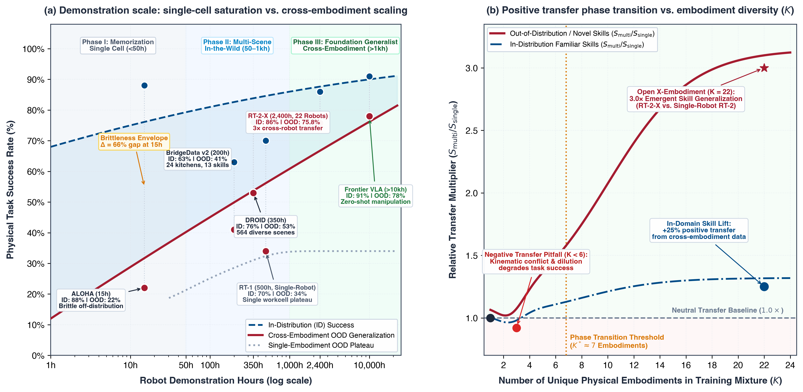

---
format:
  html:
    title: "Physical Data"
---

# Physical Data {#sec-data}

::: {layout-narrow}
::: {.column-margin}

\chapterminitoc

:::

::: {.content-visible when-format="pdf"}
\noindent
{fig-alt="Isometric blueprint showing the physical data and ingestion pipeline: The system includes key components: a bilateral teleoperation leader arm for precise manipulation; a 6-axis operator load cell measuring force and providing control feedback; a calibrated stereo vision sensor head for depth perception; a micro-lidar rangefinder using laser pulses for accurate distance measurement; an optical calibration checkerboard ensuring sensor alignment precision; and a deterministic flash logger for reliable data storage under varying conditions."}
:::

::: {.content-visible unless-format="pdf"}
{fig-alt="Isometric blueprint showing the physical data and ingestion pipeline: bilateral teleoperation leader arm, 6-axis operator load cell, calibrated stereo vision sensor head, micro-lidar rangefinder, optical calibration checkerboard, and deterministic flash logger."}
:::

:::

## Purpose {.unnumbered .unlisted}

::: {.content-visible when-format="pdf"}
\begin{marginfigure}
\resizebox{0.92\linewidth}{!}{\mlphysicalstackfull{20}{20}{20}{20}{100}}
\end{marginfigure}
:::

_What indelible signatures does physical hardware leave in recorded datasets, and why does treating robotic teleoperation like disembodied web scraping guarantee deployment failure?_

In traditional disembodied machine learning, datasets are treated as collections of independent and identically distributed samples mined from static web text or curated image repositories. Data pipelines focus on tokenization throughput, deduplication, and distributed sharding under the assumption that samples are passive, read-only bitstrings reproducible at zero marginal hardware cost. Scraping another billion tokens incurs server electrical utility costs, but it leaves the external world unaltered and inflicts zero mechanical damage. In Physical AI, every recorded byte of sensor observation and actuator telemetry is an active, irreversible physical intervention in the physical world. A teleoperation dataset does not capture pure, disembodied task semantics; it permanently records the motor gear lash, sensor exposure latencies, human operator reaction delays, thermal drift, and surface friction of a specific physical machine operating at a specific moment in space and time. When a neural policy trains on these trajectories, it absorbs these latent mechanical properties as causal priors. Naively aggregating multi-robot datasets without accounting for camera mount extrinsics, motor frequency response mismatches, or microsecond clock jitter causes policies to overfit to hardware quirks rather than learning generalized manipulation skills.

Furthermore, physical data pipelines face severe economic and physical bottlenecks. Unlike digital logs, physical data is scarce, hazardous to collect, consumes irreversible component fatigue life on strain-wave gears and wiring harnesses, and is throttled by human operator fatigue and mechanical scene reset delays. Under realistic facility constraints, less than one quarter of scheduled recording hours yields validated demonstration data. Every unmodeled shift in ambient illumination, floor traction, or battery charge alters the governing physical transfer function. This chapter formalizes physical data engineering as a rigorous cyber-physical systems co-design discipline. We trace how physical transduction artifacts propagate into learned representations, establish rigorous data cleaning and microsecond-level time-synchronization protocols across the IEEE 1588 Precision Time Protocol (PTP), and demonstrate how to structure multimodal sensor logs into standardized, reproducible datasets that generalize across disparate robotic bodies.



::: {.callout-learning-objectives}

- Estimate usable demonstration yield from collection time, operator rest, and physical reset overhead, and budget the mechanical component wear a campaign consumes
- Analyze why endogenous covariate shift produces quadratic compounding error ($O(T^2\epsilon)$) and how the collecting policy limits dataset coverage
- Separate failed autonomous actions from human recovery trajectories across the divergence and takeover timestamps in intervention records
- Evaluate whether an embodiment's mechanical, sensing, and timing assumptions transfer to another machine without falling into the normalization fallacy
- Design an immutable demonstration provenance record linking each observation to its four-stream action taps ($a_{\text{req}}, a_{\text{cmd}}, a_{\text{enf}}, a_{\text{meas}}$) and to the collecting plant
- Assess whether a dataset supports a claimed operational design domain by joining its empirical state-action occupancy against a scenario ledger

:::

## Endogenous Experience {#sec-data-endogenous-experience}

Part I established the physical anatomy of the embodied machine: its causal boundary (@sec-boundary), actuator torque-thermal envelopes (@sec-body), heterogeneous compute hierarchy (@sec-brain), and real-time fieldbuses (@sec-nervous). Yet a machine with fully characterized anatomy remains inert without a behavioral policy. In Part II, we begin teaching the machine. Unlike disembodied machine learning systems that train on web-scraped text corpora or static image repositories, an embodied agent learns from physical telemetry harvested directly through its sensors and actuators. In disembodied machine learning systems, the data pipeline is strictly open-loop: scraping web text or caching static vision datasets does not alter the underlying data sources, and model predictions never mutate the training distribution retroactively. In Physical AI, data generation is fundamentally closed-loop and endogenous.

::: {.column-margin}
{width="100%" fig-alt="S·P·A locator triad highlighting the Sense node."}

*The Sense axis: harvesting physical experience through multimodal sensory telemetry.*
:::

A policy trained on the retained demonstrations of a door-opening campaign—clean teleoperated openings of the warehouse mobile manipulator's spring-latched cage door—can still fail at the latch on its first autonomous attempt. One fundamental cause is the shift the machine's own actions create.[^fn-data-causal-loop] In a fixed offline vision dataset, the model's prediction does not change the next stored example. In an embodied Markov Decision Process (MDP), an executed action changes the body's physical trajectory, camera pose, and contact states, thereby altering the distribution of all subsequent observations ($s_{t+1} \sim P(s \mid s_t, a_t)$).

[^fn-data-causal-loop]: **Causal Boundary**\index{Causal boundary!thermodynamic constraint}: The causal boundary between computation and physics is established in @sec-boundary-causal-boundary. Because state evolution depends on motor actuation, policy actions perturb the distribution of future observations, which breaks the independent and identically distributed (i.i.d.) assumption of disembodied machine learning.

::: {#dfn-data-endogenous-covariate-shift .callout-definition title="Endogenous covariate shift"}

***Endogenous covariate shift***\index{Endogenous covariate shift!definition}\index{Covariate drift!physical AI} is the closed-loop distribution discrepancy wherein an embodied agent's executed actions alter its subsequent physical states and sensory observations ($s_{t+1} \sim P(s \mid s_t, a_t)$), driving the system into state-space regimes unsupported by its training demonstrations.

1.  **Significance**: Explains how offline behavioral cloning can fail during closed-loop physical execution: a perturbation may drive the system into states where the policy lacks training support.
2.  **Distinction**: Unlike exogenous dataset shift caused by changing ambient lighting or seasonal weather, endogenous shift is actively generated by the agent's own closed-loop actions altering its subsequent observation distribution.
3.  **Common pitfall**: Attempting to fix closed-loop policy failure by collecting more nominal expert demonstrations, which only increases data density along the success manifold without providing the corrective recovery data needed to escape boundary excursions.

:::

This shift is the collection-side face of principle \ref{pri-vol4-endogenous-drift}. It makes an archive of flawless executions without recovery trajectories an operational liability, because the policy's first mistake moves the robot outside the demonstrated states.

### Mechanics of endogenous covariate shift {#sec-data-covariate-shift}

In classical statistical learning theory, empirical risk minimization assumes that samples are drawn independent and identically distributed (i.i.d.) from an exogenous, stationary distribution $\mathcal{D}$. An image classifier that misidentifies a dog as a cat does not alter the pixels of subsequent images in the test set. In passive machine learning, covariate shift typically refers to changes in the marginal input distribution $P(X)$ while the conditional label distribution $P(Y \mid X)$ remains stationary—for instance, evaluating an image classifier trained on sunny daytime driving under rainy nighttime illumination. In Physical AI, however, the shift is not merely passive or perceptual; it is an active **physical dynamics shift**. The governing physical plant is a continuous dynamical system whose differential equations $\dot{\mathbf{x}} = \mathbf{f}(\mathbf{x}, \mathbf{u}; \boldsymbol{\theta}_{\text{plant}})$ mutate as a direct consequence of operation. As actuators execute commands, Joule heating ($I^2 R$) elevates motor winding temperatures by $40\text{--}60^\circ\text{C}$, increasing copper resistance and attenuating available motor torque; cyclic friction across strain-wave gears shears lubricants and increases joint backlash; compliant silicone gripper pads wear down, altering contact friction cones and compliance; and manipulated workpieces exhibit unmodeled variations in mass, center of gravity, and surface roughness across trials.

In embodied control, the policy's actions induce an *endogenous state visitation distribution* $d^\pi(s)$. When a policy trains via offline behavioral cloning on demonstrations generated by an expert policy $\pi^*$, it minimizes imitation loss over the expert's occupancy distribution $d^{\pi^*}(s)$. During autonomous execution, however, the policy must generate actions under its own induced distribution $d^\pi(s)$. The divergence between $d^{\pi^*}$ and $d^\pi$ produces a catastrophic compounding of errors over time.

### The continuous curse of dimensionality and the recoverability problem {#sec-data-curse-dimensionality-recoverability}

To understand why error compounds quadratically ($T^2\epsilon$), one must examine the geometry of physical state-action spaces. An embodied robot operates across continuous, high-dimensional spaces: the state $\mathbf{s} \in \mathcal{S} \subset \mathbb{R}^{d_s}$ comprises joint coordinates, angular velocities, motor drive currents, multi-axis contact wrenches, and multi-view pixel rasters, while the action $\mathbf{a} \in \mathcal{A} \subset \mathbb{R}^{d_a}$ commands continuous joint velocities or motor torques. Unlike discrete natural language processing where vocabulary tokens form a finite set and large corpora provide dense transitions across semantic graphs, the continuous physical interaction manifold is uncountably infinite. A human teleoperator demonstrating a manipulation task traces an infinitesimally thin, one-dimensional trajectory thread through this continuous space.

Because human demonstrators are skilled, they remain centered along the optimal path on every recorded run. The resulting dataset contains thousands of frames showing the nominal trajectory, but zero frames showing what the scene looks like when the chassis or gripper drifts 15 millimeters off-track toward an obstacle or fixture. This creates the **recoverability problem**:

1. **Zero support outside the nominal tube**: The offline demonstration archive provides dense empirical support exclusively along the success manifold ($d^{\pi^*}(s) > 0$), leaving the surrounding neighborhood completely unvisited ($d^{\pi^*}(s) = 0$).
2. **Ungrounded off-manifold extrapolation**: When the learned policy takes control, an unmodeled friction variation, voltage ripple, or single-step prediction error $\epsilon$ pushes the physical plant off the demonstrated manifold. Lacking demonstrations for that state, the policy's neural network emits ungrounded, arbitrary actions.
3. **Absence of corrective vectors**: Because the policy was never shown how to steer back from off-nominal states toward the nominal tube, its arbitrary action carries the plant further away from the task manifold, converting a minor tracking error into an irreversible collision, stall, or joint limit trip.

We can derive the resulting quadratic error scaling from basic discrete summation. Suppose an agent makes an execution error at step $t \in \{1, \dots, T\}$ with probability $\epsilon$. Prior to step $t$, the agent traversed the expert trajectory with zero error. At step $t$, the single-step deviation drives the physical plant off the demonstrated manifold into an unvisited state. Because the offline dataset contains zero corrective demonstrations for off-nominal states, the agent lacks the recovery policies required to return to the nominal path, incurring a task penalty for every remaining step in the horizon ($T - t$). Under a normalized unit cost ($c_t = 1$) for unrecovered states, the expected cumulative penalty incurred across the entire trajectory sums to:
$$\sum_{t=1}^T \epsilon (T - t) = \epsilon \left( T^2 - \sum_{t=1}^T t \right) = \epsilon \left( T^2 - \frac{T(T+1)}{2} \right) = \frac{T(T-1)}{2} \epsilon \approx \frac{1}{2} T^2 \epsilon.$$
Contrast this result with open-loop supervised prediction: if errors at each step were independent and did not alter future inputs, an $\epsilon$ per-step error rate would accumulate linearly over $T$ steps as $\sum_{t=1}^T \epsilon = T\epsilon$. The extra factor of $T$ in $\mathcal{O}(T^2\epsilon)$ is the mathematical signature of closed-loop endogenous feedback.

This discrete compounding reflects a foundational physical law of motion. In Newtonian mechanics, an uncorrected actuation error (such as a torque deficit, friction mismatch, or steering bias) produces an instantaneous acceleration error $\Delta a = \Delta F / m$. Integrating acceleration once over time yields a linearly expanding velocity drift $\Delta v(t) = \int \Delta a \, dt = \Delta a \cdot t$. Integrating velocity a second time yields a spatial trajectory divergence that expands quadratically with elapsed time:
$$\Delta x(t) = \iint \Delta a \, dt^2 = \frac{1}{2} \Delta a \, t^2.$$
In physical space, an uncorrected perturbation drifts as $t^2$ even before evaluating task loss. On robots manipulating rigid objects or traversing narrow corridors, this quadratic spatial excursion rapidly drives the machine past the narrow physical basin of attraction where nominal control remains feasible.

Formally, let $\pi$ be the learned policy, $\pi^*$ the expert, $J$ expected cumulative task cost over $T$ steps, and $\epsilon$ the probability of disagreement on expert-visited states under 0–1 action loss: $\mathbb{E}_{s \sim d^{\pi^*}} [\mathbb{I}(\pi(s) \ne \pi^*(s))] \le \epsilon$. If per-step task cost lies in $[0,1]$, behavioral cloning admits the rigorous worst-case bound (@eq-data-quadratic-drift) derived by @ross2011reduction:
$$J(\pi)-J(\pi^*) \le T^2\epsilon.$$ {#eq-data-quadratic-drift}

It is essential to recognize the physical meaning and limits of this bound. If a manipulation episode runs for $T = 500$ steps with cost $c_t \in [0, 1]$, the maximum physically possible cumulative cost is $500 \times 1 = 500$. If the policy has an error rate of $\epsilon = 0.01$ (1 percent error), the quadratic formula yields $T^2\epsilon = 500^2 \times 0.01 = 2500$, which exceeds the physical maximum cost by a factor of 5! The formal bound is strictly $\min(T, T^2\epsilon)$, where the quadratic regime holds while cumulative divergence is small ($T\epsilon \ll 1$). The practical lesson for systems engineers is that without recovery demonstrations, even tiny single-step errors ($\epsilon = 0.001$) cascade so quickly that the system reaches catastrophic failure long before the planned task horizon concludes.[^fn-ai-covariate-shift]

[^fn-ai-covariate-shift]: **Behavioral Cloning Bound**\index{Covariate shift!endogenous feedback}\index{Behavioral cloning!quadratic error compounding}: The bound derived by @ross2011reduction is a worst case on expected cumulative cost, not a prediction of tracking error; actual drift depends on the plant, task, policy, and safeguards. @Sec-appendix-ml-compounding derives the bound and states its loss and bounded-cost assumptions.

Crucially, attempting to resolve endogenous covariate shift by simply recording more nominal expert demonstrations—the *nominal demonstration trap*—is fundamentally flawed. Adding another thousand hours of clean, centered demonstrations increases sample density along the nominal trajectory, but the empirical support outside the nominal tube remains strictly zero ($d^{\pi^*}(s) = 0$). Furthermore, gathering physical experience is governed by harsh physical economics. Unlike web crawlers that ingest static text asynchronously at zero marginal hardware depreciation, every recorded second of physical robotics telemetry consumes actuator fatigue life, heats motor windings ($dT/dt$), cycles gearbox teeth, and drains the battery.[^fn-data-hardware-wear] Human operator fatigue, sensor recalibrations, automated scene resets, and rejected trials leave less than one quarter of scheduled facility cell time as validated demonstration data (@sec-data-teleop-costs). Physical demonstration data is scarce and expensive; logging it without accounting for closed-loop dynamics misleads policy training.

[^fn-data-hardware-wear]: **Hardware Fatigue Life**\index{Hardware wear!actuator thermal duty cycle}: Actuator thermal limits and gearbox wear, detailed in @sec-body-actuator-limits and @sec-body-thermal-duty-cycles, change joint friction over a campaign, so a pipeline that assumes stationary plant dynamics meets drift as the collection machine ages.

::: {.column-margin .margin-pointer}
↩ Actuator thermal dissipation ($dT/dt$) and winding damage limits are derived in @sec-body-thermal-duty-cycles.
:::

A physical command also changes meaning on its way to the actuators. In a machine divided by the proposal boundary,[^fn-data-proposal-permission] the operator's or policy's request is mapped into a setpoint, admitted or modified by the permission path, and answered by the plant with a measured response. Logging only the request trains the policy on demands the plant could never execute, and logging only the response teaches it structural deflection and gear backlash as though they were deliberate human skill.

[^fn-data-proposal-permission]: **Proposal Boundary**\index{Proposal boundary!demonstration data}: The proposal boundary, defined in @sec-boundary-machine-model, separates learned proposals from the permission path that alone may admit them to the actuators (@sec-enforcement). Logging the action on both sides of it keeps permission-path interventions out of the demonstrator's labels.

A collection campaign therefore makes two decisions before it records anything: which source will choose the actions, and which of those four forms of each action the dataset will keep as its label.

## Physical Telemetry Sources and Ingestion Modalities {#sec-data-collection-sources}

A physical dataset is not found, downloaded, or passively scraped from web crawls. In disembodied AI, data pipelines scrape static text documents or curated image repositories asynchronously over HTTP, storing passive samples in cloud object stores at zero marginal physical cost. In Physical AI, every recorded transition requires moving physical mass against friction, expending electrical power, dissipating thermal energy in motor coils, and consuming mechanical fatigue life on a physical plant. The difficulty of learning from such records was visible in Dean Pomerleau's ALVINN (Autonomous Land Vehicle in a Neural Network) [@pomerleau1989alvinn], which attempted to learn steering policies from camera images of human driving. Because expert human drivers rarely deviated from the center of the road, the logged stream contained zero recovery trajectories from the road shoulder, causing small single-step execution errors to cascade quadratically in closed loop.

In a streaming telemetry architecture, physical data sources separate according to who chooses the action and how the control stream enters the ingestion pipeline:

1. In **kinesthetic teaching**, a colocated human demonstrator physically grasps and guides the unpowered or gravity-compensated links of the mechanism. The ingestion pipeline logs direct joint encoder displacements and passive motor back-EMF without teleoperation transport latency, but throughput is physically throttled by human muscle inertia ($1\text{--}10\text{ Hz}$) and labor cost scales strictly $1:1$ with demonstrator time. Furthermore, the demonstrator's body physically occludes camera fields of view, altering the visual distribution compared to autonomous operation.
2. In **teleoperation**, a remote operator manipulates an input device to puppet the follower robot across a network fabric.[^fn-hist-goertz-teleop] Across modern physical AI labs, four distinct teleoperation architectures dominate demonstration collection:
   - **Kinematically isomorphic leader-follower arms (e.g., bimanual ALOHA [@zhao2023learning] and GELLO [@wu2023gello]):** The operator manipulates unpowered or backdriven leader arms that duplicate the follower's link lengths and joint topologies. Joint positions stream at $50\text{ Hz}$ and copy directly to the follower without inverse kinematics (IK), eliminating mathematical singularity dead-zones. However, lack of active force reflection masks physical binding forces at the gripper.
   - **VR tracked controllers and spatial puppets (e.g., Meta Quest or HTC Vive trackers):** The operator moves 6-DoF spatial controllers in free space, streaming end-effector Cartesian poses $(\mathbf{p}, \mathbf{q}_{\text{quat}}) \in \mathrm{SE}(3)$ at $90\text{ Hz}$. A numerical IK solver converts these poses to joint targets on the follower. Optical tracking occlusion, IMU dead-reckoning drift, and IK solver singularities introduce sudden posture flips and discontinuities into the recorded control stream.
   - **Rate-controlled multi-axis space mice (e.g., 3Dconnexion):** The operator deflects an elastic 6-DoF puck to command Cartesian velocities ($\dot{\mathbf{x}} \in \mathrm{SE}(3)$). Because deflection maps to velocity rather than position, operators cannot coordinate rapid multi-joint motions and exhibit persistent step-and-wait hunting near contact surfaces.
   - **Bilateral force-reflecting master arms:** Actuated leader arms measure contact forces at the follower's wrist or load cell and actively reflect torques back into the operator's hands. While providing kinesthetic feedback, communication delay across the master-slave link risks breaking dynamic passivity, causing violent oscillatory chatter.
3. In **scripted collection**, a deterministic trajectory generator executes automated motion primitives, such as cubic splines or impedance-governed state machines. Ingestion rates are high and deterministic ($50\text{--}500\text{ Hz}$), but trajectories follow rigid, repetitive manifolds that fail to generate corrective data for off-nominal contacts, jamming when workpiece dimensions deviate by even a millimeter.
4. In **exploratory collection**, an active neural policy or reinforcement learning agent selects actions to maximize an information-theoretic objective (such as epistemic entropy or intrinsic curiosity). While data throughput matches the robot's maximum control cadence ($50\text{--}100\text{ Hz}$), unbounded exploratory commands risk violent collisions, tripping safety enforcers or damaging mechanical gearboxes through repeated high-torque shock loads.
5. In **autonomous deployment logging**, production policies control the actuators during factory or warehouse operation, streaming multimodal telemetry into local circular buffers in situ. This stream provides zero-marginal-labor data at the full system execution rate ($10\text{--}50\text{ Hz}$ policy, $1\text{ kHz}$ joint servos), but logged states are heavily censored by runtime safety barriers and reflect only nominal operating regimes.

[^fn-hist-goertz-teleop]: **Bilateral Teleoperation Lineage**\index{Raymond Goertz!bilateral telemanipulation}: Raymond Goertz built the first bilateral master-slave telemanipulators at Argonne National Laboratory in the late 1940s and 1950s for handling radioactive materials. His linkages reflected force across a physical barrier, because operators without kinesthetic resistance jammed the remote mechanism.

### Human demonstration idiosyncrasies and mechanical artifacts {#sec-data-human-idiosyncrasies}

Teleoperation datasets do not capture pure, ideal control laws; they permanently record the physiological idiosyncrasies and biomechanical limitations of the human demonstrator:

- **Neuromuscular sub-movements and physiological tremor:** Human motor control is not a continuous, smooth spline. Neuromuscular execution operates via discrete motor unit recruitment bursts, producing intermittent corrections at $2\text{--}3\text{ Hz}$ superimposed with physiological tremor at $8\text{--}12\text{ Hz}$. When high-frequency behavioral cloning models train on raw joint velocities without low-pass filtering, the neural network learns to reproduce this neuromuscular tremor as high-frequency torque ripple, inducing rapid mechanical wear on robot gearboxes.
- **Visual latency and step-and-wait hunting:** When an operator guides a manipulator toward a contact fixture using 2D monitor displays, depth ambiguity and transport latency force the operator to adopt a *step-and-wait* control strategy: they advance the gripper a few millimeters, pause for $200\text{--}400\text{ ms}$ to visually verify contact on the video stream, and then resume motion. A policy trained on these raw pauses internalizes periodic velocity dropouts, causing the autonomous robot to stutter and freeze mid-trajectory during deployment.
- **Attentional narrowing and gaze-conditioned bias:** Human demonstrators focus visual attention narrowly on the active tool center point (TCP). Because the human's gaze does not monitor peripheral joints, elbow links often sweep close to tables or fixtures during demonstrations. A policy that imitates these demonstrations inherits elbow trajectories that flirt with the boundary of collision without possessing the demonstrator's implicit spatial awareness.

Because the source determines how the machine interacts with its physical environment, these ingestion streams occupy disjoint state-action manifolds even when executing the identical manipulation task. Consider releasing the warehouse mobile manipulator's cage-door latch. A colocated demonstrator guiding the arm feels the latch bind through direct tactile resistance and immediately modulates wrist compliance. A remote teleoperator watching compressed video streams lacks direct tactile feedback and exhibits step-and-wait hunting, pausing to visually verify strike plate contact. A scripted controller advances along a fixed geometric path at constant velocity, producing an identical, rigid contact force spike on every repetition. An exploratory policy approaches at oblique angles, binding the latch until the safety contact tripwire halts the attempt. These recorded streams are not noisy variations of a single ground-truth trajectory; they are outputs of fundamentally distinct dynamical systems characterized by divergent bandwidths, latencies, and mechanical compliance profiles, as systematized in @tbl-05-sources-taxonomy.

| Physical Data Source                     | Ingestion Bandwidth & Cadence                                                    | Contact Compliance & Force Awareness                     | Scaling Labor Economics                                     | ODD Boundary Safety Risk                                           |
|:-----------------------------------------|:---------------------------------------------------------------------------------|:---------------------------------------------------------|:------------------------------------------------------------|:-------------------------------------------------------------------|
| **Kinesthetic teaching**                 | Low ($1\text{--}10\text{ Hz}$, human muscle inertia)                             | High (direct physical feel of binding and compliance)    | Very high ($1:1$ dedicated human demonstrator)              | Low (demonstrator immediately feels binding forces)                |
| **Teleoperation (bilateral/isomorphic)** | Moderate ($20\text{--}50\text{ Hz}$, network + human latency)                   | Moderate to high (depends on haptic force feedback)      | High ($1:1$ human operator per active cell)                 | Low to moderate (guarded by operator situational awareness)        |
| **Scripted primitives**                  | High ($50\text{--}500\text{ Hz}$, deterministic trajectory generators)           | Low (rigid trajectories unless impedance-governed)       | Low (automated once authored; engineering upfront)          | High (blind trajectory replay jams on geometric misalignments)     |
| **Exploratory policy**                   | High ($50\text{--}100\text{ Hz}$, active neural exploration)                     | Variable (learned or randomized contact behaviors)       | Very low (fully autonomous hardware execution)              | Very high (unbounded exploratory actions risk destructive contact) |
| **Autonomous deployment logging**        | Full system rate ($10\text{--}50\text{ Hz}$ policy, $1\text{ kHz}$ joint servos) | Operational (reflects live deployed closed-loop control) | Zero marginal labor (harvested passively during production) | Guarded (governed by certified runtime safety enforcer)            |

: **Systems trade-offs across physical demonstration and telemetry sources**: Five collection sources compared across control dynamics, contact awareness, human labor economics, and physical safety risks during data capture. {#tbl-05-sources-taxonomy tbl-colwidths="[20,20,20,20,20]"}

::: {.column-margin .margin-pointer}
⇄ **Contrast:** The display and operator-response delay that paces a teleoperator's step-and-wait motion (@sec-data-teleop-costs) contrasts with the $1\text{ ms}$ permission tick on which each command is checked (@sec-nervous-cadences).
:::

In disembodied machine learning, empirical scaling laws correlate model performance directly with raw token count or pretraining sample volume ($N$). In cyber-physical telemetry, treating each logged control step as an independent sample is a catastrophic category error. An edge logger running at $1\text{ kHz}$ generates $3.6\times 10^6$ state-action records per hour, but adjacent records exhibit near-total temporal autocorrelation ($\rho \to 1.0$). Two kinematic records sampled one millisecond apart differ only by sub-millimeter displacements and sensor quantization noise. In statistics, the *effective sample size* (ESS) of a sequence with lag-1 autocorrelation $\rho$ scales as:
$$N_{\text{eff}} = N \frac{1 - \rho}{1 + \rho}.$$
When $\rho = 0.999$, an archive of $3.6\times 10^6$ high-frequency records carries an effective sample size of under 1,800 independent observations! Unlike text tokens in large language models, where consecutive tokens represent high-entropy semantic transitions, consecutive high-frequency robot telemetry steps contain virtually zero new information about the task manifold. Autoregressive token volume does not equal physical state-space support. Dataset coverage scales with the number of independent physical episodes, workpiece initializations, lighting conditions, and surface friction coefficients, not with the sampling clock. An archive of 500 episodes spanning diverse geometric and mechanical initial conditions provides substantially broader empirical support than 5,000,000 steps logged across repetitive passes over a single stationary fixture.

Simulation pipelines avoid the hardware wear bill and are treated in @sec-training. However, synthetic trajectories generated by rigid-body physics engines (such as MuJoCo, Isaac Sim, or Bullet) introduce severe **sim-to-real transfer artifacts**. Rigid-body simulators resolve physical contact using discrete Linear Complementarity Problem (LCP) solvers or penalty-based spring-damper equations. These discrete approximations suffer from non-physical penetration of rigid geometries, instantaneous velocity jumps upon contact restitution, and simplified Coulomb friction cones that completely ignore stick-slip transitions, material viscoelasticity, and thermal friction decay. When synthetic trajectories are mixed with physical telemetry logs, every record must carry its provenance source. A neural policy trained on an undifferentiated mixture absorbs the contact-solver approximations of the physics simulator where synthetic data dominates, and absorbs motor backlash and sensor noise where physical data dominates—leaving systems engineers unable to diagnose whether an on-robot failure stems from sim-to-real transfer gaps or physical hardware degradation. A record that identifies its collection source resolves the first operational decision of a data campaign; the second decision requires specifying which form of each action signal the ingestion pipeline retains as its supervisory training target.

## Action Label Selection and Supervisory Grounding {#sec-data-action-label}

By the time the gripper contacts the strike plate on the cage-door latch, the operator's input motion has transformed into four distinct numerical signals across the system hierarchy (@fig-05-action-taps). Which signal the ingestion pipeline designates as the supervisory target determines what behavioral dynamics the neural policy internalizes. The robot splits its computational architecture across two decoupled processing domains:

- The unprivileged **Linux application processor** executes perception pipelines, handles video frame ingestion, runs teleoperation input mapping, and computes the neural policy forward pass ($\pi_\theta(o_t)$).
- On the permission side of the causal proposal boundary (@sec-boundary-machine-model), a hard real-time **safety microcontroller (MCU)** executes at a deterministic $1\text{ kHz}$ cadence on bare metal, running motor field-oriented current control (FOC), joint impedance loops, and deterministic Control Barrier Functions (CBFs).[^fn-hw-encoder-capture]

[^fn-hw-encoder-capture]: **Hardware Timer Interrupt**\index{Hardware timer interrupt!DMA latching}: On real-time MCUs, encoder counts and current-shunt readings are latched by hardware timers and Direct Memory Access (DMA), which holds sampling jitter to microseconds and keeps timestamp jitter out of numerical differentiation for velocity and acceleration.

### The four-stream action tap tuple {#sec-data-four-stream-action-tap}

To capture the true causal chain of physical demonstration, an ingestion pipeline cannot log actions as single, undifferentiated vectors sampled at an arbitrary software layer. Between the moment an operator moves an input device and the moment electromagnetic torque accelerates the robot's physical links, the control signal traverses four distinct physical and algorithmic transformations. Capturing all four stages in an aligned multi-stream tuple (@fig-05-action-taps) is mandatory to prevent neural policies from conflating operator intent with actuator limitations or runtime safety interventions.

::: {#fig-05-action-taps fig-env="figure" fig-pos="t" fig-cap="**Four-stream action tap tuple**: Four places a command can be logged, from raw policy intent on the application processor through to measured plant response. Which tap a dataset records decides what the model learns to imitate. Source: architectural design adapted from @zhao2023learning and @wu2023gello." fig-alt="The Four-Stream Action Tap Tuple across the Application Processor and MCU Boundary. On a heterogeneous edge architecture, data logging captures four distinct physical semantics: (1) areq (raw operator or policy intent on the Linux application processor prior to software checks), (2) acmd (kinematically retargeted setpoint), (3) aenf (safety-governed command post-CBF barrier enforcement and motor torque clamping on the MCU), and (4) ameas (measured motion derived from joint encoders over a stated response interval, with motor current logged separately). Logging only areq trains the model on commands the actuators may never have executed, while logging only ameas can misattribute mechanical compliance, link deflection, and backlash to demonstrated human skill. Source: Architectural design adapted from @zhao2023learning and @wu2023gello."}
{width="100%"}
:::

As mapped across the proposal boundary in @fig-05-action-taps, logging divided between the unprivileged Linux host and the hard real-time MCU captures four distinct physical semantics:

- **Tap 1: The requested action ($a_{\text{req}}$, "Asked"):** Logged in user space on the application processor, this represents unconstrained human operator input (from a leader arm or joystick) or the raw forward-pass output from an unverified policy, tagged with its native coordinate frame and issue timestamp prior to software validation. This proposal reflects unadulterated human or policy intent, but it frequently demands infeasible joint accelerations or violates spatial bounding envelopes.
- **Tap 2: The mapped command ($a_{\text{cmd}}$, "Mapped"):** The kinematically retargeted setpoint (such as Cartesian end-effector velocities converted to joint space setpoints via inverse kinematics), incorporating coordinate frame transformations, trajectory interpolation, and workspace limits before transmission across the fieldbus.
- **Tap 3: The enforced command ($a_{\text{enf}}$, "Allowed"):** Logged on the bare-metal MCU on the permission side of the boundary, this represents the command after deterministic Control Barrier Functions (CBFs), velocity and acceleration clamps, torque saturation envelopes, and collision guards have verified or modified the proposal. This signal serves as the ground-truth supervisory label during policy training:
  $$\mathcal{L}_{\text{policy}}(\theta) = \mathbb{E}_{(o_t, a_{\text{enf}, t}) \sim \mathcal{D}} \left[ \mathcal{D}_{\text{loss}}(\pi_\theta(o_t), a_{\text{enf}, t}) \right],$$
  guaranteeing that the model is trained exclusively on physically admissible, safety-compliant commands.
- **Tap 4: The measured response ($a_{\text{meas}}$, "Done"):** The physical plant reaction measured by optical joint encoders and motor current shunt resistors over the executed control tick, recording actual mechanical displacement and electrical effort. This measured response serves as proprioceptive state input ($o_{\text{proprio}, t+1}$) for subsequent policy steps rather than an action label.

Only this four-stream tuple, logged synchronously across the boundary between the application processor and the MCU, separates what the operator asked for from what the permission path allowed. Logging an incomplete subset creates two opposing, catastrophic distribution shifts in downstream policy learning:

- **The command-only logging trap ($a_{\text{req}}$ or $a_{\text{cmd}}$):** When a human teleoperator makes rapid, high-amplitude hand motions, the unprivileged application processor emits setpoints that exceed actuator torque-speed curves or violate safety envelopes. On the physical robot, the bare-metal microcontroller intercepts these proposals, enforcing deterministic Control Barrier Functions (CBFs) and motor torque saturation limits ($a_{\text{enf}}$). The subsequent physical state $s_{t+1}$ is produced exclusively by the enforced actuation, never by the raw request. If a behavioral cloning pipeline logs only $a_{\text{req}}$ or $a_{\text{cmd}}$ as its supervisory training target, the policy is trained to emit dynamically infeasible commands that have zero causal support in the observed state transitions $(s_t, s_{t+1})$. When deployed in closed loop, this learned policy outputs aggressive commands that immediately trigger runtime safety watchdogs, trip CBF emergency braking, or overheat motor windings.
- **The response-only logging trap ($a_{\text{meas}}$):** Conversely, logging only the measured plant response records environmental resistance and transmission imperfections as if they were deliberate control targets. Consider a contact-rich manipulation task, such as seating the warehouse manipulator's gripper into a stiff cage-door latch. When the gripper contacts the strike plate, dry friction and mechanical resistance can bring joint velocities to zero ($\dot{\mathbf{q}}_{\text{meas}} \approx \mathbf{0}$) while the motors deliver peak continuous holding torque. A policy trained to predict measured joint velocity ($a_{\text{meas}}$) learns that encountering contact implies commanding zero velocity—causing the robot to immediately freeze, stall, and give up forward effort the instant physical contact occurs! Furthermore, training on $a_{\text{meas}}$ bakes harmonic drive backlash, structural link deflection under heavy payloads, and external collision bounces directly into the policy weights as deliberate human demonstrations.

::: {#dfn-data-four-stream-action-tap-tuple .callout-definition title="Four-stream action tap"}

***Four-stream action tap***\index{Four-stream action tap!definition}\index{Action tap!definition} $(a_{\text{req}}, a_{\text{cmd}}, a_{\text{enf}}, a_{\text{meas}})$ is the time-synchronized multi-tier telemetry record that captures an action signal across its four causal transformation stages: unprivileged operator or policy intent ($a_{\text{req}}$), kinematically retargeted setpoint ($a_{\text{cmd}}$), safety-governed command ($a_{\text{enf}}$), and physical plant response ($a_{\text{meas}}$).

1.  **Significance**: Training imitation learning policies on raw requested actions ($a_{\text{req}}$) injects dynamically infeasible commands that trigger safety trips in deployment. Conversely, training on measured responses ($a_{\text{meas}}$) causes the model to imitate mechanical compliance, backlash, and external disturbances rather than intentional control. Logging all four streams disambiguates control intent from permission-path intervention.
2.  **Distinction**: Unlike classical robot telemetry logs that capture only final motor encoder states or raw teleoperation joystick inputs, the four-stream tap preserves the exact causal filtering stages applied by intermediate software and safety hardware.
3.  **Common pitfall**: Logging streams without timestamps synchronized in hardware over the IEEE 1588 Precision Time Protocol (PTP), written $t_{\text{PTP}}$. Even a few milliseconds of clock skew between the application processor and the MCU corrupts the temporal alignment between visual observations and corresponding torque actions.

:::

### Multi-modal time synchronization and exposure midpoint alignment {#sec-data-multimodal-time-sync}

Recording the right action tap does not settle when each recorded value was physically true. In embodied platforms, sensory modalities operate at radically disparate sampling cadences and physical propagation regimes: global-shutter cameras integrate photons over exposure windows of $10\text{--}35\text{ ms}$ at $30\text{--}60\text{ Hz}$, 6-axis force-torque sensors stream over SPI or CAN at $100\text{--}500\text{ Hz}$, optical joint encoders and field-oriented current loops execute at the MCU's deterministic $1\text{ kHz}$ tick, and neural policy models dispatch setpoints at $10\text{--}50\text{ Hz}$. A naive data loader that simply latches the latest available sensor sample pairs each action with a camera frame whose exposure was centered $25\text{--}40\text{ ms}$ before the frame arrived in host memory. The resulting policy learns to map historical visual states to present actions, baking artificial phase lag directly into its weights.

To quantify the physical hazard of temporal misalignment, consider the spatial tracking error $\Delta \mathbf{x}_{\text{sync}}$ injected into the dataset when an observation and an action are paired across an uncompensated phase lag $\Delta t_{\text{lag}}$:
$$\Delta \mathbf{x}_{\text{sync}}(t) = \int_{t - \Delta t_{\text{lag}}}^t \mathbf{v}(\tau)\,d\tau \approx \mathbf{v}(t) \cdot \Delta t_{\text{lag}}.$$
If a robotic manipulator moves at a nominal transit speed of $v = 0.50\text{ m/s}$, an uncorrected phase lag of $\Delta t_{\text{lag}} = 35\text{ ms}$ introduces a spatial tracking displacement of:
$$\Delta x_{\text{sync}} = 0.50\text{ m/s} \times 0.035\text{ s} = 17.5\text{ mm}.$$
In high-precision contact tasks where fixture tolerances or latch clearances are under $2\text{ mm}$, an unaligned error of $17.5\text{ mm}$ is an order of magnitude larger than the physical basin of attraction. When an imitation learning model trains on these misaligned pairs, it attempts to fit an unphysical relationship where the current action precedes the visual evidence. During closed-loop autonomous deployment, this artificial phase lag manifests as aggressive overshoot, control hunting, and severe contact chattering against rigid surfaces.

#### Hardware timestamps vs. software arrival timestamps {#sec-data-hw-vs-sw-timestamps}

The root of temporal corruption lies in conflating when an optical or electrical event occurred in physics with when the operating system kernel noticed it in software:

- **Software arrival timestamps ($t_{\text{host}}$):** In naive logging pipelines, an image frame or CAN packet is timestamped when the Linux kernel handles the device interrupt or when a user-space thread dequeues the buffer from Video4Linux2 (V4L2) or a socket. This host timestamp incorporates camera pixel readout time, USB3 or MIPI CSI-2 bus serialization, Direct Memory Access (DMA) latency, and operating system scheduling jitter:
  $$t_{\text{host}} = t_{\text{mid}} + \frac{\Delta t_{\text{exp}}}{2} + t_{\text{readout}} + t_{\text{bus}} + t_{\text{driver\_irq}} + \delta_{\text{jitter}}.$$
  Host timestamps lag physical reality by $20\text{--}45\text{ ms}$, with non-deterministic scheduling jitter ($\delta_{\text{jitter}} = \pm 5\text{--}15\text{ ms}$) driven by thread contention and CPU frequency scaling.
- **Hardware PTP timestamps ($t_{\text{PTP}}$):** Distributed robotic platforms eliminate host jitter by implementing sub-microsecond clock synchronization governed by the IEEE 1588 Precision Time Protocol (PTP / IEEE 802.1AS). Across the real-time Ethernet fabric, a hardware Grandmaster clock exchanges timestamped sync packets with peripheral controllers. Over a two-way message transaction, the master records transmission time $t_1$ and the slave records arrival time $t_2$. The slave subsequently transmits a delay request at $t_3$, which the master receives at $t_4$. Assuming symmetric network paths, the one-way propagation delay $\tau_{\text{prop}}$ and clock offset $\theta_{\text{offset}}$ resolve as:
  $$\tau_{\text{prop}} = \frac{(t_4 - t_1) - (t_3 - t_2)}{2}, \qquad \theta_{\text{offset}} = \frac{(t_2 - t_1) - (t_4 - t_3)}{2}.$$
  Hardware timestamping at the Ethernet Physical Layer (PHY) latches packets at the physical transceiver within nanoseconds, holding clock drift between the application host, vision sensor heads, and real-time motor MCUs to under $1\text{ }\mu\text{s}$.

#### Rolling shutter skew across camera streams {#sec-data-rolling-shutter-skew}

A severe and frequently overlooked visual artifact in physical AI pipelines is **rolling shutter skew**. Low-cost consumer sensors and webcams expose pixel rows sequentially rather than instantaneously. For a sensor with $H$ vertical scanlines and line readout duration $\tau_{\text{line}}$, the exposure midpoint of row $y \in [0, H-1]$ depends linearly on its vertical coordinate:
$$t_{\text{row}}(y) = t_{\text{start}} + y \cdot \tau_{\text{line}} + \frac{\Delta t_{\text{exp}}}{2}.$$
Across a full frame, the temporal skew between the top row ($y = 0$) and bottom row ($y = H - 1$) accumulates to:
$$\Delta t_{\text{skew}} = (H - 1) \cdot \tau_{\text{line}} \approx 15\text{--}33\text{ ms}.$$
When the robot arm or camera moves at $v = 0.50\text{ m/s}$, the bottom of the manipulator in the image is captured while the physical link has displaced by up to $16.5\text{ mm}$ relative to the top of the link in the same image frame! This geometric warping (the "jello effect") deforms straight edges into curved arcs and breaks rigid-body geometry.

Crucially, in multi-camera collection rigs combining wrist-mounted and stationary third-person cameras, independent rolling shutters produce severe cross-camera asynchronous distortion. If the wrist camera scans top-to-bottom while a lateral third-person camera scans bottom-to-top, multi-view 3D vision backbones or depth triangulation pipelines receive fundamentally conflicting physical observations of the same physical instant. High-assurance physical AI collection platforms mandate **global-shutter CMOS sensors** synchronized via hardware TTL/GPIO trigger lines from the real-time MCU, ensuring that every pixel across all cameras begins and ends optical integration simultaneously at $t_{\text{mid}} = t_{\text{start}} + \Delta t_{\text{exp}} / 2$.

High-assurance data ingestion engines resolve multi-modal alignment through a three-stage real-time synchronization pipeline:

1. **Hardware-triggered optical exposure midpoint:** The real-time MCU dispatches hardware GPIO sync pulses or PTP-synchronized trigger packets to all camera global shutters simultaneously. The camera latches the trigger at $t_{\text{start}}$, and the driver calculates the true optical midpoint $t_{\text{mid}} = t_{\text{start}} + \Delta t_{\text{exp}} / 2$ in hardware PTP clock units ($t_{\text{PTP}}$), eliminating kernel driver scheduling jitter.[^fn-hw-camera-trigger]
2. **Cubic Hermite kinematic interpolation:** Because joint encoders sample at $1\text{ kHz}$ ($1\text{ ms}$ period) while cameras capture at $30\text{ Hz}$ or $60\text{ Hz}$, the camera midpoint $t_{\text{mid}}$ falls between two discrete MCU telemetry ticks $t_k$ and $t_{k+1}$. An asynchronous synchronization thread interpolates joint angles $\mathbf{q}(t_{\text{mid}})$ using cubic Hermite splines across the bounding kinematic records $(t_k, \mathbf{q}_k, \dot{\mathbf{q}}_k)$ and $(t_{k+1}, \mathbf{q}_{k+1}, \dot{\mathbf{q}}_{k+1})$:
   $$\mathbf{q}(t_{\text{mid}}) = h_{00}(u) \mathbf{q}_k + h_{10}(u) \Delta t_s \dot{\mathbf{q}}_k + h_{01}(u) \mathbf{q}_{k+1} + h_{11}(u) \Delta t_s \dot{\mathbf{q}}_{k+1},$$
   where $\Delta t_s = t_{k+1} - t_k = 1\text{ ms}$, $u = (t_{\text{mid}} - t_k)/\Delta t_s \in [0, 1]$, and $h_{ij}(u)$ are the cubic Hermite basis functions (@sec-appendix-control-splines). This ensures $C^1$ continuity and eliminates the artificial high-frequency velocity jumps produced by nearest-neighbor zero-order hold latching.
3. **Pre-serialization alignment:** Container formats store multi-rate topics with the timestamps provided by the logger. Temporal alignment must occur in volatile shared memory buffers before records are serialized to disk, guaranteeing that every image frame is bound to the exact kinematic state that existed when the photons hit the silicon sensor.

[^fn-hw-camera-trigger]: **Hardware optical exposure triggering**: Software USB triggers (such as V4L2 ioctl calls) introduce variable kernel scheduling jitter of $\pm 5\,\text{ms}$. To eliminate temporal uncertainty, high-assurance collection rigs utilize dedicated hardware GPIO or TTL sync pulses generated by the real-time microcontroller. This aligns global shutters across multi-camera rigs to within microseconds.

::: {.column-margin .margin-pointer}
↩ Sub-microsecond PTP clock synchronization across distributed bus controllers is established in @sec-nervous-deterministic-fieldbuses.
:::

### Standardized demonstration storage containers and serialization formats {#sec-data-storage-containers}

Aligning multi-rate telemetry settles timing, but storing it for high-throughput training introduces contrasting I/O requirements across four primary physical AI container architectures:

- **MCAP (Foxglove):** A modular, append-only binary container format engineered specifically for robotics pub/sub logging. MCAP supports zero-copy streaming of heterogeneous, multi-rate topics (such as 30 Hz RGB-D frames, 100 Hz IMU packets, and 1 kHz actuator states). Because its index is appended sequentially to the end of the file, MCAP is completely crash-resilient: if a robot suffers abrupt power loss or an operating system kernel panic during data collection, the recorded stream remains intact up to the final byte without corrupting container headers.
- **Zarr / HDF5:** Chunked, N-dimensional compressed array formats optimized for dense numeric tensors. While HDF5 is widely used in scientific computing, ungraceful power loss corrupts its root metadata tree, and internal file locking limits multi-threaded concurrent writers. Zarr replaces monolithic files with directory hierarchies of sharded chunks, making it robust for cloud object storage and high-throughput random-access slicing during policy training, but requiring pre-synchronized, fixed-rate tabular inputs.
- **LeRobot (Hugging Face / Parquet + Video):** An embodied AI storage format that decouples tabular kinematic data from high-bandwidth visual streams [@cadene2024lerobot]. Kinematic states and action taps are serialized into Apache Parquet columnar files, while video streams are compressed into MP4/AV1 containers. This hybrid layout maintains small file sizes and allows PyTorch DataLoaders to ingest lightweight kinematics instantly while delegating video decompression to dedicated hardware decoders. Crucially, inter-frame codecs (such as H.264, H.265, and AV1) use Group-of-Pictures (GOP) temporal compression. While this achieves 20- to 50-fold file size reduction, randomly shuffling demonstration episodes during PyTorch DataLoader training causes severe CPU/GPU pipeline stalls: decoding a single random step requires seeking to the preceding I-frame and decompressing the entire GOP sequence, starving training throughput. High-throughput training pipelines therefore often favor intra-frame codecs (such as ProRes or intra-only MJPEG), which decode every frame independently in $\mathcal{O}(1)$ time at the expense of higher disk storage.
- **RLDS / TFRecord (Open X-Embodiment):** A protocol-buffer-based episode format structuring trajectories into nested step dictionaries (`is_first`, `is_last`, `observation`, `action`, `discount`) [@open_x_embodiment_collaboration2024open]. RLDS is engineered for distributed Tensor Processing Unit (TPU) and multi-node GPU clusters, enabling petabyte-scale streaming across massive heterogeneous multi-embodiment corpora.

A tap and a timestamp are only as good as the loop that produced them. In teleoperation, still the standard way to gather high-quality physical trajectories, that loop runs through a human, and the interface between human and machine shapes the recorded dynamics long before the data reaches a model.

## Teleoperation Demonstration Costs {#sec-data-teleop-costs}

In physical data engineering, teleoperation is not merely a manual control mechanism—it is an end-to-end, asynchronous cyber-physical data generation pipeline with a human in the loop (@fig-05-teleop-rig). A workspace camera captures the physical scene and streams encoded frames across a network fabric to an operator console; the human operator perceives the visual display, cognitively decides on a trajectory correction, and displaces an input device; the host workstation maps that motion into a kinematically retargeted setpoint and transmits it across a fieldbus to the motor drives; the actuators accelerate the robot's physical links against inertia, friction, and environmental contact; and the updated scene arrives at the camera sensor on the subsequent cycle.

::: {#fig-05-teleop-rig fig-env="figure" fig-pos="t" fig-cap="**Kinematically isomorphic teleoperation rigs**: Demonstration capture on three leader-follower rigs whose leader devices mirror follower kinematics [@wu2023gello]. Because the leader shares the follower's joint structure, the interface needs no inverse kinematics and inherits none of its singularities (mathematical dead-zones where joints align and lose mobility), preserving the operator's direct joint-level coordination. The operator's continuous-correction latency still enters the recording as phase lag, so the demonstration carries the operator's delay as if it were policy." fig-alt="Kinematically Isomorphic Leader-Follower Teleoperation Architecture across Heterogeneous Manipulators. Demonstration acquisition on physical robot platforms using low-cost, kinematically isomorphic leader controllers (canonical architecture [@wu2023gello]). (A) Bimanual teleoperation setup with twin 6-DoF leader arms mapped directly to dual heavy-payload follower manipulators during a compliant liquid-pouring task. (B) Single-arm leader-follower configuration controlling a torque-controlled manipulator with an overhead task camera. (C) Precision pick-and-place manipulation with passive gravity compensation and joint-angle direct drive. Because the leader device mirrors follower kinematics without requiring numerical inverse kinematics (IK), the interface eliminates IK singularities while preserving the operator's direct joint-level coordination. However, the operator's continuous-correction latency and communication delays still introduce phase lag into the recorded (st, at) demonstration tuples. Source: Adapted from Wu et al. [@wu2023gello], CC BY 4.0."}
{width="95%"}
:::

As shown across the three physical systems in @fig-05-teleop-rig, kinematically isomorphic leader rigs (such as GELLO [@wu2023gello]) duplicate the joint layout of the follower robot on the operator's desk:

- In **Panel (a)**, a bimanual setup maps twin 6-degree-of-freedom (6-DoF) 3D-printed leader arms directly to dual industrial manipulators during a compliant liquid-pouring task.
- In **Panel (b)**, a single-arm setup guides a compliant torque-controlled arm using an overhead camera for visual alignment.
- In **Panel (c)**, a precision pick-and-place station uses passive joint counterbalancing to eliminate operator muscle fatigue without adding active motors.

Because each leader joint angle maps directly to the corresponding follower joint angle ($\mathbf{q}_{\text{leader}} \equiv \mathbf{q}_{\text{follower}}$), the interface avoids numerical inverse kinematics (IK) entirely, bypassing kinematic singularities where joints align and lose degrees of freedom. However, the operator's visual-neuromuscular reaction latency ($t_{\text{hum}} \approx 200\,\text{ms}$) and transport delay still enter the recording as phase lag.

### Human-in-the-loop latency and bilateral passivity breakdown {#sec-data-bilateral-passivity}

Each stage in this distributed loop introduces latency that affects the timing of the correction. In a reference setup with a high-speed camera and a wired local network (illustrative; see the Reader Guide), display processing requires $t_{\text{disp}} = 50\text{ ms}$ across exposure integration, H.264 decoding, and monitor raster refresh. Human visual perception, cognitive motor planning, and neuromuscular transmission introduce an operator response latency of $t_{\text{hum}} = 200\text{ ms}$ for continuous path corrections. Command quantization, packetization, and bus transport to the robot controller add $t_{\text{cmd}} = 10\text{ ms}$. Actuator torque ramp-up and structural inertia impose a mechanical response latency of $t_{\text{mech}} = 80\text{ ms}$ before the robot achieves the commanded acceleration. The **teleoperation round-trip latency** $t_{\text{loop}}$, the time from a contact event to the corrective actuator response, is their sum:
$$t_{\text{loop}} = t_{\text{disp}} + t_{\text{hum}} + t_{\text{cmd}} + t_{\text{mech}} = 50\text{ ms} + 200\text{ ms} + 10\text{ ms} + 80\text{ ms} = 340\text{ ms}.$$

When a contact misalignment occurs at time $t$, the operator sees it on the display at $t + 50\text{ ms}$, commands a physical correction at $t + 250\text{ ms}$, and the arm pushes back at $t + 340\text{ ms}$, while the arm keeps moving under momentum and contact forces. A logger that naively pairs the observation $s_t$ with the command issued at the same instant pairs a state with an action chosen for a state $250\text{ ms}$ older. The policy learns that delay as deliberate behavior and over-corrects or oscillates when it runs autonomously at the control rate. The round-trip latency is therefore a property of the dataset, not only of the rig, because it enters every demonstration as phase lag dominated by the operator's own reaction time.

When contact force is reflected back to the operator's hand in **bilateral teleoperation**, transmission delay becomes a dynamic stability hazard. In an ideal passive physical system, energy cannot be generated out of thin air: the mechanical work performed by the slave robot on the environment must be bounded by the work delivered by the human operator. In bilateral teleoperation across a delayed link, however, the operator commands velocity $v(t)$ at the master handle while the remote environment reflects delayed contact force $F_{\text{contact}}(t - \tau)$ back to the master motors. Over a periodic oscillatory cycle of period $T_{\text{cycle}}$, the net mechanical energy $\Delta E$ injected by the delayed communication link into the master-slave coupling is governed by the work-energy integral:
$$\Delta E = \int_0^{T_{\text{cycle}}} F_{\text{contact}}(t - \tau) v(t)\,dt.$$
As Anderson and Spong demonstrated [@anderson1989bilateral], when transmission delay $\tau > 0$ introduces a phase shift between reflected force and operator velocity, the force vector aligns with velocity ($F(t-\tau) \cdot v(t) > 0$), resulting in net positive energy generation ($\Delta E > 0$). The delayed communication channel ceases to act as an inert transmission line; it acts as an active physical energy source! This injected energy drives the coupled leader-follower mechanism into self-excited, unstable limit-cycle oscillations against rigid contact surfaces—manifesting as violent haptic chatter that can shatter gearboxes or injure operators (@sec-appendix-control-passivity).

To restore passivity, classical architectures deploy wave-variable transformations or time-domain passivity observers (TDPC) that monitor energy flow and inject virtual damping $\Delta B$ whenever $\Delta E > 0$. However, this virtual damping acts as a heavy low-pass filter on the reflected force, attenuating high-frequency tactile transients and masking the crisp contact cues required for precision assembly demonstrations. For an ML systems data pipeline, this exposes an irreconcilable trade-off: unfiltered force reflection risks physical instability and operator injury during demonstration collection, whereas passivity-enforcing damping strips the recorded tactile telemetry of the sharp contact gradients required to train high-precision insertion and assembly policies.

The interface thus filters what a demonstration can express. A force-reflecting leader lets the operator feel binding; a visual-only rate controller encourages short moves and pauses while the operator checks the video. A backdriven joint-space leader such as ALOHA, recorded at $50\text{ Hz}$ [@zhao2023learning], sits between them, conveying the leader's mechanical feel without follower force. With any of these interfaces, operators slow down near contact, because a high-gain loop closed around $t_{\text{loop}}$ would lose its phase margin. @Tbl-05-teleop-taxonomy lists these behaviors as artifacts to check on a given rig rather than as universal ranges.

| Interface and feedback                                        | Command mapping                                                                      | Contact information available to operator                                  | Possible collection artifact to check                                             |
|:--------------------------------------------------------------|:-------------------------------------------------------------------------------------|:---------------------------------------------------------------------------|:----------------------------------------------------------------------------------|
| **Force-reflecting bilateral leader**                         | Leader motion mapped to follower joints; measured follower force reflected to leader | Vision and physical contact force, subject to link delay and fidelity      | Contact corrections and oscillation when delayed force reflection loses passivity |
| **Backdriven joint-space leader (ALOHA)** [@zhao2023learning] | Leader joint positions copied to follower; demonstration recorded at $50\text{ Hz}$  | Vision and leader mechanism feel, without active follower force reflection | Joint-space posture preferences and unobserved follower contact forces            |
| **Rate-controlled 3D mouse**                                  | Device deflection mapped to Cartesian velocity, then inverse kinematics              | Primarily visual feedback unless a separate haptic channel exists          | Step-and-wait motion and zero-velocity pauses under delayed feedback              |
| **Tracked spatial controller**                                | Tracked hand pose mapped to tool pose with clutching and scale                       | Visual feedback; optional vibration is not directional force reflection    | Clutch discontinuities and pose-tracking gaps                                     |
| **Instrumented exoskeleton**                                  | Wearable joint motion retargeted to robot joints                                     | Depends on whether active force feedback is fitted                         | Biomechanical calibration and retargeting bias                                    |

: **Teleoperation interface mechanisms for physical demonstration collection**: Mapping and feedback determine what the operator can demonstrate, and the last column names the artifact to check on a given rig, task, and operator. {#tbl-05-teleop-taxonomy tbl-colwidths="[22,28,24,26]"}

### High-throughput telemetry ingestion and storage hierarchy {#sec-data-telemetry-ingestion-storage}

Whatever interface the operator holds, the collection rig must record every stream the session produces, including all four action taps of \ref{dfn-data-four-stream-action-tap-tuple}, high-rate joint torques, and multi-view video. Ingesting this firehose exposes a fundamental systems trade-off between edge write bandwidth during data capture and random-access decode latency during policy training:

- **Intra-frame codecs (MJPEG, Apple ProRes):** Compress each frame independently. While this yields moderate compression ratios ($\sim 8\times$, sustaining $\sim 390\,\text{MB/s}$ on a multi-camera rig), it provides $\mathcal{O}(1)$ random seek times with negligible CPU overhead during PyTorch DataLoader batch generation.
- **Inter-frame codecs (H.264, H.265 / HEVC):** Achieve high compression ratios ($\sim 20\text{--}50\times$) by exploiting temporal redundancy across Groups of Pictures (GOPs). However, extracting an arbitrary historical frame $s_t$ during random episode shuffling forces the host CPU or GPU hardware decoder to decompress the entire preceding GOP (typically 15 to 60 frames), causing severe DataLoader worker stalls and starving the training accelerator.

Sizing the raw ingestion pipeline against physical NVMe and SATA storage bandwidth determines whether the collection computer can stream multi-modal telemetry without dropping frames.

```{python}
#| label: calc-data-multi-camera-ingestion
#| echo: false
#| warning: false
#| message: false
# ┌─────────────────────────────────────────────────────────────────────────────
# │ MULTI-CAMERA TELEOPERATION INGESTION BUDGET (LEGO)
# ├─────────────────────────────────────────────────────────────────────────────
# │ Context: @nbk-data-ingestion-bandwidth-storage-budgets-multi-camera
# │ Goal:    Size the raw ingestion rate and storage of one teleoperated
# │          door-opening session on the warehouse mobile manipulator.
# │ Show:    Per-camera raw rates, the 9-axis kinematic stream, the total, the
# │          hourly and per-shift storage, and the 8x-compressed rate against
# │          SATA and Gen4 NVMe write bandwidth.
# │ How:     Camera geometry and frame rates from the registry (navigation
# │          IMX477, wrist IMX296, two external RealSense D435i); axis count and
# │          logging rate from RM; calc_teleop_ingestion_budget per camera group.
# └─────────────────────────────────────────────────────────────────────────────
from mlsysim import *
from mlsysim.core.units import *
from mlsysim.fmt import fmt_bandwidth, fmt_memory, fmt_frequency, fmt_int, fmt_multiple, fmt_percent, check

RM = Embodied.MobileManipulator.WarehouseMobileManipulator
AISLE = Embodied.Scenario.WarehouseAisle

class MultiCameraIngestionBudget:
    """Raw telemetry bandwidth and storage for the machine's teleoperation sessions."""

    # ┌── 1. LOAD (Constants & Parameters) ─────────────────────────────────
    cam_nav = RM.nav_camera  # category: datasheet
    cam_wrist = RM.wrist_camera  # category: datasheet
    cam_ext = Sensors.Camera.Intel_RealSense_D435i  # category: datasheet
    n_ext = 2  # scenario assumption; category: chosen
    bytes_per_px_rgb = 3  # 24-bit RGB after debayering; category: chosen
    bytes_per_px_depth = 2  # uint16 depth aligned to the color frame; category: chosen

    n_axes = RM.servo_axes  # 2 base + 7 arm; category: datasheet
    f_log = RM.permission_rate  # kinematics logged every permission tick; category: chosen
    values_per_axis = 6  # position, velocity (a_meas), torque, a_req, a_cmd, a_enf; category: chosen
    bytes_per_value = 4  # float32; category: chosen
    bytes_timestamp = 8  # one 64-bit timestamp per step; category: chosen

    shift_hours = 8.0  # scenario assumption; category: chosen
    compression_ratio = 8.0  # intra-frame video codec; category: illustrative
    bw_sata = Systems.Storage.SataSsd.bandwidth  # category: datasheet
    bw_nvme = Hardware.Tech.Storage.NvmeGen4.bandwidth  # category: datasheet

    # ┌── 2. EXECUTE (Compute) ─────────────────────────────────────────────
    bytes_per_step = n_axes * values_per_axis * bytes_per_value + bytes_timestamp
    bw_kin = (bytes_per_step * byte * f_log).to(MB / second)

    res_nav = calc_teleop_ingestion_budget(
        num_cameras=1,
        rgb_width=cam_nav.resolution_width,
        rgb_height=cam_nav.resolution_height,
        rgb_fps=cam_nav.frame_rate.to(hertz).magnitude,
        rgb_bytes_per_pixel=bytes_per_px_rgb,
        kinematics_bytes_per_sec=bw_kin,
    )
    res_wrist = calc_teleop_ingestion_budget(
        num_cameras=1,
        rgb_width=cam_wrist.resolution_width,
        rgb_height=cam_wrist.resolution_height,
        rgb_fps=cam_wrist.frame_rate.to(hertz).magnitude,
        rgb_bytes_per_pixel=bytes_per_px_rgb,
    )
    res_ext = calc_teleop_ingestion_budget(
        num_cameras=n_ext,
        rgb_width=cam_ext.resolution_width,
        rgb_height=cam_ext.resolution_height,
        rgb_fps=cam_ext.frame_rate.to(hertz).magnitude,
        rgb_bytes_per_pixel=bytes_per_px_rgb,
        depth_width=cam_ext.resolution_width,
        depth_height=cam_ext.resolution_height,
        depth_fps=cam_ext.frame_rate.to(hertz).magnitude,
        depth_bytes_per_pixel=bytes_per_px_depth,
    )

    bw_nav = res_nav["bw_rgb"]
    bw_wrist = res_wrist["bw_rgb"]
    bw_ext_rgb = res_ext["bw_rgb"]
    bw_ext_depth = res_ext["bw_depth"]
    bw_ext = res_ext["bw_vision"]
    bw_total = (res_nav["bw_total"] + res_wrist["bw_total"] + res_ext["bw_total"]).to(MB / second)
    storage_hour = (res_nav["storage_per_hour"] + res_wrist["storage_per_hour"] + res_ext["storage_per_hour"]).to(TB)
    storage_shift = (storage_hour * shift_hours).to(TB)

    nav_over_sata = (bw_nav / bw_sata).to("").magnitude
    kin_share = (bw_kin / bw_total).to("").magnitude
    bw_compressed = (bw_total / compression_ratio).to(MB / second)
    storage_hour_compressed = (storage_hour / compression_ratio).to(TB)

    # ┌── 3. GUARD (Assertions) ────────────────────────────────────────────
    check(n_axes == 9, "The machine logs 9 axes (2 base, 7 arm)")
    check(bytes_per_step == 224, "Unexpected kinematic record size")
    check(abs(bw_kin.to(MB / second).magnitude - 0.224) < 1e-9, "Unexpected kinematic rate")
    check(abs(bw_nav.to(MB / second).magnitude - 2219.44) < 0.01, "Unexpected navigation-camera rate")
    check(abs(bw_wrist.to(MB / second).magnitude - 279.94) < 0.01, "Unexpected wrist-camera rate")
    check(abs(bw_ext.to(MB / second).magnitude - 622.08) < 0.01, "Unexpected external-camera rate")
    check(abs(bw_total.to(MB / second).magnitude - 3121.68) < 0.01, "Unexpected total ingestion rate")
    check(abs(storage_hour.to(TB).magnitude - 11.24) < 0.005, "Unexpected hourly storage")
    check(abs(storage_shift.to(TB).magnitude - 89.91) < 0.01, "Unexpected shift storage")
    check(bw_total < bw_nvme, "Raw ingestion must fit Gen4 NVMe write bandwidth")
    check(3.9 < nav_over_sata < 4.1, "Navigation camera alone should be about four times SATA")
    check(kin_share < 1e-4, "Kinematic stream should be under 0.01 percent of the bytes")
    check(abs(bw_compressed.to(MB / second).magnitude - 390.2) < 0.1, "Unexpected compressed rate")

    # ┌── 4. OUTPUT (Format & Export) ────────────────────────────────────────
    nav_w_str = fmt_int(cam_nav.resolution_width, commas=False)
    nav_h_str = fmt_int(cam_nav.resolution_height, commas=False)
    nav_fps_str = fmt_frequency(cam_nav.frame_rate, precision=0)
    wrist_w_str = fmt_int(cam_wrist.resolution_width, commas=False)
    wrist_h_str = fmt_int(cam_wrist.resolution_height, commas=False)
    wrist_fps_str = fmt_frequency(cam_wrist.frame_rate, precision=0)
    ext_w_str = fmt_int(cam_ext.resolution_width, commas=False)
    ext_h_str = fmt_int(cam_ext.resolution_height, commas=False)
    ext_fps_str = fmt_frequency(cam_ext.frame_rate, precision=0)
    n_ext_str = fmt_int(n_ext)
    n_axes_str = fmt_int(n_axes)
    f_log_str = fmt_frequency(f_log, unit=ureg.kilohertz, precision=0)
    bytes_per_step_str = fmt_int(bytes_per_step)

    bw_nav_str = fmt_bandwidth(bw_nav, unit=MB / second, precision=2)
    bw_wrist_str = fmt_bandwidth(bw_wrist, unit=MB / second, precision=2)
    bw_ext_rgb_str = fmt_bandwidth(bw_ext_rgb, unit=MB / second, precision=2)
    bw_ext_depth_str = fmt_bandwidth(bw_ext_depth, unit=MB / second, precision=2)
    bw_ext_str = fmt_bandwidth(bw_ext, unit=MB / second, precision=2)
    bw_kin_str = fmt_bandwidth(bw_kin, unit=MB / second, precision=2)
    bw_total_str = fmt_bandwidth(bw_total, unit=MB / second, precision=2)
    bw_total_gb_str = fmt_bandwidth(bw_total, unit=GB / second, precision=2)
    storage_hour_str = fmt_memory(storage_hour, unit=TB, precision=2)
    storage_shift_str = fmt_memory(storage_shift, unit=TB, precision=1)
    shift_hours_str = fmt_int(int(shift_hours))

    bw_sata_str = fmt_bandwidth(bw_sata, unit=MB / second, precision=0)
    bw_nvme_str = fmt_bandwidth(bw_nvme, unit=GB / second, precision=0)
    nav_over_sata_mult_str = fmt_multiple(nav_over_sata, precision=1)
    kin_share_str = fmt_percent(kin_share, precision=3)
    compression_mult_str = fmt_multiple(compression_ratio, precision=0)
    bw_compressed_str = fmt_bandwidth(bw_compressed, unit=MB / second, precision=1)
    storage_hour_compressed_str = fmt_memory(storage_hour_compressed, unit=TB, precision=2)
```

::: {#nbk-data-ingestion-bandwidth-storage-budgets-multi-camera .callout-notebook title="Multi-camera ingestion and storage budgets"}
**Question**: What sustained ingestion rate and storage does one teleoperated door-opening session on the warehouse mobile manipulator generate when every camera and every axis is logged raw?

**Parameters** (camera geometry is datasheet; logging formats are chosen):

- **Navigation camera:** `{python} MultiCameraIngestionBudget.nav_w_str` by `{python} MultiCameraIngestionBudget.nav_h_str` px at `{python} MultiCameraIngestionBudget.nav_fps_str`, logged as 24-bit RGB ($3\text{ bytes/px}$).
- **Wrist camera:** `{python} MultiCameraIngestionBudget.wrist_w_str` by `{python} MultiCameraIngestionBudget.wrist_h_str` px at `{python} MultiCameraIngestionBudget.wrist_fps_str`, logged the same way.
- **External cameras:** `{python} MultiCameraIngestionBudget.n_ext_str` RGB-D cameras viewing the door, color at `{python} MultiCameraIngestionBudget.ext_w_str` by `{python} MultiCameraIngestionBudget.ext_h_str` px and `{python} MultiCameraIngestionBudget.ext_fps_str`, with depth aligned to the color frame as raw `uint16` millimeters ($2\text{ bytes/px}$).
- **Kinematics:** `{python} MultiCameraIngestionBudget.n_axes_str` axes (two base wheels, seven arm joints) logged at `{python} MultiCameraIngestionBudget.f_log_str`. Each step stores, for every axis, position and velocity (the measured response $a_{\text{meas}}$), measured torque, and the requested, mapped, and enforced commands as 32-bit values, plus one 64-bit timestamp, for `{python} MultiCameraIngestionBudget.bytes_per_step_str` bytes per step.

**Calculation**:

1. **Raw video bandwidth:** the navigation camera streams `{python} MultiCameraIngestionBudget.bw_nav_str` and the wrist camera `{python} MultiCameraIngestionBudget.bw_wrist_str`. The external pair adds `{python} MultiCameraIngestionBudget.bw_ext_rgb_str` of color and `{python} MultiCameraIngestionBudget.bw_ext_depth_str` of depth, `{python} MultiCameraIngestionBudget.bw_ext_str` in all.
2. **Kinematic bandwidth:** `{python} MultiCameraIngestionBudget.bytes_per_step_str` bytes per step at `{python} MultiCameraIngestionBudget.f_log_str` is `{python} MultiCameraIngestionBudget.bw_kin_str`.
3. **Total sustained ingestion rate:** the streams sum to `{python} MultiCameraIngestionBudget.bw_total_str`, about `{python} MultiCameraIngestionBudget.bw_total_gb_str`.
4. **Hourly and shift storage consumption:** uncompressed telemetry accumulates at `{python} MultiCameraIngestionBudget.storage_hour_str` per hour, or `{python} MultiCameraIngestionBudget.storage_shift_str` across a `{python} MultiCameraIngestionBudget.shift_hours_str`-hour collection shift on one machine.

**Systems insight**:
The navigation camera alone writes `{python} MultiCameraIngestionBudget.nav_over_sata_mult_str` what a SATA SSD sustains (`{python} MultiCameraIngestionBudget.bw_sata_str`). The full session fits within a Gen4 NVMe drive's `{python} MultiCameraIngestionBudget.bw_nvme_str`, but only by consuming storage at `{python} MultiCameraIngestionBudget.storage_hour_str` per hour. Intra-frame video compression at an illustrative `{python} MultiCameraIngestionBudget.compression_mult_str` brings the rate to about `{python} MultiCameraIngestionBudget.bw_compressed_str` (`{python} MultiCameraIngestionBudget.storage_hour_compressed_str` per hour) at the cost of encoder latency and artifacts in the frames the policy will train on. The kinematic stream, which carries all four action taps, is `{python} MultiCameraIngestionBudget.kin_share_str` percent of the bytes. The record that preserves the causal chain is the cheapest stream to log, so a logger that drops data under buffer pressure must never drop it first.
:::

::: {.column-margin}
{width="100%" fig-alt="Vertical ladder comparing camera raw bandwidth against USB, SATA, and NVMe bus ceilings."}

*Multi-camera raw telemetry overwhelms legacy storage interfaces, requiring direct PCIe NVMe logging.*
:::

### Operational yield and mechanical fatigue budgeting {#sec-data-yield-fatigue-budgeting}

Raw storage bandwidth bounds how much telemetry an edge rig can physically capture; operational yield and hardware durability bound how much validated data a campaign can produce. In physical AI, scheduled facility hours do not translate directly into training demonstrations: setup routines, sensor calibrations, teleoperator ergonomics, automated scene resets, and quality filtering consume the majority of active floor time. Furthermore, because physical data collection subjects mechanical drivetrains and internal wiring to cyclic strain, campaigns must be budgeted against actuator fatigue limits rather than wall-clock labor schedules.

```{python}
#| label: calc-data-demonstration-yield-fatigue
#| echo: false
#| warning: false
#| message: false
# ┌─────────────────────────────────────────────────────────────────────────────
# │ DEMONSTRATION YIELD & ACTUATOR FATIGUE SIZING (LEGO)
# ├─────────────────────────────────────────────────────────────────────────────
# │ Context: @sec-data-teleop-costs, @tbl-05-collection-budget
# │ Goal:    Estimate retained door-opening demonstrations and wrist gear/cable
# │          wear per campaign on the warehouse mobile manipulator.
# │ Show:    Expected retained episodes per session and campaign wear budget;
# │          the latch tripwire that ends a failed attempt.
# │ How:     Floor active time / cycle time (one opening plus one re-latch),
# │          apply retention, then count cycles. Tripwire from AISLE.
# └─────────────────────────────────────────────────────────────────────────────
import math
from mlsysim import *
from mlsysim.core.units import *
from mlsysim.fmt import fmt_time, fmt_force, fmt_int, check

RM = Embodied.MobileManipulator.WarehouseMobileManipulator
AISLE = Embodied.Scenario.WarehouseAisle

class DemonstrationYieldFatigue:
    """Facility operational yield and mechanical component wear budgeting."""

    # ┌── 1. LOAD (Constants & Parameters) ─────────────────────────────────
    f_trip = AISLE.f_latch_tripwire  # category: illustrative
    t_sched = 60.0 * minute  # declared session length; category: chosen
    t_motion = 35.0 * minute  # category: illustrative
    t_att = 25.0 * second  # category: illustrative
    t_rst = 15.0 * second  # category: illustrative
    t_cyc = t_att + t_rst  # category: derived

    failure_rate = 0.20  # category: illustrative
    qa_filter_rate = 0.15  # category: illustrative
    retention_rate = (1.0 - failure_rate) * (1.0 - qa_filter_rate)  # category: derived

    n_campaign_target = 5000  # benchmark target; category: chosen
    n_gear_reversals = 14  # category: illustrative
    n_cable_flex = 6 + 2  # opening flexes plus return stroke; category: illustrative
    l10_gear_life = 5_000_000  # rated stress cycles; category: illustrative
    l10_cable_life = 200_000  # rated bending cycles; category: illustrative

    # ┌── 2. EXECUTE (Compute) ─────────────────────────────────────────────
    n_raw_attempts = int(t_motion.to(second) // t_cyc.to(second))
    n_usable = n_raw_attempts * retention_rate
    t_idle = (t_motion - n_raw_attempts * t_cyc).to(second)  # active time too short for one more cycle
    t_yield = (n_usable * t_att).to(minute)
    yield_pct = (t_yield / t_sched).magnitude * 100.0

    n_total_attempts = int(math.ceil(n_campaign_target / retention_rate))
    t_sched_campaign = (n_total_attempts / n_raw_attempts) * (1.0 * hour)
    overhead_factor = t_sched_campaign.magnitude / ((n_campaign_target * t_att).to(hour).magnitude)

    gear_cycles = n_total_attempts * n_gear_reversals
    cable_cycles = n_total_attempts * n_cable_flex
    gear_fatigue_pct = (gear_cycles / l10_gear_life) * 100.0
    cable_fatigue_pct = (cable_cycles / l10_cable_life) * 100.0

    # ┌── 3. GUARD (Assertions) ────────────────────────────────────────────
    check(n_raw_attempts == 52, "Unexpected raw attempts count")
    check(abs(retention_rate - 0.68) < 1e-4, "Unexpected retention rate")
    check(abs(n_usable - 35.36) < 0.01, "Unexpected usable episode yield")
    check(abs(t_idle.magnitude - 20.0) < 1e-9, "Unexpected idle remainder of the active window")
    check(abs(t_yield.magnitude - 14.73) < 0.05, "Unexpected valid yield duration")
    check(abs(yield_pct - 24.55) < 0.1, "Unexpected yield percentage")
    check(n_total_attempts == 7353, "Unexpected total campaign attempts")
    check(abs(t_sched_campaign.magnitude - 141.4) < 0.5, "Unexpected campaign hours")
    check(abs(overhead_factor - 4.07) < 0.05, "Unexpected facility overhead ratio")
    check(gear_cycles == 102942, "Unexpected cumulative gear cycles")
    check(cable_cycles == 58824, "Unexpected cumulative cable bends")
    check(abs(f_trip.to(newton).magnitude - 15.0) < 1e-9, "Latch tripwire should be 15 N")
    check(n_campaign_target == 5000, "Campaign target should be 5,000 retained demonstrations")

    # ┌── 4. OUTPUT (Format & Export) ────────────────────────────────────────
    n_raw_str = fmt_int(n_raw_attempts)
    n_usable_str = fmt(n_usable, precision=2)
    retention_str = fmt(retention_rate, precision=2)
    n_target_str = fmt_int(n_campaign_target, commas=True)
    t_yield_str = fmt_time(t_yield, unit=minute, precision=2)
    t_idle_str = fmt_time(t_idle, unit=second, precision=0)
    yield_pct_str = fmt_percent(yield_pct / 100.0, precision=1)
    n_total_str = fmt_int(n_total_attempts, commas=True)
    t_sched_campaign_str = fmt_time(t_sched_campaign, unit=hour, precision=1)
    overhead_factor_mult_str = fmt_multiple(overhead_factor, precision=2)
    gear_cycles_str = fmt_int(gear_cycles, commas=True)
    cable_cycles_str = fmt_int(cable_cycles, commas=True)
    gear_fatigue_pct_str = fmt_percent(gear_fatigue_pct / 100.0, precision=1)
    cable_fatigue_pct_str = fmt_percent(cable_fatigue_pct / 100.0, precision=1)
    f_trip_str = fmt_force(f_trip, precision=0)
```

Storage bounds how much a session can record; yield bounds how much of it is worth training on. In disembodied machine learning, data engineering pipelines treat data collection as an easily parallelizable web-scraping task where ingestion scales linearly with compute and network bandwidth. In Physical AI, data collection is fundamentally bounded by the economics of physical hardware fatigue, operator ergonomics, and cell reset dynamics. **Demonstration yield**\index{Teleoperation!demonstration yield} ($Y_{\text{usable}} = \lfloor T_{\text{motion}} / t_{\text{cyc}} \rfloor \cdot R$) is the number of retained trajectory records a scheduled session produces after startup, calibration, operator rest, resets, and quality filtering have taken their share.

Consider one illustrative session of the latch campaign, declared to last $T_{\text{sched}} = 60.0\text{ min}$. Startup, sensor calibration, and mandatory operator rest leave an active motion window of $T_{\text{motion}} = 35.0\text{ min}$. Each attempt is one teleoperated opening of $t_{\text{att}} = 25.0\text{ s}$, followed by a re-latch of the door by its fixture of $t_{\text{rst}} = 15.0\text{ s}$ ($t_{\text{cyc}} = 40.0\text{ s}$), so the session fits `{python} DemonstrationYieldFatigue.n_raw_str` attempts. In-trial failures (20 percent) and post-collection quality filtering (15 percent) give a net retention rate $R = (1 - 0.20)(1 - 0.15) =$ `{python} DemonstrationYieldFatigue.retention_str`, and the session yields `{python} DemonstrationYieldFatigue.n_usable_str` retained episodes, `{python} DemonstrationYieldFatigue.t_yield_str` of validated data. That is a net session fraction, validated trajectory time over scheduled cell time, of `{python} DemonstrationYieldFatigue.yield_pct_str` percent. A target of `{python} DemonstrationYieldFatigue.n_target_str` retained demonstrations therefore costs `{python} DemonstrationYieldFatigue.n_total_str` attempts and `{python} DemonstrationYieldFatigue.t_sched_campaign_str` of scheduled cell time, `{python} DemonstrationYieldFatigue.overhead_factor_mult_str` the demonstration time the campaign keeps (@tbl-05-collection-budget). Human teleoperators suffer cognitive saturation, eye strain from 2D/3D displays, and motor tremor drift after 45 minutes of continuous manipulation, requiring scheduled rest breaks that further depress facility yield. A collection campaign must therefore be budgeted in validated trajectory time and component fatigue life, never in raw facility hours.

::: {.column-margin}
{width="100%" fig-alt="Budget envelope showing scheduled sixty-minute recording shift burning down to 14.7 minutes of usable data."}

*Hardware resets and teleoperation failures reduce scheduled recording hours to 25 percent usable yield.*
:::

Wear accumulates per physical cycle, not per facility hour. In an illustrative wear model of the arm's wrist, the strain-wave gear is rated for $L_{\text{gear}} = 5{,}000{,}000$ stress cycles and the internal cable bundle for $L_{\text{cable}} = 200{,}000$ bending cycles. Finding the handle, releasing the latch, and swinging the door add about $n_{\text{gear}} = 14$ torque reversals and $n_{\text{cable}} = 6$ flex cycles per opening, and the return stroke during the re-latch adds two more flex cycles. Failed attempts wear the joint as much as retained ones, so the bill is paid on all `{python} DemonstrationYieldFatigue.n_total_str` attempts: `{python} DemonstrationYieldFatigue.gear_cycles_str` gear stress cycles, `{python} DemonstrationYieldFatigue.gear_fatigue_pct_str` percent of rated life, and `{python} DemonstrationYieldFatigue.cable_cycles_str` cable bends, `{python} DemonstrationYieldFatigue.cable_fatigue_pct_str` percent of rated life, for one campaign. The internal flex cable, not the gear, sets the replacement schedule. Three campaigns on one machine would consume most of the cable's rated life, and an intermittent conductor break corrupts the very sensor streams being recorded.

| Session Stage / Activity         | Allocated Duration ($\Delta t$)         | Wall-Clock Share (\%) | Physical Operation & Control State                                                                             | Hardware Stress & Wear Mechanism                                                                                                                                                  | Net Trajectory Output ($N_{\text{episodes}}$ / $T_{\text{yield}}$) |
|:---------------------------------|:----------------------------------------|:----------------------|:---------------------------------------------------------------------------------------------------------------|:----------------------------------------------------------------------------------------------------------------------------------------------------------------------------------|:-------------------------------------------------------------------|
| **Cell Startup & Bus Sync**      | $8.0\text{ min}$ ($480\text{ s}$)       | $13.3\%$              | Bus synchronization (EtherCAT/CANopen), safety watchdog verification, optical homing                           | Power-on electrical inrush; thermal warm-up in motor windings and sensor bridges                                                                                                  | $N = 0\text{ ep}$, $0.0\text{ min}$ yield                          |
| **Sensor Calibration & Nulling** | $7.0\text{ min}$ ($420\text{ s}$)       | $11.7\%$              | Camera intrinsic/extrinsic sweep, joint-torque bias nulling, encoder homing                                    | Static holding torque; sensor bridge thermal stabilization; zero dynamic gear wear                                                                                                | $N = 0\text{ ep}$, $0.0\text{ min}$ yield                          |
| **Operator Rest & Ergonomics**   | $10.0\text{ min}$ ($600\text{ s}$)      | $16.7\%$              | Mandatory operator breaks to mitigate visual fatigue, cognitive saturation, and tremor drift                   | Passive standby; electromagnetic brakes engaged or zero-velocity holding current                                                                                                  | $N = 0\text{ ep}$, $0.0\text{ min}$ yield                          |
| **Physical Scene Resets**        | $13.0\text{ min}$ ($780\text{ s}$)      | $21.7\%$              | Door closed and re-latched by its fixture, arm return stroke ($15.0\text{ s/attempt}$)                         | $52\text{ return strokes} \times 2\text{ bends} = 104\text{ cable flex cycles}$; zero contact payload                                                                             | $N = 0\text{ ep}$, $0.0\text{ min}$ yield                          |
| **Active Teleoperated Attempts** | $21.67\text{ min}$ ($1300\text{ s}$)    | $36.1\%$              | Real-time human teleoperation guiding handle approach, latch release, and door swing ($25.0\text{ s/attempt}$) | $52 \times 14 = 728\text{ torque reversals}$ on harmonic drive; $52 \times 6 = 312\text{ cable flex cycles}$; contact loads below `{python} DemonstrationYieldFatigue.f_trip_str` | $N = 52\text{ raw attempts}$, $21.67\text{ min}$ gross motion      |
| **In-Trial Failures (Labeled)**  | $-4.33\text{ min}$ ($-260\text{ s}$)    | $-7.2\%$              | Handle slip, latch bind, contact tripwire above `{python} DemonstrationYieldFatigue.f_trip_str` ($20\%$ loss)  | High-force contact transients; abrasive wear on gripper silicone pads                                                                                                             | $-10.4\text{ ep}$ from success yield; valid logs kept              |
| **Post-Collection QA Filtering** | $-2.60\text{ min}$ ($-156\text{ s}$)    | $-4.3\%$              | Offline filtering: link latency $>100\text{ ms}$, visual occlusion, operator hesitation ($15\%$ loss)          | Zero hardware wear (offline computational validation pass)                                                                                                                        | $-6.24\text{ ep}$ discarded                                        |
| **Net Validated Dataset Yield**  | **$14.73\text{ min}$** ($884\text{ s}$) | **$24.6\%$**          | High-quality synchronized multi-modal trajectories ($s_t, a_t$) admitted into training buffer                  | Consumes $2.1\%$ of wrist gear life and $29.4\%$ of internal flex cable life per $5000\text{ episode}$ campaign                                                                   | **$N_{\text{usable}} = 35.36$** episodes                           |

: **Physical demonstration collection budget across a scheduled 60-minute session**: Facility clock time, yield losses, and component wear by stage for one session of the latch campaign ($N_{\text{att}} = 52$ attempts of $t_{\text{att}} = 25.0\text{ s}$, reset $t_{\text{rst}} = 15.0\text{ s}$). The `{python} DemonstrationYieldFatigue.t_idle_str` of active time left after the last full cycle is idle and has no row. Less than a quarter of the hour survives as retained demonstration data. {#tbl-05-collection-budget tbl-colwidths="[16,16,18,18,16,16]"}

Teleoperated demonstrations are bounded by what an operator can perceive through a display, coordinate through an interface, and stabilize against the loop delay, so the dataset reflects the human-interface composite rather than an unconstrained sample of the plant's dynamics, and that bias sets the dataset's coverage (@sec-data-policy-coverage).

## Collection Policy Coverage {#sec-data-policy-coverage}

A physical dataset is generated by executing closed-loop actions on hardware and logging the resulting transitions. In statistical learning theory, empirical risk minimization assumes access to an independent and identically distributed sample of the problem domain. In Physical AI, an offline dataset is not an unbiased sample of the physical state space; it is the trace of an **empirical state-action occupancy distribution**\index{Empirical state-action occupancy distribution} [@spencer2021feedback] $d^{\pi_{\text{col}}}(s, a)$ generated by a specific collecting policy $\pi_{\text{col}}$ operating under its idiosyncratic control biases, interface delays, and risk tolerance. Formally, imitation learning minimizes prediction error weighted exclusively by this empirical occupancy:
$$\mathcal{L}_{\text{BC}}(\theta) = \mathbb{E}_{(s, a) \sim d^{\pi_{\text{col}}}} \left[ \ell(\pi_\theta(s), a) \right].$$
Consequently, the learned policy $\pi_\theta$ receives supervisory gradient updates only over the empirical support hull $\text{supp}(d^{\pi_{\text{col}}}) = \{ s \in \mathcal{S} \mid d^{\pi_{\text{col}}}(s) > 0 \}$. Outside this narrow support hull, the network's outputs are completely ungrounded by training demonstrations.

Consider an illustrative contact task, a gripper aligning with a workpiece edge, whose deployment requires contact angles over $\theta \in [-15.0^\circ, +15.0^\circ]$ and normal forces up to $20.0\text{ N}$. Binned at $1.0^\circ$ and $1.0\text{ N}$, that is a grid of 600 cells. Two collectors each record $1{,}000{,}000$ transitions with identical sensors. A cautious teleoperator holds contact within $\pm 2.0^\circ$ of perpendicular under $4.0$ to $6.0\text{ N}$ and fills 8 cells, leaving 98.7 percent of the grid empty. An exploratory policy approaches across the full angle range, slips, and loads the contact between $1.0$ and $18.0\text{ N}$, filling 510 cells and leaving 15.0 percent empty. The byte counts are identical; the questions the two datasets can answer are not.

An action label exists only because the collecting policy visited that state and issued a command. At a state with zero visits, the dataset holds neither a preferred action nor evidence that none exists, and the loss function cannot tell an unstable configuration from a safe but unvisited one or a damaging one. A policy may generalize there, fail, or be stopped by a separate safeguard, and the dataset alone cannot say which; only targeted collection, expert relabeling, or a refusal of autonomous authority settles the cell. Suppose a policy trained on the cautious data is perturbed by a friction variation to $\theta = +4.5^\circ$, outside its 8 demonstrated cells. Its network now evaluates an input no demonstration constrains, and the unvalidated action carries it to $+6.0^\circ$ at $11.0\text{ N}$ one control step later, a state from which the archive holds no correction. Each further action moves it farther from the corridor until the gripper jams against the fixture. That is endogenous covariate shift (\ref{dfn-data-endogenous-covariate-shift}) acting on a coverage gap.

### Continuous state-space dimensionality and the recoverability problem {#sec-data-curse-dimensionality-recoverability-geometry}

Why can roboticists not simply discretize the robot's entire physical state space into fine bins and collect demonstrations until every bin is populated? The obstacle is the **curse of dimensionality in continuous physical interaction**. Consider a mobile manipulator with a 7-DoF arm, a 2-DoF differential base, a 6-axis force-torque sensor at the wrist, and a 6-DoF target workpiece pose. The continuous state space has dimension:
$$d = 7\text{ (joint angles)} + 7\text{ (joint velocities)} + 2\text{ (wheel speeds)} + 6\text{ (wrench components)} + 6\text{ (workpiece pose)} = 28.$$
If an engineering team coarsely partitions each dimension into a modest $B = 10$ bins, the discretized state space contains:
$$N_{\text{bins}} = B^d = 10^{28}\text{ operational cells!}$$
Even if a fleet of 1,000 robots recorded telemetry non-stop at $1\text{ kHz}$ since the dawn of the universe ($13.8\text{ billion years} \approx 4.35 \times 10^{20}\text{ ticks}$), the fleet would visit less than one ten-millionth of 1 percent of these cells. Continuous physical space can never be covered by brute-force empirical observation.

This combinatorial reality exposes the deep geometric nature of the **recoverability problem**:

1. **Tangential flow vs. contractive recovery:** In a successful demonstration, the human expert issues control actions that generate velocity vectors strictly tangent to the success manifold: $\mathbf{v}_{\text{tangent}} \in T_{\mathbf{s}} \mathcal{M}_{\text{nominal}}$. These demonstrations teach the neural policy how to progress along the task, but they provide zero information on how to contract errors.
2. **The missing transverse vectors:** When an unmodeled physical disturbance (such as gearbox backlash, workpiece slippage, or a payload mass mismatch) perturbs the plant off the manifold to state $\mathbf{s}_{\text{pert}} \notin \mathcal{M}_{\text{nominal}}$, stabilizing the robot back to the task corridor requires transverse, contractive recovery actions:
   $$\mathbf{a}_{\text{rec}}(\mathbf{s}_{\text{pert}}) \approx -\mathbf{K} (\mathbf{s}_{\text{pert}} - \mathbf{s}_{\text{nominal}}).$$
3. **The divergence trap:** Because human demonstrators are skilled, they rarely veer off-track, leaving the surrounding transverse neighborhood completely unvisited ($d^{\pi^*}(\mathbf{s}_{\text{pert}}) = 0$). When a behavioral cloning policy experiences a disturbance during autonomous execution, its neural network evaluates $\mathbf{s}_{\text{pert}}$ outside its training support. The policy outputs an arbitrary or tangential command, failing to contract the error and driving the system into violent collisions or safety shutdowns.

Measuring coverage against the extremes of the collected values is circular. A collector that logs forces only between $4.0$ and $6.0\text{ N}$ reports complete coverage of that interval. Coverage must instead be evaluated against an external **scenario ledger**\index{Scenario ledger}, a table of the conditions the deployment requires, divided into cells. The scenario ledger is the **operational design domain** (ODD) written down: the object poses, surface conditions, payloads, speeds, and disturbances in which the machine is meant to operate.\index{Operational design domain!definition} Crucially, in high-dimensional continuous systems, a scenario ledger does not attempt to voxelize raw camera pixel arrays or continuous joint spaces, which would trigger an intractable combinatorial explosion. Instead, it parameterizes the low-dimensional task manifold and environmental invariants—such as workpiece pose offsets ($\pm 5\text{ mm}$), surface friction coefficients, approach speeds, lighting variations ($100\text{--}1000\text{ lux}$), and payload masses ($0\text{--}2\text{ kg}$)—grounding verification in concrete physical operational bounds. A dataset supports the part of the ODD that its occupancy join covers; the rest is its known absence.

Unsupported regions are found by a **support envelope relational join**\index{Support envelope relational join!definition}, which cross-references the empirical occupancy $d^{\pi_{\text{col}}}(s,a)$ (where the machine went) against the scenario ledger $\mathcal{S}_{\text{req}}$ (where it needs to go). For each ledger cell the join reports the transition count $N_{\text{cell}}$ and so partitions the ODD into supported regimes ($N_{\text{cell}} \ge N_{\text{min}}$), high-variance transition zones, and zero-support blind spots ($N_{\text{cell}} = 0$). A blind spot has no training supervision, so the permission path must decide whether the policy may operate there at all; low-count cells need uncertainty and scenario-specific checks.

In standard supervised learning, practitioners partition an offline dataset into train, validation, and test splits ($80/10/10$), relying on low validation loss to verify generalization across the task. In Physical AI, validation loss cannot detect coverage deficits across the operational domain. Because a held-out split drawn from the collected trajectories shares the collecting policy's empirical occupancy $d^{\pi_{\text{col}}}$, the cautious dataset achieves near-zero validation loss ($0.001\text{ rad}$) while leaving 98.7 percent of the cells the ODD requires completely unvisited (@tbl-data-collector-coverage-ledger, @fig-05-collector-coverage-ledger). Statistical convergence on an empirical split confirms only that the network memorized the demonstrator's narrow habits; it provides zero evidence of closed-loop stability when physical disturbances push the plant into unvisited cells. Only the ratio of supported ledger cells to required cells ($N_{\text{supported}} / N_{\text{req}}$), evaluated through a relational join before deployment, measures physical coverage.

| Metric                                             | Cautious Teleoperation ($d^{\pi_{\text{teleop}}}$) | Exploratory Policy ($d^{\pi_{\text{expl}}}$)  | Systems Consequence               |
|:---------------------------------------------------|:---------------------------------------------------|:----------------------------------------------|:----------------------------------|
| **Recorded Transitions**                           | $1{,}000{,}000$ transitions ($100\text{ Hz}$)      | $1{,}000{,}000$ transitions ($100\text{ Hz}$) | Equivalent dataset scale          |
| **Operational Grid Coverage**                      | $8\,/\,600$ bins ($1.3\%$)                         | $510\,/\,600$ bins ($85.0\%$)                 | Supported cells of the ODD        |
| **Zero-Count Blind Spots** ($N_{\text{cell}} = 0$) | $592\,/\,600$ bins ($98.7\%$)                      | $90\,/\,600$ bins ($15.0\%$)                  | Unmonitored risk volume           |
| **Held-Out Validation Loss** ($L_{\text{val}}$)    | $0.001\text{ rad}$                                 | $0.012\text{ rad}$                            | Validation loss is non-diagnostic |
| **Closed-Loop Compounding Drift**                  | Divergence beyond $\pm 2.5^\circ$                  | Bounded recovery across $\pm 15^\circ$        | Physical policy stability         |
| **Training Admission**                             | **Refuse** (require targeted collection)           | **Admit** (blind spots stay cataloged)        | Scenario ledger audit gate        |

: **Empirical coverage and validation loss metrics across operational scenario bins**: Relational join metrics comparing cautious teleoperation against exploratory policy coverage. {#tbl-data-collector-coverage-ledger tbl-colwidths="[25,25,25,25]"}

::: {#fig-05-collector-coverage-ledger fig-env="figure" fig-pos="t" fig-cap="**Collector occupancy and scenario join**: State-action visitation for a cautious teleoperator against an exploratory policy, joined against the scenario ledger the deployment requires. The cautious collector concentrates transitions into a narrow cluster and leaves 98.7 percent of the required cells unvisited while reporting near-zero validation loss, showing that statistical convergence says nothing about physical coverage. The relational join partitions the ODD into supported regimes, high-variance transition zones, and zero-support blind spots where autonomous control authority must be refused." fig-alt="Collector Empirical Occupancy and Scenario Ledger Relational Join. (Left) Comparison of empirical state-action visitation distributions between a cautious teleoperator (concentrated sparse support leaving 98.7 percent of the required cells unvisited) and an exploratory policy (dense support covering 85 percent of the required cells). (Right) Performing a relational join between the target scenario ledger and empirical support partitions state space into supported regimes, high-variance zones, and zero-support blind spots where autonomous control must be refused."}
{width="100%"}
:::

```{python}
#| label: calc-data-latch-scenario-ledger
#| echo: false
#| warning: false
#| message: false
# ┌─────────────────────────────────────────────────────────────────────────────
# │ LATCH SCENARIO LEDGER (LEGO)
# ├─────────────────────────────────────────────────────────────────────────────
# │ Context: @sec-data-policy-coverage (closing paragraph)
# │ Goal:    Show that one door-opening dataset looks complete against a
# │          nominal ledger and mostly empty against the ledger the door needs.
# │ Show:    Plate offset {nominal, +3, -3 mm} x approach {0.03, 0.10 m/s};
# │          demonstrations only in (nominal, 0.03 m/s); 5 of 6 cells at zero.
# │ How:     Approach speeds and tripwire from AISLE; plate offsets and the
# │          logged offset band are chapter-local scenario inputs.
# └─────────────────────────────────────────────────────────────────────────────
from mlsysim import *
from mlsysim.core.units import *
from mlsysim.fmt import fmt_length, fmt_velocity, fmt_force, check, MarkdownStr

RM = Embodied.MobileManipulator.WarehouseMobileManipulator
AISLE = Embodied.Scenario.WarehouseAisle

class LatchScenarioLedger:
    """Scenario-ledger join for the cage-door latch demonstrations."""

    # ┌── 1. LOAD (Constants & Parameters) ─────────────────────────────────
    v_guarded = AISLE.v_latch_approach  # category: illustrative
    v_fast = AISLE.v_latch_high  # category: illustrative
    f_trip = AISLE.f_latch_tripwire  # category: illustrative
    plate_offset = 3.0 * ureg.millimeter  # scenario assumption; category: illustrative
    logged_offset = 0.5 * ureg.millimeter  # scenario assumption; category: illustrative
    offsets = [0.0 * ureg.millimeter, plate_offset, -plate_offset]  # category: illustrative
    speeds = [v_guarded, v_fast]  # category: illustrative

    # ┌── 2. EXECUTE (Compute) ─────────────────────────────────────────────
    # Demonstrated cells: the plate within the logged band and the guarded speed.
    n_cells = len(offsets) * len(speeds)
    n_supported = 0
    for _d in offsets:
        for _v in speeds:
            if abs(_d) <= logged_offset and _v == v_guarded:
                n_supported += 1
    n_zero = n_cells - n_supported

    # ┌── 3. GUARD (Assertions) ────────────────────────────────────────────
    check(abs(v_guarded.to(ureg.meter / ureg.second).magnitude - 0.03) < 1e-9, "Guarded approach should be 0.03 m/s")
    check(abs(v_fast.to(ureg.meter / ureg.second).magnitude - 0.10) < 1e-9, "Unsupported approach should be 0.10 m/s")
    check(abs(f_trip.to(ureg.newton).magnitude - 15.0) < 1e-9, "Latch tripwire should be 15 N")
    check(n_cells == 6 and n_supported == 1 and n_zero == 5, "Ledger should have one supported cell of six")

    # ┌── 4. OUTPUT (Format & Export) ────────────────────────────────────────
    v_guarded_str = fmt_velocity(v_guarded, precision=2)
    v_fast_str = fmt_velocity(v_fast, precision=2)
    f_trip_str = fmt_force(f_trip, precision=0)
    plate_offset_str = fmt_length(plate_offset, unit=ureg.millimeter, precision=0)
    logged_offset_str = fmt_length(logged_offset, unit=ureg.millimeter, precision=1)
    _words = {1: "one", 2: "two", 3: "three", 4: "four", 5: "five", 6: "six"}
    n_cells_str = MarkdownStr(_words[n_cells])
    n_zero_str = MarkdownStr(_words[n_zero])
```

The latch campaign shows the join on the running machine. Every retained episode approaches the strike plate at the guarded `{python} LatchScenarioLedger.v_guarded_str` with the plate within $\pm$`{python} LatchScenarioLedger.logged_offset_str` of nominal, and every retained success stays below the `{python} LatchScenarioLedger.f_trip_str` tripwire. Against a ledger holding only the nominal plate at the guarded speed, the dataset looks complete. Against the ledger the door needs, three plate positions (nominal and $\pm$`{python} LatchScenarioLedger.plate_offset_str`) crossed with two approach speeds (`{python} LatchScenarioLedger.v_guarded_str` and `{python} LatchScenarioLedger.v_fast_str`), the same data fills one cell of `{python} LatchScenarioLedger.n_cells_str`, and every displaced plate and every approach at `{python} LatchScenarioLedger.v_fast_str` holds zero demonstrations. Nothing inside the dataset differs between the two answers; only the external ledger does. The `{python} LatchScenarioLedger.n_zero_str` empty cells therefore travel with the dataset into @sec-training as its known absences, and until targeted collection fills them the machine owes those conditions a refusal rather than a guess.

::: {#chk-data-collector-coverage-ledger .callout-checkpoint title="Empirical occupancy and scenario ledger joins"}

Before evaluating policy coverage across an operational design domain, verify your understanding of dataset occupancy and scenario ledger accounting:

- [ ] **Empirical support vs. validation loss**: Can you explain why an imitation policy can achieve near-zero validation loss on held-out test data while leaving 98 percent of the ODD's required cells unsupported?
- [ ] **Unsupported states**: What can an unvisited scenario cell establish about policy behavior, and what additional evidence or refusal decision is needed?
- [ ] **Scenario ledger relational joins**: Can you distinguish supported nominal regimes, high-variance transition zones, and zero-support blind spots when joining telemetry against an operational scenario ledger?
:::

Recording more nominal demonstrations along the corridor cannot fill a blind spot. Reaching boundary states takes supervisory takeovers or deliberate perturbation, and the data they produce raises causal problems of its own (@sec-data-intervention-recovery).

## Intervention and Recovery Data {#sec-data-intervention-recovery}

When a hazardous or boundary state does not appear in a training dataset, an engineer cannot conclude that the physical system avoids that state naturally. An absent state in the empirical log corresponds to one of four distinct physical mechanisms during data collection:

1. **Unvisited nominal path**: The collecting policy never visited the state because nominal rollouts remained entirely within the primary task corridor. This absence represents unmonitored nominal operation, detected by cross-referencing trajectory logs against the scenario ledger.
2. **Permission-path interception**: An active safety barrier or deterministic reflex in the permission path detected an impending boundary violation and truncated the motion before the state was reached, as the `{python} DemonstrationYieldFatigue.f_trip_str` contact tripwire does to a latch attempt. This absence is detected directly in the permission path's logs, which record the barrier trip.
3. **Human supervisory takeover**: A human safety operator perceived a developing hazard and disengaged the autonomous policy before contact occurred. This absence is detected through the takeover disengagement flag on the vehicle or manipulator bus.
4. **Post-collection censoring**: The machine actually entered the hazardous state and collided with an obstacle or jammed a joint, but an automated post-processing script discarded the episode as corrupt or incomplete. This absence is not detected by dataset inspection, because the failure transitions were purged before the training arrays were written to disk.

Each mechanism produces an identical zero count in a scenario cell, yet treating them identically leads to incorrect conclusions about policy stability.

Human takeovers and automated disengagements introduce a selection trap into fleet data. An intervention occurs precisely when the autonomous policy has entered a region of state space that it handles poorly, causing tracking error or model uncertainty to exceed an operational threshold. Because disengagements are triggered by failing rollouts, the collected intervention data is not drawn from the nominal state distribution of the task. A trajectory recorded after such a takeover captures an expert recovering from an edge-case disturbance. The distribution of states visited during these rescues, denoted $d^{\text{takeover}}$, is conditioned on policy failure rather than standard task execution. Treating intervention logs as if they were drawn from the nominal distribution $d^{\pi^*}$ distorts the training distribution toward states that only exist because the prior policy failed.

Appending a rescued episode directly to a behavioral cloning dataset can make unsafe policy commands look like expert demonstrations. Before takeover, the learned policy may issue commands that increase heading error or contact force; after takeover, the expert issues corrective commands from states the learner visited. Those drift states are valuable for corrective aggregation when an expert can label a safe action there. If an engineering pipeline naively trains on the entire recorded trajectory without curation, it falls into the **causal confusion trap**: the neural network correlates the visual cues of approaching boundary hazards (such as tilting towards a wall or skidding on ice) with the failing policy's high-risk commands, accelerating policy divergence rather than correcting it.

Separating these labels requires locating the **divergence point** where the autonomous policy departed the nominal path (extending @sec-nervous-multi-rate-bridge), rather than treating takeover as the first error. In a streaming telemetry pipeline, edge loggers maintain a circular rolling ring buffer in locked memory or fast non-volatile storage spanning a fixed lookback window ($\Delta t_{\text{lookback}} = 1.0\text{--}2.0\text{ s}$). Because memory allocation during emergency events introduces non-deterministic latency, this buffer operates as a zero-allocation, pre-allocated ring buffer populated at the hardware servo tick ($1\text{ kHz}$). When a human safety supervisor hits an override button or an MCU safety enforcer trips a barrier, the pipeline latches the intervention timestamp $t_{\text{takeover}}$ and freezes the preceding ring buffer. An out-of-loop supervisory takeover (@sec-intervention-human-authority budgets its latency) takes longer than the teleoperation loop's continuous correction (@sec-data-teleop-costs); at an illustrative $100\text{ Hz}$ that delay spans many control cycles, all logged under the learner's authority.

Detecting $t_{\text{div}}$ in offline ingestion pipelines requires searching backwards in time from the physical override timestamp across this synchronized pre-trigger telemetry buffer:
$$\begin{aligned}
\hat{t}_{\text{div}} = \min \Bigl\{ t \in [t_{\text{takeover}} - \Delta t_{\text{lookback}}, t_{\text{takeover}}] \;\Big|\; &\|\mathbf{x}_{\text{plant}}(t) - \mathbf{x}_{\text{ref}}(t)\|_2 > \delta_{\text{tol}} \\
&\lor\; \text{Tr}(\boldsymbol{\Sigma}_{\pi}(t)) > \sigma_{\text{thresh}}^2 \Bigr\}.
\end{aligned}$$
The pipeline scans the lookback window for the first threshold crossing. In structured tasks with nominal motion plans, $\mathbf{x}_{\text{ref}}(t)$ represents the planned kinematic trajectory dispatched by the high-level motion planner. In unstructured contact manipulation where no static reference trajectory exists, divergence detection evaluates residuals against admissible safety envelope boundaries—such as velocity-to-obstacle clearance margins, anomalous contact force derivatives $dF/dt$, or epistemic policy ensemble variance $\text{Tr}(\boldsymbol{\Sigma}_{\pi}(t))$. The detection thresholds are scenario-specific and calibrated to the sensor noise floor.

**Intervention curation**\index{Intervention curation!definition} separates learner commands, expert labels on learner-visited states, and post-takeover recovery at the divergence and takeover timestamps:

1. **Quarantine drift commands:** The actions issued by the failing autonomous policy during the drift window $[t_{\text{div}}, t_{\text{takeover}}]$ are retained in the forensic audit log with their safety flags, but strictly masked out ($\mathcal{M}_{\text{train}} = 0$) from imitation training targets.
2. **Preserve drift states for relabeling:** The physical states visited during $[t_{\text{div}}, t_{\text{takeover}}]$ capture off-nominal boundary conditions that are absent from nominal demonstrations. These states are admitted to training only when an expert oracle provides corrective supervisory labels ($a^*(s)$).
3. **Isolate recovery sequences:** The post-takeover trajectory $[t_{\text{takeover}}, t_{\text{rec}}]$ is logged as an independent expert recovery demonstration, teaching the policy how to steer from boundary states back to the nominal manifold.

The states between divergence and takeover are where principle \ref{pri-vol4-endogenous-drift} becomes concrete. The learner's own actions chose them, no demonstration visits them, and they are the states a behavioral-cloning policy reaches after its first error, which is why their absence is expensive. Cloning on expert states alone admits only the quadratic worst-case bound of @eq-data-quadratic-drift, $O(T^2\epsilon)$.

In **corrective aggregation**\index{Corrective aggregation}, such as Dataset Aggregation (DAgger) [@ross2011reduction], an expert labels states visited by the learner, including eligible pre-takeover drift states. By training the policy on states sampled from its own induced distribution ($s \sim d^\pi$) rather than solely the expert's distribution ($s \sim d^{\pi^*}$), corrective aggregation eliminates endogenous covariate shift. Under these conditions, the learned policy attains a cost bound linear in horizon and in its loss on learner-visited states: $O(T\epsilon)$.[^fn-math-dagger-bound]

[^fn-math-dagger-bound]: **Corrective Aggregation Error Bound**\index{DAgger!linear error bound}: DAgger [@ross2011reduction] queries an expert on learner-visited states and aggregates those labeled states. Its linear-horizon result depends on the expert oracle, online-learning regret, bounded cost, and the measured loss of the resulting policy. See @sec-appendix-ml-compounding.

For $T=500$ steps ($5.0\text{ s}$ at $100\text{ Hz}$) and $\epsilon=0.01$, the expressions $T^2\epsilon=2500$ and $T\epsilon=5$ illustrate different horizon dependence. Because both terms omit constants and rest on different error assumptions, their ratio is not a $500\times$ improvement. With per-step cost at most one, cumulative task cost itself cannot exceed 500 in this example (@fig-05-compounding-error-flywheel).

::: {#fig-05-compounding-error-flywheel fig-env="figure" fig-pos="t" fig-cap="**Covariate shift and intervention curation**: The left panel contrasts conditional behavioral-cloning and DAgger cost-bound orders, not measured trajectory drift. The right panel shows learner-visited states between divergence and takeover. Keep these states for expert relabeling when available; exclude the learner's unsafe commands from expert-action targets, and record takeover recovery separately. Based on @ross2011reduction and @spencer2021feedback." fig-alt="Two-panel diagram. Left: a learned policy, action, plant, and perturbation form a feedback loop, with worst-case cost-bound order O(T squared epsilon) for behavioral cloning and conditional O(T epsilon) for DAgger. Right: the policy diverges at t-div, an expert takes over at t-takeover, and recovery reaches t-rec. The pre-takeover drift states can be relabeled by an expert; their learner commands are not expert labels."}
{width="100%"}
:::

Training successive policy generations on drift-window learner commands mislabeled as expert actions can create a retraining cascade:

1. **Generation 1:** A policy operates with a slight calibration error, causing a robotic arm to drift toward a joint torque limit until a human operator grabs the override pendant.
2. **Generation 2:** If the drift-window commands are presented as expert labels, the policy learns to repeat them at similar off-nominal states. On this rig, that could increase excursions toward the torque limit before a correction.
3. **Generation 3:** Operators may then intervene earlier. Intervention rate can rise while validation loss on the mislabeled archive falls, making the offline metric look better as physical performance worsens.

To detect such a cascade, the permission path emits an **intervention record**\index{Intervention record!definition} for each takeover or barrier trip,[^fn-std-iso-records] the training-side view of the forensic authority record that @sec-intervention-authority-log builds. The intervention record needs more than a binary flag on video: a pre-trigger buffer long enough for the declared lookback (two seconds in this example), synchronized observations and action taps, a monotonic override timestamp and authority ID, and the subsequent recovery sequence. Without the pre-trigger evidence, the pipeline cannot locate $t_{\text{div}}$ reliably or separate unsafe learner commands from states eligible for expert relabeling.

[^fn-std-iso-records]: **Fault-Event Logging**\index{Deterministic fault logging!non-volatile ring buffers}: This collection design preserves pre-trigger state, action authority, fault codes, and actuator-current samples across an override, with integrity checks on the stored record. Such telemetry helps distinguish policy drift from hardware or environment faults.

::: {#chk-data-intervention-curation-bounds .callout-checkpoint title="Intervention curation and error bounds"}

Before curating human intervention logs for policy retraining, verify your understanding of compounding error dynamics and timestamp attribution:

- [ ] **Takeover vs. divergence timestamps**: Why retain learner-visited drift states for possible expert relabeling while excluding their unsafe learner commands from expert imitation targets?
- [ ] **Retraining cascade progression**: Can you describe how training successive policy generations on uncurated intervention logs accelerates policy degradation despite improving training metrics?
- [ ] **Conditional error bounds**: Which assumptions distinguish the behavioral-cloning quadratic worst-case cost bound from DAgger's linear-horizon result?
:::

Even with expert labels on learner-visited states, the resulting demonstration archive remains tethered to the kinematics and dynamics of the collecting machine. Pooling demonstrations across robot arms, bases, and end-effectors raises the cross-embodiment questions in @sec-data-cross-embodiment.

## Cross-Embodiment Transfer {#sec-data-cross-embodiment}

Data from one physical machine does not represent a physical task in the abstract. Every recorded trajectory binds the physical characteristics of the collecting hardware into its numerical values—including link lengths, joint velocity limits, sensor optical paths, communication delays, and contact surface compliances. Reusing demonstrations across heterogeneous robots therefore requires establishing explicit contracts between task invariants and embodiment realizations, managing diversity scaling thresholds, and resolving topological mismatches.

### Embodiment contracts and the normalization fallacy {#sec-data-embodiment-contracts}

When an engineer saves an observation-action trace $(o_t, a_t)$, the record does not capture an abstract manipulation skill. It captures the **embodiment contract**\index{Embodiment contract!definition} established between that specific machine and its environment. This contract encompasses the sensor geometry and optical calibration, the sampling period and transport latency of the perception bus, the coordinate frames and kinematic limits of the actuators, the torque-speed saturation curves of the motors (including reflected rotor inertia $N^2 J_{\text{rotor}}$ in geared transmissions, as established in @sec-body-actuator-limits), and the friction and compliance of the contact interface. Altering any parameter in this contract changes the mapping between commanded inputs and physical state transitions. Even when two robots follow an identical Cartesian tool trajectory $\mathbf{x}(t)$, their required actuator torques diverge dramatically under the governing manipulator equation:
$$\boldsymbol{\tau} = \mathbf{M}(\mathbf{q})\ddot{\mathbf{q}} + \mathbf{C}(\mathbf{q}, \dot{\mathbf{q}})\dot{\mathbf{q}} + \mathbf{g}(\mathbf{q}) + \mathbf{J}^T(\mathbf{q})\mathbf{F}_{\text{ext}},$$
because mass matrices $\mathbf{M}(\mathbf{q})$, link inertias, and gear ratios differ fundamentally across embodiments.

Where the embodiment contract describes one machine, the **cross-embodiment compatibility contract**\index{Cross-embodiment compatibility contract!definition} decides whether records made under one embodiment contract may drive another. It is the formal geometric, dynamical, and temporal specification (such as those underpinning the Open X-Embodiment [@open_x_embodiment_collaboration2024open] and DROID [@khazatsky2024droid] datasets) that keeps a force profile or spatial velocity learned on a heavy industrial arm from reaching a lightweight desktop robot unscaled. It defines the forward kinematics mapping, control rate normalization ($\Delta t$), and actuator effort bounds required before multi-robot trajectories can be transferred to a target physical plant.

Engineering a data reuse pipeline requires separating task-level invariants from embodiment-specific realizations. A task-level invariant is a geometric or dynamical condition required by the environment, such as bringing a compliant probe into contact with a terminal pad at an angle within $5^\circ$ of the surface normal while maintaining a normal force between $2.0\text{ N}$ and $5.0\text{ N}$. An embodiment-specific realization is the sequence of joint encoder counts, pulse-width modulation duty cycles, bus transport delays, and camera pixel rasters that achieved that condition on a specific test rig. While the contact target exists in world coordinates, the recorded dataset contains only the realization. A downstream model trained directly on those raw records learns the idiosyncratic dynamics of the source rig, including its structural flex, drive backlash, and camera mount vibration.

In an illustrative example, consider transferring a dataset recorded on Machine A to Machine B for an identical touch-and-grasp task:

- **Machine A** uses a parallel-jaw gripper with a $0\text{ to }100\text{ mm}$ stroke range, a $50\text{ Hz}$ command rate ($20\text{ ms}$ period), a continuous force limit of $40\text{ N}$, and a wrist camera offset $45\text{ mm}$ behind the tool center point with a $15\text{ ms}$ transport delay.
- **Machine B** uses a compact gripper with a $0\text{ to }60\text{ mm}$ stroke range, a $20\text{ Hz}$ command rate ($50\text{ ms}$ period), a continuous force limit of $15\text{ N}$, and a wrist camera offset $20\text{ mm}$ behind the tool center point with a $35\text{ ms}$ transport delay.

Mapping the dataset from Machine A through the limits of Machine B reveals the points where transfer fails mechanically. For an object width of $75\text{ mm}$, Machine A opens to $80\text{ mm}$, a command that exceeds the mechanical travel of Machine B by $20\text{ mm}$ and drives its leadscrew against the physical endstop. During the hold phase, Machine A applies $30\text{ N}$ of clamping force. That same command exceeds Machine B's continuous rating of $15\text{ N}$ by a factor of two, driving the motor amplifier into current saturation. In the time domain, subsampling the $50\text{ Hz}$ trajectory onto Machine B's $20\text{ Hz}$ bus aliases high-frequency contact transitions and introduces a zero-order hold phase lag of $15\text{ ms}$ (@sec-appendix-control-zoh). Combined with the $20\text{ ms}$ increase in camera transport delay ($35\text{ ms} - 15\text{ ms}$), Machine B perceives contact events $35\text{ ms}$ later than Machine A does. At an approach velocity of $0.10\text{ m/s}$, this added sensor-to-actuation latency carries the gripper $3.5\text{ mm}$ past the intended contact plane before the first corrective command can be dispatched, while the $25\text{ mm}$ camera mounting disparity introduces visual parallax that shifts the apparent position of the workpiece boundary in the image frame.

Standard machine learning pipelines reconcile these physical discrepancies by normalizing observation and action channels to $[0, 1]$ or $[-1, 1]$. Normalization creates a cosmetic alignment of numerical ranges, leaving physical incompatibility intact. If an opening command is normalized by dividing by the maximum stroke, a normalized command $u = 0.80$ corresponds to $80\text{ mm}$ on Machine A, which clears the $75\text{ mm}$ object. On Machine B, that same normalized command $u = 0.80$ commands an opening of $48\text{ mm}$ ($0.80 \times 60\text{ mm}$), causing the fingers to collide with the object during the approach trajectory. Normalization rescales numbers, but it cannot expand actuator stroke, cannot lower electrical resistance, and cannot eliminate transport latency. When the data distributions of both embodiments are plotted in normalized space, the demonstration trajectories appear identical, yet only the subset lying within the physical intersection (openings under $60\text{ mm}$, forces under $15\text{ N}$, and command bandwidths under $20\text{ Hz}$) can execute on the target hardware without saturation or impact damage.

### The robotics data scaling frontier and diversity phase transitions {#sec-data-scaling-frontier}

Pooled corpora raise these questions at scale. While scaling demonstration volume within a single narrow workcell yields rapid in-distribution saturation ($>85\text{ percent}$ success within 15 hours on ALOHA [@zhao2023learning]), out-of-distribution (OOD) generalization across novel scenes, visual distractor textures, and unmodeled object variations remains poor ($22\text{ percent}$, creating a 66 percentage point brittleness envelope). Overcoming this failure requires expanding beyond single-cell capture into in-the-wild multi-scene collection (such as the 564 kitchen and household environments in DROID [@khazatsky2024droid] or the multi-institution BridgeData v2 [@walke2023bridgedata]) and pooling heterogeneous kinematics across embodiments (such as the 22 robot platforms in Open X-Embodiment [@open_x_embodiment_collaboration2024open] and foundation Vision-Language-Action models (VLAs) like $\pi_0$ [@black2024pi0]). As mapped in @fig-05-data-scaling (panel a), scaling multi-scene and cross-embodiment demonstration hours systematically contracts this generalization gap from 66 percentage points down to 13 percentage points. Furthermore, embodiment diversity exhibits a critical phase transition (@fig-05-data-scaling, panel b): while co-training across fewer than six heterogeneous embodiments can cause negative transfer ($S_{\text{multi}} / S_{\text{single}} < 1.0$) because conflicting kinematics and differing action-space conventions dilute the shared neural representation, crossing the phase transition threshold ($K^* \approx 7$) unleashes positive cross-embodiment transfer. Above this critical diversity, the network ceases to memorize platform-specific quirks and begins learning invariant physical interaction dynamics, scaling up to $3.0\times$ emergent skill generalization on unseen robot platforms when trained across 22 embodiments.

::: {#fig-05-data-scaling fig-env="figure" fig-pos="htb" fig-cap="**The Robotics Data Scaling Frontier**: Cross-embodiment demonstration volume and diversity scaling across physical platforms. Panel (a) plots real-world demonstration hours ($1\text{--}25{,}000\text{ h}$, log scale) vs. physical manipulation task success rate across three empirical regimes. Single-cell memorization (Phase I) saturates within $50\text{ h}$ (ALOHA [@zhao2023learning]), leaving a 66 percentage point out-of-distribution (OOD) brittleness envelope. In-the-wild multi-scene collection (Phase II, BridgeData v2 [@walke2023bridgedata], DROID [@khazatsky2024droid]) and cross-embodiment foundation pooling (Phase III, RT-2-X [@open_x_embodiment_collaboration2024open], Frontier VLA [@black2024pi0]) narrow the generalization gap to 13 percentage points at $10{,}000\text{ h}$. Panel (b) plots relative transfer multiplier ($S_{\mathrm{multi}} / S_{\mathrm{single}}$) vs. number of unique physical embodiments ($K$). Co-training across fewer than 6 heterogeneous platforms risks negative transfer ($<1.0\times$) due to kinematic conflict and action-space dilution; crossing the phase transition threshold ($K^* \approx 7$) unleashes positive transfer, scaling to $3.0\times$ emergent skill generalization at $K=22$." fig-alt="Two-panel empirical data scaling analysis. Panel (a) plots physical task success rate against demonstration hours on a logarithmic scale from 1 to 25,000 hours, showing in-distribution saturation vs. out-of-distribution generalization across ALOHA, BridgeData v2, DROID, RT-1, RT-2-X, and Frontier VLA. Panel (b) plots relative transfer multiplier against unique physical embodiments K from 1 to 24, highlighting the negative transfer pitfall below K=6, the phase transition at K=7, and 3.0x emergent generalization at K=22."}
{width="100%"}
:::

### Kinematic topology mismatches and null-space projection {#sec-data-kinematic-topology}

Stroke, force, rate, and viewpoint mismatches arise in any pool exactly as in the two-gripper example. Two further mismatches arise only when the pool mixes kinematic topologies:

1. **Action space incompatibility**: A 7-degree-of-freedom (7-DoF) arm records joint positions $\mathbf{q} \in \mathbb{R}^7$, a bimanual workstation records $\mathbf{q} \in \mathbb{R}^{14}$, and a mobile base logs planar velocities $(\dot{x}, \dot{y}, \dot{\theta})$. Because joint-space labels do not transfer across topologies, multi-embodiment models commonly project actions into a Cartesian end-effector displacement:
   $$\Delta \mathbf{x}_t = (\Delta x, \Delta y, \Delta z, \Delta \phi_{\text{roll}}, \Delta \phi_{\text{pitch}}, \Delta \phi_{\text{yaw}}) \in \mathrm{SE}(3), \quad a_{\text{gripper}} \in [0, 1],$$
   where $\mathrm{SE}(3)$ denotes the Special Euclidean group describing rigid-body translation ($\mathbb{R}^3$) and rotation ($\mathrm{SO}(3)$) in three dimensions. The delta standardizes geometry and discards actuator dynamics. A displacement that is trivial for an industrial arm near its nominal configuration can carry a lightweight arm through a kinematic singularity (@sec-appendix-control-kinematics), where the Jacobian determinant approaches zero, required joint velocities grow toward infinity, and overcurrent protection trips.
2. **Null-space projection and elbow swivel ambiguity**: Mapping a 7-DoF arm into a 6-DoF Cartesian delta projects out the one-dimensional null space ($7 - 6 = 1$ redundant degree of freedom). For a redundant manipulator with Jacobian $\mathbf{J}(\mathbf{q}) \in \mathbb{R}^{6 \times 7}$, the general solution relating Cartesian velocity $\dot{\mathbf{x}}$ to joint velocity $\dot{\mathbf{q}}$ is:
   $$\dot{\mathbf{q}} = \mathbf{J}^\dagger(\mathbf{q}) \dot{\mathbf{x}} + \left( \mathbf{I} - \mathbf{J}^\dagger(\mathbf{q}) \mathbf{J}(\mathbf{q}) \right) \dot{\mathbf{q}}_0,$$
   where $\mathbf{J}^\dagger = \mathbf{J}^T (\mathbf{J} \mathbf{J}^T)^{-1}$ is the Moore-Penrose pseudoinverse, and $\dot{\mathbf{q}}_0 \in \mathbb{R}^7$ is an arbitrary joint velocity vector. The projection operator $(\mathbf{I} - \mathbf{J}^\dagger \mathbf{J})$ filters $\dot{\mathbf{q}}_0$ into motions that produce zero Cartesian motion at the end-effector. Geometrically, for a fixed end-effector pose in $\mathrm{SE}(3)$ and a fixed shoulder position, the elbow joint can sweep along a continuous circular arc parameterized by the **elbow swivel angle** $\psi$ around the virtual axis connecting the shoulder to the wrist. When an ingestion pipeline discards this internal degree of freedom to enforce a uniform 6-DoF action representation, the human demonstrator's postural intent is erased. On the target robot, the local inverse kinematics (IK) solver must resolve this redundancy using its own internal mathematical objective (such as joint-limit centering or manipulability optimization). Deprived of the original swivel angle, the solver may select an elbow configuration that drives the arm into hard joint limits or swings the elbow outwards into tables, fixtures, or human operators during trajectories that were completely collision-free in the source demonstration.

Reusing physical data across embodiments requires a formal compatibility check at the ingestion boundary before any sample enters the training buffer. The ingestion pipeline must transform the recorded trace through forward kinematics to evaluate coordinate consistency [@lynch2017modern], verify that all commanded joint velocities and accelerations lie within the target machine's dynamic limits [@tedrake2023manipulation], and verify that perceptual features match the target sensor's field of view and resolution. Actions that exceed kinematic reach or actuator effort limits cannot simply be clamped at execution time; clamping distorts the velocity profile and breaks the causal relationship between observed errors and corrective motions. Samples that pass the compatibility check are admitted; samples that can be geometrically re-targeted through inverse kinematics are relabeled; and samples that demand unavailable physical authority or unobservable states are rejected. An unverified ingestion pipeline across an embodiment boundary injects invalid dynamics into the model's training distribution. The resulting policy does not fail because the neural network underfitted the training loss. It fails because the training dataset contained actions that were physically sound only on the machine that collected them.

A compatibility check guards one boundary, but data collected on the machine itself can go wrong without crossing an embodiment. Operator drift, calibration shifts, rig mismatch, and misclassified failures corrupt physical data while leaving the tensor dimensions untouched (@sec-data-failure-modes).

## Dataset Degradation and Physical Distribution Shift {#sec-data-failure-modes}

Beyond the absences declared by a scenario ledger, the most insidious failure modes lurk inside the supported cells themselves. Demonstrations can be physically corrupted in ways that leave array shapes, data types, and value bounds completely intact—because every standard dataset check inspects only tensor syntax, never physical ground truth. Ensuring dataset integrity requires monitoring plant drift, reconciling fleet discrepancies, and bounding operational blind spots.

### Silent plant drift and kinematic reprojection verification {#sec-data-plant-drift}

Inside the supported cells of an operational ledger, two silent drift mechanisms degrade physical data quality over time: operator habituation and mechanical calibration shift. In classical computer vision, distribution shift typically manifests as variations in illumination, camera white balance, or background clutter. In Physical AI, distribution shift directly alters the underlying cyber-physical equations of motion while leaving data types, array dimensions, and value bounds completely intact.

#### Passive covariate shift versus physical dynamics shift {#sec-data-passive-vs-physical-shift}

To design resilient physical data pipelines, systems engineers must distinguish between passive observational covariate shift and active **physical dynamics shift**:

- **Passive covariate shift:** In disembodied computer vision, covariate shift is purely observational: the marginal input distribution $P(X)$ changes (such as shifting from sunny daylight to overcast skies or varying indoor lighting from $300\text{ lux}$ to $800\text{ lux}$), while the underlying semantic relationship $P(Y \mid X)$ remains stationary. Crucially, the camera's observation of the scene does not physically alter the object's geometry, mass, or governing physics.
- **Physical dynamics shift:** In Physical AI, the physical plant is a continuous dynamical system whose governing differential equations $\dot{\mathbf{x}} = \mathbf{f}(\mathbf{x}, \mathbf{u}; \boldsymbol{\theta}_{\text{plant}}(t))$ actively drift over time. This parameter drift occurs across multiple coupled physical mechanisms:
  - *Actuator thermal heating:* Under high continuous torque loads, Joule dissipation ($I^2 R$) elevates motor winding temperatures by up to $60^\circ\text{C}$. Copper resistivity increases linearly with temperature ($R(T) = R_0 (1 + \alpha \Delta T)$), causing voltage headroom to drop and reducing effective motor torque constants. A policy that commands a fixed current setpoint receives less physical torque from hot actuators than from cold actuators.
  - *Drivetrain wear and lubricant degradation:* Cyclic torque reversals on strain-wave gears and planetary transmissions induce microscopic tooth wear and shear lubricating grease. Joint backlash expands from a factory-calibrated $0.02^\circ$ to $0.35^\circ$, introducing non-linear dead-bands and altering viscous damping coefficients ($b$) and Coulomb friction ($\tau_{\text{coulomb}}$).
  - *Contact surface compliance wear:* Compliant silicone gripper fingertips abrade and deform over thousands of grasping cycles. Fingertip wear alters contact friction coefficients ($\mu$) and flattens contact compliance, shifting the physical contact angle at which grasped objects slip.
  - *Workpiece batch variations:* Real-world workpieces deviate in mass ($\pm 10\text{ percent}$), center-of-gravity offsets, and surface roughness, altering required grasp forces and payload inertia.

#### Sim-to-real transfer artifacts in rigid-body simulators {#sec-data-sim-to-real-artifacts}

Why can roboticists not simply bypass physical hardware collection entirely by synthesizing billions of transitions in rigid-body simulators? While modern physics engines (such as MuJoCo, Isaac Sim, PhysX, or Bullet) execute at thousands of times real time on GPU clusters, they resolve contact dynamics through discrete numerical approximations:

1. **Linear Complementarity Problem (LCP) and impulse approximations:** To prevent computational intractability, rigid-body simulators model contact impulses discontinuously within discrete integration time steps ($\Delta t_{\text{sim}} = 1\text{--}5\text{ ms}$). This produces non-physical velocity jumps upon contact restitution, ignoring the continuous elastic deformation and acoustic wave propagation that occur in real materials.
2. **Numerical penetration and contact stabilization springs:** Simulators resolve normal forces by allowing rigid geometries to interpenetrate slightly before applying penalty forces or constraint impulses. In precision insertion tasks, this artificial penetration permits simulated grippers to "tunnel" through fixture walls or generate explosive repulsive forces when geometries overlap.
3. **Friction regularization and stick-slip erasure:** Simulators regularize the non-smooth Coulomb friction cone using smooth continuous approximations (such as pyramidal cones or sigmoid velocity damping). These approximations erase true physical stick-slip oscillations, contact hysteresis, and microscopic surface galling.
4. **Omission of unmodeled parasitic dynamics:** Simulators rarely model structural link flexure, wiring harness restoring torques, motor back-EMF saturation, or transmission backlash.

When behavioral cloning models train on undifferentiated mixtures of simulated and real-world trajectories, the neural network absorbs these simulation artifacts as causal priors. When deployed on physical hardware, the policy attempts to exploit non-physical simulator shortcuts—such as leaning into rigid walls expecting zero friction or commanding discontinuous velocity reversals—resulting in immediate physical jams or motor amplifier trips.

The first manifestation of physical drift is operator drift. Over the campaign's `{python} DemonstrationYieldFatigue.t_sched_campaign_str` of scheduled cell time, an operator who began by moving deliberately, with corrective sub-movements and pauses at the strike plate, develops muscle memory and starts rounding corners and swinging the door on momentum. The late demonstrations rely on timing and feedforward predictive compensation that the autonomous machine cannot reproduce under closed-loop delay at deployment. Drift is detected by partitioning the dataset into temporal windows and comparing episode duration, corrective jerk count, command magnitude, and intervention rate across them. Pooling drifted windows as one identically distributed sample teaches a policy that hesitates or lunges depending on which stage of the operator's learning curve it happens to imitate.

The second is a silent physical change in the machine between recording runs. File containers such as HDF5, Zarr, or Parquet enforce tabular schema consistency and conceal everything else. An arm shut down overnight, recalibrated, or bumped by a technician changes its encoder zero offsets or a camera's extrinsics. A camera mount shifted by even $3\text{ mm}$ moves the workpiece in the image while the array keeps its shape and type. Clock synchronization can drift across controllers in the same way, shifting the pairing between what the arm sees and what it feels by tens of milliseconds (@sec-nervous-deterministic-fieldbuses).[^fn-data-host-timestamps]

To expose this silent drift, automated continuous data quality (QA) pipelines rely on **kinematic reprojection verification** (@fig-05-camera-calibration). Let $\mathbf{q} \in \mathbb{R}^n$ denote the joint angles latched from optical encoders at the optical exposure midpoint. Forward kinematics $\mathbf{FK}(\mathbf{q})$ maps these angles to the 3D surface vertices of the robot's links in the base coordinate frame, $\mathbf{p}_{\text{base}} \in \mathbb{R}^3$. The camera's extrinsic spatial transformation $\mathbf{T}_{\text{cam} \leftarrow \text{base}} = \begin{bmatrix} \mathbf{R} & \mathbf{t} \\ \mathbf{0}^T & 1 \end{bmatrix} \in \mathrm{SE}(3)$ maps base coordinates into the camera's optical frame ($\mathbf{p}_{\text{cam}} = \mathbf{R} \mathbf{p}_{\text{base}} + \mathbf{t}$). Under the pinhole camera model parameterized by intrinsic matrix $\mathbf{K} \in \mathbb{R}^{3 \times 3}$, link points project to 2D image pixel coordinates $\mathbf{u} = [u, v]^T$:
$$s \begin{bmatrix} u \\ v \\ 1 \end{bmatrix} = \mathbf{K} \left( \mathbf{R} \, \mathbf{FK}(\mathbf{q}) + \mathbf{t} \right) = \begin{bmatrix} f_x & 0 & c_x \\ 0 & f_y & c_y \\ 0 & 0 & 1 \end{bmatrix} \left( \mathbf{R} \, \mathbf{FK}(\mathbf{q}) + \mathbf{t} \right),$$
where $s = z_c$ is the optical depth. Automated CI/CD pipelines evaluate the reprojection residual between the projected link wireframe and the observed physical arm in the image:
$$\epsilon_{\text{reproj}} = \left\| \mathbf{u}_{\text{observed}} - \pi_{\mathbf{K}}\left( \mathbf{T}_{\text{cam} \leftarrow \text{base}} \, \mathbf{FK}(\mathbf{q}) \right) \right\|_2.$$
If mechanical vibration, fastener relaxation, or an accidental impact displaces the camera bracket by even $\Delta \mathbf{t} = 3\text{ mm}$ or tilts it by $\Delta \theta = 0.5^\circ$, the reprojection residual $\epsilon_{\text{reproj}}$ jumps from sub-pixel alignment ($\le 1.5\text{ px}$) to tens of pixels. While the underlying HDF5 or Zarr arrays remain syntactically flawless, a visual policy trained on these shifted frames learns a corrupted spatial relationship between camera pixels and the end-effector tool center point (TCP). During closed-loop autonomous deployment, the policy generates reaching commands that miss physical targets by the uncompensated calibration shift, converting clean demonstrations into persistent latching jams or collisions with fixtures. @Fig-05-camera-calibration shows the visual check in practice, projecting the robot's URDF mesh directly over the camera video stream to flag extrinsic shifts before corrupted trajectories enter the training pipeline. The recorded half joins every episode against an audit trail of calibration identifiers and clock-health metrics, since a dataset whose trajectories do not share one valid calibration forces the learner to fit conflicting mappings in the same coordinates.

[^fn-data-host-timestamps]: **Host-Assigned Timestamps**\index{IEEE 1588 Precision Time Protocol!distributed clock sync}: Unlike PTP-synchronized Ethernet, buses without hardware timestamping, such as USB and classic CAN, leave the host to assign arrival times, which adds driver latency and scheduling jitter to every sample.

::: {#fig-05-camera-calibration fig-env="figure" fig-pos="t" fig-cap="**Multi-camera extrinsic calibration verification**: Six DROID collection scenes with the robot's URDF mesh rendered from joint encoders directly over the camera stream [@khazatsky2024droid]. The overlay turns an invisible failure into a visible one, since a bracket displaced by a few millimeters shows up as wireframe-to-arm discrepancy before any corrupted trajectory reaches the training pipeline. Immutable calibration hashes in the dataset record are what make that check auditable after the fact." fig-alt="Multi-Camera-to-Robot Extrinsic Calibration and Visual Verification in Diverse Demonstration Environments. Data collection across heterogeneous physical environments requires continuous validation of the extrinsic spatial transformation Tcam -> base between camera optical frames and the robot base frame. Six representative real-world collection scenes from the DROID platform depict autonomous extrinsic calibration verification using 3D kinematic reprojection (CtRNet-X / PyTorch3D) [@khazatsky2024droid]. Forward kinematics computed from optical joint encoders render the robot's URDF mesh directly over the camera video stream. If mechanical vibration or physical disturbances displace camera brackets by even a few millimeters, the visual discrepancy between the kinematic wireframe and the physical arm exposes extrinsic drift before corrupted trajectories enter the training pipeline. Documenting immutable calibration hashes in the dataset record prevents learning algorithms from attempting to fit contradictory spatial mappings within identical numerical coordinates. Source: Adapted from Khazatsky et al. [@khazatsky2024droid], CC BY 4.0."}
{width="95%"}
:::

### Rig-to-rig divergence across nominally identical fleets {#sec-data-fleet-divergence}

Beyond temporal drift on a single robot, two additional corruption mechanisms emerge when demonstration pipelines pool data across multi-robot fleets: rig-to-rig hardware divergence and the conflation of operational failures with logging faults.

The first is a mismatch between nominally identical rigs, which the fleet meets as soon as a second mobile manipulator records latch demonstrations for the first to learn from. Two arms of the same model can differ in gearbox wear, thermal behavior, or firmware filters. In an illustrative comparison, a new arm shows $0.02^\circ$ of backlash and a worn one $0.35^\circ$ with a $22\text{ ms}$ torque-response lag, and the worn arm's demonstrations carry compensating lead and gain that oscillate on the new one. A record of each arm's embodiment contract (kinematics, actuator serial numbers, firmware versions, and a dynamic model) bound to every file lets ingestion exclude trajectories that fail the target's compatibility contract.

The second is conflating failed attempts with failed recordings. A failed attempt is a complete physical sequence that missed the objective; discarding it creates survivorship bias and strips the dataset of the error states a stabilizing policy needs. A failed recording is a logging fault, such as a dropped packet, a corrupt frame, or a buffer overrun; keeping it without accounting presents irregular sample periods as a constant control interval. Ingestion therefore reconciles every attempt as a retained success, a retained failure, or an excluded recording with its error code. In the latch campaign, an attempt ended by the contact tripwire is a failed attempt and stays in the archive, while a recording whose force channel dropped packets leaves it with its error code.

A unit contract can fail just as silently, and no format check will notice (\ref{ws-data-mars-climate-orbiter-unit-mismatch}).

::: {#ws-data-mars-climate-orbiter-unit-mismatch .callout-war-story title="Mars Climate Orbiter unit mismatch (1999)"}
**Context**: During its nine-month cruise to Mars in 1998 and 1999, the Mars Climate Orbiter fired small thrusters to desaturate its reaction wheels, and the navigation team on the ground folded the resulting velocity changes into the trajectory models used to plan each correction maneuver [@nasa1999mco].

**Mechanism**: A ground software file (called "Small Forces" in the investigation) reported thruster impulse in pound-force-seconds ($\text{lbf}\cdot\text{s}$), while the trajectory models that consumed it assumed newton-seconds ($\text{N}\cdot\text{s}$) as the interface specification required. Because $1\text{ lbf}\cdot\text{s} = 4.45\text{ N}\cdot\text{s}$, every desaturation event entered the models too small by a factor of $4.45$. The values were well formed, in range, and of the expected type, so no schema check could flag them.

**Impact**: The accumulated error was never resolved during cruise. At orbit insertion the spacecraft passed about $57\text{ km}$ above the surface instead of the planned $226\text{ km}$ and was lost.

**Response**: The Mishap Investigation Board traced the loss to the missing unit conversion in the ground file and recommended that the Mars Polar Lander project verify consistent units throughout design and operations and audit all data transferred between JPL and Lockheed Martin Astronautics for compliance with the interface specification, along with stronger navigation review and anomaly escalation.

**Systems lesson**: A number carries its meaning only together with its units and its frame. A robot dataset runs the same risk on every action tap and every calibration. A record that stores a value without the units, frame, and calibration identifier it was produced under lets a mismatched rig pass every tensor check, which is why the provenance record of @sec-data-schema binds each tap to them.
:::

### Operational design domain blind spots and catastrophic interpolation {#sec-data-odd-blind-spots}

Beyond silent coordinate frame offsets and unit conversion mismatches, an even more perilous failure occurs when an autonomous policy encounters physical states completely absent from its training distribution. In statistical learning theory, empirical risk minimization assumes that deployment inputs are drawn from the same underlying probability distribution as training data ($s \sim \mathcal{D}_{\text{train}}$). In physical AI, however, the operational state space is continuous, high-dimensional, and governed by unmodeled dynamic interactions. A demonstration dataset collected across thousands of operational hours captures only an infinitesimal empirical support hull $d^{\pi}(s)$ of possible cyber-physical states.

When an autonomous machine encounters an out-of-distribution state where empirical support vanishes ($d^{\pi}(s) = 0$), a deep neural network does not gracefully halt execution or transition into a safe passive state. Because deep neural representations construct continuous manifolds across the parameter space, they continuously interpolate or extrapolate, frequently emitting high-confidence action setpoints on inputs the training corpus never contained. When physical occlusions, sensor blind spots, or post-collision vehicle damage simultaneously prevent the autonomy stack from observing its true physical state, this catastrophic interpolation can convert a minor, survivable impact into an escalating physical catastrophe.

This failure mode is not a theoretical conjecture; it represents one of the most consequential real-world failures in commercial autonomous vehicle deployment. War Story \ref{ws-data-cruise-robotaxi-pedestrian-drag-2023-missing} dissects the 2023 Cruise robotaxi incident in San Francisco, tracing how an intentional, pre-programmed safety behavior operating inside a dataset blind spot converted a survivable pedestrian collision into a life-threatening secondary dragging.

::: {#ws-data-cruise-robotaxi-pedestrian-drag-2023-missing .callout-war-story title="Cruise robotaxi pedestrian dragging (2023)"}
**Context**: On October 2, 2023, in San Francisco, an autonomous robotaxi operated by Cruise LLC was traveling in an urban lane when an adjacent human-driven car struck a pedestrian, launching her across the lane divider directly into the robotaxi's path [@nhtsa2023cruisepe; @nhtsa2023cruiserecall; @quinnemanuel2024cruise].

**Mechanism**: The robotaxi executed a rapid emergency stop within $0.46\text{ s}$ at $1.4g$, coming to rest over the pedestrian pinned beneath the chassis. However, the collision detection system misclassified the event as a lateral side-swipe rather than a collision with an obstacle under the vehicle. Because roof-mounted LiDAR and perimeter cameras had an acute physical blind spot beneath the floorpan, the pedestrian became unobservable. The learned driving policy, trained on nominal fleet demonstrations where pulling out of traffic after an incident is standard practice, selected a nominal pull-over primitive to clear the travel lane. Crucially, this pull-over maneuver was not a software bug or random twitch; it was an intentional, pre-programmed fleet safety behavior designed to clear active lanes and prevent secondary high-speed rear-end collisions from following vehicles. The tragic irony was that an ungrounded safety policy, operating in a sensory blind spot outside its empirical training support ($d^{\pi_{\text{col}}}(s) = 0$), converted a survivable impact into a catastrophic dragging.

**Impact**: Executing the ungrounded pull-over primitive outside its training support envelope, the robotaxi accelerated forward and dragged the trapped pedestrian for $20\text{ feet}$ ($6.1\text{ meters}$) at up to $7\text{ mph}$ ($11\text{ km/h}$), inflicting severe secondary trauma before coming to a final halt.

**Response**: Regulatory agencies immediately suspended commercial deployment permits. The company grounded its entire fleet, overhauled its perception and safety software, and instituted hard physical governors requiring positive post-collision interlocks and teleoperation confirmation before any vehicle re-engagement.

**Systems lesson**: The Cruise incident (@fig-05-cruise-pedestrian-blindspot-drag) demonstrates the mortal danger of missing support in physical AI datasets. Outside the empirical support envelope of demonstrated states, policies do not fail into safe passivity—they interpolate nominal primitives that convert a survivable incident into a fatal interaction. Datasets must bound their explicit scenario support hulls, and architectures must enforce deterministic control refusal when sensor occlusions and post-impact uncertainty violate support boundaries.
:::

::: {#fig-05-cruise-pedestrian-blindspot-drag fig-env="figure" fig-pos="t" fig-cap="**Cruise undercarriage blind spot failure**: The test vehicle's roof-mounted sensors survey the perimeter at and above bumper level, leaving a blind spot beneath the floorpan, and the failure cascade that followed. The first stop worked, halting in $0.46\text{ s}$ at $1.4g$. What turned a collision into a dragging was the recovery: the state was misclassified as a side-swipe, the nominal pull-over primitive engaged, and drive torque was reapplied without any positive check for undercarriage clearance." fig-alt="Forensic Investigation of the 2023 Cruise SF Incident: Sensor Undercarriage Blind Spot and Failure Cascade. (A) Physical sensor coverage of test vehicle showing acute blind spot beneath the floorpan. (B) The failure cascade contrasting observed execution (emergency stop, misclassification as side-swipe, and secondary dragging) against the mandatory safety refusal interlock."}
{width="100%"}
:::

As diagrammed in the forensic breakdown of @fig-05-cruise-pedestrian-blindspot-drag, the failure unfolded across two coupled structural flaws:

- **Panel (a): Physical sensor blind spot beneath the floorpan:** While the vehicle's roof-mounted LiDARs, long-range radars, and perimeter cameras provided dense coverage above bumper level, their downward lines of sight could not penetrate the acute geometric shadow cast by the vehicle's rocker panels and floorpan. Once the pedestrian was struck and launched beneath the chassis, all primary perception sensors showed an unobstructed travel lane, leaving the undercarriage completely unobservable.
- **Panel (b): The failure cascade vs. mandatory safety refusal:** In the observed execution path, the vehicle executed a correct emergency stop ($0.46\,\text{s}$ at $1.4g$), but its post-collision classifier misclassified the impact as a glancing side-swipe. Because the offline training corpus contained thousands of demonstrations of pulling over to clear urban traffic after minor scrapes—an intentional safety heuristic engineered to prevent secondary rear-end collisions—but exactly zero demonstrations of post-collision states with a human lodged beneath the axles ($d^{\pi_{\text{col}}}(s) = 0$), the autonomy stack selected its standard pull-over primitive. Reapplying drive torque dragged the trapped pedestrian $20\text{ feet}$ ($6.1\text{ m}$) before a final stop.

Had the system architecture enforced an out-of-band safety refusal interlock—requiring affirmative clearance verification or mandatory human teleoperator confirmation whenever post-collision sensor occlusion occurs—the autonomy stack would have been blocked from reapplying drive torque, preventing the secondary dragging entirely.

When a coordinate failure or unobserved scenario blind spot passes ingestion, loss curves do not reveal it. The network averages conflicting demonstrations or hallucinates actions outside its training support, converging on training loss while generating dangerous physical behaviors at deployment. No operation on a tensor can verify that the machine was calibrated, that the operator did not drift, or that unvisited regions are safe, so the collection history must be recorded as rigorously as the features, in the schema of @sec-data-schema.

## The Dataset Schema {#sec-data-schema}

In conventional software engineering and static machine learning, dataset validation rarely extends beyond verifying structural shapes, data types, and value ranges. In physical AI, these purely syntactic checks fail to capture the physical reality of the data collection process: two demonstration archives with identical tensor dimensions, sampling frequencies, and observation columns can represent radically divergent physical regimes. A trajectory captured on calibrated hardware under nominal friction reflects unconstrained operator intent, whereas a superficially identical trajectory recorded on worn contact surfaces with active permission-path clamping reflects a hybrid mixture of human commands and safety overrides. To ensure that downstream policies inherit verified operational envelopes and explicit boundary conditions, every physical demonstration archive must adhere to a formal, multi-stream dataset schema.

To examine why tensor shapes alone cannot validate physical data, consider an illustrative audit of two files from the latch campaign, each holding the same number of state-action pairs at the same logging rate. File A comes from four authorized operators across several days, reports no permission-path clamps, and shows the same fingertip pads throughout. File B comes from one operator, logs 620 steps where the joint velocity limit clamped the requested motion, and spans a force-sensor re-zeroing midway through the session without a recalibration of the camera extrinsics. A validation script that checks tensor shapes and value ranges accepts both, yet File A can support a claim about the supported cell and File B mixes operator intent with permission-path action across an unrecorded change in the body. Nothing in the arrays tells the two apart, so the distinction has to live in a record of how each file was collected.

::: {#dfn-data-demonstration-provenance-record .callout-definition title="Demonstration provenance record"}

***Demonstration provenance record***\index{Demonstration provenance record!definition}\index{Provenance record!physical AI contract} is the immutable, machine-readable contract artifact bound to an embodied demonstration archive that links every recorded trajectory to the specific physical plant, sensor calibrations, component wear state, four-stream action taps, collection denominators, and scenario ledger support join ($N_{\text{supported}} / N_{\text{req}}$) under which it was acquired.

1.  **Significance**: A physical dataset cannot be validated by tensor shapes or loss curves alone. The provenance record establishes the empirical boundaries of the training corpus, guaranteeing that downstream policy manifests (@sec-training-policy-manifest) and safety cases (@sec-release-safety-cases-claims) inherit explicit operational design domain (ODD) limits and known absences.
2.  **Distinction**: Unlike static data datasheets or open-loop software schemas, the physical provenance record captures closed-loop mechanical wear, permission-path intervention boundaries, and multi-tier action tap histories ($a_{\text{req}}, a_{\text{cmd}}, a_{\text{enf}}, a_{\text{meas}}$) across the causal boundary.
3.  **Common pitfall**: Treating the provenance record as an optional, detachable sidecar file rather than serializing it as an immutable, cryptographically hashed header embedded directly within the container's root metadata block (such as an MCAP top-level `Metadata` record or a Zarr root `.zattrs` dictionary).

:::

The demonstration provenance record serves as **Contract 4** in the book's architectural contract lineage—the pivotal contract bridging Part I's physical hardware characterization to Part II's policy learning. It formally consumes upstream contracts: the proposal boundary machine model of @sec-boundary-machine-model, the actuator limit record of @sec-body-actuator-limits, and the transport handoff record of @sec-nervous-handoffs-matrix, inheriting the operating conditions, clock domains, and thermal/kinodynamic boundaries under which the physical plant operates. To these upstream contracts, the provenance record binds the empirical reality of physical data collection: the individual plant serial number, sensor intrinsic and extrinsic calibrations, contact surface wear, four-stream action taps ($a_{\text{req}}, a_{\text{cmd}}, a_{\text{enf}}, a_{\text{meas}}$), collection denominators, and the scenario ledger relational join ($N_{\text{supported}} / N_{\text{req}}$). By explicitly documenting both supported cells and known absences, this contract establishes the certified empirical envelope that the downstream policy manifest (@sec-training-policy-manifest) and evaluation record (@sec-evaluation) must respect.

Every trajectory in the training corpus must identify its collection source, collector policy, and execution authority. When data originates from human teleoperation, the record logs the operator identifier, the interface hardware, and the transport timing, such as a 6-DoF leader arm sampled at $100\text{ Hz}$ with $0.8\text{ ms}$ of input jitter. When data originates from an autonomous or mixed controller, the record stores the exact policy checkpoint, the planner version, and the active enforcement configuration, including Cartesian bounding boxes, joint velocity limits, and contact-force clamping thresholds. Trajectories must also record the active retention rule, documenting whether an episode was committed automatically upon task completion, retained after an explicit operator review, or flagged for inclusion as an instructive failure recovery.

A physical machine cannot be identified by a generic model name. The data record specifies the individual plant through its extrinsic and intrinsic sensor calibrations, action contract, motor drive firmware revisions, and component wear state. Replaceable contact surfaces alter the governing dynamics. A gripper fitted with compliant $30\text{ A}$ durometer silicone pads produces different contact compliance and friction from the same gripper fitted with worn $60\text{ A}$ polyurethane pads under identical joint commands. Maintenance milestones, such as cable retensioning, drive belt replacements, gearbox swaps, and camera remounts, are logged directly into the machine state record. If an arm underwent joint recalibration between morning and afternoon collection shifts, the dataset must expose that boundary so downstream training does not attempt to resolve two conflicting kinematic mappings into a single policy.

Accounting for dataset volume requires explicit denominators across both time and trial counts, because a count of retained frames or successful episodes hides the yield of the process that produced them. The record therefore tracks scheduled cell time, active motion time, attempted episodes, retained successes, retained task failures, excluded recordings, and the count of independent physical task configurations, so that every attempt reconciles against a retained or an excluded episode and the time spent resetting the physical scene stays visible.

A single action column in a dataset conceals the filtering between request and response, so the record keeps all four action taps of \ref{dfn-data-four-stream-action-tap-tuple} at every control step. Logged alongside boolean override flags, truncation markers, and numeric exclusion codes, the taps show where the permission path intervened and where tracking lag separated command from execution. Discarding the intermediate representations leaves the training pipeline unable to distinguish between an intentional human demonstration and an action heavily modified by the permission path.

Every physical dataset supports only part of the ODD, so the record catalogs both its supported cells and its known absences, and stating what is absent keeps an engineer from treating the absence of training failures as evidence of policy competence. Downstream verification treats any absence the record leaves uncataloged as unsafe. Filled in for the latch campaign, with each field group and the admission check it supports listed in @tbl-05-provenance-schema, the record reads:

- **Denominators:** `{python} DemonstrationYieldFatigue.n_raw_str` attempts per scheduled session at a net retention rate of `{python} DemonstrationYieldFatigue.retention_str`, so `{python} DemonstrationYieldFatigue.n_target_str` retained successful demonstrations cost `{python} DemonstrationYieldFatigue.n_total_str` attempts over `{python} DemonstrationYieldFatigue.t_sched_campaign_str` of scheduled cell time.
- **Retention rule:** an attempt whose contact force crosses the `{python} DemonstrationYieldFatigue.f_trip_str` tripwire ends there and is kept as a labeled failure, outside the demonstration count, when its telemetry is valid; a recording that fails quality filtering is excluded with its exclusion code.
- **Scenario ledger:** plate offset (nominal, +`{python} LatchScenarioLedger.plate_offset_str`, −`{python} LatchScenarioLedger.plate_offset_str`) crossed with approach speed (`{python} LatchScenarioLedger.v_guarded_str`, `{python} LatchScenarioLedger.v_fast_str`), `{python} LatchScenarioLedger.n_cells_str` cells, held in the record as a digest rather than as a copy.
- **`supported_cells`:** the nominal plate at `{python} LatchScenarioLedger.v_guarded_str`, the only cell the retained demonstrations occupy.
- **`known_absences`:** the other `{python} LatchScenarioLedger.n_zero_str` cells, every displaced plate and every approach at `{python} LatchScenarioLedger.v_fast_str`.

\Needspace{28\baselineskip}

| Provenance record           | Evidence retained                                                                                                                            | Admission decision                                                               |
|:----------------------------|:---------------------------------------------------------------------------------------------------------------------------------------------|:---------------------------------------------------------------------------------|
| **Session**                 | Collector, operator, policy version, sample rate, and timing jitter.                                                                         | Check operator authorization and the session jitter budget.                      |
| **Embodiment**              | Robot identity, geometry, gearing, backlash, and firmware.                                                                                   | Check reach, dynamics, and joint limits on the target plant.                     |
| **Sensor calibration**      | Camera geometry, clock synchronization, and force/torque bias.                                                                               | Check calibration age and timebase error.                                        |
| **Contact wear**            | End-effector material, hardness, friction, flex cycles, and maintenance history.                                                             | Revalidate contact data after material or compliance changes.                    |
| **Four action taps**        | Requested, mapped, enforced, and measured values, each with its units and frame, plus override and clamp codes.                              | Compare like-typed, aligned values; exclude permission-path actions from labels. |
| **Transition timing**       | Times of exposure midpoint, action issue, mapping, enforcement, response start, and response end, with clock IDs and synchronization errors. | Check causal order and the declared response window.                             |
| **Collection denominators** | Scheduled cell time, motion time, attempts, retained successes and failures, excluded recordings, and task configurations.                   | Reconcile attempts against retained and excluded episodes.                       |
| **Scenario support**        | Scenario-ledger digest, the supported cells of the join, and known absences.                                                                 | Refuse deployment queries outside the supported cells pending evidence.          |

: **Demonstration dataset provenance schema**: Evidence retained and the admission check applied to each field group of the demonstration provenance record; the embodiment, sensor calibration, and contact wear groups bind the individual plant that collected the data. {#tbl-05-provenance-schema tbl-colwidths="[24,38,38]"}

The next record in the chain is the policy manifest of @sec-training-policy-manifest, which cites this record by digest and may declare an ODD no larger than the supported cells listed here. Beyond training, downstream lifecycle stages consume the data record for distinct engineering decisions:

- The human and override provenance feeds directly into the supervisory auditing of @sec-intervention, where safety engineers evaluate demonstrator consistency, teleoperation latency tails, and the frequency of permission-path interventions to assess human reliability.
- The coverage boundaries, exclusion ledgers, and embodiment calibration histories pass forward to @sec-release, where they form the empirical baseline for the safety case, verifying that the training distribution covers the ODD the release claims before the learned policy is granted execution authority on a physical machine.

By coupling physical movement trajectories with verifiable embodiment metadata, multi-stream action tuples, and support boundaries, the provenance schema makes visible any extrapolation into regimes the plant never visited, so downstream stages can refuse it. In production ingestion pipelines, this provenance record is not stored as an easily detached sidecar file. Instead, it is serialized as an immutable, cryptographically hashed JSON or YAML header embedded directly inside the container's root metadata block (such as an MCAP top-level `Metadata` record or a Zarr root `.zattrs` dictionary). This cryptographic binding guarantees that provenance metadata, calibration hashes, and scenario ledger digests travel atomically with raw trajectory arrays through cloud extract, transform, load (ETL) pipelines, preventing downstream policy training from ever ingesting unanchored physical data.

::: {.column-margin .margin-pointer}
↪ The known absences and ODD boundary schema feed the formal safety case claims in @sec-release-safety-cases-claims.
:::

## Fallacies and Pitfalls {#sec-data-fallacies-pitfalls}

A clean dataset can omit states the deployed machine must handle. Coverage depends on the collecting policy (the human operator or automated script generating the motions), the physical rig, and the curation decisions that determine which experiences survive in the archive.

::: {.fallacy-pitfall}

**Fallacy**: *Massive sample volume compensates for lack of operational state-space coverage.*

A surface-tracking task requires data across 500 combinations of force, friction, and contact angle, but the archive covers only 45. Another session adds $72{,}000$ control steps by repeating nominal motions in populated state space cells. The pipeline's ingestion report shows massive data growth with zero dropped packets, but physical coverage remains unchanged. Closely spaced samples describe the same limited physical experience more densely; they add no evidence about the missing friction or contact conditions. Dataset acceptance must therefore measure added coverage against the operational scenario ledger. More demonstrations earn their collection cost when they address a missing regime or an identified weakness, not merely when they enlarge the archive.

**Architect's countermeasure:** Gate dataset admission on a support envelope relational join against an explicit scenario ledger, rather than step counts or raw byte volume. Require that new data collection campaigns specify which unvisited ledger cells or boundary regimes they target, and track scenario coverage ($N_{\text{supported}} / N_{\text{req}}$) as a primary engineering KPI alongside validation loss.

:::

::: {.fallacy-pitfall}

**Pitfall**: *Assuming physical demonstration labels survive mechanical or contact hardware maintenance.*

A maintenance technician replaces a gripper's compliant fingertips with stiffer pads and adjusts its camera bracket. The archived demonstrations still pass structural schema checks (the data types and array shapes remain perfectly valid), but the physical reality has shifted. A known camera-pose adjustment can support coordinate reprojection for the vision data. However, that geometric correction cannot establish how the new, stiffer fingertips behave under contact, where they slip at lower force thresholds than the compliant ones did. Historical force and tactile measurements remain records of the old body, so their suitability as training targets requires revalidation. Dataset provenance must identify the mechanical and calibration state of the collection rig, allowing maintenance changes to trigger the appropriate review or recollection.

**Architect's countermeasure:** Bind every trajectory file to an immutable hardware state hash that captures camera extrinsics, motor serial numbers, and contact surface material specifications. When maintenance events alter contact stiffness or camera mountings, invalidate historical tactile and force labels for that cell until an automated revalidation protocol verifies dynamic equivalence.

:::

::: {.fallacy-pitfall}

**Pitfall**: *Filtering out aborted safety interventions to sanitize the demonstration dataset.*

An insertion dataset contains 1000 attempts, including 180 non-nominal runs where contact forces reached or exceeded threshold limits (such as a $15.0\text{ N}$ safety trip), leaving 820 nominal successes (an 82 percent task success yield). A curation script strips out the 180 aborted or recovery trials, leaving only the 820 flawless episodes whose contact forces stayed below $8.0\text{ N}$. When deployment disturbances later push the robot's contact force to $9.5\text{ N}$, the policy finds itself immediately outside the retained experience, even though the hardware limit has not yet been reached. The superficially cleaner training set has erased the crucial moments of approaching the physical boundary and the recovery interventions that followed. Retaining and identifying those episodes preserves evidence about failure and recovery; deleting them because they are unsuccessful creates a misleading view of the task.\index{Survivorship bias!in physical datasets}

**Censoring failed attempts to produce a "clean" dataset is the robotic equivalent of training an autopilot only on flights that never encountered turbulence—it guarantees that the system will fail at the exact moment autonomous intervention is most urgently needed.**

**Architect's countermeasure:** Implement three-way intervention curation at data ingestion. Quarantine learner commands between divergence ($t_{\text{div}}$) and takeover ($t_{\text{takeover}}$) for safety auditing only, preserve the visited boundary states for expert relabeling via corrective aggregation (DAgger), and log the subsequent human recovery as an isolated expert sequence.

:::

::: {.fallacy-pitfall}

**Pitfall**: *Merging demonstrations collected across kinematically asymmetric leader interfaces.*

Two operators collect snap-fit demonstrations using different leader devices (the hand-held controllers used to puppet the robot). One interface permits only two wrist-roll positions ($\theta_{\text{roll}} \in \{0.0^\circ, 90.0^\circ\}$); the other mechanically limits roll to $[-15.0^\circ, +15.0^\circ]$. Merging their 4000 episodes increases volume, but neither interface supplies the required intermediate orientations between $20.0^\circ$ and $70.0^\circ$. A policy trained on the combined archive still lacks demonstrations for those perturbations. Aggregation cannot remove a blind spot shared by the collection interfaces.\index{Teleoperation!kinematic asymmetry} The team must map recorded orientations against task requirements and check whether the leader devices can express the missing motions before assigning more collection hours.

**Architect's countermeasure:** Formulate an embodiment compatibility contract that validates workspace isomorphism, joint range of motion, and manipulability ellipsoids between the teleoperation leader and the follower arm before recording. Enforce continuous orientation coverage checks across task-space degrees of freedom during data QA to detect mechanical dead-zones.

:::

::: {.fallacy-pitfall}

**Fallacy**: *Physical data collection scales linearly with labor hours just like internet scraping scales with compute.*\index{Data collection!linear scaling fallacy}

A team projects its bimanual dataset budget from an initial rate of 50 successful episodes per operator-hour. As collection continues, repeated physical impacts damage gearboxes, sensor drift invalidates some demonstrations (as uncalibrated joint angles gradually decouple from physical ground truth), and operator fatigue alters the timing of human motions. The rate of retained episodes falls even though the scheduled labor hours remain unchanged. A short nominal trial therefore overstates sustained collection throughput. Planning must include maintenance, calibration checks, rest, and rejected data alongside operator time. The useful production measure is accepted experience under documented conditions, since mechanically degraded or poorly aligned recordings can increase storage without increasing the dataset's value.

**Architect's countermeasure:** Budget collection campaigns in net validated demonstration yield ($Y_{\text{usable}} = \lfloor T_{\text{motion}} / t_{\text{cyc}} \rfloor \cdot R$) and component fatigue cycles ($L_{10}$ ratings for strain-wave gears and internal flex harnesses), rather than gross scheduled operator hours. Factor an overhead multiplier of $4\times$ to $5\times$ into facility schedules to account for calibration sweeps, scene resets, and operator ergonomics.

:::

## Summary {#sec-data-summary}

Physical data collection converts mechanical work and hardware fatigue into the supported cells of a robot's ODD. A session keeps less than a quarter of its scheduled time as validated demonstrations, and every attempt, retained or not, draws on the wrist's rated fatigue life, so the archive is scarce before any question of its quality arises. Because the collecting policy chooses its own next observations (principle \ref{pri-vol4-endogenous-drift}), coverage is a fact about how the archive was gathered rather than about what it holds. Validation loss, drawn from the same occupancy, cannot expose that fact after the campaign ends, so it has to be written down while the gathering is still observable, as a join against a declared ledger and as provenance fields recorded at every step. The supported cells, not the size of the archive, bound what a policy trained on the data may be trusted to do, because a loss function cannot account for physical responses the robot never encountered. The demonstration provenance record (\ref{dfn-data-demonstration-provenance-record}) makes that bound explicit by binding each demonstration to its plant, its action taps, and the cells it covers and misses.

::: {.callout-takeaways title="Physical data collection and provenance"}
* **Coverage counts configurations, not samples:** Repeated nominal motions add rows without adding scenario cells, and adjacent control steps are near duplicates. A dataset's reach is its join against a scenario ledger spanning the ODD, never its sample count or the extremes it happened to log.
* **Validation loss cannot see a coverage gap:** A held-out split shares the collector's occupancy, so near-zero validation loss can coexist with most required cells empty. Only the join against an external ledger exposes the gap.
* **Every action tap is a different signal:** The request, the mapped setpoint, the enforced command, and the measured response differ wherever the permission path or the body intervenes. A dataset that keeps one of them trains on infeasible demands or on backlash mistaken for skill, and hides every intervention.
* **Keep failures and takeovers, correctly attributed:** Censoring aborted runs erases the states nearest the boundary. Learner commands before a takeover stay in the record for audit and expert relabeling but never as expert labels, and the recovery after it is a separate expert sequence.
* **Data stays bound to the body that collected it:** Camera geometry can be reprojected, but contact wear, compliance, and backlash are baked into force and tactile labels. Data from a changed or different body requires revalidation, and range normalization hides the mismatch rather than removing it.
* **Absences travel with the dataset:** Training cannot synthesize physics that collection omitted, so the provenance record lists its supported cells and its known absences. A policy trained on the data may later declare an operating domain no larger than those supported cells.
:::

Data engineering in Physical AI is fundamentally constrained by the Second Bedrock Law—*Endogenous experience*: an embodied machine does not merely observe an independent world, but actively shapes the distribution of observations it subsequently receives. Every teleoperated demonstration or automated trajectory permanently binds the mechanical compliance, sensor calibration, and transmission backlash of the recording robot into the learned weights. Naively treating robotic telemetry as disembodied tokens leads to brittle policies that fail the moment physical surface friction or joint clearances drift. Systems engineering requires tracking rigorous provenance records that capture four distinct action taps—what was requested, what was mapped, what was enforced, and what was delivered—alongside explicit ledgers of supported operational domains. Only by making the physical lineage and hardware limitations of training data auditable can engineers safely bridge the gap between recorded demonstrations and policy synthesis.

::: {.callout-chapter-connection title="From demonstrations to policies"}
Which source of experience can teach a policy the recoveries its demonstrations never showed? The latch campaign's provenance record supports only the nominal strike plate at the guarded approach and lists every other cell as a known absence. @Sec-training takes up that gap, comparing imitation, offline learning, simulation, and fine-tuning on the machine by the recovery each can supply and the actuator dynamics each can hide, and records the result in a policy manifest whose declared ODD may not exceed the supported cells.
:::
