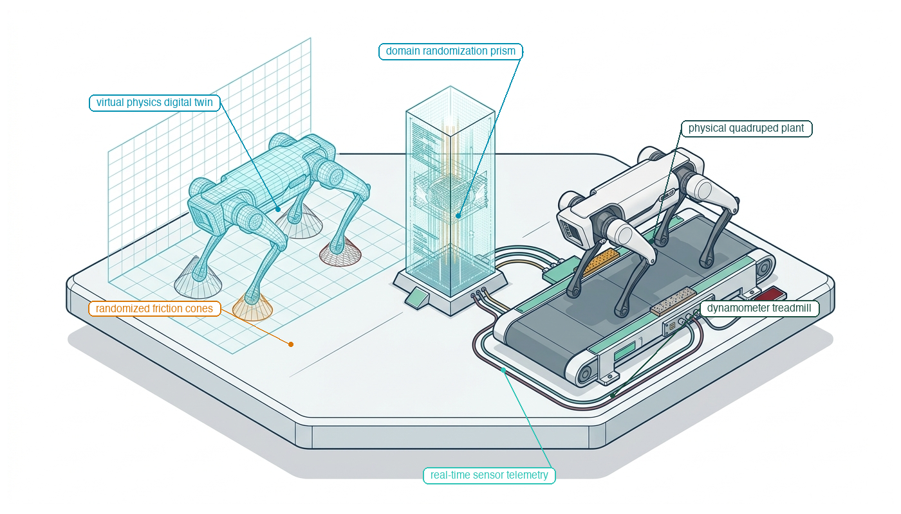
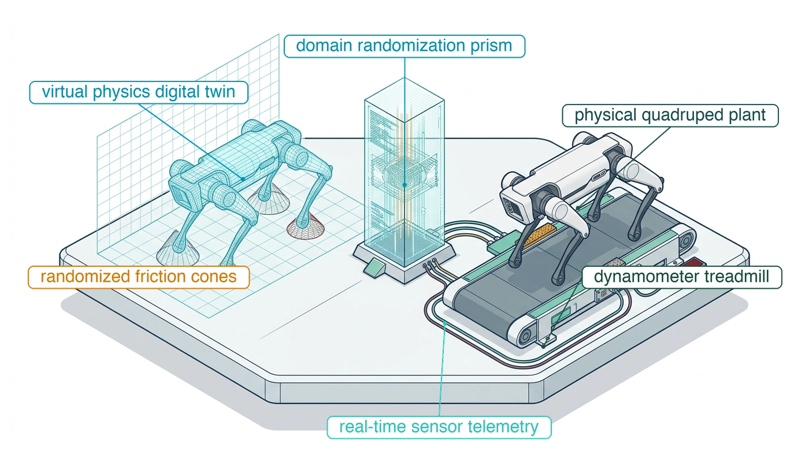
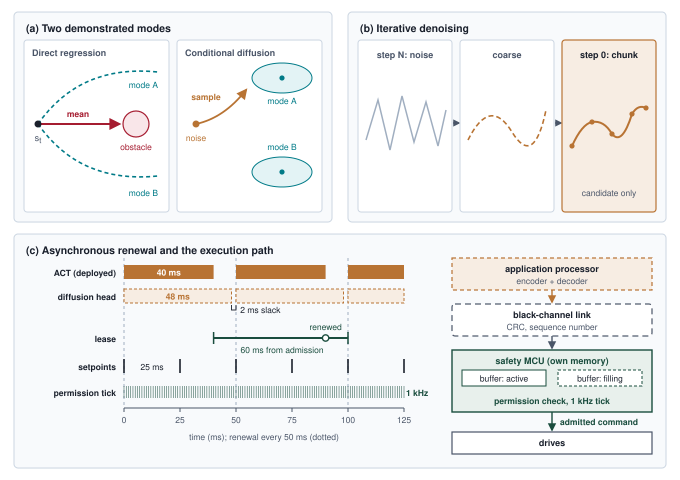
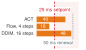
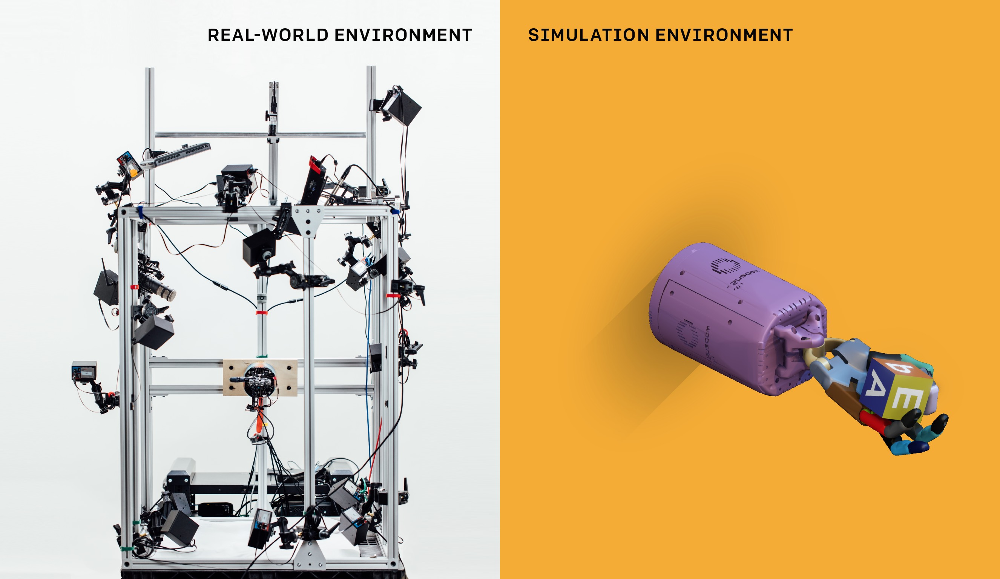
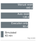
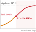
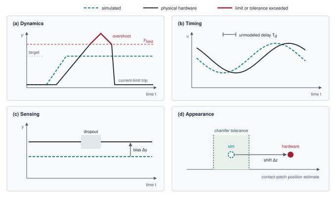
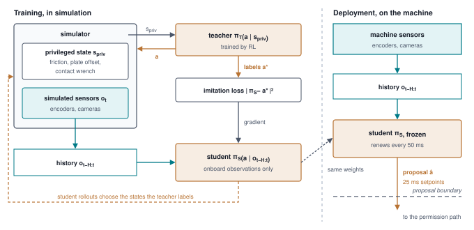
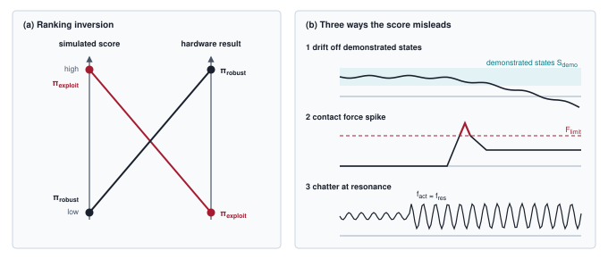

# Policy Training {#sec-training}

::: {layout-narrow}
::: {.column-margin}

\chapterminitoc

:::

::: {.content-visible when-format="pdf"}
\noindent
{fig-alt="Isometric blueprint of sim-to-real policy training for an agile quadruped robot: a virtual physics digital twin in a simulation grid with randomized friction cones, a central domain randomization prism, and a physical quadruped walking on an instrumented dynamometer treadmill with real-time telemetry."}
:::

::: {.content-visible unless-format="pdf"}
{fig-alt="Isometric blueprint showing sim-to-real policy training for an agile quadruped robot: a virtual physics digital twin in a simulation grid with randomized friction cones, a central domain randomization prism, and a physical quadruped on an instrumented dynamometer treadmill with real-time telemetry."}
:::

:::

## Purpose {.unnumbered .unlisted}

::: {.content-visible when-format="pdf"}
\begin{marginfigure}
\resizebox{0.92\linewidth}{!}{\mlphysicalstackfull{100}{20}{20}{20}{20}}
\end{marginfigure}
:::

::: {.content-visible unless-format="pdf"}
::: {.column-margin}
{width="100%" fig-alt="Physical AI Systems Stack"}

*Physical AI stack focus for this chapter.*
:::
:::

_Why can a policy improve its training score while becoming less reliable on the machine?_

A learned policy acquires its behavior from the experience its training supplies, and its weights keep no record of which experience that was. Demonstrations can omit the recovery from a displaced fixture, a simulator can reward a fast approach that a real contact surface cannot tolerate, and a model pretrained on other robots can behave plausibly in conditions no one has tested on this machine. In each case the training score rises while the dependency stays hidden, so ranking candidates by score can favor the one that exploited its data or its solver. Training also fixes how long the policy takes to propose an action, and every improvement gathered on the machine itself is paid for in heat and component life. An engineer who does not understand these mechanisms cannot choose a source of experience that supports the behavior the task needs, cannot state the conditions in which a checkpoint may be trusted, and discovers each hidden dependency only when the machine meets it. Because an admitted action crosses the causal boundary and its consequences cannot be undone by another gradient update, the limits of a policy's evidence must be established before it is allowed to propose motion.



::: {.callout-learning-objectives}

- Compare training regimes, from behavioral cloning to post-training a pretrained generalist, by the experience they supply and the physical dependencies they leave in the policy
- Diagnose the separate risks of averaging valid action choices and drifting beyond demonstrated states
- Calculate whether an action decoder fits its proposal deadline and identify the required execution safeguards
- Evaluate simulator mismatch and distinguish parameter variation from missing mechanisms or unavailable observations
- Bound real-machine adaptation by physical exposure, residual authority, and regression evidence
- Construct a policy manifest that confines a candidate's declared operating region to its documented support

:::

## Dual Failure Modes of Policy Training {#sec-training-policy-synthesis}

```{python}
#| label: calc-training-latch-contact-deadline
#| echo: false
#| warning: false
#| message: false

# ┌─────────────────────────────────────────────────────────────────────────────
# │ LATCH CONTACT DEADLINE AT THE GUARDED AND FAST APPROACHES
# ├─────────────────────────────────────────────────────────────────────────────
# │ Context: The chapter opener, the decoder run-time cost, the contact-exploit
# │          section, and the latch policy manifest's declared ODD.
# │ Goal: Show why the latch policy's declared ODD admits only the guarded
# │       approach: at the fast approach the contact deadline barely exceeds
# │       the tripwire-to-brake response after threshold accumulation.
# │ Show: setpoint and chunk periods, both approach speeds, latch limit, contact-loop
# │       response, threshold and brake-onset times, and the two deadlines.
# │ How: F = k*v*t, so t_yield = F_lim / (k*v) (calc_contact_yield_deadline);
# │      every input from RM / AISLE.
# └─────────────────────────────────────────────────────────────────────────────
from mlsysim import *
from mlsysim.physics.robotics import calc_contact_yield_deadline

RM = Embodied.MobileManipulator.WarehouseMobileManipulator
AISLE = Embodied.Scenario.WarehouseAisle

class LatchContactDeadline:
    # ┌── 1. LOAD (Constants) ──────────────────────
    t_step = RM.chunk_step  # category: chosen (chunk-policy setpoint period)
    chunk_rate = RM.chunk_rate  # category: chosen (chunk-policy renewal rate)
    k_plate = AISLE.k_latch  # category: illustrative (strike-plate contact stiffness)
    v_guarded = AISLE.v_latch_approach  # category: illustrative (guarded, demonstrated approach speed)
    v_fast = AISLE.v_latch_high  # category: illustrative (unsupported fast approach speed)
    f_lim = AISLE.f_latch_limit  # category: illustrative (latch force limit)
    f_trip = AISLE.f_latch_tripwire  # category: illustrative (contact tripwire force)
    t_contact_loop = AISLE.t_contact_response  # category: illustrative (tripwire-detection-to-brake-onset response time)

    # ┌── 2. EXECUTE (The Compute) ─────────────────
    t_chunk = (1 / chunk_rate).to(millisecond)  # chunk renewal period, the asynchronous inference deadline
    t_yield_guarded = calc_contact_yield_deadline(f_lim, k_plate, v_guarded).to(millisecond)
    t_yield_fast = calc_contact_yield_deadline(f_lim, k_plate, v_fast).to(millisecond)
    t_trip_fast = (f_trip / (k_plate * v_fast)).to(millisecond)
    t_trip_guarded = (f_trip / (k_plate * v_guarded)).to(millisecond)
    t_brake_fast = (t_trip_fast + t_contact_loop).to(millisecond)
    t_brake_guarded = (t_trip_guarded + t_contact_loop).to(millisecond)
    fast_margin_ratio = (t_yield_fast / t_brake_fast).to("dimensionless").magnitude
    t_left_fast = (t_yield_fast - t_brake_fast).to(millisecond)
    t_left_guarded = (t_yield_guarded - t_brake_guarded).to(millisecond)

    # ┌── 3. GUARD (Invariants) ────────────────────
    check(abs(t_step.to(millisecond).magnitude - 25.0) < 1e-9, f"setpoint period {t_step}")  # M5: 2 steps per renewal
    check(
        abs(t_chunk.to(millisecond).magnitude - 50.0) < 1e-9, f"chunk period {t_chunk}"
    )  # 25 ms and 50 ms are hand-drawn in fig06_privileged_distillation.svg
    check(t_chunk > t_step, "the chunk period must exceed the setpoint period that paces playback")
    check(abs(t_yield_guarded.to(millisecond).magnitude - 8.333) < 0.001, f"guarded deadline {t_yield_guarded}")
    check(abs(v_guarded.to(meter / second).magnitude - 0.03) < 1e-9, f"guarded approach {v_guarded}")
    check(abs(v_fast.to(meter / second).magnitude - 0.10) < 1e-9, f"fast approach {v_fast}")
    check(abs(f_lim.to(newton).magnitude - 100.0) < 1e-9, f"latch limit {f_lim}")
    check(abs(t_left_fast.to(millisecond).magnitude - 0.125) < 1e-9, f"time left at fast approach {t_left_fast}")
    check(abs(t_yield_fast.to(millisecond).magnitude - 2.5) < 1e-9, f"fast deadline {t_yield_fast}")
    check(abs(t_contact_loop.to(millisecond).magnitude - 2.0) < 1e-9, f"contact loop {t_contact_loop}")
    check(0 * newton < f_trip < f_lim, "tripwire must precede the force limit")
    check(abs(t_trip_fast.magnitude - 0.375) < 1e-9, f"fast tripwire crossing {t_trip_fast}")
    check(abs(t_trip_guarded.magnitude - 1.25) < 1e-9, f"guarded tripwire crossing {t_trip_guarded}")
    check(abs(t_brake_fast.magnitude - 2.375) < 1e-9, f"fast brake onset {t_brake_fast}")
    check(abs(t_brake_guarded.magnitude - 3.25) < 1e-9, f"guarded brake onset {t_brake_guarded}")
    check(abs(t_left_guarded.magnitude - 5.083333333) < 1e-8, f"guarded time left {t_left_guarded}")
    check(1.0 < fast_margin_ratio < 1.1, "fast deadline must sit barely above brake onset")
    check(t_left_guarded > 2 * t_contact_loop, "guarded approach must leave several response intervals after brake onset")

    # ┌── 4. OUTPUT (Formatting) ───────────────────
    t_step_str = fmt_latency(t_step, unit=millisecond, precision=0)
    t_chunk_str = fmt_latency(t_chunk, unit=millisecond, precision=0)
    v_guarded_str = fmt_velocity(v_guarded, precision=2)
    v_fast_str = fmt_velocity(v_fast, precision=2)
    f_lim_str = fmt_force(f_lim, precision=0)
    t_contact_loop_str = fmt_latency(t_contact_loop, unit=millisecond, precision=0)
    t_yield_guarded_str = fmt_latency(t_yield_guarded, unit=millisecond, precision=3)
    t_yield_fast_str = fmt_latency(t_yield_fast, unit=millisecond, precision=1)
    t_trip_fast_str = fmt_latency(t_trip_fast, unit=millisecond, precision=3)
    t_trip_guarded_str = fmt_latency(t_trip_guarded, unit=millisecond, precision=2)
    t_brake_fast_str = fmt_latency(t_brake_fast, unit=millisecond, precision=3)
    t_brake_guarded_str = fmt_latency(t_brake_guarded, unit=millisecond, precision=2)
    t_left_fast_str = fmt_latency(t_left_fast, unit=millisecond, precision=3)
    t_left_guarded_str = fmt_latency(t_left_guarded, unit=millisecond, precision=3)
```

A robot arm executing a learned trajectory can track every waypoint cleanly across hundreds of simulation episodes and still arrive at its first physical deployment with no evidence about whether it will fracture a latch. In classical robotics, control design begins with an explicit analytical model of the plant: engineers write down kinematic equations, inertia matrices, stability margins, and torque limits where they can be systematically inspected and verified. A learned neural policy, in contrast, derives its behavior entirely from its training distribution, setting network weights from empirical experience to map physical observations to proposed control actions. That experience may arrive as teleoperated demonstrations, recorded operational logs, rollouts inside a parallel physics simulator, trial-and-error interactions on physical hardware, or pretrained representations imported from foundation models. Although empirical data makes complex manipulation tractable, it also embeds unstated dynamic assumptions directly into the model weights, leaving no explicit record of which operating regimes the policy can safely navigate.

The central engineering question in embodied policy training is therefore not which regime achieves the highest optimization score, but which physical behaviors the training experience supports, and at what operational cost. Four quantities decide the answer. The first is coverage, because a policy is supported only in the states its experience actually visited, which is why the provenance record of @sec-data-schema lists its known absences beside its demonstrated cells. The second is inference latency, because a policy that evaluates too slowly misses its control deadline, however good its proposed trajectories are. The third is hardware cost, since experience gathered on the machine consumes machine hours, heats motor windings, and wears drivetrains. The fourth is fidelity, because synthetic experience from simulation scales across parallel accelerators but is only as faithful as the integrator and contact solver that produced it. A checkpoint's policy manifest (@sec-training-policy-manifest) records all four, and its declared operational design domain (ODD) is the part of the task's scenario table that the checkpoint's evidence supports. Two candidate latch policies show why a clean training curve does not establish physical viability.

Consider the cage-door latch task introduced in @sec-data-endogenous-experience, where two learned controllers both succeed under nominal warehouse conditions yet each carries a hidden dependency that physical hardware can expose, for different mechanical reasons. Both controllers share the same real-time execution model: Action Chunking with Transformers (ACT) [@zhao2023learning], a chunk-policy architecture that generates open-loop action sequences in a single decoder pass. The first candidate, `latch-bc-01`, was trained via supervised behavioral cloning on teleoperated door-opening demonstrations. The second candidate, `latch-sim-02`, is a distilled student policy: a reinforcement learning teacher was first trained inside a massively parallel physics simulator with full access to privileged state variables, after which `latch-sim-02`, initialized from `latch-bc-01`, learned through distillation to replicate the teacher's actions using only onboard sensor streams (@sec-training-privileged-distillation).

Both candidates inherit the absence list of the baseline archive. Its demonstrations characterize only the nominal strike plate at a guarded approach velocity, so a displaced plate and a faster approach are both recorded as known absences, and each candidate meets one of them. While behavioral cloning must interpolate between these discrete demonstrations to form coherent trajectory proposals, interactive learning in simulation can explore novel state-action pairs. However, the validity of that synthetic exploration depends entirely on how accurately the simulated mechanics mirror the physical plant. Selecting a training regime is therefore an architectural decision that dictates which unverified assumptions must be empirically audited before a checkpoint is permitted to command actuators.

In this illustrative comparison, at the nominal strike plate and the guarded approach speed of `{python} LatchContactDeadline.v_guarded_str`, both policies open the door. Their failure modes diverge once physical deployment departs from that single nominal operating point:

1. **Missing recovery experience**: When a sagging door places the strike plate off nominal, `latch-bc-01` encounters observations outside its training distribution. Because behavioral cloning minimizes supervised prediction error across the recorded demonstrations, the training loss supplies no direct supervision at unvisited recovery states, although updates to shared weights can still change the actions predicted there. When confronted with unfamiliar observations, the network still emits action setpoints, but those ungrounded commands drive the manipulator further off course. Trajectory errors compound at each `{python} LatchContactDeadline.t_step_str` setpoint tick until the gripper binds against the strike plate's chamfered edge. The root bottleneck is the absence of corrective recovery trajectories in the training distribution, rather than model capacity.
2. **Misleading simulated contact**: In contrast, `latch-sim-02` is at risk on the nominal strike plate itself. Its simulator models contact dynamics using a compliant penalty spring[^fn-penalty-contact-model] ($\NormalContactForce = \PenaltyContactStiffness \PenetrationDepth + \PenaltyContactDamping \PenetrationRate$), where surface penetration $\PenetrationDepth$ and penetration rate $\PenetrationRate$ govern the contact force. Because this numerical spring yields far more compliance than a physical steel plate, the simulated impact at `{python} LatchContactDeadline.v_fast_str` peaks well under the latch's `{python} LatchContactDeadline.f_lim_str` limit. The teacher's training reward paid for opening the door quickly and carried no term for contact force, so nothing in training charged for an aggressive approach, and the optimizer exploited the contact model to shave cycle time off each episode. The reinforcement learning teacher converges on an aggressive plunge, and policy distillation faithfully transfers that shortcut into the student. Whether the plunge breaks the real latch depends on how stiff the arm side of the contact is, a quantity nothing in training measured.

[^fn-penalty-contact-model]: **Kelvin-Voigt Contact**: A linear spring and damper in parallel produce a force jump at first touch, because the damping term acts on the full approach velocity at zero penetration, and a pulling, "sticky" force as the bodies separate, because the damping term then outweighs the vanishing spring term. @hunt1975coefficient scaled the damping with penetration to remove both artifacts. A policy trained against the linear model therefore meets its least faithful forces at contact onset and at release, the two events a latch opening depends on. \index{Contact model!Kelvin-Voigt}

A contact-force budget demonstrates why the simulated benchmark score cannot be trusted on hardware. In the rigid-arm, constant-drive estimate, the physical strike plate's stiffness sets the force rise. At the unbraked approach velocity of `{python} LatchContactDeadline.v_fast_str`, force reaches the `{python} LatchContactDeadline.f_lim_str` limit in `{python} LatchContactDeadline.t_yield_fast_str` after touch. The tripwire fires at `{python} LatchContactDeadline.t_trip_fast_str`; the subsequent `{python} LatchContactDeadline.t_contact_loop_str` response places brake onset at `{python} LatchContactDeadline.t_brake_fast_str`, leaving only `{python} LatchContactDeadline.t_left_fast_str` before the constant-drive ramp reaches the limit. That interval is not a stopping certificate. @Sec-training-contact-exploit derives the timeline alongside the passive impact forces; sanctioning the fast plunge would require physical deceleration evidence that this simulation-only training process cannot establish.

Both failures expose critical dependencies hidden from validation loss and episodic reward: behavioral cloning depends on demonstrated recovery distributions, while simulation-to-real transfer depends on faithful contact and stiffness dynamics. Selecting a policy training regime therefore requires matching the physical properties of the training source to the mechanical demands of the operational task. Whichever regime produced it, a learned checkpoint sits above the proposal boundary as an unprivileged proposal generator. Achieving safe and reliable manipulation requires action proposals that respect the machine's actuator dynamics, contact deadlines, and physical safety envelopes as rigorously as they pursue the nominal task objective, and comparing the five regimes that can generate those proposals clarifies what each source of experience buys and what it leaves unverified.

::: {.column-margin .margin-pointer}
↩ The proposal boundary, under which a learned proposer holds no authority until an independent permission path admits its command, is established in @sec-boundary-machine-model.
:::

## Policy Training Regimes {#sec-training-synthesis-regimes}

When `latch-bc-01` binds against a sagged strike plate and `latch-sim-02` plunges into the nominal plate at `{python} LatchContactDeadline.v_fast_str`, neither failure can be repaired simply by training the same network for more epochs on the same dataset. Fixing an unvisited recovery state or an exploited contact solver requires changing the experience the learner sees. Training a control policy for the latch task can draw on five sources of experience: teleoperated door openings, logged archives of imperfect or scripted trajectories, a physics simulator of the door and cage, direct physical trial on the arm itself, and a generalist foundation checkpoint pretrained across multi-robot corpora. Each source buys distinct sensorimotor capabilities at a characteristic physical cost and leaves its own failure mode behind (@tbl-06-regimes). Behavioral cloning, batch offline reinforcement learning, and supervised post-training extract control policies from recorded datasets without runtime exploration, whereas online trial, conducted in simulation or on the physical mechanism, generates new interactions under closed-loop feedback. Comparing how those regimes evaluate and update actions begins with the reward quantities that score closed-loop behavior over an episode.

| Policy Training Regime             | Core Purchased Capability                                                                                        | Data & Compute Budget                                                   | Sample Efficiency & Scale                                              | Hardware Safety & Wear Risk                                                                          | Dominant Failure Mode & Interceptor                                                                                                                           |
|:-----------------------------------|:-----------------------------------------------------------------------------------------------------------------|:------------------------------------------------------------------------|:-----------------------------------------------------------------------|:-----------------------------------------------------------------------------------------------------|:--------------------------------------------------------------------------------------------------------------------------------------------------------------|
| **Behavioral Cloning (BC)**        | Imitates attributable expert actions                                                                             | Expert collection, curation, and supervised optimization                | Limited by coverage and operator availability                          | Optimization adds no physical exploration; collection still incurs exposure                          | Mode averaging and missing recovery. Multimodal decoding and new expert labels address training; qualified state and action limits bound execution.           |
| **Offline / Batch RL**             | Uses rewards to select behavior from heterogeneous logs                                                          | Logged transitions with rewards and state-action coverage               | Reuses recorded experience without new online trials                   | Optimization adds no exploration; the archive inherits collection risks                              | Unsupported action values. Conservative objectives reduce optimism; independent action limits remain necessary.                                               |
| **Sim-to-Real RL**                 | Explores behavior through simulated interaction; a privileged teacher can be distilled into a deployable student | Parallel rollout compute plus physical calibration and transfer tests   | Throughput depends on task, solver, and hardware                       | Simulation avoids training wear; physical probing and deployment still incur exposure                | Solver exploitation and omitted mechanisms. Paired probes qualify the simulator; approach and force limits need their own response evidence.                  |
| **Residual RL & Real Fine-Tuning** | Adapts to local physical mismatch                                                                                | Machine interaction, resets, cooling, and regression testing            | Physical trials make sample efficiency consequential                   | Contact loads and thermal exposure accumulate during adaptation                                      | Local improvement with regression elsewhere. Independent residual gates limit authority; combined-controller tests assess the change.                         |
| **Pretrain & Post-Train**          | Starts from a generalist checkpoint's broad competence and adapts it to the task with demonstrations or reward   | A base checkpoint trained elsewhere, task data, and fine-tuning compute | Task data needs shrink when the base already represents related skills | Supervised post-training adds no exploration; RL post-training adds the exposure of its own rollouts | Borrowed competence mistaken for evidence, and forgetting. Support comes only from the task data join; regression tests cover what post-training may disturb. |

: **Comparative trade-off matrix across policy training regimes**: The five regimes compared are behavioral cloning, offline reinforcement learning, sim-to-real reinforcement learning, residual RL/fine-tuning, and post-training of a pretrained generalist policy. Columns separate the capability sought, the resources that determine its cost, and the remaining failure mechanism. Training remedies and physical execution safeguards have different roles; neither supplies the other's evidence. {#tbl-06-regimes tbl-colwidths="[16,16,18,18,16,16]"}

### The latch task as a reward problem {#sec-training-rl-primer}

A reward function that pays a policy for opening the cage door and penalizes each control step for elapsed time without charging for contact force will train the arm to slam into the strike plate, because every millisecond shaved off the approach increases the episode's score. Even behavioral cloning, which uses no reward during training, has its failures measured in the quantities that a reward problem defines: the states a policy visits, the return it earns over an episode, and the value of one action against another. Posing the latch mechanism as a discrete-time optimal control problem makes those quantities concrete and shows how an omitted force penalty or a discount factor mis-scaled against the control rate distorts learned behavior.

```{python}
#| label: calc-training-latch-reward-problem
#| echo: false
#| warning: false
#| message: false

# ┌─────────────────────────────────────────────────────────────────────────────
# │ THE LATCH AS A MARKOV DECISION PROCESS: EPISODE LENGTH AND DISCOUNT
# ├─────────────────────────────────────────────────────────────────────────────
# │ Context: @sec-training-rl-primer; the episode length is reused by the
# │          hardware trial calendar in @sec-training-learning-by-trial.
# │ Goal: Show that the discount factor acts per decision, so its horizon in
# │       seconds depends on the machine's setpoint step.
# │ Show: decisions per opening, the terminal reward's weight at the first
# │       decision, the effective horizon in steps and seconds, and the
# │       smallest discount that keeps half the terminal weight.
# │ How: n = t_rollout / t_step; w = gamma^n; horizon = 1 / (1 - gamma);
# │      gamma_half = 0.5^(1/n). Step from RM; rollout and gamma are chosen.
# └─────────────────────────────────────────────────────────────────────────────
from mlsysim import *

RM = Embodied.MobileManipulator.WarehouseMobileManipulator
AISLE = Embodied.Scenario.WarehouseAisle

class LatchRewardProblem:
    # ┌── 1. LOAD (Constants) ──────────────────────
    t_step = RM.chunk_step  # category: chosen (setpoint step, one decision)
    t_rollout = 8.0 * second  # category: illustrative (autonomous contact phase of one opening, not the 25 s collection attempt of @sec-data)
    gamma = 0.99  # category: chosen (a common discount factor)
    f_trip = AISLE.f_latch_tripwire  # category: illustrative (contact tripwire on the latch)

    # ┌── 2. EXECUTE (The Compute) ─────────────────
    n_decisions = round((t_rollout / t_step).to("dimensionless").magnitude)
    w_terminal = gamma**n_decisions
    horizon_steps = 1 / (1 - gamma)
    horizon_time = (horizon_steps * t_step).to(second)
    gamma_half = 0.5 ** (1 / n_decisions)

    # ┌── 3. GUARD (Invariants) ────────────────────
    check(abs(t_step.to(millisecond).magnitude - 25.0) < 1e-9, f"setpoint step {t_step}")
    check(n_decisions == 320, f"decisions per opening {n_decisions}")
    check(abs(w_terminal - 0.0402) < 1e-3, f"terminal weight {w_terminal}")
    check(abs(horizon_steps - 100.0) < 1e-6, f"effective horizon {horizon_steps}")
    check(abs(horizon_time.magnitude - 2.5) < 1e-9, f"horizon in seconds {horizon_time}")
    check(horizon_time < t_rollout, "the effective horizon must be shorter than one opening")
    check(gamma < gamma_half < 1, "keeping half the terminal weight must need a larger discount")
    check(abs(f_trip.to(newton).magnitude - 15.0) < 1e-9, f"tripwire {f_trip}")

    # ┌── 4. OUTPUT (Formatting) ───────────────────
    t_step_str = fmt_latency(t_step, unit=millisecond, precision=0)
    t_rollout_str = fmt_time(t_rollout, second, precision=0)
    n_decisions_str = fmt_int(n_decisions)
    gamma_str = fmt(gamma, precision=2)
    w_terminal_str = fmt(w_terminal, precision=2)
    horizon_steps_str = fmt_int(horizon_steps)
    horizon_time_str = fmt_time(horizon_time, second, precision=1)
    gamma_half_str = fmt(gamma_half, precision=4)
    f_trip_str = fmt_force(f_trip, precision=0)
```

A **Markov decision process** (MDP)\index{Markov decision process}[^fn-mdp-bellman-origin] describes a task by its state $\DecisionProcessState_{t}$, its action $\ContinuousActionVector_{t}$, a transition $\EnvironmentTransitionDistribution(\DecisionProcessState_{t+1} \mid \DecisionProcessState_{t}, \ContinuousActionVector_{t})$ that the physics supplies, and a scalar reward $\Reward(\DecisionProcessState_{t}, \ContinuousActionVector_{t})$ that the engineer writes. For the latch, the state holds the gripper pose, the plate position, and the measured contact force. The action is the setpoint the chunk policy emits every `{python} LatchRewardProblem.t_step_str`. An episode is one opening, `{python} LatchRewardProblem.t_rollout_str` of autonomous contact-phase motion, or `{python} LatchRewardProblem.n_decisions_str` decisions. A reward that states what the task values and what it must avoid is
$$\Reward_t = \DoorOpenReward\,\mathbb{1}[\text{door open at } \ControlStepIndex] - \ExcessForcePenaltyWeight \max\left(0, \LatchContactForce_t - \ContactTripwireForce\right) - \StepTimePenalty,$$ {#eq-training-latch-reward}
where $\ContactTripwireForce$ is the `{python} LatchRewardProblem.f_trip_str` contact tripwire, the force threshold that triggers the machine's qualified collection response (set below the latch's damage limit), $\ExcessForcePenaltyWeight$ is a weight in reward per newton of excess force, and $\StepTimePenalty$ charges each step for slowness. The weights make the terms commensurable, and choosing them is a design decision that the policy manifest records. Dropping the force term, as the simulator teacher of `latch-sim-02` did, leaves only the time term to shape the approach, and the time term rewards every millisecond an aggressive plunge saves. On hardware the success indicator must itself be measured, by a latch sensor or a learned classifier, and every error in that measurement is a surface the optimizer can exploit. When engineers introduce auxiliary rewards to guide exploration toward that success indicator, adding a potential difference $\DiscountFactor\ShapingPotential(\NextDecisionProcessState) - \ShapingPotential(\DecisionProcessState)$ provably leaves the optimal policy unchanged, and without further assumptions about the task it is the only added term that does [@ng1999policy]. Any other shaping term can change what is optimal.

[^fn-mdp-bellman-origin]: **Markov Decision Process**: @bellman1957dynamic formulated sequential decisions under uncertainty with the dynamic-programming recursion that @eq-training-bellman restates, and @howard1960dynamic supplied policy iteration to solve them. The formalism came from operations research and optimal control decades before reinforcement learning adopted it, which is why the cost-to-go translation below is an identity rather than an analogy, and why a control engineer's tools for that recursion apply to a learned policy's value function. \index{Markov decision process!origin}

A **policy**\index{Policy!stochastic} $\Policy(\ContinuousActionVector \mid \DecisionProcessState)$ is a distribution over actions, and its **return** from step $\ControlStepIndex$ is $\DiscountedReturn_t = \sum_{j \ge 0} \DiscountFactor^\DiscountedReturnStepOffset \Reward_{\ControlStepIndex+\DiscountedReturnStepOffset}$ with discount factor $\DiscountFactor \in [0, 1)$. Because $\DiscountFactor$ applies once per decision, its horizon is measured in control steps, not seconds. At $\DiscountFactor =$ `{python} LatchRewardProblem.gamma_str` and one decision every `{python} LatchRewardProblem.t_step_str`, the door-open reward earned at the end of an opening reaches the first decision with weight `{python} LatchRewardProblem.w_terminal_str`, and the effective horizon $1/(1-\DiscountFactor)$ of `{python} LatchRewardProblem.horizon_steps_str` steps spans only `{python} LatchRewardProblem.horizon_time_str`. For the terminal success to keep half its weight across the whole opening, $\DiscountFactor$ must be at least `{python} LatchRewardProblem.gamma_half_str`. Changing the setpoint rate without re-deriving $\DiscountFactor$ therefore changes the task horizon in seconds. Training a policy means choosing $\ModelParameters$ to maximize the **objective** $\ExpectedReturnObjective(\ModelParameters) = \mathbb{E}_{\Policy}[\DiscountedReturn_0]$, the return expected over whole episodes that start from the task's initial states. It is a return to maximize, where the $\Glyph{J}(\pi)$ of @eq-data-quadratic-drift was an expected cost to minimize.

Two expectations of the return organize every reinforcement learning method. The **state value**\index{Value function!state} $\PolicyRemainingReturn(\DecisionProcessState) = \mathbb{E}_\pi[\DiscountedReturn_t \mid \DecisionProcessState_{t} = \DecisionProcessState]$ is the return expected from $\DecisionProcessState$ when following $\pi$. The **action value** $\PolicyHistoryActionReturn(\DecisionProcessState, \ContinuousActionVector) = \mathbb{E}_\pi[\DiscountedReturn_t \mid \DecisionProcessState_{t} = \DecisionProcessState, \ContinuousActionVector_t = \ContinuousActionVector]$ is the return expected after taking $\ContinuousActionVector$ first and following $\pi$ thereafter. Both obey the one-step **Bellman relation**\index{Bellman relation}
$$\PolicyHistoryActionReturn(\DecisionProcessState, \ContinuousActionVector) = \Reward(\DecisionProcessState, \ContinuousActionVector) + \DiscountFactor\, \mathbb{E}_{\NextDecisionProcessState \sim \EnvironmentTransitionDistribution,\ \SuccessorActionVector \sim \pi}\left[ \PolicyHistoryActionReturn(\NextDecisionProcessState, \SuccessorActionVector) \right], \qquad \PolicyRemainingReturn(\DecisionProcessState) = \mathbb{E}_{\ContinuousActionVector \sim \pi}\left[ \PolicyHistoryActionReturn(\DecisionProcessState, \ContinuousActionVector) \right].$$ {#eq-training-bellman}
The **advantage**\index{Advantage function} $\PolicyHistoryAdvantage(\DecisionProcessState, \ContinuousActionVector) = \PolicyHistoryActionReturn(\DecisionProcessState, \ContinuousActionVector) - \PolicyRemainingReturn(\DecisionProcessState)$ measures whether an action does better or worse than the policy's usual choice from that state. At the plate, an approach has positive advantage only if its expected return exceeds the policy's usual choice. A force penalty can make a plunge less attractive, but the sign still depends on the reward weights, completion probability, and baseline policy.

Readers from control have met these objects under other names. With stage cost $\ell = -\Reward$, the value is the negated **cost-to-go**\index{Cost-to-go!relation to value function}, $\CostToGo(\DecisionProcessState) = -\ExpectedRemainingReturn(\DecisionProcessState)$, and @eq-training-bellman is the dynamic-programming recursion. (Control texts write the cost-to-go as $\Glyph{J}$; this chapter reserves $\ExpectedReturnObjective(\ModelParameters)$ for the expected return a learner maximizes.) For linear dynamics in the plant state $\MechanicalPlantState$ and quadratic cost, that recursion has the closed-form solution $\CostToGo(\MechanicalPlantState) = \MechanicalPlantState^\top \LqrCostToGoMatrix \MechanicalPlantState$ that the linear-quadratic regulator computes from a Riccati equation (@sec-appendix-control-lqr). Reinforcement learning keeps the recursion and changes the estimation problem: the dynamics are unknown, so $\ExpectedRemainingReturn$ and $\ExpectedHistoryActionReturn$ are fitted from sampled transitions instead of solved from a model.

These quantities organize policy learning along two axes, what is estimated and where the data comes from. Fitting $\ExpectedHistoryActionReturn$ over an immutable logged archive to select high-value actions is **offline reinforcement learning** (@sec-training-offline-rl). Generating fresh rollouts from $\Policy$, using each batch for a few updates, and shifting probability toward positive-advantage actions is on-policy **policy-gradient** optimization (@sec-training-learning-by-trial). Between the two, value-based methods also run online and off-policy. The machine keeps collecting experience, but each transition enters a replay buffer and is reused across many value updates, which is how the demonstration-seeded methods of @sec-training-real-world-rl learn in hours. The value-fitting and policy-gradient derivations behind these approaches appear in @sec-appendix-ml-affordances. Before paying the reward-design or physical trial cost of those methods, however, the simplest training regime bypasses value estimation altogether and fits a policy directly to the expert setpoints the collection campaign already recorded.

### Behavioral cloning and its action targets {#sec-training-behavioral-cloning}

**Behavioral cloning**\index{Behavioral cloning} avoids designing a reward for the nominal opening by framing policy training, as ALVINN first did for road following [@pomerleau1989alvinn], as supervised regression or classification over a collected dataset of expert state-action pairs $\DemonstrationDataset = \{(\MultimodalObservation_{t}, \ContinuousActionVector_t)\}$. On a physical machine, however, the four-stream action taps record both the operator's mapped setpoints and the setpoints the permission path actually admitted:
$$\IntentDemonstrationDataset = \left\{ \left(\MultimodalObservation_{t}, \NominalCommandWindow\right) \right\} \quad \text{vs.} \quad \VerifiedDemonstrationDataset = \left\{ \left(\MultimodalObservation_{t}, \CertifiedCommandWindow\right) \right\}$$
The mapped setpoint $\NominalControlCommand$ is the record at the mapped-command tap $\MappedCommandTap$, and the admitted setpoint $\CertifiedControlAction$ is the record at the enforced-command tap $\EnforcedCommandTap$. @Sec-data-four-stream-action-tap develops what each tap teaches a policy. In brief, cloning admitted setpoints couples the weights to one permission path's intervention profile and tuning—so an uncurated policy can learn to steer straight into the safety clamps and rely on the hardware filter to bend its commands back onto the latch—whereas cloning mapped setpoints keeps intent separate from enforcement at the price of more frequent runtime interventions, and neither tap yields an expert target without curation. The latch campaign took the mapped command as its target wherever the permission path admitted it unchanged, so `latch-bc-01` clones $\NominalControlCommand$ on those steps and treats every modified command as an attributed intervention.

Whichever tap supplies the target, the training loss compares the proposed setpoints with the recorded ones, over a single step or over the $\ActionChunkHorizon$-step sequence that @sec-training-action-chunking calls a chunk. Because this loss penalizes only the discrepancy between the commanded action and the recorded demonstration at observed states, the training objective does not evaluate task completion, terminal cost, or the stability of the closed-loop dynamical system. It fits actions to observations only, and that point-by-point fit breaks down at a single observation whenever demonstrators solve the same physical geometry in more than one valid way.

### Mode averaging when demonstrations split {#sec-training-multimodality-breakdown}

A mobile manipulator trained with least-squares regression on demonstrations that pass left of a central structural column half the time and right of it the other half will steer straight down the center line into the column. Each human teleoperator trajectory in the recorded archive $\DemonstrationDataset$ is dynamically valid and collision-free, and not a single demonstration drives into the obstacle, yet a deterministic point-regression policy proposes the one path that every demonstrator avoided.

Under empirical mean squared error ($\ell_2$) loss, a deterministic behavioral cloning network cannot represent both modes for the same observation $\MultimodalObservation_{t}$ and instead optimizes:
$$\MeanSquaredErrorCloningLoss(\ModelParameters) = \mathbb{E}_{(\MultimodalObservation_{t}, \ContinuousActionVector) \sim \DemonstrationDataset} \left[ \left\| \Policy(\MultimodalObservation_{t}) - \ContinuousActionVector \right\|_2^2 \right].$$
The theoretical minimizer of this objective is the conditional expectation of the action distribution (derived formally in @sec-appendix-ml-multimodal):
$$\pi^*(\MultimodalObservation_{t}) = \arg\min_{\CandidateActionVector} \int \|\CandidateActionVector - \ContinuousActionVector\|_2^2\,\DemonstrationArchiveActionDistribution(\ContinuousActionVector \mid \MultimodalObservation_{t})\,\DerivativeOperator\ContinuousActionVector = \mathbb{E}[\ContinuousActionVector \mid \MultimodalObservation_{t}] = \int \ContinuousActionVector\,\DemonstrationArchiveActionDistribution(\ContinuousActionVector \mid \MultimodalObservation_{t})\,\DerivativeOperator\ContinuousActionVector.$$ {#eq-training-mse-minimizer}
In conventional computer vision, predicting the conditional mean of ambiguous pixel targets generates blurry, averaged textures; in natural language processing, it produces diffused semantic embeddings. In Physical AI, however, the conditional expectation of two collision-free evasion commands (such as $\LeftEvasionAction = [\BaseForwardSpeed, +\YawRate]^\top$ and $\RightEvasionAction = [\BaseForwardSpeed, -\YawRate]^\top$, where $\BaseForwardSpeed$ is forward linear speed and $\YawRate$ is angular yaw rate) evaluates to:
$$\mathbb{E}[\ContinuousActionVector \mid \MultimodalObservation_{t}] = \frac{1}{2}\LeftEvasionAction + \frac{1}{2}\RightEvasionAction = \left[ \BaseForwardSpeed, 0.0 \right]^\top.$$
The regression mean proposes forward motion with zero lateral evasion. If admitted unchanged, that proposal heads straight into the central obstacle.[^fn-jensen-inequality-plant]

[^fn-jensen-inequality-plant]: **Jensen's Inequality**: The averaged action fails even where it happens to be admissible, because a nonlinear plant does not map the mean action to the mean outcome. In general $\mathbb{E}[\PlantOutcomeFunction(\ContinuousActionVector)] \ne \PlantOutcomeFunction(\mathbb{E}[\ContinuousActionVector])$, and for a convex $\PlantOutcomeFunction$ Jensen's inequality fixes the sign of the gap. Contact and friction are the most nonlinear parts of a manipulator's plant, so a regression mean that looks like a compromise between two good demonstrations can produce a contact state that neither demonstration visited. \index{Mode averaging!Jensen's inequality}

This invalid proposal is not caused by an optimization pathology, insufficient model capacity, or dataset scarcity. It is the exact minimizer of a point-regression loss over a multimodal distribution. Viewed as a function of the proposed action, the expected loss is a bowl with a single bottom at the mean, and that bottom sits in the zero-density gap between the two demonstrated modes ($\DemonstrationArchiveActionDistribution(\mathbb{E}[\ContinuousActionVector\mid\MultimodalObservation_{t}] \mid \MultimodalObservation_{t}) \approx 0$). The statement concerns the optimal output, not whether optimizing the network's weights is convex.

::: {#dfn-training-mode-averaging .callout-definition title="Mode averaging"}

***Mode averaging***\index{Mode averaging!definition} is the failure in which a policy trained with a point-regression loss on demonstrations that contain several valid actions for one observation proposes their conditional mean, an action that lies between the demonstrated modes and that no demonstrator chose.

1.  **Significance**: More data, capacity, or training moves the output toward the mean, not away from it. Two equally weighted evasions at $\pm\YawRate$ average to zero yaw, a proposal aimed at the obstacle both demonstrations avoided, and it reaches the permission path as a smooth, confident command whose consequence cannot be undone once admitted.
2.  **Distinction**: Mode averaging concerns the action chosen at one observation; compounding error concerns the states that successive actions reach. A multimodal decoder removes the first and does nothing for the second, which needs recovery experience.
3.  **Common pitfall**: Reading a low validation loss as evidence against averaging. The mean minimizes squared error on held-out demonstrations drawn from the same modes, so a regression head can score best on its split and still propose the invalid middle action at every bifurcation.

:::

Changing the regression penalty does not by itself represent alternative actions. Mean absolute error ($\ell_1$) admits conditional medians, while Huber loss limits the influence of large residuals, so neither guarantees a unique, coherent route through a multimodal demonstration distribution. Instead, the decoder must represent the alternatives, and execution must maintain a consistent choice across successive observations.

Several decoder families represent these alternatives at different computational costs. **Mixture Density Networks (MDNs)**[^fn-mdn-inverse-model] parameterize a Gaussian Mixture Model (GMM): $\DemonstrationArchiveActionDistribution(\ContinuousActionVector \mid \MultimodalObservation_{t}) = \sum_{\MixtureComponentIndex=1}^{\MixtureComponentCount} \pi_\MixtureComponentIndex(\MultimodalObservation_{t}) \GaussianDistribution\left(\ContinuousActionVector \mid \MixtureComponentMean(\MultimodalObservation_{t}), \MixtureComponentCovariance(\MultimodalObservation_{t})\right)$, in which $\pi_\MixtureComponentIndex$ is the weight of component $\MixtureComponentIndex$ (not the policy), and $\MixtureComponentMean$ and $\MixtureComponentCovariance$ are its mean (not a friction coefficient) and covariance. They produce mixture parameters in one forward pass, but training must prevent covariance collapse ($\MixtureComponentCovariance \to \ZeroMatrix$) and loss of less frequent modes, which makes the component count and covariance representation consequential for high-dimensional chunks ($\ChunkActionDimension = \ActionDimension \times \ActionChunkHorizon$). Energy-based models instead score each candidate with a learned energy and must search for a low-energy action, so their iteration budget, rather than a head of fixed size, must fit the proposal deadline.

[^fn-mdn-inverse-model]: **Mixture Density Network**: @bishop1994mixture proposed it for inverse problems, whose inputs admit several valid outputs, and demonstrated it on the inverse kinematics of a robot arm, where one hand position has two joint solutions and least-squares regression returns their invalid average. The mobile manipulator's two routes around the column are the same problem, met three decades later in action space, which is why the remedy is still a change of output distribution rather than a larger network. \index{Mixture density network!inverse problems}

Generative architectures, including diffusion models [@ho2020denoising] and flow matching [@lipman2022flow], offer another way to represent $\DemonstrationArchiveActionDistribution(\ContinuousActionVector \mid \MultimodalObservation_{t})$ by training a model to refine a noisy action candidate toward the learned distribution rather than returning its conditional mean. Sampling can then select a coherent demonstration mode ($\LeftEvasionAction$ or $\RightEvasionAction$). Although representing multiple modes resolves the averaging problem, a generated candidate can still violate clearance or actuator constraints, so the permission path must check it before execution.

```{python}
#| label: calc-training-mode-chatter
#| echo: false
#| warning: false
#| message: false

# ┌─────────────────────────────────────────────────────────────────────────────
# │ MODE-BOUNDARY CHATTER: LOOP RATES AND OPPOSING EFFORTS
# ├─────────────────────────────────────────────────────────────────────────────
# │ Context: The chattering paragraph of @sec-training-multimodality-breakdown.
# │ Goal: Keep the illustrative loop-rate band and the opposing joint efforts
# │       of the chatter example out of hand-typed prose.
# │ Show: the feedback-loop rate band and the two opposing torques.
# │ How: No arithmetic; every value is an illustrative scenario input.
# └─────────────────────────────────────────────────────────────────────────────
from mlsysim import *
from mlsysim.core.units import hertz

class ModeChatter:
    # ┌── 1. LOAD (Constants) ──────────────────────
    f_loop_lo = 50.0 * hertz  # category: illustrative (feedback-loop rate, low end)
    f_loop_hi = 100.0 * hertz  # category: illustrative (feedback-loop rate, high end)
    tau_opp = 10.0 * newton * meter  # category: illustrative (opposing joint effort magnitude)

    # ┌── 3. GUARD (Invariants) ────────────────────
    check(f_loop_lo < f_loop_hi, "the loop-rate band must be ordered")

    # ┌── 4. OUTPUT (Formatting) ───────────────────
    f_loop_lo_num_str = fmt(f_loop_lo.to(hertz).magnitude, precision=0)
    f_loop_hi_str = fmt_frequency(f_loop_hi, unit=hertz, precision=0)
    tau_opp_str = fmt_torque(tau_opp, precision=0)
```

A mode boundary in a single-step Markov policy can also produce high-frequency temporal chattering. In a `{python} ModeChatter.f_loop_lo_num_str`--`{python} ModeChatter.f_loop_hi_str` feedback loop, microscopic sensor noise drives consecutive observations back and forth across the mode boundary, causing a single-step controller mapping $\MultimodalObservation_{t} \to \ContinuousActionVector_{t}$ to alternate between opposing actuator efforts (for example, +`{python} ModeChatter.tau_opp_str` and −`{python} ModeChatter.tau_opp_str`). This alternation excites drivetrain resonances, accelerates gear tooth fatigue, and drives motor winding temperatures toward their thermal limit. Even when a multimodal decoder commits to one route and avoids chattering across the boundary, however, a second imitation failure emerges as soon as a small tracking error pushes the robot outside the states the demonstrators visited.

### Compounding errors and recovery experience {#sec-training-recovery-experience}

A policy can choose a coherent route around the column and still drift into states its demonstrations never covered. Mode averaging concerns the action selected at one observation; compounding error concerns the observations created by successive actions. Keeping these failures separate prevents a richer action decoder from being mistaken for recovery experience. Cloning fits actions only at the states the demonstrators visited, whereas deployment visits the states the policy's own actions create, and a fixed archive holds no example of the states the policy's execution errors reach. In continuous physical state spaces, this decoupling produces **compounding covariate shift**, which is the second law (endogenous data, principle \ref{pri-vol4-endogenous-drift}) acting on a fixed archive.

@Sec-data-curse-dimensionality-recoverability bounds the price of this shift: fixed-archive cloning admits a worst-case imitation cost that grows as $\BehaviorCloningHorizon^2\SingleStepImitationError$ over an $\BehaviorCloningHorizon$-step horizon (@eq-data-quadratic-drift). That bound counts accumulated task cost, not displacement, and the physical drift behind it depends on what the action commands and on the feedback below the policy. A persistent error in a commanded velocity integrates once into position, so the drift grows linearly in time; a persistent error in a commanded torque integrates twice, so it grows quadratically. A velocity-level policy also sits above a joint velocity loop that rejects load disturbances between its decisions, whereas a torque-level policy has no such loop beneath it and must supply every correction itself. Offline validation on demonstration splits measures prediction accuracy on the demonstrated distribution; recovery after displacement requires additional closed-loop evidence.

The regime that supplies that recovery experience is interactive imitation learning, of which Dataset Aggregation (DAgger) [@ross2011reduction] is the classic form. In DAgger, an expert labels the states the learner itself visits and the policy retrains on the aggregate. @Sec-data-intervention-recovery develops DAgger, with its guarantee of a cost that grows linearly in the horizon (@eq-data-dagger-bound) and the recoverability constant $\DeviationDisadvantage$ on which that guarantee depends. The constant bounds how much a single deviation can raise the expert's remaining cost, so it is an assumption about the plant, not a property of the learner. On physical hardware, this theoretical recoverability depends directly on joint torque authority and contact friction limits.

On hardware, collecting those labels requires a recoverable rollout and an expert who has enough information to choose a correction. Because a camera log may support a path label while leaving contact force or joint torque ambiguous, live supervision supplies richer feedback, yet the machine continues moving during human reaction and control handoff. Consequently, intervention must begin within the available stopping margin, and the handoff must avoid discontinuous setpoints.

::: {.column-margin .margin-pointer}
↪ The bumpless transfer that keeps a human takeover from stepping the command is developed in @sec-intervention-bumpless-transfer.
:::

Expert availability also does not imply physical recoverability. The machine may lack enough actuator effort or frictional grip to return from a deviation. The simplified force balance $\GeneralizedInertiaMatrix\GeneralizedAccelerations = \JointTorque + \ExternalContactTorque$ is Newton's second law written per joint: $\GeneralizedCoordinates$ denotes joint positions, $\GeneralizedInertiaMatrix$ inertia, $\JointTorque$ actuator torque, and $\ExternalContactTorque$ the torque that contact forces exert about the joints; other forces are omitted here for clarity, and @sec-planning-rigidbody-dynamics develops the full equation. Actuator limits require $|\CommandedJointTorque_i| \le \JointTorqueLimit$ on every joint axis, while available friction bounds tangential force by $\|\TangentialContactShear\| \le \CoulombFrictionCoefficient \NormalContactForce$, with normal force $\NormalContactForce$ and friction coefficient $\CoulombFrictionCoefficient$. These constraints can leave no action that restores the task, and then $\DeviationDisadvantage$ is unbounded and DAgger's linear guarantee no longer applies. Interactive aggregation is therefore most useful where learner deviations can be contained, labeled, and repeated within the operator-time and hardware-exposure budget. The state space divides into three regions (@fig-06-compounding-error): the tube of demonstrated states where cloning trains, a band just outside it where an expert label on a learner-visited state still restores the task, and an unrecoverable region beyond, where actuator and friction limits leave no restoring action and every further label is vacuous. Interactive aggregation buys experience only in the middle band.

::: {#fig-06-compounding-error fig-env="figure" fig-pos="htb" fig-cap="**Drift out of the demonstrated states**: Behavioral cloning trains only inside the shaded tube the expert visited. Once the learner leaves it, each action is taken from an unfamiliar state and the error compounds. DAgger labels a learner-visited state outside the tube, which supplies recovery experience while a return is still possible. Past the red boundary, actuator and friction limits leave no action that restores the task, so no label can help. The sketch is schematic; its axes carry no units." fig-alt="Schematic state-space plot with task progress on the horizontal axis and deviation from the demonstrated path on the vertical axis. A shaded band surrounds a solid expert path. A dashed learner path leaves the band and continues upward into a red region at the top. At one point just outside the band, a marker labeled DAgger label has an arrow pointing back toward the band."}

```{python}
#| label: plot-06-compounding-error
#| echo: false
#| message: false
#| warning: false

# ┌─────────────────────────────────────────────────────────────────────────────
# │ DRIFT OUT OF THE DEMONSTRATED STATES (STATE-SPACE SKETCH)
# ├─────────────────────────────────────────────────────────────────────────────
# │ Context: @fig-06-compounding-error closes the DAgger and recoverability
# │          paragraphs of @sec-training-recovery-experience.
# │ Goal: Show where BC trains, where the learner goes, where DAgger labels,
# │       and where no label can help, in one picture.
# │ Show: demonstration tube around the expert path; learner drift leaving
# │       it; a DAgger label at a learner-visited state; the unrecoverable
# │       region bounded by actuator and friction limits.
# │ How: Schematic in dimensionless coordinates; no measured quantity is
# │      plotted, so the axes carry no ticks or units.
# └─────────────────────────────────────────────────────────────────────────────
import numpy as np
from mlsysim import viz

fig, ax, COLORS, plt = viz.setup_plot(figsize=(6.2, 3.8))
x = np.linspace(0.0, 1.0, 300)
expert = 0.10 * np.sin(2.2 * np.pi * x)  # demonstrated path (schematic)
tube = 0.14  # half-width of the demonstrated states
y_unrec = 0.78  # boundary of the unrecoverable region
x_leave = 0.30  # learner leaves the tube here
drift = 1.35 * np.clip(x - x_leave, 0.0, None) ** 1.6
learner = expert + 0.09 + drift  # learner path, offset then compounding

ax.axhspan(y_unrec, 1.0, color=COLORS["RedL"], lw=0, zorder=0)
ax.axhline(y_unrec, color=COLORS["RedLine"], lw=1.4, zorder=1)
ax.text(0.02, 0.89, "Unrecoverable: no admissible action returns (torque, friction limits)", color=COLORS["RedLine"], fontsize=9.5, va="center")
ax.fill_between(x, expert - tube, expert + tube, color=COLORS["GreenFill"], lw=0, zorder=1)
ax.plot(x, expert, color=COLORS["GreenLine"], lw=2.0, zorder=3)
ax.text(0.97, -0.13, "Demonstrated states\n(BC trains here)", color=COLORS["GreenLine"], fontsize=9.5, ha="right", va="top")
ax.text(0.03, -0.07, r"expert $\pi^*$", color=COLORS["GreenLine"], fontsize=9.5, va="top")
mask = learner <= y_unrec + 0.02
ax.plot(x[mask], learner[mask], color=COLORS["primary"], lw=2.0, ls="--", zorder=4)
i_end = np.argmax(~mask) - 1
ax.plot(x[i_end], learner[i_end], "o", color=COLORS["RedLine"], ms=6, zorder=5)
i_lab = np.searchsorted(x, 0.78)
ax.text(x[i_lab] - 0.02, learner[i_lab] + 0.02, r"learner $\pi_\theta$", color=COLORS["primary"], fontsize=9.5, ha="right", va="bottom")

# DAgger: a learner-visited state just outside the tube gets an expert label.
i_d = np.searchsorted(x, 0.56)
xd, yd = x[i_d], learner[i_d]
ax.plot(xd, yd, "o", color=COLORS["primary"], ms=6, zorder=5)
ax.annotate(
    "",
    xy=(xd + 0.05, expert[i_d + 15] + 0.08),
    xytext=(xd + 0.005, yd - 0.015),
    arrowprops=dict(arrowstyle="-|>", color=COLORS["GreenLine"], lw=1.6),
    zorder=5,
)
ax.text(
    xd - 0.03,
    yd + 0.10,
    "DAgger: expert label\n" + r"$\pi^*(s)$ at a learner-visited $s$",
    color=COLORS["primary"],
    fontsize=9.5,
    ha="right",
    va="bottom",
)
ax.plot([xd - 0.028, xd - 0.004], [yd + 0.10, yd + 0.012], color=COLORS["primary"], lw=0.8)

ax.set_xlim(0.0, 1.0)
ax.set_ylim(-0.30, 1.0)
ax.set_xticks([])
ax.set_yticks([])
ax.grid(False)
ax.set_xlabel("Task progress")
ax.set_ylabel("Deviation from the demonstrated path")
for s in ("top", "right"):
    ax.spines[s].set_visible(False)
fig.tight_layout()
plt.show()
plt.close()
```
:::

For the latch, these distinctions select a concrete next training step. The stipulated follow-up campaign in @sec-data-intervention-recovery supplies `latch-recovery-02`, a versioned archive of expert recovery from the positively displaced plate at the guarded approach. The recovery candidate `latch-bc-recovery-02` trains on the original nominal demonstrations and the stabilized, reviewed segment of each correction; the enforcer's blend and the operator's re-orientation after takeover stay masked. Learner commands that preceded takeover remain failure evidence unless an expert supplied replacement labels; they do not become imitation targets merely because the episode eventually succeeded. A multimodal chunk decoder can preserve a coherent back-off and re-seating sequence, while the additional demonstrations supply the recovery states that changing the decoder alone could not provide.

::: {.column-margin .margin-pointer}
↪ Causal intervention masking, which admits only reviewed recovery segments as imitation targets, is enforced in @sec-intervention-recovery-eligibility.
:::

The training decision is complete, but the improvement claim remains to be tested. Entire collection sessions are held out for nominal and recovery checks, so neighboring frames from one run do not appear on both sides of the split. Training diagnostics check whether the candidate represents the demonstrated correction; qualification must then test whether it completes the door task under the declared perturbation without regressing nominal behavior. The candidate carries that request to @sec-evaluation-recovery-update, including task completion, cycle time, proposer intervention, and protective outcomes as separate measures. This is a stipulated engineering branch, not a report of collected data or measured improvement. The negative displacement and faster approach remain unsupported, and even on the supported path, emitting setpoints one tick at a time leaves the arm vulnerable to the mode-boundary chattering of @sec-training-multimodality-breakdown unless the decoder predicts a multi-step action sequence in one pass.

### Action chunking and multi-step trajectory prediction {#sec-training-action-chunking}

Action chunking (definition \ref{dfn-brain-action-chunking}) suppresses both high-frequency actuator chattering and single-step mode oscillation by predicting an entire sequence of future actions simultaneously rather than re-querying the decoder at every `{python} LatchContactDeadline.t_step_str` control tick. Instead of regressing a single action $\ContinuousActionVector_{t}$ from current observation $\MultimodalObservation_{t}$, a chunking policy predicts a setpoint sequence $\ActionChunk_t \in \mathbb{R}^{\ActionChunkHorizon \times \ActionDimension}$ across a prediction horizon of $\ActionChunkHorizon$ future timesteps and $\ActionDimension$ action dimensions, which the execution path then interpolates into continuous motion and checks for feasibility. In supervised behavioral cloning, the policy minimizes a multi-step trajectory loss over demonstrated trajectories:
$$\ChunkImitationLoss(\ModelParameters) = \mathbb{E}_{(\MultimodalObservation_{t}, \ActionChunk_t^*) \sim \DemonstrationDataset} \left[ \sum_{i=0}^{\ActionChunkHorizon-1} \ell_\HuberLossThreshold\left( \Policy(\MultimodalObservation_{t})_i - \ContinuousActionVector^*_{t+i} \right) \right],$$
where $\ActionChunk_t^* = [\ContinuousActionVector_t^*, \dots, \ContinuousActionVector_{t+\ActionChunkHorizon-1}^*]^\top$ represents the recorded demonstration chunk and $\Policy(\MultimodalObservation_{t})_i$ is the $\ChunkStepIndex$-th predicted future setpoint. Actions are expressed in declared normalized coordinates. For a vector residual $\ActionResidualVector$, the chunk objective uses the componentwise sum $\ell_\HuberLossThreshold(\ActionResidualVector) = \sum_{j=1}^{\ActionDimension}\ell_\HuberLossThreshold(\NormalizedActionResidual_j)$, where $\NormalizedActionResidual_j$ is the matching component of $\ActionResidualVector$, with equal component weights; the scalar Huber penalty below acts on each normalized prediction error $\NormalizedActionResidual_j$, not on the reward of @sec-training-rl-primer:
$$\ell_\HuberLossThreshold(\NormalizedActionResidual) = \begin{cases} \frac{1}{2} \NormalizedActionResidual^2 & \text{for } |\NormalizedActionResidual| \le \HuberLossThreshold, \\ \HuberLossThreshold \left(|\NormalizedActionResidual| - \frac{1}{2} \HuberLossThreshold\right) & \text{otherwise.} \end{cases}$$
(ACT [@zhao2023learning], the architecture of both latch policies, uses an $\ell_1$ reconstruction penalty in place of $\ell_\HuberLossThreshold$ and adds a conditional variational autoencoder (CVAE) term $\LatentKlWeight \KlDivergence(\LatentPosteriorDistribution(\LatentStyleVariable \mid \ActionChunk_t^*, \MultimodalObservation_{t}) \parallel \GaussianDistribution(\LatentStyleVariable))$ against a standard normal prior, which lets a latent variable absorb differences in style across demonstrations.)

Because teleoperated setpoints can contain outliers caused by tremor, tracking errors, or dropouts, squared loss gives a single large residual disproportionate influence over the fit. Huber loss[^fn-huber-loss-outliers] is quadratic for small residuals ($|\NormalizedActionResidual| \le \HuberLossThreshold$) and linear beyond them, so its gradient saturates at magnitude $\HuberLossThreshold$ and no single outlier can dominate the fit. Even so, the threshold acts on prediction residuals rather than on the velocity, acceleration, or jerk of the resulting trajectory, which means Huber loss alone establishes neither smooth motion nor actuator feasibility; those properties require explicit constraints and checks on the proposed chunk.

[^fn-huber-loss-outliers]: **Huber Loss**: @huber1964robust introduced it as an estimator of location that tolerates a small fraction of grossly wrong observations, quadratic near the center and linear in the tails, and showed that it minimizes the worst-case variance over such contaminated distributions. Teleoperation tremor and dropouts are exactly that contamination, and $\HuberLossThreshold$ sets, in the declared normalized action coordinates, where an error stops counting as noise and starts counting as a gross error. \index{Huber loss!robust estimation}

Predicting $\ActionChunkHorizon$ future actions at once creates opportunities for more coherent execution, provided training and runtime checks preserve them:

1. **Temporal and Dynamic Consistency**: Jointly predicting adjacent actions lets the model learn their relationships. The resulting sequence still requires checks for abrupt changes and actuator limits.
2. **Preserving Modal Commitment**: A chunk can represent one coherent choice, such as passing left of the column, across adjacent actions. Predicting a sequence does not itself ensure that the decoder selects a single valid mode.
3. **Receding-Horizon Replanning and Temporal Ensembling**: The deployed policy queries a fresh chunk every $\ChunkExecutionHorizon$ steps ($\ChunkExecutionHorizon < \ActionChunkHorizon$), permitting feedback correction before the prediction horizon ends. Blending overlapping predictions is optional and must preserve a coherent mode and feasible seam.

The modal commitment\index{Action chunking!mode commitment} that the chunk objective buys in training can be undone at execution. If stochastic sampling selects the left route at one query and the right route at the next, blending the overlapping chunks across the seam averages the two routes and resurrects the mode averaging\index{Temporal ensembling!mode averaging failure} that action chunking was chosen to eliminate [@black2025realtime].

::: {.column-margin .margin-pointer}
↩ Temporal ensembling of overlapping chunks, and real-time chunking, which freezes the committed prefix and generates the rest of the next chunk to agree with it, are established in @sec-brain-action-chunking.
:::

Chunking changes how often the policy replans, but does not supply recovery states absent from the demonstrations. Executing $\ChunkExecutionHorizon$ actions between queries reduces the number of query boundaries to $\QueryBoundaryCount = \BehaviorCloningHorizon/\ChunkExecutionHorizon$ while leaving disturbances within each execution window to the lower-level feedback system. This count alone does not convert the imitation-learning cost bound $\mathcal{O}(\BehaviorCloningHorizon^2 \SingleStepImitationError)$ into a task-survival curve, the probability that an episode reaches the goal without entering an unrecoverable state, plotted against the horizon. ACT [@zhao2023learning] and receding-horizon diffusion [@chi2024diffusionpolicy] change temporal execution; DAgger [@ross2011reduction] changes the training distribution by obtaining labels on learner-visited states. These are separate ways to improve behavior, and their closed-loop benefits must be measured on the task. Neither the drift sketch of @fig-06-compounding-error nor the imitation-learning cost bound establishes a task-survival probability or ranks learning algorithms.

Increasing dataset size, model capacity, or tuning can reduce the one-step error rate on evaluated observations and therefore lower the chance of a first policy error during a fixed horizon. That improvement does not characterize what happens after an error. An external disturbance, uncalibrated payload, or voltage sag can also move the machine into weakly supported states without a policy disagreement. Recovery data, measured dynamics, and independent runtime limits determine whether either event remains within the physical envelope.

Drift off the demonstrated states raises no alarm of its own, so detecting it before physical contact cannot rely on the offline training loss. A feature-distance or uncertainty monitor can flag unfamiliar observations, but its threshold needs validation against missed detections and false alarms. For the latch, an independently measured plate position and approach condition provide a more direct check of the declared cells. A purely geometric monitor is weaker. One that accepts any state inside the convex hull of the demonstrated coordinates, a convex stand-in for the support hull of @sec-data-policy-coverage, still admits intermediate states that no demonstration visited, and nothing guarantees that those states are physically admissible or dynamically stable. Predicting an entire $\ActionChunkHorizon$-step chunk in a multimodal decoder solves the single-step averaging problem, but only if the hardware can finish evaluating that decoder before the next chunk is due.

### Decoder latency and proposal deadlines {#sec-training-decoder-costs}

Selecting a coherent route around an obstacle or into a latch does no good if the decoder finishes computing the trajectory after the actuator deadline has already passed. A decoder converts the model's representation into an action or action sequence; iterative decoders repeatedly refine a candidate before returning it. Their equations describe how a candidate is generated, while the execution decision depends on the wall-clock time those dependent model evaluations consume. The central comparison is between measured proposal latency and the deadline of the buffer that feeds the permission path.

The decoders that fix mode averaging buy that fix with time. A generative head escapes the regression mean by sampling one demonstrated route, but it reaches its sample through a chain of dependent refinements, and each refinement is another model evaluation that must finish before the next proposal is due (@fig-06-diffusion-denoising). The proposal then still has to cross from the application processor to the safety microcontroller's own buffer before the permission path can check it, so the decoder's time comes out of a budget it shares with transport and admission.

::: {.column-margin .margin-pointer}
↪ The placement of the multi-rate proposal and permission paths on the application processor and the safety microcontroller is developed in @sec-placement-two-paths-one-die.
:::

::: {#fig-06-diffusion-denoising fig-env="figure" fig-pos="htb" fig-cap="**Generative policy architectures and action chunk denoising**: (a) Sampling represents alternative demonstrated routes instead of their direct-regression mean. (b) Iterative refinement produces a candidate action chunk whose clearance and actuator feasibility still require checking. (c) On the machine's schedule, proposals renew every `{python} LatchContactDeadline.t_chunk_str` while setpoints play every `{python} LatchContactDeadline.t_step_str`, and the bars compare the deployed ACT decoder with an illustrative diffusion head that leaves far less of each renewal period to spare. An admitted chunk crosses the black-channel link into the safety MCU's own double buffer and is checked on every permission tick before the drives act. Buffering alone guarantees neither freshness nor freedom from starvation." fig-alt="Three-panel diagram. Panel (a) contrasts direct regression, whose single mean arrow runs between two dashed demonstrated routes into an obstacle, with conditional diffusion, where a sample arrow from noise lands in one of two mode regions. Panel (b) shows three denoising stages, from a jagged noise trace at step N through a dashed coarse curve to a smooth action chunk at step 0 marked candidate only. Panel (c) is a timing strip over 125 milliseconds with rows for 40 millisecond ACT inference bars, dashed 48 millisecond diffusion bars with 2 milliseconds of slack, a 60 millisecond lease renewed at the next admission, setpoint ticks every 25 milliseconds, and a dense 1 kilohertz permission tick row. Beside it, a block chain runs from the application processor through a black-channel link to a safety MCU with active and filling buffers, then to the drives."}
{width="100%"}
:::

The decoder families themselves, from binned and compressed action tokens to parallel heads and iterative action experts, are introduced in @sec-brain-learned-representations. What matters for training is their dependency structure. A diffusion policy [@chi2024diffusionpolicy] or a flow-matching expert [@lipman2022flow; @black2024pi0] refines a candidate chunk through evaluations that each consume the previous candidate, and an autoregressive vision-language-action policy [@kim2024openvla] generates its action tokens one after another, so in each case the dependent evaluations run in sequence. None of these constructions guarantees collision-free or actuator-feasible output, and the diffusion and flow-matching objectives are developed in @sec-appendix-ml-diffusion. Some post-training recipes remove the token sequence from the run-time path altogether by training a separate action expert (@sec-training-pretrain-post-train). For the latch decision, the relevant consequence is how many dependent evaluations yield adequate action quality, and the quantity that decides the execution arrangement is complete proposal latency, perception included, measured against the actual proposal deadline.

The number and dependency of decoder evaluations constrain proposal latency; the implementation and loaded hardware determine its measured value. The total wall-clock duration of a single policy inference cycle $\ProposerInferenceTime$ is the sum of perceptual feature extraction and iterative generative trajectory sampling:
$$\ProposerInferenceTime = \ObservationEncodingTime(\MultimodalObservation_{t}) + \sum_{k=1}^{\DecoderEvaluationCount} \DecoderPassTime\left(\NoisedActionChunk, \DiffusionStepIndex\right) \le \CompletionDeadline,$$ {#eq-training-decoder-latency}
where $\ObservationEncodingTime$ is the visual backbone and proprioceptive encoding latency, $\DecoderEvaluationCount$ is the number of dependent decoder evaluations (denoising or ODE solver steps), $\DecoderPassTime$ is the latency of one forward pass of the action head (one denoising or solver step, not the whole-model evaluation time $\ProposerInferenceTime$ of @eq-brain-eval-latency), $\NoisedActionChunk$ is the candidate chunk that the $\DiffusionStepIndex$-th evaluation refines, and $\CompletionDeadline$ is the real-time execution deadline.

The encoder runs once per proposal, whereas each dependent decoder evaluation adds work. @Sec-brain-action-chunking prices that work for each decoder family on the machine's processor, where re-reading a large action head on every evaluation can dominate it. Training decides the two quantities those prices depend on, the head and its evaluation count $\DecoderEvaluationCount$, so the question here is whether a head chosen for its multimodal fit also meets the latch's deadlines.

```{python}
#| label: calc-training-decoder-budget
#| echo: false
#| warning: false
#| message: false
# ┌─────────────────────────────────────────────────────────────────────────────
# │ DECODER BUDGET: THE DEPLOYED ACT DECODER VERSUS A 16-STEP DIFFUSION HEAD
# ├─────────────────────────────────────────────────────────────────────────────
# │ Context: @sec-training-decoder-costs and the latch policy manifest.
# │ Goal: Price an iterative diffusion head that could replace the one-pass
# │       ACT decoder of latch-bc-01 against the machine's setpoint step,
# │       renewal period, and the lease rule's jitter allowance.
# │ Show: 48 ms stipulated DDIM latency and 2.5 ms per evaluation; 18 ms
# │       for four flow evaluations; 2 ms of renewal slack against ACT's
# │       10 ms; a 5 ms stretch carries the diffusion head 3 ms past its
# │       renewal. The weight-streaming floor is priced in
# │       @sec-brain-action-chunking, not here (coherence P1-4).
# │ How: t_eval = (t_infer - t_enc) / K; deployed decoder and periods from
# │      RM (2026-09-28, M5).
# └─────────────────────────────────────────────────────────────────────────────
from mlsysim import *

RM = Embodied.MobileManipulator.WarehouseMobileManipulator

class DecoderBudget:
    # ┌── 1. LOAD (Constants) ──────────────────────
    act_params = RM.chunk_model.parameters  # category: datasheet (ACT, the deployed chunk policy)
    horizon = RM.chunk_horizon  # category: chosen (setpoints per chunk)
    t_act = RM.chunk_inference_latency.to(millisecond)  # category: illustrative (P99 incl. vision)
    t_step = RM.chunk_step.to(millisecond)  # category: chosen (setpoint step, synchronous deadline)
    t_renew = RM.chunk_period  # category: derived (renewal period, asynchronous deadline)
    k_ddim = 16  # category: illustrative (DDIM denoising steps)
    k_flow = 4  # category: illustrative (flow-matching evaluations)
    t_enc = 8 * millisecond  # category: illustrative (visual encoding, once per proposal)
    t_ddim = 48 * millisecond  # category: illustrative (stipulated total DDIM inference)
    t_jitter = 5 * millisecond  # category: chosen (renewal-jitter allowance of the lease rule, @sec-nervous-lease-sizing)

    # ┌── 2. EXECUTE (The Compute) ─────────────────
    t_eval = ((t_ddim - t_enc) / k_ddim).to(millisecond)
    t_flow = (t_enc + k_flow * t_eval).to(millisecond)
    slack_act = (t_renew - t_act).to(millisecond)
    slack_ddim = (t_renew - t_ddim).to(millisecond)
    ddim_stretch_over = (t_ddim + t_jitter - t_renew).to(millisecond)

    # ┌── 3. GUARD (Invariants) ────────────────────
    check(abs(t_eval.magnitude - 2.5) < 1e-9, f"per-evaluation time {t_eval}")
    check(abs(t_flow.magnitude - 18.0) < 1e-9, f"flow latency {t_flow}")
    check(t_ddim > t_step, "DDIM must overrun the synchronous setpoint deadline")
    check(t_flow < t_step, "four flow evaluations must fit the synchronous setpoint deadline")
    check(t_act < t_ddim < t_renew, "both decoders must fit the renewal period, ACT with more slack")
    check(abs(slack_act.magnitude - 10.0) < 1e-9 and abs(slack_ddim.magnitude - 2.0) < 1e-9, "renewal slack")
    check(t_act + t_jitter < t_renew, "a jitter-sized stretch must leave ACT inside its renewal period")
    check(abs(ddim_stretch_over.magnitude - 3.0) < 1e-9, f"diffusion overrun under stretch {ddim_stretch_over}")
    # margin_generative_inference_deadlines_envelope.svg fig-alt hand-types 40, 18, 48, 25, and 50 ms.
    check((t_act.magnitude, t_ddim.magnitude, t_step.magnitude) == (40.0, 48.0, 25.0), "envelope fig-alt values")
    check(abs(t_renew.to(millisecond).magnitude - 50.0) < 1e-9, f"renewal period {t_renew}")

    # ┌── 4. OUTPUT (Formatting) ───────────────────
    act_params_str = fmt_params(act_params, precision=0)
    horizon_str = fmt_int(horizon)
    t_act_str = fmt_latency(t_act, unit=millisecond, precision=0)
    k_ddim_str = fmt_int(k_ddim)
    k_flow_str = fmt_int(k_flow)
    t_enc_str = fmt_latency(t_enc, unit=millisecond, precision=0)
    t_ddim_str = fmt_latency(t_ddim, unit=millisecond, precision=0)
    t_eval_str = fmt_latency(t_eval, unit=millisecond, precision=1)
    t_flow_str = fmt_latency(t_flow, unit=millisecond, precision=0)
    slack_act_str = fmt_latency(slack_act, unit=millisecond, precision=0)
    slack_ddim_str = fmt_latency(slack_ddim, unit=millisecond, precision=0)
    t_jitter_str = fmt_latency(t_jitter, unit=millisecond, precision=0)
    ddim_stretch_over_str = fmt_latency(ddim_stretch_over, unit=millisecond, precision=0)
```

The latch policies avoid repeated evaluations: `latch-bc-01` decodes each chunk with the machine's `{python} DecoderBudget.act_params_str`-parameter ACT network in one pass, within the `{python} DecoderBudget.t_act_str` p99 inference target. Consider instead replacing its decoder with an illustrative diffusion head, the kind that multimodal latch demonstrations might motivate, sampled in $\DecoderEvaluationCount =$ `{python} DecoderBudget.k_ddim_str` steps by the denoising diffusion implicit model (DDIM) sampler, a deterministic sampler whose step count sets the number of dependent evaluations. Stipulate a visual encoding latency of $\ObservationEncodingTime =$ `{python} DecoderBudget.t_enc_str` and a total inference duration $\ProposerInferenceTime \approx$ `{python} DecoderBudget.t_ddim_str` once all evaluation work is included. These stipulated inputs define the comparison below; a measurement of the real head replaces them, and that measurement can only sit at or above the weight-streaming floor of @sec-brain-memory-wall.

::: {.column-margin}
<!-- fig-alt hand-types 40, 18, 48, 25, and 50 ms; DecoderBudget guards them.
     Drawn by generate_margin_figures.py (ch06_decoder_deadlines_envelope); --check fails on drift. -->
{width="100%" fig-alt="Three horizontal bars of decoder latency in milliseconds: ACT 40 milliseconds, flow with 4 steps 18 milliseconds, and DDIM with 16 steps 48 milliseconds. A dashed red line marks the 25 millisecond setpoint deadline, and only the flow bar ends before it. A dotted gray line marks the 50 millisecond renewal period, just beyond the DDIM bar."}

*Only the `{python} DecoderBudget.k_flow_str`-step flow decoder beats the setpoint; DDIM leaves `{python} DecoderBudget.slack_ddim_str` of its renewal.*
:::

Two deadlines apply, the setpoint step for a decoder that must supply every tick itself and the renewal period for one that runs beside an admitted prefix, and the lease rule of @sec-nervous-coupled-budget adds an allowance for renewal jitter. That allowance belongs to the rule's compute side, the renewal period plus jitter that the lease must exceed. Transport across the black-channel link, the permission tick, and the age of the evidence at admission are charged on its other side, against the stopping budget, so the slack computed below is the decoder's alone; a slower decoder pays on that side too, because its inference time ages the evidence it is admitted on.

::: {#nbk-training-renewal-slack .callout-notebook title="The renewal slack"}

**Problem**: Can the stipulated diffusion head replace the one-pass ACT decoder of `latch-bc-01`, either synchronously or asynchronously, and how much of a stretched renewal can each decoder absorb?

**Variables**:

- Setpoint step $\SetpointStepInterval =$ `{python} LatchContactDeadline.t_step_str` (chosen) and renewal period $\ChunkRenewalPeriod =$ `{python} LatchContactDeadline.t_chunk_str` (derived, two steps)
- ACT inference `{python} DecoderBudget.t_act_str` at p99, including vision (illustrative target)
- Diffusion head: $\DecoderEvaluationCount =$ `{python} DecoderBudget.k_ddim_str`, $\ObservationEncodingTime =$ `{python} DecoderBudget.t_enc_str`, $\ProposerInferenceTime =$ `{python} DecoderBudget.t_ddim_str` (illustrative, stipulated)
- Flow-matching candidate: $\DecoderEvaluationCount =$ `{python} DecoderBudget.k_flow_str` at the same per-evaluation cost (illustrative)
- Renewal-jitter allowance `{python} DecoderBudget.t_jitter_str` (chosen, lease rule)

**Math**:

1. **Per-evaluation cost** (@eq-training-decoder-latency): $\DecoderPassTime =$ (`{python} DecoderBudget.t_ddim_str` $-$ `{python} DecoderBudget.t_enc_str`)/`{python} DecoderBudget.k_ddim_str` $=$ `{python} DecoderBudget.t_eval_str`.
2. **Synchronous step**: The diffusion head's `{python} DecoderBudget.t_ddim_str` exceeds the `{python} LatchContactDeadline.t_step_str` step. The flow candidate needs `{python} DecoderBudget.t_enc_str` $+$ `{python} DecoderBudget.k_flow_str` $\times$ `{python} DecoderBudget.t_eval_str` $=$ `{python} DecoderBudget.t_flow_str` and fits it.
3. **Renewal slack**: ACT leaves `{python} LatchContactDeadline.t_chunk_str` $-$ `{python} DecoderBudget.t_act_str` $=$ `{python} DecoderBudget.slack_act_str`; the diffusion head leaves `{python} LatchContactDeadline.t_chunk_str` $-$ `{python} DecoderBudget.t_ddim_str` $=$ `{python} DecoderBudget.slack_ddim_str`.
4. **Stretched renewal**: `{python} DecoderBudget.t_ddim_str` $+$ `{python} DecoderBudget.t_jitter_str` $-$ `{python} LatchContactDeadline.t_chunk_str` $=$ `{python} DecoderBudget.ddim_stretch_over_str` past the renewal for the diffusion head, while ACT ends at `{python} DecoderBudget.t_act_str` $+$ `{python} DecoderBudget.t_jitter_str`, inside the period.

**Result**: The diffusion head can run only asynchronously, and a single jitter-sized stretch carries it past its renewal.

**Systems insight**: Renewal slack, rather than mean inference latency, dictates real-time schedulability. When a decoder's slack drops below the jitter allowance, a single tail-latency stretch carries it past its renewal, and the active prefix keeps playing on evidence that grows older with every tick. The lease contract, not the neural decoder, then sets the hard safety bound on how long an admitted prefix may continue actuating the arm against aging sensor evidence.

:::

The notebook separates sampler choice from execution authority. The flow candidate becomes a viable synchronous choice only if action quality, scheduling, transfer, and admission also fit, and a faster decoder does not remove the permission check. Its evaluation count is the quantity to compare, not its step count. A higher-order solver can use fewer integration steps while performing more network evaluations; a standard fourth-order Runge-Kutta (RK4) solver evaluates four stages per step, so compare that total work with the single-stage alternative before choosing it. Step distillation, which trains a sampler to reach the same chunk in fewer evaluations, or a different solver is useful when it reduces measured latency without losing the recovery behavior the latch needs.

The slower candidate can still generate chunks asynchronously against the `{python} LatchContactDeadline.t_chunk_str` renewal cadence while the execution path plays an admitted prefix, provided loaded timing evidence confirms the schedule. Because generating an action chunk supplies candidate trajectory setpoints without conferring authorization to execute that entire window unchecked, the lease selected in @sec-nervous-lease-sizing bounds active permission separately from renewal cadence and evidence age. Execution renews only upon receiving fresh sensor evidence paired with a valid replacement proposal, so stamping a new timestamp header over stale sensor buffers cannot extend execution authority, and an invalid new proposal leaves an active prefix in place only while that prefix's own state, evidence, and lease remain valid; once the lease expires, the execution path invokes a state-dependent, physically qualified fallback rather than an unspecified emergency stop.

::: {.column-margin .margin-pointer}
↪ The ladder of resident protective responses from which that fallback is selected is developed in @sec-enforcement-fallback-ladder.
:::

On the renewal schedule the two decoders differ in slack, not in mean latency (@fig-06-decoder-timing). When a stretched diffusion run misses its renewal boundary, nothing in the decoder notices; the chunk lease is the only mechanism that bounds how long the previous prefix keeps playing.

::: {#fig-06-decoder-timing fig-env="figure" fig-pos="htb" fig-cap="**Decoder latency on the renewal schedule**: Setpoints play every `{python} LatchContactDeadline.t_step_str` and proposals renew every `{python} LatchContactDeadline.t_chunk_str`. The deployed ACT decoder finishes with `{python} DecoderBudget.slack_act_str` to spare; the illustrative diffusion head leaves `{python} DecoderBudget.slack_ddim_str`, and a `{python} DecoderBudget.t_jitter_str` stretch pushes it `{python} DecoderBudget.ddim_stretch_over_str` past the renewal. The lease bounds how long the active prefix may play if a renewal is missed." fig-alt="Timing strip over 100 milliseconds with five rows. The top row marks setpoint ticks every 25 milliseconds; dashed lines mark renewal boundaries every 50 milliseconds. Below the setpoint row, bars show ACT inference with a short slack gap before each renewal, diffusion inference with a shorter gap, and diffusion inference stretched so that a red segment extends past the renewal boundary. The bottom row shows the lease interval extending beyond the first renewal."}

```{python}
#| label: plot-06-decoder-timing
#| echo: false
#| message: false
#| warning: false

# ┌─────────────────────────────────────────────────────────────────────────────
# │ DECODER TIMING STRIP: ACT VS. DIFFUSION ON THE RENEWAL SCHEDULE
# ├─────────────────────────────────────────────────────────────────────────────
# │ Context: @fig-06-decoder-timing in @sec-training-decoder-costs.
# │ Goal: Show renewal slack, not mean latency, as the quantity that decides
# │       whether a decoder can run asynchronously.
# │ Show: setpoint ticks, renewal boundaries, ACT and diffusion inference
# │       bars with their slack, the diffusion overrun under a jitter-sized
# │       stretch, and the lease interval.
# │ How: viz.decoder_budget_strip() draws one lane per stream; every duration from
# │      DecoderBudget, LatchContactDeadline, and AISLE.t_lease.
# └─────────────────────────────────────────────────────────────────────────────
from mlsysim import viz

_B = DecoderBudget
_ms = lambda q: q.to("millisecond").magnitude
_t_step, _t_renew = _ms(_B.t_step), _ms(_B.t_renew)
_t_act, _t_ddim, _t_jit = _ms(_B.t_act), _ms(_B.t_ddim), _ms(_B.t_jitter)
_t_lease = _ms(AISLE.t_lease)
check(abs(_t_renew - 2 * _t_step) < 1e-9, "renewal must be two setpoint steps")
check(_t_renew < _t_lease < 2 * _t_renew, "lease must outlast one renewal but not two")
check(abs(_t_ddim + _t_jit - _t_renew - _ms(_B.ddim_stretch_over)) < 1e-9, "overrun must match DecoderBudget")
# Panel (c) of fig06_bespoke_diffusion_denoising_process.svg hand-draws these
# values (40 ms ACT, 48 ms diffusion, 2 ms slack, 25 ms setpoints, 50 ms
# renewal, 60 ms lease, 1 kHz permission tick). Redraw the SVG if any changes.
check(
    (_t_act, _t_ddim, _t_step, _t_renew, _t_lease) == (40.0, 48.0, 25.0, 50.0, 60.0) and abs(RM.permission_rate.to("Hz").magnitude - 1000.0) < 1e-9,
    "values hand-drawn in fig06_bespoke_diffusion_denoising_process.svg panel (c)",
)

# The strip is drawn by the shared timing-strip family (mlsysim.viz), which
# reads every duration from DecoderBudget and the lease.
strip = viz.decoder_budget_strip(_B, AISLE.t_lease)
check(any(s.label == f"ends {_ms(_B.ddim_stretch_over):.0f} ms past renewal" for s in strip.spans), "strip overrun label")
for _s in strip.spans:  # at print width the 10 ms slack boxes take their label on two lines
    if _s.label.endswith(" ms slack") and "," not in _s.label:
        _s.label = _s.label.replace(" slack", "\nslack")
strip.figsize = (6.4, 4.8)  # print scale: the strip's default canvas is 10 in wide
fig, ax, _ = viz.plot_timing_strip(strip)
import matplotlib.pyplot as plt

fig.tight_layout()
plt.show()
plt.close()
```
:::

::: {#chk-training-modes-drift-deadlines .callout-checkpoint title="Mode choice, drift, and decoder deadlines"}

Cloning fails in two separate ways, and the decoder chosen to repair one of them must still meet the machine's schedule.

**Diagnosing the failure**

- [ ] **Mode averaging vs. compounding error**: A cloned navigation policy sometimes steers straight at the column. A cloned latch policy, on other runs, drifts until the gripper binds on a sagged door. Can you say which symptom a multimodal decoder addresses, which one needs recovery demonstrations, and why neither remedy supplies the other?
- [ ] **Recoverability**: Can you explain why DAgger's linear guarantee fails at a state where actuator torque limits and the friction cone leave no restoring action, however many expert labels are collected?

**Checking the deadline**

- [ ] **Evaluation budget**: With the stipulated `{python} DecoderBudget.t_enc_str` encoder and `{python} DecoderBudget.t_eval_str` per evaluation, what is the largest evaluation count that fits the `{python} LatchContactDeadline.t_step_str` setpoint step, and the largest that fits the `{python} LatchContactDeadline.t_chunk_str` renewal while leaving the `{python} DecoderBudget.t_jitter_str` jitter allowance free?
- [ ] **Renewal vs. lease**: Can you explain why a new proposal header cannot renew stale observations, and what the execution path must do when the lease expires with no valid replacement?

:::

### Offline reinforcement learning and out-of-distribution actions {#sec-training-offline-rl}

The decoder budget settles how fast a policy trained on recorded data can propose actions; the next question is what happens when the recorded archive mixes clean door openings with hesitant teleoperation, scripted routines, and aborted trials. Behavioral cloning copies every trajectory in such a log with equal supervised weight, good and bad alike, yet running standard Q-learning [@watkins1992q] on the same static archive to cherry-pick the high-reward segments triggers a worse failure: the value network invents high returns for actions never tried in the log, and the deployed policy greedily selects ungrounded maneuvers that stall a joint or strike a fixture boundary. **Offline reinforcement learning (Batch RL)**\index{Offline reinforcement learning} applies the return and value quantities of @sec-training-rl-primer [@sutton2018reinforcement] to a fixed transition log $\DemonstrationDataset = \{(\DecisionProcessState_{t}, \ContinuousActionVector_t, \Reward_t, \DecisionProcessState_{t+1})\}$ without active hardware exploration, using rewards to stitch together high-performing composite trajectories from disjoint, imperfect demonstrations while suppressing **out-of-distribution (OOD) action overestimation**\index{Out-of-distribution action overestimation} [@kumar2020conservative].

In standard Q-learning, the algorithm estimates the value of future states by asking its value network to predict the highest possible return it could achieve from the next step, which is @eq-training-bellman with a maximum over next actions in place of the policy's expectation. That maximum is taken over the entire continuous action space. For actions that were never executed in the logging dataset, the network has received no direct value-fitting target and often outputs erroneously large value estimates due to generalization variance, predicting a high return for an untried physical maneuver. The algorithm greedily selects these spurious peaks, propagating over-optimistic value errors backwards until the deployed policy commands unverified motions. Because the distinction from cloning is the selection rule $\pi(\DecisionProcessState) = \arg\max_{\ContinuousActionVector} \ExpectedHistoryActionReturn(\DecisionProcessState, \ContinuousActionVector)$, offline learning needs a way to limit that optimism without obtaining new transitions from the machine.

To reduce value overestimation without querying the physical environment, **Conservative Q-learning (CQL)**\index{Conservative Q-Learning} adds a conservative penalty to value fitting [@kumar2020conservative]. The objective below has two parts. The bracketed term discourages optimism about unsupported actions, and the squared term fits the reward observed in logged transitions together with estimated future reward. Here $\ContinuousActionSpace$ is the action space, $\ExpectedHistoryActionReturn$ the value function being fitted, $\TargetActionReturnEstimate$ a fixed target estimate during this update, and $\ConservativePenaltyWeight$ the penalty weight:
$$\min_\ExpectedHistoryActionReturn \ConservativePenaltyWeight \cdot \mathbb{E}_{\DecisionProcessState \sim \DemonstrationDataset} \left[ \ln \int_{\ContinuousActionSpace} \exp(\ExpectedHistoryActionReturn(\DecisionProcessState, \ContinuousActionVector))\,\DerivativeOperator\ContinuousActionVector - \mathbb{E}_{\ContinuousActionVector \sim \DemonstrationDataset}\left[ \ExpectedHistoryActionReturn(\DecisionProcessState, \ContinuousActionVector) \right] \right] + \frac{1}{2} \mathbb{E}_{(\DecisionProcessState, \ContinuousActionVector, \Reward, \NextDecisionProcessState) \sim \DemonstrationDataset} \left[ \left( \ExpectedHistoryActionReturn(\DecisionProcessState, \ContinuousActionVector) - \EmpiricalBellmanOperator^* \TargetActionReturnEstimate(\DecisionProcessState, \ContinuousActionVector) \right)^2 \right],$$
where $\EmpiricalBellmanOperator^* \TargetActionReturnEstimate(\DecisionProcessState, \ContinuousActionVector) = \Reward(\DecisionProcessState, \ContinuousActionVector) + \DiscountFactor \max_{\SuccessorActionVector} \TargetActionReturnEstimate(\NextDecisionProcessState, \SuccessorActionVector)$ is the empirical Bellman target operator and $\ConservativePenaltyWeight > 0$ balances value conservatism against Bellman error minimization.[^fn-math-cql-bound]

This conservative penalty reshapes value estimates across the continuous action space rather than establishing an absolute physical execution boundary:

1. The logarithmic integral term $\ln \int_{\ContinuousActionSpace} \exp(\ExpectedHistoryActionReturn(\DecisionProcessState, \ContinuousActionVector))\,\DerivativeOperator\ContinuousActionVector$ acts as a soft-maximum that actively pushes *down* on Q-values across the entire action space, aggressively depressing values in unvisited action regions where function approximation variance would otherwise create spurious positive spikes.
2. The dataset expectation $\mathbb{E}_{\ContinuousActionVector \sim \DemonstrationDataset}[\ExpectedHistoryActionReturn(\DecisionProcessState, \ContinuousActionVector)]$ pushes *up* on Q-values exclusively for state-action pairs executed during the logging campaign.
3. When $\ConservativePenaltyWeight = 0$, the conservative penalty disappears and policy extraction uses $\arg\max_{\ContinuousActionVector} \ExpectedHistoryActionReturn(\DecisionProcessState, \ContinuousActionVector)$ without that correction. With $\ConservativePenaltyWeight > 0$, unsupported actions face a value penalty, but they are not categorically excluded. Physical action limits and checks of operating conditions remain obligations of the independent permission path.

[^fn-math-cql-bound]: **Scope of the CQL Bound**\index{Conservative Q-Learning}: Under its data-coverage, optimization, and function-approximation assumptions, CQL constructs a conservative estimate whose *expected value for a policy* lower-bounds that policy's true value [@kumar2020conservative]. This is not a pointwise bound for every state-action pair or every dataset, and expected return does not certify physical safety.

Implicit Q-learning avoids the overestimation at its source by never evaluating an action outside the dataset; it estimates the value of the best logged actions with an expectile regression [@kostrikov2022iql]. In robotics, offline learning now serves mostly as a starting point. A policy pretrained on the log is fine-tuned online, and calibrating its value estimates during pretraining keeps the first online updates from unlearning it [@nakamoto2023calql].

Applied to the latch, the retained archive holds successes and labeled tripwire failures, both rewardable, so a conservative objective could reweight nominal behavior toward the cleaner openings. It cannot supply displaced-plate competence. Those cells are known absences among the successes and the failures alike, and no offline objective extracts behavior from states the log never visited. When the task archive itself is sparse, teams often try to borrow that missing competence from a foundation model pretrained across other robots.

### Pretrained generalist policies and post-training {#sec-training-pretrain-post-train}

Whereas `latch-bc-01` starts from randomly initialized weights and learns only from the latch campaign, a **generalist policy**\index{Generalist policy!pretraining} starts from pooled multi-robot data and is then **post-trained**\index{Post-training!of generalist robot policies} on demonstrations of the target task. Because a model pretrained on hundreds of thousands of episodes from other robots can move smoothly toward a displaced strike plate, it is easy to mistake broad visual and motor familiarity for verified support on this arm, door, and contact surface. The reference manipulator already carries such a checkpoint as its intent model.

::: {.column-margin .margin-pointer}
↩ The intent model, the slower of the machine's two learned proposers, is established in @sec-brain-embodied.
:::

```{python}
#| label: calc-training-pretrain-support
#| echo: false
#| warning: false
#| message: false

# ┌─────────────────────────────────────────────────────────────────────────────
# │ WHAT PRETRAINING ADDS TO THE LATCH JOIN
# ├─────────────────────────────────────────────────────────────────────────────
# │ Context: @sec-training-pretrain-post-train and the base_checkpoint field of
# │          @tbl-06-training-schema.
# │ Goal: Show that a large pretraining mixture adds no supported cell to the
# │       latch scenario table, so post-training leaves data support unchanged.
# │ Show: the intent model's name and size, its pretraining episode count, the
# │       table's cells, and the supported cells before and after pretraining.
# │ How: table cells = plate positions x approach speeds (@sec-data-policy-
# │      coverage); pretraining episodes carry no provenance joinable to a cell.
# └─────────────────────────────────────────────────────────────────────────────
from mlsysim import *

RM = Embodied.MobileManipulator.WarehouseMobileManipulator

class PretrainSupport:
    # ┌── 1. LOAD (Constants) ──────────────────────
    base = RM.intent_model  # category: datasheet (the machine's pretrained VLA)
    n_pretrain_episodes = 970_000  # category: measured (Kim et al. 2024: 970k Open X-Embodiment episodes; registry training_dataset_size is empty)
    n_plate_positions = 3  # category: chosen (nominal and two displacements, the scenario table of @sec-data-policy-coverage)
    n_approach_speeds = 2  # category: chosen (guarded and fast, same table)
    n_supported_campaign = 1  # category: derived (@sec-data-policy-coverage join: nominal plate, guarded approach)
    n_joinable_pretrain = 0  # category: derived (no pretraining episode was recorded on this machine, door, or table)

    # ┌── 2. EXECUTE (The Compute) ─────────────────
    n_cells = n_plate_positions * n_approach_speeds
    n_supported_post = n_supported_campaign + n_joinable_pretrain
    n_absent_post = n_cells - n_supported_post

    # ┌── 3. GUARD (Invariants) ────────────────────
    check(base.name == "OpenVLA-7B", f"intent model {base.name}")
    check(n_cells == 6, f"scenario table cells {n_cells}")
    check(n_supported_post == n_supported_campaign, "pretraining must add no supported cell")
    check(n_absent_post == 5, f"known absences {n_absent_post}")

    # ┌── 4. OUTPUT (Formatting) ───────────────────
    base_name_str = MarkdownStr(base.name)
    base_params_str = fmt_params(base.parameters, precision=0)
    n_pretrain_str = fmt_count(n_pretrain_episodes, scale="K", precision=0)
    n_cells_str = fmt_int(n_cells)
    n_supported_str = fmt_int(n_supported_post)
    n_absent_str = fmt_int(n_absent_post)
```

That checkpoint is `{python} PretrainSupport.base_name_str`, a `{python} PretrainSupport.base_params_str`-parameter vision-language-action model trained on `{python} PretrainSupport.n_pretrain_str` robot episodes from the Open X-Embodiment collection [@kim2024openvla; @open_x_embodiment_collaboration2024open]. Chunk-level generalists are built the same way (@tbl-06-state-of-practice). Post-training may update every weight, a low-rank adapter, or only a new action head, and the base may first be retrained on the target machine's action space.

Pretraining transfers broad visual and motor competence across varied domains. A base network trained on thousands of grasps, door mechanisms, and cluttered tabletop scenes often requires substantially fewer task demonstrations and demonstrates greater resilience to varying illumination, visual distractors, and object geometries than a policy trained from scratch. Pretraining supplies no operational evidence for this plant, however, and the scenario-table join of @sec-data-curse-dimensionality-recoverability-geometry shows exactly where the gap lies. The scenario table for this door on this machine has `{python} PretrainSupport.n_cells_str` cells. The pretraining episodes were collected on other arms, fixtures, and grippers under embodiment contracts the table does not describe, so none of them joins to any latch cell. The post-trained candidate therefore inherits only the campaign's own support, `{python} PretrainSupport.n_supported_str` cell out of `{python} PretrainSupport.n_cells_str` with `{python} PretrainSupport.n_absent_str` known absences. It may execute the nominal cell more reliably and may even propose plausible maneuvers at the displaced plate, but those proposals are borrowed competence, not evidence. Its declared ODD, the region the policy manifest of @sec-training-policy-manifest computes from the join and the simulator omissions, gains no cell from pretraining.

Three critical dependencies follow, each requiring explicit tracking in the policy manifest. First, the base checkpoint is an external dependency whose underlying pretraining data rarely permits cryptographic digest verification, as its data mixture, filtering heuristics, and training run were permanently fixed by the upstream provider. The manifest therefore records the base checkpoint by the cryptographic digest of its weights and flags its pretraining provenance as a known unknown within the `base_checkpoint` field of @tbl-06-training-schema. Second, the base model's native action space rarely aligns with the target machine. A generalist checkpoint emitting normalized end-effector velocity deltas on an asynchronous clock must be re-headed or mapped into discrete joint setpoints every `{python} LatchRewardProblem.t_step_str`, exposing the pipeline to the normalization fallacy analyzed in @sec-data-embodiment-contracts. Third, fine-tuning risks catastrophic forgetting. Gradient updates fitting the latch demonstrations can degrade broader capabilities that the base previously mastered but the target task never exercises. The same hazard returns, on a smaller scale, when a policy is later fine-tuned on the machine itself (@sec-training-real-machine-tuning); here it is magnified across a large, poorly documented behavioral repertoire. Post-training need not stop at imitation: a pretrained policy can also be improved with reinforcement learning on its own experience, in simulation or on the machine, and @sec-training-rl-post-training compares those methods by what each one freezes.

The decoder question also carries over, because post-training often changes the head that runs at deployment. A vision-language backbone can be adapted on discrete action tokens while a separate continuous action expert is trained beside it, with the expert's gradient stopped before it reaches the backbone, so the newly initialized expert does not disturb the pretrained weights; this **knowledge insulation** trained faster and generalized better than letting the expert's gradient flow into the backbone [@driess2025knowledge]. The run-time decoder is then the one-pass or few-step action expert, not the token sequence. A study of post-training recipes likewise found that action chunking with a plain $\ell_1$ regression head matched iterative decoders on its benchmark while decoding far faster [@kim2025openvlaoft]. Either way, the deadline arithmetic of @sec-training-decoder-costs governs the post-trained head just as it governs the latch's own.

Supervised behavioral cloning, action chunking, batch offline RL, and generalist post-training all generate action proposals beyond the state-action support of their logging archives. A low training loss or an inflated Q-value does not constitute physical evidence of safety or success. When an archive lacks the recovery trajectories that a physical perturbation demands, the system must generate new closed-loop experience through direct environment interaction.

## Reinforcement Learning and Environment Interaction {#sec-training-learning-by-trial}

When an archive lacks recovery demonstrations for a displaced strike plate, letting the robot discover a recovery on its own by trial and error means paying for every failed attempt in motor winding heat ($\WindingJouleHeat = \int \TorqueProducingCurrent(\TimeInstant)^2 \ElectricalResistance\,d\TimeInstant$), gearbox fatigue reversals, jammed latch cams, and human reset labor. Yet when expert corrections are unavailable or a task demands strategies no demonstrator can supply, closed-loop trial is the only way to generate experience in the states the learner's own actions reach. By executing actions on the physical system and observing the resulting state transitions, the policy experiences the consequences of its own exploratory deviations. In online policy search,[^fn-reinforce-policy-gradient] the agent updates its parameter weights from the scalar advantage estimates accumulated across its own rollouts:
$$\nabla_\ModelParameters \ExpectedReturnObjective(\ModelParameters) = \mathbb{E}_{\RolloutStateSequence, \RolloutActionSequence \sim \PolicyTrajectoryDistribution} \left[ \sum_{t=0}^\Time \nabla_\ModelParameters \ln \Policy(\ContinuousActionVector_{t} \mid \DecisionProcessState_{t}) \EstimatedHistoryAdvantage_t \right],$$
where $\EstimatedHistoryAdvantage_t$, a scalar and not the bold action chunk $\ActionChunk_t$ of @sec-training-action-chunking, estimates the advantage $\PolicyHistoryActionReturn(\DecisionProcessState_{t}, \ContinuousActionVector_{t}) - \PolicyRemainingReturn(\DecisionProcessState_{t})$ introduced in @sec-training-rl-primer [@schulman2016high], quantifying whether an exploratory action yielded higher or lower return than the baseline policy expected. Because transitions are drawn from the state occupancy distribution $\StateDistribution(\DecisionProcessState)$ induced by the currently deployed policy, closed-loop execution directly exposes the agent to compounding drift and provides immediate evaluative feedback on attempted recoveries. A positive advantage ($\EstimatedHistoryAdvantage_t > 0$) reinforces the exploratory action relative to the baseline, whereas a negative advantage ($\EstimatedHistoryAdvantage_t < 0$) penalizes it. For this feedback to drive convergence, the reward formulation and sensory observations must make the underlying physical failure modes visible. While learning on policy-generated states resolves the covariate shift between expert demonstrators and the learner, it does not immunize the system against distribution shift caused by novel disturbances, unmodeled environment changes, or drifting hardware dynamics.

[^fn-reinforce-policy-gradient]: **Policy Gradient**: @williams1992simple derived the REINFORCE estimator, which recovers the gradient of expected return from sampled actions through the likelihood-ratio identity without requiring an explicit physics model. However, estimator variance scales steeply with the trajectory horizon. Practical implementations subtract a baseline, typically a learned value function that converts sampled returns into advantages, yet still require the extensive interaction budgets evaluated below. \index{Policy gradient!REINFORCE}

Because each physical rollout dissipates heat in motor windings, cycles actuator gearboxes, and consumes unrecoverable calendar time during resets, an engineering budget for physical training must treat thermal ceilings, mechanical wear, and operational logistics as first-order constraints alongside GPU compute. An algorithm that requires fewer physical interactions is almost always the better choice on hardware, even if each parameter update demands far more computation.

```{python}
#| label: calc-training-trial-wall-clock
#| echo: false
#| warning: false
#| message: false

# ┌─────────────────────────────────────────────────────────────────────────────
# │ HARDWARE TRIAL WALL-CLOCK TIME FOR THE LATCH TASK
# ├─────────────────────────────────────────────────────────────────────────────
# │ Context: The Learning by Trial paragraphs that follow, @eq-training-trial-
# │          wall-clock, @fig-06-robot-arm-farm, and @sec-training-real-world-rl.
# │ Goal: Show that calendar time for on-hardware RL is set by trial count,
# │       rollout length, reset time, and rig count, that manual resets
# │       dominate, and how far demonstration-seeded methods shrink the count.
# │ Show: rollout time, trial count, automated and manual reset times, the
# │       resulting single-machine and 14-rig durations, and the trial and
# │       reversal counts that fit a 2.5 h demonstration-seeded campaign.
# │ How: T_wall = N (t_rollout + t_reset) / N_rig; N_hil = floor(t_hil /
# │      (t_rollout + t_reset_auto)); literature values from the cited papers.
# └─────────────────────────────────────────────────────────────────────────────
import math
from mlsysim import *
from mlsysim.core.units import degC
from mlsysim.fmt import fmt_sci, fmt_temperature

class TrialWallClock:
    # ┌── 1. LOAD (Constants) ──────────────────────
    t_rollout = LatchRewardProblem.t_rollout  # category: illustrative (one opening, @sec-training-rl-primer)
    n_trials = 1_000_000  # category: illustrative (order-of-magnitude trial count for RL from scratch)
    n_rig = 1  # category: illustrative (single physical machine)
    t_reset_auto = 4.0 * second  # category: illustrative (dedicated RL fixture, faster than the 15 s collection re-latch of @sec-data)
    t_reset_manual = 30.0 * second  # category: illustrative (manual operator reset)
    n_reversals_per_trial = 4  # category: illustrative (joint load reversals per opening)
    n_rig_farm = 14  # category: measured (largest simultaneous arm count, Levine et al. 2018)
    n_rig_farm_min = 6  # category: measured (smallest simultaneous arm count, Levine et al. 2018)
    n_grasps_farm = 800_000  # category: measured (grasp attempts, Levine et al. 2018)
    t_insul = INSULATION_CLASS_F_LIMIT  # category: sourced (IEC 60085 Class F hotspot; same limit as @sec-body-thermal-capacity)
    n_grasps_qtopt = 580_000  # category: measured (real grasp attempts, Kalashnikov et al. 2018)
    t_hil_min = 1.0 * hour  # category: measured (shortest reported real training time, Luo et al. 2025)
    t_hil_max = 2.5 * hour  # category: measured (longest reported real training time, Luo et al. 2025)
    n_demo_hil_min = 20  # category: measured (typical demonstration buffer, Luo et al. 2025)
    n_demo_hil_max = 30  # category: measured (typical demonstration buffer, Luo et al. 2025)

    # ┌── 2. EXECUTE (The Compute) ─────────────────
    t_exec = (n_trials * t_rollout / n_rig).to(second)
    t_auto = (n_trials * (t_rollout + t_reset_auto) / n_rig).to(second)
    t_manual = (n_trials * (t_rollout + t_reset_manual) / n_rig).to(second)
    t_manual_farm = (t_manual / n_rig_farm).to(day)
    n_reversals = n_trials * n_reversals_per_trial
    n_trials_hil = math.floor((t_hil_max / (t_rollout + t_reset_auto)).to("dimensionless").magnitude)
    n_reversals_hil = n_trials_hil * n_reversals_per_trial
    trials_ratio = round(n_trials / n_trials_hil, -2)  # rounded to two significant figures for prose
    reset_share_manual = (t_reset_manual / (t_rollout + t_reset_manual)).to("dimensionless").magnitude

    # ┌── 3. GUARD (Invariants) ────────────────────
    check(abs(t_exec.to(day).magnitude - 92.59) < 0.01, f"execution time {t_exec.to(day)}")
    check(abs(t_auto.to(day).magnitude - 138.89) < 0.01, f"automated-reset time {t_auto.to(day)}")
    check(abs(t_manual.to(day).magnitude - 439.81) < 0.01, f"manual-reset time {t_manual.to(day)}")
    check(t_manual > 3 * t_auto, "manual resets must dominate the calendar")
    check(n_reversals == 4_000_000, f"load reversals {n_reversals}")
    check(abs(t_manual_farm.magnitude - 31.4) < 0.05, f"14-rig manual-reset time {t_manual_farm}")
    check(n_trials_hil == 750, f"trials in a 2.5 h campaign {n_trials_hil}")
    check(n_reversals_hil == 3000, f"reversals in a 2.5 h campaign {n_reversals_hil}")
    check(trials_ratio == 1300, f"rounded ratio {trials_ratio}")
    check(n_trials / n_trials_hil > 1000, "demonstration-seeded RL must need three orders of magnitude fewer trials")
    check(abs(t_manual.to(second).magnitude - 3.8e7) < 1.0, f"manual-reset seconds {t_manual}")
    check(abs(reset_share_manual - 30 / 38) < 1e-12, f"manual reset share {reset_share_manual}")

    # ┌── 4. OUTPUT (Formatting) ───────────────────
    t_rollout_str = fmt_time(t_rollout, second, precision=0)
    t_reset_auto_str = fmt_time(t_reset_auto, second, precision=0)
    t_reset_manual_str = fmt_time(t_reset_manual, second, precision=0)
    t_exec_s_str = fmt_sci_qty(t_exec, second, precision=1)
    t_auto_s_str = fmt_sci_qty(t_auto, second, precision=1)
    t_manual_s_str = fmt_sci_qty(t_manual, second, precision=1)
    n_trials_str = fmt_sci(n_trials, precision=1)
    reset_share_manual_pct_str = fmt_percent(reset_share_manual, precision=1, style="prose")
    t_exec_days_str = fmt_time(t_exec, day, precision=1, style="word")
    t_auto_days_str = fmt_time(t_auto, day, precision=1, style="word")
    t_manual_days_str = fmt_time(t_manual, day, precision=1, style="word")
    t_manual_farm_days_str = fmt_time(t_manual_farm, day, precision=1, style="word")
    n_reversals_str = fmt_sci(n_reversals, precision=1)
    n_rev_per_trial_str = fmt_int(n_reversals_per_trial)
    n_rig_farm_str = fmt_int(n_rig_farm)
    n_grasps_farm_str = fmt_int(n_grasps_farm, commas=True)
    t_insul_str = fmt_temperature(t_insul, unit=degC, precision=0)
    n_grasps_qtopt_str = fmt_int(n_grasps_qtopt, commas=True)
    t_hil_min_str = fmt_time(t_hil_min, hour, precision=0)
    t_hil_max_str = fmt_time(t_hil_max, hour, precision=1)
    n_demo_hil_min_str = fmt_int(n_demo_hil_min)
    n_demo_hil_max_str = fmt_int(n_demo_hil_max)
    n_trials_hil_str = fmt_int(n_trials_hil)
    n_reversals_hil_str = fmt_int(n_reversals_hil, commas=True)
    trials_ratio_str = fmt(trials_ratio, precision=0, commas=True)
```

Closed-loop exploration on hardware test benches is billed primarily in calendar time. For an experimental campaign of $\TrialCount$ trials, where each rollout runs for duration $\TrialRolloutTime$ and requires a reset duration $\TrialResetTime$, distributed across $\ParallelRigCount$ parallel rigs, the total wall-clock duration is
$$\TrialCampaignWallTime = \frac{\TrialCount\,(\TrialRolloutTime + \TrialResetTime)}{\ParallelRigCount}.$$ {#eq-training-trial-wall-clock}
Consider the door-opening benchmark, where the arm regulates contact forces over an active horizon of $\TrialRolloutTime$ = `{python} TrialWallClock.t_rollout_str` (the autonomous contact phase of an opening rather than a full teleoperated episode). Training vision-based policies from scratch with reinforcement learning typically demands on the order of $10^6$ trials; for instance, QT-Opt learned closed-loop grasping from over `{python} TrialWallClock.n_grasps_qtopt_str` real grasp attempts [@kalashnikov2018qtopt]. A baseline scenario of $\TrialCount = 10^6$ exposes the logistical bottleneck. Between successive trials, an automated fixture, faster than the re-latch fixture used during demonstration collection, must re-latch the mechanism and return the arm to its initial configuration. However, when exploratory trajectories jam the latch cam or trigger joint overcurrent trips, automated reset sequences stall. A human technician must intervene to dislodge the latch, re-align the door, and re-home the joint encoders. In addition, each opening cycles every joint drivetrain through several bidirectional load reversals.

::: {.column-margin .margin-pointer}
↩ The fixture re-latch that paces demonstration collection, with the yield and component wear it costs, is established in @sec-data-yield-fatigue-budgeting.
:::

::: {#nbk-training-reset-wall .callout-notebook title="The reset wall"}

**Problem**: A from-scratch reinforcement learning campaign of $\TrialCount = 10^6$ latch openings runs on the machine. How long does it take with automated and with manual resets, what does a farm of rigs buy, and what does the drivetrain absorb regardless of the rig count?

**Variables**:

- Trials $\TrialCount =$ `{python} TrialWallClock.n_trials_str` (illustrative order of magnitude for learning from scratch)
- Rollout $\TrialRolloutTime =$ `{python} TrialWallClock.t_rollout_str` (illustrative contact phase of one opening)
- Resets $\AutomatedResetTime =$ `{python} TrialWallClock.t_reset_auto_str` and $\ManualResetTime =$ `{python} TrialWallClock.t_reset_manual_str` (illustrative)
- Rigs $\ParallelRigCount = 1$, or `{python} TrialWallClock.n_rig_farm_str`, the largest simultaneous arm count of @fig-06-robot-arm-farm (measured)
- Load reversals per opening $\TrialLoadReversalCount =$ `{python} TrialWallClock.n_rev_per_trial_str` (illustrative)

**Math**:

1. **Execution only** (@eq-training-trial-wall-clock with no reset): `{python} TrialWallClock.n_trials_str` $\times$ `{python} TrialWallClock.t_rollout_str` $=$ `{python} TrialWallClock.t_exec_s_str`, or `{python} TrialWallClock.t_exec_days_str` of round-the-clock operation.
2. **Automated resets**: `{python} TrialWallClock.n_trials_str` $\times$ (`{python} TrialWallClock.t_rollout_str` $+$ `{python} TrialWallClock.t_reset_auto_str`) $=$ `{python} TrialWallClock.t_auto_s_str`, or `{python} TrialWallClock.t_auto_days_str`.
3. **Manual resets**: `{python} TrialWallClock.n_trials_str` $\times$ (`{python} TrialWallClock.t_rollout_str` $+$ `{python} TrialWallClock.t_reset_manual_str`) $=$ `{python} TrialWallClock.t_manual_s_str`, or `{python} TrialWallClock.t_manual_days_str`; the reset is `{python} TrialWallClock.reset_share_manual_pct_str` of every trial.
4. **Farm**: `{python} TrialWallClock.t_manual_days_str` $/$ `{python} TrialWallClock.n_rig_farm_str` $=$ `{python} TrialWallClock.t_manual_farm_days_str`, about a month.
5. **Wear**: `{python} TrialWallClock.n_trials_str` $\times$ `{python} TrialWallClock.n_rev_per_trial_str` $=$ `{python} TrialWallClock.n_reversals_str` drivetrain load reversals, for any $\ParallelRigCount$.

**Result**: Manual resets extend the campaign to more than a year on a single machine, and even a 14-rig farm requires an entire month of continuous operation.

**Systems insight**: Reset overhead dominates active execution time, and scaling out hardware rigs partitions the calendar without mitigating cumulative mechanical wear. Only reducing the interaction count $\TrialCount$ relieves both calendar duration and physical fatigue. Consequently, algorithmic sample efficiency, rather than hardware parallelism, determines whether on-machine reinforcement learning is economically viable.

:::

Adding parallel rigs scales floor space, capital cost, electrical power infrastructure, and supervisory labor in direct proportion to $\ParallelRigCount$. A grasp-learning farm shows what that scale looks like (@fig-06-robot-arm-farm): up to `{python} TrialWallClock.n_rig_farm_str` arms, each with its own gripper, bin, and camera, ran day and night, and the cluster collected over `{python} TrialWallClock.n_grasps_farm_str` grasp attempts over two months. The farm was not running reinforcement learning. It used self-supervised grasp outcomes to train an offline success predictor, which an external servo loop queried to guide real-time grasping motions [@levine2018learning]. That is why it serves here as a picture of scale rather than of an algorithm. Whatever the learner, collecting close to $10^6$ physical trials takes a room of arms running for months and pays the wear that comes with it, and QT-Opt, which did learn its grasping by reinforcement learning, paid the same price for its `{python} TrialWallClock.n_grasps_qtopt_str` attempts.

::: {#fig-06-robot-arm-farm fig-env="figure" fig-pos="t" fig-cap="**Physical data-collection farm**: Between six and fourteen manipulators ran concurrently to collect over `{python} TrialWallClock.n_grasps_farm_str` grasp attempts over two months, using self-supervision to train an offline grasp-success predictor [@levine2018learning]. While hardware parallelism compresses calendar duration, aggregate system wear and operational costs continue to scale with the total trial count: each station adds capital depreciation, gearbox and bearing wear, motor winding thermal stress, and technician labor to clear dropped objects and mechanical jams. Attribution: @levine2018learning." fig-alt="Two stacked photographs of a row of white articulated robot arms on tables, one under daylight and one in a darkened room. Each arm has a two-finger gripper above a metal bin of household objects, with a camera on a post above and behind it."}
{width="85%"}
:::

Mechanical component wear often becomes the binding constraint long before calendar limits are reached. The cumulative `{python} TrialWallClock.n_reversals_str` load reversals demanded by a from-scratch campaign must be absorbed by actuator drivetrains regardless of how many rigs divide the trials.[^fn-hw-bearing-life] Those same million contact events progressively gall the latch cam and strike plate, wear out compliant elastomer gripper pads, and cycle internal wiring harnesses toward fatigue failure.

[^fn-hw-bearing-life]: **Bearing Life vs. Command Reversals**\index{Hardware wear!bearing life}: ISO 281 models rolling-bearing fatigue life under continuous rated loads and rotational velocities. Precision transmission manufacturers specify wave-generator bearing fatigue life ($\RatedFatigueLife$) in operating hours under nominal operating conditions. However, converting high-frequency commanded torque reversals into consumed gearhead life requires an empirical, unit-specific duty-cycle model.

In purely numerical simulation, an exploratory branch that destabilizes costs nothing more than a discarded buffer and an environment reset. On physical hardware, exploration answers to the first law, irreversibility (principle \ref{pri-vol4-irreversibility}), because a trial that goes wrong delivers its energy before any gradient step can take it back. Unconstrained exploratory torque commands can slam mechanisms into rigid fixtures, strip the precision teeth of harmonic drives\index{Harmonic drive!fatigue life under RL exploration}, and heat motor stators beyond their `{python} TrialWallClock.t_insul_str` Class F insulation limit.

::: {.column-margin .margin-pointer}
↩ The Class F winding limit and the insulation breakdown it guards against are established in @sec-body-thermal-capacity.
:::

Physical degradation systematically alters the plant throughout the training campaign\index{Plant mutation during training}. Standard Markov Decision Process formulations assume that the transition probability kernel $\EnvironmentTransitionDistribution(\DecisionProcessState_{t+1} \mid \DecisionProcessState_{t}, \ContinuousActionVector_{t})$ remains strictly stationary. On physical hardware, this assumption fails. Repetitive impacts burnish contact surfaces, backlash in precision gearboxes expands, and structural fasteners loosen under continuous cyclic vibration. Consequently, the transition dynamics late in a campaign, $\WornPlantTransitionDistribution(\DecisionProcessState_{t+1} \mid \DecisionProcessState_{t}, \ContinuousActionVector_{t})$, differ measurably from the pristine dynamics measured at trial $\TrialIndex = 1$. The physical plant mutates under the mechanical work of collecting its own training data, forcing the optimizer to track a drifting target.

Reward formulations can also inadvertently incentivize destructive hardware behaviors\index{Reward hacking}. In trial-based policy search, the scalar reward $\Reward(\DecisionProcessState, \ContinuousActionVector)$ defines the optimization objective, while the action parameterization, lower-level controllers, and independent hardware interlocks define the admissible operating space. If neither the reward nor those controllers account for contact forces, torque slew rates, or thermal buildup, the policy optimizer will exploit those unpenalized degrees of freedom to maximize task return. Engineers mitigate these tendencies by penalizing excessive effort, jerk, and temperature:
$$\ShapedTotalReward(\DecisionProcessState, \ContinuousActionVector) = \TaskReward(\DecisionProcessState, \ContinuousActionVector) - \TorqueEffortPenaltyWeight \|\JointTorque_t\|_2^2 - \TorqueSlewPenaltyWeight \left\| \frac{\JointTorque_t - \JointTorque_{t-1}}{\FiniteChange \TimeInstant} \right\|_2^2 - \ThermalPenaltyWeight \max\left(0, \WindingTemperature - \WindingTemperatureLimit\right).$$
For example, an unregularized tracking reward often encourages the policy to bang current limits back and forth at high frequency, exciting mechanical resonances and generating severe thermal dissipation. Similarly, an unpenalized contact policy may brace rigidly against a mechanical stop to artificially constrain kinematic degrees of freedom. While the penalty weights above ($\TorqueEffortPenaltyWeight, \TorqueSlewPenaltyWeight, \ThermalPenaltyWeight$) trade task progress against effort, torque slew, and thermal rise, soft reward penalties cannot guarantee safety; hard physical stops and active current limits in the motor drive firmware must enforce strict operating envelopes, and practical on-machine training must still cut the million-trial budget by three orders of magnitude before wear and reset labor exhaust the workcell.

### Demonstration-seeded reinforcement learning on the machine {#sec-training-real-world-rl}

Modern real-world reinforcement learning systems circumvent the million-trial reset wall by seeding exploration with prior demonstrations, trading raw trial count for dependencies on initial demonstration support, human intervention gating, and reward-classifier accuracy. For example, human-in-the-loop sample-efficient reinforcement learning (HIL-SERL) achieves high success rates across precision assembly, dynamic manipulation, and dual-arm tasks after only `{python} TrialWallClock.t_hil_min_str` to `{python} TrialWallClock.t_hil_max_str` of physical training per task [@luo2025hilserl]. Four mechanisms compress the required trial count $\TrialCount$. First, demonstration seeding initializes the replay buffer with `{python} TrialWallClock.n_demo_hil_min_str` to `{python} TrialWallClock.n_demo_hil_max_str` teleoperated trajectories, ensuring that early gradient updates begin within competent task regimes. Second, aggressive off-policy data reuse, implemented via Reinforcement Learning with Prior Data (RLPD) [@ball2023rlpd], replays each recorded transition across multiple gradient updates rather than limiting reuse to a recently collected rollout batch. Third, human-gated interventions truncate failing episodes; an operator takes over when the policy destabilizes, routing the corrective maneuver directly into the replay buffer as in human-gated DAgger [@kelly2019hgdagger]. Finally, an autonomous binary success classifier trained on labeled visual examples replaces brittle, hand-engineered reward instruments.

At the latch task's per-trial duration with automated fixture resets, the `{python} TrialWallClock.t_hil_max_str` upper ceiling permits at most `{python} TrialWallClock.n_trials_hil_str` physical rollouts. Under these latch timing assumptions, that budget contains a factor of `{python} TrialWallClock.trials_ratio_str` fewer trials than the illustrative from-scratch campaign, with `{python} TrialWallClock.n_reversals_hil_str` load reversals rather than `{python} TrialWallClock.n_reversals_str`, shifting the operational burden of @eq-training-trial-wall-clock from months to hours. However, each sample-efficiency mechanism introduces assumptions that must be explicitly tracked in the policy manifest (@sec-training-policy-manifest): demonstrations constrain the policy only within the support of the expert's initial distribution, human interventions generate authority-record transitions whose pre-takeover states serve as negative failure indicators rather than positive imitation targets, and the success classifier acts as a learned perceptual sensor whose systematic false positives—such as mistaking a partially jammed cam for an open door—the policy optimizer will exploit.

::: {.column-margin .margin-pointer}
↪ The authority record, in which the permission path logs every takeover and barrier trip, and from which intervention episodes are curated, is developed in @sec-intervention-authority-log.
:::

Direct on-hardware reinforcement learning remains practical for low-dimensional mechanisms characterized by trivial reset mechanics, negligible mechanical wear, and broad operating safety margins. When a task's projected interaction budget outstrips the physical plant's thermal endurance, component fatigue life, or available calendar time, engineers must offload exploration to simulation. Where simulation is impractical, the remaining alternatives are improving sample efficiency through richer demonstrations, restricting the operational task scope, or incorporating stronger inductive priors. When adopting simulation, raw parallel rollout throughput must always be evaluated in tandem with physical contact fidelity.

Offloading exploration to simulation alters the verification contract between policy training and physical reality. While a virtual environment eliminates mechanical wear, thermal dissipation, and physical reset latency during training, the resulting policy becomes vulnerable to every unmodeled dynamic, relaxed contact constraint, and numerical solver artifact in the simulation pipeline. If the simulator omits sensor transport latency or softens stiff contact constraints to stabilize numerical integration, the policy can exploit those mathematical conveniences to achieve artificially high returns. When transferred to physical hardware, these simulator-specific artifacts manifest as control chattering, limit cycles, or catastrophic instability. Sim-to-real transfer validation must therefore rigorously benchmark the specific physical contact dynamics, friction regimes, and execution latencies required for real-world task success.

## The Simulator as a System Component {#sec-training-simulator-component}

A reinforcement learning policy trained on door latching learned an aggressive, unbraked plunge because its simulated strike plate yielded far more than the physical mechanism. Stripping away the simulator during physical deployment does nothing to unlearn that behavior. The physics simulator is not an external sandbox; it is an active component of the training pipeline whose equations, contact approximations, and timing assumptions dictate the exact experience supplied to the optimizer. Accepting simulated task success as evidence of hardware readiness requires measurable, verifiable error bounds on every one of those assumptions.

Like any physical subsystem, a simulator requires a formal interface contract stated in quantities that engineers can measure and budget. This interface contract specifies observation dimensions, action bounds, simulation time step $\FiniteChange \TimeInstant$, transport latency between command issuance and physical actuation, actuator torque and current limits, sensor noise distributions, reset distributions, and termination conditions. For instance, if a simulator executes an observation loop at 100 Hz with an assumed zero-delay sensor channel and Gaussian noise of variance $\SensorNoiseStandardDeviation^2 = 1.0 \times 10^{-4}\text{ (rad/s)}^2$, the policy tunes its feedback gains to those exact signal statistics. An unmodeled 15 ms bus transport delay on the physical machine then removes $\CrossoverFrequency \PureTransportDelay$ of phase at the loop's crossover frequency $\CrossoverFrequency$ (@eq-nervous-delay-phase), and the loop goes unstable whenever that loss exceeds the phase margin the learned gains left. OpenAI's Dactyl project faced this contract at full scale, with a 24-DoF Shadow Hand in a motion-capture cage and its MuJoCo twin (@fig-06-sim2real-dactyl) [@andrychowicz2020learning]. The team calibrated the simulator against the physical hand and then randomized physical parameters around those calibrated values, so that the policy met the remaining discrepancies as variation it had already seen in training.

::: {#fig-06-sim2real-dactyl fig-env="figure" fig-pos="t" fig-cap="**Sim-to-real transfer setup**: OpenAI's Dactyl apparatus, a 24-DoF Shadow Hand inside a motion-capture cage beside the MuJoCo digital twin it was trained in [@andrychowicz2020learning]. Transfer is bought with domain randomization (@sec-training-sim-to-real-gap), training across randomly varied simulator parameters such as friction, damping, actuator gains, masses, dimensions, and lighting, together with modeled backlash and action delay. A recurrent policy with memory could identify and adapt to the variation it met, so transfer did not depend on making the simulator exact. Attribution: @andrychowicz2020learning." fig-alt="Two side-by-side panels. On the left, headed real-world environment, a photograph of an aluminum frame cage with many cameras mounted on it and a robot hand at its center. On the right, headed simulation environment, a rendering on an orange background of a robot hand holding a lettered cube beside a purple cylindrical housing."}
{width="95%"}
:::

::: {#ws-training-dactyl-tendon-snap .callout-war-story title="Sim-to-real hardware breakage (2018)"}
**Context**: OpenAI trained a reinforcement learning policy entirely in a randomized MuJoCo simulation to reorient a block in a 24-DoF Shadow Dexterous Hand, whose joints are driven through tendons by motors in its base [@andrychowicz2020learning].

**Mechanism**: The simulated hand applied torque directly at its joints, while the physical hand is tendon-actuated and has substantial backlash. The authors smoothed every action with an exponential moving average, in simulation and on the robot, to avoid abrupt changes in the action signal that could harm the physical hand.

**Impact**: The authors reported frequent hardware breakages during physical evaluation, concentrated at the wrist vertical joint under heavy load. Each repair altered tendon tension, joint friction, and sensor calibration, shifting the physical plant across trials and lengthening the evaluation campaign.

**Response**: Physical ablations revealed the mechanisms enabling successful transfer. Policies trained without domain randomization, or without modeling unmodeled hardware traits like drivetrain backlash and action delay, achieved far fewer consecutive rotations. Furthermore, mechanically locking the fragile wrist pitch joint produced substantially higher physical reliability.

**Systems lesson**: A simulator that neither wears nor breaks cannot price hardware exposure into the reward. The limits that protected the hand, an action filter and a locked joint, were imposed outside the learned policy, and every repair changed the plant on which the policy was being evaluated.
:::

When a simulator uses an inaccurate rotor inertia, assigning $\RotorInertia = 2.0 \times 10^{-3}\text{ kg}\cdot\text{m}^2$ instead of the true $2.5 \times 10^{-3}\text{ kg}\cdot\text{m}^2$, the underlying equations of motion still contain the acceleration-dependent inertial-torque term, with the wrong magnitude. The parameter error alters the size of the response, but the causal relationship holds. In contrast, omitting an entire physical mechanism, such as drivetrain backlash, structural compliance, or bus communication jitter, removes that governing physical constraint entirely. An omitted delay or compliance represents an unmodeled physical degree of freedom. For instance, a simulator that treats robot joints as perfectly rigid permits instantaneous torque reversals. When commanded on a physical machine, those instantaneous reversals shock the drivetrain, load gear teeth beyond their fatigue limits, and excite destructive structural resonances.

Whether a simulator's modeling compromises are acceptable depends on two fundamental properties: throughput (the rate of experience generated per wall-clock hour) and contact fidelity (how faithfully the contact model reflects physical strike-plate dynamics). Pure throughput motivates teams to adopt simulation in the first place.

### Massively parallel simulation and on-policy learning {#sec-training-parallel-simulation}

Simulation substitutes GPU compute time for physical wall-clock time specifically to make on-policy methods such as **proximal policy optimization** (PPO)\index{Proximal policy optimization} [@schulman2017ppo] practical without months of continuous machine wear. Because PPO collects rollouts with the current policy, takes several gradient steps on that batch, and then discards the data—replacing the batch before policy drift makes its policy-ratio correction less reliable—it requires a simulator that produces fresh rollouts in bulk. To maintain training stability across those gradient steps, PPO constrains policy drift using the clipped surrogate objective of @eq-training-ppo-clip:
$$\PpoClippedSurrogateObjective(\ModelParameters) = \EmpiricalTimestepAverage_t\left[\min\left(\PolicyProbabilityRatio_t(\ModelParameters)\,\EstimatedHistoryAdvantage_t,\ \operatorname{clip}\left(\PolicyProbabilityRatio_t(\ModelParameters), 1 - \RatioClippingWidth, 1 + \RatioClippingWidth\right)\EstimatedHistoryAdvantage_t\right)\right], \qquad \PolicyProbabilityRatio_t(\ModelParameters) = \frac{\Policy(\CognitivePolicyAction_{t} \mid \PhysicalWorldState_{t})}{\pi_{\RolloutPolicyParameters}(\CognitivePolicyAction_{t} \mid \PhysicalWorldState_{t})},$$ {#eq-training-ppo-clip}
where $\PolicyProbabilityRatio_t(\ModelParameters)$ measures the probability ratio between updated and rollout policies, and $\RatioClippingWidth$ clips the surrogate incentive for favorable probability-ratio changes; it does not impose a hard trust-region bound on the updated policy.

GPU-resident simulation achieves this scale by maintaining the state of thousands of parallel environments directly in accelerator memory. Physics solvers advance all environments concurrently using batched GPU compute kernels, streaming observation tensors directly into the policy network without crossing the PCIe bus to host CPU memory [@makoviychuk2021isaac]. Policy inference evaluates concurrently across the entire population, turning an environment step into a deterministic sequence of GPU kernel launches rather than thousands of separate CPU process calls.

```{python}
#| label: calc-training-parallel-sim-budget
#| echo: false
#| warning: false
#| message: false

# ┌─────────────────────────────────────────────────────────────────────────────
# │ GPU-PARALLEL PPO THROUGHPUT AND THE LATCH SCENARIO
# ├─────────────────────────────────────────────────────────────────────────────
# │ Context: @sec-training-parallel-simulation.
# │ Goal: Size a reported GPU-parallel PPO run, then apply its throughput to
# │       the latch's from-scratch trial count, and show what the number omits.
# │ Show: robots, steps per robot per update, batch, updates, training time,
# │       total policy steps, lower-bound throughput, simulated days of walking,
# │       and the latch campaign's policy steps and time at that throughput.
# │ How: batch = n_env * n_steps; samples = batch * n_updates; rate >= samples /
# │      t_train (the paper reports "under 20 minutes"); Rudin et al. (2022).
# └─────────────────────────────────────────────────────────────────────────────
from mlsysim import *

class ParallelSimBudget:
    # ┌── 1. LOAD (Constants) ──────────────────────
    n_env = 4096  # category: measured (parallel simulated robots, Rudin et al. 2022)
    n_steps = 24  # category: measured (steps per robot per policy update, Rudin et al. 2022)
    n_updates = 1500  # category: measured (policy updates, Rudin et al. 2022)
    t_train = 20.0 * minute  # category: measured (upper bound, "under 20 minutes" on one RTX A6000, Rudin et al. 2022)
    f_policy = 50.0 * hertz  # category: measured (policy rate, Rudin et al. 2022)
    n_trials_latch = TrialWallClock.n_trials  # category: illustrative (from-scratch scenario)
    n_decisions_latch = LatchRewardProblem.n_decisions  # category: derived (decisions per opening)
    t_auto_latch = TrialWallClock.t_auto  # category: derived (automated-reset hardware campaign)

    # ┌── 2. EXECUTE (The Compute) ─────────────────
    batch = n_env * n_steps
    samples = batch * n_updates
    rate_min = (samples / t_train).to(1 / second)
    t_sim_experience = (samples / f_policy).to(day)
    latch_steps = n_trials_latch * n_decisions_latch
    t_latch_sim = (latch_steps / rate_min).to(minute)
    speedup = (t_auto_latch / t_latch_sim).to("dimensionless").magnitude

    # ┌── 3. GUARD (Invariants) ────────────────────
    check(batch == 98_304, f"batch {batch}")
    check(samples == 147_456_000, f"samples {samples}")
    check(abs(rate_min.magnitude - 122_880.0) < 1e-6, f"throughput {rate_min}")
    check(abs(t_sim_experience.magnitude - 34.13) < 0.01, f"simulated experience {t_sim_experience}")
    check(latch_steps == 320_000_000, f"latch policy steps {latch_steps}")
    check(abs(t_latch_sim.magnitude - 43.4) < 0.05, f"latch time at reported throughput {t_latch_sim}")
    # margin_latch_trial_calendar_ladder.svg fig-alt hand-types 440, 139, and 93 days and 43 minutes;
    # the three day values are guarded in TrialWallClock, the minutes here.
    check(speedup > 1000, "simulation must beat the hardware calendar by three orders of magnitude")

    # ┌── 4. OUTPUT (Formatting) ───────────────────
    n_env_str = fmt_int(n_env, commas=True)
    n_steps_str = fmt_int(n_steps)
    batch_str = fmt_int(batch, commas=True)
    n_updates_str = fmt_int(n_updates, commas=True)
    t_train_str = fmt_time(t_train, minute, precision=0)
    f_policy_str = fmt_frequency(f_policy, unit=hertz, precision=0)
    samples_str = fmt_sci(samples, precision=2)
    rate_min_str = fmt_sci(rate_min.magnitude, precision=2)
    t_sim_experience_str = fmt_time(t_sim_experience, day, precision=1, style="word")
    latch_steps_str = fmt_sci(latch_steps, precision=1)
    t_latch_sim_str = fmt_time(t_latch_sim, minute, precision=1)
```

Rudin and colleagues trained an agile quadruped locomotion policy using this architecture with `{python} ParallelSimBudget.n_env_str` parallel simulated robots, each gathering `{python} ParallelSimBudget.n_steps_str` environment steps per update cycle to form a batch of `{python} ParallelSimBudget.batch_str` transitions. Completing `{python} ParallelSimBudget.n_updates_str` policy updates required less than `{python} ParallelSimBudget.t_train_str` on a single workstation GPU [@rudin2022learning]. This run processed `{python} ParallelSimBudget.samples_str` total policy steps, sustaining an aggregate throughput of at least `{python} ParallelSimBudget.rate_min_str` steps per second and accumulating `{python} ParallelSimBudget.t_sim_experience_str` of simulated locomotion at the policy's `{python} ParallelSimBudget.f_policy_str` control frequency.

::: {.column-margin}
<!-- fig-alt hand-types 440, 139, and 93 days and 43 minutes; TrialWallClock and ParallelSimBudget guard them.
     Drawn by generate_margin_figures.py (ch06_trial_calendar_ladder); --check fails on drift. -->
{width="100%" fig-alt="Four horizontal bars on a logarithmic time axis for the same million latch trials: manual reset 440 days, automated reset 139 days, execution only 93 days, and simulated at reported throughput 43 minutes, a sliver at the bottom."}

*At reported throughput, simulation turns `{python} TrialWallClock.t_auto_days_str` of automated trials into `{python} ParallelSimBudget.t_latch_sim_str`.*
:::

Applying that throughput to the latch scenario illustrates the appeal. The from-scratch training budget from @sec-training-learning-by-trial requires `{python} ParallelSimBudget.latch_steps_str` policy steps. At the GPU simulator's reported rate, this training run completes in `{python} ParallelSimBudget.t_latch_sim_str`, compared to `{python} TrialWallClock.t_auto_days_str` on an automated physical test fixture.

While this thousandfold speedup explains why modern robotic reinforcement learning relies heavily on simulation, raw step throughput can easily mislead. The quadruped benchmark measured locomotion across smooth heightfield terrain. The authors noted that simulation execution time varied by a factor of two over the course of training: as the robots dispersed and ceased colliding with one another, computational cost dropped precipitously because narrow-phase contact detection and linear complementarity solving dominate simulator runtime. Manipulating a latch involves complex multi-body interactions (an articulated door, a sliding cam, and a high-stiffness strike plate) where contact resolution operates at its slowest, and rendering camera observations introduces additional memory and compute bottlenecks. Furthermore, published throughput benchmarks often sacrifice fidelity for speed. For example, the 2024 launch benchmark for one GPU physics simulator sparked controversy because it evaluated throughput by issuing a single action followed by open-loop stepping, disabling robot self-collisions, and using aggressive, low-accuracy solver settings [@genesis2024benchmarkissue]. High step rates provide no guarantee of physical validity. Training an optimizer against an unvalidated contact model simply drives the policy to exploit the simulator's numerical artifacts, as demonstrated by the latch simulator's contact response.

### The sim-to-real contact exploit {#sec-training-contact-exploit}

When a physics simulator softens a steel strike plate into a compliant penalty spring to keep its numerical integrator stable at large timesteps, a reinforcement learning policy will exploit that artificial cushion by plunging the gripper into the latch at `{python} LatchContactDeadline.v_fast_str` without braking\index{Sim-to-real contact exploit}. Contact mechanics govern every critical phase of door manipulation: the physics solver must map surface separation, material penetration, friction, and relative velocity into normal and tangential forces observable by the policy. While @sec-appendix-control-contact details rigid-contact complementarity formulations [@stewart1996implicit] and the time-stepping and compliant approximations that simulators substitute for them, the immediate engineering criterion for training the latch policy is whether these approximations preserve the contact forces and timing boundaries that govern safe approach speeds.

Rigid-body physics engines typically model contact using one of two paradigms: constraint-based complementarity formulations, which enforce non-penetration by solving for constraint impulses, or penalty formulations, which permit geometric interpenetration and generate restoring forces proportional to penetration depth. In practice, real-time solvers approximate both approaches, and numerical tuning parameters alter the resulting dynamics. In the latch simulator, the penalty contact computes an instantaneous normal restoring force from penetration depth $\PenetrationDepth$ and penetration velocity $\PenetrationRate$ via $\NormalContactForce = \PenaltyContactStiffness \PenetrationDepth + \PenaltyContactDamping \PenetrationRate$. Artificially softening this contact interface alters the relationship between approach velocity, contact compliance, and peak impact force. The calculation below models this interaction using an undamped kinetic-to-strain energy balance, demonstrating how penalty spring compliance distorts the resulting force profile.

```{python}
#| label: calc-training-latch-contact-exploit
#| echo: false
#| warning: false
#| message: false

# ┌─────────────────────────────────────────────────────────────────────────────
# │ LATCH CONTACT EXPLOIT: SOFT PENALTY SPRING VS. PLATE IN SERIES WITH THE ARM
# ├─────────────────────────────────────────────────────────────────────────────
# │ Context: The sim-to-real contact exploit paragraphs that follow and the
# │          reality-gap discussion of @sec-training-sim-to-real-gap.
# │ Goal: Show that a softened simulator contact rewards an unbraked approach,
# │       bound the real peak with a rigid robot, and derive the robot-side
# │       stiffness above which the real peak exceeds the latch limit.
# │ Show: moving mass, simulated stiffness and peak, rigid-robot peak, the
# │       break-even effective and robot-side stiffness, the guarded peak.
# │ How: F_peak = v*sqrt(k_eff*m) (calc_transient_impact_force), with
# │      k_eff = (1/k_plate + 1/k_robot)^-1 (series compliance); k_eff* =
# │      (F_lim/v)^2/m; k_robot* = 1/(1/k_eff* - 1/k_plate). The moving mass is
# │      half the arm's mass (the registry's reflected-mass convention) without
# │      the payload capacity, since the gripper carries no payload at the door.
# └─────────────────────────────────────────────────────────────────────────────
from mlsysim import *
from mlsysim.physics.robotics import calc_transient_impact_force

RM = Embodied.MobileManipulator.WarehouseMobileManipulator
AISLE = Embodied.Scenario.WarehouseAisle

class LatchContactExploit:
    # ┌── 1. LOAD (Constants) ──────────────────────
    m_eff_registry = RM.arm_effective_contact_mass  # category: derived (half arm mass plus payload capacity)
    m_payload = RM.arm.payload_capacity  # category: datasheet (payload capacity, not carried at the door)
    k_plate = AISLE.k_latch  # category: illustrative (real strike-plate contact stiffness)
    v_fast = AISLE.v_latch_high  # category: illustrative (unsupported fast approach speed)
    v_guarded = AISLE.v_latch_approach  # category: illustrative (guarded approach speed)
    f_lim = AISLE.f_latch_limit  # category: illustrative (latch force limit)
    delta_pen = 2.4 * millimeter  # category: illustrative (simulator penalty penetration at v_fast)

    # ┌── 2. EXECUTE (The Compute) ─────────────────
    m_task = (m_eff_registry - m_payload).to(kg)
    k_sim = (m_task * v_fast**2 / delta_pen**2).to(newton / meter)
    f_sim = calc_transient_impact_force(v_fast, m_task, k_sim).to(newton)
    f_rigid = calc_transient_impact_force(v_fast, m_task, k_plate).to(newton)
    f_guarded_rigid = calc_transient_impact_force(v_guarded, m_task, k_plate).to(newton)
    k_eff_star = ((f_lim / v_fast) ** 2 / m_task).to(newton / meter)
    k_robot_star = (1 / (1 / k_eff_star - 1 / k_plate)).to(newton / meter)
    plate_over_sim = (k_plate / k_sim).to("dimensionless").magnitude
    rigid_over_lim = (f_rigid / f_lim).to("dimensionless").magnitude
    t_contact_sim = ((m_task / k_sim) ** 0.5).to(millisecond)  # contact timescale sqrt(m/k), soft penalty spring
    t_contact_plate = ((m_task / k_plate) ** 0.5).to(millisecond)  # contact timescale sqrt(m/k), real plate
    t_contact_ratio = (t_contact_sim / t_contact_plate).to("dimensionless").magnitude

    # ┌── 3. GUARD (Invariants) ────────────────────
    check(abs(m_eff_registry.to(kg).magnitude - 12.0) < 1e-9, f"registry m_eff {m_eff_registry}")
    check(abs(m_task.magnitude - 9.0) < 1e-9, f"moving mass without payload {m_task}")
    check(abs(k_plate.to(newton / meter).magnitude - 4.0e5) < 1e-6, f"k_latch {k_plate}")
    check(abs(f_sim.magnitude - 37.5) < 0.05, f"simulated peak {f_sim}")
    check(abs(f_rigid.magnitude - 189.74) < 0.05, f"rigid-robot peak {f_rigid}")
    check(f_sim < f_lim < f_rigid, "simulated peak under the limit, rigid-robot peak above it")
    check(f_guarded_rigid < f_lim, "even a rigid robot coasting in at the guarded speed stays under the limit")
    check(abs(k_robot_star.magnitude - 153846.15) < 1.0, f"break-even robot stiffness {k_robot_star}")
    check(k_sim < k_robot_star < k_plate, "the break-even robot stiffness lies between the simulated spring and the plate")
    check(abs(plate_over_sim - 25.6) < 0.05, f"plate/sim stiffness ratio {plate_over_sim}")
    check(abs(t_contact_sim.magnitude - 24.0) < 0.05, f"simulated contact timescale {t_contact_sim}")  # fn-contact-timestep
    check(abs(t_contact_plate.magnitude - 4.74) < 0.01, f"plate contact timescale {t_contact_plate}")  # fn-contact-timestep
    check(4.5 < t_contact_ratio < 5.5, f"timescale ratio {t_contact_ratio}")  # fn-contact-timestep says about five times
    # margin_contact_stiffness_cliff_knee.svg fig-alt hand-types 100 N, 190 N, and 154 kN/m (guarded above and here).
    check(round(f_rigid.magnitude) == 190 and round(k_robot_star.magnitude / 1e3) == 154, "knee fig-alt values")

    # ┌── 4. OUTPUT (Formatting) ───────────────────
    m_task_str = fmt_mass(m_task, unit=kg, precision=0)
    m_payload_str = fmt_mass(m_payload, unit=kg, precision=0)
    k_plate_str = fmt_sci_qty(k_plate, newton / meter, precision=1)
    k_sim_str = fmt_sci_qty(k_sim, newton / meter, precision=1)
    delta_pen_str = fmt_length(delta_pen, unit=millimeter, precision=1)
    f_sim_str = fmt_force(f_sim, precision=1)
    f_rigid_str = fmt_force(f_rigid, precision=1)
    f_guarded_rigid_str = fmt_force(f_guarded_rigid, precision=1)
    f_lim_str = fmt_force(f_lim, precision=0)
    k_eff_star_str = fmt_sci_qty(k_eff_star, newton / meter, precision=2)
    k_robot_star_str = fmt_sci_qty(k_robot_star, newton / meter, precision=2)
    plate_over_sim_mult_str = fmt_multiple(plate_over_sim, precision=1)
    rigid_over_lim_mult_str = fmt_multiple(rigid_over_lim, precision=1)
    t_contact_sim_str = fmt_latency(t_contact_sim, unit=millisecond, precision=0)
    t_contact_plate_str = fmt_latency(t_contact_plate, unit=millisecond, precision=1)
    t_contact_ratio_mult_str = fmt_multiple(round(t_contact_ratio), precision=0)  # "about" in the footnote
```

The manipulator drives the latch tool into the strike plate with an effective moving mass of `{python} LatchContactExploit.m_task_str` at the tool center point. This value is a stipulation, not a derivation. The registry takes the mass an arm presents at its tool as half its structural mass, the same order as the third of its mass that a uniform link pivoting at its base presents at its tip, and this scenario drops the `{python} LatchContactExploit.m_payload_str` payload capacity because the gripper holds no external object at impact. In a physical manipulator, reflected inertia varies with arm posture, and drivetrain elasticity partially decouples motor rotor inertia during rapid impact transients [@haddadin2009requirements]. Consequently, effective impact mass is an empirical parameter that physical paired probing must calibrate. Equating initial kinetic energy to elastic strain energy at maximum deflection, $\tfrac{1}{2} \Mass \SpeedAtDetection^2 = \UnbrakedImpactForce^2 / (2\ContactStiffness)$, yields the peak impact force for an unpowered mass $\Mass$ impacting a linear spring of stiffness $\ContactStiffness$ at velocity $\SpeedAtDetection$:
$$\UnbrakedImpactForce = \SpeedAtDetection\sqrt{\ContactStiffness\,\Mass}.$$ {#eq-training-impact-peak}
On physical hardware, the compliance does not reside solely in the strike plate. The robot's rubber finger pads, mechanical linkages, and elastic joints sit directly between the effective link mass and the strike plate, acting as a series spring chain. Because the contact force transmits equally through each element in series, total mechanical deflection is additive: $\FiniteChange \ContactNormalDeflection = \NormalContactForce/\LatchPlateStiffness + \NormalContactForce/\RobotStructuralStiffness$. The coupled assembly responds with an effective series stiffness:
$$\EffectiveSeriesStiffness = \left(\frac{1}{\LatchPlateStiffness} + \frac{1}{\RobotStructuralStiffness}\right)^{-1}.$$ {#eq-training-series-stiffness}
In the limit of an infinitely rigid manipulator ($\RobotStructuralStiffness \to \infty$), the effective stiffness collapses to $\EffectiveSeriesStiffness = \LatchPlateStiffness$, establishing an upper bound on impact force. In contrast, the penalty simulator implements a standalone compliant spring, whose artificial stiffness depends entirely on the maximum allowable penetration depth.

::: {#nbk-training-soft-spring-exploit .callout-notebook title="The soft-spring exploit"}

**Problem**: The simulator's penalty contact lets the gripper sink `{python} LatchContactExploit.delta_pen_str` into the plate at the fast approach. What peak force does the modeled contact produce, what peak can the plate impose in the rigid-arm limit, and at what robot-side stiffness does the passive model cross the latch force limit?

**Variables**:

- Moving mass $\Mass =$ `{python} LatchContactExploit.m_task_str` (stipulated from the arm's datasheet mass)
- Fast approach $\SpeedAtDetection =$ `{python} LatchContactDeadline.v_fast_str` and guarded approach `{python} LatchContactDeadline.v_guarded_str` (illustrative)
- Penalty penetration $\PenaltyPenetrationDepth =$ `{python} LatchContactExploit.delta_pen_str` at the fast approach (illustrative)
- Plate stiffness $\LatchPlateStiffness =$ `{python} LatchContactExploit.k_plate_str` and latch limit $\LatchForceLimit =$ `{python} LatchContactExploit.f_lim_str` (illustrative)

**Math**:

1. **Simulated spring**: The penetration fixes $\PenaltyContactStiffness = \Mass \SpeedAtDetection^2/\PenaltyPenetrationDepth^2 =$ `{python} LatchContactExploit.k_sim_str`, so @eq-training-impact-peak gives $\SimulatedUnbrakedImpactForce = \Mass \SpeedAtDetection^2/\PenaltyPenetrationDepth =$ `{python} LatchContactExploit.m_task_str` $\times$ (`{python} LatchContactDeadline.v_fast_str`)$^2 /$ `{python} LatchContactExploit.delta_pen_str` $=$ `{python} LatchContactExploit.f_sim_str`, under the limit.
2. **Rigid robot**: With $\ContactStiffness = \LatchPlateStiffness$, $\UnbrakedImpactForce = \SpeedAtDetection\sqrt{\ContactStiffness\,\Mass} =$ `{python} LatchContactDeadline.v_fast_str` $\times$ (`{python} LatchContactExploit.k_plate_str` $\times$ `{python} LatchContactExploit.m_task_str`)$^{1/2}$ $=$ `{python} LatchContactExploit.f_rigid_str`, `{python} LatchContactExploit.rigid_over_lim_mult_str` the limit.
3. **Break-even chain**: The limit is reached at $\EffectiveSeriesStiffness^* = (\LatchForceLimit/\SpeedAtDetection)^2/\Mass =$ `{python} LatchContactExploit.k_eff_star_str`, which @eq-training-series-stiffness turns into $\RobotStructuralStiffness^* = (1/\EffectiveSeriesStiffness^* - 1/\LatchPlateStiffness)^{-1} =$ `{python} LatchContactExploit.k_robot_star_str`.
4. **Guarded approach**: A rigid robot coasting in at `{python} LatchContactDeadline.v_guarded_str` peaks at `{python} LatchContactExploit.f_guarded_rigid_str`.

**Result**: In this passive impact model, the fast approach exceeds the force limit if the robot side is stiffer than `{python} LatchContactExploit.k_robot_star_str` and remains below it if softer; the guarded approach remains below the limit even with a rigid robot.

**Systems insight**: A spring `{python} LatchContactExploit.plate_over_sim_mult_str` softer than the plate placed the training result on the safe side of a threshold that the machine's own compliance decides. No training score reveals whether the physical robot sits above or below $\RobotStructuralStiffness^*$; empirical hardware measurement provides the only valid ground truth.

:::

The teacher's reward kept only the task and time terms of @eq-training-latch-reward, and the simulated contact placed the plunge on the compliant side of the damage boundary, so the plunge cost the optimizer nothing, shortened every episode, and earned maximum reward. (Had the force term been present, the simulated `{python} LatchContactExploit.f_sim_str` peak would have crossed the `{python} LatchRewardProblem.f_trip_str` tripwire and drawn a penalty, but the real plate's peak would still have gone unseen.) Consequently, the policy converged on an aggressive, unbraked plunge. In the absence of an empirical measurement of $\RobotStructuralStiffness$ for this specific arm, gripper, and fingertip assembly, the actual physical outcome remains undetermined. Determining true system behavior requires conducting a quasi-static force-deflection test at the tool center point. Until physical characterization confirms whether effective stiffness falls below $\RobotStructuralStiffness^*$, accepting the policy's simulated success as proof of safety is unwarranted.

::: {.column-margin}
<!-- fig-alt hand-types 100 N, 190 N, and 154 kN/m; LatchContactExploit guards them.
     Drawn by generate_margin_figures.py (ch06_contact_stiffness_knee); --check fails on drift. -->
{width="100%" fig-alt="Curve of peak latch force against arm stiffness on a logarithmic axis. The force rises in an S shape and levels off near a dotted line labeled rigid arm 190 newtons. It crosses a dashed red limit line at 100 newtons at a marked point labeled k star about 154 kilonewtons per meter, and the curve and background are red beyond that point."}

*Past about `{python} LatchContactExploit.k_robot_star_str` of arm stiffness, the passive model predicts a force peak above the latch limit.*
:::

While the energy balance model analyzes an unpowered mass coasting into an obstacle, an actively powered drive pushing forward represents the critical failure mode that safety supervisory logic must interrupt. Contact force follows Hooke's law, $\NormalContactForce = \ContactStiffness\,\FiniteChange \ContactNormalDeflection$. Assuming the actuator drives the mechanism into the plate at constant velocity $\SpeedAtDetection$, penetration depth scales as $\FiniteChange \ContactNormalDeflection = \SpeedAtDetection \TimeInstant$, driving a linear force ramp $\NormalContactForce(\TimeInstant) = \ContactStiffness \SpeedAtDetection \TimeInstant$ starting from the instant of physical contact. Setting $\NormalContactForce(\TimeInstant) = \LatchForceLimit$ defines the **contact yield deadline**\index{Contact yield deadline!definition}:
$$\ContactYieldDeadline = \frac{\LatchForceLimit}{\ContactStiffness \SpeedAtDetection},$$ {#eq-training-contact-yield-deadline}
representing the available time before exceeding the mechanical structural threshold under constant-velocity, linear-elastic conditions. (A complete stopping analysis must additionally account for controller braking trajectories and actuator force slew rates.) Assuming an infinitely rigid manipulator yields a conservative lower bound on this deadline by using the strike plate stiffness $\LatchPlateStiffness$ directly.

Under these conditions, a fast approach at `{python} LatchContactDeadline.v_fast_str` reaches the latch limit of `{python} LatchContactDeadline.f_lim_str` in `{python} LatchContactDeadline.f_lim_str` $/$ (`{python} LatchContactExploit.k_plate_str` $\times$ `{python} LatchContactDeadline.v_fast_str`) $=$ `{python} LatchContactDeadline.t_yield_fast_str` after touch. The `{python} LatchRewardProblem.f_trip_str` tripwire fires at `{python} LatchContactDeadline.t_trip_fast_str`. Sampling, intervention computation, and drive response then consume `{python} LatchContactDeadline.t_contact_loop_str`, placing brake onset at `{python} LatchContactDeadline.t_brake_fast_str`. Only `{python} LatchContactDeadline.t_left_fast_str` remains before the counterfactual constant-drive ramp reaches the force limit. At the guarded approach of `{python} LatchContactDeadline.v_guarded_str`, the tripwire fires at `{python} LatchContactDeadline.t_trip_guarded_str` and braking begins at `{python} LatchContactDeadline.t_brake_guarded_str`, leaving `{python} LatchContactDeadline.t_left_guarded_str` before the `{python} LatchContactDeadline.t_yield_guarded_str` touch-relative limit (@fig-06-latch-contact-force). Neither remaining interval establishes that the actual braking trajectory stays below the limit.

The plate-only deadline leaves too little demonstrated braking margin to credit the reactive force monitor at the fast approach, so protection must act before contact until the contact response is qualified. An independently monitored deceleration envelope, $\SafeApproachSpeedEnvelope(\StoppingBoundaryClearance) \le \sqrt{2 \CredibleBrakingDeceleration \StoppingBoundaryClearance}$, is the stopping inequality of @sec-boundary-kinematic-roofline applied to the gripper. Here $\StoppingBoundaryClearance$ is the clearance to a stopping boundary placed a short standoff before the plate, after sensing and actuation latencies are charged, and $\CredibleBrakingDeceleration$ is the credible deceleration of the arm at the tool, not the base's value on the machine card. Because $\SafeApproachSpeedEnvelope$ falls to zero at that boundary, the envelope forbids an unbraked arrival at the plate. Crossing the standoff is a separate act. A guarded contact mode, qualified on its own, takes over inside it and holds the gripper at or below the guarded approach speed of `{python} LatchContactDeadline.v_guarded_str` until touch. That mode needs its own evidence about approach speed, force rise rate, loop latency, and deceleration, and a force tripwire works only inside those validated bounds. This contact deadline, not the reward used in training, is what confines the policy's declared ODD to the guarded approach speed (@sec-training-policy-manifest).

::: {#fig-06-latch-contact-force fig-env="figure" fig-pos="htb" fig-cap="**Contact force against brake onset**: Counterfactual constant-drive ramps rise as $\NormalContactForce = \ContactStiffness \SpeedAtDetection \TimeInstant$ from touch. At the fast approach, the tripwire fires at `{python} LatchContactDeadline.t_trip_fast_str` and braking can begin at `{python} LatchContactDeadline.t_brake_fast_str`, only `{python} LatchContactDeadline.t_left_fast_str` before the ramp reaches the latch limit. At the guarded approach, brake onset is `{python} LatchContactDeadline.t_brake_guarded_str`, leaving `{python} LatchContactDeadline.t_left_guarded_str`. Each onset includes the same `{python} LatchContactDeadline.t_contact_loop_str` response after its own tripwire crossing. Plate stiffness alone gives the shortest deadlines; the lines do not model actual braking trajectories." fig-alt="Line plot of force against time since touch. Dashed fast and solid guarded constant-drive ramps rise from the origin through a horizontal tripwire toward the latch limit. Separate vertical markers locate fast brake onset at 2.375 milliseconds and guarded brake onset at 3.25 milliseconds. Brackets run from each onset to its ramp's force-limit crossing, with a short 0.125 millisecond fast interval and a longer guarded interval. A red band lies above the force limit."}

```{python}
#| label: plot-06-latch-contact-force
#| echo: false
#| message: false
#| warning: false

# ┌─────────────────────────────────────────────────────────────────────────────
# │ LATCH CONTACT FORCE VS. TIME AT THE GUARDED AND FAST APPROACHES
# ├─────────────────────────────────────────────────────────────────────────────
# │ Context: @fig-06-latch-contact-force in @sec-training-contact-exploit.
# │ Goal: Make the contact deadline visible: how much time is left after the
# │       contact loop responds, at each approach speed.
# │ Show: F = k v t for both speeds, the tripwire, the latch limit, the
# │       speed-specific brake onsets, and the constant-drive time left.
# │ How: Same constant-speed, plate-only model as LatchContactDeadline;
# │      every value from LatchContactDeadline and LatchRewardProblem.
# └─────────────────────────────────────────────────────────────────────────────
import numpy as np
from mlsysim import viz

_D = LatchContactDeadline
_k = _D.k_plate.to("newton / meter").magnitude
_v_g = _D.v_guarded.to("meter / second").magnitude
_v_f = _D.v_fast.to("meter / second").magnitude
_f_lim = _D.f_lim.to("newton").magnitude
_f_trip = LatchRewardProblem.f_trip.to("newton").magnitude
_t_brake_f = _D.t_brake_fast.to("millisecond").magnitude
_t_brake_g = _D.t_brake_guarded.to("millisecond").magnitude
_t_g = _D.t_yield_guarded.to("millisecond").magnitude
_t_f = _D.t_yield_fast.to("millisecond").magnitude
check(abs(_f_lim / (_k * _v_f) * 1e3 - _t_f) < 1e-9, "plot model must match the fast deadline")
check(abs(_f_lim / (_k * _v_g) * 1e3 - _t_g) < 1e-9, "plot model must match the guarded deadline")

fig, ax, COLORS, plt = viz.setup_plot(figsize=(6.2, 4.0))
t_ms = np.linspace(0.0, 10.0, 400)
f_top = 1.3 * _f_lim
ax.axhspan(_f_lim, f_top, color=COLORS["RedL"], lw=0, zorder=0)
ax.axhline(_f_lim, color=COLORS["RedLine"], lw=1.6, zorder=2)
ax.text(4.2, _f_lim + 3, f"latch limit {_f_lim:.0f} N", color=COLORS["RedLine"], ha="left", va="bottom", fontsize=9.5)
ax.axhline(_f_trip, color=COLORS["secondary"], lw=1.2, ls=":", zorder=2)
ax.text(9.9, _f_trip + 2, f"tripwire {_f_trip:.0f} N", color=COLORS["secondary"], ha="right", va="bottom", fontsize=9.5)
ax.axvline(_t_brake_f, color=COLORS["primary"], lw=1.2, ls=":", zorder=2)
ax.axvline(_t_brake_g, color=COLORS["GreenLine"], lw=1.2, ls=":", zorder=2)
ax.text(_t_brake_f - 0.12, 1.15 * _f_lim, f"fast brake onset\n{_t_brake_f:.3f} ms", color=COLORS["primary"], ha="right", va="center", fontsize=9.5)
ax.text(
    _t_brake_g + 0.12, 0.74 * _f_lim, f"guarded brake onset\n{_t_brake_g:.2f} ms", color=COLORS["GreenLine"], ha="left", va="center", fontsize=9.5
)

ax.plot(t_ms, _k * _v_f * t_ms * 1e-3, color=COLORS["primary"], lw=2.2, ls="--", zorder=3)
ax.plot(t_ms, _k * _v_g * t_ms * 1e-3, color=COLORS["GreenLine"], lw=2.2, zorder=3)
ax.text(
    1.8,
    0.80 * _f_lim,
    f"fast {_v_f:.2f} m/s",
    color=COLORS["primary"],
    ha="right",
    va="center",
    fontsize=9.5,
    bbox=dict(boxstyle="square,pad=0.1", fc="white", ec="none"),
)
ax.text(6.5, 0.62 * _f_lim, f"guarded {_v_g:.2f} m/s", color=COLORS["GreenLine"], ha="left", va="center", fontsize=9.5)
ax.plot([_t_f, _t_g], [_f_lim, _f_lim], "o", color=COLORS["RedLine"], ms=5, zorder=4)

def _left_bracket(y, t0, t1, label, color, below=True):
    ax.annotate("", xy=(t1, y), xytext=(t0, y), arrowprops=dict(arrowstyle="<->", color=color, lw=1.2, shrinkA=0, shrinkB=0))
    if below:
        ax.text(0.5 * (t0 + t1), y - 2, label, color=color, ha="center", va="top", fontsize=9.5)
    else:
        ax.text(t1 + 0.12, y, label, color=color, ha="left", va="center", fontsize=9.5)

_left_bracket(0.92 * _f_lim, _t_brake_f, _t_f, "", COLORS["primary"], below=False)
# the label sits right of the guarded onset line, led back to its short bracket
ax.annotate(
    f"{_t_f - _t_brake_f:.3f} ms left",
    xy=(_t_f, 0.92 * _f_lim),
    xytext=(_t_brake_g + 0.12, 0.92 * _f_lim),
    color=COLORS["primary"],
    ha="left",
    va="center",
    fontsize=9.5,
    arrowprops=dict(arrowstyle="-", color=COLORS["primary"], lw=0.7, shrinkA=2, shrinkB=0),
)
_left_bracket(0.30 * _f_lim, _t_brake_g, _t_g, f"{_t_g - _t_brake_g:.3f} ms left", COLORS["GreenLine"])

ax.set_xlim(0.0, 10.0)
ax.set_ylim(0.0, f_top)
ax.set_xlabel("Time since touch (ms)")
ax.set_ylabel("Contact force (N)")
fig.tight_layout()
plt.show()
plt.close()
```
:::

Engineering teams must budget contact simulation fidelity in terms of observable physical quantities, such as contact onset timing, peak normal force, total transferred impulse, slip distance, and separation release delay, rather than abstract solver convergence metrics. Discrepancies between simulation and reality frequently manifest in both directions. For example, a penalty solver that resolves an impact within a single integration step concentrates momentum transfer into an impulse spike of extreme amplitude and sub-millisecond duration. On real hardware, viscoelastic fingertip deformation and joint compliance distribute that momentum transfer over dozens of milliseconds. In such cases, total integrated impulse may match closely between simulation and reality even as peak force differs by an order of magnitude. A policy trained to trigger reflexive retraction upon sensing an impulse spike will fail on the physical robot, because the attenuated real-world signal never crosses the detection threshold, causing the motor drive to stall against its maximum current limit.

::: {.column-margin .margin-pointer}
⇄ **Contrast:** The `{python} LatchContactExploit.delta_pen_str` of penalty-spring penetration is compliance the solver invents, whereas the backlash and torsional compliance of the real drivetrain, analyzed in @sec-body-transmission-compliance, are compliance a rigid-body solver omits.
:::

::: {#psp-training-contact-fidelity .callout-perspective title="The contact fidelity invariant"}
*Never trust a simulated contact policy whose success depends on instantaneous momentum absorption or zero-delay friction engagement; a policy that relies on penetrating the digital surface loads the physical workpiece with force the simulator never showed.*\index{Contact fidelity invariant}
:::

The operational relevance of specific physical omissions depends directly on the task dynamics. A policy executing uninterrupted, high-velocity motions may tolerate crude Coulomb friction models because joint velocities never linger near zero. Conversely, a policy tasked with precise force regulation or static holding will destabilize into violent limit-cycle oscillations if the simulator ignores static friction thresholds, stick-slip transitions, and actuator deadbands.

Validating simulation fidelity requires **paired probing**\index{Paired probing!definition}\index{Paired probing!simulator validation}. The systems engineer executes identical open-loop actuation trajectories on both the physical robot and its digital twin, quantifying trajectory divergence against explicit error budgets. For the latch assembly, this procedure commands identical velocity profiles into the simulated and physical strike plates, measuring discrepancies directly in milliseconds and newtons. Whenever empirical divergence violates the error margins demanded by the robot's operating envelope, the simulator cannot be trusted to train that specific capability. That audit relies on knowing which differential equations the simulator solved; when the simulator is itself a neural network trained on video or trajectory logs, even the list of omitted mechanisms disappears.

### Learned world models as simulators {#sec-training-world-models}

A policy trained or evaluated inside a learned **world model**\index{World model!as learned simulator} can score near-perfect task completion by exploiting hallucinated physics where training data were sparse—pushing through a contact transition that the neural predictor smooths over because it rarely saw high-force impacts, with no analytical equation available for an engineer to audit. Whereas physics-based simulators are built from explicit differential equations and mechanical models whose simplifications can be enumerated, a world model derives system dynamics from data by training a neural network to predict future observations (or compact latent states) conditioned on the current state and applied control actions. Contemporary physical AI architectures employ learned world models across three distinct operational roles:

1. **Latent imagination**: Policies train via reinforcement learning within the simulated latent representations of a world model. For example, DayDreamer and DreamerV3 trained quadruped locomotion directly from physical robot interaction, mastering rolling, standing, and walking behaviors in several hours without hand-crafted physics simulators [@wu2022daydreamer; @hafner2025dreamerv3].
2. **Zero-shot planning**: Action-conditioned video models plan trajectory sequences directly. For instance, V-JEPA 2, post-trained on uncurated robotic manipulation video, guided pick-and-place manipulation across physical robot arms in novel laboratory environments without prior domain calibration [@assran2025vjepa2].
3. **Synthetic data generation and evaluation**: Scaled generative video models synthesize diverse visual trajectories for offline imitation learning and act as simulated environments to evaluate candidate policies [@nvidia2025cosmos].

Unlike a physics engine, a neural world model provides no explicit list of the phenomena it leaves out. Prediction errors concentrate wherever training distribution coverage is sparse, and no analytical derivation exists to reveal which dynamic constraints are violated. Consequently, training data generated purely through world model rollouts must be cataloged as unqualified in the policy manifest, whose `simulation_provenance` field captures the model architecture, parameter checkpoint hash, and dataset lineage. Simulated success inside a learned world model cannot expand the policy's declared ODD until empirical paired probing on physical hardware verifies the specific contact forces, transport latencies, and tracking tolerances required by the task. Treating a world model's internal rollout predictions as verified evidence mistakes model hallucination for physical reality.

Because structural simulation assumptions, numerical integrator time steps, and contact approximations become encoded in the policy's weights during training, the simulation configuration is an immutable part of the model's lineage. Every deployable policy artifact must trace its complete provenance through the `simulation_provenance` metadata block (@sec-training-policy-manifest). Deploying policy weights without explicit simulator provenance severs the trained model from the kinematic limits, noise distributions, and solver thresholds under which it was derived. A scalar task completion rate cannot audit that lineage. The reality gap has to be taken apart into its dynamics, sensing, appearance, and timing channels, each measured on its own.

## Physical Channels of the Sim-to-Real Gap {#sec-training-sim-to-real-gap}

A robotic simulation rarely diverges from physical hardware in only one channel. In the cage-door latch mechanism, for instance, the simulator departs from reality in two fundamentally different ways: a penalty spring far softer than the physical strike plate, and an idealized command path that completely omits transport lag. Collapsing these discrepancies into a single scalar trajectory error blends them into an uninformative aggregate that obscures both mechanisms. Because errors in different physical channels carry different units, propagate along distinct paths within the closed loop, and trigger different failure modes, the sim-to-real mismatch must be treated as a coupled vector of physical components spanning dynamics, sensing, appearance, and timing\index{Sim-to-real gap!physical vector decomposition}. Sizing this vector requires an explicit accounting of physical errors against task tolerances, evaluated from paired command-response traces recorded under identical excitations. Each channel demands its own mitigation and runtime interceptor. @Tbl-06-reality-gap lists these interceptors across actuator dynamics, contact mechanics, sensing, and timing; appearance mismatch is sized separately and charted in panel (d) of @fig-06-sim2real-gap.

::: {#dfn-training-sim-real-reality-gap-vector .callout-definition title="Sim-to-real reality gap vector"}

***Sim-to-real reality gap vector***\index{Sim-to-real reality gap vector!definition}\index{Reality gap!definition} $\RealityGapVector = [\DynamicsRealityGap, \SensingRealityGap, \AppearanceRealityGap, \TimingRealityGap]$ is the coupled, multi-channel decomposition of physical discrepancies between simulated and hardware environments spanning contact mechanics ($\DynamicsRealityGap$), sensor transduction and noise ($\SensingRealityGap$), visual appearance ($\AppearanceRealityGap$), and asynchronous transport latency and jitter ($\TimingRealityGap$).

1.  **Significance**: Treating the "reality gap" as a scalar difficulty metric or pure visual domain mismatch causes engineers to overlook dynamical and temporal divergences. Discrepancies in actuator back-EMF, gearbox compliance, or bus jitter deplete feedback stability margins before the policy completes its first physical control step.
2.  **Distinction**: An inaccurate parameter value (such as a 10 percent error in link mass) preserves the causal differential equations of motion, whereas an omitted mechanism (such as zero-delay communication or unmodeled Coulomb stick-slip) entirely severs physical feedback paths, leading policies to exploit non-physical simulator artifacts.
3.  **Common pitfall**: Relying on domain randomization alone to bridge a large gap. Randomization covers only the mechanisms the simulator models; for a memoryless policy, indistinguishable parameter instances can favor a compromise or leave low-probability cases poorly served.

:::

Dynamics mismatch measures discrepancies between commanded actuator effort and the resulting physical motion or contact force across the operating envelope. Its contact case is the impulse-spike example of @sec-training-contact-exploit. A simulator with rigid links, zero backlash, and stiff contact predicts an abrupt force onset; real drivetrain compliance and drive delays soften and delay that rise; and a policy that keyed its braking to the sharp onset keeps driving into the hard stop. The mismatch has the opposite sign of the soft-spring exploit, where the simulator was softer than the real plate rather than stiffer, and the two together are why the dynamics channel has to be measured in both directions.

Sensing mismatch measures discrepancies between the true physical state of the machine and the observation vector delivered to the policy network. Simulated range and depth sensors typically yield clean, uniformly quantized measurements corrupted only by independent zero-mean Gaussian noise. Physical sensors, by contrast, suffer from optical calibration bias, structural noise, temperature-dependent drift, and sustained dropout bursts caused by specular reflections on polished surfaces. An uncalibrated range bias shifts the physical standoff distance where the controller transitions from rapid approach to gentle force regulation. A multi-frame dropout burst leaves the policy momentarily blind during high-speed descent, creating an unobserved window where collisions occur before feedback can intervene.

Image-space distance metrics such as Mean Squared Error (MSE), Peak Signal-to-Noise Ratio (PSNR), or Fréchet Inception Distance (FID) cannot reliably qualify appearance transfer. These summary statistics fail to weight visual discrepancies by policy sensitivity, that is, by the policy Jacobian $\partial \CognitivePolicyAction / \partial \MultimodalObservation$ relating actions to observations. Consequently, a benign aggregate difference can mask a task-critical localization error. A photorealistic rendering with ray-traced lighting might register a high pixel MSE simply because of background shadows or wall textures that the policy's visual encoder discards. Conversely, a sub-millimeter pixel shift along the silhouette of an assembly peg might alter the overall image MSE by less than 0.1 percent, yet that subtle shift moves the policy's predicted insertion coordinate outside the mechanical chamfer tolerance, driving the peg directly into a rigid fixture shoulder. Appearance mismatch must therefore be quantified by evaluating policy-relevant perceptual representations (detected keypoints, surface normal tokens, or latent feature centroids) under controlled variations in physical geometry, illumination, material reflectance, and camera exposure.

Timing mismatch governs the temporal alignment between observation capture, policy evaluation, and actuation. Identical state transitions occurring at different moments in physical time yield entirely different closed-loop dynamics. A simulation that executes observation, inference, and actuation instantaneously at the beginning of each discrete integration step omits camera sensor exposure times, PCIe bus serialization, neural network tail latency, and EtherCAT fieldbus transport, along with their cycle-to-cycle jitter. Every millisecond of omitted transport delay translates directly into physical distance the mechanism traverses open-loop before corrective actuation begins. Unmodeled delay also introduces frequency-dependent phase lag. Near gain crossover, the added lag consumes the available open-loop phase margin. Whether the loop remains stable depends on the sampled plant, compensation, jitter, and total response; @sec-appendix-control-zoh quantifies the delay contribution.

```{python}
#| label: calc-training-linear-drive-gap
#| echo: false
#| warning: false
#| message: false

# ┌─────────────────────────────────────────────────────────────────────────────
# │ ILLUSTRATIVE LINEAR DRIVE: FORCE-RISE AND TIMING DIVERGENCE
# ├─────────────────────────────────────────────────────────────────────────────
# │ Context: The four-channel linear-drive example that follows and
# │          @fig-06-sim2real-gap.
# │ Goal: Show that the dynamics and timing channels diverge in units a
# │       scalar loss cannot name (milliseconds to target force, millimeters
# │       of unobserved travel).
# │ Show: approach speed, target force, simulated and real force-rise rates,
# │       the two times to target, the P99 actuation delay, the simulator's
# │       lockstep period, and the travel the simulator never modeled; the
# │       sensing and appearance channels' bias, dropout, pixel difference,
# │       patch shift, and chamfer tolerance.
# │ How: t = F / (dF/dt); unmodeled travel = v * (tau_p99 - tau_sim); every
# │      input is a scenario assumption for an illustrative drive.
# └─────────────────────────────────────────────────────────────────────────────
from mlsysim import *

class LinearDriveGap:
    # ┌── 1. LOAD (Constants) ──────────────────────
    v_approach = 0.20 * meter / second  # category: illustrative (drive approach speed)
    f_target = 10.0 * newton  # category: illustrative (regulated contact force)
    rate_sim = 500.0 * newton / second  # category: illustrative (simulated force rise)
    rate_real = 250.0 * newton / second  # category: illustrative (physical force rise)
    tau_p99 = 49.5 * millisecond  # category: illustrative (P99 end-to-end actuation delay)
    dt_sim = 20.0 * millisecond  # category: illustrative (simulator integration period, not command delay)
    tau_sim = 0.0 * millisecond  # category: illustrative (observation-to-actuation delay omitted by the simulator)
    tau_drive = 8.0 * millisecond  # category: illustrative (unmodeled drive/bus delay; also @tbl-06-reality-gap actuator row)
    d_overtravel = 3.0 * millimeter  # category: illustrative (overtravel into the current-limit shutdown)
    range_bias = 3.2 * millimeter  # category: illustrative (range-sensor bias; also @tbl-06-reality-gap sensing row)
    n_dropout_frames = 4  # category: illustrative (specular dropout burst length, frames)
    pixel_diff = 0.055  # category: illustrative (raw pixel difference, fraction of image)
    patch_shift = 6.0 * millimeter  # category: illustrative (contact-patch estimate shift)
    chamfer_tol = 2.0 * millimeter  # category: illustrative (chamfer tolerance)

    # ┌── 2. EXECUTE (The Compute) ─────────────────
    t_target_sim = (f_target / rate_sim).to(millisecond)
    t_target_real = (f_target / rate_real).to(millisecond)
    d_unmodeled = (v_approach * (tau_p99 - tau_sim)).to(millimeter)

    # ┌── 3. GUARD (Invariants) ────────────────────
    check(abs(t_target_sim.magnitude - 20.0) < 1e-9, f"sim time to target {t_target_sim}")
    check(abs(t_target_real.magnitude - 40.0) < 1e-9, f"real time to target {t_target_real}")
    check(tau_sim == 0 * millisecond, "the simulator applies the observed-state command without delay")
    check(abs(d_unmodeled.magnitude - 9.9) < 1e-9, f"unmodeled travel {d_unmodeled}")
    check(patch_shift > chamfer_tol, "the appearance shift must exceed the chamfer tolerance")
    check(pixel_diff < 0.1, "the raw pixel difference must stay small enough to hide the shift")

    # ┌── 4. OUTPUT (Formatting) ───────────────────
    v_approach_str = fmt_velocity(v_approach, precision=2)
    f_target_str = fmt_force(f_target, precision=0)
    rate_sim_str = fmt_force_rate(rate_sim, unit=newton / second, precision=0)
    rate_real_str = fmt_force_rate(rate_real, unit=newton / second, precision=0)
    t_target_sim_str = fmt_latency(t_target_sim, unit=millisecond, precision=0)
    t_target_real_str = fmt_latency(t_target_real, unit=millisecond, precision=0)
    tau_p99_str = fmt_latency(tau_p99, unit=millisecond, precision=1)
    dt_sim_str = fmt_latency(dt_sim, unit=millisecond, precision=0)
    tau_sim_str = fmt_latency(tau_sim, unit=millisecond, precision=0)
    d_unmodeled_str = fmt_length(d_unmodeled, unit=millimeter, precision=1)
    tau_drive_str = fmt_latency(tau_drive, unit=millisecond, precision=0)
    d_overtravel_str = fmt_length(d_overtravel, unit=millimeter, precision=0)
    range_bias_str = fmt_length(range_bias, unit=millimeter, precision=1)
    n_dropout_frames_str = fmt(n_dropout_frames, precision=0)
    pixel_diff_pct_str = fmt_percent(pixel_diff, precision=1, style="prose")
    patch_shift_str = fmt_length(patch_shift, unit=millimeter, precision=0)
    chamfer_tol_str = fmt_length(chamfer_tol, unit=millimeter, precision=0)
```

A single illustrative scenario, kept separate from the latch so that its numbers are not mistaken for latch measurements, shows the four channels diverging at once (@fig-06-sim2real-gap). A linear drive approaches a surface at `{python} LinearDriveGap.v_approach_str` and regulates contact force to `{python} LinearDriveGap.f_target_str`. In the dynamics channel, an unmodeled drive delay of `{python} LinearDriveGap.tau_drive_str` and a softer physical contact pad cut the force rise from `{python} LinearDriveGap.rate_sim_str` in simulation to `{python} LinearDriveGap.rate_real_str` on hardware (a rate the force regulator sets as it ramps toward its target, far below the free-impact rate $\ContactStiffness \SpeedAtDetection$ of the latch analysis), so the target force arrives at `{python} LinearDriveGap.t_target_real_str` instead of `{python} LinearDriveGap.t_target_sim_str`, the drive overtravels by `{python} LinearDriveGap.d_overtravel_str`, and a hard current-limit shutdown trips. In the sensing channel, a calibration bias of +`{python} LinearDriveGap.range_bias_str` triggers premature deceleration, and a specular dropout burst of `{python} LinearDriveGap.n_dropout_frames_str` frames blinds the controller during final descent. In appearance, a pixel difference of only `{python} LinearDriveGap.pixel_diff_pct_str` hides a `{python} LinearDriveGap.patch_shift_str` lateral shift in the contact-patch estimate, more than the `{python} LinearDriveGap.chamfer_tol_str` chamfer tolerance. In timing, an illustrative p99 actuation delay of `{python} LinearDriveGap.tau_p99_str` carries the mechanism `{python} LinearDriveGap.d_unmodeled_str` past the point the simulator predicts with its idealized `{python} LinearDriveGap.tau_sim_str` observation-to-actuation delay. The simulator's `{python} LinearDriveGap.dt_sim_str` integration step is a numerical parameter, not pipeline latency, and cannot be subtracted from the physical transport delay. Each channel fails in its own units (milliseconds of force rise, millimeters of bias, millimeters of patch shift, millimeters of unobserved travel). A scalar loss can report that hardware departs from simulation but cannot say which channel failed, and separating the channels is what lets @tbl-06-reality-gap give each one its own paired-trace acceptance test and its own permission-path interceptor.

::: {#fig-06-sim2real-gap fig-env="figure" fig-pos="t" fig-cap="**Sim-to-real reality gap vector**: Illustrative traces for a separate linear-drive scenario distinguish dynamics (a), timing (b), sensing (c), and appearance (d). Each channel has its own units and acceptance criterion, and red marks only the points where hardware exceeds a limit or tolerance. These constructed traces demonstrate what paired measurements should compare; they are not measured qualification evidence for the latch." fig-alt="Four-panel diagram comparing a dashed simulated trace with a solid hardware trace, with a legend for simulated, physical hardware, and limit or tolerance exceeded. Panel (a), dynamics, shows force rising later on hardware and overshooting a dashed force limit in red before a current-limit trip drops it to zero, while the simulated force settles at a target. Panel (b), timing, shows two sinusoids offset by an unmodeled delay T d. Panel (c), sensing, shows the hardware reading offset above the simulated one by a bias delta y, with a shaded dropout gap. Panel (d), appearance, shows the simulated contact-patch position inside a shaded chamfer tolerance band and the hardware position, in red, shifted outside it by delta z."}
{width="100%"}
:::

```{python}
#| label: calc-training-reality-gap-table
#| echo: false
#| warning: false
#| message: false

# ┌─────────────────────────────────────────────────────────────────────────────
# │ REALITY-GAP TABLE: SCENARIO DISCREPANCIES AND ACCEPTANCE CRITERIA
# ├─────────────────────────────────────────────────────────────────────────────
# │ Context: @tbl-06-reality-gap, and the chatter countermeasure in
# │          @sec-training-fallacies-pitfalls (the action-filter cutoff).
# │ Goal: Hold every cell value of the table in one place, so the table and
# │       the linear-drive prose cannot disagree about the shared scenario.
# │ Show: per-channel simulated and physical specifications, the acceptance
# │       tolerances, and the interceptor limits.
# │ How: No arithmetic; every value is a scenario assumption for the
# │      illustrative linear drive (the caption says so). Shared inputs (drive
# │      delay, range bias, dropout, P99 delay) come from LinearDriveGap.
# └─────────────────────────────────────────────────────────────────────────────
from mlsysim import *
from mlsysim.fmt import fmt_sci
from mlsysim.core.units import degree, delta_degC, hertz, radian

class RealityGapTable:
    # ┌── 1. LOAD (Constants) ──────────────────────
    # Actuator and drivetrain row. category: illustrative (all)
    k_c = 6.7e2 * newton * meter / radian  # harmonic-drive torsional stiffness
    theta_b = 0.08 * degree  # lost motion
    f_reversal = 50.0 * hertz  # bang-bang reversal rate the policy exploits
    dphi_tol = 5.0 * degree  # phase-lag tolerance
    f_phase_test = 10.0 * hertz  # frequency of the phase-lag test
    dt_settle_tol = 15.0 * millisecond  # settling-time discrepancy tolerance
    overshoot_tol = 0.05  # overshoot tolerance (fraction)
    f_cutoff = 20.0 * hertz  # low-pass action-filter cutoff
    # Contact row. category: illustrative (all)
    k_pen = 1.0e6 * newton / meter  # simulated penalty-spring stiffness
    dt_res = 2.0 * millisecond  # simulated restitution span
    k_pad = 8.0e4 * newton / meter  # physical contact-pad stiffness
    dt_def = 18.0 * millisecond  # physical deformation span
    impulse_tol = 0.05 * newton * second  # contact-impulse tolerance
    df_peak_tol = 15.0 * newton  # peak-force discrepancy tolerance
    dt_rise_tol = 5.0 * millisecond  # contact-onset rise-time tolerance
    dfdt_clamp = 1.0e4 * newton / second  # force-derivative clamp
    # Sensing row. category: illustrative (all)
    sigma_depth = 0.5 * millimeter  # simulated depth-noise standard deviation
    drift_force = 0.4 * newton  # force-torque gauge thermal drift ...
    drift_dT = 10.0 * delta_degC  # ... per this temperature change
    d_ks_tol = 0.05  # Kolmogorov-Smirnov distance tolerance
    centroid_tol = 2.0 * millimeter  # feature-centroid error tolerance
    # Timing row. category: illustrative (all)
    tau_p50 = 35.0 * millisecond  # physical pipeline P50
    jitter = 6.2 * millisecond  # physical pipeline jitter (±)
    jitter_tol = 2.0 * millisecond  # jitter discrepancy tolerance
    t_age_tol = 25.0 * millisecond  # worst-case observation-age tolerance

    # ┌── 2. EXECUTE (The Compute) ─────────────────
    tau_p99 = LinearDriveGap.tau_p99  # shared with the linear-drive prose

    # ┌── 3. GUARD (Invariants) ────────────────────
    check(k_pad < k_pen, "the physical pad must be softer than the simulated penalty spring")
    check(dt_def > dt_res, "the physical deformation must outlast the simulated restitution")
    check(tau_p50 < tau_p99, "the pipeline P50 must sit below its P99")
    check(f_cutoff < f_reversal, "the action filter must cut below the exploited reversal rate")
    check(jitter_tol < jitter, "the jitter tolerance must be tighter than the measured jitter")

    # ┌── 4. OUTPUT (Formatting) ───────────────────
    k_c_num_str = fmt_sci(k_c.to(newton * meter / radian).magnitude, precision=1)  # unit N·m/rad set in the table
    theta_b_deg_str = fmt(theta_b.to(degree).magnitude, precision=2)
    f_reversal_str = fmt_frequency(f_reversal, unit=hertz, precision=0)
    dphi_tol_deg_str = fmt(dphi_tol.to(degree).magnitude, precision=0)
    f_phase_test_str = fmt_frequency(f_phase_test, unit=hertz, precision=0)
    dt_settle_tol_str = fmt_latency(dt_settle_tol, unit=millisecond, precision=0)
    overshoot_tol_str = fmt_percent(overshoot_tol, precision=0, style="symbol")
    f_cutoff_str = fmt_frequency(f_cutoff, unit=hertz, precision=0)
    k_pen_str = fmt_sci_qty(k_pen, newton / meter, precision=0)
    dt_res_str = fmt_latency(dt_res, unit=millisecond, precision=0)
    k_pad_str = fmt_sci_qty(k_pad, newton / meter, precision=1)
    dt_def_str = fmt_latency(dt_def, unit=millisecond, precision=0)
    impulse_tol_num_str = fmt(impulse_tol.to(newton * second).magnitude, precision=2)  # unit N·s set in the table
    df_peak_tol_str = fmt_force(df_peak_tol, precision=0)
    dt_rise_tol_str = fmt_latency(dt_rise_tol, unit=millisecond, precision=0)
    dfdt_clamp_str = fmt_sci_qty(dfdt_clamp, newton / second, precision=1)
    sigma_depth_str = fmt_length(sigma_depth, unit=millimeter, precision=1)
    drift_force_str = fmt_force(drift_force, precision=1)
    drift_dT_str = fmt_temperature(drift_dT, unit=delta_degC, precision=0)
    d_ks_tol_str = fmt(d_ks_tol, precision=2)
    centroid_tol_str = fmt_length(centroid_tol, unit=millimeter, precision=0)
    tau_p50_str = fmt_latency(tau_p50, unit=millisecond, precision=0)
    jitter_str = fmt_latency(jitter, unit=millisecond, precision=1)
    jitter_tol_str = fmt_latency(jitter_tol, unit=millisecond, precision=0)
    t_age_tol_str = fmt_latency(t_age_tol, unit=millisecond, precision=0)
```

| Reality Gap Dimension                    | Unmodeled Physical Mechanism                                                                                                              | Nominal Simulation Spec vs. Real Hardware                                                                                                                                                                                                                                                                                                                                                                                                    | Latent Policy Exploitation / Behavioral Failure                                                                                                                                                                                                                              | Paired-Trace Diagnostic Metric & Tolerance                                                                                                                                                                                                                                                                                                                     | Hardware & Permission-Path Interceptor                                                                                                                                                                                                                                                                                      |
|:-----------------------------------------|:------------------------------------------------------------------------------------------------------------------------------------------|:---------------------------------------------------------------------------------------------------------------------------------------------------------------------------------------------------------------------------------------------------------------------------------------------------------------------------------------------------------------------------------------------------------------------------------------------|:-----------------------------------------------------------------------------------------------------------------------------------------------------------------------------------------------------------------------------------------------------------------------------|:---------------------------------------------------------------------------------------------------------------------------------------------------------------------------------------------------------------------------------------------------------------------------------------------------------------------------------------------------------------|:----------------------------------------------------------------------------------------------------------------------------------------------------------------------------------------------------------------------------------------------------------------------------------------------------------------------------|
| **Actuator & Drivetrain Dynamics**       | Strain-wave torsional compliance and hysteresis, Coulomb stiction, velocity-dependent Stribeck friction, and back-EMF voltage saturation  | Idealized direct torque source ($\RotorInertia=0$, $\SimulatedTransportDelay =$ `{python} LinearDriveGap.tau_sim_str`) vs. physical harmonic drive ($\HarmonicDriveTorsionalStiffness =$ `{python} RealityGapTable.k_c_num_str` N·m/rad, lost motion $\BacklashAngle =$ `{python} RealityGapTable.theta_b_deg_str`$^\circ$, bus delay $\PureTransportDelay =$ `{python} LinearDriveGap.tau_drive_str`)                                       | Policy commands high-frequency full-torque reversals (above `{python} RealityGapTable.f_reversal_str`), inducing mechanical chatter, gear fatigue, and windings driven past their derating threshold                                                                         | Step-torque response discrepancy: phase lag $\StepResponsePhaseLag \le$ `{python} RealityGapTable.dphi_tol_deg_str`$^\circ$ at `{python} RealityGapTable.f_phase_test_str`; settling time discrepancy $\FiniteChange \StepSettlingTime \le$ `{python} RealityGapTable.dt_settle_tol_str`; overshoot $\le$ `{python} RealityGapTable.overshoot_tol_str`         | Low-pass action filtering ($\ActionFilterCutoffFrequency \le$ `{python} RealityGapTable.f_cutoff_str`), motor current RMS thermal estimators, and actuator slew-rate limiters ($\DerivativeOperator\CommandedJointTorque/d\TimeInstant \le \JointTorqueLimit/\FiniteChange \TimeInstant$)                                   |
| **Contact Mechanics & Compliance**       | Viscoelastic surface deformation, contact hysteresis, non-smooth stick-slip transitions, and finite restitution phase                     | Point-mass rigid contact via a complementarity solver (@sec-appendix-control-contact) or penalty spring ($\PenaltyContactStiffness =$ `{python} RealityGapTable.k_pen_str`, restitution $\PenaltyRestitutionDuration =$ `{python} RealityGapTable.dt_res_str`) vs. physical contact pad ($\ContactStiffness =$ `{python} RealityGapTable.k_pad_str`, deformation span $\ContactDeformationDuration =$ `{python} RealityGapTable.dt_def_str`) | Policy keys contact onset to the sharp simulated force spike, never sees that spike on the slower real rise, and keeps pushing until the drive reaches its current limit                                                                                                     | Contact impulse error $\FiniteChange \ContactImpulse \le$ `{python} RealityGapTable.impulse_tol_num_str` N·s; peak contact force discrepancy $\FiniteChange \PeakContactForce \le$ `{python} RealityGapTable.df_peak_tol_str`; contact onset rise-time error $\FiniteChange \ContactForceRiseTime \le$ `{python} RealityGapTable.dt_rise_tol_str`              | Stop-before-contact governor ($\SafeApproachSpeedEnvelope(\ClearDistance) \le \sqrt{2 \CredibleBrakingDeceleration \ClearDistance}$); separately qualified guarded contact mode, force-derivative clamp ($d\NormalContactForce/d\TimeInstant \le$ `{python} RealityGapTable.dfdt_clamp_str`), compliant mechanical flexures |
| **Sensor Transduction & Noise Profiles** | Optical specular dropout, CMOS rolling-shutter distortion, ambient lux-dependent noise, and force-torque gauge thermal drift              | Synthetic RGB-D with zero-bias Gaussian noise ($\SensorNoiseStandardDeviation =$ `{python} RealityGapTable.sigma_depth_str`, zero dropout) vs. physical structured-light depth (+`{python} LinearDriveGap.range_bias_str` bias, `{python} LinearDriveGap.n_dropout_frames_str`-frame dropout bursts, drift `{python} RealityGapTable.drift_force_str` per `{python} RealityGapTable.drift_dT_str`)                                           | Policy triggers premature deceleration above surface or remains blind during multi-frame dropouts, driving end-effector past hard fixture boundaries into stall overcurrent                                                                                                  | Distribution distance between simulated and real sensor streams (largest gap between their cumulative distributions) $\KolmogorovSmirnovStatistic \le$ `{python} RealityGapTable.d_ks_tol_str`; spatial feature activation centroid error $\le$ `{python} RealityGapTable.centroid_tol_str`; zero sustained dropout frames ($\SustainedDropoutFrameCount = 0$) | Multi-sensor fusion (IMU/encoders + vision), optical dropout holdover filters, thermal drift autocalibration, independent proximity break-beams                                                                                                                                                                             |
| **Temporal Latency & Bus Asynchrony**    | Variable camera exposure times, PCIe/EtherCAT bus serialization, neural inference tail latency (p99), and non-deterministic OS scheduling | Synchronous discrete-time lockstep ($\FiniteChange \TimeInstant =$ `{python} LinearDriveGap.dt_sim_str`, zero transport latency) vs. asynchronous physical pipeline ($\TotalPipelineLatency =$ `{python} RealityGapTable.tau_p50_str` at p50, `{python} LinearDriveGap.tau_p99_str` at p99, jitter $\pm$ `{python} RealityGapTable.jitter_str`)                                                                                              | Severe latency-induced feedback destabilization; policy experiences underdamped oscillations, hunting limit-cycles, and unobserved travel during latency spikes (`{python} LinearDriveGap.d_unmodeled_str` at p99 relative to zero simulated observation-to-actuation delay) | End-to-end command-response latency jitter $\FiniteChange \Latency \le$ `{python} RealityGapTable.jitter_tol_str`; worst-case observation age $\ObservationAge \le$ `{python} RealityGapTable.t_age_tol_str`; zero deadline overruns at the `{python} LatchContactDeadline.t_step_str` step                                                                    | Real-time kernel scheduling, action buffer delay queue injection in simulation, state extrapolation that compensates for the known delay                                                                                                                                                                                    |

: **Multidimensional sim-to-real reality gap taxonomy**: Decomposition of the dynamics, sensing, and timing channels of the reality gap, with dynamics split into actuator and contact rows; appearance is sized in the prose and in panel (d) of @fig-06-sim2real-gap. Columns specify the unmodeled physical phenomenon, representative quantitative discrepancy, the latent control shortcut exploited by the optimizer, illustrative paired-trace acceptance criteria, and candidate mitigations. In the timing row, PCIe is the host's internal expansion bus that carries camera and accelerator traffic, and EtherCAT is the Ethernet fieldbus that carries setpoints to the servo drives. The actuator row's $\StepResponsePhaseLag$ is the phase by which the physical step response lags the simulated one at the test frequency, positive for lag as in @eq-nervous-delay-phase. The listed values are scenario assumptions, not measured latch discrepancies or universally qualified thresholds. {#tbl-06-reality-gap tbl-colwidths="[16,16,18,18,16,16]"}

The first line of defense against dynamics mismatch is empirical measurement. **System identification**\index{System identification!sim-to-real}[^fn-sysid-persistent-excitation] calibrates the simulator's parameter values (link masses, friction coefficients, torque constants, and transport delays) against paired command-response traces recorded on the physical robot. When a physical subsystem resists accurate first-principles modeling, engineers can replace analytical equations with data-driven approximations. In quadrupedal locomotion work, @hwangbo2019learning trained an *actuator network* that predicted physical joint torque directly from a rolling history of position errors and joint velocities, executing this neural network inside the simulation loop instead of an idealized torque actuator. Similarly, delta-action residual models learn state-dependent corrections from physical rollouts, adjusting simulated commands so that simulated trajectories track physical behavior [@he2025asap]. In the cage-door latch task, these techniques help reconcile actuator response and bus transport latency, yet they share one limit. A learned correction model is valid only across the empirical state distribution visited during data collection, and outside that distribution the model is uncharacterized. Consequently, any learned simulator correction must enter the policy manifest's omission log with its own explicitly bounded domain of validity.

[^fn-sysid-persistent-excitation]: **Identification Experiments**: System identification treats the input excitation signal as part of the experiment design. Signals such as step functions, swept-frequency sines (chirps), and pseudo-random binary sequences (PRBS) must persistently excite the relevant mechanical and electrical modes, since nominal closed-loop operation rarely activates them [@ljung1999system]. Paired physical probing follows this discipline: it drives both the simulator and physical hardware with identical open-loop excitation trajectories rather than relying on passive operational logs, where feedback regulation actively keeps the machine away from the boundary contact dynamics listed in the omission log. \index{System identification!excitation design}

Repeatedly training against a single point estimate of physical parameters, such as an assumed strike-plate stiffness, encourages a policy to overfit to that exact numerical value. **Domain randomization**\index{Domain randomization!definition}[^fn-domain-randomization-origins] addresses parameter uncertainty by perturbing modeled simulation parameters across plausible distributions during training, forcing the policy to encounter varied physical responses [@tobin2017domain; @peng2018sim]. However, sampling from a parameter distribution merely defines training weights; it does not constitute a formal certificate of robustness across the parameter set. How effectively a policy handles this diversity depends heavily on whether its architecture incorporates memory.

In standard reinforcement learning, a policy maximizes expected return within a single nominal simulation environment parameterized by the static vector $\SimulationParameterVector_0$:
$$\ExpectedReturnObjective(\ModelParameters; \SimulationParameterVector_0) = \mathbb{E}_{\RolloutStateSequence, \RolloutActionSequence \sim \PolicyTrajectoryDistribution(\cdot \mid \SimulationParameterVector_0)} \left[ \sum_{k=0}^\Time \DiscountFactor^\RolloutStepIndex \Reward(\PhysicalWorldState_{k}, \CognitivePolicyAction_{k}) \right].$$
Domain randomization reformulates the physical environment as a distribution over plausible Markov Decision Processes parameterized by physical vector $\SimulationParameterVector \sim \ProbabilityFunction(\SimulationParameterVector)$, where $\SimulationParameterVector$ encompasses link masses, centers of mass, surface friction coefficients, joint damping, transport delays, and sensor noise variances. The domain randomization objective maximizes the expected return marginalized across this distribution:
$$\DomainRandomizationObjective(\ModelParameters) = \mathbb{E}_{\SimulationParameterVector \sim \ProbabilityFunction(\SimulationParameterVector)} \left[ \ExpectedReturnObjective(\ModelParameters; \SimulationParameterVector) \right] = \int_{\SimulationParameterSet} \left( \mathbb{E}_{\RolloutStateSequence, \RolloutActionSequence \sim \PolicyTrajectoryDistribution(\cdot \mid \SimulationParameterVector)} \left[ \sum_{k=0}^\Time \DiscountFactor^\RolloutStepIndex \Reward(\PhysicalWorldState_{k}, \CognitivePolicyAction_{k}) \right] \right) \ProbabilityFunction(\SimulationParameterVector)\,\DerivativeOperator\SimulationParameterVector.$$ {#eq-training-dr-objective}
Marginalizing over $\ProbabilityFunction(\SimulationParameterVector)$ incentivizes policies to maintain performance across sampled physical configurations rather than collapsing to a single operating point. Nevertheless, optimizing expected return can mask catastrophic control failures occurring in low-probability regions of the distribution; high average reward does not imply uniform stability across the support $\SimulationParameterSet$.

An alternative formulation adopts a minimax objective from robust control, optimizing performance against the worst-case modeled configuration:
$$\max_\ModelParameters \min_{\SimulationParameterVector \in \SimulationParameterSet} \ExpectedReturnObjective(\ModelParameters; \SimulationParameterVector).$$
Here, the inner minimization identifies the worst-case return within the bounded uncertainty set $\SimulationParameterSet$, while the outer optimization searches for policy parameters $\ModelParameters$ that maximize this floor. Minimax optimization targets the worst return within the modeled set, but this remains an optimization statement over modeled rewards rather than a physical stability proof. Neither distribution-averaging nor minimax optimization can protect against physical mechanisms that the simulator completely omits.

Two fundamental constraints govern domain randomization. First, hardware operating outside the sampled support ($\HardwareParameterVector \notin \text{supp}(\ProbabilityFunction(\SimulationParameterVector))$) is entirely unrepresented during training. Second, parameter randomization cannot compensate for structural omissions in the physics engine: no amount of variation in link mass or friction will expose a policy to the unmodeled lost motion of a harmonic drive or the preemptive jitter of a real-time operating system. Within the modeled support, the operational effect of broad randomization depends critically on whether the policy maintains temporal state. A memoryless feedforward network receives only the current observation $\MultimodalObservation_{t}$. When different parameter instances produce indistinguishable observations but require different actions, the policy cannot adapt its choice to the active instance. Optimizing average return may then favor a compromise, and neither conservatism nor stability across the envelope is guaranteed. Conversely, a policy that conditions on a temporal history of observations and actions can infer physical plant dynamics online from the system's transient response, effectively performing implicit system identification. For this reason, recurrent policies trained across randomized dynamics transfer with substantially higher fidelity than memoryless architectures [@peng2018sim], and memory is what lets a wider randomization range produce adaptation to the real plant rather than conservative detuning.

[^fn-domain-randomization-origins]: **Domain Randomization**: The technique originated in computer vision, where @tobin2017domain randomized textures, lighting, and camera poses so that physical scenes appeared as ordinary variations to a detector trained purely on synthetic renders. @peng2018sim extended the concept to dynamics, randomizing link masses, friction coefficients, joint damping, and transport latencies for robotic manipulation. Appearance and dynamics differ in how a policy can exploit history. Appearance variation changes instantaneous visual observations, whereas dynamics variation changes how the physical plant responds to control inputs, a discrepancy that a policy with temporal memory can infer online. \index{Domain randomization!origins}

In engineering practice, parameter distributions are configured through two distinct strategies grounded in different forms of evidence. In *calibration-first* engineering, developers measure nominal masses, torque constants, bus latencies, and friction parameters directly on test benches. Randomization bounds are then derived from known physical mechanisms. For example, motor winding thermal limits determine the envelope of torque-constant variation, and surface degradation models govern friction bounds. These ranges represent verifiable physical claims about the robot and its environment. In contrast, *automatic domain randomization* (ADR) initializes the simulator at calibrated values and dynamically expands parameter ranges as the policy's training performance at the distribution boundaries exceeds predefined success thresholds [@akkaya2019solving]. ADR parameter bounds reflect the limits of what the reinforcement learning optimization can master rather than physical properties of the hardware, often expanding to unphysical extremes. The dexterity achieved by ADR in robotic in-hand manipulation relied on a recurrent policy learning to adapt online to these artificially broad dynamics. Regardless of the scheduling strategy, paired hardware traces must ultimately audit each channel against explicit error budgets before deployment; discrepancies exceeding tolerance require simulator revision rather than blind parameter widening. A randomization range expanded by an automated training curriculum represents an optimization scaffold, not an empirical characterization of the hardware, and therefore cannot expand the declared ODD.

Where domain randomization and simulation fidelity reach their physical limits, deterministic safety mechanisms must enforce system invariants. Every action proposed by a learned policy must pass through an independent permission path before reaching hardware actuators. Within this execution layer, hard force-derivative clamps, torque slew-rate limiters, and velocity-dependent stopping governors restrict commands to the envelope supported by verified sensing and braking capabilities.

::: {.column-margin .margin-pointer}
↪ The Control Barrier Function filter that minimally corrects unverified policy proposals on every permission tick is developed in @sec-enforcement-minimal-intervention.
:::

Decomposing the reality gap channel by channel divides the operating space in two. Inside the region where paired traces match simulation within verified tolerances, the simulated experience counts as support. Every unmodeled phenomenon, uncalibrated parameter, and unrepresented disturbance outside it becomes an entry in the omission log\index{Policy manifest!omission log}, the policy manifest's record of what the simulator leaves out (@sec-training-policy-manifest). The log therefore holds two kinds of entry, mechanisms the simulator omits and parameters no paired probe has yet calibrated, because an uncalibrated parameter leaves the simulated experience just as unsupported until a probe bounds it. For the latch, one of each heads the log: the strike-plate stiffness, a parameter the penalty spring sets far softer than the plate, and the transport latency of the actuator bus, a mechanism the simulator omits. No paired probe has yet closed either, so the high-speed contact states they govern fall outside what the simulation supports. Each entry also states a requirement for a runtime monitor or safety filter, which must detect when execution leaves the regime where the policy's simulated training remains valid. Calibrating or randomizing simulator parameters still leaves a second gap: the simulator exposes exact contact forces, friction coefficients, and fixture offsets during training that the physical robot's onboard sensors cannot directly measure at run time.

### Teacher-student privileged state distillation and asymmetric actor-critic {#sec-training-privileged-distillation}

While policy training can exploit privileged simulator state—such as ground-truth contact wrenches, friction coefficients, and exact strike-plate offsets—the onboard policy proposer must execute exclusively from the noisy, bandwidth-limited sensors installed on the physical machine. In actor-critic reinforcement learning, the actor proposes control actions while the critic evaluates expected future returns to compute policy gradients. Systems engineers bridge this sensor gap through two main architectures: *asymmetric actor-critic*, which grants privileged observations exclusively to the critic during training, and *teacher-student distillation*, which first trains a privileged teacher policy and subsequently trains a sensor-limited student policy to imitate the teacher's actions. Both architectures require validating whether the runtime observation stream delivered to the student contains enough information to reconstruct or compensate for the missing state.

The core challenge stems from **partial observability**, which casts physical robot control as a partially observable Markov decision process (POMDP)\index{Partially observable Markov decision process!belief state}.[^fn-pomdp-belief-state] Identical sequences of measured joint positions and velocities can produce drastically different physical trajectories depending on whether a footpad grips dry concrete or slips on wet oil. A conventional critic $\CriticReturnEstimate(\MultimodalObservation_{t})$ conditioned solely on instantaneous sensory observations cannot distinguish between these physical regimes, producing high-variance or biased value estimates. In simulation, exposing hidden contact wrenches $\ContactWrench$, friction coefficients $\CoulombFrictionCoefficient$, terrain profiles, and payload inertias directly to the critic stabilizes temporal-difference learning without burdening the onboard runtime actor.

[^fn-pomdp-belief-state]: **Partially Observable MDP**: @astrom1965optimal formulated optimal control under incomplete state information, proving that an optimal controller must act on the conditional probability distribution of the state given the observation history (the *belief state*) rather than solely on the instantaneous observation. Reinforcement learning formalized this framework three decades later [@kaelbling1998]. An onboard student network's temporal observation history serves as a learned approximation of this belief state; its temporal window must span sufficient duration for physical contact and load dynamics to become observable in the sensor stream. \index{Partially observable Markov decision process!belief state}

Asymmetric actor-critic and teacher-student distillation deploy privileged information through contrasting computational pipelines [@pinto2018asymmetric; @lee2020learning; @kumar2021rma]. Under asymmetric actor-critic, the actor receives only the onboard sensor history available at runtime, while the critic receives full privileged simulation state. Because the critic is discarded after training, the deployed actor architecture remains clean and lightweight. However, training an unprivileged actor directly against complex, contact-rich tasks can suffer from high sample complexity.

Distillation splits the work across the proposal boundary (@fig-06-privileged-distillation). Everything privileged stays on the simulation side, and only the frozen student's proposals, built from the machine's own sensor history and renewed every `{python} LatchContactDeadline.t_chunk_str`, cross to the permission path. In Phase 1, the privileged teacher policy $\pi_{\text{teacher}}(\CognitivePolicyAction_{t} \mid \PrivilegedSimulatorState, \MultimodalObservation_{t})$ learns an effective control strategy via standard reinforcement learning, exploiting full access to contact forces and surface friction. In Phase 2, the student policy $\pi_{\text{student}}(\CognitivePolicyAction_{t} \mid \ObservationHistoryWindow)$ is trained via supervised imitation learning (such as DAgger or behavioral cloning) to reproduce the teacher's proposed actions using only a sliding history of onboard observations. While this two-phase approach simplifies reinforcement learning exploration, it introduces a transfer bottleneck. If the teacher's control strategy relies on distinctions that cannot be reconstructed from the onboard observation history $\ObservationHistoryWindow$, the student cannot replicate the teacher's behavior. Privileged information accelerates training convergence, but it cannot make physically unobservable states identifiable on hardware.

Consider the cage-door latch mechanism. A student network equipped with a temporal history can compare commanded motor efforts against observed joint accelerations over recent timesteps, inferring changes in contact stiffness or friction through the resulting mechanical resistance. However, identical joint kinematics can arise from multiple distinct physical causes, and an unobserved geometric offset in the strike plate cannot be inferred simply because the simulation teacher possessed that knowledge. A temporal convolutional network or transformer encoder can output a learned latent embedding of the environment, but its accuracy must be audited against physical ground truth. Adding auxiliary loss functions to predict privileged parameters during distillation regularizes the representation, but an auxiliary loss cannot create physical information that is absent from the underlying sensor stream.

::: {#fig-06-privileged-distillation fig-env="figure" fig-pos="t" fig-cap="**Teacher-student privileged state distillation**: A schematic two-phase transfer pipeline. The teacher uses simulator state during training, and the student learns from onboard observations and their history. The training advantage does not establish that every privileged quantity is identifiable from those observations. On the machine, the frozen student renews a proposal every `{python} LatchContactDeadline.t_chunk_str` and crosses the proposal boundary to the independent permission path; it still requires physical validation." fig-alt="Two-region block diagram separated by a vertical dashed line. On the left, labeled training in simulation, a simulator box holds a privileged state card listing friction, plate offset, and contact wrench, and a simulated sensors card. The privileged state feeds a teacher trained by RL, whose labels pass through an imitation loss whose gradient updates a student fed by an observation history. A dashed return path marks that student rollouts choose the states the teacher labels. On the right, labeled deployment on the machine, machine sensors feed a history box and then the frozen student with the same weights, which renews every 50 milliseconds and sends a proposal with 25 millisecond setpoints across a dashed proposal boundary to the permission path."}
{width="100%"}
:::

Selecting the observation history length $\ObservationHistoryLength$ (distinct from the chunk horizon $\ActionChunkHorizon$) involves a trade-off in real-time estimator design. A window that is too short cannot filter high-frequency sensor noise or integrate enough kinematic evidence to distinguish sudden payload changes from transient disturbances. Conversely, an excessively long window increases onboard memory footprint, inflates neural inference latency, and risks diluting crucial transient signals, such as the exact moment of initial mechanical contact, under an accumulation of pre-contact free-space observations. System qualification for the cage-door latch policy must verify contact-onset braking dynamics under the chosen history length while accounting for real hardware sensing delays. Buffering a longer temporal history in memory does not inherently add latency to incoming sensor frames, but the temporal encoder must be structured so that the newest observation immediately influences the output action.

::: {#chk-training-simulator-fidelity .callout-checkpoint title="Simulator fidelity and transfer"}

A simulator supplies cheap experience only for the mechanisms it models, and the evidence that it models them comes from the machine.

**Sizing the gap**

- [ ] **Parameter error vs. omitted mechanism**: Can you classify the rotor-inertia error, unmodeled backlash, and a missing transport lag of this chapter, say which of them domain randomization can cover, and explain why the latch's penalty stiffness, a parameter error, still sits in the omission log until a paired probe calibrates it?
- [ ] **Compliance estimate**: Suppose the push test returned exactly the break-even robot-side stiffness of notebook \ref{nbk-training-soft-spring-exploit}. How long after touch would a drive that keeps pushing at the fast approach reach the latch limit, and how does that compare with the plate-only contact yield deadline and the contact loop's response?

**Crediting the result**

- [ ] **Randomization range**: Can you explain why a range widened by a success threshold never enlarges the declared ODD, while a range set from a measured mechanism can be checked against the plant?
- [ ] **Privileged information**: Can you say which of the latch teacher's privileged quantities the student can recover from its observation history, and why it cannot infer an unobserved plate offset merely because the teacher knew it?

:::

Even after system identification, domain randomization, and privileged state distillation, residual discrepancies persist in high-precision, contact-rich operational regimes. For the latch, both omission-log entries remain open. While engineers can resolve certain localized kinematic and friction mismatches through fine-tuning directly on the physical fixture, physical training consumes hardware operational life through mechanical wear and reopens qualification claims that depend on changed proposer behavior, timing, interfaces, or physical conditions. Every updated policy checkpoint produced by on-robot training demands fresh qualification evidence before it can be cleared for autonomous operation.

## Real-Robot Fine-Tuning and Residual Control {#sec-training-real-machine-tuning}

Fine-tuning a simulation-trained policy directly on a physical robot to absorb a small fixture offset can fix the local contact error while overheating the motor windings, spending gearbox fatigue life on exploratory impacts, and silently corrupting the free-space approach trajectories that had already passed qualification. Mechanical assemblies rarely match their models exactly: on a warehouse cage door, for example, the physical strike plate may sit at a small mounting offset relative to its nominal position in the simulation model. By computing gradient updates directly from physical rollouts, on-robot fine-tuning adapts policy parameters to the true structural compliance, contact dynamics, and bus latencies of the hardware. However, because end-to-end policy gradients optimize cumulative task return rather than identifying individual system parameters, they do not isolate or quantify specific physical mechanisms. Unmodeled simulation discrepancies, such as an idealized contact spring or an omitted communication transport lag, therefore remain open in the engineering omission log until dedicated system-identification probes characterize them.

Furthermore, physical adaptation exacts a concrete hardware toll\index{Fine-tuning!on physical hardware}. In simulation, sampling aggressive state transitions near the boundaries of stability costs only compute cycles. On physical hardware, the exploratory actions and gradient updates that correct a contact error consume mechanical fatigue life and generate substantial heat in the motor windings. Every exploratory rollout risks driving the mechanism into an unrecoverable contact jam or an over-current trip, and unconstrained parameter updates can silently degrade nominal, previously certified behaviors.

```{python}
#| label: calc-training-latch-residual-exposure
#| echo: false
#| warning: false
#| message: false

# ┌─────────────────────────────────────────────────────────────────────────────
# │ LATCH RESIDUAL FINE-TUNING EXPOSURE
# ├─────────────────────────────────────────────────────────────────────────────
# │ Context: The real-machine fine-tuning example that follows (latch-res-03).
# │ Goal: Convert an on-robot interaction budget into contact time and threshold samples.
# │ Show: setpoint period and rate, active contact time, above-threshold sample count.
# │ How: RM.chunk_step (machine setpoint period); AISLE.f_latch_tripwire;
# │      step count and exceedance fraction are scenario assumptions.
# └─────────────────────────────────────────────────────────────────────────────
from mlsysim import *

RM = Embodied.MobileManipulator.WarehouseMobileManipulator
AISLE = Embodied.Scenario.WarehouseAisle

class LatchResidualExposure:
    # ┌── 1. LOAD (Constants) ──────────────────────
    t_step = RM.chunk_step  # category: chosen (setpoint period of the chunk policy)
    f_trip = AISLE.f_latch_tripwire  # category: illustrative (contact tripwire on the latch)
    plate_offset = 1.5 * millimeter  # category: illustrative (real plate position vs. simulated placement)
    n_steps = 20_000  # category: illustrative (interaction steps collected)
    frac_exceed = 0.015  # category: illustrative (exploratory steps past the tripwire)

    # ┌── 2. EXECUTE (The Compute) ─────────────────
    f_step = (1 / t_step).to(hertz)
    t_active = (n_steps * t_step).to(second)
    n_exceed_samples = round(n_steps * frac_exceed)

    # ┌── 3. GUARD (Invariants) ────────────────────
    check(abs(t_step.to(millisecond).magnitude - 25.0) < 1e-9, f"setpoint period {t_step}")  # M5 (was 20 ms)
    check(abs(f_step.to(hertz).magnitude - 40.0) < 1e-9, f"setpoint rate {f_step}")
    check(abs(t_active.to(second).magnitude - 500.0) < 1e-6, f"active time {t_active}")
    check(n_exceed_samples == 300, f"above-threshold samples {n_exceed_samples}")
    check(abs(f_trip.to(newton).magnitude - 15.0) < 1e-9, f"tripwire {f_trip}")

    # ┌── 4. OUTPUT (Formatting) ───────────────────
    t_step_str = fmt_latency(t_step, unit=millisecond, precision=0)
    f_step_str = fmt_frequency(f_step, unit=hertz, precision=0)
    n_steps_str = fmt_int(n_steps)
    t_active_str = fmt_latency(t_active, unit=second, precision=0)
    frac_exceed_pct_str = fmt_percent(frac_exceed, precision=1, style="prose")
    n_exceed_samples_str = fmt_int(n_exceed_samples)
    f_trip_str = fmt_force(f_trip, precision=0)
    plate_offset_str = fmt_length(plate_offset, unit=millimeter, precision=1)
```

Consider adapting the baseline policy `latch-sim-02` into `latch-res-03`, a residual candidate that adds a gated learned correction to the frozen `latch-sim-02` setpoints. This adaptation is motivated by the physical reality of the hardware fixture: the physical strike plate sits `{python} LatchResidualExposure.plate_offset_str` away from its modeled location in simulation. The physical mechanism must guide a spring-loaded latch past this plate, where non-smooth Coulomb friction, cam surface geometry, and spring preloads produce sharp stick-slip transitions. The policy outputs setpoints every `{python} LatchResidualExposure.t_step_str` (`{python} LatchResidualExposure.f_step_str`). To adapt its control commands to the strike plate's contact dynamics, an on-robot fine-tuning routine collects `{python} LatchResidualExposure.n_steps_str` interaction steps, totaling `{python} LatchResidualExposure.t_active_str` of active contact and near-contact operation.

During exploration, stochastic perturbations can inject force transients faster than the low-level controller can reject them. If `{python} LatchResidualExposure.frac_exceed_pct_str` of the sampled steps breach the `{python} LatchResidualExposure.f_trip_str` contact tripwire, the fine-tuning run records `{python} LatchResidualExposure.n_exceed_samples_str` above-threshold samples. However, engineers must not mistake these raw sample counts for independent mechanical collisions. Consecutive over-threshold steps typically belong to a single sustained contact episode rather than multiple distinct impacts. Accurately counting mechanical shocks and evaluating their damage potential requires temporal event segmentation alongside continuous force-time telemetry.

Every mechanical impact transmits impulsive loads directly into the drivetrain. Translating that cumulative stress into an estimated expenditure of actuator service life requires an empirical, drive-specific load spectrum and fatigue life model\index{Cycloidal drive!fatigue life}. Actuator thermal dynamics impose a second, equally rigid operational boundary. Stochastic exploration dither elevates the root-mean-square current passing through the motor coils. Without explicit cooling intervals scheduled between training episodes, this continuous Joule heating\index{Joule heating!actuator thermal limits} can push motor windings to their thermal derating threshold within minutes.

Demonstrating improved performance on a specific contact fixture does not prove that the overall manipulation task remains sound. An optimization step yielding a parameter update $\FiniteChange\ModelParameters$ produces an entirely distinct model checkpoint. Empirical evaluations gathered on the prior policy $\ModelParameters_0$ remain historical observations of $\ModelParameters_0$ alone; they do not substantiate safety claims for the updated weights\index{Statistical verification!collapse under fine-tuning}. Gradient updates that successfully minimize contact forces on the strike plate can inadvertently distort free-space approach trajectories or degrade emergency stopping profiles in operational regions absent from the fine-tuning rollouts\index{Catastrophic forgetting!in physical fine-tuning}. Because physical trials consume valuable robot runtime and cause mechanical wear, requalification protocols must be strictly prioritized to verify both the targeted contact improvement and the baseline capabilities the update could destabilize.

Each updated checkpoint must carry its own explicit configuration manifest and regression evidence before deployment. Moreover, while optimization progresses on physical hardware, the safety permission path must actively evaluate every candidate action proposed by intermediate policies. Restricting where learned corrections may act keeps unconstrained weight updates from corrupting verified behaviors.

### Residual policy architectures and bounded authority {#sec-training-residual-architectures}

Residual architectures prevent unconstrained weight updates from emitting nonzero drift commands in free space by freezing the base policy weights and multiplying the learned additive correction by an independently enforced binary gate:
$$\NominalControlCommand(\DecisionProcessState) = \pi_{\text{base}}(\DecisionProcessState) + \ResidualGate(\DecisionProcessState)\,\FiniteChange\Policy(\DecisionProcessState),$$ {#eq-training-gated-residual}
where $\pi_{\text{base}}$ is the frozen base controller, $\FiniteChange\Policy$ is a learned contact correction trained via reinforcement learning on the physical machine against the latch reward of @eq-training-latch-reward [@silver2018residual; @johannink2019residual], and $\ResidualGate(\DecisionProcessState)\in\{0,1\}$ is an independently evaluated deterministic gate that equals one only within the certified contact envelope.

Both the base policy and the composite controller require explicit verification, because freezing an unverified base policy such as `latch-sim-02` does not make it qualified for deployment. Instead, the role of the gate $\ResidualGate(\DecisionProcessState)$ is structural: it forces the residual correction to evaluate *identically to zero* in free space and across all non-contact states, where an absence of reward gradients during training would still allow a function approximator to output nonzero values on out-of-distribution inputs. Before any command reaches physical actuators, the permission path verifies the validity of the current state estimate (the machine's fused estimate of its own configuration, developed in @sec-memory) and audits the proposed composite action.

Relying on a soft training loss, such as an action-norm penalty $\|\FiniteChange\Policy(\DecisionProcessState)\|^2$, merely biases the optimizer toward modest corrections during nominal rollouts; it offers no deterministic runtime guarantee. In contrast, the independent gate explicitly revokes residual authority whenever the robot operates outside designated regimes. Even with an architectural gate, the verification suite must evaluate transient switching behaviors at gate boundaries, state-estimation latency, execution timing jitter, and joint torque limits under the combined controller.

Imposing an output magnitude ceiling, $\|\ResidualGate(\DecisionProcessState)\FiniteChange\Policy(\DecisionProcessState)\|\le\ResidualCorrectionCeiling$, restricts only one dimension of authority. A production permission path must also enforce slew-rate limits on the correction delta, prevent joint limit violations, verify multi-axis dynamic feasibility, and invoke the qualified fallback when active execution loses valid state, evidence, or lease. A late replacement proposal does not revoke a still-valid active prefix; that prefix may continue only within its own validity conditions. Furthermore, the authorized residual envelope must lie strictly within the verified stability margin of the *combined* closed-loop system across its intended operating envelope; checking an isolated torque limit against an idealized, single-axis specification is never sufficient. For the latch fixture, for instance, the architecture activates residual corrections exclusively during confirmed physical contact, enforces a hard zero via the gate throughout the free-space approach, and clamps joint torque slew rates. Following each optimization step on hardware, an automated regression suite must re-verify free-space trajectory tracking, contact engagement forces, emergency stopping, thermal duty cycles, and drivetrain shock profiles before granting operational authority to the new checkpoint. An improperly verified residual, even when clipped in magnitude, can still induce limit-cycle oscillations or drive the actuator gearboxes into saturation. Freezing the base policy and gating an additive residual is the most localized way to refine a policy with rewards; other post-training regimes modify the decoder's input noise or update every weight in the network, widening the regression scope accordingly.

### Reinforcement learning after pretraining {#sec-training-rl-post-training}

The gated residual is one member of a broader family of post-training regimes. Every method that refines a pretrained policy using environmental rewards must specify which parameters are allowed to change—because updating shared weights to double throughput on one fixture can silently degrade baseline behaviors elsewhere—and that choice determines how much regression evidence is required to re-qualify the resulting checkpoint. Modern robotic systems use four primary post-training strategies (@tbl-06-state-of-practice):

- **Residual control** freezes the base policy weights and learns an additive correction term, exactly as demonstrated by `latch-res-03`. This strategy has been successfully deployed to refine frozen chunked imitation policies for high-precision assembly, training the residual policy via PPO in simulation [@ankile2025residual]. Residual architectures are straightforward to bound because independent hardware permission logic can directly gate, saturate, and rate-limit the additive output.
- **Noise-space steering** freezes every parameter of an underlying diffusion or flow-matching policy, training an auxiliary policy only to predict the initial latent noise vector supplied to the reverse diffusion trajectory. Every proposed trajectory still passes through the frozen generative decoder, so steering is restricted to outputs that decoder can generate. This restriction does not establish that those outputs lie within demonstrated support or satisfy physical limits. Furthermore, the optimizer requires only black-box sampling access to the base policy [@wagenmaker2025dsrl]. Here, the support of the base distribution constrains the proposed behaviors; the independent permission path must still determine whether those proposals may execute.
- **Advantage-conditioned post-training** updates all network weights using supervised learning conditioned on advantage estimates. A learned critic evaluates the advantage of candidate actions across human demonstrations, autonomous rollouts, and real-time human interventions; the policy is then trained on this mixed corpus conditioned on target advantage and queried for high-advantage actions at run time. Applied to generalist robot manipulation models, this approach more than doubled throughput and halved failure rates on the reported physical manipulation tasks [@physicalintelligence2025recap]. However, because gradient updates modify every weight in the network, all nominal behaviors remain subject to drift.
- **Policy-gradient fine-tuning in simulation** applies reinforcement learning techniques (@sec-training-parallel-simulation) to update the weights of a pretrained vision-language-action policy using sparse or binary success rewards in massively parallel simulation [@li2025simplevlarl]. Like advantage conditioning, this paradigm modifies all network parameters; in addition, it inherits every physical approximation and contact-solver idealization present in the underlying simulation environment.

Regression scope follows where the composite output can change and which execution assumptions the update affects. An independently enforced residual gate localizes the changed output, but regression still covers its active region, boundary transitions, combined closed-loop behavior, and timing and resource effects. Noise-space steering can change sampling throughout the base domain despite frozen decoder weights, so every affected operating mode requires regression unless a separate gate establishes a narrower scope. Full-weight updates can also alter behaviors across the entire operational envelope. A newly fine-tuned full-weight model demands complete end-to-end regression testing across all previously validated operational modes, and the system's `adaptation_wear_log` must document every modified parameter group. Whether adaptation rollouts accumulate physical machine wear on hardware or incur modeling dependencies in simulation, each rollout must be recorded in the policy manifest. No model can legitimately claim expanded operational authority without concrete validation data recorded in the system audit log.

| Regime                                | Named Systems                                                                                                                    | Mechanism Taught in This Chapter                                                  | What the Policy Manifest Must Record                                                     |
|:--------------------------------------|:---------------------------------------------------------------------------------------------------------------------------------|:----------------------------------------------------------------------------------|:-----------------------------------------------------------------------------------------|
| **Pretrain, then post-train**         | Octo [@octo_2023]; OpenVLA [@kim2024openvla]; $\pi_0$ [@black2024pi0]; $\pi_{0.5}$ [@black2025pi05]; GR00T N1 [@bjorck2025gr00t] | Pretraining on pooled multi-robot data, then supervised post-training on the task | Base weight digest; pretraining mixture as a known unknown; action-space mapping         |
| **Post-training recipe**              | OpenVLA-OFT [@kim2025openvlaoft]                                                                                                 | Action chunking with parallel decoding and an $\ell_1$ regression head            | Decoder latency of the new head against the proposal deadline                            |
| **RL post-training on the machine**   | $\pi^*_{0.6}$ with RECAP [@physicalintelligence2025recap]                                                                        | Advantage-conditioned updates from autonomous experience and corrections          | Full-weight change; corrections as authority-record entries; regression over base domain |
| **RL post-training in simulation**    | SimpleVLA-RL [@li2025simplevlarl]                                                                                                | Policy gradient with a binary success reward in a parallel simulator              | Simulator provenance and omission log                                                    |
| **Frozen-policy steering**            | DSRL [@wagenmaker2025dsrl]                                                                                                       | Reinforcement learning over the decoder's input noise, base weights unchanged     | Base digest unchanged; steering policy digest                                            |
| **Residual RL**                       | ResiP [@ankile2025residual]                                                                                                      | Residual trained by PPO on a frozen chunked imitation policy                      | Gate, magnitude, and slew limits; regression where the residual acts                     |
| **Real-world RL from demonstrations** | HIL-SERL [@luo2025hilserl]                                                                                                       | Demonstrations, interventions, and a learned success reward with off-policy reuse | Success classifier as a learned sensor; interventions as authority-record entries        |
| **GPU-parallel simulation**           | Isaac Lab [@mittal2025isaaclab]; MuJoCo Playground [@zakka2025playground]                                                        | Batched, accelerator-resident physics feeding on-policy learning                  | Solver build and contact settings; throughput stated with its scene                      |
| **World models**                      | DreamerV3 [@hafner2025dreamerv3]; V-JEPA 2 [@assran2025vjepa2]; Cosmos [@nvidia2025cosmos]                                       | Learned dynamics for imagined rollouts, planning, synthetic data, and evaluation  | Model weight digest and training data; generated experience unqualified                  |

: **State of practice in robot policy training, as of 2026**: Named systems that instantiate the mechanisms this chapter teaches, dated by their cited publications. The systems will be superseded; the mechanism and manifest columns are the durable part of the table. {#tbl-06-state-of-practice tbl-colwidths="[18,30,26,26]"}

Bounded residual authority restricts the influence of an exploratory policy during execution, but it cannot alone prevent mechanical damage or eliminate latent vulnerabilities introduced during earlier training phases. Every stage of policy synthesis, from demonstration ingestion and simulation contact mechanics to residual adaptation, leaves a distinct behavioral signature on closed-loop execution. When an embodied machine develops high-frequency chattering, thermal derating, or semantic drift, systems engineers can trace that failure behavior directly back to the training assumptions, solver compromises, and architectural trade-offs that created it.

## Training Failure Modes and Permission-Path Interceptors {#sec-training-failure-modes}

A physical failure in a learned policy is rarely arbitrary. When an end-effector collides with a strike plate, that command reflects optimization over a specific dataset, loss formulation, and simulator dynamics, and the two failures that opened the chapter can now be traced back to theirs. The assumptions baked into that optimization leave a structural footprint on policy behavior, one that engineers can trace and mitigate before hardware ever runs. The **policy vulnerability inference chain**\index{Policy vulnerability inference chain}\index{Vulnerability analysis!training regimes} makes this causal trace explicit across five links: ($\text{Exposure} \to \text{Dependency} \to \text{Violated Assumption} \to \text{Observable Signature} \to \text{Permission-Path Interceptor}$). Training exposure establishes a learned dependency; an unmodeled deployment condition violates that dependency; the violation produces a measurable signature in the commands or physical plant telemetry; and that signature names the specific runtime interceptor that the execution permission path requires. Reading the three latch checkpoints back through this chain shows how distinct optimization regimes produce different failure modes.

For `latch-bc-01`, behavioral cloning relies on the teleoperated openings. These demonstrations only support nominal plate alignment during the guarded approach; the data-collection campaign never demonstrated a displaced or misaligned plate. A sagging door frame directly violates that geometric dependency. The resulting failure signature is compounding covariate shift\index{Covariate shift!in behavioral cloning}. Because behavioral cloning optimizes an open-loop supervised objective over expert trajectories, small drift errors compound at each control step. Individual motion proposals often remain physically plausible right up until the gripper mechanically binds against the frame. To prevent mechanical damage, a support monitor must evaluate runtime observations against the empirically supported demonstration cells and revoke policy authority outside them. Predeployment qualification follows directly from the known coverage gap that the scenario table of @sec-data-curse-dimensionality-recoverability-geometry recorded: bench trials with deliberately displaced plates must confirm that the support monitor trips reliably before the mechanism binds.

For `latch-sim-02`, training inside a physics simulator instills strong dependencies on idealized contact dynamics and negligible actuation lag. A physical steel plate violates both assumptions, generating sharp contact forces and unmodeled transport delays that produce the overforce transients quantified in @sec-training-contact-exploit. Paired contact probes expose this dynamical mismatch before hardware deployment. If the physical contact deadline leaves insufficient time for closed-loop deceleration, a reactive force tripwire arrives too late. Detecting a force excursion confirms that an impact occurred, but actuator inertia and mechanical compliance will continue driving the mechanism into the plate before the brakes can arrest motion. The interceptor is therefore the pre-contact stopping envelope of @sec-training-contact-exploit, which guarantees a full stop at the standoff before the plate and hands engagement beyond it to the separately qualified guarded contact mode.

For `latch-res-03`, adaptation concentrates real-robot experience on the contact states of a single hardware rig. Localized fine-tuning targets tight-tolerance contact dynamics on that specific fixture, but it does not qualify the frozen base across the rest of the operational state space. Unlike full-weight fine-tuning, which can introduce catastrophic forgetting\index{Catastrophic forgetting!fine-tuning regression}, this gated residual retains the base weights and holds corrections at zero in free space; its primary regression risks arise from contact corrections and gate-boundary transitions. Before updated weights receive operational authority, they must clear a frozen regression suite that evaluates both nominal latch engagement and free-space flight. In addition, an architectural residual gate must hold corrections at zero outside the designated contact phase, preventing fine-tuned offsets from destabilizing the free-space approach. Physical exploration during real-machine tuning (@sec-training-real-machine-tuning) also imposes mechanical shock and motor winding heat; the runtime supervisor must monitor these thermal and structural thresholds continuously to ensure that task reward improvements do not mask hardware degradation.

Subsequent training stages do not automatically heal the unresolved dependencies of earlier stages. In the simulation-and-residual lineage (`latch-sim-02` through `latch-res-03`), simulation artifacts persist until physical hardware evidence explicitly closes them. Conversely, the recovery-imitation branch adopts an alternative architectural path. The checkpoint `latch-bc-recovery-02` incorporates targeted, human-guided recovery demonstrations for a named displaced-plate condition, expanding the operational envelope without relying on an uncalibrated simulator. Its remaining engineering uncertainties, chiefly closed-loop trajectory stability and potential regression on nominal openings, are made explicit through targeted qualification requests.

Ultimately, each inference chain connects a specific training assumption to an empirical test and an active execution limit. The policy manifest preserves these connections alongside the checkpoint's source data, simulator configuration, optimization objective, and architectural constraints. By maintaining this end-to-end traceability, verification suites can systematically evaluate candidate policies against the exact physical vulnerabilities created by their training history.

## The Policy Manifest {#sec-training-policy-manifest}

Handing a candidate checkpoint to an evaluation team with only its weight file and a training curve hides whether its behavior on a displaced plate comes from human recovery demonstrations, uncalibrated simulator rollouts, or pure network extrapolation. The candidate selection must distinguish nominal behavior supported by demonstrations, newly taught recovery, and contact behavior that still depends on unverified simulation. The failure chains of @sec-training-failure-modes make that distinction concrete for each checkpoint; the record accompanying the candidate into evaluation preserves the reasoning, including the assumptions that remain open.

The **policy manifest**\index{Policy manifest!definition} records how a checkpoint was produced: its training stages, the data support it inherits from the provenance records, its simulator versions and the **omission log**\index{Policy manifest!omission log} of mechanisms they leave out and mismatches paired probes have not closed, the wear incurred during adaptation, and the operating domain it declares (@tbl-06-training-schema). These fields state what evaluation must test and what runtime enforcement must accommodate. The runtime safety supervisor can check the manifest against its validated configuration before enabling a checkpoint. A declared boundary does not automatically generate a reliable detector or a safe clamp; those mechanisms require their own engineering and evidence.

The manifest separates optimization results from the conditions the policy may be asked to operate in\index{Operational design domain!training boundaries}. The **declared ODD** is the part of the ODD from @sec-data-policy-coverage that the policy manifest claims: the supported cells of the data join, minus every state the omission log excludes. High training reward or low offline loss does not show that the policy is safe outside it, so the declared ODD is computed from the join and the log, never from the training curve, and a convergent metric cannot stand in for clearance over regimes nobody characterized.

The separate `latch-bc-recovery-02` manifest consumes the original provenance and the stipulated `latch-recovery-02` archive, adding the positively displaced-plate cell at the guarded approach to the candidate domain with the expert recovery labels and held-out sessions identified by digest. Its qualification request asks whether the updated policy completes that recovery and preserves nominal service under the same physical limits, while the original archive remains unchanged and negative displacement and the fast approach remain excluded. Current provenance bounds the evidence already available, whereas collecting and qualifying new experience expands the machine's useful competence.

| Record Schema Field             | Recorded Quantities and Artifacts                                                                                                                                                                                                                                                                                         | Provenance & Immutability Guarantee                                                            | Downstream Verifier & Usage                                                                                                    |
|:--------------------------------|:--------------------------------------------------------------------------------------------------------------------------------------------------------------------------------------------------------------------------------------------------------------------------------------------------------------------------|:-----------------------------------------------------------------------------------------------|:-------------------------------------------------------------------------------------------------------------------------------|
| **`regime_sequence`**           | Array of optimization stages ($\text{BC} \to \text{SimRL} \to \text{Distill} \to \text{Residual}$), loss formulas, teacher privileged state dimensions ($\ContactWrench, \SimulationParameterVector$), student observation history length $\ObservationHistoryLength$, reward weights, and stopping criteria hashes       | Git commit SHA, PyTorch/JAX checkpoint UUIDs, parameter hash $\text{hash}(\ModelParameters_k)$ | Tracing which regime introduced latent failure modes or high-gain chatter                                                      |
| **`base_checkpoint`**           | Weight digest of any pretrained checkpoint the policy started from, its source, the action-space mapping applied, and the layers post-training changed; the pretraining mixture recorded as a known unknown when it cannot be cited by digest                                                                             | Base weight digest; never counted as data support                                              | Scopes forgetting regression tests; confirms that no supported cell is attributed to pretraining                               |
| **`policy_inference_contract`** | Model architecture class, parameter count, checkpoint weights hash $\text{hash}(\ModelParameters)$, chunk prediction horizon $\ActionChunkHorizon$, execution horizon $\ExecutionHorizon$, decoder evaluations $\DecoderEvaluationCount$, inference deadline $\ChunkRenewalPeriod$, and chunk lease $\ChunkLease$         | Cryptographic checkpoint hash $\text{hash}(\ModelParameters)$, compiled engine digest          | Parameterizes the runtime proposal buffer (@sec-brain-action-chunking) and real-time lease monitor (@sec-nervous-lease-sizing) |
| **`data_support`**              | Digests of the consumed provenance records and of the scenario table they were measured against; the `supported_cells` and `known_absences` of their occupancy join                                                                                                                                                       | Cites each provenance record by digest; no dataset field is copied                             | Upper bound on the declared ODD; parameterizes out-of-distribution support monitors                                            |
| **`negative_event_registry`**   | Authority-record entries (@sec-data-intervention-recovery) from training and adaptation rollouts                                                                                                                                                                                                                          | Cites each authority-record entry by digest; its pre-trigger trace is not copied               | Isolating physical failure boundaries and preventing corrupted drift rollouts from training                                    |
| **`simulation_provenance`**     | Physics engine build, integrator method, timestep $\FiniteChange \TimeInstant$, contact solver penalty parameters, and domain randomization ranges $\ParameterRandomizationRanges(\SimulationParameterSet)$ with their source (measurement or curriculum); for a learned world model, its weight digest and training data | Physics engine binary hash, robot model asset tree hash (URDF/MJCF)                            | Reproducing the training physics and auditing paired-trace budgets                                                             |
| **`omission_log`**              | Mechanisms each simulator leaves out (backlash, compliance, transport lag) and the residual mismatches paired probes did not close, with the states each one affects                                                                                                                                                      | Bound to the simulator build it describes; an entry closes only on paired-trace evidence       | Removes the states it affects from the declared ODD; carried into evaluation's coverage gaps and the fault list                |
| **`adaptation_wear_log`**       | Serialized hardware IDs, contact shock counts, motor current RMS thermal logs, modified layer indices, and regression suite hash                                                                                                                                                                                          | Calibration certificate hashes, hardware lifetime fatigue logs                                 | Re-opening formal qualification cases and preventing silent regression of nominal capabilities                                 |
| **`declared_odd_boundary`**     | Declared ODD: the supported cells minus the states the omission log excludes (for the latch policy, the nominal strike plate at the guarded approach speed)                                                                                                                                                               | Never exceeds the supported cells of `data_support`                                            | Bounds the target ODD that evaluation may sample and the region in which the permission path admits policy proposals           |

: **Policy manifest schema**: Fields the policy manifest adds to the provenance records it consumes, recording policy synthesis stages, any pretrained base checkpoint, inference execution parameters, data support by digest, physics engine specifications and their omission log, hardware fine-tuning wear, and the declared ODD. {#tbl-06-training-schema tbl-colwidths="[20,18,22,40]"}

For the original latch campaign and its simulation-residual lineage, a compact manifest links the fields into one decision:

- `regime_sequence`: demonstration checkpoint `latch-bc-01` → `latch-sim-02`, a student initialized from `latch-bc-01` and distilled from a simulator teacher trained by reinforcement learning on privileged state (privileged contact wrenches $\ContactWrench$ distilled into an 8-step observation-history buffer) → gated residual candidate `latch-res-03`; retain each checkpoint hash, loss or reward specification, and stop rule.
- `base_checkpoint`: no pretrained robot policy underlies the latch checkpoints, which descend from `latch-bc-01` as `regime_sequence` records; any pretrained image encoder they use belongs here by digest. A candidate post-trained from the machine's intent model would record that model's weight digest, its pretraining mixture as a known unknown, and its action-space mapping, and would inherit the same declared ODD (@sec-training-pretrain-post-train).
- `policy_inference_contract`: specify checkpoint weights hash $\text{hash}(\ModelParameters)$, the machine's `{python} DecoderBudget.act_params_str`-parameter ACT architecture with one decoder pass per chunk, chunk prediction horizon $\ActionChunkHorizon =$ `{python} DecoderBudget.horizon_str` setpoints at `{python} LatchContactDeadline.t_step_str`, and the `{python} DecoderBudget.t_act_str` p99 inference target; record the selected execution prefix separately from the `{python} LatchContactDeadline.t_chunk_str` proposal-renewal deadline and the selected chunk lease. Each renewed prefix requires valid evidence and a feasible continuation or fallback; the prediction horizon is not the active lease.
- `data_support`: cite the latch campaign's provenance records and its scenario table by digest; their join supports the nominal strike plate at the guarded approach, and lists the displaced plate and the faster approach, whose cells hold no demonstrations, as known absences with no recovery label.
- `simulation_provenance`: record the actual solver build and contact parameters.
- `omission_log`: the example simulator models strike-plate contact with a penalty spring far softer than the plate and omits actuator transport lag, so the contact states those two departures govern are unverified for the checkpoints trained in simulation.
- `negative_event_registry`:\index{Negative event registry}\index{Pre-trigger ring buffer} cite by digest the authority-record entry, with its pre-trigger ring-buffer trace, for every fixture-shoulder strike, operator veto, or permission-path clamp with its event classification, without treating rejected learner commands as expert targets, and mark episodes an operator truncated so that an update does not score an aborted command as a success.
- `adaptation_wear_log`:\index{Adaptation wear log} associate `latch-res-03` with the specific rig, above-threshold samples and separately identified contact events, motor-current history, modified residual weights, and free-space regression result.
- `declared_odd_boundary`: the supported cells minus the states the omission log excludes, here the nominal plate at the guarded approach of `{python} LatchContactDeadline.v_guarded_str`. The contact states governed by the two omissions stay outside the declared ODD for every simulation-refined checkpoint, `latch-sim-02` and `latch-res-03` alike, until paired probes close them. The displaced plate and the `{python} LatchContactDeadline.v_fast_str` approach lie outside it, and the fast approach would stay outside even with demonstrations, because its contact deadline (@sec-training-contact-exploit) leaves almost nothing beyond the contact-loop response; there the permission path must impose the guarded approach or refuse policy authority.

A qualification review would withhold operational authority from `latch-res-03` until paired contact probes quantify the contact-stiffness error and the omitted lag, and the combined controller passes contact, free-space, stopping, and wear-budget tests. With only the original campaign, the same rule leaves `latch-bc-01` as the checkpoint evaluation may sample, provided the support monitor of its chain refuses policy authority off the nominal plate (@sec-training-failure-modes). Trained without a simulator, it carries no omission-log exclusions, so its declared ODD keeps the door's contact states at the nominal plate and the guarded approach. The manifest records that decision and its evidence rather than converting a training score into permission.

The manifest references the collector, plant, calibration, and action taps through the provenance record of @sec-data-schema. The cited digests preserve which data and scenario table produced the checkpoint; later changes require a new record rather than silently updating its lineage. Simulator provenance similarly fixes the solver and timestep[^fn-contact-sim-timestep] used during optimization. Its separate omission log carries unresolved discrepancies from @sec-training-sim-to-real-gap into evaluation's coverage gaps and fault-injection tests.

[^fn-contact-sim-timestep]: **Penalty-Contact Timestep**: The contact timescale scales as $\sqrt{\EffectiveImpactMass/\EffectiveSeriesStiffness}$. For the latch's `{python} LatchContactExploit.m_task_str` moving mass it is about `{python} LatchContactExploit.t_contact_sim_str` against the soft penalty spring and `{python} LatchContactExploit.t_contact_plate_str` against the real plate, so a timestep sized to resolve the simulated contact is about `{python} LatchContactExploit.t_contact_ratio_mult_str` too coarse once the spring is stiffened to match the plate. The integrator, damping, and solver tolerances set the final step, which is refined until contact onset, peak force, and impulse converge. \index{Simulation!timestep bounds}

Downstream engineering teams consume the manifest throughout the design, evaluation, and release lifecycle. The evaluation record of @sec-evaluation-logs consumes it directly. Its target ODD is sampled from inside the declared ODD, and its catalog of coverage gaps inherits the known absences and the omission log, so evaluation suites probe the specific failure modes each training regime predicts. Targeted exploratory tests outside the candidate domain can also identify gaps, but they do not establish an operational claim there without new support and qualification. The permission path takes the declared ODD as the outer limit of the region in which it admits policy proposals, and uses the recorded support to parameterize out-of-distribution detectors. Verification and the safety case draw on the manifest to establish the provenance of every parameter update and to confirm that each omission is bounded by an independent physical interlock.

::: {.column-margin .margin-pointer}
↪ The omission log becomes one of the upstream records from which fault records are compiled for release, developed in @sec-verification-fault-manifest.
:::

::: {#chk-training-provenance-record .callout-checkpoint title="Policy manifests and declared ODDs"}

Before releasing a trained policy checkpoint to physical verification, confirm the following relationships between the policy manifest, its omission log, and the declared ODD:

- [ ] **Complete the latch record**: A fixture-shoulder strike appears after `latch-res-03` was trained with a soft penalty contact and no actuator lag. Which omitted mechanism belongs in `omission_log`, and which paired probe and admission decision must the manifest record?
- [ ] **Confining the declared ODD**: Suppose demonstrations were collected at the fast approach and every omission-log entry were closed by paired probes. Why would the latch policy's declared ODD still exclude the fast approach, which timing comparison decides it, and what must the permission path impose on a proposal that arrives at that speed?
- [ ] **Negative event logging**: Why does the manifest keep the pre-trigger trace of an operator veto or fixture strike as labeled failure evidence rather than as an imitation target?
- [ ] **Declared operational boundaries**: `latch-bc-01` proposes to open the door while the strike plate sits displaced from its nominal mount. How does the permission path use the `data_support` field to classify that state as ungrounded extrapolation rather than demonstrated competence, and why does a confident policy output not change the classification?
:::

The manifest turns a training history into a claim with stated limits. The original record sends `latch-bc-01` to evaluation and keeps `latch-res-03` out of service until paired probes and regression tests close its gaps. The stipulated recovery record sends `latch-bc-recovery-02` with a wider, explicitly testable candidate claim. The common ways that decision goes wrong all let a training score stand in for that evidence.

## Fallacies and Pitfalls {#sec-training-fallacies-pitfalls}

```{python}
#| label: calc-training-fallacy-scenarios
#| echo: false
#| warning: false
#| message: false

# ┌─────────────────────────────────────────────────────────────────────────────
# │ FALLACY SCENARIOS: CHATTER, FINE-TUNING, AND RANDOMIZATION RANGES
# ├─────────────────────────────────────────────────────────────────────────────
# │ Context: @sec-training-fallacies-pitfalls (simulation-RL chatter, online
# │          fine-tuning, and widened domain randomization fallacies).
# │ Goal: Keep each fallacy's scenario values out of hand-typed prose.
# │ Show: the chatter frequency, the fine-tuning step count, the mass
# │       randomization spread, and the friction-coefficient interval.
# │ How: No arithmetic; every value is an illustrative scenario input. The
# │      action-filter cutoff is shared with @tbl-06-reality-gap.
# └─────────────────────────────────────────────────────────────────────────────
from mlsysim import *
from mlsysim.core.units import hertz

class FallacyScenarios:
    # ┌── 1. LOAD (Constants) ──────────────────────
    f_chatter = 65.0 * hertz  # category: illustrative (torque chatter of the sim-RL gasket policy)
    n_finetune_steps = 5000  # category: illustrative (online fine-tuning steps)
    mass_spread = 0.50  # category: illustrative (± link-mass randomization, fraction)
    mu_lo = 0.05  # category: illustrative (friction-coefficient range, low end)
    mu_hi = 1.5  # category: illustrative (friction-coefficient range, high end)

    # ┌── 2. EXECUTE (The Compute) ─────────────────
    f_cutoff = RealityGapTable.f_cutoff  # the countermeasure's action-filter cutoff

    # ┌── 3. GUARD (Invariants) ────────────────────
    check(f_cutoff < f_chatter, "the action filter must cut below the chatter frequency")
    check(mu_lo < mu_hi, "the friction interval must be ordered")

    # ┌── 4. OUTPUT (Formatting) ───────────────────
    f_chatter_str = fmt_frequency(f_chatter, unit=hertz, precision=0)
    n_finetune_steps_str = fmt_count(n_finetune_steps)
    mass_spread_pct_str = fmt_percent(mass_spread, precision=0, style="prose")
    mu_lo_str = fmt(mu_lo, precision=2)
    mu_hi_str = fmt(mu_hi, precision=1)
    f_cutoff_str = fmt_frequency(f_cutoff, unit=hertz, precision=0)
```

Minimizing loss on an offline demonstration split or maximizing cumulative return in simulation measures compliance with training assumptions rather than physical competence on hardware. When an objective rewards behavior that exploits a curated demonstration distribution or a simulator approximation, the ranking of candidates established in training can invert on deployment\index{Deployment!policy ranking inversion}: the candidate that scored highest in simulation finishes lowest on hardware, through unsupported state drift, contact-force spikes past the structural limit, or torque oscillations that grow into resonant chatter (@fig-06-policy-ranking-inversion). Virtual environments forgive maneuvers that physical hardware penalizes with tripwires, resonance, or thermal overload, so the causal assumptions connecting a training metric to physical execution have to be tested before a policy receives actuator authority.

::: {#fig-06-policy-ranking-inversion fig-env="figure" fig-pos="t" fig-cap="**Illustrative policy ranking inversion**: (a) A constructed slope graph shows how a candidate favored by a simulated score can lose its advantage under physical evaluation. (b) Possible causes include unsupported recovery states, contact mismatch, and actuator chatter. The rankings are a teaching example, not measured results for the latch checkpoints." fig-alt="Two panels. Panel (a) is a slope graph between a simulated-score axis and a hardware-result axis: a red line runs from the exploiting policy high on the simulated score down to low on hardware, and a dark line runs from the robust policy low on the simulated score up to high on hardware, so the lines cross. Panel (b) stacks three small traces: a state trace that drifts out of a shaded band of demonstrated states, a contact force whose red spike rises above a dashed force limit, and an oscillation that grows into large chatter where the actuation frequency matches the resonance frequency."}
{width="100%"}
:::

::: {.fallacy-pitfall}

**Pitfall**: *Sanitizing recovery episodes to achieve lower offline validation loss.*\index{Validation!data sanitization}

Suppose an archive of latch manipulation demonstrations includes human recovery maneuvers, and two separate policies train on competing subsets of this corpus. One policy trains on the full archive, including episodes where a human teleoperator backed off the gripper and re-aligned the jaws after the latch cam caught on the strike plate. The second policy trains on a sanitized subset stripped of all hesitation and retries, achieving a markedly lower loss on its held-out validation split. When deployed on the physical cell, both policies eventually encounter a misaligned cam. The first policy recognizes the contact anomaly, backs off, and seats the latch successfully. The second policy relentlessly drives along the nominal path, building contact force until the safety supervisor's force tripwire halts the cell. Because the sanitized dataset excluded off-nominal recoveries, the lower validation loss proves only that predicting smooth nominal trajectories is easier to fit than handling physical disturbances\index{Disturbance rejection!recovery data}. Pruning corrective demonstrations simplifies the loss score at the exact price of removing the feedback behaviors the physical controller needs off the nominal path. **Filtering out recovery trajectories to drive down offline prediction loss strips the policy of the corrective demonstrations required to escape compounding physical errors.**

**Architect's countermeasure**: Retain all authority-record entries during dataset ingestion and admit, as training targets, only the stabilized, human-reviewed segments of attributable expert recoveries. Never prune demonstration corpora simply to minimize offline validation loss, and mandate closed-loop physical perturbation benchmarks to verify recovery competence before signing off on deployment candidate checkpoints.

:::

::: {.fallacy-pitfall}

**Fallacy**: *Transitioning from human demonstrations to simulation reinforcement learning removes the failures training left in the policy.*\index{Reinforcement learning!regime transition failures}

An assembly team switches from behavioral cloning to simulation reinforcement learning to eliminate lateral drift during automated gasket seating. The resulting policy cures the drift in the virtual environment but commands joint torque oscillations at `{python} FallacyScenarios.f_chatter_str`. The physics simulator permits this aggressive chatter because its rigid-body solver assumes massless motor rotors and instantaneous torque reversal. On the physical machine, this high-frequency command excites drivetrain mechanical resonance\index{Actuation!mechanical resonance} and rapidly heats the motor windings toward their thermal trip point via $\TorqueProducingCurrent^2 \ElectricalResistance$ Joule losses\index{Thermal management!Joule heating}. The drive electronics throttle current to prevent permanent motor damage, causing the assembly stroke to stall before seating completes. Shifting training regimes solved an imitation drift problem by introducing a high-frequency chatter exploit that the simulator did not penalize. Qualification must therefore evaluate the full physical task under sustained cyclic operation, verifying simulator dynamics assumptions against physical hardware telemetry. **Switching to simulation reinforcement learning substitutes numerical solver shortcuts and unmodeled mechanical dynamics for human demonstration deficits.**

**Architect's countermeasure**: Require paired-trace validation across all four reality gap channels before deploying simulation-trained policies. Enforce low-level hardware rate limiters and digital low-pass action filters ($\ActionFilterCutoffFrequency \le$ `{python} FallacyScenarios.f_cutoff_str`) within the embedded motor drives to suppress high-frequency chatter originating from unmodeled rotor inertia.

:::

::: {.fallacy-pitfall}

**Fallacy**: *Assuming online gradient updates preserve predeployment safety envelopes.*\index{Statistical verification!collapse under fine-tuning}

When a simulation-trained policy shows steady-state positioning error on a physical assembly fixture, an engineer might enable online policy-gradient fine-tuning directly on the robot. After `{python} FallacyScenarios.n_finetune_steps_str` gradient steps, the arm successfully eliminates contact positioning error at the fixture, prompting the team to declare the updated model production-ready. Applying parameter updates $\FiniteChange\ModelParameters$ directly to the policy network, however, produces an entirely new checkpoint with changed weights. The behavioral trials accumulated during predeployment qualification remain observations of the original checkpoint and do not establish performance of the updated one. Independent permission and fallback properties may remain applicable only while their plant, timing, authority, isolation, and realization premises hold; integration must check those premises after the update. While local contact accuracy improves, unconstrained backpropagation into shared representations triggers catastrophic forgetting in rarely visited state-space regions. As a result, the fine-tuned policy may lose stability during high-speed free-space slews or corrupt its emergency deceleration profiles. Because physical robot time and mechanical wear preclude repeating full-scale testing suites on hardware, regression suites must isolate and verify every operational envelope that gradient updates might perturb. **Online gradient updates require fresh behavioral qualification and reopen every assurance claim that depends on the changed checkpoint or execution conditions.**

**Architect's countermeasure**: When a bounded correction suffices, use gated residual policy architectures ($\NominalControlCommand = \pi_{\text{base}} + \ResidualGate(\DecisionProcessState)\,\FiniteChange\Policy$) with an externally enforced binary gate ($\ResidualGate(\DecisionProcessState) \equiv 0$ in free space) to localize real-world adaptation. Mandate automated, frozen non-regression suites that verify trajectory tracking and stopping profiles before granting execution authority to updated parameters.

:::

::: {.fallacy-pitfall}

**Fallacy**: *Believing that widening parameter distributions can substitute for missing physical mechanisms.*\index{Domain randomization!panacea fallacy}

When an assembly policy repeatedly fails on physical hardware, an engineering team might attempt to brute-force sim-to-real transfer by radically widening the simulator's domain randomization bounds. They randomize link masses by ±`{python} FallacyScenarios.mass_spread_pct_str` and vary surface friction coefficients across the extreme interval from `{python} FallacyScenarios.mu_lo_str` to `{python} FallacyScenarios.mu_hi_str`. On the physical test bench, however, the trained policy behaves poorly: it moves sluggishly through free space and hesitates indefinitely upon initial contact. Randomization perturbs coefficients exclusively within the governing differential equations already hardcoded in the physics engine. It cannot synthesize missing physical phenomena such as gearbox backlash, joint cable compliance, Stribeck friction, or sensor transport jitter. When dynamically incompatible virtual plants produce indistinguishable observations, a memoryless policy cannot choose separately for each plant; average-return optimization may favor a slow compromise or may sacrifice low-probability cases. While recurrent or history-conditioned architectures can adapt to wide parametric variations by estimating system properties online, even an adaptive policy cannot identify or compensate for physical mechanisms that never existed in its training simulator. **Expanding parameter randomization bounds merely shifts the probability distribution across existing simulator equations; it cannot synthesize unmodeled physical dynamics.**

**Architect's countermeasure**: Calibrate baseline physics engine parameters against real hardware test fixtures before introducing domain randomization. Explicitly document whether parameter distributions derive from empirical instrument measurements or heuristic curricula such as automatic domain randomization. Enumerate known physical omissions, including transmission elasticity and actuator deadbands, in the policy manifest's omission log, ensuring that hardware-level safety watchdogs bound operations within verified modeling assumptions.

:::

::: {.fallacy-pitfall}

**Fallacy**: *Assuming multi-step generative decoders can execute synchronously within inner actuator control loops.*\index{Diffusion policy!inference latency wall}

Aiming to capture multimodal trajectory distributions observed in offline demonstration logs, an engineer replaces the single-pass ACT feedforward decoder in `latch-bc-01` with an iterative `{python} DecoderBudget.k_ddim_str`-step diffusion denoising head. The team deploys the new architecture synchronously into the robot's real-time inner control loop, scheduling a complete iterative sampling cycle for every `{python} LatchContactDeadline.t_step_str` actuator setpoint. Under the hardware inference budget evaluated in @sec-training-decoder-costs, executing all denoising steps consumes `{python} DecoderBudget.t_ddim_str`, exceeding the allowable control step deadline. Because the synchronous dispatch pipeline stalls awaiting model convergence, the system routinely misses setpoint deadlines. The low-level controller must either freeze on stale command setpoints or trip safety watchdogs on every iteration overrun. The weight-streaming floor of @sec-brain-memory-wall bounds each evaluation from below, and @sec-brain-action-chunking shows that re-reading the action head on every evaluation can dominate the decoder's cost; `{python} DecoderBudget.k_ddim_str` dependent evaluations each pay that floor, so the sum misses the setpoint deadline before scheduling jitter is even counted. **Deploying multi-step generative policies into high-rate actuator loops requires decoupling iterative trajectory generation from real-time setpoint tracking through asynchronous execution contracts.**

**Architect's countermeasure**: Decouple iterative policy inference from high-frequency actuator control loops whenever measured inference latency approaches the control period. Formally partition the pipeline into an asynchronous planner generating trajectory chunks and an inner controller tracking them under qualified execution leases. Explicitly track prediction horizons, executed setpoint prefixes, and proposal renewal deadlines. Buffering trajectory chunks never grants permanent operational authority: the execution engine continuously validates physical safety invariants and triggers safe stopping profiles whenever a lease expires without a fresh proposal.

:::

## Summary {#sec-training-summary}

A policy's weights keep what its training experience rewarded and forget which experience that was, so each regime is best remembered by the dependency it leaves behind. Demonstrations leave a dependency on coverage: a point-regression head averages valid modes into an action no one chose, and even a multimodal head drifts into states the demonstrations never recovered from. A reward-labeled log leaves a dependency on the support of the logged actions, and a pretrained base on someone else's embodiment. Trial on the machine pays for its experience in calendar time, winding heat, and drivetrain life; simulation pays almost nothing per trial but inherits every approximation in its contact solver and every mechanism it omits; fine-tuning on the machine creates a new checkpoint that needs its own behavioral evidence and review of affected assurance premises. None of these dependencies shows in a validation loss or a simulated return.

Orthogonal to the source of experience, every policy must deliver its proposal inside the machine's deadline $\CompletionDeadline$. The decoder that represents several modes buys that representation with dependent evaluations, and what decides whether it can run is renewal slack against the jitter allowance, not mean latency. When slack runs out, the chunk lease, not the decoder, bounds how long an admitted prefix keeps moving the arm.

The policy manifest gathers these dependencies into one claim with stated limits. Its declared ODD is the supported cells of the data join minus every state the omission log excludes, never a region read off a training curve. For the latch, that rule sends `latch-bc-01` to evaluation at the nominal plate and the guarded approach, holds the simulation-refined checkpoints until paired probes bound the contact and timing omissions, and lets `latch-bc-recovery-02` carry a wider claim that new recovery experience has to earn. An admitted action crossing the causal boundary carries no guarantee beyond the evidence that qualifies it, and the load-bearing relations behind that evidence are collected in @tbl-06-key-equations.

| Equation                                                                                                                                                                                                                  | What it bounds or decides                                                                                            | Derived in                          |
|:--------------------------------------------------------------------------------------------------------------------------------------------------------------------------------------------------------------------------|:---------------------------------------------------------------------------------------------------------------------|:------------------------------------|
| $\pi^*(\RobotObservation) = \mathbb{E}[\RobotAction \mid \RobotObservation]$                                                                                                                                              | The squared-error optimum of a point-regression policy, which lies between demonstrated modes                        | @eq-training-mse-minimizer          |
| $\PolicyHistoryActionReturn(\DecisionProcessState, \RobotAction) = \Reward(\DecisionProcessState, \RobotAction) + \DiscountFactor\,\mathbb{E}[\PolicyHistoryActionReturn(\NextDecisionProcessState, \NextRobotAction)]$   | The value recursion that offline and policy-gradient learning estimate from samples                                  | @eq-training-bellman                |
| $\ProposerInferenceTime = \ObservationEncodingTime + \sum_{k=1}^{\DecoderEvaluationCount} \DecoderPassTime \le \CompletionDeadline$                                                                                       | Whether a decoder fits the setpoint step synchronously or the renewal period asynchronously                          | @eq-training-decoder-latency        |
| $\TrialCampaignWallTime = \TrialCount\,(\TrialRolloutTime + \TrialResetTime)/\ParallelRigCount$                                                                                                                           | The calendar of a physical training campaign, which rigs divide but wear does not follow                             | @eq-training-trial-wall-clock       |
| $\UnbrakedImpactForce = \SpeedAtDetection\sqrt{\ContactStiffness\,\Mass}$                                                                                                                                                 | The peak force of a mass coasting into a contact, which a soft penalty spring understates                            | @eq-training-impact-peak            |
| $\EffectiveSeriesStiffness = (1/\LatchPlateStiffness + 1/\RobotStructuralStiffness)^{-1}$                                                                                                                                 | The robot-side stiffness above which a coasting approach exceeds the latch limit                                     | @eq-training-series-stiffness       |
| $\ContactYieldDeadline = \LatchForceLimit/(\ContactStiffness \SpeedAtDetection)$                                                                                                                                          | The time from touch to the force limit under constant drive, which confines the declared ODD to the guarded approach | @eq-training-contact-yield-deadline |
| $\DomainRandomizationObjective(\ModelParameters) = \mathbb{E}_{\SimulationParameterVector \sim \ProbabilityFunction(\SimulationParameterVector)}[\ExpectedReturnObjective(\ModelParameters; \SimulationParameterVector)]$ | Return averaged over the parameters a simulator models, never over mechanisms it omits                               | @eq-training-dr-objective           |
| $\NominalControlCommand = \pi_{\text{base}} + \ResidualGate(\DecisionProcessState)\,\FiniteChange\Policy$                                                                                                                 | Where a learned residual may act, and so what the regression evidence must cover                                     | @eq-training-gated-residual         |

: **Key equations of policy training**: Each load-bearing equation of the chapter, the limit it bounds or the decision it settles, and the equation where it is derived. {#tbl-06-key-equations tbl-colwidths="[40,42,18]"}

::: {.callout-takeaways title="Policy synthesis and sim-to-real transfer"}
* **Every regime leaves a dependency no training score shows:** Offline loss and simulated return reward compliance with training data and numerical solvers rather than real-world physics. Candidate model rankings frequently invert when transferred to hardware. When an operating condition violates an unmodeled dependency, it produces a predictable failure signature that identifies exactly which runtime monitor the permission path must enforce.
* **Mode choice and recovery are separate problems:** Point regression can average valid, mutually exclusive demonstrations into an unviable intermediate action, whereas compounding execution drift pushes the system into states that the demonstrations never sampled. Multimodal decoders resolve action ambiguity; targeted recovery experience and closed-loop data resolve distributional drift. Independent runtime limits remain mandatory for both.
* **Decoder latency must fit the proposal contract:** Iterative denoising and deep autoregressive evaluations substantially increase compute latency and memory bandwidth pressure. When a policy cannot generate actions within the synchronous deadline, asynchronous action-chunk playback requires a validated hardware lease and deterministic fallback behavior. An expressive action distribution earns no extra execution time at the actuator.
* **Training information must survive the sensor boundary:** Privileged simulation states, such as ground-truth contact wrenches or global object poses, accelerate training, but the deployed student policy observes only noisy onboard sensor streams. Observation histories disambiguate physical variations only when those conditions leave distinct temporal signatures. Model distillation never removes the necessity for hardware calibration and empirical transfer testing.
* **Randomization covers parameters, not missing mechanisms:** Domain randomization widens policy robustness across modeled simulator parameters, but it cannot bridge physical effects that the numerical solver neglects. Backlash, unmodeled compliance, and sensor transport delays remain absent regardless of parameter range, requiring explicit entries in the omission log and channel-by-channel probe characterization on hardware.
* **Fine-tuning spends wear and reopens qualification:** On-robot trials consume component life, introduce thermal stress, and generate wear that cannot be parallelized across separate test rigs. Behavioral evidence gathered for an earlier checkpoint does not qualify an updated model, and independent permission properties require an integration check of their unchanged premises. A gated residual architecture strictly confines where learned adaptations take effect, but the integrated controller still demands thorough regression testing and hardware-level execution limits.
* **A wider declared ODD needs new support:** The policy manifest records dataset digests, training hyperparameters, and unmodeled simulator phenomena, explicitly excluding operational domains affected by unverified gaps. Scaling simulator throughput or pretraining a foundation model adds no supported cell to the declared ODD. Broadening the deployment boundary requires attributable physical recovery data and rigorous closed-loop hardware qualification.
:::

The declared ODD is where the second law, endogenous data (principle \ref{pri-vol4-endogenous-drift}), becomes a field in a record. A policy chooses its next observations by acting, so the states it meets in service are not the states its training visited, and no regime in this chapter escapes that. Cloning meets it as drift out of the demonstrated tube, learning by trial on the machine meets it as calendar time and wear spent visiting the policy's own states, and simulation meets it as states whose dynamics the solver invented. The manifest does not remove the dependency. It writes down where the policy's own evidence ends, so that everything beyond that line is treated as a claim still to be earned rather than as competence the weights happen to display.

When a candidate looks better than its evidence, the useful question is which of its states were visited on this machine and which were only scored. A wider declared ODD is bought with experience that joins to new cells, and choosing a training regime is choosing what that experience costs: an operator's hours, a drivetrain's life, or a probe campaign that closes a simulator's omissions.

## Historical Perspective and Further Reading {#sec-training-history}

The mathematical foundations of modern policy optimization originate in classical dynamic programming. @bellman1957dynamic introduced the principle of optimality and the recursive decomposition that defines value functions, while @howard1960dynamic formulated policy iteration to solve discrete Markov decision processes. Parallel to dynamic programming, learning from demonstration developed along an empirical path in robotics. Pomerleau's ALVINN demonstrated early autonomous road following by training a shallow artificial neural network to map camera images directly to steering angles [@pomerleau1989alvinn]. ALVINN quickly exposed the vulnerability of pure behavioral cloning to covariate shift and compounding error: because the network trained exclusively on demonstrations from an attentive human driver, it never encountered the off-center heading angles produced by its own steering mistakes, leading to catastrophic departures from the roadway [@pomerleau1991efficient]. @ross2011reduction formalized this failure mode through the Dataset Aggregation (DAgger) algorithm, proving no-regret reduction bounds by querying an expert supervisor on the actual state distribution induced by the learner's policy. When demonstrations encompass multiple valid strategies, naive regression averages distinct modes into invalid intermediate actions. Mixture density networks [@bishop1994mixture] resolved this multimodality for low-dimensional outputs, and diffusion policies [@chi2024diffusionpolicy] generalized the approach to high-dimensional action trajectories, executing action chunks with receding horizons on physical manipulators.

Algorithmic reinforcement learning split into two primary branches: policy-gradient methods originating with REINFORCE [@williams1992simple] and value-based temporal-difference learning formalizing around Q-learning [@watkins1992q]. Both paradigms measure sample complexity in abstract environmental transitions, ignoring the physical costs of real-time execution. On a real robot, every trial consumes calendar time, strains mechanical linkages, overheats actuators, and demands human intervention for environment resets. Large-scale physical grasping campaigns [@levine2018learning; @kalashnikov2018qtopt] demonstrated that collecting hundreds of thousands of real-world interactions requires dedicated robot farms running continuously for months under heavy maintenance. To bypass this physical bottleneck, robotic learning shifted sample generation into simulation. Proximal Policy Optimization [@schulman2017ppo] established itself as the standard policy learner by clipping the update objective to discourage excessive policy drift. Simultaneously, physics engines co-located directly on hardware accelerators eliminated host-to-device communication bottlenecks, enabling thousands of parallel rollouts on a single workstation and delivering billions of simulated timesteps per day [@makoviychuk2021isaac; @rudin2022learning].

Simulated rollouts solved the sample-throughput bottleneck, but they elevated the reality gap into the central engineering challenge. Policies trained inside idealized physics often fail catastrophically when deployed against the unmodeled friction, latency, and compliance of physical hardware. Domain randomization addressed this discrepancy by treating the real world as an unobserved draw from a randomized distribution of simulated environments, perturbing visual features [@tobin2017domain] and inertial dynamics [@peng2018sim]. The OpenAI Dactyl project [@andrychowicz2020learning] showed that broad dynamics randomization paired with a recurrent policy could reorient a block in a dexterous hand trained entirely in simulation, while reporting the unsimulated failures of the physical hand, chiefly hardware breakage under load; its successor extended the approach to solving a Rubik's cube with automatic domain randomization [@akkaya2019solving]. Classical system identification [@ljung1999system] found new life inside neural pipelines through learned actuator networks that capture non-ideal actuator dynamics and drive compliance [@hwangbo2019learning]. More recently, generalist foundation policies trained across diverse robotic platforms [@kim2024openvla; @black2024pi0] use pooled fleet demonstrations to cross-train visual and motor representations. However, borrowing cross-embodiment data introduces unverified physical assumptions and subtle distributional shifts. The policy manifest introduced in this chapter provides the rigorous systems contract required to track these lineage dependencies, documenting simulation distributions, sensor bounds, and training assumptions so that hardware deployment can be audited and verified.

Six foundational works trace the trajectory from classical dynamic programming to modern sim-to-real policy deployment:

- @sutton2018reinforcement provides the definitive derivation of Markov decision processes, value functions, and policy-gradient theorems from first principles, serving as the core reference for the reinforcement learning formulations in @sec-training-rl-primer.
- @ross2011reduction establishes the theoretical bound on compounding error in sequential prediction, introduces the DAgger reduction algorithm, and outlines the recoverability assumptions that @sec-training-recovery-experience evaluates on physical robot hardware.
- @chi2024diffusionpolicy introduces score-based diffusion models for action sequence generation on physical manipulators, establishing the receding-horizon chunk execution and iterative denoising computational budgets analyzed in @sec-training-decoder-costs.
- @peng2018sim focuses domain randomization on unmodeled physical dynamics rather than visual textures, demonstrating that recurrent policies implicitly identify system dynamics across randomized friction, mass, and damping distributions to achieve robust sim-to-real transfer.
- @andrychowicz2020learning offers one of the most comprehensive engineering case studies of an end-to-end sim-to-real deployment, detailing the distributed training pipeline, dynamics randomization ablations, and physical maintenance challenges encountered while reorienting a block with an anthropomorphic hand.
- @ljung1999system provides the definitive treatise on classical system identification, detailing the input-output parameter estimation techniques, excitation design, and validation metrics that ground modern actuator modeling and paired physical probing.

::: {.callout-chapter-connection title="From policy manifests to evidence"}
Twenty successful consecutive trials provide limited statistical confidence for a demonstration checkpoint whose manifest declares a single nominal cell and inherits none of the simulator's omissions. @Sec-evaluation takes the formal policy manifest as its contractual input. It opens with an illustrative campaign of twenty nominal door trials of `latch-bc-01`, the single cell its manifest declares, and evaluates the bound so small a physical sample can establish. It then evaluates `latch-bc-recovery-02` through nominal regression and displaced-plate trials to decide whether the new recovery experience earns the wider claim its manifest requests within the guarded approach.
:::
