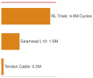
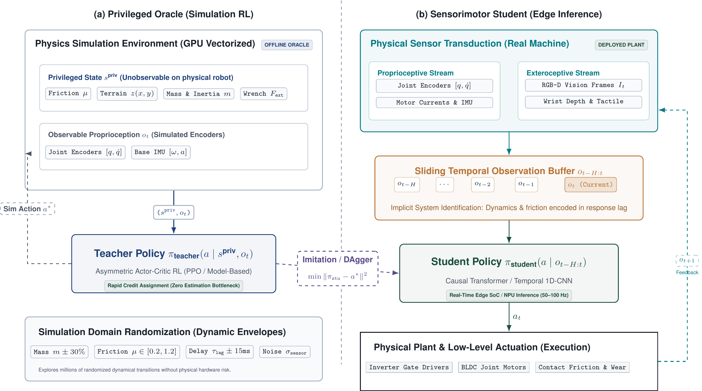

---
format:
  html:
    title: "Policy Training"
---

# Policy Training {#sec-training}

::: {layout-narrow}
::: {.column-margin}

\chapterminitoc

:::

::: {.content-visible when-format="pdf"}
\noindent
{fig-alt="Isometric blueprint of sim-to-real policy training for an agile quadruped robot: a virtual physics digital twin in a simulation grid with randomized friction cones, a central domain randomization prism, and a physical quadruped walking on an instrumented dynamometer treadmill with real-time telemetry."}
:::

::: {.content-visible unless-format="pdf"}
{fig-alt="Isometric blueprint showing sim-to-real policy training for an agile quadruped robot: a virtual physics digital twin in a simulation grid with randomized friction cones, a central domain randomization prism, and a physical quadruped on an instrumented dynamometer treadmill with real-time telemetry."}
:::

:::

## Purpose {.unnumbered .unlisted}

::: {.content-visible when-format="pdf"}
\begin{marginfigure}
\resizebox{0.92\linewidth}{!}{\mlphysicalstackfull{100}{20}{20}{20}{20}}
\end{marginfigure}
:::

_Why does a policy that achieves flawless performance across millions of simulated training episodes frequently fail or cause damage upon physical deployment?_

Physics engines are among the most powerful tools in modern robotics, allowing reinforcement learning and imitation learning algorithms to accumulate centuries of synthetic operational experience in hours on cloud GPUs. Yet every physics simulator is built upon discretized numerical approximations—rigid-body contact solvers, lumped friction coefficients, and idealized actuator models—that inevitably discard the unmodeled complexities of the real world. A policy trained inside an ungrounded simulation exploits these numerical artifacts, developing brittle control strategies that rely on infinite actuator bandwidth, zero-latency feedback, or non-physical contact stiffness. When deployed to a physical robot, this reality gap causes immediate instability, high-frequency chatter that damages gearboxes, or catastrophic collision. Bridging this sim-to-real divide requires treating simulation not as an exact replica of nature, but as a distribution of parameterized hypotheses. By combining structured domain randomization, system identification from real hardware telemetry, and differentiable physical modeling, engineers can force learned policies to develop robust internal representations that generalize across physical parameter variations. This chapter explores the mechanics of distributed physical simulation, the mathematical foundations of domain randomization, and the co-design strategies required to train policies that transfer reliably from virtual clusters to physical hardware without risking the machine.



::: {.callout-learning-objectives}

- Compare training regimes by the dependency each leaves in the weights and the failure it produces on hardware
- Explain why a cloned policy's small errors compound once it leaves the demonstrated states
- Explain how a squared-error loss turns two valid demonstrations into an action neither demonstrator took
- Diagnose a transfer failure by locating it in the dynamics, sensing, appearance, or timing channel of the sim-to-real gap
- Evaluate a real-machine fine-tuning run by the wear it incurs and the prior evidence it invalidates
- Construct a policy manifest whose declared operating domain excludes every state the data does not support or the simulator does not model

:::

## The Dual Vulnerabilities of Policy Synthesis {#sec-training-policy-synthesis}

```{python}
#| label: calc-training-latch-contact-deadline
#| echo: false
#| warning: false
#| message: false

# ┌─────────────────────────────────────────────────────────────────────────────
# │ LATCH CONTACT DEADLINE AT THE GUARDED AND FAST APPROACHES
# ├─────────────────────────────────────────────────────────────────────────────
# │ Context: The chapter opener, the decoder run-time cost, the contact-exploit
# │          section, and the latch policy manifest's declared ODD.
# │ Goal: Show why the latch policy's declared ODD admits only the guarded
# │       approach: at the fast approach the contact deadline barely exceeds
# │       the contact loop's response.
# │ Show: setpoint and chunk periods, both approach speeds, latch limit, contact-loop
# │       response, and the two contact deadlines.
# │ How: F = k*v*t, so t_yield = F_lim / (k*v) (calc_contact_yield_deadline);
# │      every input from RM / AISLE.
# └─────────────────────────────────────────────────────────────────────────────
from mlsysim import *
from mlsysim.physics.robotics import calc_contact_yield_deadline

RM = Embodied.MobileManipulator.WarehouseMobileManipulator
AISLE = Embodied.Scenario.WarehouseAisle

class LatchContactDeadline:
    # ┌── 1. LOAD (Constants) ──────────────────────
    t_step = RM.chunk_step  # category: chosen (chunk-policy setpoint period)
    chunk_rate = RM.chunk_rate  # category: chosen (chunk-policy renewal rate)
    k_plate = AISLE.k_latch  # category: illustrative (strike-plate contact stiffness)
    v_guarded = AISLE.v_latch_approach  # category: illustrative (guarded, demonstrated approach speed)
    v_fast = AISLE.v_latch_high  # category: illustrative (unsupported fast approach speed)
    f_lim = AISLE.f_latch_limit  # category: illustrative (latch force limit)
    t_contact_loop = AISLE.t_contact_response  # category: illustrative (contact-loop response time)

    # ┌── 2. EXECUTE (The Compute) ─────────────────
    t_chunk = (1 / chunk_rate).to(millisecond)  # chunk renewal period, the asynchronous inference deadline
    t_yield_guarded = calc_contact_yield_deadline(f_lim, k_plate, v_guarded).to(millisecond)
    t_yield_fast = calc_contact_yield_deadline(f_lim, k_plate, v_fast).to(millisecond)
    fast_margin_ratio = (t_yield_fast / t_contact_loop).to("dimensionless").magnitude
    t_left_fast = (t_yield_fast - t_contact_loop).to(millisecond)  # time left after the loop responds

    # ┌── 3. GUARD (Invariants) ────────────────────
    check(abs(t_step.to(millisecond).magnitude - 20.0) < 1e-9, f"setpoint period {t_step}")
    check(abs(t_chunk.to(millisecond).magnitude - 50.0) < 1e-9, f"chunk period {t_chunk}")
    check(t_chunk > t_step, "the chunk period must exceed the setpoint period that paces playback")
    check(abs(t_yield_guarded.to(millisecond).magnitude - 8.333) < 0.001, f"guarded deadline {t_yield_guarded}")
    check(abs(v_guarded.to(meter / second).magnitude - 0.03) < 1e-9, f"guarded approach {v_guarded}")
    check(abs(v_fast.to(meter / second).magnitude - 0.10) < 1e-9, f"fast approach {v_fast}")
    check(abs(f_lim.to(newton).magnitude - 100.0) < 1e-9, f"latch limit {f_lim}")
    check(abs(t_left_fast.to(millisecond).magnitude - 0.5) < 1e-9, f"time left at fast approach {t_left_fast}")
    check(abs(t_yield_fast.to(millisecond).magnitude - 2.5) < 1e-9, f"fast deadline {t_yield_fast}")
    check(abs(t_contact_loop.to(millisecond).magnitude - 2.0) < 1e-9, f"contact loop {t_contact_loop}")
    check(1.0 < fast_margin_ratio < 1.5, "fast deadline must sit barely above the contact-loop response")
    check(t_yield_guarded > 4 * t_contact_loop, "guarded deadline must leave several contact-loop responses")

    # ┌── 4. OUTPUT (Formatting) ───────────────────
    t_step_str = fmt_latency(t_step, unit=millisecond, precision=0)
    t_chunk_str = fmt_latency(t_chunk, unit=millisecond, precision=0)
    v_guarded_str = fmt_velocity(v_guarded, precision=2)
    v_fast_str = fmt_velocity(v_fast, precision=2)
    f_lim_str = fmt_force(f_lim, precision=0)
    t_contact_loop_str = fmt_latency(t_contact_loop, unit=millisecond, precision=0)
    t_yield_guarded_str = fmt_latency(t_yield_guarded, unit=millisecond, precision=1)
    t_yield_fast_str = fmt_latency(t_yield_fast, unit=millisecond, precision=1)
    t_left_fast_str = fmt_latency(t_left_fast, unit=millisecond, precision=1)
```

Two learned controllers can succeed at the same task under nominal conditions and still fail on the same machine for different reasons. The cage-door latch task of @sec-data has two such controllers. The first latch policy, `latch-bc-01`, was cloned from the latch campaign's teleoperated door-opening demonstrations. The second, `latch-sim-02`, started from `latch-bc-01` and was refined by reinforcement learning in a physics simulator.

At the nominal strike plate and the guarded approach speed of `{python} LatchContactDeadline.v_guarded_str` (illustrative; see the Reader Guide), both policies open the door. Their failure modes diverge once conditions leave that point. When the door has sagged and its strike plate sits a few millimeters off nominal, the cloned policy's first correction lands in a state its demonstrations never visited, because the demonstration campaign recorded no displaced plate. Each later command, issued at the chosen `{python} LatchContactDeadline.t_step_str` setpoint period, compounds the error until the gripper binds on the edge of the plate. The simulated policy fails on the nominal plate. Its simulator modeled contact as a soft penalty spring, so the optimizer found that approaching at `{python} LatchContactDeadline.v_fast_str` costs nothing. Under constant approach velocity $v$, penetration depth into the strike plate grows linearly as $\Delta x = v t$. Assuming linear contact stiffness ($F = k \Delta x$), the normal contact force rises as $F(t) = k v t$. Setting $F(t) = F_{\text{lim}}$ establishes the contact yield deadline $t_{\text{yield}} = F_{\text{lim}} / (k v)$, the exact temporal budget remaining before structural deformation occurs. On the real plate, contact force rises in proportion to approach speed and time, and at that speed it reaches the latch's `{python} LatchContactDeadline.f_lim_str` limit `{python} LatchContactDeadline.t_yield_fast_str` after touch, barely longer than the contact loop's `{python} LatchContactDeadline.t_contact_loop_str` response (the speed, limit, and response time are illustrative). That leaves too little time to shed the approach speed, so the plunge overloads the latch. The data collection regime defined what the policy saw, while the simulator shaped its assumptions about the physical world.

The two latch failures share one structure. Each training regime left a dependency in the weights. The cloned policy depended on the states its demonstrations happened to cover and the simulated policy on a contact model softer than the plate, and in each case a deployment condition that violated the dependency produced a failure no training score had shown. The practical choice is therefore which experience source teaches the needed recovery without hiding actuator dynamics, and what physical evidence must precede actuator authority. The answer travels with the checkpoint as a record of the states it may enter. Whatever the regime, the checkpoint only proposes chunks to the permission path (@sec-boundary-machine-model), and training that never modeled that path yields a policy whose torque spikes the permission path must refuse, or whose proposals trip its limits continuously.

::: {.column-margin}
{width="100%" fig-alt="S·P·A locator triad with the Plan node highlighted."}

*The Plan axis: synthesizing learned policy representations that propose candidate trajectory chunks across the proposal boundary.*
:::

## Policy Synthesis Regimes {#sec-training-synthesis-regimes}

The latch task could draw on four sources of experience: the teleoperated door openings of @sec-data, a log of imperfect or scripted door runs, a simulator of the cage door, and the arm itself. Each buys a different capability at a different physical price, and @tbl-06-regimes sets them side by side with the failure each is known for and the check that intercepts it.

| Policy Synthesis Regime            | Core Purchased Capability                                                                                          | Data & Compute Budget                                                                                                    | Sample Efficiency & Scale                                                                                            | Hardware Safety & Wear Risk                                                                                                 | Dominant Failure Mode & Interceptor                                                                                                                                                                     |
|:-----------------------------------|:-------------------------------------------------------------------------------------------------------------------|:-------------------------------------------------------------------------------------------------------------------------|:---------------------------------------------------------------------------------------------------------------------|:----------------------------------------------------------------------------------------------------------------------------|:--------------------------------------------------------------------------------------------------------------------------------------------------------------------------------------------------------|
| **Behavioral Cloning (BC)**        | Direct imitation of demonstrated trajectories without reward engineering or system identification                  | $10^2$–$10^3$ teleop trajectories ($\sim 10$–$50\text{ h}$ data); $<50\text{ GPU-h}$ compute                             | Supervised $\mathcal{O}(N)$ over expert demonstrations; fixed $1\times$ real-time data throughput                    | Minimal exploration risk during logging; zero hardware exploration during optimization                                      | Quadratic compounding error ($\mathcal{O}(T^2 \epsilon)$) via covariate shift. *Interceptor*: Kernel/Mahalanobis density monitors, convex hull boundary clamps                                          |
| **Offline / Batch RL**             | Value-guided policy optimization over fixed, heterogeneous sub-optimal logs; stitches multi-trajectory transitions | $10^5$–$10^7$ logged transitions with state-action coverage; $100$–$500\text{ GPU-h}$ compute                            | Offline $\mathcal{O}(N)$ over static datasets; sample-efficient but demands high state-action overlap                | Zero active exploration hazards during offline training; logging requires caged rigs or safe scripted controllers           | Out-of-distribution action extrapolation and Q-value overestimation. *Interceptor*: Conservative Q-learning (CQL) penalty bounds, action support filters                                                |
| **Sim-to-Real RL**                 | Discovery of dynamic, non-prehensile manipulation and agile locomotion via billions of unconstrained rollouts      | Zero physical data; $10^7$–$10^9$ simulated transitions across $10^3$–$10^4$ GPU environments; $500$–$5000\text{ GPU-h}$ | Low algorithmic sample efficiency ($10^7$–$10^9$ steps), offset by $10^3\times$–$10^5\times$ simulation acceleration | Zero hardware wear or collision damage during training; severe deployment risk if plant dynamics diverge                    | Exploitation of numerical solver artifacts (contact interpenetration, zero latency). *Interceptor*: Paired-trace discrepancy budgets, force-derivative ($dF/dt$) clamps                                 |
| **Residual RL & Real Fine-Tuning** | Direct policy correction against physical contact compliance, gearbox hysteresis, and true sensor noise            | $10^3$–$10^5$ physical steps ($0.5$–$10\text{ h}$ wall-clock time); $<20\text{ GPU-h}$ compute                           | High sample efficiency required (SAC/TD3 or residual delta-action formulation); strictly $1\times$ real-time         | High physical exposure; repetitive impact shocks degrade gearboxes; exploratory current dither elevates winding temperature | Catastrophic forgetting of nominal transit stability, local policy collapse. *Interceptor*: Parameter drift bounds ($\Vert\Delta \theta\Vert_2 \le \delta$), frozen regression suites, thermal limiters |

: **Comparative trade-off matrix across policy synthesis regimes**: The four regimes compared are behavioral cloning, offline reinforcement learning, sim-to-real reinforcement learning, and residual RL/fine-tuning. Columns detail the primary operational capability purchased during training, representative sample and compute budgets, sample efficiency bounds, safety risks incurred during data acquisition, and dominant failure signatures with corresponding permission-path interceptors. {#tbl-06-regimes tbl-colwidths="[16,16,18,18,16,16]"}

Of the four, **behavioral cloning**\index{Behavioral cloning} is the cheapest route to a working policy and the one whose failure mode is best understood. It frames policy synthesis as supervised regression or classification over a collected dataset of expert state-action pairs $\mathcal{D} = \{(\mathbf{o}_t, \mathbf{a}_t)\}$. Following the action taps of @sec-data-action-label, a demonstration dataset pairs observations with either the operator's mapped setpoints or the setpoints the permission path admitted:
$$\mathcal{D}_{\text{intent}} = \left\{ \left(\mathbf{o}_t, \mathbf{a}_{\text{cmd}, t:t+H-1}\right) \right\} \quad \text{vs.} \quad \mathcal{D}_{\text{verified}} = \left\{ \left(\mathbf{o}_t, \mathbf{a}_{\text{enf}, t:t+H-1}\right) \right\}$$
Cloning the mapped setpoints ($\mathbf{a}_{\text{cmd}}$), the operator's intent in the robot's own coordinates before the permission path acts, trains the model on demonstration intent, whereas cloning the setpoints the permission path admitted ($\mathbf{a}_{\text{enf}}$) bakes its barrier deceleration profiles directly into the network weights, so the policy inherits decelerations tuned to that particular path's limits. This distinction creates a fundamental engineering trade-off. Cloning $\mathbf{a}_{\text{enf}}$ couples neural weights to external safety runtime tuning and the deceleration profiles of one specific safety filter, making the policy brittle if safety thresholds change. Conversely, cloning $\mathbf{a}_{\text{cmd}}$ preserves clean operational intent across tasks, but requires the permission path to intervene actively whenever proposals exceed physical limits, potentially triggering high-frequency control chatter against constraint boundaries. In its standard formulation, the optimization objective minimizes a multi-step prediction loss over continuous action sequences drawn from demonstration trajectories (see @sec-appendix-ml-multimodal for classical regression formulations).[^fn-hist-alvinn-cloning]
Because this loss penalizes only the discrepancy between the commanded action and the recorded demonstration at observed states, the training objective does not evaluate task completion, terminal cost, or the stability of the closed-loop dynamical system. It fits actions to observations only.

::: {.column-margin .margin-pointer}
↩ The four-stream action tap tuple separating intent from enforcement is formulated in @sec-data-action-label.
:::

[^fn-hist-alvinn-cloning]: **ALVINN road perspective warping**\index{ALVINN}: Pomerleau's Autonomous Land Vehicle in a Neural Network (ALVINN) [@pomerleau1989alvinn], told in @sec-data-collection-sources, drifted toward the lane edge because its human drivers never demonstrated a recovery from it. To supply recovery examples without unsafe driving, Pomerleau used synthetic perspective warping, rendering laterally shifted and rotated road images paired with transformed steering corrections, an early case of augmenting demonstrations with recovery data off the nominal trajectory.

### The multimodality breakdown and mode averaging {#sec-training-multimodality-breakdown}

When human demonstrators perform a physical task, their strategy is frequently multimodal. Consider an obstacle avoidance scenario where a mobile base or robotic arm must navigate around a central pillar. A human demonstrator may choose to pass around the pillar to the left in half of the demonstrations, or to the right in the remaining half. The true demonstration data contains distinct valid choices, but zero examples of driving straight down the middle.

A deterministic point-regression behavioral-cloning policy cannot represent both choices for the same observation. Under squared-error loss ($L_2$), its optimal output is the conditional mean (for the derivation, see @sec-appendix-ml-multimodal),[^fn-math-mode-averaging] here the midpoint between the "steer left" and "steer right" commands. Replacing $L_2$ loss with mean absolute error ($L_1$) merely shifts the mathematical optimum from the conditional mean to the conditional median, which fails identically in symmetric multimodal distributions and induces violent bang-bang chattering across mode boundaries. In either case, the policy commands an unviable intermediate action—such as zero lateral velocity directly into the obstacle—that never occurred in the demonstration dataset.

[^fn-math-mode-averaging]: **Mode averaging under L2 loss**\index{Mode averaging!mathematical derivation}: Under an $L_2$ regression loss, the expected risk $\mathcal{R}(\hat{a}) = \int \|\hat{a} - a\|_2^2 p(a \mid o) da$ is strictly convex with respect to $\hat{a}$. Differentiating with respect to $\hat{a}$ and setting the gradient to zero yields $2 \int (\hat{a} - a) p(a \mid o) da = 0 \implies \hat{a}^* = \int a p(a \mid o) da = \mathbb{E}[a \mid o]$. For a nonlinear plant $f_{\text{plant}}$, $\mathbb{E}[f_{\text{plant}}(a)]$ generally differs from $f_{\text{plant}}(\mathbb{E}[a])$; equality can hold in particular distributions. For a convex action cost $c(a)$, Jensen's inequality gives $c(\mathbb{E}[a]) \le \mathbb{E}[c(a)]$, but it does not establish the physical safety of the mean action. In the obstacle example, the mean lies outside the demonstrated set of valid paths.

A mode boundary also produces a timing failure, temporal inconsistency in a high-frequency single-step controller. In an illustrative $50\text{--}100\text{ Hz}$ controller, sensor noise moves consecutive observations across that boundary, and a policy mapping only $o_t \to a_t$ alternates between $+10\text{ N}\cdot\text{m}$ and $-10\text{ N}\cdot\text{m}$ requests. Whether the alternation excites resonance, wear, or winding heat depends on the drive and the load, so it is a failure mode to test for rather than a property of every single-step policy.

Mode averaging is a failure at a single observation. Behavioral cloning has a second failure that appears only when the policy runs in closed loop. Its own errors move the machine off the states its demonstrations cover, where the loss supplied no training signal, which is how `latch-bc-01` binds on the sagged door. Under principle \ref{pri-vol4-endogenous-drift}, the policy's own actions choose which states it visits next, so a fixed archive cannot anticipate them, and for expert-only cloning the worst-case cost grows with the square of the horizon (@eq-data-quadratic-drift, developed in @sec-data-endogenous-experience). A low validation loss on held-out demonstrations therefore measures accuracy only on states the demonstrator visited; it says nothing about how the policy returns once displaced. Corrective aggregation labels the learner's own states and, under its expert-labeling assumptions, reduces that growth to linear (@sec-data-intervention-recovery), but on a physical machine those states are reached by running an unverified policy, which can strike a fixture or damage a transmission before a supervisor intervenes.

### Temporal horizon expansion and residual coupling in action chunking {#sec-training-action-chunking}

Action chunking (\ref{dfn-brain-action-chunking}) addresses both high-frequency chattering and mode switching by predicting an entire sequence of future control actions simultaneously. Rather than regressing a single action $\mathbf{a}_t$ from current observation $\mathbf{o}_t$, a chunking policy predicts a continuous trajectory chunk $\mathbf{A}_t \in \mathbb{R}^{H \times d_a}$ across a prediction horizon of $H$ future timesteps. In supervised behavioral cloning, the policy minimizes a multi-step trajectory loss over demonstrated trajectories:
$$\mathcal{L}_{\text{chunk}}(\boldsymbol{\theta}) = \mathbb{E}_{(\mathbf{o}_t, \mathbf{A}_t^*) \sim \mathcal{D}} \left[ \sum_{i=0}^{H-1} \left\| \pi_{\boldsymbol{\theta}}(\mathbf{o}_t)_i - \mathbf{a}^*_{t+i} \right\|_1 \right],$$
where $\mathbf{A}_t^* = [\mathbf{a}_t^*, \dots, \mathbf{a}_{t+H-1}^*]^\top$ represents the recorded demonstration chunk and $\pi_{\boldsymbol{\theta}}(\mathbf{o}_t)_i$ is the $i$-th predicted future setpoint. (In latent architectures like Action Chunking with Transformers (ACT) [@zhao2023learning], this objective is augmented with a conditional variational autoencoder (CVAE) loss $\beta D_{\text{KL}}(q(\mathbf{z} \mid \mathbf{A}_t^*, \mathbf{o}_t) \parallel p(\mathbf{z}))$ to capture multimodal user intent across demonstrations.) Using an $\ell_1$ norm or Huber penalty bounds the influence of teleoperator jitter and measurement noise, producing smooth, kinematically realizable spline proposals.

Predicting $H$ future actions at once improves physical execution through three distinct mechanisms:

1. **Temporal and Dynamic Consistency**: Rather than generating disjoint single-step predictions that chatter across consecutive control ticks, the model predicts an entire coordinated trajectory spline.
2. **Maintaining a Chosen Mode**: Single-step Markov policies are prone to causal confusion, mistaking momentary spurious correlations for task intent. Conditioning on trajectory history and proposing a chunk helps preserve a chosen mode across adjacent actions.
3. **Receding-Horizon Replanning and Temporal Ensembling**: The deployed policy queries a fresh chunk every few steps and blends overlapping predictions (@sec-brain-cognitive-pipeline), which permits periodic feedback while retaining a multi-step proposal.

Crucially, temporal ensembling carries an acute physical failure mode at decision bifurcation points. If the policy queries a fresh trajectory chunk near an obstacle, stochastic generative sampling may select mode A (swerve left) at step $t$ and mode B (swerve right) at step $t+1$. Exponentially smoothing these overlapping chunks across the receding horizon blends the opposing vectors along the execution seam, resurrecting the exact mode-averaging failure that action chunking was chosen to eliminate.

None of these mechanisms changes the fundamental behavioral-cloning support bound $\mathcal{O}(T^2 \epsilon)$. Action chunking contracts the effective compounding horizon ($T_{\text{eff}} = T/K$) by executing coherent multi-step trajectories open-loop, thereby bypassing high-frequency feedback error accumulation within each chunk. Yet it does not expand the underlying state support manifold by a single millimeter. If an unmodeled external disturbance, dropped payload, or kinematic perturbation shoves the robot off its demonstrated manifold, an open-loop chunking policy executes its precomputed spline into empty space or rigid fixtures with zero corrective awareness. The fundamental $\mathcal{O}(T^2 \epsilon)$ covariate shift bound remains unyielding once the robot leaves the demonstration support. As demonstrated theoretically and empirically in @fig-06-compounding-error, single-step behavior cloning experiences a steep drop in task survival as rollout horizon $T$ grows, falling into the catastrophic intervention envelope ($<18\text{ percent}$ survival) within 250 control steps at $50\text{ Hz}$. While temporal architectures like BC-RNN delay the onset of divergence, their quadratic error compounding remains asymptotically identical. In contrast, on-policy interactive aggregation (DAgger [@ross2011reduction]) bounds error growth linearly to $\mathcal{O}(T \epsilon)$ by collecting expert feedback on learner-visited states. Without interactive supervisors, modern generative policies counteract compounding drift through action chunking ($K=16$), which contracts the effective execution horizon to $T_{\text{eff}} = T/K$ (ACT [@zhao2023learning]), and continuous receding-horizon diffusion replanning [@chi2024diffusionpolicy], maintaining over $80\text{ percent}$ task survival across extended 500-step manipulation horizons.

::: {#fig-06-compounding-error fig-env="figure" fig-pos="htb" fig-cap="**Compounding covariate shift across imitation learning paradigms**: Task survival and in-envelope rate vs. closed-loop rollout horizon $T$ at $50\text{ Hz}$ ($10\text{ seconds} = 500\text{ steps}$). Single-step behavioral cloning suffers from quadratic error compounding $\\mathcal{O}(T^2 \\epsilon)$ [@ross2011reduction], dropping into the catastrophic failure envelope within 250 steps. DAgger bounds error accumulation linearly $\\mathcal{O}(T \\epsilon)$ via interactive on-policy relabeling. Modern action chunking (ACT [@zhao2023learning]) contracts the effective compounding horizon by $K=16$, while receding-horizon Diffusion Policy [@chi2024diffusionpolicy] achieves over 80 percent survival across 500 execution steps." fig-alt="Plot comparing task survival rate in percent against rollout horizon T from 0 to 500 control steps at 50 Hz. A red curve for pure single-step behavioral cloning displays a steep quadratic cliff falling below 18 percent survival by step 250 and reaching near zero by step 450. An orange dashed curve for BC-RNN delays the cliff but follows the same quadratic decay. An amber dash-dotted curve for DAgger displays linear compounding, reaching approximately 40 percent survival at step 500. A purple dotted curve for Action Chunking (ACT, K=16) and a green solid curve for Diffusion Policy maintain over 70 percent and 80 percent survival respectively at step 500. Annotated empirical benchmark points from Robomimic Can, Push-T, and Peg Insertion validate the trajectory curves."}

```{python}
#| label: fig-06-compounding-error
#| echo: false
#| message: false
#| warning: false
import numpy as np
import matplotlib.pyplot as plt
import matplotlib.ticker as ticker

fig, ax = plt.subplots(figsize=(13.0, 7.6), dpi=150, facecolor="#FFFFFF")
ax.set_facecolor("#FFFFFF")
ax.spines["top"].set_visible(False)
ax.spines["right"].set_visible(False)
ax.grid(True, linestyle="--", linewidth=0.6, alpha=0.5, color="#E2E8F0")
ax.set_axisbelow(True)

ax.set_xlim(-5, 515)
ax.set_ylim(0, 108)

# Horizon steps T (0 to 500 steps at 50 Hz = 0 to 10 seconds)
T = np.linspace(0, 500, 500)

surv_bc = 100.0 * np.exp(-2.2e-5 * (T**2))
surv_bcrnn = 100.0 * np.exp(-1.1e-5 * (T**2))
surv_dagger = 100.0 * np.exp(-1.75e-3 * T)
surv_act = 100.0 * (0.45 * np.exp(-1.2e-4 * (T / 16) ** 2) + 0.55 * np.exp(-1.2e-3 * T))
surv_diff = 100.0 * np.exp(-0.00050 * T)

# Shaded Danger Zone
ax.axhspan(0, 18, color="#FEE2E2", alpha=0.50, zorder=0)
ax.text(
    12,
    9,
    "CATASTROPHIC INTERVENTION ENVELOPE (Task Survival < 18%)\nCovariate shift causes unrecoverable drift outside demonstration manifold",
    fontsize=8.0,
    fontweight="bold",
    color="#A51C30",
    ha="left",
    va="center",
    zorder=2,
)

ax.plot(
    T,
    surv_bc,
    color="#DC2626",
    linestyle="-",
    linewidth=2.4,
    zorder=3,
    label=r"Pure BC (Single-Step): $\mathcal{O}(T^2 \epsilon)$ Quadratic Compounding Cliff",
)
ax.plot(
    T,
    surv_bcrnn,
    color="#EA580C",
    linestyle="--",
    linewidth=1.8,
    zorder=3,
    label=r"BC-RNN: Delayed Cliff, Same $\mathcal{O}(T^2 \epsilon)$ Quadratic Bound",
)
ax.plot(
    T,
    surv_dagger,
    color="#D97706",
    linestyle="-.",
    linewidth=2.2,
    zorder=3,
    label=r"DAgger: Linear Compounding $\mathcal{O}(T \epsilon)$ (Interactive Expert)",
)
ax.plot(
    T,
    surv_act,
    color="#7C3AED",
    linestyle=":",
    linewidth=2.4,
    zorder=3,
    label=r"Action Chunking (ACT, $K=16$): Horizon Contraction $T_{\mathrm{eff}} = T/K$",
)
ax.plot(
    T, surv_diff, color="#1E793C", linestyle="-", linewidth=3.0, zorder=4, label=r"Diffusion Policy ($K=16$, Receding): Multimodal & Smooth Chunking"
)

emp_points = [
    {"x": 200, "y": 26, "color": "#DC2626"},
    {"x": 200, "y": 78, "color": "#7C3AED"},
    {"x": 200, "y": 92, "color": "#1E793C"},
    {"x": 300, "y": 18, "color": "#EA580C"},
    {"x": 300, "y": 55, "color": "#D97706"},
    {"x": 300, "y": 88, "color": "#1E793C"},
    {"x": 400, "y": 4, "color": "#DC2626"},
    {"x": 400, "y": 80, "color": "#7C3AED"},
    {"x": 400, "y": 86, "color": "#1E793C"},
]
for pt in emp_points:
    ax.scatter(pt["x"], pt["y"], s=85, color=pt["color"], edgecolors="#FFFFFF", linewidth=1.5, zorder=6)

def add_badge(ax, text, xy, xytext, color="#1E293B", fontsize=8.0, arrow=True):
    bbox = dict(boxstyle="round,pad=0.35", facecolor="#FFFFFF", edgecolor="#CBD5E1", alpha=0.95, linewidth=0.8)
    ap = dict(arrowstyle="->", color="#94A3B8", linewidth=0.8, shrinkA=3, shrinkB=3) if arrow else None
    ax.annotate(text, xy=xy, xytext=xytext, fontsize=fontsize, color=color, bbox=bbox, arrowprops=ap, va="center", zorder=10)

add_badge(
    ax,
    r"Ross-Bagnell $\mathcal{O}(T^2 \epsilon)$ Cliff"
    + "\n"
    + "Single error shifts robot into unseen states;\nsubsequent errors compound quadratically",
    (165, 54),
    (20, 52),
    color="#A51C30",
)
add_badge(
    ax,
    r"DAgger On-Policy Recovery $\mathcal{O}(T \epsilon)$" + "\n" + "Querying expert on policy-induced rollout states\nprevents compounding drift",
    (300, 55),
    (340, 38),
    color="#D97706",
)
add_badge(
    ax,
    "Action Chunking Horizon Contraction\n" + r"$T_{\mathrm{eff}} = T / K$; open-loop chunk execution" + "\n" + "bypasses high-frequency compounding",
    (200, 78),
    (135, 88),
    color="#6D28D9",
)
add_badge(
    ax,
    "Diffusion Policy (Receding Horizon)\nMultimodal distribution captures multiple valid paths;\nrolling execution eliminates chunk-seam jerk",
    (300, 88),
    (270, 100),
    color="#1E793C",
)

ax.set_xlabel(r"Rollout Horizon $T$ (Control Steps / Timesteps at 50 Hz)", fontsize=11, fontweight="bold", labelpad=8)
ax.set_ylabel("Task Survival / In-Envelope Rate (%)", fontsize=11, fontweight="bold", labelpad=8)
ax.set_xticks(np.arange(0, 501, 50))
ax.get_xaxis().set_major_formatter(ticker.FuncFormatter(lambda x, loc: f"T={int(x)}"))
ax.set_yticks(np.arange(0, 101, 10))
ax.get_yaxis().set_major_formatter(ticker.FuncFormatter(lambda y, loc: f"{int(y)}%"))

legend = ax.legend(
    loc="lower left", bbox_to_anchor=(0.02, 0.22), frameon=True, facecolor="#FFFFFF", edgecolor="#CBD5E1", fontsize=7.8, framealpha=0.95
)
legend.get_frame().set_linewidth(0.8)

plt.tight_layout()
plt.subplots_adjust(top=0.95, bottom=0.10, left=0.08, right=0.96)
plt.show()
plt.close()
```
:::

Increasing dataset size, model capacity, or tuning can reduce the one-step error rate on evaluated observations and therefore lower the chance of a first policy error during a fixed horizon. That improvement does not characterize what happens after an error. An external disturbance, uncalibrated payload, or voltage sag can also move the machine into weakly supported states without a policy disagreement. Recovery data, measured dynamics, and independent runtime limits determine whether either event remains within the physical envelope.

Drift off the demonstrated states raises no alarm of its own, so detecting it before physical contact cannot rely on the offline training loss. It requires runtime telemetry that tracks state space support directly, measuring Mahalanobis distance in feature space, estimating model epistemic uncertainty, or enforcing an explicit envelope monitor on the permission path that trips when state trajectories leave the convex hull of the demonstration dataset.

### Runtime computational overhead of policy decoder architectures {#sec-training-decoder-costs}

A point-regression decoder averages distinct valid actions into an invalid command (@fig-06-diffusion-denoising a). If human demonstrators avoid an obstacle by swerving either left ($+0.5\,\text{m}$) or right ($-0.5\,\text{m}$), minimizing mean squared error (MSE) causes a deterministic policy to predict the mathematical mean ($0.0\,\text{m}$), driving the robot directly into the obstacle. Modern generative policy decoders resolve this multimodal dilemma by framing action synthesis as iterative sampling over trajectory chunks (@fig-06-diffusion-denoising b, c):

::: {#fig-06-diffusion-denoising fig-env="figure" fig-pos="htb" fig-cap="**Generative policy architectures and action chunk denoising**: (a) Multimodal resolution: direct mean-squared-error regression averages bimodal trajectories (left and right obstacle bypass) into a fatal mean collision vector, whereas diffusion resolves multimodality by selecting a single coherent mode. (b) Iterative trajectory denoising: starting from Gaussian noise at Step $K$, reverse diffusion score-matching refines candidate trajectories through coarse structure (Step $K/2$) into a smooth, dynamically feasible action chunk $\mathbf{A}^0$ (Step 0). (c) Dual-rate systems decoupling: unprivileged generative sampling on the host application processor ($15\text{--}50\text{ Hz}$) writes complete action chunks into a ring buffer, from which a deterministic bare-metal microcontroller interpolates smooth setpoints at $1\text{ kHz}$ to drive physical actuators without starvation." fig-alt="Three-panel diagram showing generative diffusion policy mechanics. Panel (a) illustrates multimodal resolution, contrasting direct regression mean collision with diffusion mode selection. Panel (b) illustrates iterative denoising from pure noise at Step K down to a smooth action chunk at Step 0. Panel (c) illustrates dual-rate decoupling from host MPU at 15 Hz through a shared ring buffer down to a 1 kHz MCU driving physical actuators."}
{width="100%"}
:::

- **Conditional Diffusion Policies:** Rather than predicting single point setpoints, a diffusion policy [@chi2024diffusionpolicy] generates an entire multi-joint action trajectory chunk $\mathbf{A}^0 \in \mathbb{R}^{H_p \times d_a}$ across a prediction horizon $H_p$ and $d_a$ actuator dimensions. In continuous time, forward diffusion corrupts ground-truth trajectories $\mathbf{A}^0$ into Gaussian noise via an Itô Stochastic Differential Equation (SDE):
  $$d\mathbf{A}_\tau = \mathbf{f}(\mathbf{A}_\tau, \tau)\,d\tau + g(\tau)\,d\mathbf{w}_\tau,$$
  where $\tau \in [0, 1]$ represents continuous diffusion time, $\mathbf{w}_\tau$ is standard Brownian motion, $\mathbf{f}(\cdot, \tau)$ is the drift coefficient, and $g(\tau)$ controls the noise diffusion rate. Generative trajectory synthesis reverses this entropy accumulation via the reverse-time SDE:
  $$d\mathbf{A}_\tau = \left[ \mathbf{f}(\mathbf{A}_\tau, \tau) - g(\tau)^2 \nabla_{\mathbf{A}_\tau} \ln p_\tau(\mathbf{A}_\tau \mid \mathbf{O}_t) \right] d\tau + g(\tau)\,d\bar{\mathbf{w}}_\tau,$$
  where $d\bar{\mathbf{w}}_\tau$ is backward Brownian motion, $\mathbf{O}_t$ is the perceptual observation history, and $\nabla_{\mathbf{A}_\tau} \ln p_\tau(\mathbf{A}_\tau \mid \mathbf{O}_t)$ is the Stein score function. In control, this score acts as a learned vector field pulling candidate trajectory splines toward high-density demonstration modes (e.g., bypassing an obstacle to the left vs. right). In discrete implementation, the forward marginal variance schedule $\bar{\alpha}_k = \prod_{s=1}^k (1 - \beta_s)$ across $k \in \{1, \dots, K\}$ steps enables closed-form sample corruption $\mathbf{A}^k = \sqrt{\bar{\alpha}_k} \mathbf{A}^0 + \sqrt{1 - \bar{\alpha}_k} \boldsymbol{\epsilon}$ with $\boldsymbol{\epsilon} \sim \mathcal{N}(\mathbf{0}, \mathbf{I})$. Applying Tweedie's formula reveals that the score is directly proportional to the negative predicted noise: $\nabla_{\mathbf{A}^k} \ln p(\mathbf{A}^k \mid \mathbf{O}_t) \approx -\boldsymbol{\epsilon}_\theta(\mathbf{A}^k, k, \mathbf{O}_t) / \sqrt{1 - \bar{\alpha}_k}$. The policy trains a noise-prediction network $\boldsymbol{\epsilon}_\theta$ to minimize the denoising score-matching objective:
  $$\mathcal{L}_{\text{diff}}(\theta) = \mathbb{E}_{k, \mathbf{A}^0, \boldsymbol{\epsilon}} \left[ \left\| \boldsymbol{\epsilon} - \boldsymbol{\epsilon}_\theta(\sqrt{\bar{\alpha}_k} \mathbf{A}^0 + \sqrt{1 - \bar{\alpha}_k} \boldsymbol{\epsilon}, k, \mathbf{O}_t) \right\|^2 \right].$$
  When determinism is required, setting the Brownian diffusion coefficient to zero converts the reverse SDE into the deterministic **probability flow ODE**:
  $$d\mathbf{A}_\tau = \left[ \mathbf{f}(\mathbf{A}_\tau, \tau) - \frac{1}{2} g(\tau)^2 \nabla_{\mathbf{A}_\tau} \ln p_\tau(\mathbf{A}_\tau \mid \mathbf{O}_t) \right] d\tau,$$
  which traces identical marginal densities without stochastic sampling variance. At inference time, Denoising Diffusion Probabilistic Models (DDPM) integrate the reverse SDE over $K=20\text{--}50$ steps, while Denoising Diffusion Implicit Models (DDIM) integrate the probability flow ODE over $K=10\text{--}16$ steps to produce a collision-free action chunk.
- **Flow Matching Policies:** While standard diffusion models follow curved SDE or probability flow ODE paths requiring many integration steps, Flow Matching [@lipman2022flow; @black2024pi0] parameterizes probability flows along straight lines in trajectory space:
  $$\mathbf{A}_\tau = (1 - \tau) \mathbf{A}_0 + \tau \mathbf{A}_1, \quad \tau \in [0, 1],$$
  where $\mathbf{A}_0 \sim \mathcal{N}(\mathbf{0}, \mathbf{I})$ is prior noise and $\mathbf{A}_1 \sim p_{\text{data}}(\mathbf{A} \mid \mathbf{O}_t)$ is the target trajectory chunk. A vector field action head $\mathbf{v}_{\boldsymbol{\theta}}(\mathbf{A}_\tau, \tau, \mathbf{O}_t)$ learns the constant target velocity field $\mathbf{u}_\tau = \mathbf{A}_1 - \mathbf{A}_0$ by minimizing the conditional flow-matching objective:
  $$\mathcal{L}_{\text{FM}}(\boldsymbol{\theta}) = \mathbb{E}_{\tau \sim \mathcal{U}(0, 1),\, \mathbf{A}_0 \sim \mathcal{N}(\mathbf{0}, \mathbf{I}),\, \mathbf{A}_1 \sim \mathcal{D}} \left[ \left\| \mathbf{v}_{\boldsymbol{\theta}}\left((1 - \tau)\mathbf{A}_0 + \tau \mathbf{A}_1, \tau, \mathbf{O}_t\right) - (\mathbf{A}_1 - \mathbf{A}_0) \right\|^2 \right].$$
  Because the marginal probability paths between Gaussian noise and demonstration chunks are linear ($d\mathbf{A}/d\tau = \mathbf{A}_1 - \mathbf{A}_0$), numerical integration via standard Ordinary Differential Equation (ODE) solvers (such as forward Euler) requires as few as 4 to 8 steps without accumulating discretization drift, drastically cutting compute latency on embedded edge processors.
- **Vision-Language-Action Models (VLAs):** Discrete autoregressive policies (such as RT-2 and OpenVLA [@kim2024openvla]) discretize continuous action dimensions into uniform bins (typically $B = 256$ bins covering $[-1, 1]$ per actuator dimension). Each bin corresponds to an integer token in the underlying large language model vocabulary. The model factorizes multi-axis robot control into an autoregressive text-like sequence:
  $$P(\mathbf{a}_t \mid \mathbf{o}_t, \mathbf{l}) = \prod_{d=1}^{d_a} P(a_{t, d} \mid a_{t, <d}, \mathbf{o}_t, \mathbf{l}),$$
  generating action tokens conditioned on visual patch tokens $\mathbf{o}_t$ and natural language task instructions $\mathbf{l}$. Because each actuator degree of freedom requires an autoregressive forward pass through a multi-billion-parameter transformer, end-to-end token generation latency scales linearly with actuator dimensionality ($d_a$), capping control frequencies to $1\text{--}5\,\text{Hz}$ and demanding asynchronous execution buffering.

::: {.column-margin}
{width="100%" fig-alt="Budget envelope contrasting Flow Matching vs. DDIM denoising times against control deadlines."}

*Few-step Flow Matching fits inside the 20 ms synchronous setpoint deadline; multi-step DDIM overruns it, demanding asynchronous chunk buffering.*
:::

As demonstrated in the margin budget envelope, the mathematical structure of the policy decoder dictates its physical execution latency on edge compute hardware. The total wall-clock duration of a single policy inference cycle $t_{\text{infer}}$ is the sum of perceptual feature extraction and iterative generative trajectory sampling:
$$t_{\text{infer}} = t_{\text{enc}}(\mathbf{O}_t) + \sum_{k=1}^K t_{\text{step}}\left(\mathbf{A}^k, k\right) \le t_{\text{deadline}},$$
where $t_{\text{enc}}$ is the visual backbone and proprioceptive encoding latency, $K$ is the number of denoising or ODE solver integration steps, $t_{\text{step}}$ is the per-step neural forward pass latency of the action head, and $t_{\text{deadline}}$ is the real-time execution deadline.

In **synchronous control**, where each chunk must be generated before the next actuator setpoint tick executes, the deadline equals the setpoint period: $t_{\text{deadline}} = t_{\text{step}}$ (e.g., $t_{\text{step}} = 20\,\text{ms}$ for a $50\,\text{Hz}$ control loop). Consider an edge GPU where the visual encoder takes $t_{\text{enc}} = 8\,\text{ms}$ and each action head evaluation takes $t_{\text{step}} = 2.5\,\text{ms}$. An iterative DDIM diffusion sampler requiring $K=16$ steps consumes $t_{\text{infer}} = 8 + 16 \times 2.5 = 48\,\text{ms}$, overrunning the $20\,\text{ms}$ synchronous deadline by $28\,\text{ms}$. On physical hardware, missing this synchronous tick starves the actuator bus, forcing motor drives into emergency torque hold, zero-current coasting, or abrupt safety trips. In contrast, a 4-step Flow Matching policy requires $t_{\text{infer}} = 8 + 4 \times 2.5 = 18\,\text{ms} < 20\,\text{ms}$, completing cleanly within the synchronous execution budget to achieve direct setpoint dispatch without intermediate buffering.

When a generative decoder requires many integration steps ($K \ge 16$) to resolve intricate contact distributions, it cannot meet the setpoint period synchronously. The system must transition to an **asynchronous receding-horizon architecture**, where the inference deadline is decoupled from setpoint pacing: $t_{\text{deadline}} = t_{\text{chunk}}$ (e.g., $t_{\text{chunk}} = 50\text{--}200\,\text{ms}$). The host application processor runs generative sampling in the background, renewing and buffering validated trajectory splines into shared memory. The hard real-time safety microcontroller reads setpoints from the latest validated chunk at $1\,\text{kHz}$, enforcing kinematic bounds and checking chunk freshness leases so that physical motor control never stalls waiting for neural inference. This dual-rate architecture requires an explicit **chunk lease expiration contract**. If host inference stalls due to memory contention, GPU thermal throttling, or a tail latency spike, the microcontroller detects lease expiration before the interpolation buffer is exhausted. Rather than holding stale acceleration or abruptly dropping torques, the microcontroller initiates an immediate, deterministic fallback: it smoothly decelerates the joints along the terminal spline derivative ($\dot{\mathbf{q}}_{\text{terminal}}$) to a complete standstill, locking mechanical brakes if setpoints fail to renew within a hard real-time deadline (e.g., $50\,\text{ms}$). The formal dual-rate pipeline—coupling asynchronous generative prediction on the host with deterministic spline interpolation, rate-limiting, and safety clamping on the microcontroller (@fig-06-diffusion-denoising c)—is developed in @algo-diffusion-policy-trajectory (@sec-appendix-ml-diffusion).

::: {.column-margin .margin-pointer}
↪ Hardware placement of multi-rate action chunk buffers across the application processor and the safety microcontroller is engineered in @sec-placement-two-paths-one-die.
:::

### Offline reinforcement learning and action distributional shift {#sec-training-offline-rl}

When physical demonstration datasets $\mathcal{D} = \{(s_t, a_t, r_t, s_{t+1})\}$ contain heterogeneous or sub-optimal trajectories (e.g., mixtures of teleoperation, scripted routines, and exploratory human play), behavioral cloning struggles because it treats all demonstrations with equal supervised weight. In classical reinforcement learning formulated on Markov decision processes (MDPs) [@sutton2018reinforcement], an agent optimizes a policy to maximize expected discounted cumulative returns $J = \mathbb{E}\left[\sum_{t=0}^\infty \gamma^t r(s_t, a_t)\right]$. **Offline reinforcement learning (Batch RL)**\index{Offline reinforcement learning} aims to optimize a policy directly from logged transition archives without active hardware exploration, using reward signals to stitch together high-performing composite trajectories from disjoint, imperfect demonstrations [@kumar2020conservative].

However, applying standard Q-learning to static offline datasets triggers a failure mode known as **out-of-distribution (OOD) action overestimation**\index{Out-of-distribution action overestimation}. In standard reinforcement learning, the algorithm estimates the value of future states by asking its value network to predict the highest possible return it could achieve from the next step (for formal Bellman equations, see @sec-appendix-ml-affordances). That maximum is taken over the entire continuous action space. For actions that were never executed in the logging dataset, the network has received zero training signal and often outputs erroneously large value estimates due to generalization variance, predicting a high return for an untried physical maneuver. The algorithm greedily selects these spurious peaks, propagating over-optimistic value errors backwards. When deployed, the policy selects these ungrounded actions, and it can command motions that stall a joint or strike a boundary.

This failure mode highlights the fundamental distinction between behavioral cloning and offline reinforcement learning. In behavioral cloning, control errors stem from *passive regression mistakes* when the machine drifts off the demonstrated trajectory support. In offline Q-learning, by contrast, policy extraction involves an explicit continuous maximization: $\pi(s) = \arg\max_a Q(s, a)$. The optimizer performs an *active adversarial search* across the continuous action space, aggressively discovering points where function approximation variance has created artificial positive spikes. Because neural value estimators exhibit high variance in unvisited action regions, this maximization exploits the ungrounded peaks. On physical hardware, offline RL policies are notoriously prone to commanding extreme, out-of-distribution actuator saturations—such as driving an arm into a kinematic singularity under the hallucinated belief that an unvisited state guarantees infinite reward.

To reduce value overestimation without querying the physical environment, **Conservative Q-learning (CQL)**\index{Conservative Q-Learning} adds a conservative penalty term to the standard Bellman temporal-difference objective [@kumar2020conservative]:
$$\min_Q \alpha \cdot \mathbb{E}_{\mathbf{s} \sim \mathcal{D}} \left[ \ln \int_{\mathcal{A}} \exp(Q(\mathbf{s}, \mathbf{a}))\,d\mathbf{a} - \mathbb{E}_{\mathbf{a} \sim \mathcal{D}}\left[ Q(\mathbf{s}, \mathbf{a}) \right] \right] + \frac{1}{2} \mathbb{E}_{(\mathbf{s}, \mathbf{a}, r, \mathbf{s}') \sim \mathcal{D}} \left[ \left( Q(\mathbf{s}, \mathbf{a}) - \mathcal{B}^* \hat{Q}(\mathbf{s}, \mathbf{a}) \right)^2 \right],$$
where $\mathcal{B}^* \hat{Q}(\mathbf{s}, \mathbf{a}) = r(\mathbf{s}, \mathbf{a}) + \gamma \max_{\mathbf{a}'} \hat{Q}(\mathbf{s}', \mathbf{a}')$ is the empirical Bellman target operator and $\alpha > 0$ balances value conservatism against Bellman error minimization.[^fn-math-cql-bound]

The physical role of this objective is to constrain policy extraction to demonstrated capabilities:

1. The logarithmic integral term $\ln \int_{\mathcal{A}} \exp(Q(\mathbf{s}, \mathbf{a}))\,d\mathbf{a}$ acts as a soft-maximum that actively pushes *down* on Q-values across the entire action space, aggressively depressing values in unvisited action regions where function approximation variance would otherwise create spurious positive spikes.
2. The dataset expectation $\mathbb{E}_{\mathbf{a} \sim \mathcal{D}}[Q(\mathbf{s}, \mathbf{a})]$ pushes *up* on Q-values exclusively for state-action pairs executed during the logging campaign.
3. When $\alpha = 0$, standard Q-learning resumes unconstrained continuous maximization $\arg\max_{\mathbf{a}} Q(\mathbf{s}, \mathbf{a})$, which on physical hardware commands violent actuator saturations—such as driving an arm into mechanical stops under the hallucinated belief that an unvisited state yields infinite reward. With $\alpha > 0$, the extracted policy remains anchored within the physical support manifold of the logging campaign.

[^fn-math-cql-bound]: **Scope of the CQL bound**\index{Conservative Q-Learning}: Under its data-coverage, optimization, and function-approximation assumptions, CQL constructs a conservative estimate whose *expected value for a policy* lower-bounds that policy's true value [@kumar2020conservative]. This is not a pointwise bound for every state-action pair or every dataset, and expected return does not certify physical safety.

Cloning, chunking, and offline value learning all remain inside the support of the logged data, and Conservative Q-learning makes an offline policy more cautious without widening that support. When the logged transitions lack the high-performance trajectories or recovery maneuvers that dynamic manipulation or agile locomotion needs, the system must collect new experience through closed-loop trial.

## Reinforcement Learning and Environment Interaction {#sec-training-learning-by-trial}

The cloned latch policy failed on the displaced plate because no demonstration had ever shown it one. Learning by trial closes that blind spot by letting the policy generate its own state-action trajectories in closed loop. In reinforcement learning and online policy search, the agent explores actions and updates parameters from the scalar rewards its own rollouts accumulate. Because transitions are sampled directly from the state distribution $p_\theta(s)$ induced by the active policy weights, exploratory errors force the optimizer to evaluate recovery from precisely those perturbed states that an expert demonstrator avoids. By confronting near-misses, slip transients, and off-nominal contacts during optimization, trial-based learning eliminates the distribution shift at the root of the quadratic $\mathcal{O}(T^2 \epsilon)$ compounding error cliff of behavioral cloning.

Yet this mathematical elegance confronts an unyielding physical reality: on hardware, sample complexity cannot be billed solely in floating-point operations (FLOPs) or cloud compute credits. It is billed in Joules of winding heat ($I^2 R$), mechanical fatigue cycles on gearheads and bearings, structural wear on contact pads, and calendar time spent waiting for mechanical resets. In digital machine learning, an unconstrained exploratory branch that goes unstable costs nothing beyond resetting a memory pointer. On a physical machine, exploratory actions are energetic and irreversible. Unregularized exploratory torques drive grippers into rigid fixtures, strip harmonic drive teeth, and heat motor stators toward thermal degradation. Sample inefficiency in physical AI is fundamentally an exposure metric—every additional interaction step is a physical hazard to the machine and its operating environment.

```{python}
#| label: calc-training-trial-wall-clock
#| echo: false
#| warning: false
#| message: false

# ┌─────────────────────────────────────────────────────────────────────────────
# │ HARDWARE TRIAL WALL-CLOCK TIME FOR THE LATCH TASK
# ├─────────────────────────────────────────────────────────────────────────────
# │ Context: The Learning by Trial paragraphs that follow.
# │ Goal: Show that calendar time for on-hardware RL is set by trial count,
# │       rollout length, reset time, and parallelism, and that manual resets
# │       dominate.
# │ Show: rollout time, trial count, automated and manual reset times, and the
# │       resulting single-machine wall-clock durations.
# │ How: T_wall = N (t_rollout + t_reset) / P; all inputs are scenario
# │      assumptions for an illustrative campaign.
# └─────────────────────────────────────────────────────────────────────────────
from mlsysim import *
from mlsysim.fmt import fmt_sci

class TrialWallClock:
    # ┌── 1. LOAD (Constants) ──────────────────────
    t_rollout = 8.0 * second  # category: illustrative (autonomous contact phase of one opening, not the 25 s collection attempt of @sec-data)
    n_trials = 1_000_000  # category: illustrative (order-of-magnitude trial count)
    p_rigs = 1  # category: illustrative (single physical machine)
    t_reset_auto = 4.0 * second  # category: illustrative (dedicated RL fixture, faster than the 15 s collection re-latch of @sec-data)
    t_reset_manual = 30.0 * second  # category: illustrative (manual operator reset)
    n_reversals_per_trial = 4  # category: illustrative (joint load reversals per opening)

    # ┌── 2. EXECUTE (The Compute) ─────────────────
    t_exec = (n_trials * t_rollout / p_rigs).to(second)
    t_auto = (n_trials * (t_rollout + t_reset_auto) / p_rigs).to(second)
    t_manual = (n_trials * (t_rollout + t_reset_manual) / p_rigs).to(second)
    n_reversals = n_trials * n_reversals_per_trial

    # ┌── 3. GUARD (Invariants) ────────────────────
    check(abs(t_exec.to(day).magnitude - 92.59) < 0.01, f"execution time {t_exec.to(day)}")
    check(abs(t_auto.to(day).magnitude - 138.89) < 0.01, f"automated-reset time {t_auto.to(day)}")
    check(abs(t_manual.to(day).magnitude - 439.81) < 0.01, f"manual-reset time {t_manual.to(day)}")
    check(t_manual > 3 * t_auto, "manual resets must dominate the calendar")
    check(n_reversals == 4_000_000, f"load reversals {n_reversals}")

    # ┌── 4. OUTPUT (Formatting) ───────────────────
    t_rollout_str = fmt_time(t_rollout, second, precision=0)
    t_reset_auto_str = fmt_time(t_reset_auto, second, precision=0)
    t_reset_manual_str = fmt_time(t_reset_manual, second, precision=0)
    t_exec_s_str = fmt_sci_qty(t_exec, second, precision=1)
    t_auto_s_str = fmt_sci_qty(t_auto, second, precision=1)
    t_exec_days_str = fmt_time(t_exec, day, precision=1, style="word")
    t_auto_days_str = fmt_time(t_auto, day, precision=1, style="word")
    t_manual_days_str = fmt_time(t_manual, day, precision=1, style="word")
    n_reversals_str = fmt_sci(n_reversals, precision=1)
```

Closed-loop exploration on hardware is billed first in calendar time, which depends on how many trials the algorithm needs, how long each trial lasts, how long a reset takes, and how many machines run in parallel. Consider the door-opening task itself, in which the arm regulates contact forces over an active horizon of $t_{\text{rollout}}$ = `{python} TrialWallClock.t_rollout_str`, the autonomous contact phase of an opening rather than a full teleoperated attempt. Reinforcement learning on high-dimensional sensory inputs can require on the order of $N = 10^6$ trials to discover coordinated force-velocity profiles, the scale of the grasping campaign in @fig-06-robot-arm-farm. On a single physical machine with $P = 1$, the raw execution time alone accounts for `{python} TrialWallClock.t_exec_s_str`, roughly `{python} TrialWallClock.t_exec_days_str` of uninterrupted round-the-clock operation before accounting for any reset overhead.

Factoring in the reset phase reveals the true temporal bottleneck of physical experimentation. If a dedicated automated fixture, faster than the collection rig's re-latch (@sec-data-teleop-costs), re-latches the door and returns the arm to its starting pose in $t_{\text{reset,auto}}$ = `{python} TrialWallClock.t_reset_auto_str`, the total collection time for one million trials expands to `{python} TrialWallClock.t_auto_s_str`, or `{python} TrialWallClock.t_auto_days_str`. When exploratory trajectories jam the latch cam or trigger joint overcurrent trips, automated resetting becomes impossible, requiring a human operator to free the latch, re-seat the door, and re-index the arm. If every trial instead needs a manual reset averaging $t_{\text{reset,manual}}$ = `{python} TrialWallClock.t_reset_manual_str`, the wall-clock requirement grows to `{python} TrialWallClock.t_manual_days_str`. Scaling physical parallelism to clusters of $P = 14$ synchronized rigs (@fig-06-robot-arm-farm) compresses calendar duration to several weeks [@levine2018learning], but it multiplies the physical footprint, capital investment, electrical power delivery, and human supervisory labor proportionally.

::: {#fig-06-robot-arm-farm fig-env="figure" fig-pos="t" fig-cap="**Physical policy training farm**: Fourteen manipulators collecting over 800,000 physical grasp attempts across months [@levine2018learning]. Hardware parallelism divides calendar time but not cost, since each station adds capital, gearbox and bearing wear, thermal load in the motor windings, and a share of the supervisory labor needed to clear dropped objects and jams. Attribution: @levine2018learning." fig-alt="Physical Policy Training Farm and Hardware Parallelism. Large-scale robotic data collection cluster comprising 14 custom articulated manipulators operating concurrently over months to collect over 800,000 physical grasp attempts for vision-based hand-eye coordination [@levine2018learning]. Each robotic station consists of a 7-DoF arm, a two-finger compliant gripper, an over-the-shoulder RGB camera, and a dedicated bin containing diverse household objects. Scaling hardware parallelism to P=14 compresses the wall-clock calendar time Twall = N(trollout + treset)/P, but incurs heavy capital expenditure, continuous mechanical wear across gearboxes and linkage bearings, thermal buildup in motor windings, and substantial supervisory overhead to clear dropped objects and mechanical jams. Attribution: @levine2018learning."}
{width="85%"}
:::

Time is often not the binding constraint; wear is. Each door opening loads each arm joint through about $n_{\text{rev}} = 4$ bidirectional load reversals, so $N = 10^6$ trials accumulate `{python} TrialWallClock.n_reversals_str` of them in the drivetrain.[^fn-hw-bearing-life] The same million contact events wear the latch cam and strike plate, crush the gripper's compliant pads, and cycle the arm's wiring toward fatigue fracture.

[^fn-hw-bearing-life]: **Bearing life vs. command reversals**\index{Hardware wear!bearing life}: ISO 281 estimates rolling-bearing fatigue life under specified load and speed. A gear-unit catalog may express its wave-generator-bearing $L_{10}$ in operating hours at rated conditions; neither figure converts commanded reversals into consumed gearheads without a unit-specific duty-cycle model.

::: {.column-margin}
{width="100%" fig-alt="Vertical ladder comparing RL trial cycles against mechanical gearhead and tendon cable fatigue lives."}

*Component fatigue limits (tendon cables at 0.2M cycles, gearhead $L_{10}$ at 1.5M cycles) vs. an illustrative 4.0M-cycle reinforcement learning exploration budget.*
:::

In a purely computational environment, an exploratory branch that goes numerically unstable costs nothing beyond a discarded buffer. On the running machine, exploration is irreversible. Unconstrained exploratory torque drives the gripper into rigid fixtures, bending load-cell flexures, stripping harmonic drive teeth\index{Harmonic drive!fatigue life under RL exploration}, and heating the motor stators past their $155^\circ\text{C}$ Class F insulation threshold.[^fn-hw-thermal-insulation]

[^fn-hw-thermal-insulation]: **Winding temperature limit**: @Sec-body-thermal-duty-cycles gives the IEC 60085 Class F rating behind this threshold. Bang-bang torque commands from unregularized reward functions can hold the current high enough to age the insulation quickly.

::: {.column-margin .margin-pointer}
↩ Motor winding thermal limits and torque-speed derating curves are derived in @sec-body-thermal-duty-cycles.
:::

Furthermore, physical degradation alters the plant during the training process itself\index{Plant mutation during training}. As contact surfaces burnish, gear backlash expands (increasing the mechanical slop or dead-zone between gear teeth), and structural fasteners loosen under repetitive vibration, the physical transition distribution $p(s_{t+1} \mid s_t, a_t)$ at trial $n = 900{,}000$ differs measurably from the pristine dynamics at trial $n = 1$. The machine being controlled mutates under the physical cost of collecting its own training data.

The reward function adds a second fragility. In trial-based learning the scalar reward is the interface specification between the engineer's intent and the optimizer, and any constraint it does not measure and penalize is a free degree of freedom the optimizer will exploit\index{Reward hacking}. A reward for rapid setpoint tracking with no penalty on jerk or winding temperature converges toward bang-bang switching between maximum forward and reverse effort, which vibrates brackets and overheats drive electronics. With contact force unmeasured, the policy may learn to brace a joint at maximum current against a hard stop because doing so removes tracking jitter. The network satisfies the formula presented to it, not the designer's unstated common sense.

For low-dimensional systems with trivial resets, negligible wear, and wide margins, reinforcement learning directly on hardware remains viable. Simulation becomes mandatory where the required sample count exceeds the time, budget, structural life, or risk tolerance of the apparatus, and the $10^6$ to $10^9$ transitions a complex motor policy needs move into a physics engine run in parallel across a computing cluster.

The substitution changes the contract between training and reality. A policy trained in a simulator bends no linkage during exploration, but it inherits the omissions of the reward and the simulator's model of mechanics, and every unmodeled friction discontinuity, idealized contact impulse, and uncharacterized latency becomes an assumption it relies on. On the physical machine those inaccuracies return as unmodeled disturbances and tracking failures.

## The Simulator as a System Component {#sec-training-simulator-component}

Treating the simulator as an external development tool is an architectural error. A compiler produces machine instructions from source code, but the resulting binary does not retain a hidden dependency on the compiler's internal memory allocator once executing on standard hardware. A simulator behaves differently. It is an upstream policy-production component whose physical assumptions, numerical approximations, and boundary simplifications become permanently embedded in the policy parameters. When the trained neural network is copied onto the target machine, the simulator is absent from the execution path, yet the policy acts as though every unmodeled dynamic in that simulator remains true. The simulator is an active component of the system architecture, with its own specification, tolerances, and failure modes.

::: {#dfn-training-sim-real-reality-gap-vector .callout-definition title="Sim-to-real reality gap vector"}

***Sim-to-real reality gap vector***\index{Sim-to-real reality gap vector!definition}\index{Reality gap!definition} $\boldsymbol{\Delta}_{\text{sim2real}} = [\Delta_{\text{dyn}}, \Delta_{\text{sens}}, \Delta_{\text{vis}}, \Delta_{\text{lat}}]$ is the coupled, multi-channel decomposition of physical discrepancies between simulated and hardware environments spanning contact mechanics ($\Delta_{\text{dyn}}$), sensor transduction and noise ($\Delta_{\text{sens}}$), visual appearance ($\Delta_{\text{vis}}$), and asynchronous transport latency and jitter ($\Delta_{\text{lat}}$).

1.  **Significance**: Treating the "reality gap" as a scalar difficulty metric or pure visual domain mismatch causes engineers to overlook dynamical and temporal divergences. Discrepancies in actuator back-EMF, gearbox compliance, or bus jitter deplete phase margin before the policy completes its first physical control step.
2.  **Distinction**: An inaccurate parameter value (such as a 10 percent error in link mass) preserves the causal differential equations of motion, whereas an omitted mechanism (such as zero-delay communication or unmodeled Coulomb stick-slip) entirely severs physical feedback paths, leading policies to exploit non-physical simulator artifacts.
3.  **Common pitfall**: Relying exclusively on extreme domain randomization to bridge large gaps. Randomizing parameters across unphysical ranges dilutes policy capacity, resulting in overly conservative, sluggish behaviors that fail to achieve precision tasks on real hardware.

:::

Like any hardware subsystem, the simulator requires a formal interface contract, stated in quantities that can be measured and budgeted. This contract specifies observation dimensions, action bounds, simulation time step $\Delta t$, transport latency between command issuance and physical actuation, actuator torque and current limits, sensor noise distributions, reset distributions, and termination conditions. If the simulator specifies an observation loop executing at $100\text{ Hz}$ with an assumed zero-delay sensor channel and Gaussian noise with variance $\sigma^2 = 1.0 \times 10^{-4}\text{ (rad/s)}^2$, the policy learns feedback gains tuned to those precise signal statistics, and an unmodeled $15\text{ ms}$ bus transport delay on the physical machine invalidates them. Dactyl's twin (@fig-06-sim2real-dactyl) could not match its physical hand exactly, so its simulator was calibrated against the real hand and then randomized around the calibrated values, and the policy met the unmatched remainder as variation it had already trained against [@andrychowicz2020learning].

The interface contract matters more as simulation's role grows. @Fig-06-simulation-scaling shows the rollout throughput some parallel accelerators reach, and for policies requiring many trials, simulation can become the primary source of training experience.

::: {#fig-06-sim2real-dactyl fig-env="figure" fig-pos="t" fig-cap="**Sim-to-real transfer setup**: OpenAI's Dactyl apparatus, a 24-DoF Shadow Hand inside a motion-capture cage beside the MuJoCo digital twin it was trained in [@andrychowicz2020learning]. Transfer is bought with domain randomization over friction, damping, actuator gains, masses, dimensions, and lighting, together with modeled backlash and action delay, which works by forcing the policy to treat unmodeled physical variation as noise rather than by making the simulator accurate. Attribution: @andrychowicz2020learning." fig-alt="Sim-to-Real Robotic Transfer Setup with Digital Twin Simulation. Authentic experimental apparatus for vision-based dexterous in-hand manipulation from OpenAI's Dactyl project [@andrychowicz2020learning]. (Left) The physical experimental cage housing a 24-DoF anthropomorphic Shadow Dexterous Hand, surrounded by 16 PhaseSpace infrared motion-tracking cameras and 3 Basler RGB cameras for ground-truth state validation and multi-view vision. (Right) The high-throughput MuJoCo simulated digital twin environment used to train reinforcement learning policies across billions of synthetic transitions. Robust sim-to-real transfer is achieved by applying extensive domain randomization over surface friction, joint damping, actuator force gains, link and object masses, object dimensions, visual lighting, and camera parameters, together with modeled motor backlash and action delay, forcing the neural policy to treat unmodeled physical variations as noise while operating within the supported deployment envelope. Attribution: @andrychowicz2020learning."}
{width="95%"}
:::

::: {#ws-training-dactyl-tendon-snap .callout-war-story title="Sim-to-real hardware breakage (2018)"}
**Context**: OpenAI trained a reinforcement learning policy entirely in a randomized MuJoCo simulation to reorient a block in a 24-DoF Shadow Dexterous Hand, whose joints are driven through tendons by motors in its base [@andrychowicz2020learning].

**Mechanism**: The simulated hand applied torque directly at its joints, while the physical hand is tendon-actuated and has substantial backlash. The authors smoothed every action with an exponential moving average, in simulation and on the robot, to avoid abrupt changes in the action signal that could harm the physical hand.

**Impact**: The authors report robot breakages during the physical experiments, most often at the wrist's vertical joint, probably because it carries the largest load. Each repair took time and often changed aspects of the system, so the physical results were collected at different times, and the authors count hardware breakage among the key challenges of the work.

**Response**: The team also trained a second policy with the wrist pitch joint locked, and it transferred better to the physical hand.

**Systems lesson**: A simulator that neither wears nor breaks cannot price hardware exposure into the reward. The limits that protected the hand, an action filter and a locked joint, were imposed outside the learned policy, and every repair changed the plant on which the policy was being evaluated.
:::

::: {#fig-06-simulation-scaling fig-env="figure" fig-pos="htb" fig-cap="**Selected simulation throughput examples**: Illustrative steps-per-second values for different simulators, tasks, hardware, and execution settings. The points show why parallel accelerator designs can support large rollout budgets; they are not a controlled longitudinal benchmark or a universal scaling law." fig-alt="Log-scale scatter plot of eight selected simulation throughput examples from 2012 to 2024. Points span single-core CPU, multicore CPU, GPU, and TPU configurations with different workloads; unconnected markers avoid implying directly comparable year-to-year improvements."}

```{python}
#| echo: false
#| warning: false
#| message: false
import pandas as pd
import matplotlib.pyplot as plt
from mlsysim import viz

data = pd.read_csv("vol4/06_training/data/simulation_throughput_scaling.csv")

fig, ax, COLORS, plt = viz.setup_plot(figsize=(9, 5.5))
ax.scatter(data['year'], data['sps'], s=90, color=COLORS["primary"])

# Custom offsets: (dx, dy, ha, va)
offsets = [
    (-10, 18, 'right', 'bottom'),  # 2012 MuJoCo
    (15, 18, 'left', 'bottom'),  # 2013 Bullet
    (-15, 15, 'right', 'bottom'),  # 2017 MuJoCo Ray
    (-15, 15, 'right', 'bottom'),  # 2019 Isaac Gym
    (-15, 15, 'right', 'bottom'),  # 2021 Brax
    (15, -22, 'left', 'top'),  # 2022 Isaac Gym Preview 4
    (-15, 15, 'right', 'bottom'),  # 2023 MuJoCo MJX
    (0, -18, 'center', 'top'),  # 2024 Isaac Lab
]

for i in range(len(data)):
    dx, dy, ha, va = offsets[i]
    plt.annotate(
        f"{data['simulator'].iloc[i]}\n({data['hardware'].iloc[i]})",
        (data['year'].iloc[i], data['sps'].iloc[i]),
        textcoords="offset points",
        xytext=(dx, dy),
        ha=ha,
        va=va,
        fontsize=9,
        color=COLORS["primary"],
        arrowprops=dict(arrowstyle='-', color=COLORS["grid"], lw=0.8, alpha=0.7) if abs(dx) > 10 or abs(dy) > 15 else None,
    )

plt.yscale('log')
plt.xlabel('Year of Introduction', fontsize=12)
plt.ylabel('Simulation Throughput (Steps per Second)', fontsize=12)
plt.grid(True, which="both", ls="--", alpha=0.4)
ax.margins(x=0.14, y=0.14)
plt.tight_layout()
plt.show()
plt.close()
```

:::

As plotted across twelve years of robotic physics engine development in @fig-06-simulation-scaling, simulation throughput has undergone a five-order-of-magnitude performance leap ($10^3 \to 10^7\,\text{steps/s}$). Early single-core CPU engines (2012 MuJoCo and 2013 Bullet) ran sequential numerical integration loops at $10^3\text{--}10^4\,\text{steps/s}$, pacing reinforcement learning rollouts at near real-time speeds. Distributed CPU clusters (such as 2017 MuJoCo running under Ray) parallelized rollouts across hundreds of host cores, reaching $5 \times 10^5\,\text{steps/s}$ but incurring heavy inter-process shared memory serialization costs. The decisive breakthrough emerged with massively parallel GPU and Tensor Processing Unit (TPU) physics engines: 2019 Isaac Gym, 2021 Brax, 2023 MuJoCo MJX, and 2024 Isaac Lab. By executing both the physics solver and the neural policy network directly inside unified accelerator high-bandwidth memory (HBM), these architectures eliminate host-to-device PCIe transfer bottlenecks entirely. Thousands of articulated robots simulate concurrently in lockstep, achieving over $10^7\,\text{steps/s}$ and allowing policies to accumulate decades of simulated physical interaction experience in hours.

When a simulator uses an inaccurate rotor inertia, assigning $J = 2.0 \times 10^{-3}\text{ kg}\cdot\text{m}^2$ instead of a true $2.5 \times 10^{-3}\text{ kg}\cdot\text{m}^2$, the equations of motion still compute an acceleration-dependent inertial torque. The parameter error alters the magnitude of the response, but the causal structure remains intact. When a simulator omits an entire physical mechanism, such as drivetrain backlash, structural compliance, or inter-channel communication jitter, it does not merely set the corresponding parameter to zero. It provides no causal mechanism at all. An omitted delay or compliance represents an unmodeled physical degree of freedom.[^fn-inc-dactyl-friction] A simulator that omits joint compliance permits instantaneous torque reversals, which a real drivetrain converts into gear-tooth loading and excited structural resonances.

[^fn-inc-dactyl-friction]: **OpenAI Dactyl domain randomization**\index{OpenAI Dactyl!system identification}: On the physical hand, @andrychowicz2020learning found that policies trained without the physics randomizations, or without the added models of effects the simulator omits, such as backlash and action delay, achieved far fewer consecutive rotations than the policy trained with all of them.

The most consequential omissions come from how simulators handle contact mechanics:

- **Linear Complementarity Problems (LCP):** Rigid contact is non-smooth. At every potential contact point between the robot and an object, the physical state satisfies a complementarity condition:
  $$\phi(\mathbf{q}) \ge 0, \quad \lambda_n \ge 0, \quad \phi(\mathbf{q}) \lambda_n = 0,$$
  where $\phi(\mathbf{q})$ is the signed Euclidean separation distance (gap function) and $\lambda_n$ is the compressive normal contact force. When bodies are separated ($\phi > 0$), normal force must be zero ($\lambda_n = 0$). When bodies touch ($\phi = 0$), normal force can assume whatever positive compressive value prevents interpenetration ($\lambda_n \ge 0$). Solving this system of coupled inequalities across dozens of simultaneous contact points requires solving a Linear Complementarity Problem (LCP), which becomes computationally expensive and sensitive to geometric pinching. When an LCP solver relaxes complementarity or caps iterations to preserve GPU rollout frame rates, it introduces artificial compliance during geometric pinching. A neural policy learns to wedge objects tightly into narrow fixtures, relying on the solver's numerical softness to slide surfaces past each other. On hardware, where rigid bodies cannot pinch without infinite normal force, the arm jams instantly, stalling actuators and tripping motor overcurrent breakers.
- **The Painlevé Paradox:** Under dry Coulomb friction ($\|\mathbf{F}_t\| \le \mu \lambda_n$), certain dynamic configurations of rigid linkages sliding along frictional surfaces possess no mathematically consistent forward acceleration solution (frictional jamming or wedging), or admit multiple inconsistent solutions (spurious lift-off vs. penetration). In numerical simulators, this Painlevé paradox induces division-by-zero singularities and violent solver oscillations unless contact constraints are relaxed. To suppress solver divergence, physics engines often inject artificial numerical damping or drop frictional constraints when sliding angles become acute. A reinforcement learning agent quickly discovers this unphysical loophole, learning dynamic sliding maneuvers that lean against corners at angles that would cause instantaneous mechanical wedging on real machines. When deployed, the physical mechanism jams and the sudden shock shears coupling pins.
- **Stribeck Friction vs. Static Thresholds:** Real physical friction does not instantly switch between a static coefficient $\mu_s$ and a dynamic coefficient $\mu_k$. Instead, as sliding velocity $v$ increases from zero, friction force experiences a continuous non-linear drop—the Stribeck effect—before rising linearly due to viscous lubricant drag:
  $$F_f(v) = \left[ F_c + (F_s - F_c) e^{-(v / v_s)^2} \right] \operatorname{sgn}(v) + \sigma_v v,$$
  where $F_c$ is Coulomb friction, $F_s$ is static stiction, $v_s$ is the Stribeck velocity threshold, and $\sigma_v$ is the viscous damping coefficient. The negative-slope region ($dF_f/dv < 0$) acts as negative physical damping, triggering high-frequency stick-slip chatter. If a simulator simplifies friction to a smooth linear viscous curve, the neural policy learns to regulate delicate contact forces by continuous micro-dithering around zero velocity. Transferred to physical hardware, the negative slope of true Stribeck friction converts the policy's micro-dither into violent stick-slip limit cycles that excite gearbox resonance and overheat the motor H-bridge drivers.

Physics engines take one of two numerical paths (@sec-appendix-control-contact). Complementarity solvers keep strict non-penetration at a cost that grows steeply with contact count and can stall when geometries pinch. Penalty and convex relaxations replace the hard constraint with a virtual spring-damper, which converges quickly at high frame rates but lets solid bodies interpenetrate slightly. The latch simulator takes the second path, and its softness is what `latch-sim-02` learned to exploit.

### The sim-to-real contact exploit {#sec-training-contact-exploit}

Reinforcement learning optimizes against the physics the solver presents, not the physics of the plant\index{Sim-to-real contact exploit}. In penalty-based physics engines, contact normal force is calculated as a restoring spring-damper proportional to penetration depth: $F = k_{\text{pen}} \delta + c \dot{\delta}$. Crucially, in a penalty engine, *there is physically no contact force without interpenetration* ($\delta > 0$). The optimizer is therefore mathematically incentivized to maintain a continuous negative signed gap ($\phi(q) < 0$) between contacting bodies to harvest two unphysical affordances:

1. The artificial spring-damper reaction acts as an instantaneous energy sink, arresting downward momentum in a single integration step without bouncing or plastic deformation.
2. Interpenetration increases the effective contact surface area in the solver, generating unphysical lateral traction forces that prevent slipping during aggressive maneuvers.

```{python}
#| label: calc-training-latch-contact-exploit
#| echo: false
#| warning: false
#| message: false

# ┌─────────────────────────────────────────────────────────────────────────────
# │ LATCH CONTACT EXPLOIT: SOFT PENALTY SPRING VS. REAL STRIKE PLATE
# ├─────────────────────────────────────────────────────────────────────────────
# │ Context: The sim-to-real contact exploit paragraphs that follow.
# │ Goal: Show that a softened simulator contact rewards an unbraked approach
# │       whose real peak force exceeds the latch limit.
# │ Show: effective mass, plate stiffness, penetration, simulated and real peaks.
# │ How: F_peak = v*sqrt(k*m_eff) (calc_transient_impact_force); the simulated
# │      spring stiffness follows from the penetration it allows at that speed.
# └─────────────────────────────────────────────────────────────────────────────
from mlsysim import *
from mlsysim.physics.robotics import calc_transient_impact_force

RM = Embodied.MobileManipulator.WarehouseMobileManipulator
AISLE = Embodied.Scenario.WarehouseAisle

class LatchContactExploit:
    # ┌── 1. LOAD (Constants) ──────────────────────
    m_eff = RM.arm_effective_contact_mass  # category: derived (robot-side effective mass at the TCP)
    k_plate = AISLE.k_latch  # category: illustrative (real strike-plate contact stiffness)
    v_fast = AISLE.v_latch_high  # category: illustrative (unsupported fast approach speed)
    f_lim = AISLE.f_latch_limit  # category: illustrative (latch force limit)
    delta_pen = 2.4 * millimeter  # category: illustrative (simulator penalty penetration at v_fast)

    # ┌── 2. EXECUTE (The Compute) ─────────────────
    k_sim = (m_eff * v_fast**2 / delta_pen**2).to(newton / meter)
    f_sim = calc_transient_impact_force(v_fast, m_eff, k_sim).to(newton)
    f_real = calc_transient_impact_force(v_fast, m_eff, k_plate).to(newton)
    real_over_sim = (f_real / f_sim).to("dimensionless").magnitude
    real_over_lim = (f_real / f_lim).to("dimensionless").magnitude

    # ┌── 3. GUARD (Invariants) ────────────────────
    check(abs(m_eff.to(kg).magnitude - 12.0) < 1e-9, f"m_eff {m_eff}")
    check(abs(k_plate.to(newton / meter).magnitude - 4.0e5) < 1e-6, f"k_latch {k_plate}")
    check(abs(f_sim.to(newton).magnitude - 50.0) < 0.05, f"simulated peak {f_sim}")
    check(abs(f_real.to(newton).magnitude - 219.09) < 0.05, f"real peak {f_real}")
    check(f_sim < f_lim < f_real, "simulated peak must sit under the latch limit and the real peak above it")
    check(abs(real_over_sim - 4.38) < 0.01, f"real/sim ratio {real_over_sim}")
    check(abs(real_over_lim - 2.19) < 0.01, f"real/limit ratio {real_over_lim}")

    # ┌── 4. OUTPUT (Formatting) ───────────────────
    m_eff_str = fmt_mass(m_eff, unit=kg, precision=0)
    k_plate_str = fmt_sci_qty(k_plate, newton / meter, precision=1)
    delta_pen_str = fmt_length(delta_pen, unit=millimeter, precision=1)
    f_sim_str = fmt_force(f_sim, precision=0)
    f_real_str = fmt_force(f_real, precision=1)
    f_lim_str = fmt_force(f_lim, precision=0)
    real_over_sim_mult_str = fmt_multiple(real_over_sim, precision=1)
    real_over_lim_mult_str = fmt_multiple(real_over_lim, precision=1)
```

The arm drives the latch into its strike plate with a robot-side effective mass of `{python} LatchContactExploit.m_eff_str` at the tool center point. Suppose the simulator's penalty contact lets the gripper sink an illustrative `{python} LatchContactExploit.delta_pen_str` into the plate at the fast approach of `{python} LatchContactDeadline.v_fast_str`. Equating the approach kinetic energy with the spring energy at peak compression gives a peak force $F_{\text{peak}} = v\sqrt{k\,m_{\text{eff}}}$, which for the simulated spring reduces to $m_{\text{eff}}v^2/\delta_{\text{pen}}$, or `{python} LatchContactExploit.f_sim_str`, under the latch's `{python} LatchContactExploit.f_lim_str` limit. The reinforcement learning optimizer records zero damage penalty, high task speed, and maximum reward, and it learns to plunge into the plate without braking.

When the policy moves to the machine, the real strike plate provides no such compliance. Its contact stiffness is an illustrative `{python} LatchContactExploit.k_plate_str`, and the same plunge peaks at `{python} LatchContactExploit.f_real_str`, `{python} LatchContactExploit.real_over_sim_mult_str` the simulated force and `{python} LatchContactExploit.real_over_lim_mult_str` the latch limit. Whether the permission path can prevent that peak is a question of time. Contact force follows $F = k\,\Delta x$ (@sec-body-actuator-limits), and because the plate compresses at the approach speed, $\Delta x = vt$ and the force rises as $F = kvt$ from the moment of touch. At the fast approach the latch limit arrives `{python} LatchContactDeadline.t_yield_fast_str` after touch, barely more than the `{python} LatchContactDeadline.t_contact_loop_str` the contact loop needs to respond, while at the guarded approach of `{python} LatchContactDeadline.v_guarded_str` it arrives after `{python} LatchContactDeadline.t_yield_guarded_str`. A response that begins with `{python} LatchContactDeadline.t_left_fast_str` to spare cannot decelerate the arm before the force crosses the limit, and the plunge runs on toward that peak. Prevention must therefore act before contact. An independently enforced approach-speed envelope, such as $v_{\text{max}}(z) \le \sqrt{2 a_{\text{brake}} z}$ with $z$ the remaining distance to the plate and $a_{\text{brake}}$ the validated deceleration, limits the speed at touch, and a force tripwire can limit subsequent loading only if its sensing, brake response, and remaining compression have been validated. The contact deadline, not the training reward, is what confines the latch policy's declared ODD to the guarded approach (@sec-training-policy-manifest).

Simulator fidelity for contact is therefore budgeted in observable mechanical quantities, namely contact onset timing, peak normal force, transferred impulse, slip distance, and release delay, not in the internals of the solver. The mismatch can also take the opposite sign. A penalty engine that resolves a collision within one integration step concentrates the momentum transfer into a sharp spike, while pad deformation and structural compliance on hardware spread it over many milliseconds. The integrated impulse can then agree closely while the peak force differs severalfold, and a policy that learned to detect contact onset from the simulated spike never sees that spike on the machine, so it keeps pushing until the drive reaches its current limit.

::: {#psp-training-contact-fidelity .callout-perspective title="The contact fidelity invariant"}
*Never trust a simulated contact policy whose success depends on instantaneous momentum absorption or zero-delay friction engagement; a policy that relies on penetrating the digital surface loads the physical workpiece with force the simulator never showed.*\index{Contact fidelity invariant}
:::

Which omissions matter depends on the task. A policy that moves only at high continuous velocity may tolerate a coarse friction model because it never lingers near the stiction threshold, while a policy that regulates force while holding a static contact will enter uncontrolled limit-cycle oscillations if static friction, stick-slip transitions, and actuator deadbands are omitted from the simulator.

::: {.column-margin .margin-pointer}
⇄ **Contrast:** The `{python} LatchContactExploit.delta_pen_str` of penalty-spring penetration is compliance the solver invents, whereas the backlash and torsional compliance of the real drivetrain, analyzed in @sec-body-actuator-limits, are compliance a rigid-body solver omits.
:::

Establishing the validity of a simulator component requires **paired probing**\index{Paired probing!simulator validation}. The engineer applies identical open-loop command sequences to both the simulator and the physical hardware, measuring the difference between the resulting state trajectories against explicit error budgets. For the latch, that means driving the same approach command into the simulated and the real plate and comparing the contact quantities above, so the discrepancy is budgeted in milliseconds and newtons. When a measured difference exceeds the tolerance for the operating envelope, the simulator is defective for that training task.

Because the structural assumptions of the simulator are frozen into the neural network weights during optimization, the simulator specification forms an immutable element of the policy's configuration and identity. Every trained policy artifact must document its complete simulator provenance, the `simulation_provenance` field of the policy manifest (@sec-training-policy-manifest). Deploying a policy without it is like shipping firmware without recording the target architecture it was compiled for. Auditing this provenance takes more than an aggregate pass rate; it requires decomposing the reality gap into its dynamics, sensing, appearance, and timing channels, which @sec-training-sim-to-real-gap sizes one at a time.

## Physical Constituents of the Sim-to-Real Gap {#sec-training-sim-to-real-gap}

The latch simulator departs from the real cage door in two unrelated ways, a penalty spring far softer than the strike plate and a command path with no transport lag, and a single distance between simulated and real trajectories would blend them into a number that names neither. Errors in different physical channels carry different units, propagate through different paths in the closed loop, and produce different failures, so the mismatch is a vector of coupled components spanning dynamics, sensing, appearance, and timing\index{Sim-to-real gap!physical vector decomposition}. Sizing it is an accounting of physical errors against the task's tolerances, from paired command-response traces recorded under identical excitations, and each channel demands its own interceptor. @Tbl-06-reality-gap lists the interceptors for dynamics, which it splits into actuator and contact rows, and for sensing and timing; appearance is sized in the prose below and in panel (d) of @fig-06-sim2real-gap.

Dynamics mismatch measures differences between commanded actuator effort and the resulting physical motion or contact force across the operational envelope. A simulator that models a rigid link with zero backlash and instantaneous contact stiffness predicts a faster force rise than a drivetrain whose gearbox compliance and drive delay add phase lag, and a policy that keyed contact onset to the simulated rise keeps pushing on the machine, the opposite-sign contact mismatch of @sec-training-simulator-component.

Sensing mismatch measures discrepancies between the true physical state and the observation vector delivered to the policy network. A simulated range sensor is clean and uniformly quantized; a physical one carries calibration bias, noise, thermal drift, and dropout bursts during specular reflections. A bias moves the point at which the controller switches from approach to force regulation, and a dropout burst leaves the policy blind to the surface during descent.

Appearance mismatch cannot be evaluated by standard image-space distance metrics such as Mean Squared Error (MSE), Peak Signal-to-Noise Ratio (PSNR), or Fréchet Inception Distance (FID). This discrepancy illustrates the **Perceptual Metric Blindness Principle**: pixel-space distances are completely uncorrelated with closed-loop control success because they do not weight perceptual discrepancies by the policy's spatial action Jacobian ($\partial \mathbf{a} / \partial \mathbf{o}$). A photorealistic rendering with ray-traced lighting may exhibit significant pixel MSE due to high-frequency background textures that the policy's visual encoder entirely ignores. Conversely, a sub-millimeter shift in the pixel coordinate of an assembly peg edge may contribute less than 0.1 percent to image MSE, yet it shifts the policy's predicted insertion point outside the contact tolerance, driving a rigid peg directly into a fixture shoulder. Appearance mismatch must therefore be sized by measuring deviations in policy-relevant perceptual representations—such as object keypoints, surface normal tokens, or latent feature centroids—under matched physical geometry, illumination, materials, and camera exposure.

Timing mismatch governs the temporal alignment of observation capture, policy evaluation, and actuation. Identical state transitions occurring at different moments in physical time do not produce equivalent closed-loop dynamics. A simulator that executes observation, inference, and actuation instantaneously at the start of each discrete step omits camera exposure, bus serialization, inference tail latency, and motor bus transport, and it omits their cycle-to-cycle jitter. Every millisecond of that omitted delay is distance the mechanism travels unobserved before corrective action begins, and it erodes the damping and phase margin of the closed loop.

```{python}
#| label: calc-training-linear-drive-gap
#| echo: false
#| warning: false
#| message: false

# ┌─────────────────────────────────────────────────────────────────────────────
# │ ILLUSTRATIVE LINEAR DRIVE: FORCE-RISE AND TIMING DIVERGENCE
# ├─────────────────────────────────────────────────────────────────────────────
# │ Context: The four-channel linear-drive example that follows and
# │          @fig-06-sim2real-gap.
# │ Goal: Show that the dynamics and timing channels diverge in units a
# │       scalar loss cannot name (milliseconds to target force, millimeters
# │       of unobserved travel).
# │ Show: approach speed, target force, simulated and real force-rise rates,
# │       the two times to target, the P99 actuation delay, the simulator's
# │       lockstep period, and the travel the simulator never modeled.
# │ How: t = F / (dF/dt); unmodeled travel = v * (tau_p99 - dt_sim); every
# │      input is a scenario assumption for an illustrative drive.
# └─────────────────────────────────────────────────────────────────────────────
from mlsysim import *

class LinearDriveGap:
    # ┌── 1. LOAD (Constants) ──────────────────────
    v_approach = 0.20 * meter / second  # category: illustrative (drive approach speed)
    f_target = 10.0 * newton  # category: illustrative (regulated contact force)
    rate_sim = 500.0 * newton / second  # category: illustrative (simulated force rise)
    rate_real = 250.0 * newton / second  # category: illustrative (physical force rise)
    tau_p99 = 49.5 * millisecond  # category: illustrative (P99 end-to-end actuation delay)
    dt_sim = 20.0 * millisecond  # category: illustrative (simulator lockstep period)

    # ┌── 2. EXECUTE (The Compute) ─────────────────
    t_target_sim = (f_target / rate_sim).to(millisecond)
    t_target_real = (f_target / rate_real).to(millisecond)
    d_unmodeled = (v_approach * (tau_p99 - dt_sim)).to(millimeter)

    # ┌── 3. GUARD (Invariants) ────────────────────
    check(abs(t_target_sim.magnitude - 20.0) < 1e-9, f"sim time to target {t_target_sim}")
    check(abs(t_target_real.magnitude - 40.0) < 1e-9, f"real time to target {t_target_real}")
    check(abs(d_unmodeled.magnitude - 5.9) < 1e-9, f"unmodeled travel {d_unmodeled}")

    # ┌── 4. OUTPUT (Formatting) ───────────────────
    v_approach_str = fmt_velocity(v_approach, precision=2)
    f_target_str = fmt_force(f_target, precision=0)
    rate_sim_str = fmt_force_rate(rate_sim, unit=newton / second, precision=0)
    rate_real_str = fmt_force_rate(rate_real, unit=newton / second, precision=0)
    t_target_sim_str = fmt_latency(t_target_sim, unit=millisecond, precision=0)
    t_target_real_str = fmt_latency(t_target_real, unit=millisecond, precision=0)
    tau_p99_str = fmt_latency(tau_p99, unit=millisecond, precision=1)
    dt_sim_str = fmt_latency(dt_sim, unit=millisecond, precision=0)
    d_unmodeled_str = fmt_length(d_unmodeled, unit=millimeter, precision=1)
```

@Fig-06-sim2real-gap shows all four channels diverging on an illustrative linear drive, separate from the mobile manipulator, that approaches a rigid surface at `{python} LinearDriveGap.v_approach_str` and regulates contact force to `{python} LinearDriveGap.f_target_str`. An unmodeled $8\text{ ms}$ drive delay and a softer surface cut the force rise from `{python} LinearDriveGap.rate_sim_str` to `{python} LinearDriveGap.rate_real_str`, so the target force arrives in `{python} LinearDriveGap.t_target_real_str` rather than `{python} LinearDriveGap.t_target_sim_str` and the drive overtravels $3.0\text{ mm}$ into a current-limit shutdown. A $+3.2\text{ mm}$ range bias starts force regulation early, and a four-frame specular dropout blinds the descent. A 5.5 percent raw pixel difference hides a $6.0\text{ mm}$ shift in the contact-patch estimate, larger than the $2.0\text{ mm}$ chamfer tolerance, and actuation arriving as late as `{python} LinearDriveGap.tau_p99_str` at $P_{99}$ carries the drive `{python} LinearDriveGap.d_unmodeled_str` beyond what the simulator's `{python} LinearDriveGap.dt_sim_str` lockstep accounted for before correction begins. None of these divergences would register in a scalar loss.

::: {#fig-06-sim2real-gap fig-env="figure" fig-pos="t" fig-cap="**Sim-to-real reality gap vector**: The sim-to-real gap decomposed across four physical channels, dynamics (a), sensing (c), appearance as perceptual feature shift (d), and timing (b), each measured from paired traces rather than from an aggregate loss. The decomposition is the point, because the four channels fail differently and a scalar loss averages them into a number that names none of them. A 5.5 percent pixel discrepancy that looks trivial masks a $6.0\text{ mm}$ spatial shift that exceeds the assembly tolerance." fig-alt="The Multidimensional Sim-to-Real Reality Gap Vector. Sizing sim-to-real transfer requires paired-trace telemetry across four heterogeneous physical channels rather than an aggregate scalar loss. (a) Dynamics and contact mismatch (Deltadyn in N, rad/N*m): An 8 ms stator drive delay and soft compliance cause the physical force to rise at 250 N/s instead of the simulated 500 N/s, resulting in a 0.15 N*s overshoot impulse and 3.0 mm over-travel into an overcurrent trip. (b) Actuator and pipeline latency (Deltalat in ms, mm): Segmented hardware latency (camera exposure 16.7 ms, bus serialization 4.2 ms, neural inference 12.0 ms with a P99 tail of 26.5 ms, and motor bus transport 2.1 ms) creates a 35.0 ms (P50) to 49.5 ms (P99) delay; at P99 the drive travels 5.9 mm beyond what the 20 ms simulator lockstep accounts for, depleting control phase margin. (c) Sensing and transduction (Deltasens in mm, N): A +3.2 mm calibration bias triggers premature regulation, while a 4-frame (133 ms) specular dropout burst blinds the policy during descent. (d) Perceptual feature shift (Deltavis in feature space): A seemingly trivial 5.5 percent raw pixel discrepancy masks a 12 px (6.0 mm) spatial token centroid shift that exceeds the 2.0 mm chamfer tolerance, driving the tool into the fixture shoulder."}
{width="100%"}
:::

| Reality Gap Dimension                    | Unmodeled Physical Mechanism                                                                                                                   | Nominal Simulation Spec vs. Real Hardware                                                                                                                                                                                                  | Latent Policy Exploitation / Behavioral Failure                                                                                                                                                                            | Paired-Trace Diagnostic Metric & Tolerance                                                                                                                                                                       | Hardware & Permission-Path Interceptor                                                                                                                                                        |
|:-----------------------------------------|:-----------------------------------------------------------------------------------------------------------------------------------------------|:-------------------------------------------------------------------------------------------------------------------------------------------------------------------------------------------------------------------------------------------|:---------------------------------------------------------------------------------------------------------------------------------------------------------------------------------------------------------------------------|:-----------------------------------------------------------------------------------------------------------------------------------------------------------------------------------------------------------------|:----------------------------------------------------------------------------------------------------------------------------------------------------------------------------------------------|
| **Actuator & Drivetrain Dynamics**       | Gearbox harmonic compliance, Coulomb stiction, velocity-dependent Stribeck friction, and back-EMF voltage saturation                           | Idealized direct torque source ($J_{\text{rotor}}=0$, $\tau_{\text{latency}}=0\text{ ms}$) vs. physical harmonic drive ($k_c=6.7\times 10^2\text{ N}\cdot\text{m/rad}$, backlash $\theta_b=0.08^\circ$, bus delay $\tau=8\text{ ms}$)      | Policy commands high-frequency bang-bang torque reversals ($>50\text{ Hz}$), inducing mechanical chatter, gear fatigue, and windings driven past their derating threshold                                                  | Step-torque response discrepancy: phase lag $\Delta \phi \le 5^\circ$ at $10\text{ Hz}$; settling time discrepancy $\Delta t_{\text{settle}} \le 15\text{ ms}$; overshoot $\le 5\%$                              | Low-pass action filtering ($f_{\text{cutoff}} \le 20\text{ Hz}$), motor current RMS thermal estimators, and actuator slew-rate limiters ($d\tau/dt \le \tau_{\text{max}}/\Delta t$)           |
| **Contact Mechanics & Compliance**       | Viscoelastic surface deformation, contact hysteresis, non-smooth stick-slip transitions, and finite restitution phase                          | Point-mass rigid contact via LCP/penalty spring ($k_p=10^6\text{ N/m}$, restitution $\Delta t_{\text{res}}=2\text{ ms}$) vs. physical contact pad ($k=8.0\times 10^4\text{ N/m}$, deformation span $\Delta t_{\text{def}}=18\text{ ms}$)   | Policy keys contact onset to the sharp simulated force spike, never sees that spike on the slower real rise, and keeps pushing until the drive reaches its current limit                                                   | Contact impulse error $\Delta I \le 0.05\text{ N}\cdot\text{s}$; peak contact force discrepancy $\Delta F_{\text{peak}} \le 15\text{ N}$; contact onset rise-time error $\Delta t_{\text{rise}} \le 5\text{ ms}$ | Approach velocity envelope governor ($v_{\text{safe}}(z) \propto \sqrt{2 a_{\text{brake}} z}$), force-derivative clamp ($dF/dt \le 1.0\times 10^4\text{ N/s}$), compliant mechanical flexures |
| **Sensor Transduction & Noise Profiles** | Optical specular dropout, CMOS rolling-shutter distortion, ambient lux-dependent noise, and force-torque gauge thermal drift                   | Synthetic RGB-D with zero-bias Gaussian noise ($\sigma = 0.5\text{ mm}$, zero dropout) vs. physical structured-light depth ($+3.2\text{ mm}$ bias, 4-frame dropout bursts, drift $0.4\text{ N}/10\,^\circ\text{C}$)                        | Policy triggers premature deceleration above surface or remains blind during multi-frame dropouts, driving end-effector past hard fixture boundaries into stall overcurrent                                                | Sensor distribution Kolmogorov-Smirnov distance $D_{\text{KS}} \le 0.05$; spatial feature activation centroid error $\le 2.0\text{ mm}$; zero sustained dropout frames ($N_{\text{drop}} = 0$)                   | Multi-sensor fusion (IMU/encoders + vision), optical dropout holdover filters, thermal drift autocalibration, independent proximity break-beams                                               |
| **Temporal Latency & Bus Asynchrony**    | Variable camera exposure times, PCIe/EtherCAT bus serialization, neural inference tail latency ($P_{99}$), and non-deterministic OS scheduling | Synchronous discrete-time lockstep ($\Delta t = 20.0\text{ ms}$, zero transport latency) vs. asynchronous physical pipeline ($\tau_{\text{total}} = 35.0\text{ ms}$ at $P_{50}$, $49.5\text{ ms}$ at $P_{99}$, jitter $\pm 6.2\text{ ms}$) | Severe phase margin erosion ($>30^\circ$ loss); policy experiences underdamped oscillations, hunting limit-cycles, and unobserved travel during latency spikes ($5.9\text{ mm}$ at $P_{99}$ beyond the simulated lockstep) | End-to-end command-response latency jitter $\Delta \tau_{\text{jitter}} \le 2.0\text{ ms}$; worst-case observation age $\tau_{\text{obs}} \le 25\text{ ms}$; zero deadline overruns at $50\text{ Hz}$            | Real-time PREEMPT_RT / Xenomai scheduling, action buffer delay queue injection in simulation, kinematic extrapolation (Smith predictor)                                                       |

: **Multidimensional sim-to-real reality gap taxonomy**: Decomposition of the dynamics, sensing, and timing channels of the reality gap, with dynamics split into actuator and contact rows; appearance is sized in the prose and in panel (d) of @fig-06-sim2real-gap. Columns specify the unmodeled physical phenomenon, representative quantitative discrepancy, the latent control shortcut exploited by the optimizer, paired-trace verification metrics, and hardware and permission-path mitigations. {#tbl-06-reality-gap tbl-colwidths="[16,16,18,18,16,16]"}

Domain randomization is often treated as a method for erasing the sim-to-real gap, but parameter randomization operates within strict structural limits.[^fn-math-domain-randomization] Sampling friction coefficients across a uniform distribution from $\mu = 0.2$ to $\mu = 0.8$, or link masses across $\pm 20$ percent, broadens the coverage of training over mechanisms that the simulator already represents. It cannot synthesize an omitted physical mechanism, a missing state correlation, or an unmodeled rare event. If the simulator differential equations omit gearbox backlash, thermal resistance in motor windings, or thread preemption in the operating system, no distribution over link mass will force the policy to learn compensation for those dynamics. Adding unstructured Gaussian noise to simulated observations to mask unmodeled effects can degrade performance, training the policy to lower its control gains and narrow its operational bandwidth to avoid actions that excite the unmodeled modes.

[^fn-math-domain-randomization]: **Bounded support of domain randomization**\index{Domain randomization!support boundary}: Domain randomization optimizes expected return over parameter variations $\xi \sim \mathcal{P}(\Xi)$. Any generalization claim extends only over the support of $\mathcal{P}(\Xi)$ and says nothing about dynamics omitted from the simulator's equations of motion. On a mechanism with unmodeled transmission compliance or bus jitter, the policy treats those dynamics as unexplained noise and can fall into a high-frequency limit cycle.

Within the mechanisms the simulator does model, randomization has a useful width, a **domain randomization corridor**\index{Domain randomization!corridor}. Too narrow a distribution leaves the policy brittle against the variation the plant actually shows, which risks mechanical shock or a thermal trip, and too wide a distribution drives it toward conservative, low-gain control that gives up throughput. Keeping randomization inside that corridor rather than tuning it by trial takes a fixed order of work. System identification on the physical bench measures the nominal masses, torque constants, delays, and friction first. The randomization bounds are then grounded in the mechanisms that move those parameters, such as winding temperature for the torque constant and surface condition for friction, rather than in heuristic intervals. Training begins in a narrow band around the nominal values and widens it only as the policy meets its declared success threshold, the schedule known as adaptive domain randomization. Finally, paired traces audit every channel against its tolerance, and a discrepancy past budget sends the simulator back for revision before any policy trained on it is deployed.

What randomization cannot reach, the permission path must bound. Every proposal passes the permission path (@sec-boundary-machine-model) before it reaches an actuator, and there force-rate clamps, torque slew limits, and velocity governors hold it to what its validated sensing and stopping assumptions cover.

::: {.column-margin .margin-pointer}
↪ The sub-millisecond Control Barrier Function filters bounding unverified policy proposals are formulated in @sec-enforcement-minimal-intervention.
:::

Decomposing the gap into its constitutive physical channels yields two concrete engineering artifacts, namely a supported region and an explicit residual mismatch list. The supported region is the set of conditions within which physical hardware matches simulation within validated tolerances. The residual mismatch list itemizes every unclosed difference that remains outside the training distribution. For the latch simulator, paired probes have not yet closed the strike-plate contact stiffness, which its penalty spring sets far softer than the plate, or the actuator transport lag, so both head its residual list, and the supported region excludes the contact states those two departures govern. Each entry on the residual list defines an explicit requirement for runtime monitors and safety filters, which must detect when physical execution drifts past the boundary where the simulated policy remains valid. Both artifacts pass into the policy manifest of @sec-training-policy-manifest: the residual list enters its omission log, and every state outside the supported region is entered there as an exclusion.

### Teacher-student privileged state distillation {#sec-training-privileged-distillation}

While domain randomization prepares policies for parameter variations within the simulator's modeled physics, it cannot synthesize unmodeled state feedback or bridge the sensory reality gap. Training an agile policy end-to-end directly from raw camera pixels and joint encoders using real-world reinforcement learning would subject physical actuators to millions of destructive contact cycles and thermal overloads (@sec-training-learning-by-trial).

Modern agile robotics resolves this impasse through **teacher-student privileged state distillation**\index{Privileged learning!teacher-student distillation}\index{Sim-to-real transfer!privileged state distillation}\index{Teacher-student distillation!asymmetric actor-critic} [@lee2020learning; @kumar2021rma]. As illustrated in @fig-06-privileged-distillation, this architecture decouples the learning problem into two distinct computational phases:

1. **Phase 1 (privileged oracle teacher)**: In simulation, a teacher policy $\pi_{\text{teacher}}(a_t \mid s_t^{\text{priv}})$ is trained via massively parallel reinforcement learning. Because it executes within the simulator, the algorithm exploits a *privileged state vector* $s_t^{\text{priv}}$ that physical sensors cannot directly measure: exact ground-truth friction coefficients $\mu$, payload mass, ground-reaction forces, motor temperatures, and dense terrain elevation heightmaps surrounding each contact point. With full state observability, the reinforcement learning optimizer avoids partial-observability credit assignment bottlenecks and converges on dynamic, robust locomotion or contact-rich manipulation within hours.
2. **Phase 2 (sensorimotor student distillation)**: The deployed machine cannot measure $s_t^{\text{priv}}$. The teacher's competence is therefore distilled into a sensorimotor student policy $\pi_{\text{student}}(a_t \mid o_{t-H:t})$ via supervised imitation learning or DAgger [@ross2011reduction]. The student operates strictly on real-world onboard observations: joint encoders, IMU angular rates, and camera frames, aggregated across a sliding temporal history window $H$ ($o_{t-H:t} = [o_t, o_{t-1}, \dots, o_{t-H}]$).

The foundational systems insight of privileged distillation is that **temporal observation history acts as an implicit state estimator**. This is grounded directly in the physical equations of motion governing articulated rigid-body dynamics:
$$\mathbf{M}(\mathbf{q}) \ddot{\mathbf{q}} + \mathbf{C}(\mathbf{q}, \dot{\mathbf{q}}) \dot{\mathbf{q}} + \mathbf{g}(\mathbf{q}) = \boldsymbol{\tau} + \mathbf{J}_c(\mathbf{q})^\top \mathbf{f}_c,$$
where $\mathbf{M}(\mathbf{q})$ is the configuration-dependent mass-inertia matrix, $\mathbf{C}$ represents Coriolis and centrifugal terms, $\mathbf{g}$ is gravity, $\boldsymbol{\tau}$ is the commanded joint torque vector, and $\mathbf{J}_c^\top \mathbf{f}_c$ captures external contact wrench interactions. An unmeasured physical parameter—such as an unknown payload mass altering $\mathbf{M}(\mathbf{q})$, joint damping altering $\mathbf{C}$, or ground friction limiting contact wrench $\mathbf{f}_c$—manifests directly in the transfer function between commanded torques $\boldsymbol{\tau}_{t-H:t}$ and measured kinematic accelerations $\ddot{\mathbf{q}}_{t-H:t}$. By training a temporal convolution or recurrent transformer over the observation history window $H$, the student network learns a data-driven inverse dynamics filter that reconstructs these unmeasured physical properties directly from joint encoders and IMU streams, bypassing the need for explicit analytical system identification. The teacher provides optimal action targets across randomized simulation parameters, forcing the student to learn an invariant representation that transfers to physical silicon without hardware damage.

::: {#fig-06-privileged-distillation fig-env="figure" fig-pos="t" fig-cap="**Teacher-student privileged state distillation**: Two-phase sim-to-real transfer pipeline. (a) In simulation, an RL teacher policy is trained with privileged access to ground-truth physical parameters ($s_t^{\\text{priv}}$: friction, terrain heightmap, payload mass) that onboard sensors cannot measure, eliminating credit assignment bottlenecks. (b) The teacher is distilled via supervised imitation into a sensorimotor student policy executing on edge silicon, using a sliding temporal history window $o_{t-H:t}$ to perform implicit real-time system identification." fig-alt="Two-panel systems diagram. Left panel shows Phase 1 with a physics simulator providing privileged state s_priv (friction, contact forces, elevation, mass) to an RL teacher policy. Right panel shows Phase 2 with real onboard sensors passing proprioception and vision to a sliding temporal history buffer, which feeds a student policy running on edge silicon, with an arrow indicating supervised distillation from teacher to student."}
{width="100%"}
:::

Even under careful domain randomization, contact calibration, and privileged state distillation, residual discrepancies persist in high-precision, contact-rich regimes, and the latch simulator's residual list is not yet empty. Some local mismatches are cheaper to absorb on the deployed plant than to model, at a price in wear and in lost evidence.

## Real-Robot Fine-Tuning and Residual Control {#sec-training-real-machine-tuning}

The real cage door carries its strike plate at a small structural mounting offset from where the simulator placed it, a departure the simulator does not model. A local, measurable mismatch of this kind is what fine-tuning on physical hardware can absorb. Gradient updates computed from physical rollouts adapt the policy to the true compliance, contact dynamics, and bus delays of the machine, but they measure none of those mechanisms, so the simulator's other two departures, the soft contact spring and the missing transport lag, stay in the omission log until paired probes close them. The adaptation also has a physical price. In a simulator, sampling states near the boundary of stability costs only compute cycles, while on hardware every sample expends component life and risks driving the machine into an unrecoverable contact state.

The cost of updating policy parameters on physical hardware\index{Fine-tuning!on physical hardware} compounds, because the gradient steps that solve localized contact errors also consume finite mechanical fatigue life, heat the motor windings, and risk catastrophic forgetting of pre-verified nominal transit stability.

```{python}
#| label: calc-training-latch-residual-exposure
#| echo: false
#| warning: false
#| message: false

# ┌─────────────────────────────────────────────────────────────────────────────
# │ LATCH RESIDUAL FINE-TUNING EXPOSURE
# ├─────────────────────────────────────────────────────────────────────────────
# │ Context: The real-machine fine-tuning example that follows (latch-res-03).
# │ Goal: Convert an on-robot interaction budget into contact time and shocks.
# │ Show: setpoint period and rate, active contact time, shock count.
# │ How: RM.chunk_step (machine setpoint period); AISLE.f_latch_tripwire;
# │      step count and exceedance fraction are scenario assumptions.
# └─────────────────────────────────────────────────────────────────────────────
from mlsysim import *

RM = Embodied.MobileManipulator.WarehouseMobileManipulator
AISLE = Embodied.Scenario.WarehouseAisle

class LatchResidualExposure:
    # ┌── 1. LOAD (Constants) ──────────────────────
    t_step = RM.chunk_step  # category: chosen (setpoint period of the chunk policy)
    f_trip = AISLE.f_latch_tripwire  # category: illustrative (contact tripwire on the latch)
    plate_offset = 1.5 * millimeter  # category: illustrative (real plate position vs. simulated placement)
    n_steps = 20_000  # category: illustrative (interaction steps collected)
    frac_exceed = 0.015  # category: illustrative (exploratory steps past the tripwire)

    # ┌── 2. EXECUTE (The Compute) ─────────────────
    f_step = (1 / t_step).to(hertz)
    t_active = (n_steps * t_step).to(second)
    n_shocks = round(n_steps * frac_exceed)

    # ┌── 3. GUARD (Invariants) ────────────────────
    check(abs(t_step.to(millisecond).magnitude - 20.0) < 1e-9, f"setpoint period {t_step}")
    check(abs(f_step.to(hertz).magnitude - 50.0) < 1e-9, f"setpoint rate {f_step}")
    check(abs(t_active.to(second).magnitude - 400.0) < 1e-6, f"active time {t_active}")
    check(n_shocks == 300, f"shock count {n_shocks}")
    check(abs(f_trip.to(newton).magnitude - 15.0) < 1e-9, f"tripwire {f_trip}")

    # ┌── 4. OUTPUT (Formatting) ───────────────────
    t_step_str = fmt_latency(t_step, unit=millisecond, precision=0)
    f_step_str = fmt_frequency(f_step, unit=hertz, precision=0)
    n_steps_str = fmt_int(n_steps)
    t_active_str = fmt_latency(t_active, unit=second, precision=0)
    frac_exceed_pct_str = fmt_percent(frac_exceed, precision=1, style="prose")
    n_shocks_str = fmt_int(n_shocks)
    f_trip_str = fmt_force(f_trip, precision=0)
    plate_offset_str = fmt_length(plate_offset, unit=millimeter, precision=1)
```

Consider the mobile manipulator's arm adapting `latch-sim-02` into `latch-res-03`, a residual candidate that adds a gated learned correction to the frozen `latch-sim-02` output, because the real plate sits `{python} LatchResidualExposure.plate_offset_str` from where the simulator placed it. The gripper guides the spring-loaded latch past its strike plate, where non-smooth Coulomb friction, cam surface geometry, and spring preload produce sharp stick-slip transitions. The policy's setpoints arrive every `{python} LatchResidualExposure.t_step_str` (`{python} LatchResidualExposure.f_step_str`). To adapt its parameters to the contact dynamics of the strike plate, an on-robot fine-tuning routine collects an illustrative `{python} LatchResidualExposure.n_steps_str` interaction steps, representing `{python} LatchResidualExposure.t_active_str` of active contact and near-contact operation. Because the policy must explore to improve, stochastic action perturbations generate unpredictable force transients before low-level safety controllers can intervene. If `{python} LatchResidualExposure.frac_exceed_pct_str` of exploratory steps push past the `{python} LatchResidualExposure.f_trip_str` contact tripwire and strike the rigid shoulder of the strike plate before the permission path clamps the command, the fine-tuning run injects `{python} LatchResidualExposure.n_shocks_str` impact shocks into the drivetrain.

Each of those impacts dissipates the arm's kinetic energy in the gear teeth and bearings, and assigning them a fraction of service life requires a drive-specific load-spectrum and life model (@sec-body-actuator-limits)\index{Cycloidal drive!fatigue life}. Heat is the second constraint. Exploration dither raises the root-mean-square current through the motor coils, and that Joule heating\index{Joule heating!actuator thermal limits} can bring the winding to its derating threshold (@sec-body-thermal-duty-cycles) within minutes unless the training schedule budgets cooling intervals.

In web-scale machine learning, models are continuously fine-tuned on live production click-streams; an edge-case regression produces an irrelevant recommendation or a suboptimal search result that carries negligible physical consequence. In safety-critical cyber-physical systems, this assumption fails catastrophically. Applying unconstrained online gradient updates $\Delta\theta$ on physical hardware triggers **Statistical Verification Collapse**. In simulation, the baseline policy $\theta_0$ was subjected to $1.0 \times 10^7$ validation episodes across randomized environments, formally qualifying its tail tracking error and bounding catastrophic failure rates out to the 99.9th percentile ($P_{99.9}$). The moment weights are modified on hardware, every statistical claim conditioned on $\theta_0$ is mathematically void\index{Statistical verification!collapse under fine-tuning}. While a few thousand physical gradient steps may resolve a localized contact force error against a latch, those updates can catastrophically degrade free-space transit stability, erode control phase margins, or distort emergency deceleration profiles\index{Catastrophic forgetting!in physical fine-tuning}. Because physical time strictly bounds rollout throughput ($1\times$ real-time), hardware can never re-run $10^7$ episodes to re-qualify the modified weights. The adapted policy enters production with a far narrower body of empirical evidence than the frozen baseline it replaced.

Fine-tuning on the deployed machine therefore converts the policy from a qualified, frozen component into an evolving state. Qualification depends on configuration control, where an exact parameter hash corresponds to a documented safety case, so every online weight update reopens that record. The burden of preventing failure shifts to the deterministic monitors of the permission path, which must intercept the errors of the baseline policy and the intermediate behaviors the optimizer produces while it updates against physical feedback.

### Residual policy architectures and bounded authority {#sec-training-residual-architectures}

A residual policy can localize adaptation without changing the frozen base policy weights. The proposed control input is
$$u_{\text{prop}}(s) = \pi_{\text{base}}(s) + g(s)\,\Delta\pi_\theta(s),$$
where $\pi_{\text{base}}$ is a qualified nominal controller, $\Delta\pi_\theta$ is a learned contact correction, and an independently checked gate $g(s)\in\{0,1\}$ is one only inside the validated contact region. The gate sets the residual *exactly* to zero in free space and outside that region; an absent reward gradient would not do so. The permission path checks the measured state and proposed combined input before actuation.

The necessity of the discrete binary gate $g(s) \in \{0, 1\}$ is architectural. Engineers often attempt to eliminate residual authority in free space by adding an $L_2$ weight penalty or regularization loss $\|\Delta\pi_\theta(s)\|^2$ to the training objective. However, neural networks parameterized with continuous activation functions (such as GELU, SiLU, or Tanh) almost never evaluate to *identically zero*. Even a minuscule residual drift of $0.05\,\text{N}\cdot\text{m}$ in free space introduces phase lag, increases motor current ripple, and erodes the validated stability margins of high-speed transit controllers. Soft regularization cannot guarantee zero authority; only an independent, hard-coded runtime gate ($g(s) \equiv 0$) guarantees that nominal stability margins remain mathematically uncompromised outside the contact zone.

A magnitude limit $\|g(s)\Delta\pi_\theta(s)\|\le\Delta_{\max}$ bounds one aspect of authority. The same path must enforce correction rate and state limits, actuator feasibility, and a fallback when sensing or the proposal expires. The allowed residual set must fit a validated robustness margin for the *combined* controller across the claimed operating region; comparing an arbitrary torque magnitude with a passivity or phase margin is insufficient. For the latch fixture, we would admit correction only during the measured contact phase, with a zero-output free-space gate and a bounded torque slew. After each weight update, contact and free-space regression tests must recheck tracking, stopping, thermal load, and shock exposure before the new checkpoint receives authority. A clipped residual can still excite an oscillation or saturate a drive if these conditions fail.

Bounded residual authority limits a proposed correction but cannot by itself prevent hardware damage or eliminate latent failure modes from earlier training choices. Every stage of policy synthesis, from demonstration ingestion through the simulation contact solver to residual updates, leaves its own failure signature in the controller's closed-loop behavior, and each signature can be traced back to the training assumption that produced it.

## Policy Optimization Pathology and Training Failure Modes {#sec-training-failure-modes}

A physical failure in a learned policy is rarely arbitrary. The command that drives a gripper into a strike plate was produced by optimization over a specific dataset, loss, and simulator, and the assumptions of that optimization leave a structural footprint that can be traced before the machine runs. The **policy vulnerability inference chain**\index{Policy vulnerability inference chain}\index{Vulnerability analysis!training regimes} makes the trace explicit in five links ($\text{Exposure} \to \text{Dependency} \to \text{Violated Assumption} \to \text{Observable Signature} \to \text{Permission-Path Interceptor}$). The training exposure establishes a learned dependency, a deployment condition violates it, the violation produces a signature in the commands or the plant, and the signature names the interceptor the permission path requires. Each of the three latch checkpoints runs the chain once.

For `latch-bc-01`, the exposure is the teleoperated door openings of @sec-data, and the dependency is the support of those demonstrations, which covers only the nominal strike plate at the guarded approach and none of the off-nominal states a failed attempt reached, because the policy's imitation targets were the retained successful openings (the tripwire failures stay in the archive as labeled failures, not targets) and the campaign never displaced the plate. A sagged door violates it. The signature is compounding covariate shift\index{Covariate shift!in behavioral cloning}. Each correction, issued every `{python} LatchContactDeadline.t_step_str`, lands farther from the demonstrated states, yet every command stays kinematically plausible, so the proposal looks normal until the gripper binds on the edge of the plate. The policy cannot detect its own departure, so the interceptor must be a support monitor at the permission path's input that compares the measured state against the supported cells and refuses policy authority outside them. Without that monitor, the failure first becomes visible at contact. The predeployment test follows from the dependency. Bench trials on a deliberately displaced plate, a state family the latch campaign's occupancy join already lists as a known absence (@sec-data-policy-coverage), show whether the monitor trips before the gripper binds.

For `latch-sim-02`, the exposure is simulated door openings against a penalty contact spring with no command lag, and the dependency is that a fast plunge costs nothing, because the soft spring absorbs the approach at a simulated peak of `{python} LatchContactExploit.f_sim_str`. The real plate violates it. At the `{python} LatchContactDeadline.v_fast_str` approach the stiff plate drives the force past the `{python} LatchResidualExposure.f_trip_str` contact tripwire almost at once and on to the latch limit inside the contact deadline derived in @sec-training-simulator-component, toward the `{python} LatchContactExploit.f_real_str` peak. The signature is an overforce transient that the task reward never recorded. The tripwire detects it but fires inside a window the arm cannot use, so the interceptor is the precontact approach-speed envelope, and the dependency is revealed before deployment by paired contact tests rather than by a trip on the machine. This case provides definitive empirical proof that **safety cannot always be achieved reactively**. When contact dynamics are stiff, reactive force tripwires inevitably fire too late: by the time contact force registers on a load cell, kinetic energy must be dissipated within milliseconds, exceeding the deceleration limits of the actuators. Safety envelopes must therefore be enforced *proactively before contact* via approach velocity governors ($v_{\text{safe}}(z) \le \sqrt{2 a_{\text{brake}} z}$) that constrain momentum while the arm is still in free space.

For `latch-res-03`, the exposure is a narrow slice of contact steps collected on one rig, and the dependency is an over-representation of those recent transitions. Any state the slice left out violates it, such as the free-space transit before the door or an approach off the rig's axis. The signature is regression\index{Catastrophic forgetting!fine-tuning regression}, lost stability in states adjacent to the tuned contact, and because the network assigns valid outputs everywhere, nothing in its commands announces the loss. The interceptor is partly procedural and partly at run time. The frozen contact and free-space regression suite must pass before the new weights receive authority, and the residual gate holds the correction at zero outside the measured contact phase. Exploration on the rig leaves a second signature that no task reward records, the shock and winding heat of @sec-training-real-machine-tuning, so the permission path must also watch observables the reward omitted, such as winding temperature, current spectra, and accelerometer energy.

The lineage from `latch-bc-01` to `latch-res-03` does not retire these failures; it moves the dominant one. Refining the cloned policy in simulation traded drift for solver exploitation, and tuning the result on the rig suppresses the exploit at contact while risking forgetting upstream. The earlier mechanisms stay latent in the weights and return whenever conditions leave the envelope the last stage tuned.

Each chain therefore leaves three obligations. Every dependency needs a predeployment test that stresses the boundary where training departed from the plant. Every signature that appears in a measurable mechanical quantity needs a runtime detector on the permission path at loop rate, whether on tracking deviation, force rate, or current spectra. Where the policy cannot detect its own failure, as with `latch-bc-01` off its demonstrated states, the permission path needs a support monitor, the manifest must exclude from its declared ODD the states that monitor cannot cover, and deterministic interlocks must refuse policy authority there. Meeting these obligations requires an exact record of how the checkpoint was built, from the source data and simulator dynamics to the reward terms and every later modification. That record is the policy manifest.

## The Policy Manifest {#sec-training-policy-manifest}

A learned policy fails at the seams where its training regime, source demonstrations, or simulator departs from physical reality, and the three latch chains have just located one seam per checkpoint. The record a trained checkpoint carries into evaluation must capture all three.

The **policy manifest**\index{Policy manifest!definition} records how a checkpoint was produced: its training stages, the data support it inherits from the provenance records, its simulator versions and the **omission log**\index{Policy manifest!omission log} of mechanisms they leave out and mismatches paired probes have not closed, the wear incurred during adaptation, and the operating domain it declares (@tbl-06-training-schema). The policy manifest is not a passive documentation exercise or a static compliance sheet; it is an active, machine-readable configuration artifact. The runtime safety supervisor (@sec-enforcement) ingests the policy manifest at boot time, parsing its `declared_odd_boundary` and `omission_log` to configure real-time hardware interlocks, instantiate kernel density monitors on input observations, and parameterize dynamic velocity and torque clamps on the permission path.

The manifest separates optimization results from the conditions the policy may be asked to operate in\index{Operational design domain!training boundaries}. The **declared ODD** is the part of the ODD from @sec-data-policy-coverage that the policy manifest claims: the supported cells of the data join, minus every state the omission log excludes. High training reward or low offline loss does not show that the policy is safe outside it, so the declared ODD is computed from the join and the log, never from the training curve, and a convergent metric cannot stand in for clearance over regimes nobody characterized.

| Record Schema Field             | Physical / Computational Data Modality                                                                                                                                                                                                                           | Provenance & Immutability Guarantee                                                      | Downstream Verifier & Usage                                                                                                       |
|:--------------------------------|:-----------------------------------------------------------------------------------------------------------------------------------------------------------------------------------------------------------------------------------------------------------------|:-----------------------------------------------------------------------------------------|:----------------------------------------------------------------------------------------------------------------------------------|
| **`regime_sequence`**           | Array of optimization stages ($\text{BC} \to \text{SimRL} \to \text{Residual}$), loss formulas, reward weights, and stopping criteria hashes                                                                                                                     | Git commit SHA, PyTorch/JAX checkpoint UUIDs, parameter hash $H(\theta_k)$               | Tracing which regime introduced latent failure modes or high-gain chatter                                                         |
| **`policy_inference_contract`** | Model architecture class, parameter count, checkpoint weights hash $H(\boldsymbol{\theta})$, chunk prediction horizon $H_p$, execution horizon $H_a$, denoising/ODE steps $K$, inference deadline $t_{\text{chunk}}$, and chunk lease timeout $t_{\text{lease}}$ | Cryptographic checkpoint hash $H(\boldsymbol{\theta})$, compiled engine digest           | Parameterizes the runtime proposal buffer (@sec-brain-cognitive-pipeline) and real-time lease monitor (@sec-nervous-lease-sizing) |
| **`data_support_ledger`**       | Digests of the consumed provenance records and of the scenario ledger they were measured against; the `supported_cells` and `known_absences` of their occupancy join                                                                                             | Cites each provenance record by digest; no dataset field is copied                       | Upper bound on the declared ODD; parameterizes out-of-distribution support monitors                                               |
| **`negative_event_registry`**   | Intervention records (@sec-data-intervention-recovery) from training and adaptation rollouts                                                                                                                                                                     | Cites each intervention record by digest; its pre-trigger trace is not copied            | Isolating physical failure boundaries and preventing corrupted drift rollouts from training                                       |
| **`simulation_provenance`**     | Physics engine build, integrator method, timestep $\Delta t$, contact solver penalty parameters, and domain randomization ranges $\mathcal{P}(\Xi)$                                                                                                              | Physics engine binary hash, URDF/MJCF asset tree hash                                    | Reproducing the training physics and auditing paired-trace budgets                                                                |
| **`omission_log`**              | Mechanisms each simulator leaves out (backlash, compliance, transport lag) and the residual mismatches paired probes did not close, with the states each one affects                                                                                             | Bound to the simulator build it describes; an entry closes only on paired-trace evidence | Removes the states it affects from the declared ODD; carried into evaluation's coverage gaps and the fault list                   |
| **`adaptation_wear_ledger`**    | Serialized hardware IDs, contact shock counts, motor current RMS thermal logs, modified layer indices, and regression suite hash                                                                                                                                 | Calibration certificate hashes, hardware lifetime fatigue logs                           | Re-opening formal qualification cases and preventing silent regression of nominal capabilities                                    |
| **`declared_odd_boundary`**     | Declared ODD: the supported cells minus the states the omission log excludes (for the latch policy, the nominal strike plate at the guarded approach speed)                                                                                                      | Never exceeds the supported cells of `data_support_ledger`                               | Bounds the target ODD that evaluation may sample and the region in which the permission path admits policy proposals              |

: **Policy manifest schema**: Fields the policy manifest adds to the provenance records it consumes, recording policy synthesis stages, inference execution parameters, data support by digest, physics engine specifications and their omission log, hardware fine-tuning wear, and the declared ODD. {#tbl-06-training-schema tbl-colwidths="[20,18,22,40]"}

For the mobile manipulator's cage-door latch, a compact manifest links the fields into one decision:

- `regime_sequence`: demonstration checkpoint `latch-bc-01` → simulated contact refinement `latch-sim-02` → gated residual candidate `latch-res-03`; retain each checkpoint hash, loss or reward specification, and stop rule.
- `policy_inference_contract`: specify checkpoint weights hash $H(\boldsymbol{\theta})$, 1D Temporal U-Net diffusion architecture, chunk prediction horizon $H_p = 16$ setpoints, execution horizon $H_a = 8$ setpoints, $K = 16$ denoising steps, inference deadline $t_{\text{chunk}} = 50\,\text{ms}$, and chunk lease expiration limit $t_{\text{lease}} = 50\,\text{ms}$.
- `data_support_ledger`: cite the latch campaign's provenance records and its scenario ledger by digest; their join supports the nominal strike plate at the guarded approach, and lists the displaced plate and the faster approach, whose cells hold no demonstrations, as known absences with no recovery label.
- `simulation_provenance`: record the actual solver build and contact parameters.
- `omission_log`: the example simulator models strike-plate contact with a penalty spring far softer than the plate and omits actuator transport lag, so the contact states those two departures govern are unverified for the checkpoints trained in simulation.
- `negative_event_registry`:\index{Negative event registry}\index{Pre-trigger ring buffer} cite by digest the intervention record, with its pre-trigger ring-buffer trace, for every fixture-shoulder strike, operator veto, or permission-path clamp as labeled failure evidence, without treating unsafe commands as expert targets, and mark episodes an operator truncated so that an update does not score an aborted command as a success.
- `adaptation_wear_ledger`:\index{Adaptation wear ledger} associate `latch-res-03` with the specific rig, cumulative contact shocks, motor-current history, modified residual weights, and free-space regression result.
- `declared_odd_boundary`: the supported cells minus the states the omission log excludes, here the nominal plate at the guarded approach of `{python} LatchContactDeadline.v_guarded_str`. The contact states governed by the two omissions stay outside the declared ODD for every simulation-refined checkpoint, `latch-sim-02` and `latch-res-03` alike, until paired probes close them. The displaced plate and the `{python} LatchContactDeadline.v_fast_str` approach lie outside it, and the fast approach would stay outside even with demonstrations, because its contact deadline (@sec-training-simulator-component) leaves almost nothing beyond the contact-loop response; there the permission path must impose the guarded approach or refuse policy authority.

A release review would reject `latch-res-03` until paired contact probes quantify the contact-stiffness error and the omitted lag, and the combined controller passes contact, free-space, stopping, and wear-budget tests. The same rule leaves `latch-bc-01` as the one checkpoint evaluation may sample, provided the support monitor of its chain refuses policy authority off the nominal plate (@sec-training-failure-modes). Trained without a simulator, it carries no omission-log exclusions, so its declared ODD keeps the door's contact states at the nominal plate and the guarded approach. The manifest records that decision and its evidence rather than converting a training score into permission.

For data support, the manifest leaves the collector, plant instance, calibration, and action taps in the provenance record of @sec-data-schema and cites each record by digest rather than copying it. It also cites the digest of the scenario ledger the coverage was measured against and carries forward the result of their occupancy join (@sec-data-policy-coverage), namely the supported cells and the known absences. Because the citation is by digest, a change to any dataset changes the join, and a manifest that names a superseded digest no longer describes its checkpoint. A state outside the supported cells, such as the latch's displaced plate, is then visible in the record as ungrounded extrapolation rather than demonstrated competence.

When policy weights are optimized in simulation, the manifest captures the physics engine build hash, the interface contract between the policy and the simulator, the reward formulation, the numerical integration method, and the solver timestep,[^fn-rule-sim-timestep] such as a fixed $2.0\text{ ms}$ step at $500\text{ Hz}$. It documents the domain randomization distributions applied to link masses, surface friction coefficients, actuator response latencies, and sensor noise profiles. Known physical omissions, most of them left out of the simulation graph to maintain training throughput, go in the omission log alongside any mismatch paired probes have not yet closed (@sec-training-sim-to-real-gap). Building on the actuator dynamics established in @sec-body-actuator-limits, if a rigid-body simulator omits harmonic drive compliance, structural deflection under a $5.0\text{ kg}$ payload, or thermal resistance changes in motor windings, the record lists those omissions as unverified dynamic assumptions. When the resulting policy exhibits limit-cycle oscillations during high-load contact on the physical bench, the omission log points the diagnosis to joint compliance rather than ungrounded parameter drift. The log is kept apart from the simulator description because each entry has a downstream consequence, removing the states it affects from the declared ODD and becoming a coverage gap that evaluation and fault injection must address.

[^fn-rule-sim-timestep]: **Choosing a penalty-contact timestep**\index{Simulation!timestep bounds}: The needed step size depends on effective contact mass, penalty stiffness and damping, the integrator, and solver tolerances. The characteristic contact timescale changes with roughly $\sqrt{m_{\text{eff}}/k_{\text{eff}}}$; refine the timestep until contact onset, peak force, and impulse converge to the accuracy the task requires.

Downstream engineering teams consume the manifest throughout the design, evaluation, and release lifecycle. The evaluation record of @sec-evaluation-logs consumes it directly. Its target ODD is sampled from inside the declared ODD, and its catalog of coverage gaps inherits the known absences and the omission log, so evaluation suites probe the specific failure modes each training regime predicts. The permission path of @sec-enforcement takes the declared ODD as the outer limit of the region in which it admits policy proposals, and uses the recorded support to parameterize out-of-distribution detectors. Verification in @sec-verification and the safety case in @sec-release draw on the manifest to establish the provenance of every parameter update and to confirm that each omission is bounded by an independent physical interlock.

::: {.column-margin .margin-pointer}
↪ The policy manifest's omission log parameterizes adversarial fault-injection benches in @sec-verification-deriving-fault-list.
:::

::: {#chk-training-provenance-record .callout-checkpoint title="Policy manifests and declared ODDs"}

Before releasing a trained policy checkpoint to physical verification, verify your understanding of the policy manifest, its omission log, and the declared ODD:

- [ ] **Complete the latch record**: A fixture-shoulder strike appears after `latch-res-03` was trained with a soft penalty contact and no actuator lag. Which omitted mechanism belongs in `omission_log`, and which paired probe and admission decision must the manifest record?
- [ ] **Confining the declared ODD**: Suppose demonstrations were collected at the fast approach and every omission-log entry were closed by paired probes. Why would the latch policy's declared ODD still exclude the fast approach, which timing comparison decides it, and what must the permission path impose on a proposal that arrives at that speed?
- [ ] **Negative event logging**: Why does the manifest keep the pre-trigger trace of an operator veto or fixture strike as labeled failure evidence rather than as an imitation target?
- [ ] **Declared operational boundaries**: `latch-bc-01` proposes to open the door while the strike plate sits displaced from its nominal mount. How does the permission path use the data support ledger to classify that state as ungrounded extrapolation rather than demonstrated competence, and why does a confident policy output not change the classification?
:::

The manifest turns a training history into a claim with stated limits, and the latch record shows the decision that claim supports, sending `latch-bc-01` to evaluation and keeping `latch-res-03` out of service until paired probes close its omissions. The common ways that decision goes wrong all let a training score stand in for that evidence.

## Fallacies and Pitfalls {#sec-training-fallacies-pitfalls}

Minimizing loss on an offline demonstration split, or maximizing simulated return, measures compliance with the training environment rather than competence on the machine. When the objective rewards behavior that exploits data curation or simulator approximations, the ranking of candidate policies established in training inverts on deployment\index{Deployment!policy ranking inversion} (@fig-06-policy-ranking-inversion), because the virtual environment forgives maneuvers that real hardware does not. Before a trained policy receives actuator authority, the causal assumptions linking its training metrics to physical outcomes must be stress-tested.

::: {#fig-06-policy-ranking-inversion fig-env="figure" fig-pos="t" fig-cap="**Policy ranking inversion on hardware**: (a) A parallel-coordinate slope graph illustrating ranking inversion between simulated benchmark score and physical hardware yield: an exploitative policy $\pi_{\text{exploit}}$ scores highest in simulation by gaming unmodeled phenomena but collapses on hardware, while a robust policy $\pi_{\text{robust}}$ preserves physical yield. (b) Causal failure mechanisms that drive ranking flips: out-of-distribution drift from data sanitization ($\mathbf{s} \notin \mathcal{S}_{\text{demo}}$), impact force spikes from rigid contact solvers ($F_{\text{peak}} > F_{\text{limit}}$), and actuator resonant torque chatter ($f_{\text{act}} \approx \omega_{\text{res}}$)." fig-alt="Policy ranking inversion across simulated benchmark and physical hardware outcomes. (a) Ranking inversion slope graph: candidate policies ranked by simulated benchmark score invert when evaluated by physical hardware yield, with policy exploit plunging from first place to failure while policy robust preserves high hardware yield. (b) Three unmodeled physical failure mechanisms responsible for ranking flips: out-of-distribution state drift from data sanitization, transient force impact spikes from rigid contact solvers, and motor winding thermal trips from high-frequency resonant torque chatter."}
{width="100%"}
:::

::: {.fallacy-pitfall}

**Pitfall**: *Sanitizing recovery episodes to achieve lower offline validation loss.*\index{Validation!data sanitization}

Suppose the latch archive also held recovery runs, and two cage-door latch policies train on different versions of it. One retains the recovery runs, in which the operator backed the gripper off and re-seated it after the latch cam caught on the strike plate; the other removes them and achieves a lower loss on its own held-out split. When the cam catches on the machine, the first policy backs off and re-seats, while the second keeps pushing along the demonstrated path until the permission path's contact tripwire halts the arm. Because the sanitized dataset lacks examples of correcting from errors, the lower loss merely reflects an artificially simplified test set, not better physical disturbance handling\index{Disturbance rejection!recovery data}. Scrubbing the recovery data has made the mathematical prediction task easier at the direct expense of removing the corrective behavior the deployed controller physically needs. **Removing recovery trajectories to optimize offline prediction loss strips the policy of the only data demonstrating how to escape compounding error.**

**Architect's countermeasure**: Retain operator interventions and recovery trajectories as explicit training targets. Never filter demonstration datasets solely to minimize validation MSE, and mandate closed-loop perturbation benchmarks to evaluate recovery capability before releasing checkpoints.

:::

::: {.fallacy-pitfall}

**Fallacy**: *Transitioning from human demonstrations to simulation reinforcement learning removes the failures training left in the policy.*\index{Reinforcement learning!regime transition failures}

An assembly team replaces behavioral cloning with simulation reinforcement learning to correct lateral drift during gasket seating. The new policy eliminates the drift but seats the mechanism with $65\text{ Hz}$ torque chatter, which the simulator's massless-rotor assumption permits because it ignores the inertia the motor must reverse. On the physical machine the chatter excites drivetrain resonance\index{Actuation!mechanical resonance} and heats the stator windings to their derating threshold through $I^2R$ losses\index{Thermal management!Joule heating} (@sec-body-thermal-duty-cycles), so the drives derate and most seatings fail to complete. The training change addressed one failure mechanism and exposed another, so evaluation must follow the complete task through contact and repeated operation and check the assumptions the new regime introduced as carefully as the data limitations it replaced. **Simulation does not erase inductive vulnerabilities; it trades human data limitations for numerical solver shortcuts and contact relaxations.**

**Architect's countermeasure**: Require paired-trace validation across all four reality gap channels before deploying sim-trained policies, and enforce hardware rate-limiters and low-pass action filters ($f_{\text{cutoff}} \le 20\,\text{Hz}$) to prevent high-frequency chatter from unmodeled rotor inertia.

:::

::: {.fallacy-pitfall}

**Fallacy**: *Treating behavioral cloning as standard offline supervised learning.*\index{Behavioral cloning!I.I.D. regression fallacy}

An engineer trains a behavioral cloning policy on 500 expert demonstrations, achieves an impressive $0.005$ validation loss on held-out demonstration splits, and declares the controller production-ready. On hardware deployment, the robot drifts off course within three seconds and collides with a fixture. The engineer diagnoses a capacity bottleneck and adds transformer layers. In physical feedback systems, the independent and identically distributed ($i.i.d.$) assumption of supervised learning fails because the robot's action $\mathbf{a}_t$ directly determines its next observation $\mathbf{o}_{t+1}$. A microscopic tracking error $\epsilon$ shifts the robot into an observation state slightly outside the demonstration support; with no training signal on how to return, subsequent errors compound quadratically ($\mathcal{O}(T^2 \epsilon)$). Offline validation loss evaluates accuracy exclusively on states the human expert visited; it provides zero information regarding closed-loop stability once displaced. **Validation loss measures accuracy only along human-visited trajectories, providing zero mathematical guarantee of closed-loop stability.**

**Architect's countermeasure**: Deploy runtime state-support monitors (such as Mahalanobis distance in latent space or convex hull boundary detectors) on the permission path to intercept ungrounded extrapolation before compounding drift induces collisions.

:::

::: {.fallacy-pitfall}

**Fallacy**: *Assuming online gradient updates preserve predeployment safety envelopes.*\index{Statistical verification!collapse under fine-tuning}

When a sim-to-real transferred policy exhibits a steady-state positioning error on a physical assembly jig, an engineer enables online fine-tuning on the robot. After 5,000 steps, the local contact error is eliminated. The team assumes the policy is strictly superior. However, modifying weights $\Delta\theta$ on hardware voids the $10^7$-episode statistical confidence envelope established in simulation. While local contact accuracy improved, the gradient steps can induce catastrophic forgetting in unvisited regions, degrading high-speed free-space transit stability or corrupting emergency braking profiles. Because physical time strictly bounds sample throughput, hardware can never re-run millions of qualification rollouts. **Modifying weights on physical hardware voids predeployment statistical qualification, trading global stability envelopes for localized performance gains.**

**Architect's countermeasure**: Restrict real-world adaptation strictly to gated residual policy architectures ($u = \pi_{\text{base}} + g(s)\Delta\pi$) with an externally enforced binary gate ($g(s) \equiv 0$ in free space), and mandate frozen non-regression suites that verify tracking and stopping profiles before granting authority.

:::

::: {.fallacy-pitfall}

**Fallacy**: *Believing that widening parameter distributions can substitute for missing physical mechanisms.*\index{Domain randomization!panacea fallacy}

To overcome sim-to-real transfer failures, an engineering team widens domain randomization bounds to extreme intervals—randomizing link masses by $\pm 50$ percent and friction coefficients across $[0.05, 1.5]$. The resulting policy fails to complete precision assembly tasks on real hardware, moving sluggishly and hesitating at contact. Parameter randomization operates strictly within the differential equations the simulator already models. It cannot synthesize an omitted physical dynamic, such as transmission backlash, Stribeck friction, or transport jitter. Forcing a policy to remain optimal across unphysical parameter spreads merely dilutes network capacity, driving it toward overly conservative, low-gain control that sacrifices operational throughput without resolving the missing causal mechanisms. **Domain randomization cannot synthesize a causal mechanism the simulator omits; it merely trains the policy to become overly conservative across unmodeled modes.**

**Architect's countermeasure**: Ground domain randomization bounds in physical bench measurements (adaptive domain randomization corridors) and explicitly log omitted mechanisms in the policy manifest's omission log, delegating unmodeled dynamics to deterministic hardware safety filters.

:::

## Summary {#sec-training-summary}

Every training regime buys a capability and leaves a dependency in the weights. Behavioral cloning depends on the states its demonstrators happened to visit and, with a point decoder, averages the choices they made; simulation depends on its contact model, its timing, and the mechanisms it omits; fine-tuning on the machine depends on a narrow slice of recent experience and voids the evidence gathered for the weights it replaced. None of these dependencies appears in a training score. Each surfaces as a predictable failure signature when deployment violates it, which is why training ends in a record rather than a metric, a policy manifest whose declared ODD no training curve can enlarge. Principle \ref{pri-vol4-endogenous-drift} already requires that record to mark the states a cloned policy's own corrections reach without demonstrations, and simulation adds a second kind of absence, the mechanisms a solver omits, which no optimization against that solver can supply.

::: {.callout-takeaways title="Policy synthesis and sim-to-real transfer"}
* **Every regime leaves a dependency no training score shows:** Offline loss and simulated return reward compliance with the data and the solver. Candidate rankings can therefore invert on hardware, and a deployment condition that violates a dependency produces a predictable failure signature that names the detector the permission path needs.
* **Cloning fails off the demonstrated states and between the demonstrated modes:** Small errors carry the machine into states the demonstrations never visited, where recovery data or a verified support monitor, not action chunking, addresses the drift. A squared-error loss outputs the conditional mean, which can steer between two valid paths into the obstacle both avoided; decoders that represent the modes avoid the mean, but a diffusion decoder's step count sets its inference time against the deadline its chunks must meet.
* **Randomization covers parameters, not missing mechanisms:** Domain randomization broadens training over dynamics the simulator already models, and paired probes size the remaining gap channel by channel. An omitted backlash, compliance, or transport delay stays omitted and enters the omission log.
* **Fine-tuning on hardware spends wear and evidence:** Gradient steps on physical rollouts absorb local contact errors while consuming component life and voiding every statistical claim made for the earlier weights. They do not close an omission, and a frozen regression suite must pass before the new checkpoint receives authority.
* **The declared ODD never exceeds the data's support:** The policy manifest cites its data by digest, keeps the omission log as its own field, and declares only the supported cells minus the log's exclusions, however well the policy scored in training.
:::

Policy synthesis in Physical AI is not an exercise in unconstrained mathematical optimization, but an engineering negotiation between computational models and physical reality. Whether trained through imitation learning on human demonstrations or reinforcement learning inside massive cloud physics engines, every neural policy internalizes the unmodeled assumptions and numerical shortcuts of its training environment. When deployed to physical hardware, high training scores provide no guarantee of closed-loop stability: errors compound quadratically when an imitation agent drifts off-distribution, while simulation-trained policies can violently chatter against unmodeled gear backlash. Systems engineering transforms policy training from an open-loop search for high validation metrics into the construction of a bounded, verifiable artifact: the **Policy Manifest**. By explicitly documenting known simulator omissions, parameter uncertainty intervals, and supported operational domains, the manifest ensures that neural weights are never granted operational authority beyond the empirical evidence that justifies them.

::: {.callout-chapter-connection title="From policy manifests to evidence"}
How much can a finite run of clean trials establish about a checkpoint whose manifest already limits where it may be trusted? @Sec-evaluation takes the policy manifest as its input. Flashed onto the mobile manipulator, `latch-bc-01`, the checkpoint the manifest admits to evaluation, then completes twenty consecutive door runs, and the question becomes what those runs show about the machine, and how many more a stated failure rate would require.
:::
