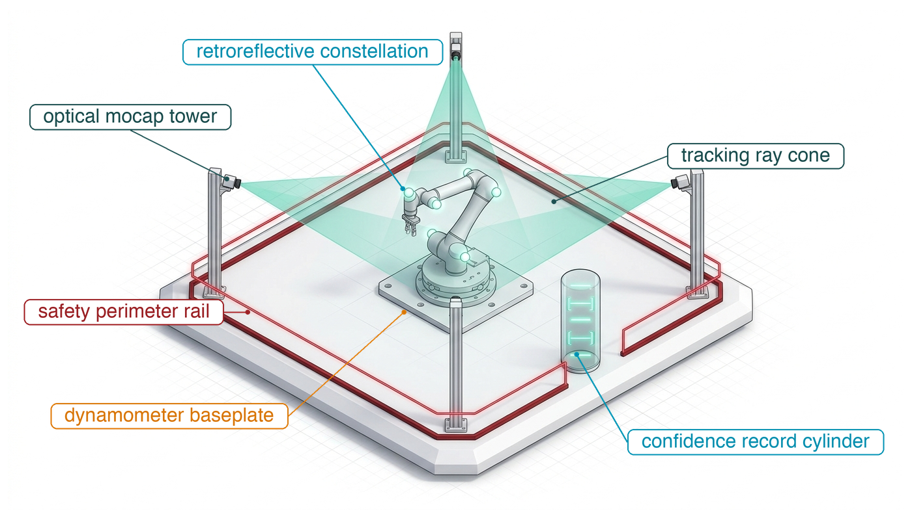
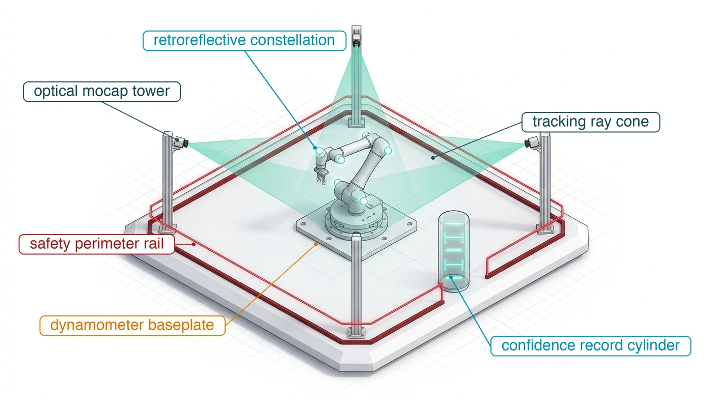
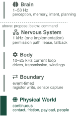
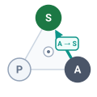
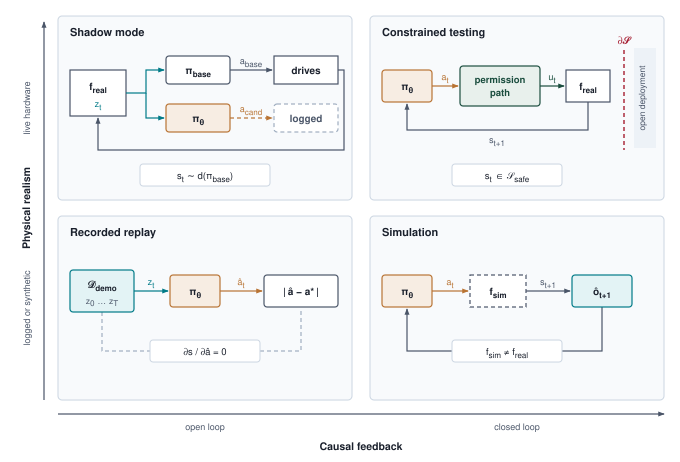
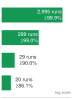
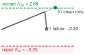
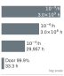
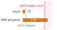

# Closed-Loop Evaluation {#sec-evaluation}

::: {layout-narrow}
::: {.column-margin}

\chapterminitoc

:::

::: {.content-visible when-format="pdf"}
\noindent
{fig-alt="Isometric blueprint showing closed-loop evaluation and metrology: instrumented testing cage with motion capture cameras, tracking marker constellation, flush ground force-torque dynamometer, articulated reliability scorecard with confidence intervals, and crimson intervention tripwire."}
:::

::: {.content-visible unless-format="pdf"}
{fig-alt="Isometric blueprint showing closed-loop evaluation and metrology: instrumented testing cage with motion capture cameras, tracking marker constellation, flush ground force-torque dynamometer, articulated reliability scorecard with confidence intervals, and crimson intervention tripwire."}
:::

:::

## Purpose {.unnumbered .unlisted}

::: {.content-visible when-format="pdf"}
\begin{marginfigure}
\resizebox{0.92\linewidth}{!}{\mlphysicalstackfull{20}{20}{20}{20}{100}}
\end{marginfigure}
:::

::: {.content-visible unless-format="pdf"}
::: {.column-margin}
{width="100%" fig-alt="Physical AI Systems Stack"}

*Physical AI stack focus for this chapter.*
:::
:::

_Why can a robot pass every trial and still lack the evidence needed for deployment?_

A robot that repeatedly opens one door has supplied evidence about that door, its own hardware, and the conditions of those trials. It has not established how it will behave at a displaced latch, with a different payload, or after its sensors drift, and a flawless record from a short campaign remains consistent with a policy that fails a substantial fraction of its attempts. Its admitted actions also change the observations it receives, so agreement with recorded demonstrations cannot substitute for testing the resulting motion. Physical trials expose that feedback, but each consumes time and mechanical life, every further factor of ten in demonstrated reliability costs roughly ten times the trials, and protective interventions stop some trajectories before their consequences unfold. A team that reads a clean record as readiness releases the machine into conditions no trial visited and credits the learned policy with protection its supervisors supplied. Evaluation exists to prevent that error. It ties each task outcome to the conditions sampled, keeps every intervention in the record, states the uncertainty that remains, and names the uncovered conditions the rest of the machine must guard. Because actions cross an irreversible causal boundary, evidence of policy competence must remain distinct from permission to move.



::: {.callout-learning-objectives}

- Interpret physical success rates as conditional evidence about a specified machine, environment, and trial protocol
- Interpret completion and intervention metrics without crediting the policy for protection supplied by its supervision
- Compare open-loop prediction accuracy with closed-loop behavior shaped by the policy's own actions
- Select the evidence regime (replay, simulation, shadow operation, or constrained physical testing) that can answer a given evaluation question
- Design a predeclared trial protocol with fixed outcome rules and full-denominator accounting of interventions and aborts
- Calculate confidence bounds, trial counts, and test time for a zero-failure campaign under stated sampling assumptions
- Construct an evaluation record that bounds its operational claim and identifies coverage gaps and required protections
- Evaluate which rare failures remain unsupported by feasible testing and the available statistical assumptions
- Diagnose how hardware differences, environmental changes, and stopping rules alter the claim a campaign can support

:::
## From Clean Runs to Bounded Claims {#sec-evaluation-door-campaign}

```{python}
#| label: calc-evaluation-door-campaign
#| echo: false
#| warning: false
#| message: false
# ┌─────────────────────────────────────────────────────────────────────────────
# │ THE DOOR CAMPAIGN ON THE RUNNING MACHINE (LEGO)
# ├─────────────────────────────────────────────────────────────────────────────
# │ Context: chapter opener, @sec-evaluation-logs, and the lease fallacy.
# │ Show: the evaluated campaign (latch task, base stopped) and the machine
# │       values the chapter quotes: approach speed, tripwire, latch limit, rack
# │       capacity, chunk inference target, chunk period, and chunk lease;
# │       plus the Part II funnel
# │       the completed record carries (ledger cells, supported cells,
# │       known absences, manifest omissions).
# │ How: registry fields of the warehouse mobile manipulator and its aisle;
# │      the standoff and the ledger counts (from @sec-data and
# │      @sec-training) are chapter-local inputs.
# └─────────────────────────────────────────────────────────────────────────────
from mlsysim import *
from mlsysim.core.units import *
from mlsysim.fmt import fmt_length, fmt_velocity, fmt_latency, fmt_force, fmt_mass, fmt_frequency, check, MarkdownStr

RM = Embodied.MobileManipulator.WarehouseMobileManipulator
AISLE = Embodied.Scenario.WarehouseAisle

class EvalMachine:
    """The latch campaign Ch7 evaluates, on the book's running machine."""

    # ┌── 1. LOAD (Constants & Parameters) ─────────────────────────────────
    standoff = 2.0 * ureg.meter  # category: illustrative; base start distance from the door
    v_approach = AISLE.v_latch_approach  # category: illustrative; guarded approach, the declared ODD's speed
    f_latch_limit = AISLE.f_latch_limit  # category: illustrative; latch damage limit
    f_trip = AISLE.f_latch_tripwire  # category: illustrative; contact tripwire that ends an attempt (@sec-data)
    rack_capacity = RM.onboard_payload_capacity  # category: chosen; tote-rack capacity
    chunk_rate = RM.chunk_rate  # category: chosen; chunk policy rate
    t_chunk_infer = RM.chunk_inference_latency  # category: illustrative; P99 of the ACT chunk policy incl. vision (M5)
    t_lease = AISLE.t_lease  # category: chosen; chunk lease
    n_plate_positions = 3  # category: illustrative; nominal and two displaced plates, the scenario ledger of @sec-data
    ledger_speeds = [AISLE.v_latch_approach, AISLE.v_latch_high]  # category: illustrative; the ledger's two approach speeds
    n_supported = 1  # category: illustrative; the nominal plate at the guarded approach (LatchScenarioLedger in @sec-data)
    n_omissions = 2  # category: illustrative; soft penalty contact and missing transport lag, the manifest's omission log

    # ┌── 2. EXECUTE (Compute) ─────────────────────────────────────────────
    chunk_period = (1 / chunk_rate).to(millisecond)
    n_speeds = len(ledger_speeds)
    n_cells = n_plate_positions * n_speeds
    n_absences = n_cells - n_supported

    # ┌── 3. GUARD (Assertions) ────────────────────────────────────────────
    check(abs(v_approach.to(ureg.meter / ureg.second).magnitude - 0.03) < 1e-9, "Guarded approach is not 0.03 m/s")
    check(abs(f_latch_limit.to(newton).magnitude - 100.0) < 1e-9, "Latch limit is not 100 N")
    check(abs(f_trip.to(newton).magnitude - 15.0) < 1e-9, "Contact tripwire is not 15 N")
    check(f_trip < f_latch_limit, "The tripwire must end an attempt well below the damage limit")
    check(abs(rack_capacity.to(kilogram).magnitude - 50.0) < 1e-9, "Tote-rack capacity is not 50 kg")
    check(abs(chunk_period.to(millisecond).magnitude - 50.0) < 1e-9, "Chunk period is not 50 ms")
    check(abs(t_lease.to(millisecond).magnitude - 60.0) < 1e-9, "Chunk lease is not 60 ms")
    check(chunk_period < t_lease, "Chunk period must fit inside the lease")
    check(abs(t_chunk_infer.to(millisecond).magnitude - 40.0) < 1e-9, "Chunk inference target is not 40 ms")
    check(t_chunk_infer < chunk_period, "Chunk inference must finish within the chunk period")
    check(n_cells == 6 and n_supported == 1 and n_absences == 5, "Ledger should have one supported cell of six (matches @sec-data)")
    check(n_omissions == 2, "Manifest omission log holds two unclosed departures (matches @sec-training)")

    # ┌── 4. OUTPUT (Format & Export) ────────────────────────────────────────
    standoff_str = fmt_length(standoff, precision=0)
    v_approach_str = fmt_velocity(v_approach, precision=2)
    f_latch_limit_str = fmt_force(f_latch_limit, precision=0)
    f_trip_str = fmt_force(f_trip, precision=0)
    rack_capacity_str = fmt_mass(rack_capacity, unit=kilogram, precision=0)
    chunk_rate_str = fmt_frequency(chunk_rate)
    chunk_period_str = fmt_latency(chunk_period)
    t_chunk_infer_str = fmt_latency(t_chunk_infer)
    t_lease_str = fmt_latency(t_lease)
    _words = {1: "one", 2: "two", 3: "three", 5: "five", 6: "six"}
    n_plate_positions_str = MarkdownStr(_words[n_plate_positions])
    n_speeds_str = MarkdownStr(_words[n_speeds])
    n_cells_str = MarkdownStr(_words[n_cells])
    n_supported_str = MarkdownStr(_words[n_supported])
    n_absences_str = MarkdownStr(_words[n_absences])
    n_omissions_str = MarkdownStr(_words[n_omissions])
```

The checkpoint `latch-bc-01` arrives from offline imitation learning with a policy manifest that declares exactly one supported condition, the nominal strike plate at the guarded approach. The manifest marks where the policy's training evidence ends, and evaluation asks what physical trials can establish inside that line. The recovery candidate `latch-bc-recovery-02`, whose wider claim new experience still has to earn, receives its own campaign later in the chapter (@sec-evaluation-recovery-update). `latch-bc-01` is flashed onto the warehouse mobile manipulator for a nominal validation campaign. In each trial, the mobile base begins `{python} EvalMachine.standoff_str` (illustrative; see the Reader Guide) from the spring-latched cage door, drives forward, and comes to a complete halt. With the base at rest, the manipulator executes a guarded approach at `{python} EvalMachine.v_approach_str`, unlatches the mechanism, and opens the door without crossing the `{python} EvalMachine.f_trip_str` contact tripwire or drawing a human intervention. Suppose the robot completes twenty consecutive runs this way, an empirical success rate of $\ObservedSuccessFraction = 1.00$ (100 percent). On a static vision or language benchmark, an unblemished score might suggest that the model is ready for production. On physical hardware, twenty clean runs leave the deployment decision open. They establish only a wide lower confidence bound, one that a policy failing a substantial fraction of its attempts can still satisfy, and they reveal nothing about failure modes too rare to appear in twenty draws.

::: {.column-margin .margin-pointer}
↩ The policy manifest, which records how a checkpoint was produced and the operating domain it declares, is established in @sec-training-policy-manifest.
:::

The gap between that perfect score and a deployable claim comes from three ways in which physical evaluation departs from the static protocol of machine learning, where engineers draw a held-out dataset once from a stationary distribution, score each example independently, and treat the aggregate as a faithful descriptor of model quality. First, a physical policy selects its own test distribution. Every admitted action alters the environment and determines the observations that follow, so no pre-recorded dataset can stand in for the states the policy will visit. This is the second law, endogenous data (principle \ref{pri-vol4-endogenous-drift}), acting on evaluation. The same feedback that pushes a cloned policy off its demonstrations also decides which states a test campaign samples. Second, every trial consumes test-cell time, battery charge, and mechanical life, which keeps sample counts small and each sample expensive. Third, a physical trial delivers kinetic energy across the causal boundary, and that energy cannot be recalled. When an interlock, a contact tripwire, or a safety operator aborts an errant motion before damage occurs, the trial ends early and leaves a censored observation that is neither an unequivocal success nor an unmitigated crash. Aerospace, automotive, and industrial automation engineers combine physical tests with model-based arguments about controller stability and protection. The learned proposer in this campaign arrives without such a certificate, so its task reliability must be bounded by finite empirical sampling under the declared conditions.

Closed-loop evaluation therefore asks what a finite campaign of physical trials can establish about a learned proposer, and what it must leave for the rest of the machine to handle. Four obligations answer that question, and they order this chapter. A success rate is meaningful only when bound to a declared population of hardware states, environmental conditions, and trial procedures, with every protective intervention kept out of the policy's credit (@sec-evaluation-what-measured). The evidence must come from a regime that can expose the failure in question, which for most physical failures means routing proposals through the real permission path rather than scoring them against logs (@sec-evaluation-closed-loop-dynamics and @sec-evaluation-evidence-regimes). A finite record becomes a defensible bound only under a protocol fixed before the first run, and each additional "nine" of demonstrated reliability costs roughly ten times the trials (@sec-evaluation-trial-protocol through @sec-evaluation-trial-limits). Finally, the evaluation record, the link in the record chain after the policy manifest, must state which conditions were tested and which were not, and it must turn every untested condition, together with every hazard too rare for any campaign to sample, into an obligation for the runtime permission path (@sec-evaluation-logs and @sec-evaluation-limits).

The first obligation begins with the twenty runs themselves. Before that perfect fraction can mean anything, the campaign must fix its outcome rules, define the operational population it sampled, and separate what the policy achieved from what supervision supplied. A defensible evaluation record never credits the learned proposer with successes that hardware interlocks or supervisory overrides actually purchased.

## Metric Coverage and Limitations of Scalar Success Rates {#sec-evaluation-what-measured}

A latch-manipulation policy that reliably opens a door during morning bench tests can jam repeatedly when confronted with a strike plate displaced by only three millimeters. Its measured success rate does not belong to the neural network weights in isolation; it characterizes the coupled dynamical system formed by the policy, the mechanical plant, the onboard compute platform, the physical environment, and the trial protocol itself. While a reproducible offline benchmark score indicates how well a model fits a frozen dataset, a physical success rate measures how the embodied closed-loop system behaves across a distribution of physical executions.

Evaluating a policy requires executing a sequence of discrete physical runs. A single trial is fully determined only when every physical parameter capable of altering the state trajectory is either explicitly controlled or systematically sampled. Formally, a single trial condition is the tuple $\TrialCondition = (\MechanicalPlantState_0, \EnvironmentParameters, \PlantParameters, \pi_\ModelParameters, \TerminationProtocol)$, drawn from an operational testing distribution $\OperationalTestDistribution$:

- The initial state vector $\MechanicalPlantState_0$ specifies the machine's starting condition, including its spatial pose (position and orientation), linear and angular velocities, and joint encoder positions.
- The environment vector $\EnvironmentParameters$ captures external physical variables, such as the tire-floor friction coefficient ($\CoulombFrictionCoefficient$), ambient illuminance, obstacle geometry, and ambient air temperature.
- The machine state $\PlantParameters$ captures physical and hardware properties sampled from the fleet manufacturing and wear distribution $\FleetManufacturingDistribution$. This encompasses unit-to-unit mechanical tolerances, battery state of charge, payload mass, tire wear, lost motion and compliance in the arm's transmissions\index{Mechanical backlash}, and sensor calibration matrices.
- The computational configuration $\pi_\ModelParameters$ represents the frozen policy weights $\ModelParameters$, numerical quantization formats (such as FP16 or INT8), real-time thread scheduling deadlines, and software driver versions.
- The termination protocol $\TerminationProtocol = (\CompletionDeadline, \GoalSet, \EvaluationPredicate)$ defines the execution deadline $\CompletionDeadline$, the spatial goal region $\GoalSet$, and the binary evaluation predicate $\EvaluationPredicate$ that maps the realized trajectory to a terminal outcome $\TrialCompletionIndicator \in \{0, 1\}$.

In static machine learning benchmarks, inputs $(\ModelInput_i, \ExampleLabel_i)$ are sampled independently from a static data distribution $\StaticDataDistribution(\ModelInput, \ExampleLabel)$. In Physical AI, the continuous trajectory $\text{Traj}(\TrialCondition) = (\MechanicalPlantState_0, \AdmittedControlCommand_0, \MechanicalPlantState_1, \AdmittedControlCommand_1, \dots, \MechanicalPlantState_\RolloutHorizon)$ is generated sequentially by the closed-loop physical state transition kernel:
$$\MechanicalPlantState_{t+1} \sim \PlantTransitionKernel(\MechanicalPlantState_t, \AdmittedControlCommand_t; \PlantParameters, \EnvironmentParameters), \quad \CognitivePolicyAction_{t} = \pi_\ModelParameters(\MechanicalPlantState_t), \quad \AdmittedControlCommand_t = \text{Gate}(\CognitivePolicyAction_{t}, \MechanicalPlantState_t)$$
Here $\text{Gate}$ stands for the permission path, which admits, clips, or replaces each proposal $\CognitivePolicyAction_{t}$ before it becomes the applied command $\AdmittedControlCommand_t$. Its permission and controller parameters remain fixed and are archived with the evaluated configuration; changing them changes the evaluated closed loop. The true success probability under this evaluation protocol is the expected value of the binary task outcome averaged over the joint distribution of trial conditions:
$$\TrialSuccessProbability(\OperationalTestDistribution) = \mathbb{E}_{\TrialCondition \sim \OperationalTestDistribution}[\EvaluationPredicate(\text{Traj}(\TrialCondition))]$$ {#eq-eval-estimand}
where $\text{Traj}(\TrialCondition)$ is the physical trajectory generated under condition $\TrialCondition$. Altering floor friction, ambient temperature, or battery voltage modifies the physical transition kernel $\PlantTransitionKernel$ even when the neural network weights $\ModelParameters$ remain untouched. The operational testing distribution $\OperationalTestDistribution$ is therefore an inseparable component of the quantity being estimated.

::: {.column-margin .margin-pointer}
↪ The formal integral over the closed-loop trajectory distribution, including the plant transition kernel and the permission map, is developed in @sec-appendix-ml-trajectory-distribution.
:::

In test engineering, the abstract distribution $\OperationalTestDistribution$ is operationalized through a **stratified test matrix**[^fn-design-experiments-blocking] across controllable parameters, systematically varying payload mass, approach speed, illumination, and initial spatial standoff, while logging uncontrollable environmental parameters such as ambient temperature and floor friction. Unstratified, naive random sampling across the parameter space is fundamentally inadequate because it oversamples benign nominal states while leaving critical boundary regions unvisited. Each stratum of the matrix (one payload, one approach speed, one plate position) is then its own population for the statistical bounds that follow, with its own $\OperationalTestDistribution$ and its own success probability; a claim about the whole matrix needs explicit weights across strata, which the evaluation record of @sec-evaluation-logs declares before the first run.

[^fn-design-experiments-blocking]: **Design of Experiments**\index{Design of experiments!stratified test matrix}: Fisher's agricultural field trials introduced randomization and blocking so that variation in the soil could not masquerade as a treatment effect [@fisher1935design]. A stratified test matrix blocks on payload, approach speed, and lighting for the same reason, and randomizing the run order keeps winding heat and spring relaxation from entering the comparison as if they were properties of the policy (@sec-evaluation-policy-comparison).

::: {#dfn-evaluation-closed-loop-estimand .callout-definition title="Closed-loop evaluation estimand"}

***Closed-loop evaluation estimand***\index{Closed-loop evaluation estimand!definition}\index{Evaluation estimand!definition} is the expected physical task outcome $\TrialSuccessProbability(\OperationalTestDistribution) = \mathbb{E}_{\TrialCondition \sim \OperationalTestDistribution}[\EvaluationPredicate(\text{Traj}(\TrialCondition))]$ defined over the joint distribution of initial states, mechanical plant wear, environmental physics, frozen policy weights, and evaluation predicates:
$$\TrialCondition = (\MechanicalPlantState_0, \EnvironmentParameters, \PlantParameters, \pi_\ModelParameters, \TerminationProtocol) \sim \OperationalTestDistribution$$
rather than an intrinsic property of the neural policy weights evaluated in isolation.

1.  **Significance**: In static machine learning, held-out accuracy is treated as a property of the model $\pi_\ModelParameters$. In physical AI, substituting a worn tire, letting battery voltage sag, or shifting ambient illuminance alters the physical state transition function without changing a single weight. The sampling distribution of operational conditions $\OperationalTestDistribution$ is an inseparable part of the quantity being estimated.
2.  **Distinction**: Unlike open-loop validation metrics (such as validation loss, cosine similarity, or mean squared trajectory error) that score predictions against frozen recorded states, the closed-loop estimand integrates over the endogenous feedback loop where past actions physically move the machine, directly changing the future sensor observations it receives.
3.  **Common pitfall**: Reporting a single success rate percentage without predeclaring the support, density, and environmental bounds of the test distribution $\OperationalTestDistribution$. Any physical policy can be made arbitrarily successful by testing exclusively in benign, unperturbed states.

:::

### Hardware instance variance and environmental unobservables

The physical mechanisms that alter $\TrialCondition$ between trials operate independently of the policy. A mobile manipulator exhibits this dispersion across two major sources: **hardware instance variance** across individual machines and **environmental unobservables** in the operating workspace.

First, hardware instance variance reflects the physical reality that robotic production lines do not manufacture identical copies. Even within the same manufacturing batch, robots exhibit unit-to-unit mechanical tolerances:

- **Transmission lost motion and compliance**: Strain-wave (harmonic) drives in robot arms feature zero backlash at the gear mesh by design; their dominant mechanical nonlinearities are torsional compliance and hysteresis, while shaft couplings or planetary stages elsewhere in the drivetrain add true backlash [@harmonicdrive2006csf]. These physical properties differ across units and grow with mechanical wear. Under high-frequency direction reversals, they introduce nonlinear hysteresis and phase lag that can destabilize tight neural feedback loops. Consequently, rigorous qualification campaigns characterize each unit's lost motion and joint stiffness directly on an inspection bench rather than assuming nominal catalog values.
- **Structural link compliance**: Elastic link deflection under payload varies across chassis assemblies, shifting the true Tool Center Point (TCP)\index{Tool center point} away from kinematic calculations derived from rigid-body nominals.
- **Sensor assembly misalignments**: Camera brackets and depth sensor mountings deviate from their computer-aided design nominals, introducing systematic coordinate frame offsets between the sensor frame $\CameraReferenceFrame$ and the robot base frame $\BodyReferenceFrame$ that require empirical extrinsic calibration on each individual machine.
- **Actuator electrical variance**: Motor phase resistances and torque constants ($\MotorTorqueConstant$) vary across stator windings within manufacturing tolerance bands. Furthermore, as the battery discharges\index{State of charge (SoC)}, the motor drivers lose voltage headroom against back-electromotive force (back-EMF)\index{Back-EMF}, shifting the torque-speed curve\index{Torque-speed curve} downward and diminishing instantaneous acceleration authority.

Second, environmental unobservables alter physical interaction dynamics without changing camera pixels in ways that a neural network can easily recognize. Ambient daylight shifting across a warehouse alters illuminance, causing camera auto-exposure routines to lengthen shutter times and inducing severe motion blur during base turns. Direct solar glare at dawn or dusk saturates complementary metal-oxide-semiconductor (CMOS) sensor arrays, washing out optical contrast around the latch interface. On the floor, dust accumulation and ambient humidity alter the tire-floor friction coefficient ($\CoulombFrictionCoefficient$), lengthening braking distances and corrupting wheel odometry. Within the manipulator arm, repeated door openings generate Joule heating ($\WindingCurrent^2 \ElectricalResistance$)\index{Joule heating} in motor windings and warm harmonic drive lubricants, decreasing viscous damping and causing thermal expansion across structural links. Consequently, the tool center point meets the latch with a millimeter-scale spatial offset on a hot afternoon compared to a cold morning. A policy evaluated across twenty trials on Unit 01 in the morning can fail completely when tested on Unit 02 in the afternoon, despite running identical frozen weights.

Trial reset procedures introduce another major source of unintended drift in $\TrialCondition$. When human operators reposition the mobile base after a difficult or aborted run, subconscious bias often leads them to favor forgiving, nominal configurations, systematically excising difficult boundary states from the sample. Conversely, an automated reset routine that drives the identical recovery path repeatedly heats actuator windings cyclically, introducing progressive thermal degradation across runs. Worst of all, an operator who catches a stumbling robot mid-fall and discards the run as an invalid trial erases the most informative corner-case failures from the evaluation record.

Statistical evaluation must therefore maintain a strict distinction between sampling variation and shifts in the underlying estimand. When $\TrialCount$ independent trials are drawn from a stationary distribution $\OperationalTestDistribution$, the sample proportion $\ObservedSuccessFraction = \frac{1}{\TrialCount} \sum_{i=1}^\TrialCount \TrialCompletionIndicator_i$ fluctuates around the true expectation $\TrialSuccessProbability(\OperationalTestDistribution)$ due to ordinary binomial noise, which standard statistical estimators bound. However, loading a payload onto the tote rack or moving the door's strike plate transitions the experiment to an entirely different distribution $\ShiftedTestDistribution$ with its own success probability $\TrialSuccessProbability(\ShiftedTestDistribution)$. Pooling runs across these two conditions without declaring their sampling weights conflates distinct physical configurations into an uninterpretable average. Independent draws from a predeclared mixture support a claim about that mixture; a quota-based stratified matrix instead requires separate inference within each cell and explicit weighting for an aggregate claim.

### Intervention-based physical metrics

```{python}
#| label: calc-evaluation-jam-reset
#| echo: false
#| warning: false
#| message: false
# ┌─────────────────────────────────────────────────────────────────────────────
# │ RESET SHARE OF A JAMMED DOOR RUN (LEGO)
# ├─────────────────────────────────────────────────────────────────────────────
# │ Context: Reset Latency item in @sec-evaluation-what-measured.
# │ Show: the share of test-cell occupancy a jammed-latch reset consumes.
# │ How: share = t_jam_reset / (t_run + t_jam_reset); t_run matches DoorCycle.
# └─────────────────────────────────────────────────────────────────────────────
from mlsysim import *
from mlsysim.core.units import *
from mlsysim.fmt import fmt_time, fmt_percent, check

class JamReset:
    """Occupancy share of a manual reset after a jammed latch."""

    # ┌── 1. LOAD (Constants & Parameters) ─────────────────────────────────
    t_run = 25.0 * ureg.second  # category: illustrative; door run, same as DoorCycle.t_run
    t_jam_reset = 60.0 * ureg.second  # category: illustrative; clear a jammed pin, recalibrate, return to standoff

    # ┌── 2. EXECUTE (Compute) ─────────────────────────────────────────────
    reset_share = (t_jam_reset / (t_run + t_jam_reset)).to(ureg.dimensionless).magnitude

    # ┌── 3. GUARD (Assertions) ────────────────────────────────────────────
    check(0.70 < reset_share < 0.72, "Jammed-latch reset should take about 71 percent of occupancy")

    # ┌── 4. OUTPUT (Format & Export) ────────────────────────────────────────
    t_run_str = fmt_time(t_run, unit=ureg.second, precision=0)
    t_jam_reset_str = fmt_time(t_jam_reset, unit=ureg.second, precision=0)
    reset_share_pct_str = fmt_percent(reset_share, precision=1, style="prose")
```

Summarizing physical performance with a single binary success rate obscures critical engineering distinctions. Consider four divergent operational outcomes during a door-opening task:

- A policy proposes an excessive contact force, but the permission path clips the command, allowing the door to open smoothly while remaining within mechanical limits.
- The permission path detects an impending joint limit and halts the manipulator entirely, preserving hardware safety while leaving the task incomplete.
- A human safety operator intervenes via remote teleoperation to clear a jammed latch pin, after which the robot resumes autonomous execution and completes the run.
- The raw policy executes the entire trajectory unassisted, completing the manipulation task within nominal limits without intervention.

These scenarios represent fundamentally different system capabilities. Every protective actor in them other than the human operator is the permission path, acting in one of three ways (clipping a proposal, replacing it, or stopping the machine). The first scenario demonstrates a well-functioning integrated machine where the permission path's clips compensate for raw proposer imperfections. The second protects the hardware at the expense of task completion. The third achieves the objective only by drawing on costly human labor. The fourth demonstrates genuine proposer autonomy.

Evaluating physical AI systems therefore requires decomposing performance into three independent channels: whole-machine task completion within operational limits, raw proposer autonomy, and supervisory intervention frequency. The task-completion rate, the fraction of trials whose outcome $\TrialCompletionIndicator_i$ (defined in the first item below) equals 1, measures the first channel. The autonomous completion rate measures the second, and mean time between interventions and intervention density measure the third. Reset latency belongs to no channel; it prices what each outcome costs the test cell. Runtime safety adjustments remain an intended feature of robust system architecture, so a small corrective clip by the permission path should not brand a completed run as a system failure. Nevertheless, tracking proposer autonomy separately reveals how often the learned model attempts to violate physical boundaries. Telemetry pipelines must log adjustments, command rejections, protective stops, and human overrides using predeclared event-counting rules, ensuring that a sustained safety clamp over several seconds is recorded as a single event rather than hundreds of spurious high-frequency faults.

1. **Autonomous completion rate (ACR)**\index{Autonomous completion rate!definition}: Let ${\TrialInterventionCount}_i \in \{0, 1, 2, \dots\}$ be the total count of supervisory interventions during trial $\EvaluationTrialIndex$, whether initiated by human safety operators, the permission path's clips and stops, or emergency tripwires, and let $\TrialCompletionIndicator_i \in \{0, 1\}$ denote goal achievement within the execution deadline $\CompletionDeadline$. The unassisted autonomous success indicator is:
   $$\UnassistedSuccessIndicator_i = \IndicatorFunction(\TrialCompletionIndicator_i = 1 \land {\TrialInterventionCount}_i = 0)$$
   ACR is the sample proportion of trials completed entirely without supervisory intervention:
   $$\text{ACR} = \frac{1}{\TrialCount} \sum_{i=1}^\TrialCount \UnassistedSuccessIndicator_i = \frac{\UnassistedCompletionCount}{\TrialCount}$$
   ACR measures strict raw proposer autonomy: a single recorded intervention forces $\UnassistedSuccessIndicator_i = 0$. In contrast, the whole-machine outcome $\TrialCompletionIndicator_i$ can remain $1$ when the permission path clips the proposer's commands and the task still completes within service bounds.

2. **Mean time between interventions (MTBI)**\index{Mean time between interventions!definition}: For any declared intervention class, MTBI quantifies the mean active operating duration between supervisory events:
   $$\SupervisoryMtbi = \frac{\CampaignActiveTime}{\TotalInterventionCount} = \frac{\sum_{i=1}^\TrialCount {\TrialRunTime}_i}{\sum_{i=1}^\TrialCount {\TrialInterventionCount}_i}$$
   where ${\TrialRunTime}_i$ is the active operating duration of trial $\EvaluationTrialIndex$ and $\TotalInterventionCount = \sum_{i=1}^\TrialCount {\TrialInterventionCount}_i$ is the total count of recorded interventions within that class. MTBI reflects the operational burden imposed by supervisory systems. Frequent automated filter adjustments signal aggressive policy proposals or model distribution shift, whereas frequent manual recoveries directly drive up staffing costs. Neither a favorable MTBI nor an absence of physical damage proves that a policy is ready for unattended deployment.

3. **Intervention density ($\InterventionDensity$)**\index{Intervention density!definition}: In spatial navigation and continuous trajectory tracking, interventions must be normalized against physical travel distance or discrete execution steps:
   $$\InterventionDensity = \frac{\TotalInterventionCount}{\sum_{i=1}^\TrialCount \TrialPathDistance_i} \quad [\text{interventions per kilometer}] \quad \text{or} \quad \InterventionDensity = 1{,}000 \times \frac{\TotalInterventionCount}{\sum_{i=1}^\TrialCount \TrialControlStepCount} \quad [\text{interventions per } 1{,}000 \text{ steps}]$$
   where $\TrialPathDistance_i$ is the physical path distance traversed during trial $\EvaluationTrialIndex$, and $\TrialControlStepCount$ is the number of control cycles executed. Normalizing by exposure makes intervention rates comparable across routes or operating conditions. Locating concentrated degradation also requires retaining each event’s location and condition and comparing these rates across strata, such as narrow doorways or tight mechanical latches.

4. **Reset latency ($\TrialResetLatency$)**\index{Reset latency!definition}: In physical qualification campaigns, the primary bottleneck in testing throughput is governed by the time required to restore the robot and workspace after a trial completes or aborts:
   $$\TrialResetLatency = \PhysicalRestoreTime + \ResetCalibrationTime + \TelemetryFlushTime$$
   The standard door-opening run requires `{python} JamReset.t_run_str` of active execution. While its nominal reset cycle is brief (@sec-evaluation-trial-costs), a run that jams the latch pin requires an operator intervention of approximately `{python} JamReset.t_jam_reset_str` (illustrative) to clear the jammed pin, recalibrate joint encoders, and return the mobile base to its initial standoff pose. For jammed runs, this manual reset consumes `{python} JamReset.reset_share_pct_str` of total test-cell occupancy. High reset latencies create organizational pressure to cut corners, for instance by skipping required motor thermal cooldowns or manually nudging the robot into easier initial poses, and each shortcut breaks the statistical stationarity of the campaign.

Engineers must not conflate MTBI with mean time between failures (MTBF). While an MTBF metric tracks functional breakdowns or mechanical failures, MTBI, ACR, and $\InterventionDensity$ capture supervisory burden and proposer autonomy within an operating envelope. A robot fleet can maintain an unblemished record of zero hardware damage simply because vigilant human safety drivers or a conservative permission path intervene whenever an unsafe state nears. Recording a run that was truncated or guided by external supervision as an unassisted operational success masks policy shortcomings behind the protective capability of the safety system. @Sec-evaluation-evidence-regimes shows why such runs are censored observations and names this error the censored trial fallacy.

Rigorous evaluation protocols decouple these metrics so that engineers can observe the trade-offs between safety filtering, autonomous capability, and operational throughput. Defining these outcome channels establishes what quantities must be recorded across experimental trials; the subsequent challenge is designing the closed-loop evaluation harness to expose these behaviors systematically under dynamic feedback.

## Closed-Loop Dynamics {#sec-evaluation-closed-loop-dynamics}

In standard deep learning workflows, model evaluation centers on empirical risk minimization over a static, held-out validation dataset $\ValidationDataset = \{(\ModelInput_i, \ExampleLabel_i)\}_{i=1}^\EvaluationSampleCount$:
$$\ValidationLoss(\ModelParameters) = \frac{1}{\EvaluationSampleCount} \sum_{i=1}^\EvaluationSampleCount \LossFunction(\ParameterizedPredictor(\ModelInput_i), \ExampleLabel_i)$$
Whether the target metric is Top-1 classification accuracy, next-token perplexity, an F1 score, or coordinate regression loss, the evaluation pipeline remains fundamentally passive and decoupled. The underlying data-generating process operates strictly feedforward and memoryless with respect to the model's outputs: mispredicting sample $\ExampleIndex$ exerts zero causal influence on sample $\ExampleIndex+1$ ($\partial \ModelInput_{i+1} / \partial \ModelPrediction_i = 0$).

Transporting this static paradigm to physical control creates the **offline evaluation illusion**, the unfounded assumption that lower validation loss, higher action cosine similarity, or smaller Mean Squared Error (MSE) on logged data guarantees superior physical execution. Offline loss metrics of the form $\ValidationLoss(\ModelParameters) = \frac{1}{\EvaluationSampleCount} \sum_{i=1}^\EvaluationSampleCount \|\DemonstratorAction_i - \pi_\ModelParameters(\MechanicalPlantState_i^*)\|^2$ evaluate candidate predictions exclusively along frozen demonstrator trajectories. Empirical studies demonstrate this failure directly. In controlled benchmarks across simulated and physical manipulation tasks, the training checkpoint exhibiting the lowest validation loss performed substantially worse during closed-loop rollouts than alternative checkpoints, with task success frequently rising even as validation loss climbed [@mandlekar2021matters].

The decoupling that justifies offline scoring vanishes in physical AI. Admitted policy actions cross the causal boundary into mass, momentum, and non-smooth contact mechanics. Instead of assigning categorical labels, the policy outputs forces, torques, and velocity setpoints that physically perturb the plant, endogenously generating future sensory observations through the system dynamics ($\MechanicalPlantState_{t+1} = \DiscretePlantDynamics(\MechanicalPlantState_t, \AdmittedControlCommand_t)$). These commands interact continuously with inertia, friction, and mechanical backlash. Consequently, a navigation policy can track recorded demonstrator trajectories with negligible regression error during offline playback, yet exhaust the vehicle's entire lateral clearance against a warehouse rack before traversing a third of the aisle. The failure stems directly from what each evaluation regime feeds back to the policy.

In an **open-loop evaluation**\index{Open-loop evaluation!definition}, a candidate policy $\pi_\ModelParameters$ is scored across a static dataset of recorded demonstrations $\DemonstrationDataset = \{(\MechanicalPlantState_t^*, \DemonstratorAction_t)\}_{t=1}^{\BehaviorCloningHorizon}$. At each discrete timestep $\ControlStepIndex$, the policy receives an expert state $\MechanicalPlantState_t^*$ and predicts an action $\PredictedPolicyAction_t = \pi_\ModelParameters(\MechanicalPlantState_t^*)$. A standard loss function, such as mean squared error or cross-entropy, measures the discrepancy between $\PredictedPolicyAction_t$ and the recorded expert action $\DemonstratorAction_t$. At timestep $\ControlStepIndex+1$, the harness feeds the next recorded state $\MechanicalPlantState_{t+1}^*$ directly from storage. The policy's predicted action $\PredictedPolicyAction_t$ is discarded without ever executing on physical hardware, ensuring that the incoming state sequence remains strictly independent of prior predictions ($\partial \MechanicalPlantState_{t+1}^* / \partial \PredictedPolicyAction_t = \ZeroVector$). In a **closed-loop evaluation**\index{Closed-loop evaluation!definition}, the policy proposes an action $\CognitivePolicyAction_{t} = \pi_\ModelParameters(\MechanicalPlantState_t)$ based on runtime sensory feedback. The system's deterministic permission path validates this proposal against the current plant state and safety invariants, dispatching an approved command $\AdmittedControlCommand_t$ (or an intervention fallback) to the actuators. The plant then advances according to physical dynamics, yielding $\MechanicalPlantState_{t+1} = \DiscretePlantDynamics(\MechanicalPlantState_t, \AdmittedControlCommand_t)$. Every admitted command alters the physical state and determines all subsequent sensory inputs, crossing the causal boundary.

::: {.column-margin}
{width="100%" fig-alt="S·P·A locator triad highlighting the Act-to-Sense feedback edge."}
*Admitted actions choose the next observation.*
:::

### Compounding error and kinematic integration {#sec-evaluation-compounding-error}

A neural policy exhibiting negligible open-loop validation loss can destabilize and drive a physical robot off course within seconds. Open-loop evaluation evaluates actions strictly along demonstrator trajectories, resetting the robot's input state to nominal expert measurements at every clock cycle. During closed-loop rollouts, however, the policy's admitted actions drive the physical plant, meaning that small tracking discrepancies immediately distort subsequent sensory observations.

This discrepancy takes a formal worst-case structure, as derived in @sec-data-curse-dimensionality-recoverability. If a policy deviates from expert actions with probability at most $\SingleStepImitationError$ per step on recorded expert states, open-loop evaluation across a horizon of $\BehaviorCloningHorizon$ steps accumulates an expected cost bounded by $\BehaviorCloningHorizon\SingleStepImitationError$. In closed loop, however, an early deviation can steer the robot into unvisited regions of the state space for the remainder of the trajectory, driving the cumulative imitation cost to scale as $\BehaviorCloningHorizon^2\SingleStepImitationError$ (@eq-data-quadratic-drift). For systems engineers, the operational implication is stark: an open-loop benchmark can understate closed-loop task divergence by a factor proportional to the operating horizon. While this theoretical bound governs zero-one decision divergence rather than unbounded metrics like contact force or structural yield, classical kinematics reveals the underlying physical mechanism: uncorrected heading and steering biases integrate forward into macroscopic lateral displacements that rapidly exhaust the robot's clearance envelope.

```{python}
#| label: calc-evaluation-aisle-heading-drift
#| echo: false
#| warning: false
#| message: false
# ┌─────────────────────────────────────────────────────────────────────────────
# │ HEADING BIAS AGAINST THE AISLE'S SIDE CLEARANCE (LEGO)
# ├─────────────────────────────────────────────────────────────────────────────
# │ Context: @sec-evaluation-closed-loop-dynamics, @fig-07-open-vs-closed-loop,
# │          and the takeaways.
# │ Show: where a persistent 1 degree heading bias of the navigation stack
# │       (not the evaluated latch policy) spends the aisle's side clearance.
# │ How: y(t) = v sin(eps) t; t_impact = W_clear / (v sin(eps)); the side
# │      clearance is (aisle width - machine width) / 2.
# └─────────────────────────────────────────────────────────────────────────────
import math
from mlsysim import *
from mlsysim.core.units import *
from mlsysim.fmt import fmt, fmt_length, fmt_velocity, fmt_time, fmt_angle, fmt_math, sci_latex, check

RM = Embodied.MobileManipulator.WarehouseMobileManipulator
AISLE = Embodied.Scenario.WarehouseAisle

class AisleDrift:
    """Closed-loop drift of a biased navigation policy on the running machine's aisle."""

    # ┌── 1. LOAD (Constants & Parameters) ─────────────────────────────────
    v = RM.base.max_velocity  # category: illustrative; drive limit
    clearance = AISLE.side_clearance  # category: illustrative; side clearance each side
    aisle_width = AISLE.aisle_width  # category: illustrative; site geometry
    aisle_length = AISLE.aisle_length  # category: illustrative; site geometry
    machine_width = RM.footprint_width  # category: illustrative; base footprint
    heading_offset_deg = 1.0  # category: illustrative; persistent heading bias

    # ┌── 2. EXECUTE (Compute) ─────────────────────────────────────────────
    eps = math.radians(heading_offset_deg)
    eps_q = eps * radian
    angular_mse = (eps_q**2).to(radian**2)  # open-loop score on recorded centerline states
    t_impact = (clearance / (v * math.sin(eps))).to(ureg.second)
    x_impact = (v * t_impact).to(ureg.meter)
    aisle_fraction = (x_impact / aisle_length).to(ureg.dimensionless).magnitude

    # ┌── 3. GUARD (Assertions) ────────────────────────────────────────────
    check(abs(v.to(ureg.meter / ureg.second).magnitude - 1.5) < 1e-9, "Drive limit is not 1.5 m/s")
    check(abs(clearance.to(ureg.meter).magnitude - 0.15) < 1e-9, "Side clearance is not 0.15 m")
    check(abs(((aisle_width - machine_width) / 2 - clearance).to(ureg.meter).magnitude) < 1e-9, "Side clearance must equal (aisle - machine) / 2")
    check(abs(aisle_length.to(ureg.meter).magnitude - 30.0) < 1e-9, "Aisle length is not 30 m")
    check(abs(x_impact.to(ureg.meter).magnitude - 8.6) < 0.05, "Clearance should be spent in about 8.6 m")
    check(abs(t_impact.to(ureg.second).magnitude - 5.73) < 0.005, "Clearance should be spent in about 5.7 s")
    check(aisle_fraction < 1 / 3, "Prose says less than a third of the aisle")
    check(abs(heading_offset_deg - 1.0) < 1e-12, "Prose, fig-cap, and fig-alt state a 1.0 degree heading offset")
    check(abs(angular_mse.magnitude - 3.05e-4) < 5e-7, "fig-alt states an angular MSE of 3.05e-4 rad^2")

    # ┌── 4. OUTPUT (Format & Export) ────────────────────────────────────────
    v_str = fmt_velocity(v, precision=1)
    clearance_str = fmt_length(clearance, precision=2)
    aisle_width_str = fmt_length(aisle_width, unit=ureg.centimeter, precision=0)
    aisle_length_str = fmt_length(aisle_length, precision=0)
    machine_width_str = fmt_length(machine_width, unit=ureg.centimeter, precision=0)
    clearance_cm_str = fmt_length(clearance, unit=ureg.centimeter, precision=0)
    t_impact_str = fmt_time(t_impact, unit=ureg.second, precision=1)
    x_impact_str = fmt_length(x_impact, precision=1)
    eps_rad_str = fmt_angle(eps_q, precision=5)
    angular_mse_math = fmt_math(rf"{sci_latex(angular_mse.magnitude)}\text{{ rad}}^2")
    angular_mse_eq = fmt_math(
        rf"\text{{MSE}}_{{\HeadingAngle}} = ({fmt(eps, precision=5)})^2 \approx {sci_latex(angular_mse.magnitude)}\text{{ rad}}^2"
    )
```

A policy whose own actions displace it from its training distribution is the second law at work on a test bench, and evaluation must quantify what that displacement costs on physical hardware. Because the mobile manipulator's base remains stationary during door manipulation trials, the platform's warehouse navigation stack supplies the clearest illustration of kinematic accumulation. Consider the base traversing a `{python} AisleDrift.aisle_length_str` aisle at its `{python} AisleDrift.v_str` drive limit, where the nominal expert trajectory tracks the centerline with heading $\HeadingAngle^* = 0\text{ rad}$ and lateral offset $\BaseLateralPosition^* = 0\text{ m}$. Suppose the candidate navigation policy possesses a systematic heading bias of $\FiniteChange\HeadingAngle = 1.0^\circ$ (`{python} AisleDrift.eps_rad_str`) at every control step. The deterministic permission path admits each individual velocity command because, in isolation, a one-degree heading adjustment remains dynamically feasible while lateral clearance persists.

::: {.column-margin .margin-pointer}
↩ How a policy's own actions shift the states it visits away from the demonstrator's occupancy is established in @sec-data-covariate-shift.
:::

In an open-loop evaluation, the policy receives the demonstrator state $\MechanicalPlantState_t^* = ({\BaseLongitudinalPosition}_t^*, 0, 0)$ at each step and predicts forward velocity with a $1.0^\circ$ steering offset. The offline scoring pipeline records a mean absolute angular error of $1.0^\circ$ (`{python} AisleDrift.eps_rad_str`) and a mean squared error of `{python} AisleDrift.angular_mse_eq`.[^fn-math-openloop-mse] The small number reflects radians squared, not the lesson. What matters is that the replay score stays at that same per-step value however long the aisle is, because each next input returns to the centerline and the error never accumulates. During closed-loop execution, however, the robot's physical movement reflects previously admitted commands, allowing uncorrected heading errors to integrate continuously. Under planar unicycle kinematics[^fn-unicycle-model-drift] ($\BaseLateralVelocity = \BaseForwardSpeed \sin \HeadingAngle \approx \BaseForwardSpeed \FiniteChange\HeadingAngle$), a persistent angular offset integrates directly into a lateral displacement that grows linearly with the time $\DriftElapsedTime$ since the base left the centerline:
$$\BaseLateralPosition(\DriftElapsedTime) = \int_0^{\DriftElapsedTime} \BaseForwardSpeed \sin \FiniteChange\HeadingAngle \, d\IntegrationDummyTime \approx \BaseForwardSpeed \FiniteChange\HeadingAngle \DriftElapsedTime$$
If the policy exhibits a persistent yaw-rate bias $\BaseYawRateBias$ (steering drift) rather than a fixed angular offset, the heading angle itself grows linearly over time ($\HeadingAngle(\DriftElapsedTime) = \int_0^{\DriftElapsedTime} \BaseYawRateBias \, d\IntegrationDummyTime = \BaseYawRateBias \DriftElapsedTime$). Integrating forward velocity $\BaseForwardSpeed$ then yields a cumulative lateral deviation that compounds quadratically in time:
$$\BaseLateralPosition(\DriftElapsedTime) = \int_0^{\DriftElapsedTime} \BaseForwardSpeed \sin(\BaseYawRateBias \IntegrationDummyTime) \, d\IntegrationDummyTime \approx \frac{1}{2} \BaseForwardSpeed \BaseYawRateBias \DriftElapsedTime^2$$
This quadratic growth resembles the $\BehaviorCloningHorizon^2\SingleStepImitationError$ imitation bound, but the two characterize distinct phenomena. The kinematic derivation integrates a systematic yaw-rate bias through continuous dynamics, whereas the imitation bound accounts for accumulated discrete decision costs under distribution shift. Both show small, bounded errors accumulating polynomially over an operational horizon. Neither excludes the worse case that @sec-data-curse-dimensionality-recoverability described, in which a smooth imitator of a stable expert can compound its errors exponentially with horizon; the aisle example simply does not need that mechanism to fail.

For the constant $1.0^\circ$ heading bias, the mobile base spans `{python} AisleDrift.machine_width_str` within a `{python} AisleDrift.aisle_width_str` aisle. This geometry leaves $\LateralClearance =$ `{python} AisleDrift.clearance_cm_str` of lateral clearance to the storage racks on either side. At full drive velocity, the kinematic drift consumes this safety buffer at:
$$\ClearanceExhaustionTime = \frac{\LateralClearance}{\BaseForwardSpeed \sin \FiniteChange\HeadingAngle},$$ {#eq-eval-clearance-time}
which evaluates to `{python} AisleDrift.t_impact_str`, after just `{python} AisleDrift.x_impact_str` of forward travel, less than a third of the way through the aisle. The same heading offset that replay scores at an angular mean squared error of `{python} AisleDrift.angular_mse_math`, because each next input returns to the recorded centerline, spends the entire `{python} AisleDrift.clearance_str` side clearance in the physical loop (@fig-07-open-vs-closed-loop). The computed point is the unmitigated collision horizon. To halt before impact, the runtime permission path must intervene earlier, allowing for qualified detection, command and actuation response, and stopping motion. A protective stop makes strict proposer autonomy fail while preserving protection; an unprotected rack strike fails protection as well. Both expose a limitation of the policy that offline evaluation rated as near-flawless.

[^fn-math-openloop-mse]: **Mean Masking of Steering Spikes**\index{Evaluation!metric masking}: Averaging squared steering error over thousands of straight-aisle frames also hides a brief, large prediction spike, which barely moves the mean. Whether such a spike matters depends on whether its integrated motion spends the clearance before the permission path responds, a question only a plant and timing model can answer.

[^fn-unicycle-model-drift]: **Unicycle Model**\index{Unicycle model!lateral drift}: The simplest planar vehicle model, in which pose $(\BaseLongitudinalPosition, \BaseLateralPosition, \HeadingAngle)$ evolves as $\BaseLongitudinalVelocity = \BaseForwardSpeed\cos\HeadingAngle$, $\BaseLateralVelocity = \BaseForwardSpeed\sin\HeadingAngle$, $\BaseHeadingRate = \YawRate$. This formulation captures the essential nonholonomic constraint of the aisle: because a wheeled base cannot translate instantaneously sideways, any heading discrepancy directly translates forward velocity toward the rack.

This warehouse scenario highlights the two structural mechanisms that cause open-loop validation metrics\index{Open-loop evaluation!closed-loop gap} to decouple from physical performance:

1. **State integration across time**: Static evaluation cannot integrate persistent control errors into physical displacements. By resetting the robot's input state to an expert demonstration at every clock cycle, offline scoring obscures error accumulation. In closed-loop deployment, however, the state at timestep $\ControlStepIndex$ represents the unrolled composition of all prior control actions:
   $$\MechanicalPlantState_t = \DiscretePlantDynamics(\DiscretePlantDynamics(\dots \DiscretePlantDynamics(\MechanicalPlantState_0, \AdmittedControlCommand_0)\dots, \AdmittedControlCommand_{t-2}), \AdmittedControlCommand_{t-1})$$
   A persistent heading bias does not require an algorithmic flaw; physical phenomena like asymmetric tire wear, mast vibration, uneven payload distribution, or floor camber routinely introduce systematic offsets.
2. **Covariate shift into unmodeled states**: Static benchmarks cannot evaluate how a policy behaves once early errors steer the plant away from nominal trajectories. The very first uncorrected action shifts the base from the expert state $\MechanicalPlantState_1^*$ to an unvisited state $\MechanicalPlantState_1$. Once the base drifts even a few centimeters off the centerline, it enters operating states completely absent from $\DemonstrationDataset$. Because offline metrics are evaluated exclusively along demonstrator states where $\BaseLateralPosition = 0\text{ m}$, they provide zero empirical evidence regarding policy behavior when $\BaseLateralPosition \neq 0\text{ m}$. Lacking training on corrective maneuvers, the policy often generates larger prediction errors in these off-nominal regimes, precipitating rapid divergence.

::: {.column-margin .margin-pointer}
↩ Compounding covariate shift, and the recovery experience a fixed demonstration archive lacks, are established in @sec-training-recovery-experience.
:::

<!-- fig-alt below hand-types values because fig-alt cannot hold inline python. Keep them in sync with these cell outputs:
     "one-degree heading offset"          = AisleDrift.heading_offset_deg (1.0)
     "3.05 times 10 to the minus four"    = AisleDrift.angular_mse_math (the fig-cap and prose use it inline)
     "1.5 meters per second"              = AisleDrift.v_str (RM.base.max_velocity, the drive limit)
     "15-centimeter side clearance"       = AisleDrift.clearance_cm_str
     "about 5.7 seconds"                  = AisleDrift.t_impact_str
     "8.6 meters along the aisle"         = AisleDrift.x_impact_str
     Guards in calc-evaluation-aisle-heading-drift pin 1.0 degree, 3.05e-4 rad^2, 1.5 m/s, 0.15 m, 5.7 s, and 8.6 m.
     The 1.0 degree offset is also hand-typed as $1.0^\circ$ in the closed-loop-dynamics prose, the fig-cap, the
     unicycle paragraph, and the takeaways; the guard pins it.
     The figure cell below recomputes theta**2 for its panel label from the same heading_offset_deg. -->

::: {#fig-07-open-vs-closed-loop fig-env="figure" fig-pos="t" fig-cap="**Open vs. closed loop divergence**: A persistent $1.0^\circ$ heading offset gives `{python} AisleDrift.angular_mse_math` angular mean squared error on recorded centerline states. On the mobile manipulator's aisle, the navigation stack's admitted motion with that fixed heading drifts linearly and reaches the `{python} AisleDrift.clearance_str` side clearance after `{python} AisleDrift.t_impact_str` at the `{python} AisleDrift.v_str` drive limit. The example concerns the navigation stack, not the latch policy under evaluation." fig-alt="Two-panel aisle example. Left: recorded-state replay scores a constant one-degree heading offset with angular mean squared error 3.05 times 10 to the minus four radians squared and resets the next input to the recorded centerline. Right: if that heading persists in a physical rollout at 1.5 meters per second, lateral drift grows linearly and reaches the 15-centimeter side clearance after about 5.7 seconds, 8.6 meters along the aisle. Policy proposals pass through the permission path before the plant moves."}

```{python}
#| echo: false
#| warning: false
#| message: false
# ┌─────────────────────────────────────────────────────────────────────────────
# │ OPEN-LOOP REPLAY VS. CLOSED-LOOP DRIFT (FIGURE)
# │ Context: @fig-07-open-vs-closed-loop
# │ Goal:    show why a heading error that is invisible offline spends clearance
# │ Show:    lateral offset against forward position, replay beside physical loop
# │ How:     one heading offset drives both panels and both numbers;
# │          speed and clearance come from the aisle via calc-evaluation-aisle-heading-drift
# ├─────────────────────────────────────────────────────────────────────────────
import math
import numpy as np
from mlsysim import viz

viz.set_book_style()
import matplotlib.pyplot as plt

COLORS = viz.COLORS

# ┌── 1. LOAD (Scenario parameters) ────────────────────────────────────────────
HEADING_OFFSET_DEG = AisleDrift.heading_offset_deg  # category: illustrative; from the LEGO cell
CLEARANCE_M = AisleDrift.clearance.to(ureg.meter).magnitude  # category: illustrative; AISLE.side_clearance
SPEED_MS = AisleDrift.v.to(ureg.meter / ureg.second).magnitude  # category: illustrative; RM.base.max_velocity (drive limit)
REACH_M = 10.0  # category: chosen; plot extent, the first third of the aisle

# ┌── 2. EXECUTE (Compute) ─────────────────────────────────────────────────────
theta = math.radians(HEADING_OFFSET_DEG)
angular_mse = theta**2  # rad^2, the offline error signal
exhausted_m = CLEARANCE_M / math.tan(theta)  # where the drift reaches clearance
exhausted_s = exhausted_m / SPEED_MS

# ┌── 3. PLOT ──────────────────────────────────────────────────────────────────
fig, (ax_a, ax_b) = plt.subplots(1, 2, figsize=(9.6, 3.8), sharey=True)
x = np.linspace(0, REACH_M, 400)

ax_a.plot(x, np.zeros_like(x), color=COLORS["BlueLine"], lw=2.4)
ax_a.plot(np.arange(0, REACH_M, 2), np.zeros(int(REACH_M // 2)), "o", ms=5, color=COLORS["BlueLine"])
ax_a.text(
    0.6,
    0.107,
    "Each next input returns to\nthe recorded centerline",
    fontsize=9,
    va="center",
    bbox=dict(boxstyle="round,pad=0.45", fc="white", ec=COLORS["grid"], lw=1.0),
)
ax_a.text(0.6, 0.030, f"Angular MSE: {angular_mse:.2e} rad$^2$".replace("e-04", r" $\times$ 10$^{-4}$"), fontsize=9, color=COLORS["BlueLine"])

ax_b.plot(x, x * math.tan(theta), color=COLORS["RedLine"], lw=2.4)
ax_b.axhline(0.0, color=COLORS["primary"], lw=0.9, linestyle=(0, (5, 4)))
ax_b.axvline(exhausted_m, color=COLORS["RedLine"], lw=1.0, linestyle=(0, (1, 2)))
ax_b.plot([exhausted_m], [CLEARANCE_M], "o", ms=6, color=COLORS["RedLine"], zorder=5)
ax_b.text(
    exhausted_m - 0.35, CLEARANCE_M - 0.075, f"Clearance exhausted\nat {exhausted_s:.1f} s", fontsize=9, color=COLORS["RedLine"], ha="right", va="top"
)
ax_b.text(0.6, 0.182, rf"$y_{{\mathrm{{base}}}} = x_{{\mathrm{{base}}}}\,\tan$({HEADING_OFFSET_DEG:.0f}°) under fixed heading", fontsize=9)

for ax, title, lx, lha in ((ax_a, "(a) Recorded-state replay", REACH_M - 0.15, "right"), (ax_b, "(b) Physical closed loop", 0.6, "left")):
    ax.axhline(CLEARANCE_M, color=COLORS["RedLine"], lw=1.2, linestyle=(0, (5, 4)))
    ax.text(lx, CLEARANCE_M + 0.006, f"{CLEARANCE_M * 100:.0f} cm clearance", fontsize=9, color=COLORS["RedLine"], ha=lha, va="bottom")
    ax.set_xlim(0, REACH_M)
    ax.set_ylim(-0.03, 0.225)
    ax.set_xticks(range(0, int(REACH_M) + 1, 2))
    ax.set_xlabel("Forward position (m)")
    ax.text(0.0, 1.02, title, transform=ax.transAxes, fontsize=10, fontweight="bold")

ax_a.set_yticks([0.00, 0.05, 0.10, 0.15, 0.20])
ax_a.set_ylabel("Lateral offset (m)")
plt.tight_layout()
plt.show()
```

:::

### Contact discontinuities and metric masking {#sec-evaluation-non-lipschitz-contact}

```{python}
#| label: calc-evaluation-stiff-contact
#| echo: false
#| warning: false
#| message: false
# ┌─────────────────────────────────────────────────────────────────────────────
# │ STIFF-CONTACT RESIDUAL VERSUS FREE-SPACE RESIDUAL (LEGO)
# ├─────────────────────────────────────────────────────────────────────────────
# │ Context: "Why action mean squared error fails" in
# │          @sec-evaluation-non-lipschitz-contact.
# │ Show: the reaction force a small commanded penetration attempts against a
# │       hypothetical stiff surface (not the running machine's latch).
# │ How: dF = k_contact * dx (linear spring).
# └─────────────────────────────────────────────────────────────────────────────
from mlsysim import *
from mlsysim.core.units import *
from mlsysim.fmt import fmt_length, fmt_force, fmt_math, sci_latex, check

class StiffContact:
    """Force a millimeter-scale residual attempts against a stiff surface."""

    # ┌── 1. LOAD (Constants & Parameters) ─────────────────────────────────
    k_contact = 5e5 * ureg.newton / ureg.meter  # category: illustrative; hypothetical stiff surface
    dx = 2.0 * ureg.millimeter  # category: illustrative; tracking residual / commanded penetration

    # ┌── 2. EXECUTE (Compute) ─────────────────────────────────────────────
    dF = (k_contact * dx).to(newton)

    # ┌── 3. GUARD (Assertions) ────────────────────────────────────
    check(abs(dF.to(newton).magnitude - 1000.0) < 1e-6, "2 mm into 5e5 N/m should attempt 1,000 N")

    # ┌── 4. OUTPUT (Format & Export) ────────────────────────────────────────
    k_contact_math = fmt_math(sci_latex(k_contact.to(ureg.newton / ureg.meter).magnitude, precision=0) + r"\text{ N/m}")
    dx_str = fmt_length(dx, unit=ureg.millimeter, precision=0)
    dF_str = fmt_force(dF, precision=0, commas=True)
```

Physical contact introduces severe mathematical and dynamical discontinuities. As an end-effector engages a door latch, unconstrained free-space kinematics instantaneously transition into constrained contact mechanics characterized by impact, stick, or slip. In classical rigid-body mechanics, collision produces discontinuous velocity jumps ($\PostImpactNormalVelocity \ne \PreImpactNormalVelocity$), while Coulomb friction creates set-valued reaction forces ($\CoulombFrictionForce \in [-\CoulombFrictionCoefficient \NormalContactForce, \CoulombFrictionCoefficient \NormalContactForce]$). Because these transitions violate Lipschitz continuity (a bound on how much the dynamics can change per unit change in state), infinitesimally small variations in spatial state produce disproportionately large, discontinuous changes in physical dynamics. Although mechanical compliance and structural damping distribute impact forces across small time windows in real hardware, aggregate offline loss metrics obscure the critical physical consequences of crossing contact boundaries:

1. **Action cosine similarity ignores operational magnitude**: In representation learning and behavior modeling, action cosine similarity:
   $$\text{Cosine}(\PredictedPolicyAction, \DemonstratorAction) = \frac{\PredictedPolicyAction^\top \DemonstratorAction}{\|\PredictedPolicyAction\| \|\DemonstratorAction\|}$$
   evaluates directional alignment between predicted and expert commands. At a physical contact interface, however, directional alignment alone is catastrophic because cosine metrics discard vector magnitude entirely. A policy proposal achieving 0.999 cosine similarity that commands 25 percent insufficient force fails to overcome the latch's mechanical preload and static friction, stalling against the mechanism and halting the task. Conversely, a command with identical 0.999 similarity that commands 150 percent of the required force severely overloads the contact interface, risking an immediate trigger of the `{python} EvalMachine.f_trip_str` protective tripwire. Whether hardware damage occurs depends on structural compliance, pre-contact kinetic energy, and joint impedance response; a trip invokes the protective response, whose ability to prevent damage requires qualification under those conditions. A stopped, incomplete run fails the task despite the favorable cosine score.

2. **Action mean squared error equates disparate physical regimes**: In offline supervised regression, Mean Squared Error:
   $$\text{MSE} = \frac{1}{\ActionDimension} \sum_{j=1}^{\ActionDimension} (\PredictedActionComponent_j - \DemonstratorActionComponent_j^*)^2$$
   penalizes every millimeter of tracking residual identically, regardless of physical context. During free-space transit, an end-effector tracking discrepancy of `{python} StiffContact.dx_str` represents a benign perturbation that downstream control easily accommodates. Consider, by contrast, a stiff environmental interface modeled with contact stiffness $\ContactStiffness \approx$ `{python} StiffContact.k_contact_math`. When an unmitigated position controller commands an apparent surface penetration $\PenetrationDepth$, the resulting normal reaction force scales as:
   $$\FiniteChange \NormalContactForce = \ContactStiffness \PenetrationDepth$$
   For an uncorrected `{python} StiffContact.dx_str` penetration residual, this linear relationship demands a reaction force of `{python} StiffContact.dF_str`. While realized loads depend on structural compliance, link elasticity, and active torque limits rather than bare stiffness alone, this calculation highlights the dimensional mismatch: offline MSE treats a benign `{python} StiffContact.dx_str` tracking error in free space identically to a contact error capable of tripping joint protection or damaging gearboxes.

3. **Hardware instance variance amplifies contact bifurcations**: Non-smooth contact mechanics compound the unit-to-unit manufacturing variance analyzed in @sec-evaluation-what-measured. Subtle physical discrepancies across production robots, such as transmission backlash, harmonic drive compliance, and millimeter-level camera-mounting tolerances, shift the physical boundary of the contact interface in Cartesian space. A policy trained on demonstrations recorded on Unit 01 will encounter the latch surface slightly earlier or later when deployed on Unit 02. Because contact transitions are discontinuous, this millimeter-scale spatial displacement triggers immediate operational bifurcations: the manipulator either halts prematurely in free space or collides aggressively with the mechanism frame, causing mechanical jamming that static evaluation over historical logs cannot detect.

The door manipulation benchmark illustrates this failure mechanism directly. An end-effector positioning error of a fraction of a millimeter per step registers as negligible Cartesian deviation on static logs. Against the rigid latch mechanism, however, that small offset acts as a mechanical wedge. The same stiffness relation, $\FiniteChange \NormalContactForce = \ContactStiffness \PenetrationDepth$, now acting sideways, transforms this lateral displacement into a steep reaction force that quickly crosses the `{python} EvalMachine.f_trip_str` contact tripwire, triggering an immediate safety abort before the door unlatches.

Conversely, offline benchmarks can also fail through false pessimism when tasks support multimodal solution paths. If a human demonstrator avoided an obstacle by steering left, an open-loop regression metric penalizes an autonomous policy that navigates safely to the right (the multimodal distribution dilemma), even though both trajectories satisfy the closed-loop objective. Static action loss measures divergence from a single historical recording, not functional task completion.

::: {.column-margin .margin-pointer}
↩ Mode averaging over multimodal demonstrations is established in @sec-training-multimodality-breakdown.
:::

These asymmetries frequently produce rank inversions across candidate models. A policy whose small residual errors concentrate precisely at critical contact boundaries will score lower validation loss than a competitor with larger, yet harmless, errors distributed across free space. When deployed, however, their operational reliability reverses:
$$\ValidationLoss(\pi_{\Glyph{A}}) < \ValidationLoss(\pi_{\Glyph{B}}) \quad \text{yet} \quad \text{ACR}(\pi_{\Glyph{A}}) \ll \text{ACR}(\pi_{\Glyph{B}})$$
Rigorous evaluation campaigns must therefore evaluate autonomous completion rates, force profiles, and contact stability on physical hardware rather than ranking models by average offline loss.

This systemic disconnect separates every standard offline machine learning metric from the physical failure modes it conceals. @Tbl-07-offline-closed-loop-disconnect maps each offline metric to its implicit open-loop assumption, its physical failure mechanism, and the corresponding closed-loop metric required to expose it. Most of the closed-loop measures in its last column are physical quantities the record already logs. The one new measure is time to intervention ($\PolicyTti$\index{Time-to-Intervention!metric}), the elapsed duration from the granting of policy authority to the first permission-path override or safety operator takeover, which measures how long a drifting policy runs before something must stop it. Alongside ACR, MTBI, and $\InterventionDensity$, these execution measures characterize real-world autonomy in ways that static loss calculations cannot.

| Offline metric                     | Open-loop assumption                                             | Why it breaks in closed loop                                                                                                    | Failure on the machine                                                 | Closed-loop measure                                                                                            |
|:-----------------------------------|:-----------------------------------------------------------------|:--------------------------------------------------------------------------------------------------------------------------------|:-----------------------------------------------------------------------|:---------------------------------------------------------------------------------------------------------------|
| **Action mean squared error**      | Small residuals give small path deviations                       | A persistent bias integrates into drift and carries the machine off the demonstrated states                                     | The base spends its rack clearance (stop or strike)                    | Peak deviation from the reference path; time to intervention\index{Time-to-Intervention!metric} ($\PolicyTti$) |
| **Discrete action accuracy**       | Correct labels on logged states give identical execution         | Benign alternatives and boundary excursions cost the same; errors correlated in time are invisible                              | Command chatter and joint over-torque                                  | Peak jerk; adherence to actuator torque limits                                                                 |
| **Cosine similarity**              | Collinear proposals give stable paths                            | Magnitude is ignored, so under-actuation stalls against static friction and over-actuation slips                                | The base stalls or slips its wheels; the arm stalls short of the latch | Slip ratio (@sec-appendix-control-slip) and damping (@sec-appendix-control-pid)                                |
| **Negative log-likelihood**        | Likelihood at the expert action captures the action distribution | A unimodal likelihood head averages valid alternatives, such as passing an obstacle on either side, into an invalid mean action | Valid policies rejected; demonstrator noise imitated as jitter         | Closed-loop task success over randomized starts                                                                |
| **Reconstruction or Chamfer loss** | Accurate scene prediction gives safe plans                       | Background pixels outweigh thin obstacles and contact geometry                                                                  | Phantom braking; clipping a cable or a glass partition                 | Measured clearance and its minimum margin                                                                      |

: **Offline metrics and the closed-loop failures they hide**: Each open-loop metric assumes the demonstrator's state distribution is unaffected by policy error; on the machine, biases integrate into drift, valid alternatives are penalized, and shifted states produce boundary violations. {#tbl-07-offline-closed-loop-disconnect tbl-colwidths="[18,20,24,18,20]"}

::: {#psp-evaluation-open-loop-blindness .callout-perspective title="The offline evaluation illusion"}
Offline validation loss, Mean Squared Error (MSE), and action cosine similarity score predictions exclusively along frozen demonstrator trajectories where errors are artificially erased at every clock cycle. Physical closed-loop evaluation exposes accumulated trajectory drift, state distribution shift, and dynamic contact transitions absent from recorded logs. While the worst-case imitation bound ($\CovariateDriftBound$) models decision divergence under distribution shift, kinematic integration and contact mechanics ($\NormalContactForce = \ContactStiffness \PenetrationDepth$) govern physical clearance and reaction forces. A score computed against recorded states cannot see a feedback loop that recording removed.
:::

### The proposal boundary in two-processor architectures {#sec-evaluation-proposal-boundary}

Drift and contact are failures of the plant. A third class of failure lives in the machine's own hardware, and replay misses it for a different reason, because the replay harness runs on the wrong processor. The divide between tensor arithmetic and physical execution is codified in hardware across the proposal boundary of @sec-boundary-machine-model. In the running machine's two-processor architecture, where the learned proposers run on an application processor and the permission path runs on a separate safety microcontroller, replaying sensory traces on the host application processor verifies only whether neural inference completes within allocated memory bandwidth and latency budgets. During real-world execution, however, every candidate action proposal must cross the inter-processor bus to the real-time microcontroller running the deterministic permission path.

When local, high-rate sensor readings reveal that a proposed action violates kinematic, torque, or obstacle-clearance boundaries, the permission path clips or rejects the command. If the active trajectory violates lease deadlines or safety limits, the controller immediately engages a deterministic fallback maneuver. Evaluating an unverified neural policy strictly offline, without the physical plant, real-time bus transport, and safety monitors active in the loop, benchmarks isolated tensor computation rather than operational survivability. What replay on the host cannot see is everything the bus and the microcontroller add: transport delay, a late proposal arriving after its chunk lease has lapsed, a clip that changes the motion the policy expected, and a fallback that takes over mid-task. Shadow operation exposes the first two on real buses without letting the candidate move the machine, and constrained physical testing exposes all four.

::: {.column-margin .margin-pointer}
↩ The two-processor split, stated as a hypothesis that placement must later test on silicon, is established in @sec-nervous-silicon-partitioning.
:::

::: {.column-margin .margin-pointer}
↪ How the permission path admits a proposal, corrects it, or transfers authority to a resident fallback is developed in @sec-enforcement-authority-refuse.
:::

Because open-loop metrics cannot certify closed-loop reliability, empirical validation must evaluate the proposer across controlled physical environments. Every deployment setting alters specific elements of the sensorimotor loop by modifying plant dynamics, sensor streaming fidelity, or actuator authority. To structure these trade-offs, @sec-evaluation-evidence-regimes categorizes these operational environments by the causal fidelity and failure modes each regime is capable of exposing.

## Evidence Regimes {#sec-evaluation-evidence-regimes}

Before undertaking twenty physical door runs, an engineering team evaluating a robotic latch policy could score candidate predictions against logged human demonstrations, execute them inside a simulated physics environment, run them in shadow mode while a validated controller retains physical authority over the arm, or deploy them directly on the real mechanism with contact tripwires armed. These four configurations constitute the primary **evidence regimes**\index{Evidence regimes!definition} of embodied evaluation, mapped in @fig-07-evidence-regimes and @tbl-07-evidence-regimes across two structural axes: physical realism on the vertical axis (from logged and synthetic feeds up to live hardware) and causal feedback on the horizontal axis (from open loop to closed loop). Each regime establishes a distinct coupling between the policy, its sensory observations, and the underlying physical machine states, meaning each regime supports only a strictly bounded empirical claim. None of these four settings alone reveals how an unassisted policy behaves during open-ended physical deployment, because each environment either breaks the control loop's causal feedback or alters the distribution of states the robot encounters.

### The four evaluation evidence regimes {#sec-evaluation-four-regimes}

The first axis, causal feedback, governs whether a candidate's emitted actions alter future states and subsequent sensor observations ($\partial \MechanicalPlantState_{t+1}/\partial \CognitivePolicyAction_{t} \ne \ZeroVector$), or whether the policy merely reads a prerecorded, invariant sensory stream. In an open-loop configuration, execution errors cannot compound because mistakes never propagate into future inputs. In a closed loop, small policy errors perturb subsequent machine states, accumulating into compounding drift at a rate dictated by system dynamics and closed-loop feedback gains.

The second axis, physical realism, governs whether sensory observations originate from physical transducers interacting with unmodeled contact dynamics, gear backlash, tire slip, and variable illumination ($\PhysicalPlantDynamics$), or instead emerge from a synthetic numerical simulator or static buffer ($\SimulatedPlantDynamics$).

No single testing configuration can maximize both axes simultaneously without exposing expensive hardware, or nearby operators, to an unproven and potentially destructive policy. Consequently, each quadrant of @fig-07-evidence-regimes provides rigorous empirical evidence for specific claims while accepting a distinct, structural blind spot.

::: {#fig-07-evidence-regimes fig-env="figure" fig-pos="t" fig-cap="**Evaluation evidence regimes**: The regimes vary along causal feedback (open vs. closed loop) and physical realism (logged or synthetic vs. live hardware). Replay cannot observe compounding drift, simulation leaves the reality gap open, shadow operation locks the trajectory to the baseline controller, and constrained testing truncates failures at the constraint boundary $\partial\ConstrainedTestEnvelope$. No single regime tests deployment beyond that boundary." fig-alt="Two-axis schematic with physical realism on the vertical axis, from logged or synthetic up to live hardware, and causal feedback on the horizontal axis, from open loop to closed loop. Four panels. Shadow mode, top left, feeds the real plant's observations to a baseline controller that drives the motors and to a candidate policy whose actions are only logged. Constrained testing, top right, closes the loop from the candidate policy through the permission path to the real plant, inside a red dashed constraint boundary beyond which lies open deployment. Recorded replay, bottom left, feeds a demonstration dataset to the policy and scores the action error, with no path from action back to state. Simulation, bottom right, closes the loop through a simulated plant whose dynamics differ from the real one."}
{width="100%"}
:::

In recorded replay, the candidate policy executes strictly as a feedforward computation over static sensor buffers. Because the physical environment cannot respond to emitted actions, the state sequence remains fixed to the exact trajectory recorded during prior data collection. This regime provides solid empirical evidence for computational efficiency, dynamic memory allocation, and loss metrics against a reference benchmark. It can verify, for example, whether neural network inference fits within its target execution budget on an edge accelerator, and whether output distributions align numerically with logged human demonstrations. However, recorded replay cannot substantiate any claim regarding closed-loop stability or control authority. Because predicted actions never feed back into subsequent sensor frames, errors never induce consequences: if the policy commands an aggressive steering angle, the subsequent logged frame still shows the mobile base tracking straight down the corridor.

Closed-loop simulation restores the causal feedback path by substituting an explicit mathematical or numerical model, $\SimulatedPlantDynamics$, for the physical robot and its operating environment. When the policy emits an action and the modeled safety permission path selects the control command $\AdmittedControlCommand_t$, the physics engine numerically integrates the equations of motion, advances the scene geometry, and renders synthetic sensor observations for timestep $\ControlStepIndex+1$. This regime enables exhaustive testing of closed-loop dynamics, kinematic reachability, and recovery maneuvers. It can demonstrate, for example, whether a mobile base recovers gracefully from an initial tracking offset, or whether an articulated arm avoids self-collision throughout its reachable workspace across thousands of parallelized instances. However, the resulting evidence applies exclusively to the synthetic operator $\SimulatedPlantDynamics$. Unmodeled transmission backlash\index{Mechanical backlash}, tire deformation, dynamic contact friction\index{Contact friction} transitions, and optical sensor artifacts are omitted by construction. Demonstrating stability within $\SimulatedPlantDynamics$ therefore establishes that the policy stabilizes the model, not that it will stabilize physical hardware.

Shadow operation deploys the candidate policy directly onto an active physical machine while a validated baseline controller, or a human operator, retains exclusive authority over the physical actuators. The candidate policy ingests live streaming sensor data, executes onboard inference amid real mechanical vibrations and fieldbus contention, and computes candidate actions $\CandidatePolicyAction$.[^fn-hw-hil-bus] These proposed actions are logged to high-speed storage but never dispatched to the motor drives. Shadow operation yields robust empirical proof regarding real-time system performance. It can confirm, for instance, whether the latch policy maintains its target `{python} EvalMachine.chunk_rate_str` chunk rate under sustained thermal throttling, and quantify how frequently $\CandidatePolicyAction$ deviates from the baseline control action $\BaselineControllerAction$ beyond an acceptable safety threshold.

Nevertheless, shadow operation is fundamentally limited by the **trajectory confinement problem**: because the baseline controller exercises exclusive control over the actuators, the physical robot traces trajectories governed strictly by the baseline state distribution $\BaselineStateDistribution$. If the candidate policy generates an action that would cause the arm to jam the latch, veer off course, or strike a support strut, the physical plant never executes the command. The candidate's sensory stream remains perpetually confined to the safe states visited by the baseline supervisor. As a result, shadow testing cannot reveal whether the candidate could recover from an unvisited off-nominal state, nor can it expose whether its divergent actions would have resulted in catastrophic mechanical damage.

[^fn-hw-hil-bus]: **Bus Jitter in Shadow Mode**\index{Shadow mode deployment!bus jitter}: Inference that is steady on a bench stretches on the machine when direct memory access (DMA) transfers, shared memory, and fieldbus arbitration compete for the same paths. Shadow operation logs that jitter on the real buses, under real thermal load, without letting the late proposals move the chassis.

Constrained physical testing closes the causal feedback loop on actual hardware by routing candidate policy proposals through the permission path to the actuators, strictly within an enforced safety envelope. These operational boundaries are enforced via hardware tethers, software velocity clamps, geofenced test enclosures, or a dedicated real-time permission path that intercepts and overrides unsafe setpoints with deterministic latency. Constrained testing delivers authentic empirical evidence regarding real-world contact mechanics, friction transitions, structural compliance, and sensor noise under actual operating loads, which is why the experimental door-latch trials belong in this regime.

When the safety system triggers an intervention, it alters or truncates the raw policy trajectory (${\TrialInterventionCount}_i \ge 1, \UnassistedSuccessIndicator_i = 0$), leaving the candidate's unmitigated behavior permanently unobserved. Such a run answers two different questions, and the record must keep them apart. For the autonomy outcome it is an unambiguous failure, $\UnassistedSuccessIndicator_i = 0$, because the candidate policy could not finish without external override; even if the supervisor guides the robot to successful task completion, the trial cannot be scored as an autonomous success. For the separate event of an unassisted crash, the question of whether the policy would have damaged something had nobody stepped in, the run is right-censored:[^fn-right-censoring-survival] the intervention terminated the trial before that terminal state could manifest, so the observation confirms neither unassisted success nor an inevitable crash. Any rigorous evaluation must report completion rates, intervention frequencies, and post-intervention recoveries strictly inside the verified operating envelope. Conflating safety-supervised task completion with unassisted policy survival commits the **censored trial fallacy**\index{Censored trial fallacy!definition}, which attributes to the machine learning policy a level of robustness that was entirely provided by the permission path or the safety operator.

[^fn-right-censoring-survival]: **Right Censoring**\index{Right censoring!intercepted runs}: In clinical survival analysis, a patient who departs a study before the terminal endpoint has an unknown time of death rather than an established long life. @kaplan1958nonparametric formalized an estimator that tracks such subjects within the population at risk only while they remain actively observed. An intercepted robotic trial is right-censored under identical logic: the intervention proves that the policy required supervisor takeover, not that the robot would have stabilized itself had the supervisor remained passive.

Certain software properties transfer cleanly across regime boundaries when inputs and execution semantics match. Deterministic numerical calculations, floating-point arithmetic invariants, and tensor shape contracts can be checked under the same precision, rounding, and overflow rules; an activation overflow transfers only when the simulator and target implement the same arithmetic behavior. In contrast, runtime execution latency, bus contention, and memory bandwidth utilization cannot transfer purely across regimes; they require re-measurement under the actual scheduling, fieldbus, and thermal environments of the deployment hardware. Above all, the operating state distribution never transfers directly. The instant the environmental operator transitions from synthetic simulation $\SimulatedPlantDynamics$ to live physical dynamics $\PhysicalPlantDynamics$, or when the arbitration parameters of the runtime permission path change, the state trajectory $\MechanicalPlantState_0, \MechanicalPlantState_1, \dots, \MechanicalPlantState_t$ rapidly diverges.

Conceptualizing these four regimes as a monotonic ladder of fidelity is a dangerous systems trap. Transitioning across replay, simulation, shadow execution, and constrained testing does not simply increase fidelity; every step exchanges one systemic distortion for another. Simulation secures closed-loop causality at the expense of authentic contact physics and sensory noise. Shadow execution reclaims real physical sensing and bus timing but surrenders candidate closed-loop causality. Constrained physical testing restores both causality and physical grounding, yet it systematically censors the state space beyond its safety boundary. Observing zero supervisor interventions across one hundred constrained trials proves that the policy maintained states within the un-triggered safety envelope; it offers no statistical guarantee about how the policy behaves once it breaches that boundary.

System verification therefore demands assigning each engineering question to the specific regime equipped to answer it (@tbl-07-evidence-regimes). For the latch manipulation policy, verifying whether chunk inference executes reliably within its allocated cycle time belongs first in recorded replay and subsequently in hardware shadow mode; testing whether the manipulator can recover from a wide range of positional offsets belongs in high-throughput simulation, where thousands of permutations inflict zero hardware wear; and evaluating whether passive gripper compliance and contact friction remain within structural force limits belongs strictly in constrained physical trials. Each regime remains blind to the failure modes of the others.

| Evaluation Evidence Regime       | Causal Feedback Coupling                                                                                                  | Physical Realism                                          | Supported Empirical Evidence                            | Masked Failure Mode / Boundary Distortion                                                 |
|:---------------------------------|:--------------------------------------------------------------------------------------------------------------------------|:----------------------------------------------------------|:--------------------------------------------------------|:------------------------------------------------------------------------------------------|
| **Recorded Replay**              | Open Loop ($\partial \MechanicalPlantState_{t+1}/\partial \PredictedPolicyAction_t = \ZeroVector$)                        | Static Demonstration Buffers $\DemonstrationDataset$      | Latency budget, DRAM footprint, numerical accuracy      | Covariate shift; errors never alter subsequent observations                               |
| **Closed-Loop Simulation**       | Closed Loop ($\MechanicalPlantState_{t+1} = \SimulatedPlantDynamics(\MechanicalPlantState_t, \AdmittedControlCommand_t)$) | Synthetic Physics Operator $\SimulatedPlantDynamics$      | Kinematic reachability, large parallel test suites      | Sim-to-real gap; unmodeled contact non-linearities and tire slip                          |
| **Shadow Mode Operation**        | Open Loop for candidate (actions muted)                                                                                   | Physical machine $\PhysicalPlantDynamics$                 | Bus contention, thermal throttling, real sensor noise   | Trajectory confinement; states locked to baseline controller $\BaselineStateDistribution$ |
| **Constrained Physical Testing** | Closed Loop with permission-path override ($\SafeOverrideCommand$)                                                        | Physical machine $\PhysicalPlantDynamics$ within envelope | Contact dynamics, compliance, friction, actuator limits | State censorship; permission-path overrides and tethers truncate failure tails            |

: **Evaluation evidence regimes compared**: Trade-offs between causal feedback coupling, environmental realism, supported empirical claims, and experimental boundary distortions across the four testing regimes. No single environment evaluates open deployment; rigorous certification requires combining complementary regimes rather than assuming a linear fidelity ladder. {#tbl-07-evidence-regimes tbl-colwidths="[20,20,20,20,20]"}

### Simulation as a conditional proxy {#sec-evaluation-proxy-transfer-law}

A simulator can effectively screen candidate latch policies before committing expensive hardware to physical trials, but its screening validity depends strictly on how accurately it models the physical mechanisms governing the decision. The paired probes developed in @sec-training-contact-exploit drive the simulated and physical strike plates with identical commands and measure their discrepancies in newtons and milliseconds. The evaluation protocol incorporates those measured discrepancies directly into its test plan: while a favorable simulated recovery qualifies a checkpoint for physical verification, that result cannot resolve unmodeled discrepancies in the contact physics or data transport pipeline. Visual rendering artifacts, numerical friction regularization, and absent force-torque feedback can each alter candidate policy rankings.

Whether a simulator ranks candidate policies correctly is an empirical, measurable property. Proxy fidelity is measured with a paired benchmark across both regimes, which evaluates the same set of candidate policies (such as the latch training checkpoints) on both the simulated door mechanism and the physical hardware under tightly matched initial conditions and compares the resulting performance orderings. While a standard Pearson or Spearman correlation coefficient between simulated and physical success rates summarizes overall monotonic agreement, correlation alone can hide catastrophic failure modes. Specifically, a high correlation coefficient can easily coexist with a critical rank inversion, in which the simulator mistakenly promotes a checkpoint that fails dangerously when deployed on the physical door. To address this risk, @li2024simpler measure rank agreement with the mean maximum rank violation (MMRV), computed across approximately 1,500 paired simulated and physical episodes. For each policy, MMRV finds its worst inversion against any other policy, weighting each pair the simulator orders wrongly by the two policies' real-world performance gap, and then averages those worst cases across policies, so a simulator scores badly exactly when it swaps policies whose physical performance differs most.

This evaluation principle applies directly to the latch manipulation task. A simulator whose relative rankings across historical checkpoints correlate reliably with physical trials earns the operational authority to screen incoming models. Conversely, a simulation environment that has never been calibrated against paired physical benchmarks possesses no screening credibility, regardless of how photorealistic its graphics engine appears. The identical constraint governs learned neural world models deployed as simulated environments: predicted candidate success serves as a justification for scheduling physical tests, not as verifiable evidence of physical capability, until paired real-world trials validate model calibration. Furthermore, even a validated ranking proxy only authorizes candidate filtering. Physical trials remain the ultimate ground truth for safety and performance guarantees, because knowing that policy A outperforms policy B reveals nothing about whether policy A satisfies the machine's absolute failure-rate limits.

::: {.column-margin .margin-pointer}
↩ Learned world models used as simulators, whose simplifications cannot be enumerated, are established in @sec-training-world-models.
:::

Two additional systems factors dictate the generalization bounds of any simulation-based evaluation: parameter domain coverage and execution timing fidelity.

The first factor is the physical parameter variation spanned during simulation trials. A simulation calibrated against telemetry logs from a single robotic arm provides evidence strictly for that physical unit under those specific ambient conditions. Similarly, domain randomization evaluates policy resilience only across the bounded support of the randomized parameter distributions; it cannot account for dynamic phenomena entirely absent from the simulator's underlying differential equations. Formal sim-to-real gap analysis identifies unmodeled dynamics and compiles them into the omission log that the policy manifest carries. The closed-loop evaluation protocol must incorporate that log directly, cataloging the operating regimes and edge conditions about which simulation can make no empirical claims.

::: {.column-margin .margin-pointer}
↩ Formal sim-to-real gap analysis, which yields a supported region and a residual mismatch list, is established in @sec-training-sim-to-real-gap.
:::

The second factor is whether the evaluation regime reflects true hardware execution dynamics. Standard software-in-the-loop simulations pause virtual simulation time while the policy executes neural inference, masking real-world computational bottlenecks. A simulator that pauses virtual time during inference cannot expose the consequences of a late inference chunk, a rejected stale proposal, or an executing chunk that continues under its `{python} EvalMachine.t_lease_str` chunk lease while awaiting updated sensor verification. Explicit delay models can exercise those transitions, but establishing their actual timing requires the neural policy and runtime permission arbiter on target embedded compute hardware interconnected via the physical buses.

::: {.column-margin .margin-pointer}
↩ The chunk lease, sized between the renewal floor and the stopping budget, is established in @sec-nervous-lease-sizing.
:::

Closed-loop simulation, whether executed purely in software or integrated with hardware in the loop, serves as an indispensable filter for screening candidate models. However, only physical trials measure true embodied competence, and engineers must formalize the safety envelopes and evaluation protocols long before the first trial begins.

::: {.column-margin .margin-pointer}
↪ The qualification ladder, which stages software-, processor-, and hardware-in-the-loop benches before physical fault rigs, is developed in @sec-verification-qualification-ladder.
:::

::: {#chk-eval-evidence-regimes .callout-checkpoint title="Trade-offs across evidence regimes"}

Before fixing a physical trial protocol, review evidence regimes and fidelity trade-offs:

- [ ] **Regime causality trade-offs**: Contrast the causal feedback properties of recorded trace replay against closed-loop simulation.
- [ ] **Shadow-mode trajectory confinement**: Explain why shadow-mode evaluation on the running machine cannot test the candidate policy's recovery maneuvers.
- [ ] **Transfer across regimes**: Describe which properties transfer reliably across regimes and which one stays behind.

:::
## Fixing the Trial Protocol {#sec-evaluation-trial-protocol}

Empirical success probabilities and intervention rates are meaningful only with respect to a specific joint distribution $\OperationalTestDistribution$ over initial system states, environmental parameters, and task goals. Consequently, the intended operating region must be formalized before executing a single physical trial. The **target ODD**\index{Operational design domain!target ODD} is the concrete subset of the declared ODD recorded by the policy manifest of @sec-training-policy-manifest that the evaluation campaign samples. Its sampling weights define $\OperationalTestDistribution$, and no rigorous empirical claim reaches beyond its support. If an engineering team executes fifty ad hoc physical runs across arbitrary trajectories and reports a 90 percent success rate, that statistic lacks an interpretable denominator. A measured success rate supports a target-distribution claim only when the support and sampling weights of $\OperationalTestDistribution$ are specified in advance, establishing explicit bounds on scene illuminance, payload mass and inertia, surface friction coefficients, allowable initial state offsets, and the specific hardware serial numbers under test.

Extracting valid confidence bounds from empirical trials requires three operational conditions:

1. *Independent and identically distributed (iid) sampling:* Trials must be independent realizations drawn from $\OperationalTestDistribution$. In embodied physical systems, standard offline dataset intuition often fails; randomly shuffling log records cannot eliminate physical coupling. On real robotic hardware, thermal accumulation in motor windings from resistive heating ($\WindingCurrent^2 \ElectricalResistance$), battery voltage sag under discharge, and progressive mechanical backlash introduce temporal autocorrelation across sequential trials. Run 20 is not drawn from the same physical distribution as Run 1 unless operators strictly enforce thermal cooldown intervals and battery recharging cycles between runs. Furthermore, repeated trials executed on a single physical unit (such as Unit 01) cannot serve as iid draws from the broader fleet distribution $\FleetManufacturingDistribution$, because unit-level manufacturing tolerances and sensor calibrations bias the sample.
2. *Fixed outcome predicates:* The binary evaluation function $\EvaluationPredicate$ and termination criteria $\TerminationProtocol$ must remain frozen throughout the entire campaign. Modifying the execution deadline $\CompletionDeadline$, adjusting collision thresholds, or widening the spatial tolerance of goal region $\GoalSet$ midway through testing alters the definition of success. Doing so commits post-hoc metric drift and invalidates statistical comparisons against baseline models.
3. *Full-denominator accounting:* Every initiated run must remain in the evaluation ledger, including hardware communication faults, sensor timeouts, emergency protective stops, and operator interventions. Culling inconvenient or anomalous runs corrupts the statistical denominator. A hardware abort that halts execution prior to goal completion yields a task failure ($\TrialCompletionIndicator = 0$). Under a strict autonomy metric, any human intervention forces $\UnassistedSuccessIndicator = 0$; an operator nudge that guides the robot around an obstacle followed by on-time completion records $\TrialCompletionIndicator = 1$ and $\UnassistedSuccessIndicator = 0$. Safety monitoring systems must record kinematic limit violations and physical damage separately from task completion. When a safety tripwire or human supervisor intercepts an impending collision, the counterfactual unmitigated trajectory remains unknown. Consequently, zero recorded damage cannot be credited as evidence of unassisted survival. Discarding aborted or intercepted runs changes the underlying question and inflates perceived reliability by measuring an idealized survivor population.

When these conditions hold, the sample mean provides an unbiased point estimate of the policy's closed-loop performance under $\OperationalTestDistribution$. The remaining engineering challenge is determining how much statistical uncertainty a finite sample leaves, particularly when high-reliability targets yield zero observed failures across the test budget.

## Confidence from a Finite Campaign {#sec-evaluation-closed-loop-survival}

```{python}
#| label: calc-evaluation-clopper-pearson-zero-failure
#| echo: false
#| warning: false
#| message: false
# ┌─────────────────────────────────────────────────────────────────────────────
# │ CLOPPER-PEARSON ZERO-FAILURE RELIABILITY SIZING (LEGO)

# ├─────────────────────────────────────────────────────────────────────────────
# │ Context: @nbk-evaluation-derivation-20-run-lower-bound, @sec-evaluation-logs, and the takeaways.
# │ Show: One-sided confidence limits for iid zero-failure trials, not a rate estimate.
# │ How: p_lower = alpha^(1/n); failure_upper = 1 - p_lower.
# └─────────────────────────────────────────────────────────────────────────────
from mlsysim import *
from mlsysim.core.units import *
import math
from mlsysim.fmt import fmt_percent, fmt_int, fmt, check, MarkdownStr

class ClopperPearsonZeroFailure:
    """Exact binomial confidence bounds for physical robotics qualification."""

    # ┌── 1. LOAD (Constants & Parameters) ─────────────────────────────────
    n_runs = 20  # category: illustrative; the opening campaign's clean runs
    confidence = 0.95  # category: chosen; one-sided confidence level
    alpha = 1.0 - confidence  # category: derived; significance level
    n_one_in = 8  # category: illustrative; a policy that fails one run in eight
    n_fallacy = 1000  # category: illustrative; clean openings in the perfect-record fallacy
    n_looks = 5  # category: illustrative; independent 5 percent looks in the optional-stopping example

    # ┌── 2. EXECUTE (Compute) ─────────────────────────────────────────────
    p_lower = calc_clopper_pearson_zero_failure_bound(n_runs, confidence=confidence)
    failure_upper = 1.0 - p_lower
    p_clean_one_in = (1.0 - 1.0 / n_one_in) ** n_runs  # chance that policy still logs n_runs clean runs

    p_clean_at_bound = p_lower**n_runs  # probability of n clean runs at the bound itself; equals alpha

    # Scaling to 90, 99, and 99.9% reliability
    p_target_90 = 0.90  # category: chosen; pilot target in the fallacy and the SPRT contrast
    p_target_99 = 0.99  # category: chosen; industrial target in the prose
    p_target_999 = 0.999  # category: chosen; the target the chapter argues toward
    n_req_90 = calc_zero_failure_sample_size(p_target_90, confidence=confidence)
    n_req_99 = calc_zero_failure_sample_size(p_target_99, confidence=confidence)
    n_req_999 = calc_zero_failure_sample_size(p_target_999, confidence=confidence)
    rule_of_three_20 = 3.0 / n_runs  # Rule of Three approximation to failure_upper at n_runs
    n_cells_joint = 2  # category: illustrative; nominal and displaced-plate cells of the recovery branch
    n_req_999_joint = calc_zero_failure_sample_size(p_target_999, confidence=1.0 - alpha / n_cells_joint)  # Bonferroni split
    p_lower_fallacy = calc_clopper_pearson_zero_failure_bound(n_fallacy, confidence=confidence)
    p_any_false_positive = 1.0 - (1.0 - alpha) ** n_looks  # chance of at least one false positive across independent looks
    ln_inv_alpha = math.log(1.0 / alpha)  # the numerator of every zero-failure count; about 3 at 95 percent
    ln_inv_alpha_per_run = ln_inv_alpha / n_runs  # exponent of the 20-run bound, shown in the notebook
    ln_inv_999 = -math.log(p_target_999)  # per-run log cost of a 99.9 percent target, shown in the notebook
    p_target_chk = 0.995  # category: chosen; target in the bounds checkpoint's budget estimate

    # ┌── 3. GUARD (Assertions) ────────────────────────────────────────────
    check(abs(p_lower - 0.8609) < 0.001, "Unexpected 20-run lower bound")
    check(abs(failure_upper - 0.1391) < 0.001, "Unexpected 20-run upper confidence limit")
    check(n_req_999 == 2995, "Unexpected sample size for 99.9% reliability")
    check(n_req_999_joint == 3688, "Splitting alpha over two cells should need 3,688 runs per cell")
    check(n_req_99 == 299 and n_req_90 == 29, "Zero-failure counts for 99 and 90 percent should be 299 and 29")
    check(abs(p_clean_at_bound - alpha) < 1e-12, "At the lower bound, n clean runs must have probability alpha")
    check(p_clean_one_in > alpha, "The one-in-eight policy must pass 20/20 more often than alpha")
    check(n_one_in == 8 and abs(p_clean_one_in - 0.0692) < 0.001, "Unexpected clean-record probability for a one-in-eight policy")
    check(p_lower_fallacy < p_target_999 and abs(p_lower_fallacy - 0.9970) < 0.0001, "The 1,000-run bound must fall short of 99.9 percent")
    check(abs(p_any_false_positive - 0.2262) < 0.001, "Five independent 5 percent looks should give about 22.6 percent")
    check(abs(math.exp(-ln_inv_alpha_per_run) - p_lower) < 1e-12, "Notebook arithmetic must reproduce the 20-run bound")
    check(math.ceil(ln_inv_alpha / ln_inv_999) == n_req_999, "Notebook arithmetic must reproduce 2,995 runs")
    check(rule_of_three_20 > failure_upper, "The Rule of Three overstates the exact limit at n = 20")
    # margin_nonasymptotic_reliability_ladder.svg fig-alt hand-types 20, 29, 299, 2,995 runs and 86.1 percent
    check(n_runs == 20 and f"{100 * p_lower:.1f}" == "86.1", "Ladder fig-alt states 20 runs at 86.1 percent")

    # ┌── 4. OUTPUT (Format & Export) ────────────────────────────────────────
    n_runs_str = fmt_int(n_runs)
    confidence_pct_str = fmt_percent(confidence, precision=0, style="prose")
    p_lower_pct_str = fmt_percent(p_lower, precision=1, style="prose")
    failure_upper_pct_str = fmt_percent(failure_upper, precision=1, style="prose")
    p_lower_val_str = fmt(p_lower, precision=3)
    n_req_999_str = fmt_int(n_req_999, commas=True)
    n_req_99_str = fmt_int(n_req_99, commas=True)
    n_req_999_joint_str = fmt_int(n_req_999_joint, commas=True)
    alpha_joint_str = fmt(alpha / n_cells_joint, precision=3)
    n_req_90_str = fmt_int(n_req_90)
    alpha_str = fmt(alpha, precision=2)
    p_one_in_str = fmt(1.0 - 1.0 / n_one_in, precision=3)
    rule_of_three_20_str = fmt(rule_of_three_20, precision=2)
    _words = {5: "five", 8: "eight"}
    n_one_in_str = MarkdownStr(_words[n_one_in])
    p_clean_one_in_pct_str = fmt_percent(p_clean_one_in, precision=1, style="prose")
    n_fallacy_str = fmt_int(n_fallacy, commas=True)
    p_lower_fallacy_str = fmt(p_lower_fallacy, precision=4)
    n_looks_str = MarkdownStr(_words[n_looks].capitalize())
    p_any_false_positive_pct_str = fmt_percent(p_any_false_positive, precision=1, style="prose")
    ln_inv_alpha_str = fmt(ln_inv_alpha, precision=3)
    one_in_upper_str = MarkdownStr({7: "seven"}[round(1.0 / failure_upper)])
    ln_inv_alpha_per_run_str = fmt(ln_inv_alpha_per_run, precision=4)
    ln_inv_999_str = fmt(ln_inv_999, precision=7)
    p_target_999_pct_str = fmt_percent(p_target_999, precision=1, style="prose")
    p_target_chk_pct_str = fmt_percent(p_target_chk, precision=1, style="prose")
```

With the operational outcome, target population, evaluation regime, and trial denominator fixed, the twenty clean nominal runs pose an immediate statistical problem: determining what degree of reliability the campaign has actually demonstrated. A confidence bound quantifies the uncertainty that remains under the declared sampling model. Systems engineers must treat this bound as a measure of statistical evidence rather than an assessment of physical failure severity or an automatic deployment permit.

The standard textbook interval for a proportion, the Wald normal approximation $\ObservedSuccessFraction \pm 1.96\sqrt{\ObservedSuccessFraction(1-\ObservedSuccessFraction)/\TrialCount}$, collapses to zero width when the observed success fraction $\ObservedSuccessFraction$ reaches 1.0 because its sample variance term vanishes. This collapse exposes the complete breakdown of the asymptotic normal assumption near the boundary rather than empirical certainty. Evaluating the statistical assurance of a zero-failure record requires only the product rule for independent events.

Suppose the true per-run success probability of the latch policy is $\TrialSuccessProbability$. If individual trials are independent, twenty consecutive runs all succeed with joint probability $\TrialSuccessProbability^{20}$. Consider a flawed policy that fails one run in `{python} ClopperPearsonZeroFailure.n_one_in_str` ($\TrialSuccessProbability =$ `{python} ClopperPearsonZeroFailure.p_one_in_str`). That policy still produces an unbroken twenty-run success streak in `{python} ClopperPearsonZeroFailure.p_clean_one_in_pct_str` of evaluation campaigns; an empirical run of twenty successes cannot rule it out. As the candidate success rate $\TrialSuccessProbability$ decreases, a clean record becomes increasingly improbable. When $\TrialSuccessProbability$ drops to `{python} ClopperPearsonZeroFailure.p_lower_val_str`, the probability of observing twenty consecutive successes falls to exactly $\HypothesisTestSignificanceLevel =$ `{python} ClopperPearsonZeroFailure.alpha_str`, which corresponds to the significance level for a 95 percent confidence requirement ($1 - 0.95$). Any underlying success probability lower than `{python} ClopperPearsonZeroFailure.p_lower_val_str` would make the observed twenty-run clean record rarer than a 1-in-20 chance ($\TrialSuccessProbability^{20} < 0.05$). The one-sided lower confidence bound therefore identifies the threshold below which candidate policies become statistically inconsistent with the experimental data. In standard frequentist qualification, "95 percent confidence" describes the long-run coverage of the testing protocol: across repeated qualification campaigns, the procedure traps the true parameter $\TrialSuccessProbability$ above the calculated bound at least 95 percent of the time. The bound represents a conservative floor under the declared sampling model rather than a point estimate of $\TrialSuccessProbability$ or a Bayesian posterior belief about this specific policy.

Reading the inversion as a curve makes the logic visible. Plotting $\TrialSuccessProbability^{20}$ against every candidate $\TrialSuccessProbability$ (@fig-07-clean-run-inversion) shows the clean record ruling out only the candidates whose curve lies below the $\HypothesisTestSignificanceLevel$ line, the region left of $\TrialSuccessProbability =$ `{python} ClopperPearsonZeroFailure.p_lower_val_str`. The one-in-eight policy sits just above that line, which is why twenty flawless runs cannot reject it.

::: {#fig-07-clean-run-inversion fig-env="figure" fig-pos="htb" fig-cap="**Inverting a clean record into a bound**: The probability that `{python} ClopperPearsonZeroFailure.n_runs_str` independent runs all succeed, $\TrialSuccessProbability^{20}$, against the true per-run success probability $\TrialSuccessProbability$. Candidates left of the crossing with $\HypothesisTestSignificanceLevel =$ `{python} ClopperPearsonZeroFailure.alpha_str` would make the observed record rarer than one campaign in twenty, so the record rules them out; the crossing at $\TrialSuccessProbability =$ `{python} ClopperPearsonZeroFailure.p_lower_val_str` is the lower bound. The one-in-eight policy still logs a clean record in `{python} ClopperPearsonZeroFailure.p_clean_one_in_pct_str` of campaigns." fig-alt="Log-scale plot of the probability of twenty clean runs against the true success probability from 0.70 to 1.00. The rising curve crosses a horizontal dashed line at 0.05 near a success probability of 0.861, marked with a dot and a vertical dropline; the region left of the crossing is shaded gray. A second marker at a success probability of 0.875 sits slightly above the line at about 0.069."}

```{python}
#| echo: false
#| warning: false
#| message: false
# ┌─────────────────────────────────────────────────────────────────────────────
# │ CLEAN-RECORD PROBABILITY AND ITS INVERSION (FIGURE)
# │ Context: @fig-07-clean-run-inversion
# │ Goal:    show what the one-sided lower bound is before any formula
# │ Show:    P(n clean runs | p) = p**n, the alpha line, the crossing at
# │          p_lower, and the one-in-eight policy above the line
# │ How:     every plotted value is read from ClopperPearsonZeroFailure
# ├─────────────────────────────────────────────────────────────────────────────
import numpy as np
from mlsysim import viz

fig, ax, COLORS, plt = viz.setup_plot(figsize=(8, 4))

# ┌── 1. LOAD (from the LEGO cell) ─────────────────────────────────────────────
CP = ClopperPearsonZeroFailure
n_runs = CP.n_runs
alpha = CP.alpha
p_lower = CP.p_lower
p_one_in = 1.0 - 1.0 / CP.n_one_in
p_clean_one_in = CP.p_clean_one_in

# ┌── 2. EXECUTE (Compute) ─────────────────────────────────────────────────────
p = np.linspace(0.70, 1.0, 600)
p_clean = p**n_runs
check(abs(p_lower**n_runs - alpha) < 1e-12, "The crossing must sit on the alpha line")

# ┌── 3. PLOT ──────────────────────────────────────────────────────────────────
y_min = 5e-4
ax.axvspan(0.70, p_lower, color=COLORS["grid"], alpha=0.25, lw=0)
ax.plot(p, p_clean, color=COLORS["BlueLine"], lw=2.0)
ax.axhline(alpha, color=COLORS["primary"], lw=1.0, linestyle=(0, (5, 4)))
ax.text(0.705, alpha * 1.12, f"$\\alpha_{{\\mathrm{{sig}}}}$ = {alpha:.2f}", fontsize=9, color=COLORS["primary"], va="bottom")
ax.text(0.705, 0.6, f"ruled out by {n_runs} clean runs", fontsize=9, color=COLORS["primary"], va="center")

ax.plot([p_lower, p_lower], [y_min, alpha], color=COLORS["primary"], lw=0.9)
ax.plot([p_lower], [alpha], "o", ms=6, color=COLORS["BlueLine"], zorder=5)
ax.annotate(
    f"lower bound\np = {p_lower:.3f}",
    xy=(p_lower, alpha),
    xytext=(0.80, 0.25),
    fontsize=9,
    ha="center",
    va="center",
    arrowprops=dict(arrowstyle="-|>", color=COLORS["primary"], lw=0.9, shrinkB=5),
)
ax.plot([p_one_in], [p_clean_one_in], "s", ms=6, mfc="white", mec=COLORS["primary"], mew=1.3, zorder=5)
ax.annotate(
    f"fails one run in {CP.n_one_in}\np = {p_one_in:.3f}, clean {p_clean_one_in:.1%}",
    xy=(p_one_in, p_clean_one_in),
    xytext=(0.915, 8e-3),
    fontsize=9,
    ha="center",
    va="center",
    arrowprops=dict(arrowstyle="-|>", color=COLORS["primary"], lw=0.9, shrinkB=5),
)

ax.set_yscale("log")
ax.set_xlim(0.70, 1.0)
ax.set_ylim(y_min, 1.3)
ax.set_xlabel("True per-run success probability p")
ax.set_ylabel(f"P({n_runs} clean runs) = $p^{{{n_runs}}}$ (log scale)")
plt.tight_layout()
plt.show()
```

:::

For a predeclared zero-failure campaign of $\ZeroFailureTrialCount$ trials, this inversion yields the exact one-sided Clopper-Pearson lower bound\index{Clopper-Pearson non-asymptotic bound!definition}\index{Clopper-Pearson method}[^fn-clopper-pearson-exact] [@clopper1934use]. Setting $\TrialSuccessProbability^\ZeroFailureTrialCount = \HypothesisTestSignificanceLevel$ gives
$$\SuccessLowerConfidenceLimit = \HypothesisTestSignificanceLevel^{1/\ZeroFailureTrialCount}$$ {#eq-eval-zero-failure-bound}
with the corresponding upper confidence limit on the per-run failure probability given by:
$$\FailureUpperConfidenceLimit = 1 - \HypothesisTestSignificanceLevel^{1/\ZeroFailureTrialCount}$$
@Sec-evaluation-bounds-with-failures extends this inversion principle to evaluation campaigns that record failures.

::: {.column-margin .margin-pointer}
↪ The discrete and continuous-time derivations of the zero-failure bound, and why the normal approximation fails at zero failures, are developed in @sec-appendix-ml-exposure.
:::

[^fn-clopper-pearson-exact]: **Exact Binomial Bound**\index{Clopper-Pearson method!exact inversion}: @clopper1934use inverted the binomial tail directly instead of approximating it with a normal distribution. Here "exact" denotes that algebraic inversion rather than exact coverage probability; because binomial counts are discrete, the true coverage equals or exceeds the nominal confidence level for all values of $\TrialSuccessProbability$. Under the declared binomial sampling model, the procedure places the lower bound at or below the true reliability in at least the nominal fraction of repeated campaigns; an individual campaign can still overstate it.

For rare failures ($\TrialFailureProbability \ll 1$), a first-order Taylor series expansion linearizes this bound into the **rule of three**\index{Rule of three!definition} [@hanley1983nothing]. Expanding $\ln(1 - \TrialFailureProbability) = -\TrialFailureProbability - \TrialFailureProbability^2/2 - \dots \approx -\TrialFailureProbability$ and setting the clean-run probability $(1 - \TrialFailureProbability)^\ZeroFailureTrialCount$ equal to $\HypothesisTestSignificanceLevel = 0.05$ yields $-\ZeroFailureTrialCount\,\TrialFailureProbability \approx \ln(0.05) \approx -2.996 \approx -3.0$. When $\ZeroFailureTrialCount$ independent trials pass without a single failure, the upper 95 percent confidence limit on the per-trial failure probability simplifies to:
$$\ZeroFailureUpperConfidenceLimit \approx \frac{3}{\ZeroFailureTrialCount}.$$ {#eq-eval-rule-of-three}
Inverted to size test campaigns, the rule establishes the empirical burden for any target reliability: $\ZeroFailureTrialCount \approx 3 / (1 - \TargetTrialSuccessProbability)$. Each additional "nine" of target reliability multiplies the required trial volume tenfold. For the twenty door-opening trials, @eq-eval-rule-of-three yields an approximate upper failure bound of $3/20 =$ `{python} ClopperPearsonZeroFailure.rule_of_three_20_str`, whereas the exact Clopper-Pearson computation in notebook \ref{nbk-evaluation-derivation-20-run-lower-bound} establishes `{python} ClopperPearsonZeroFailure.failure_upper_pct_str`. A policy with a true failure probability as high as `{python} ClopperPearsonZeroFailure.failure_upper_pct_str` remains entirely compatible with twenty consecutive successes at 95 percent confidence. The campaign cannot substantiate an industrial claim of 99 percent reliability. Formally certifying a 99 percent lower confidence limit ($\TargetTrialSuccessProbability = 0.99$) at 95 percent confidence demands:
$$\ZeroFailureTrialCount = \left\lceil \frac{\ln(\HypothesisTestSignificanceLevel)}{\ln(\TargetTrialSuccessProbability)} \right\rceil = \left\lceil \frac{\ln(0.05)}{\ln(0.99)} \right\rceil$$ {#eq-eval-zero-failure-sample-size}
which equals `{python} ClopperPearsonZeroFailure.n_req_99_str` consecutive clean trials, an order of magnitude beyond the twenty trials conducted in the initial campaign.[^fn-math-rule-three]

The bound inherits the iid condition of @sec-evaluation-trial-protocol. Twenty runs on Unit 01 therefore bound Unit 01's success probability under the sampled conditions and nothing more; the unit-to-unit variance of @sec-evaluation-what-measured puts Unit 02 in a different population, whose bound needs its own trials or a sample drawn across the fleet.

[^fn-math-rule-three]: **Rule of Three**\index{Rule of three!clinical origin}: The heuristic originates in biostatistics, where @hanley1983nothing evaluated the risk to future patients following a clinical trial with zero adverse events across $\ZeroFailureTrialCount$ participants. An embodied evaluation campaign asks an identical question of the next robot trial, and the same $3/\ZeroFailureTrialCount$ ratio governs the bound.

::: {.column-margin}
{width="100%" fig-alt="Horizontal bar ladder on a log scale of consecutive clean runs and the 95 percent success lower limit each supports: 20 runs give 86.1 percent, 29 runs give 90 percent, 299 runs give 99 percent, and 2,995 runs give 99.9 percent."}
*Each added nine of reliability costs ten times the clean runs.*
:::

::: {#nbk-evaluation-derivation-20-run-lower-bound .callout-notebook title="The clean-record bound"}

**Problem**: The mobile manipulator completes $\ZeroFailureTrialCount =$ `{python} ClopperPearsonZeroFailure.n_runs_str` door-opening runs with no contact-tripwire crossing and no intervention. What one-sided `{python} ClopperPearsonZeroFailure.confidence_pct_str` lower limit on its per-run success probability $\TrialSuccessProbability$ does that record support, and what does it cost to claim `{python} ClopperPearsonZeroFailure.p_target_999_pct_str` instead?

**Variables**:

* $\ZeroFailureTrialCount =$ `{python} ClopperPearsonZeroFailure.n_runs_str` clean runs (Illustrative; the chapter's opening campaign, independent and identically distributed draws from the target operational design domain).
* $\HypothesisTestSignificanceLevel =$ `{python} ClopperPearsonZeroFailure.alpha_str` (Chosen; one minus the 95 percent confidence level).

**Math**: Setting $\TrialSuccessProbability^{\ZeroFailureTrialCount} = \HypothesisTestSignificanceLevel$ (@eq-eval-zero-failure-bound) and taking logarithms, $\ln(1/\HypothesisTestSignificanceLevel) =$ `{python} ClopperPearsonZeroFailure.ln_inv_alpha_str`, divided by $\ZeroFailureTrialCount$ gives the exponent `{python} ClopperPearsonZeroFailure.ln_inv_alpha_per_run_str`, and $\SuccessLowerConfidenceLimit$ is $\Glyph{e}$ raised to minus that exponent, `{python} ClopperPearsonZeroFailure.p_lower_val_str`. The failure upper limit is $1 - \SuccessLowerConfidenceLimit$, or `{python} ClopperPearsonZeroFailure.failure_upper_pct_str`, which the rule of three (@eq-eval-rule-of-three) approximates as $3/20 =$ `{python} ClopperPearsonZeroFailure.rule_of_three_20_str`.

**Result**: `{python} ClopperPearsonZeroFailure.p_lower_pct_str` success lower limit at 95 percent confidence; a `{python} ClopperPearsonZeroFailure.p_target_999_pct_str` limit needs `{python} ClopperPearsonZeroFailure.n_req_999_str` clean runs (notebook \ref{nbk-evaluation-statistical-scaling-high-reliability-assurance}).

**Systems insight**: Twenty clean runs leave a failure probability as high as one run in `{python} ClopperPearsonZeroFailure.one_in_upper_str` statistically consistent with the empirical data. The evaluation campaign establishes a formal lower confidence bound under its specific sampling assumptions; it should never be conflated with a steady-state failure rate, an MTBF, or an unconditional deployment authorization. Improving the bound requires scaling $\ZeroFailureTrialCount$, because the numerator $\ln(1/\HypothesisTestSignificanceLevel) \approx 3$ remains anchored by the chosen confidence level. This structural property explains why the rule of three matches the exact Clopper-Pearson bound whenever failure probabilities are small.

:::

### Bounds when failures occur {#sec-evaluation-bounds-with-failures}

```{python}
#| label: calc-evaluation-bound-with-failures
#| echo: false
#| warning: false
#| message: false
# ┌─────────────────────────────────────────────────────────────────────────────
# │ ONE-SIDED CLOPPER-PEARSON LOWER BOUND WITH FAILURES (LEGO)
# ├─────────────────────────────────────────────────────────────────────────────
# │ Context: @sec-evaluation-bounds-with-failures.
# │ Show: the 95 percent lower bound when a twenty-run campaign has one failure,
# │       beside the zero-failure bound.
# │ How: solve P(X >= k | n, p) = alpha for p by bisection, X ~ Binomial(n, p);
# │      at k = n this reduces to p^n = alpha (the zero-failure case).
# └─────────────────────────────────────────────────────────────────────────────
import math
from mlsysim import *
from mlsysim.fmt import fmt_percent, check

def _binom_upper_tail(k, n, p):
    """P(X >= k) for X ~ Binomial(n, p)."""
    return sum(math.comb(n, j) * p**j * (1.0 - p) ** (n - j) for j in range(k, n + 1))

def _cp_lower(k, n, alpha):
    """One-sided Clopper-Pearson lower limit on p after k successes in n trials."""
    if k == 0:
        return 0.0
    lo, hi = 0.0, 1.0
    for _ in range(200):
        mid = 0.5 * (lo + hi)
        if _binom_upper_tail(k, n, mid) > alpha:
            hi = mid
        else:
            lo = mid
    return 0.5 * (lo + hi)

class BoundWithFailures:
    """Lower confidence bound for a campaign that records failures."""

    # ┌── 1. LOAD (Constants & Parameters) ─────────────────────────────────
    n_runs = ClopperPearsonZeroFailure.n_runs  # category: illustrative; the opening campaign size
    n_fail = 1  # category: illustrative; one failed run in the same campaign
    alpha = ClopperPearsonZeroFailure.alpha  # category: chosen; one-sided significance level

    # ┌── 2. EXECUTE (Compute) ─────────────────────────────────────────────
    k_success = n_runs - n_fail
    p_lower_one_fail = _cp_lower(k_success, n_runs, alpha)
    p_lower_zero_fail = _cp_lower(n_runs, n_runs, alpha)
    p_hat = k_success / n_runs

    # ┌── 3. GUARD (Assertions) ────────────────────────────────────────────
    check(abs(p_lower_zero_fail - ClopperPearsonZeroFailure.p_lower) < 1e-9, "k = n must reproduce alpha^(1/n)")
    check(abs(p_lower_one_fail - 0.7839) < 0.0005, "19 of 20 should give a 95 percent lower bound near 78.4 percent")
    check(p_lower_one_fail < p_lower_zero_fail < 1.0, "A failure must lower the bound")

    # ┌── 4. OUTPUT (Format & Export) ────────────────────────────────────────
    p_hat_pct_str = fmt_percent(p_hat, precision=0, style="prose")
    p_lower_one_fail_pct_str = fmt_percent(p_lower_one_fail, precision=1, style="prose")
```

Encountering an operational failure during testing does not invalidate statistical evaluation; rather, it shifts the calculation from a zero-failure boundary to the full binomial distribution. Given $\SuccessfulTrialCount$ successful trials out of $\TrialCount$ total runs, the one-sided lower confidence limit is the parameter value $\TrialSuccessProbability$ for which the probability of observing $\SuccessfulTrialCount$ or more successes equals $\HypothesisTestSignificanceLevel$:
$$\Pr(\BinomialSuccessCount \ge \SuccessfulTrialCount \mid \TrialCount, \TrialSuccessProbability) = \sum_{\SuccessCountIndex=\SuccessfulTrialCount}^{\TrialCount} \binom{\TrialCount}{\SuccessCountIndex} \TrialSuccessProbability^{\SuccessCountIndex} (1-\TrialSuccessProbability)^{\TrialCount-\SuccessCountIndex} = \HypothesisTestSignificanceLevel,$$ {#eq-eval-bound-with-failures}
where the random variable $\BinomialSuccessCount$ denotes the success count. When $\SuccessfulTrialCount = \TrialCount$, the summation collapses to a single term, $\TrialSuccessProbability^\TrialCount = \HypothesisTestSignificanceLevel$, recovering the zero-failure Clopper-Pearson bound of @eq-eval-zero-failure-bound. If the mobile manipulator logs a single failure across twenty runs ($\SuccessfulTrialCount = 19$), the relationship expands to $\TrialSuccessProbability^{20} + 20\,\TrialSuccessProbability^{19}(1-\TrialSuccessProbability) = \HypothesisTestSignificanceLevel$. Although this polynomial lacks a closed-form algebraic root, numerical root-finding yields a 95 percent lower confidence limit of `{python} BoundWithFailures.p_lower_one_fail_pct_str`. Even though the empirical success fraction is `{python} BoundWithFailures.p_hat_pct_str`, a single observed failure drops the certified lower bound from `{python} ClopperPearsonZeroFailure.p_lower_pct_str` to `{python} BoundWithFailures.p_lower_one_fail_pct_str`. In production evaluation pipelines, libraries compute this limit directly using quantiles of the incomplete beta function, exploiting the exact mathematical identity between binomial tails and Beta distributions.

Two critical engineering cautions govern this methodology. First, any observed failure must remain permanently logged in the audit trail. Halting a test campaign upon observing an anomaly and restarting a clean run counter introduces severe optional-stopping bias; engineers cannot subsequently claim a zero-failure bound on the post-restart run sequence (@sec-evaluation-trials-per-claim). Second, the Clopper-Pearson method is conservative by construction because its coverage probability equals or exceeds the nominal confidence level for every value of $\TrialSuccessProbability$. For standard exploratory data analysis, @brown2001interval recommend the Wilson score interval[^fn-wilson-score-interval] or Jeffreys prior intervals, which maintain average coverage closer to nominal while producing tighter intervals. For physical qualification and safety certification, however, overestimating autonomous reliability is the catastrophic failure mode. The conservative Clopper-Pearson bound therefore serves as the defensible systems default, and engineering test records must explicitly state the inference method applied.

[^fn-wilson-score-interval]: **Wilson Interval**\index{Wilson interval!zero-failure records}: @wilson1927probable inverted the score test around the parameter $\TrialSuccessProbability$ rather than substituting the empirical estimator $\ObservedSuccessFraction$, allowing the interval to maintain a nonzero width even when $\ObservedSuccessFraction = 1.0$. This formulation resolves the boundary collapse of the Wald normal approximation. However, because its coverage guarantees hold on average across the parameter space rather than strictly at every point $\TrialSuccessProbability$, physical qualification protocols default to the exact Clopper-Pearson bound.

The twenty nominal door-opening runs now have a concrete statistical interpretation under non-asymptotic sampling theory. Elevating the certified lower bound requires systematically expanding the trial budget, directly compounding the physical testing hours, mechanical wear, and facility costs necessary to qualify embodied machine learning policies.

## Trial Budgets, Stopping Rules, and Comparisons {#sec-evaluation-trial-limits}

Every reliability claim is paid for in physical trials. Statistical theory dictates how many trials a claim demands, but on a physical machine the plant, not the compute budget, determines what each trial costs. While a million software unit tests consume only processor cycles, each closed-loop trial of a physical robot consumes test-cell time, exhausts bearing and linkage fatigue life, burns thermal headroom in motor windings, and risks costly hardware damage. Sizing a qualification campaign therefore means reconciling the trial count required by statistical confidence with the operational time and fatigue life of the testbed that must supply it. That disciplined reconciliation separates a rigorous qualification argument from an anecdotal demonstration. The same budget pressure then motivates the two refinements that close the section: stopping a campaign early without inflating its error rates, and deciding whether a retrained checkpoint is better than the one it would replace.

```{python}
#| label: calc-evaluation-door-cycle
#| echo: false
#| warning: false
#| message: false
# ┌─────────────────────────────────────────────────────────────────────────────
# │ WALL-CLOCK COST OF THE DOOR CAMPAIGN (LEGO)
# ├─────────────────────────────────────────────────────────────────────────────
# │ Context: @sec-evaluation-trial-limits, @nbk-evaluation-statistical-scaling-high-reliability-assurance,
# │          @fig-07-confidence-bounds, and @tbl-07-confidence-bounds.
# │ Show: one door trial's test-cell time (run plus reset) and what the
# │       opening campaign and a 99.9 percent campaign occupy at that cycle.
# │ How: T_cycle = t_run + t_reset; T_campaign = n * T_cycle, with n from
# │      calc_zero_failure_sample_size.
# └─────────────────────────────────────────────────────────────────────────────
from mlsysim import *
from mlsysim.core.units import *
from mlsysim.fmt import fmt_time, fmt_int, check, MarkdownStr

class DoorCycle:
    """Test-cell time per door trial and per zero-failure campaign."""

    # ┌── 1. LOAD (Constants & Parameters) ─────────────────────────────────
    t_run = 25.0 * ureg.second  # category: illustrative; drive-in from the standoff, stop, guarded unlatch and swing
    t_reset = 15.0 * ureg.second  # category: illustrative; re-latch, return to the standoff, telemetry flush
    n_opening = 20  # category: illustrative; the opening campaign's clean runs
    confidence = 0.95  # category: chosen; one-sided confidence level
    p_target = 0.999  # category: chosen; success lower limit the section argues toward
    n_operators = 2  # category: illustrative; safety operators watching each run
    table_n = (10, 20, 50, 100, 250, 500, 1000, 2995)  # category: chosen; rows of @tbl-07-confidence-bounds

    # ┌── 2. EXECUTE (Compute) ─────────────────────────────────────────────
    t_cycle = (t_run + t_reset).to(ureg.second)
    n_target = calc_zero_failure_sample_size(p_target, confidence=confidence)
    t_opening = (n_opening * t_cycle).to(minute)
    t_target = (n_target * t_cycle).to(ureg.hour)
    t_target_days = t_target.to(ureg.day)
    t_target_operator = t_target * n_operators
    shifts_target = (t_target_operator / (8.0 * ureg.hour)).to(ureg.dimensionless).magnitude
    table_hours = [n * c for n, c in zip(table_n, [t_cycle.to(ureg.hour)] * len(table_n))]  # zip: class scope is not visible inside the comprehension

    # ┌── 3. GUARD (Assertions) ────────────────────────────────────────────
    check(abs(t_cycle.to(ureg.second).magnitude - 40.0) < 1e-9, "Door cycle should be 40 s")
    check(t_run == JamReset.t_run, "The door run must match the jammed-reset example")
    check(n_target == 2995, "Zero-failure trials for a 99.9 percent lower limit should be 2,995")
    check(abs(t_opening.to(minute).magnitude - 13.33) < 0.005, "Twenty runs should take about 13.3 min")
    check(abs(t_target.to(ureg.hour).magnitude - 33.28) < 0.005, "2,995 runs should take about 33.3 h")
    check(abs(t_target_operator.to(ureg.hour).magnitude - 66.56) < 0.01, "Two operators should spend about 66.6 h")
    check(8 < shifts_target < 9, "Prose says over eight eight-hour shifts")
    check(table_n[-1] == n_target, "Last table row must be the 99.9 percent sample size")
    check(abs((n_target * t_cycle).to(ureg.second).magnitude - 119800) < 1e-6, "Notebook shows 2,995 x 40 s = 119,800 s")

    # ┌── 4. OUTPUT (Format & Export) ────────────────────────────────────────
    t_run_str = fmt_time(t_run, unit=ureg.second, precision=0)
    t_reset_str = fmt_time(t_reset, unit=ureg.second, precision=0)
    t_cycle_str = fmt_time(t_cycle, unit=ureg.second, precision=0)
    t_opening_str = fmt_time(t_opening, unit=minute, precision=1)
    t_target_str = fmt_time(t_target, unit=ureg.hour, precision=1)
    t_target_s_str = fmt_time((n_target * t_cycle).to(ureg.second), unit=ureg.second, precision=0, commas=True)
    t_target_days_str = fmt_time(t_target_days, unit=ureg.day, precision=1, style="word")
    t_target_operator_str = fmt_time(t_target_operator, unit=ureg.hour, precision=1)
    shifts_floor_str = MarkdownStr({8: "eight", 9: "nine"}[int(shifts_target)])
    n_operators_str = MarkdownStr({2: "two", 3: "three"}[n_operators])
    h_10_str = fmt_time(table_hours[0], unit=ureg.hour, precision=1)
    h_20_str = fmt_time(table_hours[1], unit=ureg.hour, precision=1)
    h_50_str = fmt_time(table_hours[2], unit=ureg.hour, precision=1)
    h_100_str = fmt_time(table_hours[3], unit=ureg.hour, precision=1)
    h_250_str = fmt_time(table_hours[4], unit=ureg.hour, precision=1)
    h_500_str = fmt_time(table_hours[5], unit=ureg.hour, precision=1)
    h_1000_str = fmt_time(table_hours[6], unit=ureg.hour, precision=1)
    h_2995_str = fmt_time(table_hours[7], unit=ureg.hour, precision=1)
```

### Sample size requirements per empirical claim {#sec-evaluation-trials-per-claim}

The reliability claim, rather than the facility schedule, dictates the necessary sample size. For a zero-failure campaign the count is @eq-eval-zero-failure-sample-size, with the rule of three as its rare-failure approximation; @fig-07-confidence-bounds plots it across confidence levels and @tbl-07-confidence-bounds tabulates it. The order of operations is what this subsection adds. The claim (target and confidence) is fixed first, the count follows from it, and if a testing facility cannot afford that count, the engineering team must narrow its claim rather than present an underpowered test as formal qualification. If a campaign records any failure, it must apply the general binomial bound of @sec-evaluation-bounds-with-failures; an engineering team cannot salvage a zero-failure claim by appending clean runs after inspecting intermediate data.

::: {.column-margin .margin-pointer}
↪ The same bound, counted in operating hours rather than trials, and the population such a statistic describes are developed in @sec-verification-exposure-wall.
:::

### Physical experimentation costs and hardware fatigue budgeting {#sec-evaluation-trial-costs}

The door-opening campaign illustrates how the physical cost of a single trial accumulates. During a nominal execution run, the mobile base navigates inward from its `{python} EvalMachine.standoff_str` standoff position and stops. The manipulator arm then executes a guarded unlatching sequence at `{python} EvalMachine.v_approach_str` and swings the door open. These physical motions occupy `{python} DoorCycle.t_run_str` of active test-cell time. Preparing the testbed for the next statistically independent draw requires an automated reset: re-latching the door mechanism, navigating the base back to its standoff position, and flushing onboard telemetry buffers. This reset sequence adds `{python} DoorCycle.t_reset_str`, bringing the total wall-clock budget for each trial to `{python} DoorCycle.t_cycle_str`. At this cycle duration, the initial twenty clean runs take `{python} DoorCycle.t_opening_str`. Qualifying a 99.9 percent success lower limit (notebook \ref{nbk-evaluation-statistical-scaling-high-reliability-assurance}) demands a dramatically larger campaign, even before accounting for the thermal cooldown intervals required by the actuator windings.

::: {.column-margin .margin-pointer}
↩ The recovery time a periodic duty cycle forces between loaded bursts, before the windings reach their temperature ceiling, is established in @sec-body-transient-thermal-bursts.
:::

::: {#nbk-evaluation-statistical-scaling-high-reliability-assurance .callout-notebook title="The nines tax"}

**Problem**: An evaluation target calls for a one-sided success lower limit of $\TargetTrialSuccessProbability = 0.999$ at 95 percent confidence. How many zero-failure door runs does it need, and how long does the latch cell take to supply them?

**Variables**:

* $\TargetTrialSuccessProbability = 0.999$ and $\HypothesisTestSignificanceLevel =$ `{python} ClopperPearsonZeroFailure.alpha_str` (Chosen; the claim).
* $\TrialRunTime =$ `{python} DoorCycle.t_run_str` and $\TrialResetLatency =$ `{python} DoorCycle.t_reset_str` (Illustrative; drive-in, guarded unlatch, swing, then re-latch and return), so $\VerificationTrialTime =$ `{python} DoorCycle.t_cycle_str`.
* `{python} DoorCycle.n_operators_str` safety operators per run (Illustrative).

**Math**: From @eq-eval-zero-failure-sample-size, $\ZeroFailureTrialCount = \lceil \ln(1/\HypothesisTestSignificanceLevel) / \ln(1/\TargetTrialSuccessProbability) \rceil = \lceil$ `{python} ClopperPearsonZeroFailure.ln_inv_alpha_str` $/$ `{python} ClopperPearsonZeroFailure.ln_inv_999_str` $\rceil =$ `{python} ClopperPearsonZeroFailure.n_req_999_str`, close to the rule of three's $3/(1-\TargetTrialSuccessProbability)$. The cell time is `{python} ClopperPearsonZeroFailure.n_req_999_str` $\times$ `{python} DoorCycle.t_cycle_str` $=$ `{python} DoorCycle.t_target_s_str`, or `{python} DoorCycle.t_target_str` (`{python} DoorCycle.t_target_days_str`) of continuous testing, and `{python} DoorCycle.t_target_operator_str` of operator time, over `{python} DoorCycle.shifts_floor_str` eight-hour shifts.

**Result**: `{python} ClopperPearsonZeroFailure.n_req_999_str` clean runs and `{python} DoorCycle.t_target_str` of cell occupancy, against `{python} DoorCycle.t_opening_str` for the opening twenty.

**Systems insight**: The denominator $\ln(1/\TargetTrialSuccessProbability) \approx 1 - \TargetTrialSuccessProbability$ shrinks tenfold with each added nine, so each nine multiplies the runs, the cell hours, and the wear by ten; a longer cycle scales the hours in proportion. A campaign this long also outlives the stationarity it assumes, and a component replaced midway may require a new population definition rather than pooling incompatible runs.

:::

<!-- fig-alt below hand-types the door-cycle values because fig-alt cannot hold inline python. Keep them in sync:
     "33.3 hours" = DoorCycle.t_target_str; "40 seconds" = DoorCycle.t_cycle_str (guards in calc-evaluation-door-cycle).
     "29", "299", "2,995 trials" = runs_for(0.9/0.99/0.999, 0.95) in the figure cell, which checks 2,995 against
     ClopperPearsonZeroFailure.n_req_999. -->

::: {#fig-07-confidence-bounds fig-env="figure" fig-pos="t" fig-cap="**Confidence bounds and testing budgets**: (a) One-sided Clopper-Pearson success lower limits after zero failures at 90, 95, and 99 percent confidence; at 95 percent, `{python} ClopperPearsonZeroFailure.n_runs_str` iid runs give `{python} ClopperPearsonZeroFailure.p_lower_pct_str`, and the curves then crowd under the target. (b) The same limits read as failure upper limits on log axes fall one decade per decade of runs, so each further nine costs ten times the trials: 99.9 percent needs `{python} ClopperPearsonZeroFailure.n_req_999_str` runs, or `{python} DoorCycle.t_target_str` at the `{python} DoorCycle.t_cycle_str` door cycle." fig-alt="Two panels sharing a log-scale axis of zero-failure trial count from 10 to about 4,000, each with dotted, solid, and dashed curves for 90, 95, and 99 percent confidence. Panel (a) plots the success lower confidence limit in percent: the curves rise steeply, the 95 percent curve is marked at 86.1 percent success lower and 13.9 percent failure upper for 20 trials, and all three curves bunch together below a dashed 99.9 percent target line. Panel (b) plots the failure upper confidence limit on a log axis as three parallel falling straight lines, with the 95 percent line marked at 10 percent for 29 trials, 1 percent for 299 trials, and 0.1 percent for 2,995 trials, the last annotated as 33.3 hours at 40 seconds per run."}

```{python}
#| echo: false
#| warning: false
#| message: false
# ┌─────────────────────────────────────────────────────────────────────────────
# │ CLOPPER-PEARSON SUCCESS LOWER LIMITS AFTER ZERO FAILURES (FIGURE)
# │ Context: @fig-07-confidence-bounds
# │ Goal:    show what a clean run of n physical trials can and cannot certify
# │ Show:    (a) the lower limit against trial count, at three confidence
# │          levels; (b) the failure upper limit on log axes, where each
# │          further nine costs ten times the trials
# │ How:     p_lower = (1 - c)**(1/n); every annotated value is derived here
# ├─────────────────────────────────────────────────────────────────────────────
import numpy as np
from mlsysim import viz

_fig, _ax, COLORS, plt = viz.setup_plot(figsize=(8, 4.2))
plt.close(_fig)
fig, (ax, ax_f) = plt.subplots(1, 2, figsize=(9.6, 4.2))

# ┌── 1. LOAD (Scenario parameters) ────────────────────────────────────────────
CONFIDENCES = (0.90, 0.95, 0.99)  # category: chosen; plotted confidence levels
TARGET = 0.999  # category: chosen; the success lower limit the chapter argues toward
CYCLE_SECONDS = DoorCycle.t_cycle.to(ureg.second).magnitude  # category: illustrative; door cycle from calc-evaluation-door-cycle
REFERENCE_CONFIDENCE = 0.95  # category: chosen; the level both annotations read off
NINES = (0.9, 0.99, 0.999)  # category: chosen; success lower limits marked on panel (b)

# ┌── 2. EXECUTE (Compute) ─────────────────────────────────────────────────────
def lower_limit(n, confidence):
    """One-sided Clopper-Pearson lower limit on success given zero failures."""
    return 100.0 * (1.0 - confidence) ** (1.0 / n)

def runs_for(target, confidence):
    """Zero-failure runs needed for a success lower limit of target."""
    return int(np.ceil(np.log(1.0 - confidence) / np.log(target)))

n = np.logspace(1, np.log10(4200), 600)
small_n = 20
big_n = runs_for(TARGET, REFERENCE_CONFIDENCE)
nine_runs = [runs_for(t, REFERENCE_CONFIDENCE) for t in NINES]
check(big_n == ClopperPearsonZeroFailure.n_req_999, "figure and LEGO cell must agree on the 99.9 percent run count")
check(all(9 < b / a < 11 for a, b in zip(nine_runs, nine_runs[1:])), "each further nine must cost about ten times the runs")

# ┌── 3. PLOT ──────────────────────────────────────────────────────────────────
# Ordered categories, not resources: one hue, distinguished by dash pattern.
DASHES = [(0, (1, 2)), (0, ()), (0, (6, 3))]
for confidence, dash in zip(CONFIDENCES, DASHES):
    ax.plot(n, lower_limit(n, confidence), color=COLORS["BlueLine"], lw=2.0, linestyle=dash, label=f"{confidence:.0%} confidence")
    ax_f.plot(n, 100.0 - lower_limit(n, confidence), color=COLORS["BlueLine"], lw=2.0, linestyle=dash)

# (a) Success lower limit on a linear axis: the fast early gain.
ax.axhline(100.0 * TARGET, color=COLORS["primary"], lw=1.0, linestyle=(0, (5, 4)))
ax.text(10.6, 99.1, f"{100 * TARGET:.1f}% statistical target", fontsize=8.5, color=COLORS["primary"], va="top")
box = dict(boxstyle="round,pad=0.4", fc="white", ec=COLORS["grid"], lw=1.0)
arrow = dict(arrowstyle="-|>", color=COLORS["primary"], lw=0.9, shrinkA=0, shrinkB=4)
y_small = lower_limit(small_n, REFERENCE_CONFIDENCE)
ax.plot([small_n], [y_small], "o", ms=6, color=COLORS["BlueLine"], zorder=5)
ax.annotate(
    f"{small_n:,} trials\n{y_small:.1f}% success lower\n{100 - y_small:.1f}% failure upper",
    xy=(small_n, y_small),
    xytext=(48, 74),
    textcoords="data",
    fontsize=8.5,
    bbox=box,
    arrowprops=arrow,
    va="center",
    ha="left",
)
ax.set_xscale("log")
ax.set_xlim(10, 4200)
ax.set_ylim(60, 100.4)
ax.set_yticks(range(60, 101, 5))
ax.set_xlabel("Zero-failure trial count n (log scale)")
ax.set_ylabel("Success lower confidence limit (%)")
ax.set_title("(a) Success lower limit", loc="left", fontsize=10)
ax.legend(loc="lower right", fontsize=8.5)

# (b) Failure upper limit on log axes: each nine is one decade of trials.
for target, n_pt in zip(NINES, nine_runs):
    f_pt = 100.0 * (1.0 - target)
    ax_f.plot([10, n_pt], [f_pt, f_pt], color=COLORS["grid"], lw=0.9, zorder=1)
    ax_f.plot([n_pt, n_pt], [0.03, f_pt], color=COLORS["grid"], lw=0.9, zorder=1)
    ax_f.plot([n_pt], [f_pt], "o", ms=6, color=COLORS["BlueLine"], zorder=5)
    label = f"{n_pt:,} trials"
    if n_pt == big_n:
        label += f"\n{n_pt * CYCLE_SECONDS / 3600:.1f} h at {CYCLE_SECONDS:.0f} s/run"
    ax_f.text(n_pt * 0.9, f_pt * 0.55, label, fontsize=8.5, color=COLORS["primary"], ha="right", va="top")
ax_f.set_xscale("log")
ax_f.set_yscale("log")
ax_f.set_xlim(10, 4200)
ax_f.set_ylim(0.03, 40)
ax_f.set_yticks([0.1, 1, 10])
ax_f.set_yticklabels(["0.1", "1", "10"])
ax_f.set_xlabel("Zero-failure trial count n (log scale)")
ax_f.set_ylabel("Failure upper confidence limit (%, log scale)")
ax_f.set_title("(b) Failure upper limit, 95% confidence marked", loc="left", fontsize=10)
fig.tight_layout()
plt.show()
```

:::

The two panels of @fig-07-confidence-bounds separate two lessons. Early clean runs buy confidence cheaply, and the 95 percent lower limit already reaches `{python} ClopperPearsonZeroFailure.p_lower_pct_str` after twenty runs. Past that point the curves crowd under the 99.9 percent target, and the confidence level matters far less than the target itself. On log axes the failure upper limit falls only one decade per decade of trials, so the last nine is the expensive one: `{python} ClopperPearsonZeroFailure.n_req_999_str` runs, or `{python} DoorCycle.t_target_str` of test-cell time at the door cycle.

```{python}
#| label: calc-evaluation-confidence-table
#| echo: false
#| warning: false
#| message: false
# ┌─────────────────────────────────────────────────────────────────────────────
# │ ZERO-FAILURE CONFIDENCE LIMITS FOR THE BOUNDS TABLE (LEGO)
# ├─────────────────────────────────────────────────────────────────────────────
# │ Context: @tbl-07-confidence-bounds (statistics columns).
# │ Show: one-sided success lower limits at 90, 95, and 99 percent confidence
# │       and the 95 percent failure upper limit for each table row.
# │ How: p_lower = (1 - C)^(1/n) via calc_clopper_pearson_zero_failure_bound;
# │      rows are DoorCycle.table_n so the time column and these stay aligned.
# └─────────────────────────────────────────────────────────────────────────────
from mlsysim import *
from mlsysim.fmt import fmt_percent, check

class ConfidenceBoundsTable:
    """Clopper-Pearson zero-failure limits for every row of the bounds table."""

    # ┌── 1. LOAD (Constants & Parameters) ─────────────────────────────────
    table_n = DoorCycle.table_n  # category: chosen; rows of @tbl-07-confidence-bounds

    # ┌── 2. EXECUTE (Compute) ─────────────────────────────────────────────
    lo90 = [calc_clopper_pearson_zero_failure_bound(n, confidence=0.90) for n in table_n]
    lo95 = [calc_clopper_pearson_zero_failure_bound(n, confidence=0.95) for n in table_n]
    lo99 = [calc_clopper_pearson_zero_failure_bound(n, confidence=0.99) for n in table_n]
    up95 = [1.0 - p for p in lo95]

    # ┌── 3. GUARD (Assertions) ────────────────────────────────────────────
    check(abs(lo95[1] - ClopperPearsonZeroFailure.p_lower) < 1e-12, "20-run row must match the opening campaign's bound")
    check(abs(lo95[-1] - 0.999) < 1e-4, "Last row must meet the 99.9 percent target")
    check(all(a < b < c for a, b, c in zip(lo99, lo95, lo90)), "Higher confidence must give a lower success limit")

    # ┌── 4. OUTPUT (Format & Export) ────────────────────────────────────────
    lo90_str = [fmt_percent(p, precision=2, style="symbol") for p in lo90]
    lo95_str = [fmt_percent(p, precision=2, style="symbol") for p in lo95]
    lo99_str = [fmt_percent(p, precision=2, style="symbol") for p in lo99]
    up95_str = [fmt_percent(p, precision=2, style="symbol") for p in up95]
```

| Zero-failure trials $\ZeroFailureTrialCount$ |                      90% lower success limit |                      95% lower success limit |                      99% lower success limit |                      95% upper failure limit |         Test time at door cycle | Interpretation under iid test draws                |
|:---------------------------------------------|---------------------------------------------:|---------------------------------------------:|---------------------------------------------:|---------------------------------------------:|--------------------------------:|:---------------------------------------------------|
| 10                                           | `{python} ConfidenceBoundsTable.lo90_str[0]` | `{python} ConfidenceBoundsTable.lo95_str[0]` | `{python} ConfidenceBoundsTable.lo99_str[0]` | `{python} ConfidenceBoundsTable.up95_str[0]` |   `{python} DoorCycle.h_10_str` | Wide uncertainty; no observed failures             |
| 20                                           | `{python} ConfidenceBoundsTable.lo90_str[1]` | `{python} ConfidenceBoundsTable.lo95_str[1]` | `{python} ConfidenceBoundsTable.lo99_str[1]` | `{python} ConfidenceBoundsTable.up95_str[1]` |   `{python} DoorCycle.h_20_str` | Bound applies only to the sampled distribution     |
| 50                                           | `{python} ConfidenceBoundsTable.lo90_str[2]` | `{python} ConfidenceBoundsTable.lo95_str[2]` | `{python} ConfidenceBoundsTable.lo99_str[2]` | `{python} ConfidenceBoundsTable.up95_str[2]` |   `{python} DoorCycle.h_50_str` | More evidence; untested conditions remain          |
| 100                                          | `{python} ConfidenceBoundsTable.lo90_str[3]` | `{python} ConfidenceBoundsTable.lo95_str[3]` | `{python} ConfidenceBoundsTable.lo99_str[3]` | `{python} ConfidenceBoundsTable.up95_str[3]` |  `{python} DoorCycle.h_100_str` | No deployment permission follows from the interval |
| 250                                          | `{python} ConfidenceBoundsTable.lo90_str[4]` | `{python} ConfidenceBoundsTable.lo95_str[4]` | `{python} ConfidenceBoundsTable.lo99_str[4]` | `{python} ConfidenceBoundsTable.up95_str[4]` |  `{python} DoorCycle.h_250_str` | Check hardware and sampling stationarity           |
| 500                                          | `{python} ConfidenceBoundsTable.lo90_str[5]` | `{python} ConfidenceBoundsTable.lo95_str[5]` | `{python} ConfidenceBoundsTable.lo99_str[5]` | `{python} ConfidenceBoundsTable.up95_str[5]` |  `{python} DoorCycle.h_500_str` | Bound remains tied to declared conditions          |
| 1,000                                        | `{python} ConfidenceBoundsTable.lo90_str[6]` | `{python} ConfidenceBoundsTable.lo95_str[6]` | `{python} ConfidenceBoundsTable.lo99_str[6]` | `{python} ConfidenceBoundsTable.up95_str[6]` | `{python} DoorCycle.h_1000_str` | Below a 99.9% lower-limit target                   |
| 2,995                                        | `{python} ConfidenceBoundsTable.lo90_str[7]` | `{python} ConfidenceBoundsTable.lo95_str[7]` | `{python} ConfidenceBoundsTable.lo99_str[7]` | `{python} ConfidenceBoundsTable.up95_str[7]` | `{python} DoorCycle.h_2995_str` | Meets that statistical target if assumptions hold  |

: **One-sided binomial confidence limits after zero failures**: Success lower limits are $\HypothesisTestSignificanceLevel^{1/\ZeroFailureTrialCount}$ and the corresponding failure upper limit is $1-0.05^{1/\ZeroFailureTrialCount}$. Test times use the `{python} DoorCycle.t_cycle_str` door cycle. {#tbl-07-confidence-bounds tbl-colwidths="[11,12,12,12,13,12,28]"}

The physical plant also degrades as trials accumulate. Statistical confidence bounds assume iid draws from a stationary process, but physical wear breaks stationarity. Transmission backlash (lost motion), effective wheel radius, tire surface friction, and joint damping all drift at rates that engineers must monitor directly on the test hardware. Naively pooling a thousand trials implicitly treats an evolving, degrading machine as an unchanging platform. A failure on trial 950 may reflect testbed wear, a policy limitation, or their interaction; configuration and condition logs are needed to distinguish these causes.

Trials this expensive make stopping early attractive. A fixed-sample, zero-failure protocol already permits safe early rejection: testing halts immediately upon the first observed failure, avoiding pointless exposure to a hazardous policy. Early acceptance, however, presents a different statistical challenge. Halting testing prematurely simply because intermediate results appear favorable inflates the false-positive rate unless the stopping threshold was calibrated in advance. To balance test efficiency with rigorous error guarantees, @sec-evaluation-sequential-sprt develops sequential boundaries for both acceptance and rejection.

### Sequential probability ratio testing {#sec-evaluation-sequential-sprt}

Permitting early acceptance requires a decision boundary calibrated before executing the first trial. Wald's sequential probability ratio test (SPRT)[^fn-wald-sprt-origin] [@wald1945sequential] provides this mechanism by evaluating the cumulative log-likelihood ratio after each successive trial, comparing an unacceptable failure rate against an acceptable one. For a strict autonomy campaign, the Bernoulli outcome records unassisted task completion; for a full-system service evaluation, it records the separately specified operational outcome. While the mathematical formulation accommodates either metric, the outcome definition must remain strictly frozen throughout data collection.

::: {.column-margin .margin-pointer}
↪ The full SPRT derivation for Bernoulli trials, including Wald's boundary approximations and their overshoot calibration, is developed in @sec-appendix-ml-sprt.
:::

[^fn-wald-sprt-origin]: **Sequential Testing in Wartime**\index{Sequential Probability Ratio Test!wartime origin}: The test grew out of work at Columbia University's Statistical Research Group during the Second World War, as a way to accept or reject production lots after inspecting fewer items, and it carried a restricted classification until @wald1945sequential set it out in the open literature. The robot campaign faces the same economics, because every trial consumes hardware, and stopping as soon as the evidence is decisive saves trials at the declared error rates.

Following the convention of @sec-appendix-ml-sprt, this subsection states its hypotheses in failure probability. Within it, $\TrialFailureProbability$ denotes the per-trial failure probability (the $\TrialFailureProbability$ of @sec-evaluation-closed-loop-survival), not the success probability of the preceding sections, and $\HypothesizedTrialFailureProbability_0$ and $\HypothesizedTrialFailureProbability_1$ are failure rates; the comparison of two policies that follows returns to success rates. For hypotheses $\StatisticalHypothesis_0: \TrialFailureProbability = \HypothesizedTrialFailureProbability_0$ (unacceptable failure rate) and $\StatisticalHypothesis_1: \TrialFailureProbability = \HypothesizedTrialFailureProbability_1 < \HypothesizedTrialFailureProbability_0$ (acceptable reliability), observing $\ObservedTrialFailureCount$ failures across $\SequentialTrialCount$ independent trials yields the log-likelihood ratio:
$$\SequentialLogLikelihoodRatio = \ObservedTrialFailureCount \ln \left(\frac{\HypothesizedTrialFailureProbability_1}{\HypothesizedTrialFailureProbability_0}\right) + (\SequentialTrialCount - \ObservedTrialFailureCount) \ln \left(\frac{1 - \HypothesizedTrialFailureProbability_1}{1 - \HypothesizedTrialFailureProbability_0}\right)$$ {#eq-eval-sprt-llr}
```{python}
#| label: calc-evaluation-sprt
#| echo: false
#| warning: false
#| message: false
# ┌─────────────────────────────────────────────────────────────────────────────
# │ SPRT INCREMENTS, BOUNDARIES, AND ERROR BOUNDS (LEGO)
# ├─────────────────────────────────────────────────────────────────────────────
# │ Context: @sec-evaluation-sequential-sprt and the early-stopping pitfall.
# │ Show: log-likelihood increments for p0 = 0.10, p1 = 0.01 (failure
# │       probabilities, the @sec-appendix-ml-sprt convention); Wald boundaries
# │       at alpha = 0.05, beta = 0.10; clean runs to accept; Ville/Wald error
# │       bounds alpha/(1 - beta) and beta/(1 - alpha); the score after 25
# │       successes and one failure; and the fixed-sample contrast.
# │ How: Lambda_m = k ln(p1/p0) + (m - k) ln((1 - p1)/(1 - p0)).
# └─────────────────────────────────────────────────────────────────────────────
import math
from mlsysim.fmt import fmt, fmt_int, fmt_percent, check

class Sprt:
    """Wald's SPRT for the latch campaign in the failure-probability convention."""

    # ┌── 1. LOAD (Constants & Parameters) ─────────────────────────────────
    p0 = 0.10  # category: chosen; unacceptable per-run failure probability (H0)
    p1 = 0.01  # category: chosen; acceptable per-run failure probability (H1)
    alpha = 0.05  # category: chosen; allowed false acceptance of H1 under H0
    beta = 0.10  # category: chosen; allowed false rejection of H1 under H1
    m_before_fail = 25  # category: illustrative; clean runs before the first failure in the trace example

    # ┌── 2. EXECUTE (Compute) ─────────────────────────────────────────────
    inc_success = math.log((1 - p1) / (1 - p0))
    inc_failure = math.log(p1 / p0)
    A = math.log((1 - beta) / alpha)
    B = math.log(beta / (1 - alpha))
    n_accept = math.ceil(A / inc_success)
    false_accept_bound = math.exp(-A)  # Ville: P(sup L_m >= e^A | H0) <= e^-A = alpha / (1 - beta)
    false_reject_bound = math.exp(B)  # reciprocal martingale under H1: beta / (1 - alpha)
    score_trace = m_before_fail * inc_success + inc_failure
    n_fixed_90 = ClopperPearsonZeroFailure.n_req_90  # fixed-sample zero-failure count for a 90% success lower limit
    p_good_rejected_fixed = 1.0 - (1.0 - p1) ** n_fixed_90  # a p1 policy fails the fixed zero-failure test

    # ┌── 3. GUARD (Assertions) ────────────────────────────────────────────
    check(abs(inc_success - 0.09531) < 1e-5 and abs(inc_failure + 2.30259) < 1e-5, "SPRT increments changed")
    check(abs(A - 2.890) < 5e-4 and abs(B + 2.251) < 5e-4, "Wald boundaries changed")
    check(n_accept == 31, "Accepting from zero should take 31 clean runs")
    check(inc_failure < B, "One failure from zero must cross the rejection boundary")
    check(B < score_trace < A, "After 25 successes and one failure the test must still be running")
    check(abs(false_accept_bound - alpha / (1 - beta)) < 1e-12, "Ville bound must equal alpha/(1-beta)")
    check(n_fixed_90 == 29 and abs(p_good_rejected_fixed - 0.2528) < 0.001, "Fixed 29-run test rejects a p1 policy about 25 percent of the time")
    # margin_sprt_corridor_trace.svg fig-alt hand-types 2.89, minus 2.25, 31 clean runs, 25 runs, and 2.30
    check(
        f"{A:.2f}" == "2.89" and f"{B:.2f}" == "-2.25" and f"{abs(inc_failure):.2f}" == "2.30" and m_before_fail == 25,
        "SPRT corridor fig-alt values changed",
    )

    # ┌── 4. OUTPUT (Format & Export) ────────────────────────────────────────
    inc_success_str = fmt(inc_success, precision=4)
    inc_failure_str = fmt(abs(inc_failure), precision=3)
    A_str = fmt(A, precision=3)
    B_str = fmt(B, precision=3)
    n_accept_str = fmt_int(n_accept)
    false_accept_bound_str = fmt(false_accept_bound, precision=3)
    false_reject_bound_str = fmt(false_reject_bound, precision=3)
    m_before_fail_str = fmt_int(m_before_fail)
    score_trace_str = fmt(score_trace, precision=2)
    n_fixed_90_str = fmt_int(n_fixed_90)
    p_good_rejected_fixed_pct_str = fmt_percent(p_good_rejected_fixed, precision=1, style="prose")
```

Each success increments the ratio toward acceptance, while each failure drives it sharply toward rejection. With the illustrative hypotheses $\HypothesizedTrialFailureProbability_0 = 0.10$ and $\HypothesizedTrialFailureProbability_1 = 0.01$, a success adds `{python} Sprt.inc_success_str` while a failure subtracts `{python} Sprt.inc_failure_str`. This metric tracks cumulative evidence for the declared outcome; it never grants permission to continue an unsafe physical run when a safety tripwire is breached.

Wald's approximate boundaries on the log-likelihood ratio are:
$$\SprtUpperBoundary \approx \ln \left(\frac{1 - \StatisticalFalseNegativeRate}{\HypothesisTestSignificanceLevel}\right), \quad \SprtLowerBoundary \approx \ln \left(\frac{\StatisticalFalseNegativeRate}{1 - \HypothesisTestSignificanceLevel}\right)$$ {#eq-eval-sprt-boundaries}
where $\HypothesisTestSignificanceLevel$ represents the allowed probability of accepting $\StatisticalHypothesis_1$ when $\StatisticalHypothesis_0$ holds, and $\StatisticalFalseNegativeRate$ represents the allowed probability of rejecting $\StatisticalHypothesis_1$ when it holds. For nominal targets of $\HypothesisTestSignificanceLevel = 0.05$ and $\StatisticalFalseNegativeRate = 0.10$, the boundaries evaluate to $\SprtUpperBoundary \approx$ `{python} Sprt.A_str` and $\SprtLowerBoundary \approx$ `{python} Sprt.B_str`. Following each physical rollout $\SequentialTrialCount$, the evaluation supervisor executes one of three rules:

1. If $\SequentialLogLikelihoodRatio \ge \SprtUpperBoundary$: Halt testing and accept $\StatisticalHypothesis_1$ under the declared test (documenting certified evidence within the target ODD).
2. If $\SequentialLogLikelihoodRatio \le \SprtLowerBoundary$: Halt testing and reject $\StatisticalHypothesis_1$ (policy rejected; abort the campaign immediately to prevent hardware damage).
3. If $\SprtLowerBoundary < \SequentialLogLikelihoodRatio < \SprtUpperBoundary$: Continue sampling; execute rollout $\SequentialTrialCount+1$.

Tracing an evaluation run reveals the operational efficiency of this sequential framework. Starting from a neutral score of zero, a failure on the first run crosses boundary $\SprtLowerBoundary$ immediately, halting testing. Conversely, reaching acceptance from zero requires `{python} Sprt.n_accept_str` consecutive clean runs, found by dividing threshold $\SprtUpperBoundary$ by the per-success increment and rounding up. Unlike a rigid zero-failure protocol, a failure mid-campaign does not force immediate termination: after `{python} Sprt.m_before_fail_str` clean runs and one failure, the score settles at `{python} Sprt.score_trace_str`, remaining between the thresholds so testing continues. Compare this with a fixed-sample zero-failure test for a 90 percent success lower limit, which requires `{python} Sprt.n_fixed_90_str` clean runs and rejects upon any failure. While both designs demand comparable trials on a spotless record, the fixed test rejects an acceptable policy with $\TrialFailureProbability = \HypothesizedTrialFailureProbability_1$ in `{python} Sprt.p_good_rejected_fixed_pct_str` of campaigns, whereas the sequential test explicitly bounds that Type II error. The sequential design earns its place on the testbed by controlling both error modes, not simply by promising fewer trials.

::: {.column-margin}
{width="100%" fig-alt="Log-likelihood score against run count between a green acceptance boundary at 2.89 and a red rejection boundary at minus 2.25. A clean record climbs in small steps and meets acceptance after 31 clean runs; a traced campaign climbs for 25 runs, then one failure drops it by 2.30, still inside the corridor."}
*Each clean run adds `{python} Sprt.inc_success_str`; one failure subtracts `{python} Sprt.inc_failure_str`.*
:::

The error guarantees follow directly from the likelihood ratio itself. Under $\StatisticalHypothesis_0$, the likelihood ratio $e^{\SequentialLogLikelihoodRatio}$ forms a nonnegative martingale with unit mean, a sequence whose expected next value, given everything observed so far, equals its current value. Because no run is expected to raise it, no rule for choosing when to stop can raise its expected size either. By Ville's inequality,[^fn-ville-inequality-martingale] the probability that it ever reaches $e^{\SprtUpperBoundary}$ is bounded by $e^{-\SprtUpperBoundary}$ [@ville1939etude]. Under Wald's boundary, that bound evaluates to $\HypothesisTestSignificanceLevel/(1-\StatisticalFalseNegativeRate) =$ `{python} Sprt.false_accept_bound_str`, slightly above nominal $\HypothesisTestSignificanceLevel$ because the chosen Wald threshold is an approximation. An analogous argument under $\StatisticalHypothesis_1$ bounds false rejection by $\StatisticalFalseNegativeRate/(1-\HypothesisTestSignificanceLevel) =$ `{python} Sprt.false_reject_bound_str`. These are upper bounds, not the realized error probabilities of this discrete test [@wald1945sequential]. Establishing its actual operating characteristics requires calibration that accounts for score-step overshoot. A campaign that must guarantee false acceptance at or below $\HypothesisTestSignificanceLevel$ adopts the conservative threshold $\SprtUpperBoundary = \ln(1/\HypothesisTestSignificanceLevel)$, requiring only a few additional clean runs. A complete qualification record archives the hypotheses, outcome definitions, stopping thresholds, the full trial trace, and the final decision.

[^fn-ville-inequality-martingale]: **Ville's Inequality**\index{Ville's inequality!anytime-valid testing}: Ville's thesis was a critique of von Mises's frequency definition of a random sequence, the "collective" of its title, and it brought martingales into probability through a gambling argument [@ville1939etude]. The same argument now underwrites anytime-valid tests, whose error bound holds however often the evaluator reads the running score, the freedom a campaign needs when it is watched run by run.

While a sequential design reduces expected testing time under valid statistical assumptions, it cannot compensate for an ill-defined operational domain, a filtered evaluation denominator, or unverified policy transfer to another physical unit.

### Comparing two policies {#sec-evaluation-policy-comparison}

```{python}
#| label: calc-evaluation-policy-comparison
#| echo: false
#| warning: false
#| message: false
# ┌─────────────────────────────────────────────────────────────────────────────
# │ TWO-POLICY COMPARISON: EXACT TEST AND RUNS PER ARM (LEGO)
# ├─────────────────────────────────────────────────────────────────────────────
# │ Context: @sec-evaluation-policy-comparison.
# │ Show: Fisher's exact two-sided p for 20/20 against 16/20, and the runs per
# │       arm needed to detect 0.90 against 0.80 at alpha = 0.05 (two-sided)
# │       with 80 percent power.
# │ How: hypergeometric probabilities of every 2x2 table with the observed
# │      margins, summing those no more probable than the observed table;
# │      n = 2 ((z_{1-a/2} + z_{1-b}) / h)^2 per arm with Cohen's
# │      h = 2 asin sqrt(p1) - 2 asin sqrt(p2); each transformed fraction has
# │      variance 1/n, so the difference of two arms has variance 2/n
# │      (Cohen 1988, Table 6.4.1: h = 0.2 needs 392 per arm; audit 2026-09-29
# │      corrected an earlier one-sample formula that gave 98, about 51% power).
# └─────────────────────────────────────────────────────────────────────────────
import math
from statistics import NormalDist
from mlsysim.fmt import fmt, fmt_int, fmt_percent, check

def _fisher_two_sided(a, b, c, d):
    """Two-sided Fisher exact p for the table [[a, b], [c, d]] (rows are policies)."""
    r1, c1, n = a + b, a + c, a + b + c + d

    def _prob(x):
        return math.comb(c1, x) * math.comb(n - c1, r1 - x) / math.comb(n, r1)

    p_obs = _prob(a)
    lo, hi = max(0, r1 + c1 - n), min(r1, c1)
    return sum(_prob(x) for x in range(lo, hi + 1) if _prob(x) <= p_obs * (1 + 1e-9))

class PolicyComparison:
    """Can twenty runs per arm separate two latch checkpoints?"""

    # ┌── 1. LOAD (Constants & Parameters) ─────────────────────────────────
    n_arm = 20  # category: illustrative; interleaved runs per checkpoint on the nominal cell
    k_a = 20  # category: illustrative; successes of latch-bc-01
    k_b = 16  # category: illustrative; successes of the comparison candidate
    alpha = 0.05  # category: chosen; two-sided significance level
    power = 0.80  # category: chosen; probability of detecting the stated effect
    p_high = 0.90  # category: chosen; success rate of the better policy in the sizing example
    p_low = 0.80  # category: chosen; success rate of the worse policy

    # ┌── 2. EXECUTE (Compute) ─────────────────────────────────────────────
    p_fisher = _fisher_two_sided(k_a, n_arm - k_a, k_b, n_arm - k_b)
    n_fail_total = (n_arm - k_a) + (n_arm - k_b)  # failures across both arms
    p_all_in_one_arm = math.comb(n_arm, n_fail_total) / math.comb(2 * n_arm, n_fail_total)  # every failure lands in arm B
    z_a = NormalDist().inv_cdf(1 - alpha / 2)  # two-sided critical value
    z_b = NormalDist().inv_cdf(power)
    cohen_h = 2 * math.asin(math.sqrt(p_high)) - 2 * math.asin(math.sqrt(p_low))
    _z = NormalDist().inv_cdf
    n_per_arm = math.ceil(2 * ((_z(1 - alpha / 2) + _z(power)) / cohen_h) ** 2)
    n_check_h02 = math.ceil(2 * ((_z(1 - alpha / 2) + _z(power)) / 0.2) ** 2)  # Cohen's table value for h = 0.2

    # ┌── 3. GUARD (Assertions) ────────────────────────────────────────────
    check(abs(p_fisher - 0.1060) < 0.0005, "Fisher two-sided p for 20/20 vs 16/20 should be about 0.106")
    check(p_fisher > alpha, "The example must fail to separate the policies at alpha")
    check(n_per_arm == 195, "Detecting 0.90 vs 0.80 at 80 percent power should need 195 runs per arm")
    check(n_check_h02 == 393, "h = 0.2 should reproduce Cohen's tabled 392 per arm within rounding")
    check(abs(2 * p_all_in_one_arm - p_fisher) < 1e-9, "For this table the two-sided p is twice the one-arm probability")

    # ┌── 4. OUTPUT (Format & Export) ────────────────────────────────────────
    n_arm_str = fmt_int(n_arm)
    k_b_str = fmt_int(k_b)
    p_fisher_str = fmt(p_fisher, precision=3)
    p_high_pct_str = fmt_percent(p_high, precision=0, style="prose")
    p_low_pct_str = fmt_percent(p_low, precision=0, style="prose")
    power_pct_str = fmt_percent(power, precision=0, style="prose")
    cohen_h_str = fmt(cohen_h, precision=2)
    n_per_arm_str = fmt_int(n_per_arm)
    n_fail_total_str = fmt_int(n_fail_total)
    n_total_str = fmt_int(2 * n_arm)
    p_all_in_one_arm_str = fmt(p_all_in_one_arm, precision=3)
    z_a_str = fmt(z_a, precision=2)
    z_b_str = fmt(z_b, precision=2)
```

Most robot-learning evaluations do not qualify a single policy against a static regulatory target; they compare competing models. An engineering team retrains the door-latching policy and asks whether the new checkpoint outperforms `latch-bc-01`. Such comparisons inherit every constraint of single-policy evaluation while adding three distinct systems requirements: experimental trial design, exact non-parametric testing, and statistical power analysis.

The first requirement is experimental trial design. Physical testbeds drift while a comparison proceeds: actuator windings warm, latch springs relax, ambient lighting shifts across the day, and tire surfaces wear. If all runs of one checkpoint precede all runs of the other, that physical drift corrupts the comparison, masquerading as a policy effect. The two policies must therefore execute in an interleaved, randomized sequence on the same physical unit and fixture, initialized from matched states sampled from the target ODD. Furthermore, the human operator who resets the cell and annotates borderline outcomes must remain blinded to which checkpoint executed. @kressgazit2024robot established these practices as a reporting standard for physical robot evaluation, requiring explicit run counts, stated initial conditions, unambiguous success criteria, and qualitative failure analyses. Toyota Research Institute adopted this exact discipline when evaluating large behavior models, executing physical comparisons as blind A/B trials [@trilbm2025careful].

The second requirement is selecting an appropriate hypothesis test. Each policy arm yields a count of binary outcomes, and the analysis asks whether the two observed totals could plausibly arise from a single shared success rate. Fisher's exact test[^fn-fisher-exact-tea] resolves this for small physical samples by calculating the hypergeometric probability of every contingency table matching the observed margins [@fisher1922interpretation]. Suppose, for illustration, that `latch-bc-01` completes all `{python} PolicyComparison.n_arm_str` interleaved nominal runs and a candidate completes `{python} PolicyComparison.k_b_str`. Evaluating significance requires only combinatorial counting. Under the null hypothesis that both checkpoints share the same success probability, the `{python} PolicyComparison.n_total_str` total runs produced `{python} PolicyComparison.n_fail_total_str` failures. Assigning policy labels under the null is simply an arbitrary partition of the `{python} PolicyComparison.n_total_str` runs into two arms of `{python} PolicyComparison.n_arm_str`, making every configuration of `{python} PolicyComparison.n_fail_total_str` failures equally probable. The probability that all `{python} PolicyComparison.n_fail_total_str` failures land exclusively in the candidate's arm is $\binom{20}{4}/\binom{40}{4} =$ `{python} PolicyComparison.p_all_in_one_arm_str`. Accounting for an equally extreme split in the opposite direction yields a two-sided $\Glyph{p}$-value (a probability computed under the null hypothesis, not a success rate) of `{python} PolicyComparison.p_fisher_str`. Because a disparity this large occurs by chance more than 10 percent of the time at this sample size, the campaign cannot declare either checkpoint superior at $\HypothesisTestSignificanceLevel = 0.05$. Robot-learning evaluations frequently rest on samples this small, where genuine performance gaps remain statistically undetectable [@snyder2025policy].

[^fn-fisher-exact-tea]: **Lady Tasting Tea**\index{Fisher's exact test!lady tasting tea}: Fisher's best-known illustration of the test concerns a lady who claimed she could tell whether the milk or the tea had been poured into the cup first [@fisher1935design]. With eight cups, four of each kind, there are 70 ways to choose which four had milk first, so a perfect score by guessing has probability 1/70, a figure that only exact counting of the arrangements gives. Twenty runs per arm sit in the same small-sample regime, where a normal approximation misstates the $\Glyph{p}$-value.

The third requirement is statistical power, which fixes the sample size before executing the first run. Cohen's power analysis determines the necessary trials per arm by specifying the significance level $\HypothesisTestSignificanceLevel$, the Type II error rate $\StatisticalFalseNegativeRate$ (or power $1 - \StatisticalFalseNegativeRate$), and the minimum effect size worth detecting [@cohen1988power].[^fn-math-cohen-power] For two binomial success rates, $\BetterArmSuccessProbability$ for the better policy and $\WorseArmSuccessProbability$ for the worse, the effect size is Cohen's $\ArcsineEffectSize = 2\arcsin\sqrt{\BetterArmSuccessProbability} - 2\arcsin\sqrt{\WorseArmSuccessProbability}$. The arcsine transformation stabilizes variance: the sample transform $2\arcsin\sqrt{\ObservedSuccessFraction}$, computed from the success fraction $\ObservedSuccessFraction$ across $\ComparisonArmTrialCount$ runs, has asymptotic variance approximately equal to $1/\ComparisonArmTrialCount$ regardless of the underlying rate. Consequently, the difference between two arms has variance $2/\ComparisonArmTrialCount$. Requiring the expected difference $\ArcsineEffectSize$ to span the two-sided critical value $\SignificanceCriticalQuantile =$ `{python} PolicyComparison.z_a_str` plus the power buffer $\StatisticalPowerQuantile =$ `{python} PolicyComparison.z_b_str`, both expressed in units of standard error $\sqrt{2/\ComparisonArmTrialCount}$, gives $\ComparisonArmTrialCount = 2\left((\SignificanceCriticalQuantile + \StatisticalPowerQuantile)/\ArcsineEffectSize\right)^2$ runs per arm. Distinguishing a `{python} PolicyComparison.p_high_pct_str` policy from a `{python} PolicyComparison.p_low_pct_str` one ($\ArcsineEffectSize =$ `{python} PolicyComparison.cohen_h_str`) at $\HypothesisTestSignificanceLevel = 0.05$ with `{python} PolicyComparison.power_pct_str` power requires about `{python} PolicyComparison.n_per_arm_str` runs per arm. The Toyota team reached this same conclusion in real-world policy comparisons: measuring subtle performance differences required substantial sample sizes and rigorous hypothesis testing rather than informal demonstrations [@trilbm2025careful].

[^fn-math-cohen-power]: **Statistical Power in Physical Trials**\index{Statistical power!sample size}: The probability $1 - \StatisticalFalseNegativeRate$ that a test detects a difference that is really there, here the chance that a campaign separates two checkpoints whose success rates truly differ by the stated effect.

Physical comparisons also invite the pitfall of optional stopping, because engineers monitoring live rollouts face strong temptations to halt testing as soon as a favored checkpoint pulls ahead. Sequential tests designed specifically for policy comparisons, such as STEP, allow an evaluator to stop as soon as evidence is decisive while holding the Type I error strictly at its declared level [@snyder2025policy]; they represent the comparative counterpart to the single-policy test of @sec-evaluation-sequential-sprt. In parallel, simulators can rank candidates before committing to physical rollouts only after paired sim-and-real trials have validated their rank correlation (@sec-evaluation-proxy-transfer-law). @Tbl-07-evaluation-practice summarizes modern implementations of these evaluation mechanisms across the field.

| Practice                                | What it measures or controls                                                 | Instance (as of 2026)                                              |
|:----------------------------------------|:-----------------------------------------------------------------------------|:-------------------------------------------------------------------|
| **Reporting standard for robot trials** | Conditions, run counts, success criteria, statistics, and failure narratives | Kress-Gazit et al. 2024 [@kressgazit2024robot]                     |
| **Paired sim-and-real ranking check**   | Whether a simulator orders policies as the physical cell does                | SIMPLER, Li et al. 2024 [@li2024simpler]                           |
| **Blind randomized A/B trials**         | Policy differences with drift and evaluator bias controlled                  | TRI large-behavior-model study 2025 [@trilbm2025careful]           |
| **Sequential two-policy test**          | Early decisions with the Type I error held at its declared level             | STEP, Snyder et al. 2025 [@snyder2025policy]                       |
| **Exposure-matched rate comparison**    | Crash-rate ratios against human benchmarks aligned by road, vehicle, city    | Waymo rider-only study, Kusano et al. 2025 [@kusano2025comparison] |

: **State of practice in policy evaluation, as of 2026**: Each row is a dated instance of a mechanism taught in this chapter; the mechanisms outlast the instances. {#tbl-07-evaluation-practice tbl-colwidths="[28,42,30]"}

::: {#chk-eval-bounds-budgets .callout-checkpoint title="Bounds, budgets, and stopping rules"}

A clean record buys a confidence limit, and the claim, not the facility's schedule, fixes what that limit costs.

**Reading the bound**

- [ ] **One-sided lower limit**: Explain why the `{python} ClopperPearsonZeroFailure.p_lower_pct_str` lower limit from twenty clean runs is a property of the procedure rather than a 95 percent probability that this policy's success rate exceeds it.
- [ ] **Failures in the record**: Formulate @eq-eval-bound-with-failures for a twenty-run campaign with two failures and state which way its limit moves relative to one failure.

**Pricing the claim**

- [ ] **Trial-budget estimate**: Using the rule of three and the `{python} DoorCycle.t_cycle_str` door cycle, estimate the clean runs and test-cell hours that a `{python} ClopperPearsonZeroFailure.p_target_chk_pct_str` success lower limit at 95 percent confidence needs, then compare the count with @eq-eval-zero-failure-sample-size.
- [ ] **Sequential vs. fixed sample**: Contrast the guarantees that the sequential test's `{python} Sprt.n_accept_str` clean runs provide against the fixed test's `{python} Sprt.n_fixed_90_str`.
- [ ] **Policy comparison**: Explain why `{python} PolicyComparison.n_arm_str` of `{python} PolicyComparison.n_arm_str` against `{python} PolicyComparison.k_b_str` of `{python} PolicyComparison.n_arm_str` does not separate two checkpoints, and what must be fixed before the first comparison run.

:::

Whether an evaluation campaign qualifies a single policy against a target specification or compares two competing models, the findings become reviewable only when the trial count, stopping rule, and reset-adjusted time budget are established in advance. That empirical outcome must remain explicitly bound to the tested configuration and carried forward as an evaluation record.

## The Evaluation Record {#sec-evaluation-logs}

When physical evaluation concludes, the records left behind constitute the primary artifact through which systems engineers, safety auditors, and downstream verifiers inspect the closed-loop behavior of the robot. The **evaluation record**\index{Evaluation record!definition}, the fifth link in the record chain, preserves the formal reasoning that connects empirical observations to a bounded operational claim. It consumes the policy manifest, citing it by cryptographic digest, and incorporates the known absences listed in the provenance record of @sec-data-schema. Across the seven fields of @tbl-07-evaluation-record-schema, it then documents precisely which operational conditions were tested, how physical outcomes were counted, which statistical assumptions justify the conclusions, and where that empirical support ends. Its `runtime_monitor_specs` field establishes explicit detection requirements for runtime safety engineering; these specifications require an independent implementation whose sensing latencies, execution timing, and fallback transitions undergo separate validation. By binding measured physical outcomes to declared operational boundaries and isolating human supervisory observations with their source, the record enables rigorous review of the learned proposer without granting its weights direct authority over hardware actuators.[^fn-std-ul-sotif]

::: {.column-margin .margin-pointer}
↪ The fifteen-record chain (fourteen records from Parts I to IV plus the residual-claims register), in which the evaluation record is Record 5, is developed in @sec-appendix-systems-record-register.
:::

[^fn-std-ul-sotif]: **Safety of the Intended Functionality (SOTIF)**\index{ISO 21448!SOTIF}: ISO 21448 covers hazards that arise without an electrical or mechanical fault, originating instead from functional insufficiencies or reasonably foreseeable misuse [@iso21448]. That is precisely the failure class of a learned proposer: its neural network weights can remain perfectly intact while still proposing an unsafe trajectory. Consequently, the evaluation record catalogs unsupported operational conditions rather than faulted components. The record serves as an engineering evidence artifact rather than a format mandated by the standard itself.

\Needspace{28\baselineskip}

| Record Schema Field           | Physical / Statistical Modality                                                                                                                                                                                                                                                                     | Cryptographic & Provenance Guarantee                                                    | Downstream Verifier & Usage                                                                                      |
|:------------------------------|:----------------------------------------------------------------------------------------------------------------------------------------------------------------------------------------------------------------------------------------------------------------------------------------------------|:----------------------------------------------------------------------------------------|:-----------------------------------------------------------------------------------------------------------------|
| **`target_odd_boundary`**     | Target ODD: the sampled cells of the declared ODD, here the nominal strike plate at the `{python} EvalMachine.v_approach_str` guarded approach under the door's own latch load, base stopped                                                                                                        | Signed ODD specification; must lie inside the policy manifest's `declared_odd_boundary` | Defining tested conditions and calibrated out-of-distribution alerts; physical gating remains independent        |
| **`component_hashes`**        | Policy manifest digest, frozen neural network weights ($\text{hash}(\ModelParameters)$), inference engine binary, chassis serial number, unit hardware tolerances (transmission lost motion and stiffness, structural link compliance), tire batch, sensor calibration matrices, and firmware build | SHA-256 binary digests, hardware UUID, ISO 9001 calibration certificate references      | Supporting configuration traceability; preventing unrecorded hardware substitutions or unit-specific overfitting |
| **`sampling_protocol`**       | Target-distribution draw weights or per-stratum quotas, PRNG seed, reset procedure, and independence audit                                                                                                                                                                                          | Automated test harness configuration script hash, telemetry sequence log                | Auditing against optional stopping and testing against hidden autocorrelation across trials                      |
| **`complete_outcome_ledger`** | Full-denominator task, autonomy, and protection outcomes; raw counts ($\TrialCount$, $\UnassistedCompletionCount$, $\TotalInterventionCount$, $\EmergencyStopCount$, $\TimeoutTrialCount$) and physical metrics ($\text{ACR}$, MTBI, $\InterventionDensity$, and $\TrialResetLatency$ time-series)  | Monotonic microsecond hardware timestamps, uninterrupted ring-buffer telemetry          | Preventing censored trial fallacy; calculating uncorrupted empirical reliability and supervisory burden          |
| **`statistical_evidence`**    | Exact non-asymptotic Clopper-Pearson binomial lower bound, rule-of-three limit, or a predeclared sequential decision record with its error calibration; for hazards, a Poisson rate bound from exposure hours (@sec-evaluation-limits)                                                              | Cryptographic verification signature, reproducible Python evaluation script             | Passing bounded evidence and explicit assumptions to @sec-verification-fault-manifest                            |
| **`unsupported_gap_catalog`** | Explicit catalog of unvisited state spaces and omitted dynamics (surface water, dynamic crowds); contains the provenance record's known absences and the manifest's omission log                                                                                                                    | Declared non-support manifest, signed safety engineering sign-off                       | Parameterizing runtime permission-path checks, formal safety constraint sets, and fallback policies              |
| **`runtime_monitor_specs`**   | For each monitorable boundary of the claim: signal, threshold, and tested response, across the five monitoring channels that @sec-evaluation-limits sets out                                                                                                                                        | Measured detection coverage and false-negative rate per channel                         | Implemented by the permission path and the observation contract's health field; read by the enforcement record   |

: **Physical policy predeployment evaluation record schema**: Fields the evaluation record adds to the policy manifest it consumes, recording the target ODD, configuration digests, the sampling protocol, the complete-denominator trial ledger, non-asymptotic confidence bounds, the unsupported coverage gaps, and the runtime monitor specifications. {#tbl-07-evaluation-record-schema tbl-colwidths="[20,18,22,40]"}

Engineering claims and acceptance predicates in @tbl-07-evaluation-record-schema must be established prior to data collection. For the door's strict autonomy claim, success requires opening the latch mechanism without triggering the `{python} EvalMachine.f_trip_str` contact tripwire or invoking a permission-path override. The target ODD is restricted to a declared subset of the manifest domain, explicitly separating the tested fixture from doors with alternative strike plates, latch frictions, or return spring rates. Fixing these boundaries before testing prevents post-hoc rationalization, ensuring an evaluation team cannot alter success criteria after observing an anomalous run.

Rigorous configuration tracking ensures that subsequent performance comparisons remain physically interpretable. Cryptographic software hashes pin the evaluated policy weights and inference engine binaries, while chassis serial numbers, measured mechanical tolerances, and calibration logs bind the physical plant. When a camera lens is swapped, motor firmware is updated, or transmission backlash develops in an actuator, the physical plant changes. Recording these modifications allows engineers to assess whether historical evaluation evidence remains valid for the current hardware assembly. A shared component identifier establishes audit traceability, but it cannot guarantee physical equivalence when mechanical wear or manufacturing tolerances alter dynamic response.

The evaluation record preserves the trial protocol, which must be fixed before the first physical run begins to eliminate the optional-stopping hazard of @sec-evaluation-trials-per-claim and @sec-evaluation-sequential-sprt. The protocol predeclares the required sample size $\ZeroFailureTrialCount$ derived from the claim's target reliability and confidence level, the discrete outcome classifications, and the explicit stopping rule. Under a zero-failure protocol, the campaign halts immediately upon encountering its first failure, formally rejecting the target acceptance condition rather than retroactively adjusting sample sizes. If the campaign completes all $\ZeroFailureTrialCount$ trials without failure, it reports the exact non-asymptotic bound $\HypothesisTestSignificanceLevel^{1/\ZeroFailureTrialCount}$. A pooled binomial bound requires each trial condition to be drawn independently and identically distributed from the target operational distribution, whereas a stratified quota grid demands separate inference within each stratum and explicit weighting before any aggregated claim can span the target ODD. The record documents how runs were sampled across the cells of the target ODD, the pseudorandom seed sequence governing mobile base placement, and the automated reset sequence executed between consecutive attempts to re-latch the mechanism and return the base to its `{python} EvalMachine.standoff_str` standoff. When the mobile base navigates back to this standoff autonomously, real-world physical side effects accumulate. Each drive cycle warms the motor windings and draws down the battery, and wheel slip creates odometry drift, the dead-reckoning error that grows when wheel-encoder and inertial measurements are integrated. These physical couplings introduce statistical dependence between adjacent attempts. The record therefore specifies whether trials were conducted with independent physical resets or chained in series, cataloging every manual intervention, hardware abort, and protocol deviation.

The outcome ledger gives every run four distinct classifications: task completion, strict proposer autonomy, safety intervention history, and physical protection status. Decoupling these dimensions prevents optimistic misclassification. For example, a trial where a safety filter actively clamps motor torques to prevent an impact can satisfy task completion ($\TrialCompletionIndicator_i = 1$) while failing strict proposer autonomy ($\UnassistedSuccessIndicator_i = 0$). Conversely, an emergency protective stop that halts the manipulator before collision safely mitigates the physical hazard, yet it leaves the latch closed, yielding a task failure ($\TrialCompletionIndicator_i = 0$). Omitting censored trials is strictly forbidden: timeouts, communication dropouts, and hardware aborts must remain in the trial denominator. The ledger reports ACR, MTBI, spatial intervention density, and recovery reset durations, stratified by intervention class. Alongside these reliability statistics, the ledger archives raw physical telemetry: cycle durations, peak contact forces, actuator temperatures, operational clearances, and limit crossings. Preserving these fields ensures that downstream reviewers understand both useful task delivery and the physical wear or supervisory burden required to sustain it.

The statistical specification formally defines the point estimator, confidence method, nominal confidence level, assumed sampling distribution, and underlying mathematical validity conditions. For fixed-sample campaigns, the record mandates exact non-asymptotic formulations, such as the Clopper-Pearson binomial lower bound ($\SuccessLowerConfidenceLimit = \HypothesisTestSignificanceLevel^{1/\ZeroFailureTrialCount}$) and, for hazard rates, the exposure bound that @sec-evaluation-limits develops next, rejecting degenerate normal approximations that fail near boundary probabilities. If the campaign employs sequential testing, the record preserves the competing operational hypotheses, decision thresholds, complete outcome sequence, terminal boundary decision, and calibrated error rates. As detailed in @sec-evaluation-sequential-sprt, sequential testing allows valid early stopping without inflating Type I or Type II error rates, provided the stopping boundaries are enforced rigorously. Alongside the supported claim, the record documents unsupported claims and known coverage gaps. This catalog incorporates known absence regions from the demonstration datasets and unmodeled simulator dynamics from the policy manifest, appending any operational conditions left unvisited during physical testing. For coverage gaps amenable to onboard perception, the runtime monitor specifications define the monitoring signal, detection threshold, and validated fallback action across the five monitoring channels that @sec-evaluation-limits sets out once it has shown which gaps testing cannot close. Any coverage gap that cannot be sensed at runtime remains in the catalog as a hard operational constraint, restricting where and how the physical machine may be deployed.

Consider the twenty-run door campaign that opened this chapter. The learned latch policy engaged and opened the cage door twenty times from the `{python} EvalMachine.standoff_str` standoff at the `{python} EvalMachine.v_approach_str` guarded approach speed, with the mobile base stationary and zero overrides from the runtime permission path. An auditor inspecting the evaluation record interprets this evidence through the exact non-asymptotic Clopper-Pearson bound of @sec-evaluation-closed-loop-survival: at a 95 percent confidence level, twenty clean runs establish a lower confidence limit of `{python} ClopperPearsonZeroFailure.p_lower_pct_str`, rejecting the degenerate interval $[1.0, 1.0]$ that the Wald normal approximation reports for a spotless record.

The completed record exposes the structural limits of the claim, highlighting how significantly evidence narrows on its path from offline data curation through policy training. The scenario ledger of @sec-data-curse-dimensionality-recoverability-geometry crossed `{python} EvalMachine.n_plate_positions_str` strike-plate positions with `{python} EvalMachine.n_speeds_str` approach speeds, yielding `{python} EvalMachine.n_cells_str` cells in total, yet the retained demonstrations supported only `{python} EvalMachine.n_supported_str`: the nominal strike plate at the guarded approach. The policy manifest designated that single cell as the declared ODD of `latch-bc-01`, the target ODD encompassed the entire cell, twenty clean physical trials were drawn from it, and they bound the failure probability there at `{python} ClopperPearsonZeroFailure.failure_upper_pct_str`, the one-sided upper confidence limit under the tested iid distribution (@tbl-07-confidence-bounds). Every condition excluded by this narrowing enters the coverage gap catalog as an inherited deficit rather than an empirically closed claim. The `{python} EvalMachine.n_absences_str` operational cells that contained zero demonstrations received zero physical trials, leaving all displaced-plate conditions completely unvalidated. The policy manifest's omission log does hold `{python} EvalMachine.n_omissions_str` unclosed simulator omissions (soft penalty contact dynamics and missing network transport lag), but @sec-training-policy-manifest scoped them to the simulation-refined checkpoints, the distilled student `latch-sim-02` (initialized from `latch-bc-01`, then distilled from a simulator teacher) and the residual candidate `latch-res-03` built on it. Because `latch-bc-01` was trained directly on hardware demonstrations without a simulator, its gap catalog does not inherit those omissions. The record names them only to state that its bound does not transfer. The simulation-refined checkpoints require their own empirical campaigns, and the evaluation record of `latch-bc-01` can neither resolve their simulation discrepancies nor lend its statistics to their modified weights. Physical testing introduces an additional operational gap: the mobile base carried zero payload in its `{python} EvalMachine.rack_capacity_str` tote rack during these trials, meaning the record provides no empirical evidence for machine dynamics under loaded conditions. Finally, the record makes plain why twenty clean runs cannot justify high-reliability deployment. Establishing a 99 percent lower confidence limit on task success at 95 percent confidence requires at least `{python} ClopperPearsonZeroFailure.n_req_99_str` consecutive zero-failure trials. The evaluation record thus gives a reviewer a quantitative basis for rejecting the assertion that the policy is ready for unmonitored production deployment.

### Qualifying a recovery update {#sec-evaluation-recovery-update}

The original nominal campaign remains unchanged. A separate, explicitly stipulated teaching branch evaluates `latch-bc-recovery-02`, the candidate policy trained on the curated `latch-recovery-02` archive of displaced-plate recovery demonstrations. This added experience covers one displaced-plate cell, the positive-offset plate in the scenario ledger of @sec-data-curse-dimensionality-recoverability-geometry, at the same `{python} EvalMachine.v_approach_str` guarded approach speed. The negative-offset plate and all three cells at the faster approach remain known absences. It provides a concrete engineering justification to test expanded competence, though training convergence alone does not qualify the policy for operational deployment.

::: {.column-margin .margin-pointer}
↩ The curated recovery archive from which `latch-bc-recovery-02` is trained is established in @sec-data-intervention-recovery.
:::

The evaluation engineer freezes the new network weights and reserves fresh physical runs for both the nominal cell and the recovery cell. The nominal campaign verifies that the policy has not regressed against the original service baseline, while the displaced-plate campaign evaluates the proposed capability expansion. Each campaign maintains its own full denominator, declared within-cell sampling distribution, fixed execution time limit, strict autonomy predicate, and contact force thresholds. Exploratory rollouts and the earlier checkpoint's twenty trials cannot be credited toward either candidate's denominator.

Suppose, solely for this worked evidence branch, that each cell supplies `{python} ClopperPearsonZeroFailure.n_req_999_str` independent zero-failure trials under the predeclared protocol, with on-time door completion, zero counted overrides, and no contact-limit violations. Each cell individually satisfies the 99.9 percent one-sided lower success target at `{python} ClopperPearsonZeroFailure.confidence_pct_str` confidence. These represent separate marginal bounds; establishing a simultaneous claim across both cells requires an explicit confidence allocation. Splitting the significance level $\HypothesisTestSignificanceLevel$ equally between the two cells using a Bonferroni allocation assigns each cell $\PerTestSignificanceLevel =$ `{python} ClopperPearsonZeroFailure.alpha_joint_str`, raising the per-cell requirement to `{python} ClopperPearsonZeroFailure.n_req_999_joint_str` clean runs. At the illustrative `{python} DoorCycle.t_cycle_str` cycle duration, each `{python} ClopperPearsonZeroFailure.n_req_999_str`-run marginal campaign consumes `{python} DoorCycle.t_target_str` of testing, and the Bonferroni count lengthens it in proportion, before accounting for recovery-specific resets, thermal cooldowns, or scheduled maintenance. Variations in the physical cycle time alter the total testing duration, but they do not alter the underlying statistical sample size required to certify the claim.

Under these stipulated premises, with `{python} ClopperPearsonZeroFailure.n_req_999_str` clean runs per cell, the evaluation record supports two marginal 99.9 percent claims for the updated policy candidate, one on the nominal cell and one on the displaced-plate cell of the tested robot. It does not support the simultaneous claim that both hold at once; that claim would need `{python} ClopperPearsonZeroFailure.n_req_999_joint_str` clean runs per cell. The original policy candidate retains its narrower operational boundary. Strike plates at other lateral offsets, higher approach velocities, loaded chassis dynamics, and uncalibrated robot units remain outside this certified envelope. If the runtime permission path executes protective adjustments while tasks still complete, the evaluator records successful whole-machine service alongside reduced strict proposer autonomy, recomputing statistical bounds directly from those distinct outcome classes. System operators must not conceal permission-path interventions to artificially inflate autonomous completion rates, nor should they conflate a safe intervention with an unmitigated service failure.

This teaching branch completes the policy improvement cycle without claiming that an unperformed physical experiment took place. Incorporating recovery demonstrations alters the policy candidate; conducting independent regression and expansion trials alters what can be formally claimed about that candidate. The numerical results presented above follow from stipulated trial counts rather than empirical measurements of the physical machine described in this book.

Rather than serving as a blanket safety certification for the autonomous machine, an evaluation record establishes the formal empirical boundaries and statistical uncertainty of an individual learned component operating under controlled conditions. In @sec-verification-fault-manifest, the fault-record set ingests these evaluation records as structured evidence, combining empirical policy bounds with fault-injection results and permission-path latency bounds for the safety case that decides whether the integrated machine may operate.

::: {.column-margin .margin-pointer}
↪ The distinction between a demonstration and calibrated evidence in a release safety case is developed in @sec-release-assurance-grammar.
:::

::: {#capstone-evaluation-humanoid-crucible .callout-perspective title="Evaluating a machine that falls"}
An evaluation record must account for physical damage when every failure in an unsupported cell is a fall that damages the test article.

A failed guarded latch engagement can leave the wheeled mobile manipulator and mechanism intact for subsequent trials when qualified precontact limits, passive protection, and intervention response make the engagement recoverable. A reactive contact tripwire alone cannot prevent every initial impact. When a bipedal humanoid loses balance, however, a single failure can violently impact the floor, destroying actuators, structural links, and onboard sensor payloads.

* **Fall frequency constitutes an independent estimand**: Because a catastrophic fall damages the physical test article, the evaluation record must track fall events using a dedicated denominator and an independent statistical confidence bound, rather than burying structural collapse inside a blended task completion metric.
* **Disturbance strata must be fixed prior to testing**: Environmental perturbations (low-friction spills, compliant turf, curb thresholds, and horizontal impact impulses) along with their respective sampling weights must be declared in the sampling protocol before commencing physical evaluation. Testing exclusively on polished concrete provides zero mathematical support for unvisited disturbance regimes.
* **Human demonstrator stability does not transfer to robot dynamics**: Retargeted human motion reflects the human demonstrator's balance and vestibular feedback, whereas teleoperation and kinesthetic demonstrations collected on the robot involve the robot's physical plant. Either modality can omit balance and recovery states under relevant disturbances, including dynamic reaches under heavy external loads. Those omissions belong in the coverage gap catalog; investigating them requires appropriate containment rather than exposing an unqualified test article to destructive trials.
:::

By enforcing these strict ledger boundaries, the evaluation record clearly delineates validated nominal and recovery behaviors from unverified physical operating regimes. Rare physical hazards and unobserved dynamic mechanisms remain distinct evidence obligations that an autonomous task campaign cannot dismiss, even when every monitored trial completes successfully.

## Epistemic Boundaries and Inherent Verification Ceilings {#sec-evaluation-limits}

A clean record on a bounded manipulation task, such as cycling a warehouse door latch, supports a task-success claim under the sampled nominal operating conditions. It does not, however, establish that the system is safe against rare hazards or catastrophic structural overloads. Extending task success claims to rare physical hazards demands an explicit operating exposure budget, while bounding peak mechanical loads requires an explicit physical contact model.

### Rare-event exposure

```{python}
#| label: calc-evaluation-exposure-wall
#| echo: false
#| warning: false
#| message: false
# ┌─────────────────────────────────────────────────────────────────────────────
# │ EXPOSURE WALL FOR ZERO-EVENT TESTING (LEGO)
# ├─────────────────────────────────────────────────────────────────────────────
# │ Context: @eq-eval-exposure-wall, the exposure-wall definition, the rig-year
# │          notebook, and @psp-evaluation-untestable-reliability.
# │ Show: Failure-free hours a zero-event test needs to bound a constant hazard
# │       rate at 95 percent confidence, stated per single machine.
# │ How: T = -ln(1 - C) / lambda via calc_empirical_testing_exposure.
# └─────────────────────────────────────────────────────────────────────────────
from mlsysim import *
from mlsysim.core.units import *
import math
from mlsysim.fmt import fmt, fmt_int, fmt_math, sci_latex, check

class ExposureWall:
    """Zero-event exposure needed to bound a constant hazard rate, per single machine."""

    # ┌── 1. LOAD (Constants & Parameters) ─────────────────────────────────
    confidence = 0.95  # category: chosen; one-sided confidence level
    rate_e6 = 1e-6 / ureg.hour  # category: chosen; teaching target
    rate_e9 = 1e-9 / ureg.hour  # category: chosen; teaching target
    fleet_rigs = 100  # category: illustrative; fleet for the Fleet Testing Fallacy
    t_rig_year = (1.0 * ureg.year).to(ureg.hour)  # category: derived; one rig running continuously for a year

    # ┌── 2. EXECUTE (Compute) ─────────────────────────────────────────────
    t_e6 = calc_empirical_testing_exposure(rate_e6, confidence=confidence)
    t_e9 = calc_empirical_testing_exposure(rate_e9, confidence=confidence)
    t_e9_fleet = t_e9 / fleet_rigs
    ln_inv_alpha = math.log(1.0 / (1.0 - confidence))
    rate_rig_year = (ln_inv_alpha / t_rig_year).to(1 / ureg.hour)  # smallest rate one rig-year can bound
    gap_e6 = (rate_rig_year / rate_e6).to(ureg.dimensionless).magnitude
    gap_e9 = (rate_rig_year / rate_e9).to(ureg.dimensionless).magnitude

    # Calendar years, rounded to three significant figures for prose
    yr_e6 = int(float(f"{t_e6.to(ureg.year).magnitude:.3g}"))
    yr_e9_fleet = int(float(f"{t_e9_fleet.to(ureg.year).magnitude:.3g}"))

    # ┌── 3. GUARD (Assertions) ────────────────────────────────────────────
    check(abs(t_e9.to(ureg.hour).magnitude - 2.9957e9) < 1e6, "Unexpected exposure wall at 1e-9 per hour")
    check(yr_e6 == 342, "Unexpected machine-years at 1e-6 per hour")
    check(yr_e9_fleet == 3420, "Unexpected fleet calendar years at 1e-9 per hour")
    check(abs(rate_rig_year.magnitude - 3.42e-4) < 0.01e-4, "One rig-year should bound about 3.4e-4 per hour")
    check(abs(t_e6.to(ureg.hour).magnitude - ln_inv_alpha / 1e-6) < 1e-3, "Notebook arithmetic must reproduce the 1e-6 wall")
    check(300 < gap_e6 < 400 and 3e5 < gap_e9 < 4e5, "Prose says one rig-year falls about 340 and 340,000 times short")

    # ┌── 4. OUTPUT (Format & Export) ────────────────────────────────────────
    t_e6_math = fmt_math(sci_latex(t_e6.to(ureg.hour).magnitude, precision=1))
    t_e9_math = fmt_math(sci_latex(t_e9.to(ureg.hour).magnitude, precision=1))
    yr_e6_str = fmt_int(yr_e6, commas=True)
    fleet_rigs_str = fmt_int(fleet_rigs)
    yr_e9_fleet_str = fmt_int(yr_e9_fleet, commas=True)
    ln_inv_alpha_str = fmt(ln_inv_alpha, precision=3)
    t_rig_year_str = fmt_int(round(t_rig_year.magnitude), commas=True)
    rate_rig_year_math = fmt_math(sci_latex(rate_rig_year.magnitude, precision=1))
    gap_e6_str = fmt_int(round(gap_e6, -1), commas=True)
    gap_e9_str = fmt_int(round(gap_e9, -4), commas=True)
```

Evaluating task success and evaluating system safety require fundamentally different statistical currencies. For repetitive manipulation tasks, evaluation measures success across discrete trials. When characterizing physical hazards, however, the quantity of interest is an event rate per unit of operating exposure, typically operating hours or travel distance. Engineers cannot conflate a task failure (such as failing to cycle a latch) with a hazardous outcome (such as crushing an obstacle or shearing a structural pin), nor can they infer physical hazard severity from a success percentage alone.

Under the assumption of a constant hazard rate $\ConstantHazardRate$, an empirical test that logs an uninterrupted operational exposure $\FailureObservationInterval$ without observing a hazardous event yields a record whose likelihood is $e^{-\ConstantHazardRate \FailureObservationInterval}$, the continuous-time analog of the Bernoulli trial probability $\TrialSuccessProbability^\ZeroFailureTrialCount$. Setting this observation probability equal to the significance threshold $\HypothesisTestSignificanceLevel$, exactly as @eq-eval-zero-failure-bound established for discrete trials, yields the minimum failure-free exposure time required to bound the hazard rate from above:
$$\FailureObservationInterval \ge \frac{\ln(1/\HypothesisTestSignificanceLevel)}{\ConstantHazardRate} \approx \frac{3.0}{\ConstantHazardRate}$$ {#eq-eval-exposure-wall}
evaluated at a 95 percent confidence level ($\HypothesisTestSignificanceLevel = 0.05$). This relationship is the continuous-time formulation of the rule of three, substituting continuous operating hours for discrete test cycles. In life-critical cyber-physical systems, mandated rate targets routinely reach $10^{-9}$ dangerous failures per operating hour.[^fn-std-rate-target]

::: {#dfn-evaluation-exposure-wall .callout-definition title="Exposure wall"}

***Exposure wall***\index{Exposure wall!definition} is the failure-free operating exposure, $\FailureObservationInterval \ge \ln(1/\HypothesisTestSignificanceLevel)/\ConstantHazardRate$, that a zero-event test must accumulate before it can bound a hazard rate $\ConstantHazardRate$ at a stated confidence, a requirement that grows tenfold with each tenfold reduction in the target rate.

1.  **Significance**: At 95 percent confidence the wall sits near $3/\ConstantHazardRate$, so a claim of $10^{-9}$ per hour needs `{python} ExposureWall.t_e9_math` failure-free hours, against the `{python} DoorCycle.t_target_str` that the door's 99.9 percent trial claim occupies. Past the wall, evidence for a hazard rate must come from the permission path and physical safeguards rather than from testing the learned proposer.
2.  **Distinction**: The exposure wall bounds a rate from event-free hours, and the zero-failure trial bound (@eq-eval-zero-failure-bound) bounds a per-trial probability from clean trials. Both invert a clean record; neither estimates a mean time between failures from observed failures.
3.  **Common pitfall**: A frequent misconception is that fleet hours carry a claim past the wall. Under the constant-rate model, parallel rigs do add exposure hours, which is why the notebook below divides the wall across a fleet; what they fail to add is diversity. Hours pooled across machines that share a facility, a production batch, and an operating protocol bound the rate only for the conditions those machines share, and simulated hours add no physical exposure at all.

:::

::: {#nbk-evaluation-rig-years .callout-notebook title="Rig-years against the wall"}

**Problem**: How much failure-free exposure does @eq-eval-exposure-wall demand to bound a hazard rate of $10^{-6}$ and of $10^{-9}$ per hour at 95 percent confidence, and what rate can one test rig bound in a year of continuous running?

**Variables**:

* $\ln(1/\HypothesisTestSignificanceLevel) =$ `{python} ExposureWall.ln_inv_alpha_str` (Chosen; 95 percent confidence).
* $\ConstantHazardRate = 10^{-6}$ and $10^{-9}$ per hour (Chosen; analytical targets at the magnitudes of aviation and IEC 61508 bands).
* One rig-year $=$ `{python} ExposureWall.t_rig_year_str` hours (Derived; continuous operation) and `{python} ExposureWall.fleet_rigs_str` rigs (Illustrative).

**Math**: $\FailureObservationInterval = $ `{python} ExposureWall.ln_inv_alpha_str` $/ 10^{-6} =$ `{python} ExposureWall.t_e6_math` hours, or `{python} ExposureWall.yr_e6_str` machine-years; at $10^{-9}$, $\FailureObservationInterval =$ `{python} ExposureWall.t_e9_math` hours, which `{python} ExposureWall.fleet_rigs_str` rigs running continuously would need about `{python} ExposureWall.yr_e9_fleet_str` calendar years to supply. Inverting for one rig-year gives an upper confidence limit of `{python} ExposureWall.ln_inv_alpha_str` $/$ `{python} ExposureWall.t_rig_year_str` $=$ `{python} ExposureWall.rate_rig_year_math` per hour.

**Result**: A rig-year of clean running bounds the rate only to `{python} ExposureWall.rate_rig_year_math` per hour, about `{python} ExposureWall.gap_e6_str` times short of $10^{-6}$ and `{python} ExposureWall.gap_e9_str` times short of $10^{-9}$.

**Systems insight**: A rig-year of testing reaches the order of a site's mission-reliability target, such as the $10^{-4}$ per hour campaign sized below; each further decade of rate costs a decade of machine-years. Claims at $10^{-6}$ and beyond must therefore rest on the permission path and physical safeguards, whose own faults can be injected and tested at the component level.

:::

::: {.column-margin}
{width="100%" fig-alt="Horizontal bar ladder on a log scale of failure-free hours a zero-event test needs: 33.3 hours for the door campaign's 99.9 percent trial count, 29,957 hours at 10 to the minus 4 per hour, 3.0 million hours at 10 to the minus 6, and 3.0 billion hours at 10 to the minus 9."}
*Failure-free hours climb from `{python} DoorCycle.t_target_str` for the door to `{python} ExposureWall.t_e9_math` hours at $10^{-9}$ per hour.*
:::

```{python}
#| label: calc-evaluation-av-exposure
#| echo: false
#| warning: false
#| message: false
# ┌─────────────────────────────────────────────────────────────────────────────
# │ ROAD-VEHICLE EXPOSURE REQUIREMENTS AGAINST A REAL FLEET TOTAL (LEGO)
# ├─────────────────────────────────────────────────────────────────────────────
# │ Context: @fig-07-av-miles-scaling and the paragraph after it.
# │ Show: RAND's miles-to-demonstrate requirements for three human-driver
# │       benchmark rates and three statistical questions, beside Waymo's
# │       rider-only mileage through January 2025.
# │ How: literature values, transcribed; Q1 is re-derived as -ln(0.05)/rate to
# │      guard the transcription. Promotion candidate: literature registry.
# │ Sources: Kalra and Paddock, RAND RR-1478 (2016), Table 1; Kusano et al.,
# │          Traffic Injury Prevention 26(sup1), 2025.
# └─────────────────────────────────────────────────────────────────────────────
import math
from mlsysim.fmt import fmt, fmt_int, check, MarkdownStr

class AvExposure:
    """RAND Table 1 mileage requirements and one dated fleet exposure total."""

    # ┌── 1. LOAD (Constants & Parameters) ─────────────────────────────────
    # Human-driver benchmark rates, events per 100 million miles (RAND Table 1 column heads)
    rate_fatal = 1.09  # category: literature; RAND RR-1478 Table 1 (A)
    rate_injury = 77.0  # category: literature; RAND RR-1478 Table 1 (B), reported injuries
    rate_crash = 190.0  # category: literature; RAND RR-1478 Table 1 (C), reported crashes
    # Miles required, millions: rows (1) zero failures, 95% upper limit at the benchmark;
    # (2) rate within 20% at 95%; (3) 20% better than human at 95% and 80% power
    miles_fatal = (275.0, 8800.0, 11000.0)  # category: literature; RAND RR-1478 Table 1
    miles_injury = (3.9, 125.0, 161.0)  # category: literature; RAND RR-1478 Table 1
    miles_crash = (1.6, 51.0, 65.0)  # category: literature; RAND RR-1478 Table 1
    waymo_ro_miles = 56.7  # category: literature; millions of rider-only miles through Jan 2025 (Kusano et al. 2025)
    waymo_injury_reduction = 0.79  # category: literature; any-injury-reported crashed-vehicle rate vs aligned benchmark
    waymo_airbag_reduction = 0.81  # category: literature; airbag-deployment crashed-vehicle rate vs aligned benchmark

    # ┌── 2. EXECUTE (Compute) ─────────────────────────────────────────────
    q1_check = [-math.log(0.05) / (r / 100.0) for r in (rate_fatal, rate_injury, rate_crash)]  # millions of miles
    fatal_zero_ratio = miles_fatal[0] / waymo_ro_miles
    cleared = [m for m, w in zip(miles_injury + miles_crash, [waymo_ro_miles] * 6) if m < w]  # requirements the fleet total exceeds; zip: class scope

    # ┌── 3. GUARD (Assertions) ────────────────────────────────────────────
    for q, m in zip(q1_check, (miles_fatal[0], miles_injury[0], miles_crash[0])):
        check(abs(q - m) / m < 0.02, "RAND row (1) must equal -ln(0.05)/rate within rounding")
    check(waymo_ro_miles < miles_fatal[0], "The fleet total must fall short of the fatality zero-failure requirement")
    check(miles_injury[0] < waymo_ro_miles < miles_injury[1], "Fleet total exceeds the injury zero-failure row only")
    check(
        sorted(cleared) == sorted([miles_injury[0], miles_crash[0], miles_crash[1]]),
        "Fleet total clears the injury and crash zero-failure rows and the crash precision row only",
    )
    check(4 < fatal_zero_ratio < 5, "Prose says the fatality requirement is about five times the fleet total")

    # ┌── 4. OUTPUT (Format & Export) ────────────────────────────────────────
    miles_fatal_zero_str = fmt_int(round(miles_fatal[0]))
    miles_fatal_prec_str = fmt(miles_fatal[1] / 1000.0, precision=1)
    rate_fatal_str = fmt(rate_fatal, precision=2)
    waymo_ro_miles_str = fmt(waymo_ro_miles, precision=1)
    fatal_zero_ratio_str = fmt(fatal_zero_ratio, precision=1)
    waymo_injury_reduction_str = fmt_int(round(100 * waymo_injury_reduction))
    waymo_airbag_reduction_str = fmt_int(round(100 * waymo_airbag_reduction))
```

::: {#psp-evaluation-untestable-reliability .callout-perspective title="Limits of testing for ultra-reliability"}
The exposure wall is not a shortage of test budget that a larger program could cure. Butler and Finelli made this argument for fly-by-wire flight control software, whose catastrophic failure rate must satisfy $\ConstantHazardRate \le 10^{-9}$ per hour. The failure-free exposure such a requirement demands exceeds any feasible test program by orders of magnitude, so operational testing alone cannot validate it [@butler1993infeasibility]. The evidence for a requirement past the wall must therefore come from the architecture, from what the design makes impossible, rather than from what testing failed to observe.
:::

Butler and Finelli's conclusion (perspective \ref{psp-evaluation-untestable-reliability}) carries over to physical AI unchanged. Notebook \ref{nbk-evaluation-rig-years} priced the wall in rig-years, and the definition's pitfall explains why a fleet of parallel rigs buys hours but not the diversity of conditions a deployment claim needs. Autonomous road vehicles confront the same wall at scale. Placing one real fleet's exposure against RAND's mileage requirements (@fig-07-av-miles-scaling) shows `{python} AvExposure.waymo_ro_miles_str` million rider-only miles clearing the zero-failure bars for injuries and crashes and the crash precision bar, yet falling short of every fatality requirement, by more than two orders of magnitude for the precision and better-than-human rows. High-assurance physical AI systems must therefore establish safety through deterministic runtime constraints and structured hardware fault injection. While rare-event simulation and importance sampling can reduce the required sample count by orders of magnitude, their mathematical validity extends only as far as the simulator's physical fidelity in those extreme tail regimes.

::: {.column-margin .margin-pointer}
↪ Rare-event importance sampling, and the proposal-coverage assumption its estimates rest on, are developed in @sec-verification-importance-sampling.
:::

[^fn-std-rate-target]: **Ultra-Reliability Targets**\index{Functional safety!failure rate targets}: The figure comes from civil aviation, where a catastrophic failure condition must be "extremely improbable," on the order of $10^{-9}$ per flight hour [@faa1988ac251309]. IEC 61508 sets a comparable band for its highest safety integrity level, SIL 4, of $10^{-9}$ to $10^{-8}$ dangerous failures per hour in continuous operation [@iec61508]. The exposure-wall examples borrow these magnitudes as analytical targets and are not claims of compliance with either document.

<!-- fig-alt below hand-types the RAND and Kusano values because fig-alt cannot hold inline python.
     Keep in sync with AvExposure: 275 million, 8.8 billion, 11 billion (fatality); 3.9, 125, 161 million (injury);
     1.6, 51, 65 million (crash); 56.7 million rider-only miles through January 2025. -->

::: {#fig-07-av-miles-scaling fig-env="figure" fig-pos="htb" fig-cap="**Miles needed to demonstrate road-vehicle reliability**: RAND's Table 1 requirements at three human-driver benchmark rates [@kalra2016rr1478], for three statistical questions: a zero-failure 95 percent upper limit at the benchmark, a rate estimate within 20 percent, and a demonstration that the rate is 20 percent better than human at 80 percent power. The dashed line marks `{python} AvExposure.waymo_ro_miles_str` million rider-only miles, Waymo's total through January 2025 [@kusano2025comparison]. That exposure clears the zero-failure rows for injuries and crashes and the crash-precision row, and falls short of every fatality requirement." fig-alt="Horizontal bar chart on a logarithmic miles axis. Three groups: fatalities at 1.09 per 100 million miles need 275 million, 8.8 billion, and 11 billion miles for the three questions; reported injuries need 3.9, 125, and 161 million; reported crashes need 1.6, 51, and 65 million. A dashed vertical line at 56.7 million rider-only miles through January 2025 lies beyond the injury and crash zero-failure bars and the crash precision bar, and short of all fatality bars."}

```{python}
#| echo: false
#| warning: false
#| message: false
# ┌─────────────────────────────────────────────────────────────────────────────
# │ RAND MILEAGE REQUIREMENTS VS. A DATED FLEET TOTAL (FIGURE)
# │ Context: @fig-07-av-miles-scaling
# │ Goal:    show which event classes a real fleet's exposure can support
# │ Show:    required miles per benchmark and question; one sourced exposure line
# │ How:     every plotted value comes from calc-evaluation-av-exposure
# ├─────────────────────────────────────────────────────────────────────────────
import numpy as np
from mlsysim import viz

fig, ax, COLORS, plt = viz.setup_plot(figsize=(8.4, 4.2))

# ┌── 1. LOAD (Scenario parameters) ────────────────────────────────────────────
GROUPS = (
    (f"Fatalities\n({AvExposure.rate_fatal:.2f} per 100M mi)", AvExposure.miles_fatal),
    (f"Reported injuries\n({AvExposure.rate_injury:.0f} per 100M mi)", AvExposure.miles_injury),
    (f"Reported crashes\n({AvExposure.rate_crash:.0f} per 100M mi)", AvExposure.miles_crash),
)
QUESTIONS = ("Zero failures, 95% upper limit", "Rate within 20%", "20% better, 80% power")
SHADES = (COLORS["BlueL"], COLORS["BlueLine"], COLORS["primary"])  # ordered questions: one hue, rising weight
FLEET = AvExposure.waymo_ro_miles

# ┌── 2. EXECUTE (Compute) ─────────────────────────────────────────────────────
bar_h = 0.24
y_centers = np.arange(len(GROUPS))[::-1]

# ┌── 3. PLOT ──────────────────────────────────────────────────────────────────
for gi, (label, miles) in enumerate(GROUPS):
    for qi, m in enumerate(miles):
        y = y_centers[gi] + (1 - qi) * bar_h
        ax.barh(y, m, height=bar_h * 0.9, color=SHADES[qi], label=QUESTIONS[qi] if gi == 0 else None)
        txt = f"{m / 1000:g}B" if m >= 1000 else f"{m:g}M"
        x_txt = max(m, FLEET) * 1.3 if FLEET / 1.5 < m < FLEET * 1.5 else m * 1.12  # keep labels clear of the fleet line
        ax.text(x_txt, y, txt, va="center", fontsize=8.5)

ax.axvline(FLEET, color=COLORS["primary"], lw=1.4, linestyle=(0, (5, 3)))  # a data reference, not a hazard: ink, not red
ax.text(FLEET * 1.08, y_centers[0] + 0.52, f"{FLEET:g}M rider-only miles\n(through Jan 2025)", fontsize=8.5, color=COLORS["primary"], va="bottom")

ax.set_xscale("log")
ax.set_xlim(1, 1e5)
ax.set_axisbelow(True)
ax.grid(False, axis="y")
ax.set_ylim(-0.55, len(GROUPS) - 0.1)
ax.set_yticks(y_centers)
ax.set_yticklabels([g[0] for g in GROUPS], fontsize=9)
ax.set_xlabel("Miles required (millions, log scale)")
ax.legend(loc="lower right", fontsize=8.5, frameon=True)
plt.tight_layout()
plt.show()
plt.close()
```

:::

Empirical road testing demonstrates concretely what fleet-scale operational exposure can and cannot substantiate. The first benchmark evaluated in the RAND study represents the exposure wall translated into driving mileage: given an average human driver fatality rate of `{python} AvExposure.rate_fatal_str` per 100 million miles, an autonomous vehicle fleet must log `{python} AvExposure.miles_fatal_zero_str` million failure-free miles simply to establish an upper bound matching the human baseline at 95 percent confidence. That single demonstration requires approximately `{python} AvExposure.fatal_zero_ratio_str` times the total rider-only commercial mileage accumulated by Waymo through January 2025 (`{python} AvExposure.waymo_ro_miles_str` million miles). Producing an empirical estimate of the fatality rate within a 20 percent margin of error requires `{python} AvExposure.miles_fatal_prec_str` billion miles.

Nevertheless, tens of millions of operational miles can validate claims regarding higher-frequency events. @kusano2025comparison evaluated crashed-vehicle rates across `{python} AvExposure.waymo_ro_miles_str` million rider-only miles against human driving benchmarks matched for vehicle class, road type, and operating jurisdiction. They demonstrated a `{python} AvExposure.waymo_injury_reduction_str` percent reduction in police-reported injury crashes and an `{python} AvExposure.waymo_airbag_reduction_str` percent reduction in airbag-deployment collisions, both with confidence intervals strictly bounded away from zero. The underlying statistical principle is direct: a finite operational exposure bounds only those event classes whose expected occurrence counts within that window are statistically meaningful. Any rigorous comparative safety claim requires an exposure-matched baseline and confidence intervals over the incident rate ratio. The rarest, most catastrophic failure modes remain fundamentally untestable through on-road fleet mileage alone, and simulated driving mileage adds no true physical exposure to these empirical totals.

```{python}
#| label: calc-evaluation-mtbf-campaign
#| echo: false
#| warning: false
#| message: false
# ┌─────────────────────────────────────────────────────────────────────────────
# │ MTBF EXPOSURE CAMPAIGN ON THE RUNNING MACHINE (LEGO)
# ├─────────────────────────────────────────────────────────────────────────────
# │ Context: the MTBF worked example after @fig-07-av-miles-scaling and
# │          @chk-eval-sample-size-mtbf.
# │ Show: exposure hours, zero-failure missions, calendar time, and wheel
# │       revolutions a single machine needs to bound a 1e-4 per hour rate.
# │       The hub bearings' L10 rating is not in the data sheet (needs source),
# │       so the prose names the measurement instead of comparing against it.
# │ How: T = -ln(alpha) / lambda via calc_empirical_testing_exposure;
# │      N = ln(alpha) / ln(1 - lambda t_mission); N_rev = N v t / (pi D).
# └─────────────────────────────────────────────────────────────────────────────
import math
from mlsysim import *
from mlsysim.core.units import *
from mlsysim.fmt import fmt_int, fmt_length, fmt_velocity, fmt_time, fmt_math, sci_latex, fmt, check

RM = Embodied.MobileManipulator.WarehouseMobileManipulator

class MtbfCampaign:
    """Zero-failure mission campaign that bounds a 1e-4 per hour rate on one machine."""

    # ┌── 1. LOAD (Constants & Parameters) ─────────────────────────────────
    confidence = 0.95  # category: chosen; one-sided confidence level
    rate = 1e-4 / ureg.hour  # category: chosen; teaching target (MTBF 10,000 h)
    v = RM.base.max_velocity  # category: illustrative; drive limit
    t_mission = 360.0 * ureg.second  # category: illustrative; one retrieval mission
    t_reset = 120.0 * ureg.second  # category: illustrative; dock recharge and telemetry reset
    d_wheel = RM.drive_unit.wheel_diameter  # category: datasheet; direct-drive hub-motor wheel (ZLTECH ZLLG10ASM800-48)
    mtbf_relaxed = 1000.0 * ureg.hour  # category: chosen; relaxed target in @chk-eval-sample-size-mtbf

    # ┌── 2. EXECUTE (Compute) ─────────────────────────────────────────────
    alpha = 1 - confidence
    t_cycle = t_mission + t_reset
    d_mission = (v * t_mission).to(ureg.meter)
    t_continuous = calc_empirical_testing_exposure(rate, confidence=confidence).to(ureg.hour)
    p_fail_mission = (rate * t_mission).to(ureg.dimensionless).magnitude
    n_req = math.log(alpha) / math.log(1 - p_fail_mission)
    t_calendar = (n_req * t_cycle).to(ureg.hour)
    n_rev = (n_req * d_mission / (math.pi * d_wheel)).to(ureg.dimensionless).magnitude

    # ┌── 3. GUARD (Assertions) ────────────────────────────────────────────
    check(abs(v.to(ureg.meter / ureg.second).magnitude - 1.5) < 1e-9, "Drive limit is not 1.5 m/s")
    check(abs(t_continuous.to(ureg.hour).magnitude - 29957) < 1, "Continuous exposure should be about 29,957 h")
    check(abs(n_req - 299572) < 2, "Zero-failure missions should be about 299,572")
    check(abs(t_calendar.to(ureg.hour).magnitude - 39943) < 1, "Calendar time should be about 39,943 h")
    check(abs(d_mission.to(ureg.meter).magnitude - 540) < 1e-6, "Mission distance should be 540 m")
    check(abs(d_wheel.to(ureg.millimeter).magnitude - 266.0) < 1e-9, "Hub-motor wheel diameter is not 266 mm")
    check(abs(n_rev - 1.94e8) < 0.01e8, "Wheel revolutions should be about 1.94e8")
    check(
        calc_empirical_testing_exposure(1 / mtbf_relaxed, confidence=confidence) < 1.0 * ureg.year,
        "The relaxed target must fit in one rig-year (checkpoint)",
    )
    # margin_exposure_wall_ladder.svg fig-alt hand-types 33.3, 29,957, 3.0 million, and 3.0 billion hours
    check(
        f"{DoorCycle.t_target.to(ureg.hour).magnitude:.1f}" == "33.3"
        and round(t_continuous.to(ureg.hour).magnitude) == 29957
        and f"{ExposureWall.t_e6.to(ureg.hour).magnitude / 1e6:.1f}" == "3.0"
        and f"{ExposureWall.t_e9.to(ureg.hour).magnitude / 1e9:.1f}" == "3.0",
        "Exposure-wall ladder fig-alt values changed",
    )

    # ┌── 4. OUTPUT (Format & Export) ────────────────────────────────────────
    v_str = fmt_velocity(v, precision=1)
    d_mission_str = fmt_length(d_mission, precision=0)
    t_mission_str = fmt_time(t_mission, unit=ureg.second, precision=0)
    t_reset_str = fmt_time(t_reset, unit=ureg.second, precision=0)
    t_cycle_str = fmt_time(t_cycle, unit=ureg.second, precision=0)
    d_wheel_str = fmt_length(d_wheel, unit=ureg.millimeter, precision=0)
    t_continuous_str = fmt_int(round(t_continuous.to(ureg.hour).magnitude), commas=True)
    yr_continuous_str = fmt(t_continuous.to(ureg.year).magnitude, precision=2)
    n_req_str = fmt_int(round(n_req), commas=True)
    t_calendar_str = fmt_int(round(t_calendar.to(ureg.hour).magnitude), commas=True)
    yr_calendar_str = fmt(t_calendar.to(ureg.year).magnitude, precision=2)
    n_rev_math = fmt_math(sci_latex(n_rev, precision=2))
    t_mission_h_str = fmt_time(t_mission, unit=ureg.hour, precision=2)
    p_fail_mission_math = fmt_math(sci_latex(p_fail_mission, precision=1))
    mtbf_relaxed_str = fmt_time(mtbf_relaxed, unit=ureg.hour, precision=0, commas=True)
```

The exposure wall restricts verification even for target failure rates orders of magnitude less stringent than aerospace standards. Consider an industrial requirement for the warehouse mobile manipulator: the platform must certify a critical failure rate $\ConstantHazardRate \le 1.0\times 10^{-4}\text{ failures/hour}$, corresponding to a Mean Time Between Critical Failures of $\text{MTBF} \ge 10{,}000\text{ hours}$[^fn-mtbf-constant-rate] at a 95 percent statistical confidence level ($\HypothesisTestSignificanceLevel = 0.05$). In this operational scenario, each warehouse retrieval mission takes $\MissionDuration =$ `{python} MtbfCampaign.t_mission_str` (`{python} MtbfCampaign.t_mission_h_str`) and covers `{python} MtbfCampaign.d_mission_str` at the platform's `{python} MtbfCampaign.v_str` maximum drive velocity. Automated docking, battery replenishment, and telemetry offloading introduce an overhead of $\ResetLatency =$ `{python} MtbfCampaign.t_reset_str`, resulting in a total cycle duration of `{python} MtbfCampaign.t_cycle_str` per trial. Each drive wheel uses a direct-drive hub motor with an outer diameter $\WheelDiameter =$ `{python} MtbfCampaign.d_wheel_str`, eliminating mechanical gearbox reduction between the motor and the wheel rim.

[^fn-mtbf-constant-rate]: **MTBF and a Constant Rate**\index{MTBF!constant failure rate}: The constant-rate model used here describes the flat middle of the bathtub curve after burn-in; it makes the reciprocal rate an MTBF and supports the zero-event bound $\FailureObservationInterval \ge 3/\ConstantHazardRate$. Wear-out mechanisms such as bearing fatigue raise the rate as revolutions accumulate, so a rate bounded this way says nothing about wear-out life, which the $\RatedFatigueLife$ rating below addresses separately.

Applying @eq-eval-exposure-wall reveals that establishing this $10^{-4}\text{ failures/hour}$ ceiling without observing a single failure requires `{python} MtbfCampaign.t_continuous_str` hours (`{python} MtbfCampaign.yr_continuous_str` years) of continuous, uninterrupted operation. Discretized across operational sorties, each mission has an allocated failure probability budget of $\TrialFailureProbability \le \ConstantHazardRate \cdot \MissionDuration =$ `{python} MtbfCampaign.p_fail_mission_math`. Inverting the zero-failure binomial model from @sec-evaluation-closed-loop-survival yields $\ZeroFailureTrialCount = \ln(\HypothesisTestSignificanceLevel)/\ln(1-\TrialFailureProbability)$, demanding `{python} MtbfCampaign.n_req_str` consecutive clean missions. This total dwarfs typical empirical validation budgets, which rarely exceed hundreds or thousands of runs. Conducting these trials sequentially on a single physical machine at `{python} MtbfCampaign.t_cycle_str` per cycle requires `{python} MtbfCampaign.t_calendar_str` elapsed hours (`{python} MtbfCampaign.yr_calendar_str` calendar years) and subjects each direct-drive wheel to $\WheelRevolutionCount = (\ZeroFailureTrialCount \cdot \BaseForwardSpeed \cdot \MissionDuration) / (\pi \WheelDiameter) \approx$ `{python} MtbfCampaign.n_rev_math` continuous revolutions.

Because the hub motor drives the wheel without an intermediate gearbox, every wheel revolution directly rotates the internal hub bearings. Mechanical component reliability is governed by the bearing rated life, $\RatedFatigueLife$\index{Bearing life!L10}, the number of operating revolutions that 90 percent of an identical bearing cohort completes before initiating fatigue flaking under a specified radial and axial load. $\RatedFatigueLife$ is an empirical population metric rather than an abrupt wear-out threshold, and it degrades steeply as the carried load increases. Determining whether this test campaign exhausts the mechanical endurance of the running gear requires comparing $\WheelRevolutionCount$ against the manufacturer's internal bearing load rating and measuring the actual static and dynamic wheel reactions with corner-scale load cells. This is the stationarity problem of @sec-evaluation-trial-costs at the scale of a reliability campaign. The revolution count states how much wear the campaign itself inflicts, and only an $\RatedFatigueLife$ rating at the measured load can say whether that wear reaches the fatigue regime. Because hub-motor datasheets rarely disclose that internal load rating, a campaign of this duration cannot be shown to stay clear of wear-out until the load is measured. Systems teams must therefore schedule, log, and isolate component refurbishments and sensor recalibrations before pooling runs across extended operating intervals.

```{python}
#| label: calc-evaluation-intervention-campaign
#| echo: false
#| warning: false
#| message: false
# ┌─────────────────────────────────────────────────────────────────────────────
# │ INTERVENTION RATE OF A SUPERVISED MISSION CAMPAIGN (LEGO)
# ├─────────────────────────────────────────────────────────────────────────────
# │ Context: the censored-trial example after the MTBF campaign.
# │ Show: active hours, distance, MTBI, intervention density, and an exact
# │       95 percent interval on the intervention rate for 38 interventions in
# │       100 retrieval missions of the MTBF campaign's mission.
# │ How: T = n t_mission; L = n d_mission; MTBI = T / N; D = N / L; the Garwood
# │      interval solves the Poisson tails P(N >= k) = P(N <= k) = alpha / 2.
# └─────────────────────────────────────────────────────────────────────────────
import math
from mlsysim import *
from mlsysim.core.units import *
from mlsysim.fmt import fmt, fmt_int, fmt_time, fmt_length, check

def _poisson_cdf(k, mu):
    """P(N <= k) for N ~ Poisson(mu)."""
    term, total = math.exp(-mu), math.exp(-mu)
    for j in range(1, k + 1):
        term *= mu / j
        total += term
    return total

def _garwood(k, alpha):
    """Exact two-sided (1 - alpha) interval on a Poisson mean after k events."""

    def _solve(f):
        lo, hi = 0.0, 10.0 * (k + 10)
        for _ in range(200):
            mid = 0.5 * (lo + hi)
            lo, hi = (mid, hi) if f(mid) > 0 else (lo, mid)
        return 0.5 * (lo + hi)

    lower = 0.0 if k == 0 else _solve(lambda mu: alpha / 2 - (1.0 - _poisson_cdf(k - 1, mu)))
    upper = _solve(lambda mu: _poisson_cdf(k, mu) - alpha / 2)
    return lower, upper

class InterventionCampaign:
    """Supervised mission campaign: intervention burden, not failure rate."""

    # ┌── 1. LOAD (Constants & Parameters) ─────────────────────────────────
    n_missions = 100  # category: illustrative; retrieval missions in the supervised campaign
    n_int = 38  # category: illustrative; recorded interventions of the declared class
    t_mission = MtbfCampaign.t_mission  # category: illustrative; one retrieval mission (MTBF campaign)
    d_mission = MtbfCampaign.d_mission  # category: derived; mission distance at the drive limit
    alpha = 0.05  # category: chosen; two-sided interval level

    # ┌── 2. EXECUTE (Compute) ─────────────────────────────────────────────
    t_active = (n_missions * t_mission).to(hour)
    d_total = (n_missions * d_mission).to(kilometer)
    mtbi = (t_active / n_int).to(minute)
    d_int = (n_int / d_total).to(1 / kilometer)
    rate = (n_int / t_active).to(1 / hour)
    _lo, _hi = _garwood(n_int, alpha)
    rate_lo = (_lo / t_active).to(1 / hour)
    rate_hi = (_hi / t_active).to(1 / hour)

    # ┌── 3. GUARD (Assertions) ────────────────────────────────────────────
    check(abs(t_active.to(hour).magnitude - 10.0) < 1e-9, "100 missions of 360 s must be 10 active hours")
    check(abs(d_total.to(kilometer).magnitude - 54.0) < 1e-9, "100 missions of 540 m must be 54 km")
    check(abs(mtbi.to(minute).magnitude - 15.79) < 0.01, "MTBI should be about 15.8 min")
    check(abs(d_int.magnitude - 0.704) < 0.001, "Intervention density should be about 0.70 per km")
    check(abs(_lo - 26.89) < 0.01 and abs(_hi - 52.16) < 0.01, "Garwood interval for 38 events should be 26.9 to 52.2")

    # ┌── 4. OUTPUT (Format & Export) ────────────────────────────────────────
    n_missions_str = fmt_int(n_missions)
    n_int_str = fmt_int(n_int)
    t_active_str = fmt_time(t_active, unit=hour, precision=0)
    d_total_str = fmt_length(d_total, unit=kilometer, precision=0)
    mtbi_str = fmt_time(mtbi, unit=minute, precision=1)
    d_int_str = fmt(d_int.magnitude, precision=2)
    rate_str = fmt(rate.magnitude, precision=1)
    rate_lo_str = fmt(rate_lo.magnitude, precision=1)
    rate_hi_str = fmt(rate_hi.magnitude, precision=1)
```

The distinction drawn in @sec-evaluation-what-measured between MTBF and the intervention-based metrics matters most in a supervised campaign. When operating with real-time safety guardrails, permission-path filters, software limits, emergency stops, and human supervisor overrides can intercept hazardous trajectories before physical damage occurs when their sensing, response, and physical margins are qualified for those conditions. Such interventions censor the unassisted physical outcome while remaining recorded autonomy failures. The campaign measures an empirical intervention rate, $\InterventionRate = \TotalInterventionCount/\CampaignActiveTime$, whose inverse is the MTBI.

Consider an evaluation run in which the permission path or human supervisors intervene `{python} InterventionCampaign.n_int_str` times during `{python} InterventionCampaign.n_missions_str` retrieval missions configured identically to the scenario above. With each sortie lasting `{python} MtbfCampaign.t_mission_str` and covering `{python} MtbfCampaign.d_mission_str`, the campaign aggregates `{python} InterventionCampaign.t_active_str` of active physical movement across `{python} InterventionCampaign.d_total_str`. These trials yield an MTBI of approximately `{python} InterventionCampaign.mtbi_str` and an intervention spatial density of `{python} InterventionCampaign.d_int_str` per kilometer. Because interventions occur frequently throughout the campaign, the resulting rate parameter supports rigorous statistical inference: modeling interventions as a Poisson arrival process, the exact 95 percent Garwood confidence interval for $\InterventionRate$ spans `{python} InterventionCampaign.rate_lo_str` to `{python} InterventionCampaign.rate_hi_str` interventions per active operating hour around the empirical mean of `{python} InterventionCampaign.rate_str` [@garwood1936fiducial].

A system can achieve zero hardware damage while simultaneously imposing an intolerable intervention overhead. Aggregate intervention counts do not reveal ACR, because multiple interventions can cluster within a single difficult run, while other missions might abort without triggering a formal intervention. Determining autonomous completion requires inspecting the cycle-by-cycle mission ledger. Furthermore, observing zero hardware damage across `{python} InterventionCampaign.t_active_str` of supervised testing provides zero statistical evidence that the unassisted policy possesses an MTBF of `{python} InterventionCampaign.t_active_str`. From the standpoint of unassisted physical reliability, every intervened mission represents a right-censored observation: the safety layer terminated the trial before its unconstrained physical trajectory could unfold. The log captures neither a confirmed physical disaster nor an autonomous success. Interpreting these censored runs as demonstrations of unassisted task survival commits the censored trial fallacy detailed in @sec-evaluation-evidence-regimes. In deployment budgets, the reset and recalibration latency following each intervention represents an unavoidable operational penalty.

### Peak loads and unvisited conditions

Operating exposure represents only one dimension of the verification ceiling. A deeper epistemic boundary stems from the fact that safety-constrained testing systematically censors the very physical regimes that pose the greatest operational risk (@sec-evaluation-evidence-regimes). Because a destructive physical failure cannot be undone (the first law, irreversibility), supervisory safety interlocks must truncate trajectories before structural damage occurs. The empirical record terminates exactly where the intervention fires.

::: {.column-margin .margin-pointer}
↩ The first law, irreversibility, which holds that work delivered to the plant cannot be rolled back, is established in @sec-boundary-bedrock-laws.
:::

This constraint creates an unavoidable paradox in embodied evaluation. The corner cases an engineering team most urgently needs to characterize, such as loss of traction on slick surfaces at maximum transit speed, dynamic wheel slip, or imminent collisions in tight aisles, are precisely the physical regimes the system cannot be permitted to explore. Allowing an automated mobile manipulator to skid into structural shelving damages the drive chassis, knocks calibrated lidar and camera constellations out of alignment, and sidelines the entire test cell for mechanical repair. Physical cages, virtual geofences, and human operators with emergency stops truncate trials at a conservative safety boundary. The test log records an intervention event, but the downstream physical consequences of the policy's unconstrained commands remain unobserved. The intervention is tallied in the denominator of the operational exposure log, while the true open-loop consequence of the control proposal remains unmeasured.

```{python}
#| label: calc-evaluation-mean-vs-peak
#| echo: false
#| warning: false
#| message: false
# ┌─────────────────────────────────────────────────────────────────────────────
# │ MEAN CONTACT FORCE VERSUS PEAK (LEGO)
# ├─────────────────────────────────────────────────────────────────────────────
# │ Context: "Peak loads and unvisited conditions" in @sec-evaluation-limits.
# │ Show: an illustrative policy whose mean latch force sits under the contact
# │       tripwire while its 99th-percentile peak exceeds the latch limit.
# │ How: stipulated values; guards pin the ordering the prose relies on.
# └─────────────────────────────────────────────────────────────────────────────
from mlsysim import *
from mlsysim.core.units import *
from mlsysim.fmt import fmt_force, check

class MeanVsPeak:
    """A benign mean and a damaging tail on the latch."""

    # ┌── 1. LOAD (Constants & Parameters) ─────────────────────────────────
    f_mean = 12.0 * ureg.newton  # category: illustrative; mean latch contact force over nominal trials
    f_p99 = 115.0 * ureg.newton  # category: illustrative; 99th-percentile peak at an angular offset

    # ┌── 3. GUARD (Assertions) ────────────────────────────────────────────
    check(f_mean < EvalMachine.f_trip, "The mean must sit below the contact tripwire")
    check(f_p99 > EvalMachine.f_latch_limit, "The tail must exceed the latch limit")
    # margin_latch_peak_force_envelope.svg fig-alt hand-types 12, 115, 100, and 15 newtons
    check(
        [round(f.to(newton).magnitude) for f in (f_mean, f_p99, EvalMachine.f_latch_limit, EvalMachine.f_trip)] == [12, 115, 100, 15],
        "Latch peak envelope fig-alt values changed",
    )

    # ┌── 4. OUTPUT (Format & Export) ────────────────────────────────────────
    f_mean_str = fmt_force(f_mean, precision=0)
    f_p99_str = fmt_force(f_p99, precision=0)
```

When evaluating physical hardware survival, average metrics can mask catastrophic structural overloads. Consider a learned mobile manipulation policy whose average latch contact force across one hundred nominal trials is only $\MeanLatchContactForce =$ `{python} MeanVsPeak.f_mean_str`, below the `{python} EvalMachine.f_trip_str` contact tripwire threshold. However, if the gripper strikes the strike plate at a slight angular offset, the tail of the empirical peak-force distribution exhibits a 99th-percentile impact of `{python} MeanVsPeak.f_p99_str`. This transient peak breaches the structural latch limit of `{python} EvalMachine.f_latch_limit_str` despite the benign average. A peak of that size in a campaign guarded by a `{python} EvalMachine.f_trip_str` tripwire is not a contradiction. The first impact peak arrives faster than the tripwire can act, so these trials record the overshoot first and are ended by the tripwire afterward, as failures; the rise-time argument below shows why no reactive monitor can prevent it. While a single force peak does not directly equate to total impulse or plastic deformation (which depend on the full force-time profile, structural load paths, and material yield criteria), it reveals how central tendencies conceal destructive tail behavior.

::: {.column-margin}
{width="100%" fig-alt="Two horizontal bars of latch contact force against a red dashed latch limit of 100 newtons. The mean of 12 newtons sits left of a dotted tripwire at 15 newtons, and the 99th-percentile peak of 115 newtons runs past the limit into the shaded region."}
*A `{python} MeanVsPeak.f_mean_str` mean hides a `{python} MeanVsPeak.f_p99_str` peak past the `{python} EvalMachine.f_latch_limit_str` limit.*
:::

The undamped spring-mass model of @eq-training-impact-peak, which in @sec-training-contact-exploit exposed how a soft simulated spring understated the latch force, bounds this initial impact\index{Contact impact!approach-speed bound}. Written for evaluation, its moving mass becomes the reduced mass of the colliding bodies, $\ReducedImpactMass = (1/\EffectiveImpactMass + 1/\StruckObjectMass)^{-1}$, which reduces to the arm's effective inertia against an immovable frame, and its spring becomes the local contact stiffness $\ContactStiffness$. The peak force is then $\ContactApproachSpeed\sqrt{\ReducedImpactMass\,\ContactStiffness}$, and it arrives a quarter of the natural oscillation period after touch, a rise time of $\FiniteChange \ImpactRiseTime \approx (\pi/2)\sqrt{\ReducedImpactMass/\ContactStiffness}$. Inverting the peak for a structural threshold $\LatchForceLimit$ gives the quantity an evaluation campaign can actually enforce, a precontact speed limit:
$$\ContactApproachSpeed \le \frac{\LatchForceLimit}{\sqrt{\ReducedImpactMass\, \ContactStiffness}},$$ {#eq-eval-impact-speed}
This physical relationship governs the transient contact velocity limits in ISO/TS 15066 Annex A for power- and force-limited collaborative robots [@isots15066]. The collaborative application requirements of ISO/TS 15066 have since been incorporated into ISO 10218-2:2025, and ISO/TS 15066:2016 remains published while it is revised into the international standard ISO 15066-1 [@iso10218part2].

Evaluating this bound on a physical door latch requires measuring both the effective mass of the arm at the end-effector and the local contact stiffness of the latch mechanism, parameters that depend heavily on joint posture and kinematics, and are never found in high-level hardware datasheets. The systems takeaway, however, is structural rather than numerical. If a software monitor's sensing, compute, and actuation latency exceeds the mechanical rise time $\FiniteChange \ImpactRiseTime$, no reactive software policy can attenuate the initial force spike, regardless of model inference speed. Software intervention comes too late. Physical protection against initial impact must therefore rely on two pre-contact mechanisms: passive mechanical compliance, which lowers effective stiffness $\ContactStiffness$ and extends rise time $\FiniteChange \ImpactRiseTime$, and strict pre-contact kinematic velocity caps, such as the platform's `{python} EvalMachine.v_approach_str` guarded approach limit.

Extreme value theory (EVT)\index{Extreme value theory} provides asymptotic statistical distributions for modeling such tail extremes. However, fitting a generalized extreme value family (Gumbel, Fréchet, or Weibull) requires a substantial corpus of independent block maxima, verified through goodness-of-fit testing and reported with rigorous confidence bounds. The physical mechanics of contact do not prescribe which parametric tail family applies.[^fn-math-extreme-value] In the absence of thousands of destructive physical trials, @tbl-07-extreme-value-tails pairs measurable physical disturbance channels with concrete architectural safeguards rather than relying on unverified tail extrapolations.

[^fn-math-extreme-value]: **Extreme Value Theory**\index{Extreme value theory!origins}: @fisher1928limiting found the three limiting forms that the largest member of a large sample can take, @gnedenko1943distribution proved that under general conditions no other limits exist, and @gumbel1958statistics made the theory an engineering tool for floods and material fatigue. Each of those applications fitted many block maxima. The latch campaign yields one maximum per run, twenty in all, too few to choose a family, let alone fit one.

| Disturbance channel     | Peak quantity and sampling record                    | Physical consequence to test                             | Candidate protection to validate                                                  |
|:------------------------|:-----------------------------------------------------|:---------------------------------------------------------|:----------------------------------------------------------------------------------|
| Compute and bus latency | Per-cycle end-to-end age and deadline misses         | Stale proposals erode braking margin                     | Chunk lease and independently timed fallback                                      |
| Contact shock           | Force-time trace, impulse, and peak at the load path | Yield or overload before a reactive command takes effect | Passive compliance and precontact speed limit; reactive limits address later load |
| Low traction            | Local friction estimate and stopping response        | Slip extends stopping distance                           | Conservative speed ceiling and tested fallback on low-grip surfaces               |
| Optical glare           | Saturation duration and perception misses            | False clearance or lost state estimate                   | Redundant sensing and independent physical constraints                            |

: **Peak-disturbance evidence and protection**: Mechanisms identify measurements and safeguards, not an EVT family or event rate. Any quantitative tail claim needs a defined population, fitted model, goodness-of-fit checks, and uncertainty. {#tbl-07-extreme-value-tails tbl-colwidths="[18,28,26,28]"}

The door latch campaign shows why the contact shock entry in @tbl-07-extreme-value-tails pairs a measurement with an architectural safeguard rather than with a fitted tail. Each trial yields only one block maximum, its peak latch contact force, and twenty maxima cannot fit a generalized extreme value tail that would predict the probability of exceeding `{python} EvalMachine.f_latch_limit_str`. The safeguard therefore comes from the rise-time argument above. The guarded `{python} EvalMachine.v_approach_str` approach is a candidate precontact limit whose adequacy depends on the measured effective mass, contact stiffness, and structural threshold; reactive force monitoring addresses the sustained load that follows.

Deploying parallel robots across a test fleet does not establish statistical independence. Ten identical machines operating concurrently in a single warehouse share the same manufacturing batch, firmware revision, concrete sealant finish, heating and ventilation airflow, and operator handling protocols. Environmental disturbances absent from that facility, such as low-angle winter solar glare, surface water pooling, or floor polishing glazing, affect none of the machines. Ten thousand fleet hours accumulated within a single facility are ten thousand hours of exposure to one site's conditions, not ten thousand hours of operational diversity. Standardized physical test fixtures, such as the response-robot test bays captured in @fig-07-nist-test-arena, ensure repeatable benchmark comparisons by strictly constraining the test environment to known, fixed obstacle geometries.

::: {#fig-07-nist-test-arena fig-env="figure" fig-pos="t" fig-cap="**Standardized robotic evaluation facility**: NIST response-robot test bays photographed in 2013 (Linda Joy/NIST); their test methods are standardized by ASTM subcommittee E54.09 on response robots. A zero-failure run across standardized bays establishes competence inside the arena and says nothing about glare, surface contaminants, or obstacles outside it." fig-alt="Photograph by Linda Joy/NIST of NIST response-robot test facility bays in 2013. Structured test spaces support repeatable trials within their fixture conditions."}
{width="75%"}
:::

The standardized obstacle courses documented in @fig-07-nist-test-arena enable repeatable comparisons across robotic platforms under ASTM E54.09 test methods. However, their controlled geometry, uniform surface traction, and regulated indoor lighting also define the perimeter of empirical evidence. Validating system performance against factory chemical spills, erratic pedestrian crossings, or blinding solar glare requires intentionally introducing those environmental distributions into the test matrix.

These physical and statistical verification ceilings compel a fundamental architectural conclusion. Safety in physical AI cannot rest on statistical confidence derived from testing learned weights. The exposure that failure rates between $10^{-6}$ and $10^{-9}$ per hour demand, from `{python} ExposureWall.t_e6_math` to `{python} ExposureWall.t_e9_math` failure-free hours, shows that empirical test volume cannot serve as the primary safety argument. Deterministic runtime constraints must supply their own independent verification evidence, including explicit physical assumptions under which hazardous transitions are prevented and rigorous bounds on worst-case execution time. Empirical policy trials measure task competence and quantify intervention rates inside a nominal operational envelope; they do not prove that the system can contain arbitrary out-of-distribution failures. The burden of safety certification therefore shifts from the learned proposer to the deterministic permission path and verified physical safeguards, each of which must be evaluated through independent verification pathways.

A model-based stability certificate, such as the Lyapunov argument developed in @sec-appendix-control-lyapunov\index{Lyapunov function!stability certification}, provides structural guarantees that empirical finite trials cannot establish. When the learned proposer lacks a validated certificate for the declared plant and observation model, the embodied computing platform must provide architectural containment and targeted fault injection:

1. **Runtime Containment**: The system enforces hard physical bounds on the learned policy by delegating collaborative force thresholds, kinematic acceleration boundaries, and emergency stop triggers to an independent, deterministic permission path situated beneath the proposal boundary. The system's safety claims then rest on the permission path and its associated fallback strategies. These controllers rely on validated state estimation, conservative plant and actuator dynamics models, worst-case execution timing, and guaranteed stopping margins, all verified independently of the neural network proposer.
2. **Physical Fault Injection**: Rather than passively waiting for rare environmental disturbances or hardware faults to manifest during operational testing, systems engineers deliberately inject them on instrumented test benches. Because fault injection artificially alters the operational failure rate, these trials must be recorded in an isolated, explicitly labeled ledger rather than pooled with nominal operational draws.

::: {.column-margin .margin-pointer}
↪ The derivation of a fault list, by inverting design records and working forward from physical hazards, is developed in @sec-verification-deriving-fault-list.
:::

::: {#chk-eval-sample-size-mtbf .callout-checkpoint title="Sample size and MTBF evidence target"}

Before moving on, review sample size scaling and physical test limits:

- [ ] **Exposure-wall estimate**: Under a stationary Poisson failure model, estimate the failure-free hours a relaxed `{python} MtbfCampaign.mtbf_relaxed_str` MTBF target needs at 95 percent confidence, and determine whether one rig running continuously for a year could supply them.
- [ ] **Mechanical fatigue exhaustion**: Explain why a campaign's wheel revolutions cannot be compared with a bearing $\RatedFatigueLife$ rating without knowing the load the bearing carries.
- [ ] **Architectural containment vs. statistical sampling**: Explain why a task campaign needs separate evidence for runtime constraints and physical safeguards.

:::

Even under automated test cells and rigorous qualification protocols, statistical sampling of learned policies cannot demonstrate ultra-reliable autonomy. The integrity of an operational release decision depends on identifying precisely what remains unvisited by a finite test campaign and deploying verified runtime monitors to supervise those uncharacterized boundaries.

### Turning coverage gaps into runtime obligations

The fundamental limits of empirical evaluation originate directly in the closed-loop nature of embodied systems (@sec-evaluation-closed-loop-dynamics). Because the physical states a machine traverses depend on the specific sequence of actuator commands admitted by the permission path, no static dataset can match the candidate policy's closed-loop state distribution. Physics simulators inevitably substitute an approximate transition model for the physical plant. A simulator that models warehouse floors as uniform, high-friction concrete cannot reveal how a mobile base behaves on a patch of spilled lubricant. Similarly, a simulation with idealized, instantaneous actuator torque cannot capture the phase lag introduced by an electric motor stator's electrical time constant\index{Actuator!stator delay}. Small physical discrepancies between simulated and real-world dynamics compound over closed-loop horizons, driving the physical platform into state regimes that never appeared in simulation. An empirical physical test bounds nothing beyond the specific closed-loop distribution it directly sampled.

The operational conclusion of the door campaign is correspondingly narrow. The physical trial records establish that a single software build deployed on a specific hardware platform (Unit 01), evaluated from the sampled initial poses under the specific ambient illumination and temperature present during testing, exhibited a per-cycle failure probability below `{python} ClopperPearsonZeroFailure.failure_upper_pct_str` at 95 percent confidence. This empirical record provides zero assurance regarding system behavior on a cold morning that thickens gearbox lubricant or derates actuator drive current\index{Hardware!thermal derating}, on an aging transmission whose compliance\index{Hardware!gearbox compliance} and backlash have increased through gear tooth wear, or against a door whose strike plate has shifted several millimeters out of true.

Testing across multiple physical units broadens the declared operating population, but executing additional runs solely on Unit 01 with a nominal strike plate merely tightens the binomial confidence interval (@tbl-07-confidence-bounds). Logging two thousand additional nominal cycles measures that single hardware unit with exquisite statistical precision while leaving displaced strike plates, payload variations, unit-to-unit manufacturing variations, and real-time bus jitter\index{Hardware!bus jitter} completely unsupported by empirical evidence.

Because finite evaluation cannot characterize behavior outside the sampled operational distribution, every unverified boundary of an empirical safety claim must be translated into an explicit runtime monitoring obligation. Each boundary requires an identifiable sensor signal, a calibrated detection threshold, a validated mitigation response, and deterministic enforcement by the permission path. Because operational distribution support is only partially observable and software out-of-distribution (OOD) detectors exhibit nonzero false-negative rates, environmental conditions that cannot be sensed with high confidence require hard ODD constraints, passive mechanical guards, or independent physical barriers.

The evaluation record captures these obligations in its `runtime_monitor_specs` field (@sec-evaluation-logs), across five mandatory monitoring channels whose detection coverage, latency, and mitigation responses must be independently validated:

1. **Input Support and Out-of-Distribution (OOD) Monitor:**\index{Runtime monitoring!OOD detection} Quantifies whether incoming sensor observations remain within the support of the training and verification distributions using a calibrated score, with measured false-negative rates on held-out OOD test sets.
2. **Execution Latency and Freshness Monitor:**\index{Runtime monitoring!execution latency} Tracks sensor observation age and neural inference execution time against separate hard deadlines. It verifies proposal renewal against nominal controller cadence (for example, verifying that the latch policy meets its `{python} EvalMachine.t_chunk_infer_str` p99 inference target inside its `{python} EvalMachine.chunk_period_str` chunk period at `{python} EvalMachine.chunk_rate_str`), logs deadline misses, and ensures that an expired chunk lease immediately engages a validated fallback. A p99 latency is an empirical percentile; it does not replace a hard real-time execution bound.
3. **Constraint Margin Monitor:**\index{Runtime monitoring!constraint margin} Continuously tracks the distance between the current physical state and hardware protection boundaries, monitoring joint torque limits\index{Actuator!torque limit}, motor winding Joule heating\index{Actuator!Joule heating}, and physical obstacle clearances against calibrated stopping-distance models.
4. **Intervention Rate Monitor:**\index{Runtime monitoring!intervention rate} Computes the running frequency of permission-path interventions and trajectory overrides as a warning of growing supervisory burden or behavioral drift. Preventive detection of a specified instability requires a declared window and threshold, with qualified detection-plus-response lead time. This warning does not replace instantaneous clearance and constraint checks or a feasible fallback.
5. **Environmental Assumption Monitor:**\index{Runtime monitoring!environmental assumptions} Verifies whether current physical conditions comply with operating design assumptions, tracking surface traction through wheel slip ratios and ambient illumination via calibrated photometric sensors.

A runtime monitor that merely records an anomaly to a diagnostic log provides zero physical protection. Under active control, if a newly generated policy proposal fails validation, the permission path rejects the replacement command without revoking the currently executing chunk, whose chunk lease is still valid. If the active command expires, encounters a safety violation, or lacks sufficient clearance, the permission path overrides the proposer and commands a validated fallback, such as a conservative speed restriction or a controlled deceleration to rest, provided that current state estimates, actuator torque headroom, and braking distances render that fallback physically feasible. Even when a neural policy produces timely, high-confidence proposals, every candidate control action ${\NominalControlCommand}_t$ must pass independent geometric clearance and actuator dynamic limits before the low-level hardware bridge applies torque to the plant.

::: {.column-margin .margin-pointer}
↪ The barrier condition that keeps braking feasible within the remaining clearance is developed in @sec-appendix-control-cbf.
:::

Certain catastrophic failure modes cannot be detected by any software runtime monitor. This vulnerability represents the **epistemic trap of software OOD monitors**: an algorithmic detector operates exclusively on digitized sensor telemetry and latent neural representations. When a physical transduction failure occurs, such as an immaculately clean architectural glass wall, a blinding specular laser reflection, or a camera occluded by uniform mud, the sensory telemetry itself is corrupted or absent. The perception pipeline may extract seemingly normal visual features from the reflection, reporting benign obstacle clearance while the physical chassis is on a collision course with the glass. Software cannot detect physical reality that hardware transduction failed to capture. In such failure modes, the proposal can satisfy every execution deadline, respect all motor torque envelopes, and exhibit familiar latent embedding vectors, yet drive the platform directly into an invisible obstacle. Physical safety against transduction failures cannot come from statistical evaluation or software-based OOD monitors. It requires architectural physical zoning\index{Safety!physical zoning}, hardware current limiters\index{Actuator!current limiters}, sensitive tactile bumpers, and physical safety barriers validated under explicit mechanical assumptions independently of the learned policy.

::: {.column-margin .margin-pointer}
↪ Observational indistinguishability, in which a hazardous state yields the same telemetry as a safe one until the response deadline, is developed in @sec-frontier-observational-indistinguishability-sub.
:::

These verification ceilings bind every evaluation campaign, no matter how rigorously executed. The empirical evidence preserved in an evaluation record is only as trustworthy as the measurement protocols that produced it. Procedural flaws, silent sensor drift, and statistical fallacies can corrupt an evaluation campaign long before its summary metrics reach the evaluation record.

## Empirical Evaluation Pitfalls and Metric Masking {#sec-evaluation-failure-modes}

Systematic errors undermining policy evaluation rarely stem from deliberate fraud. They arise when an evaluation protocol answers an easier question than the claim asks, creating statistical or procedural mirages that mask physical vulnerability.

### Six procedural evaluation pathologies {#sec-evaluation-procedural-pathologies}

Six recurring procedural flaws distort empirical evaluation: environment selection, metric drift, test-set contamination, optional stopping, denominator filtering, and substituting demonstrations for measurements.

**Pathology 1: Environment selection.** Environment selection occurs whenever the test bench is narrower than the claim. The twenty door runs all met the nominal strike plate at the `{python} EvalMachine.v_approach_str` guarded approach with the base stopped and the tote rack empty. If the report states their success rate as the machine's ability to open the site's cage doors, the claim silently expands to the `{python} EvalMachine.n_absences_str` unsampled cells of the ledger and the loaded machine (@sec-evaluation-limits). Environment selection\index{Environment selection} is detected by comparing a condition ledger, which records the measured strike-plate position, approach speed, payload, and floor condition of every trial, against the boundaries of the claimed domain; a ledger that covers one cell establishes nothing about the others.

**Pathology 2: Metric drift and offline surrogate substitution.** Metric drift\index{Metric drift} occurs when the evaluation metric slides from physical closed-loop task completion toward an offline surrogate such as action agreement\index{Action agreement}, validation loss, action Mean Squared Error (MSE), or action cosine similarity against recorded expert buffers. Offline scoring is cheap, so the substitution happens gradually, and it inherits the ranking inversions of @sec-evaluation-closed-loop-dynamics. Metric drift is prevented by keeping the primary evaluation metrics closed-loop physical observables, namely task-completion rate, ACR, MTBI, and $\InterventionDensity$. Protection violations, including unmitigated tripwire crossings, remain a separate recorded outcome and an explicit acceptance condition; they never justify dropping runs.

**Pathology 3: Unit-specific test set contamination.** Repeated tuning against a fixed evaluation setup creates unit-specific test set contamination\index{Test set contamination}. Adjusting the checkpoint or observation filtering after each batch on Unit 01 makes that robot and door part of development, not an independent holdout. The resulting improvement may depend on their particular backlash, calibration, and lighting. The countermeasure is to audit the history of policy versions, tuning decisions, and chassis identities, and to reserve fresh units and conditions for any claim that requires generalization beyond the development setup.

**Pathology 4: Optional stopping and multi-look inflation.** An engineer who watches a sequence of physical runs and halts as soon as the tally crosses a target reports a confidence the procedure does not have. Each look at the accumulating result is another chance for a false positive. `{python} ClopperPearsonZeroFailure.n_looks_str` independent 5 percent looks would have a `{python} ClopperPearsonZeroFailure.p_any_false_positive_pct_str` chance of at least one false positive. Repeated looks at one accumulating run are dependent, so the inflation for a real stopping rule must be computed for that rule. Optional stopping\index{Optional stopping} cannot be detected from summary tables or final pass rates. It is detected only by auditing the pre-registered trial protocol, verifying that sample sizes, stopping conditions, and evaluation milestones were fixed before the first physical run began. The calibrated alternative is a sequential rule declared in advance (@sec-evaluation-sequential-sprt).

**Pathology 5: Denominator filtering and the censored trial fallacy.** A related distortion occurs when the denominator is quietly filtered, breaking the full-denominator condition of @sec-evaluation-trial-protocol. A team that discards runs ending on timeouts, emergency stops, sensor communication drops, or permission-path overrides as invalid test artifacts reports success over the surviving trials only. Every metric of @sec-evaluation-what-measured then moves in the flattering direction: ACR rises, MTBI grows, intervention density falls toward zero, and the reset time spent clearing a jammed gripper disappears from the budget. If the arm opens the door on nine of ten attempts and the tenth needs an operator takeover to stop the gripper wedging against the latch, removing that attempt raises the apparent success rate from 90 percent to 100 percent and reports an infinite MTBI for the batch. Infrastructure aborts, such as dropped wireless packets, stalled kernel threads, or bus brownouts, also stay in the denominator. A base that stalls in the aisle because an operating system thread locked has failed its mission, whichever subsystem caused it, and removing such aborts evaluates an abstraction rather than the deployed machine. When physical constraints or safety limits truncate a run before its deadline $\CompletionDeadline$ expires, the trial stays in the ledger as not unassisted ($\UnassistedSuccessIndicator_i = 0, {\TrialInterventionCount}_i \ge 1$), and for the unassisted-failure event it is right-censored rather than omitted. Reading survival on truncated trajectories as operational competence is the censored trial fallacy\index{Censored trial fallacy} of @sec-evaluation-evidence-regimes. Denominator filtering\index{Denominator filtering} is detected by cross-referencing low-level actuator telemetry and permission-path logs against the trial ledger, confirming that every power-on cycle, autonomy engagement, and physical reset corresponds to a recorded outcome.

::: {#ws-evaluation-nhtsa-40-percent-mirage .callout-war-story title="The 2017 NHTSA Autopilot crash rate mirage"}
**Context**: In January 2017, the National Highway Traffic Safety Administration (NHTSA) closed Preliminary Evaluation PE 16-007, which it had opened after a fatal Florida crash of a Model S operating in Autopilot mode [@nhtsa2017pe16007]. The closing report compared airbag-deployment crash rates in the subject Tesla vehicles before and after Autosteer was installed and stated that "the Tesla vehicles crash rate dropped by almost 40 percent after Autosteer installation," from 1.3 to 0.8 crashes per million miles.

**Mechanism**: The rate divided airbag deployments by miles driven before and after installation, and the report's own footnote noted that the rates "are for all miles travelled before and after Autopilot installation and are not limited to actual Autopilot use." The denominator therefore never measured exposure to Autosteer itself, and it was incomplete as well. A replication by Quality Control Systems Corporation found that the odometer reading at installation appears to have been reported for fewer than half of the vehicles, and that exact exposure before and after installation could be computed for only 13 percent of them [@qcs2019nhtsa]. The mileage NHTSA left uncounted, because it could be assigned to neither period, was concentrated among the vehicles with the least exposure before installation.

**Impact**: In the one cohort with complete exposure in both periods, the airbag-deployment crash rate rose 59 percent after installation, from 0.76 to 1.21 per million miles, a result the replication qualified with "if these data are to be believed." Its authors concluded that the overall 40 percent reduction was "an artifact of the Agency's treatment of mileage information that is actually missing in the underlying dataset." The replication does not measure Autosteer's effect either. It shows that the published denominator could not support the reported reduction.

**Response**: The correction came from outside the agency and two years after the closing report, because the per-vehicle mileage records that exposed the denominator were released only after a Freedom of Information Act lawsuit against the Department of Transportation [@qcs2019nhtsa].

**Systems lesson**: In physical AI evaluation, an unverified denominator produces a statistical mirage. Aggregating open-world mileage without engagement telemetry, operational design domain boundaries, and complete exposure records turns missing data into a safety claim. An evaluation audits the integrity of its denominator with the same rigor it applies to the failure events in its numerator.
:::

**Pathology 6: Substituting visual demonstrations for statistical measurements.** A successful video shows that the machine reached the goal under one sequence of conditions; without a sampling record, it does not establish how often that outcome recurs. Smooth $\SpecialEuclideanGroup$ kinematics (rigid-body motions in three dimensions)\index{SE(3) kinematics} can conceal small physical margins. A representative campaign needs predeclared sampling from the target ODD or separate per-stratum analysis, full-denominator accounting, and a sample size tied to its stated claim.

None of these pathologies is visible in the final pass rate. Each is caught only by auditing the record against the protocol that was declared before the first run, which is why the evaluation record keeps the protocol, the condition ledger, and the complete outcome sequence rather than the summary alone.

## Fallacies and Pitfalls {#sec-evaluation-fallacies-pitfalls}

An empirical evaluation supports engineering claims only within the precise physical boundaries and statistical assumptions of its test protocol. In embodied machine learning systems, severe evaluation errors arise when teams extrapolate localized results across untested operational envelopes or attribute system-level safety guarantees to a learned policy when deterministic enforcement mechanisms actually did the work.

::: {.fallacy-pitfall}

**Fallacy**: *Repeated success in a single nominal condition proves broad operational readiness.*

Consider a door-opening evaluation campaign that repeats a single nominal configuration twenty times: a standard strike plate, an unencumbered approach vector, a stationary mobile base, and an empty payload rack. Under the binomial model\index{Evaluation!binomial model}, twenty flawless runs yield the `{python} ClopperPearsonZeroFailure.p_lower_pct_str` lower confidence bound derived in notebook \ref{nbk-evaluation-derivation-20-run-lower-bound} for that specific setup\index{Evaluation!confidence intervals}. However, they provide zero statistical evidence for the remaining cells of the operational ledger, such as misaligned latch hardware, floor irregularities, or a loaded tote rack that shifts the manipulator's center of mass and reduces actuator torque margins. Repeating identical trials merely sharpens precision on a single nominal operating point while leaving deployment-critical boundary conditions\index{Safety!operational envelope} completely unprobed. An engineering claim of operational readiness must explicitly define the target ODD, distribute test budgets across the physical parameters governing that domain, and bound uncertainty within each stratified cell. **Nominal repetition sharpens precision on a single cell; it provides zero evidence for the rest of the operational design domain.**

**Architect's countermeasure:** Explicitly partition the declared operational design domain into a structured condition matrix, allocate trial quotas across all operational strata, and report confidence intervals per cell rather than pooling unstratified runs.

:::

::: {.fallacy-pitfall}

**Fallacy**: *Zero failures in 1,000 trials proves compliance with a 99.9 percent reliability specification.*

Suppose a latch manipulation policy opens a door `{python} ClopperPearsonZeroFailure.n_fallacy_str` consecutive times without a single safety trip, evaluated against a specification requiring 99.9 percent success at 95 percent confidence. The observed sample success proportion is perfect ($\ObservedSuccessFraction = 1.00$). Standard Wald intervals based on the asymptotic Central Limit Theorem collapse into the degenerate point $[1.0, 1.0]$ because the estimated variance $\ObservedSuccessFraction(1-\ObservedSuccessFraction)/\ZeroFailureTrialCount$ vanishes identically at the boundary. However, an exact non-asymptotic Clopper-Pearson inversion ($\SuccessLowerConfidenceLimit = 0.05^{1/\ZeroFailureTrialCount}$) demonstrates that the true one-sided lower confidence bound reaches only `{python} ClopperPearsonZeroFailure.p_lower_fallacy_str`, falling decisively short of the 99.9 percent target (@tbl-07-confidence-bounds). Certifying compliance with that target requires `{python} ClopperPearsonZeroFailure.n_req_999_str` consecutive clean runs. A parallel fallacy recurs in early-stage pilot testing: observing zero failures across 20 trials ($\SuccessLowerConfidenceLimit =$ `{python} ClopperPearsonZeroFailure.p_lower_pct_str`) cannot demonstrate even a modest 90 percent success bound (`{python} ClopperPearsonZeroFailure.n_req_90_str` clean runs required), much less an industrial 99 percent standard (`{python} ClopperPearsonZeroFailure.n_req_99_str` clean runs required). Test budgets must be derived directly from the required confidence level and reliability target before execution begins, and validation reports must document exact non-asymptotic bounds rather than empirical success ratios. **Zero failures across an insufficient sample size represent an evidence deficit, not empirical proof of compliance.**

**Architect's countermeasure:** Reject asymptotic Wald intervals near parameter boundaries. Precalculate the minimum sample budget using the exact non-asymptotic Clopper-Pearson formulation ($\ZeroFailureTrialCount = \lceil \ln\HypothesisTestSignificanceLevel / \ln \TargetTrialSuccessProbability \rceil$) or its continuous-time counterpart for exposure hours ($\FailureObservationInterval \ge 3.0/\ConstantHazardRate$), and report exact one-sided lower confidence bounds in all compliance audits.

:::

::: {.fallacy-pitfall}

**Fallacy**: *High offline action agreement on static logs guarantees closed-loop physical stability.*

An evaluation report citing close agreement with expert actions\index{Evaluation!action agreement} on recorded teleoperation logs, whether framed as negligible action mean squared error (MSE), high discrete token prediction accuracy, low validation perplexity, or high action cosine similarity, measures dataset imitation on static buffers and nothing more. As demonstrated by the mobile aisle policy in @sec-evaluation-closed-loop-dynamics, a policy can match its offline demonstrations with near-zero error and still exhaust its lateral clearance through the kinematic integration of a minute, persistent heading bias. Compounding this error, covariate shift\index{Evaluation!covariate shift} drives the system into unmodeled state spaces once trajectory drift departs from the demonstration support.

Physical contact introduces even sharper failure modes. At non-Lipschitz mechanical interfaces, sub-millimeter positional deviations that barely register in aggregate MSE trigger destructive reaction forces ($\ContactReactionForce = \ContactStiffness \FiniteChange \ContactPointPosition$) and mechanical wedging. This produces dramatic ranking inversions where policies with lower offline MSE fail completely while policies with higher MSE succeed. Directional metrics such as cosine similarity fail for complementary reasons: they ignore command magnitude entirely. A policy commanding the correct directional vector with 25 percent too little force stalls below a latch's breakout threshold, whereas commanding 150 percent of the required force can trip protective torque boundaries. Offline metrics serve well as initial screening filters to discard defective training checkpoints, but empirical closed-loop capability must be evaluated using physical observables, namely task-completion rate, ACR, MTBI, and $\InterventionDensity$, tracked against the complete execution denominator, with protection outcomes recorded separately. Even then, these finite-sample empirical metrics do not constitute a formal proof of closed-loop stability\index{Control!closed-loop stability}. **Offline validation loss, MSE, and cosine similarity measure dataset mimicry; closed-loop physical dynamics decide survival.**

**Architect's countermeasure:** Treat offline loss, action MSE, and cosine similarity strictly as preliminary triage filters. Require closed-loop physical rollouts with full-denominator accounting to support behavioral claims, and require separate model-based Lyapunov or invariant set analyses for any formal stability guarantee.

:::

::: {.fallacy-pitfall}

**Pitfall**: *Peeking at accumulating rollouts and terminating testing early inflates false safety certification.*

When an engineering team halts an evaluation campaign after 30 consecutive clean runs simply because intermediate results look favorable, and then reports the confidence bounds of a fixed-sample protocol, they commit sequential peeking. Halting on a winning streak distorts the underlying statistical distribution; an adaptive stopping rule inflates the false-positive rate, rendering standard fixed-sample confidence calculations invalid. While a predeclared zero-failure test can terminate upon the first observed failure to reject an inadequate policy, terminating early to accept a candidate requires an explicit sequential design. Sequential probability ratio testing provides a mathematically sound alternative: Ville's martingale inequality bounds the probability of false acceptance by $e^{-\SprtUpperBoundary}$ for any declared acceptance threshold $\SprtUpperBoundary$, which resolves to $\HypothesisTestSignificanceLevel/(1-\StatisticalFalseNegativeRate)$ under classic Wald boundaries (@sec-evaluation-sequential-sprt). **Choose the stopping rule before collecting outcomes, and report the error guarantee for that rule.**

**Architect's countermeasure:** Pre-register sequential decision boundaries ($\SprtUpperBoundary \approx \ln((1-\StatisticalFalseNegativeRate)/\HypothesisTestSignificanceLevel)$, $\SprtLowerBoundary \approx \ln(\StatisticalFalseNegativeRate/(1-\HypothesisTestSignificanceLevel))$) before running trials. Update the cumulative log-likelihood ratio $\SequentialLogLikelihoodRatio$ after each physical rollout, and award the declared SPRT acceptance or rejection decision only when the statistic crosses its corresponding threshold. A physical hazard or invalidating protocol evidence can terminate the campaign independently. Preserve the complete ledger and termination reason without awarding favorable inferential status unsupported by the declared statistical rule.

:::

::: {.fallacy-pitfall}

**Pitfall**: *Crediting the learned policy with surviving transport stalls that the enforcement architecture handled.*

Suppose a mobile manipulator completes 50 nominal aisle navigation trials, leading the engineering team to credit the learned transformer policy with inherent robustness against serializer/deserializer (SerDes) bus jitter\index{Hardware!SerDes jitter}. Later, a qualification trial injects a synthetic mailbox stall that exceeds the `{python} EvalMachine.t_lease_str` chunk lease. The lease\index{Chunk lease!expiry under a stall} expires, prompting the deterministic permission path to detect the deadline miss and command an immediate controlled dynamic stop, analogous to an industrial Category 1 stop\index{Safety!Category 1 stop} (a controlled deceleration under drive power, with torque removed once the machine stands still), as classified in @sec-enforcement-stop-categories. This safe recovery is executed entirely by the enforcement architecture, not the learned model. Nominal task completion does not prove that the neural network weights can detect, absorb, or recover from communication dropouts. Rigorous fault injection\index{Evaluation!fault injection} must evaluate the permission path's detection latency and stopping distance margins under stress, and the final evaluation report must attribute safety enforcement directly to the hardware and runtime mechanisms that actually executed the stop. **Do not credit unverified neural weights with safety guarantees provided by the deterministic permission path.**

**Architect's countermeasure:** Conduct systematic fault injection, including synthetic communication stalls and sensor frame drops, to independently benchmark the permission path's braking envelope, and attribute safety mechanisms strictly to the hardware and software layers that executed them.

:::

::: {.fallacy-pitfall}

**Fallacy**: *Zero physical collisions or hardware damage in testing proves high autonomous policy reliability.*

When an autonomous vehicle or mobile manipulator completes an extended test campaign without collisions, teams frequently declare that the policy demonstrated exceptional reliability (for example, claiming an MTBF equal to the total logged run time). However, if human safety operators disengaged the autonomy system or the permission path intervened repeatedly to avert impending collisions, the zero-damage outcome ($\DamageEventCount = 0$) occurred only because the protective safety envelope actively censored catastrophic trajectories. What the testbed truly recorded was a sequence of intervention events. True autonomous capability must be evaluated through ACR and MTBI. Frequent human takeovers render commercial deployments economically unviable, whereas small automatic clips by the permission path may represent routine boundary regulation; an evaluation report must classify and audit these intervention tiers separately. Censoring interventions or tallying assisted rollouts as unassisted policy successes confuses the protective competence of the supervisory envelope with the autonomous competence of the learned policy. **Zero collisions under active safety supervision must be interpreted alongside interventions; they do not by themselves establish policy reliability or complete protection coverage.**

**Architect's countermeasure:** Enforce strict full-denominator accounting. Record every human takeover, permission-path clamping action, and virtual tripwire breach as an autonomy disengagement ($\UnassistedSuccessIndicator_i = 0, {\TrialInterventionCount}_i \ge 1$). Report these unassisted autonomy metrics alongside overall task completion rates, mission cycle times, and protective safety statistics.

:::

::: {.fallacy-pitfall}

**Pitfall**: *Qualifying a policy on a single reference robot assumes zero unit-to-unit hardware variance across the fleet.*

Consider an engineering team that logs 300 failure-free trials on a single laboratory robot (Unit 01) and certifies the policy for fleet deployment. When deployed onto Unit 02 on the manufacturing floor, the identical policy repeatedly jams against fixtures or exhibits severe actuator chatter. As detailed in @sec-evaluation-what-measured, physical unit-to-unit variations (transmission lost motion, harmonic drive compliance and stiffness, structural link flexure under load, camera mounting misalignments, and motor winding tolerances) substantially alter the plant transfer function across robot builds. Qualifying a policy on a single "golden unit" merely calibrates the model to that individual chassis's electromechanical profile rather than establishing fleet-wide reliability. Furthermore, running evaluations during a single shift overlooks non-stationary environmental factors: diurnal sunlight glare sweeping across vision sensors, floor traction changes driven by ambient humidity, or thermal drift from motor winding resistance heating ($\WindingCurrent^2 \ElectricalResistance$) that alter plant dynamics without altering a single neural network parameter. **Evaluating a single robot chassis characterizes that specific unit's mechanical quirks; fleet release requires stratifying trials across the manufacturing distribution.**

**Architect's countermeasure:** Stratify physical qualification protocols across multiple chassis serial numbers sampled from the fleet manufacturing distribution $\FleetManufacturingDistribution$. Audit unit-specific lost motion and kinematic link offsets prior to evaluation, and reserve final acceptance testing for untouched production units that were never used during policy development or hyperparameter tuning.

:::

::: {.column-margin .margin-pointer}
↩ Hardware divergence among nominally identical robots in a fleet is established in @sec-data-fleet-divergence.
:::

## Summary {#sec-evaluation-summary}

Closed-loop evaluation characterizes the fully coupled execution system: the proposer policy, the permission path, the physical plant, the surrounding environment, and the experimental protocol. Consequently, an empirical success rate never describes a static weight checkpoint in isolation; it characterizes a declared population of operational trajectories. Because the machine's admitted actions dictate the future states it encounters, which is the second law, endogenous data, applied to testing, only closed-loop execution through the active permission path reveals how the proposer truly behaves. Open-loop evaluations on pre-recorded datasets remain blind to the cascading compounding errors that real-world interaction induces.

A zero-failure confidence bound quantifies performance over this sampled population under explicit sampling assumptions. When safety tripwires intervene to prevent physical damage, they censor trials right at the operational safety boundary, keeping empirical testing confined to the envelope the experimental campaign can safely explore. Gathering additional trials narrows statistical uncertainty within that sampled distribution, but it cannot expand the boundaries of the characterized population. Furthermore, the physical exposure wall imposes a fundamental ceiling: validating ultra-rare hazard rates requires far more continuous operating hours than any single physical platform can feasibly run.

The robotic door-opening campaign illustrates the precise scope of an empirical engineering claim. Twenty incident-free trials establish a statistical lower bound on success at the nominal strike plate and the guarded approach speed, with the base stopped and the tote rack empty. That evidence justifies no claims about displaced strike plates omitted from the demonstration dataset, nor does it guarantee performance when carrying heavy payloads. To handle these uncharacterized regimes safely, the engineering team maintains a coverage gap catalog that explicitly documents every unvisited condition. Rather than trusting an unverified proposer policy or relying on an out-of-distribution detector that can fail when encountering novel inputs, the system delegates safety in these unvisited regions to independent physical constraints and verified fallback behaviors in the permission path.

The stipulated recovery branch demonstrates how engineers systematically expand this operational boundary over time. When developers gather targeted experience to train an updated candidate policy, they must validate it through independent regression testing on nominal regimes alongside rigorous qualification on displaced plates. An initial evaluation archive never represents a permanent barrier to capability; rather, it establishes an empirical baseline from which verified competence can methodically advance.

The ultimate output of a closed-loop testing campaign is the evaluation record. Four core artifacts from this record govern downstream deployment and system safety:

1. *Bounded operational claim:* The target ODD\index{Operational design domain!target ODD}, established within the broader declared ODD of the policy manifest, specifying the precise environmental and kinematic envelope where closed-loop performance has been empirically characterized.
2. *Reproducible configuration and ledger:* Cryptographic digests of neural network weights, controller firmware, and sensor calibrations, paired with measured hardware tolerances and an unedited trial ledger. Retaining every attempted, aborted, and overridden trial in the denominator is essential to compute honest task-completion, autonomy, intervention, and reset metrics ($\text{ACR}$, MTBI, $\InterventionDensity$, $\ResetLatency$), with protection outcomes recorded separately.
3. *Coverage gap catalog:* A systematic audit detailing known data omissions from training demonstrations, operational regimes unvisited during testing, and specific hardware units that remain uncharacterized.
4. *Runtime monitor specifications:* Explicit signal definitions, trigger thresholds, and tested fallback maneuvers that the permission path must execute whenever an observable safety boundary is reached\index{Runtime monitoring}.

@Tbl-07-key-equations summarizes the foundational mathematical relationships that support these operational decisions, linking each formal bound to its engineering consequence.

| Equation                                                                                                                                                                                                                                           | What it bounds or decides                                                                                                       | Derived in                                     |
|:---------------------------------------------------------------------------------------------------------------------------------------------------------------------------------------------------------------------------------------------------|:--------------------------------------------------------------------------------------------------------------------------------|:-----------------------------------------------|
| $\TrialSuccessProbability(\OperationalTestDistribution) = \mathbb{E}_{\TrialCondition \sim \OperationalTestDistribution}[\EvaluationPredicate(\text{Traj}(\TrialCondition))]$                                                                      | The estimand: a success rate belongs to the declared population $\OperationalTestDistribution$, not to the weights              | @eq-eval-estimand                              |
| $\DriftImpactTime = \LateralClearance/(\BaseForwardSpeed \sin \FiniteChange\HeadingAngle)$                                                                                                                                                         | How soon a persistent heading bias spends clearance that open-loop scoring never sees                                           | @eq-eval-clearance-time                        |
| $\SuccessLowerConfidenceLimit = \HypothesisTestSignificanceLevel^{1/\ZeroFailureTrialCount}$                                                                                                                                                       | Success lower limit after $\ZeroFailureTrialCount$ clean trials                                                                 | @eq-eval-zero-failure-bound                    |
| $\FailureUpperConfidenceLimit \approx 3/\ZeroFailureTrialCount$                                                                                                                                                                                    | Rule of three: failure upper limit at 95% confidence, and $\ZeroFailureTrialCount \approx 3/(1-\TargetTrialSuccessProbability)$ | @eq-eval-rule-of-three                         |
| $\ZeroFailureTrialCount = \lceil \ln \HypothesisTestSignificanceLevel / \ln \TargetTrialSuccessProbability \rceil$                                                                                                                                 | Clean trials a claim needs; each added nine costs ten times the trials                                                          | @eq-eval-zero-failure-sample-size              |
| $\Pr(\BinomialSuccessCount \ge \SuccessfulTrialCount \mid \TrialCount, \TrialSuccessProbability) = \HypothesisTestSignificanceLevel$                                                                                                               | Success lower limit when the record contains failures                                                                           | @eq-eval-bound-with-failures                   |
| $\SequentialLogLikelihoodRatio$ against $\SprtUpperBoundary \approx \ln((1-\StatisticalFalseNegativeRate)/\HypothesisTestSignificanceLevel)$, $\SprtLowerBoundary \approx \ln(\StatisticalFalseNegativeRate/(1-\HypothesisTestSignificanceLevel))$ | Sequential acceptance or rejection with both error rates declared before the first run                                          | @eq-eval-sprt-llr and @eq-eval-sprt-boundaries |
| $\FailureObservationInterval \ge \ln(1/\HypothesisTestSignificanceLevel)/\ConstantHazardRate$                                                                                                                                                      | Exposure wall: failure-free hours before a hazard rate can be bounded                                                           | @eq-eval-exposure-wall                         |
| $\ContactApproachSpeed \le \LatchForceLimit/\sqrt{\ReducedImpactMass\, \ContactStiffness}$                                                                                                                                                         | Precontact speed that keeps the first impact peak under a force limit                                                           | @eq-eval-impact-speed                          |

: **Key equations of closed-loop evaluation**: Each equation fixes one quantity a campaign must declare or report. The statistical bounds assume independent, identically distributed draws from the declared population; the kinematic and contact relations are first-order models whose inputs must be measured on the machine. {#tbl-07-key-equations tbl-colwidths="[40,42,18]"}

::: {.callout-takeaways title="Closed-loop evaluation and reliability"}
* **A success rate belongs to a population**: Any empirical success metric reflects the coupled proposer policy, permission path, physical plant, environment, and trial protocol. Additional trials narrow uncertainty within sampled conditions, but evaluating new hardware units or altered operating regimes requires fresh empirical evidence.
* **Select evaluation regimes to match engineering questions**: Offline replay validates predictive accuracy and compute budgets, simulation tests closed-loop feedback under modeled dynamics, shadow deployment tests runtime execution against live sensor streams, and constrained physical trials expose real unmodeled contact. Each evaluation modality leaves distinct coverage gaps; their results cannot be pooled as interchangeable evidence.
* **Separate task completion from protective interventions**: Autonomous completion rate ($\text{ACR}$) quantifies unassisted task success, whereas mean time between interventions (MTBI) and intervention density characterize the operational burden of specific safety tripwires. Physical task success and protective safety outcomes must be tracked independently. In addition, reset latency ($\ResetLatency$) captures the operational overhead of recovering after a safety disengagement. Recording every attempted run prevents safety supervision from artificially inflating policy performance.
* **Failure-free trials leave residual statistical uncertainty**: Twenty consecutive successful trials yield a one-sided 95 percent success lower bound of `{python} ClopperPearsonZeroFailure.p_lower_pct_str` under independent and identically distributed sampling. Reliability targets and statistical confidence levels dictate the required trial budget. Predeclared, calibrated sequential testing rules allow early stopping decisions without introducing post hoc selection bias.
* **Rare hazards demand independent physical safeguards**: Physical testing campaigns cannot feasibly supply the millions of failure-free operating hours required to bound catastrophic risk. Runtime monitors, mechanical interlocks, and physical safety boundaries require independent validation of their sensing fidelity, actuation latency, and fallback dynamics; a high policy success rate can never substitute for verified protective mechanisms.
* **The evaluation record binds capability to operational limits**: The record documents what the proposer achieved within its target ODD, preserves an unedited trial ledger, and highlights unsupported operational conditions. Its monitor specifications guide runtime safety design, while unmonitorable coverage gaps impose firm operational restrictions on deployment claims.
:::

The second law, endogenous data, closes Part II by leaving every evaluation record conditional on the closed loop that produced it. A sequence of incident-free trials samples only the trajectory distribution generated by admitted actions; it neither explores every physically reachable state nor certifies the absence of hazards outside the tested envelope. Systems engineers must carry both the characterized competence and the uncharacterized uncertainty forward into runtime system design. The evaluation record formalizes this transition through its target operational design domain, coverage gap catalog, and monitoring requirements. With the evaluation record, the first of the record chain's two strands is complete, pairing the plant limits of the limit record with the bounded competence recorded here. Part III builds the second strand, the live observations and proposals that meet the first at the permission decision on every control tick.

## Historical Perspective and Further Reading {#sec-evaluation-history}

The statistical foundations of closed-loop evaluation were established long before autonomous systems encountered physical hardware. Standard textbook treatments of binomial confidence intervals rely on asymptotic normality, yet normal approximations fail catastrophically near the extreme boundaries ($\TrialSuccessProbability \approx 0$ or $\TrialSuccessProbability \approx 1$) where robot qualification and safety certification operate. @wilson1927probable resolved the degeneracy of the textbook interval at zero failures by inverting the score test, ensuring that confidence intervals would not collapse to zero width on a spotless empirical record. @clopper1934use went further by directly inverting the cumulative binomial distribution to produce the exact, conservative confidence bounds that modern physical qualification audits require. In clinical trials evaluating rare adverse medical events, @hanley1983nothing popularized the "rule of three" as an accessible analytical shorthand for zero-failure campaigns, establishing that when zero incidents occur across $\ZeroFailureTrialCount$ independent trials, an upper 95 percent confidence bound on the true event probability is approximately $3/\ZeroFailureTrialCount$. Decades later, @brown2001interval demonstrated the persistent systematic flaws and erratic coverage probability of standard Wald intervals, demonstrating why rigorous evaluation campaigns for embodied agents must rely on exact binomial methods or inverted score statistics rather than asymptotic Gaussian assumptions.

The formal methodology for designing controlled evaluation campaigns emerged from agricultural experimentation and industrial manufacturing. @fisher1935design formulated the core principles of randomized design, Latin squares, and blocking to prevent uncontrolled environmental factors, such as thermal drift, surface wear, and ambient lighting shifts, from being mistaken for genuine differences in algorithmic performance. Fisher's exact test for contingency tables [@fisher1922interpretation] remains the standard baseline when comparing categorical success rates between discrete policy checkpoints under small sample sizes. During the Second World War, the Statistical Research Group at Columbia University introduced sequential hypothesis testing to inspect manufacturing lots efficiently without sacrificing statistical rigor; @wald1945sequential published this Sequential Probability Ratio Test (SPRT) once military classification was lifted. The underlying mathematical machinery that guarantees valid stopping times and bounds Type I and Type II errors traces back to the martingale formulation of @ville1939etude. In contemporary robot learning, these martingale arguments directly underwrite sequential testing protocols and anytime-valid confidence sequences, enabling practitioners to evaluate candidate policies adaptively and terminate underperforming runs early without invalidating target significance guarantees [@snyder2025policy].

The physical impossibility of validating safety-critical systems purely through black-box testing, the exposure wall, became evident during the development of fly-by-wire avionics. @butler1993infeasibility demonstrated that verifying catastrophic failure rates on the order of $10^{-9}$ per flight hour requires operational test durations spanning hundreds of thousands of years, proving that ultra-high reliability cannot be certified through black-box testing alone and must instead rely on formal architecture, modular containment, and provable safety envelopes. @kalra2016rr1478 applied this statistical reality to autonomous road vehicles, demonstrating that establishing statistical proof of safety parity with human drivers requires driving hundreds of millions or billions of physical miles across complex operational domains. Within machine learning, the gap between offline accuracy and online execution stems from the fundamental dynamics of closed loops. When @pomerleau1989alvinn demonstrated autonomous steering via artificial neural networks, small prediction errors caused the vehicle to drift into unfamiliar road configurations that were absent from the human demonstration dataset. @ross2010efficient and @ross2011reduction formalized this breakdown by showing that distribution shift in sequential decision problems causes one-step prediction errors to compound quadratically over the planning horizon, producing a rigorous bound on the gap between open-loop validation and closed-loop rollouts. A defensible evaluation campaign brings these disciplines together: it delineates the operational design domain, accounts for human interventions as primary events within the statistical denominator, and confines the policy to verified envelopes when environmental conditions exceed tested bounds.

For further reading, six foundational works trace the trajectory from small-sample statistical theory to modern closed-loop robot evaluation:

- @brown2001interval provides a definitive comparative analysis of binomial confidence intervals, exposing the systematic under-coverage of asymptotic approximations and motivating the exact bounds detailed in @sec-evaluation-bounds-with-failures.
- @wald1945sequential formulates the Sequential Probability Ratio Test, establishing the mathematical boundaries and error guarantees applied to checkpoint screening in @sec-evaluation-sequential-sprt.
- @butler1993infeasibility delivers a foundational proof that operational testing alone cannot certify ultra-high reliability in critical software systems, explaining why physical certification must lean on architectural safety design.
- @kalra2016rr1478 quantifies the exposure wall for autonomous driving, providing accessible mathematical models and tables that show the hundreds of millions to billions of miles needed to measure catastrophic failure rates empirically.
- @ross2011reduction provides the theoretical analysis of compounding error under policy-induced distribution shift and introduces Dataset Aggregation (DAgger), formalizing why offline validation metrics fail to predict closed-loop performance.
- @kressgazit2024robot establishes concrete reporting standards and metrology guidelines for physical robot evaluation, offering operational checklists covering trial counts, initial state distributions, blind evaluations, and failure mode accounting.

::: {.callout-chapter-connection title="From evaluation records to perception"}
Part II ends with a record that confines trust in the learned proposer to its target ODD and names the runtime monitors the rest of the machine must supply. Part III builds the runtime that meets those obligations. The first of them falls on perception, because an input-support monitor or a latency monitor can act only on observations that carry their capture time, their coordinate frame, and their uncertainty. @Sec-perception opens on a detection that is correct and already late, because the base keeps moving while the camera exposes, reads out, and infers, and it follows that measurement from the sensor to a spatial claim that the permission path can date, place, and bound before it permits motion.
:::

```{=latex}
\part{key:vol4_runtime}
```
