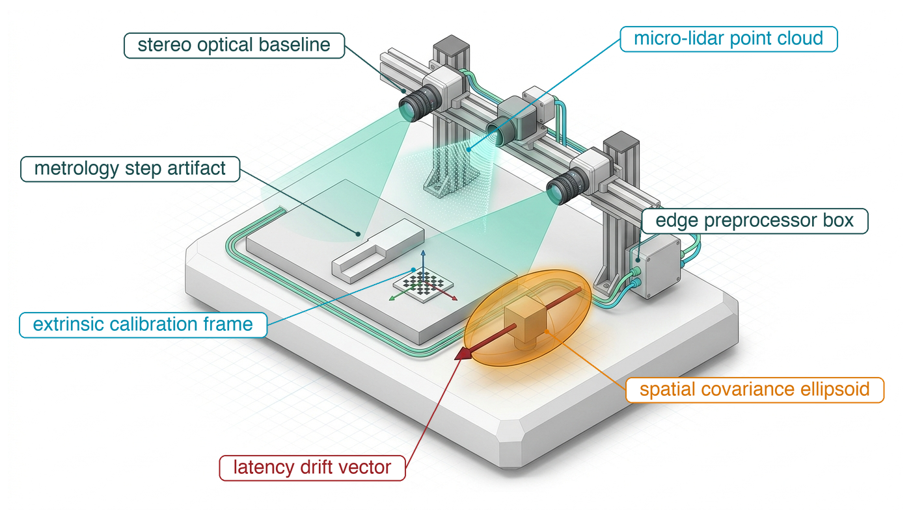
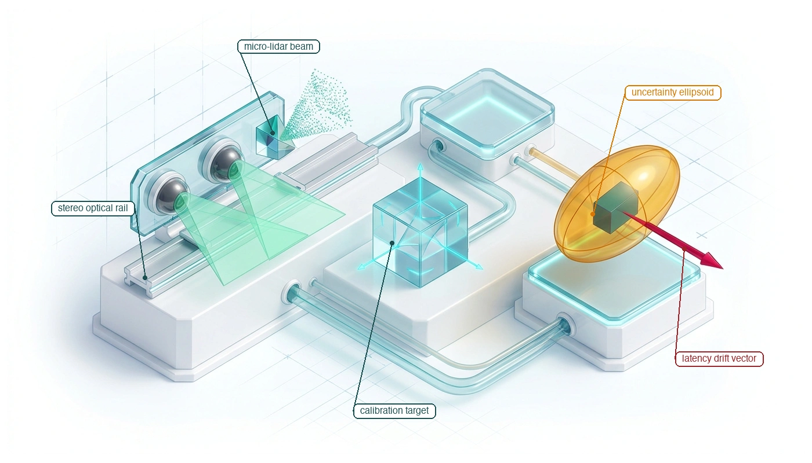
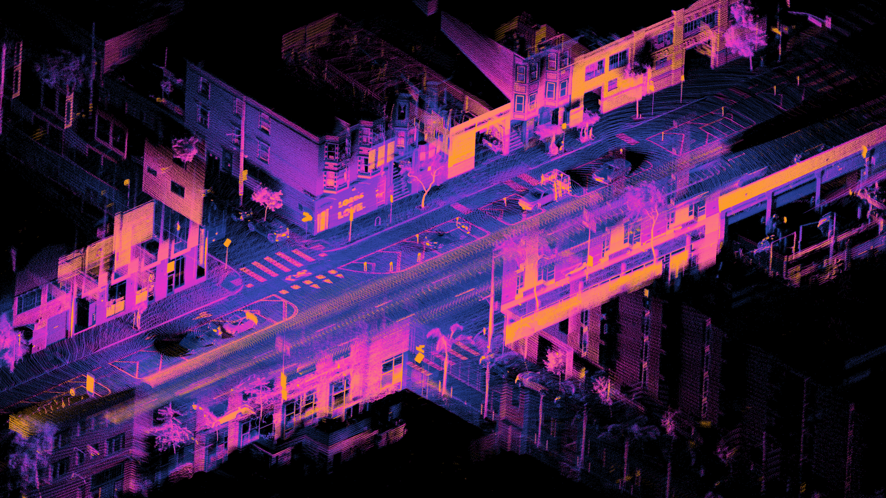
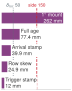
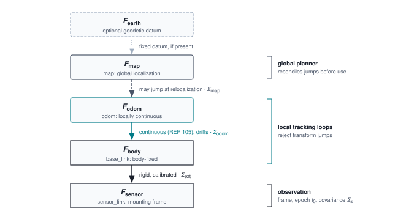
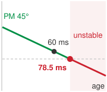
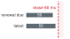
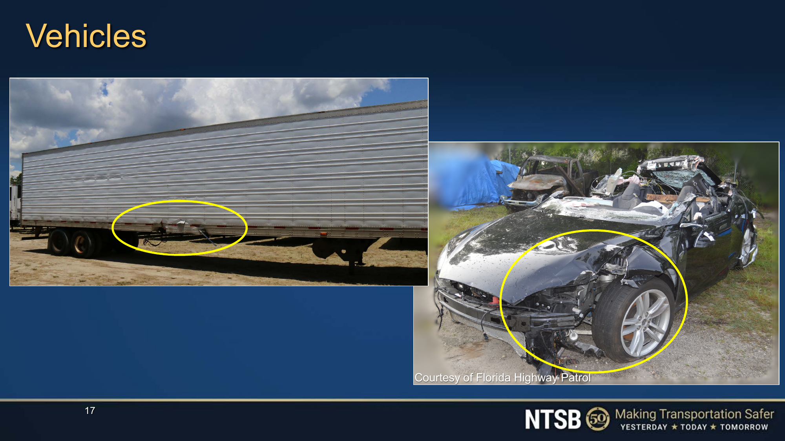

---
format:
  html:
    title: "Sensor Perception"
---

# Sensor Perception {#sec-perception}

::: {layout-narrow}
::: {.column-margin}

\chapterminitoc

:::

::: {.content-visible when-format="pdf"}
\noindent
{fig-alt="Isometric blueprint showing multimodal sensor perception: stereo optical camera rail with sightline frustums, solid-state micro-lidar point cloud fan, precision calibration target with coordinate axes, dynamic uncertainty covariance ellipsoid, and latency drift vector."}
:::

::: {.content-visible unless-format="pdf"}
{fig-alt="Isometric blueprint showing multimodal sensor perception: stereo optical camera rail with sightline frustums, solid-state micro-lidar point cloud fan, precision calibration target with coordinate axes, dynamic uncertainty covariance ellipsoid, and latency drift vector."}
:::

:::

## Purpose {.unnumbered .unlisted}

::: {.content-visible when-format="pdf"}
\begin{marginfigure}
\resizebox{0.92\linewidth}{!}{\mlphysicalstackfull{100}{20}{20}{100}{20}}
\end{marginfigure}
:::

_Why can an accurate detection still be too late to guide a robot?_

A camera can recognize an obstacle correctly and still report where it stood before the robot moved. Exposure, readout, transport, and inference all take time, the machine keeps moving through every millisecond of it, and a shifted mount or a misread clock then places the obstacle somewhere it never stood. None of these errors lowers a detection score. The worst of them, a frame stamped with the wrong time, narrows the estimate's uncertainty around the wrong position, so the machine grows more confident as it grows more wrong. A machine that treats a recognized object as a current position spends its stopping clearance on errors nobody measured. Perception serves a moving machine only when each observation states when it was captured, where it was measured from, and how far it can be trusted, because at the causal boundary a stale or misplaced observation becomes motion that cannot be taken back, and the permission path can refuse only evidence whose age and limits it can check.



::: {.callout-learning-objectives}

- Select sensing modalities by the physical quantity, coverage, and failure limits required for a spatial decision
- Diagnose exposure, rolling-shutter, and calibration errors before measurements enter a geometric estimate
- Calculate capture-to-dispatch age and account for continued aging through downstream consumption without double charging delay
- Evaluate whether qualified spatial error and stopping margins fit the available clearance
- Set a clearance inset from residuals measured against ground truth and a clock-conversion bound from measured synchronization error, rather than from a reported covariance or a datasheet
- Distinguish qualified metric evidence from learned depth estimates and semantic confidence
- Design an observation record whose timing, calibration, error qualification, and health checks support downstream use

:::
## Choosing Evidence for a Spatial Decision {#sec-perception-photons-to-claims}

```{python}
#| label: calc-perception-opening-age
#| echo: false
#| warning: false
#| message: false
# ┌─────────────────────────────────────────────────────────────────────────────
# │ OPENING SCENE: OBSERVATION AGE AT THE RACK END
# ├─────────────────────────────────────────────────────────────────────────────
# │ Context: The opening paragraph of @sec-perception-photons-to-claims;
# │          also the temporal-batching paragraph and the clock-sync pitfall.
# │
# │ Goal:    Show how far the warehouse mobile manipulator travels while its
# │          navigation camera's observation of a person ages.
# │ Show:    t_age 51.6 ms; 77.4 mm of travel at the 1.5 m/s drive limit.
# │ How:     AISLE.perception_age and RM.base.max_velocity; displacement via
# │          calc_spatial_information_age_displacement.
# └─────────────────────────────────────────────────────────────────────────────
from mlsysim import *
from mlsysim.core.units import *
from mlsysim.fmt import fmt_latency, fmt_length, fmt_velocity, check

RM = Embodied.MobileManipulator.WarehouseMobileManipulator
AISLE = Embodied.Scenario.WarehouseAisle

class RackEndOpeningAge:
    """Travel during the navigation camera's observation age at the drive limit."""

    # ┌── 1. LOAD (Constants & Parameters) ─────────────────────────────────
    t_age = AISLE.perception_age  # category: derived
    v = RM.base.max_velocity  # category: illustrative (drive limit)

    # ┌── 2. EXECUTE (Compute) ─────────────────────────────────────────────
    dx = calc_spatial_information_age_displacement(v, t_age).to(ureg.millimeter)

    # ┌── 3. GUARD (Invariants) ───────────────────────────────────────────
    check(abs(t_age.to(millisecond).magnitude - 51.6) < 0.05, f"Unexpected t_age: {t_age}")
    check(abs(v.to(meter / second).magnitude - 1.5) < 1e-9, f"Unexpected drive limit: {v}")
    check(abs(dx.magnitude - 77.4) < 0.05, f"Unexpected travel during t_age: {dx}")

    # ┌── 4. OUTPUT (Formatting) ──────────────────────────────────────────
    t_age_str = fmt_latency(t_age.to(millisecond), unit=millisecond, precision=1)
    v_str = fmt_velocity(v.to(meter / second), unit=meter / second, precision=1)
    dx_str = fmt_length(dx, unit=ureg.millimeter, precision=1)
```

Every motion executed by a physical AI system rests on a claim about the physical world derived from earlier sensor readings. Perception converts raw energy incident on a detector—photons hitting a CMOS sensor array, laser pulses reflected to an avalanche photodiode, or elastomeric deformation at a mechanical fingertip—into concrete spatial claims: the volume occupied by a human coworker, the metric range to a storage rack upright, or the incipient slip of a grasped object. Machine perception has historically been evaluated using static recognition accuracy on fixed benchmarks, where a model scoring high precision on an image is rewarded regardless of when the exposure occurred or how the camera was moving. For an embodied machine, that abstraction collapses. A spatial claim can safely support motion only if it explicitly specifies three properties: the instant its energy was captured, the coordinate frame in which it was measured, and a rigorous bound on its spatial uncertainty. Evaluated against the machine's current velocity, this qualified uncertainty must remain within the remaining physical clearance.

Validating that physical margin requires tracing the evidence pipeline from physical transduction to motion qualification. Sensing modalities must first be matched to the exact physical quantities an action requires, followed by calibration and detector physics that ground the measurement in space and time. Latency must be strictly budgeted from photon capture to observation dispatch, bounding spatial uncertainty against silent sensor corruption before downstream safety filters permit motion. Perception concludes once it yields a qualified measurement; synthesizing these discrete measurements across time into persistent spatial state is the domain of state estimation and spatial memory (@sec-memory).

While the evaluation record of @sec-evaluation establishes the operational envelope where a learned proposer demonstrates competence, executing that policy requires fresh, verifiable evidence describing the robot and its operating environment. Perception delivers this runtime evidence as dated spatial claims across the proposal boundary (@sec-boundary-machine-model). Crucially, perception executes within the non-deterministic Brain above this boundary and possesses zero actuator authority. Actuator control remains strictly governed by the deterministic permission path below the boundary, which evaluates proposed actions against the capture timestamps, coordinate frames, and error qualifications attached to each perceptual claim.

The warehouse mobile manipulator illustrates how dramatically dataset recognition metrics can diverge from real-time utility. A vision model might detect an individual stepping past a rack upright with near-perfect benchmark accuracy, yet still provide the trajectory planner with an obsolete obstacle position. The physical environment continues to move while the navigation camera integrates charge, serializes pixel rows across the bus, and runs inference through the vision pipeline. On this mobile manipulator, `{python} RackEndOpeningAge.t_age_str` elapses between the midpoint of optical exposure and the dispatch of the processed observation (derived in the latency waterfall of @sec-perception-latency-waterfall). Driving at its `{python} RackEndOpeningAge.v_str` velocity limit, the mobile base covers `{python} RackEndOpeningAge.dx_str` over that single observation interval. Benchmark accuracy reveals nothing about whether an observation remains sufficiently fresh to guarantee safe clearance. In embodied AI systems, every observation carries an expiration date.

Whether an architecture employs an end-to-end vision-language-action (VLA) policy [@brohan2023rt2; @kim2024openvla], an end-to-end visuomotor model without a language backbone [@zhao2023learning], or a modular estimator, it must reconcile the physical scene captured at a past instant with the kinematic state of the robot at execution. Architectural choices alter processing latency and representation formats, but no network topology can bypass photon integration, sensor readout, or bus transport delay. Explicit timestamps and spatial transforms keep this spatiotemporal relationship inspectable and auditable; latent representations require external instrumentation and supervisory monitors. Crucially, neither architectural approach can convert ambiguous sensor signals into ground truth: a specular reflection on a polished warehouse floor remains an optical hazard regardless of model capacity.

Navigating past a blind rack corner requires establishing a bounded occupied volume in the robot's base coordinate frame before available stopping distance is exhausted. RGB appearance helps classify an object as a person, but monocular bearing alone cannot supply metric range. The navigation camera therefore requires corroborated depth measurements before its detections can justify motion clearance. At the end-effector, sensing requirements change completely: while external optical cameras guide the initial reaching approach, detecting contact mechanics, shear forces, and incipient slip requires tactile sensing directly at the fingertips. Sensor selection begins by identifying the physical quantity governing each action, followed by analyzing sensor coverage, update rates, and environmental failure modes.

The comparison in @tbl-08-sensor-modalities summarizes the physical evidence each sensing mechanism provides, alongside the primary failure modes and safety-critical checks required before fusing claims across an embodied sensor suite. Incorporating a secondary modality mitigates a shared failure mode only when its independent spatial coverage, timing guarantees, extrinsic calibration, and correlated failure risks are established.

| Modality         | Direct physical information                                                | Main limitation                                                                               | Permission-relevant check                             |
|:-----------------|:---------------------------------------------------------------------------|:----------------------------------------------------------------------------------------------|:------------------------------------------------------|
| RGB camera       | Bearing, appearance, and image motion                                      | Monocular depth scale is ambiguous; glare, darkness, and occlusion can hide objects           | Fresh capture time and validated metric corroboration |
| Active stereo    | Disparity-derived range with infrared texture projection                   | Sunlight washes out projected pattern; range error grows quadratically with distance ($z^2$)  | Range-dependent residual and bias validation          |
| Structured light | High-density triangulated depth from projected coded patterns              | Ambient solar infrared flooding; multi-robot pattern crosstalk; short range ($<3\,\text{m}$)  | Lighting lux limits and pattern decoding integrity    |
| Time-of-flight   | Metric depth via phase delay (iToF) or photon arrival timing (dToF)        | iToF phase wrapping; multipath reflections in corners; flying pixels on moving edges          | Ambiguity distance and corner multipath flags         |
| Pulsed LiDAR     | Metric time-of-flight range at sampled laser beam directions               | Near-field aerosol backscatter in fog/rain; retroreflector blooming; specular puddle dropouts | Qualified range, return quality, and scan timing      |
| FMCW radar       | Metric range and instantaneous radial Doppler velocity of targets          | Multipath ghost returns off ground; lower angular resolution; antenna sidelobe clutter        | Track association and coverage of crossing targets    |
| Event camera     | Asynchronous per-pixel log-intensity contrast events ($\ge C_{\text{th}}$) | Unchanging scenes supply little event evidence; noise and flicker can still generate events   | Event-rate health and independent metric depth source |
| Optical tactile  | Contact micro-depth, surface normals, and shear force vectors              | Zero sensing before physical contact; strictly localized to gripper elastomeric pad           | Contact threshold, slip flags, and marker tracking    |

: **Spatial sensor modality comparison**: Sensor mechanisms provide complementary but fallible claims across physical operating regimes. Numeric range, accuracy, refresh, and link budgets require a named device and mode. For example, [Prophesee EVT2](https://docs.prophesee.ai/stable/data/encoding_formats/evt2.html) encodes an event in 32 bits, so an event camera's link load scales with its event rate before transport overhead. {#tbl-08-sensor-modalities tbl-colwidths="[15,28,31,26]"}

On an operational robot, this division of responsibility is explicit and reflects established industrial safety engineering. The certified safety claim regarding an obstacle at the rack end belongs neither to the vision model nor to the spinning LiDAR. ISO 3691-4 mandates that an autonomous industrial truck detect persons in its path at Performance Level d (PL d) [@iso3691part4; @tuv2021iso3691], the second highest of the five reliability grades (a through e) defined in ISO 13849-1 [@iso13849part1]. Mobile bases satisfy this mandate using an industrial safety laser scanner—a dual-channel, planar time-of-flight sensor certified as an active opto-electronic protective device under IEC 61496-3 [@iec61496part3; @keyence2026szv]. By design and certification standards, the safety scanner performs no semantic classification; it reports solely whether an opaque object has entered its protective optical field, directly triggering the certified emergency stop circuit described in @sec-enforcement-composite-budget.

The mobile base's spinning LiDAR (an Ouster OS1-64) carries no functional safety rating; its datasheet certifies only electrical, laser, and electromagnetic compatibility [@ouster2025os1]. Instead, it provides the dense 3D metric range field that the software permission path evaluates against spatial clearance limits. This evaluation forms an unrated admission check within the software stack—a protective layer operating above the certified hardware safety floor (@sec-enforcement-certified-functions). Its architectural role is to keep learned proposals smooth and proactive, adjusting trajectories well before the robot approaches the safety scanner's protective boundary and causes an abrupt hardware stop.

Meanwhile, the navigation camera enriches the learned proposer with semantic context: distinguishing a coworker from a stationary tote and predicting velocity headings. Because the proposer constructs its trajectory predictions relative to the camera frame, that image frame's capture timestamp defines the evidence epoch carried by the resulting motion proposal. Synchronizing and cross-dating the high-rate LiDAR stream against this camera epoch is detailed in @sec-perception-lidar-age. Anchoring downstream motion to perceptual data elevates exposure intervals, sensor readout timing, and spatial calibration into load-bearing systems invariants. When operational conditions shift, alternative modalities become essential: active illumination resolves textureless surfaces, event cameras preserve high-speed edge transitions across wide dynamic ranges, and tactile arrays provide the localized contact dynamics that remote optical sensors cannot observe.
## Capture Physics and Calibration {#sec-perception-transduction-calibration}

The navigation camera begins measuring a physical obstacle—such as a warehouse rack upright—the moment photons hit its detector. From initial optical transduction at the silicon photodiode array to the eventual consumption of features by a neural policy backbone or state observer, every intermediate processing stage contributes to the observation age. In CMOS active-pixel sensors, incident photons generate electron-hole pairs through the photoelectric effect according to a wavelength-dependent quantum efficiency $\eta(\lambda)$. Silicon photodiodes accumulate this photocharge across a finite exposure interval $t_{\text{exp}}$, collecting total charge:
$$Q = \int_0^{t_{\text{exp}}} \frac{q \eta(\lambda)}{h \nu} P_{\text{opt}}(t)\,dt$$
where $q$ is the elementary charge, $h$ is Planck's constant, $\nu$ is optical frequency, and $P_{\text{opt}}(t)$ is incident optical power. Photons striking the photodiode array do not instantly register as embeddings in downstream memory. Exposure integration, readout serialization, bus transport across PCIe or MIPI CSI, memory staging, preprocessing kernels, and neural backbone inference each consume a slice of the end-to-end latency budget.

Because the photodiode accumulates charge over the finite exposure duration $t_{\text{exp}}$, the captured frame integrates scene radiance over time while both the robot and the surrounding environment are in motion. Assuming approximately constant linear velocity $\mathbf{v}$ and angular velocity $\boldsymbol{\omega}$, with the optical center displaced from the vehicle's center of rotation by lever arm $\mathbf{r}$, a conservative bound on the physical displacement of the camera center during exposure is:
$$\Delta x_{\text{motion}} = \|\mathbf{v}\| \, t_{\text{exp}} + \|\boldsymbol{\omega} \times \mathbf{r}\| \, t_{\text{exp}}$$
This distance measures the physical displacement of the camera center, not the pixel footprint of the blur on the detector plane. Projecting this displacement into image pixels requires scene depth, focal length, viewing direction, and relative attitude changes. Pure rotational motion can smear the image severely even when the camera center remains completely stationary. The resulting **motion blur** acts as a low-pass spatial filter, attenuating image gradients and destroying high-frequency edge information before neural feature extraction or corner detection can run. Downstream estimators can use accurate timestamps and extrinsic calibrations to position the blurred observation at its capture epoch, but no coordinate transformation can synthesize geometric detail lost during optical integration.

The finite integration window also determines which physical instant the resulting image represents. Under an idealized linear sensor response, the pixel value reflects incoming scene radiance $I(t)$ integrated across the exposure window:
$$I_{\text{pixel}} = \int_{0}^{t_{\text{exp}}} I(t)\,dt$$

```{python}
#| label: calc-perception-rolling-shutter-skew
#| echo: false
#| warning: false
#| message: false
# ┌─────────────────────────────────────────────────────────────────────────────
# │ ROLLING-SHUTTER SKEW ON THE NAVIGATION CAMERA
# ├─────────────────────────────────────────────────────────────────────────────
# │ Context: The exposure paragraph and the rolling-shutter example of
# │          @sec-perception-transduction-calibration.
# │
# │ Goal:    Size the exposure-midpoint lag, per-row blur, and scanline skew
# │          the navigation camera records while the base passes a vertical
# │          rack upright.
# │ Show:    an 8 ms midpoint lag; 3,040 rows in 16.6 ms (5.46 us per row);
# │          24.9 mm of along-track skew and 24 mm of blur at the 1.5 m/s
# │          drive limit, about half of the along-travel allowance delta_loc;
# │          9.1 mm of lateral skew from an illustrative 0.5 rad/s yaw at the
# │          1.10 m rack-end distance, about 6 percent of the side clearance.
# │ How:     RM.nav_camera readout, exposure (a configured setting), and row
# │          count; RM.base drive limit; AISLE.delta_loc, AISLE.d_clear,
# │          AISLE.side_clearance; RM.imu sample rate for compensation.
# └─────────────────────────────────────────────────────────────────────────────
from mlsysim import *
from mlsysim.core.units import *
from mlsysim.fmt import fmt, fmt_latency, fmt_length, fmt_velocity, fmt_frequency, fmt_int, fmt_percent, fmt_display_math, check

RM = Embodied.MobileManipulator.WarehouseMobileManipulator
AISLE = Embodied.Scenario.WarehouseAisle

class RollingShutterSkew:
    """Scanline skew and blur on the running machine's navigation camera at the drive limit."""

    # ┌── 1. LOAD (Constants & Parameters) ─────────────────────────────────
    camera = RM.nav_camera  # category: datasheet (registry: navigation camera)
    rows = camera.resolution_height  # category: datasheet
    t_readout = camera.readout_time.to(millisecond)  # category: datasheet
    t_exp = camera.exposure_time.to(millisecond)  # category: chosen (configured exposure; low-light worst case, not a sensor rating)
    v = RM.base.max_velocity.to(meter / second)  # category: illustrative (drive limit)
    omega_yaw = 0.5 * radian / second  # category: illustrative (yaw rate while turning into the aisle)
    z_upright = AISLE.d_clear  # category: illustrative (range to the rack-end upright)
    delta_loc = AISLE.delta_loc  # category: illustrative (along-travel localization allowance)
    side_clearance = AISLE.side_clearance  # category: illustrative
    f_imu = RM.imu.sample_rate  # category: datasheet
    v_aisle = AISLE.v_aisle.to(meter / second)  # category: chosen (aisle speed, below the derived ceiling)

    # ┌── 2. EXECUTE (Compute) ─────────────────────────────────────────────
    t_exp_half = (t_exp / 2).to(millisecond)
    t_row = (t_readout / rows).to(microsecond)
    skew = (v * t_readout).to(ureg.millimeter)  # along the direction of travel
    blur = (v * t_exp).to(ureg.millimeter)
    skew_over_loc = (skew / delta_loc).to(ureg.dimensionless).magnitude
    lateral = (z_upright * omega_yaw.to(1 / second).magnitude * t_readout.to(second).magnitude).to(ureg.millimeter)
    lateral_share = (lateral / side_clearance).to(ureg.dimensionless).magnitude
    skew_aisle = (v_aisle * t_readout).to(ureg.millimeter)  # sensitivity: the chosen aisle speed
    skew_aisle_over_loc = (skew_aisle / delta_loc).to(ureg.dimensionless).magnitude

    # ┌── 3. GUARD (Invariants) ───────────────────────────────────────────
    check(rows == 3040, f"Unexpected navigation-camera row count: {rows}")
    check(abs(t_row.magnitude - 5.46) < 0.005, f"Unexpected row interval: {t_row}")
    check(abs(skew.magnitude - 24.9) < 0.05, f"Unexpected rolling-shutter skew: {skew}")
    check(abs(blur.magnitude - 24.0) < 0.05, f"Unexpected per-row blur: {blur}")
    check(abs(t_exp_half.magnitude - 8.0) < 0.05, f"Unexpected exposure-midpoint lag: {t_exp_half}")
    check(0.45 < skew_over_loc < 0.55, f"Prose says the along-track skew is about half of delta_loc: {skew_over_loc}")
    check(abs(lateral.magnitude - 9.1) < 0.05, f"Unexpected lateral skew from yaw: {lateral}")
    check(0.055 < lateral_share < 0.065, f"Prose says the lateral skew is about 6 percent of the side clearance: {lateral_share}")
    check(abs(skew_aisle.magnitude - 21.6) < 0.05, f"Unexpected skew at the aisle speed: {skew_aisle}")
    check(0.4 < skew_aisle_over_loc < 0.45, f"Notebook says the aisle speed still spends over two fifths of delta_loc: {skew_aisle_over_loc}")

    # ┌── 4. OUTPUT (Formatting) ──────────────────────────────────────────
    rows_str = fmt_int(rows)
    last_row_str = fmt_int(rows - 1)
    t_readout_str = fmt_latency(t_readout, unit=millisecond, precision=1)
    t_exp_str = fmt_latency(t_exp, unit=millisecond, precision=0)
    t_exp_half_str = fmt_latency(t_exp_half, unit=millisecond, precision=0)
    t_row_str = fmt_latency(t_row, unit=microsecond, precision=2)
    skew_str = fmt_length(skew, unit=ureg.millimeter, precision=1)
    blur_str = fmt_length(blur, unit=ureg.millimeter, precision=0)
    v_str = fmt_velocity(v, unit=meter / second, precision=1)
    omega_yaw_str = fmt(omega_yaw.to(radian / second).magnitude, precision=1)
    z_upright_str = fmt_length(z_upright.to(meter), unit=meter, precision=2)
    delta_loc_str = fmt_length(delta_loc.to(ureg.millimeter), unit=ureg.millimeter, precision=0)
    lateral_str = fmt_length(lateral, unit=ureg.millimeter, precision=1)
    lateral_pct_str = fmt_percent(lateral_share, precision=1)
    side_clearance_str = fmt_length(side_clearance.to(meter), unit=meter, precision=2)
    f_imu_str = fmt_frequency(f_imu, unit=ureg.hertz, precision=0, commas=True)
    v_aisle_str = fmt_velocity(v_aisle, unit=meter / second, precision=1)
    skew_aisle_str = fmt_length(skew_aisle, unit=ureg.millimeter, precision=1)
    skew_aisle_pct_str = fmt_percent(skew_aisle_over_loc, precision=1)

    # Display arithmetic for nbk-perception-readout-shear (magnitudes, LaTeX units)
    _tr = fmt(t_readout.magnitude, precision=1)
    _v = fmt(v.magnitude, precision=1)
    _z = fmt(z_upright.to(meter).magnitude, precision=2)
    _w = fmt(omega_yaw.to(radian / second).magnitude, precision=1)
    _rows = fmt_int(rows, commas=False)
    t_row_math = fmt_display_math(
        rf"t_{{\text{{row}}}} = \frac{{t_{{\text{{readout}}}}}}{{H}} = \frac{{{_tr}\ \text{{ms}}}}{{{_rows}}} = {fmt(t_row.magnitude, precision=2)}\ \mu\text{{s}}"
    )
    skew_math = fmt_display_math(
        rf"\Delta x = v\,t_{{\text{{readout}}}} = {_v}\ \text{{m/s}} \times {_tr}\ \text{{ms}} = {fmt(skew.magnitude, precision=1)}\ \text{{mm}}, \quad \frac{{\Delta x}}{{\delta_{{\text{{loc}}}}}} = \frac{{{fmt(skew.magnitude, precision=1)}\ \text{{mm}}}}{{{fmt(delta_loc.to(ureg.millimeter).magnitude, precision=0)}\ \text{{mm}}}} = {fmt(skew_over_loc, precision=2)}"
    )
    lateral_math = fmt_display_math(
        rf"\Delta y = z\,\omega\,t_{{\text{{readout}}}} = {_z}\ \text{{m}} \times {_w}\ \text{{rad/s}} \times {_tr}\ \text{{ms}} = {fmt(lateral.magnitude, precision=1)}\ \text{{mm}}, \quad \frac{{{fmt(lateral.magnitude, precision=1)}\ \text{{mm}}}}{{{fmt(side_clearance.to(ureg.millimeter).magnitude, precision=0)}\ \text{{mm}}}} = {fmt(lateral_share, precision=3)}"
    )
```

Because charge accumulates continuously across this entire window, the effective capture epoch of the resulting image is its exposure midpoint: exactly $t_{\text{exp}}/2$ after the shutter opens and $t_{\text{exp}}/2$ before it closes. For the mobile base running at its `{python} RollingShutterSkew.v_str` drive limit with the navigation camera configured to a `{python} RollingShutterSkew.t_exp_str` exposure, the frame represents the scene where the robot was `{python} RollingShutterSkew.t_exp_half_str` earlier, while the robot traverses `{python} RollingShutterSkew.blur_str` of translation during the exposure itself. Exposure time is a configured software parameter rather than an immutable hardware constant. Our warehouse mobile manipulator configures this relatively long exposure to operate reliably in dim aisle lighting; higher ambient illumination permits shorter integration times, scaling down both motion blur and midpoint latency proportionally.

### Rolling shutter distortion and motion compensation

How exposure is scheduled across the pixel array determines the fundamental geometric consistency of the image. In a **global shutter**\index{Global shutter!definition} sensor, every photodiode integrates charge during the exact same temporal window and transfers accumulated electrons to shielded in-pixel storage nodes simultaneously. In contrast, cost and silicon die area constraints often dictate the use of a **rolling shutter**\index{Rolling shutter!definition} sensor, where rows are reset, exposed, and read out sequentially from top to bottom ($y = 0$ to $y = H - 1$). Each successive scanline begins its exposure after an incremental row readout period $t_{\text{row}}$, introducing a progressive time skew across the vertical axis:
$$t(y) = t_{\text{start}} + y \cdot t_{\text{row}}$$
where $t_{\text{start}}$ denotes the exposure start time of the initial row ($y = 0$). When the vehicle translates at linear velocity $v$ perpendicular to a vertical object, scanline $y$ samples that object at an along-track spatial offset:
$$\Delta x(y) = v \cdot y \cdot t_{\text{row}}$$ {#eq-percep-rolling-shutter-skew}

Under angular motion, rolling shutter distortion becomes non-linear. If the camera rotates with angular velocity vector $\boldsymbol{\omega} = [\omega_x, \omega_y, \omega_z]^\top$ (for example, rapid yaw or pitch during aggressive vehicle maneuvers), the camera attitude drifts continuously throughout the readout phase. The optical axis points in a slightly different direction for every single scanline. For a row at vertical coordinate $y$, the incremental rotation relative to the start of the frame is approximately $\Delta \boldsymbol{\theta}(y) \approx \boldsymbol{\omega} \cdot y \cdot t_{\text{row}}$. This line-dependent rotation bends straight structural lines into curves, stretches or compresses vertical scale during pitching motions, and shears vertical surfaces into inclined planes, as photographed on the rotating propeller blades in @fig-rolling-shutter-skew.

Consider the warehouse mobile manipulator navigating past a vertical rack upright at its `{python} RollingShutterSkew.v_str` drive limit. A vertical post that spans the full frame height does not appear vertical in the raw pixel array, because the sensor reads the bottom scanline ($y =$ `{python} RollingShutterSkew.last_row_str`) an entire readout cycle after the top scanline ($y = 0$). This delay induces two distinct geometric errors that consume separate safety margins: along-track translation shears the upright along the direction of travel, while base yaw during a turn shifts the feature laterally. Notebook \ref{nbk-perception-readout-shear} quantifies both effects.

::: {#nbk-perception-readout-shear .callout-notebook title="The readout shear"}

**Problem**: The base passes a rack upright at its drive limit while turning into the aisle. How far apart does the navigation camera record the upright's top and bottom rows, and what share of the clearance each error spends does it use?

**Variables**:

* Rows $H =$ `{python} RollingShutterSkew.rows_str` and readout $t_{\text{readout}} =$ `{python} RollingShutterSkew.t_readout_str` (Datasheet, full-resolution mode).
* Drive limit $v =$ `{python} RollingShutterSkew.v_str` (Illustrative).
* Yaw rate $\omega =$ `{python} RollingShutterSkew.omega_yaw_str` rad/s while turning into the aisle, at the rack-end range $z =$ `{python} RollingShutterSkew.z_upright_str` (Illustrative).
* Localization allowance $\delta_{\text{loc}} =$ `{python} RollingShutterSkew.delta_loc_str` and side clearance `{python} RollingShutterSkew.side_clearance_str` (Illustrative; @tbl-01-machine-card).

**Math**:

*Row interval.*
`{python} RollingShutterSkew.t_row_math`

*Along-track skew.* At the last row, @eq-percep-rolling-shutter-skew gives
`{python} RollingShutterSkew.skew_math`

*Lateral skew.* The bearing rotates by $\omega\,t_{\text{readout}}$ during readout, which moves the upright sideways at range $z$ by
`{python} RollingShutterSkew.lateral_math`

*Sensitivity.* At the aisle's chosen `{python} RollingShutterSkew.v_aisle_str`, the along-track skew is still `{python} RollingShutterSkew.skew_aisle_str`, `{python} RollingShutterSkew.skew_aisle_pct_str` percent of $\delta_{\text{loc}}$.

**Result**: The bottom rows see the upright from a camera position `{python} RollingShutterSkew.skew_str` farther down the aisle than the top rows did, half of $\delta_{\text{loc}}$. Yaw adds `{python} RollingShutterSkew.lateral_str` sideways, about `{python} RollingShutterSkew.lateral_pct_str` percent of the side clearance.

**Systems insight**: Uncorrected, one readout would spend half of the localization allowance that the stopping budget holds for the whole state estimate, and slowing to aisle speed barely helps. The budget's $\delta_{\text{loc}}$ is therefore valid only if the skew is removed before the estimator sees the frame. The lateral term is small at the rack end, but it grows with range and turn rate, so it belongs in the calibration and timing checks rather than in a budget row.

:::

The along-track error charges directly against $\delta_{\text{loc}}$: treating the image as an instantaneous rigid perspective projection mistakenly models the bottom of the upright as closer along the corridor than the top, directly consuming the along-travel stopping allowance. Both error components scale linearly with total readout time. A global-shutter sensor, such as the wrist-mounted camera on our robot's manipulator arm, eliminates scanline skew at the expense of larger pixel pitch and higher silicon cost. Selecting a shutter architecture is therefore a primary systems decision whenever a sensor's measurements inform clearance boundaries. We deliberately equip the mobile base with a rolling-shutter navigation camera to explore this challenging systems constraint. Resolving this spatial artifact requires **rolling-shutter motion compensation**\index{Rolling-shutter motion compensation!definition}: unwarping image coordinates geometrically using an interpolated camera pose for every scanline. The onboard IMU supplies high-rate (`{python} RollingShutterSkew.f_imu_str`) angular velocity and specific-force[^fn-imu-specific-force] samples rather than direct velocity measurements. A fused state estimator integrates these inertial readings with bias estimates, gravity tracking, and wheel odometry to compute continuous body poses. Transforming these poses through calibrated body-to-camera extrinsics yields the exact optical pose for each scanline, allowing the perception pipeline to rectify the image before running stereo matching or landmark triangulation.

[^fn-imu-specific-force]: **Specific Force**: An accelerometer measures non-gravitational acceleration, $\mathbf{a}-\mathbf{g}$, so a unit resting on the floor reads one $g$ upward and one in free fall reads zero. Dead reckoning must therefore subtract gravity through an attitude estimate, and an attitude error $\theta$ leaks $g\sin\theta$ into horizontal acceleration, which integrates twice into the per-row poses that de-skewing relies on. \index{Inertial measurement unit!specific force}

@Fig-08-rolling-shutter-rows plots this along-travel sampling progression against sensor row index (zero at the top) and read time: the solid line charts the camera advancing by `{python} RollingShutterSkew.skew_str` down the aisle between the top and bottom rows at `{python} RollingShutterSkew.v_str`, enclosed within a `{python} RollingShutterSkew.blur_str` shaded motion-blur band. The dashed vertical boundary marks `{python} RollingShutterSkew.delta_loc_str` of localization allowance, demonstrating that uncorrected scanline skew alone consumes approximately half of the vehicle's total state-estimation budget.

::: {#fig-08-rolling-shutter-rows fig-env="figure" fig-pos="t" fig-cap="**Row-by-row sampling on the navigation camera**: At the `{python} RollingShutterSkew.v_str` drive limit, each of the `{python} RollingShutterSkew.rows_str` rows is read `{python} RollingShutterSkew.t_row_str` after the one above it, so the bottom row sees the rack upright from a camera position `{python} RollingShutterSkew.skew_str` farther down the aisle than the top row (solid line; upper axis gives the read time). The shaded band is each row's own motion blur, `{python} RollingShutterSkew.blur_str` over the `{python} RollingShutterSkew.t_exp_str` exposure. Uncorrected, the skew alone spends about half of the `{python} RollingShutterSkew.delta_loc_str` localization allowance (dashed line)." fig-alt="Line plot with image row on the vertical axis, zero at the top, and camera position along the direction of travel in millimeters on the horizontal axis, with read time in milliseconds on a second axis above. A straight line runs from zero at the top row to about 25 millimeters at the bottom row, inside a shaded band about 24 millimeters wide. A dashed vertical line at 50 millimeters marks the localization allowance."}

```{python}
#| label: plot-perception-rolling-shutter-rows
#| echo: false
#| warning: false
#| message: false
# ┌─────────────────────────────────────────────────────────────────────────────
# │ ROLLING-SHUTTER ROW SAMPLING (FIGURE)
# ├─────────────────────────────────────────────────────────────────────────────
# │ Context: @fig-08-rolling-shutter-rows in
# │          @sec-perception-transduction-calibration.
# │
# │ Goal:    Make the along-travel skew physical: row index against the camera
# │          position at which that row was read, with per-row blur and the
# │          localization allowance it spends.
# │ Show:    0 -> 24.9 mm over 3,040 rows (16.6 ms); 24 mm blur band; 50 mm
# │          delta_loc line.
# │ How:     Reads RollingShutterSkew only; the plotted endpoint is guarded
# │          against its skew.
# └─────────────────────────────────────────────────────────────────────────────
import numpy as np
import matplotlib.pyplot as plt
from mlsysim import viz
from mlsysim.fmt import check

RS = RollingShutterSkew
PETROL, PINE, SOFT = "#007A87", "#1A4D3E", "#4A5568"  # measured, structural, neutral (theme-colors.tex)

# ┌── 1. LOAD ─────────────────────────────────────────────────────────────────
n_rows = RS.rows
v_mm_per_ms = RS.v.to(ureg.millimeter / millisecond).magnitude
t_row_ms = RS.t_row.to(millisecond).magnitude
blur_mm = RS.blur.to(ureg.millimeter).magnitude
dloc_mm = RS.delta_loc.to(ureg.millimeter).magnitude

# ┌── 2. EXECUTE ──────────────────────────────────────────────────────────────
rows_axis = np.array([0.0, n_rows - 1.0])
x_cam = v_mm_per_ms * t_row_ms * rows_axis

# ┌── 3. GUARD ────────────────────────────────────────────────────────────────
check(abs(v_mm_per_ms * t_row_ms * n_rows - RS.skew.to(ureg.millimeter).magnitude) < 1e-6, "The plotted skew must equal v * t_readout.")
check(RS.skew.to(ureg.millimeter).magnitude < dloc_mm, "The skew must sit inside the drawn allowance.")

# ┌── 4. PLOT ─────────────────────────────────────────────────────────────────
fig, ax, COLORS, plt = viz.setup_plot(figsize=(5.2, 2.7))
ax.fill_betweenx(rows_axis, x_cam - blur_mm / 2, x_cam + blur_mm / 2, color=PETROL, alpha=0.14, lw=0)
ax.plot(x_cam, rows_axis, color=PETROL, lw=2.0)
ax.axvline(dloc_mm, color=PINE, lw=1.1, ls=(0, (4, 3)))
ax.text(dloc_mm - 1, n_rows * 0.08, rf"$\delta_{{\mathrm{{loc}}}}$ = {RS.delta_loc_str}", ha="right", va="center", fontsize=8, color=PINE)
ax.annotate(
    f"skew {RS.skew_str}",
    xy=(x_cam[-1], rows_axis[-1]),
    xytext=(x_cam[-1] + 6, n_rows * 0.72),
    fontsize=8,
    color=PETROL,
    va="center",
    arrowprops=dict(arrowstyle="-", color=SOFT, lw=0.6),
)
ax.text(-blur_mm / 2 + 0.5, n_rows * 0.18, f"blur {RS.blur_str}", ha="left", va="center", fontsize=8, color=SOFT)
ax.set_xlim(-blur_mm / 2 - 2, dloc_mm + 6)
ax.set_ylim(n_rows * 1.03, -n_rows * 0.03)
ax.set_xlabel("camera position along travel when the row is read (mm)", fontsize=9)
ax.set_ylabel("image row", fontsize=9)
ax.tick_params(labelsize=8)
top = ax.secondary_xaxis("top", functions=(lambda x: x / v_mm_per_ms, lambda t: t * v_mm_per_ms))
top.set_xlabel("read time after the top row (ms)", fontsize=9)
top.tick_params(labelsize=8)
plt.tight_layout()
plt.show()
```

:::

::: {#fig-rolling-shutter-skew fig-env="figure" fig-pos="t" fig-cap="**Rolling shutter distortion geometry**: A phone camera's rolling shutter photographs a turning aircraft propeller. Because scanlines are exposed and read sequentially from top to bottom rather than simultaneously, blades that move appreciably during the frame's readout are recorded as curved, disconnected arcs; each row samples the blade at a later instant. On a moving robot the same row-by-row sampling shears straight structures and biases the geometry downstream estimators triangulate. (Credit: [Dick Lyon](https://commons.wikimedia.org/wiki/File:Propellor_with_rolling-shutter_artifact.jpg) / Wikimedia Commons, CC BY-SA 4.0)." fig-alt="Photograph from an aircraft window of a propeller and engine nacelle in flight, with sky and ground below. The blades appear as bent, curved shapes, some detached from the hub, instead of straight radial blades."}
{width="85%"}
:::

The curved, detached propeller blade segments photographed in @fig-rolling-shutter-skew capture why geometric unwarping must precede spatial interpretation: because scanlines are exposed and read sequentially down the sensor rather than simultaneously, rapid motion shears radial structures across scanline rows. Learned feature backbones can readily misinterpret row-by-row shear as intrinsic physical geometry, while classical stereo matchers fail when scanline displacement shifts correspondences off the calibrated epipolar line.[^fn-epipolar-stereo-geometry] Scaling up model capacity cannot compensate for uncorrected physical sampling distortion; the network simply learns biased geometric representations.

[^fn-epipolar-stereo-geometry]: **Epipolar Line**: For a calibrated camera pair, a point seen in one image can appear in the other only along one line, the projection of the ray from the first camera's center through that point (@sec-perception-error-clearance derives it). Stereo matchers search that line alone, so a rolling-shutter shear that moves a correspondence even one row off it produces a mismatch rather than a slightly worse match. \index{Epipolar geometry!rolling-shutter mismatch}

### Camera calibration

Rolling-shutter compensation assumes that the camera's geometry is already known, and every metric claim the camera supports rests on that calibration. Under the **pinhole camera model**\index{Pinhole camera model} [@hartley2003multiple], the intrinsic matrix $\mathbf{K}$ maps a point $\mathbf{P}_c = [X_c, Y_c, Z_c]^\top$ in the camera's optical frame to the pixel $[u, v]^\top$:
$$\begin{bmatrix} u \\ v \\ 1 \end{bmatrix} \sim \frac{1}{Z_c} \mathbf{K} \mathbf{P}_c = \frac{1}{Z_c} \begin{bmatrix} f_x & 0 & c_x \\ 0 & f_y & c_y \\ 0 & 0 & 1 \end{bmatrix} \begin{bmatrix} X_c \\ Y_c \\ Z_c \end{bmatrix}$$ {#eq-percep-pinhole-projection}
where $f_x, f_y$ are focal lengths in pixels and $(c_x, c_y)$ is the principal point. Inverting the map recovers only a bearing ray, along which every depth is consistent with the pixel:
$$\mathbf{r}(u, v) = \mathbf{K}^{-1} \begin{bmatrix} u \\ v \\ 1 \end{bmatrix} = \begin{bmatrix} \frac{u - c_x}{f_x} \\ \frac{v - c_y}{f_y} \\ 1 \end{bmatrix}$$ {#eq-percep-bearing-ray}

```{python}
#| label: calc-perception-capture-timing-scale
#| echo: false
#| warning: false
#| message: false
# ┌─────────────────────────────────────────────────────────────────────────────
# │ CAPTURE-TIMING AND ATTITUDE ERROR SCALES AT THE RACK END
# ├─────────────────────────────────────────────────────────────────────────────
# │ Context: The bearing-ray paragraph of
# │          @sec-perception-transduction-calibration and the hardware-trigger
# │          paragraph of @sec-perception-handoff.
# │
# │ Goal:    Put machine-scale numbers on timing and attitude errors: travel per
# │          millisecond of misdating, lateral error per degree at the rack end,
# │          the travel hidden by an uncorrected exposure-start trigger stamp,
# │          and the lateral error per millisecond of stamp jitter while turning.
# │ Show:    1.5 mm per ms; 19.2 mm per degree at 1.10 m; 8 ms and 12 mm for
# │          the trigger correction; 0.5 mrad and 0.55 mm per ms of jitter.
# │ How:     RM.base drive limit; AISLE.d_clear; RM.nav_camera exposure;
# │          the illustrative yaw rate of RollingShutterSkew.
# └─────────────────────────────────────────────────────────────────────────────
import math
from mlsysim import *
from mlsysim.core.units import *
from mlsysim.fmt import fmt_angle, fmt_latency, fmt_length, fmt_velocity, check

RM = Embodied.MobileManipulator.WarehouseMobileManipulator
AISLE = Embodied.Scenario.WarehouseAisle

class CaptureTimingScale:
    """Machine-scale travel and lever-arm errors from timing and attitude offsets."""

    # ┌── 1. LOAD (Constants & Parameters) ─────────────────────────────────
    v = RM.base.max_velocity.to(meter / second)  # category: illustrative (drive limit)
    z = AISLE.d_clear  # category: illustrative (rack-end distance)
    t_exp = RM.nav_camera.exposure_time.to(millisecond)  # category: chosen (configured exposure)
    omega_yaw = RollingShutterSkew.omega_yaw  # category: illustrative (yaw rate)
    dt_unit = 1.0 * millisecond  # category: illustrative (one millisecond of error)
    theta_unit = 1.0 * ureg.degree  # category: illustrative (one degree of error)

    # ┌── 2. EXECUTE (Compute) ─────────────────────────────────────────────
    dx_per_ms = (v * dt_unit).to(ureg.millimeter)
    dy_per_deg = (z * math.sin(theta_unit.to(radian).magnitude)).to(ureg.millimeter)
    t_trigger_corr = (t_exp / 2).to(millisecond)
    dx_trigger = (v * t_trigger_corr).to(ureg.millimeter)
    dtheta_per_ms = (omega_yaw * dt_unit).to(ureg.milliradian)
    dy_per_ms_jitter = (z * dtheta_per_ms.to(radian).magnitude).to(ureg.millimeter)

    # ┌── 3. GUARD (Invariants) ───────────────────────────────────────────
    check(abs(dx_per_ms.magnitude - 1.5) < 1e-9, f"Unexpected travel per ms: {dx_per_ms}")
    check(abs(dy_per_deg.magnitude - 19.2) < 0.05, f"Unexpected lateral error per degree: {dy_per_deg}")
    check(abs(dx_trigger.magnitude - 12.0) < 1e-6, f"Unexpected trigger-correction travel: {dx_trigger}")
    check(abs(dy_per_ms_jitter.magnitude - 0.55) < 1e-6, f"Unexpected lateral error per ms of jitter: {dy_per_ms_jitter}")

    # ┌── 4. OUTPUT (Formatting) ──────────────────────────────────────────
    v_str = fmt_velocity(v, unit=meter / second, precision=1)
    z_str = fmt_length(z.to(meter), unit=meter, precision=2)
    dx_per_ms_str = fmt_length(dx_per_ms, unit=ureg.millimeter, precision=1)
    dy_per_deg_str = fmt_length(dy_per_deg, unit=ureg.millimeter, precision=1)
    t_trigger_corr_str = fmt_latency(t_trigger_corr, unit=millisecond, precision=0)
    dx_trigger_str = fmt_length(dx_trigger, unit=ureg.millimeter, precision=0)
    dtheta_per_ms_str = fmt_angle(dtheta_per_ms, unit=ureg.milliradian, precision=1)
    dy_per_ms_jitter_str = fmt_length(dy_per_ms_jitter, unit=ureg.millimeter, precision=2)
```

This bearing ray emanates from the camera's optical center at the precise instant of photon capture $t_0$. If downstream motion planning unprojects $\mathbf{r}(u, v)$ using the robot's *current* pose instead of its historical capture pose, the elapsed observation age $t_{\text{age}}$ translates the ray origin by $\Delta \mathbf{x} = \int_{t_0}^{t_0+t_{\text{age}}} \mathbf{v}(t)\,dt$. These timing and angular errors scale along entirely different physical axes. At our `{python} CaptureTimingScale.v_str` drive limit, each millisecond of unmodeled latency shifts the ray origin by `{python} CaptureTimingScale.dx_per_ms_str`, making a total observation age of `{python} RackEndOpeningAge.t_age_str` displace the origin by `{python} RackEndOpeningAge.dx_str`. Conversely, attitude errors scale with range: a single degree of orientation misalignment shifts a target at the `{python} CaptureTimingScale.z_str` rack-end distance by `{python} CaptureTimingScale.dy_per_deg_str` laterally, expanding proportionally with distance. Unchecked, either discrepancy can push a physical rack upright entirely outside the bounding volume evaluated by the safety checker. A single monocular camera cannot recover metric range along its bearing rays; scale must be supplied by stereo disparity, an active ranging sensor, or a learned geometric prior—each introducing uncertainty that @sec-perception-error-clearance audits against the operating clearance budget. Optical lens distortion is rectified inside the hardware image signal processor (ISP) stage detailed in @tbl-08-latency-budget. We develop the full projection equations, radial-tangential distortion models, and Zhang's planar calibration method [@zhang2000flexible] in @sec-appendix-systems-vision.

Spatial extrinsics and temporal synchronization between the camera and the IMU must be calibrated jointly [@furgale2013unified]. An extrinsic orientation error $\theta$ misplaces an observed feature at depth $z$ by approximately $z\,\theta$, while spatial translation between the camera center and the IMU introduces centripetal and tangential lever-arm accelerations (@sec-appendix-control-spatial). Similarly, an uncalibrated temporal offset $\Delta t$ between image exposure and inertial sampling causes an effective orientation error of $\omega\,\Delta t$ while turning at angular velocity $\omega$. This timing skew displaces the reconstructed feature by approximately $z\,\omega\,\Delta t$, growing with both vehicle yaw rate and target distance. Hardware-latching exposure triggers and IMU clock signals to a shared real-time counter bounds this synchronization offset to sub-microsecond regimes, leaving small residual latencies for online filtering. Because mechanical shocks and thermal expansion degrade calibration over time, every observation packet must record its calibration identifier alongside its empirical operating envelope.

### Choosing metric depth for the aisle

Because a single bearing ray leaves range undetermined, robotic systems often deploy active optical depth sensors to recover scale. However, ambient warehouse lighting, surface material properties, and optical interference from neighboring robot fleets dictate which physical transduction principle remains viable in practice.

**Structured light**\index{Structured light!transduction} projects a known pseudo-random or coded infrared pattern onto the scene and triangulates surface deformation using an offset receiver camera. This active pattern injects distinct visual texture onto featureless cardboard cartons. However, direct sunlight from skylights or open loading docks easily washes out the projected infrared pattern, and overlapping projectors from adjacent mobile bases create optical interference that corrupts feature correspondence. Engineering qualification must evaluate the operating environment under peak ambient lux and multi-robot contention rather than treating structured light as an unconditional depth source.

**Indirect time-of-flight (iToF)**\index{Time-of-flight!indirect vs direct} calculates distance by measuring the phase shift of continuous-wave amplitude-modulated infrared light. While phase differences yield dense range maps with compact hardware, modulation periodicity creates phase wrapping and distance ambiguity intervals. Furthermore, multi-path reflections—ubiquitous in metallic warehouse corners and industrial shelving—cause diffuse photons to traverse multiple bounces, producing severely biased depth estimates. In dynamic scenes, motion between sequential phase sample exposures introduces edge artifacts. **Direct time-of-flight (dToF)** avoids periodic phase wrapping by measuring the arrival times of discrete photon pulses using single-photon avalanche diodes (SPADs). Although dToF eliminates phase ambiguity, it remains subject to timing jitter in the receiver discriminator, multi-path contamination, and optical pile-up from high-reflectance foregrounds.

**Active stereo**\index{Active stereo!transduction} combines structured infrared illumination with a calibrated stereo camera pair. Unlike structured light systems that must decode a proprietary pattern, active stereo uses projected speckle purely to synthesize artificial texture on smooth surfaces while computing standard epipolar stereo correspondence. If bright ambient light washes out the infrared pattern, the underlying stereo pipeline continues operating over ambient visible texture. Conversely, if a smooth surface lacks ambient texture, high illumination alone cannot resolve depth. The range-dependent uncertainty analysis in @sec-perception-error-clearance determines whether active stereo depth uncertainty satisfies the robot's required stopping clearance.

### Neuromorphic event cameras and asynchronous temporal contrast

Conventional CMOS sensors integrate photons over a synchronous exposure window, inherently trading motion blur against low-light photon starvation. **Neuromorphic event cameras** (Dynamic Vision Sensors, or DVS)\index{Neuromorphic event cameras!transduction}\index{Event cameras!transduction}[^fn-neuromorphic-retina-origin] abandon discrete frames entirely [@lichtsteiner2008128; @gallego2022event].

[^fn-neuromorphic-retina-origin]: **Neuromorphic**: Carver Mead coined the term at Caltech for analog circuits that compute the way neural tissue does [@mead1990], and the silicon retina built in his group is the ancestor of the Dynamic Vision Sensor [@lichtsteiner2008128]. Like the retina, each pixel reports change rather than level, so an obstacle that stands still in front of a stationary sensor produces no events and is invisible to it. \index{Neuromorphic engineering!origin}

Each pixel on an event sensor array operates autonomously, containing a logarithmic photodiode, an analog amplifier, and two differential voltage comparators. The pixel continuously monitors incoming scene radiance $I(u, v, t)$. Whenever the temporal change in logarithmic intensity exceeds a configurable contrast threshold $C_{\text{th}}$, the pixel emits an asynchronous digital event packet $e_k$:
$$|\Delta \ln I(u, v, t)| = |\ln I(u, v, t) - \ln I(u, v, t_{\text{last}})| \ge C_{\text{th}}$$
$$e_k = \langle u_k, v_k, t_k, p_k \rangle$$
where $(u_k, v_k)$ is the pixel address, $t_k$ is the event timestamp latched with microsecond resolution ($1\text{--}10\,\mu\text{s}$), and $p_k \in \{-1, +1\}$ is the polarity indicating whether radiance increased or decreased.

Event sensing preserves the temporal fidelity of high-speed edge transitions without waiting for a complete exposure cycle and serial scanline readout, providing high temporal resolution for rapid maneuvers. The fundamental systems trade-off lies in the nature of temporal contrast: static obstacles produce zero events when the camera is stationary, rendering unmoving obstacles undetectable without ego-motion. Furthermore, high-frequency fluorescent lighting flicker and thermal noise generate spurious event bursts. The bandwidth demand across the physical sensor interface is therefore dynamic and scene-dependent rather than deterministic and fixed.

Downstream estimation algorithms must convert asynchronous coordinate streams in $(u, v, t)$ space into representations suitable for neural networks or state observers. Accumulating events into fixed time slices allows the use of standard convolutional backbones but reintroduces latency; processing individual event timestamps maintains sub-millisecond temporal responsiveness at the cost of specialized asynchronous graph or spiking architectures. Neither representation provides absolute metric depth without stereo baseline pairing or active sensor fusion.

### Active LiDAR and radar ranging transduction

While optical cameras capture dense angular projections of ambient illumination, active ranging sensors, principally Light Detection and Ranging (**LiDAR**)\index{LiDAR!transduction physics} and Radio Detection and Ranging (**radar**)\index{Radar!FMCW transduction}, emit structured electromagnetic energy and measure its reflection, directly extracting metric depth and radial velocity.

Pulsed time-of-flight LiDAR calculates radial distance $R$ by measuring the round-trip flight duration $\Delta t$ of an emitted laser pulse traveling at the speed of light $c$:
$$R = \frac{c \cdot \Delta t}{2}$$

In three-dimensional space, optical scanners steer each pulse along azimuth $\theta$ and elevation $\phi$, casting an emitted ray along unit direction vector $\mathbf{d}(\theta, \phi) = [\cos\phi\cos\theta, \; \cos\phi\sin\theta, \; \sin\phi]^\top$. When reflected energy trips the receiver threshold after flight time $\Delta t$, the sensor unprojects the return into a 3D point in the sensor frame $\mathcal{F}_{\text{lidar}}$ via ray casting (@eq-percep-lidar-ray):
$$\mathbf{p}_{\text{lidar}} = R \cdot \mathbf{d}(\theta, \phi) = \frac{c \cdot \Delta t}{2} \begin{bmatrix} \cos\phi \cos\theta \\ \cos\phi \sin\theta \\ \sin\phi \end{bmatrix}$$ {#eq-percep-lidar-ray}

```{python}
#| label: calc-perception-lidar-sweep
#| echo: false
#| warning: false
#| message: false
# ┌─────────────────────────────────────────────────────────────────────────────
# │ THE MACHINE'S LIDAR: RANGE ERROR AND SWEEP DISTORTION
# ├─────────────────────────────────────────────────────────────────────────────
# │ Context: The LiDAR paragraphs of @sec-perception-transduction-calibration;
# │          reused by the LiDAR age budget (the state-estimation example of
# │          @sec-perception-state-estimation re-derives its inputs).
# │
# │ Goal:    Give the OS1-64's datasheet range precision and bias, and size
# │          the motion the base makes during one 20 Hz revolution.
# │ Show:    precision 5-30 mm (1 sigma), accuracy 25 mm; 50 ms sweep; 75 mm
# │          of travel and 25 mrad (1.4 degrees) of yaw across one sweep.
# │ How:     RM.lidar.scan_rate; Ouster OS1 Rev7 datasheet (firmware 3.1)
# │          precision and accuracy (registry), specified in the 1024 x 10 Hz
# │          mode; illustrative yaw rate.
# └─────────────────────────────────────────────────────────────────────────────
from mlsysim import *
from mlsysim.core.units import *
from mlsysim.fmt import fmt, fmt_latency, fmt_length, fmt_frequency, fmt_angle, check

RM = Embodied.MobileManipulator.WarehouseMobileManipulator

class LidarSweep:
    """Range error and one-revolution motion distortion for the machine's OS1-64."""

    # ┌── 1. LOAD (Constants & Parameters) ─────────────────────────────────
    lidar = RM.lidar  # category: datasheet (registry: Ouster OS1-64)
    f_scan = lidar.scan_rate  # category: datasheet (configured 20 Hz mode)
    sigma_r_min = lidar.range_precision_min  # category: datasheet (registry: OS1 Rev7 precision min, 1 sigma, beyond 1 m)
    sigma_r_max = lidar.range_precision_max  # category: datasheet (registry: OS1 Rev7 precision max, 1 sigma, beyond 1 m)
    bias_r = lidar.range_accuracy  # category: datasheet (registry: OS1 Rev7 accuracy, Lambertian targets)
    wavelength = lidar.laser_wavelength  # category: datasheet (registry: OS1 Rev7 laser wavelength)
    v = RM.base.max_velocity.to(meter / second)  # category: illustrative (drive limit)
    omega_yaw = 0.5 * radian / second  # category: illustrative (yaw rate)

    # ┌── 2. EXECUTE (Compute) ─────────────────────────────────────────────
    t_sweep = (1 / f_scan).to(millisecond)
    dx_sweep = (v * t_sweep).to(ureg.millimeter)
    dtheta_sweep = (omega_yaw * t_sweep).to(ureg.milliradian)
    dtheta_sweep_deg = dtheta_sweep.to(ureg.degree)

    # ┌── 3. GUARD (Invariants) ───────────────────────────────────────────
    check(abs(f_scan.to(ureg.hertz).magnitude - 20.0) < 1e-9, f"Unexpected LiDAR scan rate: {f_scan}")
    check(abs(t_sweep.magnitude - 50.0) < 1e-9, f"Unexpected sweep period: {t_sweep}")
    check(abs(dx_sweep.magnitude - 75.0) < 1e-6, f"Unexpected travel per sweep: {dx_sweep}")
    check(abs(dtheta_sweep.magnitude - 25.0) < 1e-6, f"Unexpected yaw per sweep: {dtheta_sweep}")
    check(wavelength.to(ureg.nanometer).magnitude < 1000, "The OS1-64 emits in the near infrared that silicon detectors sense.")

    # ┌── 4. OUTPUT (Formatting) ──────────────────────────────────────────
    wavelength_str = fmt(wavelength.to(ureg.nanometer).magnitude, precision=0)
    f_scan_str = fmt_frequency(f_scan, unit=ureg.hertz, precision=0)
    sigma_r_min_str = fmt_length(sigma_r_min, unit=ureg.millimeter, precision=0)
    sigma_r_max_str = fmt_length(sigma_r_max, unit=ureg.millimeter, precision=0)
    bias_r_str = fmt_length(bias_r, unit=ureg.millimeter, precision=0)
    t_sweep_str = fmt_latency(t_sweep, unit=millisecond, precision=0)
    dx_sweep_str = fmt_length(dx_sweep, unit=ureg.millimeter, precision=0)
    omega_yaw_str = fmt(omega_yaw.to(radian / second).magnitude, precision=1)
    dtheta_sweep_str = fmt(dtheta_sweep.magnitude, precision=0)
    dtheta_sweep_deg_str = fmt(dtheta_sweep_deg.magnitude, precision=1)
```

```{python}
#| label: calc-perception-active-sensor-scales
#| echo: false
#| warning: false
#| message: false
# ┌─────────────────────────────────────────────────────────────────────────────
# │ ACTIVE-SENSOR RESOLUTION SCALES
# ├─────────────────────────────────────────────────────────────────────────────
# │ Context: The LiDAR transverse-uncertainty item and the FMCW range-resolution
# │          paragraph of @sec-perception-transduction-calibration.
# │
# │ Goal:    Size the LiDAR spot at range and the FMCW radar range resolution.
# │ Show:    30 m x 2 mrad = 60 mm spot; c / (2 x 4 GHz) = 3.75 cm.
# │ How:     sigma_perp = R * div; Delta R = c / (2 B).
# └─────────────────────────────────────────────────────────────────────────────
from mlsysim import *
from mlsysim.core.units import *
from mlsysim.fmt import fmt_angle, fmt_length, fmt_frequency, check

class ActiveSensorScales:
    """LiDAR spot size and FMCW range resolution for generic sensors."""

    # ┌── 1. LOAD (Constants & Parameters) ─────────────────────────────────
    r_spot = 30.0 * meter  # category: illustrative (range for the spot example)
    div = 2.0 * ureg.milliradian  # category: illustrative (generic beam divergence)
    b_chirp = 4.0 * ureg.gigahertz  # category: illustrative (77-81 GHz automotive sweep)
    c_light = (1 * ureg.speed_of_light).to(meter / second)  # category: constant (speed of light)

    # ┌── 2. EXECUTE (Compute) ─────────────────────────────────────────────
    spot = (r_spot * div.to(ureg.radian).magnitude).to(ureg.millimeter)
    dr_radar = (c_light / (2 * b_chirp)).to(ureg.centimeter)

    # ┌── 3. GUARD (Invariants) ───────────────────────────────────────────
    check(abs(spot.magnitude - 60.0) < 1e-6, f"Unexpected LiDAR spot: {spot}")
    check(abs(dr_radar.magnitude - 3.747) < 0.01, f"Unexpected radar range resolution: {dr_radar}")

    # ┌── 4. OUTPUT (Formatting) ──────────────────────────────────────────
    r_spot_str = fmt_length(r_spot, unit=meter, precision=0)
    div_str = fmt_angle(div, unit=ureg.milliradian, precision=0)
    spot_str = fmt_length(spot, unit=ureg.millimeter, precision=0)
    b_chirp_str = fmt_frequency(b_chirp, unit=ureg.gigahertz, precision=0)
    dr_radar_str = fmt_length(dr_radar, unit=ureg.centimeter, precision=2)
```

Spatial uncertainty in this unprojected 3D point decomposes into two distinct physical mechanisms:

1. **Radial uncertainty ($\sigma_R$)**: Governed by receiver discriminator timing jitter $\sigma_{\Delta t}$ and pulse rise time, $\sigma_R = \frac{c}{2} \sigma_{\Delta t}$ remains approximately constant across operating distances until return signal attenuation drops photon counts near the detection threshold. The manufacturer datasheet for the robot's OS1-64 specifies a one-standard-deviation precision between `{python} LidarSweep.sigma_r_min_str` and `{python} LidarSweep.sigma_r_max_str` beyond 1 m, alongside a systematic accuracy bias of `{python} LidarSweep.bias_r_str` on diffuse targets [@ouster2025os1]. This systematic accuracy figure bounds the bias of the mean—a calibration offset that temporal averaging cannot eliminate.
2. **Transverse uncertainty ($\sigma_\perp$)**: Governed by optical beam divergence $\delta\theta_{\text{div}}$ and internal angular encoder quantization $\sigma_\theta$. The laser pulse expands into a narrow cone rather than propagating along an infinitesimal line. At range $R$, the transverse spot footprint expands as $\sigma_\perp \approx R \cdot \delta\theta_{\text{div}}$. At $R =$ `{python} ActiveSensorScales.r_spot_str`, an illustrative `{python} ActiveSensorScales.div_str` beam divergence illuminates a `{python} ActiveSensorScales.spot_str` circular disk. When this footprint strikes a surface boundary, the detector receives mixed returns from both foreground and background, elongating spatial uncertainty ellipsoids orthogonal to the line of sight and blurring geometric edges.

Most terrestrial systems operate either at near-infrared wavelengths below $1{,}000\,\text{nm}$, where silicon detectors respond, or at an eye-safe $1{,}550\,\text{nm}$ (permitting higher pulse energies under IEC 60825-1 Class 1 laser regulations).[^fn-laser-class1-safety] The machine's OS1-64 is of the first kind: it emits at `{python} LidarSweep.wavelength_str` nm as a Class 1 laser product [@ouster2025os1]. Mechanical spinning LiDAR systems rotate an array of 16 to 128 laser diodes and avalanche photodiode (APD) detectors across an internal spindle at $10\text{--}20\,\text{Hz}$ to sweep a $360^\circ$ panoramic point cloud.

[^fn-laser-class1-safety]: **Laser Class 1**: The class of IEC 60825-1 whose emission is safe under all reasonably foreseeable viewing, including through optical instruments [@iec60825part1]. Below about $1{,}400\,\text{nm}$ the eye focuses the beam onto the retina, while at $1{,}550\,\text{nm}$ the cornea and lens absorb it first, so the permitted pulse energy is far higher. Those longer wavelengths need indium gallium arsenide detectors rather than silicon, which makes wavelength a range vs. cost choice made under a fixed safety ceiling. \index{Laser safety!Class 1}

Much like rolling-shutter cameras expose scanlines in sequence, a spinning mechanical LiDAR does not record an instantaneous 3D snapshot. Completing a full $360^\circ$ azimuth sweep requires $T_{\text{sweep}} = 1/f_{\text{scan}}$, corresponding to `{python} LidarSweep.t_sweep_str` on our robot's OS1-64 configured at `{python} LidarSweep.f_scan_str`. If the mobile base translates at velocity $\mathbf{v}$ and rotates at angular velocity $\boldsymbol{\omega}$ while the sensor spins, pulses fired at the start of the sweep ($\theta = 0^\circ$) and near completion ($\theta = 360^\circ$) originate from physically distinct vehicle poses. At our `{python} RollingShutterSkew.v_str` drive limit and an illustrative `{python} LidarSweep.omega_yaw_str` rad/s turn rate, the robot travels `{python} LidarSweep.dx_sweep_str` and rotates `{python} LidarSweep.dtheta_sweep_str` mrad (`{python} LidarSweep.dtheta_sweep_deg_str`°) during a single scan. Without motion correction, this sampling lag produces an apparent geometric tear where the end of the revolution meets the beginning, while shearing vertical structures across the corridor.

Restoring rigid geometric fidelity requires **continuous-time LiDAR de-skewing**\index{LiDAR!point cloud de-skewing}. The sensor hardware latches each point return $\mathbf{p}_i$ with an exact firing timestamp $t_i \in [t_{\text{start}}, t_{\text{start}} + T_{\text{sweep}}]$. A rigid pose transformation $\mathbf{T} \in \mathrm{SE}(3)$ encapsulates orientation and translation; we formalize pose composition and inversion in @sec-perception-coordinate-chain. Combining high-frequency (`{python} RollingShutterSkew.f_imu_str`) inertial data with wheel odometry allows the state estimator to compute the continuous trajectory of the vehicle body frame, $\mathbf{T}_{wb}(t_i)$. Applying the calibrated mounting extrinsic $\mathbf{T}_{bl}$ transforms coordinates from the LiDAR frame to the body frame, yielding the world-frame sensor pose $\mathbf{T}_{wl}(t_i) = \mathbf{T}_{wb}(t_i)\mathbf{T}_{bl}$. Each individual homogeneous point return is then projected back into the LiDAR's coordinate frame at the frame reference epoch $t_{\text{start}}$:
$$\mathbf{p}_i(t_{\text{start}}) = \mathbf{T}_{wl}^{-1}(t_{\text{start}}) \cdot \mathbf{T}_{wl}(t_i) \cdot \mathbf{p}_i(t_i)$$
@Fig-08-lidar-pointcloud reconstructs this continuous-time de-skewing across an 18 s driving trajectory through a city intersection: individual returns from a 64-beam spinning LiDAR are registered into a coherent orthographic map colored by return intensity times range (dark blue through magenta to orange). The crisp delineation of building facades, road striping, parked vehicles, and street trees holds only because each pulsed return was corrected using the estimated vehicle pose at its specific firing epoch $t_i$. Independently moving obstacles in the environment require separate velocity estimation and clustering.

::: {#fig-08-lidar-pointcloud fig-env="figure" fig-pos="htb" fig-cap="**Registered LiDAR point cloud**: Returns from a 64-beam spinning LiDAR on a moving car, registered into one map over about 18 s as a simultaneous localization and mapping (SLAM) estimator (@sec-memory-localization-slam) tracked the vehicle's trajectory, and shown in orthographic projection colored by return intensity times range. The sharp building edges and vehicles hold only because every return was placed with the pose at its own firing time; a single sweep is far sparser than this aggregate. (Credit: [Daniel L. Lu](https://commons.wikimedia.org/wiki/File:Ouster_OS1-64_lidar_point_cloud_of_intersection_of_Folsom_and_Dore_St,_San_Francisco.png) / Wikimedia Commons, CC BY 4.0)." fig-alt="Dense point cloud of a city street intersection seen from above at an angle, colored from dark blue through magenta to orange, showing parked cars, road markings, building facades, and trees."}
{width="100%"}
:::

Flash LiDAR architectures eliminate sweep distortion entirely by illuminating the entire field of view with a single laser pulse, capturing an instantaneous 3D range matrix. However, distributing finite optical pulse energy across a wide solid angle severely limits maximum operational range compared to concentrated, steerable beams.

Millimeter-wave radar offers an orthogonal active sensing channel, operating in the $76\text{--}81\,\text{GHz}$ band ($\lambda \approx 3.9\,\text{mm}$). Rather than emitting short, high-energy pulses, **Frequency-Modulated Continuous-Wave (FMCW) radar**\index{Radar!FMCW} transmits linear frequency chirps whose instantaneous carrier frequency sweeps across bandwidth $B$ over chirp duration $T_c$ with slope $S = B / T_c$. When the emitted waveform reflects from an obstacle at range $R$, the echo returns delayed by round-trip flight time $\tau = 2R/c$. Mixing the received echo with a replica of the transmitted signal generates an intermediate frequency (IF) beat tone at frequency $f_b$:
$$f_b = S \cdot \tau = \frac{2 R B}{c \, T_c}$$
Computing a fast Fourier transform across the digitized fast-time samples of each chirp (the **Range-FFT**) extracts metric range $R$ directly, without requiring optical contrast or ambient scene illumination. Physical range resolution depends strictly on total sweep bandwidth:
$$\Delta R = \frac{c}{2B}$$
For a standard `{python} ActiveSensorScales.b_chirp_str` radar sweep ($77\text{--}81\,\text{GHz}$), FMCW radar achieves a fine range resolution of $\Delta R \approx$ `{python} ActiveSensorScales.dr_radar_str`.

The transmitted chirps simultaneously encode radial velocity and bearing. A moving target shifts the phase of successive chirp reflections proportionally to its Doppler velocity; evaluating a second Fourier transform across chirps (the Doppler-FFT) extracts this radial velocity\index{Radar!Doppler velocity} within a single coherent processing interval, avoiding the latency and noise of multi-frame position differencing. Array processing across multiple receive antennas resolves target azimuth and elevation, albeit at substantially coarser angular resolution than optical LiDAR. While our mobile warehouse robot does not mount radar, millimeter-wave sensing represents a critical sensing modality for outdoor autonomous platforms. Its millimeter wavelength penetrates airborne obscurants—such as airborne dust, fog, and steam—that scatter optical wavelengths (@sec-perception-failure-modes). However, radar returns remain sensitive to specular scattering, surface orientation, and multi-path ghost targets, providing complementary evidence rather than an infallible, all-weather guarantee.

### Tactile contact grounding via optical elastomers {#sec-perception-tactile-grounding}

At the end-effector interface, external cameras and range finders cannot measure contact pressure or verify friction adhesion during physical manipulation; indeed, the gripper structure often occludes the contact patch entirely. An optical tactile sensor[^fn-gelsight-tactile-touch] addresses this perceptual blind spot by mounting a compliant, internally illuminated elastomer membrane on the fingertip and imaging its deformation with an internal camera. Photometric stereo algorithms translate surface shading into calibrated local contact topography, while tracking arrays of embedded fiducial markers yields direct measurements of tangential shear strain and incipient slip. Converting these raw optical deformations into a calibrated contact wrench requires a validated finite-element or empirical model that accounts for elastomer hysteresis, dynamic loading, and mechanical wear over time.

[^fn-gelsight-tactile-touch]: **GelSight**: Adelson's group at MIT turned a reflective elastomer skin and an internal camera into a contact sensor that recovers surface geometry and, from painted markers, shear force [@yuan2017gelsight]. The design makes touch one more image stream, so a tactile frame carries an exposure, a readout, and a calibration of its own and must be dated and qualified like the navigation camera's. \index{Tactile sensing!GelSight}

Tactile sensing thus governs the terminal contact phase of robotic grasping, whereas external cameras and range sensors guide the initial approach trajectory. Across both regimes, systems consistency demands rigorous temporal timestamps and validated geometric extrinsics. Downstream estimators cannot treat sensor outputs as abstract, timeless tensors; every tactile frame and spatial point cloud carries a finite physical age and calibration uncertainty that bound downstream safety claims.
## Dating and Placing the Measurement {#sec-perception-handoff}

A frame from the navigation camera lands in host memory as an array of pixel values. Nothing in that array says when the light was captured, where the camera was mounted, or how far a position read from it can be trusted, yet the planner that checks rack-end clearance needs all three. Every modality has the same gap: a trajectory optimizer cannot plan against unorganized time-of-flight returns, and a force controller cannot track a grid of raw intensities. Downstream estimation, planning, and spatial memory require structured physical state—metric positions, velocities, bounding volumes, and semantic classes. Translating raw streams into that state is the perception pipeline's responsibility. Whatever form its output takes, whether an explicit message packet or an observation token sequence, it must carry three mandatory properties before any consumer can use it: a capture timestamp, a reference frame, and a qualified uncertainty envelope.

::: {.column-margin}
{width="100%" fig-alt="S·P·A locator triad highlighting the Sense node."}
*The Sense stage: photons become dated, framed claims.*
:::

The first mandatory property is the **capture timestamp**\index{Capture timestamp!definition} $t_0$, which specifies the temporal midpoint of the physical energy integration window—the effective moment the camera shutter was open or the laser pulse fired. Physical sensors do not take instantaneous snapshots. An optical camera integrates photons across an exposure duration, and a mechanical lidar sweeps laser pulses over an azimuth arc across several milliseconds. Downstream state observers and vision-language-action policies require $t_0$ to ground observation tokens into the machine's dynamic equations of motion. By contrast, the arrival stamp $t_{\text{recv}}$ marks the moment the operating system kernel completes the direct memory access (DMA) transfer. Half of the exposure duration, sensor readout, physical transport, and host DMA transfer all elapse before that interrupt fires. Consequently, the arrival offset $\tau_{\text{recv}} = t_{\text{recv}} - t_0$ is never zero. Substituting arrival time for capture time directly corrupts downstream state estimation and action generation.

```{python}
#| label: calc-perception-arrival-stamp
#| echo: false
#| warning: false
#| message: false
# ┌─────────────────────────────────────────────────────────────────────────────
# │ ARRIVAL-TIMESTAMP OFFSET ON THE NAVIGATION CAMERA
# ├─────────────────────────────────────────────────────────────────────────────
# │ Context: The capture-timestamp paragraph of @sec-perception-handoff.
# │
# │ Goal:    Size the error an estimator makes when it dates the navigation
# │          camera's frame at DMA completion instead of at the exposure midpoint.
# │ Show:    26.6 ms from exposure midpoint to DMA completion; 39.9 mm of base
# │          travel at the 1.5 m/s drive limit.
# │ How:     t_recv - t0 = t_exp/2 + t_readout + t_transport + t_dma from
# │          RM.nav_camera and AISLE; displacement via
# │          calc_spatial_information_age_displacement.
# └─────────────────────────────────────────────────────────────────────────────
from mlsysim import *
from mlsysim.core.units import *
from mlsysim.fmt import fmt_latency, fmt_length, fmt_velocity, check

RM = Embodied.MobileManipulator.WarehouseMobileManipulator
AISLE = Embodied.Scenario.WarehouseAisle

class ArrivalStampOffset:
    """Age hidden by an arrival timestamp on the running machine's navigation camera."""

    # ┌── 1. LOAD (Constants & Parameters) ─────────────────────────────────
    camera = RM.nav_camera  # category: datasheet (registry: navigation camera)
    t_exp = camera.exposure_time  # category: chosen (configured exposure)
    t_readout = camera.readout_time  # category: datasheet
    t_transport = AISLE.t_transport  # category: illustrative
    t_dma = AISLE.t_dma  # category: illustrative
    v = RM.base.max_velocity  # category: illustrative (drive limit)

    # ┌── 2. EXECUTE (Compute) ─────────────────────────────────────────────
    tau_recv = (t_exp / 2 + t_readout + t_transport + t_dma).to(millisecond)
    dx_recv = calc_spatial_information_age_displacement(v, tau_recv).to(ureg.millimeter)

    # ┌── 3. GUARD (Invariants) ───────────────────────────────────────────
    check(abs(tau_recv.magnitude - 26.6) < 0.05, f"Unexpected arrival offset: {tau_recv}")
    check(abs(dx_recv.magnitude - 39.9) < 0.05, f"Unexpected arrival-stamp displacement: {dx_recv}")
    check(tau_recv < AISLE.perception_age, "Arrival offset must be part of the full observation age")

    # ┌── 4. OUTPUT (Formatting) ──────────────────────────────────────────
    tau_recv_str = fmt_latency(tau_recv, unit=millisecond, precision=1)
    dx_recv_str = fmt_length(dx_recv, unit=ureg.millimeter, precision=1)
    v_str = fmt_velocity(v.to(meter / second), unit=meter / second, precision=1)
```

At constant velocity $v$, the hidden travel is $\Delta x = v\,\tau_{\text{recv}}$. On the mobile manipulator, the navigation camera's frame completes its DMA transfer `{python} ArrivalStampOffset.tau_recv_str` after the exposure midpoint. An estimator that timestamps the frame upon arrival dates the measurement late by that full duration. At the base's `{python} ArrivalStampOffset.v_str` drive limit, this temporal mismatch pairs the visual observation with an estimated pose `{python} ArrivalStampOffset.dx_recv_str` ahead of the physical position the camera occupied at capture.

Eliminating this arrival offset and bounding the camera-to-inertial offset $\Delta t$ of @sec-perception-transduction-calibration require stamping the capture event directly in hardware rather than recording when a software thread first handles the frame buffer. Software timestamps inherit operating system scheduling jitter, driver queue delays, and thread preemption. While the base rotates at `{python} RollingShutterSkew.omega_yaw_str` rad/s, each millisecond of scheduling jitter misorients the camera by `{python} CaptureTimingScale.dtheta_per_ms_str`, producing a lateral displacement of `{python} CaptureTimingScale.dy_per_ms_jitter_str` at rack-end distance. Two hardware architectures eliminate this jitter. In the first architecture, a hardware GPIO strobe (such as FSYNC) from the IMU microcontroller simultaneously latches an inertial sample and triggers the camera exposure. Because this trigger edge marks only the start of exposure for the first sensor row rather than the optical midpoint, the driver must add $t_{\text{exp}}/2$ to reach the exposure midpoint, plus $y\,t_{\text{row}}$ for the specific image row $y$ under consideration. Omitting this correction dates the navigation camera frame `{python} CaptureTimingScale.t_trigger_corr_str` early, translating to `{python} CaptureTimingScale.dx_trigger_str` of unmodeled travel at the drive limit. Furthermore, because automatic exposure control varies $t_{\text{exp}}$ dynamically across frames, the driver must apply the specific exposure time reported in each frame's metadata. In the second architecture, used for networked sensors such as the lidar units and GigE Vision cameras, each peripheral timestamps samples against an onboard hardware clock. The Precision Time Protocol (PTP) [@ieee15882019], or its time-sensitive networking profile gPTP [@ieee8021as2020], disciplines these local clocks to a master reference across the Ethernet bus. @Sec-perception-qualifying-error details how to measure and bound the resulting clock synchronization error.

::: {.column-margin .margin-pointer}
↪ @Sec-memory-reference-frames adds how these sensor-to-body transforms go stale over time.
:::

```{python}
#| label: calc-perception-extrinsic-error
#| echo: false
#| warning: false
#| message: false
# ┌─────────────────────────────────────────────────────────────────────────────
# │ EXTRINSIC ANGLE ERRORS AGAINST THE AISLE'S CLEARANCES
# ├─────────────────────────────────────────────────────────────────────────────
# │ Context: The reference-frame paragraph of @sec-perception-handoff, the
# │          transform-chain paragraph of @sec-perception-error-clearance, and
# │          the calibration takeaway.
# │
# │ Goal:    Tie two lever-arm errors to the stopping budget's terms: an
# │          uncalibrated 1 degree mount error at 15 m against the base's side
# │          clearance, and a 0.005 rad extrinsic shift at 10 m against delta_loc.
# │ Show:    0.26 m, about 1.7x the 0.15 m side clearance; 50 mm, the whole
# │          delta_loc allowance.
# │ How:     Delta_y = d sin(theta); delta_x = z theta; AISLE.side_clearance and
# │          AISLE.delta_loc.
# └─────────────────────────────────────────────────────────────────────────────
import math
from mlsysim import *
from mlsysim.core.units import *
from mlsysim.fmt import fmt, fmt_length, fmt_multiple, check

AISLE = Embodied.Scenario.WarehouseAisle

class ExtrinsicErrorBudget:
    """Lever-arm errors from angular mount errors, set against the aisle clearances."""

    # ┌── 1. LOAD (Constants & Parameters) ─────────────────────────────────
    theta_frame = 1.0 * ureg.degree  # category: illustrative (uncalibrated mount error)
    d_frame = 15.0 * meter  # category: illustrative (detection range)
    theta_ext = 0.005 * radian  # category: illustrative (extrinsic shift after shock)
    z_ext = 10.0 * meter  # category: illustrative (target range)
    side_clearance = AISLE.side_clearance  # category: illustrative
    delta_loc = AISLE.delta_loc  # category: illustrative

    # ┌── 2. EXECUTE (Compute) ─────────────────────────────────────────────
    dy_frame = (d_frame * math.sin(theta_frame.to(radian).magnitude)).to(meter)
    dy_over_side = (dy_frame / side_clearance).to(ureg.dimensionless).magnitude
    dx_ext = (z_ext * theta_ext.magnitude).to(ureg.millimeter)
    dx_over_loc = (dx_ext / delta_loc).to(ureg.dimensionless).magnitude

    # ┌── 3. GUARD (Invariants) ───────────────────────────────────────────
    check(abs(dy_frame.magnitude - 0.2618) < 0.0005, f"Unexpected 1-degree lever-arm error: {dy_frame}")
    check(dy_frame > side_clearance, "Prose says the 1-degree error exceeds the side clearance")
    check(abs(dx_ext.magnitude - 50.0) < 0.05, f"Unexpected extrinsic-shift error: {dx_ext}")
    check(abs(dx_over_loc - 1.0) < 1e-9, "Prose says the extrinsic shift spends all of delta_loc")
    # margin_clearance_slip_ladder.svg fig-alt hand-types 262 mm, 50 mm and 150 mm.
    check(round(dy_frame.to(ureg.millimeter).magnitude) == 262, f"Slip-ladder mount rung drifted: {dy_frame}")
    check(
        abs(delta_loc.to(ureg.millimeter).magnitude - 50.0) < 1e-9 and abs(side_clearance.to(ureg.millimeter).magnitude - 150.0) < 1e-9,
        "Slip-ladder reference lines drifted",
    )

    # ┌── 4. OUTPUT (Formatting) ──────────────────────────────────────────
    theta_frame_str = fmt(theta_frame.to(ureg.degree).magnitude, precision=0)
    d_frame_str = fmt_length(d_frame, unit=meter, precision=0)
    dy_frame_str = fmt_length(dy_frame, unit=meter, precision=2)
    dy_over_side_mult_str = fmt_multiple(dy_over_side, precision=1)
    side_clearance_str = fmt_length(side_clearance.to(meter), unit=meter, precision=2)
    theta_ext_str = fmt(theta_ext.magnitude, precision=3)
    z_ext_str = fmt_length(z_ext, unit=meter, precision=0)
    dx_ext_str = fmt_length(dx_ext, unit=ureg.millimeter, precision=0)
    delta_loc_str = fmt_length(delta_loc.to(ureg.millimeter), unit=ureg.millimeter, precision=0)
```

The second mandatory property is the **reference frame**\index{Reference frame!definition} identifier $\mathcal{F}_{\text{sensor}}$. Every spatial measurement is natively resolved in the local coordinate system of the physical transducer: a camera measures bearing angles relative to its optical center, whereas a radar measures range and Doppler velocity relative to its antenna array. Downstream trajectory planners and occupancy maps, by contrast, operate in a chassis body frame $\mathcal{F}_{\text{body}}$ or an inertial navigation frame $\mathcal{F}_{\text{world}}$. Transforming an observation from $\mathcal{F}_{\text{sensor}}$ to $\mathcal{F}_{\text{body}}$ requires applying a rigid-body spatial transformation consisting of a rotation matrix and a translation vector that define the sensor mounting extrinsics—the calibrated physical location and orientation where the sensor is bolted onto the machine. Coordinate frames nest hierarchically from the physical operating environment down to the transducer: $\mathcal{F}_{\text{earth}} \to \mathcal{F}_{\text{map}} \to \mathcal{F}_{\text{odom}} \to \mathcal{F}_{\text{body}} \to \mathcal{F}_{\text{sensor}}$, where every link in this tree introduces its own transform and uncertainty, as diagrammed in @fig-08-coordinate-frame-tree.

When perception outputs omit the frame identifier or rely on nominal CAD dimensions rather than calibrated physical extrinsics, small angular offsets create large spatial errors that scale with distance. For example, an uncalibrated pitch or yaw error of $\theta =$ `{python} ExtrinsicErrorBudget.theta_frame_str`° on a sensor detecting an object at range $d =$ `{python} ExtrinsicErrorBudget.d_frame_str` induces a transverse position error $\Delta y \approx d \sin\theta$ of `{python} ExtrinsicErrorBudget.dy_frame_str`. This lateral offset is approximately `{python} ExtrinsicErrorBudget.dy_over_side_mult_str` the `{python} ExtrinsicErrorBudget.side_clearance_str` side clearance that the base maintains from the warehouse racks, causing the planner to either steer into the racking or falsely reject an open aisle as obstructed.

::: {.column-margin}
{width="100%" fig-alt="Five horizontal bars in millimeters, longest at top: 1 degree mount 262 millimeters, full age 77.4, arrival stamp 39.9, row skew 24.9, trigger stamp 12 millimeters. A dotted slate line marks the 50 millimeter localization allowance and a dashed red line marks the 150 millimeter side clearance; only the mount bar crosses the red line."}

*Timing slips cost tens of millimeters; a `{python} ExtrinsicErrorBudget.theta_frame_str`° mount error costs `{python} ExtrinsicErrorBudget.dy_frame_str`.*
:::

The third mandatory property is an **uncertainty representation**\index{Uncertainty envelope!definition}, such as a measurement covariance $\mathbf{\Sigma}_z$ paired with a validated tail bound or hard error envelope when physical clearance depends on it. Environmental degradations such as low illumination, atmospheric scattering, specular reflections, and out-of-distribution neural network errors distort the residual distribution far beyond Gaussian assumptions. While a covariance matrix characterizes second moments, it does not guarantee a conservative bounding volume for the true physical state. Downstream state estimators and policy heads rely on $\mathbf{\Sigma}_z$ to weight incoming sensory updates against dynamic motion predictions. If perception reports an artificially optimistic covariance, the estimator over-weights spurious measurements and commands aggressive, erratic actuator responses. Robust physical safety decisions must therefore account explicitly for systematic bias, missed detections, and sensor operational limits alongside the reported covariance.

### Calibrating the coordinate chain {#sec-perception-coordinate-chain}

A coordinate frame transform maps a point expressed relative to one origin into the coordinate system of another. Its rotational component reorients the coordinate axes, while its translational component accounts for the spatial displacement between origins. Homogeneous matrix representations package these operations so that camera-to-wrist, wrist-to-base, and base-to-world relationships can be composed at the exact capture instant $t_0$. The engineering requirement is that every link in the kinematic chain describe the true physical mounting and instantaneous pose at that capture time.

A robot's spatial coordinate system forms a **directed acyclic graph (DAG)** of transforms $\mathcal{G} = (\mathcal{V}, \mathcal{E})$, where vertices $\mathcal{V} = \{\mathcal{F}_i\}$ represent physical coordinate frames and directed edges $\mathcal{E}$ represent time-varying rigid-body transforms $\mathbf{T}_{ij}(t) \in \text{SE}(3)$. In practice, systems constrain this DAG to a directed tree where each non-root frame has exactly one parent, ensuring a unique path between any two frames. When unprojecting an optical observation $\mathbf{p}_{\text{cam}}(t_0)$ into world coordinates, the runtime composes the transforms along that tree:
$$\mathbf{p}_{\text{world}}(t_0) = \mathbf{T}_{\text{world}}^{\text{map}} \cdot \mathbf{T}_{\text{map}}^{\text{odom}}(t_0) \cdot \mathbf{T}_{\text{odom}}^{\text{base}}(t_0) \cdot \mathbf{T}_{\text{base}}^{\text{flange}}(t_0) \cdot \mathbf{T}_{\text{flange}}^{\text{cam}} \cdot \mathbf{p}_{\text{cam}}(t_0)$$
The physical mounting location of the sensor on the kinematic chain dictates how coordinate transforms update across this DAG:

In an **eye-in-hand**\index{Eye-in-hand calibration!definition} configuration, the camera or depth sensor is bolted directly to the manipulator's moving tool flange ($\mathcal{F}_{\text{flange}}$). Moving any preceding joint alters the sensor's optical center relative to the world, requiring continuous forward kinematics updates. Solving for the rigid extrinsic transform $\mathbf{X} = \mathbf{T}_{\text{flange}}^{\text{cam}} \in \text{SE}(3)$ requires executing robot motions across $N \ge 2$ non-parallel rotational axes while observing a stationary fiducial target, such as a ChArUco grid.[^fn-charuco-calibration-board] For two distinct poses $k$ and $k+1$, the closed kinematic loop establishes the classic **hand-eye matrix equation**:[^fn-handeye-calibration-origin]
$$\mathbf{A} \mathbf{X} = \mathbf{X} \mathbf{B}$$
where $\mathbf{A} = (\mathbf{T}_{\text{base}, k}^{\text{flange}})^{-1} \mathbf{T}_{\text{base}, k+1}^{\text{flange}} \in \text{SE}(3)$ is the relative flange displacement reported by the forward kinematics chain, and $\mathbf{B} = \mathbf{T}_{\text{cam}, k}^{\text{target}} (\mathbf{T}_{\text{cam}, k+1}^{\text{target}})^{-1} \in \text{SE}(3)$ is the relative camera displacement extracted from optical target unprojection.

[^fn-charuco-calibration-board]: **ChArUco Board**: A chessboard whose white squares carry uniquely coded ArUco markers. The chessboard corners give subpixel accuracy and the codes identify which corners are in view, so calibration works from partial views of the board, the usual case for a camera on a moving wrist. \index{Calibration!ChArUco target}

[^fn-handeye-calibration-origin]: **Hand-Eye Calibration**: The problem was posed as $\mathbf{AX}=\mathbf{XB}$ independently by @shiu1989calibration and @tsai1989new, for cameras bolted to robot wrists. The camera's pose relative to the flange is never measured directly, only inferred from paired motions, so any error in $\mathbf{X}$ enters every grasp the arm plans from that camera, and poorly spread calibration motions leave it weakly determined. \index{Calibration!hand-eye}

In an **eye-to-hand**\index{Eye-to-hand calibration!definition} calibration rig, the camera overlooks the workspace from a body-mounted mast or a stationary overhead beam. When calibrating against an overhead camera, the mobile base must remain parked so that the camera-to-base transform remains constant ($\mathbf{X} = \mathbf{T}_{\text{base}}^{\text{cam}} \in \text{SE}(3)$), while the target is affixed to the robot's moving end-effector ($\mathbf{Z} = \mathbf{T}_{\text{flange}}^{\text{target}} \in \text{SE}(3)$). At each joint configuration, let $\mathbf{A} = (\mathbf{T}_{\text{base}}^{\text{flange}})^{-1}$ map base coordinates into the flange frame and $\mathbf{B} = (\mathbf{T}_{\text{cam}}^{\text{target}})^{-1}$ map camera coordinates into the target frame. These are absolute pose transforms for this rig, rather than the relative motions used above. Both paths then map camera coordinates into the flange frame:
$$\mathbf{A} \mathbf{X} = \mathbf{Z} \mathbf{B}$$
If the mobile base subsequently moves relative to the overhead camera, the runtime must update the camera-to-base transform accordingly.

```{python}
#| label: calc-perception-link-thermal-expansion
#| echo: false
#| warning: false
#| message: false
# ┌─────────────────────────────────────────────────────────────────────────────
# │ THERMAL EXPANSION OF AN ALUMINUM LINK
# ├─────────────────────────────────────────────────────────────────────────────
# │ Context: The calibration-drift paragraph of @sec-perception-coordinate-chain.
# │
# │ Goal:    Size the length change of a warmed aluminum link.
# │ Show:    23e-6/K x 1 m x 10 K = 0.23 mm.
# │ How:     dL = alpha * L * dT.
# └─────────────────────────────────────────────────────────────────────────────
from mlsysim import *
from mlsysim.core.units import *
from mlsysim.fmt import fmt, fmt_length, check

class LinkThermalExpansion:
    """Length change of a uniformly warmed aluminum link."""

    # ┌── 1. LOAD (Constants & Parameters) ─────────────────────────────────
    alpha = 23e-6 / ureg.kelvin  # category: illustrative (typical structural aluminum; alloy datasheet supplies the exact value)
    l_link = 1.0 * meter  # category: illustrative (link length)
    d_temp = 10.0 * ureg.kelvin  # category: illustrative (uniform warming)

    # ┌── 2. EXECUTE (Compute) ─────────────────────────────────────────────
    dl = (alpha * l_link * d_temp).to(ureg.millimeter)

    # ┌── 3. GUARD (Invariants) ───────────────────────────────────────────
    check(abs(dl.magnitude - 0.23) < 1e-9, f"Unexpected expansion: {dl}")

    # ┌── 4. OUTPUT (Formatting) ──────────────────────────────────────────
    alpha_str = fmt(alpha.to(1 / ureg.kelvin).magnitude * 1e6, precision=0)
    l_link_str = fmt_length(l_link, unit=meter, precision=0)
    d_temp_str = fmt(d_temp.to(ureg.kelvin).magnitude, precision=0)
    dl_str = fmt_length(dl, unit=ureg.millimeter, precision=2)
```

Treating the nominal rigid transform chain from CAD as an exact physical calibration ignores load and temperature effects. Physical manipulators exhibit mechanical compliance under payload mass, lost motion and torsional wind-up in the joints (strain wave gears have near-zero backlash, but their flexsplines still twist under load), and thermal expansion (structural aluminum expands at $\alpha \approx$ `{python} LinkThermalExpansion.alpha_str`$\times 10^{-6}/\text{K}$). For an illustrative `{python} LinkThermalExpansion.l_link_str` aluminum link that warms uniformly by `{python} LinkThermalExpansion.d_temp_str`$^\circ\text{C}$, the corresponding expansion is `{python} LinkThermalExpansion.dl_str`. A motor temperature rise alone does not establish that link-temperature change, as localized thermal gradients across structural members and encoder mountings require direct measurement before updating calibration parameters.

```{python}
#| label: calc-perception-wrist-timestamp-skew
#| echo: false
#| warning: false
#| message: false
# ┌─────────────────────────────────────────────────────────────────────────────
# │ JOINT-TO-CAMERA TIMESTAMP SKEW AT THE WRIST
# ├─────────────────────────────────────────────────────────────────────────────
# │ Context: The joint-kinematics timing paragraph of
# │          @sec-perception-coordinate-chain.
# │
# │ Goal:    Size the wrist-camera error from a joint/camera timestamp skew and
# │          the largest skew a grasp tolerance allows.
# │ Show:    10 mm + 3 mm = 13 mm for a 10 ms skew; 3.8 ms allowed for 5 mm.
# │ How:     dp = (v + omega r) dt; dt_max = eps_pos / (v + omega r).
# └─────────────────────────────────────────────────────────────────────────────
from mlsysim import *
from mlsysim.core.units import *
from mlsysim.fmt import fmt, fmt_latency, fmt_length, fmt_velocity, check

class WristTimestampSkew:
    """Wrist-camera position error from joint/camera timestamp skew."""

    # ┌── 1. LOAD (Constants & Parameters) ─────────────────────────────────
    v_wrist = 1.0 * meter / second  # category: illustrative (wrist linear speed)
    omega_wrist = 2.0 * radian / second  # category: illustrative (wrist angular speed)
    r_cam = 0.15 * meter  # category: illustrative (camera lever arm)
    dt_skew = 10.0 * millisecond  # category: illustrative (unmodeled skew)
    eps_pos = 5.0 * ureg.millimeter  # category: illustrative (grasp position tolerance)

    # ┌── 2. EXECUTE (Compute) ─────────────────────────────────────────────
    v_eff = (v_wrist + omega_wrist.to(1 / second).magnitude * r_cam / second).to(meter / second)
    dp_lin = (v_wrist * dt_skew).to(ureg.millimeter)
    dp_rot = ((v_eff - v_wrist) * dt_skew).to(ureg.millimeter)
    dp = (dp_lin + dp_rot).to(ureg.millimeter)
    dt_max = (eps_pos / v_eff).to(millisecond)

    # ┌── 3. GUARD (Invariants) ───────────────────────────────────────────
    check(abs(dp.magnitude - 13.0) < 1e-6, f"Unexpected skew error: {dp}")
    check(abs(dt_max.magnitude - 3.85) < 0.01, f"Unexpected skew bound: {dt_max}")
    check(dt_max > 1.0 * millisecond, "Prose says millisecond-level alignment suffices")

    # ┌── 4. OUTPUT (Formatting) ──────────────────────────────────────────
    v_wrist_str = fmt_velocity(v_wrist, unit=meter / second, precision=0)
    omega_wrist_str = fmt(omega_wrist.to(radian / second).magnitude, precision=0)
    r_cam_str = fmt_length(r_cam, unit=meter, precision=2)
    dt_skew_str = fmt_latency(dt_skew, unit=millisecond, precision=0)
    dp_lin_str = fmt_length(dp_lin, unit=ureg.millimeter, precision=0)
    dp_rot_str = fmt_length(dp_rot, unit=ureg.millimeter, precision=0)
    dp_str = fmt_length(dp, unit=ureg.millimeter, precision=0)
    eps_pos_str = fmt_length(eps_pos, unit=ureg.millimeter, precision=0)
    dt_max_str = fmt_latency(dt_max, unit=millisecond, precision=1)
```

Fusing joint kinematics with optical frames also requires temporal alignment across the transform DAG. Any uncalibrated timestamp skew $dt = t_{\text{cam}} - t_{\text{joint}}$ between the motor communication bus (such as EtherCAT or CANopen) and the camera exposure window evaluates the forward kinematics chain at stale joint angles $\mathbf{q}(t_{\text{joint}}) \neq \mathbf{q}(t_{\text{cam}})$, inducing spatial tracking error:
$$\Delta \mathbf{p}_{\text{skew}} = \mathbf{v}_{\text{wrist}} \, dt + (\boldsymbol{\omega}_{\text{wrist}} \times \mathbf{r}_{\text{cam}}) \, dt$$
At an illustrative wrist linear velocity $v =$ `{python} WristTimestampSkew.v_wrist_str` and angular velocity $\omega =$ `{python} WristTimestampSkew.omega_wrist_str` rad/s with a camera lever arm $r =$ `{python} WristTimestampSkew.r_cam_str`, an unmodeled `{python} WristTimestampSkew.dt_skew_str` skew displaces the observation by `{python} WristTimestampSkew.dp_lin_str` plus `{python} WristTimestampSkew.dp_rot_str`, or `{python} WristTimestampSkew.dp_str`. This error causes the arm to miss a grasp whose position tolerance is `{python} WristTimestampSkew.eps_pos_str`. The timing requirement follows directly from that tolerance: the skew must satisfy $dt \le \epsilon_{\text{pos}}/(v + \omega r)$, which evaluates to `{python} WristTimestampSkew.dt_max_str`. Millisecond-level alignment therefore suffices, whereas microsecond synchronization is unnecessary. Systems typically meet this requirement by timestamping both streams against a single shared clock—such as a fieldbus distributed clock or a PTP master—and interpolating the high-rate joint stream at the camera's exposure midpoint.

The [REP 105 frame convention](https://reps.openrobotics.org/rep-0105/)\index{Standards!REP 105}[^fn-rep-ros-conventions] names these frames and separates a locally continuous `odom` pose from a globally corrected `map` pose. On the mobile manipulator, $\mathcal{F}_{\text{body}}$ is the base's `base_link`, tracked through the odometric frame `odom`, and the arm's serial chain maps its mounting flange `tool0` through the joint angles back to `base_link`. @Tbl-08-rep105-tree lists the frame roles and the behavioral rules each consumer follows. A local controller consumes a continuous estimate and rejects unexpected transform jumps, while runtime checks verify transform timestamps and estimator uncertainties before execution.

[^fn-rep-ros-conventions]: **ROS Enhancement Proposal (REP)**: The Robot Operating System records its community conventions as numbered REPs, a process copied from Python's enhancement proposals. REP 105 fixes the meaning of `map`, `odom`, and `base_link` and the continuity each must keep [@meeussen2010rep105], so a frame name written into a record denotes the same physical frame for every consumer that reads it. \index{Standards!ROS Enhancement Proposal}

| Frame         | Parent in this example | Meaning                                     | Consumer rule                                                 |
|:--------------|:-----------------------|:--------------------------------------------|:--------------------------------------------------------------|
| `earth`       | root                   | Optional geodetic datum                     | Verify datum before global routing                            |
| `map`         | `earth` if present     | Global localization; corrections may jump   | Keep relocalization jumps out of local feedback               |
| `odom`        | `map`                  | Locally continuous pose estimate; may drift | Track motion locally; monitor uncertainty and discontinuities |
| `base_link`   | `odom`                 | Body-fixed origin                           | Body pose still inherits odometry uncertainty                 |
| `sensor_link` | `base_link`            | Calibrated sensor mounting frame            | Apply time-valid extrinsics and their uncertainty             |

: **REP 105 frame roles for a mobile robot**: A compact example of global, local, body, and sensor frames. REP 105 requires `odom`-relative pose to remain continuous but does not prescribe $C^1$ smoothness, a covariance growth rate, or fixed accuracy; these require estimator-specific evidence. {#tbl-08-rep105-tree tbl-colwidths="[14,20,32,34]"}

::: {#fig-08-coordinate-frame-tree fig-env="figure" fig-pos="t" fig-cap="**Coordinate frame tree and its consumers**: Each edge states the property REP 105 or calibration gives it and the uncertainty it adds to the prose equation below. Only the odom to base_link edge is required to stay continuous; the map to odom correction may jump at relocalization, so local tracking loops consume the continuous branch while global planners reconcile the jump. A sensor observation reaches the consumers with its frame, capture epoch $t_0$, and covariance $\mathbf{\Sigma}_z$." fig-alt="Vertical tree of five labeled frame boxes linked by downward arrows: earth, drawn dashed as optional, then map, odom, base_link, and sensor_link. Each arrow carries a short label: fixed datum if present; may jump at relocalization with sigma map; continuous per REP 105 and drifts with sigma odom; rigid and calibrated with sigma ext. Brackets on the right group map as used by the global planner, odom and base_link as used by local tracking loops, and sensor_link as the observation carrying frame, epoch, and covariance."}
{width="90%"}
:::

@Fig-08-coordinate-frame-tree diagrams this hierarchical frame tree and its downstream consumers across five vertical tiers ($\mathcal{F}_{\text{earth}} \to \mathcal{F}_{\text{map}} \to \mathcal{F}_{\text{odom}} \to \mathcal{F}_{\text{base\_link}} \to \mathcal{F}_{\text{sensor\_link}}$): right-hand brackets decouple consumers so that global planners absorb discontinuous $\mathbf{\Sigma}_{\text{map}}$ jumps during relocalization, while high-rate local tracking loops consume the strictly continuous `odom` $\to$ `base_link` branch. This architectural decoupling prevents a global localization correction from manifesting as an abrupt local tracking step on physical actuators. Mounting uncertainty compounds with dynamic pose uncertainty across every intermediate link. Under a first-order propagation model with independent error sources:
$$\mathbf{\Sigma}_{\text{world}} = \mathbf{J}_{\text{map}}\mathbf{\Sigma}_{\text{map}}\mathbf{J}_{\text{map}}^\top + \mathbf{J}_{\text{odom}}\mathbf{\Sigma}_{\text{odom}}\mathbf{J}_{\text{odom}}^\top + \mathbf{J}_{\text{ext}}\mathbf{\Sigma}_{\text{ext}}\mathbf{J}_{\text{ext}}^\top$$
where the Jacobians $\mathbf{J}$ project each frame's spatial covariance into world coordinates. When frame errors correlate, the propagation must include their cross-covariance terms. A downstream consumer requires the frame identifier, capture epoch, and compounded uncertainty envelope, rather than a transform selected merely by its latest publication timestamp.

::: {#psp-perception-observation-invariants .callout-perspective title="The three invariants of observation"}
Pass a perception claim with its capture time and clock domain, coordinate frame, and qualified uncertainty. Refuse a claim when any of those cannot be checked for the proposed motion.
:::

While capture timestamping and kinematic calibration establish the physical instant and spatial reference frame of a measurement, delivering that measurement across an embodied runtime introduces variable computational delay. Managing this latency requires constructing an explicit age budget that tracks the observation from physical energy integration through neural inference and dispatch, bounding the total information age before downstream actuators act.
## Bounding Observation Age {#sec-perception-age-budget}

Even when a rack-end observation is geometrically calibrated, the data it contains describes the past. Any delivery deadline for perception must therefore account for the full physical interval since photon capture—including hardware acquisition, transport, and queueing stages that standard neural inference benchmarks ignore.

::: {.column-margin .margin-pointer}
↩ Transduction freshness and sensor measurement aging are derived in @sec-body-measurement-freshness.
:::

::: {#dfn-perception-spatial-information-age .callout-definition title="Spatial information age"}

***Spatial information age***\index{Spatial information age!definition}\index{Information age!definition} ($t_{\text{age}}$) is the physical time elapsed between the exposure midpoint at the transducer and the consumption of the resulting observation by a policy backbone, state observer, or control loop. It is the capture-to-consumption part of the measurement age that @sec-body-measurement-freshness counts from transduction, and running text calls it observation age.

1.  **Significance**: Because the robot continues moving while the compute pipeline runs, observation age converts directly into physical displacement (@eq-percep-spatial-displacement) and expands the stopping budget through the pre-brake delay $\tau_{\text{delay}}$. On the warehouse mobile manipulator, the navigation-camera observation is already `{python} RackEndOpeningAge.t_age_str` old at dispatch—representing `{python} RackEndOpeningAge.dx_str` of blind travel at the `{python} RackEndOpeningAge.v_str` drive limit—before any downstream consumer has inspected the frame.
2.  **Distinction**: Conventional benchmark latency measures only the software execution time of a forward pass. In contrast, observation age spans the entire physical journey from photon arrival to action: the exposure midpoint, sensor rolling readout, serialized bus transport, direct memory access (DMA) transfers, driver queueing, image signal processor (ISP) conversions, model inference, inter-process dispatch, and any scheduling delay before the consumer acts on the data.
3.  **Common pitfall**: Systems engineers frequently confuse a frame's arrival timestamp in userspace memory ($t_{\text{recv}}$) with its actual physical observation time ($t_0$). On the navigation camera, the arrival timestamp overlooks `{python} ArrivalStampOffset.tau_recv_str` of front-end exposure, readout, and transport. At the maximum drive limit, this unmeasured interval conceals `{python} ArrivalStampOffset.dx_recv_str` of physical travel, saddling downstream controllers with an unmodeled phase lag.

:::

When evaluated along the machine's trajectory, observation age integrates directly into spatial displacement (@eq-percep-spatial-displacement):
$$\Delta \mathbf{x} = \int_{t_0}^{t_0+t_{\text{age}}} \mathbf{v}(t)\,dt$$ {#eq-percep-spatial-displacement}
To assess spatial uncertainty across the perception pipeline, we can combine this motion-induced displacement with first-order stereo triangulation noise and small-angle extrinsic calibration errors (@eq-percep-unified-uncertainty-envelope):
$$\epsilon_{\text{scale}} = \underbrace{\int_{t_0}^{t_0+t_{\text{age}}} \|\mathbf{v}(t)\|\,dt}_{\text{path-length travel}} + \underbrace{\frac{z^2}{fb}\sigma_d}_{\text{stereo depth standard deviation}} + \underbrace{z |\theta_{\text{ext}}|}_{\text{small-angle mounting error scale}}$$ {#eq-percep-unified-uncertainty-envelope}
The first term integrates instantaneous speed to compute path length, providing an upper bound on net translation during the perception delay. The second term characterizes depth uncertainty for a calibrated stereo camera with baseline $b$, focal length $f$, operating range $z$, and disparity standard deviation $\sigma_d$; this term represents a statistical standard-deviation scale rather than an absolute bound. The third term models the lever-arm displacement produced by a small extrinsic angular misalignment $\theta_{\text{ext}}$ over target distance $z$. Combining these terms produces an illustrative scalar error scale rather than a certified safety envelope. Guaranteeing collision clearance requires accounting for spatial vector directions, compensating systematic calibration bias, and bounding the heavy tails of empirical sensor residuals (@sec-perception-error-clearance).

### The latency waterfall {#sec-perception-latency-waterfall}

To quantify age in a representative vision pipeline, we trace the cumulative delay from the exposure midpoint to the moment the perception subsystem publishes its processed state estimate. This capture-to-dispatch interval forms the core of the perception pipeline's **observation age** ($t_{\text{age}}$)\index{Observation age!definition}. When hardware stages execute sequentially, the total age expands as a **latency waterfall**\index{Latency waterfall}; if adjacent stages overlap in hardware or stream through pipelined ring buffers, their combined duration replaces the naive sum of individual stage times:
$$t_{\text{age}} = \frac{t_{\text{exp}}}{2} + t_{\text{readout}} + t_{\text{transport}} + t_{\text{DMA}} + t_{\text{ISP}} + t_{\text{backbone}} + t_{\text{IPC}}$$ {#eq-percep-latency-waterfall}

Because a physical robot possesses mechanical momentum, observation age is not an abstract scheduling metric. It translates directly into blind physical displacement:
$$\Delta x_{\text{blind}} = v \cdot t_{\text{age}}$$
While the perception subsystem captures photons, clocks out pixel lines, transfers buffers over the bus, and executes deep neural network kernels, the chassis continues hurtling through the workspace at velocity $v$. Complete safety margins must account not only for perception latency, but also for downstream execution overheads: authorization lease expiration, control scheduler quantization ticks, fieldbus transmission times, and physical brake actuation latency. Summing these terms yields the total pre-brake delay $\tau_{\text{delay}} = t_{\text{age}} + T_{\text{lease}} + T_{\text{tick}} + T_{\text{bus}} + T_{\text{act}}$, which governs the total blind travel:
$$d_{\text{blind}} = v \cdot \tau_{\text{delay}}$$
At constant operating velocity, every millisecond of unmodeled latency drains physical clearance linearly. If an independent safety monitor or hardware permission path operates concurrently, the safety calculation must reflect that dedicated architecture rather than assuming that every stalled neural forward pass postpones emergency braking. Notebook \ref{nbk-perception-sensor-transduction-latency-spatial-information-age} steps through each hardware and software stage of this waterfall for the warehouse mobile manipulator, converting elapsed time into traveled distance.

```{python}
#| label: calc-perception-sensor-information-age
#| echo: false
#| warning: false
#| message: false
# ┌─────────────────────────────────────────────────────────────────────────────
# │ NAVIGATION-CAMERA INFORMATION AGE AND STOPPING-BUDGET ROW 5
# ├─────────────────────────────────────────────────────────────────────────────
# │ Context: \ref{nbk-perception-sensor-transduction-latency-spatial-information-age},
# │          @tbl-08-latency-budget, and the stopping-budget paragraph of
# │          @sec-perception-transduction-calibration.
# │
# │ Goal:    Sum the warehouse mobile manipulator's navigation-camera latency
# │          waterfall into t_age and add its term to the stopping budget.
# │ Show:    Stage increments and cumulative ages; t_age 51.6 ms; tau_delay
# │          133.6 ms; row 5 v*t_age 77.4 mm at 1.5 m/s; running total
# │          835.5 mm -> 912.9 mm; 187.1 mm of the 1.10 m clear distance left.
# │ How:     Stage terms from RM.nav_camera and AISLE; totals from
# │          calc_safe_stopping_distance with the Body and Nervous System terms
# │          (a_brake, delta_loc, delta_margin, lease path, brake onset). The C2
# │          suffix and tracking inset join later rows, not this one.
# └─────────────────────────────────────────────────────────────────────────────
from mlsysim import *
from mlsysim.core.units import *
from mlsysim.fmt import (
    fmt_latency,
    fmt_length,
    fmt_velocity,
    fmt_time,
    fmt_display_math,
    check,
)

RM = Embodied.MobileManipulator.WarehouseMobileManipulator
AISLE = Embodied.Scenario.WarehouseAisle

class SensorInformationAge:
    """Navigation-camera latency waterfall, t_age, and the observation-age row of the stopping budget."""

    # ┌── 1. LOAD (Constants & Parameters) ─────────────────────────────────
    camera = RM.nav_camera  # category: datasheet (registry: Sony IMX477 navigation camera)
    t_exp = camera.exposure_time.to(millisecond)  # category: chosen (configured exposure)
    t_readout = camera.readout_time.to(millisecond)  # category: datasheet
    t_transport = AISLE.t_transport.to(millisecond)  # category: illustrative
    t_dma = AISLE.t_dma.to(millisecond)  # category: illustrative
    t_isp = AISLE.t_isp.to(millisecond)  # category: illustrative
    t_backbone = AISLE.t_backbone.to(millisecond)  # category: illustrative
    t_ipc = AISLE.t_ipc.to(millisecond)  # category: illustrative
    t_lease = AISLE.t_lease.to(millisecond)  # category: chosen
    t_tick = AISLE.t_tick.to(millisecond)  # category: chosen
    t_bus = AISLE.t_bus.to(millisecond)  # category: illustrative
    t_act = AISLE.t_brake_onset.to(millisecond)  # category: illustrative
    v = RM.base.max_velocity.to(meter / second)  # category: illustrative (drive limit)
    a_brake = AISLE.a_brake  # category: illustrative
    delta_loc = AISLE.delta_loc  # category: illustrative
    delta_margin = AISLE.delta_margin  # category: chosen
    d_clear = AISLE.d_clear  # category: illustrative
    f_frame = camera.frame_rate  # category: datasheet

    # ┌── 2. EXECUTE (Compute) ─────────────────────────────────────────────
    t_exp_half = (t_exp / 2).to(millisecond)
    t_frame = (1 / f_frame).to(millisecond)
    age_after_exposure = t_exp_half
    age_after_readout = age_after_exposure + t_readout
    age_after_transport = age_after_readout + t_transport
    age_after_dma = age_after_transport + t_dma
    age_after_isp = age_after_dma + t_isp
    age_after_backbone = age_after_isp + t_backbone
    tau_age = (age_after_backbone + t_ipc).to(millisecond)

    tau_delay = (tau_age + t_lease + t_tick + t_bus + t_act).to(millisecond)
    dx = calc_spatial_information_age_displacement(v, tau_age).to(ureg.millimeter)
    row_age = dx
    total_before = calc_safe_stopping_distance(v, t_lease + t_tick + t_bus + t_act, a_brake, delta_loc, delta_margin).to(ureg.millimeter)
    total_after = calc_safe_stopping_distance(v, tau_delay, a_brake, delta_loc, delta_margin).to(ureg.millimeter)
    remaining = (d_clear - total_after).to(ureg.millimeter)
    dx_frame = (v * t_frame).to(ureg.millimeter)  # checkpoint: one dropped frame of extra age
    frame_share = (dx_frame / remaining).to(ureg.dimensionless).magnitude

    # ┌── 3. GUARD (Invariants) ───────────────────────────────────────────
    check(abs(tau_age.magnitude - AISLE.perception_age.to(millisecond).magnitude) < 1e-9, f"Waterfall disagrees with AISLE.perception_age: {tau_age}")
    check(abs(tau_age.magnitude - 51.6) < 0.05, f"Unexpected t_age: {tau_age}")
    check(abs(tau_delay.magnitude - AISLE.tau_delay.to(millisecond).magnitude) < 1e-9, f"Delay sum disagrees with AISLE.tau_delay: {tau_delay}")
    check(abs(tau_delay.magnitude - 133.6) < 0.05, f"Unexpected tau_delay: {tau_delay}")
    check(abs(v.magnitude - 1.5) < 1e-9, f"Unexpected drive limit: {v}")
    check(abs(row_age.magnitude - 77.4) < 0.05, f"Unexpected observation-age row: {row_age}")
    check(abs(total_before.magnitude - 835.5) < 0.05, f"Unexpected running total before row 5: {total_before}")
    check(abs(total_after.magnitude - 912.9) < 0.05, f"Unexpected running total after row 5: {total_after}")
    check(abs((total_after - total_before - row_age).magnitude) < 1e-6, "Row 5 does not close the running total")
    check(abs(remaining.magnitude - 187.1) < 0.05, f"Unexpected remaining clear distance: {remaining}")
    check(abs(dx_frame.magnitude - 25.0) < 0.05 and 0.13 < frame_share < 0.14, f"Checkpoint answer drifted: {dx_frame}, {frame_share}")
    check(
        t_backbone == max(t_exp_half, t_readout, t_transport, t_dma, t_isp, t_backbone, t_ipc),
        "Notebook says the backbone is the largest single stage",
    )

    # ┌── 4. OUTPUT (Formatting) ──────────────────────────────────────────
    t_exp_str = fmt_latency(t_exp, unit=millisecond, precision=0)
    t_exp_half_str = fmt_latency(t_exp_half, unit=millisecond, precision=0)
    t_readout_str = fmt_latency(t_readout, unit=millisecond, precision=1)
    t_transport_str = fmt_latency(t_transport, unit=millisecond, precision=1)
    t_dma_str = fmt_latency(t_dma, unit=millisecond, precision=1)
    t_isp_str = fmt_latency(t_isp, unit=millisecond, precision=1)
    t_backbone_str = fmt_latency(t_backbone, unit=millisecond, precision=0)
    t_ipc_str = fmt_latency(t_ipc, unit=millisecond, precision=1)
    tau_age_str = fmt_latency(tau_age, unit=millisecond, precision=1)
    tau_age_s_str = fmt_time(tau_age.to(second), 'second', precision=4)
    age_after_exposure_str = fmt_latency(age_after_exposure, unit=millisecond, precision=0)
    age_after_readout_str = fmt_latency(age_after_readout, unit=millisecond, precision=1)
    age_after_transport_str = fmt_latency(age_after_transport, unit=millisecond, precision=1)
    age_after_dma_str = fmt_latency(age_after_dma, unit=millisecond, precision=1)
    age_after_isp_str = fmt_latency(age_after_isp, unit=millisecond, precision=1)
    age_after_backbone_str = fmt_latency(age_after_backbone, unit=millisecond, precision=1)

    t_lease_str = fmt_latency(t_lease, unit=millisecond, precision=0)
    t_tick_str = fmt_latency(t_tick, unit=millisecond, precision=0)
    t_bus_str = fmt_latency(t_bus, unit=millisecond, precision=0)
    t_act_str = fmt_latency(t_act, unit=millisecond, precision=0)
    tau_delay_str = fmt_latency(tau_delay, unit=millisecond, precision=1)

    v_str = fmt_velocity(v, unit=meter / second, precision=1)
    dx_m_str = fmt_length(dx.to(meter), unit=meter, precision=4)
    dx_mm_str = fmt_length(dx, unit=ureg.millimeter, precision=1)
    row_age_str = fmt_length(row_age, unit=ureg.millimeter, precision=1)
    total_before_str = fmt_length(total_before, unit=ureg.millimeter, precision=1)
    total_after_str = fmt_length(total_after, unit=ureg.millimeter, precision=1)
    remaining_str = fmt_length(remaining, unit=ureg.millimeter, precision=1)
    d_clear_str = fmt_length(d_clear.to(meter), unit=meter, precision=2)
    t_frame_str = fmt_latency(t_frame, unit=millisecond, precision=1)

    tau_age_display_math = fmt_display_math(
        rf"t_{{\text{{age}}}} = {t_exp_half_str} + {t_readout_str} + {t_transport_str} + {t_dma_str} + {t_isp_str} + {t_backbone_str} + {t_ipc_str} = {tau_age_str}"
    )
    dx_display_math = fmt_display_math(rf"\Delta x = ({v_str}) \times ({tau_age_s_str}) = {dx_m_str} = {dx_mm_str}")
    t_rest_str = fmt_latency((t_lease + t_tick + t_bus + t_act).to(millisecond), unit=millisecond, precision=0)
    tau_delay_display_math = fmt_display_math(
        rf"\tau_{{\text{{delay}}}} = \underbrace{{t_{{\text{{age}}}}}}_{{{tau_age_str}}} + \underbrace{{T_{{\text{{lease}}}} + T_{{\text{{tick}}}} + T_{{\text{{bus}}}} + T_{{\text{{act}}}}}}_{{{t_rest_str}}} = {tau_delay_str}"
    )
    d_stop_display_math = fmt_display_math(
        rf"d_{{\text{{stop}}}} = \underbrace{{d_{{\text{{base}}}} + d_{{\text{{lease}}}}}}_{{{total_before_str}}} + \underbrace{{v \cdot t_{{\text{{age}}}}}}_{{{row_age_str}}} = {total_after_str}"
    )
```

::: {#nbk-perception-sensor-transduction-latency-spatial-information-age .callout-notebook title="Travel before the frame is read"}

**Problem**: The mobile manipulator drives toward a rack end at its drive limit when a person steps out. How old is the navigation camera's observation of that person when perception dispatches it, and how far has the base traveled by then?

**Variables**:

* Exposure $t_{\text{exp}} =$ `{python} SensorInformationAge.t_exp_str` (Chosen low-light setting), so the midpoint lag is $t_{\text{exp}}/2 =$ `{python} SensorInformationAge.t_exp_half_str`; rolling readout $t_{\text{readout}} =$ `{python} SensorInformationAge.t_readout_str` (Datasheet).
* Residual MIPI CSI-2 transport $t_{\text{transport}} =$ `{python} SensorInformationAge.t_transport_str` (Illustrative). The [Sony IMX477 flyer](https://www.sony-semicon.com/files/62/pdf/p-13_IMX477-AACK_Flyer.pdf) specifies a four-lane option up to $2.1\text{ Gbps/lane}$; the budget assigns only the transport left after streaming readout, not frame size divided by peak lane rate.
* DMA and driver queue $t_{\text{DMA}} =$ `{python} SensorInformationAge.t_dma_str`, ISP debayering and rectification $t_{\text{ISP}} =$ `{python} SensorInformationAge.t_isp_str`, INT8 vision backbone $t_{\text{backbone}} =$ `{python} SensorInformationAge.t_backbone_str`, and covariance packaging with zero-copy dispatch $t_{\text{IPC}} =$ `{python} SensorInformationAge.t_ipc_str` (all Illustrative).
* Drive limit $v =$ `{python} SensorInformationAge.v_str` (Illustrative).

**Math**:

*Age at dispatch.* The serial stages of @eq-percep-latency-waterfall sum to
`{python} SensorInformationAge.tau_age_display_math`

*Travel.* Holding speed through the age window:
`{python} SensorInformationAge.dx_display_math`

*Sensitivity.* Each further millisecond in any stage adds `{python} CaptureTimingScale.dx_per_ms_str` of travel at the drive limit.

**Result**: The observation is `{python} SensorInformationAge.tau_age_str` old at dispatch, and the base has covered `{python} SensorInformationAge.dx_mm_str`. The backbone is the largest single stage, but exposure and readout alone contribute `{python} SensorInformationAge.age_after_readout_str` before any computation starts.

**Systems insight**: The base covers this distance before the perception record exists. Timestamped pose propagation can place the old observation correctly in the current frame, but no later stage returns the distance already traveled, so $v\,t_{\text{age}}$ enters the stopping budget as a term of its own.

:::

The seven stages of @tbl-08-latency-budget sum to the dispatch age $t_{\text{age}} =$ `{python} SensorInformationAge.tau_age_str`. The existing stopping ledger then adds the active lease and response path of @sec-nervous-cadences:
`{python} SensorInformationAge.tau_delay_display_math`

This subtotal forms a **partial delay ledger** rather than an end-to-end capture-to-response bound. In the timing breakdown of @tbl-04-event-ledger, perception governs the first interval from capture to dispatch, while actuator mechanics govern the third interval of physical braking. The observation continues to age across the intermediate second interval while the proposer completes inference, transmits the candidate trajectory, and awaits admission from the safety checker. Let $\Delta_{\text{da}}$ denote this dispatch-to-admission interval, encompassing model planning and inter-process communication overheads. Because an active lease takes effect only upon candidate admission, the total delay under a stalled-proposer fault equals the displayed subtotal plus $\Delta_{\text{da}}$. In @Sec-placement, \ref{nbk-placement-transport-budget} allocates a budget for $\Delta_{\text{da}}$ that awaits empirical validation on hardware. Because that allocation accounts for full inference after dispatch while the neural vision backbone is already budgeted here, their direct sum provides a conservative bound; empirical timestamping on the loaded machine is required to isolate nonoverlapping execution intervals.

::: {.column-margin .margin-pointer}
↪ @Sec-placement-isolation-decisions allocates $\Delta_{\text{da}}$ for the discrete placement, as a budget still to be qualified.
:::

@Fig-08-capture-to-brake-strip sequences this partial delay ledger across three synchronized lanes (camera, host, and response) over an absolute millisecond timeline and paired base travel: the camera lane tracks exposure midpoint and readout; the host lane stages link transport, DMA, ISP processing, vision backbone inference, and IPC queueing up to dispatch at `{python} SensorInformationAge.tau_age_str`; and the response lane sequences execution lease expiration, control tick, bus transmission, and mechanical actuator onset reaching `{python} SensorInformationAge.tau_delay_str`. A vertical dashed partition at dispatch marks where the unbounded dispatch-to-admission interval $\Delta_{\text{da}}$ inserts additional delay, shifting all downstream brake-onset events to the right.

::: {#fig-08-capture-to-brake-strip fig-env="figure" fig-pos="t" fig-cap="**Capture-to-brake timing strip**: Time runs from the exposure midpoint of the frame that first shows the hazard. The camera and host lanes carry the navigation camera's serial stages, with link, DMA, and ISP drawn as one segment, to dispatch at `{python} SensorInformationAge.tau_age_str`; the response lane adds the lease, tick, bus, and actuator onset of a stalled proposer to reach `{python} SensorInformationAge.tau_delay_str`. The row beneath reads the same axis as base travel at the `{python} SensorInformationAge.v_str` drive limit. The dashed line at dispatch marks where the dispatch-to-admission interval $\Delta_{\text{da}}$ enters; this chapter does not bound it, so every later event shifts right by its measured value." fig-alt="Horizontal timing strip with three lanes labeled camera, host, and response over a time axis in milliseconds. The camera lane shows a solid exposure bar centered on the capture line and a readout bar after it. The host lane shows a combined link, DMA, and ISP bar, a longer backbone bar, and a thin IPC bar ending at a dispatch line. A dashed line at dispatch is labeled as the point where unbounded dispatch-to-admission time enters. The response lane starts at dispatch with a long lease bar, a thin tick and bus bar, and an onset bar ending at a brake-onset line. A bracket over the strip spans capture to brake onset. A travel row beneath marks millimeters of base travel and the travel before and after dispatch."}

```{python}
#| label: plot-perception-capture-to-brake
#| echo: false
#| warning: false
#| message: false
# ┌─────────────────────────────────────────────────────────────────────────────
# │ CAPTURE-TO-BRAKE TIMING STRIP (FIGURE)
# ├─────────────────────────────────────────────────────────────────────────────
# │ Context: @fig-08-capture-to-brake-strip in @sec-perception-latency-waterfall.
# │
# │ Goal:    Put the navigation camera's dispatch age and the stalled-proposer
# │          response path on one clock, with the travel each consumes.
# │ Show:    exposure and readout; link, DMA, ISP, backbone, IPC to t_age; the
# │          point where the unbounded Delta_da enters; lease, tick, bus, and
# │          onset to tau_delay; travel at the drive limit.
# │ How:     viz.perception_age_strip (the shared timing-strip family) reads
# │          every duration from AISLE; the guards tie its drawn events to
# │          SensorInformationAge.
# └─────────────────────────────────────────────────────────────────────────────
from mlsysim import viz
from mlsysim.fmt import check
import matplotlib.pyplot as plt

SIA = SensorInformationAge

# ┌── 1. LOAD ─────────────────────────────────────────────────────────────────
v_strip = SIA.v  # category: illustrative (drive limit)

# ┌── 2. EXECUTE ──────────────────────────────────────────────────────────────
strip_08 = viz.perception_age_strip(AISLE, v_strip)
t_dispatch_drawn = next(e.t for e in strip_08.events if e.label.startswith("dispatch"))
t_onset_drawn = next(e.t for e in strip_08.events if e.label == "brake onset")

# ┌── 3. GUARD ────────────────────────────────────────────────────────────────
check(abs(t_dispatch_drawn - SIA.tau_age.to(millisecond).magnitude) < 1e-9, "The strip's dispatch must equal t_age.")
check(abs(t_onset_drawn - SIA.tau_delay.to(millisecond).magnitude) < 1e-9, "The strip's brake onset must equal tau_delay.")
check(
    abs(strip_08.speed_mm_per_unit * t_dispatch_drawn - SIA.row_age.to(ureg.millimeter).magnitude) < 1e-6,
    "The travel to dispatch must equal the observation-age row.",
)

# ┌── 4. PLOT ─────────────────────────────────────────────────────────────────
fig, ax, axd = viz.plot_timing_strip(strip_08)
plt.show()
```

:::

Because the hardware permission path validates geometric safety without reprocessing raw images, it cannot retroactively compress this perception pipeline delay; the age reaches it strictly through the proposal's stamped evidence epoch. At the `{python} SensorInformationAge.v_str` drive limit, the observation-age term $v\,t_{\text{age}}$ contributes `{python} SensorInformationAge.row_age_str` of blind displacement to the stopping distance derived in @eq-body-stopping-distance:
`{python} SensorInformationAge.d_stop_display_math`
This additional term raises the partial stopping distance from `{python} SensorInformationAge.total_before_str` to `{python} SensorInformationAge.total_after_str`. Although `{python} SensorInformationAge.remaining_str` remains within the nominal `{python} SensorInformationAge.d_clear_str` rack-end clearance, that remainder cannot be claimed as safety buffer: it must still absorb travel during planning admission $\Delta_{\text{da}}$, spatial tracking errors, and braking deceleration profiles. This analysis sizes the perception subsystem's contribution to the stopping budget and clarifies the empirical measurements required before an integrated motion claim can be certified.

| Stage              |                                       Increment |                                  Serial age after stage | What to verify                          |
|:-------------------|------------------------------------------------:|--------------------------------------------------------:|:----------------------------------------|
| Exposure midpoint  |  `{python} SensorInformationAge.t_exp_half_str` |  `{python} SensorInformationAge.age_after_exposure_str` | Exposure and row timestamp convention   |
| Rolling readout    |   `{python} SensorInformationAge.t_readout_str` |   `{python} SensorInformationAge.age_after_readout_str` | Selected row and overlap with streaming |
| Residual transport | `{python} SensorInformationAge.t_transport_str` | `{python} SensorInformationAge.age_after_transport_str` | Selected sensor mode and host receiver  |
| DMA and queue      |       `{python} SensorInformationAge.t_dma_str` |       `{python} SensorInformationAge.age_after_dma_str` | Arbitration and queue tail              |
| ISP                |       `{python} SensorInformationAge.t_isp_str` |       `{python} SensorInformationAge.age_after_isp_str` | Mode and competing jobs                 |
| Vision backbone    |  `{python} SensorInformationAge.t_backbone_str` |  `{python} SensorInformationAge.age_after_backbone_str` | Workload, clock, thermal state          |
| Dispatch           |       `{python} SensorInformationAge.t_ipc_str` |         **`{python} SensorInformationAge.tau_age_str`** | Capture-to-dispatch age and queue tail  |

: **Serial information-age budget**: The navigation camera's stage increments, assumed nonoverlapping, sum to its observation age. A real pipeline can overlap readout, transfer, and processing, so capture-to-dispatch age requires an end-to-end measurement including queueing tails. Later consumers must add their elapsed post-dispatch interval. {#tbl-08-latency-budget tbl-colwidths="[24,18,20,38]"}

::: {#chk-percep-spatial-info-age .callout-checkpoint title="Information age and the stopping budget"}

Observation age is paid in travel before any consumer can react, and no later stage returns it.

- [ ] **Spatial information age**: Can you explain how the interval from the exposure midpoint to dispatch converts into travel that erodes the stopping clearance before a policy can react?
- [ ] **Exposure midpoint vs. arrival timestamp**: Can you explain why dating a frame at DMA completion rather than at its exposure midpoint pairs the observation with the wrong pose?
- [ ] **Pose propagation from capture time**: Can you explain how propagating the machine's pose forward from an observation's capture time places an old observation correctly in the current frame, and why that propagation cannot return the distance already traveled?
- [ ] **Observation age in the stopping budget**: Can you explain why the observation-age term $v\,t_{\text{age}}$ adds to the stopping distance, and why the permission path, which never reads the image, cannot shorten it?
- [ ] **Dropped-frame estimate**: If a dropped frame leaves a proposal resting on the previous frame, one frame period (`{python} SensorInformationAge.t_frame_str`) older, how much travel does that add at the `{python} SensorInformationAge.v_str` drive limit, and what share of the `{python} SensorInformationAge.remaining_str` remainder does it consume?

:::

### Dating the machine's LiDAR {#sec-perception-lidar-age}

```{python}
#| label: calc-perception-lidar-age
#| echo: false
#| warning: false
#| message: false
# ┌─────────────────────────────────────────────────────────────────────────────
# │ LIDAR AGE AT THE RACK END: STREAMED SECTOR VS FULL SWEEP
# ├─────────────────────────────────────────────────────────────────────────────
# │ Context: @sec-perception-lidar-age and @tbl-08-lidar-age.
# │
# │ Goal:    Date the OS1-64's rack-end claim two ways and compare it with the
# │          navigation camera's dispatch age.
# │ Show:    the aisle ahead subtends 61.2 degrees, swept in 8.5 ms; age before
# │          processing 19.5 ms streamed vs 61.0 ms full sweep (with 10 ms data
# │          latency and a 1 ms PTP bound); 32.1 ms left for de-skew and
# │          occupancy extraction before the LiDAR claim is older than the
# │          camera's 51.6 ms.
# │ How:     RM.lidar.scan_rate; AISLE.aisle_width and AISLE.d_clear; Ouster OS1
# │          Rev7 datasheet data latency (< 10 ms) and PTP accuracy (< 1 ms)
# │          from the registry; AISLE.perception_age.
# └─────────────────────────────────────────────────────────────────────────────
import math
from mlsysim import *
from mlsysim.core.units import *
from mlsysim.fmt import fmt, fmt_latency, fmt_length, check

RM = Embodied.MobileManipulator.WarehouseMobileManipulator
AISLE = Embodied.Scenario.WarehouseAisle

class LidarAge:
    """Age of the OS1-64's rack-end sector under two consumption policies."""

    # ┌── 1. LOAD (Constants & Parameters) ─────────────────────────────────
    t_sweep = (1 / RM.lidar.scan_rate).to(millisecond)  # category: datasheet (20 Hz mode)
    aisle_width = AISLE.aisle_width  # category: illustrative
    d_clear = AISLE.d_clear  # category: illustrative
    t_data = RM.lidar.nominal_latency.to(millisecond)  # category: datasheet (registry: OS1 Rev7 data latency upper bound)
    eps_ptp = RM.lidar.time_sync_accuracy.to(millisecond)  # category: datasheet (registry: OS1 Rev7 PTP accuracy upper bound)
    t_camera = AISLE.perception_age.to(millisecond)  # category: derived
    v = RM.base.max_velocity.to(meter / second)  # category: illustrative (drive limit)

    # ┌── 2. EXECUTE (Compute) ─────────────────────────────────────────────
    half_width = (aisle_width / 2).to(meter)
    sector_deg = 2 * math.degrees(math.atan((half_width / d_clear).to(ureg.dimensionless).magnitude))
    t_sector = (t_sweep * sector_deg / 360.0).to(millisecond)
    age_stream = (t_sector + t_data + eps_ptp).to(millisecond)
    age_full = (t_sweep + t_data + eps_ptp).to(millisecond)
    dx_stream = (v * age_stream).to(ureg.millimeter)
    dx_full = (v * age_full).to(ureg.millimeter)
    slack_stream = (t_camera - age_stream).to(millisecond)

    # ┌── 3. GUARD (Invariants) ───────────────────────────────────────────
    check(abs(sector_deg - 61.2) < 0.05, f"Unexpected forward sector: {sector_deg}")
    check(abs(t_sector.magnitude - 8.5) < 0.05, f"Unexpected sector time: {t_sector}")
    check(abs(age_stream.magnitude - 19.5) < 0.05, f"Unexpected streamed age: {age_stream}")
    check(abs(age_full.magnitude - 61.0) < 1e-9, f"Unexpected full-sweep age: {age_full}")
    check(age_full > t_camera, "Prose says the full-sweep policy is older than the camera before processing")
    check(abs(slack_stream.magnitude - 32.1) < 0.05, f"Unexpected streamed slack: {slack_stream}")

    # ┌── 4. OUTPUT (Formatting) ──────────────────────────────────────────
    t_sweep_str = fmt_latency(t_sweep, unit=millisecond, precision=0)
    aisle_width_str = fmt_length(aisle_width.to(meter), unit=meter, precision=2)
    d_clear_str = fmt_length(d_clear.to(meter), unit=meter, precision=2)
    sector_deg_str = fmt(sector_deg, precision=1)
    t_sector_str = fmt_latency(t_sector, unit=millisecond, precision=1)
    t_data_str = fmt_latency(t_data, unit=millisecond, precision=0)
    eps_ptp_str = fmt_latency(eps_ptp, unit=millisecond, precision=0)
    age_stream_str = fmt_latency(age_stream, unit=millisecond, precision=1)
    age_full_str = fmt_latency(age_full, unit=millisecond, precision=0)
    dx_stream_str = fmt_length(dx_stream, unit=ureg.millimeter, precision=1)
    dx_full_str = fmt_length(dx_full, unit=ureg.millimeter, precision=1)
    t_camera_str = fmt_latency(t_camera, unit=millisecond, precision=1)
    slack_stream_str = fmt_latency(slack_stream, unit=millisecond, precision=1)
```

The safety verification path inspects range returns from the mobile base's Ouster OS1-64 LiDAR, whose timing structure differs fundamentally from that of the optical camera. A rolling-shutter camera exposes and reads out a discrete frame grid. In contrast, a spinning mechanical LiDAR continuously fires laser diodes and timestamps each azimuth column at the firing instant, disciplined by the IEEE 1588 Precision Time Protocol (PTP). Because every point carries an individual capture epoch, the scan lacks a singular frame time. The age of the resulting rack-end spatial estimate is therefore governed by how long the software pipeline buffers returns before releasing the angular sector facing the hazard.

At the configured scan rate, one mechanical revolution requires `{python} LidarAge.t_sweep_str`. At a clear distance of `{python} LidarAge.d_clear_str`, the `{python} LidarAge.aisle_width_str` aisle subtends a forward azimuth sector of `{python} LidarAge.sector_deg_str`°, which the sensor sweeps in `{python} LidarAge.t_sector_str`. @Tbl-08-lidar-age compares two ingestion architectures for handling this point stream: streaming sector packets to consumers immediately upon arrival vs. buffering the entire sweep before dispatching a complete 360° point cloud.

| Stage                                    |              Stream the forward sector |              Wait for the full sweep | Source                             |
|:-----------------------------------------|---------------------------------------:|-------------------------------------:|:-----------------------------------|
| Acquisition of the oldest relevant point |       `{python} LidarAge.t_sector_str` |      `{python} LidarAge.t_sweep_str` | Scan rate and aisle geometry       |
| Sensor data latency, upper bound         |         `{python} LidarAge.t_data_str` |       `{python} LidarAge.t_data_str` | Datasheet                          |
| Clock-conversion bound (PTP)             |        `{python} LidarAge.eps_ptp_str` |      `{python} LidarAge.eps_ptp_str` | Datasheet; measure on the machine  |
| Upper age before processing              | **`{python} LidarAge.age_stream_str`** | **`{python} LidarAge.age_full_str`** | Computed                           |
| Travel at the drive limit                |      `{python} LidarAge.dx_stream_str` |      `{python} LidarAge.dx_full_str` | Computed                           |
| De-skew and occupancy extraction         |                   Needs measured value |                 Needs measured value | Host measurement under camera load |

: **LiDAR age at the rack end**: The OS1-64's upper age before host processing under two consumption policies, at the configured scan rate. Data latency and clock accuracy are the datasheet's upper bounds; processing time must be measured on the machine under the synchronized camera and inference load. {#tbl-08-lidar-age tbl-colwidths="[30,22,22,26]"}

Waiting for a full revolution renders the LiDAR observation `{python} LidarAge.age_full_str` old before host computation begins—already exceeding the camera's total dispatch age of `{python} LidarAge.t_camera_str`. In contrast, streaming the forward azimuth sector immediately leaves `{python} LidarAge.slack_stream_str` of timing headroom for motion de-skew and occupancy extraction before the LiDAR estimate lags behind the camera pipeline. The real-time latency budget dictates the architectural choice: the robot streams and processes sector packets incrementally, propagating individual point timestamps rather than a single aggregated sweep time. The stopping budget charges the camera's observation age because the motion planner anchors its trajectory proposal to the optical camera's frame epoch; the hardware safety monitor independently checks the LiDAR return age against a dedicated validity threshold once host processing latency is characterized. Note that neither ledger needs to calculate the internal latency of the certified optical safety scanner: its worst-case response time is a factory-certified parameter accounted for separately in the emergency stopping budget of @sec-enforcement-composite-budget. Per-column timestamps also enable continuous motion de-skew. Over a single LiDAR revolution at full speed, the mobile base translates `{python} LidarSweep.dx_sweep_str`; the state estimator eliminates this distortion by interpolating robot odometry at each return's precise firing timestamp (@sec-perception-transduction-calibration).

While the optical camera avoids rotational sweeping delays, its serial latency budget leaves zero slack for arbitrary queueing. In particular, collecting consecutive frames into multi-frame batches introduces substantial latency penalties before host memory contention is even considered.

### Temporal batching and feedback stability erosion

```{python}
#| label: calc-perception-temporal-batching
#| echo: false
#| warning: false
#| message: false
# ┌─────────────────────────────────────────────────────────────────────────────
# │ TEMPORAL BATCHING ON THE NAVIGATION CAMERA
# ├─────────────────────────────────────────────────────────────────────────────
# │ Context: The temporal-batching paragraph of @sec-perception-photons-to-claims.
# │
# │ Goal:    Show what a four-frame batch collected across capture times adds
# │          to the navigation camera's observation age.
# │ Show:    16.7 ms frame period at 60 Hz; waits of 50.0, 33.3, and 16.7 ms;
# │          age 51.6 ms -> 101.6 ms, roughly double.
# │ How:     RM.nav_camera.frame_rate; AISLE.perception_age; the oldest of
# │          n frames waits (n - 1) frame periods.
# └─────────────────────────────────────────────────────────────────────────────
from mlsysim import *
from mlsysim.core.units import *
from mlsysim.fmt import fmt_latency, fmt_frequency, check

RM = Embodied.MobileManipulator.WarehouseMobileManipulator
AISLE = Embodied.Scenario.WarehouseAisle

class TemporalBatching:
    """Age added by batching successive navigation-camera frames."""

    # ┌── 1. LOAD (Constants & Parameters) ─────────────────────────────────
    f_frame = RM.nav_camera.frame_rate  # category: datasheet
    t_age = AISLE.perception_age.to(millisecond)  # category: derived
    n_batch = 4  # category: illustrative (batch size)

    # ┌── 2. EXECUTE (Compute) ─────────────────────────────────────────────
    t_period = (1 / f_frame).to(millisecond)
    wait_1 = ((n_batch - 1) * t_period).to(millisecond)
    wait_2 = ((n_batch - 2) * t_period).to(millisecond)
    wait_3 = ((n_batch - 3) * t_period).to(millisecond)
    t_age_batched = (t_age + wait_1).to(millisecond)
    ratio = (t_age_batched / t_age).to(ureg.dimensionless).magnitude

    # ┌── 3. GUARD (Invariants) ───────────────────────────────────────────
    check(abs(f_frame.to(ureg.hertz).magnitude - 60.0) < 1e-9, f"Unexpected frame rate: {f_frame}")
    check(abs(wait_1.magnitude - 50.0) < 0.05, f"Unexpected oldest-frame wait: {wait_1}")
    check(abs(t_age_batched.magnitude - 101.6) < 0.05, f"Unexpected batched age: {t_age_batched}")
    check(1.8 < ratio < 2.2, f"Prose says batching roughly doubles the age: {ratio}")

    # ┌── 4. OUTPUT (Formatting) ──────────────────────────────────────────
    f_frame_str = fmt_frequency(f_frame, unit=ureg.hertz, precision=0)
    t_period_str = fmt_latency(t_period, unit=millisecond, precision=1)
    wait_1_str = fmt_latency(wait_1, unit=millisecond, precision=0)
    wait_2_str = fmt_latency(wait_2, unit=millisecond, precision=1)
    wait_3_str = fmt_latency(wait_3, unit=millisecond, precision=1)
    t_age_batched_str = fmt_latency(t_age_batched, unit=millisecond, precision=1)
```

Batching amortizes kernel launch overhead and maximizes systolic-array utilization on modern accelerators, but accumulating frames across successive capture times severely ages the earliest samples. At the navigation camera's `{python} TemporalBatching.f_frame_str` sampling rate ($T_{\text{sample}} \approx$ `{python} TemporalBatching.t_period_str`), forming a batch of four consecutive frames requires holding the first frame for `{python} TemporalBatching.wait_1_str`, the second for `{python} TemporalBatching.wait_2_str`, and the third for `{python} TemporalBatching.wait_3_str`, while only the fourth enters immediately. Appending this `{python} TemporalBatching.wait_1_str` queueing delay to the baseline `{python} RackEndOpeningAge.t_age_str` observation age roughly doubles total age to `{python} TemporalBatching.t_age_batched_str`. This staleness violates the local dispatch deadline established in @sec-perception-observation-contract, causing the perception record to fail its quality contract before candidate trajectory admission can even begin. When multi-camera systems synchronize exposure pulses in hardware, grouping frames from distinct sensors across spatial dimensions can improve throughput safely; however, temporal batching across successive timestamps directly erodes closed-loop timeliness.

```{python}
#| label: calc-perception-phase-margin-age
#| echo: false
#| warning: false
#| message: false
# ┌─────────────────────────────────────────────────────────────────────────────
# │ PHASE MARGIN SPENT BY OBSERVATION AGE
# ├─────────────────────────────────────────────────────────────────────────────
# │ Context: The phase-margin paragraph of @sec-perception-photons-to-claims
# │          and its margin figure.
# │
# │ Goal:    Turn a nominal phase margin at crossover into the delay ceiling
# │          a pure age may spend, and show how much of it a 60 ms age uses.
# │ Show:    45 deg at 10 rad/s -> 78.5 ms ceiling; 60 ms uses 76.4 percent.
# │ How:     A pure delay tau removes phase omega_c * tau, so the ceiling is
# │          PM_nom / omega_c (@sec-appendix-control-zoh).
# └─────────────────────────────────────────────────────────────────────────────
import math
from mlsysim import *
from mlsysim.core.units import *
from mlsysim.fmt import fmt, fmt_latency, fmt_percent, check

class PhaseMarginAge:
    """Delay ceiling set by a nominal phase margin at crossover."""

    # ┌── 1. LOAD (Constants & Parameters) ─────────────────────────────────
    omega_c = 10.0  # category: illustrative (gain crossover, rad/s)
    pm_nom_deg = 45.0  # category: illustrative (nominal phase margin, degrees)
    t_used = 60.0 * millisecond  # category: illustrative (exposure, transport, and inference)

    # ┌── 2. EXECUTE (Compute) ─────────────────────────────────────────────
    pm_nom_rad = math.radians(pm_nom_deg)
    f_c = omega_c / (2 * math.pi)
    tau_max = (pm_nom_rad / omega_c * second).to(millisecond)
    frac_used = (t_used / tau_max).to(ureg.dimensionless).magnitude

    # ┌── 3. GUARD (Invariants) ───────────────────────────────────────────
    check(abs(tau_max.magnitude - 78.54) < 0.01, f"Unexpected delay ceiling: {tau_max}")
    check(0.76 < frac_used < 0.77, f"Unexpected share of margin used: {frac_used}")
    check(t_used < tau_max, "The example age must sit below the ceiling")
    # margin_phase_margin_erosion_knee.svg fig-alt hand-types PM 45 degrees, 60 ms and 78.5 ms.
    check(pm_nom_deg == 45.0 and abs(t_used.to(millisecond).magnitude - 60.0) < 1e-9, "Phase-margin margin labels drifted")

    # ┌── 4. OUTPUT (Formatting) ──────────────────────────────────────────
    omega_c_str = fmt(omega_c, precision=0)
    f_c_str = fmt(f_c, precision=1)
    pm_nom_deg_str = fmt(pm_nom_deg, precision=0)
    pm_nom_rad_str = fmt(pm_nom_rad, precision=3)
    tau_max_str = fmt_latency(tau_max, unit=millisecond, precision=1)
    t_used_str = fmt_latency(t_used, unit=millisecond, precision=0)
    frac_used_str = fmt(frac_used * 100, precision=1)
```

Beyond draining physical stopping distance, pipeline latency directly threatens closed-loop dynamic stability. Feedback control relies on negative feedback to damp tracking errors. If communication and inference delays postpone a control correction by half an oscillation period, the corrective effort arrives in phase with the motion it was designed to counteract. This phase inversion transforms stabilizing negative feedback into destabilizing positive feedback, causing the robot to weave across aisles, oscillate uncontrollably, or enter severe mechanical resonance.

In classical frequency-domain analysis, phase margin quantifies the maximum phase lag a stable feedback loop can absorb before becoming marginally stable. A pure delay $t_{\text{age}}$ introduces a frequency-dependent phase lag of $\theta(\omega) = \omega t_{\text{age}}$ radians without modifying system gain. A control loop with nominal phase margin $\text{PM}_{\text{nom}}$ evaluated at gain crossover frequency $\omega_c$[^fn-gain-crossover-margin] exhausts its stability reserve entirely when latency reaches $t_{\text{age}} \ge \text{PM}_{\text{nom}}/\omega_c$. Physical exposure, digital readout, bus transport, neural inference, and actuator communication all draw from this identical stability ceiling (@sec-appendix-control-zoh). For example, consider a visual-servoing tracking loop operating at crossover frequency $\omega_c =$ `{python} PhaseMarginAge.omega_c_str` rad/s (approximately `{python} PhaseMarginAge.f_c_str` Hz) with a nominal phase margin of $\text{PM}_{\text{nom}} =$ `{python} PhaseMarginAge.pm_nom_deg_str`$^\circ$ (`{python} PhaseMarginAge.pm_nom_rad_str` rad). Its maximum tolerable latency ceiling is $\tau_{\max} = \text{PM}_{\text{nom}}/\omega_c =$ `{python} PhaseMarginAge.tau_max_str`. If sensor exposure, transport, and neural inference consume `{python} PhaseMarginAge.t_used_str`, the perception pipeline consumes `{python} PhaseMarginAge.frac_used_str` percent of the loop's entire stability allowance before motor commands are even computed, leaving an underdamped system vulnerable to tracking oscillations.

[^fn-gain-crossover-margin]: **Gain Crossover**: Defined as the frequency where open-loop magnitude equals unity ($|L(j\omega_c)| = 1$), where phase margin measures clearance above $-180^\circ$ (@sec-nervous-time-constants-phase-lag). Because pure processing delay introduces a phase penalty of $\omega_c \tau$ radians without altering loop gain, crossover frequency remains constant while phase margin erodes linearly. The quotient $\text{PM}_{\text{nom}}/\omega_c$ therefore establishes a strict upper bound on allowable lumped pipeline latency. \index{Control!gain crossover}

::: {.column-margin}
{width="100%" fig-alt="Line labeled PM 45 degrees falling linearly with age, with a dot marked 60 milliseconds, crossing a dashed zero line at a red dot marked 78.5 milliseconds; beyond it the line turns red in a light red region labeled chatter."}

*Delay spends phase margin linearly; at `{python} PhaseMarginAge.tau_max_str` none remains.*
:::

Both checks evaluate the same underlying physical delay: phase lag diminishes closed-loop dynamic stability, while physical displacement consumes forward clearance ($d_{\text{blind}} = v \cdot t_{\text{age}}$). Because these represent two distinct consequences of a single elapsed duration, engineers must evaluate each failure mode independently rather than double-counting the latency in the stopping budget. Rigorous capture timestamps, qualified reference frames, and explicit error bounds make these physical consequences observable throughout the software stack. Even when zero-copy DMA architectures eliminate intermediate buffer copies during host ingestion, memory controller arbitration and bus contention continue to introduce subtle waiting times.
## Ingestion Overhead and Memory Bus Contention {#sec-perception-cost-ingestion}

```{python}
#| label: calc-perception-naive-ingestion-copies
#| echo: false
#| warning: false
#| message: false
# ┌─────────────────────────────────────────────────────────────────────────────
# │ NAIVE MULTI-CAMERA INGESTION COPY TRAFFIC
# ├─────────────────────────────────────────────────────────────────────────────
# │ Context: The naive-baseline paragraph of @sec-perception-cost-ingestion.
# │
# │ Goal:    Size the copy traffic when four 1080p60 RGB streams are copied
# │          three times on their way to the accelerator.
# │ Show:    4 x 1920 x 1080 x 3 B x 60 Hz = 1.5 GB/s per copy; 4.5 GB/s total.
# │ How:     rate = cameras x pixels x bytes/pixel x frame rate x copies.
# └─────────────────────────────────────────────────────────────────────────────
from mlsysim import *
from mlsysim.core.units import *
from mlsysim.fmt import fmt, fmt_bandwidth, fmt_frequency, check

class NaiveIngestionCopies:
    """Copy traffic of a naive user-space multi-camera ingestion path."""

    # ┌── 1. LOAD (Constants & Parameters) ─────────────────────────────────
    n_cam = 4  # category: illustrative (camera count)
    px = 1920 * 1080  # category: definitional (1080p frame)
    bytes_px = 3  # category: illustrative (24-bit RGB after conversion)
    f_cam = 60.0 * ureg.hertz  # category: illustrative (frame rate)
    n_copies = 3  # category: illustrative (driver ring, user space, device memory)

    # ┌── 2. EXECUTE (Compute) ─────────────────────────────────────────────
    per_copy = (n_cam * px * bytes_px * ureg.byte * f_cam).to(ureg.gigabyte / second)
    total = (per_copy * n_copies).to(ureg.gigabyte / second)

    # ┌── 3. GUARD (Invariants) ───────────────────────────────────────────
    check(abs(per_copy.magnitude - 1.493) < 0.01, f"Unexpected per-copy rate: {per_copy}")
    check(total > 4.0 * ureg.gigabyte / second, f"Unexpected total copy rate: {total}")

    # ┌── 4. OUTPUT (Formatting) ──────────────────────────────────────────
    f_cam_str = fmt_frequency(f_cam, unit=ureg.hertz, precision=0)
    per_copy_str = fmt_bandwidth(per_copy, unit=ureg.gigabyte / second, precision=1)
    total_str = fmt_bandwidth(total, unit=ureg.gigabyte / second, precision=1)
```

A common architectural pitfall in early physical AI prototypes is connecting multiple high-resolution cameras through standard USB or Ethernet ports and ingesting frames using naive user-space libraries, such as OpenCV's `VideoCapture` or default ROS image transport nodes. In this unoptimized baseline, every incoming frame is copied from kernel USB request blocks into a driver ring buffer, copied a second time into user-space process memory, and copied a third time across the PCIe bus into GPU memory. For four 1080p cameras streaming 24-bit color at `{python} NaiveIngestionCopies.f_cam_str`, each copy stage moves `{python} NaiveIngestionCopies.per_copy_str`, meaning the pipeline churns through about `{python} NaiveIngestionCopies.total_str` of continuous memory copies. This overhead generates substantial memory traffic and CPU copying work, though the exact utilization depends on host core capabilities, memory architecture, and pixel format. That data rate alone does not establish CPU saturation or accelerator starvation, but it wastes memory bus bandwidth and cache capacity that concurrent real-time inference urgently requires.

Real-time physical systems avoid this collapse by treating pixel ingestion as a zero-copy DMA\index{Memory!DMA} hardware pipeline. Raw pixel streams arriving over dedicated camera buses bypass CPU copying entirely, writing frames directly into shared physical DRAM before any software thread touches the data. On a shared application processor, however, these camera writes still contend for memory service before inference can read them, and unmanaged bursts can delay host reads or overrun a receiver FIFO and drop a frame.

### MIPI CSI-2 DMA ingress and zero-copy buffers

Once analog-to-digital converters on the sensor die digitize the accumulated pixel charges, the frame travels across a physical interconnect to host memory. Camera streams enter the application processor over the MIPI CSI-2\index{MIPI CSI-2!host ingress} bus.[^fn-mipi-csi2-interface]

[^fn-mipi-csi2-interface]: **MIPI CSI-2 (Mobile Industry Processor Interface, Camera Serial Interface 2)**\index{Hardware!MIPI CSI-2}: The MIPI Alliance's point-to-point camera link streams serialized pixels from the sensor straight to an application processor's receiver and DMA controller, over differential D-PHY lanes or three-wire C-PHY trios, with no network stack between them. That directness is why the camera's transport term in @tbl-08-latency-budget is set by sensor mode and lane rate rather than by protocol processing; see @sec-appendix-systems-ipc.

::: {#psp-perception-silicon-ingestion-dataflow-architecture .callout-perspective title="Silicon ingestion dataflow architecture"}
1. **D-PHY / C-PHY physical layer**: Physical lanes serialize pixel packets at the selected sensor and receiver's supported rate; packet headers carry error checks.
2. **System-on-chip (SoC) CSI-2 host controller**: Deserializes byte packets, strips headers, and validates CRC integrity.
3. **Scatter-gather DMA controller**: A dedicated DMA engine transfers pixel byte words directly into DRAM over the internal system interconnect (for example, an AXI crossbar).
4. **Kernel DMA ring buffers**: A Linux `v4l2` driver can map capture buffers into user space.
:::

Once DMA write completion occurs, the kernel capture driver (V4L2, the Linux video-capture interface) issues an interrupt. To eliminate user-space copies, modern embedded Linux systems export DMA buffers directly through the Linux `dma_buf` subsystem. Rather than following the naive three-copy path (Kernel DMA buffer $\to$ User-space buffer $\to$ Pinned host memory $\to$ GPU VRAM), `dma_buf` allows the hardware Image Signal Processor (ISP), CPU, and GPU to import and share identical physical DRAM pages through system IOMMU[^fn-iommu-dmabuf-sharing] page tables. A zero-copy buffer handoff eliminates bulk CPU copying, but DMA arbitration, synchronization, queueing, and consumer scheduling still contribute to ingestion latency. Format conversion, layout changes, or device alignment constraints can still require a targeted transform, but the bulk pixel payload never traverses the CPU cache hierarchy. On a platform without hardware I/O cache coherency, the buffer handoff must explicitly synchronize ownership for the intended consumer. CPU access requires the platform's DMA-to-CPU cache maintenance primitives; accelerator access requires corresponding device mapping, completion ordering, and device-side cache invalidation. Flushing or invalidating the CPU cache alone does not guarantee that an independent neural accelerator will read current pixel values. These synchronization and cache maintenance operations belong directly in the measured ingestion budget.

[^fn-iommu-dmabuf-sharing]: **IOMMU (Input-Output Memory Management Unit)**: The device-side counterpart of the CPU's MMU. It translates the addresses a DMA engine issues through page tables the kernel controls, so the ISP, CPU, and GPU can share one set of physical pages without copying while each device stays confined to its own mappings. A translation miss on that path is one more source of ingestion delay that the measured budget must include. \index{Memory!IOMMU}

Interface selection balances cable reach and mechanical routing flexibility against transport, queueing, and copying overhead. MIPI CSI-2 supports direct sensor ingress to the SoC; serializer/deserializer links extend that path across the machine over multi-meter automotive wiring; USB introduces a host protocol stack and driver buffering whose timing penalty must be measured empirically. The stage breakdown in @tbl-08-latency-budget locates those costs for the selected MIPI path. Any alternative interface requires its own measured stage budget, because an interface specification alone does not determine end-to-end latency. Sensor operating modes, inference workloads, and host memory contention must all mirror the intended deployment conditions.

### Memory bus contention and observation age

```{python}
#| label: calc-perception-host-contention-allowance
#| echo: false
#| warning: false
#| message: false
# ┌─────────────────────────────────────────────────────────────────────────────
# │ HOST CONTENTION THE RENEWAL-JITTER ALLOWANCE TOLERATES
# ├─────────────────────────────────────────────────────────────────────────────
# │ Context: The memory-bus contention paragraph of @sec-perception-cost-ingestion.
# │
# │ Goal:    Size how much application-processor contention the chunk stream
# │          can absorb before a healthy proposer's renewals leave the lease
# │          rule's jitter allowance, and when a late renewal lapses the lease.
# │ Show:    50 ms chunk period; 5 ms renewal-jitter allowance; a 12.5 percent
# │          stretch of the 40 ms chunk inference; the lease lapses at 10 ms late.
# │ How:     Chunk period from RM.chunk_rate; inference from
# │          RM.chunk_inference_latency; lease from AISLE.t_lease; the 5 ms
# │          allowance is the lease rule's chosen value (@sec-nervous-coupled-budget).
# └─────────────────────────────────────────────────────────────────────────────
from mlsysim import *
from mlsysim.core.units import *
from mlsysim.fmt import fmt_latency, fmt_percent, check

RM = Embodied.MobileManipulator.WarehouseMobileManipulator
AISLE = Embodied.Scenario.WarehouseAisle

class HostContentionAllowance:
    """Application-processor contention absorbed by the lease's renewal-jitter allowance."""

    # ┌── 1. LOAD (Constants & Parameters) ─────────────────────────────────
    chunk_rate = RM.chunk_rate  # category: chosen
    t_infer = RM.chunk_inference_latency.to(millisecond)  # category: illustrative (P99 incl. vision)
    t_lease = AISLE.t_lease.to(millisecond)  # category: chosen
    t_jitter = 5 * millisecond  # category: chosen (renewal-jitter allowance of the lease rule, @sec-nervous-coupled-budget)

    # ┌── 2. EXECUTE (Compute) ─────────────────────────────────────────────
    t_period = (1 / chunk_rate).to(millisecond)
    t_lapse = (t_lease - t_period).to(millisecond)
    stretch = (t_jitter / t_infer).to(ureg.dimensionless).magnitude

    # ┌── 3. GUARD (Invariants) ───────────────────────────────────────────
    check(abs(t_period.magnitude - 50.0) < 1e-9, f"Unexpected chunk period: {t_period}")
    check(abs(t_jitter.to(millisecond).magnitude - 5.0) < 1e-9, f"Unexpected renewal-jitter allowance: {t_jitter}")
    check(t_period + t_jitter < t_lease, "Lease rule: chunk period plus jitter must be shorter than the lease")
    check(abs(t_lapse.magnitude - 10.0) < 1e-9, f"Unexpected lapse point: {t_lapse}")
    check(abs(t_lease.magnitude - 60.0) < 1e-9, f"Margin figure draws a 60 ms lease: {t_lease}")
    check(t_infer < t_period, "Chunk inference must fit inside one chunk period")
    check(abs(stretch - 0.125) < 1e-9, f"Unexpected inference stretch: {stretch}")

    # ┌── 4. OUTPUT (Formatting) ──────────────────────────────────────────
    t_period_str = fmt_latency(t_period, unit=millisecond, precision=0)
    t_jitter_str = fmt_latency(t_jitter.to(millisecond), unit=millisecond, precision=0)
    t_infer_str = fmt_latency(t_infer, unit=millisecond, precision=0)
    t_lapse_str = fmt_latency(t_lapse, unit=millisecond, precision=0)
    stretch_pct_str = fmt_percent(stretch, precision=1)
```

The raw bandwidth requirements of the mobile manipulator's navigation and wrist cameras are sized in \ref{nbk-data-ingestion-bandwidth-storage-budgets-multi-camera}. When the perception stack reads those frames, transforms intermediate buffers, and the accelerator fetches model weights and writes activations, the memory controller carries several times that ingress rate. Even that aggregate volume sits comfortably within the memory subsystem's peak bandwidth when averaged over a one-second window.

Average bandwidth does not determine the latency of individual read transactions. On edge robotics SoCs such as the NVIDIA Jetson AGX Orin, the CPU cluster, deep learning accelerator (DLA), GPU, and CSI-2 DMA engines share a single physical DRAM bus in a Unified Memory Architecture (UMA). Synchronized cameras concentrate their DMA writes into sharp microbursts, saturating memory channels and triggering widespread DRAM bank conflicts. When multiple cameras dump uncached raster lines across the system crossbar simultaneously, they repeatedly open and close DRAM page buffers across active banks. If the neural accelerator attempts to stream transformer model weights and intermediate activation tensors during this exact window, memory controller arbitration stalls accelerator read requests behind high-priority sensor DMA streams. These memory read stalls introduce pipeline bubbles into hardware tensor cores, stretching neural inference latency and inflating its tail ($P_{99}$ jitter). The magnitude of this latency stretch depends on the platform, its interconnect arbitration policy, and the concurrent camera load. Rather than assuming nominal inference latency, engineers must measure tail stretch directly on physical hardware under the synchronized camera workload; the safety lease below establishes the largest stretch the machine can safely tolerate.

On the mobile manipulator, this burst lands only on the application processor. Because the permission path executes on its own microcontroller and reads its state from isolated SRAM, a memory burst cannot stretch its safety tick\index{Bus jitter}—an architectural hazard eliminated by rejecting shared-die placement (@sec-placement-resource-contention). Contention on the application processor reaches the permission path only through two observable timing channels: the age of the frame used to construct an action proposal, and the lateness of the renewal message sent by the chunk policy. These two paths have fundamentally different timing allowances. A frame that waits behind camera and accelerator traffic reaches dispatch older than the budgeted stages. Because the observation freshness contract (@sec-perception-observation-contract) enforces an uncompromising refusal threshold with zero slack, the safety monitor immediately refuses every proposal built on that stale frame.

::: {.column-margin}
{width="100%" fig-alt="Two gray horizontal bars labeled renewal due at 50 and latest at 55, both ending left of a dashed red vertical line labeled lease 60 milliseconds, with a light red wash beyond it."}
*A renewal may run `{python} HostContentionAllowance.t_jitter_str` late; at `{python} HostContentionAllowance.t_lapse_str` late the lease lapses.*
:::

A chunk policy whose inference stalls behind that same memory traffic renews the execution lease late. Under the coupled budget rule of @sec-nervous-coupled-budget, the lease reserves `{python} HostContentionAllowance.t_jitter_str` of renewal jitter above the `{python} HostContentionAllowance.t_period_str` chunk period. Host contention may therefore stretch the chunk policy's `{python} HostContentionAllowance.t_infer_str` inference by at most `{python} HostContentionAllowance.stretch_pct_str` percent. In practice, the allowable memory stretch is even tighter, because that same `{python} HostContentionAllowance.t_jitter_str` allowance must also absorb scheduling jitter in the proposer thread and transmission delay across the board-level link to the microcontroller (@sec-placement-isolation-decisions). A renewal that arrives `{python} HostContentionAllowance.t_lapse_str` late causes the lease to lapse, triggering a deterministic stop. When physical isolation, frame-age validation, and feasible fallback maneuvers remain intact, excess contention compromises availability rather than safety: the permission path strictly refuses any action delayed beyond the qualified budget. That guarantee holds only so long as those architectural premises and uncorrupted local sensor evidence remain intact.

The duration of a bus-saturating burst also threatens the camera interface itself. Ingest engines rely on direct memory access ring buffers with double or triple buffering to decouple hardware arrival interrupts from consumer reading threads. If host memory bus contention delays DMA completion beyond what the CSI-2 receiver hardware FIFO can buffer, the receiver suffers an overrun and silently drops the frame. A dropped frame immediately doubles the effective observation interval between samples. Downstream state estimators must treat the missing update as an age or sequence fault rather than assuming that fresh scene geometry will arrive on schedule.

The underlying microarchitectural mechanisms governing frame delivery—DMA rings, IOMMU mappings, and memory controller arbitration—are treated systematically by @hennessy2019computer and @bryant2015computer. For physical AI systems, the essential design metric is capture-to-consumer age and its tail distribution under the intended camera workload.

Delivering an on-time frame establishes only when the physical scene was sampled. Determining where objects reside within that frame, and bounding the uncertainty of that spatial estimate, introduces geometric and calibration errors that consume the remainder of the safety clearance envelope.
## Spatial Error and Clearance Bounds {#sec-perception-error-clearance}

If perception places a warehouse rack upright just a few centimeters farther from the base's trajectory than it actually stands, the motion planner consumes those missing centimeters directly from its `{python} RollingShutterSkew.side_clearance_str` side clearance—without any stage of the pipeline consciously deciding to spend them. Once downstream control logic uses an estimated coordinate to authorize motion, every spatial error becomes a physical displacement drawn from the clearance that protects the robot from collision. Transforming a raw sensor observation into a trustworthy clearance claim requires **metric grounding**\index{Metric grounding!definition}, which maps detector measurements into Euclidean space. This grounding relies on unprojecting two-dimensional sensor measurements into three dimensions, an inverse problem that assumes calibrated optics, rigid structural mountings, and predictable surface properties.

Classical projective geometry and triangulation [@hartley2003multiple; @szeliski2022computer] govern how measurement noise converts into three-dimensional spatial displacement. In two-view streaming perception, two calibrated cameras with optical centers $\mathbf{o}_1, \mathbf{o}_2$ observe a physical scene point $\mathbf{p} \in \mathbb{R}^3$. The baseline vector $\mathbf{t} \in \mathbb{R}^3$ connecting $\mathbf{o}_1$ and $\mathbf{o}_2$, together with the target point $\mathbf{p}$, defines the **epipolar plane**\index{Epipolar geometry!epipolar plane}. The intersection of this baseline with each image plane defines the two **epipoles** $\mathbf{e}_1, \mathbf{e}_2$.

For corresponding image coordinates $\mathbf{x}_1, \mathbf{x}_2$ expressed in homogeneous pixel coordinates, the rigid spatial transformation $(\mathbf{R}, \mathbf{t}) \in \text{SE}(3)$ relating the camera frames establishes the fundamental **epipolar constraint**\index{Epipolar constraint!definition}:
$$\mathbf{x}_2^\top \mathbf{F}_{\text{fund}} \, \mathbf{x}_1 = 0$$
where $\mathbf{F}_{\text{fund}} = \mathbf{K}_2^{-\top} \mathbf{E} \, \mathbf{K}_1^{-1} \in \mathbb{R}^{3\times3}$ is the **Fundamental matrix**\index{Fundamental matrix}, and $\mathbf{E} = [\mathbf{t}]_\times \mathbf{R} \in \mathbb{R}^{3\times3}$ is the **Essential matrix**\index{Essential matrix} (with $[\mathbf{t}]_\times$ denoting the skew-symmetric matrix of baseline translation). The vector $\mathbf{l}_2 = \mathbf{F}_{\text{fund}} \mathbf{x}_1$ defines the **epipolar line** in the second image; any valid physical correspondence $\mathbf{x}_2$ must lie strictly along $\mathbf{l}_2$.

In a calibrated **rectified stereo rig**\index{Stereo rectification!epipolar lines}, both images are digitally warped onto a shared virtual image plane parallel to the baseline ($\mathbf{R} = \mathbf{I}$, $\mathbf{t} = [b, 0, 0]^\top$). Rectification forces epipolar lines to be exactly parallel and collinear with horizontal pixel scanlines ($y_1 = y_2$). This geometric transformation collapses an expensive two-dimensional correspondence search—the kind dense optical-flow networks perform—into an efficient one-dimensional search along the same horizontal scanline. Neural stereo networks such as RAFT-Stereo evaluate this correspondence as a 1D correlation cost volume [@lipson2021raftstereo]: disparity is simply the horizontal coordinate difference $d = u_1 - u_2$, recovering metric depth through $z = \frac{f b}{d}$.

When mechanical vibration, chassis twist, or thermal expansion induces uncalibrated relative pitch or roll between cameras, or when rolling-shutter readout shears scanlines during sharp platform turns, the true physical correspondence shifts vertically off the horizontal epipolar line ($\Delta y \neq 0$). The 1D correlation cost volume fails or latches onto spurious texture matches across adjacent rows, injecting severe triangulation outliers into the reconstruction. Differentiating the unprojection $z = \frac{f b}{d}$ with respect to disparity yields a negative signed derivative whose magnitude defines the small-error relation (@eq-percep-stereo-uncertainty):
$$|\delta z| \approx \frac{z^2}{f b} |\delta d|$$ {#eq-percep-stereo-uncertainty}
where $\delta d$ represents disparity error. If $\delta d$ denotes a disparity standard deviation $\sigma_d$, first-order error propagation gives $\sigma_z \approx \frac{z^2}{f b}\sigma_d$. Doubling range quadruples this modeled standard deviation at fixed focal length $f$, baseline $b$, and disparity precision $\sigma_d$. For distant landmarks, an estimator instead parameterizes depth as inverse depth[^fn-inverse-depth-parametrization] $\rho = 1/z = d / (f b)$. Differentiating inverse depth with respect to disparity yields:
$$\frac{\partial \rho}{\partial d} = \frac{1}{f b} = \text{constant}$$
Because this derivative is independent of distance, measurement errors in disparity map linearly into inverse depth ($\delta \rho = \frac{1}{f b} \delta d$). This linear mapping provides **inverse-depth metric grounding**\index{Inverse-depth metric grounding!definition}, preserving numerical conditioning for distant landmarks when the disparity-error model is appropriate. Inverse depth does not eliminate mismatch outliers or guarantee estimator stability. In contrast, a pulsed time-of-flight sensor estimates range directly from transit time, $z = \frac{c \Delta t}{2}$; its range error depends on its timing and detection electronics, remaining approximately flat across its rated operating region.

[^fn-inverse-depth-parametrization]: **Inverse-Depth Parametrization**\index{Mathematics!inverse-depth}: @civera2008inverse introduced it for monocular SLAM, where a newly seen landmark may lie arbitrarily far away. Storing $\rho = 1/z$ lets a point at infinity enter the estimate as $\rho = 0$ with finite variance, where a depth coordinate would need an infinite one, so near and distant landmarks share one well-conditioned representation. The derivation is in @sec-appendix-ml-spatial.

```{python}
#| label: calc-perception-stereo-depth-error
#| echo: false
#| warning: false
#| message: false
# ┌─────────────────────────────────────────────────────────────────────────────
# │ STEREO DEPTH-ERROR SCALE AND BASELINE THERMAL BIAS
# ├─────────────────────────────────────────────────────────────────────────────
# │ Context: The stereo worked example of @sec-perception-error-clearance and
# │          the thermal-expansion footnote of @sec-perception-observation-contract.
# │
# │ Goal:    Show how the one-sigma stereo depth scale grows with squared range,
# │          why adding it to a clearance kept along the viewing ray does not
# │          give an inset, and
# │          what an unmodeled baseline change does to depth at long range.
# │ Show:    sigma_z 12.5 mm at 2 m and 312.5 mm at 10 m; a 150 mm ray clearance plus
# │          one sigma 162.5 mm and 462.5 mm; 10 mm depth bias at 20 m.
# │ How:     sigma_z = z^2 sigma_d / (f b); |dz| = z |db| / b.
# └─────────────────────────────────────────────────────────────────────────────
import math
from mlsysim import *
from mlsysim.core.units import *
from mlsysim.fmt import fmt, fmt_length, fmt_display_math, check

AISLE = Embodied.Scenario.WarehouseAisle

class StereoDepthError:
    """One-sigma stereo depth scale on an illustrative rig, and baseline thermal bias."""

    # ┌── 1. LOAD (Constants & Parameters) ─────────────────────────────────
    b = 0.20 * meter  # category: illustrative (stereo baseline)
    f_px = 800.0  # category: illustrative (focal length, pixels)
    sigma_d_px = 0.5  # category: illustrative (disparity standard deviation, pixels)
    z_near = 2.0 * meter  # category: illustrative
    z_far = 10.0 * meter  # category: illustrative
    db = 0.1 * ureg.millimeter  # category: illustrative (unmodeled baseline change)
    z_thermal = 20.0 * meter  # category: illustrative
    c_ray = 150.0 * ureg.millimeter  # category: illustrative (clearance kept along the viewing ray)
    z_rack = AISLE.d_clear  # category: illustrative (rack-end clear distance)
    delta_loc = AISLE.delta_loc  # category: illustrative (localization allowance)
    side_clearance = AISLE.side_clearance  # category: illustrative

    # ┌── 2. EXECUTE (Compute) ─────────────────────────────────────────────
    sigma_z_near = (z_near**2 * sigma_d_px / (f_px * b)).to(ureg.millimeter)
    sigma_z_far = (z_far**2 * sigma_d_px / (f_px * b)).to(ureg.millimeter)
    naive_near = (c_ray + sigma_z_near).to(ureg.millimeter)
    naive_far = (c_ray + sigma_z_far).to(ureg.millimeter)
    dz_thermal = (z_thermal * db / b).to(ureg.millimeter)
    sigma_z_rack = (z_rack**2 * sigma_d_px / (f_px * b)).to(ureg.millimeter)
    z_star_loc = ((delta_loc * f_px * b / sigma_d_px) ** 0.5).to(meter)  # range where sigma_z = delta_loc
    z_star_side = ((side_clearance * f_px * b / sigma_d_px) ** 0.5).to(meter)  # range where sigma_z = side clearance
    z_star_side_half_b = ((side_clearance * f_px * (b / 2) / sigma_d_px) ** 0.5).to(meter)  # checkpoint: halved baseline

    # ┌── 3. GUARD (Invariants) ───────────────────────────────────────────
    check(abs(sigma_z_near.magnitude - 12.5) < 1e-6, f"Unexpected near sigma_z: {sigma_z_near}")
    check(abs(sigma_z_far.magnitude - 312.5) < 1e-6, f"Unexpected far sigma_z: {sigma_z_far}")
    check(abs(sigma_z_far / sigma_z_near - 25.0) < 1e-9, "Depth scale must grow with squared range")
    check(abs(dz_thermal.magnitude - 10.0) < 1e-6, f"Unexpected thermal depth bias: {dz_thermal}")
    check(abs(sigma_z_rack.magnitude - 3.78) < 0.01, f"Unexpected sigma_z at the rack end: {sigma_z_rack}")
    check(abs(z_star_loc.magnitude - 4.0) < 1e-6, f"Unexpected delta_loc crossover range: {z_star_loc}")
    check(abs(z_star_side.magnitude - 6.93) < 0.005, f"Unexpected side-clearance crossover range: {z_star_side}")
    check(z_rack < z_star_loc < z_star_side < z_far, "Notebook says the rack end sits well inside both crossovers")
    check(abs(z_star_side_half_b.magnitude - 4.90) < 0.005, f"Checkpoint answer drifted: {z_star_side_half_b}")

    # ┌── 4. OUTPUT (Formatting) ──────────────────────────────────────────
    b_str = fmt_length(b, unit=meter, precision=2)
    f_px_str = fmt(f_px, precision=0)
    sigma_d_px_str = fmt(sigma_d_px, precision=1)
    z_near_str = fmt_length(z_near, unit=meter, precision=0)
    z_far_str = fmt_length(z_far, unit=meter, precision=0)
    sigma_z_near_str = fmt_length(sigma_z_near, unit=ureg.millimeter, precision=1)
    sigma_z_far_str = fmt_length(sigma_z_far, unit=ureg.millimeter, precision=1)
    c_ray_str = fmt_length(c_ray, unit=ureg.millimeter, precision=0)
    naive_near_str = fmt_length(naive_near, unit=ureg.millimeter, precision=1)
    naive_far_str = fmt_length(naive_far, unit=ureg.millimeter, precision=1)
    db_str = fmt_length(db, unit=ureg.millimeter, precision=1)
    z_thermal_str = fmt_length(z_thermal, unit=meter, precision=0)
    dz_thermal_str = fmt_length(dz_thermal, unit=ureg.millimeter, precision=0)
    z_rack_str = fmt_length(z_rack.to(meter), unit=meter, precision=2)
    delta_loc_str = fmt_length(delta_loc.to(ureg.millimeter), unit=ureg.millimeter, precision=0)
    side_clearance_str = fmt_length(side_clearance.to(meter), unit=meter, precision=2)
    sigma_z_rack_str = fmt_length(sigma_z_rack, unit=ureg.millimeter, precision=1)
    z_star_loc_str = fmt_length(z_star_loc, unit=meter, precision=0)
    z_star_side_str = fmt_length(z_star_side, unit=meter, precision=1)

    # Display arithmetic for nbk-perception-stereo-range-wall (magnitudes, LaTeX units)
    _fb = fmt(f_px * b.to(meter).magnitude, precision=0)  # f b in pixel-meters
    _sd = fmt(sigma_d_px, precision=1)
    _zn = fmt(z_near.to(meter).magnitude, precision=0)
    _zf = fmt(z_far.to(meter).magnitude, precision=0)
    _ratio = fmt((sigma_z_far / sigma_z_near).to(ureg.dimensionless).magnitude, precision=0)
    _loc = fmt(delta_loc.to(meter).magnitude, precision=2)
    _side = fmt(side_clearance.to(meter).magnitude, precision=2)
    sigma_rack_math = fmt_display_math(
        rf"\sigma_z = \frac{{z^2 \sigma_d}}{{f b}} = \frac{{({fmt(z_rack.to(meter).magnitude, precision=2)}\ \text{{m}})^2 \times {_sd}\ \text{{px}}}}{{{f_px_str}\ \text{{px}} \times {fmt(b.to(meter).magnitude, precision=2)}\ \text{{m}}}} = {fmt(sigma_z_rack.magnitude, precision=1)}\ \text{{mm}}, \quad \frac{{\sigma_z({_zf}\ \text{{m}})}}{{\sigma_z({_zn}\ \text{{m}})}} = \frac{{{fmt(sigma_z_far.magnitude, precision=1)}}}{{{fmt(sigma_z_near.magnitude, precision=1)}}} = {_ratio}"
    )
    crossover_math = fmt_display_math(
        rf"z^{{*}} = \sqrt{{\frac{{C\,f b}}{{\sigma_d}}}}: \quad \sqrt{{\frac{{{_loc}\ \text{{m}} \times {_fb}\ \text{{px}}\cdot\text{{m}}}}{{{_sd}\ \text{{px}}}}}} = {fmt(z_star_loc.magnitude, precision=0)}\ \text{{m}}, \quad \sqrt{{\frac{{{_side}\ \text{{m}} \times {_fb}\ \text{{px}}\cdot\text{{m}}}}{{{_sd}\ \text{{px}}}}}} = {fmt(z_star_side.magnitude, precision=1)}\ \text{{m}}"
    )
```

To quantify the geometry, consider an illustrative stereo pair—since the navigation camera alone recovers only the bearing ray of @eq-percep-bearing-ray—and examine how far down the aisle its depth error stays inside the stopping budget's allowances. Notebook \ref{nbk-perception-stereo-range-wall} evaluates @eq-percep-stereo-uncertainty on that rig, and @fig-08-depth-uncertainty-clearance plots the curve.

::: {#nbk-perception-stereo-range-wall .callout-notebook title="The stereo range wall"}

**Problem**: An illustrative stereo pair must place a rack upright for the base's clearance checks. How large is its one-standard-deviation depth scale at the rack end, and at what range does that scale alone consume the localization allowance and then the whole side clearance?

**Variables**:

* Baseline $b =$ `{python} StereoDepthError.b_str`, focal length $f =$ `{python} StereoDepthError.f_px_str` px, and disparity standard deviation $\sigma_d =$ `{python} StereoDepthError.sigma_d_px_str` px over the tested range (Illustrative rig; the running machine carries no depth camera).
* Rack-end range $z =$ `{python} StereoDepthError.z_rack_str` (Illustrative).
* Allowances $C$: localization $\delta_{\text{loc}} =$ `{python} StereoDepthError.delta_loc_str` and side clearance `{python} StereoDepthError.side_clearance_str` (Illustrative; @tbl-01-machine-card).

**Math**:

*Depth scale.* At the rack end, and between the figure's two quoted ranges,
`{python} StereoDepthError.sigma_rack_math`

*Crossover ranges.* Setting $\sigma_z$ equal to an allowance $C$ and solving for range,
`{python} StereoDepthError.crossover_math`

*Sensitivity.* Five times the range costs twenty-five times the depth scale, so the crossovers move only with the square root of $f b / \sigma_d$.

**Result**: At the rack end, one standard deviation is `{python} StereoDepthError.sigma_z_rack_str`. It equals $\delta_{\text{loc}}$ at `{python} StereoDepthError.z_star_loc_str` and the whole side clearance at `{python} StereoDepthError.z_star_side_str`.

**Systems insight**: Stereo depth error is a range budget. This rig can support the rack-end decision, but a claim about an obstacle several meters down the aisle spends the stopping budget's $\delta_{\text{loc}}$ on one standard deviation alone, before any tail, bias, or timing term, so beyond a few meters the clearance claim must come from a range sensor whose error does not grow with $z^2$, or the speed must fall.

:::

The values in Notebook \ref{nbk-perception-stereo-range-wall} are nominal **one-standard-deviation scales**, not clearance insets or certified 99th-percentile bounds. A usable safety inset requires an empirical tail quantile of the *full spatial residual*, calibrated on the intended sensor across realistic range, surface texture, platform motion, and ambient lighting conditions, with systematic bias and missed detections handled separately.

A pervasive trap in visual estimation is assuming that measurement errors follow a nominal Gaussian distribution where a $3\sigma$ gate bounds 99.7 percent of all errors. In physical vision, disparity estimation relies on matching pixel appearance across views. When scenes contain repetitive textures (such as corrugated warehouse siding), specular reflections from polished concrete floors, or partial occlusions along object silhouettes, correspondence matching produces catastrophic multimodal outliers rather than Gaussian scatter. A fraction of stereo returns are then gross mismatch outliers lying many standard deviations from the true surface. Because that outlier fraction depends on scene texture, lighting, and the matching architecture, it must be measured directly on residuals from operational deployments rather than assumed. Relying on Gaussian $3\sigma$ bounds without robust loss formulations (such as Huber or Tukey loss) or heavy-tailed empirical quantile validation allows these gross outliers to distort the state estimate, directly compromising physical clearance. An initial `{python} StereoDepthError.c_ray_str` clearance kept along the viewing ray to an obstacle cannot be widened into a valid inset of `{python} StereoDepthError.naive_near_str` or `{python} StereoDepthError.naive_far_str` merely by adding one $\sigma_z$. When validated range-error bounds exceed stopping margins, the vehicle must reduce speed or refuse the motion proposal entirely.

### Clearance inset margins and transform chain propagation

Spatial error extends well beyond the sensor's optical frame. Before an estimated point can govern motion, it must propagate through kinematic coordinate transformations into the robot base frame and end effector. The mechanics of rigid body transformations\index{Rigid body transformations} and SE(3) kinematic frame composition\index{SE(3) kinematics} follow classical treatments by Craig [@craig2005introduction] and @lynch2017modern. Each link in this transform chain contributes scale errors, mounting calibration drift, joint encoder quantization, and mechanical compliance under load (such as a robot arm sagging under gravitational torque). As demonstrated by the reference-frame principles of @sec-perception-handoff, angular misalignment at the sensor mount amplifies linearly with range. If the navigation camera's extrinsic calibration shifts by $\theta =$ `{python} ExtrinsicErrorBudget.theta_ext_str` rad against the chassis, the lateral error $\delta x \approx z\theta$ at $z =$ `{python} ExtrinsicErrorBudget.z_ext_str` reaches `{python} ExtrinsicErrorBudget.dx_ext_str`. This error equals the entire `{python} ExtrinsicErrorBudget.delta_loc_str` localization allowance $\delta_{\text{loc}}$ held by the stopping budget along the direction of travel.

This comparison highlights error scale rather than modular allocation. The localization allowance carries small, validated residuals, such as the clock-conversion platform travel of @sec-perception-observation-contract. An extrinsic shift that consumes that entire budget represents a mechanical calibration failure; downstream consumers must detect and refuse such observations via calibration validity checks rather than absorb them. When combined with quadratic stereo depth dispersion, the total spatial error vector $\boldsymbol{\epsilon}_{\text{spatial}}$ at standoff range is anisotropic: it is dominated by longitudinal depth along the optical axis and angular lever-arm effects orthogonal to it.

::: {.column-margin .margin-pointer}
↪ Spatial covariance envelopes inflate the forward-invariant safety barrier sets derived in @sec-enforcement-safe-sets-conditional-permission.
:::

Every physical safety barrier operates by defending a geometric boundary around the machine envelope. For a spatial position error vector $\boldsymbol{\epsilon}_{\text{spatial}}$, the triangle inequality gives a conservative relation between nominal and true clearance:
$$C_{\text{true}} \ge C_{\text{nominal}} - \|\boldsymbol{\epsilon}_{\text{spatial}}\|$$
To ensure the true obstacle remains beyond the required safe physical clearance $C_{\text{safe}}$ (such as the base's side clearance), the permission path enforces a clearance inset $C_{\text{inset}}$ (@eq-percep-clearance-inset):
$$C_{\text{inset}} = C_{\text{safe}} + \|\boldsymbol{\epsilon}_{\text{spatial}}\|_{P_{99}}$$ {#eq-percep-clearance-inset}
Here $\|\boldsymbol{\epsilon}_{\text{spatial}}\|_{P_{99}}$ is an empirically certified 99th-percentile quantile of the full spatial residual norm, incorporating optical noise, kinematic propagation, and uncalibrated mounting bias. Even this conservative inflation leaves an unmodeled 1 percent tail under the test distribution. Closing that residual tail requires a justified hard bound on the sensing error, a feasible stopping trajectory, and a safety filter that responds within the remaining latency margin.

::: {#dfn-perception-clearance-inset .callout-definition title="Clearance inset"}

***Clearance inset***\index{Clearance inset!definition} ($C_{\text{inset}}$) is the separation a consumer holds between an estimated obstacle position and the machine's envelope so that the true obstacle stays at least the required physical clearance away, except with a stated tail probability measured under the conditions of use.

1.  **Significance**: The inset converts measured spatial error into clearance that the motion gives up (@eq-percep-clearance-inset). Every millimeter of qualified error widens the region the permission path treats as occupied, so the planner must slow or route farther away. On the illustrative stereo rig, one standard deviation of depth error alone equals the base's `{python} StereoDepthError.side_clearance_str` side clearance at `{python} StereoDepthError.z_star_side_str`, so there the inset would double the clearance even if the residual tail were no wider than one standard deviation.
2.  **Distinction**: A covariance describes the second moments of the error an estimator believes it has; the inset rests on residuals measured against ground truth, so it includes the bias and heavy tail that the covariance omits. A 99th-percentile inset is also not a hard bound: it leaves 1 percent of residuals outside, which only a justified bound on the error or a feasible stop within the remaining delay budget can close.
3.  **Common pitfall**: A frequent misconception is that a reported covariance, or a depth network's predicted spread, sets the inset. Neither is measured against ground truth, so neither contains the calibration bias and mismatch outliers that the residual campaign of @sec-perception-qualifying-error captures.

:::

@Fig-08-depth-uncertainty-clearance charts this depth-error scaling and its safety inset across two panels: panel (a) plots stereo depth error $\sigma_z$ growing quadratically from `{python} StereoDepthError.sigma_z_near_str` at `{python} StereoDepthError.z_near_str` to `{python} StereoDepthError.sigma_z_far_str` at `{python} StereoDepthError.z_far_str`, contrasting this steep divergence against the LiDAR's flat datasheet precision band; panel (b) isolates the error distribution along the line of sight, where holding the obstacle estimate at $C_{\text{inset}} = C_{\text{safe}} + \|\boldsymbol{\epsilon}\|_{P_{99}}$ enforces clearance while highlighting the shaded red residual tail that unmodeled bias and outlier residuals can enlarge.

::: {#fig-08-depth-uncertainty-clearance fig-env="figure" fig-pos="t" fig-cap="**Depth error scale and clearance inset**: (a) For the illustrative stereo rig, the one-standard-deviation depth scale grows with squared range, from `{python} StereoDepthError.sigma_z_near_str` at `{python} StereoDepthError.z_near_str` to `{python} StereoDepthError.sigma_z_far_str` at `{python} StereoDepthError.z_far_str`; the gray band is the machine LiDAR's datasheet range precision, which stays flat beyond 1 m. (b) A schematic error distribution along the viewing ray. Holding the estimate at $C_{\text{inset}} = C_{\text{safe}} + \|\boldsymbol{\epsilon}\|_{P_{99}}$ keeps the true surface beyond $C_{\text{safe}}$ except in the shaded residual tail, which the quantile leaves and which bias can enlarge." fig-alt="Two panels. Left: a line plot of one-sigma depth error in millimeters against range in meters, a curve rising quadratically with two marked points at 2 and 10 meters, above a flat gray band for the LiDAR precision. Right: a schematic bell-shaped distribution with heavy tails along a distance axis with ticks for body, C safe, and C inset; the estimate sits at the dashed C inset line, an arrow between C safe and C inset is labeled with the 99th-percentile error norm, and the small part of the distribution closer than C safe is shaded red and labeled residual tail and bias."}

```{python}
#| label: plot-perception-depth-clearance
#| echo: false
#| warning: false
#| message: false
# ┌─────────────────────────────────────────────────────────────────────────────
# │ DEPTH ERROR SCALE AND CLEARANCE INSET (FIGURE)
# ├─────────────────────────────────────────────────────────────────────────────
# │ Context: @fig-08-depth-uncertainty-clearance in
# │          @sec-perception-error-clearance.
# │
# │ Goal:    Contrast a stereo depth scale that grows with squared range with
# │          the machine LiDAR's flat datasheet precision, then show what a
# │          validated quantile inset buys and what it leaves.
# │ Show:    (a) sigma_z(z) for the illustrative stereo rig with its two quoted
# │          points, and the OS1-64 precision band; (b) a schematic error
# │          density along the viewing ray with C_safe, the P99 inset, and the
# │          residual tail.
# │ How:     (a) reads StereoDepthError and LidarSweep (no literals); (b) is a
# │          schematic with symbolic ticks only (no plotted numbers).
# └─────────────────────────────────────────────────────────────────────────────
import numpy as np
import matplotlib.pyplot as plt
from mlsysim import viz
from mlsysim.fmt import check

SDE, LS = StereoDepthError, LidarSweep
PETROL, INK, SOFT, PALE = "#007A87", "#1A202C", "#4A5568", "#A0AEC0"
PINE, CRIMSON = "#1A4D3E", "#A51C30"  # structural, consequence (theme-colors.tex)

# ┌── 1. LOAD ─────────────────────────────────────────────────────────────────
k_mm_per_m2 = (SDE.sigma_d_px / (SDE.f_px * SDE.b)).to(ureg.millimeter / meter**2).magnitude  # category: derived
z_far_m = SDE.z_far.to(meter).magnitude
z_near_m = SDE.z_near.to(meter).magnitude
lid_lo = LS.sigma_r_min.to(ureg.millimeter).magnitude  # category: datasheet
lid_hi = LS.sigma_r_max.to(ureg.millimeter).magnitude  # category: datasheet

# ┌── 2. EXECUTE ──────────────────────────────────────────────────────────────
z = np.linspace(0.0, 1.2 * z_far_m, 200)
sig = k_mm_per_m2 * z**2

# ┌── 3. GUARD ────────────────────────────────────────────────────────────────
check(abs(k_mm_per_m2 * z_far_m**2 - SDE.sigma_z_far.to(ureg.millimeter).magnitude) < 1e-9, "Plotted stereo curve must pass through sigma_z_far.")
check(abs(k_mm_per_m2 * z_near_m**2 - SDE.sigma_z_near.to(ureg.millimeter).magnitude) < 1e-9, "Plotted stereo curve must pass through sigma_z_near.")

# ┌── 4. PLOT ─────────────────────────────────────────────────────────────────
viz.set_book_style()
fig, (ax, bx) = plt.subplots(1, 2, figsize=(6.6, 2.7), gridspec_kw=dict(width_ratios=[1.0, 1.15], wspace=0.28))

# (a) depth error scale
ax.axhspan(lid_lo, lid_hi, xmin=1.0 / (1.2 * z_far_m), color=PALE, alpha=0.45, lw=0)
ax.text(
    1.2 * z_far_m * 0.98,
    lid_hi + 10,
    f"LiDAR $\\sigma_R$, {LS.sigma_r_min_str} to {LS.sigma_r_max_str}",
    ha="right",
    va="bottom",
    fontsize=7.5,
    color=SOFT,
)
ax.plot(z, sig, color=PETROL, lw=1.8)
for zz, s_str in ((z_near_m, SDE.sigma_z_near_str), (z_far_m, SDE.sigma_z_far_str)):
    ax.plot([zz], [k_mm_per_m2 * zz**2], "o", color=PETROL, ms=4)
ax.annotate(
    f"{SDE.sigma_z_far_str} at {SDE.z_far_str}",
    xy=(z_far_m, k_mm_per_m2 * z_far_m**2),
    xytext=(z_far_m * 0.18, k_mm_per_m2 * z_far_m**2 * 1.05),
    fontsize=7.5,
    color=PETROL,
    va="center",
    arrowprops=dict(arrowstyle="-", color=PALE, lw=0.6),
)
ax.annotate(
    f"{SDE.sigma_z_near_str} at {SDE.z_near_str}",
    xy=(z_near_m, k_mm_per_m2 * z_near_m**2),
    xytext=(z_near_m * 0.55, k_mm_per_m2 * z_far_m**2 * 0.42),
    fontsize=7.5,
    color=PETROL,
    va="center",
    arrowprops=dict(arrowstyle="-", color=PALE, lw=0.6),
)
ax.text(z_far_m * 0.62, k_mm_per_m2 * (z_far_m * 1.1) ** 2, r"stereo $\sigma_z \propto z^2$", fontsize=8, color=PETROL, ha="right", va="center")
ax.set_xlim(0, 1.2 * z_far_m)
ax.set_ylim(0, k_mm_per_m2 * (1.2 * z_far_m) ** 2 * 1.02)
ax.set_xlabel("range $z$ (m)", fontsize=8.5)
ax.set_ylabel("one-sigma depth error (mm)", fontsize=8.5)
ax.tick_params(labelsize=7.5)
ax.set_title("(a)", fontsize=9, loc="left", fontweight="bold")
for s in ("top", "right"):
    ax.spines[s].set_visible(False)

# (b) schematic: error density along the viewing ray, heavy tailed
x = np.linspace(0, 10, 600)
c_safe, c_inset = 3.4, 6.0
dens = (1 + ((x - c_inset) / 0.8) ** 2 / 2.0) ** (-1.5)
bx.fill_between(x, 0, dens, where=x >= c_safe, color=PETROL, alpha=0.18, lw=0)
bx.fill_between(x, 0, dens, where=x <= c_safe, color=CRIMSON, alpha=0.35, lw=0)
bx.plot(x, dens, color=PETROL, lw=1.3)
bx.axvline(c_safe, color=PINE, lw=1.2)
bx.axvline(c_inset, color=PINE, lw=1.2, ls=(0, (4, 3)))
bx.text(c_inset + 0.1, 1.1, "estimate held\nat the inset", ha="left", va="bottom", fontsize=7.5, color=SOFT)
bx.annotate("", xy=(c_safe, 0.86), xytext=(c_inset, 0.86), arrowprops=dict(arrowstyle="<->", color=PINE, lw=0.9))
bx.text((c_safe + c_inset) / 2, 0.9, "$\\|\\,\\epsilon\\,\\|_{P_{99}}$", ha="center", va="bottom", fontsize=8, color=PINE)
bx.annotate("", xy=(0, 0.62), xytext=(c_safe, 0.62), arrowprops=dict(arrowstyle="<->", color=PINE, lw=0.9))
bx.text(c_safe / 2, 0.66, "$C_{\\mathrm{safe}}$", ha="center", va="bottom", fontsize=8, color=PINE)
bx.annotate(
    "residual tail\nand bias",
    xy=(c_safe - 0.5, 0.05),
    xytext=(c_safe - 0.4, 0.34),
    ha="right",
    va="center",
    fontsize=7.5,
    color=CRIMSON,
    arrowprops=dict(arrowstyle="-", color=CRIMSON, lw=0.6),
)
bx.set_xticks([0, c_safe, c_inset])
bx.set_xticklabels(["body", "$C_{\\mathrm{safe}}$", "$C_{\\mathrm{inset}}$"], fontsize=8)
bx.set_yticks([])
bx.set_xlim(0, 10)
bx.set_ylim(0, 1.3)
bx.set_xlabel("distance along the viewing ray", fontsize=8.5)
bx.grid(False)
bx.set_title("(b)", fontsize=9, loc="left", fontweight="bold")
for s in ("top", "right", "left"):
    bx.spines[s].set_visible(False)
plt.show()
```

:::

Because clearance depends on propagated spatial error, downstream motion planners and safety arbitration layers cannot consume raw coordinate tuples. A covariance matrix $\mathbf{\Sigma} \in \mathbb{R}^{3\times3}$ alone cannot determine whether a $10\ \text{mm}$ or $500\ \text{mm}$ clearance inset is justified; establishing that buffer requires an independently validated tail quantile or hard bound.

When spatial error is qualified, the permission path can expand the clearance inset, trading speed or workspace for separation. Downstream deterministic safety filters (such as the Control Barrier Functions derived in @sec-enforcement-safe-sets-conditional-permission) enforce forward invariance against this expanded boundary $C_{\text{inset}}$, preserving the physical clearance buffer against sensing and calibration error. Environmental hazards such as a textureless wall, solar glare, or lost calibration can invalidate that qualification without making a numerical covariance matrix literally infinite. The permission path must then refuse motion proposals that depend on the affected claim and select a feasible fallback.

On every frame, the producer builds a spatial claim in a fixed order, where any failed check halts the pipeline. It first converts the capture timestamp to the consumer's clock with a bounded synchronization error and computes the evidence age $t_{\text{age}}$. If age plus clock uncertainty exceeds the refusal threshold, it marks the observation stale, and proposals that need it are refused. At admission and across subsequent ticks, the permission path computes the current evidence age relative to capture time; the dispatch threshold remains distinct from the runtime staleness threshold (@sec-perception-observation-contract). For a fresh observation, the producer unprojects each pixel measurement into optical coordinates with a sensor covariance,[^fn-covariance-unprojection-depth] and carries point and covariance into the body frame by first-order SE(3) error propagation\index{SE(3) kinematics!error propagation} through the calibrated extrinsics at capture. A consumer that predicts forward must attach its motion-model uncertainty without altering the evidence epoch. Validated residuals, including bias, then set the inset radius $C_{\text{inset}}$, and when no valid bound remains, the affected motion is refused. What leaves perception is an error-qualified claim $(\mathbf{p}_{\text{body}}, \mathbf{\Sigma}_{\text{body}}, C_{\text{inset}}, t_{\text{age}})$, never a bare coordinate.

[^fn-covariance-unprojection-depth]: **Covariance Propagation**\index{Mathematics!covariance propagation}: First-order propagation maps measurement covariance to $\mathbf{\Sigma}_c = \mathbf{J}_{\text{unproj}}\mathbf{\Sigma}_{\text{meas}}\mathbf{J}_{\text{unproj}}^\top$ in the optical frame and then to $\mathbf{\Sigma}_b = \mathbf{R}_{bc}\mathbf{\Sigma}_c\mathbf{R}_{bc}^\top + \mathbf{\Sigma}_{\text{ext}}$ in the body frame, where the extrinsic term is what a mount shift adds. Its largest eigenvalue gives the principal variance scale, which for stereo points lies along the viewing ray; see @sec-appendix-systems-vision.

That claim describes one measurement at one instant, and perception's responsibility ends with it. Keeping the rack-end range current between sweeps, fusing the LiDAR with a second sensor, joining detections into tracks, and applying a late measurement at its capture epoch are estimation over time. @Sec-perception-state-estimation develops them as the foundation of spatial memory, and every one of them consumes the dated, framed, error-qualified claim built here. What perception must still supply is evidence that the claimed error was measured.

### Qualifying the claimed error {#sec-perception-qualifying-error}

The contract of @sec-perception-observation-contract requires a tail quantile that sets the clearance inset and a measured clock-conversion bound. Each follows a standardized qualification procedure. Whether a reported covariance matches empirical error is evaluated with consistency statistics that require an estimator's prediction; that test is developed alongside the estimator (@sec-memory-estimator-consistency).

```{python}
#| label: calc-perception-error-qualification
#| echo: false
#| warning: false
#| message: false
# ┌─────────────────────────────────────────────────────────────────────────────
# │ TAIL-QUANTILE AND CLOCK-DRIFT QUALIFICATION NUMBERS
# ├─────────────────────────────────────────────────────────────────────────────
# │ Context: @sec-perception-qualifying-error.
# │
# │ Goal:    Give the conformal rank for a 99th-percentile bound and the drift
# │          of a free-running sensor clock between syncs.
# │ Show:    at least 99 residuals for a 1 percent bound; with 1,000, the 991st
# │          smallest (10th largest); 10 us of drift.
# │ How:     split-conformal rank ceil((n + 1)(1 - alpha)); Ouster OS1 Rev7
# │          internal clock drift (10 ppm) over a chosen 1 s sync interval.
# │          The covariance-consistency bands moved with the estimator to
# │          @sec-memory-estimator-consistency.
# └─────────────────────────────────────────────────────────────────────────────
import math
from mlsysim import *
from mlsysim.core.units import *
from mlsysim.fmt import fmt, fmt_int, fmt_latency, fmt_percent, check

RM = Embodied.MobileManipulator.WarehouseMobileManipulator

class ErrorQualification:
    """Sample sizes for a clearance-inset quantile and the clock-drift bound."""

    # ┌── 1. LOAD (Constants & Parameters) ─────────────────────────────────
    alpha = 0.01  # category: chosen (tail mass for the clearance inset)
    n_resid = 1000  # category: chosen (calibration residuals)
    drift_ppm = RM.lidar.internal_clock_drift.to(ureg.ppm).magnitude  # category: datasheet (registry: OS1 Rev7 internal clock drift)
    t_sync = 1.0 * second  # category: chosen (sync interval)

    # ┌── 2. EXECUTE (Compute) ─────────────────────────────────────────────
    n_min = math.ceil((1 - alpha) / alpha)
    k_rank = math.ceil((n_resid + 1) * (1 - alpha))
    k_from_top = n_resid - k_rank + 1
    drift = (drift_ppm * 1e-6 * t_sync).to(microsecond)

    # ┌── 3. GUARD (Invariants) ───────────────────────────────────────────
    check(n_min == 99, f"Unexpected minimum calibration size: {n_min}")
    check(k_rank == 991 and k_from_top == 10, f"Unexpected conformal rank: {k_rank}")
    check(abs(drift.magnitude - 10.0) < 1e-9, f"Unexpected clock drift: {drift}")

    # ┌── 4. OUTPUT (Formatting) ──────────────────────────────────────────
    alpha_pct_str = fmt_percent(alpha, precision=0)
    n_min_str = fmt_int(n_min)
    n_resid_str = fmt_int(n_resid, commas=True)
    k_rank_str = fmt_int(k_rank)
    k_from_top_str = fmt_int(k_from_top)
    drift_ppm_str = fmt(drift_ppm, precision=0)
    t_sync_str = fmt(t_sync.to(second).magnitude, precision=0)
    drift_str = fmt_latency(drift, unit=microsecond, precision=0)
```

**What sets the inset?** The clearance inset of @eq-percep-clearance-inset needs a 99th-percentile bound on the residual norm under intended operational conditions, not a theoretical covariance. The most direct procedure is empirical. Collect $n$ residual norms against ground truth, sort them, and select the $k$-th smallest with $k = \lceil (n+1)(1-\alpha) \rceil$. This split-conformal rule guarantees that a future residual falls at or below the bound with probability at least $1 - \alpha$, provided calibration and deployment residuals are exchangeable [@angelopoulos2023gentle]. For $\alpha =$ `{python} ErrorQualification.alpha_pct_str` percent, the rule requires at least `{python} ErrorQualification.n_min_str` residuals, returning the largest observed value when evaluated on that minimum set. With `{python} ErrorQualification.n_resid_str` residuals, it returns the `{python} ErrorQualification.k_rank_str`st smallest value (the `{python} ErrorQualification.k_from_top_str`th largest). This guarantee holds marginally over the calibration distribution. A new floor finish, a lighting change, or a mechanical recalibration breaks exchangeability, requiring new residual campaigns sized according to the statistical power principles of @sec-evaluation-trials-per-claim. Because these residuals are measured directly against ground truth, they capture the sensor's physical bias, which nominal covariance models omit.

**How good is the clock?** The synchronization uncertainty bound $\epsilon_{\text{sync}}$ in the contract is measured, not assumed. In an IEEE 1588 Precision Time Protocol (PTP) exchange, the master sends a Sync message at $t_1$ that the device receives at $t_2$, and the device sends a Delay_Req at $t_3$ that the master receives at $t_4$. The protocol estimates the device's clock offset as $\theta = \left[(t_2 - t_1) - (t_4 - t_3)\right]/2$ and the mean path delay as $\left[(t_2 - t_1) + (t_4 - t_3)\right]/2$ [@ieee15882019]. This calculation assumes bidirectional path symmetry. A path asymmetry $\Delta$ shifts $\theta$ by $\Delta/2$ without any diagnostic symptom in the exchange, which is why hardware timestamping at the network interface layer is essential. Between synchronization exchanges, the local oscillator drifts. The OS1-64's free-running clock is specified at `{python} ErrorQualification.drift_ppm_str` ppm [@ouster2025os1], which over a `{python} ErrorQualification.t_sync_str` s sync interval accumulates `{python} ErrorQualification.drift_str` of worst-case drift. The qualified bound combines the measured tail of the servo's reported offset over a qualification run, the asymmetry bound, and the drift between corrections. For a hardware-triggered camera, this bound is verified by timing the trigger edge against the IMU latch with a logic analyzer. Until those measurements exist, the clock-conversion bound in the navigation camera's record remains illustrative, and the LiDAR's datasheet guarantees only `{python} LidarAge.eps_ptp_str`.

### Learned depth as a measurement

Learned models add two capabilities to metric perception: a semantic classification of spatial regions, and a depth estimate from a camera that physically measures only bearing. Lifting labeled detections into a persistent, object-centric scene graph carries state across frames, and @sec-memory-hierarchical-scene-graphs develops the maintenance of that graph. Perception must settle a narrower systems question: whether a learned depth estimate may enter a safety clearance claim at all. The semantic layer identifies candidate objects and contacts; the metric layer must establish their physical geometry. Point clouds supply measured surface samples where pulses reflect, but missing returns never prove free space. Persistent representations that retain geometric evidence (@sec-memory-volumetric-metric-maps; @sec-appendix-ml-voxels and @sec-appendix-ml-3dgs give their update equations) cannot alter an observation's capture timestamp or convert a learned model score into an error bound.

Lifting 2D pixel features into 3D metric space requires combining 2D token embeddings with per-pixel depth distributions. In deep monocular depth networks (such as Depth Anything, MiDaS, or metric depth transformers), models predict dense depth maps from monocular visual cues. However, single-view depth estimation is inherently ill-posed due to projective scale ambiguity: an infinite family of physical 3D objects with different scales and distances project to identical pixel arrays. Relative-depth models output scale- or affine-ambiguous predictions, whose conversion to metric depth requires external calibration, represented by $z_{\text{metric}} = s \cdot z_{\text{pred}} + t$ when the model uses that parameterization. Metric-trained heads directly predict depth in meters, but their units do not certify their error. Both model classes require residual validation and can fail silently on unusual geometries, novel textures, or optical illusions (such as a 2D photograph printed on a flat surface).

In bird's-eye-view (BEV) architectures such as Lift-Splat-Shoot [@philion2020lift] (developed in @sec-appendix-ml-bev-lifting), the network predicts a categorical probability distribution over discrete depth bins along each viewing ray. Each 2D feature token is cast outward along its optical sightline ray and 'splatted' into discrete 3D spatial voxel cells weighted by these predicted depth probabilities, transforming disembodied image embeddings into an explicit 3D volumetric representation. The resulting spatial uncertainty ellipsoid deforms non-linearly under perspective unprojection through the unprojection Jacobian $\mathbf{J}_{\text{unproj}} = \frac{\partial \mathbf{p}_{\text{cartesian}}}{\partial [u, v, z]^\top}$ (@eq-percep-unproj-covariance):
$$\mathbf{\Sigma}_{\text{cartesian}} = \mathbf{J}_{\text{unproj}} \mathbf{\Sigma}_{\text{ray}} \mathbf{J}_{\text{unproj}}^\top$$ {#eq-percep-unproj-covariance}
While transverse spatial standard deviation expands linearly with range ($\sigma_\perp \approx \frac{z}{f} \sigma_{\text{px}}$), stereo radial depth standard deviation expands quadratically ($\sigma_z \approx \frac{z^2}{f b} \sigma_d$). This perspective unprojection transforms near-field circular uncertainty disks into highly eccentric, needle-shaped ellipsoids oriented along the camera's sightline, with extreme radial dispersion at long ranges that must be bounded before downstream safety filters can certify clearance.

Because the depth-bin distributions produced by learned lifting stages are uncalibrated model scores rather than certified metric error bounds, the clearance inset of @eq-percep-clearance-inset cannot rest on learned depth alone. Downstream safety enforcers require continuous validation against calibrated active ranging sensors or stereo disparity.

::: {#psp-perception-metric-veto-invariant .callout-perspective title="The metric veto invariant"}
**Safety is an invariant of metric clearance, not semantic understanding.** When a slow 2 Hz vision-language foundation model classifies a pathway as "clear aisle" or dismisses an object as a harmless shadow, but a fast 60 Hz depth sensor or occupancy grid (@sec-memory-volumetric-metric-maps) detects a physical obstacle return within the stopping envelope, the permission path must honor the qualified occupied-region evidence rather than let semantic confidence erase it. The permission path halts or slows the machine regardless of the semantic model's high confidence. Semantic models propose high-level task goals; qualified metric sensing supplies clearance evidence to the permission path. Neither sensor pipeline itself owns actuator authority.
:::

::: {#chk-percep-clearance-inset .callout-checkpoint title="Spatial error and the clearance inset"}

A spatial claim is spent from the same clearance as its age, and its error must be measured before it is charged.

- [ ] **Quadratic depth error**: Can you explain why stereo depth error grows with the square of range while a pulsed LiDAR's range precision stays roughly flat?
- [ ] **Baseline estimate**: If the illustrative rig's `{python} StereoDepthError.b_str` baseline were halved, at what range would one standard deviation of depth error reach the `{python} StereoDepthError.side_clearance_str` side clearance, compared with `{python} StereoDepthError.z_star_side_str` now?
- [ ] **Covariance vs. clearance inset**: Can you explain why a residual quantile measured against ground truth, not a reported covariance, sets $C_{\text{inset}}$, and what that quantile still leaves uncovered?
- [ ] **Learned depth vs. metric evidence**: Can you explain why a depth network's predicted spread cannot enter a clearance claim until its residuals are validated, and why qualified metric evidence overrides a semantic label that calls a return a shadow?

:::

Every bound in this section—metric, learned, or temporal—assumes that the sensor behaves as calibrated. Propagation bounds the error of a sensor working as modeled; it says nothing about a sensor that has stopped working that way while still delivering frames at its nominal rate.
## Perception Failure Modes and Sensor Degradation {#sec-perception-failure-modes}

A navigation camera can fail in two ways that look entirely different to downstream software. If its serializer link loses lock, the driver raises an error and the frame never arrives. If direct sunlight through an open dock door saturates the lens as the vehicle turns into an aisle, the camera delivers a complete frame at its nominal rate—except that a shelving rack is masked by a patch of clipped white pixels. Perception failures divide along this boundary into two operational classes. **Detectable faults**\index{Detectable faults} occur when the physical sensor or communication transport asserts an explicit hardware or software error condition. Examples include a serializer-deserializer (SerDes) link losing clock synchronization, a cyclic redundancy check (CRC) detecting a corrupted payload, a direct memory access (DMA) frame buffer overflowing, or a transport bus timing out. These failures are straightforward to handle: the hardware driver raises a fault flag at the ingestion boundary, downstream consumers drop the corrupted frame, and state estimators expand their uncertainty. Once the age of valid sensor evidence exceeds its configured freshness budget, the safety permission path rejects active motion requests and brings the machine to a safe stop. In contrast, **silent failures**\index{Silent failure!definition} occur when the sensor hardware, firmware, and transport bus function without error, delivering a structurally valid tensor whose numerical values misrepresent the physical world.

Physical degradation of the optical channel is a frequent source of silent failure. When bright sunlight enters the aperture, incident photons overwhelm the full-well capacity of the CMOS photodiodes, clamping pixel values at their maximum quantization limit across large patches of the sensor array. This **dynamic range saturation**\index{Dynamic range saturation} destroys local spatial gradients. Downstream feature extractors, optical flow estimators, and stereo disparity algorithms fail because numerical optimization over a uniform flat field yields zero directional gradient—even while the camera driver delivers frames at the full nominal line rate. Dimly lit environments trigger the opposite failure mode. When ambient photon flux drops, the discrete, stochastic arrival of photons (**photon shot noise**\index{Photon shot noise}) and the thermal and electrical fluctuations of the readout circuitry (**sensor read noise**\index{Sensor read noise}) dominate the signal. As the signal-to-noise ratio collapses, learned neural backbones begin extracting spurious geometric features from random noise patterns rather than physical obstacle boundaries. Environmental contaminants on the protective lens or dome window—such as water droplets, airborne dust, or grease smudges—act as irregular refractive elements and optical low-pass filters. They attenuate contrast, distort spatial geometry, and mask critical obstacles while the transport stack reports flawless operation.

Timing and transport anomalies can also corrupt an observation silently. If an unshielded physical interface experiences electromagnetic interference, deserializer bit slips (where the hardware drops or duplicates a bit, misaligning the subsequent serial data stream) can alter payload semantics without invalidating standard packet lengths. More dangerous than a dropped packet is an observation stamped with an incorrect capture epoch, because no transport monitor detects the error. If an image sensor captures photons at epoch $t_0$, but a late interrupt handler or an unsynchronized system clock timestamps the resulting memory buffer at $t_0 + \delta t$, the downstream state estimator integrates spatial features under an incorrect body pose. Consider a machine traveling with instantaneous velocity $v$ and linear acceleration $a$ along a given trajectory. When perception suffers an undetected timing desynchronization $\delta t$, the state estimator assigns the detected position of an obstacle to the body coordinates at $t_0 + \delta t$ rather than $t_0$. Over the unmodeled time interval $\delta t$, the physical state estimation error $\Delta p$ between the asserted position and the true position is governed by the kinematic drift relation (@eq-percep-kinematic-drift):
$$\Delta p = v \cdot \delta t + \frac{1}{2} a \cdot (\delta t)^2$$ {#eq-percep-kinematic-drift}

The arrival stamp discussed in @sec-perception-handoff represents a silent desynchronization of this exact type. At constant velocity, the acceleration term vanishes, leaving the kinematic offset $v\,\tau_{\text{recv}}$ uncorrected while the driver reports nominal health. @Sec-perception-state-estimation traces such a measurement into a state estimator, which shifts its spatial estimate by almost the entire offset without expanding its filter covariance. A dropped frame produces a recognizable absence of information: a Kalman filter responds by propagating its state model forward and expanding its uncertainty covariance until fresh data arrives. A frame delivered on time with a corrupt timestamp does the opposite: it aggressively contracts filter covariance around a false spatial state, leaving the robot's motion planner confident that it has already cleared an obstacle it is actively about to strike.

Defending against silent failures requires dedicated runtime health monitors placed directly at the sensor ingestion boundary. A pixel-intensity histogram monitor inspects raw digitized frames immediately after DMA transfer, flagging overexposure when pixel counts concentrate at maximum bit depth, or flagging lens occlusion when spatial variance collapses below an empirical noise floor. A hardware watchdog timer tracks inter-arrival times across the DMA channel, catching transport jitter when inter-frame intervals exceed $T_{\text{nominal}} + 3\sigma_{\text{jitter}}$. Higher in the ingestion stack, an optical flow plausibility monitor compares calculated pixel displacement vectors against the body's physical velocity envelope, rejecting observations that imply accelerations beyond the chassis's mechanical limits. In multimodal configurations, cross-sensor consistency checks compare high-rate (`{python} RollingShutterSkew.f_imu_str`) inertial measurement unit (IMU) integrations against visual odometry. If visual odometry reports that the robot is stationary while the gravity-compensated IMU integration indicates sustained $2.0\text{ m/s}^2$ linear acceleration, the monitor flags a cross-modal discrepancy once attitude, sensor bias, latency, and measurement uncertainties are reconciled.

Every runtime health monitor observes the physical world solely through the transducer signals crossing the causal boundary (@sec-boundary-causal-boundary). Consequently, no single sensing channel can validate its own semantic interpretations. A camera assembly with pristine optics, optimal exposure, jitter-free transport, and sub-microsecond hardware timestamping can still present an image that causes a deep neural network to hallucinate a navigable path or fail to detect an obstacle. Because deep vision backbones map high-dimensional pixel arrays through non-linear manifolds, subtle visual anomalies—such as a sharp shadow cast across an aisle, a life-sized person pictured on a cardboard display, or intense specular reflection off shrink-wrapped freight—produce valid pixel statistics, smooth optical flow fields, and misleadingly high prediction confidence. An ingestion monitor confirms that the raw data acquisition pipeline operated within nominal engineering limits, but it cannot confirm that downstream semantic inferences correspond to physical reality. Corroborating optical detections requires independent physical sensing modalities, such as lidar or millimeter-wave radar, whose coverage, beam geometry, and failure dependencies have been rigorously characterized. Even then, a validated safety permission path guarantees spatial clearance only within explicit operational and timing assumptions; no perception stack can guarantee unrestricted semantic truth.

```{python}
#| label: calc-perception-degraded-optics
#| echo: false
#| warning: false
#| message: false
# ┌─────────────────────────────────────────────────────────────────────────────
# │ FOG CONTRAST RANGE AND WRIST-CAMERA MOTION TRAVEL
# ├─────────────────────────────────────────────────────────────────────────────
# │ Context: The atmospheric-scattering and motion-blur items of
# │          the environmental-degradation subsection.
# │
# │ Goal:    Range at which dense fog drops contrast to the 0.05 threshold,
# │          and camera-center travel during one wrist-camera exposure.
# │ Show:    ln(1/0.05) / 0.05 m^-1 = 60 m; 0.5 m x 3 rad/s x 5 ms = 7.5 mm.
# │ How:     Koschmieder C = C0 exp(-beta d); dx = r omega t_exp with the
# │          registry exposure of the machine's wrist camera (Sony IMX296).
# └─────────────────────────────────────────────────────────────────────────────
import math
from mlsysim import *
from mlsysim.core.units import *
from mlsysim.fmt import fmt, fmt_length, fmt_latency, check

RM = Embodied.MobileManipulator.WarehouseMobileManipulator

class DegradedOptics:
    """Fog contrast range and wrist-camera travel within one exposure."""

    # ┌── 1. LOAD (Constants & Parameters) ─────────────────────────────────
    beta_fog = 0.05 / meter  # category: illustrative (dense-fog extinction coefficient)
    eps_contrast = 0.05  # category: standard (5 percent contrast threshold of meteorological optical range)
    t_exp = RM.wrist_camera.exposure_time.to(millisecond)  # category: chosen (registry: IMX296 configured exposure)
    r_arm = 0.5 * meter  # category: illustrative (lever arm from rotation axis to camera)
    omega = 3.0 * radian / second  # category: illustrative (sweep angular rate)

    # ┌── 2. EXECUTE (Compute) ─────────────────────────────────────────────
    d_fog = (math.log(1 / eps_contrast) / beta_fog).to(meter)
    dx_blur = (r_arm * omega.to(1 / second).magnitude / second * t_exp).to(ureg.millimeter)

    # ┌── 3. GUARD (Invariants) ───────────────────────────────────────────
    check(abs(d_fog.magnitude - 59.9) < 0.1, f"Unexpected fog range: {d_fog}")
    check(RM.wrist_camera.shutter_type == "global", "The wrist camera is the global-shutter IMX296.")
    check(abs(t_exp.magnitude - 5.0) < 1e-9, f"Unexpected wrist exposure: {t_exp}")
    check(abs(dx_blur.magnitude - 7.5) < 1e-6, f"Unexpected blur travel: {dx_blur}")

    # ┌── 4. OUTPUT (Formatting) ──────────────────────────────────────────
    beta_fog_str = fmt(beta_fog.to(1 / meter).magnitude, precision=2)
    eps_contrast_str = fmt(eps_contrast, precision=2)
    d_fog_str = fmt_length(round(d_fog.magnitude) * meter, unit=meter, precision=0)  # 59.9 m shown to the meter
    t_exp_str = fmt_latency(t_exp, unit=millisecond, precision=0)
    r_arm_str = fmt_length(r_arm, unit=meter, precision=1)
    omega_str = fmt(omega.to(radian / second).magnitude, precision=0)
    dx_blur_str = fmt_length(dx_blur, unit=ureg.millimeter, precision=1)
```

### Environmental degradation under precipitation, fog, and lens flare

Physical environments continuously degrade sensory transmission across optical, near-infrared, and radio channels. A perception architecture operating across factory yards, loading docks, or public roadways must anticipate how weather and illumination alter signal-to-noise ratios without asserting hardware error flags.

Optical cameras undergo severe degradation in the presence of atmospheric scattering and glare. Suspended airborne aerosol particles in fog, mist, and smoke ($1\text{ to }10\,\mu\text{m}$ diameter) scatter visible wavelengths ($\lambda \approx 400\text{ to }700\text{ nm}$) under Mie scattering physics. Scene radiance attenuates exponentially across distance according to Koschmieder's law:
$$C(d) = C_0 \, e^{-\beta_{\text{atm}} d}$$
where $C_0$ is intrinsic object contrast, $d$ is metric range, and $\beta_{\text{atm}}$ is the atmospheric extinction coefficient. In dense fog ($\beta_{\text{atm}} \approx$ `{python} DegradedOptics.beta_fog_str` $\text{m}^{-1}$, an illustrative value), apparent contrast decays below the `{python} DegradedOptics.eps_contrast_str` perceptual detection threshold within `{python} DegradedOptics.d_fog_str`. High-frequency edge gradients dissolve into uniform background luminance, preventing convolutional and transformer backbones from forming valid feature embeddings. Airborne rain introduces high-velocity streak noise across frames, while droplets impacting the protective lens act as irregular refractive microlenses. Each droplet deflects incoming rays, creating severe localized geometric distortion, optical blur, and false object silhouettes.

Rapid angular motion compounds this degradation through motion blur and modulation transfer function (MTF) collapse.[^fn-mtf-optical-blur] During a yaw rotation or manipulator sweep, a camera center at lever arm $r$ travels a tangential distance set by angular rate $\boldsymbol{\omega}$ and exposure duration:
$$\Delta x_{\text{rot}} = r \cdot \|\boldsymbol{\omega}\| \cdot t_{\text{exp}}$$
For the machine's global-shutter wrist camera at its configured `{python} DegradedOptics.t_exp_str` exposure, swept at an illustrative $\omega =$ `{python} DegradedOptics.omega_str` rad/s on an illustrative lever arm $r =$ `{python} DegradedOptics.r_arm_str`, this travel scale is $\Delta x \approx$ `{python} DegradedOptics.dx_blur_str`. This metric displacement describes the physical travel of the optical center rather than image-plane blur in pixels. The resulting pixel displacement depends on both scene depth and focal length, while pure camera rotation shifts features across the image plane independently of depth. As motion blur smears sharp transitions across neighboring pixels, spatial gradients attenuate and feature trackers, visual odometry algorithms, and neural backbones lose tracking lock. Systems engineers must evaluate these effects across the full envelope of intended operational velocities and camera exposures.

[^fn-mtf-optical-blur]: **Modulation Transfer Function (MTF)**: The fraction of scene contrast an imaging chain passes at each spatial frequency. A uniform blur of length $L$ in the image multiplies it by a sinc that falls to zero at a period of $L$, so detail finer than the blur is erased rather than dimmed, and no network downstream can restore what the exposure removed. \index{Modulation transfer function!motion blur}

Intra-frame illumination contrast introduces another challenging failure mode through dynamic range saturation and blooming. Standard auto-exposure algorithms adjust exposure time $t_{\text{exp}}$ across consecutive frames to track gradual lighting changes, such as moving from a shaded warehouse aisle into an outdoor yard. However, auto-exposure cannot resolve extreme illumination differences within a single image. When a robot operating in a dim indoor aisle turns toward an open loading dock flooded with daylight, no single exposure setting suffices. An exposure long enough to resolve dark shelving units allows the intense photon flux from the dock to saturate the photodiodes, clipping those image regions to solid white. High dynamic range (HDR) sensors expand operational range by interleaving multiple exposures or employing dual-gain photodiode architectures. Yet staggered multi-exposure HDR introduces timing ambiguities that the observation record must document: because each synthesized exposure corresponds to a distinct temporal integration window, the metadata must specify which exposure midpoint dates the frame. When extreme overexposure occurs, excess photo-generated electrons spill over potential barrier implants into neighboring pixels (**charge blooming**), washing out entire sensor columns into saturated values ($255$). Concurrently, internal reflections between lens elements generate veiling glare and lens flare streaks, eliminating the local spatial contrast essential for disparity matching and optical flow.

Active optical ranging encounters parallel limitations under degraded atmospheric conditions. Pulsed time-of-flight LiDAR, at silicon-band near-infrared wavelengths and at $1{,}550\text{ nm}$ alike, suffers three distinct physical failure mechanisms in industrial and outdoor operation:

1. *Aerosol backscatter clutter*: Emitted laser pulses strike suspended fog droplets and dust particulates, scattering optical power back into the receiver during the initial nanoseconds of time-of-flight. This creates dense near-field point clutter, often appearing as a false obstacle wall within $0.5\text{ to }3.0\text{ m}$ of the sensor aperture. Downstream spatial clustering algorithms misinterpret these backscatter returns as imminent collision hazards, triggering spurious emergency stops. Simultaneously, atmospheric extinction depletes forward pulse energy, significantly shortening maximum detection range. The magnitude of this range reduction depends on target reflectivity and the atmospheric extinction coefficient, requiring empirical calibration under the operational conditions for which the sensor is qualified.
2. *Retroreflector detector blooming and range walk*: High-visibility safety vests, barcode placards, and vehicle license plates incorporate retroreflective prismatic surfaces designed to return incident optical power directly along the emission axis at intensities orders of magnitude higher than diffuse surfaces. This massive return pulse triggers two distinct measurement errors. **Range walk**\index{LiDAR!range walk} is a temporal distortion in the receiver's avalanche photodiodes (APDs) or single-photon avalanche diodes (SPADs): because a simple leading-edge discriminator triggers when an analog pulse crosses a fixed voltage threshold, a fast-rising, high-amplitude pulse trips the comparator earlier than a weak return, systematically underestimating distance to the retroreflector. While intensity-based compensation curves can correct this offset under linear amplification, they fail once the analog front-end saturates. Concurrently, **blooming** creates a spatial distortion: optical scattering and electrical crosstalk within the detector array register false returns across adjacent detector channels, surrounding the retroreflector with a spherical halo of phantom points. Sensor manufacturers reflect these physical realities in their specifications; for example, the Ouster OS1 datasheet establishes distinct, wider accuracy tolerances for retroreflective targets compared to diffuse Lambertian surfaces [@ouster2025os1].
3. *Specular surfaces and non-Lambertian forward bounce*: Triangulation systems, structured-light projectors, and time-of-flight LiDAR all assume that surfaces exhibit diffuse Lambertian scattering, reflecting incident light uniformly across the hemisphere. Specular surfaces—such as polished concrete warehouse floors, shrink-wrapped freight, painted metal panels, and architectural glass—violate this assumption. Emitted laser beams undergo specular mirror reflection, bouncing away from the surface normal at an angle equal to the incidence angle ($\theta_r = \theta_i$) and directing optical energy away from the receiver. On wet or polished floors, this specular bounce results in complete signal loss, creating artificial zero-return dropouts ("puddle black holes"). Against glass walls or metal structures, multi-bounce reflections cause emitted pulses to travel indirect paths back to the receiver, generating phantom point clusters that appear meters behind physical walls or deep beneath the concrete floor.

Millimeter-wave radar provides complementary all-weather capability that overcomes many optical failure modes. Operating at $76\text{ to }81\text{ GHz}$, frequency-modulated continuous-wave (FMCW) radar uses a carrier wavelength of $\lambda \approx 3.9\text{ mm}$—roughly 4,000 times larger than near-infrared laser pulses and several orders of magnitude larger than fog droplets ($1\text{ to }10\,\mu\text{m}$). Scattering by such small airborne particles falls squarely within the Rayleigh scattering regime, where the particle scattering cross-section $\sigma_s$ scales inversely with the fourth power of wavelength:
$$\sigma_s \propto \frac{d_{\text{droplet}}^6}{\lambda^4}$$
Although this extreme wavelength dependence shields radar from the severe attenuation and backscatter that paralyze optical sensors in fog and dust, radar is not immune to environmental interference. Ground reflections produce multipath ghost detections, standing water films on the radome attenuate radio-frequency signals, and low spatial resolution complicates boundary discrimination. A multimodal perception suite must therefore explicitly qualify radar coverage boundaries when primary optical streams degrade.

### Out-of-distribution inputs at the sensor boundary

Even when a sensor is calibrated, unoccluded, and operating without transport faults, its observations can fall outside the operational distribution on which downstream models were qualified. Uncertainty in these observations stems from two distinct sources. **Aleatoric uncertainty**\index{Uncertainty!aleatoric} represents the irreducible physical noise of the transduction process itself—such as photon shot noise, thermal amplifier noise, or aerosol backscatter. The measurement's covariance model must quantify this uncertainty. In contrast, **epistemic uncertainty**\index{Uncertainty!epistemic} stems from the model's lack of knowledge about scenarios omitted from its training distribution, such as an overturned forklift, an unfamiliar emergency strobe pattern, or a dense chemical vapor plume. Upgrading sensor fidelity cannot eliminate epistemic uncertainty. The theoretical limits of normalized softmax scores and methods for calibrated uncertainty estimation are analyzed in @sec-brain-softmax-illusion, while the conversion of calibrated prediction sets into action refusals is treated in @eq-intent-conformal-set. Perception carries a specific, narrower engineering responsibility: it must determine at the ingestion boundary whether an incoming observation falls outside the validated input support, and log that assessment directly in the observation record.

Input-support monitors evaluate incoming sensor frames—or early feature embeddings from the neural backbone—against the support of the qualification dataset. Common implementations include computing a free-energy score over unnormalized logits [@liu2020energy], measuring the Mahalanobis distance to class-conditional feature centroids [@lee2018simple], or tracking the reconstruction error of an autoencoder trained strictly on nominal operational data. Each method requires an empirical acceptance threshold calibrated against expected anomalies. However, an in-bounds score guarantees only that an input resembles the training distribution, not that the network's semantic inference is physically accurate. These checks instantiate the input-support monitor formalized in @sec-evaluation-limits.

When an input-support monitor detects an anomaly, the perception pipeline sets the `BIT_OOD_DETECTED` flag in the observation record's health bitmask. The safety permission path monitors this bitmask to disallow high-speed motions, expand conservative clearance buffers, or trigger a deterministic supervisory fallback. In multimodal systems, this bitmask orchestrates cross-modal arbitration: if an optical camera raises `BIT_OPTICAL_SATURATED` or `BIT_OOD_DETECTED` while an FMCW radar reports coherent Doppler returns, the fusion pipeline demotes optical tokens and relies primarily on radar range estimates, provided the radar modality is independently validated to enforce spatial clearance under those operating conditions.

::: {#ws-perception-tesla-williston-omission .callout-war-story title="Silent perception omission (2016)"}
**Context**: A 2015 Tesla Model S\index{Incidents!Williston accident} traveling at about $74\text{ mph}$ with Traffic-Aware Cruise Control and Autosteer active struck a refrigerated semitrailer turning left across its path near Williston, Florida [@ntsb2017tesla].

**Mechanism**: The crossing-path collision lay outside the front-to-rear crash modes for which the 2015 warning and automatic braking systems were designed. NHTSA reported that automatic braking required agreement between camera and radar; unusual vehicle shapes could impede camera classification ([NHTSA ODI PE16-007](https://static.nhtsa.gov/odi/inv/2016/INCLA-PE16007-7876.PDF)).

**Impact**: The NTSB found no recorded indication that forward collision warning or automatic emergency braking detected an object, and no pre-impact braking occurred. The vehicle passed beneath the turning semitrailer, shearing off the car's roof; the paired investigation photographs in @fig-08-real-ntsb-williston-crash document this physical outcome, highlighting collision scrape damage along the right underside of the trailer alongside the roofless passenger cabin.

**Response**: The NTSB examined operational design domain limits and driver engagement as well as the collision-avoidance systems.

**Systems lesson**: An absent detection is not evidence that a crossing path is clear. A permission design must account for detection coverage and unsupported scenarios; a health flag cannot certify that every relevant object was perceived.
:::

::: {#fig-08-real-ntsb-williston-crash fig-env="figure" fig-pos="t" fig-cap="**Williston collision damage**: This NTSB presentation slide shows damage on the right side of the semitrailer and the roofless Tesla after the 2016 crash. The crossing-path geometry and absence of pre-impact braking come from the [NTSB accident report](https://www.ntsb.gov/investigations/AccidentReports/Reports/HAR1702.pdf), not from the photographs alone. (Source: NTSB board-meeting presentation for report HAR-17/02; photographs courtesy of Florida Highway Patrol)." fig-alt="NTSB slide with two photographs: left, a refrigerated semitrailer with damage low on its right side; right, a heavily damaged roofless Tesla. Yellow ovals mark damage areas. The photos do not show the vehicles' motion or collision angle."}
{width="90%"}
:::

Ultimately, an observation record can expose only the physical, temporal, and distributional faults that the ingestion layer is designed to measure. Detectable interface errors, transport jitter, and out-of-distribution feature shifts are readily encoded into explicit health bitmasks. Yet silent semantic omissions—such as the missed detection at Williston—inevitably evade single-sensor health checks. Preventing catastrophic failures requires an architectural safety design: incorporating independent physical sensing modalities, enforcing conservative spatial permission envelopes, and never mistaking the absence of an error flag for confirmation of physical safety.
## The Observation Contract {#sec-perception-observation-contract}

A downstream tracker, policy backbone, or permission path cannot reconstruct exposure timing, mounting calibration, or byte integrity from a raw tensor alone. The perception subsystem therefore wraps each sensory output in an **observation contract**\index{Observation contract!definition}\index{Perception!observation contract}, the sixth record in the book's fifteen-record chain. In closed-loop physical systems, an observation is unusable without an explicit capture epoch, an identified clock domain, a bounded conversion to the permission path's clock, and an extrinsic calibration operating within its qualified validity envelope. A safe consumer must reject any incoming record lacking these guarantees before inspecting a single payload byte. The system's shared clock domain and $\mathcal{H}_1$ age budget originate in the nervous-system handoff record of @sec-nervous-handoffs-matrix; perception, in turn, provides the capture-side timestamps and uncertainty bounds that downstream consumers need to verify compliance.

```{python}
#| label: calc-perception-handoff-sensor-age
#| echo: false
#| warning: false
#| message: false
# ┌─────────────────────────────────────────────────────────────────────────────
# │ SENSOR-SIDE AGE AGAINST THE H_1 HANDOFF ALLOTMENT
# ├─────────────────────────────────────────────────────────────────────────────
# │ Context: The handoff paragraph of @sec-perception-observation-contract.
# │
# │ Goal:    Reconcile the handoff matrix's sensor-age allotment (one frame
# │          period) with this chapter's exposure-midpoint-plus-readout age.
# │ Show:    16.7 ms frame period; 24.6 ms from the top row's exposure midpoint
# │          to the end of readout; 16.3 ms from the middle row's; the top-row
# │          convention exceeds the allotment by 7.9 ms.
# │ How:     RM.nav_camera frame rate, exposure, and readout. The allotment is
# │          taken as one frame period, matching the handoff matrix value.
# └─────────────────────────────────────────────────────────────────────────────
from mlsysim import *
from mlsysim.core.units import *
from mlsysim.fmt import fmt_latency, fmt_frequency, check

RM = Embodied.MobileManipulator.WarehouseMobileManipulator

class HandoffSensorAge:
    """Sensor-side age of the navigation camera under two row conventions."""

    # ┌── 1. LOAD (Constants & Parameters) ─────────────────────────────────
    camera = RM.nav_camera  # category: datasheet (registry: navigation camera)
    t_exp = camera.exposure_time.to(millisecond)  # category: chosen (configured exposure)
    t_readout = camera.readout_time.to(millisecond)  # category: datasheet
    f_frame = camera.frame_rate  # category: datasheet

    # ┌── 2. EXECUTE (Compute) ─────────────────────────────────────────────
    t_frame = (1 / f_frame).to(millisecond)
    age_top = (t_exp / 2 + t_readout).to(millisecond)
    age_mid = (t_exp / 2 + t_readout / 2).to(millisecond)
    excess_top = (age_top - t_frame).to(millisecond)

    # ┌── 3. GUARD (Invariants) ───────────────────────────────────────────
    check(abs(t_frame.magnitude - 16.7) < 0.05, f"Unexpected frame period: {t_frame}")
    check(abs(age_top.magnitude - 24.6) < 0.05, f"Unexpected top-row sensor age: {age_top}")
    check(abs(age_mid.magnitude - 16.3) < 0.05, f"Unexpected middle-row sensor age: {age_mid}")
    check(age_mid < t_frame < age_top, "Prose says only the middle-row convention fits the allotment")
    check(abs(excess_top.magnitude - 7.9) < 0.05, f"Unexpected excess: {excess_top}")

    # ┌── 4. OUTPUT (Formatting) ──────────────────────────────────────────
    t_frame_str = fmt_latency(t_frame, unit=millisecond, precision=1)
    f_frame_str = fmt_frequency(f_frame, unit=ureg.hertz, precision=0)
    age_top_str = fmt_latency(age_top, unit=millisecond, precision=1)
    age_mid_str = fmt_latency(age_mid, unit=millisecond, precision=1)
    excess_top_str = fmt_latency(excess_top, unit=millisecond, precision=1)
```

Formally, the contract couples either a raw observation tensor or an extracted geometric bounding envelope with the validation metadata that downstream consumers require (@eq-percep-observation-contract-tuple):
$$\mathcal{O} = \langle t_{\text{capture}}, \text{clock\_id}, \epsilon_{\text{sync}}, \text{frame\_id}, \mathbf{T}_{\text{payload}}, \boldsymbol{\Sigma}, C_{\text{inset}}, \text{mask}_{\text{health}}, \text{crc32} \rangle$$ {#eq-percep-observation-contract-tuple}
In this tuple, $t_{\text{capture}}$ records the exposure-midpoint timestamp registered on monotonic clock $\text{clock\_id}$, $\epsilon_{\text{sync}}$ bounds the maximum synchronization error when converting to the safety controller's clock, and $\text{frame\_id}$ identifies the calibrated sensor transform. The payload $\mathbf{T}_{\text{payload}}$ contains the raw sensor array or derived geometric bounding envelope, $\boldsymbol{\Sigma}$ characterizes its spatial covariance, $C_{\text{inset}}$ provides the qualified clearance inset, $\text{mask}_{\text{health}}$ conveys hardware and perceptual health status bits, and $\text{crc32}$ seals both header and payload against transport corruption. Spatial memory (@sec-memory) consumes this record to update its world model, while trajectory planning (@sec-planning) uses $C_{\text{inset}}$ to inflate collision boundaries; both modules evaluate evidence age, verify kinematic coordinate frames, and bound spatial uncertainty before allowing an observation to influence a control decision.

This contract does not replace binary serialization formats such as Protocol Buffers, FlatBuffers, or ROS 2 IDL. In fact, any of these serialization systems can transmit the underlying struct over shared memory or bus fabrics. While transport schemas standardize memory layout and data types, the observation contract establishes verifiable physical invariants: monotonic temporal progression, bounded clock skew, active calibration validity windows, and rigorous spatial uncertainty limits. @Tbl-08-observation-record-schema details each field alongside its validation rule and populates the schema for the mobile manipulator's navigation camera.

```{python}
#| label: calc-perception-nav-observation-record
#| echo: false
#| warning: false
#| message: false
# ┌─────────────────────────────────────────────────────────────────────────────
# │ NAVIGATION-CAMERA OBSERVATION RECORD, FILLED
# ├─────────────────────────────────────────────────────────────────────────────
# │ Context: The filled column of @tbl-08-observation-record-schema and the
# │          clock-conversion paragraph that follows it.
# │
# │ Goal:    Fill the observation record for the mobile manipulator's
# │          navigation camera and size the consumer's upper age at dispatch.
# │ Show:    age at dispatch 51.6 ms; clock-conversion bound 0.2 ms; upper
# │          age 51.8 ms, equal to the refusal threshold (budgeted age plus
# │          bound); frame counter at 60 Hz; the bound's 0.3 mm of travel at
# │          the 1.5 m/s drive limit, carried inside delta_loc rather than
# │          charged as a budget row.
# │ How:     AISLE.perception_age (the latency waterfall above); eps_sync is a
# │          chapter LOAD value that the spatial-belief record of @sec-memory
# │          reuses; RM.nav_camera frame rate; displacement via
# │          calc_spatial_information_age_displacement.
# └─────────────────────────────────────────────────────────────────────────────
from mlsysim import *
from mlsysim.core.units import *
from mlsysim.fmt import fmt_latency, fmt_frequency, fmt_length, check

RM = Embodied.MobileManipulator.WarehouseMobileManipulator
AISLE = Embodied.Scenario.WarehouseAisle

class NavObservationRecord:
    """Filled observation record for the running machine's navigation camera."""

    # ┌── 1. LOAD (Constants & Parameters) ─────────────────────────────────
    camera = RM.nav_camera  # category: datasheet (registry: Sony IMX477 navigation camera)
    f_frame = camera.frame_rate  # category: datasheet
    t_age = AISLE.perception_age.to(millisecond)  # category: derived
    eps_sync = 0.2 * millisecond  # category: illustrative (capture-to-MCU clock-conversion bound; reused by @sec-memory)
    v = RM.base.max_velocity.to(meter / second)  # category: illustrative (drive limit)
    delta_loc = AISLE.delta_loc  # category: illustrative

    # ┌── 2. EXECUTE (Compute) ─────────────────────────────────────────────
    upper_age = (t_age + eps_sync).to(millisecond)
    refuse_threshold = (AISLE.perception_age + eps_sync).to(millisecond)  # refusal threshold: budgeted age plus the conversion bound
    dx_sync = calc_spatial_information_age_displacement(v, eps_sync).to(ureg.millimeter)

    # ┌── 3. GUARD (Invariants) ───────────────────────────────────────────
    check(abs(t_age.magnitude - 51.6) < 0.05, f"Unexpected age at dispatch: {t_age}")
    check(abs(eps_sync.to(millisecond).magnitude - 0.2) < 1e-9, f"Unexpected clock-conversion bound: {eps_sync}")
    check(abs(upper_age.magnitude - 51.8) < 0.05, f"Unexpected upper age at dispatch: {upper_age}")
    check(abs(refuse_threshold.magnitude - 51.8) < 0.05, f"Unexpected refusal threshold: {refuse_threshold}")
    check(abs((refuse_threshold - upper_age).magnitude) < 1e-9, "Prose says the dispatched upper age meets the refusal threshold exactly")
    check(abs(f_frame.to(ureg.hertz).magnitude - 60.0) < 1e-9, f"Unexpected navigation-camera frame rate: {f_frame}")
    check(abs(dx_sync.magnitude - 0.3) < 0.005, f"Unexpected travel during the clock-conversion bound: {dx_sync}")
    check(dx_sync < delta_loc, "Prose says the clock-conversion travel fits inside delta_loc")

    # ┌── 4. OUTPUT (Formatting) ──────────────────────────────────────────
    t_age_str = fmt_latency(t_age, unit=millisecond, precision=1)
    eps_sync_str = fmt_latency(eps_sync.to(millisecond), unit=millisecond, precision=1)
    upper_age_str = fmt_latency(upper_age, unit=millisecond, precision=1)
    refuse_threshold_str = fmt_latency(refuse_threshold, unit=millisecond, precision=1)
    f_frame_str = fmt_frequency(f_frame, unit=ureg.hertz, precision=0)
    dx_sync_str = fmt_length(dx_sync, unit=ureg.millimeter, precision=1)
```

| Record field                               | Meaning                                                           | Consumer check                                                                                     | Navigation camera                                                                                                                                                        |
|:-------------------------------------------|:------------------------------------------------------------------|:---------------------------------------------------------------------------------------------------|:-------------------------------------------------------------------------------------------------------------------------------------------------------------------------|
| `capture_timestamp_ns`, `capture_clock_id` | Exposure midpoint in one shared, monotonic capture clock          | Convert to safety microcontroller (MCU) time with a valid bounded-skew mapping before checking age | Trigger edge plus $t_{\text{exp}}/2$ (top-row exposure midpoint) on clock `cam_nav`; dispatched `{python} NavObservationRecord.t_age_str` later (@tbl-08-latency-budget) |
| `sync_error_ns`                            | Bound on capture-to-MCU clock conversion error                    | Add to worst-case age; refuse if missing or expired                                                | `{python} NavObservationRecord.eps_sync_str`, so the upper age at dispatch is `{python} NavObservationRecord.upper_age_str`                                              |
| `sequence_index`                           | Monotonic camera frame counter                                    | Detect gaps and reordering                                                                         | One count per frame at `{python} NavObservationRecord.f_frame_str`                                                                                                       |
| `sensor_frame_id`                          | Transform-tree key and calibration revision                       | Select the valid extrinsic transform                                                               | `nav_cam` with its calibration revision                                                                                                                                  |
| `tensor_payload`                           | Format, dimensions, length, and buffer                            | Validate bounds and record checksum before reading                                                 | Raw/debayered image tensor or point-cloud buffer                                                                                                                         |
| `bounding_envelope`                        | Bounding volume $[dx, dy, dz]$ or qualified clearance inset       | Bound occupied volume and inflate safety sets ($C_{\text{inset}}$)                                 | Metric corridor bounds inflated by validated quantile                                                                                                                    |
| `spatial_covariance`                       | Positive-semidefinite spatial error scale                         | Use with separately calibrated bias and tail bounds                                                | Point-wise or object-centric covariance matrix $\mathbf{\Sigma}_z$                                                                                                       |
| `calibration_metadata`                     | Intrinsics, extrinsics, coefficients, temperature, validity range | Reject calibration outside its validated region                                                    | Factory pinhole $\mathbf{K}$ and chassis extrinsic transform $\mathbf{T}_{bc}$                                                                                           |
| `provenance_digest`                        | SHA-256 of firmware and model revisions                           | Match the approved build; this is not payload integrity                                            | Signed hash of vision backbone weights and firmware                                                                                                                      |
| `payload_crc32`                            | CRC over serialized header (excluding this field) and payload     | Detect accidental record corruption; not authentication                                            | 32-bit cyclical redundancy check                                                                                                                                         |
| `health_bitmask`                           | Hardware, degradation, and perception validity flags              | Refuse claims with safety-critical faults or OOD flags                                             | Sync-loss, link, saturation, rain/fog clutter, and OOD bits; input-support bits from @sec-evaluation-limits                                                              |

: **Observation contract schema**: Compact fields needed to date and frame a claim, evaluate its uncertainty, bounding envelope, and health flags, and check the bytes and generating revision. The last column fills the fields this chapter computes for the mobile manipulator's navigation camera; its dispatch age and clock-conversion bound are illustrative. A keyed authenticator is a separate requirement if the threat model includes malicious modification. {#tbl-08-observation-record-schema tbl-colwidths="[23,23,26,28]"}

The fields detailed in @tbl-08-observation-record-schema anchor each observation in physical time, geometric space, and software revision history. The capture timestamp $t_{\text{capture}}$ must refer to a strictly monotonic hardware timer rather than wall-clock time (such as nanoseconds since the UNIX epoch), which remains vulnerable to stepping backward during network time adjustments. Because rolling-shutter sensors read out scan lines sequentially, any spatial claim derived from a rolling-shutter imager must explicitly identify the image row or region corresponding to that capture instant. The transport-level `sequence_index` counter detects frame drops and out-of-order deliveries directly on the bus, independently of clock readings. When the safety microcontroller (MCU) operates in a separate clock domain from the camera host, an active synchronization daemon provides a versioned affine mapping $t_{\text{MCU}} = a t_{\text{capture}} + b$, an expiration window, and an empirical sync-error bound $\epsilon_{\text{sync}}$, characterized as described in @sec-perception-qualifying-error.

Systems engineering demands precise conventions when accounting for sensor latency. The handoff matrix and the perception pipeline ledger evaluate the sensor's latency contribution under different row conventions, and the observation contract must explicitly state which convention governs the record. The handoff matrix allots $\mathcal{H}_1$ an allowance of one frame period—`{python} HandoffSensorAge.t_frame_str` at `{python} HandoffSensorAge.f_frame_str`—and references the entire frame by its middle row. Measuring from that middle row's exposure midpoint to the completion of sensor readout yields a sensor-side latency of $t_{\text{exp}}/2 + t_{\text{readout}}/2 =$ `{python} HandoffSensorAge.age_mid_str`, which falls well within the handoff allotment. Conversely, the perception latency waterfall charges for the top row: $t_{\text{exp}}/2 + t_{\text{readout}} =$ `{python} HandoffSensorAge.age_top_str`. Because a physical hazard such as a warehouse rack upright can appear in the very first scan lines, a safety-certified stopping budget must charge for the oldest sensory evidence underpinning the spatial claim. Under this oldest-row convention, the navigation camera exceeds the handoff allotment by `{python} HandoffSensorAge.excess_top_str`. Both figures are mathematically valid within their respective contexts: the middle-row convention models typical tracking latency, while the oldest-row convention guarantees safety for worst-case stopping distances. Stamping the reference row index directly into the capture metadata allows downstream consumers to translate between these conventions without ambiguity.

Upon dispatching an observation, the producer records an upper bound on evidence age as $t_{\text{MCU,dispatch}} - t_{\text{MCU,capture}} + \epsilon_{\text{sync}}$. That metric reflects only the latency accumulated up to the producer's egress boundary. By the time the safety checker or trajectory validator admits the record, the evidence has aged further by the dispatch-to-admission transit delay $\Delta_{\text{da}}$, and it ages further still before actuators execute a command. The permission path must evaluate freshness using its local monotonic clock against the original capture epoch; treating a static dispatch timestamp as if time had frozen violates basic physical causality. Submitting a new trajectory proposal derived from a previously buffered observation does not refresh the underlying sensory evidence.

For the navigation camera, the **dispatch-local** threshold equals the nominal perception pipeline latency `{python} NavObservationRecord.t_age_str` plus the `{python} NavObservationRecord.eps_sync_str` clock-conversion bound, yielding `{python} NavObservationRecord.refuse_threshold_str`. The nominal frame hits this threshold precisely at dispatch, leaving zero spare margin for host contention, pipeline queuing, or batching delays. In the vehicle's dynamic stopping ledger, the `{python} NavObservationRecord.t_age_str` perception delay maps directly to physical travel distance at cruising velocity, while the `{python} NavObservationRecord.dx_sync_str` displacement associated with the clock-conversion uncertainty bound is absorbed into the localization uncertainty parameter $\delta_{\text{loc}}$. Neither accounting choice eliminates the ongoing physical aging that occurs after dispatch.

Admitting an observation into the motion-planning safety pipeline requires an empirically qualified current-age limit that accounts for the dispatch-to-admission bound $\Delta_{\text{da}}$ while reserving sufficient execution time for the active motion lease and physical braking response. Because this partial systems ledger has not yet bounded $\Delta_{\text{da}}$, the populated record in @tbl-08-observation-record-schema illustrates correct structural field construction rather than an admitted full-speed trajectory. Once engineers measure and bound $\Delta_{\text{da}}$ across all inter-process channels, they can either close the formal stopping distance ledger or reduce maximum vehicle velocity to restore safety margins. Systems latency accounting requires strict conservation of time: whether an engineer anchors the timeline at physical capture or measures from the admission gate by summing prior evidence age with the active lease, each elapsed interval appears exactly once in the safety ledger.

The transform identifier `sensor_frame_id` and its calibration revision key the observation into the robot's kinematic transform tree.[^fn-stereo-baseline-thermal] The provenance digest records the exact SHA-256 hash of the vision model weights and camera firmware, providing an auditable record of software configuration. Concurrently, `payload_crc32` guards against transmission glitches across shared-memory rings or serial buses. Systems designers must distinguish data integrity from semantic truth: checksums and build digests detect accidental bit flips and firmware mismatches, but they cannot verify whether an image is optically uncorrupted, nor do they prevent adversarial tampering without a keyed cryptographic signature.

[^fn-stereo-baseline-thermal]: **Stereo Baseline Thermal Drift**\index{Hardware!thermal expansion}: For a stereo baseline $b =$ `{python} StereoDepthError.b_str` and an unmodeled change $|\delta b| =$ `{python} StereoDepthError.db_str`, first-order geometry gives $|\delta z|/z\approx|\delta b|/b$. At $z =$ `{python} StereoDepthError.z_thermal_str`, the corresponding depth bias is about `{python} StereoDepthError.dz_thermal_str`, assuming focal length and disparity are otherwise unchanged. Temperature compensation must be checked against the actual mount and calibration.

The `health_bitmask` structures failure reporting across three architectural layers. The lowest bits report hardware-level faults, such as clock synchronization loss, DMA ring buffer overruns, or physical link dropouts. The intermediate bits signal environmental degradation, including sensor saturation from direct sunlight, optical blooming, and aerosol backscatter from dust or fog. The upper bits represent perceptual validity concerns, such as severe field-of-view occlusion or out-of-distribution (OOD) sensory inputs that fall outside the training support tested during system evaluation. These input-support bits directly instantiate the runtime monitoring mechanisms formalized in @sec-evaluation-limits. When any safety-critical bit is set, downstream motion planners and trackers must immediately reject spatial claims derived from that frame.

An explicit observation schema also creates a systematic interface for automated fault injection. Verification harnesses can deterministically alter capture timestamps, drop sequence numbers, artificially inflate covariance diagonals, or assert occlusion bits, confirming that downstream consumers reject or gracefully degrade unviable observations within their budgeted time limits. These software mutations prove that consumer software responds properly to corrupted contracts; evaluating resilience against real-world physical phenomena—such as optical flare, mounting deflection, and actuator dynamics—requires the hardware-in-the-loop testing regimes described in @sec-verification.

::: {.column-margin .margin-pointer}
↪ Observation contract mutations feed the hardware-in-the-loop verification harness in @sec-verification-hardware-fault-injection.
:::

Learned policies require explicit contract metadata just as much as classical state estimators do. An end-to-end policy $\mathbf{a}_t = \pi(\mathbf{z}_{t_0})$ that receives only sensory pixels or point clouds cannot distinguish two identical images consumed under radically different pipeline latencies. Widely used vision-language-action (VLA) models ignore this physical reality: architectures such as RT-2 and OpenVLA condition purely on visual tokens and natural language prompts [@brohan2023rt2; @kim2024openvla], while models like $\pi_0$ introduce proprioceptive joint telemetry [@black2024pi0] but still omit capture age, extrinsic transforms, and spatial measurement covariance. To integrate learned models safely into real-time control loops, this book presents an **observation tokenizer** that projects the full observation contract into the token space of a VLA policy or neural estimator. The sensory modality dictates the raw payload encoding—whether patch tokens from vision transformers, range tokens from lidar arrays, temporal spike tokens from event cameras, or stress fields from tactile arrays—while the unified tokenizer interface preserves the capture epoch, geometric frame, and measurement uncertainty associated with that payload.

Under this architecture, the observation tokenizer pairs the sensory feature tokens $\mathbf{z}_{\text{sensor}}$ with continuous Fourier temporal embeddings ($\mathbf{e}_{\Delta t} = \text{Fourier}(t_{\text{current}} - t_0)$), coordinate frame prefix embeddings ($\mathbf{e}_{\text{frame}} = \text{MLP}(\mathbf{T}_{bc})$), and spatial covariance embeddings ($\mathbf{e}_{\Sigma} = \text{MLP}(\text{vec}(\mathbf{\Sigma}_z))$) (@eq-percep-vla-obs-tokenizer):
$$\mathbf{z}_{\text{token}} = [\mathbf{z}_{\text{sensor}}, \mathbf{e}_{\Delta t}, \mathbf{e}_{\text{frame}}, \mathbf{e}_{\Sigma}]$$ {#eq-percep-vla-obs-tokenizer}
A forward-propagated state token $\mathbf{e}_{\text{state}} = \text{MLP}(\hat{\mathbf{x}}_{t_{\text{current}}})$, generated by the state estimator in @sec-perception-state-estimation, can accompany these tokens so the policy conditions on the robot's predicted state at the instant of actuation rather than its historical configuration at sensor exposure. While this embedding scheme exposes physical time, frame geometry, and uncertainty directly to transformer attention layers, engineers must verify that the model actually attends to these tokens in closed-loop operation. Demonstrating that a policy leverages temporal embeddings requires rigorous ablation experiments that inject artificial latency into held-out evaluation trials and measure resulting closed-loop tracking error. Furthermore, embedding metadata as neural tokens does not substitute for deterministic safety gating: the permission path must continue to verify clock bounds, extrinsic calibration envelopes, innovation residuals, and health status bits before any network output is permitted to drive the physical actuators.

::: {#chk-percep-observation-contract-triage .callout-checkpoint title="Observation record checks"}

A consumer can refuse only what the record lets it check, and it must check before it reads the payload.

- [ ] **Record triage**: Can you explain why a health bit, checksum, valid clock conversion, and freshness check must precede consumption of a spatial claim?
- [ ] **Timestamp corruption vs. dropped packets**: Can you describe why receiving a sensory frame with a desynchronized timestamp degrades spatial state estimation and policy grounding far more severely than dropping the packet entirely?
- [ ] **Deterministic fault injection**: Can you distinguish between physically perturbing optical sensors vs. deterministically mutating fields in the shared-memory observation record during automated hardware-in-the-loop verification?
- [ ] **Batch-age estimate**: If the navigation camera's frames were batched in pairs at its `{python} TemporalBatching.f_frame_str` cadence, what would the older frame's dispatch age be, and would it meet the `{python} NavObservationRecord.refuse_threshold_str` dispatch-local threshold?

:::

Because the observation contract preserves the exact capture epoch, delayed frames do not become worthless garbage. When network congestion or compute preemption delays delivery, a state estimator can ingest an out-of-order observation at the precise historical instant it captured and propagate corrections forward to the current state, a technique explored in @sec-perception-discrete-state-estimation. Nevertheless, successfully passing contract triage and computing state updates does not make an observation semantically true in the physical world. The following common pitfalls illustrate how systems engineers confuse syntactically validated records with genuine physical reality.
## Fallacies and Pitfalls {#sec-perception-fallacies-pitfalls}

Perception\index{Perception} must describe the physical world within the strict temporal deadlines demanded by closed-loop control. In embodied systems, high semantic confidence and fine spatial resolution cannot compensate for pipelines that deliver stale observations, fuse asynchronous exposures, or treat average I/O bandwidth as a bound on single-frame latency.

::: {.fallacy-pitfall}

**Fallacy**: *Accepting an observation because its semantic classification confidence is high, regardless of its age.*

Consider a mobile manipulator that receives an observation indicating with high semantic confidence that the rack end ahead is clear. If a scheduling stall in the vision pipeline\index{Perception!pipeline latency} delivers that observation several frames late, a warehouse worker who stepped into the aisle after the camera exposure will not appear in the image. The confidence score\index{Confidence score} describes only the classifier's assessment of past sensory input, not current physical clearance. Treating an overdue packet as present state risks commanding actuators directly into occupied space. The perception interface must verify measurement age against its freshness limit (@sec-perception-observation-contract)\index{Observation!freshness limit} and reject observations that exceed the threshold. Furthermore, any state propagation\index{State estimation!propagation} that continues without fresh data must inflate kinematic uncertainty covariances\index{Kinematics!uncertainty}, incorporating heavy-tailed residuals or reachability bounds on dynamic obstacles. This growth forces downstream controllers to contract their safety envelopes\index{Safety!envelope} and slow the robot as sensory evidence ages. High softmax confidence reflects internal model certainty on an acquired image, but it guarantees neither temporal freshness nor true physical clearance.

:::

::: {.fallacy-pitfall}

**Pitfall**: *Fusing multi-sensor observations without a clock bound derived from the tolerated spatial error.*

Suppose two cameras on the mobile manipulator observe the same rack upright while the mobile base travels at its `{python} RackEndOpeningAge.v_str` velocity limit, but their internal clocks differ by an uncorrected skew $\Delta t_{\text{skew}}$. If downstream fusion treats the two exposure times\index{Exposure time} as simultaneous, the physical upright appears displaced by $v\,\Delta t_{\text{skew}}$ between the two sensor frames. Downstream track association\index{Track association} can split this single physical obstacle into two conflicting tracks ("ghosting"), corrupting the world model. Spatial calibration\index{Calibration!spatial} cannot correct an uncharacterized temporal offset. Instead, the allowable clock synchronization error must follow directly from the tolerated spatial position error $\epsilon_{\text{pos}}$ and the maximum operational velocity $v_{\text{max}}$, yielding the relation $\Delta t_{\text{skew}} \le \epsilon_{\text{pos}} / v_{\text{max}}$. Hardware synchronization\index{Hardware!clock synchronization} at exposure time makes that bound enforceable. Selecting a network timing technology—such as IEEE 1588 Precision Time Protocol (PTP)\index{IEEE 1588 PTP}—without first deriving this spatial error budget leaves the sensor fusion pipeline ungrounded.

:::

::: {.fallacy-pitfall}

**Pitfall**: *Inferring a critical read's deadline from average camera bandwidth.*

A comfortable average utilization figure says nothing about how long a critical read stalls behind synchronized sensor capture and inference bursts. On the mobile manipulator, safety permission checks execute on a dedicated real-time microcontroller reading from local memory, shielding the immediate control path from host bus contention. The danger instead appears on the application processor: concurrent DMA transfers, memory bus saturation, and inference bursts delay the sensor ingestion pipeline (@sec-perception-cost-ingestion). This contention inflates the capture-to-dispatch latency of the perceptual state estimate and stretches the renewal interval between successive updates. System architects must verify worst-case capture-to-dispatch age and end-to-end renewal intervals under peak burst conditions rather than relying on average throughput metrics.

:::

::: {.fallacy-pitfall}

**Fallacy**: *Assuming an end-to-end Vision-Language-Action (VLA) policy implicitly learns to compensate for rolling shutter and sensor latency without explicit temporal tokenization.*

Deep imitation learning often assumes that large Vision-Language-Action (VLA) policies trained on extensive robot teleoperation datasets will automatically learn action corrections that compensate for sensor distortion and communication latency. In practice, demonstration datasets aggregate trajectories collected across fluctuating chassis velocities, camera frame rates, and host bus loads. If the model receives only raw pixel arrays without capture timestamps or row readout schedules, it cannot distinguish true physical obstacle geometry from rolling-shutter scanline shear or motion lag. Unresolved temporal ambiguity degrades closed-loop trajectory tracking and induces control oscillations. The classic behavior-cloning bound of $O(T^2 \epsilon)$ characterizes compounding trajectory divergence across time horizon $T$ given per-step imitation error $\epsilon$, but it assumes a stationary Markovian process rather than unmodeled phase lags and sensor dynamics. Providing explicit timing metadata—such as capture time deltas ($\Delta t = t_{\text{current}} - t_0$), readout offsets, and forward-propagated kinematic states—gives the network the causal context required to resolve these distortions. Even with temporal tokenization, empirical evaluation must verify closed-loop stability, and independent out-of-band safety permission checks remain mandatory.

:::

::: {.fallacy-pitfall}

**Pitfall**: *Treating neural depth network outputs as calibrated geometric covariances without empirical residual validation.*

Monocular depth estimation backbones and bird's-eye-view (BEV) lifting transformers output continuous depth fields or discrete depth-bin categorical distributions. Engineers often mistake these softmax spreads or secondary network confidence heads for calibrated geometric uncertainties ($\boldsymbol{\Sigma}$), passing them directly into extended Kalman filters (@sec-perception-state-estimation) or control barrier functions (@sec-enforcement-safe-sets-conditional-permission). In practice, raw neural confidence scores correlate poorly with true physical error distributions. When presented with unfamiliar textures, specular reflections, or occluding object silhouettes, depth networks produce gross multimodal outliers that deviate by tens of standard deviations from physical ground truth. Downstream clearance insets ($C_{\text{inset}}$) must never rely on raw neural variance. Safe execution requires empirical validation against heavy-tailed residual distributions and hard spatial bounds cross-verified by active ranging sensors such as LiDAR or radar.

:::

::: {.fallacy-pitfall}

**Pitfall**: *Relying exclusively on line-of-sight optical sensing for manipulation without tactile contact feedback.*

During reaches and grasps, the robot's own end-effector structures—fingers, palm, and wrist—inevitably occlude the contact interface. Optical cameras cannot observe local normal forces, shear stress distributions, or incipient micro-slip at the boundary between the gripper and the object. Relying exclusively on high-resolution visual perception to ensure grasp stability leads to dropped objects from undetected slipping or crushed workpieces from excessive actuator torque. Tasks that involve physical interaction and delicate object handling require direct contact feedback. Elastomeric tactile sensors and optical skin arrays can track surface shear and incipient micro-slip, while other applications may rely on wrist force-torque transducers, compliant passive mechanics, or fixtured tooling. Sensor selection must reflect the physical contact dynamics of the manipulation task rather than defaulting to line-of-sight optical cameras.

:::

::: {.fallacy-pitfall}

**Fallacy**: *Assuming active LiDAR and depth sensors are immune to specular reflections and multipath interference in built environments.*

A common misconception is that active time-of-flight LiDAR and depth sensors are immune to optical artifacts because they project their own structured energy. In industrial facilities and built environments, surfaces routinely violate the diffuse Lambertian scattering assumption. Polished concrete floors, metallic shelving, architectural glass partitions, and shrink-wrapped pallet freight cause severe specular reflection. Emitted laser pulses deflect away from the receiver at shallow incidence angles, causing complete signal loss and creating artificial dropouts ("puddle black holes") on polished or wet floors. Conversely, multi-bounce reflections bounce pulses across multiple reflective surfaces before returning to the detector, generating phantom obstacles that appear meters behind solid walls or beneath the floor plane. The observation pipeline must validate return intensity distributions and cross-corroborate surface geometry against complementary inertial and radar channels.

:::
## Summary {#sec-perception-summary}

A perception measurement is actionable only when its capture epoch, clock synchronization bound, coordinate frame, and spatial uncertainty match the kinematic requirements of the intended motion. Sensor selection begins with the physical quantity demanded by the control decision—whether that is photometric appearance, metric range, Doppler radial velocity, or surface contact deformation. Physical capture constraints then determine the exact temporal and geometric validity of that measurement. For rolling-shutter cameras, row-by-row readout creates geometric distortion that must be compensated before triangulation, while an optical bearing ray provides directional bearing but no distance until stereo disparity or active time-of-flight ranging resolves depth. Furthermore, calibration matrices remain valid only within the physical and environmental envelopes under which they were characterized. Latency between exposure and downstream dispatch directly consumes the vehicle's stopping budget. Because an embodied system continues to travel while sensor data moves through serialization, transport, neural inference, and planner admission, unmeasured pipeline delays erode physical clearance margins just as severely as spatial measurement error.

Spatial error deducts from that same physical clearance budget. Stereo depth uncertainty scales quadratically with distance under fixed disparity noise, while angular extrinsic misalignment introduces lever-arm errors that widen linearly with range. System designers cannot rely on nominal datasheets or raw model outputs to establish safety bounds. Zero-mean covariance matrices frequently ignore systematic calibration biases, and classification confidences or learned depth logits do not represent calibrated tail probabilities. Establishing a rigorous 99th-percentile clearance inset requires empirical residual quantiles evaluated directly against ground-truth measurements across the operational domain. Perception delivers individual dated, localized, and qualified measurements; integrating these discrete observations into a coherent state estimate that remains reliable between sensor arrivals is the responsibility of spatial memory.

Silent failures present the most severe operational hazards in physical systems, precisely because dropped frames or overt hardware faults trigger immediate system alerts, whereas misdated frames, saturated detectors, or hallucinated traversable paths arrive without raising error flags. To guard against corrupted data, the perception pipeline enforces an explicit observation contract. Downstream consumers inspect and validate the capture timestamp, clock synchronization bound, reference frame, calibration identifier, error model, and hardware health flags before reading payload buffers. Even with rigorous contracts, confirming semantic truth requires corroboration across independent, complementary sensing modalities.

Seven relations carry the chapter's quantitative argument, and @tbl-08-key-equations records what each bounds or decides.

| Equation                                                                                           | What it bounds or decides                                                                                                              | Derived                          |
|:---------------------------------------------------------------------------------------------------|:---------------------------------------------------------------------------------------------------------------------------------------|:---------------------------------|
| $\Delta \mathbf{x} = \int_{t_0}^{t_0+t_{\text{age}}} \mathbf{v}(t)\,dt$                            | The travel an observation's age costs before any consumer can react; at constant speed, $v\,t_{\text{age}}$ enters the stopping budget | @eq-percep-spatial-displacement  |
| $t_{\text{age}} = \tfrac{1}{2}t_{\text{exp}} + t_{\text{readout}} + \dots + t_{\text{IPC}}$        | The capture-to-dispatch age of serialized stages, and which stage dominates it; overlapping stages need a measured interval instead    | @eq-percep-latency-waterfall     |
| $\Delta x(y) = v\,y\,t_{\text{row}}$                                                               | The along-track shear a rolling shutter records, which must be removed before the estimator spends $\delta_{\text{loc}}$ on it         | @eq-percep-rolling-shutter-skew  |
| $\lvert\delta z\rvert \approx \dfrac{z^2}{f b}\lvert\delta d\rvert$                                | How fast stereo depth error grows with range, and so the range beyond which one standard deviation consumes an allowance               | @eq-percep-stereo-uncertainty    |
| $C_{\text{inset}} = C_{\text{safe}} + \lVert\boldsymbol{\epsilon}_{\text{spatial}}\rVert_{P_{99}}$ | The clearance a consumer holds so the true obstacle stays outside $C_{\text{safe}}$ except with the measured tail probability          | @eq-percep-clearance-inset       |
| $\Delta p = v\,\delta t + \tfrac{1}{2} a\,(\delta t)^2$                                            | The position error a misdated observation carries silently, the reason a wrong timestamp is worse than a lost frame                    | @eq-percep-kinematic-drift       |
| $k = \lceil (n+1)(1-\alpha) \rceil$                                                                | Which sorted residual sets a clearance inset with coverage $1-\alpha$, and the fewest residuals that can set one                       | @sec-perception-qualifying-error |

: **Key equations of sensor perception**: The relations that turn a sensor's timing and geometry into travel and spatial error, and set the clearance a consumer holds, with the place each is derived. {#tbl-08-key-equations tbl-colwidths="[36,46,18]"}

::: {.callout-takeaways title="Spatial perception and age of information"}
* **Observation Age Begins at Capture and Is Paid in Travel:**\index{Perception!observation age}\index{Perception!blind distance} Hardware-latched exposure timestamps, row readout schedules, and bounded clock conversion enable downstream consumers to compute an exact upper age bound. Every microsecond elapsed from photon arrival to actuator response translates directly into unobserved travel ($d_{\text{blind}} = v \cdot \tau_{\text{delay}}$) deducted from the physical clearance margin.
* **Choose the Measurement for the Decision:**\index{Perception!multimodal fusion} Photometric appearance, metric range, Doppler radial velocity, high-rate edge transitions, and tactile contact deformation address distinct physical questions. Multi-sensor fusion improves system resilience only when sensor spatial coverage and correlated common-cause failure modes are rigorously qualified.
* **Fix the Geometry Before Interpreting It:**\index{Hardware!rolling shutter}\index{Perception!calibration drift} Rolling-shutter readout shears geometric edges under vehicle motion ($\Delta x = v \cdot y \cdot t_{\text{row}}$), requiring per-row pose compensation prior to spatial triangulation. Mechanical vibration and thermal cycling also induce extrinsic calibration drift. An extrinsic shift of `{python} ExtrinsicErrorBudget.theta_ext_str` rad at `{python} ExtrinsicErrorBudget.z_ext_str` projects to `{python} ExtrinsicErrorBudget.dx_ext_str` laterally—consuming the entire localization allowance $\delta_{\text{loc}}$. Consequently, every calibration record must carry an explicit validity envelope that consumers verify prior to inference.
* **A Wrong Timestamp Is Worse Than a Lost Frame:**\index{Perception!timestamp integrity} A dropped frame is an overt failure that triggering systems can handle gracefully, whereas a plausible but misdated frame silently displaces an obstacle's reconstructed position while reporting deceptively narrow uncertainty. Hardware capture timestamps, clock synchronization error bounds, sequence continuity checks, and age validation must always precede payload interpretation.
* **Claimed Error Must Be Measured:**\index{Machine Learning!geometric uncertainty} Softmax classification confidences and depth-bin logits do not characterize spatial tail risk, and zero-mean covariance matrices fail to capture systematic calibration bias. Bounding collision risk requires empirical residual quantiles evaluated against high-precision ground truth across operational conditions to establish defensible clearance insets.
* **The Record Bounds What a Consumer Can Refuse:**\index{Perception!observation contract}\index{Perception!silent failure}\index{Perception!dated snapshots} The observation contract packages capture epoch, clock conversion bounds, reference frame, calibration identity, error bounds, and hardware health flags so the planning permission path can reject untrustworthy claims before reading payload data. Even a fully operational sensor can report a clear path that does not exist, and structured observation tokens do not guarantee that downstream policies compensate for transport latency. Establishing semantic truth requires independent cross-modal verification, and spatial memory must synthesize these dated snapshots into a coherent state that persists through occlusion.
:::

Perception provides the grounded evidence that makes physical action possible—detecting obstacles, identifying surface affordances, and measuring metric range and velocity across complementary sensing modalities. Yet its output remains a sequence of isolated measurements, each strictly bound to a fleeting capture epoch and sensor frame. When an obstacle or human moves behind a barrier, direct perception falls silent. Transforming these discrete historical observations into a durable representation of the physical world—preserving what evidence supports and accounting for what could have changed out of view—is the task of spatial memory and state estimation.
## Historical Perspective and Further Reading {#sec-perception-history}

The geometric foundations of computer vision trace back to photogrammetry and geodesy, where surveyors established rigorous mathematical formulations for optical distortion and perspective projection long before digital processors or mobile robots existed. In the late 1980s, @tsai1987versatile made accurate geometric calibration feasible on off-the-shelf industrial cameras and lenses by developing computationally efficient two-stage optimization algorithms. A decade later, @zhang2000flexible democratized the process by demonstrating that a camera could recover its intrinsic parameters and radial distortion from a planar checkerboard pattern observed at several unconstrained orientations. This formulation transformed camera calibration from an exotic cleanroom procedure into a practical workshop routine. Concurrently, @hartley2003multiple codified the multiple-view projective geometry that underpins stereo disparity, epipolar constraints, and triangulation error. As cameras mounted directly onto robotic manipulators, hand-eye calibration techniques [@shiu1989calibration; @tsai1989new] resolved the rigid kinematic transformations relating camera frames to robot end-effectors. @furgale2013unified generalized this problem to continuous-time systems by integrating temporal delay estimation directly into spatial extrinsics, demonstrating that camera-to-inertial sensor time offsets must be estimated as dynamic parameters rather than assumed to be zero. Together, these developments established an essential systems insight: sensor calibration is never a static constant retrieved from an assembly drawing, but an evolving state estimate bounded by physical drift, mechanical compliance, and thermal expansion.

Sensor hardware diversified along a parallel trajectory as real-time autonomy demanded richer, faster environmental feedback. The autonomous driving competitions of the mid-2000s established scanning laser rangefinders as the primary metric sensor for navigation in unstructured environments [@thrun2006stanley]. Mechanically spinning multi-beam LiDAR systems delivered direct, dense depth measurements, yet their physical rotation introduced significant motion distortion across individual scan lines—a phenomenon requiring per-point timestamping and motion unwinding as detailed in @sec-perception-lidar-age. To overcome the bandwidth and latency limits of synchronous frame-based sensing, neuromorphic engineering [@mead1990] introduced event-based vision sensors featuring independent pixels that emit asynchronous signals only when local log-intensity changes exceed a threshold [@lichtsteiner2008128]. Over the subsequent decade, algorithmic frameworks for event cameras [@gallego2022event] revealed their remarkable microsecond-level temporal resolution and high dynamic range, while also exposing their fundamental limitation: complete blindness to static scenes in the absence of relative motion. Operating high-rate heterogeneous sensors simultaneously required rethinking temporal coordination. Clock synchronization had evolved as a classical problem in distributed computer systems [@lamport1978time], but physical embodiment demanded hardware-level precision. The IEEE 1588 Precision Time Protocol [@ieee15882002; @ieee15882019] addressed this requirement by embedding hardware timestamping directly into the network physical layer, enabling modern LiDARs, cameras, and compute nodes to align their measurement epochs to a shared master clock that real-time safety monitors can verify.

The third pillar of reliable physical perception is the formal qualification of error. Traditional robotic state estimation frequently assumed Gaussian noise models that systematically underestimated the probability of catastrophic tracking failures in complex environments. Conformal prediction [@vovk2005algorithmic] addressed this vulnerability by proving that exchangeable calibration residuals yield distribution-free prediction regions with exact, non-asymptotic coverage guarantees. @angelopoulos2023gentle made these theoretical foundations accessible to systems practitioners, establishing split-conformal methods as practical tools for safety-critical clearance verification. Modern sensor observation records unite these three technical lineages: each record packages recent calibration revisions, formal network synchronization bounds, and empirical residual distributions. Downstream planning controllers and safety monitors can verify these empirical bounds explicitly rather than placing blind trust in raw transducer outputs.

For further reading, six foundational works elaborate on the geometric modeling, hardware timing, and statistical error qualification developed across this chapter:

- @hartley2003multiple is the classic reference for projective geometry, epipolar constraints, and triangulation, providing the theoretical basis for the stereo depth uncertainty relations analyzed in @sec-perception-error-clearance.
- @szeliski2022computer offers an exhaustive survey of computational image formation, camera calibration, and stereo correspondence from the computer vision perspective, detailing the optical aberrations and sensor transduction phenomena underlying @sec-perception-transduction-calibration.
- @zhang2000flexible presents the ubiquitous planar-pattern calibration method, outlining the closed-form solutions and nonlinear refinement procedures that generate the intrinsic calibration records used throughout production pipelines.
- @furgale2013unified demonstrates continuous-time batch state estimation for multi-sensor suites, proving why temporal offsets between cameras and inertial measurement units must be modeled and optimized as explicit unknowns.
- @gallego2022event provides a thorough review of event-based sensing, tracing hardware architectures from analog pixel circuitry to contemporary tracking and SLAM algorithms while outlining the latency-bandwidth trade-offs relevant to high-speed robotic safety.
- @angelopoulos2023gentle serves as a lucid, practical guide to conformal prediction and distribution-free risk control, clearly articulating the exchangeability conditions that physical distribution shifts—such as floor wear, rain, or abrupt lighting changes—can compromise in real-world deployment.
## Problems {#sec-perception-problems}

```{python}
#| label: perception-problems
#| echo: false
#| warning: false
#| message: false
# ┌─────────────────────────────────────────────────────────────────────────────
# │ END-OF-CHAPTER PROBLEM GIVENS (LEGO)
# ├─────────────────────────────────────────────────────────────────────────────
# │ Context: @sec-perception-problems.
# │ Goal:    Print each problem's givens from the registry and the chapter's
# │          cells, and guard the property each problem depends on, so a
# │          registry change cannot silently turn an intended answer around.
# │ Show:    givens only (answers live in the private instructor solutions):
# │          one-tenth allowance share; batches of 2 to 4; 4 m stereo range;
# │          500 residuals; 10 Hz LiDAR mode; Unitree H1 top speed 3.3 m/s.
# │ How:     Reuses SensorInformationAge, RollingShutterSkew, StereoDepthError,
# │          ExtrinsicErrorBudget, ErrorQualification, LidarAge,
# │          NavObservationRecord, and TemporalBatching; recomputes each
# │          guarded property.
# └─────────────────────────────────────────────────────────────────────────────
import math
from mlsysim import *
from mlsysim.core.units import *
from mlsysim.fmt import fmt, fmt_int, fmt_latency, fmt_length, fmt_velocity, fmt_frequency, fmt_percent, check

RM = Embodied.MobileManipulator.WarehouseMobileManipulator
AISLE = Embodied.Scenario.WarehouseAisle
H1 = Embodied.Humanoid.Unitree_H1

class PerceptionProblems:
    """Givens for the Chapter 8 problems, with guards on the answers they imply."""

    # ┌── 1. LOAD (Constants & Parameters) ─────────────────────────────────
    share = 0.10  # category: illustrative (problem given: share of an allowance one error may spend)
    shadow_acc = 0.97  # category: illustrative (problem given: a claimed shadow accuracy)
    z_stereo = 4.0 * meter  # category: illustrative (problem given: stereo claim range)
    n_resid = 500  # category: illustrative (problem given: residuals collected)
    alpha_strict = 0.001  # category: illustrative (problem given: a stricter tail)
    f_lidar_slow = RM.lidar.scan_rate / 2  # category: datasheet (the OS1's 10 Hz mode)
    v_h1 = H1.max_velocity.to(meter / second)  # category: datasheet (registry: Unitree H1 top speed)
    width = RM.footprint_width  # category: illustrative (base footprint width)
    wrist = RM.wrist_camera  # category: datasheet (registry: Sony IMX296, global shutter)

    # ┌── 2. EXECUTE (Compute) ─────────────────────────────────────────────
    v = RM.base.max_velocity.to(meter / second)
    t_frame = (1 / RM.nav_camera.frame_rate).to(millisecond)
    t_age = AISLE.perception_age.to(millisecond)
    thr = NavObservationRecord.refuse_threshold
    age_2 = (t_age + t_frame).to(millisecond)  # P1: batches of 2, 3, 4
    age_3 = (t_age + 2 * t_frame).to(millisecond)
    age_4 = (t_age + 3 * t_frame).to(millisecond)
    cut_needed = (age_2 - thr).to(millisecond)  # P1: backbone cut for a pair to pass
    budget = (share * AISLE.delta_loc).to(ureg.millimeter)
    t_readout_max = (budget / v).to(millisecond)  # P2
    v_max_rs = (budget / RM.nav_camera.readout_time).to(meter / second)  # P2
    theta_max = (budget / AISLE.d_clear).to(ureg.dimensionless).magnitude  # P3, rad
    b_needed = (z_stereo**2 * StereoDepthError.sigma_d_px / (StereoDepthError.f_px * budget)).to(meter)  # P4
    n_min_strict = math.ceil((1 - alpha_strict) / alpha_strict)  # P5
    k_500 = math.ceil((n_resid + 1) * (1 - ErrorQualification.alpha))
    t_sync_max = (share * NavObservationRecord.eps_sync / (ErrorQualification.drift_ppm * 1e-6)).to(second)  # P5
    t_sweep_slow = (1 / f_lidar_slow).to(millisecond)  # P6
    age_stream_slow = (t_sweep_slow * LidarAge.sector_deg / 360 + LidarAge.t_data + LidarAge.eps_ptp).to(millisecond)
    age_full_slow = (t_sweep_slow + LidarAge.t_data + LidarAge.eps_ptp).to(millisecond)
    dx_h1 = (v_h1 * t_age).to(ureg.millimeter)  # P7
    skew_h1 = (v_h1 * RM.nav_camera.readout_time).to(ureg.millimeter)
    t_age_h1 = (SensorInformationAge.row_age / v_h1).to(millisecond)
    sensor_side = (RM.nav_camera.exposure_time / 2 + RM.nav_camera.readout_time).to(millisecond)
    wrist_side = (wrist.exposure_time / 2 + wrist.readout_time).to(millisecond)  # P8

    # ┌── 3. GUARD (Invariants) ───────────────────────────────────────────
    check(min(age_2, age_3, age_4) > thr, "P1: every batch of two or more must fail the dispatch-local threshold.")
    check(cut_needed < AISLE.t_backbone, "P1: the pair must be rescuable only by cutting most of the backbone stage.")
    check(t_readout_max < RM.nav_camera.readout_time / 4, "P2: the navigation camera must miss the readout target by more than 4x.")
    check(
        theta_max < math.radians(0.5) and theta_max < LidarSweep.dtheta_sweep.to(radian).magnitude,
        "P3: the tolerable mount error must be far below one LiDAR sweep's yaw.",
    )
    check(b_needed > width, "P4: the required baseline must exceed the base's width.")
    check(n_min_strict == 999 and k_500 == 496, f"P5: conformal answers drifted: {n_min_strict}, {k_500}.")
    check(abs(t_sync_max.magnitude - 2.0) < 1e-9, f"P5: sync interval drifted: {t_sync_max}.")
    check(age_full_slow > t_age and age_stream_slow < t_age, "P6: in the 10 Hz mode only streaming must stay younger than the camera.")
    check(
        skew_h1 > AISLE.delta_loc and t_age_h1 < sensor_side,
        "P7: the humanoid must overrun delta_loc and need an age below the camera's sensor-side age.",
    )
    check(wrist.shutter_type == "global" and wrist_side < sensor_side, "P8: the wrist camera must be global shutter with a shorter sensor-side age.")

    # ┌── 4. OUTPUT (Formatting) ──────────────────────────────────────────
    share_pct_str = fmt_percent(share, precision=0)
    budget_str = fmt_length(budget, unit=ureg.millimeter, precision=0)
    z_stereo_str = fmt_length(z_stereo, unit=meter, precision=0)
    n_resid_str = fmt_int(n_resid)
    alpha_strict_pct_str = fmt(alpha_strict * 100, precision=1)
    f_lidar_slow_str = fmt_frequency(f_lidar_slow, unit=ureg.hertz, precision=0)
    v_h1_str = fmt_velocity(v_h1, unit=meter / second, precision=1)
    width_str = fmt_length(width.to(meter), unit=meter, precision=0)
    wrist_exp_str = fmt_latency(wrist.exposure_time.to(millisecond), unit=millisecond, precision=0)
    wrist_readout_str = fmt_latency(wrist.readout_time.to(millisecond), unit=millisecond, precision=0)
    wrist_rate_str = fmt_frequency(wrist.frame_rate, unit=ureg.hertz, precision=0)
    sweep_yaw_str = LidarSweep.dtheta_sweep_str
    shadow_acc_pct_str = fmt_percent(shadow_acc, precision=0)
```

Each problem specifies its givens, drawn from the machine card (@tbl-01-machine-card), the worked derivations throughout this chapter, or the MLSysIM simulation registry. Any parameter labeled *illustrative* represents an explicit engineering assumption for the exercise rather than a field measurement. Bracketed tags classify the primary task mode (such as Compute, Design, or Critique), while parenthetical labels state the core systems learning objective being evaluated.

1. **[Compute]** (Capture-to-dispatch age) The navigation camera runs at `{python} TemporalBatching.f_frame_str` and dispatches a single frame `{python} SensorInformationAge.tau_age_str` after its exposure midpoint (@tbl-08-latency-budget). An engineering team batches consecutive frames into groups of two, three, and four (illustrative) to amortize kernel launch overhead and raise accelerator throughput. Compute the dispatch age of the oldest frame in each batch configuration, and determine which batch sizes satisfy the `{python} NavObservationRecord.refuse_threshold_str` dispatch-local freshness threshold. How much must the `{python} SensorInformationAge.t_backbone_str` feature-backbone stage shrink before a two-frame batch satisfies this bound, and what does this constraint imply about batching frames that support the safety-critical rack-end claim?
2. **[Compute]** (Rolling shutter) Suppose an uncorrected sensor error may consume at most `{python} PerceptionProblems.share_pct_str` percent of the localization error budget $\delta_{\text{loc}} =$ `{python} RollingShutterSkew.delta_loc_str` (illustrative), yielding an error allocation of `{python} PerceptionProblems.budget_str`. Using @eq-percep-rolling-shutter-skew, determine the longest sensor readout duration that constrains along-track rolling-shutter skew within that allocation at the `{python} RollingShutterSkew.v_str` drive limit, and compare your result with the navigation camera's actual `{python} RollingShutterSkew.t_readout_str` readout time. At the camera's actual readout duration, what maximum drive speed would satisfy the same allocation? Evaluate whether the system architecture should adopt a faster sensor, reduce vehicle drive speed, or perform algorithmic motion de-skewing, and state what state-estimation inputs that correction requires.
3. **[Compute]** (Calibration) Holding to the same `{python} PerceptionProblems.budget_str` error allocation, find the maximum mounting-angle error (expressed in both milliradians and degrees) that keeps the projected lever-arm error of a point at the `{python} RollingShutterSkew.z_upright_str` rack-end range within budget. Compare this tolerance against the `{python} PerceptionProblems.sweep_yaw_str` mrad that the base yaws during a single LiDAR sweep in @sec-perception-transduction-calibration. Explain why motion de-skewing must strictly precede any validation check of the LiDAR's extrinsic calibration parameters.
4. **[Compute]** (Clearance evaluation) Consider the stereo camera baseline and optics defined in \ref{nbk-perception-stereo-range-wall}. What physical baseline length would constrain one standard deviation of depth error at `{python} PerceptionProblems.z_stereo_str` to the `{python} PerceptionProblems.budget_str` error allocation? Compare that required baseline against the mobile base's `{python} PerceptionProblems.width_str` footprint width and against the OS1-64 LiDAR's range precision of `{python} LidarSweep.sigma_r_min_str` to `{python} LidarSweep.sigma_r_max_str`. Determine which sensor modality should support a clearance claim at that distance, and specify what physical and calibration uncertainties must still be quantified before either sensor can establish the safety inset $C_{\text{inset}}$.
5. **[Compute]** (Qualifying error) Using the split-conformal rule established in @sec-perception-qualifying-error, calculate the minimum number of calibration residuals required to guarantee a bound at a `{python} PerceptionProblems.alpha_strict_pct_str` percent tail risk (illustrative). Next, for a validation dataset of `{python} PerceptionProblems.n_resid_str` residuals (illustrative), determine which rank index among the sorted residuals defines the empirical `{python} ErrorQualification.alpha_pct_str` percent error bound. Then compute the longest synchronization interval that keeps the OS1-64's `{python} ErrorQualification.drift_ppm_str` ppm oscillator drift within `{python} PerceptionProblems.share_pct_str` percent of the `{python} NavObservationRecord.eps_sync_str` clock-conversion bound. Finally, distinguish which of these parameters a hardware datasheet can reliably provide and which demand a dedicated empirical measurement campaign.
6. **[Compute]** (Capture-to-dispatch age, LiDAR) The OS1-64 can also operate at `{python} PerceptionProblems.f_lidar_slow_str` (an illustrative mode setting). Recalculate the entries of @tbl-08-lidar-age for this lower scan rate: find the forward-sector duration, along with the preprocessing information age under sector streaming vs. full-sweep buffering. How much downstream compute budget does each readout discipline leave before the LiDAR measurement becomes staler than the camera's `{python} SensorInformationAge.tau_age_str` dispatch age? Determine whether this slower scan mode remains acceptable for the safety-critical rack-end check.
7. **[Compute]** (Transfer to a humanoid) Consider mounting the warehouse machine's navigation camera and perception pipeline on a Unitree H1 humanoid robot operating at its registry top speed of `{python} PerceptionProblems.v_h1_str`. Compute the robot's physical displacement during the `{python} SensorInformationAge.tau_age_str` dispatch age, as well as the resulting along-track rolling-shutter skew at maximum velocity. What dispatch age would constrain platform displacement to the warehouse machine's baseline `{python} SensorInformationAge.row_age_str`? Can this camera hardware ever achieve that target given that the exposure midpoint and sensor readout alone consume `{python} SensorInformationAge.age_after_readout_str`? Identify the core kinematic assumption of the wheeled mobile manipulator that the humanoid platform violates, and explain the structural perception design change this violation necessitates.
8. **[Design]** (Observation record) Complete the fields of @tbl-08-observation-record-schema for the robot's wrist-mounted camera, which uses a global-shutter sensor operating at `{python} PerceptionProblems.wrist_rate_str` with an exposure time of `{python} PerceptionProblems.wrist_exp_str` and a readout duration of `{python} PerceptionProblems.wrist_readout_str` (from the system registry). Calculate the sensor-side information age from the optical exposure midpoint to the end of readout, and specify the row-timing convention documented in the record. Identify every schema field whose value is not provided in this chapter, and specify the empirical calibration or benchmarking procedure needed to supply it.
9. **[Design]** (Modality selection) Suppose the mobile manipulator must operate in a loading-dock aisle exposed to direct afternoon sunlight through open bay doors and standing water on polished concrete. To validate the rack-end occupancy claim—which requires reliable metric ranging to obstacles within the `{python} LidarAge.d_clear_str` clear distance—select a primary and an independent corroborating sensor modality from @tbl-08-sensor-modalities. For every candidate modality you reject, cite the specific physical failure mode from @sec-perception-failure-modes that disqualifies it in this environment. For each selected modality, specify the real-time health-bitmask flags that its observation record must assert when environmental degradation occurs.
10. **[Critique]** (Learned depth) An engineering team pipes a monocular depth network's per-pixel predicted uncertainty spread directly into the observation record as the measurement covariance matrix $\boldsymbol{\Sigma}$ and establishes the safety inset $C_{\text{inset}}$ from it, claiming a `{python} StereoDepthError.c_ray_str` ray clearance plus two predicted standard deviations. Identify what physical and statistical guarantees this design omits. Specify the empirical residual collection campaign required to qualify a valid safety inset under distribution-free conformal guarantees (including ground-truth instrumentation, operational domain coverage, sample sizing from the conformal rule, and factors that destroy exchangeability). Finally, explain what default action the safety permission path must execute until that empirical qualification campaign is complete.
11. **[Critique]** (Metric vs. semantic evidence) A slow semantic scene model classifies a LiDAR return inside the robot's stopping envelope as an optical shadow artifact, prompting the motion planner to delete that point from its spatial occupancy map. The engineering team defends this filtering by noting that the model demonstrates `{python} PerceptionProblems.shadow_acc_pct_str` percent accuracy on shadows across its offline test suite (illustrative). Using the metric veto invariant (\ref{psp-perception-metric-veto-invariant}), draft an architectural review comment rejecting this decision. Specify the rigorous runtime qualification test and safety fail-safe mechanism that would be required before the permission path could ever permit such programmatic point suppression.

::: {.callout-chapter-connection title="From sensory photons to spatial memory"}
Perception pipelines deliver time-stamped, qualified measurements of the physical world, but an obstacle or worker at the rack end does not remain continuously in view across successive observation frames. @Sec-memory addresses this temporal gap by fusing dated measurements into a persistent spatial representation, propagating dynamic state estimates and uncertainty bounds across occlusions, and enforcing explicit validity expiries. When sensor dropout or aging observations exhaust the validated motion margin, spatial memory provides the causal justification that allows the safety permission path to refuse motion claims and stop the machine safely.
:::
