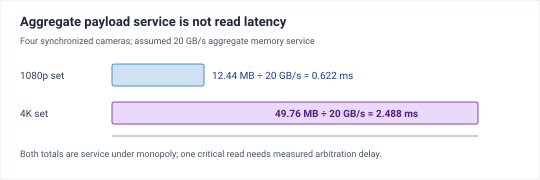
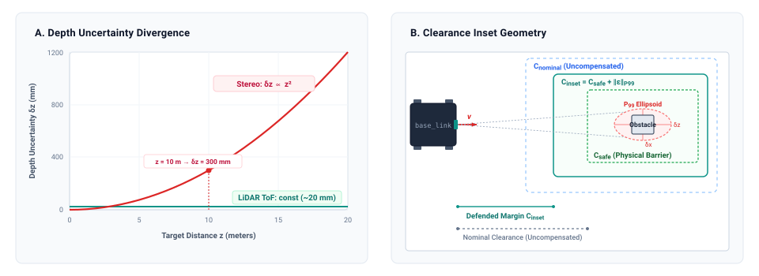

---
format:
  html:
    title: "Sensor Perception"
---

# Sensor Perception {#sec-perception}

::: {layout-narrow}
::: {.column-margin}

\chapterminitoc

:::

::: {.content-visible when-format="pdf"}
\noindent
{fig-alt="Isometric blueprint showing multimodal sensor perception: stereo optical camera rail with sightline frustums, solid-state micro-lidar point cloud fan, precision calibration target with coordinate axes, dynamic uncertainty covariance ellipsoid, and latency drift vector."}
:::

::: {.content-visible unless-format="pdf"}
{fig-alt="Isometric blueprint showing multimodal sensor perception: stereo optical camera rail with sightline frustums, solid-state micro-lidar point cloud fan, precision calibration target with coordinate axes, dynamic uncertainty covariance ellipsoid, and latency drift vector."}
:::

:::

## Purpose {.unnumbered .unlisted}

::: {.content-visible when-format="pdf"}
\begin{marginfigure}
\resizebox{0.92\linewidth}{!}{\mlphysicalstackfull{100}{20}{20}{100}{20}}
\end{marginfigure}
:::

_Why will an object detection algorithm with 99 percent recognition accuracy inevitably crash a robot if its exposure timestamp and spatial uncertainty are unmodeled?_

Perception in physical AI is often conflated with computer vision benchmark performance—maximizing mean average precision on static bounding boxes or semantic segmentation masks. But on a moving machine, an observation is worthless without temporal and spatial provenance. A camera frame capturing an obstacle with perfect classification accuracy is an actively dangerous signal if the image was integrated sixty milliseconds ago, spent forty milliseconds traversing a congested USB bus, and is processed by a neural model that provides no covariance bound on its 3D depth estimate. While the machine moves through space at two meters per second, that delayed detection represents an obstacle that is now over twenty centimeters closer than the software believes. Physical perception must therefore be engineered not as a disembodied pattern recognizer, but as a real-time, time-synchronized spatial state estimator. Every sensor measurement must carry a hardware-latched timestamp, explicit uncertainty metrics, and rigorous extrinsics calibration that accounts for frame vibration and structural flex. By integrating learned perceptual features with classical spatial state estimation, such as Extended Kalman Filters and factor graphs, the perception pipeline converts noisy, high-latency sensory streams into bounded spatial belief states that downstream planning algorithms can safely trust. This chapter traces the end-to-end perception pipeline, demonstrating how to fuse multimodal sensors into real-time, temporally grounded world models.



::: {.callout-learning-objectives}

- Specify an observation contract that carries capture time, a bounded clock conversion, coordinate frame, and uncertainty
- Calculate observation age across the sensing, transport, preprocessing, and inference pipeline, and convert it into its stopping-budget term
- Diagnose spatial errors caused by sensor timing, motion during capture, and misaligned coordinate frames
- Explain why average capture bandwidth does not bound a frame's age or a renewal's lateness, and size the host contention a renewal allowance tolerates
- Evaluate whether observation uncertainty leaves enough physical clearance for a proposed action
- Distinguish perception failures that runtime checks can detect from errors that remain silent

:::

## Optical Transduction and Spatial Assertions {#sec-perception-photons-to-claims}

```{python}
#| label: calc-perception-opening-age
#| echo: false
#| warning: false
#| message: false
# ┌─────────────────────────────────────────────────────────────────────────────
# │ OPENING SCENE: OBSERVATION AGE AT THE RACK END
# ├─────────────────────────────────────────────────────────────────────────────
# │ Context: The opening paragraph of @sec-perception-photons-to-claims;
# │          also the temporal-batching paragraph and the clock-sync pitfall.
# │
# │ Goal:    Show how far the warehouse mobile manipulator travels while its
# │          navigation camera's observation of a person ages.
# │ Show:    t_age 51.6 ms; 77.4 mm of travel at the 1.5 m/s drive limit.
# │ How:     AISLE.perception_age and RM.base.max_velocity; displacement via
# │          calc_spatial_information_age_displacement.
# └─────────────────────────────────────────────────────────────────────────────
from mlsysim import *
from mlsysim.core.units import *
from mlsysim.fmt import fmt_latency, fmt_length, fmt_velocity, check

RM = Embodied.MobileManipulator.WarehouseMobileManipulator
AISLE = Embodied.Scenario.WarehouseAisle

class RackEndOpeningAge:
    """Travel during the navigation camera's observation age at the drive limit."""

    # ┌── 1. LOAD (Constants & Parameters) ─────────────────────────────────
    t_age = AISLE.perception_age  # category: derived
    v = RM.base.max_velocity  # category: illustrative (drive limit)

    # ┌── 2. EXECUTE (Compute) ─────────────────────────────────────────────
    dx = calc_spatial_information_age_displacement(v, t_age).to(ureg.millimeter)

    # ┌── 3. GUARD (Invariants) ───────────────────────────────────────────
    check(abs(t_age.to(millisecond).magnitude - 51.6) < 0.05, f"Unexpected t_age: {t_age}")
    check(abs(v.to(meter / second).magnitude - 1.5) < 1e-9, f"Unexpected drive limit: {v}")
    check(abs(dx.magnitude - 77.4) < 0.05, f"Unexpected travel during t_age: {dx}")

    # ┌── 4. OUTPUT (Formatting) ──────────────────────────────────────────
    t_age_str = fmt_latency(t_age.to(millisecond), unit=millisecond, precision=1)
    v_str = fmt_velocity(v.to(meter / second), unit=meter / second, precision=1)
    dx_str = fmt_length(dx, unit=ureg.millimeter, precision=1)
```

The warehouse mobile manipulator's vision model can recognize a person stepping out from a rack end almost every time and still hand the planner a position that is already out of date. The world keeps moving while the navigation camera integrates and reads out its image and while the pipeline processes it. On this machine, an illustrative `{python} RackEndOpeningAge.t_age_str` passes between the middle of the exposure and the moment the observation reaches any consumer (derived in the latency waterfall of @sec-perception-latency-waterfall), and at the base's `{python} RackEndOpeningAge.v_str` drive limit the machine covers `{python} RackEndOpeningAge.dx_str` in that time. Recognition accuracy does not say whether that observation is fresh enough for the proposed motion. In physical AI, an observation has an expiration date.

Perception opens Part III by establishing the physical evidence grounding for all downstream autonomy. While Part I designed the physical robot and Part II structured its nervous computation and learning models, running the machine requires continuously asserting verifiable physical evidence across the proposal boundary of @sec-boundary-machine-model. Perception runs in the Brain, above that boundary. It turns photons, time-of-flight pulses, and reflected radio waves into dated spatial claims and proposes them, but it holds no authority over the actuators; that authority stays with the deterministic permission path below the boundary.

The work of turning photons into dated claims does not depend on how the software architecture is partitioned. Whether organized as an end-to-end vision-language-action (VLA) policy [@brohan2023rt1; @brohan2023rt2; @zhao2023learning] mapping camera pixels directly to action tokens within one large network, or as a classical modular pipeline splitting sensor ingestion, state estimation, mapping, and trajectory generation across separate processes, both designs face identical physical constraints. Neither architecture eliminates photon integration time, rolling-shutter readout serialization, MIPI CSI-2 bus transport, or DRAM memory contention. The physical latency waterfall operates completely independently of model topology. To honor the observation contract within an end-to-end VLA, robust architectures inject capture timestamps, coordinate frame identifiers, and calibrated camera extrinsics directly as continuous token embeddings or condition the vision-language backbone on explicit state prefixes, ensuring that the model's action predictions remain grounded in physical time and space rather than assuming zero-latency observation.

However, when an engineering team fuses these responsibilities into an end-to-end model, intermediate representations become harder to inspect and verify independently. An explicit interface can expose a coordinate transform for checking, carry an expiration deadline, or let another component reject an inconsistent estimate. A hidden representation requires additional instrumentation or external checks to provide comparable evidence. If perception mistakes a wet-floor reflection for open clearance, the engineer needs a way to detect or contain the resulting error regardless of how many software modules implement the pipeline.

That evidence begins where physical energy converts into digital data. From transduction at the detector array to consumption by a state estimator, every processing stage adds observation age. Photons striking the photodiode array of a CMOS camera do not instantly appear as feature embeddings in an inference engine; exposure, readout, transport, memory transfer, preprocessing, and the vision backbone each take a share of the delay. If the perception stage hands downstream components an object detection bounding box without an explicit timestamp and a calibrated spatial transform, a downstream planner will evaluate that obstacle relative to the current position of the chassis, misplacing it by the distance the machine has traveled since capture.

::: {.column-margin .margin-pointer}
↩ Transduction freshness and sensor measurement aging are derived in @sec-body-measurement-freshness.
:::

::: {#dfn-perception-spatial-information-age .callout-definition title="Spatial information age"}

***Spatial information age***\index{Spatial information age!definition}\index{Information age!definition} ($t_{\text{age}}$) is the total elapsed physical time between the physical energy integration midpoint ($t_{\text{exp}}/2$) at the transducer and the downstream consumption of the resulting observation tensor by a state estimator or control policy. It is the capture-to-consumption part of the measurement age that @sec-body-measurement-freshness counts from transduction, and running text calls it observation age.

1.  **Significance**: Because physical mass moves while digital computation executes, sensory latency translates directly into unmodeled spatial displacement (@eq-percep-spatial-displacement):
    $$\Delta \mathbf{x} = \int_{t_0}^{t_0+t_{\text{age}}} \mathbf{v}(t)\,dt$$ {#eq-percep-spatial-displacement}
    This continuous physical shift couples directly with triangulation optics and extrinsic mounting offsets to define the **Unified Spatial Uncertainty Envelope**:
    $$\boldsymbol{\epsilon}_{\text{total}} = \underbrace{\int_{t_0}^{t_0+t_{\text{age}}} \mathbf{v}(t)\,dt}_{\text{temporal latency displacement}} + \underbrace{\frac{z^2}{fb}\sigma_d}_{\text{triangulation geometric error}} + \underbrace{z \cdot \theta_{\text{ext}}}_{\text{mounting lever-arm dispersion}}$$
    This envelope dictates the total clearance buffer consumed before an obstacle is even classified.
2.  **Distinction**: Unlike software pipeline latency (wall-clock duration of a forward pass), observation age accounts for the full physical journey: half the exposure, readout, transport, DMA and queueing, ISP processing, the vision backbone, and dispatch.
3.  **Common pitfall**: Treating the frame arrival timestamp ($t_{\text{recv}}$) in userspace memory as the observation time ($t_0$). Using arrival time hides upstream capture and transport delays and adds unmodeled phase lag to the feedback controllers that consume the observation.

:::

### Temporal batching and feedback stability erosion

```{python}
#| label: calc-perception-temporal-batching
#| echo: false
#| warning: false
#| message: false
# ┌─────────────────────────────────────────────────────────────────────────────
# │ TEMPORAL BATCHING ON THE NAVIGATION CAMERA
# ├─────────────────────────────────────────────────────────────────────────────
# │ Context: The temporal-batching paragraph of @sec-perception-photons-to-claims.
# │
# │ Goal:    Show what a four-frame batch collected across capture times adds
# │          to the navigation camera's observation age.
# │ Show:    16.7 ms frame period at 60 Hz; waits of 50.0, 33.3, and 16.7 ms;
# │          age 51.6 ms -> 101.6 ms, roughly double.
# │ How:     RM.nav_camera.frame_rate; AISLE.perception_age; the oldest of
# │          n frames waits (n - 1) frame periods.
# └─────────────────────────────────────────────────────────────────────────────
from mlsysim import *
from mlsysim.core.units import *
from mlsysim.fmt import fmt_latency, fmt_frequency, check

RM = Embodied.MobileManipulator.WarehouseMobileManipulator
AISLE = Embodied.Scenario.WarehouseAisle

class TemporalBatching:
    """Age added by batching successive navigation-camera frames."""

    # ┌── 1. LOAD (Constants & Parameters) ─────────────────────────────────
    f_frame = RM.nav_camera.frame_rate  # category: datasheet
    t_age = AISLE.perception_age.to(millisecond)  # category: derived
    n_batch = 4  # category: illustrative (batch size)

    # ┌── 2. EXECUTE (Compute) ─────────────────────────────────────────────
    t_period = (1 / f_frame).to(millisecond)
    wait_1 = ((n_batch - 1) * t_period).to(millisecond)
    wait_2 = ((n_batch - 2) * t_period).to(millisecond)
    wait_3 = ((n_batch - 3) * t_period).to(millisecond)
    t_age_batched = (t_age + wait_1).to(millisecond)
    ratio = (t_age_batched / t_age).to(ureg.dimensionless).magnitude

    # ┌── 3. GUARD (Invariants) ───────────────────────────────────────────
    check(abs(f_frame.to(ureg.hertz).magnitude - 60.0) < 1e-9, f"Unexpected frame rate: {f_frame}")
    check(abs(wait_1.magnitude - 50.0) < 0.05, f"Unexpected oldest-frame wait: {wait_1}")
    check(abs(t_age_batched.magnitude - 101.6) < 0.05, f"Unexpected batched age: {t_age_batched}")
    check(1.8 < ratio < 2.2, f"Prose says batching roughly doubles the age: {ratio}")

    # ┌── 4. OUTPUT (Formatting) ──────────────────────────────────────────
    f_frame_str = fmt_frequency(f_frame, unit=ureg.hertz, precision=0)
    t_period_str = fmt_latency(t_period, unit=millisecond, precision=1)
    wait_1_str = fmt_latency(wait_1, unit=millisecond, precision=0)
    wait_2_str = fmt_latency(wait_2, unit=millisecond, precision=1)
    wait_3_str = fmt_latency(wait_3, unit=millisecond, precision=1)
    t_age_batched_str = fmt_latency(t_age_batched, unit=millisecond, precision=1)
```

Batching improves accelerator throughput by amortizing work across images, but collecting a batch across successive capture times ages its earliest member. At the navigation camera's `{python} TemporalBatching.f_frame_str` cadence ($T_{\text{sample}} \approx$ `{python} TemporalBatching.t_period_str`), a batch of four consecutive frames holds the first for `{python} TemporalBatching.wait_1_str`, the second and third for `{python} TemporalBatching.wait_2_str` and `{python} TemporalBatching.wait_3_str`, and the last not at all. Adding the oldest frame's wait to the `{python} RackEndOpeningAge.t_age_str` observation age roughly doubles it, to `{python} TemporalBatching.t_age_batched_str`. That lies far above the refusal threshold, the budgeted age plus the clock-conversion bound that @sec-perception-observation-contract sets, so on this machine the permission path refuses every claim built from a batch collected across capture times. Images captured together by several cameras may instead be batched only when the batch adds no age beyond the budgeted stages and meets its deadline.

Age spends a feedback loop's phase margin as well, because a pure delay $t_{\text{age}}$ adds phase lag $\omega t_{\text{age}}$ at frequency $\omega$ without changing gain. Feedback control relies on timely negative feedback to oppose tracking error; when transport and compute latency delay an observation by half an oscillation period, corrective actions arrive in phase with the disturbance rather than opposing it. This phase inversion transforms stabilizing negative feedback into destabilizing positive feedback, driving the robot to chatter, weave across aisles, or oscillate into mechanical resonance. A loop with nominal margin $\text{PM}_{\text{nom}}$ at gain crossover $\omega_c$ therefore exhausts its stability margin once $t_{\text{age}} \ge \text{PM}_{\text{nom}}/\omega_c$, and exposure, processing, transport, permission, and actuator delay all draw on that single ceiling (@sec-appendix-control-zoh). For example, a visual-servoing tracking loop operating at crossover frequency $\omega_c = 10\,\text{rad/s}$ ($\approx 1.6\,\text{Hz}$) with nominal phase margin $\text{PM}_{\text{nom}} = 45^\circ$ ($0.785\,\text{rad}$) has a maximum permissible latency ceiling of $\tau_{\max} = 0.785 / 10 = 78.5\,\text{ms}$. If sensor exposure, transport, and neural inference consume $60\,\text{ms}$, the system depletes over 76 percent of its stability margin before motor commands are dispatched, risking underdamped resonance or boundary chatter.

::: {.column-margin}
{width="100%" fig-alt="Knee curve showing phase margin eroding linearly with perception age until reaching instability at seventy-eight milliseconds."}
*Past critical perception age, phase margin erodes to zero, triggering closed-loop instability and chatter.*
:::

The same delay is paid twice, as phase lag in the loop and as travel toward the obstacle, and a consumer can budget only the delay it can measure. What perception hands over must therefore carry a timestamp, a coordinate frame, and a usable error bound, and transduction, ingress, and geometric estimation can each invalidate them before the permission path admits a motion.

## The Perception Handoff and State Invariants {#sec-perception-handoff}

Raw sensor hardware yields electrical measurements such as photodiode voltages, time-of-flight counter values, or capacitive displacements. These unstructured signals differ significantly from the state variables needed for downstream autonomy. An actuator controller cannot track a desired force using a two-dimensional grid of raw pixel intensities, and a trajectory optimizer cannot plan collision-free paths using unorganized time-of-flight returns. Downstream estimation, planning, and memory subsystems require structured representations of physical state, including metric positions, velocities, bounding volumes, surface normals, and semantic classifications. Translating raw sensor streams into these representations is the operational responsibility of the perception pipeline. Each observation it hands over must carry three properties for downstream software: a capture timestamp, a reference frame, and an uncertainty envelope.

::: {.column-margin}
{width="100%" fig-alt="S·P·A locator triad highlighting the Sense node."}
*The Sense node: translating raw electromagnetic and optical energy into timestamped, frame-anchored spatial claims.*
:::

The first mandatory property is the **capture timestamp**\index{Capture timestamp!definition} $t_0$, which specifies the temporal midpoint of the physical energy integration window (the effective moment the camera shutter was open or the laser pulse fired). Sensors do not take instantaneous snapshots; a camera integrates photons across an exposure duration, and a mechanical lidar sweeps laser pulses over an azimuth arc across several milliseconds. Downstream state estimators require $t_0$ to integrate the measurement into the machine's dynamic equations of motion. The arrival stamp that the definition warns against, $t_{\text{recv}}$, marks the moment the operating system kernel completes the direct memory access (DMA) transfer. Half the exposure, readout, transport, and DMA all elapse before that moment, so the arrival offset $\tau_{\text{recv}} = t_{\text{recv}} - t_0$ is never zero, and substituting arrival time for capture time corrupts the state estimator.

```{python}
#| label: calc-perception-arrival-stamp
#| echo: false
#| warning: false
#| message: false
# ┌─────────────────────────────────────────────────────────────────────────────
# │ ARRIVAL-TIMESTAMP OFFSET ON THE NAVIGATION CAMERA
# ├─────────────────────────────────────────────────────────────────────────────
# │ Context: The capture-timestamp paragraph of @sec-perception-handoff.
# │
# │ Goal:    Size the error an estimator makes when it dates the navigation
# │          camera's frame at DMA completion instead of at the exposure midpoint.
# │ Show:    26.6 ms from exposure midpoint to DMA completion; 39.9 mm of base
# │          travel at the 1.5 m/s drive limit.
# │ How:     t_recv - t0 = t_exp/2 + t_readout + t_transport + t_dma from
# │          RM.nav_camera and AISLE; displacement via
# │          calc_spatial_information_age_displacement.
# └─────────────────────────────────────────────────────────────────────────────
from mlsysim import *
from mlsysim.core.units import *
from mlsysim.fmt import fmt_latency, fmt_length, fmt_velocity, check

RM = Embodied.MobileManipulator.WarehouseMobileManipulator
AISLE = Embodied.Scenario.WarehouseAisle

class ArrivalStampOffset:
    """Age hidden by an arrival timestamp on the running machine's navigation camera."""

    # ┌── 1. LOAD (Constants & Parameters) ─────────────────────────────────
    camera = RM.nav_camera  # category: datasheet (registry: navigation camera)
    t_exp = camera.exposure_time  # category: datasheet
    t_readout = camera.readout_time  # category: datasheet
    t_transport = AISLE.t_transport  # category: illustrative
    t_dma = AISLE.t_dma  # category: illustrative
    v = RM.base.max_velocity  # category: illustrative (drive limit)

    # ┌── 2. EXECUTE (Compute) ─────────────────────────────────────────────
    tau_recv = (t_exp / 2 + t_readout + t_transport + t_dma).to(millisecond)
    dx_recv = calc_spatial_information_age_displacement(v, tau_recv).to(ureg.millimeter)

    # ┌── 3. GUARD (Invariants) ───────────────────────────────────────────
    check(abs(tau_recv.magnitude - 26.6) < 0.05, f"Unexpected arrival offset: {tau_recv}")
    check(abs(dx_recv.magnitude - 39.9) < 0.05, f"Unexpected arrival-stamp displacement: {dx_recv}")
    check(tau_recv < AISLE.perception_age, "Arrival offset must be part of the full observation age")

    # ┌── 4. OUTPUT (Formatting) ──────────────────────────────────────────
    tau_recv_str = fmt_latency(tau_recv, unit=millisecond, precision=1)
    dx_recv_str = fmt_length(dx_recv, unit=ureg.millimeter, precision=1)
    v_str = fmt_velocity(v.to(meter / second), unit=meter / second, precision=1)
```

The magnitude of this corruption follows from @eq-percep-spatial-displacement with the arrival offset in place of the full age, and at constant velocity $v$ it reduces to $\Delta x = v\,\tau_{\text{recv}}$. On the mobile manipulator, the navigation camera's frame completes its DMA transfer `{python} ArrivalStampOffset.tau_recv_str` after the exposure midpoint. An estimator that stamps the frame on arrival therefore dates it that much late, and at the base's `{python} ArrivalStampOffset.v_str` drive limit it pairs the observation with a pose `{python} ArrivalStampOffset.dx_recv_str` beyond the one the camera occupied at capture.

::: {.column-margin .margin-pointer}
↪ @Sec-memory-reference-frames adds how these sensor-to-body transforms go stale over time.
:::

```{python}
#| label: calc-perception-extrinsic-error
#| echo: false
#| warning: false
#| message: false
# ┌─────────────────────────────────────────────────────────────────────────────
# │ EXTRINSIC ANGLE ERRORS AGAINST THE AISLE'S CLEARANCES
# ├─────────────────────────────────────────────────────────────────────────────
# │ Context: The reference-frame paragraph of @sec-perception-handoff, the
# │          transform-chain paragraph of @sec-perception-error-clearance, and
# │          the calibration takeaway.
# │
# │ Goal:    Tie two lever-arm errors to the stopping budget's terms: an
# │          uncalibrated 1 degree mount error at 15 m against the base's side
# │          clearance, and a 0.005 rad extrinsic shift at 10 m against delta_loc.
# │ Show:    0.26 m, about 1.7x the 0.15 m side clearance; 50 mm, the whole
# │          delta_loc allowance.
# │ How:     Delta_y = d sin(theta); delta_x = z theta; AISLE.side_clearance and
# │          AISLE.delta_loc.
# └─────────────────────────────────────────────────────────────────────────────
import math
from mlsysim import *
from mlsysim.core.units import *
from mlsysim.fmt import fmt, fmt_length, fmt_multiple, check

AISLE = Embodied.Scenario.WarehouseAisle

class ExtrinsicErrorBudget:
    """Lever-arm errors from angular mount errors, set against the aisle clearances."""

    # ┌── 1. LOAD (Constants & Parameters) ─────────────────────────────────
    theta_frame = 1.0 * ureg.degree  # category: illustrative (uncalibrated mount error)
    d_frame = 15.0 * meter  # category: illustrative (detection range)
    theta_ext = 0.005 * radian  # category: illustrative (extrinsic shift after shock)
    z_ext = 10.0 * meter  # category: illustrative (target range)
    side_clearance = AISLE.side_clearance  # category: illustrative
    delta_loc = AISLE.delta_loc  # category: illustrative

    # ┌── 2. EXECUTE (Compute) ─────────────────────────────────────────────
    dy_frame = (d_frame * math.sin(theta_frame.to(radian).magnitude)).to(meter)
    dy_over_side = (dy_frame / side_clearance).to(ureg.dimensionless).magnitude
    dx_ext = (z_ext * theta_ext.magnitude).to(ureg.millimeter)
    dx_over_loc = (dx_ext / delta_loc).to(ureg.dimensionless).magnitude

    # ┌── 3. GUARD (Invariants) ───────────────────────────────────────────
    check(abs(dy_frame.magnitude - 0.2618) < 0.0005, f"Unexpected 1-degree lever-arm error: {dy_frame}")
    check(dy_frame > side_clearance, "Prose says the 1-degree error exceeds the side clearance")
    check(abs(dx_ext.magnitude - 50.0) < 0.05, f"Unexpected extrinsic-shift error: {dx_ext}")
    check(abs(dx_over_loc - 1.0) < 1e-9, "Prose says the extrinsic shift spends all of delta_loc")

    # ┌── 4. OUTPUT (Formatting) ──────────────────────────────────────────
    theta_frame_str = fmt(theta_frame.to(ureg.degree).magnitude, precision=0)
    d_frame_str = fmt_length(d_frame, unit=meter, precision=0)
    dy_frame_str = fmt_length(dy_frame, unit=meter, precision=2)
    dy_over_side_mult_str = fmt_multiple(dy_over_side, precision=1)
    side_clearance_str = fmt_length(side_clearance.to(meter), unit=meter, precision=2)
    theta_ext_str = fmt(theta_ext.magnitude, precision=3)
    z_ext_str = fmt_length(z_ext, unit=meter, precision=0)
    dx_ext_str = fmt_length(dx_ext, unit=ureg.millimeter, precision=0)
    delta_loc_str = fmt_length(delta_loc.to(ureg.millimeter), unit=ureg.millimeter, precision=0)
```

The second mandatory property is the **reference frame**\index{Reference frame!definition} identifier $\mathcal{F}_{\text{sensor}}$. Every spatial measurement is natively resolved in the local coordinate system of the physical transducer. A camera measures bearing angles relative to its optical center, while a radar measures range and Doppler velocity relative to its antenna array. Downstream trajectory planners and obstacle maps operate in a chassis body frame $\mathcal{F}_{\text{body}}$ or an inertial navigation frame $\mathcal{F}_{\text{world}}$. Transforming an observation from $\mathcal{F}_{\text{sensor}}$ to $\mathcal{F}_{\text{body}}$ requires applying a rigid-body spatial transformation consisting of a rotation matrix and a translation vector that define the sensor mounting extrinsics (the exact physical location and orientation where the sensor is bolted onto the machine). The frames nest from the globe down to the transducer, $\mathcal{F}_{\text{earth}} \to \mathcal{F}_{\text{map}} \to \mathcal{F}_{\text{odom}} \to \mathcal{F}_{\text{body}} \to \mathcal{F}_{\text{sensor}}$, and every link in that tree carries its own transform and uncertainty (@fig-08-coordinate-frame-tree).

When perception outputs omit the frame identifier or rely on nominal CAD dimensions rather than calibrated physical extrinsics, small angular offsets create large spatial errors that scale with distance. An uncalibrated pitch or yaw error of $\theta =$ `{python} ExtrinsicErrorBudget.theta_frame_str`° on a sensor detecting an object at range $d =$ `{python} ExtrinsicErrorBudget.d_frame_str` induces a transverse position error $\Delta y \approx d \sin\theta$ of `{python} ExtrinsicErrorBudget.dy_frame_str`, about `{python} ExtrinsicErrorBudget.dy_over_side_mult_str` the `{python} ExtrinsicErrorBudget.side_clearance_str` side clearance the base keeps from the racks, so the planner either steers into the racking or rejects a valid aisle as obstructed.

The physical mounting location of the sensor on the kinematic chain also dictates how transforms update. In an **eye-in-hand**\index{Eye-in-hand calibration!definition} setup where a camera is bolted directly onto an arm's moving wrist, moving any preceding arm joint alters the camera's optical frame relative to the world, requiring continuous forward kinematics evaluation. In an **eye-to-hand**\index{Eye-to-hand calibration!definition} setup where the camera sits on a fixed mast overlooking the workspace, the transform between the sensor and the world frame remains constant, even as the robot's end-effector moves through the scene.

The [REP 105 frame convention](https://reps.openrobotics.org/rep-0105/)\index{Standards!REP 105} names these frames and separates a locally continuous `odom` pose from a globally corrected `map` pose. On the mobile manipulator, $\mathcal{F}_{\text{body}}$ is the base's `base_link`, tracked through the odometric frame `odom`, and the arm's serial chain maps its mounting flange `tool0` through the joint angles back to `base_link`. @Tbl-08-rep105-tree lists the roles and the rule each consumer follows. A local controller consumes a continuous estimate and rejects unexpected transform jumps, and an implementation still has to check transform timestamps and estimator uncertainty.

| Frame         | Parent in this example | Meaning                                     | Consumer rule                                                 |
|:--------------|:-----------------------|:--------------------------------------------|:--------------------------------------------------------------|
| `earth`       | root                   | Optional geodetic datum                     | Verify datum before global routing                            |
| `map`         | `earth` if present     | Global localization; corrections may jump   | Keep relocalization jumps out of local feedback               |
| `odom`        | `map`                  | Locally continuous pose estimate; may drift | Track motion locally; monitor uncertainty and discontinuities |
| `base_link`   | `odom`                 | Body-fixed origin                           | Body pose still inherits odometry uncertainty                 |
| `sensor_link` | `base_link`            | Calibrated sensor mounting frame            | Apply time-valid extrinsics and their uncertainty             |

: **REP 105 frame roles for a mobile robot**: A compact example of global, local, body, and sensor frames. REP 105 requires `odom`-relative pose to remain continuous but does not prescribe $C^1$ smoothness, a covariance growth rate, or fixed accuracy; these require estimator-specific evidence. {#tbl-08-rep105-tree tbl-colwidths="[14,20,32,34]"}

::: {#fig-08-coordinate-frame-tree fig-env="figure" fig-pos="t" fig-cap="**Coordinate frame tree and uncertainty**: The spatial coordinate frame hierarchy formalizes the separation between continuous local dead reckoning ($\mathcal{F}_{\text{odom}} \to \mathcal{F}_{\text{body}}$) consumed by high-frequency tracking loops and discontinuous global map corrections ($\mathcal{F}_{\text{map}} \to \mathcal{F}_{\text{odom}}$) consumed by global planners. Spatial covariance compounds across the kinematic chain, from odometric drift through the mounting extrinsics to the sensor's own measurement error, requiring downstream consumers to reject observations that lack an explicit coordinate key $\mathcal{F}_{\text{sensor}}$, capture epoch $t_0$, and covariance envelope $\mathbf{\Sigma}_z$. Attribution: Book kinematic systems diagram, CC BY 4.0." fig-alt="REP 105 Spatial Transform Tree and Uncertainty Composition. The spatial coordinate frame hierarchy formalizes the separation between continuous local dead reckoning (Fodom -> Fbody) consumed by high-frequency tracking loops and discontinuous global map corrections (Fmap -> Fodom) consumed by global planners. Spatial covariance compounds across the kinematic chain, from odometric drift through the mounting extrinsics to the sensor's own measurement error, requiring downstream consumers to reject observations that lack an explicit coordinate key Fsensor, capture epoch t0, and covariance envelope Sigmaz. Attribution: Book kinematic systems diagram, CC BY 4.0."}
{width="95%"}
:::

@Fig-08-coordinate-frame-tree details this spatial transform hierarchy across three distinct operational layers:

1. **Global localization layer ($\mathcal{F}_{\text{map}} \to \mathcal{F}_{\text{odom}}$)**: Global localization pipelines (such as visual SLAM, lidar point-cloud registration, or AprilTag detection) publish corrected poses relative to a fixed world datum. Because map updates resolve loop closures through non-convex optimization, these corrections exhibit discrete, discontinuous jumps.
2. **Local dead-reckoning layer ($\mathcal{F}_{\text{odom}} \to \mathcal{F}_{\text{body}}$)**: High-rate odometry (integrating wheel encoders and inertial measurements) publishes smooth, continuous motion estimates. A common novice anti-pattern tracks kinematic goals directly in the global `map` frame ($e = \mathbf{x}_{\text{target,map}} - \mathbf{x}_{\text{robot,map}}$); when SLAM detects a loop closure and applies an instantaneous discrete pose correction, this tracking error steps discontinuously. Routing that step-discontinuity into a high-gain actuator loop commands infinite instantaneous acceleration and trips motor overcurrent breakers. REP 105 mandates that high-frequency feedback loops and dynamic obstacle avoidance algorithms bind strictly to the continuous `odom` frame, insulating physical actuators from global optimizer corrections.
3. **Mounting extrinsics layer ($\mathcal{F}_{\text{body}} \to \mathcal{F}_{\text{sensor}}$)**: Rigid-body transforms $(\mathbf{R}_{\text{ext}}, \mathbf{t}_{\text{ext}})$ map the chassis origin to physical sensor apertures. As spatial transforms compose down this kinematic Directed Acyclic Graph (DAG), covariance compounds:
$$\mathbf{\Sigma}_{\text{world}} = \mathbf{J}_{\text{map}}\mathbf{\Sigma}_{\text{map}}\mathbf{J}_{\text{map}}^\top + \mathbf{J}_{\text{odom}}\mathbf{\Sigma}_{\text{odom}}\mathbf{J}_{\text{odom}}^\top + \mathbf{J}_{\text{ext}}\mathbf{\Sigma}_{\text{ext}}\mathbf{J}_{\text{ext}}^\top$$
where the transformation Jacobians $\mathbf{J}_i = \frac{\partial \mathbf{p}_{\text{world}}}{\partial \mathbf{x}_i}$ act as kinematic lever arms, projecting small angular uncertainties and frame offsets into spatial translational dispersion in world coordinates. Downstream consumers must therefore reject any spatial observation that lacks an explicit coordinate frame identifier $\mathcal{F}_{\text{sensor}}$, capture epoch $t_0$, and compounded covariance envelope $\mathbf{\Sigma}_z$.

The third mandatory property is an **uncertainty representation**\index{Uncertainty envelope!definition}, such as covariance $\mathbf{\Sigma}_z$ together with a validated tail or hard error bound when clearance depends on it. Low illumination, atmospheric scattering, specular surfaces, and model error change the residual distribution. A covariance describes second moments, not a region guaranteed to contain the true state. Estimators can use it to weight innovations against a motion model; an underestimated covariance can pull a state estimate toward a spurious measurement and lead to poor downstream commands. Safety decisions must also account for bias, missed detections, and validation limits.

### Discrete state estimation and complementary filtering {#sec-perception-discrete-state-estimation}

To convert noisy, multi-rate sensor streams into a coherent estimate of the physical machine and its surroundings, robotic systems employ discrete-time state estimators, most prominently the **discrete Kalman filter**\index{Kalman filter!discrete formulation} and its non-linear counterpart, the **Extended Kalman Filter (EKF)**\index{Extended Kalman Filter!definition}.

Let the physical system state at discrete time step $k$ be represented by $\mathbf{x}_k \in \mathbb{R}^n$ (encompassing 3D positions $\mathbf{p}$, linear velocities $\mathbf{v}$, orientations $\mathbf{R}$, and sensor bias parameters $\mathbf{b}_a, \mathbf{b}_g$). The estimation cycle executes two alternating phases:

1. **Prediction Phase (Motion Prior)**: Using the system dynamics matrix $\mathbf{F}_k$, control input matrix $\mathbf{B}_k$, control vector $\mathbf{u}_k$, and process noise covariance $\mathbf{Q}_k$, the estimator propagates the prior state estimate and covariance forward in time:
$$\hat{\mathbf{x}}_{k|k-1} = \mathbf{F}_k \hat{\mathbf{x}}_{k-1|k-1} + \mathbf{B}_k \mathbf{u}_k$$
$$\mathbf{P}_{k|k-1} = \mathbf{F}_k \mathbf{P}_{k-1|k-1} \mathbf{F}_k^\top + \mathbf{Q}_k$$
Here $\mathbf{Q}_k$ captures unmodeled physical disturbances, floor roughness, and drivetrain compliance.

2. **Update Phase (Sensory Correction)**: When a sensor delivers a measurement vector $\mathbf{z}_k \in \mathbb{R}^m$ governed by observation matrix $\mathbf{H}_k$ and measurement noise covariance $\mathbf{R}_k$, the filter evaluates the **measurement innovation** $\tilde{\mathbf{y}}_k$ and innovation covariance $\mathbf{S}_k$:
$$\tilde{\mathbf{y}}_k = \mathbf{z}_k - \mathbf{H}_k \hat{\mathbf{x}}_{k|k-1}$$
$$\mathbf{S}_k = \mathbf{H}_k \mathbf{P}_{k|k-1} \mathbf{H}_k^\top + \mathbf{R}_k$$
The optimal **Kalman gain** $\mathbf{K}_k$ balances prior uncertainty against sensor noise to update the posterior state mean and covariance:
$$\mathbf{K}_k = \mathbf{P}_{k|k-1} \mathbf{H}_k^\top \mathbf{S}_k^{-1}$$
$$\hat{\mathbf{x}}_{k|k} = \hat{\mathbf{x}}_{k|k-1} + \mathbf{K}_k \tilde{\mathbf{y}}_k$$
$$\mathbf{P}_{k|k} = (\mathbf{I} - \mathbf{K}_k \mathbf{H}_k) \mathbf{P}_{k|k-1}$$[^fn-math-joseph-stabilized]

The update contracts the prior covariance by subtracting the informative projection $(\mathbf{K}_k \mathbf{H}_k \mathbf{P}_{k|k-1})$. However, this mathematical certainty holds only when the measurement vector $\mathbf{z}_k$ represents the true current epoch $k$. If an observation is delayed by an unmodeled latency tail $t_{\text{age}}$, the innovation $\tilde{\mathbf{y}}_k$ embeds an unmodeled physical displacement $\mathbf{v} \cdot t_{\text{age}}$. Crucially, the covariance Riccati update $\mathbf{P}_{k|k} = (\mathbf{I} - \mathbf{K}_k \mathbf{H}_k) \mathbf{P}_{k|k-1}$ is mathematically independent of the actual innovation $\tilde{\mathbf{y}}_k$: the filter contracts its uncertainty based solely on the nominal observation matrix $\mathbf{H}$ and declared noise $\mathbf{R}$, blind to the reality that latency has displaced the physical plant. Downstream permission filters, deceived by this artificially small posterior covariance $\mathbf{P}_{k|k}$, treat the stale estimate as high-certainty truth, authorizing aggressive motions that consume physical clearance.

[^fn-math-joseph-stabilized]: **Joseph stabilized covariance update**: In single-precision floating-point arithmetic (FP32), evaluating $(\mathbf{I} - \mathbf{K}_k\mathbf{H}_k)\mathbf{P}_{k|k-1}$ can lose symmetry and positive-definiteness under ill-conditioned matrices. Robust embedded firmware implements the Joseph stabilized form: $\mathbf{P}_{k|k} = (\mathbf{I} - \mathbf{K}_k\mathbf{H}_k)\mathbf{P}_{k|k-1}(\mathbf{I} - \mathbf{K}_k\mathbf{H}_k)^\top + \mathbf{K}_k\mathbf{R}_k\mathbf{K}_k^\top$.

Before accepting an update, the estimator gates measurements using the **Mahalanobis distance**\index{Mahalanobis distance!outlier rejection} $d_M$:
$$d_M^2 = \tilde{\mathbf{y}}_k^\top \mathbf{S}_k^{-1} \tilde{\mathbf{y}}_k$$
In a one-dimensional scalar setting, the Mahalanobis distance simplifies to the normalized residual $d_M = |\tilde{y}_k| / \sigma_y$. If $d_M^2$ exceeds a chi-square threshold $\chi^2_{m, 1-\alpha}$ (such as $9.0$ for a $3\sigma$ gate in 1D), the measurement is flagged as a sensor glitch or transient occlusion and discarded, preventing covariance corruption. If latency jitter causes an observation to arrive with an unexpected delay, the true innovation often spikes beyond $\chi^2_{m, 1-\alpha}$, causing the filter to reject valid physical obstacles as outliers precisely when safety margins are narrowest.

This mathematical framework enables **multi-rate complementary filtering**\index{Complementary filter!multi-rate sensor fusion} between fast inertial sensors and slower visual cameras:

- **High-rate inertial dead reckoning (1,000 Hz)**: The Inertial Measurement Unit (IMU) samples 3-axis linear accelerations ($\mathbf{a}$) and angular rates ($\boldsymbol{\omega}$) at $1{,}000\,\text{Hz}$. This high sampling frequency is physically mandated by structural vibration dynamics: robotic chassis and gear trains exhibit mechanical resonance modes between $100\,\text{Hz}$ and $400\,\text{Hz}$. By the Nyquist-Shannon sampling theorem, capturing structural vibration without aliasing into the control passband requires $f_s \ge 2 f_{\text{resonance}} \ge 800\text{--}1{,}000\,\text{Hz}$. However, integrating accelerometer signals twice ($\Delta x(t) = \frac{1}{2} a_{\text{bias}} t^2$) causes unconstrained quadratic drift: a minor $0.05\,\text{m/s}^2$ bias accumulates $2.5\,\text{meters}$ of error in just 10 seconds.
- **Low-rate visual correction (30 Hz)**: Camera frames and feature-based visual odometry arrive at $30\,\text{Hz}$ with tens of milliseconds of pipeline latency. While cameras cannot balance a biped or stabilize motor torques, they provide drift-free metric landmarks.
- **The complementary fusion**: The estimator uses the high-rate IMU as a high-pass filter, propagating state predictions forward at millisecond granularity, while using low-rate vision updates as a low-pass filter to continually estimate and subtract the drifting accelerometer and gyroscope biases ($\mathbf{b}_a, \mathbf{b}_g$).

**The out-of-sequence measurement (OOSM) reality**: Textbook Kalman filter equations assume synchronous, zero-latency observation arrival ($\mathbf{z}_k$ arrives at tick $k$). In embodied systems, while high-rate IMU samples arrive within microseconds, visual landmark and obstacle measurements $\mathbf{z}_{t_0}$ arrive tens of milliseconds late ($t_{\text{recv}} = t_0 + t_{\text{age}}$). Applying a delayed measurement directly to the current state estimate $\hat{\mathbf{x}}_{k}$ corrupts the filter by correlating past measurement noise with intermediate process noise. Real-time perception runtimes solve this by maintaining an **out-of-sequence ring buffer** of historical state estimates and IMU inputs. When delayed observation $\mathbf{z}_{t_0}$ arrives, the estimator rewinds the filter to epoch $t_0$, computes the innovation $\tilde{\mathbf{y}}_{t_0} = \mathbf{z}_{t_0} - \mathbf{H}\hat{\mathbf{x}}_{t_0}$, applies the Kalman update, and rapidly re-propagates the state forward to $t_{\text{current}}$ using the buffered inertial stream. However, this rewind mechanism is strictly bounded by ring buffer depth $T_{\text{buffer}}$. If an unexpected perception latency tail stretches observation age such that $t_{\text{age}} > T_{\text{buffer}}$, the filter cannot rewind. The estimator must then refuse the measurement, allow process noise $\mathbf{Q}$ to inflate the predictive covariance $\mathbf{P}$, and alert the downstream permission path that visual grounding has lapsed.

::: {#psp-perception-observation-invariants .callout-perspective title="The three invariants of observation"}
Pass a perception claim with its capture time and clock domain, coordinate frame, and qualified uncertainty. Refuse a claim when any of those cannot be checked for the proposed motion.
:::

Together, these properties are the core of the observation contract that @sec-perception-observation-contract turns into a record that every downstream consumer checks before use. Dropping an incomplete or unbounded observation allows a downstream estimator to propagate its state forward using physical dynamics, degrading uncertainty smoothly over time. Accepting an ungrounded packet, by contrast, injects unmodeled delays, spatial distortions, and false confidence directly into the control loop. Enforcing this contract requires tracing how an observation originates, beginning at the hardware interface where physical phenomena are first sampled.

## Sensor Transduction and Calibration {#sec-perception-transduction-calibration}

Lag accumulates before software receives anything at all, beginning at the photosite where physical phenomena are converted into electrical charge. A camera does not capture an instantaneous snapshot. Photons collect on a photodiode over a finite exposure duration $t_{\text{exp}}$, which means the recorded pixel intensity represents the temporal integral of scene radiance $I(t)$ over that interval:
$$I_{\text{pixel}} = \int_{0}^{t_{\text{exp}}} I(t)\,dt$$

```{python}
#| label: calc-perception-rolling-shutter-skew
#| echo: false
#| warning: false
#| message: false
# ┌─────────────────────────────────────────────────────────────────────────────
# │ ROLLING-SHUTTER SKEW ON THE NAVIGATION CAMERA
# ├─────────────────────────────────────────────────────────────────────────────
# │ Context: The exposure paragraph and the rolling-shutter example of
# │          @sec-perception-transduction-calibration.
# │
# │ Goal:    Size the exposure-midpoint lag, per-row blur, and scanline skew
# │          the navigation camera records while the base passes a vertical
# │          rack upright.
# │ Show:    an 8 ms midpoint lag; 3,040 rows in 16.6 ms (5.46 us per row);
# │          24.9 mm of skew and 24 mm of blur at the 1.5 m/s drive limit;
# │          the uncompensated skew is about a sixth of the 0.15 m side
# │          clearance.
# │ How:     RM.nav_camera readout, exposure, and row count; RM.base drive
# │          limit; AISLE.side_clearance; RM.imu sample rate for compensation.
# └─────────────────────────────────────────────────────────────────────────────
from mlsysim import *
from mlsysim.core.units import *
from mlsysim.fmt import fmt_latency, fmt_length, fmt_velocity, fmt_frequency, fmt_int, check

RM = Embodied.MobileManipulator.WarehouseMobileManipulator
AISLE = Embodied.Scenario.WarehouseAisle

class RollingShutterSkew:
    """Scanline skew and blur on the running machine's navigation camera at the drive limit."""

    # ┌── 1. LOAD (Constants & Parameters) ─────────────────────────────────
    camera = RM.nav_camera  # category: datasheet (registry: navigation camera)
    rows = camera.resolution_height  # category: datasheet
    t_readout = camera.readout_time.to(millisecond)  # category: datasheet
    t_exp = camera.exposure_time.to(millisecond)  # category: datasheet
    v = RM.base.max_velocity.to(meter / second)  # category: illustrative (drive limit)
    side_clearance = AISLE.side_clearance  # category: illustrative
    f_imu = RM.imu.sample_rate  # category: datasheet

    # ┌── 2. EXECUTE (Compute) ─────────────────────────────────────────────
    t_exp_half = (t_exp / 2).to(millisecond)
    t_row = (t_readout / rows).to(microsecond)
    skew = (v * t_readout).to(ureg.millimeter)
    blur = (v * t_exp).to(ureg.millimeter)
    skew_share = (skew / side_clearance).to(ureg.dimensionless).magnitude

    # ┌── 3. GUARD (Invariants) ───────────────────────────────────────────
    check(rows == 3040, f"Unexpected navigation-camera row count: {rows}")
    check(abs(t_row.magnitude - 5.46) < 0.005, f"Unexpected row interval: {t_row}")
    check(abs(skew.magnitude - 24.9) < 0.05, f"Unexpected rolling-shutter skew: {skew}")
    check(abs(blur.magnitude - 24.0) < 0.05, f"Unexpected per-row blur: {blur}")
    check(abs(t_exp_half.magnitude - 8.0) < 0.05, f"Unexpected exposure-midpoint lag: {t_exp_half}")
    check(0.15 < skew_share < 0.18, f"Prose says the skew is about a sixth of the side clearance: {skew_share}")

    # ┌── 4. OUTPUT (Formatting) ──────────────────────────────────────────
    rows_str = fmt_int(rows)
    last_row_str = fmt_int(rows - 1)
    t_readout_str = fmt_latency(t_readout, unit=millisecond, precision=1)
    t_exp_str = fmt_latency(t_exp, unit=millisecond, precision=0)
    t_exp_half_str = fmt_latency(t_exp_half, unit=millisecond, precision=0)
    t_row_str = fmt_latency(t_row, unit=microsecond, precision=2)
    skew_str = fmt_length(skew, unit=ureg.millimeter, precision=1)
    blur_str = fmt_length(blur, unit=ureg.millimeter, precision=0)
    v_str = fmt_velocity(v, unit=meter / second, precision=1)
    side_clearance_str = fmt_length(side_clearance.to(meter), unit=meter, precision=2)
    f_imu_str = fmt_frequency(f_imu, unit=ureg.hertz, precision=0, commas=True)
```

When the sensor or the scene moves at velocity $v$ during exposure, a sharp boundary such as a rack upright smears across several photosites, a motion blur of width $\Delta x_{\text{blur}} = v\,t_{\text{exp}}$. Because charge accumulates across the whole window, the time the accumulated image represents is the exposure midpoint, a lag of $t_{\text{exp}}/2$ behind the start of exposure. With the navigation camera's `{python} RollingShutterSkew.t_exp_str` exposure at the base's `{python} RollingShutterSkew.v_str` drive limit, the image does not record where the robot *is*. It records where the robot *was* `{python} RollingShutterSkew.t_exp_half_str` earlier, smeared across `{python} RollingShutterSkew.blur_str` of motion blur.

### Rolling shutter distortion and motion compensation

The exposure window schedule across the pixel array determines the spatial geometry of the image. In a **global shutter**\index{Global shutter!definition} sensor, every pixel photodiode accumulates charge during the identical time interval and transfers the accumulated electrons to shielded storage nodes simultaneously. In a **rolling shutter**\index{Rolling shutter!definition} sensor, silicon area and cost constraints dictate that rows are reset, exposed, and read out sequentially from the top scanline $y = 0$ to the bottom scanline $y = H - 1$. Each successive scanline begins exposure after a row period $t_{\text{row}}$, creating a progressive temporal offset across the image plane:[^fn-hw-rolling-shutter]
$$t(y) = t_{\text{start}} + y \cdot t_{\text{row}}$$
where $t_{\text{start}}$ is the start of exposure for the top row. When the body translates at linear velocity $v$ perpendicular to a vertical feature, scanline $y$ captures it at a spatial displacement:
$$\Delta x(y) = v \cdot y \cdot t_{\text{row}}$$

[^fn-hw-rolling-shutter]: **Rolling shutter epipolar geometry**\index{Hardware!rolling shutter}: Rolling shutter CMOS image sensors reset, integrate, and read pixel scanlines sequentially across the array rather than exposing all photosites simultaneously. When the camera rotates during this readout interval, straight physical edges project into curved geometric arcs across the image plane. This progressive scanline skew violates rigid multi-view epipolar constraints, causing the factor graphs of visual-inertial odometry, which estimates motion by fusing camera features with inertial measurements, to compute spurious feature depths unless continuous-time B-spline camera trajectories interpolate the instantaneous pose of every scanline.

Under rotational motion, rolling shutter distortion becomes non-linear. If the camera undergoes angular rotation at angular velocity vector $\boldsymbol{\omega} = [\omega_x, \omega_y, \omega_z]^T$ (e.g., rapid yaw or pitch during aggressive robot maneuvers), the effective camera attitude changes continuously as scanlines are read. Physically, the camera points in a slightly different direction for every single row. For a scanline at vertical coordinate $y$, the differential rotation relative to the frame start is $\Delta \boldsymbol{\theta}(y) \approx \boldsymbol{\omega} \cdot y \cdot t_{\text{row}}$. This scanline-dependent rotation warps straight physical lines into curves, induces focal-length dilation (scaling distortion during pitch), and shears vertical walls into slanted surfaces, as demonstrated by the propeller blade curvature in @fig-rolling-shutter-skew.

Consider the mobile manipulator's navigation camera while the base passes a vertical rack upright at its `{python} RollingShutterSkew.v_str` drive limit. The rolling shutter reads the frame's `{python} RollingShutterSkew.rows_str` rows in $t_{\text{readout}} =$ `{python} RollingShutterSkew.t_readout_str`, so the inter-row interval is $t_{\text{row}} =$ `{python} RollingShutterSkew.t_row_str`. An upright spanning the full height of the frame does not appear vertical in the captured array. The bottom scanline ($y =$ `{python} RollingShutterSkew.last_row_str`) is sampled `{python} RollingShutterSkew.t_readout_str` after the top scanline ($y = 0$), producing a total spatial skew $\Delta x = v\,t_{\text{readout}}$ of `{python} RollingShutterSkew.skew_str`.

If downstream geometry reconstruction treats this image as an instantaneous rigid projection, the `{python} RollingShutterSkew.skew_str` tilt enters the obstacle map uncorrected. That is about a sixth of the `{python} RollingShutterSkew.side_clearance_str` side clearance the base keeps from the racks, and the motion planner can read the slanted upright as an artificial intrusion into the free corridor. The stopping budget's localization allowance $\delta_{\text{loc}}$ assumes this skew has been removed before the estimator sees the frame. Correcting this distortion requires **rolling-shutter motion compensation**\index{Rolling-shutter motion compensation!definition}, the continuous-time geometric unwarping algorithm that utilizes high-rate (`{python} RollingShutterSkew.f_imu_str`) inertial angular velocities ($\boldsymbol{\omega}$) and linear velocities ($\mathbf{v}$) to interpolate the instantaneous 6-DoF camera pose $\mathbf{T}_{wb}(t(y))$ for each individual scanline $y$, restoring rigid epipolar geometry prior to 3D triangulation.

::: {#fig-rolling-shutter-skew fig-env="figure" fig-pos="t" fig-cap="**Rolling shutter distortion geometry**: A photograph of rotating propeller blades captured by a rolling shutter CMOS sensor. Because sensor scanlines are exposed and read sequentially from top to bottom rather than simultaneously, the rapid physical movement of the blades relative to the row period ($t_{\text{row}}$) shears and curves straight rigid structures into non-linear, disconnected geometric arcs. In high-speed embodied systems, uncompensated rolling shutter skew introduces large 3D triangulation errors and phantom obstacle intrusion in downstream visual-inertial odometry. (Credit: Wikimedia Commons, CC BY-SA 3.0)." fig-alt="Empirical rolling shutter distortion caused by progressive scanline exposure. A photograph of rotating propeller blades captured by a rolling shutter CMOS sensor. Because sensor scanlines are exposed and read sequentially from top to bottom rather than simultaneously, the rapid physical movement of the blades relative to the row period shears and curves straight rigid structures into non-linear, disconnected geometric arcs. In high-speed embodied systems, uncompensated rolling shutter skew introduces large 3D triangulation errors and phantom obstacle intrusion in downstream visual-inertial odometry. (Credit: Wikimedia Commons, CC BY-SA 3.0)."}
{width="85%"}
:::

@Fig-rolling-shutter-skew illustrates the dramatic visual distortion created when rapid mechanical rotation interacts with progressive scanline readout ($t(y) = t_{\text{start}} + y \cdot t_{\text{row}}$):

- **Progressive scanline delay**: While an ideal global shutter exposes all sensor photosites simultaneously, the rolling shutter sensor exposes and reads rows sequentially from top to bottom.
- **Geometric warping**: As the propeller blades rotate clockwise at high angular velocity during the multi-millisecond frame readout, each subsequent horizontal scanline captures the blades at a later physical position. This temporal skew bends straight, rigid airfoils into unnatural, disconnected curved hooks and elongated slivers.
- **Downstream impact on autonomy**: When uncompensated rolling-shutter frames are processed by visual-inertial odometry or stereo depth estimation, feature correspondence algorithms treat these curved artifacts as static 3D geometry, producing false depth estimates, warped structural surfaces, and spurious obstacle warnings.

### Camera calibration

Rolling-shutter compensation assumes that the camera's geometry is already known, and every metric claim the camera supports rests on that calibration. Under the **pinhole camera model**\index{Pinhole camera model} [@hartley2003multiple], the intrinsic matrix $\mathbf{K}$ maps a point $\mathbf{P}_c = [X_c, Y_c, Z_c]^\top$ in the camera's optical frame to the pixel $[u, v]^\top$:
$$\begin{bmatrix} u \\ v \\ 1 \end{bmatrix} \sim \frac{1}{Z_c} \mathbf{K} \mathbf{P}_c = \frac{1}{Z_c} \begin{bmatrix} f_x & 0 & c_x \\ 0 & f_y & c_y \\ 0 & 0 & 1 \end{bmatrix} \begin{bmatrix} X_c \\ Y_c \\ Z_c \end{bmatrix}$$ {#eq-percep-pinhole-projection}
where $f_x, f_y$ are focal lengths in pixels and $(c_x, c_y)$ is the principal point. Inverting the map recovers only a bearing ray, along which every depth is consistent with the pixel:
$$\mathbf{r}(u, v) = \mathbf{K}^{-1} \begin{bmatrix} u \\ v \\ 1 \end{bmatrix} = \begin{bmatrix} \frac{u - c_x}{f_x} \\ \frac{v - c_y}{f_y} \\ 1 \end{bmatrix}$$ {#eq-percep-bearing-ray}

Critically, this bearing ray originates at the camera's optical center at the exact instant of photon exposure $t_0$. If downstream planning unprojects $\mathbf{r}(u, v)$ from the robot's *current* pose rather than its historical capture pose, the elapsed observation age $t_{\text{age}}$ translates the ray origin by $\Delta \mathbf{x} = \int_{t_0}^{t_0+t_{\text{age}}} \mathbf{v}(t)\,dt$. At range $Z_c$, even sub-degree angular or millisecond temporal offsets misplace the 3D obstacle by tens of centimeters, causing downstream collision checkers to project a hazardous rack upright outside the vehicle's sweeping envelope. Metric depth must therefore come from stereo disparity, a range sensor, or a learned prior, each with its own error, and @sec-perception-error-clearance charges that error against the clearance. Lens distortion is rectified in the image signal processor stage of @tbl-08-latency-budget. The projection's derivation, the distortion model, and Zhang's planar calibration [@zhang2000flexible] are developed in @sec-appendix-systems-vision.

The camera's relation to the inertial measurement unit must be calibrated in space and in time together [@furgale2013unified]. An extrinsic rotation error $\theta$ misplaces a point at range $z$ by about $z\,\theta$, and the camera's offset from the inertial unit adds lever-arm accelerations (@sec-appendix-control-spatial). An uncalibrated offset $\Delta t$ between exposure and the inertial sample misorients the camera by $\omega\,\Delta t$ while the base turns at angular velocity $\omega$, misplacing the same point by about $z\,\omega\,\Delta t$, so the timing error grows with both turn rate and range. Latching exposure starts and inertial samples on one hardware trigger bounds that offset, leaving a residual that online calibration estimates. Each of these calibrations holds only inside the conditions under which it was fitted, which is why the observation record carries a calibration revision and its validity range.

Bounding temporal offset $\Delta t$ at the physical layer requires dedicated hardware synchronization rather than software timestamps. Software-polled timestamps over USB or Ethernet incur operating system scheduling jitter of $1\text{--}5\,\text{ms}$, introducing catastrophic angular calibration errors ($\omega\,\Delta t$). Embodied systems eliminate this jitter by routing a dedicated hardware GPIO strobe signal from the IMU microcontroller directly to the camera sensor's external trigger pin (FSYNC). The falling edge of the GPIO strobe simultaneously latches an IMU inertial sample and triggers photodiode row integration, locking the optical exposure window to the inertial timebase with sub-microsecond determinism.

### Active LiDAR and radar ranging transduction

While optical cameras capture dense angular projections of ambient illumination, active ranging sensors—principally Light Detection and Ranging (**LiDAR**)\index{LiDAR!transduction physics} and Radio Detection and Ranging (**radar**)\index{Radar!FMCW transduction}—emit structured electromagnetic energy and measure its reflection, directly extracting metric depth and radial velocity.

Pulsed time-of-flight LiDAR calculates radial distance $R$ by measuring the round-trip flight duration $\Delta t$ of an emitted laser pulse traveling at the speed of light $c$:
$$R = \frac{c \cdot \Delta t}{2}$$

In three-dimensional space, optical scanners steer each pulse along azimuth $\theta$ and elevation $\phi$, casting an emitted ray along unit direction vector $\mathbf{d}(\theta, \phi) = [\cos\phi\cos\theta, \; \cos\phi\sin\theta, \; \sin\phi]^\top$. When reflected energy trips the receiver threshold after flight time $\Delta t$, the sensor unprojects the return into a 3D point in the sensor frame $\mathcal{F}_{\text{lidar}}$ via ray casting (@eq-percep-lidar-ray):
$$\mathbf{p}_{\text{lidar}} = R \cdot \mathbf{d}(\theta, \phi) = \frac{c \cdot \Delta t}{2} \begin{bmatrix} \cos\phi \cos\theta \\ \cos\phi \sin\theta \\ \sin\phi \end{bmatrix}$$ {#eq-percep-lidar-ray}

Spatial uncertainty in this unprojected point return decomposes into two distinct physical mechanisms:

1. **Radial uncertainty ($\sigma_R$)**: Governed by receiver discriminator timing jitter $\sigma_{\Delta t}$ and pulse rise-time, $\sigma_R = \frac{c}{2} \sigma_{\Delta t}$ remains approximately constant across range (typically $1\text{--}3\,\text{cm}$) until return signal attenuation lowers photon counts near the detection threshold.
2. **Transverse uncertainty ($\sigma_\perp$)**: Governed by optical beam divergence $\delta\theta_{\text{div}}$ and angular encoder quantization $\sigma_\theta$. The laser pulse does not travel as an infinitesimal line, but as an expanding cone. At range $R$, the transverse spot size expands as $\sigma_\perp \approx R \cdot \delta\theta_{\text{div}}$. At $R = 30\,\text{m}$, a $2\,\text{mrad}$ beam divergence illuminates a $60\,\text{mm}$ circular disk, creating mixed returns across surface silhouettes and blurring sharp obstacle edges into spatial uncertainty ellipsoids elongated orthogonal to the line of sight.

Most terrestrial systems operate at near-infrared wavelengths of $905\,\text{nm}$ (silicon CMOS compatible) or eye-safe $1{,}550\,\text{nm}$ (permitting higher pulse energies under IEC 60825-1 Class 1 laser regulations). Mechanical spinning LiDAR systems rotate an array of 16 to 128 laser diodes and avalanche photodiode (APD) detectors across an internal spindle at $10\text{--}20\,\text{Hz}$ to sweep a $360^\circ$ panoramic point cloud.

Just as rolling-shutter CMOS cameras read out scanlines sequentially, a spinning mechanical LiDAR does *not* capture an instantaneous 3D snapshot. A full $360^\circ$ azimuth sweep requires an acquisition period of $T_{\text{sweep}} = 50\text{--}100\,\text{ms}$. If the robot translates at linear velocity $\mathbf{v}$ and rotates at angular velocity $\boldsymbol{\omega}$ during this sweep, point measurements recorded at the beginning of the rotation ($\theta = 0^\circ$) and the end of the rotation ($\theta = 360^\circ$) correspond to distinct spatial poses of the sensor origin. For the mobile manipulator operating at its $1.5\,\text{m/s}$ drive limit with an angular yaw rate of $\omega = 0.5\,\text{rad/s}$ over a $100\,\text{ms}$ sweep, uncompensated motion produces up to $150\,\text{mm}$ of translation displacement and $2.86^\circ$ of rotational shear across the point cloud. Straight hallway walls warp into non-linear spirals, and cylindrical rack posts deform into skewed ellipses.

Restoring rigid geometric fidelity requires **continuous-time LiDAR de-skewing**\index{LiDAR!point cloud de-skewing}. Each individual point return $\mathbf{p}_i$ is latched with a precise firing epoch $t_i \in [t_{\text{start}}, t_{\text{start}} + T_{\text{sweep}}]$. Using high-rate ($1\,\text{kHz}$) inertial measurements from the chassis IMU, the state estimator interpolates the instantaneous 6-DoF sensor pose $\mathbf{T}_{wb}(t_i)$ and projects each point back to a common frame-start epoch $t_{\text{start}}$:
$$\mathbf{p}_i(t_{\text{start}}) = \mathbf{T}_{wb}^{-1}(t_{\text{start}}) \cdot \mathbf{T}_{wb}(t_i) \cdot \mathbf{p}_i(t_i)$$
The resulting de-skewed 3D point cloud—illustrated in @fig-08-lidar-pointcloud—recovers crisp, metric surface geometry across vehicles, infrastructure, and obstacles without motion warping.

::: {#fig-08-lidar-pointcloud fig-env="figure" fig-pos="htb" fig-cap="**High-density 3D LiDAR point cloud capture and metric surface reconstruction**: A 64-beam scanning LiDAR point cloud captures dense metric surface geometry of urban infrastructure and vehicles, color-coded by calibrated surface reflectance intensity and elevation. Unlike stereoscopic cameras that suffer quadratic depth error growth ($\sigma_z \propto z^2$), active time-of-flight LiDAR maintains flat radial uncertainty ($\sigma_R \approx 1\text{--}3\text{ cm}$) across long ranges, provided that sweep distortion from host motion is continuously de-skewed against high-rate IMU poses." fig-alt="Dense 3D point cloud scan of a street scene colorized by return intensity from violet to yellow, clearly resolving vehicles, road markings, buildings, and tree silhouettes with sharp metric geometry."}
{width="100%"}
:::

Solid-state LiDAR architectures—including MEMS mirror scanners, optical phased arrays (OPA), and Flash LiDAR—mitigate mechanical wear. Flash LiDAR illuminates the entire scene simultaneously with a single flood pulse, providing a true 3D global shutter that eliminates azimuth sweep skew entirely, though total pulse energy is constrained by eye-safety exposure limits, restricting effective range compared to focused collimated beams.

Millimeter-wave radar provides a fundamentally distinct active modality, operating at $76\text{--}81\,\text{GHz}$ ($\lambda \approx 3.9\,\text{mm}$). Rather than emitting short impulses, **Frequency-Modulated Continuous-Wave (FMCW) radar**\index{Radar!FMCW} continuously transmits linear frequency chirps whose instantaneous frequency ramps across bandwidth $B$ over chirp duration $T_c$ with slope $S = B / T_c$. When the emitted chirp reflects off an obstacle at range $R$, the reflected signal arrives delayed by $\tau = 2R/c$. Mixing the received signal with a replica of the transmitted signal produces an intermediate frequency (IF) beat signal with beat frequency $f_b$:
$$f_b = S \cdot \tau = \frac{2 R B}{c \, T_c}$$
Applying a fast Fourier transform (FFT) along the digitized IF signal (as a Range-FFT) directly resolves metric range $R$ without reliance on optical texture or environmental lighting.

Critically, FMCW radar resolves instantaneous radial velocity $v_r$ at the hardware transducer level via the Doppler effect. When an obstacle possesses nonzero radial velocity relative to the sensor, the round-trip distance changes between successive chirps within a multi-chirp frame, introducing a progressive phase shift $\Delta \phi$ across the Range-FFT peaks:
$$\Delta \phi = \frac{4 \pi v_r T_c}{\lambda} \implies v_r = \frac{\lambda \, \Delta \phi}{4 \pi T_c}$$
Evaluating a second FFT (Doppler-FFT) across the sequence of chirps produces a 2D Range-Doppler map. Unlike cameras and LiDAR—which must infer obstacle velocities through multi-frame optical flow or temporal Kalman tracking over tens of milliseconds—FMCW radar measures metric velocity directly from electromagnetic wave interference in a single measurement frame. Although radar exhibits coarser angular resolution than optical sensors due to diffraction limits across compact automotive patch antennas, its physical wavelength ($\lambda \approx 3.9\,\text{mm}$) grants unique environmental penetration properties, detailed in @sec-perception-failure-modes.

### The latency waterfall {#sec-perception-latency-waterfall}

In computer vision pipelines developed for cloud services or static image analysis, perception latency is typically characterized simply as the turnaround time of a deep learning forward pass ($t_{\text{inference}}$). If an image takes 30 milliseconds to process, the system is colloquially described as having a 30 millisecond perception delay. In physical AI, however, this characterization is dangerously incomplete. An embodied robot does not interact with pre-packaged tensor buffers residing conveniently in GPU memory; it interacts with physical photons, acoustic waves, and radio reflections propagating through an operational workspace.

The true operational latency of perception—termed the **observation age** ($t_{\text{age}}$)\index{Observation age!definition}—is the cumulative wall-clock time elapsed from the exact physical instant photons strike a sensor photodiode to the moment a certified spatial assertion reaches the motion planner's dispatch queue. Between physical exposure and neural inference lies an unbroken chain of physical and silicon stages: photon integration, rolling-shutter line readout, serial transport across MIPI CSI-2 lanes, DMA scatter-gather transfers into host DRAM, image signal processor (ISP) demosaicing, deep neural backbone inference, and inter-process communication (IPC) dispatch. Summing these serialized stages defines the **latency waterfall**\index{Latency waterfall}:
$$t_{\text{age}} = \frac{t_{\text{exp}}}{2} + t_{\text{readout}} + t_{\text{transport}} + t_{\text{DMA}} + t_{\text{ISP}} + t_{\text{backbone}} + t_{\text{IPC}}$$

Crucially, because an embodied robot carries mechanical momentum, observation age is not merely a software scheduling metric—it translates directly into unobserved physical displacement:
$$\Delta x_{\text{blind}} = v \cdot t_{\text{age}}$$
While the perception stack is busy capturing, converting, transferring, and inferring upon a scene, the physical chassis continues to move blind through the workspace at velocity $v$. Notebook \ref{nbk-perception-sensor-transduction-latency-spatial-information-age} walks through each physical stage of this waterfall on the warehouse mobile manipulator, tracing how seemingly minor millisecond delays compound into hundreds of millimeters of blind kinetic displacement.

```{python}
#| label: calc-perception-sensor-information-age
#| echo: false
#| warning: false
#| message: false
# ┌─────────────────────────────────────────────────────────────────────────────
# │ NAVIGATION-CAMERA INFORMATION AGE AND STOPPING-BUDGET ROW 5
# ├─────────────────────────────────────────────────────────────────────────────
# │ Context: \ref{nbk-perception-sensor-transduction-latency-spatial-information-age},
# │          @tbl-08-latency-budget, and the stopping-budget paragraph of
# │          @sec-perception-transduction-calibration.
# │
# │ Goal:    Sum the warehouse mobile manipulator's navigation-camera latency
# │          waterfall into t_age and add its term to the stopping budget.
# │ Show:    Stage increments and cumulative ages; t_age 51.6 ms; tau_delay
# │          133.6 ms; row 5 v*t_age 77.4 mm at 1.5 m/s; running total
# │          835.5 mm -> 912.9 mm; 187.1 mm of the 1.10 m clear distance left.
# │ How:     Stage terms from RM.nav_camera and AISLE; totals from
# │          calc_safe_stopping_distance with the Body and Nervous System terms
# │          (a_brake, delta_loc, delta_margin, lease path, brake onset). The C2
# │          suffix and tracking inset join later rows, not this one.
# └─────────────────────────────────────────────────────────────────────────────
from mlsysim import *
from mlsysim.core.units import *
from mlsysim.fmt import (
    fmt_latency,
    fmt_length,
    fmt_velocity,
    fmt_time,
    fmt_display_math,
    check,
)

RM = Embodied.MobileManipulator.WarehouseMobileManipulator
AISLE = Embodied.Scenario.WarehouseAisle

class SensorInformationAge:
    """Navigation-camera latency waterfall, t_age, and the observation-age row of the stopping budget."""

    # ┌── 1. LOAD (Constants & Parameters) ─────────────────────────────────
    camera = RM.nav_camera  # category: datasheet (registry: Sony IMX477 navigation camera)
    t_exp = camera.exposure_time.to(millisecond)  # category: datasheet
    t_readout = camera.readout_time.to(millisecond)  # category: datasheet
    t_transport = AISLE.t_transport.to(millisecond)  # category: illustrative
    t_dma = AISLE.t_dma.to(millisecond)  # category: illustrative
    t_isp = AISLE.t_isp.to(millisecond)  # category: illustrative
    t_backbone = AISLE.t_backbone.to(millisecond)  # category: illustrative
    t_ipc = AISLE.t_ipc.to(millisecond)  # category: illustrative
    t_lease = AISLE.t_lease.to(millisecond)  # category: chosen
    t_tick = AISLE.t_tick.to(millisecond)  # category: chosen
    t_bus = AISLE.t_bus.to(millisecond)  # category: illustrative
    t_act = AISLE.t_brake_onset.to(millisecond)  # category: illustrative
    v = RM.base.max_velocity.to(meter / second)  # category: illustrative (drive limit)
    a_brake = AISLE.a_brake  # category: illustrative
    delta_loc = AISLE.delta_loc  # category: illustrative
    delta_margin = AISLE.delta_margin  # category: chosen
    d_clear = AISLE.d_clear  # category: illustrative

    # ┌── 2. EXECUTE (Compute) ─────────────────────────────────────────────
    t_exp_half = (t_exp / 2).to(millisecond)
    age_after_exposure = t_exp_half
    age_after_readout = age_after_exposure + t_readout
    age_after_transport = age_after_readout + t_transport
    age_after_dma = age_after_transport + t_dma
    age_after_isp = age_after_dma + t_isp
    age_after_backbone = age_after_isp + t_backbone
    tau_age = (age_after_backbone + t_ipc).to(millisecond)

    tau_delay = (tau_age + t_lease + t_tick + t_bus + t_act).to(millisecond)
    dx = calc_spatial_information_age_displacement(v, tau_age).to(ureg.millimeter)
    row_age = dx
    total_before = calc_safe_stopping_distance(v, t_lease + t_tick + t_bus + t_act, a_brake, delta_loc, delta_margin).to(ureg.millimeter)
    total_after = calc_safe_stopping_distance(v, tau_delay, a_brake, delta_loc, delta_margin).to(ureg.millimeter)
    remaining = (d_clear - total_after).to(ureg.millimeter)

    # ┌── 3. GUARD (Invariants) ───────────────────────────────────────────
    check(abs(tau_age.magnitude - AISLE.perception_age.to(millisecond).magnitude) < 1e-9, f"Waterfall disagrees with AISLE.perception_age: {tau_age}")
    check(abs(tau_age.magnitude - 51.6) < 0.05, f"Unexpected t_age: {tau_age}")
    check(abs(tau_delay.magnitude - AISLE.tau_delay.to(millisecond).magnitude) < 1e-9, f"Delay sum disagrees with AISLE.tau_delay: {tau_delay}")
    check(abs(tau_delay.magnitude - 133.6) < 0.05, f"Unexpected tau_delay: {tau_delay}")
    check(abs(v.magnitude - 1.5) < 1e-9, f"Unexpected drive limit: {v}")
    check(abs(row_age.magnitude - 77.4) < 0.05, f"Unexpected observation-age row: {row_age}")
    check(abs(total_before.magnitude - 835.5) < 0.05, f"Unexpected running total before row 5: {total_before}")
    check(abs(total_after.magnitude - 912.9) < 0.05, f"Unexpected running total after row 5: {total_after}")
    check(abs((total_after - total_before - row_age).magnitude) < 1e-6, "Row 5 does not close the running total")
    check(abs(remaining.magnitude - 187.1) < 0.05, f"Unexpected remaining clear distance: {remaining}")

    # ┌── 4. OUTPUT (Formatting) ──────────────────────────────────────────
    t_exp_str = fmt_latency(t_exp, unit=millisecond, precision=0)
    t_exp_half_str = fmt_latency(t_exp_half, unit=millisecond, precision=0)
    t_readout_str = fmt_latency(t_readout, unit=millisecond, precision=1)
    t_transport_str = fmt_latency(t_transport, unit=millisecond, precision=1)
    t_dma_str = fmt_latency(t_dma, unit=millisecond, precision=1)
    t_isp_str = fmt_latency(t_isp, unit=millisecond, precision=1)
    t_backbone_str = fmt_latency(t_backbone, unit=millisecond, precision=0)
    t_ipc_str = fmt_latency(t_ipc, unit=millisecond, precision=1)
    tau_age_str = fmt_latency(tau_age, unit=millisecond, precision=1)
    tau_age_s_str = fmt_time(tau_age.to(second), 'second', precision=4)
    age_after_exposure_str = fmt_latency(age_after_exposure, unit=millisecond, precision=0)
    age_after_readout_str = fmt_latency(age_after_readout, unit=millisecond, precision=1)
    age_after_transport_str = fmt_latency(age_after_transport, unit=millisecond, precision=1)
    age_after_dma_str = fmt_latency(age_after_dma, unit=millisecond, precision=1)
    age_after_isp_str = fmt_latency(age_after_isp, unit=millisecond, precision=1)
    age_after_backbone_str = fmt_latency(age_after_backbone, unit=millisecond, precision=1)

    t_lease_str = fmt_latency(t_lease, unit=millisecond, precision=0)
    t_tick_str = fmt_latency(t_tick, unit=millisecond, precision=0)
    t_bus_str = fmt_latency(t_bus, unit=millisecond, precision=0)
    t_act_str = fmt_latency(t_act, unit=millisecond, precision=0)
    tau_delay_str = fmt_latency(tau_delay, unit=millisecond, precision=1)

    v_str = fmt_velocity(v, unit=meter / second, precision=1)
    dx_m_str = fmt_length(dx.to(meter), unit=meter, precision=4)
    dx_mm_str = fmt_length(dx, unit=ureg.millimeter, precision=1)
    row_age_str = fmt_length(row_age, unit=ureg.millimeter, precision=1)
    total_before_str = fmt_length(total_before, unit=ureg.millimeter, precision=1)
    total_after_str = fmt_length(total_after, unit=ureg.millimeter, precision=1)
    remaining_str = fmt_length(remaining, unit=ureg.millimeter, precision=1)
    d_clear_str = fmt_length(d_clear.to(meter), unit=meter, precision=2)

    tau_age_display_math = fmt_display_math(
        rf"t_{{\text{{age}}}} = {t_exp_half_str} + {t_readout_str} + {t_transport_str} + {t_dma_str} + {t_isp_str} + {t_backbone_str} + {t_ipc_str} = {tau_age_str}"
    )
    dx_display_math = fmt_display_math(rf"\Delta x = ({v_str}) \times ({tau_age_s_str}) = {dx_m_str} = {dx_mm_str}")
```

::: {#nbk-perception-sensor-transduction-latency-spatial-information-age .callout-notebook title="Transduction latency and information age"}
*The scenario.* The mobile manipulator drives toward a rack end at its drive limit when a person steps out. We sum the navigation camera's observation age $t_{\text{age}}$ from exposure midpoint to observation dispatch and compute the distance the base covers in that time, $\Delta x = v\,t_{\text{age}}$.

**Stage-by-Stage Latency Waterfall**:

1. *Exposure Integration Midpoint ($t_{\text{exp}}/2$):* The navigation camera's exposure $t_{\text{exp}} =$ `{python} SensorInformationAge.t_exp_str` (datasheet) $\implies \Delta t_1 =$ `{python} SensorInformationAge.t_exp_half_str`.
2. *Rolling Shutter Line Readout ($t_{\text{readout}}$):* The rolling readout of the frame contributes $\Delta t_2 =$ `{python} SensorInformationAge.t_readout_str` (datasheet).
3. *MIPI CSI-2 Serialization & Transport ($t_{\text{transport}}$):* The [Sony IMX477 flyer](https://www.sony-semicon.com/files/62/pdf/p-13_IMX477-AACK_Flyer.pdf) specifies a four-lane option up to $2.1\text{ Gbps/lane}$. The budget assigns $\Delta t_3 =$ `{python} SensorInformationAge.t_transport_str` (illustrative) to residual transport after streaming readout; the value is not frame size divided by peak lane rate.
4. *DMA Ingress & Kernel V4L2 Buffer Queue ($t_{\text{DMA}}$):* Scatter-gather DRAM write and driver interrupt $\implies \Delta t_4 =$ `{python} SensorInformationAge.t_dma_str` (illustrative).
5. *Hardware ISP Debayering & Rectification ($t_{\text{ISP}}$):* Dedicated on-chip ISP hardware pass $\implies \Delta t_5 =$ `{python} SensorInformationAge.t_isp_str` (illustrative).
6. *Vision Backbone Tensor Forward Pass ($t_{\text{backbone}}$):* INT8 quantized Vision Transformer on edge NPU $\implies \Delta t_6 =$ `{python} SensorInformationAge.t_backbone_str` (illustrative).
7. *Covariance Packaging & Zero-Copy IPC ($t_{\text{IPC}}$):* Shared-memory circular ring buffer dispatch $\implies \Delta t_7 =$ `{python} SensorInformationAge.t_ipc_str` (illustrative).

**Total Observation Age**:
`{python} SensorInformationAge.tau_age_display_math`

**Displacement at the Drive Limit**:

At the base's drive limit $v =$ `{python} SensorInformationAge.v_str`, holding speed through the age window:
`{python} SensorInformationAge.dx_display_math`

**Systems Impact**: The base covers this distance before any consumer can read the frame that shows the person. Timestamped pose propagation can place the old observation correctly in the current frame, but no later stage returns the distance already traveled.
:::

The seven stages of @tbl-08-latency-budget sum to the observation age $t_{\text{age}} =$ `{python} SensorInformationAge.tau_age_str`, which completes the worst-case stopping delay that @sec-nervous-cadences left open: a proposer that renews its lease and immediately stalls. Because the camera frame revealing an obstacle arrives $t_{\text{age}}$ after the obstacle physically appears, the last renewal sent before perception detects the hazard can dispatch up to $t_{\text{age}}$ late. The total delay $\tau_{\text{delay}}$ between an obstacle's physical appearance and the first onset of retarding force sums this chapter's perception age with downstream nervous execution stages:
$$\tau_{\text{delay}} = \underbrace{t_{\text{age}}}_{51.6\,\text{ms}} + \underbrace{t_{\text{lease}} + t_{\text{tick}} + t_{\text{bus}} + t_{\text{act}}}_{82.0\,\text{ms}} = 133.6\,\text{ms}$$

The permission path never reads the image, so it cannot shorten the age term; the age reaches it only through the proposal's evidence epoch. At the `{python} SensorInformationAge.v_str` drive limit, the observation-age term $v\,t_{\text{age}}$ adds `{python} SensorInformationAge.row_age_str` of unmodeled travel to the stopping distance of @eq-body-stopping-distance:
$$d_{\text{stop}} = \underbrace{d_{\text{base}} + d_{\text{lease}}}_{835.5\,\text{mm}} + \underbrace{v \cdot t_{\text{age}}}_{77.4\,\text{mm}} = 912.9\,\text{mm}$$
The running total rises from `{python} SensorInformationAge.total_before_str` to `{python} SensorInformationAge.total_after_str`, leaving `{python} SensorInformationAge.remaining_str` of the `{python} SensorInformationAge.d_clear_str` rack-end clear distance.

| Stage              |                                       Increment |                                  Serial age after stage | What to verify                          |
|:-------------------|------------------------------------------------:|--------------------------------------------------------:|:----------------------------------------|
| Exposure midpoint  |  `{python} SensorInformationAge.t_exp_half_str` |  `{python} SensorInformationAge.age_after_exposure_str` | Exposure and row timestamp convention   |
| Rolling readout    |   `{python} SensorInformationAge.t_readout_str` |   `{python} SensorInformationAge.age_after_readout_str` | Selected row and overlap with streaming |
| Residual transport | `{python} SensorInformationAge.t_transport_str` | `{python} SensorInformationAge.age_after_transport_str` | Selected sensor mode and host receiver  |
| DMA and queue      |       `{python} SensorInformationAge.t_dma_str` |       `{python} SensorInformationAge.age_after_dma_str` | Arbitration and queue tail              |
| ISP                |       `{python} SensorInformationAge.t_isp_str` |       `{python} SensorInformationAge.age_after_isp_str` | Mode and competing jobs                 |
| Vision backbone    |  `{python} SensorInformationAge.t_backbone_str` |  `{python} SensorInformationAge.age_after_backbone_str` | Workload, clock, thermal state          |
| Dispatch           |       `{python} SensorInformationAge.t_ipc_str` |         **`{python} SensorInformationAge.tau_age_str`** | End-to-end capture-to-consumer age      |

: **Serial information-age budget**: The navigation camera's stage increments, assumed nonoverlapping, sum to its observation age. A real pipeline can overlap readout, transfer, and processing, so the age that binds a design is the measured capture-to-consumer age, including queueing tails. {#tbl-08-latency-budget tbl-colwidths="[24,18,20,38]"}

::: {#chk-percep-spatial-info-age .callout-checkpoint title="Information age and the stopping budget"}

Before propagating visual perception into spatial planning, verify your understanding of how pipeline latency creates unmodeled spatial displacement:

- [ ] **Spatial information age**: Can you explain how physical latency from photon exposure to shared-memory dispatch converts directly into unmodeled kinematic displacement, eroding clearance margins before a control policy can react?
- [ ] **Exposure midpoint vs. arrival timestamp**: Can you describe why treating kernel receive timestamps rather than exposure integration midpoints as the capture epoch adds phase lag that can destabilize closed-loop feedback controllers?
- [ ] **Pose propagation from capture time**: Can you explain how propagating the machine's pose forward from an observation's capture time places an old observation correctly in the current frame, and why that propagation cannot return the distance already traveled?
- [ ] **Observation age in the stopping budget**: Can you explain why the observation-age term $v\,t_{\text{age}}$ adds to the stopping distance, and why the permission path, which never reads the image, cannot shorten it?
:::

The serial budget treats transport, DMA, and queueing as fixed increments, yet each depends on what else the host is moving at the same moment. Those terms are where camera traffic can add age that no single stage owner measures.

## Ingestion Overhead and Memory Bus Contention {#sec-perception-cost-ingestion}

A common architectural mistake in early physical AI prototypes connects multiple high-resolution cameras via standard USB or Ethernet ports and ingests frames using naive user-space libraries (such as OpenCV's `VideoCapture` or standard ROS image transport). In this naive baseline, every incoming frame is copied from kernel USB request blocks into a driver ring, copied again into user-space process memory, and copied a third time across the PCIe bus into GPU memory. For four 1080p cameras streaming at 60 Hz, this naive pipeline churns through over $1.5\,\text{GB/s}$ of continuous memory copies, consuming 100 percent of CPU host cores in kernel memory moves, thrashing CPU caches, and starving the neural accelerator of memory bandwidth.

Real-time physical systems avoid this collapse by treating pixel ingestion as a zero-copy DMA\index{Memory!DMA} hardware pipeline. Raw pixel streams arriving over dedicated camera buses bypass CPU copying entirely, writing frames directly into shared physical DRAM before any software thread touches the data. On a shared application processor, however, these camera writes still contend for memory service before inference can read them, and unmanaged bursts can delay host reads or overrun a receiver FIFO and drop a frame.

### MIPI CSI-2 DMA ingress and zero-copy buffers

Once analog-to-digital converters on the sensor die digitize the pixel charges, the frame must travel across a physical interconnect to host memory. Camera streams enter the application processor over the MIPI CSI-2\index{MIPI CSI-2!host ingress} bus.[^fn-hw-mipi-csi]

[^fn-hw-mipi-csi]: **MIPI CSI-2 bus protocol**\index{Hardware!MIPI CSI-2}: CSI-2 transmits serialized pixel streams over D-PHY or C-PHY lanes to a host receiver and DMA controller. It can avoid a network stack, but transport and queueing delay still depend on sensor mode, lane rate, controller, and competing traffic; see @sec-appendix-systems-ipc.

::: {#psp-perception-silicon-ingestion-dataflow-architecture .callout-perspective title="Silicon ingestion dataflow architecture"}
1. **D-PHY / C-PHY physical layer**: Physical lanes serialize pixel packets at the selected sensor and receiver's supported rate; packet headers carry error checks.
2. **System-on-chip (SoC) CSI-2 host controller**: Deserializes byte packets, strips headers, and validates CRC integrity.
3. **Scatter-gather DMA controller**: A dedicated DMA engine transfers pixel byte words directly into DRAM over the internal system interconnect (e.g., AXI crossbar).
4. **Kernel DMA ring buffers**: A Linux `v4l2` driver can map capture buffers into user space.
:::

Once DMA write completion occurs, the kernel driver issues an interrupt.[^fn-hw-v4l2-dma] To eliminate user-space copies, modern embedded Linux systems export DMA buffers directly through the Linux `dma_buf` subsystem. Rather than following the naive three-copy path (Kernel DMA buffer $\to$ User-space buffer $\to$ Pinned host memory $\to$ GPU VRAM), `dma_buf` allows the hardware Image Signal Processor (ISP), CPU, and GPU to import and share the identical physical DRAM pages through system IOMMU page tables. A zero-copy buffer handoff enables the vision backbone to ingest raw or debayered frames with zero CPU memory-copy overhead, bounding ingestion latency to the hardware DMA transfer time. Format conversion, layout changes, or device alignment constraints can still require a targeted transform, but the bulk pixel payload never traverses the CPU cache hierarchy. On edge system-on-chip architectures lacking hardware I/O cache coherency, the CPU must issue cache line invalidation commands (`dma_sync_for_cpu`) to ensure subsequent accelerator reads fetch freshly written DMA pixels rather than stale cached lines, introducing an unmodeled $50\text{--}100\,\mu\text{s}$ CPU pipeline tax.

[^fn-hw-v4l2-dma]: **Video4Linux2 direct memory access**\index{Hardware!V4L2 DMA}: A V4L2 driver may use scatter-gather or physically contiguous DMA storage and expose a capture buffer through `V4L2_MEMORY_MMAP`, which a compatible `dma_buf` importer can share. See @sec-appendix-systems-ipc.

The physical interconnect choice dictates the lower bound on sensor transport and host ingestion overhead (@fig-08-perception-camera-latency-breakdown). In robotic systems, designers frequently select camera interfaces based on mechanical convenience (such as USB 3.0 cabling) without accounting for driver queueing and protocol packetization taxes. Measuring the full photon-to-actuator latency waterfall across four standard embodied vision interfaces reveals the cumulative cost of these transport choices. While standard industrial USB 3.0 introduces a substantial 58.4 ms closed-loop latency due to USB Video Class (UVC) driver packetization, userspace kernel copies, and variable USB frame-interval polling, embedded MIPI CSI-2 achieves a deterministic 34.6 ms round trip via direct SoC D-PHY DMA. Automotive Gigabit Multimedia Serial Link 2 (GMSL2) serializers/deserializers (SerDes) match the latency performance of MIPI CSI-2 (34.8 ms) while extending physical signal reach to 15 meters over lightweight coaxial cable with only ~50 µs link serialization delay. Finally, neuromorphic event cameras (such as Prophesee Metavision Dynamic Vision Sensors, or DVS) bypass conventional exposure integration and rolling shutter readout altogether, streaming asynchronous polarity changes within microsecond intervals to enable an ultra-responsive 11.9 ms closed-loop reaction time.

::: {#fig-08-perception-camera-latency-breakdown fig-env="figure" fig-pos="htb" fig-cap="**Photon-to-actuator latency waterfall across camera interfaces**: Stage-by-stage latency comparison across four camera interfaces (neuromorphic event camera, embedded MIPI CSI-2, automotive GMSL2 SerDes, and industrial USB 3.0 UVC) measuring the cumulative journey from optical transduction to mechanical motor torque rise. While USB 3.0 incurs significant driver and packetization tax (58.4 ms total), embedded MIPI CSI-2 and automotive GMSL2 provide deterministic DMA ingest (34.6 ms and 34.8 ms), and neuromorphic DVS bypasses frame exposure and rolling readout to reach an 11.9 ms closed-loop reaction." fig-alt="Horizontal stacked bar chart comparing photon-to-actuator latency across four camera interfaces: Neuromorphic Event Camera (11.9 ms), Embedded MIPI CSI-2 (34.6 ms), Automotive GMSL2 (34.8 ms), and Industrial USB 3.0 (58.4 ms). Stacked segments show optical transduction, sensor readout, transport and SerDes, host DMA and ISP, neural inference, planning dispatch, and motor torque rise."}

```{python}
#| label: fig-08-perception-camera-latency-breakdown
#| echo: false
#| message: false
#| warning: false

import matplotlib.pyplot as plt
import numpy as np

# Publication styling
plt.rcParams["font.sans-serif"] = ["Helvetica", "Arial", "DejaVu Sans"]
plt.rcParams["axes.edgecolor"] = "#334155"
plt.rcParams["axes.linewidth"] = 1.0

fig, ax = plt.subplots(figsize=(14.0, 8.2), dpi=300, facecolor="#FFFFFF")
ax.set_facecolor("#FFFFFF")
ax.spines["top"].set_visible(False)
ax.spines["right"].set_visible(False)
ax.grid(True, linestyle="--", linewidth=0.6, alpha=0.5, color="#E2E8F0")
ax.set_axisbelow(True)

interfaces = [
    "Neuromorphic Event Camera\n(Prophesee Metavision DVS)",
    "Embedded MIPI CSI-2\n(Direct SoC D-PHY DMA)",
    "Automotive GMSL2\n(15 m Coaxial SerDes)",
    "Industrial USB 3.0\n(Standard UVC Driver)",
]

# Stages and their measured latencies (in milliseconds)
stages = [
    ("Optical Transduction / Exposure", [0.05, 8.0, 8.0, 10.0], "#F59E0B"),  # Amber
    ("Sensor Readout & ADC Digitization", [0.10, 8.3, 8.3, 14.2], "#F97316"),  # Orange
    ("Interface Transport & Link SerDes", [0.20, 0.15, 0.05, 4.8], "#EF4444"),  # Red
    ("Host Ingest, DMA & ISP Pipeline", [0.80, 1.4, 1.6, 8.5], "#8B5CF6"),  # Purple
    ("Neural Perception Inference", [2.8, 8.5, 8.5, 11.2], "#0284C7"),  # Cyan/Blue
    ("Planning & Control Dispatch", [1.5, 1.8, 1.8, 2.2], "#0D9488"),  # Teal
    ("Actuator Bus & Motor Torque Rise", [6.5, 6.5, 6.5, 7.5], "#16A34A"),  # Green
]

y_pos = np.arange(len(interfaces))
bar_height = 0.50
lefts = np.zeros(len(interfaces))

for stage_name, values, color in stages:
    vals = np.array(values)
    ax.barh(y_pos, vals, left=lefts, height=bar_height, label=stage_name, color=color, edgecolor="#FFFFFF", linewidth=1.2, alpha=0.95, zorder=3)
    for i, val in enumerate(vals):
        if val >= 4.0:
            ax.text(
                lefts[i] + val / 2.0, y_pos[i], f"{val:.1f}", ha="center", va="center", color="#FFFFFF", fontsize=8.5, fontweight="bold", zorder=4
            )
    lefts += vals

for i, total in enumerate(lefts):
    ax.text(total + 1.2, y_pos[i], f"{total:.1f} ms", ha="left", va="center", color="#1E293B", fontsize=11.0, fontweight="bold", zorder=4)

ax.set_yticks(y_pos)
ax.set_yticklabels(interfaces, fontsize=10.5, fontweight="bold", color="#1E293B")
ax.invert_yaxis()

ax.set_xlabel("Photon-to-Actuator Pipeline Latency (milliseconds)", fontsize=11.5, fontweight="bold", color="#1E293B", labelpad=10)

ax.set_xlim(0, 72)
ax.set_ylim(3.7, -0.7)

legend = ax.legend(
    loc="upper right", bbox_to_anchor=(0.98, 0.98), frameon=True, facecolor="#FFFFFF", edgecolor="#CBD5E1", framealpha=0.95, fontsize=8.5, ncol=2
)
legend.set_zorder(10)

def add_badge(ax, text, xy, xytext, color="#1E293B", fontsize=8.8, arrow_color="#94A3B8"):
    ax.annotate(
        text,
        xy=xy,
        xytext=xytext,
        fontsize=fontsize,
        fontweight="normal",
        color=color,
        bbox=dict(boxstyle="round,pad=0.35", facecolor="#FFFFFF", edgecolor="#CBD5E1", alpha=0.95, linewidth=0.8),
        arrowprops=dict(arrowstyle="-", color=arrow_color, linewidth=0.8, shrinkA=3, shrinkB=3),
        va="center",
        zorder=10,
    )

add_badge(
    ax,
    "Neuromorphic DVS: Bypasses exposure & rolling readout\n11.9 ms total photon-to-actuator reaction",
    xy=(13.5, y_pos[0]),
    xytext=(24.5, y_pos[0] + 0.12),
    color="#1E793C",
    fontsize=8.8,
    arrow_color="#16A34A",
)

add_badge(
    ax,
    "GMSL2 SerDes: 15 m automotive reach with only ~50 µs link delay\nHardware zero-copy ISP DMA enables deterministic 34.8 ms loop",
    xy=(16.35, y_pos[2] - 0.26),
    xytext=(28.0, y_pos[2] - 0.42),
    color="#004B87",
    fontsize=8.8,
    arrow_color="#0284C7",
)

add_badge(
    ax,
    "USB 3.0 UVC Tax: Host kernel queueing & driver copy\nadds ~13.3 ms protocol overhead + non-deterministic jitter",
    xy=(26.5, y_pos[3] + 0.26),
    xytext=(36.0, y_pos[3] + 0.42),
    color="#A51C30",
    fontsize=8.8,
    arrow_color="#DC2626",
)

plt.tight_layout()
plt.show()
plt.close()
```
:::

@Fig-08-perception-camera-latency-breakdown compares the end-to-end photon-to-actuator latency waterfall across four standard embodied camera interfaces, breaking down each phase from optical transduction to mechanical torque rise:

1. **Industrial USB 3.0 UVC (58.4 ms)**: Imposes the highest latency tax. Beyond nominal exposure ($10.0\,\text{ms}$) and readout ($16.0\,\text{ms}$), it incurs an extra $13.3\,\text{ms}$ protocol penalty from kernel USB Request Block (URB) queueing, user-space buffer copies, and non-deterministic frame-interval polling, yielding a sluggish $58.4\,\text{ms}$ closed loop.
2. **Embedded MIPI CSI-2 (34.6 ms)**: Uses direct SoC D-PHY receiver lanes with hardware DMA. By eliminating kernel driver buffer copies, it completes transport and ISP ingestion in just $2.5\,\text{ms}$, achieving a tight, deterministic $34.6\,\text{ms}$ loop.
3. **Automotive GMSL2 SerDes (34.8 ms)**: Uses dedicated serializer/deserializer chipsets over lightweight 15-meter coaxial cable with only $\sim 50\,\mu\text{s}$ link serialization delay. It matches the latency of embedded MIPI CSI-2 ($34.8\,\text{ms}$) while solving physical cable routing across articulated robotic joints and vehicle chassis.
4. **Neuromorphic Event Camera (11.9 ms)**: Completely abandons discrete shutter integration. By streaming asynchronous per-pixel log-intensity polarity changes within microsecond intervals ($10\,\mu\text{s}$ readout), event cameras bypass exposure waiting entirely, unlocking an ultra-responsive $11.9\,\text{ms}$ closed-loop reaction time.

### Memory bus contention and observation age

```{python}
#| label: calc-perception-host-contention-allowance
#| echo: false
#| warning: false
#| message: false
# ┌─────────────────────────────────────────────────────────────────────────────
# │ HOST CONTENTION THE RENEWAL-JITTER ALLOWANCE TOLERATES
# ├─────────────────────────────────────────────────────────────────────────────
# │ Context: The memory-bus contention paragraph of @sec-perception-cost-ingestion.
# │
# │ Goal:    Size how much application-processor contention the chunk stream
# │          can absorb before a healthy proposer's renewals leave the lease
# │          rule's jitter allowance, and when a late renewal lapses the lease.
# │ Show:    50 ms chunk period; 5 ms renewal-jitter allowance; a 12.5 percent
# │          stretch of the 40 ms chunk inference; the lease lapses at 10 ms late.
# │ How:     Chunk period from RM.chunk_rate; inference from
# │          RM.chunk_inference_latency; lease from AISLE.t_lease; the 5 ms
# │          allowance is the lease rule's chosen value (@sec-nervous-coupled-budget).
# └─────────────────────────────────────────────────────────────────────────────
from mlsysim import *
from mlsysim.core.units import *
from mlsysim.fmt import fmt_latency, fmt_percent, check

RM = Embodied.MobileManipulator.WarehouseMobileManipulator
AISLE = Embodied.Scenario.WarehouseAisle

class HostContentionAllowance:
    """Application-processor contention absorbed by the lease's renewal-jitter allowance."""

    # ┌── 1. LOAD (Constants & Parameters) ─────────────────────────────────
    chunk_rate = RM.chunk_rate  # category: chosen
    t_infer = RM.chunk_inference_latency.to(millisecond)  # category: illustrative (P99 incl. vision)
    t_lease = AISLE.t_lease.to(millisecond)  # category: chosen
    t_jitter = 5 * millisecond  # category: chosen (renewal-jitter allowance of the lease rule, @sec-nervous-coupled-budget)

    # ┌── 2. EXECUTE (Compute) ─────────────────────────────────────────────
    t_period = (1 / chunk_rate).to(millisecond)
    t_lapse = (t_lease - t_period).to(millisecond)
    stretch = (t_jitter / t_infer).to(ureg.dimensionless).magnitude

    # ┌── 3. GUARD (Invariants) ───────────────────────────────────────────
    check(abs(t_period.magnitude - 50.0) < 1e-9, f"Unexpected chunk period: {t_period}")
    check(abs(t_jitter.to(millisecond).magnitude - 5.0) < 1e-9, f"Unexpected renewal-jitter allowance: {t_jitter}")
    check(t_period + t_jitter < t_lease, "Lease rule: chunk period plus jitter must be shorter than the lease")
    check(abs(t_lapse.magnitude - 10.0) < 1e-9, f"Unexpected lapse point: {t_lapse}")
    check(t_infer < t_period, "Chunk inference must fit inside one chunk period")
    check(abs(stretch - 0.125) < 1e-9, f"Unexpected inference stretch: {stretch}")

    # ┌── 4. OUTPUT (Formatting) ──────────────────────────────────────────
    t_period_str = fmt_latency(t_period, unit=millisecond, precision=0)
    t_jitter_str = fmt_latency(t_jitter.to(millisecond), unit=millisecond, precision=0)
    t_infer_str = fmt_latency(t_infer, unit=millisecond, precision=0)
    t_lapse_str = fmt_latency(t_lapse, unit=millisecond, precision=0)
    stretch_pct_str = fmt_percent(stretch, precision=1)
```

The raw rates of the machine's navigation and wrist cameras are sized in \ref{nbk-data-ingestion-bandwidth-storage-budgets-multi-camera}. When the perception stack reads those frames, copies or transforms intermediate buffers, and the accelerator reads weights and writes activations, the memory controller carries several times that ingress rate. Even that multiple sits well inside the memory system's peak bandwidth when averaged over a second.

Average bandwidth does not determine the latency of one read. On edge robotics SoCs such as the NVIDIA Jetson AGX Orin, the CPU cluster, deep learning accelerator (DLA), GPU, and CSI-2 DMA engines share a single physical DRAM bus (Unified Memory Architecture, or UMA). Synchronized cameras concentrate their DMA writes into sharp bursts, saturating memory channels and closing active DRAM banks. When the neural accelerator attempts to stream weights and activations simultaneously, it encounters memory read stalls and pipeline bubbles, stretching inference latency by 10 to 15 percent. On the mobile manipulator the burst lands only on the application processor. The permission path runs on its own microcontroller and reads its state from its own memory, so a burst cannot stretch its tick\index{Bus jitter}, and the shared-die placement that would expose those reads is the one @sec-placement-resource-contention rejects. The burst reaches the permission path only as the age of the frame a proposal is built on or the lateness of the renewal the chunk policy sends, and the two have different allowances. A frame that waits behind camera and accelerator traffic reaches dispatch older than the budgeted stages, and the refusal threshold of @sec-perception-observation-contract leaves no slack above them, so every proposal built on that frame is refused.

::: {.column-margin}
{width="100%" fig-alt="Budget envelope showing four-camera 4K DMA burst exhausting 850-microsecond timing slack."}
*Upgrading cameras from 1080p to 4K burns through safety timing slack, dropping control cycles.*
:::

A chunk whose inference waits behind the same traffic renews the lease late, and there the lease rule of @sec-nervous-coupled-budget leaves `{python} HostContentionAllowance.t_jitter_str` of renewal jitter above the `{python} HostContentionAllowance.t_period_str` chunk period. Host contention may therefore stretch the chunk policy's `{python} HostContentionAllowance.t_infer_str` inference by at most `{python} HostContentionAllowance.stretch_pct_str` percent, and by less in practice, because the same allowance also holds the proposer's own jitter and the jitter of the board-level link to the microcontroller (@sec-placement-isolation-decisions). A renewal `{python} HostContentionAllowance.t_lapse_str` late lets the lease lapse and stops the machine. Contention on this placement costs availability, never distance, because the permission path refuses what the stopping budget did not charge.

How long a burst holds the bus also matters to the camera itself. If the added delay outlasts what a receiver FIFO can buffer, the receiver may overrun and drop the frame, with a threshold that depends on its buffer and burst pattern. A dropped frame doubles the interval between two otherwise periodic samples, and the consumer treats the missing update as an age or sequence fault rather than assuming that a new image will arrive on schedule.

The hardware mechanisms governing frame delivery (DMA rings, IOMMU mappings, and DRAM arbitration) are treated by @hennessy2019computer and @bryant2015computer. For this chapter's decision, the quantity that matters is capture-to-consumer age and its tail under the intended camera workload.

An on-time frame answers only when the scene was sampled. Where the objects in it are, and how far that estimate can be trusted, is a separate question, and the error in that answer is spent from the same clearance.

## Spatial Error and Clearance Bounds {#sec-perception-error-clearance}

When perception places a rack upright a few centimeters farther from the base's path than it actually stands, the base plans its pass with those centimeters missing from the `{python} RollingShutterSkew.side_clearance_str` side clearance it keeps from the racks, and no stage of the pipeline decided to spend them. Once downstream control logic uses an estimated coordinate to authorize motion, a spatial error becomes a physical displacement, spent out of the same clearance that keeps the machine off the obstacle. Transforming a sensor observation into a clearance claim requires **metric grounding**\index{Metric grounding!definition}, which maps raw detector measurements into geometric space. This grounding relies on unprojecting two-dimensional sensor coordinates into three dimensions, an inversion that assumes known optics, rigid mounting, and predictable surface properties.

The mathematical principles of projection and triangulation, detailed by @hartley2003multiple as well as @szeliski2022computer, govern how measurement noise converts into spatial displacement. In two-view geometric perception, two cameras with optical centers $\mathbf{C}_1, \mathbf{C}_2$ observe a physical 3D scene point $\mathbf{P}$. The baseline vector $\mathbf{t} \in \mathbb{R}^3$ connecting $\mathbf{C}_1$ and $\mathbf{C}_2$, along with the point $\mathbf{P}$, forms the **epipolar plane**\index{Epipolar geometry!epipolar plane}. The intersection of the baseline with each image plane defines the **epipoles** $\mathbf{e}_1, \mathbf{e}_2$.

For image coordinates $\mathbf{x}_1, \mathbf{x}_2$ expressed in homogeneous pixel coordinates, the rigid spatial transformation $(\mathbf{R}, \mathbf{t}) \in \text{SE}(3)$ relating the camera frames establishes the fundamental **epipolar constraint**\index{Epipolar constraint!definition}:
$$\mathbf{x}_2^\top \mathbf{F} \, \mathbf{x}_1 = 0$$
where $\mathbf{F} = \mathbf{K}_2^{-\top} \mathbf{E} \, \mathbf{K}_1^{-1} \in \mathbb{R}^{3\times3}$ is the **Fundamental matrix**\index{Fundamental matrix}, and $\mathbf{E} = [\mathbf{t}]_\times \mathbf{R} \in \mathbb{R}^{3\times3}$ is the **Essential matrix**\index{Essential matrix} (with $[\mathbf{t}]_\times$ denoting the skew-symmetric matrix of the baseline translation). The vector $\mathbf{l}_2 = \mathbf{F} \mathbf{x}_1$ defines the **epipolar line** in the second image; any physical correspondence $\mathbf{x}_2$ must lie strictly along $\mathbf{l}_2$.

In a calibrated **rectified stereo rig**\index{Stereo rectification!epipolar lines}, both images are digitally warped onto a common image plane parallel to the baseline ($\mathbf{R} = \mathbf{I}$, $\mathbf{t} = [b, 0, 0]^\top$). Rectification forces epipolar lines to be exactly parallel and collinear with horizontal scanlines ($y_1 = y_2$). This geometric transformation collapses a computationally intractable two-dimensional correspondence search into an efficient one-dimensional search along the same horizontal row: disparity is simply $d = u_1 - u_2$, recovering metric depth $z = \frac{f b}{d}$.

When mechanical vibration, chassis twist, or thermal expansion induces uncalibrated relative pitch or roll between cameras, or when rolling-shutter readout shears scanlines during robot rotation, the true physical correspondence shifts vertically off the horizontal epipolar line ($\Delta y \neq 0$). Disparity matching algorithms fail or lock onto spurious texture matches across adjacent rows, producing severe triangulation outliers. Differentiating the unprojection $z = \frac{f b}{d}$ with respect to disparity yields the depth uncertainty (@eq-percep-stereo-uncertainty):
$$\delta z \approx \frac{z^2}{f b} \delta d$$ {#eq-percep-stereo-uncertainty}
where $\delta d$ is a small disparity error.[^fn-math-inverse-depth] If $\delta d$ denotes a disparity standard deviation $\sigma_d$, first-order propagation gives $\sigma_z\approx z^2\sigma_d/(fb)$. Doubling range quadruples this modeled standard deviation at fixed $f$, $b$, and $\sigma_d$. For distant landmarks, an estimator instead carries depth as inverse depth $\rho = 1/z = d / (f b)$. Differentiating with respect to disparity yields:
$$\frac{\partial \rho}{\partial d} = \frac{1}{f b} = \text{constant}$$
Because this derivative is independent of distance, measurement errors in disparity map linearly into inverse depth ($\delta \rho = \frac{1}{f b} \delta d$). This linear mapping provides **inverse-depth metric grounding**\index{Inverse-depth metric grounding!definition}, preventing an Extended Kalman Filter (EKF)\index{Extended Kalman Filter!inverse depth} from diverging or producing non-positive-definite covariance updates on the quadratic $z^2$ tail. A pulsed time-of-flight sensor instead estimates $z=c\Delta t/2$; its range error depends on its timing and detection mechanism and may be approximately flat over a specified operating region.

This quadratic depth error growth poses an acute challenge when compounded with observation latency tails. While image serialization, DMA ingress, and stereo matching execute across observation age $t_{\text{age}}$, the robot continues moving toward the obstacle by $\Delta x = v \cdot t_{\text{age}}$. If the perception pipeline experiences an inference latency tail—stretching $t_{\text{age}}$ from $51.6\,\text{ms}$ to $120\,\text{ms}$ under memory bus contention—the physical gap to the obstacle closes by $180\,\text{mm}$ before the disparity map is even dispatched. Compounding this unmodeled physical displacement with the quadratic depth dispersion $\delta z \propto z^2$ rapidly consumes the vehicle's safe stopping margin unless downstream planners enforce an expanded clearance inset.

[^fn-math-inverse-depth]: **Inverse-depth parameterization**\index{Mathematics!inverse-depth}: In visual state estimation, parameterizing 3D landmarks by inverse depth ($\rho = 1/z$) converts the non-linear, heavy-tailed depth error distribution ($\delta z \propto z^2$) into an approximately Gaussian error space over the image plane. Under inverse depth, points at optical infinity ($z \to \infty$) exhibit finite variance ($\rho \to 0$). For the rigorous derivation and factor graph formulation, see @sec-appendix-ml-spatial.

```{python}
#| label: calc-perception-stereo-depth-error
#| echo: false
#| warning: false
#| message: false
# ┌─────────────────────────────────────────────────────────────────────────────
# │ STEREO DEPTH-ERROR SCALE AND BASELINE THERMAL BIAS
# ├─────────────────────────────────────────────────────────────────────────────
# │ Context: The stereo worked example of @sec-perception-error-clearance and
# │          the thermal-expansion footnote of @sec-perception-observation-contract.
# │
# │ Goal:    Show how the one-sigma stereo depth scale grows with squared range,
# │          why adding it to a clearance kept along the viewing ray does not
# │          give an inset, and
# │          what an unmodeled baseline change does to depth at long range.
# │ Show:    sigma_z 12.5 mm at 2 m and 312.5 mm at 10 m; a 150 mm ray clearance plus
# │          one sigma 162.5 mm and 462.5 mm; 10 mm depth bias at 20 m.
# │ How:     sigma_z = z^2 sigma_d / (f b); |dz| = z |db| / b.
# └─────────────────────────────────────────────────────────────────────────────
from mlsysim import *
from mlsysim.core.units import *
from mlsysim.fmt import fmt, fmt_length, check

class StereoDepthError:
    """One-sigma stereo depth scale on an illustrative rig, and baseline thermal bias."""

    # ┌── 1. LOAD (Constants & Parameters) ─────────────────────────────────
    b = 0.20 * meter  # category: illustrative (stereo baseline)
    f_px = 800.0  # category: illustrative (focal length, pixels)
    sigma_d_px = 0.5  # category: illustrative (disparity standard deviation, pixels)
    z_near = 2.0 * meter  # category: illustrative
    z_far = 10.0 * meter  # category: illustrative
    db = 0.1 * ureg.millimeter  # category: illustrative (unmodeled baseline change)
    z_thermal = 20.0 * meter  # category: illustrative
    c_ray = 150.0 * ureg.millimeter  # category: illustrative (clearance kept along the viewing ray)

    # ┌── 2. EXECUTE (Compute) ─────────────────────────────────────────────
    sigma_z_near = (z_near**2 * sigma_d_px / (f_px * b)).to(ureg.millimeter)
    sigma_z_far = (z_far**2 * sigma_d_px / (f_px * b)).to(ureg.millimeter)
    naive_near = (c_ray + sigma_z_near).to(ureg.millimeter)
    naive_far = (c_ray + sigma_z_far).to(ureg.millimeter)
    dz_thermal = (z_thermal * db / b).to(ureg.millimeter)

    # ┌── 3. GUARD (Invariants) ───────────────────────────────────────────
    check(abs(sigma_z_near.magnitude - 12.5) < 1e-6, f"Unexpected near sigma_z: {sigma_z_near}")
    check(abs(sigma_z_far.magnitude - 312.5) < 1e-6, f"Unexpected far sigma_z: {sigma_z_far}")
    check(abs(sigma_z_far / sigma_z_near - 25.0) < 1e-9, "Depth scale must grow with squared range")
    check(abs(dz_thermal.magnitude - 10.0) < 1e-6, f"Unexpected thermal depth bias: {dz_thermal}")

    # ┌── 4. OUTPUT (Formatting) ──────────────────────────────────────────
    b_str = fmt_length(b, unit=meter, precision=2)
    f_px_str = fmt(f_px, precision=0)
    sigma_d_px_str = fmt(sigma_d_px, precision=1)
    z_near_str = fmt_length(z_near, unit=meter, precision=0)
    z_far_str = fmt_length(z_far, unit=meter, precision=0)
    sigma_z_near_str = fmt_length(sigma_z_near, unit=ureg.millimeter, precision=1)
    sigma_z_far_str = fmt_length(sigma_z_far, unit=ureg.millimeter, precision=1)
    c_ray_str = fmt_length(c_ray, unit=ureg.millimeter, precision=0)
    naive_near_str = fmt_length(naive_near, unit=ureg.millimeter, precision=1)
    naive_far_str = fmt_length(naive_far, unit=ureg.millimeter, precision=1)
    db_str = fmt_length(db, unit=ureg.millimeter, precision=1)
    z_thermal_str = fmt_length(z_thermal, unit=meter, precision=0)
    dz_thermal_str = fmt_length(dz_thermal, unit=ureg.millimeter, precision=0)
```

To quantify the geometry, assume an illustrative stereo pair (the navigation camera alone recovers only the bearing ray of @eq-percep-bearing-ray) with $b =$ `{python} StereoDepthError.b_str`, $f =$ `{python} StereoDepthError.f_px_str` px, and disparity standard deviation $\sigma_d =$ `{python} StereoDepthError.sigma_d_px_str` px over the tested range. First-order propagation gives $\sigma_z =$ `{python} StereoDepthError.sigma_z_near_str` at `{python} StereoDepthError.z_near_str` and $\sigma_z =$ `{python} StereoDepthError.sigma_z_far_str` at `{python} StereoDepthError.z_far_str` (@fig-08-depth-uncertainty-clearance). Those are **one-standard-deviation scales**, not clearance insets or 99th-percentile bounds. A usable inset requires a tail quantile of the *full spatial residual*, calibrated on the intended sensor, range, texture, motion, and lighting conditions, with systematic bias and missed detections handled separately.

A pervasive trap in visual estimation is assuming that measurement errors follow a nominal Gaussian distribution where a $3\sigma$ gate bounds 99.7 percent of all errors. In physical vision, disparity estimation relies on matching pixel patches across stereo images. When scenes contain repetitive textures (such as corrugated warehouse siding), specular reflections from polished concrete floors, or partial occlusions along object silhouettes, correspondence matching produces catastrophic multimodal outliers rather than Gaussian scatter. In real-world robotic environments, 2 to 5 percent of stereo returns represent complete mismatch outliers lying dozens of standard deviations from the true surface. Relying on Gaussian $3\sigma$ bounds without robust loss formulations (such as Huber or Tukey loss) or heavy-tailed empirical quantile validation allows these gross outliers to distort the state estimate, compromising physical clearance. A `{python} StereoDepthError.c_ray_str` clearance kept along the viewing ray to an obstacle therefore cannot be widened to a valid inset of `{python} StereoDepthError.naive_near_str` or `{python} StereoDepthError.naive_far_str` merely by adding one $\sigma_z$. Speed must be reduced or the proposal refused whenever the validated range-error and stopping margins do not fit.

### Clearance inset margins and transform chain propagation

Spatial error extends beyond the sensor optical frame. To govern motion, the estimated point must propagate through coordinate transformations to the robot base frame and the end effector. The mechanics of rigid body transformations\index{Rigid body transformations} and SE(3) kinematic frame composition\index{SE(3) kinematics} are standard results treated by Craig [@craig2005introduction] as well as @lynch2017modern. Each link in this transform chain contributes scale errors, mounting calibration drift, joint encoder quantization, and mechanical compliance under load (such as a robot arm sagging slightly under gravity). Lever-arm effects amplify a small angular twist at the sensor mount linearly over distance, sweeping projected coordinates across a wide arc. If the navigation camera's extrinsic calibration shifts by $\theta =$ `{python} ExtrinsicErrorBudget.theta_ext_str` rad against the chassis, the lateral error $\delta x \approx z\theta$ at $z =$ `{python} ExtrinsicErrorBudget.z_ext_str` is `{python} ExtrinsicErrorBudget.dx_ext_str`, equal in size to the whole `{python} ExtrinsicErrorBudget.delta_loc_str` localization allowance $\delta_{\text{loc}}$ that the stopping budget holds along the direction of travel. The comparison is one of scale, not allocation. The allowance carries small validated residuals, such as the clock-conversion travel of @sec-perception-observation-contract, and a shift that matches it alone is a calibration failure the consumer must refuse through the calibration validity check rather than absorb. When combined with quadratic depth uncertainty, the total spatial error vector $\boldsymbol{\epsilon}_{\text{spatial}}$ at long range is dominated by depth along the optical axis and angular lever-arm effects orthogonal to it.

::: {.column-margin .margin-pointer}
↪ Spatial covariance envelopes inflate the forward-invariant safety barrier sets derived in @sec-enforcement-safe-sets-conditional-permission.
:::

Every physical safety barrier operates by defending a geometric boundary around the machine. For position error vector $\boldsymbol{\epsilon}_{\text{spatial}}$, the triangle inequality gives a conservative relation between nominal and true clearance:
$$C_{\text{true}} \ge C_{\text{nominal}} - \|\boldsymbol{\epsilon}_{\text{spatial}}\|$$
For a validated 99th-percentile norm-error quantile, the permission path can choose an **inset clearance**\index{Inset clearance!definition} $C_{\text{inset}}$ (@eq-percep-clearance-inset):
$$C_{\text{inset}} = C_{\text{safe}} + \|\boldsymbol{\epsilon}_{\text{spatial}}\|_{P_{99}}$$ {#eq-percep-clearance-inset}
Here $C_{\text{safe}}$ is the physical clearance the motion must keep, such as the base's side clearance, and the quantile must come from a specified, checked residual distribution for the full spatial error, including calibration bias. Even then it leaves a one-percent tail under the test distribution; only a justified hard bound on the relevant error, a feasible stopping path, and a permission response within the remaining delay budget would close it. @Fig-08-depth-uncertainty-clearance shows how stereo's growing depth-error scale can require a larger inset at longer range.

::: {#fig-08-depth-uncertainty-clearance fig-env="figure" fig-pos="t" fig-cap="**Depth error scale and clearance insets**: (A) A stereo one-standard-deviation depth scale grows with squared range for fixed disparity spread; a qualified time-of-flight sensor can be flatter. (B) A validated 99th-percentile *norm-error* quantile enlarges the nominal clearance inset and leaves a residual tail and bias risk. Attribution: Book geometric error analysis, CC BY 4.0." fig-alt="Panel (a) compares a stereo depth standard deviation that rises quadratically with range with a flatter qualified time-of-flight error curve. Panel (b) shows a robot, obstacle, and an inset based on a separately validated 99th-percentile spatial-error quantile, with a residual tail beyond it."}
{width="95%"}
:::

@Fig-08-depth-uncertainty-clearance illustrates the mathematical relationship between sensing physics and geometric safety margins:

- **Panel (a) (Depth error scale)**: Contrasts the quadratic error explosion of passive stereo against the flat profile of Time-of-Flight (ToF). In stereo triangulation, disparity uncertainty $\sigma_d$ maps to depth uncertainty as $\sigma_z \approx \frac{z^2}{fb}\sigma_d$. Doubling range from $2\,\text{m}$ to $4\,\text{m}$ quadruples depth uncertainty, creating a steep quadratic flare at longer distances. Conversely, pulsed Time-of-Flight sensors measure round-trip photon transit time ($z = c\Delta t / 2$), yielding an approximately constant error standard deviation across the operating range until photon return counts collapse.
- **Panel (b) (Clearance insets and residual tails)**: Shows how downstream motion planners must account for perceptual uncertainty. The machine must defend a physical safety boundary $C_{\text{safe}}$ around the robot chassis. To guarantee separation under sensing error, the permission path inflates this boundary by a 99th-percentile spatial error quantile, creating an expanded inset clearance $C_{\text{inset}} = C_{\text{safe}} + \|\boldsymbol{\epsilon}_{\text{spatial}}\|_{P_{99}}$. Even with this conservative inset, a 1 percent residual tail remains unmitigated, requiring independent physical contact tripwires and deterministic speed limits.

Because clearance depends on propagated error, downstream planners and the permission path cannot consume raw coordinate tuples. A covariance $\mathbf{\Sigma}\in\mathbb{R}^{3\times3}$ alone does not say whether a $10\text{ mm}$ or $500\text{ mm}$ clearance inset is warranted; that takes an independently validated tail or hard bound.

When spatial error is qualified, the permission path can expand the clearance inset, trading speed or workspace for separation. Downstream deterministic safety filters (such as the Control Barrier Functions derived in @sec-enforcement-safe-sets-conditional-permission) enforce forward invariance against this expanded boundary $C_{\text{inset}}$, preserving the physical clearance buffer against sensing and calibration error. A textureless wall, glare, or lost calibration can invalidate that qualification without making a numerical variance literally infinite. The permission path must then refuse motion that depends on the affected claim and select a feasible fallback.

On every frame the producer builds a spatial claim in a fixed order, and any step can end it. It first converts the capture timestamp to the consumer's clock with a bounded synchronization error and computes $t_{\text{age}}$; if age plus clock uncertainty exceeds the refusal threshold, it marks the observation stale, and proposals that need it are refused. The permission path repeats this check at its own tick on the upper age the dispatched record carries (@sec-perception-observation-contract). For a fresh observation, the producer then propagates position and uncertainty to the decision time with a validated motion model, unprojects each pixel measurement into optical coordinates with a sensor covariance,[^fn-math-unprojection-covariance] and carries point and covariance into the body frame by first-order SE(3) error propagation\index{SE(3) kinematics!error propagation} through the calibrated extrinsics. Validated residuals, including bias, then set the inset radius, and when no valid bound remains, the affected motion is refused. What leaves perception is a claim $(\mathbf{p}_{\text{body}}, \mathbf{\Sigma}_{\text{body}}, C_{\text{inset}}, t_{\text{age}})$, not a bare coordinate.

[^fn-math-unprojection-covariance]: **Metric unprojection and covariance propagation**\index{Mathematics!covariance propagation}: First-order propagation maps measurement covariance to $\mathbf{\Sigma}_c = \mathbf{J}_{\text{unproj}}\mathbf{\Sigma}_{\text{meas}}\mathbf{J}_{\text{unproj}}^\top$ and then to $\mathbf{\Sigma}_b = \mathbf{R}_{bc}\mathbf{\Sigma}_c\mathbf{R}_{bc}^\top + \mathbf{\Sigma}_{\text{ext}}$. Its largest eigenvalue gives a principal variance scale, **not** a 99th-percentile error radius. A quantile requires an assumed and calibrated error distribution, including bias; see @sec-appendix-systems-vision.

### Learned scene representations and depth estimation

Open-vocabulary perception adds a learned semantic layer above metric sensing, built from **3D vision foundation models**\index{3D vision foundation models}. A self-supervised backbone such as DINOv2 [@oquab2023dinov2] yields dense patch features, a promptable segmenter such as SAM [@kirillov2023segment] yields class-agnostic instance masks, and systems such as ConceptGraphs [@kuwajerwala2024conceptgraphs; @jatavallabhula2023conceptfusion] and Hydra [@hughes2022hydra] lift those masks and features through calibrated depth, extrinsics, and odometry into an **object-centric 3D scene graph**\index{Object-centric 3D scene graph!definition} whose nodes carry a centroid, a spatial covariance, and a text-aligned embedding. Lifting 2D pixel features into 3D metric space requires combining 2D token embeddings with per-pixel depth distributions. Each 2D feature token is cast outward along its optical sightline ray and 'splatted' into discrete 3D spatial voxel cells weighted by predicted depth probabilities, transforming disembodied image embeddings into an explicit 3D volumetric representation.

```{python}
#| label: calc-perception-encoder-rate
#| echo: false
#| warning: false
#| message: false
# ┌─────────────────────────────────────────────────────────────────────────────
# │ FOUNDATION-MODEL ENCODER AT CAMERA RATE
# ├─────────────────────────────────────────────────────────────────────────────
# │ Context: The learned-features paragraph of @sec-perception-error-clearance.
# │
# │ Goal:    Show that a heavy encoder at the navigation camera's frame rate
# │          exceeds the application processor's peak dense FP16 rate.
# │ Show:    3 TFLOP per frame at 60 Hz = 180 TFLOP/s against 43 TFLOP/s.
# │ How:     Assumed encoder cost; RM.nav_camera.frame_rate; published Jetson
# │          AGX Orin dense FP16 peak (registry carries only INT8; LOAD here
# │          until an add-only precision_flops fp16 entry lands).
# └─────────────────────────────────────────────────────────────────────────────
from mlsysim import *
from mlsysim.core.units import *
from mlsysim.fmt import fmt, fmt_flops, fmt_frequency, check

RM = Embodied.MobileManipulator.WarehouseMobileManipulator

class EncoderAtCameraRate:
    """Sustained throughput a per-frame foundation encoder would need."""

    # ┌── 1. LOAD (Constants & Parameters) ─────────────────────────────────
    encoder_tflop = 3.0  # category: illustrative (assumed encoder cost per frame, TFLOP)
    f_frame = RM.nav_camera.frame_rate  # category: datasheet
    orin_fp16_dense_tflops = 43.0  # category: datasheet (NVIDIA Jetson AGX Orin technical brief, dense FP16 peak)

    # ┌── 2. EXECUTE (Compute) ─────────────────────────────────────────────
    required_tflops = encoder_tflop * f_frame.to(ureg.hertz).magnitude
    shortfall = required_tflops / orin_fp16_dense_tflops

    # ┌── 3. GUARD (Invariants) ───────────────────────────────────────────
    check(abs(required_tflops - 180.0) < 1e-9, f"Unexpected required throughput: {required_tflops}")
    check(shortfall > 1.0, "Prose says the encoder cannot run at camera rate even at peak")

    # ┌── 4. OUTPUT (Formatting) ──────────────────────────────────────────
    encoder_tflop_str = fmt_flops(encoder_tflop * TFLOP, unit=TFLOP, precision=0)
    f_frame_str = fmt_frequency(f_frame, unit=ureg.hertz, precision=0)
    required_tflops_str = fmt(required_tflops, precision=0)
    orin_fp16_dense_tflops_str = fmt(orin_fp16_dense_tflops, precision=0)
```

These features spend a compute and age budget [@williams2009roofline]. An assumed `{python} EncoderAtCameraRate.encoder_tflop_str` encoder at the navigation camera's `{python} EncoderAtCameraRate.f_frame_str` frame rate would require `{python} EncoderAtCameraRate.required_tflops_str` TFLOP/s of sustained useful throughput before preprocessing or memory traffic, while NVIDIA lists up to `{python} EncoderAtCameraRate.orin_fp16_dense_tflops_str` dense FP16 TFLOP/s for the Jetson AGX Orin in its [technical brief](https://www.nvidia.com/content/dam/en-zz/Solutions/gtcf21/jetson-orin/nvidia-jetson-agx-orin-technical-brief.pdf), a peak arithmetic rate rather than sustained model throughput. The encoder cannot run at camera rate on that processor even at the arithmetic ceiling, so perception splits into a **multi-rate hierarchy**\index{Multi-rate hierarchy!definition}. Metric ingress on the application processor\index{Microprocessor} turns the camera's DMA buffers\index{MIPI CSI-2!DMA buffers} into obstacle points and occupancy grids at $30\text{--}60\text{ Hz}$ without the heavy backbone, and the foundation models update the scene graph's semantic nodes on keyframes at $1\text{--}5\text{ Hz}$. A slow semantic update is admissible only when fresh metric sensing and the permission path hold the physical margin between updates.

A camera-to-bird's-eye-view lifting stage such as Lift-Splat-Shoot [@philion2020lift], developed in @sec-appendix-ml-bev-lifting (see @fig-08-ray-frustum-voxel-lifting), places learned depth hypotheses from 2D vision backbones in the planner's metric grid, but its depth-bin weights are model scores rather than calibrated metric error, so the clearance inset of @eq-percep-clearance-inset still rests on validated residuals.

::: {#psp-perception-metric-veto-invariant .callout-perspective title="The metric veto invariant"}
**Safety is an invariant of metric clearance, not semantic understanding.** When a slow 2 Hz vision-language foundation model classifies a pathway as "clear aisle" or dismisses an object as a harmless shadow, but a fast 60 Hz depth sensor or occupancy grid detects a physical obstacle return within the stopping envelope, the fast metric layer maintains unconditional veto authority. The permission path halts or slows the machine regardless of the semantic model's high confidence. Semantic models propose high-level task goals; metric sensing enforces immediate physical clearance.
:::

### Multi-object tracking and temporal data association {#sec-perception-tracking-association}

Lifting sensor data into metric 3D grids yields instantaneous spatial detections $\mathbf{z}_{t, j} \in \mathbb{R}^3$. Feeding these instantaneous detections directly into downstream path planners introduces two fatal failure modes:

1. **Detection flicker**: Imperfect lighting, occlusions, or neural detector score thresholding cause candidate bounding boxes to appear, disappear, and re-appear across consecutive frames. An obstacle planner operating on raw detections reacts with erratic braking, stuttering acceleration, and trajectory oscillation.
2. **Velocity blindness**: A static 3D bounding box reveals where an obstacle is right now, but reveals nothing about where it will be in 200 milliseconds. Without estimated velocity vectors ($\hat{\mathbf{v}}$), downstream motion planners cannot distinguish a stationary warehouse pillar from a human coworker walking across the travel corridor, rendering proactive collision avoidance impossible.

Transforming disjoint, flickering detections into persistent, velocity-aware dynamic tracks requires a formal **tracking-by-detection** pipeline.

Each active track $i$ maintains a kinematic state vector $\hat{\mathbf{x}}_t = [\hat{\mathbf{p}}_t^\top, \hat{\mathbf{v}}_t^\top]^\top$ and error covariance $\mathbf{P}_t \in \mathbb{R}^{6\times6}$, propagated forward in time by a kinematic transition matrix $\mathbf{F}$ and process noise covariance $\mathbf{Q}$:
$$\hat{\mathbf{x}}_{t|t-1} = \mathbf{F}\,\hat{\mathbf{x}}_{t-1|t-1}, \quad \mathbf{P}_{t|t-1} = \mathbf{F}\,\mathbf{P}_{t-1|t-1}\mathbf{F}^\top + \mathbf{Q}$$ {#eq-percep-track-propagation}
When a new frame delivers $M$ candidate detections $\{\mathbf{z}_{t, j}\}_{j=1}^M$, the tracker must resolve **data association**—deciding which detection belongs to which track. To prevent associating spurious sensor noise or distant objects, the tracker computes the squared Mahalanobis distance $d_{M, ij}^2$ between detection $\mathbf{z}_{t, j}$ and the predicted measurement $\mathbf{H}\hat{\mathbf{x}}_{t|t-1}$:
$$d_{M, ij}^2 = (\mathbf{z}_{t, j} - \mathbf{H}\hat{\mathbf{x}}_{t|t-1})^\top \mathbf{S}_{ij}^{-1} (\mathbf{z}_{t, j} - \mathbf{H}\hat{\mathbf{x}}_{t|t-1})$$ {#eq-percep-mahalanobis-gate}
where $\mathbf{S}_{ij} = \mathbf{H}\mathbf{P}_{t|t-1}\mathbf{H}^\top + \mathbf{R}_j$ is the innovation covariance and $\mathbf{R}_j$ is the measurement error covariance. A **validation gate** evaluates @eq-percep-mahalanobis-gate and rejects any pairing where $d_{M, ij}^2 > \gamma_{\text{gate}}$, where $\gamma_{\text{gate}}$ is calibrated from the inverse cumulative chi-squared distribution $\chi_3^2(1 - \alpha)$ to bound false association risk. For all gated pairs, the tracker constructs an assignment cost matrix $\mathbf{C}_{ij} = d_{M, ij}^2$ and solves the optimal global bipartite matching via the Hungarian algorithm [@kuhn1955hungarian] or Jonker-Volgenant assignment [@bewley2016simple], guaranteeing that no detection is assigned to multiple tracks.

To manage perceptual uncertainty and transient dropouts, every track follows a deterministic three-state lifecycle:

1. **Tentative state**: Unassociated detections spawn tentative tracks. Because false detections arise frequently from specular reflections, dust, or lens flare, tentative tracks are unobservable to downstream motion planners. A track transitions to the confirmed state only after satisfying an $M$-of-$N$ confirmation rule (such as detecting candidate returns on 3 out of 4 consecutive frames).
2. **Confirmed state**: Once confirmed, the track publishes its full state estimate $(\text{ID}_i, \hat{\mathbf{p}}_i, \hat{\mathbf{v}}_i, \mathbf{P}_i)$ to the planning and intent layers. Measurement updates refine the state mean and contract the covariance via Kalman gain corrections.
3. **Coasting state (occlusion)**: When an obstacle passes behind a warehouse shelf or is occluded by another actor, detection fails. Rather than terminating the track immediately, the system transitions the track to a coasting state. During coasting, state is propagated strictly via the motion model $\mathbf{F}$ in @eq-percep-track-propagation, but the absence of measurement updates causes the covariance $\mathbf{P}$ to inflate monotonically under the accumulation of process noise $\mathbf{Q}$. Downstream planners must treat coasting obstacles with expanding clearance margins. If no matching detection arrives within a timeout horizon $T_{\text{lost}}$, the track is formally terminated.

What leaves perception is therefore not an isolated coordinate, but an auditable **dynamic track manifest** $[(\text{ID}_k, \hat{\mathbf{p}}_k, \hat{\mathbf{v}}_k, \mathbf{P}_k, t_{\text{last}}, \text{state})]$. Downstream intent filters in @sec-intent-admissible-goal-sets consume these velocities and covariances to establish dynamic exclusion cones, while safety enforcers in @sec-enforcement evaluate stopping clearance against moving targets.

Every bound in this section, metric, learned, or temporal, assumes that the sensor behaves as calibrated. Propagation bounds the error of a sensor working as modeled; it says nothing about a sensor that has stopped working that way while still delivering frames at its nominal rate.

## Perception Failure Modes and Sensor Degradation {#sec-perception-failure-modes}

The navigation camera can fail in two ways that look nothing alike to its consumer. If its serializer link loses lock, the driver raises an error and the frame never arrives. If light through an open dock door saturates the lens as the base turns into an aisle, the camera delivers a complete frame at its nominal rate in which the rack end is a patch of saturated white. Perception failures divide along exactly this line into two operational classes. **Detectable faults**\index{Detectable faults} occur when the physical sensor or the communication transport reports an explicit error condition. A serializer-deserializer link drops a lock (losing clock synchronization), a cyclical redundancy check detects a corrupted payload, a frame buffer overflows, or a transport bus times out. These failures are straightforward to handle since the hardware driver asserts an error flag at the ingestion boundary. Downstream consumers register the missing frame and invalidate stale state estimates, and once the evidence age exceeds its budget the permission path refuses and moves the machine to a validated fallback. In contrast, **silent failures**\index{Silent failure!definition} occur when the sensor hardware and transport pipeline function without error, delivering a fully populated, structurally valid tensor whose numerical values misrepresent the physical world.

Physical degradation of the optical channel is a common source of silent error.[^fn-hw-lidar-drift] When direct sunlight enters an optical aperture, incident photons exceed the physical charge capacity (the "full-well capacity") of the CMOS photodiodes, clamping pixel intensities at their maximum quantization limit (clipping the image to pure white) across large patches of the array. This **dynamic range saturation**\index{Dynamic range saturation} destroys local spatial gradients. Feature extractors, optical flow estimators, and disparity matching algorithms fail because mathematical optimization on a uniform flat field yields zero information, yet the driver emits a valid frame at nominal line rate. Low-light environments introduce the opposite failure mode. As ambient illumination drops, the discrete, random arrival of individual photons (**photon shot noise**\index{Photon shot noise}) and the intrinsic electrical fluctuations of the sensor's amplifier (**sensor read noise**\index{Sensor read noise}) dominate the measurement. The signal-to-noise ratio collapses, causing downstream neural networks to extract geometric features from random noise fluctuations rather than physical scene boundaries. Environmental contaminants on the protective lens or dome window (such as water droplets, airborne dust, or mud splatters) act as irregular refractive elements and optical low-pass filters. They attenuate contrast, distort spatial geometry, and obscure obstacles while the transport bus continues to operate without asserting a single fault flag.

[^fn-hw-lidar-drift]: **Lidar range walk and detector blooming**\index{Hardware!lidar range walk}: Analogous silent degradation occurs in active time-of-flight lidar receivers utilizing Avalanche Photodiodes (APDs) or Single-Photon Avalanche Diodes (SPADs). When an emitted laser pulse reflects off a retroreflective surface, intense return energy drives the photodetector into non-linear charge saturation, accelerating leading-edge discriminator threshold crossing via *range walk* (detector blooming). The resulting timing distortion artificially shortens the calculated round-trip time ($t_{\text{TOF}}$), shifting the apparent obstacle boundary several centimeters toward the sensor without asserting a hardware fault.

Timing and transport anomalies can also corrupt an observation silently. If an unshielded physical interface experiences electromagnetic interference, deserializer bit slips (where the hardware drops or duplicates a bit, misaligning the entire subsequent data stream) can alter payload semantics without invalidating standard packet lengths. More dangerous than a lost packet, because nothing flags it, is an observation delivered with a timestamp that misreports its true capture epoch. If an image sensor captures photons at epoch $t_0$, but a late interrupt handler or an unsynchronized system clock timestamps the resulting memory buffer at $t_0 + \delta t$, the downstream state estimator integrates spatial features under an incorrect body pose. Consider a machine traveling with instantaneous velocity $v$ and linear acceleration $a$ along a given trajectory. When perception suffers an undetected timing desynchronization $\delta t$, the state estimator assigns the detected position of an obstacle to the body coordinates at $t_0 + \delta t$ rather than $t_0$. Over the unmodeled time interval $\delta t$, the physical state estimation error $\Delta p$ between the asserted position and the true position is governed by the kinematic drift relation (@eq-percep-kinematic-drift):
$$\Delta p = v \cdot \delta t + \frac{1}{2} a \cdot (\delta t)^2$$ {#eq-percep-kinematic-drift}

The arrival stamp of @sec-perception-handoff is a silent desynchronization of exactly this kind. At a constant drive speed the acceleration term vanishes, leaving the $v\,\tau_{\text{recv}}$ offset sized there, and nothing raises a fault flag. Because the pipeline delivers a continuous stream of valid tensors, the state estimator assumes a fresh observation, computing safe actuator trajectories from stale physics. A missing frame causes a known information loss that a Kalman filter can handle by expanding its state covariance. A frame that arrives on time with a corrupt timestamp causes the filter to contract its covariance around an incorrect mean, driving actuators toward an obstacle that the model believes has already been cleared.

Defending against silent failure requires dedicated runtime health monitors at the sensor ingestion boundary. A pixel intensity histogram monitor measures the distribution of raw digitized values immediately after direct memory access transfer, identifying over-exposure saturation when values concentrate at the maximum bit depth or identifying lens occlusion when spatial variance drops below an empirical noise floor. A hardware watchdog timer tracks inter-arrival times across the direct memory access channel, flagging transport jitter when inter-frame intervals exceed $T_{\text{nominal}} + 3\sigma_{\text{jitter}}$. Higher up the stack, an optical flow plausibility monitor compares computed pixel displacement vectors against the physical velocity envelope of the body, rejecting observations that imply accelerations beyond mechanical capability. In multi-modal configurations, a cross-sensor consistency check compares high-rate (`{python} RollingShutterSkew.f_imu_str`) inertial measurement unit integrations against visual odometry. If the visual pipeline reports that the machine is stationary while the accelerometer measures a sustained $2.0\text{ m/s}^2$ specific force (the physical acceleration felt by the sensor body), the monitor detects the discrepancy and trips a perception fault.

Every runtime health monitor sees the world only through what the transducer reported at the causal boundary of @sec-boundary-causal-boundary, so a single sensing channel cannot validate its own semantic interpretations. A camera assembly with clean optics, balanced exposure, jitter-free transport, and synchronized microsecond clocking can still present an observation that leads a learned model to hallucinate a clear path or ignore an obstacle. Because deep vision models project high-dimensional inputs through complex non-linear manifolds, in-distribution optical anomalies (such as a high-contrast shadow across an aisle, a person printed on a carton, or specular glare from shrink-wrap or a wet floor) generate plausible pixel statistics, valid optical flow fields, and high model confidence. A single-sensor monitor evaluates whether the data collection process operated within nominal limits, not whether the inferred semantics match physical reality. A second modality, such as lidar or radar, can corroborate some optical claims when its coverage and failure dependence have been checked. A separately validated permission path can enforce clearance only within its sensing, model, timing, and actuator assumptions; neither route establishes unrestricted semantic truth.

### Environmental degradation under precipitation, fog, and lens flare

Physical environments continuously degrade sensory transmission across optical, near-infrared, and radio channels. A perception architecture operating across factory yards, loading docks, or public roadways must anticipate how weather and illumination alter signal-to-noise ratios without asserting hardware error flags.

**Optical cameras in atmospheric scattering and glare**: Suspended airborne aerosol particles in fog, mist, and smoke ($1\text{--}10\,\mu\text{m}$ diameter) scatter visible wavelengths ($\lambda \approx 400\text{--}700\,\text{nm}$) under Mie scattering physics. Scene radiance attenuates exponentially across distance according to Koschmieder's law:
$$C(d) = C_0 \, e^{-\beta_{\text{atm}} d}$$
where $C_0$ is intrinsic object contrast, $d$ is metric range, and $\beta_{\text{atm}}$ is the atmospheric extinction coefficient. In moderate fog ($\beta_{\text{atm}} \approx 0.05\,\text{m}^{-1}$), apparent contrast decays below the $0.05$ perceptual detection threshold within $60\,\text{meters}$. High-frequency edge gradients dissolve into uniform background luminance, preventing convolutional and transformer backbones from forming valid feature embeddings. Airborne rain introduces high-velocity streak noise across frames, while droplets impacting the protective lens act as irregular refractive microlenses. Each droplet deflects incoming rays, creating severe localized geometric distortion, optical blur, and false object silhouettes. Furthermore, direct dock lighting or low-angle sunlight causes dynamic range saturation, exceeding the photodiode full-well capacity and clamping pixel arrays to maximum values. Internal reflections between multi-element glass lenses generate veiling glare and artificial flare streaks, wiping out the spatial gradients needed for optical flow and stereo disparity matching.

**LiDAR in airborne particulates and wet surfaces**: Pulsed time-of-flight LiDAR ($905\,\text{nm}$ and $1{,}550\,\text{nm}$) suffers severe degradation in atmospheric aerosol scattering. Emitted laser photons collide with suspended fog droplets and airborne rain, backscattering optical energy directly into the receiver photodiode during the initial nanoseconds of emission. This backscatter produces dense near-field point clutter—often appearing as a solid "wall" of phantom obstacle points within $0.5\text{--}3\,\text{meters}$ of the sensor aperture. Downstream spatial clustering algorithms interpret these returns as immediate collision hazards, causing false emergency braking maneuvers. Concurrently, forward beam attenuation depletes pulse energy, truncating effective range by over 70 percent in heavy rain or dense fog. On wet tarmac or slick warehouse floors, pooled water transforms diffuse Lambertian surfaces into specular reflectors: emitted laser pulses bounce forward into space rather than returning to the detector, creating artificial zero-return dropouts ("puddle black holes") that obscure ground topography and low obstacles.

**FMCW radar all-weather resilience**: Operating at $76\text{--}81\,\text{GHz}$, FMCW millimeter-wave radar features a wavelength of $\lambda \approx 3.9\,\text{mm}$—roughly 4,000 times larger than optical laser pulses and substantially larger than fog aerosol droplets ($1\text{--}10\,\mu\text{m}$). Scattering by airborne particles follows Rayleigh scattering physics, where the particle scattering cross-section $\sigma_s$ scales inversely with the fourth power of wavelength:
$$\sigma_s \propto \frac{d_{\text{droplet}}^6}{\lambda^4}$$
Because $\lambda_{\text{radar}} \gg \lambda_{\text{optical}}$, radar energy penetrates dense fog, rain, dust, and particulate smoke with negligible attenuation or backscatter clutter. Radar acts as the indispensable physical fail-safe sensor when camera lenses fog and LiDAR channels blind. However, radar introduces distinct degradation modes: standing water induces specular multipath reflections, where transmitted chirps bounce off the wet pavement, strike an obstacle, and reflect back via the ground, creating phantom "ghost" targets positioned meters beneath the road surface. Additionally, water film buildup on unheated radomes introduces dielectric signal attenuation, requiring hydrophobic coatings and active heating elements.

### Out-of-distribution detection and epistemic uncertainty

A structurally valid observation tensor produced by an unoccluded, calibrated sensor can still cause downstream machine learning models to hallucinate dangerous outputs. Deep vision backbones and vision-language-action policies project high-dimensional inputs onto lower-dimensional learned manifolds. When exposed to inputs outside their training support (out-of-distribution, or OOD)—such as fallen cargo pallets, novel emergency strobe sequences, structural construction barriers, or dense industrial smoke—deep networks fail silently. Standard softmax normalization enforces $\sum_k p_k = 1$, coercing anomalous inputs into high-confidence predictions across familiar in-distribution classes.

Defending against uncertified semantic hallucinations requires dedicated runtime OOD monitors operating at the inference boundary:

1. **Feature-space energy and Mahalanobis scoring**: Softmax probabilities are notoriously uncalibrated for anomaly detection. Instead, runtime monitors evaluate the free energy $E(\mathbf{x}; f) = -T \cdot \log \sum_k e^{f_k(\mathbf{x})/T}$ across the unnormalized logits $f(\mathbf{x})$ of the vision backbone. In-distribution inputs cluster in low-energy regions, whereas anomalous or degraded inputs exhibit sharply elevated energy scores. In metric embedding layers, class-conditional Gaussian models evaluate the squared Mahalanobis distance $d_M^2(\mathbf{z}) = \min_c (\mathbf{z} - \boldsymbol{\mu}_c)^\top \mathbf{\Sigma}^{-1} (\mathbf{z} - \boldsymbol{\mu}_c)$ against the training distribution centroids $\boldsymbol{\mu}_c$ and pooled covariance $\mathbf{\Sigma}$, flagging feature vectors that fall outside empirical confidence ellipsoids.
2. **Epistemic uncertainty quantification**: While offline architectures can sample Monte Carlo dropout across successive forward passes, real-time physical loops cannot afford the resulting latency multiplier ($N \times t_{\text{infer}}$). Production systems instead deploy single-pass estimators—such as multi-head deep ensembles sharing a common trunk or evidential deep learning heads predicting Dirichlet parameter distributions—to extract prediction variance in a single forward pass. High epistemic variance signals that the model lacks training evidence for the observed scene, distinguishing model ignorance from physical sensor noise.
3. **Generative feature reconstruction**: Ingested feature maps are routed through a lightweight bottleneck autoencoder trained exclusively on nominal operational data. Novel visual geometries, severe sensor noise, or optical distortions fail to reconstruct accurately, producing high latent reconstruction residuals $\|\mathbf{z} - \hat{\mathbf{z}}\|^2$ that immediately flag out-of-distribution conditions.

When an OOD monitor trips, the perception engine sets the `BIT_OOD_DETECTED` flag in the observation record's health bitmask. This flag commands the downstream permission path to refuse high-speed autonomous motions, expand clearance safety buffers, or invoke deterministic supervisory takeovers.

The comparison in @tbl-08-sensor-modalities shows what each sensing mechanism can claim and what must be checked before combining claims. A second modality can reduce a shared failure mode only when its own coverage, timing, calibration, and fault correlation are established.

| Modality          | Direct physical information                                          | Main limitation                                                                              | Permission-relevant check                             |
|:------------------|:---------------------------------------------------------------------|:---------------------------------------------------------------------------------------------|:------------------------------------------------------|
| RGB camera        | Bearing, appearance, and image motion                                | Monocular depth scale is ambiguous; glare, darkness, and occlusion can hide objects          | Fresh capture time and validated metric corroboration |
| Calibrated stereo | Disparity-derived range over a qualified baseline and texture region | Range error grows with distance for fixed disparity error; calibration and matching can fail | Range-dependent residual and bias validation          |
| Pulsed lidar      | Time-of-flight range at sampled directions                           | Precision, angular coverage, and weather response depend on the device and scene             | Qualified range, return quality, and scan timing      |
| FMCW radar        | Range and radial velocity of detected returns                        | Multipath, angular ambiguity, and detection thresholds vary by configuration                 | Track association and coverage of crossing targets    |
| Event camera      | Asynchronous brightness-change events and motion cues                | Static objects may yield few events; output bandwidth depends on event rate and encoding     | Event-rate health and independent metric depth source |

: **Spatial sensor modality comparison**: Sensor mechanisms provide complementary but fallible claims. Numeric range, accuracy, refresh, and link budgets require a named device and mode. For example, [Prophesee EVT2](https://docs.prophesee.ai/stable/data/encoding_formats/evt2.html) encodes an event in 32 bits, so an event camera's link load scales with its event rate before transport overhead. {#tbl-08-sensor-modalities tbl-colwidths="[16,29,29,26]"}

::: {#ws-perception-tesla-williston-omission .callout-war-story title="Silent perception omission (2016)"}
**Context**: A 2015 Tesla Model S\index{Incidents!Williston accident} traveling at about $74\text{ mph}$ with Traffic-Aware Cruise Control and Autosteer active struck a refrigerated semitrailer turning left across its path near Williston, Florida [@ntsb2017tesla].

**Mechanism**: The crossing-path collision lay outside the front-to-rear crash modes for which the 2015 warning and automatic braking systems were designed. NHTSA reported that automatic braking required agreement between camera and radar; unusual vehicle shapes could impede camera classification ([NHTSA ODI PE16-007](https://static.nhtsa.gov/odi/inv/2016/INCLA-PE16007-7876.PDF)).

**Impact**: The NTSB found no recorded indication that forward collision warning or automatic emergency braking detected an object, and no pre-impact braking occurred. The car passed under the trailer, which sheared off its roof (@fig-08-real-ntsb-williston-crash).

**Response**: The NTSB examined operational design domain limits and driver engagement as well as the collision-avoidance systems.

**Systems lesson**: An absent detection is not evidence that a crossing path is clear. A permission design must account for detection coverage and unsupported scenarios; a health flag cannot certify that every relevant object was perceived.
:::

::: {#fig-08-real-ntsb-williston-crash fig-env="figure" fig-pos="t" fig-cap="**Williston collision damage**: This NTSB presentation slide shows damage on the right side of the semitrailer and the roofless Tesla after the 2016 crash. The crossing-path geometry and absence of pre-impact braking come from the [NTSB accident report](https://www.ntsb.gov/investigations/AccidentReports/Reports/HAR1702.pdf), not from the photographs alone. Photographs credited on the NTSB slide to Florida Highway Patrol." fig-alt="NTSB slide with two photographs: left, a refrigerated semitrailer with damage low on its right side; right, a heavily damaged roofless Tesla. Yellow ovals mark damage areas. The photos do not show the vehicles' motion or collision angle."}
{width="90%"}
:::

Whatever record the producer attaches to an observation can expose only the faults the producer can check. The detectable faults and the timing and calibration conditions fit in such a record; silent semantic errors, like the omission at Williston, still require separate evidence.

## The Observation Contract {#sec-perception-observation-contract}

A downstream tracker or the permission path cannot reconstruct exposure timing, mounting calibration, or record integrity from a tensor alone. The perception producer therefore wraps each observation in a formal contract record—the **Perception Evidence** record (the seventh contract in the machine stack's 14-record contract lineage)—and the observation is unusable without a capture epoch, a clock identifier, a bounded conversion to the permission path's clock, and a calibration inside its validity range, whose revision the frame identifier carries; the consumer refuses a record that lacks any of them before reading the payload. The clock domain and the $\mathcal{H}_1$ age budget come from the handoff record of @sec-nervous-handoffs-matrix, which this record consumes, and perception supplies the capture-side fields that let a consumer check an observation against them.

::: {#dfn-perception-observation-contract .callout-definition title="Perception evidence (observation contract)"}

***Perception Evidence record***\index{Perception Evidence!definition}\index{Observation contract!definition}\index{Perception!observation contract} (the observation contract, the seventh contract in the machine stack's lineage) is the formal cyber-physical specification governing sensory data structures traversing computational boundaries, binding a raw observation tensor or extracted geometric bounding envelope to its exposure midpoint timestamp ($t_{\text{capture}}$), synchronization error bound ($\epsilon_{\text{sync}}$), sensor coordinate frame identifier, positive-semidefinite spatial covariance matrix ($\boldsymbol{\Sigma}$), qualified clearance inset ($C_{\text{inset}}$), and hardware health bitmask:
$$\mathcal{O} = \langle t_{\text{capture}}, \epsilon_{\text{sync}}, \text{frame\_id}, \mathbf{T}_{\text{payload}}, \boldsymbol{\Sigma}, C_{\text{inset}}, \text{mask}_{\text{health}}, \text{crc32} \rangle$$

1.  **Significance**: Emits dated spatial claims, bounding envelopes ($C_{\text{inset}}$), and covariance matrices ($\boldsymbol{\Sigma}$) to Scene Memory (@sec-memory, which consumes this contract to emit Contract 8, the Scene Memory State record) and Trajectory Planning (@sec-planning), allowing downstream estimators and the permission path to compute upper information age, select valid coordinate transforms, and bound spatial error before any claim influences a motion proposal.
2.  **Distinction**: An observation contract is not an alternative to serialization formats like Protocol Buffers, FlatBuffers, or ROS 2 IDL; it can be serialized using any of them. The distinction lies in semantic invariants: while a transport schema guarantees only data type layout (e.g., float arrays and strings), an observation contract enforces cyber-physical invariants—binding monotonic capture epochs ($t_0$), hardware clock synchronization bounds ($\epsilon_{\text{sync}}$), validated coordinate frame transformations, and bounded spatial error quantiles before any payload data is admitted to the control loop.
3.  **Common pitfall**: Treating perception output as a pure geometric coordinate $[x, y, z]^\top$ without propagating its spatial covariance or sensor health bitmask, blinding downstream safety filters to sensor occlusion or degraded lighting.

:::

```{python}
#| label: calc-perception-nav-observation-record
#| echo: false
#| warning: false
#| message: false
# ┌─────────────────────────────────────────────────────────────────────────────
# │ NAVIGATION-CAMERA OBSERVATION RECORD, FILLED
# ├─────────────────────────────────────────────────────────────────────────────
# │ Context: The filled column of @tbl-08-observation-record-schema and the
# │          clock-conversion paragraph that follows it.
# │
# │ Goal:    Fill the observation record for the mobile manipulator's
# │          navigation camera and size the consumer's upper age at dispatch.
# │ Show:    age at dispatch 51.6 ms; clock-conversion bound 0.2 ms; upper
# │          age 51.8 ms, equal to the refusal threshold (budgeted age plus
# │          bound); frame counter at 60 Hz; the bound's 0.3 mm of travel at
# │          the 1.5 m/s drive limit, carried inside delta_loc rather than
# │          charged as a budget row.
# │ How:     AISLE.perception_age (the latency waterfall above); eps_sync is a
# │          chapter LOAD value that the spatial-belief record of @sec-memory
# │          reuses; RM.nav_camera frame rate; displacement via
# │          calc_spatial_information_age_displacement.
# └─────────────────────────────────────────────────────────────────────────────
from mlsysim import *
from mlsysim.core.units import *
from mlsysim.fmt import fmt_latency, fmt_frequency, fmt_length, check

RM = Embodied.MobileManipulator.WarehouseMobileManipulator
AISLE = Embodied.Scenario.WarehouseAisle

class NavObservationRecord:
    """Filled observation record for the running machine's navigation camera."""

    # ┌── 1. LOAD (Constants & Parameters) ─────────────────────────────────
    camera = RM.nav_camera  # category: datasheet (registry: Sony IMX477 navigation camera)
    f_frame = camera.frame_rate  # category: datasheet
    t_age = AISLE.perception_age.to(millisecond)  # category: derived
    eps_sync = 0.2 * millisecond  # category: illustrative (capture-to-MCU clock-conversion bound; reused by @sec-memory)
    v = RM.base.max_velocity.to(meter / second)  # category: illustrative (drive limit)
    delta_loc = AISLE.delta_loc  # category: illustrative

    # ┌── 2. EXECUTE (Compute) ─────────────────────────────────────────────
    upper_age = (t_age + eps_sync).to(millisecond)
    refuse_threshold = (AISLE.perception_age + eps_sync).to(millisecond)  # refusal threshold: budgeted age plus the conversion bound
    dx_sync = calc_spatial_information_age_displacement(v, eps_sync).to(ureg.millimeter)

    # ┌── 3. GUARD (Invariants) ───────────────────────────────────────────
    check(abs(t_age.magnitude - 51.6) < 0.05, f"Unexpected age at dispatch: {t_age}")
    check(abs(eps_sync.to(millisecond).magnitude - 0.2) < 1e-9, f"Unexpected clock-conversion bound: {eps_sync}")
    check(abs(upper_age.magnitude - 51.8) < 0.05, f"Unexpected upper age at dispatch: {upper_age}")
    check(abs(refuse_threshold.magnitude - 51.8) < 0.05, f"Unexpected refusal threshold: {refuse_threshold}")
    check(abs((refuse_threshold - upper_age).magnitude) < 1e-9, "Prose says the dispatched upper age meets the refusal threshold exactly")
    check(abs(f_frame.to(ureg.hertz).magnitude - 60.0) < 1e-9, f"Unexpected navigation-camera frame rate: {f_frame}")
    check(abs(dx_sync.magnitude - 0.3) < 0.005, f"Unexpected travel during the clock-conversion bound: {dx_sync}")
    check(dx_sync < delta_loc, "Prose says the clock-conversion travel fits inside delta_loc")

    # ┌── 4. OUTPUT (Formatting) ──────────────────────────────────────────
    t_age_str = fmt_latency(t_age, unit=millisecond, precision=1)
    eps_sync_str = fmt_latency(eps_sync.to(millisecond), unit=millisecond, precision=1)
    upper_age_str = fmt_latency(upper_age, unit=millisecond, precision=1)
    refuse_threshold_str = fmt_latency(refuse_threshold, unit=millisecond, precision=1)
    f_frame_str = fmt_frequency(f_frame, unit=ureg.hertz, precision=0)
    dx_sync_str = fmt_length(dx_sync, unit=ureg.millimeter, precision=1)
```

| Record field                               | Meaning                                                           | Consumer check                                                                                     | Navigation camera                                                                                                           |
|:-------------------------------------------|:------------------------------------------------------------------|:---------------------------------------------------------------------------------------------------|:----------------------------------------------------------------------------------------------------------------------------|
| `capture_timestamp_ns`, `capture_clock_id` | Exposure midpoint in one shared, monotonic capture clock          | Convert to safety microcontroller (MCU) time with a valid bounded-skew mapping before checking age | Exposure midpoint on clock `cam_nav`; dispatched `{python} NavObservationRecord.t_age_str` later (@tbl-08-latency-budget)   |
| `sync_error_ns`                            | Bound on capture-to-MCU clock conversion error                    | Add to worst-case age; refuse if missing or expired                                                | `{python} NavObservationRecord.eps_sync_str`, so the upper age at dispatch is `{python} NavObservationRecord.upper_age_str` |
| `sequence_index`                           | Monotonic camera frame counter                                    | Detect gaps and reordering                                                                         | One count per frame at `{python} NavObservationRecord.f_frame_str`                                                          |
| `sensor_frame_id`                          | Transform-tree key and calibration revision                       | Select the valid extrinsic transform                                                               | `nav_cam` with its calibration revision                                                                                     |
| `tensor_payload`                           | Format, dimensions, length, and buffer                            | Validate bounds and record checksum before reading                                                 | Raw/debayered image tensor or point-cloud buffer                                                                            |
| `bounding_envelope`                        | Bounding volume $[dx, dy, dz]$ or qualified clearance inset       | Bound occupied volume and inflate safety sets ($C_{\text{inset}}$)                                 | Metric corridor bounds inflated by validated quantile                                                                       |
| `spatial_covariance`                       | Positive-semidefinite spatial error scale                         | Use with separately calibrated bias and tail bounds                                                | Point-wise or object-centric covariance matrix $\mathbf{\Sigma}_z$                                                          |
| `calibration_metadata`                     | Intrinsics, extrinsics, coefficients, temperature, validity range | Reject calibration outside its validated region                                                    | Factory pinhole $\mathbf{K}$ and chassis extrinsic transform $\mathbf{T}_{bc}$                                              |
| `provenance_digest`                        | SHA-256 of firmware and model revisions                           | Match the approved build; this is not payload integrity                                            | Signed hash of vision backbone weights and firmware                                                                         |
| `payload_crc32`                            | CRC over serialized header (excluding this field) and payload     | Detect accidental record corruption; not authentication                                            | 32-bit cyclical redundancy check                                                                                            |
| `health_bitmask`                           | Hardware, degradation, and perception validity flags              | Refuse claims with safety-critical faults or OOD flags                                             | Sync-loss, link, saturation, rain/fog clutter, and OOD bits; input-support bits from @sec-evaluation-limits                 |

: **Perception Evidence record schema (observation contract)**: Compact fields needed to date and frame a claim, evaluate its uncertainty, bounding envelope, and health flags, and check the bytes and generating revision. The last column fills the fields this chapter computes for the mobile manipulator's navigation camera; its dispatch age and clock-conversion bound are illustrative. A keyed authenticator is a separate requirement if the threat model includes malicious modification. {#tbl-08-observation-record-schema tbl-colwidths="[23,23,26,28]"}

The fields in @tbl-08-observation-record-schema, the full set behind the definition's tuple, date each observation and its generating revision. All cameras in this example latch exposure midpoints in a shared monotonic capture domain; the timestamp is **not** nanoseconds since the UNIX epoch. A rolling-shutter claim must also identify the row or region whose acquisition time it represents, and `sequence_index` detects missing frames independently of clock conversion. If the MCU has a different clock, a synchronization service supplies a versioned conversion $t_{\text{MCU}}=a t_{\text{capture}}+b$ (with $t_{\text{capture}}$ the exposure midpoint $t_0$ of @sec-perception-handoff), its validity interval, and a measured error bound $\epsilon_{\text{sync}}$. Dispatch stamps the upper age estimate $t_{\text{MCU,dispatch}}-t_{\text{MCU,capture}}+\epsilon_{\text{sync}}$ on the MCU clock at the instant the record goes to the proposer. The proposal carries that age to the permission path, which refuses the observation if the conversion is invalid or that upper age exceeds its refusal threshold. The interval from dispatch to the permission tick, which holds the chunk inference and the link, is not evidence age; the lease of @sec-nervous-coupled-budget charges it.

For the navigation camera the threshold is the age the stopping budget charged plus the conversion bound, `{python} NavObservationRecord.t_age_str` plus `{python} NavObservationRecord.eps_sync_str`, or `{python} NavObservationRecord.refuse_threshold_str`, and a record leaving dispatch already stands at it, so any further delay\index{Safety!loop delay}, from batching frames across capture times or from host contention, is refused. The budget charges only the `{python} NavObservationRecord.t_age_str` age as distance; the bound's `{python} NavObservationRecord.dx_sync_str` of travel at the drive limit is carried inside the localization allowance $\delta_{\text{loc}}$.

The transform key and calibration revision anchor metric coordinates.[^fn-hw-thermal-drift] The firmware/model digest supports version provenance; `payload_crc32` detects accidental changes to the actual header and payload after serialization. Neither a checksum nor a build hash proves semantic truth, and neither authenticates an adversarial producer without a keyed check.

[^fn-hw-thermal-drift]: **Mechanical thermal expansion**\index{Hardware!thermal expansion}: For a stereo baseline $b =$ `{python} StereoDepthError.b_str` and an unmodeled change $|\delta b| =$ `{python} StereoDepthError.db_str`, first-order geometry gives $|\delta z|/z\approx|\delta b|/b$. At $z =$ `{python} StereoDepthError.z_thermal_str`, the corresponding depth bias is about `{python} StereoDepthError.dz_thermal_str`, assuming focal length and disparity are otherwise unchanged. Temperature compensation must be checked against the actual mount and calibration.

In the health bitmask, the lower bits report hardware faults such as synchronization loss or transport errors; intermediate bits report environmental degradation (such as lens saturation or aerosol backscatter); and the upper bits report perceptual validity concerns such as occlusion or out-of-distribution inputs outside the support the evaluation tested. These input-support bits implement the runtime monitor specified in @sec-evaluation-limits. A set safety-critical bit requires refusal of the affected claim.

The explicit record layout also supports fault injection. A test can alter the capture time, omit a sequence number, inflate reported covariance, or set an occlusion flag, then check whether the consumer rejects or degrades that claim within its budget. Such mutations verify response to the injected record faults; physical glare, miscalibration, and actuator behavior still require separate tests in @sec-verification.

::: {.column-margin .margin-pointer}
↪ Observation contract mutations feed the hardware-in-the-loop verification harness in @sec-verification-hardware-fault-injection.
:::

::: {#chk-percep-observation-contract-triage .callout-checkpoint title="Observation record checks"}

Before passing raw sensor observations into downstream state estimators, verify your understanding of observation record contracts:

- [ ] **Record triage**: Can you explain why a health bit, checksum, valid clock conversion, and freshness check must precede consumption of a spatial claim?
- [ ] **Timestamp corruption vs. dropped packets**: Can you describe why receiving a sensory frame with a desynchronized timestamp degrades state estimation far more severely than dropping the packet entirely?
- [ ] **Deterministic fault injection**: Can you distinguish between physically perturbing optical sensors vs. deterministically mutating fields in the shared-memory observation record during automated hardware-in-the-loop verification?
:::

A passed record check shows only that a claim is well formed and in date, and the recurring errors in perception systems begin when such a pass is read as evidence that the claim is true.

## Fallacies and Pitfalls {#sec-perception-fallacies-pitfalls}

Perception\index{Perception} must describe the world within the strict temporal deadlines required for control actuation. Semantic confidence and high spatial accuracy cannot compensate for pipelines that deliver stale observations, fuse asynchronous exposures, or read average bandwidth as a bound on one frame's age.

::: {.fallacy-pitfall}

**Fallacy**: *Accepting an observation because its semantic classification confidence is high, regardless of its age.*

The mobile manipulator receives a high-confidence observation that the rack end ahead is clear, but a stall in the vision pipeline\index{Perception!pipeline latency} delivers it several frames late. A person who stepped out after the exposure is absent from that frame. The confidence score\index{Confidence score} describes the earlier image, not present clearance. Accepting the packet as current can therefore authorize motion toward an occupied rack end. The perception interface must check measurement age against its refusal threshold (@sec-perception-observation-contract)\index{Observation!freshness limit} and reject observations that exceed it. Any continued state propagation\index{State estimation!propagation} without new data must carry expanding kinematic uncertainty covariances\index{Kinematics!uncertainty} that bound the reachable sets of dynamic obstacles, allowing the controller to enforce safety envelopes\index{Safety!envelope} as historical evidence ages. *Softmax probability is a measure of training distribution match, not a certificate of temporal freshness or physical clearance.*

:::

::: {.fallacy-pitfall}

**Pitfall**: *Fusing multi-sensor spatial observations without sub-millisecond hardware clock synchronization.*

Two cameras on the mobile manipulator watch the same rack upright while the base drives at its `{python} RackEndOpeningAge.v_str` drive limit, but their clocks differ by $\Delta t_{\text{skew}}$. Treating the two exposure times\index{Exposure time} as equal places the upright $v\,\Delta t_{\text{skew}}$ apart in the two views, and track association\index{Track association} can then split one physical object into two conflicting tracks ("ghosting"). Spatial calibration\index{Calibration!spatial} cannot correct an unknown temporal offset. The synchronization requirement must follow the tolerated position error and maximum relevant speed, expressed by $\Delta t_{\text{skew}} \le \epsilon_{\text{pos}} / v_{\text{max}}$. Hardware synchronization\index{Hardware!clock synchronization} at exposure time makes that bound enforceable; selecting a timing technology (like Precision Time Protocol, IEEE 1588 PTP\index{IEEE 1588 PTP}) without first checking the spatial error budget leaves the fusion assumption unverified.

:::

::: {.fallacy-pitfall}

**Pitfall**: *Inferring a critical read's deadline from average camera bandwidth.*

An acceptable average utilization says nothing about how long one read waits behind a synchronized capture and inference burst. On the mobile manipulator no permission-path read waits behind the burst, because the microcontroller reads from its own memory; the burst instead ages the frame or delays the chunk that the application processor is preparing (@sec-perception-cost-ingestion), so the quantities to verify under the synchronized burst are the host's capture-to-dispatch age and its renewal interval, not its average bandwidth.

:::

## Summary {#sec-perception-summary}

A perception result is usable only when its capture time, clock conversion, coordinate frame, and error qualification fit the proposed motion. Age belongs to the measurement, not to the pipeline that carries it. It starts at the exposure midpoint, and on the mobile manipulator the navigation camera's capture-to-dispatch age is a row of the stopping budget in its own right and the first interval of the pre-brake delay $\tau_{\text{delay}}$, counted from the moment the person appears. An estimator that dates a frame by its arrival hides part of that age rather than removing it, and host memory contention can only lengthen it, so the age that binds a design is the one measured under the intended camera load. The permission path refuses any record whose upper age exceeds the budgeted age plus the clock-conversion bound, so delay beyond the budget costs availability, never distance.

Spatial error is spent from the same clearance. Stereo depth error grows with squared range under fixed disparity noise, an extrinsic shift adds a lever-arm error that grows with distance, and neither a covariance nor a learned depth score supplies a 99th-percentile clearance bound by itself. A clearance inset rests on validated residuals, checked bias, and a stated tail risk or hard bound.

The failures that matter most are the silent ones, from a misdated frame to a saturated image or a hallucinated clear path, because none of them raises a fault flag. The observation contract lets the consumer refuse whatever it can check before reading the payload (capture epoch, clock conversion, frame, calibration, integrity, and health), and semantic truth still requires independent evidence.

::: {.callout-takeaways title="Spatial perception and age of information"}
* **Observation Age Begins at Capture:**\index{Perception!observation age} Hardware-latched exposure time, row timing when relevant, and bounded clock conversion let the consumer compute an upper age before admitting motion.
* **A Wrong Timestamp Is Worse Than a Lost Frame:**\index{Perception!timestamp integrity} A dropped frame widens the estimator's uncertainty; a plausible but misdated frame contracts it around the wrong pose. Clock bounds, sequence counters, and age checks must precede any use of the payload.
* **A Model Score Is Not Geometric Uncertainty:**\index{Machine Learning!geometric uncertainty} A classification or depth-bin score does not supply a calibrated spatial tail. Metric covariance, bias, and residual validation are separate inputs to a clearance decision.
* **Calibration Can Change:**\index{Perception!calibration drift} Shock or temperature can alter the sensor-to-body extrinsic transform. The chapter's `{python} ExtrinsicErrorBudget.theta_ext_str` rad extrinsic shift at `{python} ExtrinsicErrorBudget.z_ext_str` projects to `{python} ExtrinsicErrorBudget.dx_ext_str` laterally, as large as the whole $\delta_{\text{loc}}$ allowance. A shift of that size is a failure to refuse, not an error to budget, so every calibration carries a validity interval that the consumer checks.
* **Health Flags Cannot Certify Semantics:**\index{Perception!silent failure} A structurally valid record from a healthy sensor can still describe a clear path that is not there. A second modality narrows that gap only when its coverage and failure dependence have been checked.
* **Perception Provides Dated Snapshots:**\index{Perception!dated snapshots} Persistent spatial memory propagates state and uncertainty between observations and through occlusion; the permission path still checks whether that propagated claim fits the motion margin.
:::

Perception in Physical AI transforms the abstract principle—*Proposal is not permission*—into an operational, time-synchronized reality. Sensory transducers do not capture geometric ground truth; they capture fleeting physical interactions of light, acoustic reflection, and electromagnetic flux at specific moments in space and time. A neural model can propose ambitious trajectories across an open-world scene, but those proposals remain dangerous fictions unless grounded by strict observation contracts that declare exposure epochs, sub-millisecond clock bounds, and calibrated spatial covariances. When perception pipelines fail to account for capture latency and sensor drift, unmodeled displacement rapidly burns through available stopping margins. Systems engineering demands that the permission path evaluate every sensory claim by its age and uncertainty before admitting motion. Yet an embodied machine cannot rely on instantaneous perception alone: when obstacles leave the camera field of view, the system must retain belief across time.

::: {.callout-chapter-connection title="From sensory photons to spatial memory"}
Perception delivers dated observations, but the person at the rack end does not stay in view between them. @Sec-memory carries spatial estimates and their uncertainty across those gaps and sets the expiry that lets the permission path refuse a claim once occlusion or age has exhausted the validated motion margin.
:::
