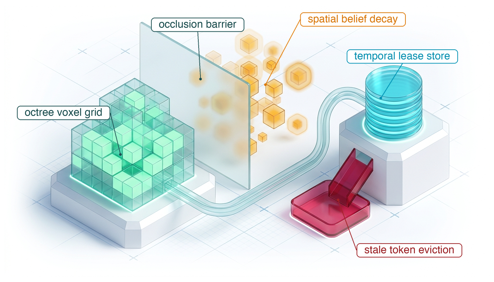
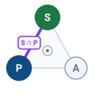
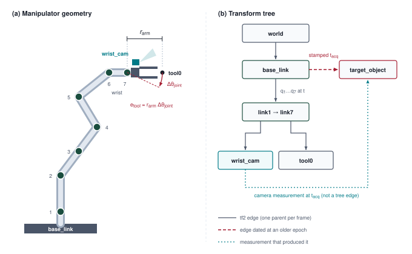
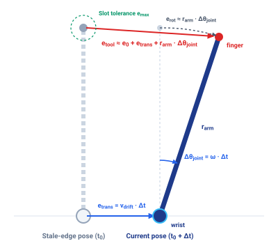
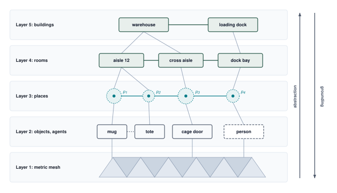
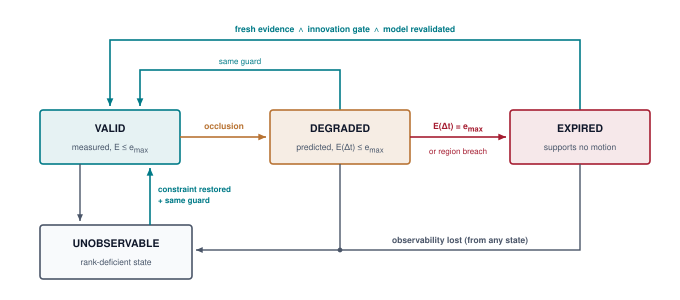

---
format:
  html:
    title: "Spatial Memory"
---

# Spatial Memory {#sec-memory}

::: {layout-narrow}
::: {.column-margin}

\chapterminitoc

:::

::: {.content-visible when-format="pdf"}
\noindent
{fig-alt="Isometric blueprint showing persistent spatial memory: tiered octree 3D voxel grid with fresh observation updates, frosted glass occlusion divider, floating spatial belief decay uncertainty halos, cylindrical temporal lease ledger, and crimson stale token eviction basin."}
:::

::: {.content-visible unless-format="pdf"}
{fig-alt="Isometric blueprint showing persistent spatial memory: tiered octree 3D voxel grid with fresh observation updates, frosted glass occlusion divider, floating spatial belief decay uncertainty halos, cylindrical temporal lease ledger, and crimson stale token eviction basin."}
:::

:::

## Purpose {.unnumbered .unlisted}

::: {.content-visible when-format="pdf"}
\begin{marginfigure}
\resizebox{0.92\linewidth}{!}{\mlphysicalstackfull{100}{20}{20}{20}{20}}
\end{marginfigure}
:::

_How quickly does a robot's spatial memory decay into dangerous fiction once moving objects exit the field of view, and how does a machine track what it cannot see?_

Biological organisms navigate dynamic environments effortlessly because their brains maintain persistent spatial representations of objects, surfaces, and obstacles long after direct sensory contact is lost. In contrast, standard vision policies operate almost entirely reactively, processing instantaneous frames and discarding spatial context the moment an object leaves the camera's limited field of view. When an autonomous forklift turns away from a pedestrian, or a mobile manipulator places a tool behind its mast, a memoryless policy behaves as if those physical entities have ceased to exist. Conversely, treating stale observations as permanently static causes robots to plan trajectories around phantom obstacles that have long since moved. A physical AI system requires a spatial memory architecture that bridges this gap: maintaining a persistent 3D representation of the physical world while dynamically modeling epistemic uncertainty and temporal decay. Spatial memory must distinguish between permanent architectural features that remain invariant, dynamic obstacles whose positions evolve along stochastic trajectories, and unobserved regions where uncertainty compounds with elapsed time. This chapter develops the systems architecture for embodied spatial memory, combining voxelized occupancy representations, neural radiance fields, and spatial belief state machines to provide planning algorithms with robust, uncertainty-aware representations of the unobserved world.



::: {.callout-learning-objectives}

- Specify the Scene Memory State record (the eighth contract) that unifies discrete belief records with continuous volumetric distance fields, bounding collision query latency under $2\ \mu\text{s}$
- Set belief expiry from bounded uncertainty growth and the task's physical tolerance
- Compare spatial representations (3D Gaussian splatting, NeRFs, octrees, and hashed TSDF/ESDF grids) across the memory footprint vs. query latency frontier
- Design spatial updates that preserve evidence age and distinguish missing observations from verified free space
- Diagnose frozen transforms, phantom tracks, and unobservable drift that pass freshness and innovation checks

:::

## Spatial Belief Persistence and Representation {#sec-memory-preserving-belief}

A memory register can preserve a record exactly while the world it describes moves. As the warehouse mobile manipulator closes on the end of a storage rack, the rack hides the cross aisle from the navigation camera, and whatever the camera last saw there now survives only in memory. A person out of sight past the rack end can walk into the space that record calls empty, and republishing the record with a new software timestamp cannot restore the lost physical evidence. Spatial memory must therefore carry the last measurement time and an error-growth rule into the motion-permission decision.

::: {.column-margin .margin-pointer}
↩ Observation age and calibrated spatial covariances are generated in @sec-perception-observation-contract.
:::

A physical machine cannot rely solely on raw sensory observations or static memory registers. It requires a **belief**\index{Belief}, an estimate of physical state carried forward from historical sensory evidence, coupled explicitly to an expanding model of uncertainty.[^fn-mem-belief-state] Perception supplies a dated, calibrated observation (as established in @sec-perception-handoff). Spatial memory must determine how long that observation, combined with dynamic motion models, can continue to authorize physical action before uncertainty consumes the machine's remaining clearance.

[^fn-mem-belief-state]: **Belief state formulation**\index{State estimation!belief state}: In a Partially Observable Markov Decision Process (POMDP), a belief represents a probability distribution over latent states. A physical state interface additionally carries an error bound. Without the value, frame, evidence epoch, and applicable uncertainty model, a downstream optimizer cannot evaluate clearance during a sensor dropout.

As the second of the four proposal-side stages of Part III, between perception and intent, **spatial memory**\index{Spatial memory} carries geometric and physical state estimates forward across sensor dropouts, occlusions, and variable processing delays. It sits above the proposal boundary (@sec-boundary-machine-model), so a remembered state can shape a proposal but cannot certify its own freshness; the permission path checks the age of the evidence against its own clock.

::: {.column-margin}
{width="100%" fig-alt="S·P·A locator triad highlighting the Sense-Plan belief edge."}
*The Sense $\cap$ Plan belief interface: preserving spatial object state under line-of-sight occlusions.*
:::

In software systems, data age is frequently measured from the instant a message was serialized, published over an inter-process bus, or updated in a shared memory table. In a physical AI system, this convention is dangerous. Propagating a state estimate through an extended Kalman filter at $1\text{ kHz}$ or republishing an $SE(3)$ kinematic transform at $200\text{ Hz}$ creates a stream of fresh software timestamps, but it does not refresh the underlying physical information. The true age of a belief is determined strictly by the evidence epoch $t_0$ of the last physical measurement that constrained it. A downstream tracking loop that reads a position estimate generated by dead reckoning or policy rollouts may observe a publish timestamp only $2\text{ ms}$ old, yet the physical error bound continues to widen at the velocity of the unobserved drift. Timestamping an inference output or a cache lookup records when compute occurred, but it tells the receiver nothing about when reality was last checked.

Consider an industrial mobile robot operating in an active warehouse aisle. As the base turns past a tall pallet rack, the rack's steel uprights occlude the cross aisle from the robot's navigation camera. Immediately after the camera's sightline is cut, the robot's spatial belief about the cross aisle retains low uncertainty ($E_0 \approx 0$). If a human worker or another vehicle was approaching that intersection at walking speed ($1.6\text{ m/s}$), the occluded entity traverses $50\text{ mm}$ of clear space in just $31.25\text{ ms}$—less than two frames at $30\text{ Hz}$. The physical environment does not freeze when a camera loses line of sight. Rather than remaining static, the unobserved entity's uncertainty envelope expands continuously into the planned transit corridor. A stored spatial observation is not an immutable database cache; it is a decaying physical belief whose uncertainty halo inflates over elapsed time $\Delta t$ until it intersects the machine's safety margin.

Memory integrity alone cannot establish geometric validity [@durrant2006simultaneous]. To prevent a machine from acting on stale data, memory systems must treat expiry as an explicit interface event. Each belief carries a deadline, its invalidation horizon (derived in @sec-memory-belief-through-occlusion), at which its declared error bound reaches the task's physical margin. At that deadline the belief stops supporting motion, and the permission path refuses any proposal that still depends on it and selects a feasible fallback.

A belief that must declare its own expiry has to travel with more than its value, so the first handoff question is what a consumer needs to evaluate a stored value after its sensor loses sight of the object.

## The Spatial Memory Handoff and State Invariants {#sec-memory-handoff}

An unannotated vector such as $[0.142, -0.051, 0.812]$ arriving over a real-time bus conveys nothing about what physical entity is being described, what physical dimension is represented, or how that quantity is scaled. A belief handed to a consumer therefore cannot be a naked array of floating-point numbers. It is a decaying interpretation of physical inputs and must carry its epoch, physical uncertainty, and reference frame to remain usable. A downstream controller receiving raw coordinates without metadata must rely on implicit conventions established at compile time. If an estimator produces positions in meters while an actuator controller expects millimeters, or if an angular rate is mistaken for an absolute orientation, the resulting command registers as a thousandfold tracking error, driving motor current to the actuator thermal limits detailed in @sec-body-thermal-duty-cycles. To prevent misinterpretation across the causal boundary established in @sec-boundary-causal-boundary, a belief record must first specify the entity identity, the physical quantity, and the measurement units. The consumer must be able to verify that the value represents the center of mass of a specific workpiece in meters, or the normal contact force on a fingertip in newtons, before routing that number into a control law.

Specifying the quantity and units remains incomplete without binding the value to a concrete reference frame. Identical spatial coordinates describe entirely different physical realities depending on the origin and orientation of the coordinate system. A Cartesian position $[0.142, -0.051, 0.812]\text{ m}$ designates a point suspended in free space when evaluated in the robot base frame\index{Base frame}, but represents a point several hundred millimeters inside a rigid fixture when interpreted in the tool flange frame\index{Tool flange frame}. Because kinematic links flex, joints move, and coordinate transforms update at varying rates, a belief record must carry an explicit frame identifier. Carrying the frame allows the receiving node to look up the corresponding spatial transformation tree and project the stored geometry into the local frame required by the actuator, preventing the controller from acting on geometric misalignments caused by moving kinematic chains.

Geometry and identity describe the physical state at a single moment, but memory must also capture the temporal anchor of that state. The record carries the evidence epoch $t_0$ of the physical interaction or optical exposure that last constrained the estimate. In distributed architectures, intermediate nodes often republish data, execute Kalman filter prediction steps, or run forward kinematic propagations to maintain high-rate control streams, and none of these adds physical evidence. The field must therefore pass unchanged through every republish, filter, and prediction stage, so that consumers measure the age of the information against the physical world rather than against the scheduling frequency of the local computer.

Generating this anchored belief relies on **multi-sensor state estimation**\index{State estimation!contract boundary}\index{Sensor fusion!informational contract}—whether implemented through recursive Extended Kalman Filters (EKF), Unscented Kalman Filters (UKF) [@kalman1960new], or nonlinear factor-graph optimization (Smoothing and Mapping, SAM)—an established mathematical discipline whose operational role is to map asynchronous, heterogeneous sensor observations (such as high-rate IMU accelerations, wheel encoder ticks, and low-rate vision claims) into a minimal sufficient statistic of the plant's latent physical state. The physical AI architecture abstracts the internal numerical mechanics of this fusion pipeline behind the spatial belief contract. Downstream trajectory planning and safety enforcement do not recompute sensor innovation covariances or re-solve factor graphs; they require only that the state estimator provide an unbiased state vector $\hat{\mathbf{x}}$, a physically honest uncertainty bound $\mathbf{\Sigma}$, and the true evidence epoch $t_0$ of the measurements that constrained it. The foundational systems requirement is not the choice of filtering algorithm, but the obligation that the estimator model process noise expansion honestly across blind intervals (@sec-appendix-control-covariance derives continuous error covariance propagation) and revoke its validity status whenever physical observability rank collapses (@sec-memory-state-estimation-bounds).

Knowing the evidence epoch $t_0$ establishes elapsed time $\Delta t = t - t_0$, but elapsed time alone cannot determine whether a belief is valid for a given action. Two estimates of identical age diverge at different rates depending on physical constraints. The rack end itself is bolted to the floor, so its remembered position stays within the machine's localization error however long the camera is blind, whereas a person hidden behind it can move at walking speed and spend the same clearance in a few tens of milliseconds.

The minimum record fields necessary for a consumer to evaluate a stored state can be derived directly from the requirement to bound current error. Let $E(\Delta t)$ represent the upper bound of the discrepancy between the stored value and true physical state after an elapsed time $\Delta t = t - t_0$. If an estimator establishes a state at time $t_0$ with an initial uncertainty bound\index{Uncertainty bound} $E_0$, and external disturbances or unmodeled velocities cause the true state to diverge at a maximum rate $r$, the upper bound on error at current time $t$ obeys the linear expansion\index{Error expansion} $E(\Delta t) = E_0 + r\,\Delta t$. At the rack end, $E_0$ is the machine's localization error and $r$ is the walking speed of the person the rack may hide; @sec-memory-belief-through-occlusion evaluates that law. Omitting either term leaves the consumer unable to compute $E(\Delta t)$, so an initial bound and an expansion rate are both structurally required fields of the record.

Expressing uncertainty through physical bounds and expansion rates distinguishes a physical AI belief from a probabilistic confidence score. An object detection network might output a class confidence of $0.94$, but that softmax score is not calibrated evidence (@sec-brain-cognitive-vulnerabilities), and a downstream position controller cannot convert a unitless probability into a safe actuator displacement margin (i.e., how far the arm can physically move before risking a collision). A confidence score of $0.94$ provides no information about whether an obstacle boundary is uncertain by $2.0\text{ mm}$ or by $200\text{ mm}$, nor does it indicate how rapidly that boundary moves when occlusion occurs. A physical memory record must express its initial bound $E_0$ and expansion rate $r$ in concrete physical dimensions such as meters, radians, or newtons per second. Furthermore, these rates are valid only within a declared validity region, such as a maximum assumed acceleration or a verified contact friction coefficient. If physical operating conditions leave that region, the expansion rate no longer holds, and the belief record must be treated as invalid.

When memory hands over a tuple containing value, reference frame, evidence epoch $t_0$, initial bound $E_0$, and growth rate $r$, the consumer executes a deterministic verification step before applying the data to physical control. The consumer possesses a task tolerance $E_{\max}$ dictated by the physical task. When the arm guides a gripper finger into the latch-release slot of the cage door, for instance, the slot's clearance sets $E_{\max}$, and positional uncertainty must stay below it. Upon reading the belief record at current time $t_{\text{now}}$, the consumer calculates the elapsed time $\Delta t = t_{\text{now}} - t_0$, evaluates the present error bound $E(\Delta t) = E_0 + r \Delta t$, and compares the result directly against $E_{\max}$. Crucially, evaluating this expiry inequality is not a one-time check executed only during path generation. The permission filter evaluates the inequality $E(t_{\text{now}} - t_0) \le E_{\max}$ continuously at the runtime control tick rate ($100\text{--}1{,}000\text{ Hz}$). If an occluded object's error bound breaches clearance mid-trajectory, proposal authority is instantly revoked, forcing an immediate transition to a validated stopping or holding response. If $E(\Delta t) \le E_{\max}$, the belief passes this expiry check and can enter the independent motion-permission check. Otherwise the dependent proposal is refused; the controller selects a validated hold, search, or stop response only when it remains feasible.

::: {#dfn-memory-spatial-belief-contract .callout-definition title="Scene memory state record"}

***Scene Memory State record***\index{Scene Memory State record!definition}\index{Spatial belief record!definition}\index{Belief record!definition} is the formal cyber-physical contract (the eighth in the volume's lineage) emitted by spatial memory. It binds identified physical quantities, discrete entity frames, and continuous volumetric distance fields (TSDF/ESDF) to hardware evidence epochs ($t_0$), estimate epochs ($t_{\text{est}}$), clock synchronization bounds ($\epsilon_{\text{sync}}$), initial uncertainty ($E_0$), continuous error-growth laws ($E(\Delta t)$), operating validity regions, collision query latency budgets ($< 2\ \mu\text{s}$), task clearance expiries ($t_{\text{exp}}$), provenance, and lifecycle status. These fields guarantee that downstream consumers independently evaluate geometric clearance, evidence freshness, and execution deadlines before entering any motion-permission check.

1.  **Significance**: A spatial claim without an error-growth model and hardware evidence epoch cannot be safely evaluated by downstream controllers. As unobserved time elapses ($\Delta t = t_{\text{now}} - t_0$), sensor drift and unmodeled disturbances widen the error bound ($E(\Delta t) = E_0 + r \Delta t$). When that bound exceeds task tolerance ($E(\Delta t) > E_{\max}$), the belief expires, requiring the permission path to refuse dependent proposals and enforce a validated fallback. Simultaneously, continuous volumetric layers must certify sub-2-microsecond ($< 2\ \mu\text{s}$) distance queries to allow reactive 1 kHz reflex loops to verify clearance across dozens of collision hulls.
2.  **Distinction**: Unlike unitless classification confidences (such as $P(\text{object}) = 0.94$) or static ROS TF transforms, the Scene Memory State couples metric SI units directly to physical time-decay dynamics, per-cell sensor ray epochs, and hard query execution budgets.
3.  **Common pitfall**: Relying on external middleware publishers to broadcast invalidation signals upon occlusion. If the network drops or an upstream tracking thread hangs, the downstream controller executes open-loop motions on stale beliefs unless it independently evaluates the record's evidence epoch and query budget.

:::

Evaluating the spatial belief record depends on calculating the elapsed time $\Delta t = t_{\text{now}} - t_0$ against physical reality. If the consumer cannot verify the exact physical instant when energy transduction occurred, the calculated error bound $E(\Delta t)$ becomes an unanchored fiction, mistaking software compute cycles for physical evidence. The estimate epoch and clock conversion named in the definition exist to protect that anchor, while provenance and lifecycle status, the record's remaining fields, are developed with the schema in @sec-memory-spatial-state-schema.

## State Epochs and Temporal Anchoring {#sec-memory-state-epoch}

A pose that leaves an object detector describes where a workpiece was when the camera exposed the frame, not where it is when the message arrives. Every state therefore refers to a specific instant, its **epoch**\index{Epoch}, and a state crossing a physical pipeline carries three of them before a controller can act. The **acquisition epoch**\index{Epoch!acquisition} ($t_0$) is the capture epoch of the observation contract (@sec-perception-observation-contract), the instant of energy transduction at the causal boundary, such as photons striking a photodiode array or a digital register latching an encoder count, and the belief record carries it as its evidence epoch.[^fn-hw-timer-capture] Memory adds the two epochs that follow it. The **estimate epoch**\index{Epoch!estimate} ($t_{\text{est}}$) marks the instant a state estimator or neural network completed its inference over those measurements and resolved them into a concrete state claim. The **publication epoch**\index{Epoch!publication} ($t_{\text{pub}}$) marks the instant the serialized message was committed to the transport bus for dispatch to downstream consumers.

[^fn-hw-timer-capture]: **Hardware timer input-capture**\index{Hardware!timer input-capture}: Microcontroller timer input-capture channels latch counter values into dedicated shadow registers upon external signal transitions, bypassing operating system interrupt latency. Reading capture registers without atomic synchronization against timer overflow flags causes 16-bit counter aliasing, injecting artificial timestamp jumps equal to the rollover period ($65.5\text{ ms}$ on a $1\text{ MHz}$ timer). In downstream visual-inertial odometry, this temporal discontinuity introduces false acceleration spikes that destabilize platform attitude filters.

Collapsing these three timestamps into a single receipt or transmission timestamp destroys the physical validity of the state. This failure mode is the **publish-time stamping anti-pattern**\index{Publish-time stamping anti-pattern!definition}: many software device drivers populate message timestamp headers with `clock::now()` immediately prior to publishing over the transport bus, rather than latching hardware timer input capture or kernel PTP timestamps. Stamping an inference output or republished message with the current system time hides 20 to 50 milliseconds of camera exposure, direct memory access (DMA) transport, and inference scheduling delay. Downstream state estimators and Kalman filters receive an illusion of temporal freshness while the physical plant has already displaced across space, inducing unmodeled phase lag and trajectory overshoot. That hidden age is displacement at speed, as @sec-perception-photons-to-claims established; for the navigation camera at the base's drive limit, the age at dispatch alone amounts to several centimeters of travel, all of it invisible to a consumer that reads only the publication stamp. A state that records only when data became available tells the consumer nothing about the physical instant the measurement represents, making temporal alignment impossible.

::: {.column-margin .margin-pointer}
↩ Synchronized hardware timestamping across fieldbuses is established in @sec-nervous-deterministic-fieldbuses.
:::

Even when a system records true acquisition epochs, physical AI architectures rely on distributed processing nodes whose local oscillator clocks drift independently. Synchronizing these distributed clocks over standard bus networks introduces a bounded synchronization error, and that temporal uncertainty becomes spatial uncertainty at the relative speed of whatever the record describes.[^fn-hw-ptp-canfd] The observation record of @sec-perception-observation-contract already carries this bound as its clock-conversion error, and a belief built from that observation keeps it. Every consumer adds the bound to the evidence age before judging freshness, and the error budget allocates the distance that bound covers at the record's relative speed alongside sensor resolution and structural deflection.

[^fn-hw-ptp-canfd]: **Fieldbus clock synchronization jitter**\index{Fieldbus!synchronization jitter}: Fieldbus architectures exhibit distinct hardware clock synchronization bounds: IEEE 1588 PTP over Ethernet achieves $\delta t < 1.0\,\mu\text{s}$, EtherCAT Distributed Clocks achieve $<100\text{ ns}$ hardware SYNC0 jitter, and CAN-FD bit-phase synchronization yields $\pm 10\text{--}50\,\mu\text{s}$. Because spatial uncertainty scales with target relative velocity ($e_{\text{sync}} = v_{\text{rel}} \delta t$), microsecond-level synchronization is essential to keep temporal errors within micrometer mechanical budgets. Uncalibrated clock drift between distributed sensor and motor nodes degrades multi-axis tool coordination, inducing high-frequency chatter in joint torque loops.

```{python}
#| label: calc-memory-epoch-alignment
#| echo: false
#| warning: false
#| message: false
# ┌─────────────────────────────────────────────────────────────────────────────
# │ ILLUSTRATIVE SAMPLING EPOCHS FOR FUSION
# ├─────────────────────────────────────────────────────────────────────────────
# │ Context: @sec-memory-state-epoch (three sensors latch at different epochs).
# │
# │ Goal:    Show that fusing two observations requires projecting one across
# │          the gap between their acquisition epochs.
# │ Show:    tactile 12 ms, camera 18.5 ms, encoders 21 ms; camera-to-encoder
# │          gap 2.5 ms.
# │ How:     Illustrative epochs in one cycle; the gap is |t3 - t2|.
# └─────────────────────────────────────────────────────────────────────────────
from mlsysim import *
from mlsysim.fmt import fmt_latency, check

class MemoryEpochAlignment:
    # ┌── 1. LOAD (Constants & Parameters) ─────────────────────────────────────
    t1 = 12.0 * millisecond  # category: illustrative (tactile array latches force)
    t2 = 18.5 * millisecond  # category: illustrative (camera finishes integration)
    t3 = 21.0 * millisecond  # category: illustrative (encoders sample angles)

    # ┌── 2. EXECUTE (Compute) ─────────────────────────────────────────────────
    gap = abs(t3 - t2).to(millisecond)

    # ┌── 3. GUARD (Invariants) ────────────────────────────────────────────────
    check(t1 < t2 < t3, "The illustrative epochs must be in sampling order.")
    check(abs(gap.magnitude - 2.5) < 1e-9, "Camera-to-encoder gap is 2.5 ms.")

    # ┌── 4. OUTPUT (Formatting) ───────────────────────────────────────────────
    t1_str = fmt_latency(t1, unit=millisecond, precision=0)
    t2_str = fmt_latency(t2, unit=millisecond, precision=1)
    t3_str = fmt_latency(t3, unit=millisecond, precision=0)
    gap_str = fmt_latency(gap, unit=millisecond, precision=1)
```

Real physical systems never sample all relevant state variables simultaneously. In an illustrative cycle, a tactile array might latch normal force readings at $t_1 =$ `{python} MemoryEpochAlignment.t1_str`, an optical tracking camera might finish sensor integration at $t_2 =$ `{python} MemoryEpochAlignment.t2_str`, and joint optical encoders might sample angular positions at $t_3 =$ `{python} MemoryEpochAlignment.t3_str`. These observations occur at different epochs and cannot be combined through direct algebraic operations. Fusing a camera observation at $t_2$ with an encoder observation at $t_3$ requires the consumer to project one state across the temporal gap $\Delta t = |t_3 - t_2| =$ `{python} MemoryEpochAlignment.gap_str` using explicit kinematic models and bounded velocities (for example, propagating the historical camera observation along the joint velocity vector to reconcile it with the instantaneous encoder reading). Without the true acquisition epoch for each individual signal, the alignment calculation cannot determine the sign or magnitude of $\Delta t$. Extrapolating state without an accurate epoch causes the fusion algorithm to compute spatial offsets from fictitious temporal baselines, compounding errors across every fusion cycle.

With these epochs and the clock-synchronization bound carried in the record of @sec-memory-handoff, the consumer computes the elapsed duration between the evidence epoch and the execution deadline, evaluates the worst-case expansion of the error bound, and determines whether the state remains within task tolerances. Handing over a state without its acquisition epoch leaves the consumer blind to transport delays and scheduling jitter, turning deterministic control into open-loop guesswork. Because physical geometry also changes as bodies move through space, spatial transforms between reference frames are subject to the same temporal decay, carrying their own distinct evidence epochs.

## Coordinate Transform Expiry and Calibration Drift {#sec-memory-reference-frames}

A frame binds a coordinate, but in a machine the frame itself moves. @Sec-perception-handoff gave every observation a named frame and related the sensor, body, odometry, and map frames through a transform tree. What the tree does not show is how a transform goes stale. Each edge of the tree in @fig-09-robot-transform-tree stores a rigid-body pose in $SE(3)$\index{Special Euclidean Group $SE(3)$}, parameterized by joint angles [@lynch2017modern; @craig2005introduction], and that pose describes the machine only at the epoch when its geometry was measured. When an onboard computer chains transforms measured at different times, through transport delay, asynchronous sampling, or dropped frames, the product is a hybrid pose the machine never occupied (@sec-appendix-control-kinematics derives the kinematic chain).

A transform also spans several machine words, so a reader racing a writer can see an old rotation paired with a new translation. The seqlock mailbox of @sec-nervous-cadences closes that race without blocking the control thread, because each reader makes one bounded attempt per tick and never waits; a torn read is discarded and the last validated transform ages in its place.

::: {#fig-09-robot-transform-tree fig-env="figure" fig-pos="t" fig-cap="**Manipulator kinematic frame tree and temporal dynamics**: Articulated manipulator geometry (a) and corresponding directed acyclic coordinate transform tree in ROS \\texttt{tf2} (b). Each directed edge stores a homogeneous transformation matrix parameterized by joint state. Composing transforms across disparate acquisition epochs injects lever-arm positioning error $e_{\\text{tool}} \\approx \\ell\\,\\Delta\\theta$, while an uncompensated asynchronous edge references stale coordinates (adapted from Craig 2005 and Foote 2013 [@craig2005introduction; @foote2013tf])." fig-alt="Manipulator Kinematic Frame Tree and Temporal Lever-Arm Dynamics. (a) Physical geometry of an articulated manipulator with base link, joint linkages, wrist camera, and tool center point (tool0), indicating lever arm ℓ and angular deflection error e_tool ≈ ℓ · Δθ. (b) Spatial transformation tree (DAG) connecting world reference, base link, kinematic chain link1 through link6, wrist frame, wrist camera, tool0 TCP, and target object, highlighting an asynchronous stale transform edge. (Adapted from Craig 2005 and Foote 2013)."}
{width="100%"}
:::

In @fig-09-robot-transform-tree, panel (a) illustrates the physical geometry of an articulated serial manipulator carrying an eye-in-hand wrist camera and an end-effector tool center point (`tool0`). Mechanical links (`link1` through `link6`) are connected by revolute joints whose optical encoders continuously sample joint angles $\theta_i(t)$. The tool tip extends beyond the wrist joint by an effective lever arm $\ell$. When the wrist turns at angular rate $\omega$, any temporal latency $\Delta t$ in the wrist coordinate frame introduces an angular lag $\Delta\theta = \omega\,\Delta t$, sweeping the tool tip across an unmodeled circular arc $e_{\text{tool}} \approx \ell\,\Delta\theta$.

Panel (b) depicts the corresponding coordinate transform tree maintained as a directed acyclic graph (DAG) in robot middleware such as ROS `tf2` [@foote2013tf]. Each directed edge represents a $4 \times 4$ homogeneous transformation matrix $\mathbf{T}_{A \to B} \in \mathrm{SE}(3)$ mapping points from child frame $B$ into parent frame $A$. Because internal joint encoders publish at high cadences (typically $500\text{--}1{,}000\text{ Hz}$) over deterministic fieldbuses while external visual perception pipelines publish target poses (`target_object`) at camera framerates ($30\text{--}60\text{ Hz}$) over asynchronous network transports, the transform tree inevitably buffers edges with disparate timestamps. If an asynchronous edge (such as `wrist_camera` to `target_object`) drops a frame or stalls, compounding the current robot arm forward kinematics $\mathbf{T}_{\text{base} \to \text{wrist}}(t)$ with a stale vision edge $\mathbf{T}_{\text{wrist} \to \text{object}}(t - \Delta t)$ instantiates the **chimeric kinematic product anti-pattern**\index{Chimeric kinematic product anti-pattern!definition}: synthesizing an unphysical hybrid pose that the robot never occupied.

In robotics middleware like ROS `tf2`, transform listeners resolve coordinate frames by querying the transform tree. When evaluating historical data (for instance, during offline mapping or log replay), the middleware smoothly interpolates between buffered past transforms ($t_1 \le t \le t_2$). At the current control tick $t_{\text{now}}$, however, an active machine operates at the absolute leading edge of time ($t_{\text{now}} > t_{\text{last\_frame}}$). At this leading edge, the transform tree faces the **real-time extrapolation dilemma**: it cannot interpolate into unobserved future frames. The middleware must either block the calling thread until a new frame arrives—violating real-time scheduling deadlines—or extrapolate forward using numerical derivatives, which introduces unconstrained lever-arm rotational error $e_{\text{rot}} \approx \ell\,\omega\,\Delta t$. When communication stalls, naive extrapolation projects kinematic linkages along dead-reckoned arcs that diverge from physical reality.

The cost of an expired transform is direct spatial displacement (@fig-frame-staleness-error). Applying the age-as-displacement relation of @sec-perception-photons-to-claims to kinematics, uncompensated latency translates directly into geometric positioning error through the lever arm of the linkages. For the rigorous cross-product derivation of this kinematic error propagation, see @sec-appendix-control-spatial.

```{python}
#| label: calc-memory-latch-transform-staleness
#| echo: false
#| warning: false
#| message: false
# ┌─────────────────────────────────────────────────────────────────────────────
# │ STALE SLOT-TO-FINGER TRANSFORM AT THE LATCH SLOT
# ├─────────────────────────────────────────────────────────────────────────────
# │ Context: @sec-memory-reference-frames (lever-arm staleness example); owns
# │          the latch-slot constants that @sec-memory-belief-through-occlusion
# │          (LatchSlotBelief) reads.
# │
# │ Goal:    Show that one missed wrist-camera frame on the slot-to-finger
# │          edge can spend more than the latch-release slot's tolerance, most
# │          of it through the lever arm.
# │ Show:    the frame period, the lateral drift at the finger's drift bound,
# │          the lever-arm arc, and their sum with E0 against the slot.
# │ How:     e_tool ~ E0 + v_drift dt + l omega dt, dt one wrist-camera frame.
# └─────────────────────────────────────────────────────────────────────────────
from mlsysim import *

RM = Embodied.MobileManipulator.WarehouseMobileManipulator
AISLE = Embodied.Scenario.WarehouseAisle

class LatchTransformStaleness:
    # ┌── 1. LOAD (Constants & Parameters) ─────────────────────────────────────
    frame_rate = RM.wrist_camera.frame_rate  # category: datasheet (wrist camera)
    e0 = 0.1 * ureg.millimeter  # category: illustrative (finger-to-slot error at the wrist capture)
    v_drift = 12.0 * ureg.millimeter / ureg.second  # category: illustrative (unobserved lateral velocity error bound)
    e_max = 1.0 * ureg.millimeter  # category: illustrative (latch-release slot tolerance)
    lever = 0.15 * ureg.meter  # category: illustrative (wrist-to-fingertip lever arm)
    omega = 0.30 * ureg.radian / ureg.second  # category: illustrative (wrist rate while aligning the finger)

    # ┌── 2. EXECUTE (Compute) ─────────────────────────────────────────────────
    dt = (1 / frame_rate).to(millisecond)
    e_trans = (v_drift * dt).to(ureg.millimeter)
    e_rot = (lever * omega * dt / ureg.radian).to(ureg.millimeter)
    e_tool = (e0 + e_trans + e_rot).to(ureg.millimeter)
    ratio = (e_tool / e_max).to(ureg.dimensionless).magnitude

    # ┌── 3. GUARD (Invariants) ────────────────────────────────────────────────
    check(abs(dt.magnitude - 16.667) < 1e-3, f"Wrist-camera frame period should be 16.7 ms, got {dt}.")
    check(abs(e_trans.magnitude - 0.2) < 1e-6, f"Lateral drift over one frame should be 0.20 mm, got {e_trans}.")
    check(abs(e_rot.magnitude - 0.75) < 1e-6, f"Lever-arm arc should be 0.75 mm, got {e_rot}.")
    check(e_rot > e_trans, "The lever arm must contribute more than the lateral drift.")
    check(e_tool > e_max, "One missed frame must exceed the slot tolerance.")
    check(abs(e_tool.magnitude - 1.05) < 1e-6, f"Total finger error should be 1.05 mm, got {e_tool}.")

    # ┌── 4. OUTPUT (Formatting) ───────────────────────────────────────────────
    dt_str = fmt_latency(dt, unit=millisecond, precision=1)
    e0_str = fmt_length(e0, unit=ureg.millimeter, precision=1)
    v_drift_str = fmt_velocity(v_drift, unit=ureg.millimeter / ureg.second, precision=0)
    lever_str = fmt_length(lever, unit=ureg.meter, precision=2)
    omega_str = fmt_angular_velocity(omega, precision=2)
    e_trans_str = fmt_length(e_trans, unit=ureg.millimeter, precision=2)
    e_rot_str = fmt_length(e_rot, unit=ureg.millimeter, precision=2)
    e_tool_str = fmt_length(e_tool, unit=ureg.millimeter, precision=2)
    e_max_str = fmt_length(e_max, unit=ureg.millimeter, precision=0)
    ratio_pct_str = fmt_percent(ratio - 1, precision=0, style="prose")
```

How little staleness it takes to spend a task's tolerance shows at the latch-release slot, while the wrist camera can still see it. Each wrist-camera frame, one every `{python} LatchTransformStaleness.dt_str`, renews the slot's pose in the camera frame and with it the slot-to-finger edge the controller aligns on, and the finger must stay within the slot tolerance $E_{\max}$ of `{python} LatchTransformStaleness.e_max_str`. Suppose that edge misses a single frame. Starting from an initial error of `{python} LatchTransformStaleness.e0_str`, the finger's lateral offset drifts at most $e_{\text{trans}} = v_{\text{drift}}\,\Delta t$ under an illustrative `{python} LatchTransformStaleness.v_drift_str` bound on its unobserved lateral velocity, validated for the arm's operating region, or `{python} LatchTransformStaleness.e_trans_str`. With the fingertip an illustrative $\ell$ = `{python} LatchTransformStaleness.lever_str` beyond the wrist and the wrist turning at an illustrative $\omega$ = `{python} LatchTransformStaleness.omega_str` as it aligns the finger, the lever arm adds $e_{\text{rot}} \approx \ell\,\omega\,\Delta t$, or `{python} LatchTransformStaleness.e_rot_str`. The joint encoders measure that turn, but the stale edge still dates the slot to the previous frame while the wrist pose it is composed with is current, so the tree returns a hybrid pose, a finger position the arm never held. Only chaining the slot against the wrist pose of its own capture epoch, or expiring the edge, removes that arc. Left in the chain, the stale edge misplaces the finger by `{python} LatchTransformStaleness.e_tool_str`, `{python} LatchTransformStaleness.ratio_pct_str` more than the slot allows, and more of that error comes from the lever arm than from the drift. Because the transform tree evaluates without error, nothing flags the stale pose, and the controller keeps aligning the finger on a slot position that is off by more than the clearance, which on an unfavorable approach puts the finger against the strike plate beside the slot.

::: {#fig-frame-staleness-error fig-env="figure" fig-pos="t" fig-cap="**Transform staleness and lever-arm error at the latch-release slot**: Finger error when the slot-to-finger edge misses one wrist-camera frame of duration $\\Delta t$. Lateral drift at the velocity bound $v_{\\text{drift}}$ moves the finger by $e_{\\text{trans}} = v_{\\text{drift}}\\,\\Delta t$, while the wrist turning at $\\omega$ swings the fingertip, a lever arm $\\ell$ beyond it, by $e_{\\text{rot}} \\approx \\ell\\,\\omega\\,\\Delta t$. Composing the stale edge with the current wrist pose adds both to the initial error $E_0$, so the finger error $e_{\\text{tool}} \\approx E_0 + e_{\\text{trans}} + \\ell\\,\\Delta\\theta$ exceeds the slot tolerance $E_{\\max}$." fig-alt="Transform staleness at the latch-release slot. A dashed ghost arm shows the wrist and finger as dated by the stale edge at t0, with a dashed circle marking the slot tolerance E_max around the finger. The current arm at t0 + Δt shows the wrist shifted laterally by e_trans = v_drift Δt and the link of length ℓ turned by Δθ = ω Δt, which swings the finger by e_rot ≈ ℓ Δθ. A red vector from the stale finger position to the current finger, labeled e_tool ≈ E_0 + e_trans + ℓ Δθ, ends well outside the E_max circle."}
{width="100%"}
:::

To trace this failure mechanism visually, examine the geometric breakdown in @fig-frame-staleness-error. The dashed ghost arm depicts the estimated wrist and finger configuration at time $t_0$, when the slot-to-finger transform was last refreshed by the wrist camera. A dashed circle centered on this initial estimate indicates the mechanical slot tolerance boundary $E_{\max} = 1.0\text{ mm}$; any positioning error remaining inside this circle permits successful mechanical entry. By time $t_0 + \Delta t$, however, one missed camera frame ($\Delta t = 16.7\text{ ms}$) has elapsed. During this interval, unobserved lateral velocity drift moves the wrist translationally by $e_{\text{trans}} = v_{\text{drift}}\,\Delta t = 0.20\text{ mm}$. Simultaneously, wrist rotation at rate $\omega = 0.30\text{ rad/s}$ sweeps the fingertip through angular deflection $\Delta\theta = \omega\,\Delta t = 0.005\text{ rad}$. Operating over the $\ell = 0.15\text{ m}$ lever arm between the wrist pitch axis and the fingertip, this minute angular deflection swings the tool tip by $e_{\text{rot}} \approx \ell\,\Delta\theta = 0.75\text{ mm}$. Summing the initial uncertainty $E_0 = 0.10\text{ mm}$, the translational drift $e_{\text{trans}} = 0.20\text{ mm}$, and the rotational lever-arm swing $e_{\text{rot}} = 0.75\text{ mm}$ yields a total spatial deflection of $e_{\text{tool}} \approx E_0 + e_{\text{trans}} + \ell\,\omega\,\Delta t = 1.05\text{ mm}$. The solid red vector in @fig-frame-staleness-error pierces the dashed $E_{\max}$ tolerance boundary by 5 percent. Crucially, the kinematic tree computes this forward kinematic composition without reporting an exception, because every individual matrix multiplication is mathematically valid. The control loop remains unaware that it is aligning against a stale virtual target, driving the physical fingertip into the solid aluminum strike plate rather than the entry slot.

::: {#psp-memory-leverage-of-staleness .callout-perspective title="The leverage of staleness"}
*A transform's admissible age is set at the point it serves, not at the joint it measures. The tool point drifts at roughly $v + \ell\omega$, so the longer the lever arm, the sooner an edge expires, and an edge still fresh enough to locate the wrist can be too old to locate the tool center point.*
:::

A transform tree dates the machine's own geometry, and a stale edge misplaces the tool by the motion it missed, amplified by the lever arm. The world around the machine ages in the same way, but it has no joint encoders to report its motion, so memory must also hold the surrounding surfaces and the space between them, and it must record which of that space a sensor has actually seen.

## Certified Spatial Assertions in Scene Memory {#sec-memory-scene-attention-buffers}

Why cannot an embodied robot rely solely on raw, frame-by-frame sensory perception? When an end-to-end policy or reactive planner processes only the instantaneous stream of RGB-D camera frames or point clouds, it suffers from fatal physical vulnerabilities:

1. *Frustum amnesia and limited field of view*: Physical optical sensors possess narrow directional fields of view (typically $60^\circ\text{--}90^\circ$ horizontal aperture). When a mobile manipulator rotates its chassis to navigate an aisle, or turns its wrist to grasp a tool, obstacles that were clearly observed seconds earlier pass outside the camera frustum. A stateless perception pipeline suffers from instantaneous spatial amnesia: an obstacle disappears from the input tensor the moment it leaves the optical cone, inducing destructive collisions if the robot slews, reverses, or extends an arm into that recently observed space.
2. *Occlusion shadows vs. verified free space*: An instantaneous sensor frame provides only a 2.5D surface snapshot from a single vantage point. It cannot distinguish between verified traversable free space and unobserved space occluded in the geometric shadows of foreground obstacles (such as pallet racks or structural uprights).
3. *Rate and latency decoupling for safety reflexes*: Processing high-resolution sensor streams with deep neural networks incurs $30\text{--}100\text{ ms}$ of scheduling and inference latency ($10\text{--}30\text{ Hz}$). In stark contrast, reactive collision filters, Control Barrier Functions (CBFs), and torque reflex loops run synchronously at $1\text{ kHz}$ ($1{,}000\ \mu\text{s}$ periods). A 1 ms motor reflex loop cannot stall waiting for a 50 ms neural perception pass.

Persistent 3D spatial memory resolves these bottlenecks by accumulating multi-view observations across physical time into a persistently queryable geometric state. A robot that has swept its range sensor down an aisle holds three kinds of space afterward: space it saw occupied, space it saw empty, and space it never saw. Only the second can ever vouch that a path is clear, and only while its evidence is fresh. Scene memory must balance the physical resolution of obstacles, the memory bandwidth required to update volumetric representations at sensor framerates, and the latency of collision queries executed by high-rate safety controllers. These requirements divide spatial scene memory into three complementary architectural tiers: volumetric metric maps and distance fields, hierarchical dynamic scene graphs, and episodic interaction memory.

### Volumetric metric maps and distance fields {#sec-memory-volumetric-metric-maps}

Every metric scene representation stores some version of occupied, free, and unobserved space, but representations differ fundamentally in how they model physical surfaces and what they demand in storage capacity and query latency. Five primary paradigms govern robotic metric memory:

1. **Occupancy Grids and Hierarchical Octrees**: Discretizes 3D space into uniform cubic voxels of side length $r$ [@elfes1989using]. Each voxel cell $m_i$ stores an occupancy probability $P(m_i=1)$, updated recursively in log-odds notation: $L(m_i) = \log [P(m_i=1)/(1-P(m_i=1))]$. Dense grids scale cubically with volume; allocating a $1\text{ m}^3$ workspace at fine $2\text{ mm}$ resolution requires $(1000/2)^3 = 1.25 \times 10^8$ voxels, consuming $125.0\text{ MB/m}^3$ at 1 byte per voxel. To avoid allocating empty volumes, hierarchical octrees (such as OctoMap [@hornung2013octomap]) group eight sibling voxels recursively, pruning homogeneous free space to achieve compact storage ($0.18\text{--}1.25\text{ MB/m}^3$ at $2\text{--}5\text{ cm}$). However, pointer dereferencing across tree depths introduces CPU cache misses, resulting in query latencies of $24\text{--}38\ \mu\text{s}$.
2. **Truncated Signed Distance Fields (TSDF)**: Rather than binary occupancy, a TSDF stores the projective distance $d(\mathbf{x})$ from voxel center $\mathbf{x}$ to the nearest observed surface along the sensor sightline [@curless1996volumetric], normalized and truncated to a narrow metric band $[-\delta, +\delta]$: $D(\mathbf{x}) = \min(1, \max(-1, d(\mathbf{x})/\delta))$. Spatial hashing frameworks (such as Voxblox [@oleynikova2017voxblox]) allocate voxel blocks only within the narrow band around perceived surfaces, achieving moderate storage ($4.1\text{ MB/m}^3$ at $5\text{ cm}$) and rapid raycasting ($1.8\ \mu\text{s}$).
3. **Euclidean Signed Distance Fields (ESDF)**: While a TSDF measures distance along optical camera rays, motion planning and reactive obstacle avoidance require the true Euclidean distance to the nearest physical obstacle: $d_E(\mathbf{x}) = \min_{\mathbf{y} \in \mathcal{S}} \|\mathbf{x} - \mathbf{y}\|$, with negative signs inside solid geometry. Propagating wave-front expansions across hashed TSDF blocks yields an ESDF. Although maintaining the Euclidean distance field increases memory overhead ($28.5\text{ MB/m}^3$ at $2\text{ cm}$), it delivers sub-microsecond ($0.85\ \mu\text{s}$) distance lookups with analytic continuous clearance repulsion gradients $\nabla d_E(\mathbf{x}) = (\mathbf{x} - \mathbf{y}^*)/\|\mathbf{x} - \mathbf{y}^*\|$, which are essential for trajectory optimization and Control Barrier Functions.
4. **3D Gaussian Splatting (3DGS)**: Parameterizes geometry as an explicit collection of anisotropic 3D Gaussian ellipsoids [@kerbl20233d], each defined by mean position $\boldsymbol{\mu}_i \in \mathbb{R}^3$, covariance matrix $\boldsymbol{\Sigma}_i = \mathbf{R}\mathbf{S}\mathbf{S}^T\mathbf{R}^T \in \mathbb{S}_{++}^3$, opacity $\alpha_i \in [0, 1]$, and spherical harmonics color coefficients. By structuring Gaussians in a GPU Bounding Volume Hierarchy (BVH), 3DGS achieves moderate memory density ($1.6\text{--}5.2\text{ MB/m}^3$) and fast spatial queries ($5.8\text{--}8.2\ \mu\text{s}$) while retaining photographic view-synthesis fidelity.
5. **Implicit Neural Representations (NeRF / Coordinate MLPs)**: Encodes volumetric density $\sigma(\mathbf{x})$ and color $\mathbf{c}(\mathbf{x})$ within the stationary weights of a multilayer perceptron (MLP) (e.g., coordinate MLPs such as iMAP or Instant-NGP). While parameterizing an entire room in just megabytes of neural weights yields exceptional memory compression ($0.08\text{ MB/m}^3$), querying signed distance requires evaluating neural network forward passes, imposing latencies exceeding $650\ \mu\text{s}$ per query point.

Analyzing these representations exposes the three foundational physical and systems constraints governing embodied 3D memory: memory footprint scaling, DRAM update bandwidth during sensor ingestion, and collision query latency under hard real-time reflex deadlines.

#### Volumetric memory footprint scaling {.unnumbered}

Consider an operational workspace of physical volume $V_{\text{ws}} = L_x L_y L_z$. Discretizing this domain into cubic voxels of uniform pitch $r$ requires a memory allocation that scales cubically:
$$M_{\text{dense}} = \left(\frac{V_{\text{ws}}}{r^3}\right) S_{\text{voxel}}$$ {#eq-mem-footprint-dense}
where $S_{\text{voxel}}$ represents the storage footprint per voxel (typically 8 bytes: 4 bytes for 32-bit floating-point distance, 2 bytes for observation weight, and 2 bytes for evidence timestamp). Evaluating @eq-mem-footprint-dense for a warehouse workcell of dimensions $10\text{ m} \times 10\text{ m} \times 3\text{ m}$ ($V_{\text{ws}} = 300\text{ m}^3$) at fine manipulation resolution ($r = 0.01\text{ m}$, or $1\text{ cm}$) demands $(300 / 0.01^3) \times 8\text{ B} = 3 \times 10^8 \times 8\text{ B} = 2.4\text{ GB}$ of static, contiguous DRAM. On an embedded robot computer, dedicating gigabytes of memory purely to an empty uniform voxel array starves parallel vision backbones and real-time controller memory allocations.

Crucially, physical obstacles do not fill three-dimensional space uniformly; they reside on thin two-dimensional surface manifolds embedded in the workspace ($\mathcal{S} \subset \mathbb{R}^3$). Truncating distance fields to a narrow metric band $[-\delta, +\delta]$ around observed surfaces restricts non-trivial distance values to a narrow volumetric shell $V_{\text{band}} \approx 2\delta \cdot A_{\text{surface}}$, where $A_{\text{surface}}$ is the total obstacle surface area. Partitioning space into discrete blocks of $B^3$ voxels (typically $B = 8$, yielding 512 voxels per block) with block physical pitch $L_B = B \cdot r$, the sparse hashed memory footprint obeys:
$$M_{\text{hashed}} = N_{\text{blocks}} \left( B^3 S_{\text{voxel}} + S_{\text{meta}} \right) + N_{\text{buckets}} S_{\text{entry}}$$ {#eq-mem-footprint-hashed}
where $N_{\text{blocks}} \approx \lceil 2\delta A_{\text{surface}} / (B r)^3 \rceil$, $S_{\text{meta}}$ is the block metadata overhead (spatial coordinates, allocation flags), and $S_{\text{entry}}$ is the hash bucket pointer size. Evaluating @eq-mem-footprint-hashed for the same $300\text{ m}^3$ workcell with an obstacle surface area of $A_{\text{surface}} \approx 120\text{ m}^2$ and narrow band $\delta = 4\text{ cm}$, the active surface volume is only $V_{\text{band}} \approx 9.6\text{ m}^3$. This requires allocating approximately $N_{\text{blocks}} \approx 18{,}750$ blocks, consuming under $77\text{ MB}$ of memory—a 31-fold compression over dense allocation that fits comfortably into processor cache and embedded RAM.

#### Voxel block hashing index mapping {.unnumbered}

To achieve sparse allocation without incurring the pointer traversal overhead of octrees, modern robotic mapping frameworks [@oleynikova2017voxblox] rely on **voxel block hashing**. Continuous world coordinates $\mathbf{x} = [x, y, z]^\top \in \mathbb{R}^3$ are mapped to an integer block index $\mathbf{u} = [u_x, u_y, u_z]^\top \in \mathbb{Z}^3$:
$$\mathbf{u}(\mathbf{x}) = \left\lfloor \frac{\mathbf{x}}{B \cdot r} \right\rfloor$$ {#eq-mem-block-index}
As formulated in @eq-mem-block-index and @eq-mem-voxel-hashing, the block index is then mapped to a hash table bucket index $h(\mathbf{u}) \in \{0, \dots, N_{\text{buckets}}-1\}$ through spatial XOR hashing:
$$h(\mathbf{u}) = \left( u_x \cdot p_1 \oplus u_y \cdot p_2 \oplus u_z \cdot p_3 \right) \bmod N_{\text{buckets}}$$ {#eq-mem-voxel-hashing}
where $p_1, p_2, p_3$ are large prime constants ($73856093, 19349663, 83492791$) and $\oplus$ denotes bitwise XOR. Inside each allocated block, relative voxel offsets $\Delta \mathbf{u} = \lfloor \mathbf{x}/r \rfloor - B \mathbf{u}$ resolve via direct linear array indexing:
$$\text{offset} = \Delta u_x + B\left(\Delta u_y + B\,\Delta u_z\right)$$
Because each 512-voxel block is laid out contiguously in memory ($512 \times 8\text{ B} = 4{,}096\text{ B}$, matching a standard 4 KB OS virtual memory page), spatial block hashing delivers $O(1)$ block retrieval complexity while ensuring that raycasting traversals and trilinear interpolation kernels achieve near-perfect hardware cache locality on both CPU and GPU architectures.

#### DRAM update bandwidth during ray marching {.unnumbered}

When depth cameras stream range frames at framerate $f_{\text{cam}}$ with $N_{\text{rays}} = W \times H$ pixels per frame, updating the volumetric map requires ray marching from the sensor origin to each observed surface point [@curless1996volumetric]. Each ray traverses a line-of-sight distance $d_{\text{ray}}$ at voxel stepping pitch $r$, requiring $N_{\text{steps}} = d_{\text{ray}} / r$ discrete cell evaluations. The raw DRAM update bandwidth consumed by naive ray marching is:
$$\text{BW}_{\text{DRAM}} = f_{\text{cam}} \cdot N_{\text{rays}} \cdot \left(\frac{d_{\text{ray}}}{r}\right) \cdot S_{\text{rw}}$$ {#eq-mem-dram-bandwidth}
where $S_{\text{rw}}$ is the read-modify-write memory traffic per traversed voxel (typically 8 to 16 bytes for reading current occupancy/distance, updating running weights, and writing back).

Evaluating @eq-mem-dram-bandwidth for a standard VGA depth stream ($640 \times 480 = 307{,}200$ rays) at $f_{\text{cam}} = 30\text{ Hz}$ ray-marched over an average distance of $d_{\text{ray}} = 2.0\text{ m}$ at resolution $r = 2\text{ cm}$ ($100$ steps per ray):
$$\text{BW}_{\text{DRAM}} = 30 \times 307{,}200 \times \left(\frac{2.0}{0.02}\right) \times 8\text{ B} \approx 7.37 \times 10^9\text{ B/s} \approx 7.37\text{ GB/s}$$
On an embedded system on chip (SoC) (such as an NVIDIA Jetson AGX Orin sharing $102\text{--}204\text{ GB/s}$ of unified LPDDR5 bandwidth between GPU vision models, CPU control threads, and display pipelines), consuming $7.4\text{ GB/s}$ purely on uncoalesced DRAM writes creates severe memory bus contention. Voxel block hashing circumvents this bottleneck by caching active blocks in GPU shared memory or CPU L2 cache and utilizing projective TSDF updates—projecting voxels inside the viewing frustum directly onto the depth image in reverse—collapsing DRAM memory traffic by more than an order of magnitude.

::: {.column-margin}
{width="100%" fig-alt="Vertical ladder comparing SoC bus limit against dense TSDF and sparse VDB memory bandwidth."}
*Dense voxel updates saturate the SoC memory bus, requiring sparse VDB caching to protect the control loop.*
:::

#### Collision query latency deadlines for reactive safety filters {.unnumbered}

The choice of metric representation is ultimately dictated not by storage size, but by the hard real-time query latency demanded by physical safety filters. A reactive collision-avoidance reflex loop, such as a Control Barrier Function (CBF) or torque impedance supervisor, executes in a hard real-time loop at $1\text{ kHz}$ ($T_{\text{tick}} = 1{,}000\ \mu\text{s}$). During each 1 ms tick, the safety filter must verify clearance and compute continuous repulsive gradients $\nabla d_E(\mathbf{x}_k)$ across $N_{\text{hulls}}$ collision hulls ($N_{\text{hulls}} = 20\text{--}50$ evaluation spheres distributed along the chassis, articulated links, and gripper fingers). The cumulative collision query latency within a single control tick is:
$$T_{\text{query\_total}} = \sum_{k=1}^{N_{\text{hulls}}} t_{\text{query}}(\mathbf{x}_k) \le T_{\text{reflex\_budget}}$$ {#eq-mem-query-latency-budget}
To leave at least 90 percent of the $1\text{ ms}$ tick for forward kinematics, inverse dynamics, quadratic programming (QP) trajectory optimization, and fieldbus communication, the safety filter allocates at most $T_{\text{reflex\_budget}} = 100\ \mu\text{s}$ to spatial collision checking. Evaluating $N_{\text{hulls}} = 50$ collision hulls imposes a strict per-query latency deadline:
$$t_{\text{query}} \le \frac{T_{\text{reflex\_budget}}}{N_{\text{hulls}}} \approx \frac{100\ \mu\text{s}}{50} = 2.0\ \mu\text{s}$$

This sub-2-microsecond ($< 2\ \mu\text{s}$) deadline governs the viability of spatial representations across the empirical Pareto frontier (@fig-09-memory-3d-representation-pareto):

- *Hierarchical Octrees (OctoMap)*: Tree traversal from root to leaf across depth $D = \log_2(L/r) \approx 10\text{--}14$ levels requires sequential pointer dereferences. Each tree level introduces CPU cache line misses, yielding query latencies of $24\text{ to } 38\ \mu\text{s}$. For 50 collision hulls, total query time reaches $T_{\text{query\_total}} = 1.2\text{--}1.9\text{ ms}$—exceeding the entire $1\text{ ms}$ control tick and triggering fatal real-time deadline misses that drop motor actuation packets.
- *Implicit Neural Representations (NeRF / Coordinate MLPs)*: While coordinate MLPs compress an entire room into megabytes of neural weights, querying signed distance requires evaluating a forward pass through multi-layer perceptrons ($t_{\text{query}} \approx 650\ \mu\text{s}$). Evaluating 50 hulls sequentially would consume $32.5\text{ ms}$, throttling the control loop to under $30\text{ Hz}$ and introducing catastrophic phase lag. Consequently, implicit fields remain confined to offline deliberators.
- *Hashed TSDF / ESDF Grids (Voxblox)*: By combining $O(1)$ spatial block hashing with continuous trilinear interpolation inside contiguous memory, hashed distance fields deliver per-query latencies of $t_{\text{query}} = 0.85\ \mu\text{s}$ (ESDF) to $1.8\ \mu\text{s}$ (TSDF). Evaluating 50 collision hulls completes in $42.5\ \mu\text{s}$, well within the $100\ \mu\text{s}$ safety budget and enabling certified 1 kHz reflex loops.

The choice of metric representation defines an empirical Pareto trade-off between volumetric memory footprint and spatial collision query latency (@fig-09-memory-3d-representation-pareto). Continuous trajectory optimization and real-time reflex controllers running in 1 kHz control loops ($1{,}000\ \mu\text{s}$ periods) require spatial clearance and gradient queries to execute in under $10\ \mu\text{s}$ across dozens of robot body articulation points. While implicit neural representations achieve minimal memory density, their forward-pass query latency confines them to deliberative offline planners. Conversely, hashed ESDFs and dense occupancy arrays trade higher memory footprints for the sub-microsecond query speeds required by real-time safety filters.

::: {#fig-09-memory-3d-representation-pareto fig-env="figure" fig-pos="htb" fig-cap="**3D scene representation frontier: memory footprint vs. spatial query latency**: Empirical Pareto trade-off across implicit neural fields, hierarchical octrees, 3D Gaussian splatting, and hashed voxel grids. While implicit coordinate MLPs compress rooms into megabytes of weights, multi-layer forward passes exceed real-time collision query limits ($>100\\ \\mu\\text{s}$). Hashed voxel grids (Voxblox TSDF/ESDF [@oleynikova2017voxblox]) consume $4.1\\text{--}28.5\\ \\text{MB/m}^3$ but provide the sub-microsecond query latencies ($<2\\ \\mu\\text{s}$) necessary to service 1 kHz reactive control loops." fig-alt="Log-log scatter plot of volumetric memory footprint in megabytes per cubic meter vs. spatial point distance and collision query latency in microseconds. The empirical Pareto frontier descends from iMAP NeRF (0.08 MB/m3, 650 us) through OctoMap 5cm (0.18 MB/m3, 24 us), 3DGS Compressed Scaffold (1.6 MB/m3, 8.2 us), Voxblox TSDF (4.1 MB/m3, 1.8 us), Voxblox ESDF (28.5 MB/m3, 0.85 us), to Dense Occupancy Array 2 mm Grid (125 MB/m3, 0.45 us). Shaded green region highlights the real-time 1 kHz control budget below 10 us, and shaded red region indicates the deliberative zone above 100 us."}

```{python}
#| label: fig-09-memory-3d-representation-pareto
#| echo: false
#| message: false
#| warning: false

import matplotlib.pyplot as plt
import numpy as np

# Inlined publication styling
plt.rcParams["font.sans-serif"] = ["Helvetica", "Arial", "DejaVu Sans"]
plt.rcParams["axes.edgecolor"] = "#334155"
plt.rcParams["axes.linewidth"] = 1.0

fig, ax = plt.subplots(figsize=(14.0, 8.2), dpi=300, facecolor="#FFFFFF")
ax.set_facecolor("#FFFFFF")
ax.spines["top"].set_visible(False)
ax.spines["right"].set_visible(False)
ax.grid(True, linestyle="--", linewidth=0.6, alpha=0.5, color="#E2E8F0")
ax.set_axisbelow(True)

# 1. Shaded Region for Real-Time Control Clearance
ax.axhspan(0.2, 10.0, color="#ECFDF5", alpha=0.55, zorder=1)
ax.text(0.046, 6.2, "Real-Time 1 kHz Control Budget\n(Sub-10 µs Collision Query Limit)", fontsize=8.5, fontweight="bold", color="#059669", zorder=2)

# High-latency warning zone
ax.axhspan(100.0, 1500.0, color="#FEF2F2", alpha=0.45, zorder=1)
ax.text(0.046, 210.0, "Deliberative / Offline Zone\n(High Latency: >100 µs / Query)", fontsize=8.5, fontweight="bold", color="#DC2626", zorder=2)

data = [
    ("iMAP / NeRF (Implicit MLP)", 0.08, 650.0, "neural", "center", "bottom", (0, 10)),
    ("Instant-NGP (Hash Grid)", 0.42, 140.0, "neural", "left", "center", (10, 0)),
    ("OctoMap (5 cm Octree)", 0.18, 24.0, "octree", "right", "bottom", (-10, 8)),
    ("OctoMap (2 cm Octree)", 1.25, 38.0, "octree", "left", "bottom", (10, 6)),
    ("3DGS (Compressed Scaffold)", 1.60, 8.2, "3dgs", "right", "top", (-10, -6)),
    ("3DGS (SplaTAM Dense)", 5.20, 5.8, "3dgs", "left", "top", (10, -8)),
    ("Voxblox TSDF (5 cm Hashed)", 4.10, 1.8, "voxblox", "center", "top", (0, -10)),
    ("Voxblox ESDF (2 cm Hashed + Grad)", 28.5, 0.85, "voxblox", "left", "center", (10, 0)),
    ("Dense Occupancy Array (2 mm Grid)", 125.0, 0.45, "dense", "right", "top", (-10, -10)),
]

cat_styles = {
    "neural": {"label": "Implicit Neural Field (NeRF / NGP)", "color": "#7C3AED", "marker": "D", "size": 115},
    "octree": {"label": "Hierarchical Octree (OctoMap)", "color": "#004B87", "marker": "s", "size": 110},
    "3dgs": {"label": "3D Gaussian Splatting (3DGS)", "color": "#A51C30", "marker": "*", "size": 190},
    "voxblox": {"label": "Hashed Voxel TSDF / ESDF (Voxblox)", "color": "#1E793C", "marker": "^", "size": 125},
    "dense": {"label": "Dense Uniform Array", "color": "#475569", "marker": "o", "size": 95},
}

for name, mem, lat, cat, ha, va, (dx, dy) in data:
    style = cat_styles[cat]
    ax.scatter(mem, lat, color=style["color"], marker=style["marker"], s=style["size"], edgecolors="#FFFFFF", linewidth=1.2, zorder=5)
    ax.annotate(
        name, (mem, lat), xytext=(dx, dy), textcoords="offset points", fontsize=8.8, fontweight="bold", color="#1E293B", ha=ha, va=va, zorder=6
    )

frontier_x = np.array([0.08, 0.18, 1.60, 4.10, 28.5, 125.0])
frontier_y = np.array([650.0, 24.0, 8.2, 1.8, 0.85, 0.45])

ax.plot(frontier_x, frontier_y, linestyle="--", color="#0284C7", linewidth=1.8, alpha=0.85, zorder=4, label="Empirical Pareto Frontier")

ax.set_xscale("log")
ax.set_yscale("log")
ax.set_xlim(0.04, 250.0)
ax.set_ylim(0.25, 1500.0)

ax.set_xlabel("Volumetric Memory Footprint (MB / m³ at operational resolution)", fontsize=11.5, fontweight="bold", color="#1E293B", labelpad=10)
ax.set_ylabel("Spatial Point Distance / Collision Query Latency (microseconds, µs)", fontsize=11.5, fontweight="bold", color="#1E293B", labelpad=10)

def add_clean_badge(ax, text, xy, xytext, color="#1E293B", fontsize=8.5, arrow_color="#94A3B8"):
    bbox = dict(boxstyle="round,pad=0.4", facecolor="#FFFFFF", edgecolor="#CBD5E1", alpha=0.96, linewidth=0.8)
    arrowprops = dict(arrowstyle="->", color=arrow_color, linewidth=1.0, shrinkA=3, shrinkB=4)
    ax.annotate(
        text, xy=xy, xytext=xytext, fontsize=fontsize, fontweight="normal", color=color, bbox=bbox, arrowprops=arrowprops, va="center", zorder=10
    )

add_clean_badge(
    ax,
    "NeRF (Implicit MLP):\nMinimal memory (~8 MB/room),\nbut requires forward pass per query point",
    xy=(0.08, 650.0),
    xytext=(0.32, 650.0),
    color="#7C3AED",
    fontsize=8.5,
    arrow_color="#7C3AED",
)

add_clean_badge(
    ax,
    "OctoMap (Hierarchical Octree):\nPrunes empty space via tree compression;\npointer indirection causes CPU cache misses",
    xy=(0.18, 24.0),
    xytext=(0.20, 95.0),
    color="#004B87",
    fontsize=8.5,
    arrow_color="#004B87",
)

add_clean_badge(
    ax,
    "3D Gaussian Splatting (3DGS):\nExplicit ellipsoids enable photo-realism\n+ GPU BVH analytic distance evaluation",
    xy=(5.20, 5.8),
    xytext=(16.0, 22.0),
    color="#A51C30",
    fontsize=8.5,
    arrow_color="#A51C30",
)

add_clean_badge(
    ax,
    "Voxblox ESDF (Hashed Voxels):\nHigher memory footprint (28.5 MB/m³),\nbut enables sub-µs O(1) continuous gradients",
    xy=(28.5, 0.85),
    xytext=(42.0, 2.5),
    color="#1E793C",
    fontsize=8.5,
    arrow_color="#1E793C",
)

legend_elements = [
    plt.Line2D([0], [0], linestyle="--", color="#0284C7", lw=1.8, label="Empirical Pareto Frontier"),
    plt.Line2D([0], [0], marker="D", color="w", markerfacecolor="#7C3AED", markersize=9, label="Implicit Neural Field (NeRF / NGP)"),
    plt.Line2D([0], [0], marker="s", color="w", markerfacecolor="#004B87", markersize=9, label="Hierarchical Octree (OctoMap)"),
    plt.Line2D([0], [0], marker="*", color="w", markerfacecolor="#A51C30", markersize=12, label="3D Gaussian Splatting (3DGS)"),
    plt.Line2D([0], [0], marker="^", color="w", markerfacecolor="#1E793C", markersize=9, label="Hashed Voxel TSDF / ESDF (Voxblox)"),
    plt.Line2D([0], [0], marker="o", color="w", markerfacecolor="#475569", markersize=8, label="Dense Uniform Array"),
]

legend = ax.legend(
    handles=legend_elements, loc="upper right", frameon=True, facecolor="#FFFFFF", edgecolor="#CBD5E1", framealpha=0.96, fontsize=8.5, ncol=1
)
legend.set_zorder(10)

plt.tight_layout()
plt.show()
plt.close()
```
:::

To interpret the system-level design space in @fig-09-memory-3d-representation-pareto, observe the axes plotted on logarithmic scales. The horizontal axis measures volumetric memory footprint in megabytes per cubic meter ($\text{MB/m}^3$) of operational space, spanning from sparse coordinate MLPs ($0.08\text{ MB/m}^3$) to dense millimeter voxel grids ($125.0\text{ MB/m}^3$). The vertical axis measures spatial point collision and distance query latency in microseconds ($\mu\text{s}$), spanning from sub-microsecond array lookups ($0.45\ \mu\text{s}$) to neural forward passes ($650\ \mu\text{s}$). The blue dashed curve traces the empirical Pareto frontier across four orders of magnitude in query latency.

Two operational regimes govern this landscape:

- *Real-Time 1 kHz Control Budget (Shaded Green Region, $<10\ \mu\text{s}$):* A reactive reflex loop operating at $1\text{ kHz}$ has a strict tick budget of $1{,}000\ \mu\text{s}$. When evaluating clearance across 20 to 50 spherical collision hulls distributed along a manipulator arm, the safety filter must bound total collision query time to under $100\ \mu\text{s}$, demanding a per-query latency strictly below $2\ \mu\text{s}$ (@eq-mem-query-latency-budget). Hashed ESDF ($0.85\ \mu\text{s}$), TSDF ($1.8\ \mu\text{s}$), and dense uniform voxel arrays ($0.45\ \mu\text{s}$) fall squarely within this sub-2-microsecond contract budget, whereas 3DGS BVH queries ($5.8\text{--}8.2\ \mu\text{s}$) require reducing hull counts or running at lower cadences.
- *Deliberative Offline Zone (Shaded Red Region, $>100\ \mu\text{s}$):* Implicit coordinate MLPs such as NeRF and iMAP achieve extraordinary parameter efficiency, compressing an entire room into under $10\text{ MB}$ of weight storage. However, querying occupancy or signed distance requires evaluating a forward pass through multiple fully connected layers for every individual point. Evaluating 50 collision points sequentially would consume over $32.5\text{ ms}$, throttling control cadence to under $30\text{ Hz}$ and introducing dangerous phase lag. Consequently, implicit representations remain confined to global semantic map synthesis and offline deliberators.
- *The Hierarchical Middle Ground:* OctoMap ($24\text{--}38\ \mu\text{s}$) compresses empty space effectively ($0.18\text{--}1.25\text{ MB/m}^3$), but pointer traversal across octree depths incurs CPU cache misses that place it outside the $1\text{ kHz}$ reflex envelope, making it suitable for intermediate $10\text{--}20\text{ Hz}$ global motion planners.

What a map can certify comes from how a range return updates it. Traversing the ray from the sensor to the return [@amanatides1987fast], the map asserts **negative evidence**\index{Negative evidence} in every cell the ray crossed and positive evidence in the cell where it ended; @sec-appendix-ml-voxels gives the log-odds update. Negative evidence lets the map retire a phantom obstacle as soon as the same region is seen empty, instead of waiting for a timeout, and it also marks the limit of what the map can say. It covers only cells a valid ray actually traversed. It says nothing about the volume behind the return, and a new scan down the aisle cannot renew a cell hidden behind the rack, so the occluded cross aisle stays unknown and still needs expiry. Every return also touches every cell along its ray, so sparse allocation saves capacity but not traversal, and that traffic reaches the permission path only as added evidence age (@sec-placement-resource-contention).

::: {.column-margin}
{width="100%" fig-alt="Causal chain showing raycast through free space to surface hit, evicting ghost obstacles."}

*Active negative evidence along sightlines clears phantom obstacles without waiting for timeout decay.*
:::

Because negative evidence renews only the cells a ray crossed, a map's publication time dates none of its cells, so the manifest in @tbl-09-schema-volumetric-belief carries evidence epochs per cell. Those epochs are not free, because every allocated cell stores its own timestamps beside its occupancy estimate, and they belong in the map's memory budget for the same reason the value does. Furthermore, to service reactive 1 kHz control barrier filters evaluating dozens of body collision hulls, the volumetric layer must bound distance and gradient query latency to under $2\ \mu\text{s}$ (as achieved by hashed TSDF/ESDF implementations). A motion consumer checks the query budget, evidence age, and state of every cell its path uses, including cells marked unknown, and derives conservative clearance from a separately validated layer.

| Map field                                 | Unit or type                         | Meaning and consumer check                                                                      |
|:------------------------------------------|:-------------------------------------|:------------------------------------------------------------------------------------------------|
| `voxel_grid_origin`, `voxel_resolution_m` | m; m                                 | Spatial anchor and pitch; match the active frame and calibration                                |
| `map_update_epoch`                        | capture-clock ns                     | Last map publication/update; **not** freshness of every cell                                    |
| `cell_evidence_epoch`                     | capture-clock ns per cell            | Last physical observation for that cell; never refreshed by prediction or unrelated map updates |
| `free_space_sweep_epoch`                  | capture-clock ns per occupancy cell  | Last valid observed free ray through that cell                                                  |
| `clock_conversion`, `sync_error_ns`       | mapping; ns                          | Convert capture epochs to the consumer's monotonic clock with bounded error                     |
| `query_latency_budget_us`                 | $\mu\text{s}$ ($\le 2\ \mu\text{s}$) | Bound collision and distance gradient query time to preserve 1 kHz reactive control loops       |

: **Volumetric belief manifest and cell evidence**: The map header describes layout, query latency budget, and update time, while cell-local acquisition epochs determine whether the particular path region is fresh. The consumer treats unobserved or expired cells as unknown unless a separately validated policy permits traversal. {#tbl-09-schema-volumetric-belief tbl-colwidths="[26,22,52]"}

### Hierarchical 3D dynamic scene graphs {#sec-memory-hierarchical-scene-graphs}

Semantic memory sits above the metric layer and inherits its limits. Beyond raw metric volumes and radiance fields, foundation-model-driven physical AI requires spatial memory to organize space into semantic hierarchies. The **3D dynamic scene graph (DSG)**\index{3D dynamic scene graph}, formulated by @rosinol2021kimera in Kimera and extended by @hughes2022hydra in Hydra, bridges metric SLAM with symbolic reasoning by structuring spatial memory into a five-layer hierarchical graph (@fig-09-dynamic-scene-graph):

1. *Metric-Semantic Mesh (Layer 1):* High-resolution triangular mesh capturing fine surface geometry with vertex semantic labels.
2. *Object and Agent Nodes (Layer 2):* Bounded 3D geometric entities with oriented bounding boxes, visual embeddings, and tracked dynamic trajectories.
3. *Places and Freespace Topology (Layer 3):* 3D Voronoi topology and navigable freespace clearance spheres ($p_i$) for planning collision-free paths.
4. *Rooms and Structural Enclosures (Layer 4):* Functional architectural subdivisions partitioned by semantic walls and portals.
5. *Buildings and Global Topology (Layer 5):* Top-level semantic graph governing long-horizon mission allocation.

::: {#fig-09-dynamic-scene-graph fig-env="figure" fig-pos="t" fig-cap="**Hierarchical 3D dynamic scene graph architecture**: Five-layer spatio-temporal memory organization bridging metric SLAM to symbolic foundation reasoning. Layer 1 captures triangular metric mesh geometry; Layer 2 extracts 3D objects and dynamic agents; Layer 3 models topological places via Voronoi freespace clearance spheres ($p_i$); Layer 4 structures architectural rooms and portals; and Layer 5 establishes global building mission topology. Vertical inter-layer edges coordinate upward abstraction (compressing metric surfaces into symbolic entities) and downward grounding (translating task tokens into metric coordinates) (adapted from Rosinol et al. [@rosinol2021kimera] and Hughes et al. [@hughes2022hydra])." fig-alt="Hierarchical five-layer 3D Dynamic Scene Graph architecture. From bottom to top: Layer 1 Metric Mesh surface geometry, Layer 2 Objects and Agents with support relations, Layer 3 Places with Voronoi freespace clearance spheres, Layer 4 Rooms connected by portals, and Layer 5 Buildings with global topology. Side arrows depict upward Abstraction and downward Grounding across tiers."}
{width="100%"}
:::

In @fig-09-dynamic-scene-graph, memory is structured as a five-tier hierarchy that bridges low-level metric reconstruction with high-level symbolic task planning:

- *Layer 1 (Metric-Semantic Mesh):* Represents continuous physical surfaces as dense triangular meshes with per-vertex semantic class labels and surface normal vectors, providing the geometric foundation for physical collision avoidance.
- *Layer 2 (Objects and Dynamic Agents):* Clusters mesh vertices into discrete rigid entities bounded by 3D oriented bounding boxes (OBBs), carrying categorical labels, 6-DoF poses, and tracked dynamic velocity vectors.
- *Layer 3 (Places and Freespace Topology):* Constructs a generalized Voronoi diagram of navigable free space, parameterizing corridors as topological clearance spheres $p_i = (\mathbf{x}_i, r_i)$ where center $\mathbf{x}_i \in \mathbb{R}^3$ and radius $r_i$ bounds the maximum obstacle-free sphere.
- *Layer 4 (Rooms and Architectural Enclosures):* Groups topological place nodes into functional structural zones (e.g., aisles, storage bays, charging docks) separated by physical boundaries and passable doorways.
- *Layer 5 (Buildings and Global Mission Topology):* Synthesizes top-level semantic topology connecting floors, buildings, and outdoor zones for multi-agent dispatch and long-horizon route scheduling.

The operational power of this structure stems from bidirectional cross-layer communication:

- *Upward Abstraction:* Raw sensor depth frames generating millions of mesh vertices in Layer 1 are progressively summarized into dozens of object nodes in Layer 2 and a handful of room nodes in Layer 4. This collapses memory bandwidth by three orders of magnitude, allowing an on-chassis vision-language-action model to reason over multi-room environments without overflowing its KV cache.
- *Downward Grounding:* When a high-level mission token targets a specific semantic object (such as "latch handle in Bay 3"), the system traverses downward: Layer 5 resolves Bay 3, Layer 4 locates the target storage enclosure, Layer 3 plans a topological route through freespace spheres, Layer 2 extracts the object's 6-DoF coordinate frame, and Layer 1 evaluates real-time metric clearance against the localized triangular mesh.

### Episodic memory and physical interaction history {#sec-memory-episodic}

While metric voxel grids and dynamic scene graphs maintain spatial persistence—answering *where* objects and free space exist—physical AI agents require **episodic memory**\index{Episodic memory} to record causal history: answering *what happened*, *when it occurred*, and *what physical consequences resulted*. Rather than acting as a passive diagnostic flight recorder or write-only disk log, episodic memory functions as an active, queryable index structured around hybrid automaton transitions, contact events, and tool engagements across multi-minute task horizons.

An episodic memory store in physical AI is structured around three foundational primitives:

1. **Multimodal Interaction Traces**: An episodic trace records an immutable, time-indexed stream of state-action tuples $\tau_k = (t_k, \mathbf{s}_k, \mathbf{a}_k, \mathbf{o}_k, \mathbf{w}_k)$, where $t_k$ is the monotonic capture epoch, $\mathbf{s}_k$ is the estimated kinematic state, $\mathbf{a}_k$ is the executed actuator command, $\mathbf{o}_k$ is the visual observation snapshot, and $\mathbf{w}_k = (\mathbf{f}_k, \boldsymbol{\tau}_k) \in \mathbb{R}^6$ is the high-bandwidth contact wrench measured at the wrist force-torque sensor. Recording wrench signatures alongside kinematic trajectories allows the agent to diagnose unobservable failures (such as slippage, micro-collisions, or latch binding) that leave no trace in visual scene memory.
2. **Action-Event Anchors**: Storing uninterrupted high-frequency telemetry ($1\text{ kHz}$ wrench data and $30\text{ Hz}$ video) rapidly exhausts edge LPDDR5 bandwidth and NVMe storage. Episodic memory manages this deluge by segmenting continuous execution into discrete *action-event anchors*. An anchor is instantiated whenever the physical interaction state experiences a discrete hybrid automaton transition: a sudden rise in normal contact force ($F_n > F_{\text{contact}}$), a gripper switch state change, an unexpected velocity stall ($\|\dot{\mathbf{q}}\| \approx 0$ under active motor effort), or a human operator intervention. Each anchor retains high-resolution telemetry in a localized temporal buffer ($[-500\text{ ms}, +500\text{ ms}]$) around the transition while compressing steady-state transit into low-frequency summary vectors.
3. **Keyframe Context Eviction and Freshness Decay**: When an autoregressive policy or deliberative agent conditions on prior episodic history, its attention context length is strictly bounded by hardware memory limits. In classical NLP, streaming attention evicts older tokens via sliding-window FIFO buffers [@xiao2024streamingllm]. In physical AI, however, FIFO eviction is hazardous: a naive FIFO policy evicts the critical visual observation of a closed latch or a colleague entering a blind aisle simply because dozens of intervening navigation steps consumed the context budget. Physical episodic memory instead implements **saliency-weighted keyframe retention**: event anchors marking mechanical state transitions are pinned to non-volatile belief slots with explicit evidence epochs, while repetitive geometric observations are evicted as fresh metric returns renew the local voxel map.

By decoupling spatial geometry (held in metric TSDF/ESDF layers) from causal interaction history (held in episodic action-event anchors), physical AI systems preserve both the metric clearances needed for immediate collision avoidance and the temporal provenance required for long-horizon task recovery.

A learned policy's context is memory of a different kind. An autoregressive policy holds its recent observations in a key-value cache whose growth @sec-brain-cognitive-pipeline derives, and a **streaming window**\index{Streaming ring-buffer attention} bounds that cache by evicting its oldest tokens [@xiao2024streamingllm], whether or not their physical consequences have ended. A person seen stepping behind the rack before the window began is gone from the context but not from the aisle. A physical fact the machine must still honor therefore lives in a belief record with its own evidence epoch, never only in the policy's context.

For motion permission, then, a representation without an epoch is an unverified assertion, and an estimate whose error bound exceeds task tolerance must be excluded from motion proposals before the permission path considers actuator commands. The machine cannot halt every operation at the first missed frame, however. Extending action across brief sensing gaps requires estimators that propagate belief forward until new measurements arrive to confirm or correct the state.

## Forward State Propagation and Occlusion Decay {#sec-memory-belief-through-occlusion}

When direct sensing fails due to occlusions, sensor blind spots, or lighting dropouts, a physical AI system cannot simply freeze its actuators. It must rely on an internal predictive transition model to propagate its spatial belief forward across the unobserved interval. A recursive Kalman filter\index{Filter!Kalman} propagates states through kinematic equations of motion and process noise covariances,[^fn-hist-bayesian-filter] while a learned generative policy predicts future states autoregressively\index{Network!autoregressive}.

Crucially, prediction extrapolates old evidence forward without renewing it, as @sec-memory-preserving-belief established. While forward propagation preserves the utility of an observation by accounting for anticipated velocities and forces, it does not reset the evidence epoch $t_0$ of the underlying physical measurement. Every millisecond spent in unobserved prediction widens the uncertainty envelope around the machine, transforming a crisp spatial claim into an expanding spatial volume that eventually threatens task clearance.

[^fn-hist-bayesian-filter]: **Bayesian state estimation provenance**\index{State estimation!Bayesian provenance}: @kalman1960new introduced recursive minimum mean-square error state estimation for linear dynamic systems. @moravec1985high generalized these recursive Bayesian updates to spatial occupancy grids, modeling sensor beam uncertainty through explicit range-bearing distributions. In embodied systems, uncompensated propagation across extended sensor dropouts causes Bayesian belief distributions to disperse, requiring explicit invalidation horizons to prevent open-loop control divergence.

```{python}
#| label: calc-memory-rack-end-belief
#| echo: false
#| warning: false
#| message: false
# ┌─────────────────────────────────────────────────────────────────────────────
# │ RACK-END BELIEF THROUGH OCCLUSION
# ├─────────────────────────────────────────────────────────────────────────────
# │ Context: @sec-memory-belief-through-occlusion (rack-end belief expiry,
# │          the walking-person term, worked roots, the expiry table, the
# │          skewed-record pitfall), @sec-memory-summary (expiry is physical).
# │
# │ Goal:    Show that memory cannot certify an occluded rack end as clear, so
# │          the stopping budget protects only a static obstacle.
# │ Show:    belief expiry against the navigation camera's frame period and
# │          observation age; the running total memory leaves unchanged; the
# │          walking-person term at the drive limit against the clear distance.
# │ How:     Linear growth e(t) = delta_loc + v_h t against delta_margin; the
# │          running total from the RM/AISLE terms at the drive limit; the
# │          walking term v_h (tau_delay + v / a_brake) for a constant-
# │          deceleration stop at the drive limit (the C2 suffix is Ch11's, and
# │          the speed ceiling this term implies is computed in Ch12).
# └─────────────────────────────────────────────────────────────────────────────
from mlsysim import *

RM = Embodied.MobileManipulator.WarehouseMobileManipulator
AISLE = Embodied.Scenario.WarehouseAisle

class RackEndBelief:
    # ┌── 1. LOAD (Constants & Parameters) ─────────────────────────────────────
    delta_loc = AISLE.delta_loc  # category: illustrative (initial error of the belief)
    delta_margin = AISLE.delta_margin  # category: chosen (tolerance of the belief)
    v_h = AISLE.v_human_approach  # category: datasheet (ISO 13855 walking speed)
    d_clear = AISLE.d_clear  # category: illustrative (rack-end clear distance)
    frame_rate = RM.nav_camera.frame_rate  # category: datasheet (navigation camera)
    t_age = AISLE.perception_age  # category: derived (@sec-perception-transduction-calibration)
    v_drive = RM.base.max_velocity  # category: illustrative (drive limit)
    a_brake = AISLE.a_brake  # category: illustrative (credible deceleration)
    tau_delay = AISLE.tau_delay  # category: derived (total pre-brake delay)

    # ┌── 2. EXECUTE (Compute) ─────────────────────────────────────────────────
    t_exp = ((delta_margin - delta_loc) / v_h).to(millisecond)
    frame_period = (1 / frame_rate).to(millisecond)

    # rows 1-5 of the stopping budget at the drive limit (Ch2, Ch4, Ch8 terms)
    running_total = calc_safe_stopping_distance(
        v_drive,
        AISLE.t_brake_onset + AISLE.t_lease + AISLE.t_tick + AISLE.t_bus + t_age,
        a_brake,
        delta_loc,
        delta_margin,
    ).to(ureg.millimeter)

    # walking person: a person approaching at v_h for the whole stop adds
    # v_h (tau_delay + T_stop); at the drive limit with a constant-deceleration
    # stop, T_stop = v / a_brake.
    t_stop_const = (v_drive / a_brake).to(ureg.second)
    d_walk_term = (v_h * (tau_delay + t_stop_const)).to(ureg.meter)

    # ┌── 3. GUARD (Invariants) ────────────────────────────────────────────────
    check(abs(t_exp.to(millisecond).magnitude - 31.25) < 1e-9, f"Rack-end belief expiry should be 31.25 ms, got {t_exp}.")
    check(frame_period < t_exp < 2 * frame_period, "The rack-end belief must lapse in under two camera frames.")
    check(t_exp < t_age, "The belief must expire before perception dispatches its supporting frame.")
    check(abs(t_age.to(millisecond).magnitude - 51.6) < 1e-9, f"Observation age should be 51.6 ms, got {t_age}.")
    check(abs(running_total.to(ureg.millimeter).magnitude - 912.9) < 5e-3, f"Running total after Ch8 should be 912.9 mm, got {running_total}.")
    check(abs(d_walk_term.to(ureg.meter).magnitude - 1.41) < 5e-3, f"Walking term at the drive limit should be 1.41 m, got {d_walk_term}.")
    check(d_walk_term > d_clear, "The walking term alone must exceed the rack-end clear distance.")

    # ┌── 4. OUTPUT (Formatting) ───────────────────────────────────────────────
    delta_loc_str = fmt_length(delta_loc, unit=ureg.millimeter, precision=0)
    delta_margin_str = fmt_length(delta_margin, unit=ureg.millimeter, precision=0)
    v_h_str = fmt_velocity(v_h, precision=1)
    d_clear_str = fmt_length(d_clear, unit=ureg.meter, precision=2)
    t_exp_str = fmt_latency(t_exp, unit=millisecond, precision=2)
    frame_period_str = fmt_latency(frame_period, unit=millisecond, precision=1)
    t_age_str = fmt_latency(t_age, unit=millisecond, precision=1)
    running_total_str = fmt_length(running_total, unit=ureg.millimeter, precision=1)
    v_drive_str = fmt_velocity(v_drive, precision=1)
    d_walk_term_str = fmt_length(d_walk_term, unit=ureg.meter, precision=2)
```

The difference between predicting a state and observing it decides what the machine may do at the rack end. A person can step out there into the illustrative `{python} RackEndBelief.d_clear_str` clear distance $D_{\text{clear}}$ that the stopping budget defends, and once the rack hides the cross aisle, the question is how long the remembered view may vouch that the cross aisle is still empty.

Every physical model simplifies reality, causing error between the projected state and the physical world to expand continuously during the blind interval. In state estimation\index{State estimation}, this dispersion is governed by **occlusion covariance expansion**\index{Occlusion covariance expansion}, the continuous, physics-governed widening of uncertainty during sensor line-of-sight dropouts. Mathematically formalized by stochastic models (such as the continuous Lyapunov/Riccati covariance propagation equation, detailed in @sec-appendix-control-covariance), this expansion quantifies the growing doubt about where an object actually is, bounding the unobserved divergence caused by unknown drift velocities and unexpected physical disturbances before the sensor regains visibility. For a deterministic worked model, suppose sensor characterization and disturbance limits establish an initial position-error bound $E_0$ at the moment of occlusion ($\Delta t = 0$). Two bounded terms then degrade the prediction. Motion the model does not know about introduces a drift velocity bounded by $v_{\text{drift}}$, and forces it does not model create a disturbance acceleration bounded by $a_{\text{dist}}$. Over an occlusion duration $\Delta t$, the error bound $E(\Delta t)$ then follows the quadratic expansion:

$$E(\Delta t) = E_0 + v_{\text{drift}}\Delta t + \frac{1}{2}a_{\text{dist}}(\Delta t)^2$$ {#eq-mem-occlusion-expansion}

At the rack end the terms are the machine's own. The initial error is the localization bound $\delta_{\text{loc}}$, `{python} RackEndBelief.delta_loc_str`, because the machine knows where the rack end lies only to within that bound. The tolerance is the protective clearance $\delta_{\text{margin}}$, `{python} RackEndBelief.delta_margin_str`, which the budget reserves between the stopped machine and a person. A person hidden behind the rack can close on that clearance at up to the walking-speed bound $v_h$ of `{python} RackEndBelief.v_h_str` that safety-distance calculations assume for an approaching person. Because $v_h$ bounds speed directly, @eq-mem-occlusion-expansion keeps only its linear term, with $v_{\text{drift}} = v_h$ and $a_{\text{dist}} = 0$, and the belief that the rack end is clear expires after $(\delta_{\text{margin}} - \delta_{\text{loc}})/v_h$, which comes to `{python} RackEndBelief.t_exp_str`. The navigation camera delivers a frame every `{python} RackEndBelief.frame_period_str`, so the belief lapses in under two frames, and the frame that showed the cross aisle empty is already `{python} RackEndBelief.t_age_str` old when perception dispatches it (@sec-perception-transduction-calibration).

Nothing in the software marks the moment of expiry. The map still shows the cross aisle free, and the estimator still publishes a well-formed record, yet the prediction has stopped functioning as evidence. Memory therefore cannot certify an occluded rack end as clear, nor can the frame that feeds it, and the region stays unknown. The stopping budget protects a static obstacle at $D_{\text{clear}}$, such as a person who has stepped out and stands in the aisle, or a dropped tote, and memory adds a deadline to that budget but no distance. The running total at the drive limit stays at the `{python} RackEndBelief.running_total_str` that @sec-perception-transduction-calibration left.

A person who keeps walking toward the machine during the whole stop is a different obstacle. A safety-distance calculation counts that approach as $v_h(\tau_{\text{delay}} + T_{\text{stop}})$, the walking speed applied over the entire time from detection to standstill. At the `{python} RackEndBelief.v_drive_str` drive limit, where a constant-deceleration stop lasts $T_{\text{stop}} = v/a_{\text{brake}}$, that term alone comes to `{python} RackEndBelief.d_walk_term_str`, more than the entire `{python} RackEndBelief.d_clear_str` clear distance before any other distance in the budget is counted. The site therefore handles the approaching person with a crossing rule that site operations owns, a floor-marked crossing and a rack-end presence sensor. @Sec-frontier-residual-claims-register records the premise the rule rests on. Whatever crossing rule the site adopts, the permission path must refuse any proposal whose clearance relies on remembered emptiness past the belief's deadline.

::: {#dfn-memory-belief-invalidation-horizon .callout-definition title="Belief state invalidation horizon"}

***Belief state invalidation horizon***\index{Belief state invalidation horizon!definition}\index{Uncertainty!invalidation horizon} ($t_{\mathrm{exp}}$) is the elapsed time since the last physical observation at which the belief's validated error bound $E(\Delta t)$ first reaches the task tolerance $E_{\max}$:
$$t_{\mathrm{exp}} = \inf \{ \Delta t \ge 0 : E(\Delta t) \ge E_{\max} \}$$ {#eq-mem-invalidation-horizon}
where $E(\Delta t)$ is a bounded-disturbance growth law such as @eq-mem-occlusion-expansion or a calibrated error quantile, and a belief whose evidence epoch is $t_0$ stops supporting motion at $t_0 + t_{\mathrm{exp}}$.

1.  **Significance**: Formalizes the hard mathematical boundary where forward-propagated state estimation ceases to function as valid physical evidence, requiring the permission path to refuse dependent motion proposals before geometric clearance is breached.
2.  **Distinction**: Unlike open-loop timeout watchdogs that monitor software process heartbeat intervals, the invalidation horizon is derived from continuous physical kinematics, bounded disturbance dynamics, and mechanical clearance constraints.
3.  **Common pitfall**: Allowing a neural planner or Kalman filter to continuously extrapolate state estimates during extended sensor dropouts without bounding error expansion, mistaking smooth mathematical extrapolation for physical ground truth.

:::

When the sensor pipeline reacquires line of sight, the system cannot simply overwrite the propagated state with the new measurement, nor can it blindly pass the raw measurement into the downstream controller. Sensor readings obtained immediately after occlusion often suffer from transient lighting reflections, partial edge visibility, or correspondence errors. Before blending or resetting the state, the estimator must calculate the **innovation**\index{Innovation}, a mathematical reality check defined as the difference between the new measurement and where the internal model predicted the pose would be. If the new measurement falls inside the calculated error bound $E(\Delta t)$, the measurement confirms the model's drift assumptions, allowing the estimator to collapse the uncertainty and reset the evidence clock. If the incoming measurement falls outside that bound, either the physical object moved unexpectedly or the sensor returned an outlier. Snapping the coordinate frame directly to an erroneous outlier tells the planner that the robot has jumped, introducing an instantaneous position step into the trajectory. The step demands an acceleration no drive can supply, which pushes the actuators against the current ceiling of @sec-body-actuator-limits and toward the thermal limits of @sec-body-thermal-duty-cycles. The estimator must isolate the discrepancy, evaluate whether the measurement is valid, and reject discontinuous jumps before updating actuation targets.

Model prediction serves as a temporary bridge across missing or delayed observations, and the bridge holds only while the accumulated model error remains smaller than the mechanical tolerance of the task. How soon it fails depends on what drives the error. At the rack end a speed bound alone set the rate. At the cage door, the width of the latch-release slot sets the tolerance $E_{\max}$ for the gripper finger that must enter it, and unmodeled forces add terms that grow faster than any speed bound. Between sensor updates the estimator propagates the state by integrating commanded forces through its model of the plant, without feedback confirmation.

The stochastic model behind that propagation separates three mechanisms of decay. An unmeasured velocity error at the onset of occlusion grows position variance as $\sigma_v^2(0)(\Delta t)^2$, and unmodeled stochastic forces such as torque ripple or structural vibration, integrated twice, grow it as $\frac{1}{3}q_c(\Delta t)^3$\index{Mathematics!cubic variance expansion}; these variance terms are what a calibrated quantile must absorb. A steady unmodeled force bounded by $|a_{\text{dist}}|$, such as a dragging cable or persistent sliding friction, instead deflects the body by at most $\frac{1}{2}a_{\text{dist}}(\Delta t)^2$, the deterministic term of @eq-mem-occlusion-expansion.[^fn-math-nonsmooth-contact]

[^fn-math-nonsmooth-contact]: **Non-smooth contact dynamics**\index{Dynamics!non-smooth contact}: Physical surface contact introduces set-valued Coulomb friction and non-smooth stick-slip transitions that break linear covariance propagation models. Transitioning between stick and slip modes injects discontinuous velocity steps that invalidate continuous kinematic drift bounds. Managing these contact regime transitions requires hybrid state estimators that switch between distinct error growth matrices upon detecting normal force thresholds.

```{python}
#| label: calc-memory-latch-slot-belief
#| echo: false
#| warning: false
#| message: false
# ┌─────────────────────────────────────────────────────────────────────────────
# │ LATCH-SLOT FINGER BELIEF
# ├─────────────────────────────────────────────────────────────────────────────
# │ Context: @sec-memory-belief-through-occlusion (quadratic root, tightened slot,
# │          constant-velocity overrun), @fig-uncertainty-growth (plot inputs),
# │          @sec-memory-spatial-state-schema (the filled belief record).
# │
# │ Goal:    Show that unmodeled forces shorten a belief's life faster than
# │          tolerance shrinks, and fill the chapter's belief record on the
# │          machine's own arm.
# │ Show:    the invalidation horizon of the finger in the latch-release slot;
# │          the horizon for a tighter slot; what a constant-velocity estimator
# │          would admit; the clock-conversion bound the record carries.
# │ How:     E(t) = E0 + v_drift t + a_dist t^2 / 2; each horizon is the
# │          positive root of E(t) = E_max.
# └─────────────────────────────────────────────────────────────────────────────
from mlsysim import *
from mlsysim.fmt import fmt_math, fmt_magnitude, fmt_qty_int

class LatchSlotBelief:
    # ┌── 1. LOAD (Constants & Parameters) ─────────────────────────────────────
    e0 = LatchTransformStaleness.e0  # category: illustrative (initial error at the wrist capture, calc-memory-latch-transform-staleness)
    v_drift = LatchTransformStaleness.v_drift  # category: illustrative (unobserved velocity error bound, calc-memory-latch-transform-staleness)
    a_dist = 50.0 * ureg.millimeter / ureg.second**2  # category: illustrative (disturbance acceleration bound)
    e_max = LatchTransformStaleness.e_max  # category: illustrative (latch-release slot tolerance, calc-memory-latch-transform-staleness)
    e_max_tight = 0.30 * ureg.millimeter  # category: illustrative (tighter machined slot)
    eps_sync = 0.2 * millisecond  # category: illustrative (clock-conversion bound, @sec-perception-observation-contract)

    # ┌── 2. EXECUTE (Compute) ─────────────────────────────────────────────────
    def _root(e0, v, a, e_max):
        qa, qb, qc = a / 2, v, e0 - e_max
        return ((-qb + (qb**2 - 4 * qa * qc) ** 0.5) / (2 * qa)).to(millisecond)

    t_exp = _root(e0, v_drift, a_dist, e_max)
    t_exp_tight = _root(e0, v_drift, a_dist, e_max_tight)
    tol_ratio = (e_max / e_max_tight).to(ureg.dimensionless).magnitude
    horizon_ratio = (t_exp / t_exp_tight).to(ureg.dimensionless).magnitude
    t_linear = ((e_max - e0) / v_drift).to(millisecond)
    e_linear = (e0 + v_drift * t_linear + a_dist * t_linear**2 / 2).to(ureg.millimeter)
    overshoot = (e_linear / e_max - 1).to(ureg.dimensionless).magnitude
    t_extra = (t_linear - t_exp).to(millisecond)

    # ┌── 3. GUARD (Invariants) ────────────────────────────────────────────────
    check(abs(t_exp.magnitude - 65.9) < 0.05, f"Latch-slot expiry should be 65.9 ms, got {t_exp}.")
    check(abs(t_exp_tight.magnitude - 16.1) < 0.05, f"Tight-slot expiry should be 16.1 ms, got {t_exp_tight}.")
    check(horizon_ratio > tol_ratio, "The horizon must shrink faster than the tolerance.")
    check(abs(t_linear.magnitude - 75.0) < 1e-9, f"Constant-velocity horizon should be 75 ms, got {t_linear}.")
    check(abs(e_linear.magnitude - 1.1406) < 1e-3, f"Bound at the constant-velocity horizon should be 1.141 mm, got {e_linear}.")
    check(t_extra.magnitude > 0, "The constant-velocity rule must admit the belief past its bounded deadline.")
    check(
        abs(eps_sync.to(millisecond).magnitude - 0.2) < 1e-9, f"Clock-conversion bound should match the perception contract's 0.2 ms, got {eps_sync}."
    )

    # ┌── 4. OUTPUT (Formatting) ───────────────────────────────────────────────
    e0_str = fmt_length(e0, unit=ureg.millimeter, precision=1)
    v_drift_str = fmt_velocity(v_drift, unit=ureg.millimeter / ureg.second, precision=0)
    a_dist_str = fmt_acceleration(a_dist, unit=ureg.millimeter / ureg.second**2, precision=0)
    e_max_str = fmt_length(e_max, unit=ureg.millimeter, precision=0)
    e_max_tight_str = fmt_length(e_max_tight, unit=ureg.millimeter, precision=2)
    t_exp_str = fmt_qty_int(t_exp, millisecond)
    t_exp_tight_str = fmt_latency(t_exp_tight, unit=millisecond, precision=1)
    tol_ratio_mult_str = fmt_multiple(tol_ratio, precision=1)
    horizon_ratio_mult_str = fmt_multiple(horizon_ratio, precision=1)
    t_linear_str = fmt_latency(t_linear, unit=millisecond, precision=0)
    e_linear_str = fmt_length(e_linear, unit=ureg.millimeter, precision=3)
    overshoot_str = fmt_percent(overshoot, precision=1, style="prose")
    t_extra_str = fmt_qty_int(t_extra, millisecond)
    eps_sync_str = fmt_latency(eps_sync, unit=millisecond, precision=1)

    _e0 = fmt_magnitude(e0, ureg.millimeter, precision=1)
    _v = fmt_magnitude(v_drift, ureg.millimeter / ureg.second, precision=0)
    _half_a = fmt_magnitude(a_dist / 2, ureg.millimeter / ureg.second**2, precision=0)
    _a = fmt_magnitude(a_dist, ureg.millimeter / ureg.second**2, precision=0)
    growth_math = fmt_math(rf"E(\Delta t) = {_e0} + {_v}\,\Delta t + {_half_a}\,(\Delta t)^2")
    quad_math = fmt_math(rf"{_half_a}\,(\Delta t)^2 + {_v}\,\Delta t - {fmt_magnitude(e_max - e0, ureg.millimeter, precision=1)} = 0")
    quad_tight_math = fmt_math(rf"{_half_a}\,(\Delta t)^2 + {_v}\,\Delta t - {fmt_magnitude(e_max_tight - e0, ureg.millimeter, precision=1)} = 0")
    growth_law_math = fmt_math(rf"E(t) = {_e0}\text{{ mm}} + ({_v}\text{{ mm/s}})\,t + \tfrac12({_a}\text{{ mm/s}}^2)\,t^2")
```

At the cage door, the finger now enters the slot blind. In the final approach the finger hides the slot from the wrist camera, and the finger must stay within `{python} LatchSlotBelief.e_max_str` of the slot's centerline, the task tolerance $E_{\max}$ (@fig-uncertainty-growth). The arm's validated operating region supplies the bounds already charged at the slot's missed frame in @sec-memory-reference-frames, initial position error $E_0$ at most `{python} LatchSlotBelief.e0_str` and unobserved velocity error $v_{\text{drift}}$ at most `{python} LatchSlotBelief.v_drift_str`, and occlusion adds one more, an illustrative acceleration disturbance $a_{\text{dist}}$ at most `{python} LatchSlotBelief.a_dist_str`. The growth law of @eq-mem-occlusion-expansion carries no lever-arm arc, because the belief chains the slot against the wrist pose of its own capture epoch, the remedy for the missed frame, so position error grows only through drift and disturbance.

Evaluating this growth bound with the stated parameters yields `{python} LatchSlotBelief.growth_math`, with $\Delta t$ in seconds and $E(\Delta t)$ in millimeters. Setting $E(\Delta t) = E_{\max}$ gives the quadratic equation `{python} LatchSlotBelief.quad_math`. Its single positive real root is `{python} LatchSlotBelief.t_exp_str`, so a proposal depending on this belief must expire by then. If the slot were machined to a clearance of `{python} LatchSlotBelief.e_max_tight_str`, the allowable unobserved duration shrinks to `{python} LatchSlotBelief.t_exp_tight_str` (`{python} LatchSlotBelief.quad_tight_math`). Tightening mechanical tolerance by `{python} LatchSlotBelief.tol_ratio_mult_str` shrinks the allowable unobserved duration by `{python} LatchSlotBelief.horizon_ratio_mult_str`, requiring sensor re-acquisition or compliant impedance holding within that shorter window. In contrast, if an estimator naively assumes constant velocity ($a_{\text{dist}} = 0$), it predicts a valid horizon of $(E_{\max} - E_0)/v_{\text{drift}}$, or `{python} LatchSlotBelief.t_linear_str`. At that elapsed time the modeled bound reaches `{python} LatchSlotBelief.e_linear_str`, exceeding the clearance by `{python} LatchSlotBelief.overshoot_str`. A constant-velocity-only admission rule would keep accepting the estimate for `{python} LatchSlotBelief.t_extra_str` beyond the bounded-model deadline; whether contact occurs depends on the path and geometry.

::: {#fig-uncertainty-growth fig-env="figure" fig-pos="t" fig-cap="**Belief uncertainty and invalidation horizon**: Spatial error bound $E(\\Delta t)$ of a gripper finger entering the cage door's latch-release slot, expanding quadratically under unobserved forward propagation until intersecting the slot clearance $E_{\\max} = 1\\text{ mm}$ at invalidation horizon $t_{\\text{exp}} = 66\\text{ ms}$. A dashed constant-velocity estimate grows more slowly, and the red marker shows that estimate still admitting the belief after the bounded error has passed the clearance. Belief has a shelf life governed by physical disturbance dynamics, and only sensor re-acquisition resets the evidence clock." fig-alt="Belief uncertainty growth and invalidation horizon plot. Spatial error bound E(Δt) plotted against elapsed time Δt since last measurement. The quadratic curve expands from E0 = 0.1 mm to intersect task clearance E_max = 1 mm at invalidation horizon t_exp = 66 ms. A dashed constant-velocity line rises more slowly, and a red marker on the bounded curve shows the belief that estimate still admits after the curve has crossed the clearance."}

```{python}
#| echo: false
#| warning: false
#| message: false
# ┌─────────────────────────────────────────────────────────────────────────────
# │ BELIEF UNCERTAINTY AND INVALIDATION HORIZON (FIGURE)
# │ Context: @fig-uncertainty-growth
# │ Goal:    show that a belief has a shelf life set by disturbance dynamics
# │ Show:    the bounded error growth against task clearance, and what a
# │          constant-velocity estimator would have admitted instead
# │ How:     E(dt) = e0 + v*dt + a*dt^2; the horizon is its positive root
# ├─────────────────────────────────────────────────────────────────────────────
import numpy as np
from mlsysim import viz

# ┌── 1. LOAD (Constants & Parameters) ─────────────────────────────────────────
E0 = LatchSlotBelief.e0.to(
    ureg.millimeter
).magnitude  # mm, residual error at the last observation  # category: illustrative (@sec-memory-belief-through-occlusion cell)
V_DIST = LatchSlotBelief.v_drift.to(
    ureg.millimeter / ureg.second
).magnitude  # mm/s, bounded disturbance velocity  # category: illustrative (as above)
A_DIST = (
    (LatchSlotBelief.a_dist / 2).to(ureg.millimeter / ureg.second**2).magnitude
)  # mm/s^2, half the bounded disturbance acceleration (a_dist / 2)  # category: illustrative (as above)
E_MAX = LatchSlotBelief.e_max.to(ureg.millimeter).magnitude  # mm, task clearance  # category: illustrative (as above)

# ┌── 2. EXECUTE (Compute) ─────────────────────────────────────────────────────
bounded = lambda dt: E0 + V_DIST * dt + A_DIST * dt**2
linear = lambda dt: E0 + V_DIST * dt

# positive root of A dt^2 + V dt + (E0 - E_MAX) = 0
t_exp = (-V_DIST + np.sqrt(V_DIST**2 - 4 * A_DIST * (E0 - E_MAX))) / (2 * A_DIST)
t_linear = (E_MAX - E0) / V_DIST  # what constant velocity predicts
overshoot = bounded(t_linear) / E_MAX - 1.0  # by how much that overruns

dt = np.linspace(0, 0.120, 400)

# ┌── 3. PLOT ──────────────────────────────────────────────────────────────────
fig, ax, COLORS, plt = viz.setup_plot(figsize=(8, 4.2))
ax.plot(dt * 1000, bounded(dt), color=COLORS["BlueLine"], lw=2.4, label="bounded growth  $E(\\Delta t)$", zorder=4)
ax.plot(dt * 1000, linear(dt), color=COLORS["primary"], lw=1.6, ls=(0, (6, 3)), label="constant-velocity estimate", zorder=3)
ax.axhline(E_MAX, color=COLORS["RedLine"], lw=1.4, ls=(0, (5, 4)), zorder=3)
ax.text(2, E_MAX * 1.03, f"task clearance $E_{{\\max}}$ = {E_MAX:.0f} mm", color=COLORS["RedLine"], fontsize=9, va="bottom")

ax.plot([t_exp * 1000], [E_MAX], "o", ms=7, color=COLORS["BlueLine"], zorder=6)
ax.vlines(t_exp * 1000, 0, E_MAX, color=COLORS["BlueLine"], lw=1.0, ls=(0, (1, 2)), zorder=3)
ax.annotate(
    f"invalidation horizon\n$t_{{exp}}$ = {t_exp*1000:.0f} ms",
    xy=(t_exp * 1000, E_MAX),
    xytext=(t_exp * 1000 - 8, E_MAX * 1.55),
    fontsize=9,
    color=COLORS["BlueLine"],
    ha="right",
    zorder=6,
    arrowprops=dict(arrowstyle="->", color=COLORS["BlueLine"], lw=0.9),
)

ax.plot([t_linear * 1000], [bounded(t_linear)], "o", ms=7, color=COLORS["RedLine"], zorder=6)
ax.annotate(
    f"still admitted at {t_linear*1000:.0f} ms:\n" f"{bounded(t_linear):.3f} mm, {overshoot*100:.1f}% over clearance",
    xy=(t_linear * 1000, bounded(t_linear)),
    xytext=(84, 0.52),
    fontsize=8.5,
    color=COLORS["RedLine"],
    ha="left",
    zorder=6,
    arrowprops=dict(arrowstyle="->", color=COLORS["RedLine"], lw=0.9),
)

ax.set_xlim(0, 120)
ax.set_ylim(0, 2.1)
ax.set_xlabel("Elapsed time since last observation, $\\Delta t$ (ms)")
ax.set_ylabel("Spatial error bound, $E(\\Delta t)$ (mm)")
ax.legend(loc="upper left", fontsize=9)
plt.tight_layout()
plt.show()
```

:::

An estimator's internal **covariance matrix**\index{Covariance matrix} reflects its stochastic model, not a measured hard maximum. To see why stochastic uncertainty disperses so aggressively during sensor dropout, consider a kinematic body whose continuous-time translational acceleration is subject to unmodeled disturbance or actuator jitter modeled as zero-mean continuous Gaussian white noise: $\ddot{\mathbf{p}}(t) = \mathbf{w}(t)$, with $\mathbf{w}(t) \sim \mathcal{WN}(0, \mathbf{Q}_c)$, where $\mathbf{Q}_c = q_c \mathbf{I}$ represents the continuous power spectral density of acceleration noise with physical units $\text{m}^2/\text{s}^3$.

Integrating acceleration once yields velocity $\mathbf{v}(t) = \mathbf{v}(0) + \int_0^t \mathbf{w}(\tau)\,d\tau$. Integrating a second time over elapsed duration $t$ gives the physical position:
$$\mathbf{p}(t) = \mathbf{p}(0) + \mathbf{v}(0)t + \int_0^t (t-\tau)\mathbf{w}(\tau)\,d\tau$$

During an occlusion gap where external measurement updates drop out, an estimator propagates state forward using its nominal transition model $\hat{\mathbf{p}}(t) = \hat{\mathbf{p}}(0) + \hat{\mathbf{v}}(0)t$. The unobserved position error covariance $\mathbf{P}_{pp}(t) = \mathbb{E}[(\mathbf{p}(t) - \hat{\mathbf{p}}(t))(\mathbf{p}(t) - \hat{\mathbf{p}}(t))^T]$ accumulates the continuous noise variance across the double integration:
$$\mathbf{P}_{pp}(t) = \int_0^t (t-\tau)^2 q_c \mathbf{I}\,d\tau = q_c \mathbf{I} \left[ -\frac{(t-\tau)^3}{3} \right]_0^t = \frac{1}{3} q_c t^3 \mathbf{I}$$

This cubic dependence on elapsed duration ($\propto t^3$) is fundamentally more aggressive than the linear variance growth of a standard discrete random walk ($\propto t$). In standard Brownian motion or random-walk software drift, error integrates velocity noise directly ($\dot{p} = w$), causing variance to grow linearly with time ($\text{Var}(p) \propto t$). In physical systems governed by Newton's second law, unmodeled forces and motor torque chatter enter as acceleration noise ($\ddot{p} = w$). Position is the double integral of acceleration ($p(t) = \iint w\,d\tau_1\,d\tau_2$). Integrating white noise twice produces position variance that expands with the cube of time ($\mathbf{P}_{pp}(t) \propto t^3$). Consequently, spatial uncertainty does not creep forward gradually; it hits a sharp uncertainty cliff: an unobserved physical robot that appears well-localized over the first $20\text{ ms}$ suffers an eightfold ($2^3$) increase in spatial variance by $40\text{ ms}$ and a 125-fold ($5^3$) explosion by $100\text{ ms}$.

A safety argument can rest on one of two kinds of bound. A **bounded-disturbance** growth law needs justified limits on initial error, velocity, acceleration, clock conversion, and mode changes; then the `{python} RackEndBelief.t_exp_str` rack-end root and the `{python} LatchSlotBelief.t_exp_str` latch-slot root are conditional worst-case deadlines within that region. Alternatively, staged dropouts and external ground truth can calibrate a specified residual quantile (for example $P_{99}$ or $P_{99.9}$) under a named test distribution. That yields a probabilistic admission limit with a one-percent or 0.1-percent tail before other model and coverage errors. The record and consumer must declare which regime applies, monitor its validity region, and refuse dependent motion or choose a validated feasible fallback when evidence exceeds it.

Either regime yields the same kind of deadline, because the invalidation horizon of \ref{dfn-memory-belief-invalidation-horizon} asks only when the declared bound first reaches the task tolerance, whatever model produced the bound. Expiry is therefore neither an arbitrary communication watchdog timer nor a fixed $100\text{ ms}$ heuristic chosen for scheduling convenience. It is a physical deadline dictated by task geometry, actuator authority, and disturbance dynamics, and past $t_0 + t_{\mathrm{exp}}$ no downstream loop may assume the estimated pose lies within the required clearance.

The horizon of @eq-mem-invalidation-horizon is not one scalar for the whole machine. Payload, speed, and contact state change the disturbance bounds, so the state interface selects the active expiry for the current operating regime, and a transition from free motion into contact, which changes velocity within milliseconds, invalidates a smooth drift model outright. Three beliefs on the same machine expire on different clocks (@tbl-09-belief-decay-horizons). The latch-slot finger is bounded by drift and disturbance acting against a millimeter tolerance. The person at the rack end and a coworker beside the arm are both bounded by the same walking speed, yet their beliefs lapse at different times because each starts from a different initial error and closes on a different tolerance.

```{python}
#| label: calc-memory-expiry-roots
#| echo: false
#| warning: false
#| message: false
# ┌─────────────────────────────────────────────────────────────────────────────
# │ BELIEF-EXPIRY ROOTS ON THE MACHINE
# ├─────────────────────────────────────────────────────────────────────────────
# │ Context: @tbl-09-belief-decay-horizons (@sec-memory-belief-through-occlusion).
# │
# │ Goal:    Set the machine's beliefs side by side: the rack-end person, a
# │          coworker beside the arm, and the latch-slot finger.
# │ Show:    each row's growth law and its root against the task limit.
# │ How:     E(t) = E0 + v t + a t^2 / 2; the root is the positive solution of
# │          E(t) = E_max. The coworker row, like the rack end, is bounded by
# │          the ISO walking speed, so a = 0 and E(t) is linear. The rack-end
# │          and latch-slot rows reuse the chapter's RackEndBelief and
# │          LatchSlotBelief cells.
# └─────────────────────────────────────────────────────────────────────────────
from mlsysim import *
from mlsysim.fmt import fmt_math, fmt_magnitude, fmt_qty_int

class MachineExpiryRoots:
    # ┌── 1. LOAD (Constants & Parameters) ─────────────────────────────────────
    cw_e0 = 15.0 * ureg.millimeter  # category: illustrative (coworker position error at last observation)
    cw_v = RackEndBelief.v_h.to(ureg.millimeter / ureg.second)  # category: datasheet (ISO 13855 walking speed, calc-memory-rack-end)
    cw_e_max = 150.0 * ureg.millimeter  # category: chosen (belief tolerance to the arm's swept volume; not the planner's obstacle clearance)

    # ┌── 2. EXECUTE (Compute) ─────────────────────────────────────────────────
    cw_t_exp = ((cw_e_max - cw_e0) / cw_v).to(millisecond)  # v_h bounds speed directly, so a_dist = 0

    # ┌── 3. GUARD (Invariants) ────────────────────────────────────────────────
    check(abs(cw_t_exp.magnitude - 84.375) < 1e-9, f"Coworker expiry should be 84.375 ms, got {cw_t_exp}.")
    check(RackEndBelief.t_exp < LatchSlotBelief.t_exp < cw_t_exp, "Rows must order rack-end person, latch-slot finger, coworker.")

    # ┌── 4. OUTPUT (Formatting) ───────────────────────────────────────────────
    _mm, _mms = ureg.millimeter, ureg.millimeter / ureg.second
    rack_growth_math = fmt_math(rf"{fmt_magnitude(RackEndBelief.delta_loc, _mm, precision=0)}+{fmt_magnitude(RackEndBelief.v_h, _mms, precision=0)}t")
    rack_limit_str = fmt_magnitude(RackEndBelief.delta_margin, _mm, precision=0)
    rack_root_str = RackEndBelief.t_exp_str
    cw_growth_math = fmt_math(rf"{fmt_magnitude(cw_e0, _mm, precision=0)}+{fmt_magnitude(cw_v, _mms, precision=0)}t")
    cw_limit_str = fmt_magnitude(cw_e_max, _mm, precision=0)
    cw_root_str = fmt_qty_int(cw_t_exp, millisecond)
    latch_growth_math = fmt_math(rf"{LatchSlotBelief._e0}+{LatchSlotBelief._v}t+{LatchSlotBelief._half_a}t^2")
    latch_limit_str = fmt_magnitude(LatchSlotBelief.e_max, _mm, precision=0)
    latch_root_str = LatchSlotBelief.t_exp_str
```

| Belief                   | Error bound $E(t)$ (mm; $t$ in s)               |                               Task limit (mm) |                                         Root | Response at expiry                                                  |
|:-------------------------|:------------------------------------------------|----------------------------------------------:|---------------------------------------------:|:--------------------------------------------------------------------|
| Person past the rack end | `{python} MachineExpiryRoots.rack_growth_math`  |  `{python} MachineExpiryRoots.rack_limit_str` |  `{python} MachineExpiryRoots.rack_root_str` | Treat the cross aisle as unknown; refuse dependent advance          |
| Latch-slot finger        | `{python} MachineExpiryRoots.latch_growth_math` | `{python} MachineExpiryRoots.latch_limit_str` | `{python} MachineExpiryRoots.latch_root_str` | Refuse the insertion; hold compliantly or reacquire the slot        |
| Coworker beside the arm  | `{python} MachineExpiryRoots.cw_growth_math`    |    `{python} MachineExpiryRoots.cw_limit_str` |    `{python} MachineExpiryRoots.cw_root_str` | Revoke dependent arm motion; stop only if braking clearance remains |

: **Belief-expiry roots on the machine**: Each root solves $E(t)=E_{\max}$ for that belief's error model and task limit. The coworker's initial error is illustrative and its tolerance chosen, while its speed is the same walking-speed bound as the rack end, so both person rows grow linearly. The last column names the response the root would trigger. The record for the mug-handle belief that @sec-intent consumes is filled in @sec-memory-spatial-state-schema. {#tbl-09-belief-decay-horizons tbl-colwidths="[20,28,14,12,26]"}

Every root in this section trusts the growth law it was computed from. A growth law is only as good as the machine's ability to catch its failures, through a residual at reacquisition or a staged dropout test, and some errors produce no residual at all because no sensor on the machine can see them.

## Observability Ceilings and Estimation Limits {#sec-memory-state-estimation-bounds}

In classical software verification, a program's internal variables can be fully inspected through debugger hooks, runtime assertions, and memory logs. In physical AI, however, the state of the physical plant can be known only through the narrow, imperfect window of physical transducers. If the physical sensor suite lacks the mathematical rank to distinguish between two distinct physical realities, no algorithm—no matter how many parameters its neural backbone possesses or how tightly its Kalman filter converges—can determine the true state of the machine.

Observability is an unyielding property of the physical system and sensor placement, not a parameter of the software estimation algorithm. When physical disturbances act along a direction that produces zero net change in sensor observations, the estimator enters the **zero-innovation trap**\index{Zero-innovation trap!definition}. The residual between measurement and prediction vanishes ($\tilde{\mathbf{y}} = \mathbf{y} - \hat{\mathbf{y}} = \mathbf{0}$), prompting recursive filters to contract their error covariance matrices and declare high statistical confidence in a state estimate that has drifted far outside physical tolerances. To break unobservable drift before it compromises physical clearance, systems architects rely on three primary circuit breakers: (1) *orthogonal complementary sensing* (such as pairing capacitive or optical proximity with strain gauges), (2) *active physical excitation* (deliberately commanding brief contact breaks or micro-motions to re-excite observable dynamics), and (3) *periodic external datum anchoring* (referencing an absolute fiducial or resting tare position to flush integrated bias).

```{python}
#| label: calc-memory-bias-drift
#| echo: false
#| warning: false
#| message: false
# ┌─────────────────────────────────────────────────────────────────────────────
# │ ILLUSTRATIVE STRAIN-GAUGE BIAS DRIFT
# ├─────────────────────────────────────────────────────────────────────────────
# │ Context: @sec-memory-state-estimation-bounds (unobservable sensor bias).
# │
# │ Goal:    Show a confident estimate drifting along an unobservable subspace.
# │ Show:    5 N reading; 0.2 N/min thermal drift over 15 min shifts the bias
# │          by 3 N, so the true force is 2 N, 60 percent below nominal.
# │ How:     Illustrative reading, drift rate, and span; shift = rate x span.
# └─────────────────────────────────────────────────────────────────────────────
from mlsysim import *
from mlsysim.core.units import ureg
from mlsysim.fmt import fmt, fmt_force, fmt_int, check

class MemoryBiasDrift:
    # ┌── 1. LOAD (Constants & Parameters) ─────────────────────────────────────
    y_read = 5.0 * newton  # category: illustrative (steady strain-gauge reading)
    sigma_claim = 0.05 * newton  # category: illustrative (estimator's reported P99 bound)
    drift_rate = 0.2 * newton / minute  # category: illustrative (thermoelastic bias drift)
    span = 15 * minute  # category: illustrative (drift interval)
    t_excite = 40 * millisecond  # category: illustrative (deliberate contact break)
    f_sample = 1000 * hertz  # category: illustrative (strain-gauge sample rate)

    # ┌── 2. EXECUTE (Compute) ─────────────────────────────────────────────────
    shift = (drift_rate * span).to(newton)
    x_true = (y_read - shift).to(newton)
    pct = (shift / y_read).to("dimensionless").magnitude * 100

    # ┌── 3. GUARD (Invariants) ────────────────────────────────────────────────
    check(abs(shift.magnitude - 3.0) < 1e-9, "Bias shift is 3 N.")
    check(abs(x_true.magnitude - 2.0) < 1e-9, "True force falls to 2 N.")
    check(abs(pct - 60.0) < 1e-9, "Drift is 60 percent of nominal.")

    # ┌── 4. OUTPUT (Formatting) ───────────────────────────────────────────────
    y_str = fmt_force(y_read, precision=0)
    zero_str = fmt_force(0 * newton, precision=0)
    sigma_str = fmt_force(sigma_claim, precision=2)
    rate_str = fmt(drift_rate.magnitude, precision=1)
    span_str = fmt_int(span.magnitude)
    shift_str = fmt_force(shift, precision=0)
    x_true_str = fmt_force(x_true, precision=0)
    pct_str = fmt_int(pct)
    t_excite_str = fmt_int(t_excite.to(millisecond).magnitude)
    f_sample_str = fmt_int(f_sample.to(hertz).magnitude)
```

An illustrative strain gauge on a robot's end-effector reads a steady `{python} MemoryBiasDrift.y_str`, a reading that fits any true contact force once an unknown bias is allowed. An estimator, or a learned model, that predicts that force with confidence has not shown the force is observable. In state estimation, a state trajectory is **observable**\index{Observable} if and only if the history of available sensor outputs over a finite time window uniquely determines the initial state of the machine, so that distinct physical trajectories produce distinct sensor trajectories rather than indistinguishable measurement sequences. When two distinct physical state histories produce the exact same sequence of sensor readings, no mathematical operation, filter, or neural network running anywhere in the machine can determine which physical trajectory the body actually followed. The machine receives identical bitstreams from its sensor interfaces across both realities.

To see why predictability differs from observability, follow that end-effector as it regulates contact force against a rigid surface. Let the true normal contact force be $x(t)$, and let the strain-gauge conditioning electronics introduce an unknown, slowly changing sensor bias $b(t)$. The raw measurement delivered to the estimator at each sample interval is $y(t) = x(t) + b(t)$. Suppose the sensor outputs a constant stream $y(t) =$ `{python} MemoryBiasDrift.y_str`. This observation is satisfied by a true physical force $x(t) =$ `{python} MemoryBiasDrift.y_str` with zero offset $b(t) =$ `{python} MemoryBiasDrift.zero_str`. It is equally satisfied by a true force $x(t) =$ `{python} MemoryBiasDrift.x_true_str` with a sensor bias $b(t) =$ `{python} MemoryBiasDrift.shift_str`, or by $x(t) =$ `{python} MemoryBiasDrift.zero_str` with a bias $b(t) =$ `{python} MemoryBiasDrift.y_str`. For any arbitrary offset trajectory $\Delta(t)$, the state pair $(x(t) - \Delta(t), b(t) + \Delta(t))$ produces the exact same measurement sequence $y(t)$. The difference between the true force and the sensor offset lies in an **unobservable subspace**\index{Unobservable subspace} of the measurement system, a structural blind spot where physical variations perfectly cancel each other out in the sensor data.

Because the measurement stream cannot distinguish between physical load and sensor drift, an estimator must rely on prior assumptions about how each state evolves. If a Kalman filter or a learned recurrent estimator is configured with a belief that the sensor offset $b(t)$ is static with near-zero variance, it attributes every variation in $y(t)$ to changes in true contact force $x(t)$. As new samples arrive at `{python} MemoryBiasDrift.f_sample_str` $\text{Hz}$, the filter incorporates the incoming data, repeatedly updating its internal state. Because the incoming measurements match the forward projection of the state dynamics, the calculated state covariance contracts, and the estimator reports an increasingly narrow uncertainty bound, publishing an estimate of `{python} MemoryBiasDrift.y_str` $\pm$ `{python} MemoryBiasDrift.sigma_str` at $P_{99}$. Meanwhile, thermal dissipation from nearby joint actuators warms the end-effector structure, causing the sensor bias $b(t)$ to drift at `{python} MemoryBiasDrift.rate_str` $\text{N/min}$. Over `{python} MemoryBiasDrift.span_str` $\text{min}$, $b(t)$ shifts by `{python} MemoryBiasDrift.shift_str`. The true force on the surface has fallen from `{python} MemoryBiasDrift.y_str` to `{python} MemoryBiasDrift.x_true_str`, yet the estimator reports high confidence in a state that has drifted by `{python} MemoryBiasDrift.pct_str` percent of its nominal value.

The downstream control policy responds to this false certainty by commanding motor torques to maintain what it believes is a `{python} MemoryBiasDrift.y_str` preload. Because the true force is only `{python} MemoryBiasDrift.x_true_str`, the friction force at the contact patch drops below the shear load of the workpiece, causing the part to slip from the gripper and fall into the tooling fixture. This failure occurs without triggering a single internal software diagnostic. The estimator monitors its innovation sequence\index{Innovation sequence}, the innovation of @sec-memory-belief-through-occlusion evaluated at every sample between incoming measurements $y(t)$ and predicted measurements $\hat{y}(t)$. In this drift scenario, the estimator predicted $\hat{y}(t) = \hat{x}(t) + \hat{b}(t) =$ `{python} MemoryBiasDrift.y_str`, and the physical sensor returned $y(t) =$ `{python} MemoryBiasDrift.y_str`. The innovation is zero at every time step. An innovation check measures only whether the physical sensors disagree with the forward projection of the internal state. It cannot expose an unobservable error mode, because along the unobservable manifold the sensor output is invariant to the drift.

Recovering observability requires the system architecture to provide an additional constraint that breaks the symmetry along the unobservable subspace. An engineering design accomplishes this in one of three ways. First, independent sensing can introduce a second measurement channel with different failure physics, such as monitoring joint motor current or an optical deflection sensor that does not share the strain gauge's thermal sensitivity. Second, the machine can perform deliberate physical excitation, commanding the gripper to briefly break contact with the workpiece for `{python} MemoryBiasDrift.t_excite_str` $\text{ms}$, creating a known boundary condition of $x(t) =$ `{python} MemoryBiasDrift.zero_str` where the measured sensor value directly exposes $b(t)$. Third, the machine can rely on periodic external anchoring, bringing the tool into contact with a calibrated reference load cell during scheduled tool-change cycles to reset the bias estimate.

When a physical state cannot be constrained by complementary sensing or active excitation, the estimator must treat that state as unobservable and refuse to publish false precision. The estimation layer must mark the corresponding state dimensions as unavailable, or widen their error bound according to the worst-case physical drift rate of the underlying hardware rather than the contracted covariance of a filtering algorithm. Formal observability analysis for linear and nonlinear dynamic systems is an established foundation of control theory, treated rigorously by @kalman1960new for linear state spaces and by @hermann1977nonlinear for nonlinear systems via **Lie derivatives**\index{Lie derivatives} (see @sec-appendix-control-covariance). A systems engineer does not rederive these rank conditions at runtime. The engineering task is to identify which physical states lack full observability rank under the current sensor suite, and to enforce that the state interface never reports statistical convergence on an unconstrained degree of freedom.

The observability and convergence results of state estimation come from control theory, and they hold only under four explicit assumptions. First, the sensor forward model must capture all physical couplings without unmodeled algebraic dependencies. Second, physical parameters such as component stiffness and thermal coefficients must remain within pre-calibrated ranges. Third, sensor noise must remain zero-mean and uncorrelated with actuator commands. Fourth, the operating trajectory of the machine must avoid singular configurations that cause the **observability matrix**\index{Observability matrix} to lose rank, a mathematical collapse indicating that certain physical states have temporarily become invisible to the sensors. The estimator validates these assumptions during operation by cross-checking redundant measurement channels, checking environmental temperature sensors, and enforcing active re-zeroing routines before the belief's expiry. When an operating condition violates these assumptions, such as when an optical sensor becomes occluded or a kinematic configuration reaches a singular alignment, the estimator withdraws the estimate's valid status, and downstream controllers fall back to conservative velocity and torque limits. An estimator that withdraws its own claim fails in the open; the harder failures are the ones in which nothing withdraws.

## Spatial Belief Failure Modes and Map Corruption {#sec-memory-failure-modes}

The fundamental failure modes of spatial memory rarely announce themselves with operating system exceptions or kernel panic logs. A corrupted pointer or a segmentation fault crashes a process loudly, halting the robot before it moves. In contrast, spatial memory failures are predominantly silent and deceptive: the memory subsystem continues publishing well-formed, syntactically valid data structures at high frequency, while the geometric coordinates inside those structures have parted ways with physical reality.

This divergence exposes the **middleware QoS mirage**\index{Middleware QoS mirage!definition}. Modern robotics middlewares (such as ROS 2 and DDS) provide Quality of Service (QoS) policies like `Deadline` and `Liveliness`. However, these policies monitor only network sockets and thread execution heartbeats; they confirm that a publisher process is running and sending packets at the nominal cadence. If an upstream camera driver deadlocks or an object tracker drops tracking while republishing its last cached matrix, DDS reports 100 percent QoS health. Middleware cannot inspect the physical validity of its payload, allowing dangerous frozen transforms and phantom tracks to pass directly to motor controllers.

```{python}
#| label: calc-memory-frozen-transform
#| echo: false
#| warning: false
#| message: false
# ┌─────────────────────────────────────────────────────────────────────────────
# │ ILLUSTRATIVE FROZEN-TRANSFORM TIMELINE
# ├─────────────────────────────────────────────────────────────────────────────
# │ Context: @sec-memory-failure-modes (loud and silent failures, frozen
# │          transform).
# │
# │ Goal:    Show a republished stale transform passing a publish-time check
# │          while tracking error grows.
# │ Show:    1 ms republish period (1000 Hz); 5 ms freshness threshold; sensor
# │          lost at 10 ms; 0.5 m/s object motion gives 50 mm in 100 ms.
# │ How:     Illustrative timeline; error = speed x elapsed time.
# └─────────────────────────────────────────────────────────────────────────────
from mlsysim import *
from mlsysim.fmt import fmt, fmt_int, check

class MemoryFrozenTransform:
    # ┌── 1. LOAD (Constants & Parameters) ─────────────────────────────────────
    t_repub = 1 * millisecond  # category: illustrative (middleware republish period)
    tau_max = 5 * millisecond  # category: illustrative (publish-time freshness threshold)
    t_loss = 10 * millisecond  # category: illustrative (sensor stops producing evidence)
    v_obj = 0.5 * meter / second  # category: illustrative (object speed)
    t_window = 100 * millisecond  # category: illustrative (elapsed time with static transform)

    # ┌── 2. EXECUTE (Compute) ─────────────────────────────────────────────────
    f_repub = (1 / t_repub).to(hertz)
    err = (v_obj * t_window).to(millimeter)

    # ┌── 3. GUARD (Invariants) ────────────────────────────────────────────────
    check(t_repub < tau_max, "A republished copy must pass the freshness threshold.")
    check(abs(err.magnitude - 50.0) < 1e-9, "Tracking error is 50 mm.")

    # ┌── 4. OUTPUT (Formatting) ───────────────────────────────────────────────
    t_repub_str = fmt_int(t_repub.to(millisecond).magnitude)
    tau_max_str = fmt_int(tau_max.to(millisecond).magnitude)
    t_loss_str = fmt_int(t_loss.to(millisecond).magnitude)
    f_repub_str = fmt_int(f_repub.magnitude)
    v_obj_str = fmt(v_obj.magnitude, precision=1)
    t_window_str = fmt_int(t_window.to(millisecond).magnitude)
    err_str = fmt_int(err.magnitude)
```

A camera stops delivering frames, yet a transport node keeps republishing its last transform with the current time, and a downstream controller's `{python} MemoryFrozenTransform.tau_max_str` $\text{ms}$ publish-time freshness check passes every copy. That failure differs in kind from a camera that simply falls silent, and the difference sorts every estimation failure into one of two forms. In a **loud failure**\index{Loud failure}, a component halts execution, drops a communication packet, clears an output buffer, or asserts an explicit error bit. Downstream consumers immediately observe the absence of data or the cleared validity flag, enabling a validated fallback, such as a hold, stop, or compliant mode, when one remains feasible. In a **silent failure**\index{Silent failure}, the memory layer continues to publish a complete, numerically well-formed state record with valid status bits, low variance indicators, and continuous timestamps, while the numbers inside the record diverge from the physical configuration of the machine. Downstream control loops consume these corrupted records without raising an exception, computing feedback corrections against a phantom geometry. Because physical actuators execute commands derived from these valid-looking records, such as driving an arm toward a target that now intersects a wall, silent state corruption can deliver force across the causal boundary of @sec-boundary-causal-boundary before any software monitor registers an anomaly.[^fn-std-amr-occlusion]

[^fn-std-amr-occlusion]: **AMR Safety Standards**\index{AMR Safety Standards}: ISO 3691-4 addresses safety requirements for driverless industrial trucks and their systems. Occlusion and stopping distance are assessed for each design's operating domain and sensor and actuator configuration, not taken as universal values.

The republishing hazard of @sec-memory-preserving-belief has a name, the **frozen transform**\index{Frozen transform}, and it is the most deceptive silent failure because a stale spatial snapshot, republished with current timestamps, masks a dead sensor. In an illustrative timeline, an optical tracking node computes a transformation matrix $T_{\text{camera}}^{\text{object}}$ at timestamp $t_0 = 0\text{ ms}$. If the optical sensor disconnects, drops frames, or suffers thread starvation at $t =$ `{python} MemoryFrozenTransform.t_loss_str` $\text{ms}$, the underlying tracking algorithm ceases to produce new spatial evidence. If the message-passing middleware or an intermediate transport node retains the last computed matrix in an unexpired buffer and republishes it at a loop rate of `{python} MemoryFrozenTransform.f_repub_str` $\text{Hz}$, generating a new transmission timestamp $t_k = t_0 + k\,T_{\text{rep}}$ with $T_{\text{rep}} =$ `{python} MemoryFrozenTransform.t_repub_str` $\text{ms}$, the temporal provenance of the measurement is erased. A downstream tracking controller verifies freshness by computing data age as $\Delta t = t_{\text{now}} - t_{\text{msg}}$. Because the publisher stamped the message with the current system clock, $\Delta t$ evaluates to less than `{python} MemoryFrozenTransform.t_repub_str` $\text{ms}$, satisfying a strict freshness threshold of $\tau_{\text{max}} =$ `{python} MemoryFrozenTransform.tau_max_str` $\text{ms}$. The controller accepts the transform as current evidence. If the physical object moves at `{python} MemoryFrozenTransform.v_obj_str` $\text{m/s}$ while the transform remains static, the controller accumulates `{python} MemoryFrozenTransform.err_str` $\text{mm}$ of spatial tracking error in `{python} MemoryFrozenTransform.t_window_str` $\text{ms}$, yet reports zero estimated tracking divergence.

**Phantom-object tracks**\index{Phantom-object tracks} arise when the estimator decouples the lifetime of spatial coordinates from the lifetime of existence evidence. A perception module maintains an object track comprising a kinematic state vector $\mathbf{x} = [p, v]^T$ (encoding spatial position and velocity) and an existence probability $p_{\text{exist}} \in [0, 1]$ (encoding confidence that the object is physically real). When the physical object is removed from the workspace or an occlusion begins, raw detector hits drop to zero. If the estimation layer continues to propagate $\mathbf{x}$ forward using process dynamics while existence probability decay is governed by a long time constant (for instance, an illustrative decay under which $p_{\text{exist}}$ remains above an operating threshold for $1500\text{ ms}$ without reinforcement), the tracker maintains a persistent phantom entity. The path planner routes the manipulator around empty space, or an automated grasping routine closes its fingers on an empty coordinate. Detecting a phantom track cannot rely on passive measurement absence. It requires negative evidence (@sec-memory-scene-attention-buffers), where a line-of-sight sensor sweeps the volume and confirms that the expected occupancy is empty, or an unfulfilled contact expectation when a force sensor registers zero load at the predicted contact boundary.[^fn-std-ul-iso]

[^fn-std-ul-iso]: **Autonomous Safety Standards**\index{Autonomous Safety Standards}: UL 4600 addresses safety evaluation of autonomous products, and ISO 26262 addresses automotive functional safety. The data-age, track-invalidation, and transform checks in this chapter are design requirements of its worked architecture, not clauses of either standard.

Coordinate frame misattributions divide along a similar boundary between syntax and semantics. A **schema-detectable frame mismatch**\index{Schema-detectable frame mismatch} occurs when a publisher labels a transform with an invalid or undefined frame identifier in the transformation tree graph. A message bus with static schema enforcement rejects the packet at the serialization boundary because the named frame cannot be resolved to a known parent link. In contrast, a **semantically wrong frame assignment**\index{Semantically wrong frame assignment} occurs when an engineer or configuration file assigns a valid, type-correct frame identifier that represents the wrong physical link. For example, commanding a tool center point trajectory using the transform of the bare mounting flange $T_{\text{flange}}$ instead of the extended tool tip $T_{\text{tool}}$ satisfies every schema validation check, type assertion, and tree traversal test. In an illustrative setup with a tool tip $150\text{ mm}$ beyond the flange along the tool $z$-axis, a flange-as-tip error shifts the intended contact point by that offset. Whether contact occurs depends on the fixture geometry and admitted path. Detecting a semantic frame error requires physical consistency checks, such as verifying measured motor torques against an analytical dynamic model of the arm, or cross-referencing multi-camera optical tracker observations against joint encoder kinematics.

When sensor updates drop out, an estimator relies entirely on its predictive forward model to advance state estimates across the blind interval. A well-formulated filter updates the mean state estimate $\hat{\mathbf{x}}(t)$ while monotonically expanding the estimation covariance $\mathbf{\Sigma}(t)$ to reflect the growth of unconstrained process noise. An **overconfident predictor**\index{Overconfident predictor} understates process variance $\mathbf{Q}$, holding $\mathbf{\Sigma}(t)$ artificially compact over an extended prediction duration exceeding $200\text{ ms}$. When fresh sensor measurements eventually arrive, the artificially small covariance causes the filter to discount incoming observations; it weights its internal dead-reckoning so heavily that it classifies valid measurements as statistical outliers and rejects them. Engineers identify overconfidence during system qualification by executing staged synthetic occlusions, systematically dropping sensor frames for intervals between $50\text{ ms}$ and $500\text{ ms}$ and evaluating the innovation at reacquisition, $y(t) - \hat{y}(t)$. If that residual consistently exceeds the predicted $3\sigma$ covariance bounds across fifty staged trials, the process noise model is invalid. Drift along an unobservable degree of freedom, such as workpiece slippage inside compliant gripper pads, produces no reacquisition residual at all (@sec-memory-state-estimation-bounds). At vehicle scale, a terrain belief stands until the wheels themselves contradict it.

::: {#ws-memory-spirit-rover-troy-entrapment .callout-war-story title="A rover trapped in sand (2009)"}
**Context**: On Sol 1886 of the Mars Exploration Rover mission, the *Spirit* rover encountered soft sulfate-rich sand disguised beneath a darker surface crust at the Troy site on the western edge of Home Plate [@arvidson2010spirit].

**Mechanism**: The vehicle's visual perception classified the crust as traversable terrain consistent with preceding benign paths. As the wheels broke through the weak crust into powdery sulfate deposits below, wheel rotation produced severe mechanical slip without advancing the chassis. Because subsurface terrain shear strength was observationally indistinguishable from orbital and rover navigation cameras, the rover's spatial memory preserved an outdated traversability belief across multiple drive commands.

**Impact**: *Spirit*'s wheels dug progressively deeper into the sand, eventually high-centering the rover's undercarriage on an unseen rock. Despite months of Earth-based testbed simulation and extraction attempts, the rover remained permanently immobilized, ending its mobile mission.

**Response**: NASA JPL engineers leveraged visual odometry algorithms developed after *Opportunity*'s 2005 entrapment in Purgatory Ripple [@maimone2007two], establishing automated Slip Check modes that compare wheel encoder rotation with visual feature tracking to halt driving immediately when slip exceeds strict thresholds.

**Systems lesson**: An autonomous agent cannot safely preserve a traversability belief when physical interaction provides conflicting evidence. The control architecture must continuously cross-validate internal spatial models against independent physical slip observations, expiring optimistic terrain assumptions the instant traction fails.
:::

Frozen transforms, phantom tracks, misassigned frames, and overconfident predictors all cross the boundary between estimation and control, and the spatial belief record of @sec-memory-handoff is the structure that must catch them there, because an ad hoc dictionary of values and matrices cannot tell active evidence from cached momentum. Every element of spatial memory must therefore reside within an explicit state record that couples the numerical value to its base coordinate frame, its sensor provenance, its growth bound, and a hard invalidation deadline that forces downstream consumers to refuse the record once that deadline passes.

## The Scene Memory State Schema and Contract {#sec-memory-spatial-state-schema}

The belief about the latch-slot finger in @sec-memory-belief-through-occlusion now carries everything a consumer needs to judge it, and the **Scene Memory State record** of \ref{dfn-memory-spatial-belief-contract} is the formal cyber-physical contract—the eighth in the volume's 14-record lineage—in which these quantities travel together. The Scene Memory State unifies discrete tracked entities (the spatial belief record) and continuous volumetric representations (@tbl-09-schema-volumetric-belief) under a common temporal and physical accounting framework. From the observation contracts of @sec-perception-observation-contract the record inherits each observation's capture epoch, clock identifier, and conversion bound, so the permission controller can convert the capture clock to its own monotonic clock with a bounded error before it evaluates age. Memory contributes five fields of its own: an estimate epoch that dates computation without renewing physical evidence; an uncertainty-growth bound that projects error expansion across blind intervals; a validity region that states where that bound holds; a physical invalidation deadline; and a collision query latency budget guaranteeing that reactive control loops can evaluate distance fields in under $2\ \mu\text{s}$. A record's lifecycle follows the deterministic four-state machine in @fig-09-spatial-belief-state-machine:

::: {#fig-09-spatial-belief-state-machine fig-env="figure" fig-pos="tb" fig-cap="**Spatial belief state machine and transition invariants**: Deterministic four-state machine governing the lifecycle of a spatial belief record. Transitions from VALID to DEGRADED or EXPIRED model bounded error growth during occlusion; transitions back to VALID require fresh, innovation-gated physical sensor observations." fig-alt="Deterministic four-state machine governing the lifecycle of a spatial belief record. States include VALID, DEGRADED, EXPIRED, and UNOBSERVABLE, connected by transitions for sensor occlusion, staleness timeout, observability loss, and return transitions for fresh physical sensor observations."}
{width=95%}
:::

The transitions enforce strict physical invariants:

1. `VALID` $\to$ `DEGRADED`: Occurs upon sensor occlusion when direct measurement ceases, but the predicted error bound remains within task tolerance ($E(\Delta t) \le E_{\max}$).
2. `DEGRADED` $\to$ `EXPIRED`: Occurs deterministically when elapsed time causes $E(\Delta t) > E_{\max}$ or when operating conditions breach the declared validity region.
3. `ANY` $\to$ `UNOBSERVABLE`: Occurs immediately when physical observability rank collapses (such as unconstrained sensor bias or mechanical slip).
4. `ANY` $\to$ `VALID`: Occurs **strictly and exclusively** upon arrival of a fresh physical sensor observation ($t_0 = t_{\text{fresh}}$) that passes innovation gating. A belief record can never transition from `EXPIRED` or `DEGRADED` back to `VALID` through predictive extrapolation or software republishing.

@Tbl-09-invalidation-epochs fills the record for the finger as a bounded-disturbance belief.

\Needspace{28\baselineskip}

| Field                              | Example record value                                                                                                                            | Consumer check                                                                                                   |
|:-----------------------------------|:------------------------------------------------------------------------------------------------------------------------------------------------|:-----------------------------------------------------------------------------------------------------------------|
| Entity and quantity                | Gripper finger relative to the latch-release slot, lateral offset from the slot centerline                                                      | Match the target entity and task quantity                                                                        |
| Value and SI unit                  | Lateral offset, stored in meters; the bounds below are shown in millimeters for reading                                                         | Decode as meters, not millimeters or force                                                                       |
| Frame                              | `latch_slot` frame, with the transform revision of the wrist-camera calibration                                                                 | Resolve a time-valid transform chain                                                                             |
| Evidence epoch                     | $t_0$, the last wrist-camera capture before the finger occludes the slot, on the wrist camera's capture clock                                   | Preserve across prediction and republishing                                                                      |
| Estimate epoch                     | Latest propagation of the offset, on the same capture clock                                                                                     | Date the propagated estimate; do not renew evidence                                                              |
| Clock conversion                   | Versioned $t_{\text{MCU}}=a t_{\text{capture}}+b$, error at most `{python} LatchSlotBelief.eps_sync_str` (@sec-perception-observation-contract) | Refuse if conversion expires; add error to upper age                                                             |
| Initial error                      | $E_0$ = `{python} LatchSlotBelief.e0_str`                                                                                                       | Check the initial bound against calibration                                                                      |
| Growth law                         | `{python} LatchSlotBelief.growth_law_math`                                                                                                      | Compare at evidence age with the slot tolerance                                                                  |
| Validity region                    | Arm acceleration and contact mode unchanged since $t_0$; drift and disturbance bounds above validated within this region                        | Expire immediately on a mode or residual-bound violation                                                         |
| Expiry                             | $t_0$ + `{python} LatchSlotBelief.t_exp_str`, where the growth law reaches the `{python} LatchSlotBelief.e_max_str` slot tolerance              | Refuse dependent proposals once expiry passes; a later estimate epoch does not extend it                         |
| Provenance                         | Wrist-camera observation ID, calibration revision, estimator build hash                                                                         | Match approved sources; hash is version provenance, not payload integrity                                        |
| Lifecycle                          | `VALID` at capture, `DEGRADED` once the finger occludes the slot, `EXPIRED` at $t_0$ + `{python} LatchSlotBelief.t_exp_str`                     | Never restore `VALID` without fresh physical evidence                                                            |
| Map cell evidence, when applicable | Not used by this record; a map belief such as the rack-end cross aisle carries a per-cell capture epoch and free/occupied/unknown state         | Check **every** cell used by the candidate path; unknown stays unknown                                           |
| Collision query budget             | $t_{\text{query}} \le 2\ \mu\text{s}$ (hashed ESDF/TSDF distance and gradient lookup)                                                           | Verify distance field queries execute within the real-time budget ($< 10\ \mu\text{s}$) of the 1 kHz reflex loop |

: **Scene Memory State record**: Value, unit, entity, frame, two epochs, clock conversion, error model, validity region, expiry, query latency budget, provenance, and lifecycle travel together as the eighth contract in the volume's lineage. A later estimate epoch dates a computation, not a measurement, and cannot extend expiry past $t_0 + t_{\text{exp}}$. {#tbl-09-invalidation-epochs tbl-colwidths="[23,39,38]"}

```{python}
#| label: calc-memory-mug-handle-belief
#| echo: false
#| warning: false
#| message: false
# ┌─────────────────────────────────────────────────────────────────────────────
# │ MUG-HANDLE BELIEF ON THE CONVEYOR
# ├─────────────────────────────────────────────────────────────────────────────
# │ Context: @sec-memory-spatial-state-schema (second filled belief, the one
# │          @sec-intent's lease consumes).
# │
# │ Goal:    Fill the belief record for the mug's handle on the takeaway
# │          conveyor beside the latch-slot finger.
# │ Show:    initial error, conveyor drift bound, grasp tolerance, expiry.
# │ How:     E(t) = E0 + v_conveyor t (the belt speed bounds drift, so a = 0);
# │          expiry is the root of E(t) = grasp tolerance.
# └─────────────────────────────────────────────────────────────────────────────
from mlsysim import *

AISLE = Embodied.Scenario.WarehouseAisle

class MugHandleBelief:
    # ┌── 1. LOAD (Constants & Parameters) ─────────────────────────────────────
    e0 = AISLE.grasp_initial_error  # category: illustrative (handle-pose error at the wrist capture)
    v_conv = AISLE.v_conveyor  # category: illustrative (takeaway-conveyor speed bound)
    e_max = AISLE.grasp_tolerance  # category: chosen (task-profile grasp tolerance)

    # ┌── 2. EXECUTE (Compute) ─────────────────────────────────────────────────
    t_exp = ((e_max - e0) / v_conv).to(millisecond)

    # ┌── 3. GUARD (Invariants) ────────────────────────────────────────────────
    check(abs(e0.to(ureg.millimeter).magnitude - 3.0) < 1e-9, f"Handle initial error should be 3 mm, got {e0}.")
    check(abs(e_max.to(ureg.millimeter).magnitude - 15.0) < 1e-9, f"Grasp tolerance should be 15 mm, got {e_max}.")
    check(abs(v_conv.to(ureg.meter / ureg.second).magnitude - 0.20) < 1e-9, f"Conveyor speed should be 0.20 m/s, got {v_conv}.")
    check(abs(t_exp.magnitude - 60.0) < 1e-9, f"Mug-handle expiry should be 60 ms, got {t_exp}.")
    check(LatchSlotBelief.t_exp > t_exp, "The mug handle must expire before the latch-slot finger.")

    # ┌── 4. OUTPUT (Formatting) ───────────────────────────────────────────────
    e0_str = fmt_length(e0, unit=ureg.millimeter, precision=0)
    v_conv_str = fmt_velocity(v_conv, unit=ureg.meter / ureg.second, precision=2)
    e_max_str = fmt_length(e_max, unit=ureg.millimeter, precision=0)
    t_exp_str = fmt_latency(t_exp, unit=millisecond, precision=0)
```

The same form carries the belief that @sec-intent builds on, the pose of the mug's handle as the mug rides the takeaway conveyor toward the arm. Its frame is the robot base frame, its evidence epoch is the last wrist-camera capture of the handle, converted under the same `{python} LatchSlotBelief.eps_sync_str` clock bound, and its initial error is `{python} MugHandleBelief.e0_str`. Its growth law differs in kind from the finger's. The belt carries the mug at no more than `{python} MugHandleBelief.v_conv_str`, a bound on speed rather than on force, so the error grows linearly from its initial value and reaches the `{python} MugHandleBelief.e_max_str` grasp tolerance at $t_0$ + `{python} MugHandleBelief.t_exp_str`. Its validity region is the belt running forward within that speed with the mug seated on it, so a knock that tips or lifts the mug, or a belt that overspeeds or reverses, expires the record at once, whatever time remains. A qualified tracker that renews the record on every frame replaces that belt-drift law with one bounded by the belt's residual slip (@sec-intent-goals-expire).

A consumer of either record converts the capture epoch to its own clock, adds the clock-error margin to the age, checks the lifecycle status and the validity region, and only then evaluates $E(t)$ against the proposed motion's tolerance. Passing these checks admits the belief to the **separate permission decision**; it does not actuate the robot. On expiry or unobservability, the controller rejects dependent proposals and selects a validated fallback whose braking, hold, or search behavior remains physically feasible.

::: {#chk-mem-observability-state-schema .callout-checkpoint title="Belief expiry and the memory record"}

Before turning to the fallacies that arise when valid records are trusted too far, verify your understanding of evidence epochs, belief expiry, observability limits, and the belief record:

- [ ] **Epoch classification**: Can you distinguish the evidence (acquisition) epoch ($t_0$) from the estimate epoch ($t_{\text{est}}$) and the publication epoch ($t_{\text{pub}}$), and explain why stamping an estimate with its publication time hides the displacement accumulated since capture?
- [ ] **Physical invalidation horizon**: Can you explain why the shelf life of a spatial belief during occlusion is set by task clearance and bounded disturbance rather than by a software timeout, and why a constant-velocity extrapolation admits the belief past its deadline?
- [ ] **Unobservable manifold hazards**: Can you explain why zero innovation ($y - \hat{y} = 0$) fails to detect sensor bias drift caused by motor thermal heating ($I^2 R$ Joule heating) along an unobservable degree of freedom?
- [ ] **State lifecycle state machine**: Can you trace the deterministic transitions between `VALID`, `DEGRADED`, `EXPIRED`, and `UNOBSERVABLE`, explaining why a state record must never revert to `VALID` without a fresh hardware evidence epoch $t_0$?
- [ ] **Scene Memory State contract**: Can you specify the required fields of the Scene Memory State record (the eighth contract), including hardware evidence epochs, sub-2-microsecond ($< 2\ \mu\text{s}$) collision query latency budgets, and task-space invalidation horizons?

:::

## Fallacies and Pitfalls {#sec-memory-fallacies-pitfalls}

An evaluation of spatial memory must audit how individual beliefs interact across time, coordinate frames, and physical occupancy. These recurring errors arise when engineering teams treat software records as static facts rather than time-decaying physical hypotheses. Individually valid records need not form a consistent account of the workspace; a controller must reconcile their times and the evidence behind them before using them together to authorize motion.

```{python}
#| label: calc-memory-skewed-records
#| echo: false
#| warning: false
#| message: false
# ┌─────────────────────────────────────────────────────────────────────────────
# │ CLEARANCE FROM SKEWED RECORDS
# ├─────────────────────────────────────────────────────────────────────────────
# │ Context: @sec-memory-fallacies-pitfalls (asynchronous-timestamp pitfall).
# │
# │ Goal:    Show that two individually fresh records compared across an epoch
# │          gap misplace the base and a coworker by more than the clearance
# │          slack the rack-end belief has.
# │ Show:    the skew, the closing speed, the displacement across the skew, and
# │          the slack between localization error and protective clearance.
# │ How:     displacement = (v_drive + v_h) * skew; slack = delta_margin -
# │          delta_loc.
# └─────────────────────────────────────────────────────────────────────────────
from mlsysim import *

class SkewedRecords:
    # ┌── 1. LOAD (Constants & Parameters) ─────────────────────────────────────
    skew = 20.0 * millisecond  # category: illustrative (acquisition-time gap between the two records)
    v_drive = RackEndBelief.v_drive  # category: illustrative (drive limit, as in the rack-end cell)
    v_h = RackEndBelief.v_h  # category: datasheet (ISO 13855 walking speed)

    # ┌── 2. EXECUTE (Compute) ─────────────────────────────────────────────────
    v_close = (v_drive + v_h).to(ureg.meter / ureg.second)
    d_skew = (v_close * skew).to(ureg.millimeter)
    slack = (RackEndBelief.delta_margin - RackEndBelief.delta_loc).to(ureg.millimeter)

    # ┌── 3. GUARD (Invariants) ────────────────────────────────────────────────
    check(skew < RackEndBelief.t_exp, "Both records must still be inside the rack-end expiry window.")
    check(abs(d_skew.magnitude - 62.0) < 1e-6, f"Displacement across the skew should be 62 mm, got {d_skew}.")
    check(d_skew > slack, "The skew must consume more than the clearance slack.")

    # ┌── 4. OUTPUT (Formatting) ───────────────────────────────────────────────
    skew_str = fmt_latency(skew, unit=millisecond, precision=0)
    v_close_str = fmt_velocity(v_close, precision=1)
    d_skew_str = fmt_length(d_skew, unit=ureg.millimeter, precision=0)
    slack_str = fmt_length(slack, unit=ureg.millimeter, precision=0)
```

::: {.fallacy-pitfall}

**Pitfall**: *Evaluating spatial clearance between moving bodies using asynchronous timestamps.*

The base drives toward a rack end at its `{python} RackEndBelief.v_drive_str` drive limit while a coworker walks toward the base at the `{python} RackEndBelief.v_h_str` walking-speed bound, so the two close at `{python} SkewedRecords.v_close_str`. Their position records differ in acquisition time by `{python} SkewedRecords.skew_str`, and both remain inside the `{python} RackEndBelief.t_exp_str` expiry window. Comparing them directly combines positions that never described the same instant\index{Timestamp!asynchronous}. Across the gap the two bodies close by `{python} SkewedRecords.d_skew_str`, more than the `{python} SkewedRecords.slack_str` between the localization bound and the protective clearance. Individual freshness checks cannot establish joint clearance. The controller must propagate both estimates to a common evaluation time, carrying each growth bound to that instant, or bound the allowable skew from the closing speed and the clearance. **Individually fresh records measured at disparate epochs cannot establish joint clearance between moving bodies.**

**Architect's countermeasure:** Project all moving candidate bounds to a unified evaluation epoch using their validated velocity bounds, or bound maximum allowable timestamp skew from the worst-case closing velocity and available clearance margin.

:::

::: {.fallacy-pitfall}

**Fallacy**: *Bounded spatial covariance proves that a physical entity still exists in the workspace.*

This is the phantom track of @sec-memory-failure-modes at the rack end. A person steps out, is detected, and steps back behind the rack, and the tracker keeps predicting the person along the cross aisle with a covariance below the rejection threshold. The planner then routes the base around the predicted person and treats the rest of the cross aisle as accounted for. That second conclusion fails even if the person is really there, because the absence of detections in an occluded region is evidence neither of presence nor of emptiness, and a precise extrapolation of one track certifies nothing about the space around it. A tracker must keep existence evidence separately from spatial covariance\index{Covariance!spatial}, and only negative evidence from a sensor that could have seen the cross aisle can clear the space around the track. **A tight covariance ellipse measures internal model confidence; it provides zero evidence that an occluded entity continues to exist.**

**Architect's countermeasure:** Decouple spatial state estimation from existence probability modeling, and require active negative line-of-sight evidence or tactile confirmation to clear or maintain occluded tracks.

:::

::: {.fallacy-pitfall}

**Fallacy**: *A voxel marked empty by a sensor ray remains traversable free space until an obstacle is observed.*

In a static world, free space observed once remains clear indefinitely. In human-shared industrial environments, however, unobserved space is inherently dynamic: workers walk, forklifts reverse, and doors swing open without triggering sensor events in occluded voxels. Treating an unobserved voxel as permanently traversable because a lidar ray traversed it two seconds earlier is the **static world fallacy**\index{Static world fallacy!definition}. Free-space clearance carries its own decay rate ($r_{\text{free}} = v_{\max}$); once elapsed time exceeds the safe clearance horizon, unvisited voxels must revert to `UNKNOWN`, forcing motion planners to reserve safety margins or reduce speed. **Unobserved empty space does not stay empty; its clearance decays at the maximum velocity of surrounding dynamic agents.**

**Architect's countermeasure:** Timestamp every free-space voxel with its `free_space_sweep_epoch` and expire traversability certificates when unobserved duration exceeds the physical intrusion horizon ($t_{\text{clear}} = d_{\text{margin}} / v_{\text{intruder}}$).

:::

## Summary {#sec-memory-summary}

Spatial memory\index{Spatial memory} carries an estimate across the intervals when no sensor constrains it. Carrying an estimate forward is not renewing it. A predictor, a filter, or a republishing bridge advances a state's timestamp to the current cycle, but the evidence behind that state stays rooted at the capture epoch of the last physical measurement. The Scene Memory State record (the eighth contract in the volume's lineage) therefore keeps two epochs apart, the evidence epoch that dates the measurement and the estimate epoch that dates the computation, and binds both to a frame, an initial error, a growth law, a validity region, a collision query budget ($< 2\ \mu\text{s}$), and an expiry. However often the estimate is recomputed, only a fresh observation restores the record's valid status. The frame binding matters because a transform is itself a belief with its own evidence epoch, and a stale edge passes every check the tree can run while the tool point it locates drifts out of clearance.

The lifetime of a state estimate cannot be governed by convenient software timeouts, such as an operating system watchdog or a transport buffer set to a round $100\text{ ms}$. Expiry is a physical calculation dictated by the task's tolerance and the validated growth rate of unobserved error. At a rack end, the belief that the cross aisle is empty expires `{python} RackEndBelief.t_exp_str` after the last frame that saw it, before perception has even dispatched that frame, regardless of whether the software message queue remains healthy. Memory therefore cannot certify the occluded cross aisle as clear. It adds a deadline to the machine's stopping budget but no distance, the budget protects only a static obstacle, and a person still walking toward the machine is carried by a site crossing rule instead. Negative evidence sorts spatial representations. Only space that a valid ray has seen empty vouches for clearance, and only while that evidence is fresh, so neither a rendered view nor a map's publication time is a clearance bound.

::: {.column-margin .margin-pointer}
↪ Forensic recording of expired spatial transforms populates the authority logs in @sec-intervention-authority-log.
:::

Two kinds of error hide from the checks a consumer can run. A frozen transform or a phantom track publishes complete, fresh-looking records, which makes it more hazardous than an explicit missing frame, because a missing frame triggers a validated fallback while a stale record disguised as fresh passes an inadequate freshness check. Unobservable error hides deeper still. When the available sensors cannot distinguish two physical states, the innovation stays at zero and the covariance contracts while the true error grows, as it did for the force estimate whose sensor bias drifted with winding heat. Only a second channel with different failure physics, deliberate excitation, or an external reference restores what the sensors cannot see.

::: {.callout-takeaways title="Evidence age and belief expiry"}
* **Prediction advances state, never evidence**: Forward propagation moves an estimate's timestamp to the present, but its evidence epoch stays at the last physical measurement. Age is measured from that epoch, so a republished or extrapolated state is exactly as old as the observation beneath it.
* **Scene Memory State certifies clearance and query budgets**: As the eighth contract in the volume's lineage, the Scene Memory State record binds physical capture epochs ($t_0$), task invalidation horizons ($t_{\text{exp}}$), and sub-2-microsecond ($< 2\ \mu\text{s}$) collision query budgets for hashed TSDF/ESDF fields, ensuring 1 kHz reactive controllers can evaluate continuous distance gradients before motor commutation.
* **Expiry is a physical deadline**: A belief expires when its validated error bound $E(\Delta t)$ reaches the task tolerance $E_{\max}$, whether that bound is a bounded-disturbance growth law or a calibrated quantile. A software timeout chosen for scheduling convenience says nothing about either.
* **Memory adds a deadline, not distance**: The rack-end belief lapses in `{python} RackEndBelief.t_exp_str`, under two camera frames, so memory cannot certify an occluded region as clear. The stopping budget gains a deadline from memory but no distance term, and still protects only a static obstacle. Unknown space stays unknown, and a map's publication time never refreshes a cell no sensor has revisited.
* **Stale records look healthier than missing ones**: A frozen transform, a phantom track, or two records compared across mismatched epochs all pass freshness checks that a dropped frame would fail. Existence, cross-record skew, and transform epochs each need their own check against evidence time.
* **Unobservable error hides from innovation checks**: Along a degree of freedom the sensors cannot distinguish, residuals stay at zero and covariance contracts while the error grows. Independent sensing, deliberate excitation, or external anchoring must supply the missing constraint before the estimator may report convergence.
:::

The third law requires the permission path to decide each action on state whose age is known (principle \ref{pri-vol4-proposal-permission}), and spatial memory gives that age its definition, counting it from the evidence epoch of the last physical measurement rather than from the estimate epoch of the latest computation. Space that no valid ray has crossed has no evidence epoch at all, so it reaches the permission path as unknown, with no age that could make it clear. A known age is still not a license. It means something only through the growth law that turns it into an error bound, and however exactly the age is known, the permission path must refuse the state at the deadline where that bound reaches the task tolerance.

::: {.column-margin .margin-pointer}
↪ State-estimation deadlines and spatial belief records constrain intent leases and target bounds in @sec-intent.
:::

::: {.callout-chapter-connection title="From valid beliefs to bounded goals"}
What may a valid belief authorize? Memory rules only on validity. It can say that a remembered object lies within a stated bound until a stated deadline, but it cannot say what the machine should do about that object. In the intent layer, a human goal, taking the mug from the conveyor, becomes an intent lease that consumes the belief record of the mug's handle, carries that belief's evidence epoch forward as its own evidence time, caps its expiry at that belief's horizon, and grants a bounded target with effort limits, never a path, for no longer than the evidence beneath it supports.
:::
