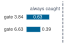
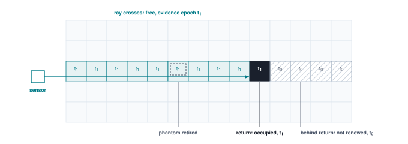
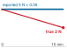
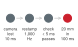

---
format:
  html:
    title: "Spatial Memory"
---

# Spatial Memory {#sec-memory}

::: {layout-narrow}
::: {.column-margin}

\chapterminitoc

:::

::: {.content-visible when-format="pdf"}
\noindent
{fig-alt="Isometric blueprint showing persistent spatial memory: tiered octree 3D voxel grid with fresh observation updates, frosted glass occlusion divider, floating spatial belief decay uncertainty halos, cylindrical temporal lease ledger, and crimson stale token eviction basin."}
:::

::: {.content-visible unless-format="pdf"}
{fig-alt="Isometric blueprint showing persistent spatial memory: tiered octree 3D voxel grid with fresh observation updates, frosted glass occlusion divider, floating spatial belief decay uncertainty halos, cylindrical temporal lease ledger, and crimson stale token eviction basin."}
:::

:::

## Purpose {.unnumbered .unlisted}

::: {.content-visible when-format="pdf"}
\begin{marginfigure}
\resizebox{0.92\linewidth}{!}{\mlphysicalstackfull{100}{20}{20}{20}{20}}
\end{marginfigure}
:::

_How long can a robot act on a remembered scene after it loses sight of it?_

A person hidden behind a storage rack can keep moving while the robot's map still shows an empty aisle. Forgetting the person loses a constraint on motion; preserving the last position indefinitely turns old evidence into false certainty. The engineer must estimate the scene from measurements that arrive at different times with different errors, retain that estimate through brief sensing gaps, and limit how long it can support a decision. That limit depends on the motion the sensors cannot observe, the error already present, and the clearance the task can tolerate. A stored estimate must therefore carry both its physical age and the conditions under which its uncertainty remains bounded. The permission path needs that information in time to refuse motion whose evidence has expired. Spatial memory connects sensing to the causal boundary by preserving what an observation supports without extending its authority beyond the physical margin.



::: {.callout-learning-objectives}

- Apply a state estimator's predict and update steps to dated measurements, including late ones at their capture epoch, and test whether its reported covariance matches its actual error
- Track objects across frames without withholding occupancy evidence until their identity is confirmed
- Specify a spatial belief record that carries evidence age, uncertainty growth, and consumer query budgets
- Set belief expiry from bounded uncertainty growth and the task's physical tolerance
- Select a spatial representation for a clearance query from the query it answers, the memory reads it costs, and the storage it needs
- Compose transform chains at a common epoch, and trace how localization drift and loop closure move remembered map cells without renewing their evidence
- Design spatial updates that preserve evidence age and distinguish missing observations from verified free space
- Diagnose frozen transforms, phantom tracks, and unobservable drift that pass freshness and innovation checks

:::
## Spatial Belief Persistence and Expiry {#sec-memory-preserving-belief}

Every physical AI system acts on a world it observes only intermittently. Perception delivers dated, calibrated observations. Yet sensor frames arrive tens of milliseconds apart, a rack upright or a gripper finger can occlude a target surface for seconds, and the controller must continue issuing commands throughout those blind intervals. **Spatial memory**\index{Spatial memory} carries physical state across these perceptual gaps. In a conventional computing system, a value in memory remains valid indefinitely because external reality does not alter the digital state. In an embodied system, memory retains an exact representation of the past while the physical world continues to move. A cached state becomes stale not because bits decay, but because unobserved reality drifts away from the recorded value. The central operational question of spatial memory is how long a stored state may continue to authorize machine motion. The answer is a physical deadline rather than an arbitrary software timeout, determined by the initial measurement error, the rate at which unobserved dynamics can expand that error, and the clearance margins permitted by the task. Computing and enforcing that deadline requires five core capabilities: an estimator that fuses dated measurements into a calibrated state distribution, a memory record that couples every geometric value to its capture epoch and an error-growth law, coordinate transforms and map structures that preserve those timestamps across aggregation, an invalidation mechanism derived directly from the growth model, and an accounting of unobservable environmental drift.

::: {.column-margin .margin-pointer}
↩ Observations dated by capture epoch and carrying calibrated spatial covariances are established in @sec-perception-observation-contract.
:::

On a warehouse mobile manipulator, this problem surfaces at every rack corner. As the robot pivots into a turn, structural uprights occlude the cross aisle from the navigation cameras. Whatever the vision backbone detected seconds earlier survives only in memory. A worker stepping around the corner can enter the corridor that memory still records as clear. Republishing the cached perception frame with a fresh software timestamp cannot replace the missing sensory evidence. The robot's stopping budget assumes obstacles remain within declared clearances; an approaching dynamic obstacle violates that assumption. As the expiry calculation in @sec-memory-belief-through-occlusion demonstrates, resolving such blind crossings requires a qualified safety interlock or an operational speed restriction rather than indefinitely persistent memory.

An embodied system cannot operate purely on instantaneous sensor frames, nor can it rely entirely on the implicit context cached inside a learned policy network. Instead, the architecture requires an explicit **belief**\index{Belief}: an estimate of physical state projected forward from historical sensory evidence and paired with a rigorous model of expanding uncertainty.[^fn-belief-state-record]

[^fn-belief-state-record]: **Belief State**: @astrom1965optimal showed that a controller that cannot observe its state directly loses nothing by acting on the conditional distribution of that state given everything observed so far—the formalization encountered in @sec-training-privileged-distillation as a partially observable decision problem. However, an abstract mathematical distribution carries no native reference frame, evidence epoch, or error-growth model. A physical runtime requires all three to verify whether a clearance corridor remains valid during a sensor dropout. \index{State estimation!belief state}

::: {#dfn-memory-belief-state .callout-definition title="Belief state"}

***Belief state***\index{Belief state!definition} is an estimate of a physical quantity carried forward from dated sensor evidence, expressed within an explicit reference frame, accompanied by the evidence epoch $t_0$ of the most recent constraining measurement and a declared error-growth law $E(\Delta t)$ that models uncertainty expansion in the absence of new data.

1.  **Significance**: A belief maps elapsed time into spatial uncertainty. The safety enforcement path permits motion only while $E(\Delta t)$ remains within the task's clearance envelope. Every belief therefore carries an invalidation horizon measured from $t_0$, beyond which the safety controller must reject any dependent trajectory.
2.  **Distinction**: A sensor measurement captures evidence from a single discrete instant. A belief estimates state at later points in time through forward propagation, remaining valid only as long as its growth law accurately bounds physical drift.
3.  **Common pitfall**: Mistaking publication recency for evidence freshness. Re-evaluating or republishing a belief updates software message timestamps, but only a new physical sensor measurement advances the evidence epoch $t_0$.

:::

Spatial memory is the second of four proposal-side stages in Part III, positioned between perception and intent. Because it resides on the untrusted proposal side of the execution boundary, spatial memory can shape proposed trajectories but cannot certify its own freshness. The permission path must independently evaluate the age of the underlying evidence against a local monotonic clock.

::: {.column-margin .margin-pointer}
↩ The proposal side of the execution boundary is established in @sec-boundary-machine-model.
:::

::: {.column-margin}
{width="100%" fig-alt="S·P·A locator triad highlighting the Sense-Plan belief edge."}
*Belief carries sensing across the gap to planning.*
:::

Learned policies maintain internal history through recurrent states or transformer attention buffers, but these mechanisms manage tokens according to an attention budget rather than physical persistence. When an obstacle steps behind a pallet rack, self-attention can evict the entity to allocate capacity to newly observed features, even though that obstacle continues to obstruct the physical corridor. An internal neural context window is therefore an unreliable sole record of physical state. Spatial memory decouples persistence from policy attention, explicitly preserving the entity, its last observed geometry, and an uncertainty volume that expands for as long as it remains occluded.

Externalizing physical state from the neural policy also cleanly decouples downstream consumers with divergent computational constraints. The motion planning policy queries a host-resident scene representation to extract a compact **spatial attention working set** tailored to its candidate trajectory. In contrast, an isolated permission controller requires a strictly bounded local safety snapshot stored directly in its local memory to evaluate real-time clearance queries. This snapshot retains the raw evidence epochs, spatial uncertainties, geometric coverage bounds, and validity regions from the underlying beliefs. Replicating state across memory buses does not refresh its physical validity. The safety controller neither requires the complete global map nor waits for host queries to complete before deciding whether an ongoing motion remains admissible.

Internal software consistency does not guarantee physical geometric validity. To prevent an actuator from executing commands based on obsolete assumptions, an embodied memory system must elevate state expiration to an explicit interface event. Every stored belief carries an invalidation horizon (@sec-memory-belief-through-occlusion)—the exact deadline at which accumulated uncertainty consumes the task's clearance margin. When that deadline passes, the belief immediately ceases to authorize motion. The permission path rejects any proposal that relies on the expired state and selects a deterministically safe fallback maneuver, such as a controlled stop.

Every belief and its corresponding invalidation deadline originate in a state estimator. The perception front-end streams discrete, timestamped, coordinate-framed measurements annotated with calibrated sensor covariances. Transforming these intermittent observations into a continuous, reliable physical state—backed by uncertainty bounds that faithfully reflect unobserved environmental drift—constitutes the core operational role of spatial memory.

## Estimating State from Dated Measurements {#sec-perception-state-estimation}

A single LiDAR return or stereo match localizes the rack-end upright at one isolated instant. A physical safety permission path, however, requires a continuous range estimate that stays current between sweeps, fuses observations across heterogeneous sensors, and produces an uncertainty metric whose statistical confidence matches physical reality. A recursive **state estimator**\index{State estimation!recursive estimator} satisfies all three demands by alternating two complementary operations: a prediction step that projects the state forward through a dynamic motion model, and an update step that incorporates each newly arrived, dated measurement. The discrete Kalman filter[^fn-kalman-filter-apollo] [@kalman1960new] provides the classical formulation of this recursion, establishing the mathematical foundation for this chapter [@thrun2005probabilistic, ch. 3; @barshalom2001estimation]. Multi-object tracking and delayed-observation handling apply these two steps directly. Furthermore, the belief decay under occlusion examined in @sec-memory-belief-through-occlusion corresponds to the prediction step executing without measurement updates, while the observability limits of @sec-memory-state-estimation-bounds define the state dimensions that no update stream can reconstruct. Walking through these two operations first on a scalar—the remaining distance $s$ from the mobile robot base to the rack-end upright—reveals the underlying mechanics before extending the notation to full state vectors.

[^fn-kalman-filter-apollo]: **Kalman Filter**: Stanley Schmidt's group at NASA Ames took up Kálmán's paper shortly after it appeared and, for circumlunar navigation studies, linearized the nonlinear measurement equations about the current estimate [@smith1962application], the reformulation now called the extended Kalman filter. MIT's Instrumentation Laboratory then carried the filter into Apollo's on-board navigation in a square-root form suited to a computer with a short word length [@mcgee1985discovery]. The recursion fit that computer because it keeps only the latest estimate and its covariance, never the measurement history, and the same property lets spatial memory hand a consumer one dated record instead of a log to replay. \index{Kalman filter!Apollo navigation}

```{python}
#| label: calc-perception-aisle-kalman
#| echo: false
#| warning: false
#| message: false
# ┌─────────────────────────────────────────────────────────────────────────────
# │ ONE-DIMENSIONAL KALMAN FILTER ON THE RACK-END DISTANCE
# ├─────────────────────────────────────────────────────────────────────────────
# │ Context: @sec-perception-state-estimation and the consistency checks of
# │          @sec-memory-estimator-consistency.
# │
# │ Goal:    Predict the remaining distance to the rack-end upright over one
# │          LiDAR sweep, update it with the OS1-64, fuse an illustrative stereo
# │          range, and show what an arrival-stamped stereo range does.
# │ Show:    prior 20.0 mm -> 20.6 mm after prediction; LiDAR gain 0.32,
# │          posterior 17.0 mm; stereo sigma 3.8 mm at 1.10 m, gain 0.95,
# │          posterior 3.7 mm; misdating bias 38.0 mm, about 10 posterior
# │          standard deviations; expected NIS 6.25.
# │ How:     scalar predict (P + (sigma_v dt)^2) and update (g = P / (P + R));
# │          OS1-64 sweep period and worst-case precision from the registry;
# │          the illustrative stereo rig of @sec-perception-error-clearance at
# │          AISLE.d_clear; the arrival-stamp travel of @sec-perception-handoff
# │          (t_exp/2 + t_readout + t_transport + t_dma at the drive limit)
# │          as the misdating bias. All three inputs are re-derived here from
# │          the registry or re-loaded with guards matching Ch8's cells.
# └─────────────────────────────────────────────────────────────────────────────
from mlsysim import *
from mlsysim.core.units import *
from mlsysim.fmt import fmt, fmt_latency, fmt_length, check

RM = Embodied.MobileManipulator.WarehouseMobileManipulator
AISLE = Embodied.Scenario.WarehouseAisle

class AisleKalman:
    """Scalar predict, update, two-sensor fusion, and a misdated update on the rack-end distance."""

    # ┌── 1. LOAD (Constants & Parameters) ─────────────────────────────────
    sigma_prior = 20.0 * ureg.millimeter  # category: illustrative (posterior from the previous sweep)
    sigma_v = 0.1 * meter / second  # category: illustrative (odometry speed error, e.g. wheel slip)
    dt = (1 / RM.lidar.scan_rate).to(millisecond)  # category: datasheet (one 20 Hz sweep; LidarSweep.t_sweep in @sec-perception)
    sigma_lidar = RM.lidar.range_precision_max  # category: datasheet (OS1 precision, worst case, 1 sigma)
    bias_r = RM.lidar.range_accuracy  # category: datasheet (OS1 accuracy, a bias the filter cannot represent)
    z = AISLE.d_clear  # category: illustrative (range to the upright)
    b = 0.20 * meter  # category: illustrative (stereo baseline; StereoDepthError.b in @sec-perception-error-clearance)
    f_px = 800.0  # category: illustrative (focal length, pixels; StereoDepthError.f_px)
    sigma_d_px = 0.5  # category: illustrative (disparity standard deviation, pixels; StereoDepthError.sigma_d_px)
    tau_recv = (RM.nav_camera.exposure_time / 2 + RM.nav_camera.readout_time + AISLE.t_transport + AISLE.t_dma).to(
        millisecond
    )  # category: derived (ArrivalStampOffset.tau_recv in @sec-perception-handoff)
    bias_misdate = calc_spatial_information_age_displacement(RM.base.max_velocity, tau_recv).to(
        ureg.millimeter
    )  # category: derived (arrival-stamp travel)

    # ┌── 2. EXECUTE (Compute) ─────────────────────────────────────────────
    mm2 = ureg.millimeter**2
    P0 = sigma_prior.to(ureg.millimeter) ** 2
    q = ((sigma_v * dt).to(ureg.millimeter)) ** 2
    P_pred = (P0 + q).to(mm2)
    R_lidar = sigma_lidar.to(ureg.millimeter) ** 2
    g_lidar = (P_pred / (P_pred + R_lidar)).to(ureg.dimensionless).magnitude
    P_lidar = ((1 - g_lidar) * P_pred).to(mm2)
    sigma_stereo = (z**2 * sigma_d_px / (f_px * b)).to(ureg.millimeter)
    R_stereo = sigma_stereo**2
    S_stereo = (P_lidar + R_stereo).to(mm2)
    g_stereo = (P_lidar / S_stereo).to(ureg.dimensionless).magnitude
    P_fused = ((1 - g_stereo) * P_lidar).to(mm2)
    sigma_pred = P_pred**0.5
    sigma_lidar_post = P_lidar**0.5
    sigma_fused = P_fused**0.5
    bias_post = (g_stereo * bias_misdate).to(ureg.millimeter)
    bias_in_sigmas = (bias_post / sigma_fused).to(ureg.dimensionless).magnitude
    nis_expected = 1 + (bias_misdate.to(ureg.millimeter) ** 2 / S_stereo).to(ureg.dimensionless).magnitude

    # ┌── 3. GUARD (Invariants) ───────────────────────────────────────────
    check(abs(dt.magnitude - 50.0) < 1e-9, f"Sweep period must match the perception chapter's 50 ms: {dt}")
    check(abs(tau_recv.magnitude - 26.6) < 0.05, f"Arrival offset must match the perception chapter's 26.6 ms: {tau_recv}")
    check(abs(bias_misdate.magnitude - 39.9) < 0.05, f"Arrival-stamp travel must match the perception chapter's 39.9 mm: {bias_misdate}")
    check(abs(sigma_pred.magnitude - 20.6) < 0.05, f"Unexpected predicted sigma: {sigma_pred}")
    check(abs(g_lidar - 0.32) < 0.005, f"Unexpected LiDAR gain: {g_lidar}")
    check(abs(sigma_lidar_post.magnitude - 17.0) < 0.05, f"Unexpected LiDAR posterior: {sigma_lidar_post}")
    check(sigma_lidar_post < min(sigma_pred, sigma_lidar), "Posterior must be tighter than either input")
    check(abs(sigma_stereo.magnitude - 3.8) < 0.05, f"Unexpected stereo sigma: {sigma_stereo}")
    check(abs(g_stereo - 0.95) < 0.005, f"Unexpected stereo gain: {g_stereo}")
    check(abs(sigma_fused.magnitude - 3.7) < 0.05, f"Unexpected fused sigma: {sigma_fused}")
    check(abs(bias_post.magnitude - 38.0) < 0.05, f"Unexpected misdating bias: {bias_post}")
    check(9.5 < bias_in_sigmas < 11.0, f"Prose says the bias is about ten posterior sigmas: {bias_in_sigmas}")
    check(abs(nis_expected - 6.25) < 0.05, f"Unexpected expected NIS: {nis_expected}")

    # ┌── 4. OUTPUT (Formatting) ──────────────────────────────────────────
    sigma_prior_str = fmt_length(sigma_prior, unit=ureg.millimeter, precision=0)
    sigma_v_str = fmt(sigma_v.to(meter / second).magnitude, precision=1)
    dt_str = fmt_latency(dt, unit=millisecond, precision=0)
    sigma_w_str = fmt_length((sigma_v * dt).to(ureg.millimeter), unit=ureg.millimeter, precision=0)
    sigma_pred_str = fmt_length(sigma_pred, unit=ureg.millimeter, precision=1)
    sigma_lidar_str = fmt_length(sigma_lidar, unit=ureg.millimeter, precision=0)
    g_lidar_str = fmt(g_lidar, precision=2)
    sigma_lidar_post_str = fmt_length(sigma_lidar_post, unit=ureg.millimeter, precision=1)
    z_str = fmt_length(z.to(meter), unit=meter, precision=2)
    sigma_stereo_str = fmt_length(sigma_stereo, unit=ureg.millimeter, precision=1)
    g_stereo_str = fmt(g_stereo, precision=2)
    sigma_fused_str = fmt_length(sigma_fused, unit=ureg.millimeter, precision=1)
    bias_misdate_str = fmt_length(bias_misdate.to(ureg.millimeter), unit=ureg.millimeter, precision=1)
    bias_r_str = fmt_length(bias_r, unit=ureg.millimeter, precision=0)
    bias_post_str = fmt_length(bias_post, unit=ureg.millimeter, precision=1)
    bias_in_sigmas_str = fmt(bias_in_sigmas, precision=1)
    nis_expected_str = fmt(nis_expected, precision=2)
```

The **predict** step advances the state estimate across time without incorporating new external evidence. Between two successive LiDAR sweeps separated by `{python} AisleKalman.dt_str`, wheel odometry (@sec-memory-localization-slam) indicates that the mobile base closed the distance by $v\,\Delta t$, yielding the prior prediction $\hat{s}^- = \hat{s} - v\,\Delta t$. Odometry, however, carries inherent uncertainty: an illustrative speed disturbance of `{python} AisleKalman.sigma_v_str` m/s—arising, for example, from minor wheel slip on polished concrete—accumulates `{python} AisleKalman.sigma_w_str` of standard deviation over that single sweep interval. Because independent errors combine in quadrature, $\sigma^2_{-} = \sigma^2 + \sigma_w^2$, an initial `{python} AisleKalman.sigma_prior_str` uncertainty expands to `{python} AisleKalman.sigma_pred_str`. Without new measurement constraints, prediction inevitably inflates state uncertainty.

```{python}
#| label: calc-perception-imu-error-growth
#| echo: false
#| warning: false
#| message: false
# ┌─────────────────────────────────────────────────────────────────────────────
# │ IMU ERROR GROWTH WITHOUT A RANGE UPDATE
# ├─────────────────────────────────────────────────────────────────────────────
# │ Context: The IMU paragraph of @sec-perception-state-estimation.
# │
# │ Goal:    Show from the BMI088 datasheet why white noise and constant offsets
# │          grow differently under integration, and which one limits coasting.
# │ Show:    over 1 s: 0.014 deg from gyro noise vs 1 deg from the zero-rate
# │          offset (19.2 mm at the rack end); 0.9 mm from accelerometer noise
# │          vs 98 mm from the zero-g offset, about twice delta_loc.
# │ How:     angle = N_g sqrt(T); heading = b_g T; position from white
# │          acceleration noise = N_a sqrt(T^3 / 3); position from offset =
# │          b_a T^2 / 2. BMI088 datasheet rev 1.9 (Jan 2024), Tables 4-5,
# │          typical values, from the registry (Sensors.IMU.Bosch_BMI088).
# └─────────────────────────────────────────────────────────────────────────────
import math
from mlsysim import *
from mlsysim.core.units import *
from mlsysim.fmt import fmt, fmt_int, fmt_length, check

AISLE = Embodied.Scenario.WarehouseAisle

class ImuErrorGrowth:
    """Attitude and position error of the BMI088 integrated open loop."""

    # ┌── 1. LOAD (Constants & Parameters) ─────────────────────────────────
    g0 = 1.0 * ureg.standard_gravity  # category: constant (standard gravity)
    imu = Embodied.MobileManipulator.WarehouseMobileManipulator.imu  # category: datasheet (registry: Bosch BMI088)
    n_gyro = imu.gyro_noise_density.to("deg/s/Hz**0.5").magnitude  # category: datasheet (BMI088 gyro rate-noise density)
    b_gyro = imu.gyro_zero_rate_offset.to("deg/s").magnitude  # category: datasheet (BMI088 typical zero-rate offset, offset cancellation off)
    n_acc = (imu.accel_noise_density / g0).to("Hz**-0.5").magnitude  # category: datasheet (BMI088 accel noise density X/Y, in g/sqrt(Hz))
    b_acc = (imu.accel_zero_g_offset / g0).to("dimensionless").magnitude  # category: datasheet (BMI088 typical zero-g offset, in g)
    t_coast = 1.0 * second  # category: illustrative (interval without a range update)
    z = AISLE.d_clear  # category: illustrative (rack-end distance)
    delta_loc = AISLE.delta_loc  # category: illustrative (along-travel localization allowance)

    # ┌── 2. EXECUTE (Compute) ─────────────────────────────────────────────
    T = t_coast.to(second).magnitude
    ang_noise_deg = n_gyro * math.sqrt(T)
    ang_bias_deg = b_gyro * T
    lat_bias = (z * math.sin(math.radians(ang_bias_deg))).to(ureg.millimeter)
    pos_noise = (n_acc * g0 * math.sqrt(T**3 / 3.0) * second**2).to(ureg.millimeter)
    pos_bias = (0.5 * b_acc * g0 * t_coast**2).to(ureg.millimeter)
    bias_over_loc = (pos_bias / delta_loc).to(ureg.dimensionless).magnitude

    # ┌── 3. GUARD (Invariants) ───────────────────────────────────────────
    check(abs(ang_noise_deg - 0.014) < 1e-9, f"Unexpected gyro-noise angle: {ang_noise_deg}")
    check(abs(lat_bias.magnitude - 19.2) < 0.05, f"Unexpected lateral error from gyro offset: {lat_bias}")
    check(abs(pos_noise.magnitude - 0.91) < 0.01, f"Unexpected position error from accel noise: {pos_noise}")
    check(abs(pos_bias.magnitude - 98.1) < 0.05, f"Unexpected position error from accel offset: {pos_bias}")
    check(1.8 < bias_over_loc < 2.1, f"Prose says the offset term is about twice delta_loc: {bias_over_loc}")
    check(pos_bias > 50 * pos_noise, "Prose says offsets, not white noise, limit coasting")

    # ┌── 4. OUTPUT (Formatting) ──────────────────────────────────────────
    n_gyro_str = fmt(n_gyro, precision=3)
    b_gyro_str = fmt(b_gyro, precision=0)
    n_acc_str = fmt_int(round(n_acc * 1e6))
    b_acc_str = fmt_int(round(b_acc * 1e3))
    t_coast_str = fmt(T, precision=0)
    ang_noise_str = fmt(ang_noise_deg, precision=3)
    ang_bias_str = fmt(ang_bias_deg, precision=0)
    z_str = fmt_length(z.to(meter), unit=meter, precision=2)
    lat_bias_str = fmt_length(lat_bias, unit=ureg.millimeter, precision=1)
    pos_noise_str = fmt_length(pos_noise, unit=ureg.millimeter, precision=1)
    pos_bias_str = fmt_length(pos_bias, unit=ureg.millimeter, precision=1)
    delta_loc_str = fmt_length(delta_loc.to(ureg.millimeter), unit=ureg.millimeter, precision=0)
```

The robot's inertial measurement unit (IMU) provides high-rate kinematic data for forward propagation, but hardware specifications demonstrate why dead reckoning cannot sustain accurate state estimates in isolation. The Bosch BMI088 gyroscope exhibits a rate-noise density of `{python} ImuErrorGrowth.n_gyro_str` °/s/$\sqrt{\text{Hz}}$ alongside an uncalibrated zero-rate bias of `{python} ImuErrorGrowth.b_gyro_str` °/s; its accelerometer features a noise density of `{python} ImuErrorGrowth.n_acc_str` µg/$\sqrt{\text{Hz}}$ and an uncalibrated zero-g offset of `{python} ImuErrorGrowth.b_acc_str` mg [@bosch2024bmi088]. Integrating these sensor signals accumulates error, and stochastic noise compounds along a fundamentally different trajectory than deterministic bias. Broadband white noise integrates in variance, causing orientation uncertainty to grow with the square root of time: across `{python} ImuErrorGrowth.t_coast_str` s without external range correction, it accumulates only `{python} ImuErrorGrowth.ang_noise_str`°. In contrast, a constant bias integrates linearly, producing heading drift proportional to time that reaches `{python} ImuErrorGrowth.ang_bias_str`° over that same second. At `{python} ImuErrorGrowth.z_str`, this angular error projects into `{python} ImuErrorGrowth.lat_bias_str` of lateral displacement for the rack upright. Because acceleration undergoes double integration to determine position, its bias scales quadratically with elapsed time ($\tfrac{1}{2} b_a T^2$), generating `{python} ImuErrorGrowth.pos_bias_str` of drift after one second—about twice the `{python} ImuErrorGrowth.delta_loc_str` localization allowance—whereas integrated accelerometer white noise contributes a mere `{python} ImuErrorGrowth.pos_noise_str`. Deterministic sensor offsets, rather than broadband noise, strictly govern how long an inertial system can coast uncorrected. Practical estimators therefore augment the state vector to estimate these biases online—rendered observable whenever LiDAR range returns arrive—while using the underlying noise densities to parameterize the process noise covariance $\mathbf{Q}$. Because these offsets drift with temperature and vary across physical chips, operating parameters must be identified through in-situ stationary calibration on the physical platform rather than taken from static datasheet ratings.

The **update** step incorporates a fresh scalar measurement $z$ characterized by variance $\sigma_z^2$. The updated posterior is a linear combination, $\hat{s} = (1-g)\,\hat{s}^- + g\,z$. Assuming the prior prediction error and measurement noise remain statistically independent, the posterior variance evaluates to $(1-g)^2 \sigma^2_{-} + g^2 \sigma_z^2$. Minimizing this variance with respect to the blending weight $g$ produces the optimal Kalman gain, which balances each information source inversely against its relative uncertainty:
$$g = \frac{\sigma^2_{-}}{\sigma^2_{-} + \sigma_z^2}, \qquad \hat{s} = \hat{s}^- + g\,(z - \hat{s}^-), \qquad \sigma^2 = (1 - g)\,\sigma^2_{-}$$
The residual $z - \hat{s}^-$ constitutes the **innovation**\index{Innovation!definition}—the new information supplied by the measurement that was not captured by the forward projection. Given the Ouster OS1-64's worst-case datasheet range precision of `{python} AisleKalman.sigma_lidar_str`, the computed gain is `{python} AisleKalman.g_lidar_str`. The estimator shifts approximately one-third of the way toward the raw LiDAR reading, contracting the posterior standard deviation to `{python} AisleKalman.sigma_lidar_post_str`—a bound tighter than either input distribution alone. Because published precision specifications typically reflect ideal calibration conditions rather than real-time operating modes, this sensor variance must be verified at the configured operational scan rate. Furthermore, the sensor's separate `{python} AisleKalman.bias_r_str` systematic accuracy offset represents a structural bias that zero-mean Gaussian models cannot accommodate; offline calibration must eliminate this offset, or the downstream safety clearance margin must absorb it explicitly.

**Fusing a second sensor** executes as a sequential update step. The illustrative stereo camera rig analyzed in @sec-perception-error-clearance achieves $\sigma_z =$ `{python} AisleKalman.sigma_stereo_str` at the `{python} AisleKalman.z_str` rack-end distance. Fusing this measurement yields a stereo gain of `{python} AisleKalman.g_stereo_str`, shrinking the final fused standard deviation to `{python} AisleKalman.sigma_fused_str`. For statistically independent measurements captured at the same physical instant, update ordering is commutative: each observation contributes an information increment, and their underlying precision matrices (inverse variances) sum directly.

**A misdated measurement** breaks this estimation algebra silently and catastrophically. Suppose a stereo depth observation is tagged with the host arrival timestamp from @sec-perception-handoff rather than its physical exposure epoch. The filter erroneously pairs this observation with a robot pose `{python} AisleKalman.bias_misdate_str` further along the aisle than where the photons actually struck the sensor. Consequently, the measured range reads systematically long by that spatial displacement, causing the update to drag the state estimate `{python} AisleKalman.bias_post_str` away from the physical obstacle while reporting the same deceptively tight `{python} AisleKalman.sigma_fused_str` standard deviation. The resulting physical error spans approximately `{python} AisleKalman.bias_in_sigmas_str` reported standard deviations in the hazardous direction, yet the filter's covariance update detects nothing amiss because algebraic variance reduction depends entirely on modeled sensor noise rather than measurement residuals. This concrete failure demonstrates why corrupt timestamps are far more dangerous than dropped sensor frames: dropping a frame leaves the posterior uncertainty at `{python} AisleKalman.sigma_lidar_post_str`—imprecise, but statistically honest.

@Fig-08-kalman-predict-update plots these sequential estimation stages across five vertical error-bar columns sharing a common range-error scale (in millimeters): forward prediction widens the prior uncertainty from `{python} AisleKalman.sigma_prior_str` to `{python} AisleKalman.sigma_pred_str`, before successive LiDAR and stereo updates contract the posterior variance down to `{python} AisleKalman.sigma_fused_str` (outperforming the gray sensor uncertainty bars). On the far right, the red misdated update column demonstrates the danger of temporal corruption: it reports an identical tight spread while shifting its center by `{python} AisleKalman.bias_post_str` away from true range.

::: {#fig-08-kalman-predict-update fig-env="figure" fig-pos="t" fig-cap="**Predict and update on the rack-end range**: Each bar spans one standard deviation of the range estimate. Prediction widens the bar from `{python} AisleKalman.sigma_prior_str` to `{python} AisleKalman.sigma_pred_str`; the LiDAR update (gain `{python} AisleKalman.g_lidar_str`) and the stereo update (gain `{python} AisleKalman.g_stereo_str`) each narrow it below both of their inputs, whose own spreads appear as gray bars. The misdated stereo update on the right reports the same `{python} AisleKalman.sigma_fused_str` spread while sitting `{python} AisleKalman.bias_post_str` from the true range, which the variance alone cannot reveal." fig-alt="Error-bar chart with five columns on a vertical axis of range error in millimeters. Prior, predicted, after LiDAR update, and after stereo update columns are centered on zero, with the bar shrinking sharply after the stereo update. Gray bars beside the two update columns show the LiDAR and stereo measurement spreads. A fifth red column, labeled misdated stereo, has a short bar centered well above zero."}

```{python}
#| label: plot-08-kalman-predict-update
#| echo: false
#| warning: false
#| message: false
# ┌─────────────────────────────────────────────────────────────────────────────
# │ SCALAR KALMAN PREDICT AND UPDATE (FIGURE)
# ├─────────────────────────────────────────────────────────────────────────────
# │ Context: @fig-08-kalman-predict-update in @sec-perception-state-estimation.
# │
# │ Goal:    Show prediction widening and each update narrowing the estimate,
# │          and a misdated update that stays narrow while biased.
# │ Show:    sigma 20.0 -> 20.6 -> 17.0 -> 3.7 mm; LiDAR and stereo input
# │          spreads; the 38.0 mm misdating bias at the fused spread.
# │ How:     Every value reads AisleKalman (no literals).
# └─────────────────────────────────────────────────────────────────────────────
from mlsysim import viz

AK = AisleKalman
_mm = lambda q: q.to(ureg.millimeter).magnitude
PETROL = "#007A87"  # measured (theme-colors.tex)
CRIMSON = "#A51C30"  # consequence (theme-colors.tex)
INK, SOFT, PALE = "#1A202C", "#4A5568", "#A0AEC0"

steps = [
    ("prior", 0.0, _mm(AK.sigma_prior), AK.sigma_prior_str, None),
    ("predict", 0.0, _mm(AK.sigma_pred), AK.sigma_pred_str, None),
    ("LiDAR\nupdate", 0.0, _mm(AK.sigma_lidar_post), AK.sigma_lidar_post_str, (_mm(AK.sigma_lidar), AK.sigma_lidar_str, AK.g_lidar_str)),
    ("stereo\nupdate", 0.0, _mm(AK.sigma_fused), AK.sigma_fused_str, (_mm(AK.sigma_stereo), AK.sigma_stereo_str, AK.g_stereo_str)),
]

fig, ax, COLORS, plt = viz.setup_plot(figsize=(5.4, 2.9))
ax.grid(False)
ax.spines["top"].set_visible(False)
ax.spines["right"].set_visible(False)
ax.axhline(0, color=PALE, lw=0.8, ls="--", zorder=0)

for i, (name, mu, sig, lab, meas) in enumerate(steps):
    ax.errorbar(i, mu, yerr=sig, fmt="o", color=PETROL, ms=3.5, capsize=4, lw=1.6, zorder=3)
    # sigma labels centred over their own bar so none runs into the next column's input bar
    ax.text(i, mu + sig + 1.2, f"σ = {lab}", ha="center", va="bottom", fontsize=7, color=INK)
    if meas is not None:
        s_m, s_lab, g_lab = meas
        ax.errorbar(i - 0.42, 0.0, yerr=s_m, fmt="none", color=PALE, capsize=3, lw=1.2, zorder=2)
        ax.text(i - 0.42, -s_m - 1.2, f"input {s_lab}", ha="center", va="top", fontsize=6.5, color=SOFT)
        ax.text(i + 0.1, -sig - 1.2, f"gain {g_lab}", ha="left", va="top", fontsize=7, color=SOFT)

# Misdated stereo update: same reported spread, biased mean
xm = len(steps) + 0.2
b = _mm(AK.bias_post)
ax.errorbar(xm, b, yerr=_mm(AK.sigma_fused), fmt="s", color=CRIMSON, ms=3.5, capsize=4, lw=1.6, zorder=3)
ax.annotate("", xy=(xm + 0.3, b), xytext=(xm + 0.3, 0), arrowprops=dict(arrowstyle="<->", color=CRIMSON, lw=0.8))
ax.text(xm + 0.38, b / 2, f"bias\n{AK.bias_post_str}\n≈ {AK.bias_in_sigmas_str} σ", ha="left", va="center", fontsize=7, color=CRIMSON)
ax.text(xm, b + _mm(AK.sigma_fused) + 1.2, f"σ = {AK.sigma_fused_str}", ha="center", va="bottom", fontsize=7, color=INK)
ax.axvline(len(steps) - 0.4, color=PALE, lw=0.6)

ax.set_xticks(list(range(len(steps))) + [xm])
ax.set_xticklabels([s[0] for s in steps] + ["misdated\nstereo"], fontsize=7.5)
ax.set_xlim(-0.7, xm + 1.1)
ax.set_ylabel("estimate minus true range (mm)", fontsize=8)
ax.tick_params(axis="y", labelsize=7)
ax.set_ylim(-_mm(AK.sigma_lidar) - 8, max(b + 12, _mm(AK.sigma_lidar) + 6))
plt.tight_layout()
plt.show()
plt.close()
```
:::

Generalizing from a scalar distance to an $n$-dimensional state vector $\hat{\mathbf{x}}$ with error covariance $\mathbf{P} \in \mathbb{R}^{n \times n}$, the recursion parameterizes system dynamics through a state transition matrix $\mathbf{F}$, process noise covariance $\mathbf{Q}$, an observation matrix $\mathbf{H}$ projecting state space into measurement space, and measurement noise covariance $\boldsymbol{\Sigma}_{\text{meas}}$ (@eq-percep-kf-predict and @eq-percep-kf-update):
$$\hat{\mathbf{x}}_{k|k-1} = \mathbf{F}\,\hat{\mathbf{x}}_{k-1|k-1}, \qquad \mathbf{P}_{k|k-1} = \mathbf{F}\,\mathbf{P}_{k-1|k-1}\mathbf{F}^\top + \mathbf{Q}$$ {#eq-percep-kf-predict}
$$\boldsymbol{\nu}_k = \mathbf{y}_k - \mathbf{H}\hat{\mathbf{x}}_{k|k-1}, \quad \mathbf{S}_k = \mathbf{H}\mathbf{P}_{k|k-1}\mathbf{H}^\top + \boldsymbol{\Sigma}_{\text{meas}}, \quad \mathbf{G}_k = \mathbf{P}_{k|k-1}\mathbf{H}^\top\mathbf{S}_k^{-1}, \quad \hat{\mathbf{x}}_{k|k} = \hat{\mathbf{x}}_{k|k-1} + \mathbf{G}_k\boldsymbol{\nu}_k, \quad \mathbf{P}_{k|k} = (\mathbf{I} - \mathbf{G}_k\mathbf{H})\,\mathbf{P}_{k|k-1}$$ {#eq-percep-kf-update}
In this formulation, $\boldsymbol{\nu}_k$ represents the innovation vector, $\mathbf{S}_k$ denotes innovation covariance, and $\mathbf{G}_k$ signifies the Kalman gain matrix (designated $\mathbf{G}$ to reserve $\mathbf{K}$ for camera intrinsic calibration matrices). The preceding scalar analysis corresponds to the degenerate setting $\mathbf{F} = \mathbf{H} = 1$. Under linear dynamics and additive Gaussian noise, this closed-form update yields the provably optimal minimum-variance unbiased estimate. If nonlinearities or non-Gaussian noise corrupt the process, the update functions merely as an empirical linear estimator whose output covariance requires rigorous experimental validation.

Physical robotic sensors are inherently nonlinear functions of platform state. A LiDAR range measurement to the rack upright evaluates to $r = \|\mathbf{p}_{\text{upright}} - \mathbf{p}_{\text{base}}\|$, while a camera records target bearings through the nonlinear pinhole projection detailed in @eq-percep-pinhole-projection. The **extended Kalman filter (EKF)**\index{Extended Kalman filter!definition} [@smith1962application] adapts @eq-percep-kf-update to nonlinear regimes by evaluating the measurement function $h(\hat{\mathbf{x}}_{k|k-1})$ directly and substituting the linear projection $\mathbf{H}$ with the measurement Jacobian $\nabla_\mathbf{x} h$ evaluated at the current state prediction. For a scalar range reading, this Jacobian with respect to platform base position reduces to the unit line-of-sight vector directed from the upright toward the base. Because this Taylor-series linearization is strictly a first-order approximation, substantial curvature across the prior distribution—common when estimating bearings to nearby obstacles or operating under broad initial uncertainty—can cause the EKF to underestimate its true estimation error [@julier2004unscented]. This failure mode makes the empirical consistency evaluations of @sec-memory-estimator-consistency essential safety requirements rather than optional checks.

The **unscented Kalman filter (UKF)**\index{Unscented Kalman filter!definition} developed by @julier1997new bypasses analytical Jacobians through deterministic sampling. For an $n$-dimensional state vector, the UKF instantiates $2n+1$ sigma points structured around the matrix square root of $\mathbf{P}$, propagates each sample point through the true nonlinear observation function, and reconstructs the transformed posterior mean and covariance [@julier2004unscented]. This transformation captures higher-order curvature effects on the mean that the EKF truncates, requiring $2n+1$ functional evaluations per cycle. The UKF nevertheless approximates the posterior as a unimodal Gaussian, leaving it subject to identical qualification and consistency standards.

Both filtering frameworks—as well as the multi-object tracking and out-of-sequence replay architectures constructed upon them—depend fundamentally on every sensor measurement being indexed by its true capture epoch. The misdated stereo benchmark illustrates the breakdown when this assumption fails: while reported uncertainty remained artificially compressed, true physical error drifted across ten standard deviations. A reported covariance is therefore an engineering hypothesis that must be systematically validated against real-world data.

### Testing whether the covariance is honest {#sec-memory-estimator-consistency}

Two complementary statistical tests validate this hypothesis: an offline qualification metric evaluated against ground truth, and an online runtime monitor evaluated directly against incoming measurement streams. Both formulations exploit a central property of linear estimation: when an estimator's reported covariance accurately characterizes its underlying errors, the error vector scaled by that covariance follows a mathematically well-defined chi-squared distribution.

```{python}
#| label: calc-memory-estimator-consistency
#| echo: false
#| warning: false
#| message: false
# ┌─────────────────────────────────────────────────────────────────────────────
# │ NEES AND NIS CONSISTENCY NUMBERS
# ├─────────────────────────────────────────────────────────────────────────────
# │ Context: @sec-memory-estimator-consistency (moved from the perception
# │          chapter's error-qualification cell with the estimator).
# │
# │ Goal:    Give the acceptance band for mean NEES over a finite campaign and
# │          the single-update NIS gates that one misdated update must exceed.
# │ Show:    mean-NEES band 0.65 to 1.43 (N = 50, scalar, 95 percent); NIS
# │          gates 3.84 and 6.63, which one misdated update exceeds with
# │          probability 0.63 and 0.39.
# │ How:     chi-squared quantiles (scipy.stats.chi2); noncentral chi-squared
# │          survival (scipy.stats.ncx2) for the misdated update's NIS.
# └─────────────────────────────────────────────────────────────────────────────
from scipy.stats import chi2, ncx2
from mlsysim import *
from mlsysim.core.units import *
from mlsysim.fmt import fmt, fmt_int, fmt_percent, check

class EstimatorConsistency:
    """Acceptance bands and single-update gates for testing an estimator's covariance."""

    # ┌── 1. LOAD (Constants & Parameters) ─────────────────────────────────
    n_runs = 50  # category: chosen (qualification runs with ground truth)
    n_dim = 1  # category: derived (scalar rack-end distance)
    conf = 0.95  # category: chosen (two-sided acceptance level)
    nis_expected = AisleKalman.nis_expected  # category: derived (misdated stereo update)

    # ┌── 2. EXECUTE (Compute) ─────────────────────────────────────────────
    dof = n_runs * n_dim
    nees_lo = chi2.ppf((1 - conf) / 2, dof) / n_runs
    nees_hi = chi2.ppf(1 - (1 - conf) / 2, dof) / n_runs
    nis_95 = chi2.ppf(0.95, n_dim)
    nis_99 = chi2.ppf(0.99, n_dim)
    p_catch_95 = ncx2.sf(nis_95, n_dim, nis_expected - n_dim)
    p_catch_99 = ncx2.sf(nis_99, n_dim, nis_expected - n_dim)

    # ┌── 3. GUARD (Invariants) ───────────────────────────────────────────
    check(abs(nees_lo - 0.65) < 0.005 and abs(nees_hi - 1.43) < 0.005, f"Unexpected NEES band: {nees_lo}, {nees_hi}")
    check(abs(nis_95 - 3.84) < 0.005 and abs(nis_99 - 6.63) < 0.005, f"Unexpected NIS gates: {nis_95}, {nis_99}")
    check(0.55 < p_catch_95 < 0.7 and 0.35 < p_catch_99 < 0.5, f"Unexpected single-update detection probabilities: {p_catch_95}, {p_catch_99}")
    check(nis_expected > nees_hi, "Prose says the averaged NIS falls far outside the band")
    # margin_misdated_update_gate_envelope.svg fig-alt hand-types 3.84, 6.63, 0.63, and 0.39
    check(round(nis_95, 2) == 3.84 and round(nis_99, 2) == 6.63, "Margin fig-alt gate labels are stale.")
    check(round(p_catch_95, 2) == 0.63 and round(p_catch_99, 2) == 0.39, "Margin fig-alt detection probabilities are stale.")

    # ┌── 4. OUTPUT (Formatting) ──────────────────────────────────────────
    n_runs_str = fmt_int(n_runs)
    conf_pct_str = fmt_percent(conf, precision=0)
    nees_lo_str = fmt(nees_lo, precision=2)
    nees_hi_str = fmt(nees_hi, precision=2)
    nis_95_str = fmt(nis_95, precision=2)
    nis_99_str = fmt(nis_99, precision=2)
    nis_expected_str = fmt(nis_expected, precision=2)
    p_catch_95_str = fmt(p_catch_95, precision=2)
    p_catch_99_str = fmt(p_catch_99, precision=2)
```

A filter achieves statistical consistency\index{Filter consistency} when its reported covariance matches the dispersion of its actual state errors. When offline ground truth is accessible—such as a laser-tracker surveyed rack upright coupled with an optical motion-capture reference for mobile base pose—the normalized estimation error squared (NEES)\index{NEES!definition}, $\epsilon_k = (\mathbf{x}_k - \hat{\mathbf{x}}_k)^\top \mathbf{P}_k^{-1} (\mathbf{x}_k - \hat{\mathbf{x}}_k)$, evaluates the system. For a consistent filter tracking an $n$-dimensional state, the error normalized by the covariance matrix forms a vector of $n$ independent standard normal variates; their sum of squares is distributed according to a chi-squared distribution with $n$ degrees of freedom and theoretical mean $n$. Evaluated across $N$ statistically independent experimental trials, the scaled sample mean $N\bar{\epsilon}$ follows a chi-squared distribution with $Nn$ degrees of freedom [@barshalom2001estimation]. For our scalar rack clearance over `{python} EstimatorConsistency.n_runs_str` experimental trials, the two-sided `{python} EstimatorConsistency.conf_pct_str` percent acceptance interval for sample mean NEES $\bar{\epsilon}$ spans from `{python} EstimatorConsistency.nees_lo_str` to `{python} EstimatorConsistency.nees_hi_str`. An empirical NEES exceeding this upper boundary flags an overconfident filter—a critical safety defect that compresses physical safety clearance buffers. Conversely, an average falling below the lower bound indicates an underconfident filter whose inflated covariance unnecessarily throttles vehicle operating speed.

While absolute ground truth remains unavailable during live deployment, the estimator can continuously audit its measurement innovations. The normalized innovation squared (NIS)\index{NIS!definition}, $\boldsymbol{\nu}_k^\top\mathbf{S}_k^{-1}\boldsymbol{\nu}_k$, follows a chi-squared distribution with $m$ degrees of freedom for an $m$-dimensional measurement vector under valid model assumptions; this constitutes the identical metric evaluated by the data-association gate in @eq-percep-mahalanobis-gate. The misdated stereo observation in @fig-08-kalman-predict-update produces an expected NIS of `{python} EstimatorConsistency.nis_expected_str`. Because individual innovations compound deterministic bias with stochastic sensor noise, a single misdated update breaches the 95 percent validation gate of `{python} EstimatorConsistency.nis_95_str` with probability `{python} EstimatorConsistency.p_catch_95_str`, and trips the 99 percent threshold of `{python} EstimatorConsistency.nis_99_str` only `{python} EstimatorConsistency.p_catch_99_str` of the time. Single-frame residual gating therefore admits a substantial fraction of corrupted measurements. Averaged over a sliding temporal window, however, the sample mean NIS consistently scales well above the theoretical consistency boundary. A runtime sliding-window NIS supervisor reliably flags systematic timestamp errors that easily bypass single-frame validation gates.

::: {.column-margin}
{width="100%" fig-alt="Two horizontal bars against a dashed slate line at the right labeled always caught. The bar for gate 3.84 reaches 0.63 of the way; the bar for gate 6.63 reaches 0.39."}

*A per-update gate catches one misdated update only `{python} EstimatorConsistency.p_catch_95_str` or `{python} EstimatorConsistency.p_catch_99_str` of the time.*
:::

### Multi-object tracking and temporal data association {#sec-perception-tracking-association}

A fresh occupied-region claim can constrain vehicle motion before perception systems identify the specific obstacle class. Persistent identity serves a distinct behavioral objective: correlating detections across temporal frames allows the motion planner to estimate target velocity vectors and anticipate dynamic crossing events. Detection flicker and sensor occlusion make temporal association challenging, but delaying spatial occupancy until identity reaches formal confirmation would introduce an unacceptable safety blind spot.

The software architecture therefore decouples immediate geometric spatial occupancy from the **tracking-by-detection** hypothesis. The tracking layer associates incoming detections, filters kinematic velocities, and tracks multi-dimensional uncertainty; state persistence and track retirement under missing measurements form the focus of the remainder of this chapter. The state equations formulated below govern the kinematic information a confirmed track provides, rather than serving as a prerequisite for reactive collision avoidance.

Each active track $i$ maintains an independent state filter tracking a kinematic state vector $\hat{\mathbf{x}}_t = [\hat{\mathbf{p}}_t^\top, \hat{\mathbf{v}}_t^\top]^\top$ with error covariance $\mathbf{P}_t \in \mathbb{R}^{6\times6}$. A discrete constant-velocity transition matrix $\mathbf{F}$ and process noise covariance $\mathbf{Q}$ advance this state between sensory frames through the prediction step of @eq-percep-kf-predict, which carries the mean forward and grows the covariance by the process noise.
When an incoming perception frame yields $M$ candidate detections $\{\mathbf{y}_{t, j}\}_{j=1}^M$, the tracker must resolve **data association**,[^fn-data-association-clutter] mapping candidate detections to established state tracks. To prevent spurious sensor noise or distant clutter from corrupting legitimate tracks, the tracker evaluates the squared Mahalanobis distance $d_{M, ij}^2$ between detection $\mathbf{y}_{t, j}$ and the projected measurement $\mathbf{H}\hat{\mathbf{x}}_{t|t-1}$:
$$d_{M, ij}^2 = (\mathbf{y}_{t, j} - \mathbf{H}\hat{\mathbf{x}}_{t|t-1})^\top \mathbf{S}_{ij}^{-1} (\mathbf{y}_{t, j} - \mathbf{H}\hat{\mathbf{x}}_{t|t-1})$$ {#eq-percep-mahalanobis-gate}
where $\mathbf{S}_{ij} = \mathbf{H}\mathbf{P}_{t|t-1}\mathbf{H}^\top + \boldsymbol{\Sigma}_{\text{meas},j}$ defines the innovation covariance from @eq-percep-kf-update and $\boldsymbol{\Sigma}_{\text{meas},j}$ specifies the measurement noise covariance; this validation metric is identical to the NIS metric defined in @sec-memory-estimator-consistency. An ellipsoidal **validation gate** evaluates @eq-percep-mahalanobis-gate, rejecting any pairing where $d_{M, ij}^2 > \gamma_{\text{gate}}$. The gating threshold $\chi_3^2(1 - \alpha_{\text{sig}})$ possesses three degrees of freedom corresponding to three-dimensional Cartesian position measurements, retaining its theoretical significance only while residual Gaussian assumptions hold. For all candidate pairings satisfying the gate, the tracker constructs an assignment cost matrix with entries $c_{ij} = d_{M, ij}^2$ and computes the global minimum-cost bipartite match via the Hungarian algorithm [@kuhn1955hungarian], as implemented in the Simple Online and Realtime Tracking (SORT) baseline [@bewley2016simple], or the Jonker-Volgenant shortest-augmenting-path solver [@jonker1987shortest], enforcing a strictly one-to-one assignment among candidate pairings, though mathematical optimality in bipartite matching does not guarantee physical correctness.

[^fn-data-association-clutter]: **Data Association in Clutter**: Radar tracking met this problem first. @barshalom1975tracking showed that a filter which commits to the single nearest return inside its gate can follow clutter and lose the target, and they weighted every gated return by its probability of having come from the target instead. A tracker that commits to one assignment per frame, as this one does, reveals a wrong pairing only through inconsistent innovations, so a confirmed track's covariance must still pass the tests of @sec-memory-estimator-consistency. \index{Data association!probabilistic}

The tracking lifecycle organizes target hypotheses through three discrete states:

1. **Tentative state**: Unassociated detections instantiate tentative candidate tracks. Because sensor artifacts—such as specular reflections, dust particles, and optical lens flare—generate transient false positives, candidate identities remain tentative until satisfying an $M$-of-$N$ frame confirmation policy. Raw geometric occupancy claims remain immediately accessible to vehicle collision-avoidance buffers throughout this confirmation window. If a downstream behavioral planner requires confirmed object identity or calibrated velocity, its latency allocation must account for this multi-frame confirmation interval rather than relying solely on the single-frame pipeline latency described in @sec-perception-latency-waterfall.
2. **Confirmed state**: Upon passing confirmation criteria, the track registers as confirmed and publishes its complete kinematic state $(\text{ID}_i, \hat{\mathbf{p}}_i, \hat{\mathbf{v}}_i, \mathbf{P}_i)$ to planning and safety subsystems. Each newly associated measurement refines the track via @eq-percep-kf-update, correcting the mean vector and contracting the error covariance matrix; because this update achieves minimum variance only under linear-Gaussian assumptions, tracked covariances must continuously satisfy the consistency criteria established in @sec-memory-estimator-consistency.
3. **Coasting state (occlusion)**: When an obstacle moves behind storage shelving or suffers transient occlusion by another vehicle, object detection fails. Rather than immediately dropping the entity, the tracker transitions the hypothesis into an unobserved coasting state. During coasting, state propagation proceeds strictly through kinematic motion model $\mathbf{F}$ in @eq-percep-kf-predict, while process noise $\mathbf{Q}$ progressively inflates state covariance in the absence of measurement constraints. Downstream path planners must compensate for this increasing uncertainty by applying progressively widening clearance margins. If no matching observation associates within timeout window $T_{\text{lost}}$, the active track terminates. Terminating a track reflects the loss of persistent identity rather than the clearance of physical space; the spatial map must retain an appropriate unknown-space constraint (@sec-memory-scene-attention-buffers), while the rate at which coasting uncertainty degrades spatial traversability represents the belief expiry problem formulated in @sec-memory-belief-through-occlusion.

To support real-time planning under motion uncertainty, the tracker continuously serializes an auditable **dynamic track manifest** $[(\text{ID}_k, \hat{\mathbf{p}}_k, \hat{\mathbf{v}}_k, \mathbf{P}_k, t_{\text{last}}, \text{state})]$. Downstream intent estimators consume these velocity vectors and covariance ellipses to establish dynamic exclusion cones, while real-time safety enforcement systems compute certified stopping clearances against moving dynamic obstacles.

::: {.column-margin .margin-pointer}
↪ The track manifest's velocities and covariances are operationalized as forward occupancy sets in @sec-intent-dynamic-forecasting.
:::

### Applying a delayed observation {#sec-perception-discrete-state-estimation}

Standard tracking pipelines assume that sensor observations arrive strictly in capture order. In multi-modal robotic systems, however, deep neural network inference on camera frames can consume tens of milliseconds, causing visual detections to reach the estimator long after high-rate LiDAR or wheel odometry measurements have already advanced the state estimate. The physical capture epoch preserved by the observation contract enables the estimator to integrate these delayed measurements correctly, provided the system maintains a calibrated state history and dynamic motion model. Here we adopt the notation of @eq-percep-kf-update: state estimate $\hat{\mathbf{x}}$, error covariance $\mathbf{P}$, observation model $\mathbf{H}$, and Kalman gain $\mathbf{G}$.

A delayed visual observation must correct the state at its true historical capture epoch before the estimator can project the correction forward to current wall-clock time. Robust systems implement this mechanism using an **out-of-sequence ring buffer** configured with $N_{\text{buffer}} = \lceil T_{\text{buffer}} / \Delta t_{\text{IMU}} \rceil$ discrete storage slots, where the temporal buffer horizon $T_{\text{buffer}}$ establishes an upper bound on acceptable latency. When an out-of-sequence observation $\mathbf{y}_{t_0}$ arrives at receipt time $t_{\text{recv}}$, the estimator rolls back to epoch $t_0$, retrieves the historical prediction $\hat{\mathbf{x}}_{t_0|t_0-1}$, computes the corresponding innovation and Kalman gain, and applies the update of @eq-percep-kf-update at that historical instant (@eq-percep-oosm-correction):
$$\hat{\mathbf{x}}_{t_0|t_0} = \hat{\mathbf{x}}_{t_0|t_0-1} + \mathbf{G}_{t_0} (\mathbf{y}_{t_0} - \mathbf{H}_{t_0} \hat{\mathbf{x}}_{t_0|t_0-1}), \quad \mathbf{P}_{t_0|t_0} = (\mathbf{I} - \mathbf{G}_{t_0}\mathbf{H}_{t_0}) \mathbf{P}_{t_0|t_0-1}$$ {#eq-percep-oosm-correction}
For the forward propagation pass that follows, consider first the baseline case with no intervening updates from other sensors; in general configurations, any intervening sensor updates within the interval must be sequentially re-applied in timestamp order. The estimator executes a rapid replay sweep, re-integrating buffered IMU samples from $t_0$ to $t_{\text{recv}}$ using the corrected state $\hat{\mathbf{x}}_{t_0|t_0}$ as its initial condition. This forward integration synchronizes current state estimate $\hat{\mathbf{x}}_{t_{\text{recv}}}$ with the newly arrived observation without introducing non-causal state discontinuities (@eq-percep-oosm-replay):
$$\hat{\mathbf{x}}_{t_{\text{recv}}} = \hat{\mathbf{x}}_{t_0|t_0} + \sum_{k = t_0}^{t_{\text{recv}}-1} \mathbf{f}(\hat{\mathbf{x}}_k, \mathbf{u}_k) \Delta t_{\text{IMU}}$$ {#eq-percep-oosm-replay}
with covariance propagation across the replay interval governed by the discrete transition matrix product $\boldsymbol{\Phi}(t_{\text{recv}}, t_0) = \prod_{k = t_0}^{t_{\text{recv}}-1} \mathbf{F}_k$:
$$\mathbf{P}_{t_{\text{recv}}} = \boldsymbol{\Phi}(t_{\text{recv}}, t_0) \mathbf{P}_{t_0|t_0} \boldsymbol{\Phi}^\top(t_{\text{recv}}, t_0) + \sum_{k = t_0}^{t_{\text{recv}}-1} \boldsymbol{\Phi}(t_{\text{recv}}, k+1) \mathbf{Q}_k \boldsymbol{\Phi}^\top(t_{\text{recv}}, k+1)$$ {#eq-percep-oosm-cov-replay}
The applicability of this rewind-and-replay routine (@eq-percep-oosm-cov-replay) is strictly limited by ring buffer horizon $T_{\text{buffer}}$. If scheduling jitter or memory bus contention delays an observation such that $t_{\text{age}} > T_{\text{buffer}}$, the circular buffer has already overwritten state history at epoch $t_0$. In this scenario, the estimator must reject the stale measurement, permit process noise covariance $\mathbf{Q}$ to grow the predictive covariance $\mathbf{P}$, and immediately notify downstream safety paths that external visual grounding has degraded.

End-to-end vision-language-action (VLA) policies confront this identical out-of-sequence dilemma when ingesting asynchronous visual frames without an explicit state-space ring buffer. The observation tokenizer developed in @sec-perception-observation-contract pairs each sensory token with its elapsed time since capture, leaving formal validation of the estimate and action-permission gating to dedicated safety monitors.

```{python}
#| label: calc-memory-checkpoint-estimator
#| echo: false
#| warning: false
#| message: false
# ┌─────────────────────────────────────────────────────────────────────────────
# │ ESTIMATOR CHECKPOINT: GUARD ON THE GAIN ESTIMATE
# ├─────────────────────────────────────────────────────────────────────────────
# │ Context: @chk-mem-estimator-tracking (the gain-estimate item).
# │
# │ Goal:    Guard the verdict the checkpoint's estimate item expects without
# │          printing the answer: with the stereo spread doubled, stereo still
# │          dominates the fused estimate.
# │ Show:    nothing (guards only); the item quotes AisleKalman's strings.
# │ How:     g = P / (P + (2 sigma_stereo)^2) with P the LiDAR posterior.
# └─────────────────────────────────────────────────────────────────────────────
from mlsysim.fmt import check

class EstimatorCheckpoint:
    """Guards for the estimator checkpoint's estimate item (answers stay private)."""

    # ┌── 1. LOAD (Constants & Parameters) ─────────────────────────────────
    factor = 2.0  # category: chosen (checkpoint given: stereo spread doubled)

    # ┌── 2. EXECUTE (Compute) ─────────────────────────────────────────────
    P = AisleKalman.P_lidar
    R = (factor * AisleKalman.sigma_stereo) ** 2
    g = (P / (P + R)).to(ureg.dimensionless).magnitude
    sigma = ((1 - g) * P) ** 0.5

    # ┌── 3. GUARD (Invariants) ───────────────────────────────────────────
    check(0.5 < g < AisleKalman.g_stereo, f"Doubled stereo spread must lower the gain yet keep stereo dominant: {g}")
    check(AisleKalman.sigma_fused < sigma < AisleKalman.sigma_lidar_post, f"Fused spread must sit between the two cases: {sigma}")
```

::: {#chk-mem-estimator-tracking .callout-checkpoint title="The estimator behind every belief"}

Every belief the rest of the chapter ages is the output of this estimator. These items test whether you can run it and whether you can tell when its reported uncertainty is honest.

- [ ] **Predict vs. update**: Can you explain why a prediction step can only widen the reported variance, while an update narrows it below both the prediction and the measurement?
- [ ] **Gain estimate**: If the stereo range's standard deviation doubled from `{python} AisleKalman.sigma_stereo_str`, with the LiDAR-updated `{python} AisleKalman.sigma_lidar_post_str` prior unchanged, what would the stereo gain and the fused standard deviation be, and which sensor would then dominate the fused estimate?
- [ ] **Estimator consistency**: Can you explain why a misdated update leaves the reported variance unchanged, and why a windowed NIS monitor catches the systematic dating error that a per-update gate lets through?
- [ ] **Occupancy vs. identity**: Can you explain why a tentative track's occupied region must reach clearance consumers before confirmation, and what a decision that needs confirmed velocity must add to its detection delay?
- [ ] **Late measurements**: Can you explain what the estimator must do with a measurement whose age exceeds its ring buffer's horizon, and why?

:::

The state estimator outputs the core data record that persistent spatial memory maintains: a kinematic state vector, its verified covariance, the physical instant the state describes, and the capture epochs of the raw sensor observations that last constrained it. Forward prediction and rewind-replay passes maintain temporal currency across execution cycles, but only external sensor measurements inject genuine physical evidence, and neither mathematical projection advances the underlying evidence timestamps. Because downstream consumers must independently audit when a stored belief expires once an obstacle slips into occlusion, this state record must carry rigorous temporal provenance alongside its numerical estimates. The critical handoff challenge is defining the exact contract a downstream consumer requires to evaluate stored spatial beliefs when direct line of sight is lost.

## The Spatial Memory Handoff and State Invariants {#sec-memory-handoff}

A position vector arriving over an inter-process communication bus cannot identify the entity, physical quantity, or units it describes. The same sequence of floating-point values could denote a workpiece center in meters, a joint angle in radians, or a contact force in newtons. A consumer requires these distinctions before executing a control law; a confusion between meters and millimeters alone scales the interpreted displacement by a factor of one thousand. The spatial belief record therefore explicitly packages entity identity, physical quantity, and measurement units at its foundation, rather than relying on conventions hidden in the producing model or transport wrapper.

Specifying the quantity and units remains incomplete without binding the value to a concrete reference frame. Identical spatial coordinates describe entirely different physical realities depending on the origin and orientation of the coordinate system. A Cartesian position $[0.142, -0.051, 0.812]\text{ m}$ designates a point suspended in free space when evaluated in the robot base frame\index{Base frame}, but represents a point several hundred millimeters inside a rigid fixture when interpreted in the tool flange frame\index{Tool flange frame}. Because kinematic links flex, joints move, and coordinate transforms update at varying rates across distributed nodes, a belief record must carry an explicit frame identifier. Attaching the frame allows the receiving node to query the spatial transformation tree and project the stored geometry into the local frame required by the actuator, preventing the controller from acting on geometric misalignments caused by moving kinematic chains.

Geometry and identity describe physical state at a single moment, but spatial memory must also capture the temporal anchor of that state. The record carries the evidence epoch $t_0$ of the physical interaction or optical exposure that last constrained the estimate at the causal boundary. In distributed machine architectures, intermediate nodes often republish data, execute Kalman filter prediction steps, or run forward kinematic propagations to maintain high-rate control streams; none of these computational steps adds physical evidence. The evidence epoch must therefore pass unchanged through every republish, filter, and prediction stage, ensuring that consumers measure the age of the information against the physical world rather than against the scheduling frequency of the local computer.

This anchored belief is the output of the multi-sensor state estimator\index{State estimation!contract boundary}\index{Sensor fusion!informational contract} developed in @sec-perception-state-estimation, which combines asynchronous measurements with a motion model to infer the state between them, and whose reported covariance the consistency tests of @sec-memory-estimator-consistency check against actual error. Consumers need the resulting state, its justified error model, and the physical evidence that constrains each relevant component; they do not need to reproduce the estimator itself. A prediction step advances the estimate epoch while its underlying physical evidence continues aging, whereas a fresh measurement renews only the state dimensions it directly constrains. The spatial memory handoff enforces a strict contract: expose bounded growth through occlusion and withdraw claims whose operating assumptions no longer hold.

Knowing the evidence epoch $t_0$ establishes elapsed time $\Delta t = t - t_0$, but elapsed time alone cannot determine whether a belief is valid for a given action. Two estimates of identical age diverge at different rates depending on physical constraints. A warehouse rack end bolted to the floor maintains a stationary position; its remembered boundary can remain useful while the machine's localization bound and the fixed-rack premise hold. In contrast, an occluded person hidden behind that rack can move at walking speed and close the narrow gap beside it before the next camera frame arrives.

The minimum record fields necessary for a consumer to evaluate a stored state can be derived directly from the requirement to bound current error. Let $E(\Delta t)$ represent the upper bound of the discrepancy between the stored value and true physical state after an elapsed time $\Delta t = t - t_0$. If an estimator establishes a state at time $t_0$ with an initial uncertainty bound\index{Uncertainty bound} $e_0$, and external disturbances or unmodeled velocities cause the true state to diverge at a maximum rate $r$, the upper bound on error at current time $t$ obeys the linear expansion\index{Error expansion} $E(\Delta t) = e_0 + r\,\Delta t$. At the rack end, the stored spatial claim asserts that no person stands near the machine; $e_0$ is then the machine's localization error, $r$ is the walking speed at which an occluded person can advance toward the vehicle, and the safety tolerance is the depth of observed free space beyond the machine's clearance envelope. Under the stochastic acceleration-noise model of @sec-memory-belief-through-occlusion, double integration produces cubic growth of position variance ($\propto t^3$). Omitting the initial bound or the dynamic growth terms leaves the consumer unable to compute $E(\Delta t)$, making an initial bound and an explicit expansion model structurally required fields of the record.

Expressing uncertainty through physical bounds and expansion rates distinguishes a physical AI belief from a probabilistic confidence score. An object detection network might output a class confidence of $0.94$, but that softmax score is not calibrated evidence (@sec-brain-softmax-illusion), and a downstream position controller cannot convert a unitless probability into a safe actuator displacement margin (that is, how far the arm can physically move before risking a collision). A confidence score of $0.94$ provides no information about whether an obstacle boundary is uncertain by $2.0\text{ mm}$ or by $200\text{ mm}$, nor does it indicate how rapidly that boundary uncertainty grows when occlusion occurs. A physical memory record must express its initial bound $e_0$ and expansion rate $r$ in concrete physical dimensions such as meters, radians, or newtons per second. Furthermore, these rates are valid only within a declared validity region, such as a maximum assumed acceleration or a verified contact friction coefficient. If physical operating conditions leave that region, the expansion rate no longer holds, and the belief record must be treated as invalid.

When the gripper finger approaches the latch-release slot, the consumer compares the belief's current error with the slot clearance. It converts the evidence epoch into its own clock domain, includes the clock-conversion bound, and evaluates the declared growth law at the time the state will be used. This check is a continuing obligation during execution, not a one-time path-generation check. A new motion proposal whose evidence fails the check is refused without automatically revoking a still-valid active command. If the active motion itself depends on expiring evidence, the controller must begin a feasible fallback maneuver early enough that the mechanism halts within the available clearance. The belief's expiry is a limit on supported motion, not a promise that an instantaneous stop is physically possible at that deadline.

The fields this section has derived travel together as the **spatial belief record**\index{Spatial belief record!definition}\index{Belief record!definition}, the seventh record in the record chain. It binds identified physical quantities and map regions to a reference frame, hardware evidence epochs, estimate epochs, clock-conversion bounds, uncertainty-growth laws, operating validity regions, task expiries, provenance, and lifecycle status, while providing each consumer a query-work limit derived from that consumer's deadline rather than imposed across every scene representation. A classification score, a map publication time, or a transform value alone cannot supply that contract, because none couples physical units and evidence age to an error-growth law. The record makes the claims checkable; qualification must establish that they hold. Nor may a consumer wait for an upstream publisher to announce expiry: if that publisher's thread hangs or its message stream stops, the consumer must still age the evidence autonomously and enforce its own safety deadline. @Tbl-09-invalidation-epochs in @sec-memory-spatial-state-schema lays out the record field by field.

Evaluating the spatial belief record depends on calculating the elapsed time $\Delta t = t_{\text{now}} - t_0$ against physical reality. If the consumer cannot verify the exact physical instant when energy transduction occurred, the calculated error bound $E(\Delta t)$ becomes an unanchored fiction, mistaking software compute cycles for physical evidence. The estimate epoch and clock-conversion bounds specified in the record exist to protect that anchor, while provenance and lifecycle status, the record's remaining fields, are developed alongside the schema in @sec-memory-spatial-state-schema.

## State Epochs and Temporal Anchoring {#sec-memory-state-epoch}

A bounding box or 3D Gaussian pose emitted by a neural object detector describes where an entity was when photons struck the camera CMOS sensor, not where it is when the inference tensor arrives in memory. Every spatial claim refers to a specific physical instant, its **epoch**\index{Epoch}, and any state crossing a physical AI pipeline carries three distinct epochs before an actuator can fire. The **acquisition epoch**\index{Epoch!acquisition} ($t_0$) anchors the observation contract to physical ground truth: the exposure midpoint for a camera frame, or the precise instant a hardware register latches an optical encoder count. Spatial memory records this instant as its immutable evidence epoch. Downstream processing then introduces two subsequent epochs. The **estimate epoch**\index{Epoch!estimate} ($t_{\text{est}}$) marks the physical instant that the estimated state describes. A kinematic predictor or state observer can advance this temporal coordinate beyond the last observation without receiving fresh measurements; the instant computation completes is a separate scheduling detail. The **publication epoch**\index{Epoch!publication} ($t_{\text{pub}}$) marks the instant the serialized state record is committed to the transport bus or shared-memory ring buffer for dispatch to downstream consumers.

Collapsing these three timestamps into a single receipt or transmission timestamp destroys the physical anchor. This **publish-time stamping anti-pattern**\index{Publish-time stamping anti-pattern!definition} occurs when a wrapper stamps its output with the system wall clock after exposure, transport, inference, and postprocessing have already elapsed. Downstream receivers then ingest a message that appears freshly minted but wraps stale evidence. The age-as-displacement relation established in @sec-perception-age-budget governs this entire pipeline: while publication epochs help diagnose pipeline latency and transport jitter, only the acquisition epoch enables a motion controller to compensate for physical movement that occurred while data were in flight.

::: {.column-margin .margin-pointer}
↩ The hardware capture stamp this anti-pattern discards is established in @sec-perception-handoff.
:::

Even when a system faithfully records acquisition epochs, physical AI architectures rely on distributed processing nodes whose local oscillator clocks drift independently. Simply connecting to a shared bus does not synchronize these time bases; the deployed clock-conversion protocol must establish an explicit error bound under realistic network loads and fault conditions.[^fn-clocksync-error-bound] That temporal uncertainty directly converts to spatial uncertainty scaled by the relative speed of the observed entity. The observation record defined in @sec-perception-observation-contract carries this bound as its clock-conversion error, and any spatial belief derived from that observation preserves it. Every consumer adds the synchronization bound to the elapsed evidence age before judging freshness, incorporating the resulting positional uncertainty alongside sensor resolution limits and structural deflection. In safety enforcement, downstream control barrier functions treat this clock-synchronization uncertainty $\epsilon_{\text{sync}}$ as an irreducible temporal margin, expanding the required spatial barrier clearance by $d_{\text{sync}} = v_{\text{rel}} \epsilon_{\text{sync}}$ before granting motor torque authorization.

[^fn-clocksync-error-bound]: **Clock Synchronization Bound**: Controller Area Network with Flexible Data-Rate (CAN FD) bit-phase synchronization aligns bit sampling within one frame; it does not align the distributed clocks that date physical observations. PTP and EtherCAT Distributed Clocks provide synchronization mechanisms, but their names alone do not establish the deployed error bound, which only a measurement under the stated load and fault conditions supplies. \index{Fieldbus!synchronization jitter}

```{python}
#| label: calc-memory-epoch-alignment
#| echo: false
#| warning: false
#| message: false
# ┌─────────────────────────────────────────────────────────────────────────────
# │ ILLUSTRATIVE SAMPLING EPOCHS FOR FUSION
# ├─────────────────────────────────────────────────────────────────────────────
# │ Context: @sec-memory-state-epoch (three sensors latch at different epochs).
# │
# │ Goal:    Show that fusing two observations requires projecting one across
# │          the gap between their acquisition epochs.
# │ Show:    tactile 12 ms, camera 18.5 ms, encoders 21 ms; camera-to-encoder
# │          gap 2.5 ms.
# │ How:     Illustrative epochs in one cycle; the gap is |t3 - t2|.
# └─────────────────────────────────────────────────────────────────────────────
from mlsysim import *
from mlsysim.fmt import fmt_latency, check

class MemoryEpochAlignment:
    # ┌── 1. LOAD (Constants & Parameters) ─────────────────────────────────────
    t1 = 12.0 * millisecond  # category: illustrative (tactile array latches force)
    t2 = 18.5 * millisecond  # category: illustrative (camera exposure midpoint)
    t3 = 21.0 * millisecond  # category: illustrative (encoders sample angles)

    # ┌── 2. EXECUTE (Compute) ─────────────────────────────────────────────────
    gap = abs(t3 - t2).to(millisecond)

    # ┌── 3. GUARD (Invariants) ────────────────────────────────────────────────
    check(t1 < t2 < t3, "The illustrative epochs must be in sampling order.")
    check(abs(gap.magnitude - 2.5) < 1e-9, "Camera-to-encoder gap is 2.5 ms.")

    # ┌── 4. OUTPUT (Formatting) ───────────────────────────────────────────────
    t1_str = fmt_latency(t1, unit=millisecond, precision=0)
    t2_str = fmt_latency(t2, unit=millisecond, precision=1)
    t3_str = fmt_latency(t3, unit=millisecond, precision=0)
    gap_str = fmt_latency(gap, unit=millisecond, precision=1)
```

Physical systems routinely combine asynchronously acquired signals, even when hardware triggers synchronize subsets of sensors. In an illustrative asynchronous cycle, a tactile array might latch normal force readings at $t_1 =$ `{python} MemoryEpochAlignment.t1_str`, an optical tracking camera might have its exposure midpoint at $t_2 =$ `{python} MemoryEpochAlignment.t2_str`, and joint optical encoders might sample angular positions at $t_3 =$ `{python} MemoryEpochAlignment.t3_str`. These observations occur at different epochs and cannot be combined through direct tensor concatenation or naive algebraic operations. Multimodal foundation models and vision-language-action (VLA) backbones frequently pack visual patch tokens, proprioceptive vectors, and tactile embeddings into a single sequence under the implicit assumption that all tokens capture a simultaneous physical snapshot. Yet nothing in that token serialization records that the camera frame came from $t_2$ and the encoder reading from $t_3$. As a result, representations inferred from unaligned inputs carry unquantified temporal mismatch errors. Fusing a camera observation at $t_2$ with an encoder observation at $t_3$ requires the consumer to project one state across the temporal gap $\Delta t = |t_3 - t_2| =$ `{python} MemoryEpochAlignment.gap_str` using explicit kinematic models and bounded velocities (for example, propagating the historical camera observation along the joint velocity vector to reconcile it with the instantaneous encoder reading). Without the true acquisition epoch for each individual signal, the alignment calculation cannot determine the sign or magnitude of $\Delta t$, leaving uncorrected temporal offsets to compound geometric errors across every inference cycle. @Fig-09-epoch-alignment sequences these asynchronous sampling epochs across three parallel sensor lanes (tactile, camera, and encoders) on a shared millisecond timeline: tactile force latches at $t_1 =$ `{python} MemoryEpochAlignment.t1_str`, camera exposure midpoint centers at $t_2 =$ `{python} MemoryEpochAlignment.t2_str`, and joint encoders sample at $t_3 =$ `{python} MemoryEpochAlignment.t3_str`. An overarching bracket highlights the `{python} MemoryEpochAlignment.gap_str` projection interval across which camera evidence must be propagated before valid fusion with the encoder state can occur.

::: {#fig-09-epoch-alignment fig-env="figure" fig-pos="t" fig-cap="**Three evidence epochs in one cycle**: The tactile array, the camera's exposure midpoint, and the joint encoders each date their evidence on one clock, at `{python} MemoryEpochAlignment.t1_str`, `{python} MemoryEpochAlignment.t2_str`, and `{python} MemoryEpochAlignment.t3_str` in this illustrative cycle. A fused state dated to the encoder epoch must carry the camera's evidence across the `{python} MemoryEpochAlignment.gap_str` gap with a kinematic model and a bounded velocity; packing the three readings into one token sequence records none of these epochs." fig-alt="Timing strip with three lanes labeled tactile, camera, and encoders over a time axis in milliseconds. Each lane has one short sample mark at its own time, with vertical event lines labeled tactile latch, camera exposure midpoint, and encoder sample. A bracket above the strip spans the interval between the camera and encoder marks and is labeled with the gap to project across."}

```{python}
#| label: plot-memory-epoch-alignment
#| echo: false
#| warning: false
#| message: false
# ┌─────────────────────────────────────────────────────────────────────────────
# │ THREE EVIDENCE EPOCHS ON ONE CLOCK (TIMING STRIP FIGURE)
# │ Context: @fig-09-epoch-alignment in @sec-memory-state-epoch
# │ Goal:    show that each sensor dates its evidence at its own epoch and that
# │          fusion must project across the gap between them
# │ Show:    the tactile, camera, and encoder epochs; the camera-to-encoder gap
# │ How:     viz.TimingStrip / plot_timing_strip; every time from the
# │          MemoryEpochAlignment cell; sample marks have a nominal drawing
# │          width only
# ├─────────────────────────────────────────────────────────────────────────────
from mlsysim import viz
import matplotlib.pyplot as plt

# ┌── 1. LOAD (Constants & Parameters) ─────────────────────────────────────────
MEA = MemoryEpochAlignment
t1 = MEA.t1.to(millisecond).magnitude  # category: illustrative (from the cell)
t2 = MEA.t2.to(millisecond).magnitude  # category: illustrative (from the cell)
t3 = MEA.t3.to(millisecond).magnitude  # category: illustrative (from the cell)
w = 0.25  # drawing width of a sample mark (ms); not a physical duration

# ┌── 2. EXECUTE (Compute) ─────────────────────────────────────────────────────
strip = viz.TimingStrip(
    spans=[
        viz.Span("", t1 - w / 2, t1 + w / 2, "measured", 0, solid=True),
        viz.Span("", t2 - w / 2, t2 + w / 2, "measured", 1, solid=True),
        viz.Span("", t3 - w / 2, t3 + w / 2, "measured", 2, solid=True),
    ],
    lanes=["tactile", "camera", "encoders"],
    events=[
        viz.Event(t1, f"tactile latch {MEA.t1_str}", "measured", 1),
        viz.Event(t2, f"exposure midpoint {MEA.t2_str}", "measured", 0, ha="right"),
        viz.Event(t3, f"encoder sample {MEA.t3_str}", "measured", 0, ha="left"),
    ],
    brackets=[viz.Bracket(t2, t3, f"project across {MEA.gap_str}", "neutral", "time", 0)],
    xlim=(t1 - 3, t3 + 5),
    figsize=(6.2, 2.4),
    xlabel="Time in the cycle (ms)",
)

# ┌── 3. GUARD (Invariants) ────────────────────────────────────────────────────
check(abs((t3 - t2) - MEA.gap.to(millisecond).magnitude) < 1e-9, "The bracket must span the cell's camera-to-encoder gap.")

# ┌── 4. PLOT ──────────────────────────────────────────────────────────────────
fig, ax, _ = viz.plot_timing_strip(strip)
plt.show()
```

:::

Equipped with these explicit epochs and the clock-synchronization bound carried in the record of @sec-memory-handoff, downstream consumers can evaluate the elapsed duration between the evidence epoch and the execution deadline, compute the worst-case expansion of the spatial error bound, and verify whether the state remains within task tolerances. Omitting the acquisition epoch leaves the consumer blind to transport delays and scheduling jitter, degrading deterministic closed-loop control into open-loop guesswork. Because physical geometry continuously evolves as bodies move through space, spatial transforms between reference frames are subject to the same temporal decay, carrying their own distinct evidence epochs and bounded uncertainties.

## Coordinate Transform Expiry and Localization Drift {#sec-memory-reference-frames}

A coordinate frame binds a spatial representation to a physical body, but on an active robot that frame is continuously moving. Embodied architectures relate sensors, chassis links, and end-effectors through a directed acyclic transform graph. A static diagram of this graph, however, conceals how rapidly its edges go stale. As diagrammed in @fig-09-robot-transform-tree, each edge in the kinematic tree stores a rigid-body pose parameterized by joint angles [@lynch2017modern; @craig2005introduction], describing the machine only at the instant its physical geometry was transduced. When an onboard computer chains transforms sampled at different timestamps—whether due to neural inference latency, bus transport delays, asynchronous sensor clocks, or dropped packets—the resulting mathematical product yields a hybrid pose that the physical machine never occupied.

::: {.column-margin .margin-pointer}
↪ Rigid-body transforms, their composition along a kinematic chain, and their rotation parameterizations are developed in @sec-appendix-ml-spatial.
:::

Transform state also spans multiple machine words: three floating-point numbers for translation and four for rotation as a unit quaternion. A high-rate control reader racing an asynchronous perception writer can therefore tear a read, observing an old rotation paired with a new translation. The lock-free sequence lock (seqlock) mailbox established in @sec-nervous-mailbox-exchanges resolves this concurrency race without blocking hard real-time control threads. Each reader makes a single bounded attempt per tick and never blocks. If the sequence count reveals a torn read, the thread discards the sample and lets the last validated transform age in place.

::: {#fig-09-robot-transform-tree fig-env="figure" fig-pos="t" fig-cap="**Manipulator kinematic frame tree and temporal dynamics**: Articulated seven-joint manipulator geometry (a) and the corresponding coordinate transform tree in ROS \\texttt{tf2} (b), in which every frame has exactly one parent. Each tree edge stores a homogeneous transformation matrix parameterized by joint state. The target's pose hangs from the base frame, stamped with the epoch $t_0$ of the wrist-camera measurement that produced it, so composing it with the current joint chain mixes epochs, and a wrist rotation $\\Delta\\theta_{\\text{joint}}$ over the interval swings the tool center point by $e_{\\text{tool}} \\approx r_{\\text{arm}}\\,\\Delta\\theta_{\\text{joint}}$ (adapted from @craig2005introduction and @foote2013tf)." fig-alt="Two panels. Panel a: a seven-joint arm on a base labeled base_link, joints numbered 1 to 7, a gripper whose tool center point is labeled tool0, and a wrist camera mounted on the flange. A dimension line labeled r_arm spans from joint 7, the wrist, to the tool center point, and a red dashed line turned by Δθ_joint about the wrist shows the tool displaced by e_tool ≈ r_arm Δθ_joint. Panel b: a tree with world at the root, then base_link, then a link1 to link7 chain annotated with joint angles at time t, whose children are wrist_cam and tool0. A red dashed edge labeled stamped t0 connects base_link to target_object, and a dotted teal path from wrist_cam to target_object is labeled camera measurement at t0, not a tree edge. A legend distinguishes tree edges, edges dated at an older epoch, and measurements."}
{width="100%"}
:::

@Fig-09-robot-transform-tree diagrams this kinematic frame hierarchy and its temporal vulnerabilities across two complementary views: panel (a) traces the physical geometry of an articulated seven-joint manipulator, where an effective lever arm $r_{\text{arm}}$ separates the rotating wrist (joint 7) from the tool center point (`tool0`), meaning an angular lag $\Delta\theta_{\text{joint}} = \omega\,\Delta t$ sweeps the end-effector through an unmodeled arc $e_{\text{tool}} \approx r_{\text{arm}}\,\Delta\theta_{\text{joint}}$; panel (b) models the corresponding Robot Operating System (ROS) \texttt{tf2} coordinate tree rooted at `world`, contrasting high-rate joint-state edges against an older stamped wrist-camera edge ($t_0$) that anchors the target object to `base_link` across differing measurement epochs. Mechanical links (`link1` through `link7`) are connected by revolute joints whose optical encoders continuously sample joint angles $q_i(t)$.

```{python}
#| label: calc-memory-transform-tree-rates
#| echo: false
#| warning: false
#| message: false
# ┌─────────────────────────────────────────────────────────────────────────────
# │ TRANSFORM-TREE EDGE RATES ON THE MOBILE MANIPULATOR
# ├─────────────────────────────────────────────────────────────────────────────
# │ Context: The transform-tree paragraph of @sec-memory-reference-frames.
# │
# │ Goal:    Show that the tree's edges arrive at different rates on the
# │          running machine: arm joint state at the joint-control rate, the
# │          vision edge at the wrist camera's frame rate.
# │ Show:    arm joint-control rate; wrist-camera frame rate; their ratio.
# │ How:     Registry values; ratio = f_joint / f_camera.
# └─────────────────────────────────────────────────────────────────────────────
from mlsysim import *

class TransformTreeRates:
    # ┌── 1. LOAD (Constants & Parameters) ─────────────────────────────────────
    f_joint = Embodied.MobileManipulator.WarehouseMobileManipulator.arm.control_frequency  # category: datasheet (Panda joint-control rate)
    f_camera = Embodied.MobileManipulator.WarehouseMobileManipulator.wrist_camera.frame_rate  # category: datasheet (wrist camera frame rate)

    # ┌── 2. EXECUTE (Compute) ─────────────────────────────────────────────────
    ratio = (f_joint / f_camera).to(ureg.dimensionless).magnitude

    # ┌── 3. GUARD (Invariants) ────────────────────────────────────────────────
    check(ratio > 10, "Joint edges must arrive an order of magnitude more often than vision edges.")

    # ┌── 4. OUTPUT (Formatting) ───────────────────────────────────────────────
    f_joint_str = fmt_frequency(f_joint, unit=ureg.kilohertz, precision=0)
    f_camera_str = fmt_frequency(f_camera, unit=ureg.hertz, precision=0)
```

Panel (b) depicts the corresponding coordinate transform tree maintained as a directed acyclic graph (DAG) in robot middleware such as ROS `tf2` [@foote2013tf]. Each directed edge represents a $4 \times 4$ homogeneous transformation matrix $\mathbf{T}_{A \leftarrow B}$ mapping points from child frame $B$ into parent frame $A$. Because the arm's joint state arrives at its `{python} TransformTreeRates.f_joint_str` joint-control rate over a deterministic fieldbus while the wrist camera publishes detected object poses (`target_object`) at only `{python} TransformTreeRates.f_camera_str` over an asynchronous transport, the transform tree inevitably buffers edges with disparate timestamps. Properly designed transform libraries refuse to mix these epochs. A `tf2` lookup for a transform chain at query time $t$ evaluates every edge at that exact timestamp $t$, interpolating each edge between its buffered samples. If $t$ lies beyond the newest sample of any edge, the lookup raises an extrapolation error. Similarly, requesting the "latest" transform returns the chain at the newest timestamp common across all constituent edges, preserving a single consistent epoch [@foote2013tf].

Unphysical hybrid poses arise when application code bypasses these library guarantees. If a node caches an edge, pairs a target pose from an asynchronous detection message with a live lookup of the arm at the current instant, or republishes an old edge under a refreshed timestamp, it multiplies the current forward kinematics $\mathbf{T}_{\text{base} \leftarrow \text{wrist}}(t)$ by a stale vision edge $\mathbf{T}_{\text{wrist} \leftarrow \text{object}}(t - \Delta t)$. This composition represents the **chimeric kinematic product anti-pattern**\index{Chimeric kinematic product anti-pattern!definition}: an unphysical geometric artifact that corresponds to no configuration the physical robot ever occupied.

Enforcing a common timestamp leaves the application with an operational decision whenever a query timestamp lies ahead of the newest buffered sample. A lookup can fail immediately, or a noncritical consumer can block until new samples arrive subject to a timeout. In safety-critical execution paths, such as permission enforcement, lookups must remain strictly nonblocking and fail closed upon rejection. If an application instead attempts to predict a future transform, it must propagate a validated uncertainty bound; naive dead-reckoning extrapolation during an unannounced sensor stall rapidly accumulates lever-arm error $e_{\text{rot}} \approx r_{\text{arm}}\,\omega\,\Delta t$.

@Fig-frame-staleness-error diagrams how transform expiration produces direct spatial displacement at the plant interface: composing a stale slot-to-finger edge with the current arm pose adds lateral drift $e_{\text{trans}} = v_{\text{drift}}\,\Delta t$ and wrist lever-arm sweep $e_{\text{rot}} \approx r_{\text{arm}}\,\omega\,\Delta t$ to the initial error $e_0$, driving the red resulting tool error vector $e_{\text{tool}}$ well outside the dashed $e_{\max}$ tolerance circle. Applying the age-as-displacement principle to manipulator kinematics shows that uncompensated latency translates directly into geometric positioning error through the lever arm of downstream links.

::: {.column-margin .margin-pointer}
↪ The lever-arm kinematics behind this error propagation, built from the vector cross product, are developed in @sec-appendix-control-spatial.
:::

```{python}
#| label: calc-memory-latch-transform-staleness
#| echo: false
#| warning: false
#| message: false
# ┌─────────────────────────────────────────────────────────────────────────────
# │ STALE SLOT-TO-FINGER TRANSFORM AT THE LATCH SLOT
# ├─────────────────────────────────────────────────────────────────────────────
# │ Context: @sec-memory-reference-frames (lever-arm staleness example); owns
# │          the latch-slot constants that @sec-memory-belief-through-occlusion
# │          (LatchSlotBelief) reads.
# │
# │ Goal:    Show that one missed wrist-camera frame on the slot-to-finger
# │          edge can spend more than the latch-release slot's tolerance, most
# │          of it through the lever arm.
# │ Show:    the frame period, the lateral drift at the finger's drift bound,
# │          the lever-arm arc, and their sum with E0 against the slot.
# │ How:     e_tool ~ E0 + v_drift dt + l omega dt, dt one wrist-camera frame.
# └─────────────────────────────────────────────────────────────────────────────
from mlsysim import *

RM = Embodied.MobileManipulator.WarehouseMobileManipulator
AISLE = Embodied.Scenario.WarehouseAisle

class LatchTransformStaleness:
    # ┌── 1. LOAD (Constants & Parameters) ─────────────────────────────────────
    frame_rate = RM.wrist_camera.frame_rate  # category: datasheet (wrist camera)
    e0 = 0.1 * ureg.millimeter  # category: illustrative (finger-to-slot error at the wrist capture)
    v_drift = 12.0 * ureg.millimeter / ureg.second  # category: illustrative (unobserved lateral velocity error bound)
    e_max = 1.0 * ureg.millimeter  # category: illustrative (latch-release slot tolerance)
    lever = 0.15 * ureg.meter  # category: illustrative (wrist-to-fingertip lever arm)
    omega = 0.30 * ureg.radian / ureg.second  # category: illustrative (wrist rate while aligning the finger)

    # ┌── 2. EXECUTE (Compute) ─────────────────────────────────────────────────
    dt = (1 / frame_rate).to(millisecond)
    e_trans = (v_drift * dt).to(ureg.millimeter)
    e_rot = (lever * omega * dt / ureg.radian).to(ureg.millimeter)
    e_tool = (e0 + e_trans + e_rot).to(ureg.millimeter)
    ratio = (e_tool / e_max).to(ureg.dimensionless).magnitude

    # ┌── 3. GUARD (Invariants) ────────────────────────────────────────────────
    check(abs(dt.magnitude - 16.667) < 1e-3, f"Wrist-camera frame period should be 16.7 ms, got {dt}.")
    check(abs(e_trans.magnitude - 0.2) < 1e-6, f"Lateral drift over one frame should be 0.20 mm, got {e_trans}.")
    check(abs(e_rot.magnitude - 0.75) < 1e-6, f"Lever-arm arc should be 0.75 mm, got {e_rot}.")
    check(e_rot > e_trans, "The lever arm must contribute more than the lateral drift.")
    check(e_tool > e_max, "One missed frame must exceed the slot tolerance.")
    check(abs(e_tool.magnitude - 1.05) < 1e-6, f"Total finger error should be 1.05 mm, got {e_tool}.")

    # ┌── 4. OUTPUT (Formatting) ───────────────────────────────────────────────
    dt_str = fmt_latency(dt, unit=millisecond, precision=1)
    e0_str = fmt_length(e0, unit=ureg.millimeter, precision=1)
    v_drift_str = fmt_velocity(v_drift, unit=ureg.millimeter / ureg.second, precision=0)
    lever_str = fmt_length(lever, unit=ureg.meter, precision=2)
    omega_str = fmt_angular_velocity(omega, precision=2)
    e_trans_str = fmt_length(e_trans, unit=ureg.millimeter, precision=2)
    e_rot_str = fmt_length(e_rot, unit=ureg.millimeter, precision=2)
    e_tool_str = fmt_length(e_tool, unit=ureg.millimeter, precision=2)
    e_max_str = fmt_length(e_max, unit=ureg.millimeter, precision=0)
    ratio_pct_str = fmt_percent(ratio - 1, precision=0, style="prose")
```

The vulnerability of high-precision manipulation to transform staleness becomes clear when positioning an end-effector at a latch-release slot while the slot remains in direct view of the wrist camera. The wrist camera captures a new frame every `{python} LatchTransformStaleness.dt_str`, renewing the observed slot pose and updating the slot-to-finger transform that guides fine alignment. To clear the opening, the fingertip must remain within a tight mechanical tolerance $e_{\max} =$ `{python} LatchTransformStaleness.e_max_str`. To isolate the geometric penalty of a single missed frame, assume the camera observation is available at its capture epoch with zero ingestion delay, after which the transform edge ages by exactly one frame interval $\Delta t =$ `{python} LatchTransformStaleness.dt_str`. On a production machine, pipeline ingestion latency makes the edge older still; control loops must always charge the full capture-to-use latency, including neural inference, message serialization, and transport. Starting from an initial calibration error $e_0 =$ `{python} LatchTransformStaleness.e0_str`, lateral motion drifts by at most $e_{\text{trans}} = v_{\text{drift}}\,\Delta t =$ `{python} LatchTransformStaleness.e_trans_str` under an unobserved lateral velocity bound of $v_{\text{drift}} =$ `{python} LatchTransformStaleness.v_drift_str`.

The kinematic lever arm magnifies this displacement substantially. With the fingertip positioned at a distance $r_{\text{arm}} =$ `{python} LatchTransformStaleness.lever_str` beyond the wrist joint, an alignment rotation at angular rate $\omega =$ `{python} LatchTransformStaleness.omega_str` sweeps the tip through an arc of $e_{\text{rot}} \approx r_{\text{arm}}\,\omega\,\Delta t =$ `{python} LatchTransformStaleness.e_rot_str`. Although optical encoders continuously register the wrist rotation, application code that naively chains the cached slot transform from the previous frame with the current wrist pose computes a hybrid pose that the arm never occupied. Correcting this error requires either querying the kinematic chain at the exact capture epoch of the camera frame or expiring the stale transform outright. Unchecked, the stale transform displaces the estimated finger position by $e_{\text{tool}} \approx e_0 + e_{\text{trans}} + e_{\text{rot}} =$ `{python} LatchTransformStaleness.e_tool_str`—exceeding the mechanical tolerance budget by `{python} LatchTransformStaleness.ratio_pct_str`. The lever arm contributes over three times as much error as translational drift alone. Because the matrix multiplications complete without raising a runtime exception, the control loop blindly aligns the tool to an invalid target, driving the finger into the surrounding strike plate.

::: {#fig-frame-staleness-error fig-env="figure" fig-pos="t" fig-cap="**Transform staleness and lever-arm error at the latch-release slot**: Illustrative finger error over one frame period, with zero ingestion delay assumed to isolate this contribution. A deployed calculation must use full capture-to-use age. The slot-to-finger edge ages by duration $\\Delta t$. Lateral drift at the velocity bound $v_{\\text{drift}}$ moves the finger by $e_{\\text{trans}} = v_{\\text{drift}}\\,\\Delta t$, while the wrist turning at $\\omega$ swings the fingertip, a lever arm $r_{\\text{arm}}$ beyond it, by $e_{\\text{rot}} \\approx r_{\\text{arm}}\\,\\omega\\,\\Delta t$. Composing the stale edge with the current wrist pose adds both to the initial error $e_0$, so the finger error $e_{\\text{tool}} \\approx e_0 + e_{\\text{trans}} + r_{\\text{arm}}\\,\\Delta\\theta_{\\text{joint}}$ exceeds the slot tolerance $e_{\\max}$." fig-alt="Transform staleness at the latch-release slot. A dashed ghost arm shows the wrist and finger as dated by the stale edge at t0, with a dashed circle marking the slot tolerance e_max around the finger. The current arm at t0 + Δt shows the wrist shifted laterally by e_trans = v_drift Δt and the link of length r_arm turned by Δθ_joint = ω Δt, which swings the finger by e_rot ≈ r_arm Δθ_joint. A red vector from the stale finger position to the current finger, labeled e_tool ≈ e_0 + e_trans + r_arm Δθ_joint, ends well outside the e_max circle."}
{width="62%"}
:::

The red error vector in @fig-frame-staleness-error pierces the tolerance boundary even though every underlying matrix multiplication remains numerically valid. Because the dominant error originates in the kinematic lever arm rather than translational drift, higher timestamp precision cannot rescue a stale chain. Systems software must enforce temporal epoch matching across all chained transforms or reject the expired edge immediately.

::: {#psp-memory-leverage-of-staleness .callout-perspective title="The lever arm of staleness"}
*A transform's admissible age is set at the point it serves, not at the joint it measures. The tool point drifts at roughly $v + r_{\text{arm}}\omega$, so the longer the lever arm, the sooner an edge expires, and an edge still fresh enough to locate the wrist can be too old to locate the tool center point.*
:::

### Localization drift and map frames that jump {#sec-memory-localization-slam}

While joint encoders provide deterministic, bounded kinematic transforms for the manipulator arm, a mobile base possesses no absolute mechanical anchor. Every map-anchored spatial belief in this chapter, and every allocation in the safety stopping budget, relies on a localization bound $\delta_{\text{loc}}$: the guarantee that the robot estimates its position in the map within a bounded uncertainty radius. This spatial guarantee is maintained by combining two distinct state estimators with complementary failure modes, and spatial memory systems must account for how each estimator alters stored observations.

**Odometry**\index{Odometry} integrates high-rate incremental motion from wheel encoders, inertial measurement units (IMUs), or scan-to-scan lidar odometry. Odometric integration produces smooth, high-frequency pose updates with low latency, but because it measures only relative displacements, incremental integration errors accumulate without bound. Absolute position along the trajectory represents an unobservable subspace (@sec-memory-state-estimation-bounds). Conversely, **map-based localization**\index{Localization!map-based} matches real-time range scans against an authoritative pre-built map, bounding absolute drift at the expense of discrete, lower-frequency corrections. When an operating environment lacks a prior map, **simultaneous localization and mapping (SLAM)**\index{SLAM}[^fn-slam-landmark-correlation] estimates the robot trajectory while constructing the map concurrently. Modern SLAM architectures formulate this estimation over a pose graph—a factor graph whose vertices represent historic robot poses and whose edges encode odometric and scan-matching constraints [@thrun2005probabilistic; @cadena2016past; @dellaert2017factor; @hess2016real]. When the robot revisits a previously mapped area, a **loop closure**\index{Loop closure} introduces a cross-trajectory factor. Re-optimizing the nonlinear graph distributes the accumulated drift across historic poses, retroactively adjusting the estimated trajectory. While the underlying fusion filters follow the Bayesian prediction-correction mechanics detailed in @sec-perception-state-estimation and @sec-perception-discrete-state-estimation, spatial memory systems must manage the distinct ways these estimators distort the age and coordinates of stored evidence.

[^fn-slam-landmark-correlation]: **SLAM**: @smith1990estimating showed that when a moving robot observes landmarks relative to itself, every landmark estimate inherits the common error in the robot's pose, so map error and pose error are correlated and must be estimated together. The acronym came later, in a survey presented at the 1995 International Symposium on Robotics Research [@durrant2006simultaneous]. That correlation is why a loop closure moves remembered cells that no sensor has revisited. \index{SLAM!correlated map and pose error}

```{python}
#| label: calc-memory-odometry-drift
#| echo: false
#| warning: false
#| message: false
# ┌─────────────────────────────────────────────────────────────────────────────
# │ ODOMETRY DRIFT AGAINST THE LOCALIZATION BOUND
# ├─────────────────────────────────────────────────────────────────────────────
# │ Context: @sec-memory-localization-slam (where delta_loc comes from).
# │
# │ Goal:    Show that odometry alone cannot hold the budget's localization
# │          bound for long, so delta_loc is a premise about how often map
# │          corrections arrive.
# │ Show:    UMBmark return error per meter of path, before and after
# │          calibration; distance and time at the aisle speed before that
# │          rate spends delta_loc; error accumulated over one aisle.
# │ How:     eps = E_max,syst / L_path (L_path = 4 legs x 4 m);
# │          d = delta_loc / eps; t = d / v_aisle; e_aisle = eps * L_aisle.
# └─────────────────────────────────────────────────────────────────────────────
from mlsysim import *

AISLE = Embodied.Scenario.WarehouseAisle

class OdometryDrift:
    # ┌── 1. LOAD (Constants & Parameters) ─────────────────────────────────────
    delta_loc = AISLE.delta_loc  # category: illustrative (budget localization bound)
    v_aisle = AISLE.v_aisle  # category: chosen (aisle speed)
    aisle_length = AISLE.aisle_length  # category: illustrative (aisle length)
    # category: literature. Borenstein and Feng (1996), IEEE T-RA 12(6), Secs. 3.3 and 5,
    # Table I, experiment 1 (Fig. 11): TRC LabMate differential-drive base, bidirectional
    # 4 m x 4 m square path at 0.2 m/s with on-the-spot turns; E_max,syst before and after
    # calibration of wheelbase and wheel-diameter ratio; run-to-run std. dev. about 25 mm.
    square_side = 4.0 * ureg.meter  # category: literature (UMBmark leg length)
    n_legs = 4  # category: literature (legs per square run)
    e_uncal = 317.0 * ureg.millimeter  # category: literature (E_max,syst, uncalibrated)
    e_cal = 21.0 * ureg.millimeter  # category: literature (E_max,syst, calibrated)
    sigma_run = 25.0 * ureg.millimeter  # category: literature (return-error std. dev., "about 25 mm")
    v_test = 0.2 * (ureg.meter / ureg.second)  # category: literature (test speed on straight legs)

    # ┌── 2. EXECUTE (Compute) ─────────────────────────────────────────────────
    path_length = (n_legs * square_side).to(ureg.meter)
    eps_uncal = (e_uncal / path_length).to(ureg.dimensionless).magnitude
    eps_cal = (e_cal / path_length).to(ureg.dimensionless).magnitude
    d_uncal = (delta_loc / eps_uncal).to(ureg.meter)
    d_cal = (delta_loc / eps_cal).to(ureg.meter)
    t_uncal = (d_uncal / v_aisle).to(ureg.second)
    t_cal = (d_cal / v_aisle).to(ureg.second)
    e_aisle_uncal = (eps_uncal * aisle_length).to(ureg.millimeter)
    e_aisle_cal = (eps_cal * aisle_length).to(ureg.millimeter)
    aisle_ratio_uncal = (e_aisle_uncal / delta_loc).to(ureg.dimensionless).magnitude
    cal_gain = (e_uncal / e_cal).to(ureg.dimensionless).magnitude
    speed_ratio = (v_aisle / v_test).to(ureg.dimensionless).magnitude

    # ┌── 3. GUARD (Invariants) ────────────────────────────────────────────────
    check(abs(path_length.magnitude - 16.0) < 1e-9, f"UMBmark path should be 16 m, got {path_length}.")
    check(d_uncal < aisle_length, "Uncalibrated odometry must spend delta_loc within one aisle.")
    check(d_cal > aisle_length, "Calibrated lab odometry holds delta_loc over one aisle, barely.")
    check(d_cal < 2 * aisle_length, "Even calibrated odometry must spend delta_loc within two aisles.")
    check(sigma_run > e_cal, "Run-to-run spread must exceed the calibrated systematic error.")

    # ┌── 4. OUTPUT (Formatting) ───────────────────────────────────────────────
    delta_loc_str = fmt_length(delta_loc, unit=ureg.millimeter, precision=0)
    square_side_str = fmt_length(square_side, unit=ureg.meter, precision=0)
    path_length_str = fmt_length(path_length, unit=ureg.meter, precision=0)
    v_test_str = fmt_velocity(v_test, precision=1)
    e_uncal_str = fmt_length(e_uncal, unit=ureg.millimeter, precision=0)
    e_cal_str = fmt_length(e_cal, unit=ureg.millimeter, precision=0)
    sigma_run_str = fmt_length(sigma_run, unit=ureg.millimeter, precision=0)
    eps_uncal_pct_str = fmt_percent(eps_uncal, precision=1, style="prose")
    eps_cal_pct_str = fmt_percent(eps_cal, precision=2, style="prose")
    cal_gain_mult_str = fmt_multiple(cal_gain, precision=1)
    d_uncal_str = fmt_length(d_uncal, unit=ureg.meter, precision=1)
    t_uncal_str = fmt_latency(t_uncal, unit=ureg.second, precision=1)
    d_cal_str = fmt_length(d_cal, unit=ureg.meter, precision=1)
    t_cal_str = fmt_latency(t_cal, unit=ureg.second, precision=1)
    v_aisle_str = fmt_velocity(v_aisle, precision=1)
    aisle_length_str = fmt_length(aisle_length, unit=ureg.meter, precision=0)
    e_aisle_uncal_str = fmt_length(e_aisle_uncal, unit=ureg.millimeter, precision=1)
    e_aisle_cal_str = fmt_length(e_aisle_cal, unit=ureg.millimeter, precision=1)
    aisle_ratio_uncal_mult_str = fmt_multiple(aisle_ratio_uncal, precision=1)
    speed_ratio_mult_str = fmt_multiple(speed_ratio, precision=1)
```

@Fig-09-odometry-drift plots this accumulated odometric error against travel distance (from 0 to 60 m), contrasting linear error growth for uncalibrated and calibrated odometry against a dashed horizontal line marking the `{python} OdometryDrift.delta_loc_str` localization bound: uncalibrated odometry exhausts the allowance within just `{python} OdometryDrift.d_uncal_str`, while careful calibration extends traversal to `{python} OdometryDrift.d_cal_str`—barely past the dashed vertical line representing a single `{python} OdometryDrift.aisle_length_str` warehouse aisle. These empirical benchmarks demonstrate why $\delta_{\text{loc}}$ represents an operational constraint on the arrival frequency of external map updates rather than an intrinsic property of the mobile base. The standard protocol for quantifying systematic odometry drift is Borenstein and Feng's University of Michigan Benchmark (UMBmark) [@borenstein1996measurement]. A differential-drive robot traverses a `{python} OdometryDrift.square_side_str` square path covering `{python} OdometryDrift.path_length_str` of total travel, executing five runs clockwise and five runs counterclockwise. By comparing the odometric return pose against ground-truth external measurements, the benchmark calculates the average return error across both directions. Traversal in opposite directions isolates the two primary sources of systematic error—unequal wheel diameters and wheelbase uncertainty—which would otherwise partially mask one another on unidirectional trajectories.

On their experimental base, uncalibrated runs exhibited an average systematic return error of `{python} OdometryDrift.e_uncal_str`. Calibrating the wheelbase and wheel-diameter ratio reduced this error to `{python} OdometryDrift.e_cal_str`, achieving a `{python} OdometryDrift.cal_gain_mult_str` precision gain. Normalized by path length, the systematic drift rate drops from `{python} OdometryDrift.eps_uncal_pct_str` to `{python} OdometryDrift.eps_cal_pct_str` of distance traveled. At the uncalibrated rate, a mobile base exhausts an illustrative `{python} OdometryDrift.delta_loc_str` localization bound after traversing only `{python} OdometryDrift.d_uncal_str`—equivalent to `{python} OdometryDrift.t_uncal_str` of operation at an aisle cruising speed of `{python} OdometryDrift.v_aisle_str`. Traversing a single `{python} OdometryDrift.aisle_length_str` aisle accumulates `{python} OdometryDrift.e_aisle_uncal_str` of position drift, exceeding the bound by a factor of `{python} OdometryDrift.aisle_ratio_uncal_mult_str`. Even with careful calibration, pure odometry exhausts the `{python} OdometryDrift.delta_loc_str` bound after `{python} OdometryDrift.d_cal_str` (`{python} OdometryDrift.t_cal_str`), accumulating `{python} OdometryDrift.e_aisle_cal_str` across one aisle.

Three physical realities make this calibrated figure an optimistic lower bound rather than an operational design margin. First, the laboratory benchmark operated at `{python} OdometryDrift.v_test_str` along straight segments to minimize wheel slip, stopping to pivot at each corner; production warehouse bases travel `{python} OdometryDrift.speed_ratio_mult_str` faster under varying operational payloads. Second, kinematic calibration eliminates only deterministic systematic errors. Non-systematic stochastic errors—such as floor irregularities and micro-slip—produced a run-to-run standard deviation of approximately `{python} OdometryDrift.sigma_run_str`, eclipsing the residual calibrated systematic error of `{python} OdometryDrift.e_cal_str`. Third, a constant per-meter error rate is merely a first-order linearization. An uncorrected heading error $\delta\theta_{\text{head}}$ produces lateral position displacement $\delta\theta_{\text{head}}\,d$ over a straight traverse of distance $d$. Because wheel-diameter mismatch causes heading error to accumulate linearly with distance ($\delta\theta_{\text{head}} \approx \kappa d$ for a constant heading curvature $\kappa$), the resulting lateral error grows quadratically: about $\tfrac{1}{2}\kappa d^2$, quadrupling each time the straight run doubles. Consequently, the localization allowance in the safety budget remains valid only if external map corrections arrive at spatial intervals well below one aisle length. In deployed systems, the site parameter $\delta_{\text{loc}}$ must be established empirically: driving the robot past surveyed fiducials at nominal velocity and maximum payload across actual facility flooring, reporting drift rates at a defined operating percentile.

::: {#fig-09-odometry-drift fig-env="figure" fig-pos="t" fig-cap="**Odometry drift against the localization bound**: The UMBmark return error, scaled per meter of path, grows linearly with distance driven. Uncalibrated, it spends the `{python} OdometryDrift.delta_loc_str` localization bound after `{python} OdometryDrift.d_uncal_str`; calibrated, after `{python} OdometryDrift.d_cal_str`, only just beyond one `{python} OdometryDrift.aisle_length_str` aisle. Both lines are best cases from a slow laboratory run, so the distance between map corrections, not the base, sets whether $\\delta_{\\text{loc}}$ holds." fig-alt="Line plot of accumulated odometry error in millimeters against distance driven in meters, from 0 to 60 m. A steep line for uncalibrated odometry leaves the top of the plot within a few meters, and a shallow line for calibrated odometry rises slowly. A red dashed horizontal line marks the localization bound, and markers show where each line crosses it. A gray dashed vertical line marks the length of one aisle."}

```{python}
#| label: plot-memory-odometry-drift
#| echo: false
#| warning: false
#| message: false
# ┌─────────────────────────────────────────────────────────────────────────────
# │ ODOMETRY DRIFT AGAINST THE LOCALIZATION BOUND (FIGURE)
# │ Context: @fig-09-odometry-drift in @sec-memory-localization-slam
# │ Goal:    show that delta_loc is a premise about how often corrections
# │          arrive, not a property of the base
# │ Show:    error vs distance for uncalibrated and calibrated odometry,
# │          the delta_loc line, the crossings, one aisle length
# │ How:     e(d) = eps * d with eps from the OdometryDrift cell
# ├─────────────────────────────────────────────────────────────────────────────
import numpy as np
from mlsysim import viz
import matplotlib.pyplot as plt

# ┌── 1. LOAD (Constants & Parameters) ─────────────────────────────────────────
OD = OdometryDrift
DLOC = OD.delta_loc.to(ureg.millimeter).magnitude  # category: illustrative (from the cell)
EU, EC = OD.eps_uncal, OD.eps_cal  # category: literature-derived (from the cell)
DU = OD.d_uncal.to(ureg.meter).magnitude
DC = OD.d_cal.to(ureg.meter).magnitude
LA = OD.aisle_length.to(ureg.meter).magnitude  # category: illustrative (from the cell)

# ┌── 2. EXECUTE (Compute) ─────────────────────────────────────────────────────
d = np.linspace(0, 2 * LA, 400)
check(abs(EU * DU * 1000 - DLOC) < 1e-6 and abs(EC * DC * 1000 - DLOC) < 1e-6, "Crossings must spend delta_loc exactly.")

# ┌── 3. PLOT ──────────────────────────────────────────────────────────────────
viz.set_book_style()
C = viz.COLORS
fig, ax = plt.subplots(figsize=(6.0, 3.0))
ax.plot(d, EU * d * 1000, color=C["OrangeLine"], lw=1.8, label="uncalibrated odometry")
ax.plot(d, EC * d * 1000, color=C["BlueLine"], lw=1.8, label="calibrated odometry")
ax.axhline(DLOC, color=C["RedLine"], lw=1.2, ls=(0, (5, 4)))
ax.text(12, DLOC + 3, rf"localization bound $\delta_{{loc}}$ = {OD.delta_loc_str}", ha="left", va="bottom", fontsize=7.5, color=C["RedLine"])
ax.axvline(LA, color="#A0AEC0", lw=0.9, ls=(0, (3, 3)))
ax.text(LA + 0.6, 112, f"one aisle, {OD.aisle_length_str}", ha="left", va="top", fontsize=7.5, color="#4A5568")
for x, c in ((DU, C["OrangeLine"]), (DC, C["BlueLine"])):
    ax.plot([x], [DLOC], "o", ms=5, color=c, zorder=5)
ax.annotate(
    OD.d_uncal_str,
    xy=(DU, DLOC),
    xytext=(DU + 3.5, DLOC + 30),
    fontsize=7.5,
    color=C["OrangeLine"],
    arrowprops=dict(arrowstyle="-", lw=0.7, color=C["OrangeLine"]),
)
ax.annotate(
    OD.d_cal_str,
    xy=(DC, DLOC),
    xytext=(DC + 3, DLOC - 25),
    fontsize=7.5,
    color=C["BlueLine"],
    arrowprops=dict(arrowstyle="-", lw=0.7, color=C["BlueLine"]),
)
ax.set_xlim(0, 2 * LA)
ax.set_ylim(0, 120)
ax.set_xlabel("Distance driven (m)", fontsize=8.5)
ax.set_ylabel("Odometry error (mm)", fontsize=8.5)
ax.tick_params(labelsize=7.5)
ax.legend(loc="upper right", bbox_to_anchor=(1.0, 0.86), fontsize=7.5, frameon=False)
plt.tight_layout()
plt.show()
```

:::

Loop closure introduces a consistency challenge that timestamp-based age tracking alone cannot resolve. An occupancy cell anchored in the global map frame retains its original capture epoch—the physical photons reflected from that obstacle are no newer—yet its spatial coordinates shift whenever the SLAM backend re-optimizes the underlying pose graph. Although the sensor evidence has not been refreshed, its spatial position changes discontinuously. Any local memory snapshot constructed prior to the loop closure now misplaces the obstacle by the magnitude of the graph correction, even while every timestamp within the snapshot passes validation. Robust spatial memory architectures must therefore tag spatial beliefs with the generation or revision identifier of the pose graph alongside individual cell epochs. When a loop closure shifts supporting trajectory poses, the system must either re-anchor dependent snapshots or invalidate them immediately.

To decouple these conflicting estimator properties, mobile robot architectures standardize reference frame semantics via ROS Enhancement Proposal 105 (REP 105) [@meeussen2010rep105]. This standard separates estimation across two distinct coordinate frames, allowing downstream consumers to select the invariant they require:

1. The `odom` frame represents odometric dead-reckoning. Poses expressed in `odom` are strictly continuous and monotonic—guaranteeing smooth derivative estimates for control loops—but they drift without bound over long horizons.
2. The `map` frame represents world-referenced localization. Poses in `map` remain globally bounded relative to an environment coordinate system, but they exhibit discrete spatial jumps whenever a scan-matching correction or loop closure resolves accumulated drift.

In this architecture, the global localizer publishes the dynamic transform between `map` and `odom`. Whenever a map correction occurs, the localizer adjusts only the `map`-to-`odom` edge, leaving the high-frequency `odom`-to-`base_link` kinematic chain perfectly continuous. Real-time safety systems, such as the permission controller, construct local collision-checking snapshots within the continuous `odom` frame. Over the short operational lifespan of a safety snapshot (typically hundreds of milliseconds to several seconds), odometric drift accumulates negligibly and can be charged against $\delta_{\text{loc}}$ proportional to distance traversed. In contrast, anchoring safety snapshots directly in the `map` frame would cause obstacle bounding hulls to teleport discontinuously upon every map correction. Global mission planners, long-term semantic maps, and snapshot construction routines operate in `map`. When a major map correction occurs, the host invalidates and rebuilds the local snapshot rather than forcing real-time controllers to absorb discontinuous jumps. The `map`-to-`odom` edge remains subject to the same temporal expiration rules as any kinematic transform.

A stale transform displaces both the tool estimate and any observations mapped through it. The surrounding world ages too, but it has no joint encoders to report its motion. Memory must therefore record which surfaces and empty regions the sensors actually verified, as well as the frames in which those observations hold.

## Certified Spatial Assertions in Scene Memory {#sec-memory-scene-attention-buffers}

When a mobile manipulator sweeps its range sensors down an aisle, spatial memory must partition the physical volume into three distinct categories: space observed to be occupied, space observed to be empty, and unobserved space. Only observed empty space can support a physical clearance claim, and only while that evidence remains temporally valid. If a map representation merges unobserved space with free space, downstream safety filters cannot detect occlusions, defeating evidence-freshness checks regardless of timestamp accuracy.

Distinct downstream consumers place competing demands on this spatial memory architecture. A learned manipulation policy requires object identities and local geometry to plan collision-free grasps or navigation trajectories. In contrast, the hard-real-time permission path requires bounded geometric queries whose supporting evidence can be verified before an execution deadline expires. To satisfy these disparate consumers, spatial memory organizes into a functional hierarchy: metric maps compute geometric clearances and volumetric occupancy, 3D scene graphs structure those measurements into topological places and semantically labeled objects, and episodic memory retains interaction histories needed to interpret operational context. While higher layers draw upon metric observations for geometric grounding, semantic labels and remembered events never possess the authority to certify physical clearance on their own.

### Volumetric metric maps and distance fields {#sec-memory-volumetric-metric-maps}

A clearance query along a warehouse aisle demands a single, safety-critical quantity: the minimum distance from the robot's body hull to the nearest region that is occupied, unobserved, or backed by expired evidence. In contrast, a neural or graphics rendering query estimates what a camera would observe from a specific vantage point. A spatial representation qualifies for the hard-real-time permission path only if it evaluates conservative physical clearance within the strict execution deadline of a permission tick, operating entirely within the memory footprint supported by the safety microcontroller. We therefore allocate the query workload first, count what each candidate representation must read from memory to answer it, and only then size the corresponding storage structures.

#### Collision query latency deadlines for reactive safety filters {.unnumbered}

```{python}
#| label: calc-memory-representation-query
#| echo: false
#| warning: false
#| message: false
# ┌─────────────────────────────────────────────────────────────────────────────
# │ CLEARANCE QUERY COST AND LOCAL SNAPSHOT STORAGE BY REPRESENTATION
# ├─────────────────────────────────────────────────────────────────────────────
# │ Context: @sec-memory-volumetric-metric-maps (query semantics, read budget,
# │          snapshot sizing), @tbl-09-representation-queries,
# │          @fig-09-memory-3d-representation-pareto.
# │
# │ Goal:    Replace stipulated latencies with counts a reader can recompute:
# │          memory reads per sphere-hull clearance query, and the bytes a
# │          local snapshot of the stopping corridor needs.
# │ Show:    the per-query read budget on the permission MCU; reads for a
# │          dense occupancy scan, a worst-case octree scan, and an ESDF
# │          lookup at 2, 5, and 10 cm; snapshot bytes against MCU SRAM.
# │ How:     reads budget = t_query x SRAM bandwidth / cell bytes;
# │          occupancy scan = (4/3) pi ((r_hull + delta_margin) / r)^3 cells;
# │          octree = scan x ceil(log2(L_map / r)) dependent reads;
# │          ESDF = 8 reads (one trilinear lookup); snapshot = V_slab / r^3 x
# │          cell bytes; quantization = (sqrt 3 / 2) r.
# └─────────────────────────────────────────────────────────────────────────────
import math
from mlsysim import *
from mlsysim.fmt import fmt_qty, fmt_qty_int

RM = Embodied.MobileManipulator.WarehouseMobileManipulator
AISLE = Embodied.Scenario.WarehouseAisle

def _representation_rows(pitches_cm, reach, l_map, v_slab, s_esdf, s_occ, n_trilinear):
    rows = {}
    for cm in pitches_cm:
        r = cm * ureg.centimeter
        scan = 4 / 3 * math.pi * (reach / r).to(ureg.dimensionless).magnitude ** 3
        depth = math.ceil(math.log2((l_map / r).to(ureg.dimensionless).magnitude))
        cells = (v_slab / r**3).to(ureg.dimensionless).magnitude
        rows[cm] = dict(
            occ_reads=scan,
            depth=depth,
            oct_reads=scan * depth,
            esdf_reads=n_trilinear,
            esdf_bytes=(cells * s_esdf).to(ureg.kilobyte),
            occ_bytes=(cells * s_occ).to(ureg.kilobyte),
            quant=(math.sqrt(3) / 2 * r).to(ureg.millimeter),
        )
    return rows

class RepresentationQuery:
    # ┌── 1. LOAD (Constants & Parameters) ─────────────────────────────────────
    f_tick = RM.permission_rate  # category: chosen (permission-loop rate)
    t_reflex = 100 * microsecond  # category: chosen (collision-check allocation within the permission tick)
    n_hulls = 50  # category: illustrative (sphere hulls covering the machine, worked case)
    n_hulls_min = 20  # category: illustrative (fewest evaluation spheres considered)
    r_hull = 0.25 * ureg.meter  # category: illustrative (sphere-hull radius)
    delta_margin = AISLE.delta_margin  # category: chosen (protective clearance)
    sram_bw = RM.permission_mcu.memory.sram_bandwidth  # category: datasheet (permission MCU SRAM, reference class)
    sram_cap = RM.permission_mcu.memory.sram_capacity  # category: datasheet (permission MCU SRAM, reference class)
    s_esdf = 8 * ureg.byte  # category: illustrative (4 B distance, 2 B weight, 2 B evidence epoch)
    s_occ = 4 * ureg.byte  # category: illustrative (2 B log-odds, 2 B evidence epoch)
    l_map = 10.0 * ureg.meter  # category: illustrative (host-map edge, the 10 m workcell below)
    aisle_width = AISLE.aisle_width  # category: illustrative (aisle width)
    d_clear = AISLE.d_clear  # category: illustrative (clear distance ahead)
    h_slab = 2.0 * ureg.meter  # category: chosen (snapshot height covering the arm's reach)
    pitches_cm = (2, 5, 10)  # category: chosen (voxel pitches compared)
    n_trilinear = 8  # category: derived (corner cells of one trilinear interpolation)

    # ┌── 2. EXECUTE (Compute) ─────────────────────────────────────────────────
    t_tick = (1 / f_tick).to(microsecond)
    frac_spare = 1 - (t_reflex / t_tick).to(ureg.dimensionless).magnitude  # tick left for other permission work
    t_query = (t_reflex / n_hulls).to(microsecond)
    reads_budget = (t_query * sram_bw / s_esdf).to(ureg.dimensionless).magnitude
    reach = (r_hull + delta_margin).to(ureg.meter)
    v_slab = (aisle_width * d_clear * h_slab).to(ureg.meter**3)
    rows = _representation_rows(pitches_cm, reach, l_map, v_slab, s_esdf, s_occ, n_trilinear)
    r2, r5, r10 = rows[2], rows[5], rows[10]

    # ┌── 3. GUARD (Invariants) ────────────────────────────────────────────────
    check(abs(t_query.magnitude - 2.0) < 1e-9, f"Per-query allocation should be 2 us, got {t_query}.")
    check(abs(frac_spare - 0.90) < 1e-9, f"The allocation should leave 90 percent of the tick, got {frac_spare}.")
    check(n_hulls_min < n_hulls, "The hull range must be ordered.")
    check(abs(reads_budget - 800) < 1e-6, f"Read budget should be 800 cells, got {reads_budget}.")
    check(r5["occ_reads"] > reads_budget > r10["occ_reads"], "An occupancy scan must fit only at the coarsest pitch.")
    check(r10["oct_reads"] > reads_budget, "A worst-case octree scan must miss the budget at every pitch.")
    check(n_trilinear < reads_budget, "An ESDF lookup must fit at every pitch.")
    check(r5["esdf_bytes"] < sram_cap < r2["esdf_bytes"], "The 5 cm snapshot must fit SRAM and the 2 cm one must not.")
    check(r10["quant"] > delta_margin / 2, "At 10 cm, quantization alone must exceed half the protective clearance.")

    # ┌── 4. OUTPUT (Formatting) ───────────────────────────────────────────────
    t_query_str = fmt_latency(t_query, unit=microsecond, precision=0)
    f_tick_str = fmt_frequency(f_tick, unit=ureg.kilohertz, precision=0)
    t_tick_str = fmt_latency(t_tick, unit=microsecond, precision=0, commas=True)
    t_reflex_str = fmt_latency(t_reflex, unit=microsecond, precision=0)
    n_hulls_str = fmt_int(n_hulls)
    n_hulls_min_str = fmt_int(n_hulls_min)
    frac_spare_pct_str = fmt_percent(frac_spare, precision=0, style="prose")
    sram_bw_str = fmt_bandwidth(sram_bw, precision=1)
    sram_cap_str = fmt_memory(sram_cap, unit=ureg.megabyte, precision=2)
    reads_budget_str = fmt_int(reads_budget)
    r_hull_str = fmt_length(r_hull, unit=ureg.meter, precision=2)
    reach_str = fmt_length(reach, unit=ureg.meter, precision=2)
    v_slab_str = fmt_qty(v_slab, ureg.meter**3, precision=2)
    h_slab_str = fmt_length(h_slab, unit=ureg.meter, precision=0)
    occ2_str, occ5_str, occ10_str = (fmt_int(r["occ_reads"]) for r in (r2, r5, r10))
    oct2_str, oct5_str, oct10_str = (fmt_int(r["oct_reads"]) for r in (r2, r5, r10))
    depth5_str = fmt_int(r5["depth"])
    esdf_reads_str = fmt_int(n_trilinear)
    esdf2_bytes_str = fmt_memory(r2["esdf_bytes"], unit=ureg.megabyte, precision=2)
    esdf5_bytes_str = fmt_qty_int(r5["esdf_bytes"], ureg.kilobyte)
    esdf10_bytes_str = fmt_memory(r10["esdf_bytes"], unit=ureg.kilobyte, precision=1)
    quant5_str = fmt_qty_int(r5["quant"], ureg.millimeter)
    quant10_str = fmt_qty_int(r10["quant"], ureg.millimeter)
```

The worked design allocates spatial collision checking within the machine's `{python} RepresentationQuery.f_tick_str` permission loop ($T_{\text{tick}} =$ `{python} RepresentationQuery.t_tick_str`). The required query returns conservative clearance at each body collision hull; where the selected filter needs a gradient, that work belongs in the same measured query. For an illustrative `{python} RepresentationQuery.n_hulls_min_str` to `{python} RepresentationQuery.n_hulls_str` evaluation spheres, the total work is:
$$T_{\text{query\_total}} = \sum_{k=1}^{N_{\text{hulls}}} t_{\text{query}}(\mathbf{p}_k) \le T_{\text{reflex\_budget}}$$ {#eq-mem-query-latency-budget}
To bound the total collision workload in @eq-mem-query-latency-budget, the worked $N_{\text{hulls}} =$ `{python} RepresentationQuery.n_hulls_str` case reserves $T_{\text{reflex\_budget}} =$ `{python} RepresentationQuery.t_reflex_str` for local collision checking, leaving `{python} RepresentationQuery.frac_spare_pct_str` of the tick for the other permission and communication work. This is an allocation to be tested on the deployed controller; full-map updates and trajectory optimization run outside this tick. Dividing the allocation among the hulls gives
$$t_{\text{query}} \le \frac{T_{\text{reflex\_budget}}}{N_{\text{hulls}}},$$
which for the worked case is `{python} RepresentationQuery.t_reflex_str` over `{python} RepresentationQuery.n_hulls_str` hulls, or `{python} RepresentationQuery.t_query_str` per query.

A latency allocation becomes a concrete architectural constraint only when translated into hardware resources: memory bus transactions and cache reads. The permission controller streams its local SRAM at `{python} RepresentationQuery.sram_bw_str`, so the `{python} RepresentationQuery.t_query_str` allocation covers at most `{python} RepresentationQuery.reads_budget_str` reads of an 8-byte cell per hull query, before any arithmetic, cache effect, or contention; qualification on the deployed controller must still measure the real bound. Against that ceiling, the candidate representations differ less in execution speed than in the physical question a single read answers (@tbl-09-representation-queries). An **occupancy grid**\index{Occupancy grid}[^fn-occupancy-grid-sonar] stores, per cell, whether that cell is occupied [@elfes1989using; @moravec1985high]; certifying that a sphere hull of radius `{python} RepresentationQuery.r_hull_str` keeps its protective clearance means reading every cell within `{python} RepresentationQuery.reach_str` of its center, $\frac{4}{3}\pi\left((r_{\text{hull}}+\delta_{\text{margin}})/r\right)^3$ cells at pitch $r$. A hierarchical **octree** such as OctoMap [@hornung2013octomap] answers the same point query after descending the tree, one dependent read per level, so near surfaces, where pruning cannot merge cells, the scan costs its cell count times the tree depth. A **truncated signed distance field (TSDF)**\index{Truncated signed distance field} stores the distance to the nearest surface along the sensor ray, clamped at a truncation distance of a few voxels [@curless1996volumetric]; one read answers only whether a surface lies within that truncation, so "farther than the truncation" never certifies a clearance larger than it. A **Euclidean signed distance field (ESDF)**\index{Euclidean signed distance field} stores the straight-line distance to the nearest obstacle [@oleynikova2017voxblox; @millane2024nvblox], so one interpolated lookup, `{python} RepresentationQuery.esdf_reads_str` corner reads, certifies clearance for an entire sphere: the hull passes when the distance at its center exceeds $r_{\text{hull}} + \delta_{\text{margin}}$ plus the geometric error. Rendering representations answer the second question. A 3D Gaussian splatting (3DGS) scene fits anisotropic Gaussians to a photometric loss [@kerbl20233d], and a neural radiance field integrates learned density along camera rays; neither stores a conservative distance, and collision checking on splats requires an added assumption that the fitted ellipsoids enclose the physical surface [@chen2025splatnav].

::: {.column-margin .margin-pointer}
↪ The parameterization of a 3D Gaussian splatting scene is developed in @sec-appendix-ml-3dgs.
:::

[^fn-occupancy-grid-sonar]: **Occupancy Grid**: Moravec and Elfes built the first grids at Carnegie Mellon to fuse returns from wide-beam sonar, whose single echo cannot say where across its beam the reflector lies [@moravec1985high]. Each cell therefore holds accumulated evidence rather than geometry, and a cell no return has reached stays at its prior. The representation was designed for sensors too coarse to vouch for what they did not touch, which is why a permission-grade grid must keep unknown distinct from free. \index{Occupancy grid!sonar origin}

| Representation         | Query one lookup answers                      |                  Reads per hull query at 5 cm | Can certify the hull's clearance?                        |
|:-----------------------|:----------------------------------------------|----------------------------------------------:|:---------------------------------------------------------|
| Dense occupancy grid   | Is this cell occupied?                        |       `{python} RepresentationQuery.occ5_str` | Yes, by scanning every cell within reach                 |
| Octree occupancy       | Is this cell occupied? (after a tree descent) |       `{python} RepresentationQuery.oct5_str` | Yes, by the same scan, one descent per cell              |
| TSDF                   | Is a surface within the truncation distance?  |                                             1 | Only up to the truncation distance                       |
| ESDF                   | How far is the nearest obstacle?              | `{python} RepresentationQuery.esdf_reads_str` | Yes, with unknown cells treated as obstacles             |
| 3DGS or radiance field | What would a camera at this pose see?         |                                             — | No; requires a separately qualified geometric conversion |

: **What one lookup answers, and what clearance costs**: Reads for a sphere hull of radius `{python} RepresentationQuery.r_hull_str` plus the protective clearance, at a 5 cm pitch, against a budget of `{python} RepresentationQuery.reads_budget_str` reads per query on the permission controller. The octree count is the worst case near surfaces, a tree depth of `{python} RepresentationQuery.depth5_str` levels per cell; pruning reduces it in open space. {#tbl-09-representation-queries tbl-colwidths="[20,32,16,32]"}

::: {#fig-09-memory-3d-representation-pareto fig-env="figure" fig-pos="htb" fig-cap="**Clearance query cost and snapshot storage by representation family**: (a) Memory reads to certify one sphere hull's clearance, computed from voxel pitch, hull radius plus protective clearance, and tree depth, against the per-query read budget that the 2 µs allocation and the permission controller's SRAM bandwidth allow. Occupancy scans grow with the cube of the inverse pitch and fit only at the coarsest pitch; an ESDF answers with one interpolated lookup at every pitch. (b) Storage for a dense snapshot of the stopping corridor (aisle width by clear distance by a chosen 2 m height) against the controller's SRAM. Counts, not measured latencies; rendering representations are absent because they do not answer a clearance query." fig-alt="Two log-scale panels against voxel pitch of 2, 5, and 10 cm. Panel a, memory reads per sphere-hull clearance query: worst-case octree scan from about 200,000 to about 1,300 reads, dense occupancy scan from about 22,000 to 180 reads, and ESDF lookup flat at 8 reads, with a dashed red read budget at 800 per query, shaded above, that only the ESDF clears at every pitch and the occupancy scan clears only at 10 cm. Panel b, snapshot storage in kilobytes: ESDF at 8 bytes per cell falls from about 2,900 kB to 23 kB and occupancy at 4 bytes per cell from about 1,400 kB to 11 kB, with a dashed red line at the permission MCU SRAM of about 1 MB, shaded above, that both snapshots exceed at 2 cm and fit under at 5 and 10 cm."}

```{python}
#| label: plot-memory-representation-pareto
#| echo: false
#| warning: false
#| message: false
# ┌─────────────────────────────────────────────────────────────────────────────
# │ CLEARANCE QUERY COST AND SNAPSHOT STORAGE (FIGURE)
# │ Context: @fig-09-memory-3d-representation-pareto
# │ Goal:    show which representation answers a sphere-hull clearance query
# │          inside the per-query read budget, and which pitch fits the
# │          permission MCU's SRAM
# │ Show:    reads per query vs pitch (occupancy scan, octree scan, ESDF);
# │          snapshot storage vs pitch against SRAM capacity
# │ How:     all values from the RepresentationQuery cell
# ├─────────────────────────────────────────────────────────────────────────────
from mlsysim import viz

# ┌── 1. LOAD (Constants & Parameters) ─────────────────────────────────────────
RQ = RepresentationQuery
PITCH = list(RQ.pitches_cm)  # cm, category: chosen (as in the cell)
OCC = [RQ.rows[p]["occ_reads"] for p in PITCH]
OCT = [RQ.rows[p]["oct_reads"] for p in PITCH]
ESDF = [RQ.rows[p]["esdf_reads"] for p in PITCH]
ESDF_KB = [RQ.rows[p]["esdf_bytes"].to(ureg.kilobyte).magnitude for p in PITCH]
OCC_KB = [RQ.rows[p]["occ_bytes"].to(ureg.kilobyte).magnitude for p in PITCH]
BUDGET = RQ.reads_budget
SRAM_KB = RQ.sram_cap.to(ureg.kilobyte).magnitude

# ┌── 2. PLOT ──────────────────────────────────────────────────────────────────
viz.set_book_style()
C = viz.COLORS
import matplotlib.pyplot as plt

fig, (ax1, ax2) = plt.subplots(1, 2, figsize=(6.6, 3.3))
FS = 7.5

ax1.plot(PITCH, OCT, marker="s", ms=4, lw=1.6, color=C["OrangeLine"], label="octree occupancy scan (worst case)")
ax1.plot(PITCH, OCC, marker="o", ms=4, lw=1.6, color=C["primary"], label="dense occupancy scan")
ax1.plot(PITCH, ESDF, marker="^", ms=4, lw=1.6, color=C["BlueLine"], label="ESDF lookup (trilinear)")
ax1.axhline(BUDGET, color=C["RedLine"], lw=1.2, ls=(0, (5, 4)))
ax1.axhspan(BUDGET, 3e6, color=C["RedFill"], alpha=0.35, lw=0, zorder=0)
ax1.text(1.7, BUDGET * 0.6, f"read budget: {BUDGET:.0f} per query", ha="left", va="top", fontsize=FS, color=C["RedLine"])
ax1.set_yscale("log")
ax1.set_xticks(PITCH)
ax1.set_xlim(1.5, 10.5)
ax1.set_ylim(3, 3e6)
ax1.set_xlabel("Voxel pitch (cm)", fontsize=8)
ax1.set_ylabel("Memory reads per sphere-hull query", fontsize=8)
ax1.set_title("(a) Clearance query cost", loc="left", fontsize=9)
ax1.legend(loc="upper right", fontsize=6.5)
ax1.tick_params(labelsize=FS)

ax2.plot(PITCH, ESDF_KB, marker="^", ms=4, lw=1.6, color=C["BlueLine"], label="ESDF snapshot, 8 B per cell")
ax2.plot(PITCH, OCC_KB, marker="o", ms=4, lw=1.6, color=C["primary"], ls=(0, (6, 3)), label="occupancy snapshot, 4 B per cell")
ax2.axhline(SRAM_KB, color=C["RedLine"], lw=1.2, ls=(0, (5, 4)))
ax2.axhspan(SRAM_KB, 6e4, color=C["RedFill"], alpha=0.35, lw=0, zorder=0)
ax2.text(10.1, SRAM_KB * 1.25, "permission MCU SRAM", ha="right", va="bottom", fontsize=FS, color=C["RedLine"])
ax2.set_yscale("log")
ax2.set_xticks(PITCH)
ax2.set_xlim(1.5, 10.5)
ax2.set_ylim(5, 6e4)
ax2.set_xlabel("Voxel pitch (cm)", fontsize=8)
ax2.set_ylabel("Snapshot storage (kB)", fontsize=8)
ax2.set_title("(b) Stopping-corridor snapshot", loc="left", fontsize=9)
ax2.legend(loc="upper right", fontsize=6.5)
ax2.tick_params(labelsize=FS)

plt.tight_layout()
plt.show()
```

:::

@Fig-09-memory-3d-representation-pareto charts these query and storage trade-offs across logarithmic axes for 2, 5, and 10 cm voxel pitches: panel (a) evaluates memory reads per sphere-hull clearance query, showing octree traversal (200k to 1.3k reads) and dense occupancy scanning (22k to 180 reads) descending against a red dashed 800-read budget that only the flat 8-read trilinear ESDF satisfies at every pitch; panel (b) plots corridor snapshot storage against the permission MCU's 1 MB SRAM limit, proving that both ESDF (2.9 MB to 23 kB) and occupancy snapshots (1.4 MB to 11 kB) breach the capacity ceiling at 2 cm but fit comfortably at 5 cm and 10 cm. A dense occupancy grid exceeds the memory read budget at 2 cm and 5 cm resolutions, fitting within the budget only at 10 cm pitch. At 10 cm, however, spatial quantization error alone—up to half the voxel diagonal, or `{python} RepresentationQuery.quant10_str`—consumes most of the protective clearance margin. Worst-case octree traversal exceeds the read budget across all evaluated pitches because every individual voxel lookup requires traversing sequential tree pointers. Conversely, an ESDF requires exactly `{python} RepresentationQuery.esdf_reads_str` memory reads for trilinear interpolation regardless of voxel pitch. This makes the ESDF the ideal representation for real-time safety snapshots: its per-query compute cost remains invariant to resolution, shifting the primary systems bottleneck from query latency to memory capacity.

A dense ESDF snapshot of the stopping corridor—spanning the aisle width, the clear stopping distance, and an illustrative `{python} RepresentationQuery.h_slab_str` manipulator reach height (totaling `{python} RepresentationQuery.v_slab_str`)—requires `{python} RepresentationQuery.esdf5_bytes_str` at 5 cm resolution. This fits comfortably within the microcontroller's `{python} RepresentationQuery.sram_cap_str` SRAM capacity. At 2 cm pitch, however, the snapshot footprint swells to `{python} RepresentationQuery.esdf2_bytes_str`, exhausting available SRAM. Adopting the 5 cm pitch introduces up to `{python} RepresentationQuery.quant5_str` of spatial quantization error into each lookup, an uncertainty that the collision filter must explicitly subtract from the reported clearance. Furthermore, a projective TSDF cannot substitute for a Euclidean distance field simply because its point lookup is computationally inexpensive; a projective distance along a sensor ray fails to bound the distance to off-axis obstacles.

The host computer maintains the global reconstruction and extracts a bounded local snapshot enclosing the proposed robot trajectory and its emergency stopping corridor. The permission microcontroller admits a new snapshot only after validating its cryptographic provenance, spatial bounding box, per-voxel evidence timestamps, and geometric consistency against a qualified schema. Generating, transferring, and validating these snapshots introduces latency and bus traffic that must be scheduled and qualified independently from the inner-loop collision query. If the host pipeline stalls or drops frames, the active snapshot in microcontroller SRAM continues to age monotonically. The robot may sustain autonomous motion only as long as that snapshot's evidence age remains within the safety lease and its geometric coverage encloses the vehicle's safe stopping envelope.

::: {.column-margin .margin-pointer}
↪ Bus contention and memory interference between host updates and real-time queries are developed in @sec-placement-resource-contention.
:::

#### Volumetric memory footprint scaling {.unnumbered}

The local snapshot decision leaves the host compute platform with capacity and update constraints. Keeping the chosen snapshot supplied requires sufficient memory capacity for the underlying map and sufficient memory bandwidth to integrate range observations before their physical evidence expires.

```{python}
#| label: calc-memory-hashed-voxel-payload
#| echo: false
#| warning: false
#| message: false
# ┌─────────────────────────────────────────────────────────────────────────────
# │ ILLUSTRATIVE HOST MAP SIZING: DENSE GRID VERSUS HASHED NARROW BAND
# ├─────────────────────────────────────────────────────────────────────────────
# │ Context: @sec-memory-volumetric-metric-maps, host capacity calculation.
# │
# │ Goal:    Separate a dense workcell grid from a hashed surface band, and
# │          voxel payload from total allocated storage.
# │ Show:    dense grid bytes; band volume; block count; hashed payload.
# │ How:     M_dense = V / r^3 x S; V_band = 2 delta A; N_blocks = V_band /
# │          (B r)^3; payload = N_blocks x B^3 x S.
# └─────────────────────────────────────────────────────────────────────────────
from mlsysim import *
from mlsysim.fmt import fmt_memory, fmt_qty, fmt_qty_int, fmt_sci, sci_latex, check

class HashedVoxelPayload:
    # ┌── 1. LOAD (Constants & Parameters) ─────────────────────────────────────
    l_x = 10.0 * ureg.meter  # category: illustrative (workcell length)
    l_y = 10.0 * ureg.meter  # category: illustrative (workcell width)
    l_z = 3.0 * ureg.meter  # category: illustrative (workcell height)
    pitch = 0.01 * ureg.meter  # category: chosen (manipulation resolution)
    voxel_bytes = 8 * ureg.byte  # category: illustrative (distance, weight, epoch payload)
    a_surface = 120.0 * ureg.meter**2  # category: illustrative (obstacle surface area in the workcell)
    delta_band = 0.04 * ureg.meter  # category: chosen (truncation band half-width)
    block_side = 8  # category: illustrative (voxels per block edge, the nvblox layout)

    # ┌── 2. EXECUTE (Compute) ─────────────────────────────────────────────────
    v_ws = (l_x * l_y * l_z).to(ureg.meter**3)
    n_dense = (v_ws / pitch**3).to(ureg.dimensionless).magnitude
    m_dense = (n_dense * voxel_bytes).to(ureg.gigabyte)
    v_band = (2 * delta_band * a_surface).to(ureg.meter**3)
    blocks = (v_band / (block_side * pitch) ** 3).to(ureg.dimensionless).magnitude
    payload = (blocks * block_side**3 * voxel_bytes).to(ureg.megabyte)
    block_bytes = (block_side**3 * voxel_bytes).to(ureg.byte)
    band_fraction = (v_band / v_ws).to(ureg.dimensionless).magnitude
    ratio = (m_dense / payload).to(ureg.dimensionless).magnitude

    # ┌── 3. GUARD (Invariants) ─────────────────────────────────────────────────
    check(abs(m_dense.magnitude - 2.4) < 1e-9, f"Dense grid should be 2.4 GB, got {m_dense}.")
    check(abs(v_band.magnitude - 9.6) < 1e-9, f"Band volume should be 9.6 m^3, got {v_band}.")
    check(abs(blocks - 18_750) < 1e-6, f"Block count should be 18,750, got {blocks}.")
    check(abs(payload.magnitude - 76.8) < 1e-9, "Voxel payload is 76.8 MB before overhead.")
    check(abs(block_bytes.magnitude - 4096) < 1e-9, "One 8^3 block of 8 B voxels is 4,096 B.")
    check(30 < ratio < 32, f"Dense-to-hashed payload ratio should be about 31x, got {ratio}.")

    # ┌── 4. OUTPUT (Formatting) ───────────────────────────────────────────────
    v_ws_str = fmt_qty_int(v_ws, ureg.meter**3)
    pitch_str = fmt_length(pitch, unit=ureg.centimeter, precision=0)
    voxel_bytes_str = fmt_int(voxel_bytes.magnitude)
    n_dense_str = fmt_sci(n_dense, precision=0)
    m_dense_str = fmt_memory(m_dense, unit=ureg.gigabyte, precision=1)
    a_surface_str = fmt_qty_int(a_surface, ureg.meter**2)
    delta_band_str = fmt_length(delta_band, unit=ureg.centimeter, precision=0)
    v_band_str = fmt_qty(v_band, ureg.meter**3, precision=1)
    blocks_str = fmt_int(blocks)
    payload_str = fmt_memory(payload, unit=ureg.megabyte, precision=1)
    block_bytes_str = fmt_int(block_bytes.magnitude)
    band_pct_str = fmt_percent(band_fraction, precision=1, style="prose")

    # visible arithmetic for notebook nbk-memory-empty-air-tax
    ratio_str = fmt_int(ratio)
    empty_pct_str = fmt_percent(1 - band_fraction, precision=1, style="prose")
    l_x_str = fmt_qty_int(l_x, ureg.meter)
    l_y_str = fmt_qty_int(l_y, ureg.meter)
    l_z_str = fmt_qty_int(l_z, ureg.meter)
    _m = lambda q, p=2: fmt_magnitude(q, ureg.meter, precision=p)
    dense_math = fmt_display_math(
        rf"M_{{\text{{dense}}}} = \frac{{{fmt_magnitude(v_ws, ureg.meter**3, precision=0)}\ \text{{m}}^3}}{{({_m(pitch)}\ \text{{m}})^3}} \times {fmt_int(voxel_bytes.magnitude)}\ \text{{B}} = {sci_latex(n_dense, precision=0)} \times {fmt_int(voxel_bytes.magnitude)}\ \text{{B}} = {fmt_magnitude(m_dense, ureg.gigabyte, precision=1)}\ \text{{GB}}"
    )
    band_math = fmt_display_math(
        rf"V_{{\text{{band}}}} = 2 \times {_m(delta_band)}\ \text{{m}} \times {fmt_magnitude(a_surface, ureg.meter**2, precision=0)}\ \text{{m}}^2 = {fmt_magnitude(v_band, ureg.meter**3, precision=1)}\ \text{{m}}^3"
    )
    hashed_math = fmt_display_math(
        rf"N_{{\text{{blocks}}}} = \frac{{{fmt_magnitude(v_band, ureg.meter**3, precision=1)}\ \text{{m}}^3}}{{({block_side} \times {_m(pitch)}\ \text{{m}})^3}} = \text{{{fmt_int(blocks)}}}, \qquad \text{{{fmt_int(blocks)}}} \times {block_side}^3 \times {fmt_int(voxel_bytes.magnitude)}\ \text{{B}} = {fmt_magnitude(payload, ureg.megabyte, precision=1)}\ \text{{MB}}"
    )
```

For the illustrative host-map sizing calculation, consider an operational workspace of physical volume $V_{\text{ws}} = L_x L_y L_z$. Discretizing this domain into cubic voxels of uniform pitch $r$ requires memory proportional to workspace volume and to the inverse cube of voxel width:
$$M_{\text{dense}} = \left(\frac{V_{\text{ws}}}{r^3}\right) s_{\text{voxel}}$$ {#eq-mem-footprint-dense}
where $s_{\text{voxel}}$ represents the storage footprint per voxel, here `{python} HashedVoxelPayload.voxel_bytes_str` bytes: 4 for a 32-bit distance, 2 for the observation weight, and 2 for the evidence epoch.

Obstacles occupy physical 2D surfaces embedded in 3D space rather than solid volumes, and a TSDF[^fn-tsdf-truncation-distance] requires stored values only near those surfaces. Truncating the distance field to a band $[-\delta, +\delta]$ around observed surfaces restricts storage to a shell $V_{\text{band}} \approx 2\delta \cdot A_{\text{surface}}$, where $A_{\text{surface}}$ is the total obstacle surface area. Partitioning space into blocks of $n_{\text{blk}}^3$ voxels with block pitch $L_{\text{blk}} = n_{\text{blk}} \cdot r$, and allocating a block only when it holds data, the sparse hashed footprint obeys:
$$M_{\text{hashed}} = N_{\text{blocks}} \left( n_{\text{blk}}^3 s_{\text{voxel}} + s_{\text{meta}} \right) + N_{\text{buckets}} s_{\text{entry}}$$ {#eq-mem-footprint-hashed}
where $N_{\text{blocks}} \approx \lceil 2\delta A_{\text{surface}} / (n_{\text{blk}} r)^3 \rceil$, $s_{\text{meta}}$ is the block metadata (coordinates, allocation flags), and $s_{\text{entry}}$ is the hash-table entry size. Notebook \ref{nbk-memory-empty-air-tax} applies both equations to one warehouse workcell.

::: {#nbk-memory-empty-air-tax .callout-notebook title="The empty-air tax"}

**Problem**: A host map must cover a warehouse workcell of `{python} HashedVoxelPayload.l_x_str` by `{python} HashedVoxelPayload.l_y_str` by `{python} HashedVoxelPayload.l_z_str` at the resolution manipulation needs, with an evidence epoch in every stored voxel so that each region's claim can expire. How much memory does a dense grid take, how much does a hashed band around the obstacle surfaces take, and what fraction of the dense grid describes empty air?

**Variables**:

* Workcell volume $V_{\text{ws}} =$ `{python} HashedVoxelPayload.v_ws_str` (illustrative) at pitch $r =$ `{python} HashedVoxelPayload.pitch_str` (chosen), with $s_{\text{voxel}} =$ `{python} HashedVoxelPayload.voxel_bytes_str` B per voxel (illustrative).
* Obstacle surface $A_{\text{surface}} =$ `{python} HashedVoxelPayload.a_surface_str` (illustrative) and band half-width $\delta =$ `{python} HashedVoxelPayload.delta_band_str` (chosen).
* Block edge $n_{\text{blk}} = 8$ voxels, the nvblox layout (datasheet).

**Math**: The dense grid, by @eq-mem-footprint-dense:
`{python} HashedVoxelPayload.dense_math`
The band and its voxel payload, by @eq-mem-footprint-hashed without metadata or hash entries:
`{python} HashedVoxelPayload.band_math`
`{python} HashedVoxelPayload.hashed_math`

**Result**: The dense grid needs `{python} HashedVoxelPayload.m_dense_str` for `{python} HashedVoxelPayload.n_dense_str` voxels. The band is `{python} HashedVoxelPayload.band_pct_str` of the workcell, so `{python} HashedVoxelPayload.empty_pct_str` of the dense grid describes space with no surface in it, and the hashed payload of `{python} HashedVoxelPayload.payload_str` in `{python} HashedVoxelPayload.blocks_str` blocks is about `{python} HashedVoxelPayload.ratio_str` times smaller.

**Systems insight**: Obstacles are surfaces, not volumes, so a dense grid allocates the vast majority of its capacity to empty air. In an embedded robot computer, that multi-gigabyte memory footprint directly contends with memory pools required by vision foundation backbones and real-time motion controllers. The hashed calculation represents a theoretical lower bound: block metadata headers, hash table bucket arrays, and boundary fragmentation in partially occupied blocks increase this overhead in practice. Crucially, this memory reduction applies strictly to the truncated surface representation. It also alters temporal bookkeeping: because the sparse map allocates memory only near detected surfaces, unallocated open space carries no explicit evidence timestamp. Unallocated space cannot vouch for its own clearance until the system explicitly logs a free-space ray-clearing observation.

:::

[^fn-tsdf-truncation-distance]: **Truncated Signed Distance Field**: @curless1996volumetric averaged many range scans into a signed distance stored only near the surface to build detailed models of real objects, and KinectFusion ran the same fusion in real time on a GPU from a handheld depth camera [@newcombe2011kinectfusion]. Truncation bought both systems their memory savings. It makes the TSDF a representation for reconstructing surfaces, not for certifying the empty space between them. \index{Truncated signed distance field!origin}

This narrow-band scaling applies strictly to a TSDF, not to the full Euclidean distance field required by the permission snapshot. An ESDF stores metric clearance throughout the entire navigable volume where queries might occur. Its memory footprint therefore scales with the observed volume $V_{\text{obs}}/r^3$ rather than surface area $A_{\text{surface}}$. For a mobile warehouse manipulator, this book corresponds to the spatial corridor reachable by the chassis and arm during stopping maneuvers, which dictates the snapshot dimensions evaluated above. Furthermore, memory allocation semantics directly dictate safety interpretation. In systems that perform volumetric free-space carving along sensor rays, unallocated blocks reliably represent unobserved, unknown space. In systems that allocate only narrow surface bands, however, an unallocated block could represent either confirmed open space or unobserved space hidden behind an occlusion. A safety-critical spatial memory system cannot conflate allocation status with occupancy state. It must explicitly represent three distinct operational states: observed free space backed by a valid evidence timestamp, unobserved space, and expired space where past observations have exceeded their maximum validity horizon.

#### Voxel block hashing index mapping {.unnumbered}

Sparse volumetric storage requires an indexing mechanism that resolves 3D coordinates without the sequential pointer traversals of an octree. **Voxel block hashing**\index{Voxel block hashing} discretizes continuous world coordinates $\mathbf{p} = [x, y, z]^\top \in \mathbb{R}^3$ into an integer block coordinate vector $\mathbf{b} = [b_x, b_y, b_z]^\top \in \mathbb{Z}^3$:
$$\mathbf{b}(\mathbf{p}) = \left\lfloor \frac{\mathbf{p}}{n_{\text{blk}} \cdot r} \right\rfloor$$ {#eq-mem-block-index}
A spatial hash function then maps the block index $\mathbf{b}$ from @eq-mem-block-index to a specific hash table bucket index $h(\mathbf{b}) \in \{0, \dots, N_{\text{buckets}}-1\}$. Originally popularized for dense real-time surface reconstruction by @niessner2013real using the spatial hashing technique of @teschner2003optimized, this indexing structure serves as the foundation for modern robotic mapping frameworks such as Voxblox and nvblox [@oleynikova2017voxblox; @millane2024nvblox]. In an architecture packing $8^3 = 512$ voxels per block with an 8-byte payload per voxel, each allocated block forms a contiguous `{python} HashedVoxelPayload.block_bytes_str` byte memory buffer. A single hash resolution loads an entire local 3D neighborhood into the processor cache. While average-case access time is $\mathcal{O}(1)$, worst-case retrieval latency depends on hash bucket collisions, probe sequence lengths, cache misses, and lock contention during concurrent sensor updates. Because hard-real-time safety guarantees require deterministic execution bounds rather than average-case performance, the local permission snapshot avoids pointer chasing and hashing overhead altogether by organizing its bounded stopping corridor as a dense, pre-allocated array in microcontroller SRAM.

#### Ray-marching update traffic and negative evidence {.unnumbered}

```{python}
#| label: calc-memory-raymarch-bandwidth
#| echo: false
#| warning: false
#| message: false
# ┌─────────────────────────────────────────────────────────────────────────────
# │ NAIVE RAY-MARCHING UPDATE TRAFFIC
# ├─────────────────────────────────────────────────────────────────────────────
# │ Context: @sec-memory-volumetric-metric-maps (@eq-mem-dram-bandwidth).
# │
# │ Goal:    Price one depth stream's naive map-update traffic and compare it
# │          with the host SoC's registered peak DRAM bandwidth.
# │ Show:    rays per frame, steps per ray, traffic, share of peak.
# │ How:     BW = f_cam x N_rays x (d_ray / r) x S_rw.
# └─────────────────────────────────────────────────────────────────────────────
from mlsysim import *
from mlsysim.fmt import fmt_qty_int

RM = Embodied.MobileManipulator.WarehouseMobileManipulator

class RaymarchBandwidth:
    # ┌── 1. LOAD (Constants & Parameters) ─────────────────────────────────────
    width_px = 640  # category: illustrative (VGA depth stream)
    height_px = 480  # category: illustrative (VGA depth stream)
    f_cam = 30 * ureg.hertz  # category: illustrative (depth frame rate)
    d_ray = 2.0 * ureg.meter  # category: illustrative (mean marched distance)
    pitch = 0.02 * ureg.meter  # category: chosen (voxel pitch)
    s_rw = 8 * ureg.byte  # category: illustrative (read-modify-write traffic per voxel, low end)
    soc_bw = RM.brain_soc.memory.bandwidth  # category: datasheet (host SoC peak DRAM bandwidth)

    # ┌── 2. EXECUTE (Compute) ─────────────────────────────────────────────────
    n_rays = width_px * height_px
    n_steps = (d_ray / pitch).to(ureg.dimensionless).magnitude
    bw = (f_cam * n_rays * n_steps * s_rw).to(ureg.gigabyte / ureg.second)
    share = (bw / soc_bw).to(ureg.dimensionless).magnitude

    # ┌── 3. GUARD (Invariants) ────────────────────────────────────────────────
    check(abs(bw.magnitude - 7.3728) < 1e-6, f"Ray-march traffic should be 7.37 GB/s, got {bw}.")
    check(share < 0.05, "One naive depth stream should take under 5 percent of peak.")
    # margin_volumetric_raycasting_bandwidth_ladder.svg draws 204 GB/s, 7.37 GB/s, and 3.6%
    check(abs(soc_bw.to(ureg.gigabyte / ureg.second).magnitude - 204.0) < 1e-9, "Margin figure peak label (204 GB/s) is stale.")
    check(abs(share - 0.036) < 5e-4, "Margin figure share label (3.6%) is stale.")

    # ┌── 4. OUTPUT (Formatting) ───────────────────────────────────────────────
    n_rays_str = fmt_int(n_rays)
    f_cam_str = fmt_qty_int(f_cam, ureg.hertz)
    d_ray_str = fmt_length(d_ray, unit=ureg.meter, precision=0)
    pitch_str = fmt_length(pitch, unit=ureg.centimeter, precision=0)
    n_steps_str = fmt_int(n_steps)
    bw_str = fmt_bandwidth(bw, unit=ureg.gigabyte / ureg.second, precision=2)
    soc_bw_str = fmt_bandwidth(soc_bw, unit=ureg.gigabyte / ureg.second, precision=0)
    share_str = fmt_percent(share, precision=1, style="prose")
```

When depth cameras stream range frames at framerate $f_{\text{cam}}$ with $N_{\text{rays}} = W_{\text{img}} \times H_{\text{img}}$ pixels per frame, updating the volumetric map requires ray marching from the sensor origin to each observed surface point [@curless1996volumetric]. Each ray traverses a line-of-sight distance $d_{\text{ray}}$ at voxel stepping pitch $r$, requiring $N_{\text{steps}} = d_{\text{ray}} / r$ discrete cell evaluations. The raw DRAM update bandwidth consumed by naive ray marching is:
$$\text{BW}_{\text{DRAM}} = f_{\text{cam}} \cdot N_{\text{rays}} \cdot \left(\frac{d_{\text{ray}}}{r}\right) \cdot s_{\text{rw}}$$ {#eq-mem-dram-bandwidth}
where $s_{\text{rw}}$ is the read-modify-write memory traffic per traversed voxel (8 to 16 bytes for reading the current occupancy or distance, updating running weights, and writing back).

For an illustrative VGA depth stream of `{python} RaymarchBandwidth.n_rays_str` rays at `{python} RaymarchBandwidth.f_cam_str`, marched over `{python} RaymarchBandwidth.d_ray_str` at a `{python} RaymarchBandwidth.pitch_str` pitch (`{python} RaymarchBandwidth.n_steps_str` steps per ray) with 8 bytes per step, @eq-mem-dram-bandwidth gives `{python} RaymarchBandwidth.bw_str`, `{python} RaymarchBandwidth.share_str` of the peak `{python} RaymarchBandwidth.soc_bw_str` of the host system-on-chip (SoC). This share of peak understates the actual performance impact: these volumetric map updates share the memory interconnect with vision foundation models and motion controllers, and their throughput penalty stems from non-sequential access locality and memory bus contention rather than aggregate bandwidth alone. This update bandwidth represents a substantial baseline load that system architects must incorporate into hardware contention profiling, as memory bus saturation and cache thrashing degrade perception pipelines long before theoretical DRAM bandwidth is exhausted. Block hashing reduces this traffic by keeping active blocks in on-chip memory, and projective TSDF updates project voxels inside the viewing frustum onto the depth image instead of marching every ray. These methods reduce repeated memory traffic, but the reduction depends on scene coverage and update strategy. Sparse allocation still grows as the machine explores new regions; a bounded host store needs an explicit retention policy.

::: {.column-margin}
{width="100%" fig-alt="Two horizontal bars on a linear scale. An outlined bar reaching a red limit line is labeled SoC peak 204 GB/s. A short blue bar beneath it is labeled ray-march updates, 7.37 GB/s, 3.6 percent."}
*One naive depth stream's ray-march updates take a small share of peak DRAM bandwidth; the share is a load to include in the contention test, not an interference bound.*
:::

What a map can certify comes from how a range return updates it. Traversing the ray[^fn-voxel-ray-traversal] from the sensor to the return [@amanatides1987fast], the map asserts **negative evidence**\index{Negative evidence} in every cell the ray crossed and positive evidence in the cell where it ended.[^fn-logodds-unknown-prior] A valid empty ray can retire a phantom obstacle, but it says nothing about the volume behind a return, the hatched cells in @fig-09-ray-update-epochs that keep their earlier epoch. A new scan down the aisle therefore cannot renew cells hidden behind the rack. Sparse allocation saves capacity without eliminating ray traversal, and any resulting processing delay adds to evidence age.

::: {.column-margin .margin-pointer}
↪ The log-odds occupancy update and signed-distance fusion are developed in @sec-appendix-ml-voxels.
:::

[^fn-voxel-ray-traversal]: **Voxel Traversal**: @amanatides1987fast step a ray from one voxel boundary to the next by comparing the distances to the next crossing on each axis and adding one fixed increment, so each voxel visited costs a few comparisons and one addition. The work per ray is therefore proportional to the number of voxels it crosses, range divided by pitch, which is the $d_{\text{ray}}/r$ factor of @eq-mem-dram-bandwidth. \index{Voxel traversal!Amanatides-Woo}

[^fn-logodds-unknown-prior]: **Log-Odds**: Storing $\ell = \ln\big(p/(1-p)\big)$ turns each Bayesian occupancy update into an addition, with an uninformed prior at $\ell = 0$. A cell no ray has touched and a cell that received as many hits as misses both read $\ell = 0$, so the value alone cannot separate never observed from observed and ambiguous. The manifest of @tbl-09-schema-volumetric-belief therefore carries an explicit `cell_state`. \index{Log-odds!unknown state}

::: {#fig-09-ray-update-epochs fig-env="figure" fig-pos="t" fig-cap="**One range return updates only the cells it touched**: The cells the ray crosses become free and take the capture epoch $t_1$ of the return, which also retires a phantom obstacle left on that line; the cell holding the return becomes occupied at $t_1$. Cells behind the return and every cell off the ray keep whatever epoch their own last evidence gave them, here $t_0$, so the map's publication time dates none of them." fig-alt="A grid of square cells with a sensor at the left. An arrow runs from the sensor along one row of cells, which are tinted and labeled t1. One of them holds a dashed square labeled phantom retired. The arrow ends at a black cell labeled return, occupied, t1. The four cells beyond it in the same row are hatched and labeled t0, with a note reading behind return, not renewed. The other rows are blank."}
{width="100%"}
:::

Across the full grid of @fig-09-ray-update-epochs, an incoming range return from the sensor on the left propagates along a single row of cells, converting intersected voxels to free space stamped with fresh capture epoch $t_1$ (retiring an existing dashed phantom obstacle) while stamping the terminal return cell as occupied at $t_1$. Crucially, hatched cells occluded behind the obstacle and all unvisited rows retain their stale capture epochs ($t_0$), demonstrating why a map's global publication timestamp cannot certify the freshness of individual voxels. The manifest in @tbl-09-schema-volumetric-belief therefore carries cell evidence epochs alongside occupancy. For the worked local snapshot, checking a hull includes the supporting cells' evidence and unknown-space status within the allocated query time. A freshly copied distance value with expired source cells cannot establish clearance. The manifest travels with the bounded snapshot as well as the host map; the isolated controller does not traverse the full host store.

| Map field                                 | Unit or type                                                       | Meaning and consumer check                                                                                                 |
|:------------------------------------------|:-------------------------------------------------------------------|:---------------------------------------------------------------------------------------------------------------------------|
| `voxel_grid_origin`, `voxel_resolution_m` | m; m                                                               | Spatial anchor and pitch; match the active frame and calibration                                                           |
| `pose_graph_revision`                     | integer                                                            | Revision of the pose graph that placed the cells; a loop closure that changes it re-anchors or expires the snapshot        |
| `map_update_epoch`                        | capture-clock ns                                                   | Last map publication/update; **not** freshness of every cell                                                               |
| `cell_evidence_epoch`                     | capture-clock ns per cell                                          | Last physical observation for that cell; never refreshed by prediction or unrelated map updates                            |
| `free_space_sweep_epoch`                  | capture-clock ns per occupancy cell                                | Last valid observed free ray through that cell                                                                             |
| `cell_state`                              | free, unknown, or expired per cell                                 | Set explicitly, never inferred from allocation; unknown and expired read as obstacles                                      |
| `clock_conversion`, `sync_error_ns`       | mapping; ns                                                        | Convert capture epochs to the consumer's monotonic clock with bounded error                                                |
| `query_latency_budget_us`                 | $\mu\text{s}$ (at most `{python} RepresentationQuery.t_query_str`) | Bound collision and distance gradient query time to preserve the `{python} RepresentationQuery.f_tick_str` permission loop |

: **Volumetric belief manifest and cell evidence**: The map header describes layout, pose-graph revision, query latency budget, and update time, while cell-local acquisition epochs and states determine whether the particular path region is fresh. The consumer treats unobserved or expired cells as unknown unless a separately validated policy permits traversal. {#tbl-09-schema-volumetric-belief tbl-colwidths="[26,22,52]"}

Synthesizing these elements yields the primary metric required by the reactive permission path: the **free-space depth**\index{Free-space depth} $d_{\text{free}}$. To construct this bound, the permission controller generates or verifies an ESDF wherein every occupied, unobserved, or temporally expired cell is treated as an obstacle. Evaluating this field at the center of a spherical body hull and subtracting the hull radius yields $d_{\text{free}}$: the Euclidean distance from the hull surface to the nearest physical coordinate that lacks certified, fresh evidence of being empty. Because any dynamic hazard—such as a pedestrian stepping around a corner or a falling carton—can exist only within unobserved or uncertified space, $d_{\text{free}}$ represents the exact spatial margin available for vehicle motion. When evaluating a candidate trajectory segment down an aisle, the collision filter subtracts the composite geometric error (encompassing sensor calibration noise, localization covariance, and spatial voxel quantization) as well as the protective safety clearance $\delta_{\text{margin}}$ from $d_{\text{free}}$. Motion is permitted if and only if the remaining margin is strictly positive. If the robot approaches an occluded cross aisle, $d_{\text{free}}$ contracts rapidly regardless of how quickly the microcontroller evaluates the memory lookup; computational throughput cannot compensate for physical occlusion. How rapidly this usable clearance margin decays under persistent occlusion is analyzed in @sec-memory-belief-through-occlusion.

#### Map maintenance: Forgetting, decay, and change {.unnumbered}

A dynamic physical environment requires spatial memory to evict stale data systematically. In a logistics facility, pallets move, access doors swing open, and workers cross aisles that range finders observed to be vacant moments earlier. An embodied system that preserves observations indefinitely accumulates both phantom obstacles (retaining records of objects that have moved away) and phantom free space (assuming unobserved regions remain empty after hazards enter). Active negative evidence clears phantom obstacles whenever fresh sensor rays traverse previously occupied cells. However, detecting hazards that enter unobserved voids presents a fundamentally different challenge: no sensor returns exist to contradict the stale assumption of clearance.

Practical mapping systems handle unobserved space through varying assumptions (@tbl-09-map-maintenance). OctoMap clamps cell log-odds between fixed saturation limits, ensuring that a voxel reinforced by hundreds of historical returns can still be cleared rapidly by a small batch of contradicting observations [@hornung2013octomap]. Clamping accelerates adaptation upon re-observation, but it cannot alter belief in unvisited cells. Independent Markov chain occupancy grids assign each cell an explicit two-state transition model with online-learned transition rates, allowing an unobserved voxel's occupancy belief to relax gradually toward its historical steady-state prior [@saarinen2012independent]. Modern GPU-accelerated mapping pipelines adapt these concepts to real-time volumetric streams. For example, the nvblox library periodically decays the occupancy probability of out-of-view voxels toward 0.5 (the uninformative state), discarding the assumption that the unobserved world is strictly static [@millane2024nvblox; @nvidia2026nvbloxdocs]. Dynablox identifies transient dynamic objects by maintaining an incremental model of high-confidence free space and flagging unexpected point returns that penetrate that volume [@schmid2023dynablox]. Similarly, Khronos separates spatial dynamics across temporal scales, employing a fast tracking loop for short-term movements inside an active window alongside an asynchronous factor-graph optimizer for persistent architectural shifts [@schmid2024khronos].

These approaches rely on statistical rate models: they parameterize the expected rate of environmental change based on past traffic patterns or heuristic tuning. While average-case models are well suited for high-level motion planning and route optimization, reactive safety filters require hard worst-case bounds. The deterministic expiration mechanism formulated in this chapter establishes that worst-case counterpart. Specifically, an observed free cell reverts to the unknown state no later than the minimum time required for an unobserved object, moving at the facility's maximum physical velocity bound, to traverse the distance from the nearest occlusion boundary into that cell. A heuristic decay model satisfies safety requirements only if its decay schedule transitions cells to unknown at or before this physical traversal deadline. Otherwise, statistical decay remains an optimization heuristic for path planners rather than a certifiable safety assertion for motion gating.

| Mechanism                           | What happens to a cell nobody observes                               | Representative system (as of 2026) | What it cannot certify                            |
|:------------------------------------|:---------------------------------------------------------------------|:-----------------------------------|:--------------------------------------------------|
| Clamped log-odds                    | Nothing; clamping only speeds change when the cell is seen again     | OctoMap                            | Any change in cells no ray reaches                |
| Per-cell transition model           | Occupancy relaxes toward a learned long-run value                    | Independent Markov chain grids     | A worst case; learned rates describe past traffic |
| Decay toward unknown                | Occupancy relaxes toward 0.5 at a fixed rate once out of view        | nvblox                             | Safety, unless the rate is set from a speed bound |
| Dynamic-object detection            | Unchanged; returns inside confident free space are flagged as moving | Dynablox                           | Objects the sensors do not currently see          |
| Spatio-temporal SLAM                | Unchanged until revisited; change is detected on reobservation       | Khronos                            | The interval between visits                       |
| Deterministic expiry (this chapter) | Free becomes unknown at the erosion deadline set by the speed bound  | Worked design                      | Nothing past the deadline, by construction        |

: **Map maintenance mechanisms and what they certify, as of 2026**: Rate models describe expected change and serve planning; only an expiry derived from a speed bound certifies that an unobserved cell is still free. The named systems are point-in-time implementations of each mechanism. {#tbl-09-map-maintenance tbl-colwidths="[20,32,18,30]"}

### Hierarchical 3D dynamic scene graphs {#sec-memory-hierarchical-scene-graphs}

Semantic scene memory resides above the raw metric layer and inherently reflects its physical constraints. Unlike low-level point clouds or range measurements, semantic scene memory is an inferred abstraction rather than a direct physical observation. Learned neural models infer what an object is, whereas the underlying metric mapping pipeline anchors where that object is located in physical space. Open-vocabulary scene memory bridges these domains using **3D vision foundation models**\index{3D vision foundation models}. A self-supervised visual backbone such as DINOv2 [@oquab2023dinov2] extracts dense patch feature representations, a promptable segmentation model such as the Segment Anything Model (SAM) [@kirillov2023segment] generates class-agnostic instance masks, and systems such as ConceptGraphs [@kuwajerwala2024conceptgraphs; @jatavallabhula2023conceptfusion] and Hydra [@hughes2022hydra] lift those 2D masks and semantic features through calibrated depth, extrinsics, and visual odometry into an **object-centric 3D scene graph**\index{Object-centric 3D scene graph!definition}. In this structured representation, each node represents an entity parameterized by a 3D centroid, a spatial covariance matrix, and a text-aligned multimodal embedding vector.

@Fig-09-dynamic-scene-graph diagrams this five-layer spatio-temporal memory hierarchy across stacked horizontal tiers: ascending from Layer 1 (triangular metric mesh) to Layer 2 (discrete 3D objects like mugs, totes, cage doors, and dynamic persons), Layer 3 (topological places $p_1\text{--}p_4$ chained by Voronoi freespace spheres), Layer 4 (architectural rooms including aisles and dock bays), and Layer 5 (global building mission topology). Bilateral arrows coordinate upward abstraction (compressing metric surfaces into symbolic entities) and downward grounding (translating task tokens into metric coordinates).

::: {#fig-09-dynamic-scene-graph fig-env="figure" fig-pos="t" fig-cap="**Hierarchical 3D dynamic scene graph architecture**: Five-layer spatio-temporal memory organization bridging continuous 3D-indexed metric state stores to symbolic foundation reasoning. Drawn for the warehouse, Layer 1 captures triangular metric mesh geometry; Layer 2 extracts 3D objects and dynamic agents such as a walking person; Layer 3 models topological places via Voronoi freespace clearance spheres ($p_i$); Layer 4 structures architectural rooms and portals; and Layer 5 establishes global building mission topology. Vertical inter-layer edges coordinate upward abstraction (compressing metric surfaces into symbolic entities) and downward grounding (translating task tokens into metric coordinates) (adapted from Rosinol et al. [@rosinol20203d; @rosinol2021kimera] and Hughes et al. [@hughes2022hydra])." fig-alt="Five stacked horizontal bands. From bottom to top: layer 1, a triangle mesh; layer 2, boxes for mug, tote, cage door, and a dashed box for person; layer 3, four places p1 to p4 drawn as dashed circles joined in a chain; layer 4, rooms aisle 12, cross aisle, and dock bay joined in a row; layer 5, buildings warehouse and loading dock. Thin lines connect each node to its parent in the band above, and the mesh to three of the objects. An upward arrow labeled abstraction and a downward arrow labeled grounding run beside the bands."}
{width="100%"}
:::

```{python}
#| label: calc-perception-encoder-rate
#| echo: false
#| warning: false
#| message: false
# ┌─────────────────────────────────────────────────────────────────────────────
# │ FOUNDATION-MODEL ENCODER AT CAMERA RATE
# ├─────────────────────────────────────────────────────────────────────────────
# │ Context: The construction-cost paragraph of
# │          @sec-memory-hierarchical-scene-graphs.
# │
# │ Goal:    Show that a heavy encoder at the navigation camera's frame rate
# │          exceeds the application processor's peak dense FP16 rate.
# │ Show:    3 TFLOP per frame at 60 Hz = 180 TFLOP/s against 43 TFLOP/s.
# │ How:     Assumed encoder cost; RM.nav_camera.frame_rate; the Jetson AGX
# │          Orin dense FP16 peak from the registry (RM.brain_soc); illustrative
# │          semantic keyframe rates for the multi-rate alternative.
# └─────────────────────────────────────────────────────────────────────────────
from mlsysim import *
from mlsysim.core.units import *
from mlsysim.fmt import fmt, fmt_flops, fmt_frequency, check

RM = Embodied.MobileManipulator.WarehouseMobileManipulator

class EncoderAtCameraRate:
    """Sustained throughput a per-frame foundation encoder would need."""

    # ┌── 1. LOAD (Constants & Parameters) ─────────────────────────────────
    encoder_tflop = 3.0  # category: illustrative (assumed encoder cost per frame, TFLOP)
    f_frame = RM.nav_camera.frame_rate  # category: datasheet
    orin_fp16_dense = RM.brain_soc.compute.precision_flops["fp16"]  # category: datasheet (NVIDIA Jetson AGX Orin technical brief, dense FP16 peak)
    f_semantic_lo = 1.0 * ureg.hertz  # category: illustrative (semantic keyframe rate, low end)
    f_semantic_hi = 5.0 * ureg.hertz  # category: illustrative (semantic keyframe rate, high end)

    # ┌── 2. EXECUTE (Compute) ─────────────────────────────────────────────
    orin_fp16_dense_tflops = orin_fp16_dense.to(TFLOPs / second).magnitude
    required_tflops = encoder_tflop * f_frame.to(ureg.hertz).magnitude
    shortfall = required_tflops / orin_fp16_dense_tflops

    # ┌── 3. GUARD (Invariants) ───────────────────────────────────────────
    check(abs(required_tflops - 180.0) < 1e-9, f"Unexpected required throughput: {required_tflops}")
    check(shortfall > 1.0, "Prose says the encoder cannot run at camera rate even at peak")
    check(abs(orin_fp16_dense_tflops - 43.0) < 1e-9, f"Orin dense FP16 peak drifted: {orin_fp16_dense_tflops}")
    check(f_semantic_hi < f_frame, "Semantic keyframes must update slower than the camera.")

    # ┌── 4. OUTPUT (Formatting) ──────────────────────────────────────────
    encoder_tflop_str = fmt_flops(encoder_tflop * TFLOP, unit=TFLOP, precision=0)
    f_frame_str = fmt_frequency(f_frame, unit=ureg.hertz, precision=0)
    required_tflops_str = fmt(required_tflops, precision=0)
    orin_fp16_dense_tflops_str = fmt(orin_fp16_dense_tflops, precision=0)
    f_semantic_lo_num_str = fmt(f_semantic_lo.to(ureg.hertz).magnitude, precision=0)
    f_semantic_hi_str = fmt_frequency(f_semantic_hi, unit=ureg.hertz, precision=0)
```

Constructing and maintaining this semantic hierarchy consumes substantial compute and latency budgets (@williams2009roofline). Evaluating an illustrative vision foundation encoder requiring `{python} EncoderAtCameraRate.encoder_tflop_str` per frame at the navigation camera's full `{python} EncoderAtCameraRate.f_frame_str` capture rate demands `{python} EncoderAtCameraRate.required_tflops_str` TFLOP/s of sustained tensor throughput, even before accounting for image preprocessing, memory bandwidth, or post-processing clustering. By comparison, an edge application processor such as the NVIDIA Jetson AGX Orin achieves a manufacturer-specified peak of `{python} EncoderAtCameraRate.orin_fp16_dense_tflops_str` dense FP16 TFLOP/s (as documented in its [technical brief](https://www.nvidia.com/content/dam/en-zz/Solutions/gtcf21/jetson-orin/nvidia-jetson-agx-orin-technical-brief.pdf))—a theoretical arithmetic ceiling that sustained neural workloads rarely approach.

Because the foundation backbone cannot execute at full camera frame rates on edge hardware, practical architectures implement a **multi-rate hierarchy**\index{Multi-rate hierarchy!definition}. In this decoupled design, lightweight metric processing pipelines running on the application processor\index{Microprocessor} consume raw frames delivered via direct memory access (DMA)\index{MIPI CSI-2!DMA buffers} to extract geometric obstacle points, update occupancy voxels, and track camera poses at the camera's full `{python} EncoderAtCameraRate.f_frame_str` rate. Meanwhile, compute-intensive vision foundation backbones run asynchronously on selected keyframes at a reduced rate of `{python} EncoderAtCameraRate.f_semantic_lo_num_str` to `{python} EncoderAtCameraRate.f_semantic_hi_str`, associating semantic embeddings and updating topological nodes. This multi-rate separation remains safe only because the high-frequency metric loop and the independent permission filter maintain certified physical stopping envelopes during the intervals between semantic updates.

The vertical edges spanning the hierarchy in @fig-09-dynamic-scene-graph enable dual-path reasoning: an agentic planner can query spatial relationships among objects and topological rooms without traversing millions of raw mesh vertices, while downstream manipulation requests (such as grasping a bin handle) resolve downward into precise Cartesian frames and localized geometry. From a systems memory perspective, each node encapsulates state elements that age at radically different physical rates:

1. *Geometric Pose*: The spatial coordinates of an entity age according to the physical velocity bound of its category. A permanently anchored storage rack does not drift, whereas an unobserved cart or tote may displace at human walking speeds.
2. *Existence Confidence*: The probability that an object remains present decays independently of its pose estimate. An unobserved tote may be removed entirely by a human worker; a narrow spatial covariance on an unobserved object provides false confidence if the entity itself is no longer present (@sec-memory-fallacies-pitfalls).
3. *Semantic Classification*: Node category labels originate from learned visual embeddings. While semantic labels do not suffer physical drift over time, their validity is bounded by model calibration and out-of-distribution uncertainty, remaining uncorrected until the object is re-observed.

Contemporary frameworks update graph structures primarily upon re-observation: Hydra optimizes scene graph node poses when pose-graph loop closures update the underlying trajectory [@hughes2022hydra], and Khronos registers object additions or removals when the robot revisits previously mapped areas [@schmid2024khronos]. Crucially, neither system explicitly tracks the temporal decay of unobserved entities using physical kinematic bounds. Tracking and enforcing these physical validity limits remains the responsibility of the spatial belief record, and high-level symbolic abstractions can never refresh the evidence timestamps of the underlying metric cells.

### Episodic memory and physical interaction history {#sec-memory-episodic}

Metric representations and 3D scene graphs capture *where* surfaces, free space, and objects exist in the physical environment. In contrast, **Episodic memory**\index{Episodic memory} records *what happened*: the sequence of discrete contact transitions, grasping events, torque stalls, and human interventions that define a task execution history. By indexing physical events by their monotonic acquisition timestamps, episodic memory enables task planners to verify preconditions—for example, confirming whether a mechanical latch was successfully unlatched or a transport tote was deposited into a fixture.

Learned policies frequently leverage attention mechanisms over past interaction tokens to infer task progress. However, maintaining unconstrained sequence histories is computationally intractable. A **streaming window**\index{Streaming ring-buffer attention} bounds transformer attention buffers by evicting historical tokens based on recency or attention sink criteria [@xiao2024streamingllm]. Such eviction policies operate independently of physical causality; an observation confirming that a container latch was secured a hundred navigation cycles ago is precisely the type of token dropped by a sliding context window. Consequently, the durable metric record and structured episodic state anchors must persist outside the transformer's transient attention buffer whenever their physical consequences continue to constrain manipulation. Retrieval augmentation supplies the policy with task context and relevant geometry, but the underlying spatial belief record remains the sole authority certifying evidence freshness and error bounds for safe execution.

For reactive motion permission, any spatial assertion lacking an explicit evidence timestamp is treated as unverified, and any state estimate whose spatial uncertainty bound exceeds certified safety tolerances must be rejected before trajectory commands reach the hardware controller. Nevertheless, an embodied system cannot trigger emergency braking on every dropped sensor packet. Sustaining safe, fluid motion across transient sensor dropouts requires state estimators that rigorously propagate spatial belief forward in time, establishing certified temporal leases that govern execution until fresh observations either corroborate or correct the state.

## Forward State Propagation and Occlusion Decay {#sec-memory-belief-through-occlusion}

When a sensor loses sight of a moving body, bringing the machine to a safe stop takes time and demands a usable state estimate throughout the deceleration interval. Forward propagation bridges this blind duration by projecting the most recent observation forward in time, whether the machine continues an authorized task or executes a protective fallback. A learned generative model can predict future trajectories autoregressively\index{Network!autoregressive}, and ensemble dispersion or Monte Carlo rollouts can quantify prediction variance. However, statistical spread alone does not constitute a certified upper bound on physical tracking error. In physical AI systems, forward state propagation must be anchored to explicit error-growth dynamics, whether implemented via the open-loop Kalman prediction step of @eq-percep-kf-predict, learned stochastic state observers, or expanding covariance ellipsoids.

Forward propagation updates the state estimate and expands its uncertainty envelope while preserving the original hardware capture timestamp. Across the unobserved interval, open-loop state estimation remains valid only so long as the growing error envelope remains within the task's geometric clearance. Our warehouse rack-end scenario illustrates the physical reality of this boundary.

```{python}
#| label: calc-memory-rack-end-belief
#| echo: false
#| warning: false
#| message: false
# ┌─────────────────────────────────────────────────────────────────────────────
# │ RACK-END FREE SPACE THROUGH OCCLUSION (EROSION LAW)
# ├─────────────────────────────────────────────────────────────────────────────
# │ Context: @sec-memory-belief-through-occlusion (free-space erosion, the
# │          walking-person term, worked roots, the expiry table, the
# │          skewed-record pitfall), @sec-memory-summary.
# │
# │ Goal:    Show that memory certifies the aisle only to a depth set by the
# │          distance from the occlusion boundary: nothing beside the rack
# │          end, a useful interval in the open aisle ahead.
# │ Show:    the erosion deadline abreast of the rack end (side clearance) and
# │          for the aisle ahead (clear distance); what the frame's age leaves
# │          of the second; the running total memory leaves unchanged; the
# │          walking-person term at the drive limit against the clear distance.
# │ How:     calc_free_space_expiry: max(0, (d_free - dloc - dmargin) / v_h); the
# │          running total from the RM/AISLE terms at the drive limit; the
# │          walking term v_h (tau_delay + v / a_brake) for a constant-
# │          deceleration stop at the drive limit (the C2 suffix is Ch11's, and
# │          the speed ceiling this term implies is computed in Ch12).
# └─────────────────────────────────────────────────────────────────────────────
from mlsysim import *
from mlsysim.physics.robotics import calc_free_space_expiry

RM = Embodied.MobileManipulator.WarehouseMobileManipulator
AISLE = Embodied.Scenario.WarehouseAisle

class RackEndBelief:
    # ┌── 1. LOAD (Constants & Parameters) ─────────────────────────────────────
    delta_loc = AISLE.delta_loc  # category: illustrative (localization bound)
    delta_margin = AISLE.delta_margin  # category: chosen (protective clearance)
    v_h = AISLE.v_human_approach  # category: datasheet (ISO 13855 walking speed)
    d_clear = AISLE.d_clear  # category: illustrative (rack-end clear distance; free depth ahead)
    side_clearance = AISLE.side_clearance  # category: illustrative (hull-to-rack gap; free depth abreast of the rack end)
    frame_rate = RM.nav_camera.frame_rate  # category: datasheet (navigation camera)
    t_age = AISLE.perception_age  # category: derived (@sec-perception-transduction-calibration)
    v_drive = RM.base.max_velocity  # category: illustrative (drive limit)
    a_brake = AISLE.a_brake  # category: illustrative (credible deceleration)
    tau_delay = AISLE.tau_delay  # category: derived (pre-brake delay, excl. dispatch-to-admission)

    # ┌── 2. EXECUTE (Compute) ─────────────────────────────────────────────────
    t_exp_abreast = calc_free_space_expiry(side_clearance, delta_loc, delta_margin, v_h).to(millisecond)
    t_exp_ahead = calc_free_space_expiry(d_clear, delta_loc, delta_margin, v_h).to(millisecond)
    t_left_at_dispatch = (t_exp_ahead - t_age).to(millisecond)
    frame_period = (1 / frame_rate).to(millisecond)
    frames_bridged = (t_left_at_dispatch / frame_period).to(ureg.dimensionless).magnitude
    d_age_eroded = (v_h * t_age).to(ureg.millimeter)
    slack_abreast = (side_clearance - delta_loc - delta_margin).to(ureg.millimeter)

    # rows 1-5 of the stopping budget at the drive limit (Ch2, Ch4, Ch8 terms)
    running_total = calc_safe_stopping_distance(
        v_drive,
        AISLE.t_brake_onset + AISLE.t_lease + AISLE.t_tick + AISLE.t_bus + t_age,
        a_brake,
        delta_loc,
        delta_margin,
    ).to(ureg.millimeter)

    # walking person: a person approaching at v_h for the whole stop adds
    # v_h (tau_delay + T_stop); at the drive limit with a constant-deceleration
    # stop, T_stop = v / a_brake.
    t_stop_const = (v_drive / a_brake).to(ureg.second)
    d_walk_term = (v_h * (tau_delay + t_stop_const)).to(ureg.meter)
    ms_per_mm = (1 / v_h).to(millisecond / ureg.millimeter)

    # ┌── 3. GUARD (Invariants) ────────────────────────────────────────────────
    check(abs(slack_abreast.magnitude) < 1e-9, f"Abreast of the rack end the free depth should be exactly spent, got {slack_abreast}.")
    check(t_exp_abreast.magnitude == 0.0, f"Memory must certify nothing abreast of the rack end, got {t_exp_abreast}.")
    check(abs(t_exp_ahead.magnitude - 593.75) < 1e-9, f"Aisle-ahead expiry should be 593.75 ms, got {t_exp_ahead}.")
    check(t_left_at_dispatch > 10 * frame_period, "The aisle-ahead claim must outlast many camera frames after dispatch.")
    check(abs(t_age.to(millisecond).magnitude - 51.6) < 1e-9, f"Observation age should be 51.6 ms, got {t_age}.")
    check(abs(running_total.to(ureg.millimeter).magnitude - 912.9) < 5e-3, f"Running total after Ch8 should be 912.9 mm, got {running_total}.")
    check(abs(d_walk_term.to(ureg.meter).magnitude - 1.41) < 5e-3, f"Walking term at the drive limit should be 1.41 m, got {d_walk_term}.")
    check(d_walk_term > d_clear, "The walking term alone must exceed the rack-end clear distance.")
    check(abs(ms_per_mm.magnitude - 0.625) < 1e-9, f"Each millimeter of free depth should buy 0.625 ms, got {ms_per_mm}.")

    # ┌── 4. OUTPUT (Formatting) ───────────────────────────────────────────────
    delta_loc_str = fmt_length(delta_loc, unit=ureg.millimeter, precision=0)
    delta_margin_str = fmt_length(delta_margin, unit=ureg.millimeter, precision=0)
    v_h_str = fmt_velocity(v_h, precision=1)
    d_clear_str = fmt_length(d_clear, unit=ureg.meter, precision=2)
    side_clearance_str = fmt_length(side_clearance, unit=ureg.millimeter, precision=0)
    t_exp_abreast_str = fmt_latency(t_exp_abreast, unit=millisecond, precision=0)
    t_exp_ahead_str = fmt_latency(t_exp_ahead, unit=millisecond, precision=2)
    t_left_str = fmt_latency(t_left_at_dispatch, unit=millisecond, precision=2)
    frames_bridged_str = fmt_int(frames_bridged)
    d_age_eroded_str = fmt_length(d_age_eroded, unit=ureg.millimeter, precision=1)
    frame_period_str = fmt_latency(frame_period, unit=millisecond, precision=1)
    t_age_str = fmt_latency(t_age, unit=millisecond, precision=1)
    running_total_str = fmt_length(running_total, unit=ureg.millimeter, precision=1)
    v_drive_str = fmt_velocity(v_drive, precision=1)
    d_walk_term_str = fmt_length(d_walk_term, unit=ureg.meter, precision=2)

    # visible arithmetic for notebook nbk-memory-erosion-deadline
    _mm = lambda q: fmt_magnitude(q, ureg.meter, precision=2)
    _vh = fmt_magnitude(v_h, ureg.meter / ureg.second, precision=1)
    ms_per_mm_str = fmt(ms_per_mm.magnitude, precision=3)
    erosion_abreast_math = fmt_display_math(
        rf"T_{{\text{{inv}}}} = \frac{{({_mm(side_clearance)} - {_mm(delta_loc)} - {_mm(delta_margin)})\ \text{{m}}}}{{{_vh}\ \text{{m/s}}}} = {fmt_magnitude(t_exp_abreast, millisecond, precision=0)}\ \text{{ms}}"
    )
    erosion_ahead_math = fmt_display_math(
        rf"T_{{\text{{inv}}}} = \frac{{({_mm(d_clear)} - {_mm(delta_loc)} - {_mm(delta_margin)})\ \text{{m}}}}{{{_vh}\ \text{{m/s}}}} = {fmt_magnitude(t_exp_ahead, millisecond, precision=2)}\ \text{{ms}}"
    )
    erosion_left_math = fmt_display_math(
        rf"{fmt_magnitude(t_exp_ahead, millisecond, precision=2)} - {fmt_magnitude(t_age, millisecond, precision=1)} = {fmt_magnitude(t_left_at_dispatch, millisecond, precision=2)}\ \text{{ms}} \approx {frames_bridged_str} \times {fmt_magnitude(frame_period, millisecond, precision=1)}\ \text{{ms}}"
    )
```

The fundamental divergence between propagated prediction and live physical observation dictates what a robot may safely execute at an aisle intersection. At the end of a storage rack, a worker may step abruptly into the clear distance $D_{\text{clear}} =$ `{python} RackEndBelief.d_clear_str` defended by the machine's stopping budget. Once the rack structure occludes the cross aisle, the central systems question becomes concrete: for how long may remembered free space certify that the vehicle's path remains clear?

Every mathematical dynamics model simplifies physical reality, causing the discrepancy between the projected state and the physical world to compound continuously during sensor dropouts. This uncorrected drift reflects the open-loop prediction step of @eq-percep-kf-predict running without measurement updates—the widening uncertainty distribution visualized over a single sample step in @fig-08-kalman-predict-update, now compounded across the entire occlusion duration. In state estimation\index{State estimation}, this dispersion is governed by **occlusion covariance expansion**\index{Occlusion covariance expansion}—the continuous, physics-governed widening of uncertainty during sensor line-of-sight dropouts. Formalized by continuous Lyapunov or Riccati covariance propagation equations (@sec-appendix-control-covariance), this expansion bounds the divergence driven by unknown velocity drift and unmodeled disturbance forces before sensors regain visibility.

In a deterministic bounded-disturbance framework, empirical sensor characterization and mechanical disturbance limits establish an initial position error bound $e_0$ at the instant of occlusion ($\Delta t = 0$). Two bounded physical terms subsequently degrade the state estimate. First, unmodeled kinematics introduce a drift velocity bounded by $v_{\text{drift}}$. Second, unmodeled forces and structural dynamics introduce a disturbance acceleration bounded by $a_{\text{dist}}$. Over an occlusion interval $\Delta t$, the worst-case position error bound $E(\Delta t)$ expands quadratically:

$$E(\Delta t) = e_0 + v_{\text{drift}}\Delta t + \frac{1}{2}a_{\text{dist}}(\Delta t)^2$$ {#eq-mem-occlusion-expansion}

At the rack end, the stored belief is not the tracked position of an external object, but rather a spatial occupancy assertion: no person stands within the protective clearance margin $\delta_{\text{margin}}$ (`{python} RackEndBelief.delta_margin_str`) of the robot. The spatial map vouches for this claim out to the free-space depth $d_{\text{free}}$ (@sec-memory-volumetric-metric-maps), defined as the distance from the vehicle hull to the nearest cell lacking active sensory evidence. Any obstacle hidden from the sensors lies across that occlusion boundary.

Two physical uncertainties consume this free-space buffer. First, onboard localization uncertainty introduces a bounded error $\delta_{\text{loc}}$ (`{python} RackEndBelief.delta_loc_str`), meaning the true physical clearance may already be smaller than the nominal map indicates. Second, an unobserved person can advance outward from behind the rack corner at an approach velocity bounded by $v_h =$ `{python} RackEndBelief.v_h_str`, the standardized human walking speed mandated in safety standards [@iso13855].[^fn-human-walking-speed] Matching these physical parameters to the quadratic expansion in @eq-mem-occlusion-expansion yields an error growth $E(\Delta t) = \delta_{\text{loc}} + v_h\,\Delta t$ with zero acceleration disturbance ($a_{\text{dist}} = 0$). The allowable task tolerance is the uncommitted clearance $d_{\text{free}} - \delta_{\text{margin}}$. As a result, the certified free region erodes inward from the unobserved frontier at walking speed, causing the spatial claim to lapse at:

$$T_{\text{inv}} = \frac{d_{\text{free}} - \delta_{\text{loc}} - \delta_{\text{margin}}}{v_h}$$ {#eq-mem-free-space-expiry}

[^fn-human-walking-speed]: **Walking Approach Speed**: ISO 13855 positions a safeguard at $S = K\,T + C$ from a hazard, where $T$ is the overall stopping time, $C$ is an intrusion allowance, and $K$ is the approach speed (`{python} RackEndBelief.v_h_str` for a walking body) [@iso13855]. $K$ is a design convention the standard adopts, not a measured human maximum, and a person who runs exceeds it. The rack-end deadline therefore inherits a site premise, that nobody in the aisle moves faster, which the site must enforce or qualify. \index{ISO 13855!walking approach speed}

The safety pipeline evaluates this **free-space erosion**\index{Free-space erosion} law across every swept volume that the admitted motion and its stopping trajectory will occupy. Any nonpositive result ($T_{\text{inv}} \le 0$) indicates that memory certifies no safe clearance along that path. This relationship formalizes the worst-case boundary of occlusion-aware reachable sets used in automated vehicle navigation, where the reachable volume of an occluded traffic participant expands outward from the visibility horizon [@orzechowski2018tackling].

@Fig-09-rack-end-erosion diagrams and charts this erosion law across paired geometric and temporal panels: panel (a) presents a top view of the hull in the aisle, tracing the navigation camera's dashed teal sightline past the rack upright into the hatched occluded cross aisle, where a pink reach disc expands at human walking speed ($v_h =$ `{python} RackEndBelief.v_h_str`); panel (b) plots certified free depth over elapsed time (0 to 700 ms), contrasting the falling blue line ahead of the hull (eroding from `{python} RackEndBelief.d_clear_str` to zero at `{python} RackEndBelief.t_exp_ahead_str`) against the flat dashed line abreast of the rack end that sits at zero from the instant of capture. Abreast of the rack end, the unobserved cross aisle begins immediately at the upright beam, setting $d_{\text{free}}$ equal to the lateral clearance between the hull and the rack. Ahead of the vehicle along its current heading, the nearest unobserved boundary lies at the rack corner, $D_{\text{clear}}$ away. Notebook \ref{nbk-memory-erosion-deadline} evaluates both cases numerically.

::: {#nbk-memory-erosion-deadline .callout-notebook title="The erosion deadline"}

**Problem**: The navigation camera has just seen the aisle empty, and the rack uprights hide the cross aisle. For how long does that frame certify the space abreast of the rack end, and the space ahead of the hull, and how much of the second deadline is left when memory receives the frame?

**Variables**:

* Localization bound $\delta_{\text{loc}} =$ `{python} RackEndBelief.delta_loc_str` (illustrative) and protective clearance $\delta_{\text{margin}} =$ `{python} RackEndBelief.delta_margin_str` (chosen).
* Approach speed $v_h =$ `{python} RackEndBelief.v_h_str` (datasheet: the ISO 13855 walking speed).
* Free-space depth abreast, the side clearance, $d_{\text{free}} =$ `{python} RackEndBelief.side_clearance_str`; ahead, $d_{\text{free}} = D_{\text{clear}} =$ `{python} RackEndBelief.d_clear_str` (both illustrative).
* Frame age at dispatch $t_{\text{age}} =$ `{python} RackEndBelief.t_age_str` (derived, @sec-perception-latency-waterfall); navigation-camera frame period `{python} RackEndBelief.frame_period_str` (datasheet).

**Math**: Abreast of the rack end, @eq-mem-free-space-expiry gives
`{python} RackEndBelief.erosion_abreast_math`
Ahead of the hull it gives
`{python} RackEndBelief.erosion_ahead_math`
and the frame's age at dispatch leaves
`{python} RackEndBelief.erosion_left_math`

**Result**: Abreast of the rack end the frame certifies nothing, even at the instant of capture. Ahead of the hull it certifies `{python} RackEndBelief.t_exp_ahead_str`, of which the frame's age spends `{python} RackEndBelief.d_age_eroded_str` of depth before memory receives it, leaving about `{python} RackEndBelief.frames_bridged_str` frame periods.

**Systems insight**: The deadline is set by the distance from the unobserved boundary, not by the frame rate or the speed of the lookup. Each millimeter of free depth beyond $\delta_{\text{loc}} + \delta_{\text{margin}}$ buys `{python} RackEndBelief.ms_per_mm_str` ms, so no camera, however fast, gives the position beside the rack end any memory at all; only a sensor that sees the cross aisle can.

:::

In the open aisle, spatial memory reliably bridges temporary camera frame drops. However, that validity interval applies strictly to the vehicle hull at its current pose. As the mobile base drives toward the rack end, each successive swept volume along the planned path starts closer to the occlusion boundary, progressively shortening the valid horizon until it reaches zero abreast of the rack uprights. The safety enforcement path must therefore evaluate @eq-mem-free-space-expiry along the entire planned trajectory. The robot must bring itself to a controlled stop—or reacquire line-of-sight visibility into the cross aisle—before any point on the swept path breaches its invalidation deadline. Memory certifies clearance only to a depth governed by the physical distance to the occlusion boundary. At the rack corner, that geometric depth vanishes completely.

::: {#fig-09-rack-end-erosion fig-env="figure" fig-pos="t" fig-cap="**Free-space erosion at the rack end**: (a) Top view. The navigation camera's sightline passes the rack end, so the cross aisle behind the rack is unknown from the moment of capture. A person hidden there can advance at $v_h$ = `{python} RackEndBelief.v_h_str`; the dashed disc is the region that person may occupy when the claim lapses, which stops $\\delta_{\\text{loc}} + \\delta_{\\text{margin}}$ short of the hull's front. (b) The depth memory still certifies, $d_{\\text{free}} - \\delta_{\\text{loc}} - \\delta_{\\text{margin}} - v_h t$. For the hull's current position it falls from the `{python} RackEndBelief.d_clear_str` clear distance to zero at `{python} RackEndBelief.t_exp_ahead_str`, and the frame's `{python} RackEndBelief.t_age_str` age at dispatch is spent before memory receives it; abreast of the rack end, the `{python} RackEndBelief.side_clearance_str` side clearance certifies nothing even at capture." fig-alt="Two panels. Panel a, a top view: a hull in an aisle between two racks, the upper rack ending 1.10 m ahead of the hull's front where a cross aisle opens. A dashed teal sightline runs from a camera on the hull's front past the rack end, and the cross aisle above the sightline is hatched and labeled unknown, hidden cross aisle. A pink dashed disc centered on the rack end, clipped to the floor, is labeled reach at T_inv, 0.95 m, and a small ring at its center is labeled at dispatch, 83 mm. Dimensions show D_clear 1.10 m ahead and a side gap of 150 mm between hull and rack. Panel b: certified free depth in millimeters against time since the frame, 0 to 700 ms. A solid blue line falls from 950 mm to zero at 593.75 ms, marked with a red dot. A dashed gray line for the hull abreast of the rack end lies at zero, with a red dot at 0 ms. A gray band covers the first 51.6 ms, labeled frame age at dispatch."}

```{python}
#| label: plot-memory-rack-end-erosion
#| echo: false
#| warning: false
#| message: false
# ┌─────────────────────────────────────────────────────────────────────────────
# │ RACK-END FREE-SPACE EROSION (FIGURE)
# │ Context: @fig-09-rack-end-erosion
# │ Goal:    show where memory's claim of empty space comes from and how fast
# │          it lapses: the unobserved cross aisle erodes the free region at
# │          walking speed, so the claim is long ahead and nil abreast
# │ Show:    (a) top view: sightline, occluded cross aisle, hull, D_clear, side
# │          clearance, and a hidden person's reach at the frame's dispatch
# │          and at T_inv; (b) certified depth vs elapsed time, ahead and
# │          abreast, with the dispatch age marked
# │ How:     all values from the RackEndBelief cell; reach radius = v_h t;
# │          certified depth = d_free - delta_loc - delta_margin - v_h t.
# │          Hull width = aisle width - 2 x side clearance (drawing only);
# │          rack depth, hull length, and cross-aisle extent are schematic.
# ├─────────────────────────────────────────────────────────────────────────────
import numpy as np
from matplotlib.patches import Rectangle, Polygon, Circle
from mlsysim import viz

# ┌── 1. LOAD (Constants & Parameters) ─────────────────────────────────────────
RB = RackEndBelief
M = ureg.meter
D_CLEAR = RB.d_clear.to(M).magnitude  # category: illustrative (from the cell)
SIDE = RB.side_clearance.to(M).magnitude  # category: illustrative (from the cell)
D_LOC = RB.delta_loc.to(M).magnitude  # category: illustrative (from the cell)
D_MARGIN = RB.delta_margin.to(M).magnitude  # category: chosen (from the cell)
V_H = RB.v_h.to(M / ureg.second).magnitude  # category: datasheet (from the cell)
T_AGE = RB.t_age.to(ureg.second).magnitude  # category: derived (from the cell)
T_INV = RB.t_exp_ahead.to(ureg.second).magnitude  # category: derived (from the cell)
W_AISLE = AISLE.aisle_width.to(M).magnitude  # category: illustrative (registry)

# ┌── 2. EXECUTE (Compute) ─────────────────────────────────────────────────────
half = W_AISLE / 2  # rack faces at +/- half
hull_half = half - SIDE  # hull side sits one side clearance from each rack face
corner = (D_CLEAR, half)  # rack end: nearest unobserved boundary, D_CLEAR ahead
r_age = V_H * T_AGE
r_inv = V_H * T_INV  # equals D_CLEAR - D_LOC - D_MARGIN
check(abs(r_inv - (D_CLEAR - D_LOC - D_MARGIN)) < 1e-9, "Reach at T_inv must spend the free depth exactly.")
X0, X1, YT = -1.3, 2.5, 1.9  # schematic extents (m)
t = np.linspace(0, 0.7, 400)
ahead = np.maximum(0.0, D_CLEAR - D_LOC - D_MARGIN - V_H * t)
abreast = np.maximum(0.0, SIDE - D_LOC - D_MARGIN - V_H * t)

# ┌── 3. PLOT ──────────────────────────────────────────────────────────────────
viz.set_book_style()
C = viz.COLORS
import matplotlib.pyplot as plt

fig, (ax, bx) = plt.subplots(1, 2, figsize=(6.6, 3.3), gridspec_kw=dict(width_ratios=[1.25, 1]))
FS = 7.5

# (a) top view
ax.set_aspect("equal")
ax.set_xlim(X0, X1)
ax.set_ylim(-1.2, YT)
ax.axis("off")
ax.set_title("(a) Top view at the rack end", loc="left", fontsize=9)
rack_kw = dict(facecolor="#E2E8F0", edgecolor="#A0AEC0", lw=0.8)
ax.add_patch(Rectangle((X0, half), D_CLEAR - X0, 0.4, **rack_kw))  # upper rack ends at the cross aisle
ax.add_patch(Rectangle((X0, -half - 0.4), X1 - X0, 0.4, **rack_kw))  # lower rack continues
ax.text(0.55, half + 0.2, "rack", ha="center", va="center", fontsize=FS, color="#4A5568")
# occluded part of the cross aisle: beyond the rack end and above the sightline
slope = half / D_CLEAR
occl = Polygon([corner, (X1, slope * X1), (X1, YT), (D_CLEAR, YT)], closed=True, facecolor="white", edgecolor="#A0AEC0", hatch="////", lw=0)
ax.add_patch(occl)
ax.text(
    1.35,
    1.62,
    "unknown:\nhidden cross aisle",
    ha="left",
    va="center",
    fontsize=FS,
    color="#4A5568",
    bbox=dict(boxstyle="round,pad=0.2", fc="white", ec="none"),
)
# reach disc of a hidden person, clipped to walkable floor
floor = Polygon([(X0, -half), (X1, -half), (X1, YT), (D_CLEAR, YT), corner, (X0, half)], closed=True, facecolor="none", edgecolor="none")
ax.add_patch(floor)
disc = Circle(corner, r_inv, facecolor=C["RedFill"], edgecolor=C["RedLine"], lw=1.1, ls=(0, (4, 2)), alpha=0.9)
ax.add_patch(disc)
disc.set_clip_path(floor)
ring = Circle(corner, r_age, facecolor="none", edgecolor=C["RedLine"], lw=0.8)
ax.add_patch(ring)
ring.set_clip_path(floor)
# sightline from the navigation camera past the rack end
ax.plot([0, X1], [0, slope * X1], color="#007A87", lw=1.0, ls=(0, (5, 2)))
ax.text(2.2, 1.08, "sightline", rotation=np.degrees(np.arctan(slope)), ha="center", va="bottom", fontsize=FS, color="#007A87", rotation_mode="anchor")
# hull and camera
hull_len = 0.9  # schematic
ax.add_patch(Rectangle((-hull_len, -hull_half), hull_len, 2 * hull_half, facecolor="#F8FAFC", edgecolor="#1A4D3E", lw=1.2))
ax.text(-hull_len / 2, -0.12, "hull", ha="center", va="center", fontsize=FS, color="#1A202C")
ax.plot([0], [0], marker="o", ms=4, color="#007A87")
# D_clear dimension
ax.annotate("", xy=(D_CLEAR, -0.42), xytext=(0, -0.42), arrowprops=dict(arrowstyle="<->", lw=0.8, color="#1A202C"))
ax.plot([D_CLEAR, D_CLEAR], [-0.5, half], color="#A0AEC0", lw=0.6, ls=(0, (2, 2)))
ax.text(D_CLEAR / 2, -0.46, f"$D_{{clear}}$ = {D_CLEAR:.2f} m", ha="center", va="top", fontsize=FS, color="#1A202C")
# side clearance
ax.plot([-0.25, -0.25], [hull_half, half], color="#1A202C", lw=0.8)
ax.plot([-0.25, -0.25], [half, half + 0.12], color="#1A202C", lw=0.6)
ax.text(-0.3, half + 0.2, f"side {SIDE*1000:.0f} mm", ha="right", va="center", fontsize=FS - 0.5, color="#1A202C")
# reach radius and the leftover localization + margin band
ax.annotate(
    "", xy=(D_CLEAR - r_inv, 0.58), xytext=(D_CLEAR, 0.58), arrowprops=dict(arrowstyle="->", lw=0.8, color=C["RedLine"], shrinkA=0, shrinkB=0)
)
ax.text(1.95, -0.36, f"reach at $T_{{inv}}$:\n$v_h T_{{inv}}$ = {r_inv:.2f} m", ha="center", va="center", fontsize=FS, color=C["RedLine"])
ax.text(D_CLEAR + 0.1, half - 0.08, f"at dispatch\n{r_age*1000:.0f} mm", ha="left", va="top", fontsize=FS - 0.5, color=C["RedLine"])

# (b) certified depth vs elapsed time
bx.plot(t * 1000, ahead * 1000, color=C["BlueLine"], lw=1.8, label=f"hull now: $d_{{free}}$ = {D_CLEAR:.2f} m")
bx.plot(t * 1000, abreast * 1000, color="#4A5568", lw=1.6, ls=(0, (5, 2)), label=f"hull abreast: $d_{{free}}$ = {SIDE*1000:.0f} mm")
bx.axvspan(0, T_AGE * 1000, color="#E2E8F0", lw=0)
bx.text(T_AGE * 1000 + 8, 110, f"frame age at\ndispatch {T_AGE*1000:.1f} ms", fontsize=FS - 0.5, color="#4A5568", va="bottom")
bx.plot([T_INV * 1000], [0], "o", ms=5, color=C["RedLine"], zorder=5)
bx.annotate(
    f"$T_{{inv}}$ = {T_INV*1000:.2f} ms",
    xy=(T_INV * 1000, 0),
    xytext=(690, 260),
    fontsize=FS,
    color=C["RedLine"],
    ha="right",
    arrowprops=dict(arrowstyle="->", lw=0.8, color=C["RedLine"]),
)
bx.plot([0], [0], "o", ms=5, color=C["RedLine"], zorder=5, clip_on=False)
bx.text(14, 22, "abreast: 0 ms", fontsize=FS - 0.5, color=C["RedLine"], va="bottom")
bx.set_xlim(0, 700)
bx.set_ylim(-40, 1050)
bx.set_xlabel("Time since the frame (ms)", fontsize=8)
bx.set_ylabel("Certified free depth (mm)", fontsize=8)
bx.tick_params(labelsize=7.5)
bx.set_title("(b) Erosion at walking speed", loc="left", fontsize=9)
bx.legend(loc="upper right", fontsize=7, frameon=False)

plt.tight_layout()
plt.show()
```

:::

Nothing in the software data structures explicitly marks the moment a spatial record expires. The occupancy map may continue to report an empty cross aisle, and the state estimator may continue to publish syntactically valid ROS messages, yet the prediction has ceased to function as physical evidence. Cells within the erosion front revert to unobserved space, and the region beside the rack end becomes uncertified the instant the uprights obscure line of sight. The robot's stopping budget defends against a static obstacle at $D_{\text{clear}}$—such as a stationary worker or a dropped tote. Spatial memory adds a temporal deadline to that stopping budget without granting any additional physical braking clearance. At the drive limit, the required stopping distance remains the `{python} RackEndBelief.running_total_str` established in @sec-perception-latency-waterfall.

A pedestrian actively walking toward the robot during a stopping maneuver alters the safety budget completely. In standardized safety calculations, an approaching human introduces an intrusion distance $v_h(\tau_{\text{delay}} + T_{\text{stop}})$, where walking speed acts across both the system reaction latency $\tau_{\text{delay}}$ and the mechanical braking time $T_{\text{stop}}$ [@iso13855]. At the `{python} RackEndBelief.v_drive_str` drive limit, where a constant-deceleration stop requires $T_{\text{stop}} = v/a_{\text{brake}}$, this pedestrian displacement term alone consumes `{python} RackEndBelief.d_walk_term_str`. This distance exceeds the entire `{python} RackEndBelief.d_clear_str` clearance before accounting for sensor latency, controller dispatch delay, or vehicle stopping travel.

Consequently, static clearance models cannot justify an unrestricted shared pedestrian crossing. Mitigating this risk requires engineered site controls, such as designated pedestrian crosswalks coupled with fixed infrastructure presence sensing at rack corners. Until detection coverage, sensor latency, and traffic protocols are rigorously qualified, site operations must retain this premise as an active operational constraint. Under no circumstances can stale spatial memory substitute for missing sensory evidence. Regardless of which traffic rules govern the facility, the robot's permission pipeline must reject any trajectory whose clearance margin relies on unobserved space past the belief's invalidation deadline.

::: {.column-margin .margin-pointer}
↪ Unqualified environmental premises are enforced as operational restrictions in @sec-frontier-residual-claims-register.
:::

::: {#dfn-memory-belief-invalidation-horizon .callout-definition title="Belief state invalidation horizon"}

***Belief state invalidation horizon***\index{Belief state invalidation horizon!definition}\index{Uncertainty!invalidation horizon} ($T_{\text{inv}}$) is the elapsed time since the last physical observation at which the belief's validated error bound $E(\Delta t)$ first reaches the task tolerance $e_{\max}$:
$$T_{\text{inv}} = \inf \{ \Delta t \ge 0 : E(\Delta t) \ge e_{\max} \}$$ {#eq-mem-invalidation-horizon}
where $E(\Delta t)$ is a bounded-disturbance growth law such as @eq-mem-occlusion-expansion or a calibrated error quantile, and a belief whose evidence epoch is $t_0$ stops supporting motion at $t_0 + T_{\text{inv}}$.

1.  **Significance**: Marks the instant at which forward-propagated state estimation ceases to function as valid physical evidence, requiring the permission path to refuse dependent motion proposals before geometric clearance is breached. The same walking-speed bound gives the free space ahead of the hull `{python} RackEndBelief.t_exp_ahead_str` and the space abreast of the rack end `{python} RackEndBelief.t_exp_abreast_str`, so the horizon belongs to a belief and its tolerance, never to the machine as a whole.
2.  **Distinction**: Unlike open-loop timeout watchdogs that monitor software process heartbeat intervals, the invalidation horizon is derived from continuous physical kinematics, bounded disturbance dynamics, and mechanical clearance constraints.
3.  **Common pitfall**: Allowing a neural planner or Kalman filter to continuously extrapolate state estimates during extended sensor dropouts without bounding error expansion, mistaking smooth mathematical extrapolation for physical ground truth.

:::

When the error growth law is linear, $E(\Delta t) = e_0 + r\,\Delta t$, the invalidation horizon simplifies to a direct closed form:
$$T_{\text{inv}} = \frac{e_{\max} - e_0}{r}$$ {#eq-mem-linear-horizon}
where a nonpositive result ($T_{\text{inv}} \le 0$) indicates that the belief cannot support the task even at the instant of capture. The free-space erosion law of @eq-mem-free-space-expiry instantiates this linear form with initial localization uncertainty $e_0 = \delta_{\text{loc}}$, approach speed $r = v_h$, and task clearance $e_{\max} = d_{\text{free}} - \delta_{\text{margin}}$. The moving mug-handle belief in @sec-memory-spatial-state-schema applies this exact formulation using conveyor belt velocity.

::: {.column-margin .margin-pointer}
↪ The intent lease inherits this linear horizon as its target-evidence horizon, operationalized in @sec-intent-goals-expire.
:::

Forward state propagation provides an open-loop bridge across missing or delayed sensor updates, but that bridge holds only while accumulated model uncertainty remains strictly within mechanical task tolerances. How quickly this bridge degrades depends directly on the physical dynamics governing error growth. In the rack-end scenario, a linear velocity bound dictated the erosion rate. In fine manipulation, however, unmodeled forces and mechanical constraints accelerate error growth far beyond kinematic drift. At the cage door, the narrow opening of a latch-release slot sets the task tolerance $e_{\max}$ for an inserting gripper finger. In the absence of vision updates, the state estimator must integrate commanded joint torques through a nominal plant model without feedback correction, causing unmodeled accelerations to compound over time.

```{python}
#| label: calc-memory-latch-slot-belief
#| echo: false
#| warning: false
#| message: false
# ┌─────────────────────────────────────────────────────────────────────────────
# │ LATCH-SLOT FINGER BELIEF
# ├─────────────────────────────────────────────────────────────────────────────
# │ Context: @sec-memory-belief-through-occlusion (quadratic root, tightened slot,
# │          constant-velocity overrun), @fig-uncertainty-growth (plot inputs),
# │          @sec-memory-spatial-state-schema (the filled belief record).
# │
# │ Goal:    Show that unmodeled forces shorten a belief's life faster than
# │          tolerance shrinks, and fill the chapter's belief record on the
# │          machine's own arm.
# │ Show:    the invalidation horizon of the finger in the latch-release slot;
# │          the horizon for a tighter slot; what a constant-velocity estimator
# │          would admit; the clock-conversion bound the record carries.
# │ How:     E(t) = E0 + v_drift t + a_dist t^2 / 2; each horizon is the
# │          positive root of E(t) = E_max.
# └─────────────────────────────────────────────────────────────────────────────
from mlsysim import *
from mlsysim.physics.robotics import calc_linear_invalidation_horizon
from mlsysim.fmt import fmt_math, fmt_magnitude, fmt_qty_int

class LatchSlotBelief:
    # ┌── 1. LOAD (Constants & Parameters) ─────────────────────────────────────
    e0 = LatchTransformStaleness.e0  # category: illustrative (initial error at the wrist capture, calc-memory-latch-transform-staleness)
    v_drift = LatchTransformStaleness.v_drift  # category: illustrative (unobserved velocity error bound, calc-memory-latch-transform-staleness)
    a_dist = 50.0 * ureg.millimeter / ureg.second**2  # category: illustrative (disturbance acceleration bound)
    e_max = LatchTransformStaleness.e_max  # category: illustrative (latch-release slot tolerance, calc-memory-latch-transform-staleness)
    e_max_tight = 0.30 * ureg.millimeter  # category: illustrative (tighter machined slot)
    eps_sync = 0.2 * millisecond  # category: illustrative (clock-conversion bound, @sec-perception-observation-contract)

    # ┌── 2. EXECUTE (Compute) ─────────────────────────────────────────────────
    def _root(e0, v, a, e_max):
        qa, qb, qc = a / 2, v, e0 - e_max
        return ((-qb + (qb**2 - 4 * qa * qc) ** 0.5) / (2 * qa)).to(millisecond)

    t_exp = _root(e0, v_drift, a_dist, e_max)
    t_exp_tight = _root(e0, v_drift, a_dist, e_max_tight)
    tol_ratio = (e_max / e_max_tight).to(ureg.dimensionless).magnitude
    horizon_ratio = (t_exp / t_exp_tight).to(ureg.dimensionless).magnitude
    t_linear = calc_linear_invalidation_horizon(e0, v_drift, e_max).to(millisecond)
    e_linear = (e0 + v_drift * t_linear + a_dist * t_linear**2 / 2).to(ureg.millimeter)
    overshoot = (e_linear / e_max - 1).to(ureg.dimensionless).magnitude
    t_extra = (t_linear - t_exp).to(millisecond)
    dt_frame = LatchTransformStaleness.dt
    e_one_frame = (e0 + v_drift * dt_frame + a_dist * dt_frame**2 / 2).to(ureg.millimeter)

    # ┌── 3. GUARD (Invariants) ────────────────────────────────────────────────
    check(abs(t_exp.magnitude - 65.9) < 0.05, f"Latch-slot expiry should be 65.9 ms, got {t_exp}.")
    check(abs(t_exp_tight.magnitude - 16.1) < 0.05, f"Tight-slot expiry should be 16.1 ms, got {t_exp_tight}.")
    check(horizon_ratio > tol_ratio, "The horizon must shrink faster than the tolerance.")
    check(abs(t_linear.magnitude - 75.0) < 1e-9, f"Constant-velocity horizon should be 75 ms, got {t_linear}.")
    check(abs(e_linear.magnitude - 1.1406) < 1e-3, f"Bound at the constant-velocity horizon should be 1.141 mm, got {e_linear}.")
    check(t_extra.magnitude > 0, "The constant-velocity rule must admit the belief past its bounded deadline.")
    check(e_one_frame < e_max < LatchTransformStaleness.e_tool, "Consistent-epoch composition must fit the slot where the chimeric chain did not.")
    check(
        abs(eps_sync.to(millisecond).magnitude - 0.2) < 1e-9, f"Clock-conversion bound should match the perception contract's 0.2 ms, got {eps_sync}."
    )

    # ┌── 4. OUTPUT (Formatting) ───────────────────────────────────────────────
    e0_str = fmt_length(e0, unit=ureg.millimeter, precision=1)
    v_drift_str = fmt_velocity(v_drift, unit=ureg.millimeter / ureg.second, precision=0)
    a_dist_str = fmt_acceleration(a_dist, unit=ureg.millimeter / ureg.second**2, precision=0)
    e_max_str = fmt_length(e_max, unit=ureg.millimeter, precision=0)
    e_max_tight_str = fmt_length(e_max_tight, unit=ureg.millimeter, precision=2)
    t_exp_str = fmt_qty_int(t_exp, millisecond)
    t_exp_tight_str = fmt_latency(t_exp_tight, unit=millisecond, precision=1)
    tol_ratio_mult_str = fmt_multiple(tol_ratio, precision=1)
    horizon_ratio_mult_str = fmt_multiple(horizon_ratio, precision=1)
    t_linear_str = fmt_latency(t_linear, unit=millisecond, precision=0)
    e_linear_str = fmt_length(e_linear, unit=ureg.millimeter, precision=3)
    overshoot_str = fmt_percent(overshoot, precision=1, style="prose")
    t_extra_str = fmt_qty_int(t_extra, millisecond)
    eps_sync_str = fmt_latency(eps_sync, unit=millisecond, precision=1)
    e_one_frame_str = fmt_length(e_one_frame, unit=ureg.millimeter, precision=2)

    _e0 = fmt_magnitude(e0, ureg.millimeter, precision=1)
    _v = fmt_magnitude(v_drift, ureg.millimeter / ureg.second, precision=0)
    _half_a = fmt_magnitude(a_dist / 2, ureg.millimeter / ureg.second**2, precision=0)
    _a = fmt_magnitude(a_dist, ureg.millimeter / ureg.second**2, precision=0)
    growth_math = fmt_math(rf"E(\Delta t) = {_e0} + {_v}\,\Delta t + {_half_a}\,(\Delta t)^2")
    quad_math = fmt_math(rf"{_half_a}\,(\Delta t)^2 + {_v}\,\Delta t - {fmt_magnitude(e_max - e0, ureg.millimeter, precision=1)} = 0")
    quad_tight_math = fmt_math(rf"{_half_a}\,(\Delta t)^2 + {_v}\,\Delta t - {fmt_magnitude(e_max_tight - e0, ureg.millimeter, precision=1)} = 0")
    growth_law_math = fmt_math(rf"E(t) = {_e0}\text{{ mm}} + ({_v}\text{{ mm/s}})\,t + \tfrac12({_a}\text{{ mm/s}}^2)\,t^2")
```

During terminal approach, the gripper finger enters the slot blind because the end-effector occludes the wrist camera's field of view. The finger must remain aligned within `{python} LatchSlotBelief.e_max_str` of the slot centerline, defining the mechanical task clearance $e_{\max}$. @Fig-uncertainty-growth plots the spatial error bound $E(\Delta t)$ expanding quadratically over elapsed unobserved time $\Delta t$ from $e_0 =$ `{python} LatchSlotBelief.e0_str` to intersect $e_{\max}$ at the invalidation horizon $T_{\text{inv}} =$ `{python} LatchSlotBelief.t_exp_str`. Beyond this intersection, the shaded red region marks expired time where unobserved state claims cannot support motion; a naive constant-velocity estimate (dashed line) rises more slowly, falsely admitting the belief out to `{python} LatchSlotBelief.t_linear_str` (red marker) after true bounded error has already breached clearance. To quantify error growth under bounded disturbances, consider the operational bounds established for the missed-frame scenario in @sec-memory-reference-frames: an initial position error $e_0 \le$ `{python} LatchSlotBelief.e0_str` and an unobserved velocity drift $v_{\text{drift}} \le$ `{python} LatchSlotBelief.v_drift_str`. During occlusion, dynamic disturbances contribute an unmodeled acceleration bounded by $a_{\text{dist}} \le$ `{python} LatchSlotBelief.a_dist_str`.

Because the belief representation transforms the slot relative to the wrist pose at its exact capture epoch—resolving the coordinate staleness analyzed in @sec-memory-reference-frames—the growth law in @eq-mem-occlusion-expansion is freed from lever-arm rotational compounding. Position error expands solely through drift velocity and disturbance acceleration. Over a single `{python} LatchTransformStaleness.dt_str` frame interval, this formulation limits position error to `{python} LatchSlotBelief.e_one_frame_str`, compared to `{python} LatchTransformStaleness.e_tool_str` under an uncoordinated coordinate transform chain. Eliminating lever-arm extrapolation error allows the manipulation system to bridge brief sensor dropouts reliably where an unaligned pipeline would fail immediately.

Evaluating this bounded growth model with our scenario parameters yields `{python} LatchSlotBelief.growth_math`, where elapsed time $\Delta t$ is in seconds and error $E(\Delta t)$ is in millimeters. Setting $E(\Delta t) = e_{\max}$ produces the quadratic characteristic equation `{python} LatchSlotBelief.quad_math`. The positive real root establishes an invalidation horizon of $T_{\text{inv}} =$ `{python} LatchSlotBelief.t_exp_str`. Motion plans relying on this visual estimate must complete or transition to compliant control before this deadline, with deceleration commands dispatched in advance.

If the mechanical slot is machined to a tighter clearance of `{python} LatchSlotBelief.e_max_tight_str`, the invalidation horizon contracts sharply to `{python} LatchSlotBelief.t_exp_tight_str` (`{python} LatchSlotBelief.quad_tight_math`). Tightening the mechanical clearance by a factor of `{python} LatchSlotBelief.tol_ratio_mult_str` reduces the available prediction window by a factor of `{python} LatchSlotBelief.horizon_ratio_mult_str`, demonstrating the nonlinear impact of acceleration disturbances. In contrast, an estimator that naively assumes constant velocity ($a_{\text{dist}} = 0$) predicts an overly optimistic horizon of $(e_{\max} - e_0)/v_{\text{drift}} =$ `{python} LatchSlotBelief.t_linear_str`. By that time, unmodeled acceleration drives true error to `{python} LatchSlotBelief.e_linear_str`, exceeding the allowable clearance by `{python} LatchSlotBelief.overshoot_str`. A controller operating on constant-velocity extrapolation would continue unguided insertion for `{python} LatchSlotBelief.t_extra_str` beyond safe physical bounds, risking mechanical jam or tool damage.

::: {#fig-uncertainty-growth fig-env="figure" fig-pos="t" fig-cap="**Belief uncertainty and invalidation horizon**: Illustrative spatial error bound $E(\\Delta t)$ of a gripper finger entering the cage door's latch-release slot, expanding quadratically under unobserved forward propagation until intersecting the slot clearance $e_{\\max}$ = `{python} LatchSlotBelief.e_max_str` at invalidation horizon $T_{\\text{inv}}$ = `{python} LatchSlotBelief.t_exp_str`; the shaded region beyond it is elapsed time for which the belief no longer supports motion. A dashed constant-velocity estimate grows more slowly, and the red marker shows that estimate still admitting the belief at `{python} LatchSlotBelief.t_linear_str`, after the bounded error has passed the clearance. Belief has a shelf life governed by physical disturbance dynamics, and only qualified new evidence can renew the relevant state claim." fig-alt="Belief uncertainty growth and invalidation horizon plot. Spatial error bound E(Δt) plotted against elapsed time Δt since last measurement. The quadratic curve expands from e0 = 0.1 mm to intersect task clearance e_max = 1 mm at invalidation horizon T_inv = 66 ms, beyond which the plot is shaded light red. A dashed constant-velocity line rises more slowly, and a red marker on the bounded curve shows the belief that estimate still admits after the curve has crossed the clearance."}

```{python}
#| label: plot-memory-uncertainty-growth
#| echo: false
#| warning: false
#| message: false
# ┌─────────────────────────────────────────────────────────────────────────────
# │ BELIEF UNCERTAINTY AND INVALIDATION HORIZON (FIGURE)
# │ Context: @fig-uncertainty-growth
# │ Goal:    show that a belief has a shelf life set by disturbance dynamics
# │ Show:    the bounded error growth against task clearance, and what a
# │          constant-velocity estimator would have admitted instead
# │ How:     E(dt) = e0 + v*dt + a*dt^2; the horizon is its positive root
# ├─────────────────────────────────────────────────────────────────────────────
import numpy as np
from mlsysim import viz

# ┌── 1. LOAD (Constants & Parameters) ─────────────────────────────────────────
E0 = LatchSlotBelief.e0.to(
    ureg.millimeter
).magnitude  # mm, residual error at the last observation  # category: illustrative (@sec-memory-belief-through-occlusion cell)
V_DIST = LatchSlotBelief.v_drift.to(
    ureg.millimeter / ureg.second
).magnitude  # mm/s, bounded disturbance velocity  # category: illustrative (as above)
A_DIST = (
    (LatchSlotBelief.a_dist / 2).to(ureg.millimeter / ureg.second**2).magnitude
)  # mm/s^2, half the bounded disturbance acceleration (a_dist / 2)  # category: illustrative (as above)
E_MAX = LatchSlotBelief.e_max.to(ureg.millimeter).magnitude  # mm, task clearance  # category: illustrative (as above)

# ┌── 2. EXECUTE (Compute) ─────────────────────────────────────────────────────
bounded = lambda dt: E0 + V_DIST * dt + A_DIST * dt**2
linear = lambda dt: E0 + V_DIST * dt

# positive root of A dt^2 + V dt + (E0 - E_MAX) = 0
t_exp = (-V_DIST + np.sqrt(V_DIST**2 - 4 * A_DIST * (E0 - E_MAX))) / (2 * A_DIST)
t_linear = (E_MAX - E0) / V_DIST  # what constant velocity predicts
overshoot = bounded(t_linear) / E_MAX - 1.0  # by how much that overruns

dt = np.linspace(0, 0.120, 400)

# ┌── 3. PLOT ──────────────────────────────────────────────────────────────────
check(abs(t_exp - LatchSlotBelief.t_exp.to(ureg.second).magnitude) < 1e-9, "The plotted horizon must match the LatchSlotBelief root.")
fig, ax, COLORS, plt = viz.setup_plot(figsize=(6.2, 3.3))
ax.axvspan(t_exp * 1000, 120, color=COLORS["RedFill"], alpha=0.35, lw=0, zorder=0)
ax.text(118, 0.08, "belief expired", ha="right", va="bottom", fontsize=7.5, color=COLORS["RedLine"])
ax.plot(dt * 1000, bounded(dt), color=COLORS["BlueLine"], lw=2.4, label="bounded growth  $E(\\Delta t)$", zorder=4)
ax.plot(dt * 1000, linear(dt), color=COLORS["primary"], lw=1.6, ls=(0, (6, 3)), label="constant-velocity estimate", zorder=3)
ax.axhline(E_MAX, color=COLORS["RedLine"], lw=1.4, ls=(0, (5, 4)), zorder=3)
ax.text(2, E_MAX * 1.03, f"task clearance $E_{{\\max}}$ = {E_MAX:.0f} mm", color=COLORS["RedLine"], fontsize=8, va="bottom")

ax.plot([t_exp * 1000], [E_MAX], "o", ms=7, color=COLORS["BlueLine"], zorder=6)
ax.vlines(t_exp * 1000, 0, E_MAX, color=COLORS["BlueLine"], lw=1.0, ls=(0, (1, 2)), zorder=3)
ax.annotate(
    f"invalidation horizon\n$T_{{inv}}$ = {t_exp*1000:.0f} ms",
    xy=(t_exp * 1000, E_MAX),
    xytext=(t_exp * 1000 - 8, E_MAX * 1.55),
    fontsize=8,
    color=COLORS["BlueLine"],
    ha="right",
    zorder=6,
    arrowprops=dict(arrowstyle="->", color=COLORS["BlueLine"], lw=0.9),
)

ax.plot([t_linear * 1000], [bounded(t_linear)], "o", ms=7, color=COLORS["RedLine"], zorder=6)
ax.annotate(
    f"still admitted at {t_linear*1000:.0f} ms:\n" f"{bounded(t_linear):.3f} mm, {overshoot*100:.1f}% over clearance",
    xy=(t_linear * 1000, bounded(t_linear)),
    xytext=(84, 0.42),
    fontsize=7.5,
    color=COLORS["RedLine"],
    ha="left",
    zorder=6,
    arrowprops=dict(arrowstyle="->", color=COLORS["RedLine"], lw=0.9),
)

ax.set_xlim(0, 120)
ax.set_ylim(0, 2.1)
ax.set_xlabel("Elapsed time since last observation, $\\Delta t$ (ms)", fontsize=8.5)
ax.set_ylabel("Spatial error bound, $E(\\Delta t)$ (mm)", fontsize=8.5)
ax.tick_params(labelsize=7.5)
ax.legend(loc="upper left", fontsize=7.5)
plt.tight_layout()
plt.show()
```

:::

Both worked examples bound position error with deterministic limits. The stochastic model inside a state estimator describes this decay through variance propagation, separating three distinct physical mechanisms. An unmeasured velocity error at the onset of occlusion causes position variance to expand quadratically as $\sigma_v^2(0)(\Delta t)^2$. Unmodeled stochastic forces such as torque ripple or structural vibration, integrated twice across the dynamics, expand position variance cubically as $\frac{1}{3}q_c(\Delta t)^3$\index{Mathematics!cubic variance expansion}; these variance terms define the spread that calibrated confidence quantiles must absorb. In contrast, a persistent unmodeled force bounded by $|a_{\text{dist}}|$—such as cable drag or sliding friction—deflects the body deterministically by at most $\frac{1}{2}a_{\text{dist}}(\Delta t)^2$, corresponding to the quadratic term in @eq-mem-occlusion-expansion.[^fn-math-nonsmooth-contact]

[^fn-math-nonsmooth-contact]: **Non-Smooth Contact Dynamics**\index{Dynamics!non-smooth contact}: Coulomb friction is set-valued at zero sliding speed, and a switch between stick and slip changes velocity abruptly. Neither fits the smooth motion model that linear covariance propagation assumes, so the continuous drift bounds no longer hold across the switch. The belief record therefore treats a change of contact mode as leaving its validity region (@sec-memory-spatial-state-schema), not as one more bounded disturbance.

These stochastic variance terms populate the estimator's internal **covariance matrix**\index{Covariance matrix}, which quantifies the dispersion of a probabilistic error model rather than a hard physical clearance bound. Because covariance entries carry squared physical units ($\text{m}^2$), variance growth cannot be substituted directly into geometric clearance checks. To examine how stochastic uncertainty expands during complete sensor dropouts, consider a kinematic body whose continuous translational acceleration is driven by unmodeled disturbance or actuator jitter modeled as zero-mean continuous Gaussian white noise: $\ddot{\mathbf{p}}(t) = \mathbf{w}(t)$, with $\mathbf{w}(t) \sim \mathcal{WN}(0, \mathbf{Q}_c)$, where $\mathbf{Q}_c = q_c \mathbf{I}$ represents the continuous power spectral density of acceleration noise with physical units $\text{m}^2/\text{s}^3$.

Integrating acceleration once yields velocity $\mathbf{v}(t) = \mathbf{v}(0) + \int_0^t \mathbf{w}(t')\,dt'$. Integrating a second time over elapsed duration $t$ gives the physical position:
$$\mathbf{p}(t) = \mathbf{p}(0) + \mathbf{v}(0)t + \int_0^t (t-t')\mathbf{w}(t')\,dt'$$

To isolate the contribution of process noise, assume initial position and velocity are known precisely. During an occlusion interval where external measurement updates cease, the estimator projects state forward using its nominal transition model $\hat{\mathbf{p}}(t) = \hat{\mathbf{p}}(0) + \hat{\mathbf{v}}(0)t$. The unobserved position error covariance $\mathbf{P}_{pp}(t) = \mathbb{E}[(\mathbf{p}(t) - \hat{\mathbf{p}}(t))(\mathbf{p}(t) - \hat{\mathbf{p}}(t))^\top]$ accumulates continuous noise variance through double integration:
$$\mathbf{P}_{pp}(t) = \int_0^t (t-t')^2 q_c \mathbf{I}\,dt' = q_c \mathbf{I} \left[ -\frac{(t-t')^3}{3} \right]_0^t = \frac{1}{3} q_c t^3 \mathbf{I}$$

Double integration causes process-noise covariance to expand cubically with elapsed time ($\propto t^3$). If initial state uncertainty is nonzero, the complete error covariance additionally incorporates propagated initial position variance, initial velocity variance, and their cross-covariance terms. Crucially, raw covariance represents stochastic dispersion rather than a guaranteed physical clearance boundary. To use this uncertainty in safety enforcement, the system must project covariance into a spatial safety margin through a calibrated coverage factor $k$ (for instance, corresponding to a Chebyshev or Gaussian confidence bound), augmented by bounded systemic biases omitted by the noise model. For spherical or polyhedral bounding volumes, the nominal geometric hull can be inflated dynamically:
$$r_{\text{inflated}}(t) = r_{\text{hull}} + k \sqrt{\lambda_{\max}(\mathbf{P}_{pp}(t))}$$
where $\lambda_{\max}(\mathbf{P}_{pp}(t))$ denotes the principal eigenvalue of the position covariance matrix. Spatial memory contracts must explicitly furnish these growth bounds and underlying assumptions before downstream safety filters can guarantee collision-free execution.

::: {.column-margin .margin-pointer}
↪ The barrier-function permission test that consumes such clearance margins is developed in @sec-enforcement-safe-sets-conditional-permission.
:::

A safety argument can rest on one of two distinct paradigms. In a **bounded-disturbance** framework, rigorous physical qualification establishes explicit limits on initial state errors, maximum drift velocities, disturbance accelerations, clock synchronization offsets, and contact mode transitions. Under these conditions, the `{python} RackEndBelief.t_exp_ahead_str` aisle-ahead horizon and the `{python} LatchSlotBelief.t_exp_str` latch-slot horizon represent deterministic, conditional worst-case deadlines within the qualified operating domain. Alternatively, in an empirical or data-driven regime, controlled sensor dropout trials benchmarked against high-precision ground truth can calibrate residual error quantiles (such as p99 or p99.9) across a representative operational distribution. This yields a probabilistic admission bound with a 1 percent or 0.1 percent tail risk, prior to unmodeled structural shifts. In both architectures, the spatial memory record and the consuming controller must explicitly declare the active validation regime, track operating domain invariants, and trigger a verified safe fallback if observations exceed the validity boundary.

Both frameworks converge on a shared engineering invariant: the invalidation horizon (definition \ref{dfn-memory-belief-invalidation-horizon}) marks the precise instant at which the propagated error bound intersects the allowable task tolerance, regardless of whether that bound stems from worst-case physics or calibrated statistical quantiles. Belief expiration is fundamentally physical rather than computational. It is neither a generic network socket timeout nor an arbitrary 100 ms polling heuristic selected for scheduling convenience. Rather, $T_{\text{inv}}$ is an uncompromising deadline dictated by spatial clearance, machine kinematics, and disturbance dynamics. Beyond $t_0 + T_{\text{inv}}$, downstream controllers cannot assume the estimated pose satisfies the task's safety envelope.

Because operating speed, carried payload, and contact state reshape disturbance bounds dynamically, the invalidation horizon in @eq-mem-invalidation-horizon cannot be reduced to a single global constant for the entire robot. Instead, the perception and memory interface must compute distinct expiry horizons for each operational regime. Transitions between regimes can alter validity instantaneously; for example, shifting from free flight to mechanical contact introduces impulsive impact dynamics within milliseconds, violating the continuity assumptions of smooth drift models.

Consequently, multiple spatial beliefs coexisting on the same physical platform expire along completely different timelines (@tbl-09-belief-decay-horizons). A manipulator finger aligning with a latch slot is constrained by tight millimeter tolerances and compounding acceleration disturbances. Simultaneously, free-space claims around the mobile base and tracking estimates of a coworker near the arm share the same standardized human walking speed bound $v_h$. Yet even these human-centric beliefs lapse at markedly different intervals: each originates from a different initial localization uncertainty and must satisfy a distinct geometric tolerance. For volumetric free space, that tolerance is determined by the distance to the nearest occlusion frontier.

```{python}
#| label: calc-memory-expiry-roots
#| echo: false
#| warning: false
#| message: false
# ┌─────────────────────────────────────────────────────────────────────────────
# │ BELIEF-EXPIRY ROOTS ON THE MACHINE
# ├─────────────────────────────────────────────────────────────────────────────
# │ Context: @tbl-09-belief-decay-horizons (@sec-memory-belief-through-occlusion).
# │
# │ Goal:    Set the machine's beliefs side by side: free space abreast of the
# │          rack end and in the aisle ahead, a coworker beside the arm, and
# │          the latch-slot finger.
# │ Show:    each row's growth law and its root against the task limit.
# │ How:     E(t) = E0 + v t + a t^2 / 2; the root is the positive solution of
# │          E(t) = E_max. The coworker and free-space rows are bounded by
# │          the ISO walking speed, so a = 0 and E(t) is linear; free-space
# │          limits are d_free - delta_margin. The rack-end and latch-slot rows
# │          reuse the chapter's RackEndBelief and LatchSlotBelief cells.
# └─────────────────────────────────────────────────────────────────────────────
from mlsysim import *
from mlsysim.fmt import fmt_math, fmt_magnitude, fmt_qty_int

class MachineExpiryRoots:
    # ┌── 1. LOAD (Constants & Parameters) ─────────────────────────────────────
    cw_e0 = 15.0 * ureg.millimeter  # category: illustrative (coworker position error at last observation)
    cw_v = RackEndBelief.v_h.to(ureg.millimeter / ureg.second)  # category: datasheet (ISO 13855 walking speed, calc-memory-rack-end)
    cw_e_max = 150.0 * ureg.millimeter  # category: chosen (belief tolerance to the arm's swept volume; not the planner's obstacle clearance)

    # ┌── 2. EXECUTE (Compute) ─────────────────────────────────────────────────
    cw_t_exp = ((cw_e_max - cw_e0) / cw_v).to(millisecond)  # v_h bounds speed directly, so a_dist = 0

    # ┌── 3. GUARD (Invariants) ────────────────────────────────────────────────
    check(abs(cw_t_exp.magnitude - 84.375) < 1e-9, f"Coworker expiry should be 84.375 ms, got {cw_t_exp}.")
    check(
        RackEndBelief.t_exp_abreast < LatchSlotBelief.t_exp < cw_t_exp < RackEndBelief.t_exp_ahead,
        "Rows must order rack end, latch-slot finger, coworker, aisle ahead.",
    )

    # ┌── 4. OUTPUT (Formatting) ───────────────────────────────────────────────
    _mm, _mms = ureg.millimeter, ureg.millimeter / ureg.second
    rack_growth_math = fmt_math(rf"{fmt_magnitude(RackEndBelief.delta_loc, _mm, precision=0)}+{fmt_magnitude(RackEndBelief.v_h, _mms, precision=0)}t")
    rack_limit_str = fmt_magnitude(RackEndBelief.side_clearance - RackEndBelief.delta_margin, _mm, precision=0)
    rack_root_str = RackEndBelief.t_exp_abreast_str
    ahead_limit_str = fmt_magnitude(RackEndBelief.d_clear - RackEndBelief.delta_margin, _mm, precision=0)
    ahead_root_str = RackEndBelief.t_exp_ahead_str
    cw_growth_math = fmt_math(rf"{fmt_magnitude(cw_e0, _mm, precision=0)}+{fmt_magnitude(cw_v, _mms, precision=0)}t")
    cw_limit_str = fmt_magnitude(cw_e_max, _mm, precision=0)
    cw_root_str = fmt_qty_int(cw_t_exp, millisecond)
    latch_growth_math = fmt_math(rf"{LatchSlotBelief._e0}+{LatchSlotBelief._v}t+{LatchSlotBelief._half_a}t^2")
    latch_limit_str = fmt_magnitude(LatchSlotBelief.e_max, _mm, precision=0)
    latch_root_str = LatchSlotBelief.t_exp_str
```

| Belief                             | Error bound $E(t)$ (mm; $t$ in s)               |                               Task limit (mm) |                                         Root | Response at expiry                                                  |
|:-----------------------------------|:------------------------------------------------|----------------------------------------------:|---------------------------------------------:|:--------------------------------------------------------------------|
| Free space abreast of the rack end | `{python} MachineExpiryRoots.rack_growth_math`  |  `{python} MachineExpiryRoots.rack_limit_str` |  `{python} MachineExpiryRoots.rack_root_str` | Treat the cross aisle as unknown; refuse dependent advance          |
| Free space to the rack end ahead   | `{python} MachineExpiryRoots.rack_growth_math`  | `{python} MachineExpiryRoots.ahead_limit_str` | `{python} MachineExpiryRoots.ahead_root_str` | Refuse motion that relies on the claim; renew from the next frame   |
| Latch-slot finger                  | `{python} MachineExpiryRoots.latch_growth_math` | `{python} MachineExpiryRoots.latch_limit_str` | `{python} MachineExpiryRoots.latch_root_str` | Refuse the insertion; hold compliantly or reacquire the slot        |
| Coworker beside the arm            | `{python} MachineExpiryRoots.cw_growth_math`    |    `{python} MachineExpiryRoots.cw_limit_str` |    `{python} MachineExpiryRoots.cw_root_str` | Revoke dependent arm motion; stop only if braking clearance remains |

: **Belief-expiry roots on the machine**: Each root solves $E(t)=e_{\max}$ for that belief's error model and task limit. The two free-space rows are @eq-mem-free-space-expiry, with limits set by the depth to the nearest unobserved boundary less the protective clearance. The coworker's initial error is illustrative and its tolerance chosen, while its speed is the same walking-speed bound, so all three person rows grow linearly. The last column names the required disposition by that root; any physical response must begin early enough to remain feasible. The record for the mug-handle belief is filled in @sec-memory-spatial-state-schema. {#tbl-09-belief-decay-horizons tbl-colwidths="[20,28,14,12,26]"}

When an expiry deadline is reached, the motion permission system must refuse dependent actuation proposals until fresh sensory observations restore valid evidence. Even upon reacquisition, sensory updates renew state authority only under strict validation checks. Upon receiving new sensor data, the estimator computes the measurement innovation (@sec-perception-state-estimation)—the discrepancy between incoming physical measurements and predicted sensor observations. Incorporating this innovation requires verifying data association, sensor calibration, and physical feasibility constraints. A large innovation residual typically signals an unmodeled disturbance, an outlier measurement, or a tracking failure, which the estimation filter must isolate before granting motion permissions. Conversely, a state update must never trigger discontinuous step commands to low-level motor controllers; trajectory generation must preserve acceleration continuity. Furthermore, as demonstrated in subsequent force-and-bias analyses, a deceptively small innovation residual in observable dimensions provides no guarantee of accuracy along unobserved state dimensions.

```{python}
#| label: calc-memory-checkpoint-expiry
#| echo: false
#| warning: false
#| message: false
# ┌─────────────────────────────────────────────────────────────────────────────
# │ EXPIRY CHECKPOINT: GIVEN AND GUARD FOR THE COWORKER ESTIMATE
# ├─────────────────────────────────────────────────────────────────────────────
# │ Context: @chk-mem-expiry-representation (the expiry-estimate item).
# │
# │ Goal:    Print the changed tolerance and guard the verdict the item
# │          expects without printing the answer: at 100 mm the coworker row
# │          expires before the latch-slot finger, reversing the table order.
# │ Show:    the 100 mm tolerance (a checkpoint given).
# │ How:     T = (E_max - E0) / v_h with MachineExpiryRoots' E0 and v_h.
# └─────────────────────────────────────────────────────────────────────────────
from mlsysim.fmt import fmt_length, check

class ExpiryCheckpoint:
    """Given and guard for the expiry checkpoint's estimate item."""

    # ┌── 1. LOAD (Constants & Parameters) ─────────────────────────────────
    cw_e_max_new = 100.0 * ureg.millimeter  # category: chosen (checkpoint given: tighter swept-volume tolerance)

    # ┌── 2. EXECUTE (Compute) ─────────────────────────────────────────────
    t_new = ((cw_e_max_new - MachineExpiryRoots.cw_e0) / MachineExpiryRoots.cw_v).to(millisecond)

    # ┌── 3. GUARD (Invariants) ───────────────────────────────────────────
    check(
        t_new < LatchSlotBelief.t_exp < MachineExpiryRoots.cw_t_exp, f"Tighter tolerance must move the coworker row ahead of the latch row: {t_new}"
    )

    # ┌── 4. OUTPUT (Formatting) ──────────────────────────────────────────
    cw_e_max_new_str = fmt_length(cw_e_max_new, unit=ureg.millimeter, precision=0)
    cw_e_max_str = fmt_length(MachineExpiryRoots.cw_e_max, unit=ureg.millimeter, precision=0)
```

::: {#chk-mem-expiry-representation .callout-checkpoint title="Deadlines, frames, and maps"}

Every deadline in @tbl-09-belief-decay-horizons comes from a growth law, a tolerance, and a map that preserved the evidence epochs behind them. These items test all three.

- [ ] **Expiry estimate**: If the coworker's tolerance tightened from `{python} ExpiryCheckpoint.cw_e_max_str` to `{python} ExpiryCheckpoint.cw_e_max_new_str`, with the same initial error and walking speed, what would its invalidation horizon be, and where would the row then fall relative to the latch-slot finger?
- [ ] **Horizon vs. timeout**: Can you explain why a single staleness timeout for every belief must over-admit some rows of the table and under-admit others?
- [ ] **Common-epoch composition**: Can you explain why the same finger misses the slot after one stale frame on a hand-composed chain yet stays within it for several frames when the slot is chained against the wrist pose of its own capture epoch?
- [ ] **Representation choice**: Can you explain why the local snapshot is a Euclidean distance field, and which resource, rather than lookup time, then limits its voxel pitch?
- [ ] **Map revisions**: Can you explain why a loop closure can misplace a remembered cell whose evidence epoch still passes every age check?

:::

Every invalidation horizon derived in this section relies on the fidelity of its underlying error growth model. Such a model remains dependable only to the extent that the physical system can detect when its assumptions fail—whether through innovation monitoring upon reacquisition or systematic validation during sensor dropout trials. When unmodeled disturbances act along unobservable degrees of freedom, the system can drift into catastrophic error without generating any detectable residual, underscoring why conservative geometric clearance and explicit physical bounds remain indispensable in embodied AI.

## Observability Ceilings and Estimation Limits {#sec-memory-state-estimation-bounds}

A force sensor can report the exact same reading when mechanical contact force increases as when its analog conditioning circuit drifts thermally. Sampling that stream repeatedly cannot distinguish the two physical causes. The fundamental challenge is observability: whether a system's available sensor outputs and known physical dynamics suffice to reconstruct the internal states required for control. Consider an instantaneous observation model $\mathbf{y} = h(\mathbf{x})$. When distinct physical states $\mathbf{x}_1 \neq \mathbf{x}_2$ yield identical measurements ($h(\mathbf{x}_1) = h(\mathbf{x}_2)$), the sensor mapping alone cannot separate them. In a combined force-and-bias state, equal and opposite shifts in contact force and sensor bias form an insensitive direction in the observation Jacobian $\mathbf{H} = \partial h / \partial \mathbf{x}$. Because this direction lies in the null space of $\mathbf{H}$, local state variations along it produce zero change in the measurement vector. The measurement likelihood therefore exhibits zero gradient along this unconstrained manifold: $\nabla_{\mathbf{x}} \log p(\mathbf{y} \mid \mathbf{x}) = \mathbf{0}$. Instantaneous ambiguity does not automatically imply unobservability across time; if subsequent motion or control actions induce dynamics that differentiate the states, temporal filtering can resolve the ambiguity. However, if the ambiguity persists along the entire operating trajectory, no amount of signal processing can recover the lost degrees of freedom. Scaling up neural network parameters or adding recurrent layers expands representational capacity, but computation cannot synthesize physical information that never crossed the causal boundary of the sensors.

Observability depends on both the sensor suite and the executed trajectory. When a physical disturbance drives a required state along an unobserved manifold, an estimator can fall into the **zero-innovation trap**\index{Zero-innovation trap!definition}. The measurement residual vanishes ($\tilde{\mathbf{y}} = \mathbf{y} - \hat{\mathbf{y}} = \mathbf{0}$), leading a filter that omits the drift mechanism to report an aggressively contracting error covariance. The algorithm mistakes consistent sensor agreement for ground truth, growing increasingly confident in a progressively degraded state estimate.

```{python}
#| label: calc-memory-bias-drift
#| echo: false
#| warning: false
#| message: false
# ┌─────────────────────────────────────────────────────────────────────────────
# │ ILLUSTRATIVE WRIST STRAIN-GAUGE BIAS DRIFT ON THE MOBILE MANIPULATOR
# ├─────────────────────────────────────────────────────────────────────────────
# │ Context: @sec-memory-state-estimation-bounds (unobservable sensor bias).
# │
# │ Goal:    Show a confident estimate drifting along an unobservable subspace.
# │ Show:    5 N reading; 0.2 N/min thermal drift over 15 min shifts the bias
# │          by 3 N, so the true force is 2 N, 60 percent below nominal.
# │ How:     Illustrative reading, drift rate, and span; shift = rate x span.
# │          The sensor is sampled at the arm's joint-control rate (registry);
# │          MLSysIM carries no wrist force-sensor drift, so the drift
# │          values stay illustrative.
# └─────────────────────────────────────────────────────────────────────────────
from mlsysim import *
from mlsysim.core.units import ureg
from mlsysim.fmt import fmt, fmt_force, fmt_int, check

class MemoryBiasDrift:
    # ┌── 1. LOAD (Constants & Parameters) ─────────────────────────────────────
    y_read = 5.0 * newton  # category: illustrative (steady strain-gauge reading)
    sigma_claim = 0.05 * newton  # category: illustrative (estimator's reported P99 bound)
    drift_rate = 0.2 * newton / minute  # category: illustrative (thermoelastic bias drift)
    span = 15 * minute  # category: illustrative (drift interval)
    t_excite = 40 * millisecond  # category: illustrative (deliberate contact break)
    f_sample = (
        Embodied.MobileManipulator.WarehouseMobileManipulator.arm.control_frequency
    )  # category: datasheet (sampled at the arm's joint-control rate)

    # ┌── 2. EXECUTE (Compute) ─────────────────────────────────────────────────
    shift = (drift_rate * span).to(newton)
    x_true = (y_read - shift).to(newton)
    pct = (shift / y_read).to("dimensionless").magnitude * 100

    # ┌── 3. GUARD (Invariants) ────────────────────────────────────────────────
    check(abs(shift.magnitude - 3.0) < 1e-9, "Bias shift is 3 N.")
    check(abs(x_true.magnitude - 2.0) < 1e-9, "True force falls to 2 N.")
    check(abs(pct - 60.0) < 1e-9, "Drift is 60 percent of nominal.")
    # margin_bias_drift_confidence_sparkline.svg fig-alt hand-types 5 N, 0.05, 2 N, and 15 minutes
    check(y_read.magnitude == 5.0 and sigma_claim.magnitude == 0.05 and span.magnitude == 15, "Margin fig-alt values are stale.")

    # ┌── 4. OUTPUT (Formatting) ───────────────────────────────────────────────
    y_str = fmt_force(y_read, precision=0)
    zero_str = fmt_force(0 * newton, precision=0)
    sigma_str = fmt_force(sigma_claim, precision=2)
    rate_str = fmt(drift_rate.magnitude, precision=1)
    span_str = fmt_int(span.magnitude)
    shift_str = fmt_force(shift, precision=0)
    x_true_str = fmt_force(x_true, precision=0)
    pct_str = fmt_int(pct)
    t_excite_str = fmt_int(t_excite.to(millisecond).magnitude)
    f_sample_str = fmt_int(f_sample.to(hertz).magnitude)
```

Consider an illustrative strain-gauge force sensor mounted at the mobile manipulator's wrist, delivering a steady reading of `{python} MemoryBiasDrift.y_str`. Once an unknown bias is introduced, this single reading is compatible with an infinite continuum of true contact forces. An estimator or learned policy that reports this contact force with narrow confidence bounds has not demonstrated that the state is **observable**\index{Observable}.[^fn-observability-rank-condition] When two distinct physical state histories map to the identical sequence of sensor observations, no downstream algorithm—whether an extended Kalman filter or a deep recurrent network—can deduce which trajectory the physical system followed. The digital computing substrate receives identical bitstreams across both realities.

::: {#dfn-memory-observability .callout-definition title="Observability"}

***Observability***\index{Observability!definition} is the property that the history of a machine's sensor outputs over a finite time window, combined with its known control inputs and system dynamics, uniquely determines its initial state, ensuring that distinct physical trajectories produce distinct measurement sequences.

1.  **Significance**: Observability defines the hard physical ceiling on state reconstruction, regardless of model architecture or parameter count. In the strain-gauge example below, a `{python} MemoryBiasDrift.shift_str` bias shift over `{python} MemoryBiasDrift.span_str` minutes alters the true contact force by `{python} MemoryBiasDrift.pct_str` percent while the innovation remains zero, because the sensor records only their scalar sum.
2.  **Distinction**: Observability is distinct from predictability. An estimator can project a future state with minimal covariance based entirely on prior dynamical assumptions; only measurements sensitive to that state can verify the prediction against reality.
3.  **Common pitfall**: A vanishing innovation does not validate state accuracy. Along an unobservable manifold, the innovation residual remains zero regardless of tracking error, causing filter covariance to contract based on algorithmic assumptions rather than empirical evidence.

:::

[^fn-observability-rank-condition]: **Observability Rank Test**: For the force-plus-bias state with $\mathbf{H} = [1\;\,1]$ and static dynamics $\mathbf{F} = \mathbf{I}$, Kalman's observability matrix stacks $\mathbf{H}$ and $\mathbf{H}\mathbf{F}$. Because these two rows are identical, the matrix has rank one rather than two [@kalman1960general]. The unobservable direction corresponds to an equal increase in contact force and decrease in sensor bias, a mode that no number of scalar samples can resolve. Restoring full rank requires an independent sensing channel, an active excitation, or an external reference load. \index{Observability!rank test}

To trace the operational impact of this distinction, consider the wrist gripper regulating contact force against a rigid surface. Let $x(t)$ denote the true normal contact force, while the strain-gauge conditioning electronics introduce an unknown, slowly drifting bias $b(t)$. The raw measurement stream delivered to the estimator at each sample interval is $y(t) = x(t) + b(t)$. Suppose the sensor transmits a constant reading $y(t) =$ `{python} MemoryBiasDrift.y_str`. This measurement is satisfied by a true force $x(t) =$ `{python} MemoryBiasDrift.y_str` with zero bias $b(t) =$ `{python} MemoryBiasDrift.zero_str`. Yet it is equally satisfied by a true force $x(t) =$ `{python} MemoryBiasDrift.x_true_str` with a sensor bias $b(t) =$ `{python} MemoryBiasDrift.shift_str`, or even by $x(t) =$ `{python} MemoryBiasDrift.zero_str` with a bias $b(t) =$ `{python} MemoryBiasDrift.y_str`. For any arbitrary offset trajectory $\Delta(t)$, the paired state trajectory $(x(t) - \Delta(t), b(t) + \Delta(t))$ generates an identical measurement sequence $y(t)$. The difference between physical contact force and sensor bias lies within the **unobservable subspace**\index{Unobservable subspace} of the measurement model—a structural null space where physical variations cancel each other completely in the digitized signal.

Unable to distinguish physical load from electronic drift, an estimator must fall back on prior assumptions about state evolution. If a Kalman filter or recurrent estimator assumes that bias $b(t)$ remains static with near-zero process noise, it attributes all measurement variations in $y(t)$ directly to changes in contact force $x(t)$. As new samples arrive at `{python} MemoryBiasDrift.f_sample_str` $\text{Hz}$, the estimator repeatedly folds the measurements into its belief state. Because the incoming stream aligns with the forward state propagation, the computed covariance contracts monotonically. The estimator then publishes an aggressively tight uncertainty bound of `{python} MemoryBiasDrift.y_str` $\pm$ `{python} MemoryBiasDrift.sigma_str` at p99. In reality, heat generated by nearby joint actuators warms the mechanical wrist bracket, inducing thermoelastic drift in the strain gauge. Sensor bias $b(t)$ creeps at `{python} MemoryBiasDrift.rate_str` $\text{N/min}$. Over `{python} MemoryBiasDrift.span_str` $\text{min}$, this thermal drift shifts $b(t)$ by `{python} MemoryBiasDrift.shift_str`. True physical force on the workpiece drops from `{python} MemoryBiasDrift.y_str` to `{python} MemoryBiasDrift.x_true_str`—a `{python} MemoryBiasDrift.pct_str` percent loss of grip force—even as the estimator reports high statistical certainty in its original value.

::: {.column-margin}
{width="100%" fig-alt="Line chart over 0 to 15 minutes. A blue line with a thin shaded band stays flat, labeled reported 5 newtons plus or minus 0.05. A red line starts at the same point and falls steadily to a dot labeled true 2 newtons."}

*The reported force holds at `{python} MemoryBiasDrift.y_str` while the true force slides to `{python} MemoryBiasDrift.x_true_str`.*
:::

The downstream controller responds to this false certainty by regulating joint torques to maintain what it believes is an optimal `{python} MemoryBiasDrift.y_str` clamping force. If the workpiece requires substantial friction to resist gravity, the actual `{python} MemoryBiasDrift.x_true_str` contact load allows it to slip from the jaws, even as telemetry shows the grip force sitting exactly on target. Standard filter monitoring cannot catch this failure. The estimator evaluates its innovation sequence\index{Innovation sequence}—the residual formulation developed in @sec-perception-state-estimation—comparing each incoming measurement $y(t)$ against its predicted observation $\hat{y}(t)$. Throughout the entire drift sequence, the estimator predicts $\hat{y}(t) = \hat{x}(t) + \hat{b}(t) =$ `{python} MemoryBiasDrift.y_str`, which exactly matches the incoming sensor reading $y(t) =$ `{python} MemoryBiasDrift.y_str`. The innovation residual $\tilde{y}(t)$ evaluates to zero at every sample step. An innovation check tests only whether new sensor data conflicts with the model's forward projection; it cannot expose errors aligned with an unobservable subspace where the sensor output remains entirely invariant to physical state drift.

Restoring observability requires system designers to introduce an external constraint that breaks the symmetry along the unobservable subspace. An engineering architecture accomplishes this in one of three ways. First, independent sensing can introduce a secondary measurement channel governed by distinct failure physics, such as monitoring joint motor drive currents or optical deflection sensors that do not share the strain gauge's thermoelastic drift. Second, the machine can execute deliberate physical excitation. After securing the workpiece with an external fixture, the arm commands the gripper to break contact briefly for `{python} MemoryBiasDrift.t_excite_str` $\text{ms}$, establishing a known zero-force boundary condition ($x(t) =$ `{python} MemoryBiasDrift.zero_str`) where the raw telemetry directly exposes the sensor bias $b(t)$. Third, the machine can rely on periodic external anchoring, bringing the end-effector into contact with a calibrated reference load cell during scheduled tool-change routines to zero the bias estimate. The mobile manipulator's base already depends on this third remedy: wheel odometry leaves its longitudinal position along the aisle unobservable, and only the map-based corrections of @sec-memory-localization-slam supply the missing spatial constraint.

When a physical state cannot be constrained through complementary sensing or active excitation, the estimation layer must treat that state as unobservable and refuse to publish unwarranted precision. The software interface must either mark the affected state dimensions as invalid or inflate their uncertainty bounds based on the hardware's worst-case physical drift rate, overriding the artificially contracted covariance generated by the filter. Formal observability analysis provides the mathematical foundation for identifying these blind spots. Classical linear state-space formulations originate with @kalman1960general, while nonlinear extensions establish differential observability rank conditions on the Lie derivatives of the observation field [@hermann1977nonlinear]. Systems engineers do not recompute these differential rank conditions in real-time control loops. Instead, the design task is to identify during system modeling which operating regimes lose observability rank, ensuring that runtime state estimators never claim statistical convergence along an unconstrained physical dimension.

::: {.column-margin .margin-pointer}
↪ The Kalman and Hermann-Krener observability rank conditions are developed in @sec-appendix-control-covariance.
:::

Deterministic observability establishes whether system dynamics and sensor equations can distinguish trajectories over time, independent of stochastic noise assumptions. Yet practical estimator convergence and calibrated covariance bounds demand further conditions: accurately identified kinematic parameters, persistent trajectory excitation, and well-characterized sensor noise statistics. A manipulator trajectory that passes through a kinematic singularity, for instance, can collapse the rank of an otherwise observable system. Robust physical AI systems therefore deploy runtime monitors that track the validity conditions of each estimator. These watchdogs cross-check redundant sensing channels, track kinematic condition numbers, and enforce re-zeroing schedules. While runtime monitors cannot guarantee the truth of every modeling assumption, any detected violation must immediately invalidate the dependent state estimate. When an estimator explicitly revokes its own confidence, downstream controllers can transition cleanly to a validated fallback policy. An estimator that invalidates its own output fails safely and visibly; the catastrophic failures in physical AI occur when an estimator reports tight confidence along an unobservable manifold, silently blinding the controller to physical reality.

## Spatial Belief Failure Modes and Map Corruption {#sec-memory-failure-modes}

The failure modes of spatial memory rarely announce themselves with operating system exceptions or kernel panic logs. When a corrupted pointer or segmentation fault halts a process, the failure is loud and immediate—even if bringing the physical mechanism safely to rest requires dedicated fallback hardware. In contrast, spatial memory failures are quiet and deceptive: the memory subsystem continues publishing well-formed, syntactically valid data structures at high frequency, while the geometric coordinates inside those structures have parted ways with physical reality.

This divergence exposes the **middleware QoS mirage**\index{Middleware QoS mirage!definition}. Modern robotics middleware and distributed messaging fabrics (such as ROS 2, the Data Distribution Service (DDS), or gRPC streaming) provide Quality of Service (QoS) policies like `Deadline` and `Liveliness`. However, these policies monitor only network sockets and thread execution heartbeats; they confirm that a publisher process is running and sending packets at the nominal cadence. If an upstream camera driver deadlocks or an object tracker drops tracking while republishing its last cached matrix, DDS reports 100 percent QoS health. Middleware cannot inspect the physical validity of its payload, allowing dangerous frozen transforms, stale state-store entries, and phantom tracks to pass directly to motor controllers.

```{python}
#| label: calc-memory-frozen-transform
#| echo: false
#| warning: false
#| message: false
# ┌─────────────────────────────────────────────────────────────────────────────
# │ ILLUSTRATIVE FROZEN-TRANSFORM TIMELINE
# ├─────────────────────────────────────────────────────────────────────────────
# │ Context: @sec-memory-failure-modes (loud and silent failures, frozen
# │          transform).
# │
# │ Goal:    Show a republished stale transform passing a publish-time check
# │          while tracking error grows.
# │ Show:    1 ms republish period (1000 Hz); 5 ms freshness threshold; sensor
# │          lost at 10 ms; the mug riding the pick-station conveyor at
# │          AISLE.v_conveyor (0.20 m/s) gives 20 mm in 100 ms, past the 15 mm
# │          grasp tolerance. Also the tool-tip offset of the frame-mismatch
# │          example and the overconfident predictor's prediction span.
# │ How:     Illustrative timeline; error = speed x elapsed time. Conveyor
# │          speed and grasp tolerance from the WarehouseAisle scenario.
# └─────────────────────────────────────────────────────────────────────────────
from mlsysim import *
from mlsysim.fmt import fmt, fmt_int, fmt_length, fmt_latency, fmt_velocity, check

class MemoryFrozenTransform:
    # ┌── 1. LOAD (Constants & Parameters) ─────────────────────────────────────
    t_repub = 1 * millisecond  # category: illustrative (middleware republish period)
    tau_max = 5 * millisecond  # category: illustrative (publish-time freshness threshold)
    t_loss = 10 * millisecond  # category: illustrative (sensor stops producing evidence)
    v_obj = Embodied.Scenario.WarehouseAisle.v_conveyor  # category: illustrative (pick-station conveyor speed carrying the mug)
    e_grasp = Embodied.Scenario.WarehouseAisle.grasp_tolerance  # category: illustrative (mug grasp tolerance)
    t_window = 100 * millisecond  # category: illustrative (elapsed time with static transform)
    d_tool = 150 * millimeter  # category: illustrative (tool tip beyond the arm's mounting flange; MLSysIM carries no TCP offset)
    t_predict_long = 200 * millisecond  # category: illustrative (extended open-loop prediction span)

    # ┌── 2. EXECUTE (Compute) ─────────────────────────────────────────────────
    f_repub = (1 / t_repub).to(hertz)
    err = (v_obj * t_window).to(millimeter)

    # ┌── 3. GUARD (Invariants) ────────────────────────────────────────────────
    check(t_repub < tau_max, "A republished copy must pass the freshness threshold.")
    check(abs(err.magnitude - 20.0) < 1e-9, "Tracking error is 20 mm.")
    check(err > e_grasp, "The frozen-transform error must exceed the grasp tolerance.")
    # margin_frozen_transform_chain.svg fig-alt hand-types 10 ms, 1,000 Hz, 5 ms, 20 mm, and 100 ms
    check(
        t_loss.magnitude == 10 and abs(f_repub.magnitude - 1000) < 1e-9 and tau_max.magnitude == 5 and t_window.magnitude == 100,
        "Margin fig-alt values are stale.",
    )

    # ┌── 4. OUTPUT (Formatting) ───────────────────────────────────────────────
    t_repub_str = fmt_int(t_repub.to(millisecond).magnitude)
    tau_max_str = fmt_int(tau_max.to(millisecond).magnitude)
    t_loss_str = fmt_int(t_loss.to(millisecond).magnitude)
    f_repub_str = fmt_int(f_repub.magnitude)
    v_obj_str = fmt_velocity(v_obj, unit=meter / second, precision=2)
    e_grasp_str = fmt_length(e_grasp, unit=millimeter, precision=0)
    d_tool_str = fmt_length(d_tool, unit=millimeter, precision=0)
    t_predict_long_str = fmt_latency(t_predict_long, unit=millisecond, precision=0)
    t_window_str = fmt_int(t_window.to(millisecond).magnitude)
    err_str = fmt_int(err.magnitude)
```

Consider a camera that abruptly stops delivering frames while an intermediate transport node continuously republishes the last calculated transform under fresh timestamps. A downstream controller with a `{python} MemoryFrozenTransform.tau_max_str` $\text{ms}$ publish-time freshness check accepts every message without protest. This scenario highlights a fundamental distinction in embodied system failures. In a **loud failure**\index{Loud failure}, a component crashes, halts execution, drops network packets, clears an output buffer, or asserts an explicit hardware error bit. Downstream consumers immediately detect the missing stream or cleared validity flags, allowing fallback safety handlers—such as dynamic braking, position holds, or compliant impedance modes—to engage before harm occurs. In a **silent failure**\index{Silent failure}, the spatial memory subsystem continues publishing structurally complete, numerically well-formed state records complete with valid status bits, low covariance flags, and monotonically increasing timestamps, even as the coordinates within those records drift away from the physical machine. Downstream control loops consume these corrupted records without raising an exception, closing feedback loops around phantom geometry. Because physical actuators execute commands derived directly from these plausible yet false trajectories—such as driving an arm toward a target that now intersects a wall—silent map corruption can cross the causal boundary and inject destructive forces into the environment long before any software monitor registers an anomaly.

When an upstream sensor halts entirely, the timestamp anti-pattern of @sec-memory-state-epoch manifests as the **frozen transform**\index{Frozen transform}. This represents one of the most deceptive silent failures in embodied robotics because republishing a stale spatial snapshot with updated transport timestamps masks a dead sensor. In an illustrative timeline on the mobile manipulator, the wrist camera's tracking pipeline computes the target object's transform $\mathbf{T}_{\text{camera}}^{\text{object}}$ at timestamp $t_0 = 0\text{ ms}$. If the optical sensor subsequently disconnects, drops frames, or suffers thread starvation at $t =$ `{python} MemoryFrozenTransform.t_loss_str` $\text{ms}$, the tracking algorithm ceases to produce new spatial evidence. If the message-passing middleware or an intermediate transport node retains that last computed matrix in an unexpired buffer and republishes it at `{python} MemoryFrozenTransform.f_repub_str` $\text{Hz}$—generating a synthetic transmission timestamp $t_k = t_0 + k\,T_{\text{rep}}$ with period $T_{\text{rep}} =$ `{python} MemoryFrozenTransform.t_repub_str` $\text{ms}$—the temporal provenance of the original measurement is erased. A downstream tracking controller verifies freshness by computing data age as $\Delta t = t_{\text{now}} - t_{\text{msg}}$. Because the republisher stamped the message with the current system clock, $\Delta t$ evaluates to less than `{python} MemoryFrozenTransform.t_repub_str` $\text{ms}$, satisfying the freshness threshold of $t_{\text{age},\max} =$ `{python} MemoryFrozenTransform.tau_max_str` $\text{ms}$. The controller consumes the transform as current evidence. If the mug rides the pick-station conveyor at `{python} MemoryFrozenTransform.v_obj_str` while the reported transform remains static, the controller accumulates `{python} MemoryFrozenTransform.err_str` $\text{mm}$ of spatial tracking error in `{python} MemoryFrozenTransform.t_window_str` $\text{ms}$. This exceeds the `{python} MemoryFrozenTransform.e_grasp_str` grasp tolerance, yet the estimator reports zero estimated tracking divergence.

::: {.column-margin}
{width="100%" fig-alt="Four dots joined by arrows. The first three are slate: camera lost at 10 milliseconds; restamped at 1,000 hertz; age check under 5 milliseconds passes. The last is red: 20 millimeters of error in 100 milliseconds."}

*Fresh stamps on a dead camera pass the age check while the error reaches `{python} MemoryFrozenTransform.err_str` mm.*
:::

**Phantom-object tracks**\index{Phantom-object tracks} arise when an estimator decouples the lifetime of spatial coordinates from the lifetime of existence evidence. Target tracking literature has long treated existence as an independent random variable alongside spatial kinematics: integrated probabilistic data association carries an explicit existence probability that updates with every sensor scan [@musicki1994integrated]. Modern learned trackers implement this separation in different ways. ByteTrack pairs object detection with a Kalman motion model, maintaining unassociated tracks in a grace buffer across a fixed window of missed frames [@zhang2022bytetrack]; query-based architectures like MOTR persist learned object queries across successive video frames [@zeng2022motr]. In either design, when an object is occluded or removed from the scene, the tracker continues propagating its state vector $\mathbf{x} = [\mathbf{p}^\top, \mathbf{v}^\top]^\top$ under an open-loop motion model. If retention rules are overly generous, the estimator maintains a persistent phantom entity in the state store. The path planner routes the manipulator around empty space, or an automated grasping routine closes its fingers on vacuum. Conversely, evicting an occluded obstacle prematurely creates a severe collision hazard when the arm sweeps through the physical space. Resolving phantom tracks requires moving beyond passive measurement absence or arbitrary heuristic timeouts to active negative evidence (@sec-memory-scene-attention-buffers): when a line-of-sight sensor ray sweeps the candidate volume and encounters zero density, raymarching actively evicts the phantom obstacle from the 3D state store as soon as line of sight confirms clearance. In manipulation, unfulfilled contact expectations (such as zero load at a predicted contact boundary) immediately trigger physical hypothesis invalidation.

Coordinate frame misattributions divide along a similar boundary between syntax and semantics. A **schema-detectable frame mismatch**\index{Schema-detectable frame mismatch} occurs when a publisher supplies a malformed frame identifier or a value outside a declared frame enumeration. Static schema enforcement can reject that packet at the serialization boundary. However, a well-formed identifier can still name an undefined link in the transformation tree graph. Resolving an otherwise well-formed identifier against the current transform tree requires a frame-aware validator or consumer; the transport schema alone does not establish that the named parent link exists. In contrast, a **semantically wrong frame assignment**\index{Semantically wrong frame assignment} occurs when an engineer or configuration file assigns a valid, type-correct frame identifier that represents the wrong physical link. For example, commanding the mobile manipulator's fingertip trajectory using the transform of the arm's bare mounting flange $\mathbf{T}_{\text{flange}}$ instead of the gripper's tool tip $\mathbf{T}_{\text{tool}}$ satisfies every schema validation check, type assertion, and tree traversal test. In an illustrative setup with a tool tip `{python} MemoryFrozenTransform.d_tool_str` beyond the flange along the tool $z$-axis, a flange-as-tip error shifts the intended contact point by that offset. Whether contact occurs depends on the fixture geometry and admitted path. Detecting a semantic frame error requires physical consistency checks, such as verifying measured motor torques against an analytical dynamic model of the arm, or cross-referencing multi-camera optical tracker observations against joint encoder kinematics.

When sensor updates drop out, an estimator relies entirely on its predictive forward model to advance state estimates across the blind interval. A well-formulated filter propagates the mean state estimate $\hat{\mathbf{x}}(t)$ and covariance $\mathbf{P}(t)$ under its stated dynamics and process-noise model. The worked drift model grows position uncertainty during the gap; general covariance propagation need not be monotonic in every direction. An **overconfident predictor**\index{Overconfident predictor} understates process variance $\mathbf{Q}$, holding $\mathbf{P}(t)$ artificially compact over an extended prediction duration, such as beyond an illustrative `{python} MemoryFrozenTransform.t_predict_long_str`. When fresh sensor measurements eventually arrive, the artificially small covariance causes the filter to discount incoming observations; it weights its internal dead-reckoning so heavily that it classifies valid measurements as statistical outliers and rejects them. Engineers identify overconfidence during system qualification by executing staged synthetic occlusions, dropping sensor frames for a range of intervals and evaluating the innovation at reacquisition, $\tilde{\mathbf{y}} = \mathbf{y} - \hat{\mathbf{y}}$, against the covariance $\mathbf{S}$ the filter predicted for it. The standard test is the normalized innovation squared (NIS) of @sec-memory-estimator-consistency, $\tilde{\mathbf{y}}^\top \mathbf{S}^{-1} \tilde{\mathbf{y}}$, which for a consistent filter is chi-squared distributed with as many degrees of freedom as the measurement has dimensions. Averaged over staged qualification trials, the NIS must fall inside the chi-squared acceptance interval at the stated confidence level. Similarly, the normalized estimation error squared (NEES) of the same section evaluates state error directly against ground truth to confirm covariance consistency [@barshalom2001estimation]. An average above the interval indicates an overly optimistic process noise model; determining the number of trials needed to validate performance in the distribution tails follows the trial-count reasoning of @sec-evaluation-trials-per-claim. Crucially, drift along an unobservable degree of freedom, such as workpiece slippage inside compliant gripper pads, produces no reacquisition residual at all (@sec-memory-state-estimation-bounds). At vehicle scale, a terrain belief stands until the wheels themselves contradict it.

::: {#ws-memory-spirit-rover-troy-entrapment .callout-war-story title="A rover trapped in sand (2009)"}
**Context**: By 2009 the *Spirit* rover had been driving for three years with an inoperative right-front wheel drive, dragging the dead wheel behind it as it drove backward on drives planned by operators on Earth. In the valley west of Home Plate, at a site the team named Troy, it drove onto soil that looked like the ground it had already crossed [@arvidson2010spirit].

**Mechanism**: A thin sulfate-rich crust covered loose sulfate and basaltic sand. The surface's appearance, which is all that orbital and rover cameras observe, carried no information about the shear strength underneath. Climbing soil-covered slopes on five working wheels already produced high slip, and at Troy the wheels broke through the crust and excavated the sand beneath instead of advancing the chassis [@arvidson2010spirit].

**Impact**: *Spirit* became embedded in late April and early May 2009. Months of extrication attempts, rehearsed on an Earth testbed, failed, and in January 2010 the mission redesignated the rover a stationary research platform.

**Response**: Slip detection already existed. Visual odometry, which compares the rover's tracked motion with its commanded wheel rotation, had been used on both rovers to measure slip and stop drives when it exceeded a limit [@maimone2007two]. That measurement bounded how deep each drive could dig once slip appeared, but it could not warn before the wheels broke through.

**Systems lesson**: Traversability inferred from appearance does not observe the property that matters, the soil's strength, so a stored traversability belief can be well formed and wrong. Slip is the physical residual that exposes it, and the belief must expire the moment that residual departs from its bound.
:::

Frozen transforms, phantom tracks, misassigned frames, and overconfident predictors each demand distinct validation checks. The spatial belief record of @sec-memory-handoff makes their provenance, age, frame, and growth assumptions available to consumers; independent physical checks still have to establish whether those claims hold. The filled record below collects those obligations for the latch-slot finger and the moving mug.

## The Spatial Belief Record Schema {#sec-memory-spatial-state-schema}

The latch-slot finger belief analyzed in @sec-memory-belief-through-occlusion packages all the state estimates and uncertainty bounds that downstream consumers need to verify safety. The spatial belief record introduced in @sec-memory-handoff—the seventh record in the book's fifteen-record chain—formalizes this cyber-physical contract so these quantities travel together. This schema unifies discrete tracked entities and continuous volumetric representations (@tbl-09-schema-volumetric-belief) under a single temporal and physical accounting framework, servicing both trajectory planning on the host and bounded local permission checks on real-time microcontrollers through uniform evidence semantics. From the observation contracts established in @sec-perception-observation-contract, the record inherits the raw sensor capture epoch, clock identifier, and hardware conversion bound. With these fields, the safety permission controller translates the sensor's capture timestamp into its own local monotonic clock with bounded synchronization error before evaluating evidence age. Persistent memory contributes five fields of its own: an estimate epoch that dates the propagated state without renewing physical evidence; an uncertainty-growth bound that projects error expansion across blind intervals; a validity region defining the operating envelope where that bound holds; a physical invalidation deadline; and a query-work allocation, set to at most $2\ \mu\text{s}$ per local collision query in our reference design. This allocation becomes a justified execution bound only after qualification on the chosen hardware. Across its lifetime, each record transitions through the deterministic four-state lifecycle modeled in @fig-09-spatial-belief-state-machine: direct sensor measurements maintain the `VALID` state; occlusion triggers a forward transition to `DEGRADED`, where spatial error expands until reaching task tolerance $e_{\max}$ or breaching the validity boundary to enter `EXPIRED` (suspending motion support). A common transition bus demotes any state to `UNOBSERVABLE` upon loss of physical rank constraints, while return rails back to `VALID` require fresh sensor evidence, passing innovation gates, and restored observability:

::: {#fig-09-spatial-belief-state-machine fig-env="figure" fig-pos="tb" fig-cap="**Spatial belief state machine and transition invariants**: Each state carries its invariant inside the box and each edge its guard. Occlusion moves a record from VALID to DEGRADED, where the error bound grows under the declared law, and the bound reaching $e_{\\max}$ or a breach of the validity region moves it to EXPIRED. Every edge back to VALID passes the same evidence guard, so freshness alone cannot restore observability and extrapolation cannot renew validity; leaving UNOBSERVABLE also needs the missing constraint restored." fig-alt="State diagram with four boxes. VALID, labeled measured, E at most e max, leads by an occlusion arrow to DEGRADED, labeled predicted, E of delta t at most e max, which leads by an arrow labeled E of delta t equals e max or region breach to EXPIRED, labeled supports no motion. Two rails above return from DEGRADED and EXPIRED to VALID under the guard fresh evidence and innovation gate and model revalidated. A bus from all three states, labeled observability lost from any state, leads to UNOBSERVABLE, labeled rank-deficient state, below VALID, and an arrow labeled constraint restored plus same guard returns from UNOBSERVABLE to VALID."}
{width=95%}
:::

The transitions enforce strict physical invariants across the spatial cache:

1. `VALID` $\to$ `DEGRADED`: Occurs upon sensor occlusion or field-of-view exit when direct measurement ceases, but the declared growth law still supports the task. Downstream consumers expand safety margins according to that law: stochastic models require calibrated coverage percentiles, whereas bounded-disturbance models enforce worst-case physical limits.
2. `DEGRADED` $\to$ `EXPIRED`: Occurs deterministically when projected uncertainty breaches task tolerance ($E(\Delta t) \ge e_{\max}$) or operating conditions leave the declared validity region. The entry immediately ceases to support dependent motion commands. Safety controllers must always reserve a feasible fallback trajectory in advance, because invalidating a software record cannot arrest physical momentum.
3. `ANY` $\to$ `UNOBSERVABLE`: Occurs immediately when physical observability rank collapses, such as unconstrained sensor bias drift under thermal changes or mechanical slippage along unmonitored degrees of freedom.
4. `ANY` $\to$ `VALID`: Requires fresh physical evidence ($t_0 = t_{\text{fresh}}$), innovation residuals passing gating checks, and revalidation of the dynamic model within the operating regime. Returning from `UNOBSERVABLE` additionally requires a restored physical constraint that resolves the rank deficiency; acquiring another ambiguous sample from the unconstrained sensor is insufficient. A belief record can never transition from `DEGRADED` or `EXPIRED` back to `VALID` through predictive extrapolation, autoregressive rollout, or software republishing.

@Tbl-09-invalidation-epochs instantiates this schema for the latch-slot finger as a concrete bounded-disturbance belief record.

\Needspace{28\baselineskip}

| Field                              | Example record value                                                                                                                            | Consumer check                                                                                                                   |
|:-----------------------------------|:------------------------------------------------------------------------------------------------------------------------------------------------|:---------------------------------------------------------------------------------------------------------------------------------|
| Entity and quantity                | Gripper finger relative to the latch-release slot, lateral offset from the slot centerline                                                      | Match the target entity and task quantity                                                                                        |
| Value and SI unit                  | Lateral offset, stored in meters; the bounds below are shown in millimeters for reading                                                         | Decode as meters, not millimeters or force                                                                                       |
| Frame                              | `latch_slot` frame, with the transform revision of the wrist-camera calibration                                                                 | Resolve a time-valid transform chain                                                                                             |
| Evidence epoch                     | $t_0$, the last wrist-camera capture before the finger occludes the slot, on the wrist camera's capture clock                                   | Preserve across prediction and republishing                                                                                      |
| Estimate epoch                     | Latest propagation of the offset, on the same capture clock                                                                                     | Date the propagated estimate; do not renew evidence                                                                              |
| Clock conversion                   | Versioned $t_{\text{MCU}}=a t_{\text{capture}}+b$, error at most `{python} LatchSlotBelief.eps_sync_str`                                        | Refuse if conversion expires; add error to upper age                                                                             |
| Initial error                      | $e_0$ = `{python} LatchSlotBelief.e0_str`                                                                                                       | Check the initial bound against calibration                                                                                      |
| Growth law                         | `{python} LatchSlotBelief.growth_law_math`                                                                                                      | Compare at evidence age with the slot tolerance                                                                                  |
| Validity region                    | Arm acceleration and contact mode unchanged since $t_0$; drift and disturbance bounds above validated within this region                        | Expire immediately on a mode or residual-bound violation                                                                         |
| Expiry                             | $t_0$ + `{python} LatchSlotBelief.t_exp_str`, where the growth law reaches the `{python} LatchSlotBelief.e_max_str` slot tolerance              | Refuse dependent proposals at expiry; reserve time for an earlier physical response                                              |
| Provenance                         | Wrist-camera observation ID, calibration revision, estimator build hash                                                                         | Match approved sources; hash is version provenance, not payload integrity                                                        |
| Lifecycle                          | `VALID` at capture, `DEGRADED` once the finger occludes the slot, `EXPIRED` at $t_0$ + `{python} LatchSlotBelief.t_exp_str`                     | Never restore `VALID` without fresh physical evidence                                                                            |
| Map cell evidence, when applicable | Not used by this record; a map belief such as the rack-end cross aisle carries a per-cell capture epoch and free/occupied/unknown state         | Check **every** cell used by the candidate path; unknown stays unknown                                                           |
| Collision query budget             | $t_{\text{query}} \le$ `{python} RepresentationQuery.t_query_str` (qualified local clearance and required gradient lookup)                      | Qualify at most `{python} RepresentationQuery.t_query_str` per local query and the full collision workload within its allocation |

: **Spatial belief record**: Value, unit, entity, frame, two epochs, clock conversion, error model, validity region, expiry, query latency budget, provenance, and lifecycle travel together as the seventh record in the record chain. A later estimate epoch dates the represented state, not a new measurement, and cannot extend expiry past $t_0 + T_{\text{inv}}$. {#tbl-09-invalidation-epochs tbl-colwidths="[23,39,38]"}

```{python}
#| label: calc-memory-mug-handle-belief
#| echo: false
#| warning: false
#| message: false
# ┌─────────────────────────────────────────────────────────────────────────────
# │ MUG-HANDLE BELIEF ON THE CONVEYOR
# ├─────────────────────────────────────────────────────────────────────────────
# │ Context: @sec-memory-spatial-state-schema (second filled belief, the one
# │          @sec-intent's lease consumes).
# │
# │ Goal:    Fill the belief record for the mug's handle on the takeaway
# │          conveyor beside the latch-slot finger.
# │ Show:    initial error, conveyor drift bound, grasp tolerance, expiry.
# │ How:     E(t) = E0 + v_conveyor t (the belt speed bounds drift, so a = 0);
# │          expiry is the root of E(t) = grasp tolerance.
# └─────────────────────────────────────────────────────────────────────────────
from mlsysim import *

AISLE = Embodied.Scenario.WarehouseAisle

class MugHandleBelief:
    # ┌── 1. LOAD (Constants & Parameters) ─────────────────────────────────────
    e0 = AISLE.grasp_initial_error  # category: illustrative (handle-pose error at the wrist capture)
    v_conv = AISLE.v_conveyor  # category: illustrative (takeaway-conveyor speed bound)
    e_max = AISLE.grasp_tolerance  # category: chosen (task-profile grasp tolerance)
    t_use = 35.0 * millisecond  # category: illustrative (capture-to-use age on the consumer's clock)
    eps_sync = LatchSlotBelief.eps_sync  # category: illustrative (clock-conversion bound, as in the latch record)

    # ┌── 2. EXECUTE (Compute) ─────────────────────────────────────────────────
    t_exp = ((e_max - e0) / v_conv).to(millisecond)
    age_upper = (t_use + eps_sync).to(millisecond)
    e_use = (e0 + v_conv * age_upper).to(ureg.millimeter)
    e_margin = (e_max - e_use).to(ureg.millimeter)
    t_left = (t_exp - age_upper).to(millisecond)
    t_latest = (t_exp - eps_sync).to(millisecond)

    # ┌── 3. GUARD (Invariants) ────────────────────────────────────────────────
    check(abs(e0.to(ureg.millimeter).magnitude - 3.0) < 1e-9, f"Handle initial error should be 3 mm, got {e0}.")
    check(abs(e_max.to(ureg.millimeter).magnitude - 15.0) < 1e-9, f"Grasp tolerance should be 15 mm, got {e_max}.")
    check(abs(v_conv.to(ureg.meter / ureg.second).magnitude - 0.20) < 1e-9, f"Conveyor speed should be 0.20 m/s, got {v_conv}.")
    check(abs(t_exp.magnitude - 60.0) < 1e-9, f"Mug-handle expiry should be 60 ms, got {t_exp}.")
    check(LatchSlotBelief.t_exp > t_exp, "The mug handle must expire before the latch-slot finger.")
    check(e_use < e_max and t_left.magnitude > 0, "The worked grasp must pass the admission check.")
    check(abs(e_use.magnitude - 10.04) < 1e-9, f"Error at use should be 10.04 mm, got {e_use}.")

    # ┌── 4. OUTPUT (Formatting) ───────────────────────────────────────────────
    e0_str = fmt_length(e0, unit=ureg.millimeter, precision=0)
    v_conv_str = fmt_velocity(v_conv, unit=ureg.meter / ureg.second, precision=2)
    e_max_str = fmt_length(e_max, unit=ureg.millimeter, precision=0)
    t_exp_str = fmt_latency(t_exp, unit=millisecond, precision=0)
    t_use_str = fmt_latency(t_use, unit=millisecond, precision=0)
    e_margin_str = fmt_length(e_margin, unit=ureg.millimeter, precision=2)
    t_left_str = fmt_latency(t_left, unit=millisecond, precision=1)
    t_latest_str = fmt_latency(t_latest, unit=millisecond, precision=1)
    _ms = lambda q, p=1: fmt_magnitude(q, millisecond, precision=p)
    age_math = fmt_display_math(rf"\Delta t_{{\text{{upper}}}} = {_ms(t_use, 0)} + {_ms(eps_sync)} = {_ms(age_upper)}\ \text{{ms}}")
    use_math = fmt_display_math(
        rf"E = {fmt_magnitude(e0, ureg.millimeter, precision=0)}\ \text{{mm}} + {fmt_magnitude(v_conv, ureg.millimeter / millisecond, precision=1)}\ \text{{mm/ms}} \times {_ms(age_upper)}\ \text{{ms}} = {fmt_magnitude(e_use, ureg.millimeter, precision=2)}\ \text{{mm}} \le {fmt_magnitude(e_max, ureg.millimeter, precision=0)}\ \text{{mm}}"
    )
    left_math = fmt_display_math(rf"{_ms(t_exp, 0)} - {_ms(age_upper)} = {_ms(t_left)}\ \text{{ms}}")
```

The same schema governs the target belief consumed during grasping: the 6-DOF pose of a mug handle as the container advances along a takeaway conveyor toward the robotic manipulator. This record anchors its pose in the robot base frame, registers its evidence epoch to the wrist camera's final pre-occlusion capture, and synchronizes clocks under the same `{python} LatchSlotBelief.eps_sync_str` conversion bound. At capture, calibration limits initial pose error to $e_0 =$ `{python} MugHandleBelief.e0_str`. Its error-growth law differs fundamentally from that of the latch-slot finger. Because the conveyor belt advances at a bounded velocity of at most `{python} MugHandleBelief.v_conv_str` without independent acceleration, unobserved positional drift accumulates linearly over time according to @eq-mem-linear-horizon, reaching the `{python} MugHandleBelief.e_max_str` grasp tolerance at $t_0 +$ `{python} MugHandleBelief.t_exp_str`. The validity region requires that the belt run forward within this rated speed and that the mug remain upright and seated. Any operational violation—such as a conveyor stall, speed surge, or mechanical shock that tips the mug—expires the record immediately regardless of elapsed time. An active visual tracker running at frame rate replaces this conveyor drift model with a tighter bound governed solely by residual belt slip, derived in @sec-intent-goals-expire.

Downstream consumers evaluate either record through an invariant admission procedure. The controller converts the sensor capture epoch to its local clock, adds the synchronization uncertainty margin to the elapsed age, verifies the lifecycle status and validity region, and evaluates the growth law against the clearance budget of the proposed trajectory. Continuous-field representations follow an equivalent procedure, evaluating local signed-distance or occupancy snapshots against spatial clearance bounds within their qualified query allocations. Passing this admission check admits the belief to the **separate permission decision**; it does not command actuator motion. When an updated record fails admission or expires, an active motion command may execute only while its existing safety lease remains valid. If that lease expires before a refreshed record arrives, the real-time controller must commit to a verified fallback maneuver before physical margins are exhausted.

Notebook \ref{nbk-memory-admission-margin} walks through this admission evaluation for the mug-handle belief.

::: {#nbk-memory-admission-margin .callout-notebook title="The admission margin"}

**Problem**: A trajectory proposal requests closing the gripper on the mug handle `{python} MugHandleBelief.t_use_str` after the evidence epoch, measured on the consumer's local clock. Does the spatial belief remain admissible for the grasp at that instant, and how much validity margin remains?

**Variables**:

* Initial error $e_0 =$ `{python} MugHandleBelief.e0_str` and conveyor speed bound $v_{\text{conv}} =$ `{python} MugHandleBelief.v_conv_str` (both illustrative); grasp tolerance $e_{\max} =$ `{python} MugHandleBelief.e_max_str` (chosen); expiry $T_{\text{inv}} =$ `{python} MugHandleBelief.t_exp_str` (derived from @eq-mem-linear-horizon).
* Clock-conversion bound $\epsilon_{\text{sync}} =$ `{python} LatchSlotBelief.eps_sync_str` (illustrative) and execution age `{python} MugHandleBelief.t_use_str` (illustrative).
* Lifecycle `DEGRADED`, with validity region intact: the belt advances forward within nominal limits and the mug remains seated.

**Math**: The consumer charges the clock synchronization bound to the elapsed age, evaluates the growth law at this upper bound, and compares the remaining lifetime with the duration required by the grasp:
`{python} MugHandleBelief.age_math`
`{python} MugHandleBelief.use_math`
`{python} MugHandleBelief.left_math`

**Result**: The grasp is admissible, retaining `{python} MugHandleBelief.e_margin_str` of clearance margin and `{python} MugHandleBelief.t_left_str` of belief lifetime; the latest admissible execution instant is `{python} MugHandleBelief.t_latest_str` after the evidence epoch.

**Systems insight**: Passing the admission check secures a time-bounded deadline rather than an unconstrained execution guarantee. The motion controller must complete the grasp or begin an orderly fallback maneuver within the remaining `{python} MugHandleBelief.t_left_str`. If an external disturbance knocks the mug loose, the record expires immediately despite valid timestamps, because the physical system has breached the validity region for which the growth bound was derived.

:::

::: {#chk-mem-observability-state-schema .callout-checkpoint title="Belief expiry and the memory record"}

Verify your understanding of evidence epochs, physical expiry limits, unobservable manifolds, and the spatial belief contract before examining edge cases where valid records are misapplied:

- [ ] **Epoch classification**: Distinguish the evidence acquisition epoch ($t_0$) from the estimate epoch ($t_{\text{est}}$) and publication epoch ($t_{\text{pub}}$). Why does stamping an estimate with its publication time conceal the physical error accumulated since capture?
- [ ] **Physical invalidation horizon**: Explain why the shelf life of a spatial belief under occlusion is set by task clearance and bounded physical disturbances rather than an arbitrary software timeout. Why does constant-velocity extrapolation risk admitting commands past safe physical horizons?
- [ ] **Unobservable manifold hazards**: Explain why vanishing innovation residuals ($y - \hat{y} = 0$) fail to reveal sensor bias drift (such as thermal expansion from nearby actuators) along unobservable degrees of freedom.
- [ ] **State lifecycle state machine**: Trace the deterministic transitions between `VALID`, `DEGRADED`, `EXPIRED`, and `UNOBSERVABLE`. Why does renewing a record require fresh physical evidence, and why does recovering from `UNOBSERVABLE` require restoring an underlying physical constraint?
- [ ] **Spatial belief record**: Enumerate the required fields of the spatial belief record (the seventh record in the book's architecture), including hardware capture epochs, qualified collision-query allocations, and task-space validity regions.

:::
## Fallacies and Pitfalls {#sec-memory-fallacies-pitfalls}

Evaluating a spatial memory architecture requires auditing how separate state beliefs interact across time, coordinate frames, and physical occupancy. In physical AI, catastrophic planning failures frequently occur when systems treat software records as static facts rather than time-decaying physical hypotheses. Two records can each be internally valid and fresh according to local timestamps, yet combining them without temporal reconciliation yields an inconsistent or hazardous model of the workspace. Before authorizing mechanical motion, a real-time controller must reconcile disparate sensor epochs, velocity bounds, and physical occlusion boundaries.

```{python}
#| label: calc-memory-skewed-records
#| echo: false
#| warning: false
#| message: false
# ┌─────────────────────────────────────────────────────────────────────────────
# │ CLEARANCE FROM SKEWED RECORDS
# ├─────────────────────────────────────────────────────────────────────────────
# │ Context: @sec-memory-fallacies-pitfalls (asynchronous-timestamp pitfall).
# │
# │ Goal:    Show that two individually fresh records compared across an epoch
# │          gap require a conservative common-time envelope larger than
# │          the clearance slack the rack-end belief has.
# │ Show:    the skew, the closing speed, the displacement across the skew, and
# │          the slack between localization error and protective clearance.
# │ How:     displacement = (v_drive + v_h) * skew; slack = delta_margin -
# │          delta_loc.
# └─────────────────────────────────────────────────────────────────────────────
from mlsysim import *

class SkewedRecords:
    # ┌── 1. LOAD (Constants & Parameters) ─────────────────────────────────────
    skew = 20.0 * millisecond  # category: illustrative (acquisition-time gap between the two records)
    v_drive = RackEndBelief.v_drive  # category: illustrative (drive limit, as in the rack-end cell)
    v_h = RackEndBelief.v_h  # category: datasheet (ISO 13855 walking speed)
    t_vision = (
        Embodied.MobileManipulator.WarehouseMobileManipulator.chunk_inference_latency
    )  # category: illustrative (chunk-policy P99 inference incl. vision)
    f_imu = Embodied.MobileManipulator.WarehouseMobileManipulator.imu.sample_rate  # category: datasheet (base IMU sample rate)
    f_base = Embodied.MobileManipulator.WarehouseMobileManipulator.base.control_frequency  # category: illustrative (base drive-controller rate)

    # ┌── 2. EXECUTE (Compute) ─────────────────────────────────────────────────
    v_close = (v_drive + v_h).to(ureg.meter / ureg.second)
    d_skew = (v_close * skew).to(ureg.millimeter)
    slack = (RackEndBelief.delta_margin - RackEndBelief.delta_loc).to(ureg.millimeter)

    # ┌── 3. GUARD (Invariants) ────────────────────────────────────────────────
    check(skew < RackEndBelief.t_exp_ahead, "The stipulated ages, skew and zero, are inside the aisle-ahead expiry window.")
    check(abs(d_skew.magnitude - 62.0) < 1e-6, f"Displacement across the skew should be 62 mm, got {d_skew}.")
    check(d_skew > slack, "The skew must consume more than the clearance slack.")

    # ┌── 4. OUTPUT (Formatting) ───────────────────────────────────────────────
    skew_str = fmt_latency(skew, unit=millisecond, precision=0)
    t_vision_str = fmt_latency(t_vision, unit=millisecond, precision=0)
    f_imu_str = fmt_frequency(f_imu, unit=ureg.kilohertz, precision=0)
    f_base_str = fmt_frequency(f_base, unit=ureg.hertz, precision=0)
    v_close_str = fmt_velocity(v_close, precision=1)
    d_skew_str = fmt_length(d_skew, unit=ureg.millimeter, precision=0)
    slack_str = fmt_length(slack, unit=ureg.millimeter, precision=0)
```

::: {.fallacy-pitfall}

**Pitfall**: *Evaluating spatial clearance between moving bodies using asynchronous timestamps.*

In distributed robotics architectures and multi-sensor machine learning pipelines, visual perception introduces tens of milliseconds of latency across CMOS readout, PCIe direct memory access (DMA) transfers, and neural forward passes. On the warehouse mobile manipulator, the chunk policy's inference pass alone—including the vision encoder—requires an illustrative `{python} SkewedRecords.t_vision_str` at p99, even before sensor capture and bus transport are counted. Concurrently, the base IMU streams at `{python} SkewedRecords.f_imu_str` and the low-level drive controller updates at `{python} SkewedRecords.f_base_str`. When an autonomous base drives toward a rack end at its `{python} RackEndBelief.v_drive_str` drive limit while a coworker walks toward the base at the `{python} RackEndBelief.v_h_str` walking-speed bound, their relative closing velocity reaches `{python} SkewedRecords.v_close_str`.

Consider an evaluation where the visual detection record has an age of `{python} SkewedRecords.skew_str` while the drive controller's odometry is current at $0\text{ ms}$. If both estimates fall within the `{python} RackEndBelief.t_exp_ahead_str` aisle-ahead expiry window, both pass individual freshness checks. Differencing their coordinates directly, however, conflates two incompatible physical epochs\index{Timestamp!asynchronous}. Projecting both velocity bounds across the `{python} SkewedRecords.skew_str` skew gap yields a worst-case common-time displacement envelope of `{python} SkewedRecords.d_skew_str`, which exceeds the `{python} SkewedRecords.slack_str` clearance slack. Even though the odometry estimate is instantaneous, the unmodeled displacement of the coworker during that skew gap can silently breach the required clearance. Freshness tests verify only single-sensor recency; they cannot certify joint safety across moving reference frames. The controller must propagate every spatial estimate to a shared evaluation epoch using calibrated growth bounds, or enforce a strict timestamp skew limit derived from available clearance margins. **Individually fresh records measured at disparate epochs cannot establish joint clearance between moving bodies.**

**Architect's countermeasure:** Project all moving candidate bounds to a unified evaluation epoch using validated velocity bounds, or bound maximum allowable timestamp skew from worst-case closing velocities and available clearance margins.

:::

::: {.fallacy-pitfall}

**Fallacy**: *Bounded spatial covariance proves that a physical entity still exists in the workspace.*

When a coworker or moving obstacle passes behind an occlusion, such as a warehouse rack, downstream trackers frequently suffer from phantom track divergence. An autoregressive state predictor or Kalman filter continues extrapolating the entity's position along its last-observed velocity vector. If the filter configuration underestimates the process noise $\mathbf{Q}$, the predicted spatial covariance ellipse $\mathbf{P}_{pp}(t)$ remains deceptively compact and stays well below the track-pruning threshold. Motion planners, interpreting this small covariance as a high-confidence localization, chart aggressive trajectories around the phantom track while treating the surrounding unmonitored space as fully accounted for.

This operational assumption conflates two orthogonal estimation metrics. The spatial covariance matrix $\mathbf{P}_{pp}(t)$ quantifies positional dispersion strictly conditioned on the hypothesis that the entity is present. It yields no guarantee regarding the marginal existence probability $\Pr(\text{exists} \mid \mathbf{y}_{1:k})$\index{Covariance!spatial}, which formal tracking theory formulates as an independent state variable [@musicki1994integrated]. If the worker halts, reverses course, or leaves the aisle through a side doorway while occluded, the compact ellipse reflects only the open-loop momentum of the internal motion model. Spatial memory systems must explicitly decouple geometric state estimation from existence probability. Confirming or pruning occluded tracks demands active negative line-of-sight evidence—such as depth sensor raymarching that demonstrates an empty volume—or direct tactile feedback. **A compact spatial covariance ellipse reflects only conditional geometric dispersion under an assumed motion model, never the physical existence of an occluded entity.**

**Architect's countermeasure:** Decouple spatial state estimation from existence probability modeling, and require active negative line-of-sight raymarching or physical contact to confirm or retire occluded tracks.

:::

::: {.fallacy-pitfall}

**Fallacy**: *A voxel marked empty by a sensor ray remains traversable free space until an obstacle is observed.*

In 3D neural scene representations—such as Neural Radiance Fields (NeRFs), 3D Gaussian Splatting, or static voxel occupancy grids—regions where rays encounter zero density or complete transmittance during an initial scan are frequently cached as permanently traversable free space. In dynamic warehouse and industrial environments, however, unobserved space is inherently non-static. Workers walk around blind corners, automated guided vehicles reverse into aisles, and access doors swing open without generating sensor returns in occluded sectors. Treating an unmonitored voxel as clear simply because a sensor ray traversed it seconds earlier is the **static world fallacy**\index{Static world fallacy!definition}.

Traversability represents a time-decaying physical hypothesis rather than an immutable geometric property. The certified safe depth within any unobserved region recedes continuously from its boundary, shrinking at the maximum velocity bound of dynamic agents that could enter it. The free-space erosion law in @eq-mem-free-space-expiry establishes the precise operational lifetime of each clearance hull: $T_{\text{inv}} = (d_{\text{free}} - \delta_{\text{loc}} - \delta_{\text{margin}})/v_h$. Once this deadline passes, eroded voxels must revert to an unknown state, compelling motion planners and safety interlocks to treat them as potential hazards or bring the machine to a controlled stop. Beside the warehouse rack end, this validity deadline is just `{python} RackEndBelief.t_exp_abreast_str`. **Certified free space erodes continuously across occluded boundaries at the worst-case entry velocity of unobserved dynamic agents.**

**Architect's countermeasure:** Timestamp every free-space voxel with its `free_space_sweep_epoch`, build the snapshot distance field with unknown and expired cells treated as obstacles, and expire each hull's clearance at the erosion deadline defined in @eq-mem-free-space-expiry.

:::
## Summary {#sec-memory-summary}

Spatial memory\index{Spatial memory} begins with an estimator. Prediction widens state uncertainty, while synchronized measurement updates contract it. Fusing LiDAR returns with stereo depth estimates yields a tighter state estimate than either sensor can deliver in isolation—provided each measurement is registered at its true capture epoch. Applying an out-of-order or misdated measurement shifts the state mean while leaving its calculated variance artificially confident. In a real-time system, filter covariance represents a hypothesis about uncertainty rather than an empirical guarantee: normalized estimation error squared (NEES) tests this claim offline against ground-truth trajectories, while windowed normalized innovation squared (NIS) tests verify consistency online. Object tracking attaches identity and velocity to spatial clusters without delaying the raw occupancy evidence needed for emergency braking. When late measurements arrive, the estimator rewinds the filter to the capture epoch, incorporates the delayed correction, and replays state propagation back to the current execution cycle.

Spatial memory preserves the estimator's state across temporary sensing dropouts and occlusions, maintaining physical state independently of transient policy context. A complete spatial belief record encapsulates the coordinate frame, evidence epoch ($t_0$), estimate epoch ($t_{\text{est}}$), error-growth law, and validity region required to evaluate remembered state. Kinematic forward models can propagate the represented state to a later estimate epoch ($t_{\text{est}}$), but the evidence epoch ($t_0$) remains anchored to the physical measurement that generated it. Coordinate transforms age just like any other spatial belief. Composing a kinematic transform tree from edges sampled at mismatched epochs creates a synthetic pose the physical robot never occupied, with kinematic lever arms amplifying rotational skew into substantial position errors. Internal representations must directly match the queries executed on the critical path: Euclidean distance fields certify bounding-hull clearances in $\mathcal{O}(1)$ memory lookups—which is why real-time reflex controllers evaluate local snapshots stored in distance grids—while neural radiance fields or volumetric surfels serve downstream planning policies. Downstream safety consumers must verify the supporting transform chain, validate cumulative error bounds, and check query execution budgets before admitting any remembered state into safety-critical gating decisions.

Belief expiry is governed by the task tolerance and a validated error-growth model. Free space erodes inward from unobserved boundaries at the maximum velocity of any hidden obstacle. Consequently, spatial memory certifies corridor clearance only to a depth dictated by those unobserved margins: `{python} RackEndBelief.t_exp_ahead_str` for the open aisle ahead, and zero usable clearance abreast of a blind rack corner, where odometry drift and required protective buffers consume the entire physical opening. Odometry drift continuously widens positional uncertainty between map corrections, and pose-graph loop closures can shift the coordinates of remembered cells without renewing the physical evidence supporting them. Spatial memory introduces a hard deadline into the stopping budget, but it cannot synthesize missing distance; encountering an approaching pedestrian still requires qualified active-sensing crossing detectors or physical operational design constraints that eliminate blind encounters. On grid maps, only valid negative evidence—direct, unoccluded line-of-sight rays—can substantiate a free-space claim. Neither a synthetic view rendered from a generative prior nor the periodic publication of an unchanged occupancy map can renew an occluded cell.

Superficially fresh data records can mask dangerous underlying staleness. A frozen transform node may broadcast at 100 Hz while repeating obsolete geometry, phantom tracks can mistake measurement variance for obstacle existence, and pipelining skews combine state vectors that never existed simultaneously in physical time. Worse, unobservable state drift evades innovation checks entirely when distinct physical configurations produce identical sensor returns. Under unobservable conditions, an estimator can drift silently while reporting zero residuals. Restoring system safety requires independent sensing modalities, deliberate motion excitation, or external spatial anchors before the filtered state can safely authorize machine action.

The chapter's estimation, representation, and expiry decisions rest on seven relations, which @tbl-09-key-equations lists alongside the decision each settles and its derivation location.

| Equation                                                                                                                                                                  | What it bounds or decides                                                                                                                               | Derived                                                 |
|:--------------------------------------------------------------------------------------------------------------------------------------------------------------------------|:--------------------------------------------------------------------------------------------------------------------------------------------------------|:--------------------------------------------------------|
| $\mathbf{P}_{k\mid k-1} = \mathbf{F}\,\mathbf{P}_{k-1\mid k-1}\mathbf{F}^\top + \mathbf{Q}$                                                                               | How far prediction alone widens the estimate's uncertainty between measurements                                                                         | @eq-percep-kf-predict                                   |
| $\mathbf{G}_k = \mathbf{P}_{k\mid k-1}\mathbf{H}^\top\mathbf{S}_k^{-1}$, $\;\mathbf{P}_{k\mid k} = (\mathbf{I} - \mathbf{G}_k\mathbf{H})\,\mathbf{P}_{k\mid k-1}$         | How much a dated measurement moves and narrows the estimate; valid only when the measurement is applied at its capture epoch                            | @eq-percep-kf-update                                    |
| $d_{M}^2 = \boldsymbol{\nu}^\top \mathbf{S}^{-1} \boldsymbol{\nu} \le \gamma_{\text{gate}}$                                                                               | Whether a detection may be associated with a track; the same statistic, averaged, tests whether the covariance is honest                                | @eq-percep-mahalanobis-gate                             |
| $\sum_{k=1}^{N_{\text{hulls}}} t_{\text{query}}(\mathbf{p}_k) \le T_{\text{reflex\_budget}}$                                                                              | The per-query time, and hence the memory reads, a clearance lookup may spend inside the permission tick                                                 | @eq-mem-query-latency-budget                            |
| $M_{\text{dense}} = (V_{\text{ws}}/r^3)\,s_{\text{voxel}}$                                                                                                                | Whether a map or snapshot fits its memory at a given pitch                                                                                              | @eq-mem-footprint-dense                                 |
| $E(\Delta t) = e_0 + v_{\text{drift}}\Delta t + \tfrac{1}{2}a_{\text{dist}}(\Delta t)^2$                                                                                  | The bounded error of a belief propagated without new evidence                                                                                           | @eq-mem-occlusion-expansion                             |
| $T_{\text{inv}} = \inf\{\Delta t \ge 0 : E(\Delta t) \ge e_{\max}\}$, free space: $T_{\text{inv}} = (d_{\text{free}} - \delta_{\text{loc}} - \delta_{\text{margin}})/v_h$ | The deadline after which a belief supports no motion; for free space, how long remembered emptiness lasts at a given depth from the unobserved boundary | @eq-mem-invalidation-horizon, @eq-mem-free-space-expiry |

: **Key equations of spatial memory**: The seven relations behind the chapter's estimation, representation, and expiry decisions, with the place each is derived. {#tbl-09-key-equations tbl-colwidths="[42,40,18]"}

::: {.callout-takeaways title="Evidence age and belief expiry"}

* **An estimator's covariance is a claim to test**: Prediction widens state uncertainty while synchronized measurement updates contract it. When updates arrive with misattributed timestamps, the filter contracts its covariance around an erroneous state. System architects validate filter consistency offline via normalized estimation error squared (NEES) against ground truth and monitor innovations online with windowed normalized innovation squared (NIS) tests.
* **Occupancy precedes identity confirmation**:\index{Spatial representation!agency} Reflex safety logic must act on raw occupied space immediately; an unconfirmed or tentative track must never suppress an underlying occupancy claim. When downstream decisions require confirmed semantic identity or velocity estimates, the system must account for multi-frame confirmation latency in its stopping budget. Furthermore, deleting a lost track returns that volume to an unknown state rather than declaring it free space.
* **Prediction advances state, never evidence**: Kinematic extrapolation advances the state estimate ($t_{\text{est}}$) into the future, but the evidence epoch ($t_0$) remains frozen at the timestamp of the last physical sensor acquisition. Safety-critical physical claims must persist in explicit belief records with immutable evidence timestamps, even when higher-level neural policies evict their context tokens.
* **Representation follows the consumer's query**: Internal representations must align with the operational queries executed on the critical path. Metric distance fields support constant-time collision clearance checks, topological scene graphs accelerate semantic target selection, and episodic logs enable task-level recovery. Storage footprint, cache update traffic, and worst-case query latency must all fit within the hardware tick budget.
* **Expiry follows the declared error model**: A spatial belief expires the moment its validated error bound $E(\Delta t)$ reaches the task tolerance $e_{\max}$. For continuous-time kinematic models, integrating acceleration white noise yields a variance term that grows cubically with elapsed time ($\sim \Delta t^3$). Translating this unbounded Gaussian dispersion into a deterministic clearance margin requires calibrated coverage factors, whereas bounded disturbance models yield hard, conditional worst-case horizons.
* **Memory adds a deadline, not distance**: Free space erodes inward from unobserved boundaries at the maximum approach velocity of occluded obstacles. Consequently, memory certifies the clear corridor for `{python} RackEndBelief.t_exp_ahead_str` ahead of the platform, but offers zero usable clearance directly beside a blind corner where odometry uncertainty and protective margins consume the gap. When evidence expires, occluded voxels revert to an unknown state; only fresh line-of-sight sensor returns can renew a free-space claim.
* **Stale records look healthier than missing ones**: Stale data records frequently pass superficial health checks that outright message drops would fail: a frozen transform tree continues publishing, phantom tracks maintain low covariance, and unsynchronized consumers combine state vectors from divergent epochs. Uncompensated processing skew ($d_{\text{skew}} = v_{\text{close}} \Delta t_{\text{skew}}$) rapidly consumes physical safety margins unless every spatial input is projected to a common evaluation epoch before evaluation.
* **Unobservable error hides from innovation checks**: When sensor geometry leaves state dimensions unobservable, innovation residuals remain zero despite severe, unbounded physical drift. A filter in an unobservable subspace can report artificially shrinking covariance while diverging from ground truth. Restoring observability requires complementary sensor modalities, active persistent excitation, or external absolute anchors before the state estimate can safely authorize machine action.
:::

The third law requires the safety permission path to evaluate every proposed action against state data with an explicit, bounded age (principle \ref{pri-vol4-proposal-permission}). Spatial memory establishes this age rigorously: elapsed time is measured from the evidence epoch $t_0$ of the raw physical measurement, never from the computational epoch $t_{\text{est}}$ produced by kinematic extrapolation. Space that no valid ray has crossed has no evidence epoch at all, entering the permission pipeline as strictly unknown space. A verified age guarantees safety only when coupled with a calibrated error-growth model; the permission path must reject the state at the exact deadline where that error bound breaches the task tolerance.

::: {.column-margin .margin-pointer}
↪ The intent lease's expiry, which takes the belief record's expiry as its evidence term, is operationalized in @sec-intent-lease.
:::

## Historical Perspective and Further Reading {#sec-memory-history}

The state estimators at the foundation of modern spatial memory predate the mobile robots that rely on them. @kalman1960new formulated the discrete-time recursive linear filter, establishing optimal estimation for linear systems subject to Gaussian noise. Within two years, Stanley Schmidt and his team at NASA Ames linearized the filtering equations about the running state trajectory to guide spacecraft navigation for the Apollo circumlunar mission [@smith1962application], creating what is now known as the extended Kalman filter (EKF). Because Taylor-series linearizations introduce severe truncation errors when applied to highly nonlinear kinematics, @julier1997new developed the unscented transform, offering a derivative-free mechanism that propagates deterministic sigma points through the true nonlinear dynamics. In parallel, radar tracking research addressed measurement uncertainty in cluttered environments: @barshalom1975tracking introduced probabilistic data association (PDA) to resolve ambiguous target-to-observation assignments, while the statistical gating and consistency frameworks compiled by @barshalom2001estimation provided rigorous methods to detect filter divergence. Control theory supplied the theoretical bridge to autonomy: @astrom1965optimal demonstrated that under linear-quadratic-Gaussian assumptions, a controller operating under partial observability can separate state estimation from control law computation and act directly on the conditional state distribution without loss of optimality—the separation principle that justifies maintaining an explicit spatial belief record in an embodied system.

Mobile robotics brought these recursive estimation techniques into unstructured environments. @moravec1985high and @elfes1989using introduced occupancy grid mapping, projecting wide-beam sonar range returns into discrete spatial cells via probabilistic sensor models. While early robotic systems decoupled map building from self-localization, @smith1990estimating proved that errors in estimated robot pose and errors in stationary landmark coordinates are fundamentally correlated, formulating simultaneous localization and mapping (SLAM) as a single high-dimensional estimation problem. Over the following decades, surveyed extensively by @durrant2006simultaneous and @cadena2016past, SLAM matured from filtering frameworks into non-linear least-squares optimization over factor graphs [@dellaert2017factor], which decouple front-end feature tracking from back-end trajectory optimization. In parallel, volumetric surface representations migrated from computer graphics into physical AI pipelines. @curless1996volumetric developed signed distance fields (SDFs) with weighted least-squares fusion to merge multiple range scans into coherent polygon meshes. With the arrival of commodity depth sensors, KinectFusion adapted this approach to run in real time on graphics hardware [@newcombe2011kinectfusion]. Autonomous robotics then repurposed these dense geometric structures for motion planning: OctoMap introduced hierarchically clamped octrees for compact volumetric occupancy [@hornung2013octomap], Voxblox enabled incremental generation of Euclidean signed distance fields (ESDFs) directly from truncated signed distance fields (TSDFs) [@oleynikova2017voxblox], and nvblox ported these reconstructions to high-throughput embedded GPU architectures [@millane2024nvblox]. To bridge geometric reconstruction and task-level semantic reasoning, 3D dynamic scene graphs now organize these dense metric representations into hierarchical abstractions spanning object instances, topological rooms, buildings, and moving agents [@armeni20193d; @rosinol20203d; @hughes2022hydra].

Despite these mathematical and computational advances, classical mapping and estimation architectures leave a critical systems requirement unresolved: the explicit lifetime and epistemic boundaries of spatial information. Conventional estimators maintain state covariances, grid maps accumulate occupancy log-odds, and scene graphs categorize static objects, but none natively tracks the timestamped evidence epoch, the uncertainty growth law under occlusion, or the formal temporal lease needed to determine when a belief ceases to be reliable evidence. Downstream control processes—including trajectory generators, speed governors, and hardware safety monitors—require bounded guarantees on spatial validity. Automated driving systems approached this requirement by expanding reachable dynamic sets outward from the boundaries of sensor occlusion fields [@orzechowski2018tackling]. Spatial memory formalizes this coupling by binding evidence epochs, growth dynamics, and explicit validity leases directly to state estimates. By carrying its own temporal boundaries, a spatial belief record enables hardware permission pipelines to revoke actuation authority before an expired belief causes an unsafe intervention or a physical collision.

The following foundational works provide detailed treatments of state estimation, map representations, and statistical consistency:

- @thrun2005probabilistic establishes Bayesian filtering, the Kalman and particle filter families, occupancy grid mapping, and SLAM within a unified probabilistic framework, serving as the foundational reference for recursive state estimation in @sec-perception-state-estimation and the volumetric map representations in this chapter.
- @barshalom2001estimation serves as the definitive reference on target tracking and state estimation, establishing the mathematical foundations for statistical gating, Normalized Estimation Error Squared (NEES), and Normalized Innovation Squared (NIS) consistency tests deployed in @sec-memory-estimator-consistency and @sec-perception-tracking-association.
- @julier2004unscented provides a rigorous mathematical derivation of sigma-point transformations, demonstrating why first-order Taylor series approximations cause extended Kalman filters to underestimate posterior covariance and become overconfident—the precise operational failure mode that filter consistency checks must catch.
- @cadena2016past surveys the evolution of SLAM systems as they transitioned from probabilistic filtering to factor graph optimization, detailing key open challenges in dynamic scene segmentation, semantic representations, and lifelong map maintenance summarized in @tbl-09-map-maintenance.
- @hornung2013octomap describes the OctoMap framework, formalizing a 3D probabilistic octree that pairs clamped log-odds updates with an explicit distinction between free and unobserved unknown space—a structural requirement for permission-grade spatial safety checks.
- @oleynikova2017voxblox presents an incremental algorithm for constructing Euclidean signed distance fields directly from truncated signed distance fields on computationally constrained systems, providing the core representation adopted in this chapter for local metric snapshots.

## Problems {#sec-memory-problems}

```{python}
#| label: calc-memory-problems
#| echo: false
#| warning: false
#| message: false
# ┌─────────────────────────────────────────────────────────────────────────────
# │ END-OF-CHAPTER PROBLEM GIVENS (LEGO)
# ├─────────────────────────────────────────────────────────────────────────────
# │ Context: @sec-memory-problems.
# │ Goal:    Print each problem's givens from the registry or the chapter's
# │          cells and guard the property each problem depends on, so a
# │          registry change cannot silently turn an intended answer around.
# │ Show:    givens only (answers live in the private instructor solutions):
# │          0.2 m/s odometry error; 20 NEES runs averaging 1.8; 3-of-5
# │          confirmation; 0.25 m lever arm; half of delta_loc for drift and an
# │          80 mm closure; 80 hulls; two depth streams at 1 cm; cells 0.3 and
# │          0.6 m from the boundary; a_dist doubled and halved; the logistics
# │          AMR's drive limit; a 100 ms timeout.
# │ How:     Reuses AisleKalman, OdometryDrift, RepresentationQuery,
# │          RaymarchBandwidth, RackEndBelief, LatchSlotBelief,
# │          MachineExpiryRoots, MemoryFrozenTransform, and MemoryBiasDrift;
# │          the logistics AMR from the registry; the rest are problem givens.
# └─────────────────────────────────────────────────────────────────────────────
import math
from scipy.stats import chi2
from mlsysim import *
from mlsysim.core.units import *
from mlsysim.physics.robotics import calc_free_space_expiry
from mlsysim.fmt import fmt, fmt_int, fmt_latency, fmt_length, fmt_velocity, check

def _min_runs_resolving(mean_nees, conf_hi=0.975):
    """Smallest scalar-state run count whose upper NEES band falls below mean_nees."""
    n = 1
    while chi2.ppf(conf_hi, n) / n >= mean_nees:
        n += 1
    return n

class MemoryProblems:
    """Givens for the Chapter 9 problems, with guards on the answers they imply."""

    # ┌── 1. LOAD (Constants & Parameters) ─────────────────────────────────
    AMR = Embodied.AMR.LogisticsAMR
    RM = Embodied.MobileManipulator.WarehouseMobileManipulator
    AISLE = Embodied.Scenario.WarehouseAisle
    sigma_v_new = 0.2 * meter / second  # category: illustrative (odometry speed error on a wet floor)
    n_runs = 20  # category: illustrative (qualification runs with ground truth)
    nees_obs = 1.8  # category: illustrative (observed mean NEES, scalar state)
    nees_test = 1.3  # category: illustrative (mean NEES to be resolved)
    m_confirm, n_confirm = 3, 5  # category: chosen (M-of-N confirmation rule)
    lever_new = 0.25 * meter  # category: illustrative (longer tool)
    loc_share = 0.5  # category: chosen (share of delta_loc allotted to odometry drift)
    d_closure = 80.0 * ureg.millimeter  # category: illustrative (pose correction at a loop closure)
    n_hulls_new = 80  # category: illustrative (hulls with the arm extended)
    n_streams = 2  # category: illustrative (depth cameras)
    pitch_fine = 0.01 * meter  # category: chosen (manipulation pitch)
    d_cell_a = 0.30 * meter  # category: illustrative (cell distance from the cross-aisle boundary)
    d_cell_b = 0.60 * meter  # category: illustrative (cell distance from the cross-aisle boundary)
    a_factor_hi, a_factor_lo = 2.0, 0.5  # category: chosen (disturbance bound doubled and halved)
    t_timeout = 100.0 * millisecond  # category: illustrative (proposed fixed staleness timeout)

    # ┌── 2. EXECUTE (Compute) ─────────────────────────────────────────────
    # P1: guard that the misdating bias still dominates the fused spread
    q1 = ((sigma_v_new * AisleKalman.dt).to(ureg.millimeter)) ** 2
    P1_pred = AisleKalman.P0 + q1
    P1_l = (1 - P1_pred / (P1_pred + AisleKalman.R_lidar)) * P1_pred
    g1_s = (P1_l / (P1_l + AisleKalman.R_stereo)).to(ureg.dimensionless).magnitude
    s1_f = ((1 - g1_s) * P1_l) ** 0.5
    bias1 = g1_s * AisleKalman.bias_misdate.to(ureg.millimeter)
    # P2: NEES band
    nees_hi = chi2.ppf(0.975, n_runs) / n_runs
    n_min = _min_runs_resolving(nees_test)
    # P3: confirmation delay at the navigation camera
    t_frame = (1 / RM.nav_camera.frame_rate).to(millisecond)
    t_conf_max = ((n_confirm - 1) * t_frame).to(millisecond)
    # P4: lever-arm staleness
    e4 = (
        LatchTransformStaleness.e0
        + LatchTransformStaleness.e_trans
        + lever_new * LatchTransformStaleness.omega * LatchTransformStaleness.dt / ureg.radian
    ).to(ureg.millimeter)
    lever_max = (
        (LatchTransformStaleness.e_max - LatchTransformStaleness.e0 - LatchTransformStaleness.e_trans)
        / (LatchTransformStaleness.omega / ureg.radian * LatchTransformStaleness.dt)
    ).to(meter)
    # P5: correction spacing
    d_corr_cal = (loc_share * OdometryDrift.delta_loc / OdometryDrift.eps_cal).to(meter)
    d_corr_uncal = (loc_share * OdometryDrift.delta_loc / OdometryDrift.eps_uncal).to(meter)
    # P6: read budget with more hulls
    reads6 = (RepresentationQuery.t_reflex / n_hulls_new * RepresentationQuery.sram_bw / RepresentationQuery.s_esdf).to(ureg.dimensionless).magnitude
    # P7: two depth streams at 1 cm
    bw7 = (n_streams * RaymarchBandwidth.bw * (RaymarchBandwidth.pitch / pitch_fine)).to(ureg.gigabyte / second)
    share7 = (bw7 / RaymarchBandwidth.soc_bw).to(ureg.dimensionless).magnitude
    # P8: cell expiries
    t8a = calc_free_space_expiry(d_cell_a, RackEndBelief.delta_loc, RackEndBelief.delta_margin, RackEndBelief.v_h).to(millisecond)
    # P9: horizons with a_dist changed; depth that survives the dispatch age
    d9 = (RackEndBelief.delta_loc + RackEndBelief.delta_margin + RackEndBelief.v_h * RackEndBelief.t_age).to(ureg.millimeter)
    # P10: along-path meeting time for the AMR and the warehouse machine
    reach = RackEndBelief.d_clear - RackEndBelief.delta_loc - RackEndBelief.delta_margin
    t10_amr = (reach / (AMR.max_velocity + RackEndBelief.v_h)).to(millisecond)
    t10_rm = (reach / (AISLE.v_aisle + RackEndBelief.v_h)).to(millisecond)
    # P11: bounds at the timeout
    e11_latch = (LatchSlotBelief.e0 + LatchSlotBelief.v_drift * t_timeout + LatchSlotBelief.a_dist * t_timeout**2 / 2).to(ureg.millimeter)
    e11_cw = (MachineExpiryRoots.cw_e0 + MachineExpiryRoots.cw_v * t_timeout).to(ureg.millimeter)
    # P12: capture-epoch age check on the frozen transform
    e12 = (MemoryFrozenTransform.v_obj * MemoryFrozenTransform.tau_max).to(ureg.millimeter)

    # ┌── 3. GUARD (Invariants) ───────────────────────────────────────────
    check(bias1 > 5 * s1_f, "P1: the misdating bias must still dwarf the fused spread.")
    check(nees_obs > nees_hi, "P2: the observed mean NEES must fall above the band.")
    check(n_runs < n_min < 200, f"P2: resolving 1.3 must need more runs than the campaign has: {n_min}")
    check(t_conf_max > AISLE.perception_age, "P3: worst-case confirmation must exceed the frame age.")
    check(
        e4 > LatchTransformStaleness.e_max and lever_max < LatchTransformStaleness.lever,
        "P4: the longer tool must fail one stale frame, and so must today's.",
    )
    check(d_corr_uncal < d_corr_cal < AISLE.aisle_length, "P5: even calibrated, corrections must come more than once per aisle.")
    check(d_closure > RackEndBelief.delta_loc, "P5: the closure must exceed the localization bound.")
    check(
        RepresentationQuery.rows[10]['occ_reads'] < reads6 < RepresentationQuery.rows[5]['occ_reads'],
        "P6: 10 cm occupancy must still fit, 5 cm must not.",
    )
    check(0.1 < share7 < 0.2, f"P7: two fine streams should take 10-20 percent of peak: {share7}")
    check(0 * millisecond < t8a < RackEndBelief.t_exp_ahead, "P8: the near cell must expire first.")
    check(RackEndBelief.side_clearance < d9 < RackEndBelief.d_clear, "P9: the surviving depth must lie between the side clearance and D_clear.")
    check(t10_amr < t10_rm and t10_amr > AISLE.perception_age, "P10: the faster AMR meets the boundary sooner, but after dispatch.")
    check(
        e11_latch > LatchSlotBelief.e_max and e11_cw > MachineExpiryRoots.cw_e_max and t_timeout < RackEndBelief.t_exp_ahead,
        "P11: the timeout must over-admit the latch and coworker and under-admit the aisle.",
    )
    check(e12 < MemoryFrozenTransform.err, "P12: a capture-epoch check must bound the frozen-transform error well below the publish-time error.")

    # ┌── 4. OUTPUT (Formatting) ──────────────────────────────────────────
    sigma_v_new_str = fmt(sigma_v_new.to(meter / second).magnitude, precision=1)
    n_runs_str = fmt_int(n_runs)
    nees_obs_str = fmt(nees_obs, precision=1)
    nees_test_str = fmt(nees_test, precision=1)
    m_confirm_str = fmt_int(m_confirm)
    n_confirm_str = fmt_int(n_confirm)
    lever_new_str = fmt_length(lever_new, unit=meter, precision=2)
    loc_share_str = fmt(loc_share, precision=1)
    d_closure_str = fmt_length(d_closure, unit=ureg.millimeter, precision=0)
    n_hulls_new_str = fmt_int(n_hulls_new)
    n_streams_str = fmt_int(n_streams)
    pitch_fine_str = fmt_length(pitch_fine, unit=ureg.centimeter, precision=0)
    d_cell_a_str = fmt_length(d_cell_a, unit=meter, precision=2)
    d_cell_b_str = fmt_length(d_cell_b, unit=meter, precision=2)
    amr_v_str = fmt_velocity(AMR.max_velocity, precision=1)
    t_timeout_str = fmt_latency(t_timeout, unit=millisecond, precision=0)
    t_reflex_str = fmt_latency(RepresentationQuery.t_reflex, unit=microsecond, precision=0)
```

Each problem states its givens, which come from the running machine's registry values or the chapter's own calculations. A given marked illustrative is an assumption for the exercise, not a measurement. The tag names the kind of work, and the parenthesis names the learning objective the problem assesses.

1. **[Compute]** (Estimator predict and update) On a wet floor the odometry speed error doubles to `{python} MemoryProblems.sigma_v_new_str` m/s (illustrative). Starting from the same `{python} AisleKalman.sigma_prior_str` prior and `{python} AisleKalman.dt_str` sweep, recompute the predicted standard deviation, the LiDAR gain and posterior, and the stereo gain and fused standard deviation with the chapter's sensor precisions. Then apply the arrival-stamped stereo range of @fig-08-kalman-predict-update, whose pose sits `{python} AisleKalman.bias_misdate_str` along the aisle, and express the resulting bias in reported standard deviations. Does poorer odometry make the dating error easier or harder to see in the reported variance, and which defect should the team fix first?
2. **[Compute]** (Estimator consistency) A qualification campaign runs `{python} MemoryProblems.n_runs_str` ground-truth runs on the scalar rack-end distance and finds a mean NEES of `{python} MemoryProblems.nees_obs_str` (illustrative). Compute the 95 percent acceptance band, state the verdict, and say whether the filter's clearance claims are too wide or too narrow. How many runs would be needed before a mean NEES of `{python} MemoryProblems.nees_test_str` falls outside the band, and what does that count imply for a campaign that wants to detect mild overconfidence?
3. **[Compute]** (Tracking and occupancy) The tracker confirms identity by a `{python} MemoryProblems.m_confirm_str`-of-`{python} MemoryProblems.n_confirm_str` rule on the navigation camera. Give the shortest and longest confirmation intervals after the first detection, and the base's travel at its `{python} RackEndBelief.v_drive_str` drive limit over the `{python} RackEndBelief.t_age_str` frame age plus the longest interval. Compare it with the travel charged to a consumer that acts on the occupied region from the first frame. Which consumers may wait for confirmation, and which may not?
4. **[Compute]** (Transform composition) A longer tool puts the fingertip `{python} MemoryProblems.lever_new_str` beyond the wrist (illustrative). Using the chapter's latch-slot values, compute the finger error after one stale wrist-camera frame on a hand-composed chain, and the longest lever arm for which one stale frame still fits the `{python} LatchTransformStaleness.e_max_str` slot. What does the same-time composition of the belief's growth law give over one frame with the longer tool, and why does the lever arm drop out?
5. **[Compute]** (Localization drift) The site allots `{python} MemoryProblems.loc_share_str` of the `{python} OdometryDrift.delta_loc_str` localization bound to odometry drift between map corrections (chosen). With the UMBmark rates of @fig-09-odometry-drift, find the longest distance between corrections, calibrated and uncalibrated, and the calibrated interval in seconds at the `{python} OdometryDrift.v_aisle_str` aisle speed. A loop closure then moves the supporting poses by `{python} MemoryProblems.d_closure_str` (illustrative). What happens to a snapshot copied before the closure whose cells still pass every age check, and what must the host do?
6. **[Design]** (Representation choice) With the arm extended the machine needs `{python} MemoryProblems.n_hulls_new_str` sphere hulls (illustrative) inside the same `{python} MemoryProblems.t_reflex_str` collision-checking allocation of @eq-mem-query-latency-budget. Recompute the per-query time and read budget on the permission controller, and decide which representation and pitch of @tbl-09-representation-queries and @fig-09-memory-3d-representation-pareto still certify a hull. For your choice, give the snapshot storage and the quantization error charged against the `{python} RackEndBelief.delta_margin_str` protective clearance, and name the measurement that would qualify the query bound.
7. **[Compute]** (Representation cost) The host adds a second depth camera and integrates both at the `{python} MemoryProblems.pitch_fine_str` manipulation pitch (`{python} MemoryProblems.n_streams_str` streams, illustrative). Using @eq-mem-dram-bandwidth and the chapter's stream parameters, compute the naive ray-marching traffic and its share of the host's peak DRAM bandwidth, and the dense-grid footprint of the chapter's workcell at that pitch and at 2 cm. Decide which one forces a design change, and what the change is.
8. **[Design]** (Negative evidence and cell epochs) A scan down the aisle crosses cells `{python} MemoryProblems.d_cell_a_str`, `{python} MemoryProblems.d_cell_b_str`, and `{python} RackEndBelief.d_clear_str` from the unobserved cross-aisle boundary and ends on a tote face; the cross aisle itself stays hidden. Specify the fields each cell carries and the update the return applies to cells before, at, and behind the tote. Compute when each crossed cell reverts from free to unknown by @eq-mem-free-space-expiry, and state what a later map publication does to those deadlines.
9. **[Compute]** (Belief expiry) Recompute the latch-slot horizon of @fig-uncertainty-growth with the disturbance bound doubled and then halved (chosen), and the ratio of each horizon to the chapter's. Explain why the change is not proportional. Then find the smallest free-space depth at which the rack-end claim still survives the frame's `{python} RackEndBelief.t_age_str` dispatch age, and say what that depth means for where along the aisle memory helps at all.
10. **[Compute]** (Belief expiry, transfer to a logistics AMR) An autonomous mobile robot without an arm approaches the same rack end at its `{python} MemoryProblems.amr_v_str` registry drive limit, with the warehouse machine's localization bound and protective clearance. A hull that advances toward the unobserved boundary while that boundary erodes toward the hull meets it sooner than the static root of @eq-mem-free-space-expiry. Derive the time at which a hull starting `{python} RackEndBelief.d_clear_str` from the boundary loses its certified depth for the AMR and for the warehouse machine at its `{python} OdometryDrift.v_aisle_str` aisle speed, and subtract the frame age. Then give the largest record skew each machine tolerates under the conservative envelope of the skewed-records pitfall. Which registry value does the AMR still lack before its stop can be checked against this interval?
11. **[Critique]** (Belief expiry) A teammate proposes one `{python} MemoryProblems.t_timeout_str` staleness timeout for every belief, arguing that it is simpler to qualify than four growth laws. Using @tbl-09-belief-decay-horizons, compute each row's error bound at the timeout and whether the timeout over-admits or under-admits that belief. Write the critique, and state what a per-belief expiry costs the team in exchange.
12. **[Critique]** (Diagnosing silent failures) A vendor states that its tracker's innovation monitor catches both frozen transforms and sensor bias drift. For the frozen-transform timeline of @sec-memory-failure-modes, compute the error the publish-time check admits after `{python} MemoryFrozenTransform.t_window_str` ms and the largest error a `{python} MemoryFrozenTransform.tau_max_str` ms age check on the capture epoch would admit. For the strain-gauge case, give the innovation during the drift and the number of samples the `{python} MemoryBiasDrift.t_excite_str` ms contact break provides at `{python} MemoryBiasDrift.f_sample_str` Hz. Critique the claim, naming for each failure the check that actually exposes it and the lifecycle state it should force.

::: {.callout-chapter-connection title="From valid beliefs to bounded goals"}
What may a valid belief authorize? Memory rules only on validity. It can say that a remembered object lies within a stated bound until a stated deadline, but it cannot say what the machine should do about that object. In the intent layer, a human goal, taking the mug from the conveyor, becomes an intent lease that consumes the belief record of the mug's handle, carries that belief's evidence epoch forward as its own evidence time, caps its expiry at that belief's horizon, and grants a bounded target with effort limits, never a path, for no longer than the evidence beneath it supports.
:::
