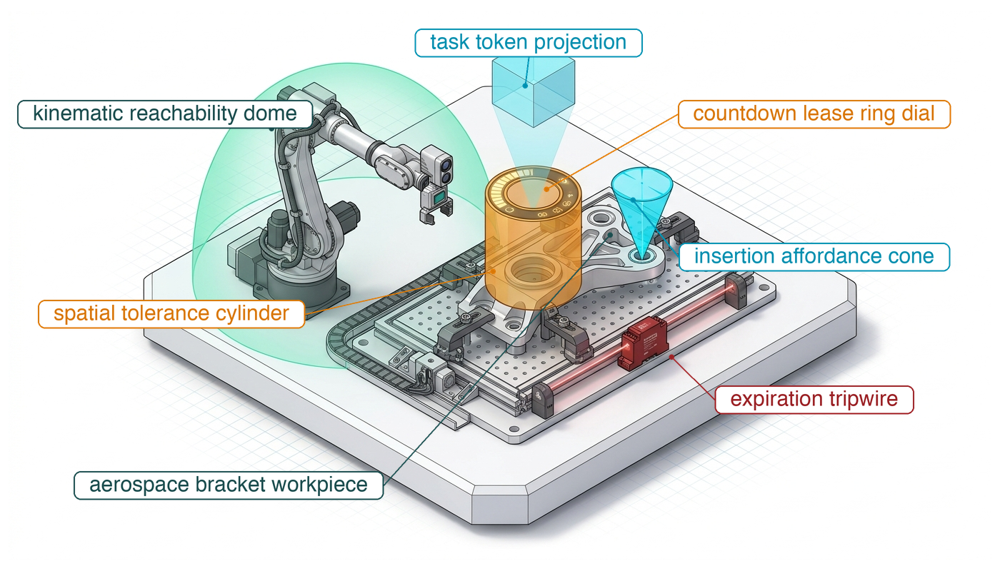
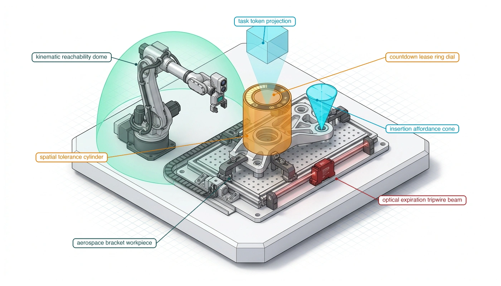
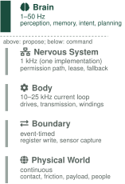
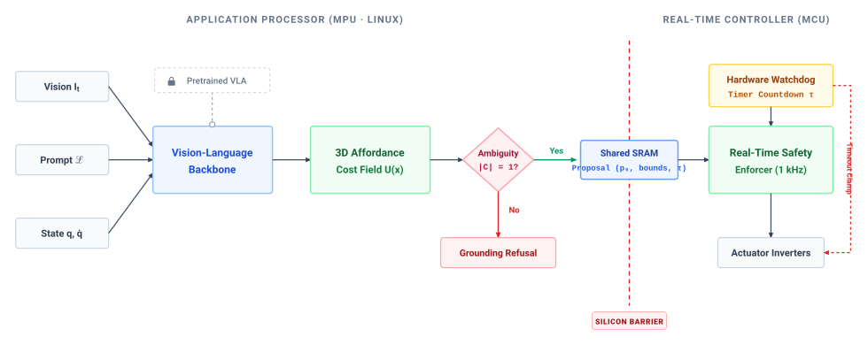
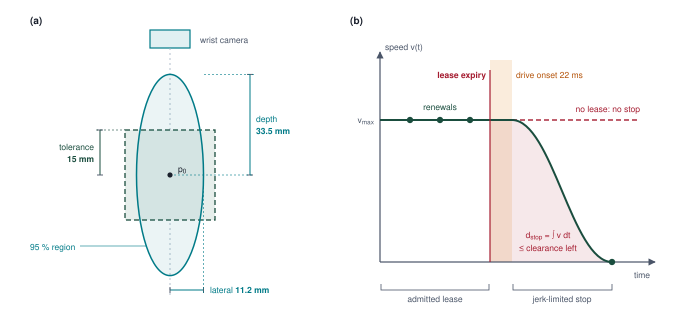
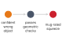
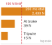
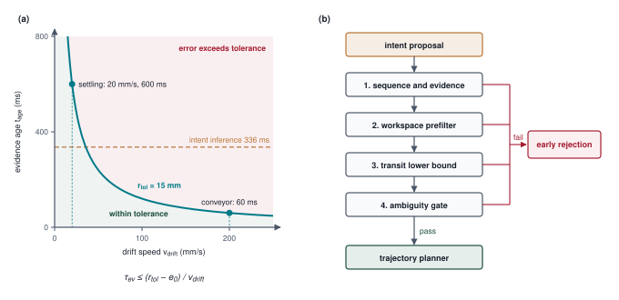
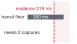
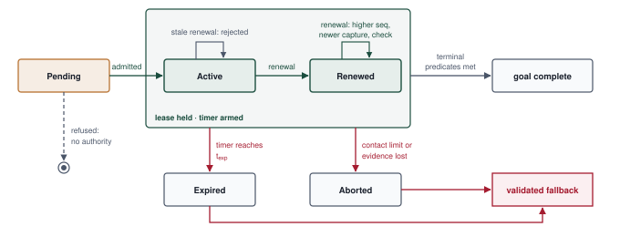

# Grounded Intent {#sec-intent}

::: {layout-narrow}
::: {.column-margin}

\chapterminitoc

:::

::: {.content-visible when-format="pdf"}
\noindent
{fig-alt="Isometric blueprint showing grounded intent: The system comprises several components for grounded intent: a 'task token prism' representing multifaceted AI tasks; a 'deliberative projection beam' signifying the AI’s focus on decision-making pathways; a 'green reachability manifold cone' defining operational limits for effective AI action; an 'inner amber tolerance cylinder' indicating acceptable task execution variances, topped with a 'countdown lease ring' tracking time-sensitive tasks; and an 'emergency expiration tripwire interlock' ensuring the system responds to critical failures."}
:::

::: {.content-visible unless-format="pdf"}
{fig-alt="Isometric blueprint showing grounded intent: floating multifaceted task token prism, deliberative projection beam, green reachability manifold cone, inner amber tolerance cylinder topped with a countdown lease ring, and emergency expiration tripwire interlock."}
:::

:::

## Purpose {.unnumbered .unlisted}

::: {.content-visible when-format="pdf"}
\begin{marginfigure}
\resizebox{0.92\linewidth}{!}{\mlphysicalstackfull{100}{20}{20}{20}{20}}
\end{marginfigure}
:::

::: {.content-visible unless-format="pdf"}
::: {.column-margin}
{width="100%" fig-alt="Physical AI Systems Stack"}

*Physical AI stack focus for this chapter.*
:::
:::

_Why is recognizing the right object insufficient to authorize a robot to reach for it?_

A spoken request names an outcome, not a motion. Between the word and the grasp lie questions no label settles: which feature of the object to touch, where that feature sits in metric space, how hard to squeeze it, and how long the observation behind the answer stays true. A model can name the right object while misplacing its handle by more than the gripper tolerates, can locate it precisely a moment before a conveyor carries it away, or can report high confidence about the wrong object altogether. Once any of these answers becomes a coordinate it looks exactly like a correct one, and the drive that tracks it cannot tell the difference, so a machine that lets such a proposal command motion turns an error in meaning or timing into force against ceramic, glass, or a person. A learned target is safe to pursue only when it arrives bounded in space, effort, and time, with refusal available whenever the evidence cannot support it. Those bounds keep learned intent on the proposal side of the causal boundary, where a mistake can still be refused rather than delivered as motion that cannot be undone.



::: {.callout-learning-objectives}

- Ground natural-language directives and symbolic task operators into metric affordance frames, continuous motion predicates, and verified geometric goal sets
- Emit the intent lease from parent belief records with explicit error envelopes, task tolerances, and effort ceilings
- Calculate intent lease expiry as the earliest of the evidence horizon, the administrative lease, and the stopping deadline
- Decide when grounding ambiguity or a wrong-object premise requires refusal rather than admission
- Evaluate terminal reachability within one evidence window, screen approach corridors against the forward occupancy of moving people, and select guarded, renewed stages for a longer approach
- Design hardware lease expiry that revokes motion authority even when the issuing process hangs or crashes

:::

## Grounded Affordances {#sec-intent-grounded-affordances}

```{python}
#| label: calc-intent-lease-duration-collision-exposure
#| echo: false
#| warning: false
#| message: false
# ┌─────────────────────────────────────────────────────────────────────────────┐
# │ The running machine's intent horizons, the arm's transit lower bound, the   │
# │ mug intent lapse and its arm stop onset, the latch contact at brake command,│
# │ the mug goal-set membership check, and the coworker's forward occupancy     │
# │ growth under the ISO 13855 walking speed.                                   │
# └─────────────────────────────────────────────────────────────────────────────┘
import math

from mlsysim import *
from mlsysim.core.units import *
from mlsysim.fmt import (
    fmt,
    fmt_int,
    fmt_latency,
    fmt_length,
    fmt_velocity,
    fmt_acceleration,
    fmt_frequency,
    fmt_force,
    fmt_heat_capacity,
    fmt_power,
    fmt_temperature,
    fmt_temperature_rate,
    check,
)
from mlsysim.physics.robotics import (
    calc_target_evidence_horizon,
    calc_tracked_evidence_horizon,
    calc_linear_invalidation_horizon,
    calc_latch_contact_stopping_profile,
    calc_contact_force,
)

class IntentLeaseArchetypes:
    # ┌── 1. LOAD: the running machine, plus chapter-local scenario inputs ─────────
    RM = Embodied.MobileManipulator.WarehouseMobileManipulator  # category: illustrative (running machine)
    AISLE = Embodied.Scenario.WarehouseAisle  # category: illustrative (aisle scene; lease chosen)

    delta_t_stall_intent = 200.0 * millisecond  # category: illustrative (stalled proposer holds the mug target)
    delta_t_stall_arm = 200.0 * millisecond  # category: illustrative (unbraked contact interval)
    v_drift_slow = 20.0 * millimeter / second  # category: illustrative (slow-drift case in the figure)
    d_target_offset = 300.0 * millimeter  # category: illustrative (scenario assumption: gripper-to-handle distance at proposal)
    pi0_chunk_len = 50  # category: literature (Black et al. 2024, pi0: action chunk length H = 50)
    pi0_action_rate = 50.0 * hertz  # category: literature (Black et al. 2024, pi0: executed at up to 50 Hz)
    d_goal_in = 10.0 * millimeter  # category: illustrative (terminal TCP offset along x, inside case)
    d_goal_out = 20.0 * millimeter  # category: illustrative (terminal TCP offset along x, outside case)
    t_forecast_long = 2.0 * second  # category: illustrative (multi-second planning horizon for the freezing contrast)
    v_drift_check = 50.0 * millimeter / second  # category: illustrative (checkpoint drift speed)

    # ┌── 2. EXECUTE: evidence horizons, mug intent lapse, latch contact ───────────
    # Mug on the conveyor: untracked and tracked target-evidence horizons. Both
    # horizons charge the 3 mm initial error against the 15 mm tolerance.
    grasp_error_budget = (AISLE.grasp_tolerance - AISLE.grasp_initial_error).to(millimeter)
    # Linear root: Ch9's invalidation law T_inv = (E_max - E_0)/r (@eq-mem-linear-horizon).
    tau_ev_untracked = calc_linear_invalidation_horizon(AISLE.grasp_initial_error, AISLE.v_conveyor, AISLE.grasp_tolerance).to(millisecond)
    tau_ev_tracked = calc_tracked_evidence_horizon(AISLE.grasp_tolerance, AISLE.grasp_initial_error, AISLE.a_conveyor_slip).to(
        millisecond
    )  # sqrt(2 (r_tol - e_0) / a_slip); shared with Ch3
    t_intent_period = (1.0 / RM.intent_rate).to(millisecond)
    err_at_intent_period = (AISLE.grasp_initial_error + AISLE.v_conveyor * t_intent_period).to(millimeter)
    err_excess_at_period = (err_at_intent_period - AISLE.grasp_tolerance).to(millimeter)
    # 2026-09-29 audit: the former 650 ms "illustrative tail" had no source; the
    # overrun now uses the computed intent latency (M2).
    t_infer_overrun = (RM.intent_inference_latency - tau_ev_untracked).to(millisecond)
    n_intent_tokens = RM.intent_model.action_dim  # values one intent evaluation decodes (Ch3)
    tau_ev_slow_drift = calc_target_evidence_horizon(AISLE.grasp_tolerance, AISLE.grasp_initial_error, v_drift_slow).to(millisecond)
    # Cadence gap: worst-case evidence age at a model-only renewal is one period plus
    # one inference (@eq-brain-min-supply's T_replan + t_infer), and the drift speed
    # at which that age just fits the error budget is the model's renewal ceiling.
    t_renew_age = (t_intent_period + RM.intent_inference_latency).to(millisecond)
    v_renew_max = (grasp_error_budget / t_renew_age).to(millimeter / second)
    v_renew_pct = (100 * v_renew_max / AISLE.v_conveyor).to(dimensionless).magnitude

    # Dynamic reachability: the TCP speed ceiling bounds the reach inside the tracked
    # horizon, and a proposal farther away fails the transit lower bound.
    d_reach_tracked = (RM.tcp_speed_limit * tau_ev_tracked).to(millimeter)
    d_reach_untracked = (RM.tcp_speed_limit * tau_ev_untracked).to(millimeter)
    t_transit_floor = (d_target_offset / RM.tcp_speed_limit).to(millisecond)
    n_captures_min = math.ceil((t_transit_floor / tau_ev_tracked).to(dimensionless).magnitude)

    # Mug intent lapse: a stalled proposer holds the target; untracked drift at the
    # conveyor speed, tracked drift from residual slip only; arm stop onset after
    # intent expiry is one permission tick, one bus cycle, and the brake onset.
    err_stalled_untracked = (AISLE.grasp_initial_error + AISLE.v_conveyor * delta_t_stall_intent).to(millimeter)
    err_stalled_tracked = (AISLE.grasp_initial_error + 0.5 * AISLE.a_conveyor_slip * delta_t_stall_intent**2).to(millimeter)
    t_arm_onset_after_expiry = (AISLE.t_tick + AISLE.t_bus + AISLE.t_brake_onset).to(millisecond)

    # Latch contact: force at brake command, then the arm stop that keeps it under the limit.
    latch_profile = calc_latch_contact_stopping_profile(scenario=AISLE)
    df_dt = latch_profile["df_dt"]
    f_at_brake_onset = latch_profile["f_at_brake_onset"]
    x_remaining = latch_profile["x_remaining"]
    a_arm_needed = latch_profile["a_arm_needed"]
    t_arm_stop = latch_profile["t_arm_stop"]
    delta_x_unbounded = (AISLE.v_latch_approach * delta_t_stall_arm).to(millimeter)
    f_unbounded = calc_contact_force(AISLE.k_latch, delta_x_unbounded)

    # Goal-set membership: ellipsoidal norm with all three semi-axes at the grasp
    # tolerance, for a pure x offset.
    norm_goal_in = (d_goal_in / AISLE.grasp_tolerance).to(dimensionless).magnitude
    norm_goal_out = (d_goal_out / AISLE.grasp_tolerance).to(dimensionless).magnitude

    # Coworker forward occupancy: growth of the speed-bound set over the tracked
    # mug horizon and over a multi-second planning horizon, against the aisle width.
    d_occ_tracked = (AISLE.v_human_approach * tau_ev_tracked).to(millimeter)
    d_occ_untracked = (AISLE.v_human_approach * tau_ev_untracked).to(millimeter)
    d_occ_long = (AISLE.v_human_approach * t_forecast_long).to(meter)
    occ_to_aisle = (d_occ_long / AISLE.aisle_width).to(dimensionless).magnitude
    # Freezing crossover: the screening horizon at which the growth term alone
    # reaches the aisle width, so one person's set spans the aisle.
    t_occ_block = (AISLE.aisle_width / AISLE.v_human_approach).to(millisecond)

    # ┌── 3. GUARD: canon values quoted in the prose ──────────────────────────────
    check(abs(tau_ev_untracked.magnitude - 60.0) < 1e-6, "Untracked mug horizon is 60 ms")
    check(abs(tau_ev_tracked.magnitude - 219.09) < 5e-3, "Tracked mug horizon is 219 ms")
    check(abs(grasp_error_budget.magnitude - 12.0) < 1e-6, "Mug error budget is 12 mm")
    check(abs(err_stalled_untracked.magnitude - 43.0) < 1e-6, "Stalled untracked target sits 43 mm off")
    check(abs(err_stalled_tracked.magnitude - 13.0) < 1e-6, "Stalled tracked target sits 13 mm off")
    check(abs(t_arm_onset_after_expiry.magnitude - 22.0) < 1e-6, "Arm stop onset within 22 ms of intent expiry")
    check(abs(RM.tcp_speed_limit.to(meter / second).magnitude - 1.0) < 1e-9, "TCP speed ceiling is 1.0 m/s")
    # 2026-09-28 (M2): the intent rate is now 2 Hz, set by the computed intent latency.
    check(abs(t_intent_period.magnitude - 500.0) < 1e-6, "2 Hz intent period is 500 ms")
    check(abs(err_at_intent_period.magnitude - 103.0) < 1e-6, "Error at the intent period")
    check(abs(tau_ev_slow_drift.magnitude - 600.0) < 1e-6, "Slow-drift horizon in the figure")
    check(
        abs(
            tau_ev_untracked.magnitude
            - calc_target_evidence_horizon(AISLE.grasp_tolerance, AISLE.grasp_initial_error, AISLE.v_conveyor).to(millisecond).magnitude
        )
        < 1e-9,
        "Ch9 linear law and the evidence-horizon helper agree",
    )
    check(abs(t_infer_overrun.magnitude - 275.6) < 0.5, "Computed inference overruns the untracked horizon by about 276 ms")
    check(n_intent_tokens == 7, "Intent model decodes seven values")
    check(abs(d_reach_tracked.magnitude - 219.09) < 5e-3, "TCP reach inside the tracked horizon is 219 mm")
    check(abs(d_reach_untracked.magnitude - 60.0) < 1e-6, "TCP reach inside the untracked horizon is 60 mm")
    check(abs(t_transit_floor.magnitude - 300.0) < 1e-6, "Transit floor for the offset proposal is 300 ms")
    check(t_transit_floor > tau_ev_tracked, "Offset proposal fails the transit lower bound")
    check(n_captures_min == 2, "Staged approach needs at least two fresh captures")
    check(abs(AISLE.t_lease.to(millisecond).magnitude - 60.0) < 1e-9, "Chunk lease is 60 ms")
    check(abs(f_at_brake_onset.to(newton).magnitude - 39.0) < 1e-9, "Force at brake command")
    check(abs(x_remaining.magnitude - 0.1525) < 5e-5, "Latch compression left is 0.15 mm")
    check(abs(a_arm_needed.magnitude - 2.95) < 5e-3, "Arm stop premise is about 3 m/s^2 (2.95)")
    check(abs(t_arm_stop.magnitude - 10.0) < 0.5, "Arm stop takes about 10 ms")
    check(abs(f_unbounded.to(newton).magnitude - 2400.0) < 1.0, "Unbraked contact model")
    check(norm_goal_in <= 1.0 < norm_goal_out, "Inside and outside goal-set cases straddle the boundary")
    check(abs(d_occ_tracked.magnitude - 350.5) < 0.5, "Coworker set grows about 350 mm over the tracked horizon")
    check(abs(d_occ_long.magnitude - 3.2) < 1e-9, "Coworker set grows 3.2 m over 2 s at the ISO 13855 speed")
    check(occ_to_aisle > 2.0, "A 2 s forecast spans more than twice the aisle width")
    check(abs(d_occ_untracked.magnitude - 96.0) < 1e-6, "Coworker set grows 96 mm over the untracked horizon")
    check(abs(t_renew_age.magnitude - 835.6) < 0.5, "Model-only renewal age is about 836 ms")
    check(abs(v_renew_max.magnitude - 14.36) < 0.05, "Model-only renewal ceiling is about 14.4 mm/s")
    check(v_renew_max < v_drift_slow < AISLE.v_conveyor, "Even the slow-drift case outruns a model-only renewal")
    check(abs(t_occ_block.magnitude - 812.5) < 1e-6, "One person's growth term spans the aisle after 0.81 s")
    check(tau_ev_tracked < t_occ_block < t_forecast_long, "Crossover lies between the tracked horizon and the 2 s forecast")
    check(abs(AISLE.k_latch.to(newton / millimeter).magnitude - 400.0) < 1e-9, "Latch stiffness is 400 N/mm")
    check(abs(delta_x_unbounded.magnitude - 6.0) < 1e-9, "Unbraked stall advances 6 mm")
    # margin_latch_stall_force_ladder.svg fig-alt hand-types 15, 39, 100 and 2,400 N and the 200 ms stall;
    # margin_dynamic_reachability_shortfall_envelope.svg fig-alt hand-types 300 ms, 219 ms and 2 captures.
    check(abs(AISLE.f_latch_tripwire.to(newton).magnitude - 15.0) < 1e-9, "Latch ladder: tripwire label is stale")
    check(abs(AISLE.f_latch_limit.to(newton).magnitude - 100.0) < 1e-9, "Latch ladder: latch limit label is stale")
    check(abs(delta_t_stall_arm.to(millisecond).magnitude - 200.0) < 1e-9, "Latch ladder: stall label is stale")
    check(round(f_unbounded.to(newton).magnitude) == 2400, "Latch ladder: stall force label is stale")
    check(round(tau_ev_tracked.magnitude) == 219 and n_captures_min == 2, "Reachability envelope: alt values are stale")

    # ┌── 4. OUTPUT: rendered values ──────────────────────────────────────────────
    # Mug on the conveyor
    v_conveyor_str = fmt_velocity(AISLE.v_conveyor, unit=meter / second, precision=2)
    r_tol_str = fmt_length(AISLE.grasp_tolerance, unit=millimeter, precision=0)
    e0_str = fmt_length(AISLE.grasp_initial_error, unit=millimeter, precision=0)
    tau_untracked_str = fmt_latency(tau_ev_untracked, unit=millisecond, precision=0)
    tau_tracked_str = fmt_latency(round(tau_ev_tracked.magnitude) * millisecond, unit=millisecond, precision=0)
    a_slip_str = fmt_acceleration(AISLE.a_conveyor_slip, unit=meter / second**2, precision=2)
    f_intent_str = fmt_frequency(RM.intent_rate, unit=hertz, precision=0)
    t_intent_period_str = fmt_latency(t_intent_period, unit=millisecond, precision=0)
    t_intent_infer_str = fmt_latency(
        round(RM.intent_inference_latency.to(millisecond).magnitude) * millisecond, unit=millisecond, precision=0
    )  # computed latency, whole ms (2026-09-28, M2)
    err_at_period_str = fmt_length(err_at_intent_period, unit=millimeter, precision=0)
    err_excess_str = fmt_length(err_excess_at_period, unit=millimeter, precision=0)
    v_drift_slow_str = fmt_velocity(v_drift_slow, unit=millimeter / second, precision=0)
    tau_slow_drift_str = fmt_latency(tau_ev_slow_drift, unit=millisecond, precision=0)
    t_infer_overrun_str = fmt_latency(round(t_infer_overrun.magnitude) * millisecond, unit=millisecond, precision=0)
    n_intent_tokens_str = fmt_int(n_intent_tokens)
    # Dynamic reachability on the arm
    d_reach_tracked_str = fmt_length(round(d_reach_tracked.magnitude) * millimeter, unit=millimeter, precision=0)
    d_reach_untracked_str = fmt_length(d_reach_untracked, unit=millimeter, precision=0)
    d_target_str = fmt_length(d_target_offset, unit=millimeter, precision=0)
    t_transit_floor_str = fmt_latency(t_transit_floor, unit=millisecond, precision=0)
    n_captures_str = fmt_int(n_captures_min)
    # Mug intent lapse and the admitted mug lease
    err_budget_str = fmt_length(grasp_error_budget, unit=millimeter, precision=0)
    t_stall_intent_str = fmt_latency(delta_t_stall_intent, unit=millisecond, precision=0)
    err_stalled_untracked_str = fmt_length(err_stalled_untracked, unit=millimeter, precision=0)
    err_stalled_tracked_str = fmt_length(err_stalled_tracked, unit=millimeter, precision=0)
    t_arm_onset_str = fmt_latency(t_arm_onset_after_expiry, unit=millisecond, precision=0)
    v_tcp_str = fmt_velocity(RM.tcp_speed_limit.to(meter / second))
    # Latch contact
    v_latch_str = fmt_velocity(AISLE.v_latch_approach, unit=meter / second, precision=2)
    f_trip_str = fmt_force(AISLE.f_latch_tripwire, precision=0)
    t_contact_str = fmt_latency(AISLE.t_contact_response, unit=millisecond, precision=0)
    f_at_brake_onset_n_str = fmt_force(f_at_brake_onset, precision=0)
    f_lim_str = fmt_force(AISLE.f_latch_limit, precision=0)
    t_stall_arm_str = fmt_latency(delta_t_stall_arm, unit=millisecond, precision=0)
    delta_x_unbounded_mm_str = fmt_length(delta_x_unbounded, unit=millimeter, precision=0)
    f_unbounded_n_str = fmt_force(f_unbounded, precision=0, commas=True)
    # Permission loop
    f_permission_str = fmt_frequency(RM.permission_rate, unit=kHz, precision=0)
    # Chunked VLA reference (pi0)
    pi0_chunk_str = fmt_int(pi0_chunk_len)
    pi0_rate_str = fmt_frequency(pi0_action_rate, unit=hertz, precision=0)
    # Goal-set membership
    d_in_str = fmt_length(d_goal_in, unit=millimeter, precision=0)
    d_out_str = fmt_length(d_goal_out, unit=millimeter, precision=0)
    norm_in_str = fmt(norm_goal_in, precision=2, commas=False)
    norm_out_str = fmt(norm_goal_out, precision=2, commas=False)
    # Coworker forward occupancy
    v_h_str = fmt_velocity(AISLE.v_human_approach, unit=meter / second, precision=1)
    d_occ_tracked_str = fmt_length(round(d_occ_tracked.magnitude) * millimeter, unit=millimeter, precision=0)
    t_forecast_long_str = fmt_latency(t_forecast_long, unit=second, precision=0)
    d_occ_long_str = fmt_length(d_occ_long, unit=meter, precision=1)
    d_occ_untracked_str = fmt_length(d_occ_untracked, unit=millimeter, precision=0)
    aisle_width_str = fmt_length(AISLE.aisle_width, unit=meter, precision=2)
    t_occ_block_str = fmt_latency(t_occ_block.to(second), unit=second, precision=2)
    # Cadence gap
    v_conveyor_mm_str = fmt_velocity(AISLE.v_conveyor, unit=millimeter / second, precision=0)
    t_renew_age_str = fmt_latency(round(t_renew_age.magnitude) * millisecond, unit=millisecond, precision=0)
    v_renew_max_str = fmt_velocity(v_renew_max, unit=millimeter / second, precision=1)
    v_renew_pct_str = fmt(v_renew_pct, precision=1, commas=False)
    v_drift_check_str = fmt_velocity(v_drift_check, unit=millimeter / second, precision=0)
    # Latch arithmetic
    k_latch_str = fmt_stiffness(AISLE.k_latch, unit=newton / millimeter, precision=0, commas=False)

# Module-level exports for downstream figures and sync guards
RM = IntentLeaseArchetypes.RM
AISLE = IntentLeaseArchetypes.AISLE
tau_ev_untracked = IntentLeaseArchetypes.tau_ev_untracked
tau_ev_tracked = IntentLeaseArchetypes.tau_ev_tracked
tau_ev_slow_drift = IntentLeaseArchetypes.tau_ev_slow_drift
delta_t_stall_intent = IntentLeaseArchetypes.delta_t_stall_intent
t_arm_onset_after_expiry = IntentLeaseArchetypes.t_arm_onset_after_expiry
err_stalled_untracked = IntentLeaseArchetypes.err_stalled_untracked
err_stalled_tracked = IntentLeaseArchetypes.err_stalled_tracked
v_drift_slow = IntentLeaseArchetypes.v_drift_slow
t_forecast_long = IntentLeaseArchetypes.t_forecast_long
t_intent_period = IntentLeaseArchetypes.t_intent_period
```

An operator tells the warehouse mobile manipulator to "pick the red mug" from an active takeaway conveyor. The request names an outcome and leaves the grasp pose, approach velocity, contact force, and execution deadline unspecified. Spatial memory has already done its part by recording a belief about the mug's handle with an evidence epoch, an initial error of `{python} IntentLeaseArchetypes.e0_str`, and a growth law. Under that law, the moving belt carries the handle outside the `{python} IntentLeaseArchetypes.r_tol_str` grasp tolerance `{python} IntentLeaseArchetypes.tau_untracked_str` after capture. Because that record says only where the handle is and how long the claim holds, it neither specifies what the machine may do with the handle nor authorizes actuator torque. **Intent**\index{Intent} bridges this gap by binding the spoken request to an admissible, time-bounded physical goal that the motion planner can pursue.

::: {.column-margin .margin-pointer}
↩ The belief record a lease consumes (evidence epoch, initial error, growth law) is established in @sec-memory-spatial-state-schema.
:::

The reach does not stay inside the arm. On the running machine a slow intent model sits above a fast chunk policy that proposes base velocity and arm targets together in one whole-body stream (@sec-brain-two-proposers). A wrong or stale mug target can steer the base as well as the wrist. What the permission path grants in answer to the request is therefore deliberately narrower than motion. It grants an intent lease (@sec-intent-lease), a record that names a target and effort ceilings but never a path. For the mug, the lease carries the parent belief record's digest and evidence epoch. It also carries a target pose in the handle's affordance frame and a goal region of spatial and angular tolerances around that pose. The lease states dynamic limits on tool speed and acceleration and a maximum contact wrench. Finally, it names the motion predicates already validated, an expiration deadline on the safety controller's own clock, and the fallback that controller engages when the deadline passes.

Each of these fields acquires its value in a later part of the chapter. Grasp mechanics and the grounded affordance below supply the target pose, the goal region, and the wrench ceiling. The task operators of @sec-intent-task-motion name the predicates a grasp must discharge. The grounding pipeline of @sec-intent-request-to-proposal decides whether any target is proposed at all and how large its error envelope is. The belief record's drift then sets the deadline (@sec-intent-goals-expire), and reachability against that deadline bounds the dynamic limits (@sec-intent-admissible-goal-sets). Friction cones, force closure, and symbolic planners matter here only as the means by which one of these fields acquires a value the safety controller can check.

This grounding step is where a learned model's output first turns into physical coordinates and contact limits that the robot can execute. Open-vocabulary object detectors, language models, and vision-language-action policies let operators specify manipulation tasks in plain words rather than through hard-coded skill libraries. What those neural networks emit, however, is only a statistical hypothesis, such as a bounding box, a semantic token, an uncalibrated point coordinate, or a chunk of normalized actions. An objective function that knows nothing of metric clearance, actuator torque limits, or physical time produced it. On the running machine, the division of responsibility is therefore strict: the learned Brain proposes candidate actions, and the deterministic permission path checks and admits them before any drive receives current.

::: {.column-margin .margin-pointer}
↩ The proposal boundary and the permission path are established in @sec-boundary-machine-model.
:::

Before the permission path admits a proposed target for planning and execution, the target must satisfy three physical requirements:

1. *Metric physicality*: The target cannot remain a symbolic label; it must resolve to an explicit geometric feature carrying a six-degree-of-freedom pose, a gripper aperture, and a bounded contact wrench profile.
2. *Bounded error*: The proposal must include a certified spatial error envelope that fits strictly within the task tolerances and mechanical effort limits of both the manipulator and the workpiece.
3. *Temporal expiration*: Every target must carry an explicit evidence epoch, bounding its valid lifespan as target objects shift and sensory observations grow stale during compute cycles.

Every request traverses an explicit pipeline to meet these three requirements. Sensory perception resolves symbolic task operators into measurable physical predicates, and calibration transforms image regions into metric poses. The permission path then evaluates effort limits, evidence age, kinematic reachability, and dynamic obstacle clearances before committing the target to the motion planner. A vision-language-action (VLA) model [@brohan2023rt2] can propose the mug's target directly, but its deliberative inference loop is slow. The running machine's intent model executes at `{python} IntentLeaseArchetypes.f_intent_str` and requires `{python} IntentLeaseArchetypes.t_intent_infer_str` (derived in @sec-brain-memory-wall) to autoregressively decode `{python} IntentLeaseArchetypes.n_intent_tokens_str` target values. These values are a 3D position, a three-value orientation (which the producer converts to the quaternion the wire format carries), and an open-close gripper command. The machine therefore splits proposal across two speeds (@sec-brain-two-proposers). The intent model names the target, and a smaller chunk policy streams motion toward it between intent inferences.

That split keeps the joints supplied with setpoints, but it does not keep the target true. If the conveyor moves while one intent inference runs, every chunk aims at where the mug was when the model's frame was captured. One inference outlasts the handle's `{python} IntentLeaseArchetypes.tau_untracked_str` evidence window more than five times over. When target evidence expires between model inferences, the system must either switch to a high-rate local visual tracker or arrest motion entirely. @Sec-intent-goals-expire quantifies these expiration dynamics. Safe physical agency demands dated geometric evidence, explicit capability limits, and an autonomous permission path capable of revoking execution authority whenever the neural model lags or stalls.

::: {.column-margin .margin-pointer}
↩ The machine's multi-rate cadences, from motor current loops through safety screening to deliberative planners, are established in @sec-nervous-time-constants-phase-lag.
:::

Grounding the mug grasp starts with naming which physical feature the gripper will touch, expressing that feature in the robot's base frame, and bounding the forces of contact. In ecological psychology, Gibson coined the term **affordance**\index{Affordances!grasp envelopes} for what an environment offers an agent capable of acting on it [@gibson1979ecological].[^fn-affordance-gibson-coinage] Robotics turns that qualitative idea into four measurable quantities for the mug handle. The first is a target grasp pose $\GraspPose = (\GraspOrientation, \GraspPosition) \in \SpecialEuclideanGroup$ in the robot base frame (where $\SpecialEuclideanGroup$ is the Special Euclidean group of 3D rigid-body positions and $\SpecialOrthogonalGroup$ rotations).[^fn-special-euclidean-group] The others are a unit approach vector $\ApproachDirection$, a jaw aperture $\JawAperture$ in meters, and an allowable contact wrench envelope $\ContactWrenchEnvelope$ bundling three-axis forces in newtons and three-axis torques in newton-meters. Because each usable site on an object imposes different geometry and force limits, each site defines its own **affordance frame** $\AffordanceFrame$ attached to the object's body coordinates. A single mug offers several distinct affordance frames across its surface. Its thin rim tolerates little normal force, its cylindrical wall requires a wide jaw span, and its handle requires a full six-degree-of-freedom (6-DoF) alignment that threads the fingers through the loop without collision.

[^fn-special-euclidean-group]: **Special Euclidean Group**\index{SE(3)!special Euclidean group}: "Euclidean" because its elements preserve distances, "special" because the rotation part has determinant $+1$, which excludes mirror reflections. A learned regressor carries no such constraint. An unnormalized quaternion or a matrix with determinant $-1$ is a valid tensor and an impossible pose, so admission rechecks quaternion normalization (@sec-intent-lease) instead of trusting the output head.

[^fn-affordance-gibson-coinage]: **Affordance** (from the verb *to afford*): @gibson1979ecological coined the noun for what an environment offers an animal able to act on it, and the sense is relative to the agent. A handle affords a grasp only to a gripper whose aperture and wrench ceiling fit it, so the affordance record carries the gripper's limits as well as the mug's geometry. \index{Affordances!agent-relative}

Contact mechanics dictates the allowable contact wrench. Under the classical Coulomb friction model, tangential contact forces $\FingerTangentialForce$ remain stable without slipping only when constrained within a **friction cone**\index{Friction cone}:
$$\|\FingerTangentialForce\| \le \CoulombFrictionCoefficient \FingerNormalForce$$
where $\FingerNormalForce$ represents the normal contact force and $\CoulombFrictionCoefficient$ is the static coefficient of friction. For an idealized two-finger parallel gripper, Nguyen established that a grasp resists arbitrary in-plane disturbance forces if and only if the line connecting the two contact points lies strictly within the interior of both friction cones [@nguyen1988constructing].

The general formulation operates in wrench space. For each contact point $\ContactPointIndex$, a grasp map $\GraspMap_i$ transforms the local contact force $\ContactPointForce_i$ into an object wrench composed of the force and its moment $\GraspContactDisplacement_i \times \ContactPointForce_i$ about the object reference frame. Here $\GraspContactDisplacement_i$ denotes the displacement from the reference origin to the contact point. Mapping the extremal rays of every friction cone into wrench space yields a set of primitive contact wrenches. The grasp achieves **force closure**\index{Force closure} when the origin of wrench space lies strictly within the interior of the convex hull of these primitive wrenches, guaranteeing that admissible contact forces can equilibrate any external disturbance wrench. Ferrari and Canny formalized this condition into a scalar quality metric. The metric is the radius of the largest origin-centered ball inscribed within that convex hull, and it represents the minimum disturbance wrench the grasp resists per unit of applied normal force [@ferrari1992planning].

Force closure, however, remains an idealized geometric property that specifies stability without bounding magnitude. A physical grasp requires finite capacity. The normal squeeze force must counter the mug's gravitational load and dynamic accelerations during transit while remaining strictly below structural limits that would fracture ceramic or spill contents. @Sec-appendix-control-grasp derives the lower bound on squeeze force from Newton's second law and develops friction cones and force closure from first principles. These dynamic bounds constitute the effort envelope that the Brain proposes and the permission path enforces.

Turning a spoken request into a checkable physical target is the robotic form of the **symbol grounding problem**\index{Symbol grounding problem} [@harnad1990symbol], which asks how arbitrary symbols connect to measurable sensorimotor states.[^fn-intent-symbol-grounding] For the mug, that connection runs through the calibrated transform chain from the camera frame to the manipulator base, the handle's affordance frame, and the contact wrench bounds. An uncalibrated detection box or an autoregressively sampled coordinate carries none of those bounds. The permission path must therefore catch and reject an unsupported model proposal (a hallucination, in machine learning terms[^fn-intent-hallucination-containment]) deterministically, regardless of the model's reported confidence. When a spatial feature instead bundles a calibrated base-frame pose, certified wrench limits, and an evidence timestamp, it forms a grounded affordance.

::: {#dfn-intent-grounded-affordance .callout-definition title="Grounded affordance"}

***Grounded affordance***\index{Grounded affordance!definition}\index{Affordances!grounded} is an affordance expressed in the robot's own frame and units: a feature pose in the base frame, an approach direction, an aperture, and a contact wrench ceiling, each tied to dated sensor evidence through a calibrated measurement chain.

1.  **Significance**: It turns a label into quantities the permission path can check. The mug handle's grounded affordance is a pose that must land inside a `{python} IntentLeaseArchetypes.r_tol_str` task tolerance from evidence with a `{python} IntentLeaseArchetypes.e0_str` initial error, and on the moving belt that evidence stays valid for only `{python} IntentLeaseArchetypes.tau_untracked_str` (@sec-intent-goals-expire).
2.  **Distinction**: Unlike a detector box or a language label, which designates where an object appears in image space or what it is called, a grounded affordance defines where and how an end effector may establish contact. Unlike Gibson's perceptual affordance, it is bound to one gripper's limits and to one capture time.
3.  **Common pitfall**: Treating a learned grasp score or a confident detection as grounding. Neither carries a metric error bound, a wrench limit, or an evidence epoch, so neither can be admitted or expired.

:::

A high-level task action like `Grasp(Mug, Handle)` specifies an operational objective, but its preconditions require rigorous physical verification. Perceptual noise and latency prevent open-loop execution from guaranteeing that the handle remains unobstructed or that the jaws are properly aligned. **Motion predicates**\index{Motion predicates!definition} formalize these physical prerequisites by mapping abstract conditions to measurable geometric tolerances and wrench readings:

1. *Pre-contact approach predicate:* $\ApproachPredicate(\ToolCenterPointPose) \iff \|\ToolCenterPointPosition - \PregraspPosition\| \le \PositionalTaskTolerance \land \arccos(\ToolCenterPointAxis \cdot \ApproachDirection) \le \OrientationTolerance$, requiring the tool center point (TCP) frame $\ToolCenterPointFrame$, whose origin sits between the gripper fingertips, to align with the affordance approach axis $\ApproachDirection$ within spatial tolerance $\PositionalTaskTolerance$ and angular orientation tolerance $\OrientationTolerance$.
2. *Guarded contact predicate:* $\GuardedContactPredicate(\ContactWrench) \iff \GraspForceFloor \le \FingerNormalForce \le \GraspForceCeiling$, checking a normal squeeze band under the illustrated parallel-jaw model. Here the contact-force magnitude denotes the relevant normal squeeze at each finger, measured or conservatively inferred under qualified contact geometry; a generic force-vector norm or net wrench does not establish that quantity. The task profile sets the band from friction, payload load and acceleration, and crush limits. Passing it supports retention under those premises but does not establish object identity or task completion.
3. *Spatial clearance predicate:* $\SpatialClearancePredicate(\CartesianPosition, \SpatialMemoryMap) \iff \min_{\ObstaclePoint \in \SpatialMemoryMap} \|\CartesianPosition - \ObstaclePoint\| \ge \PointClearanceMargin$, evaluating candidate point $\CartesianPosition$ against obstacle geometry stored in the spatial memory map $\SpatialMemoryMap$. This point clearance test serves as a fast preliminary check. Certifying the physical gripper, manipulator links, and their swept transit volumes requires a continuous path collision query during trajectory synthesis.

Together, the spatial and angular tolerances delineate an admissible **geometric goal set** $\GoalSet \subset \SpecialEuclideanGroup$\index{SE(3)!target goal set}:
$$\GoalSet = \left\{ \Pose = (\DirectionalCosineMatrix, \CartesianPosition) \in \SpecialEuclideanGroup \;\middle|\; \|\CartesianPosition - \TargetPosition\|_{\ToleranceEllipsoidMatrix} \le 1, \; \angle(\DirectionalCosineMatrix, \TargetOrientation) \le \OrientationTolerance \right\}$$ {#eq-intent-goal-set-se3}
Contact and obstacle clearance predicates operate as distinct, phase-specific execution constraints outside this static pose volume. Within @eq-intent-goal-set-se3, the weighted ellipsoidal norm $\|\CartesianPosition - \TargetPosition\|_{\ToleranceEllipsoidMatrix} = \sqrt{\sum_{i \in \{\Glyph{x},\Glyph{y},\Glyph{z}\}} \left(\frac{\PositionComponent_i - \TargetPositionComponent}{\TaskToleranceSemiAxis_i}\right)^2}$ bounds spatial deviation within an ellipsoid whose principal semi-axes are $\TaskToleranceSemiAxes = (\XTaskToleranceSemiAxis, \YTaskToleranceSemiAxis, \ZTaskToleranceSemiAxis)$. Here $\PositionalTaskTolerance$ denotes the corresponding semi-axis $\TaskToleranceSemiAxis_i$ along any individual coordinate direction. The rotation error metric $\angle(\DirectionalCosineMatrix, \TargetOrientation) = \arccos\left(\frac{\operatorname{tr}(\DirectionalCosineMatrix^\top \TargetOrientation) - 1}{2}\right)$ bounds geodesic orientation divergence on $\SpecialOrthogonalGroup$, equivalent to $2 \arccos(|\UnitQuaternion \cdot \TargetUnitQuaternion|)$ when unit quaternions represent orientations. Terminal grasp poses falling outside $\GoalSet$ lead directly to task aborts or damage. Translational errors exceeding $\TaskToleranceSemiAxis_i$ cause gripper fingers to impact the ceramic rim or close on empty space, while angular misalignments exceeding $\OrientationTolerance$ jam the fingers against the handle opening, tripping joint torque protection or shattering the object.

For the warehouse mug, the nominal task profile assigns all three ellipsoidal semi-axes to the `{python} IntentLeaseArchetypes.r_tol_str` grasp tolerance. A terminal TCP offset of `{python} IntentLeaseArchetypes.d_in_str` along the $\Glyph{x}$-axis yields a normalized ellipsoidal distance of `{python} IntentLeaseArchetypes.norm_in_str`, remaining well within the admissible goal set. Conversely, an offset of `{python} IntentLeaseArchetypes.d_out_str` yields a normalized distance of `{python} IntentLeaseArchetypes.norm_out_str`, falling outside the set and triggering immediate rejection. Checking angular alignment requires the angular tolerance $\OrientationTolerance$ specified in the verified task profile, which the mug model registers during commissioning.

This goal set is an operational task specification rather than an estimate of target pose. The **task tolerance region**\index{Tolerance region!3D spatial}\index{Intent record!spatial tolerance region} defines the maximum terminal error that the physical grasp can absorb; state estimator covariance captures uncertainty in the target's actual pose. For the mug pick, the approved task profile permits at most `{python} IntentLeaseArchetypes.r_tol_str` of translational discrepancy. The proposed affordance must therefore supply a conservative target error bound that fits inside this envelope, leaving sufficient headroom for the motion controller's dynamic tracking error. Artificially expanding the task tolerance to accept an uncertain perception estimate corrupts the safety invariants of the physical task.

Generating candidate affordances prior to intent proposal packaging typically relies on a **learned 6-DoF grasp generator**\index{Grasp synthesis!learned generators} applied to an incoming point cloud. Architectures such as Contact-GraspNet predict grasp poses anchored directly to surface points in cluttered point clouds [@sundermeyer2021contactgraspnet]. Frameworks like AnyGrasp predict dense $\SpecialEuclideanGroup$ grasp distributions with learned quality scores and track them across temporal observation sequences [@fang2023anygrasp]. The generator outputs a set of candidate grasp configurations paired with scalar confidence scores. However, a learned score merely reflects the network's predictive confidence relative to its training distribution. It provides neither an analytic stability metric like the Ferrari-Canny radius nor a measured empirical grasp success rate for this specific gripper and workpiece geometry.

Candidate poses surviving initial filtering must satisfy rigorous downstream physical constraints that learned generators omit:

1. *Kinematic feasibility*: The manipulator must possess a valid inverse kinematics (IK) solution that avoids joint position and velocity limits. A well-conditioned kinematic Jacobian does not guarantee clearance from mechanical joint stops, making explicit joint travel verification mandatory.
2. *Geometric compatibility*: Gripper jaw stroke must exceed workpiece thickness at the grasp site with sufficient clearance margin.
3. *Corridor clearance*: The approach trajectory must provide an unobstructed approach vector clear of surrounding bin walls and adjacent cargo.

When no candidate grasp satisfies these constraints, or when target identification remains unresolved across ambiguous visual candidates, the control pipeline must not execute an argmax guess. Instead, the proposal's producer on the application processor issues an explicit **intent grounding refusal**\index{Intent grounding refusal!definition}\index{Refusal!grounding ambiguity} (`ERR_GROUNDING_AMBIGUITY`), signaling a typed rejection of the goal itself. A planning failure means that the planner has not produced a collision-free path to a valid, well-formed goal. An intent grounding refusal halts execution earlier. It rejects an ungrounded or ambiguous goal before invoking the motion planner, which prevents unverified guesses from generating physical trajectories. When a symbolic task planner sits above the grasp generator, its discrete task operators must discharge these same geometric and contact predicates before any step of the plan is admitted.

[^fn-intent-symbol-grounding]: **Symbol Grounding Problem**\index{Symbol Grounding Problem}: @harnad1990symbol compared the problem to learning Chinese from a Chinese-to-Chinese dictionary alone, in which every definition points only to more undefined symbols. A model's text embedding is that dictionary. Only a calibrated camera-to-base chain breaks the circle for the mug, so the proposal must carry its evidence record and not only its label.

[^fn-intent-hallucination-containment]: **Hallucination**\index{Safety!hallucination containment}\index{Grounding!semantic containment}: In text generation the word names fluent output that the source does not support [@maynez2020faithfulness]. For a robot the unsupported output is a coordinate, and nothing in its format marks it as unsupported. Containment therefore has to be a check on evidence that the model does not produce.

## Task Operators and Geometric Samplers {#sec-intent-task-motion}

A symbolic task planner can emit the discrete action `Grasp(Mug, Handle)` and mark the mug as held in its internal state even when no collision-free inverse kinematics solution reaches the handle, a bin wall blocks the approach, or the mug has not been separated from adjacent items on the belt. The high-level action `Grasp(Mug, Handle)` inherits from classical planning traditions, where actions are formalized as **operators**\index{Task and motion planning!operator} defined by preconditions, an add list, and a delete list. The formalism traces back to the STRIPS[^fn-strips-shakey-origin] framework [@fikes1971strips] and was standardized by the Planning Domain Definition Language (PDDL)\index{PDDL} [@mcdermott1998pddl]. A discrete world state $\SymbolicPlanningState$ consists of a set of grounded predicates. An operator $\PlanningOperator$ is applicable in state $\SymbolicPlanningState$ if its preconditions hold, $\text{pre}(\PlanningOperator) \subseteq \SymbolicPlanningState$, producing the successor state
$$\SuccessorPlanningState = \left(\SymbolicPlanningState \setminus \text{del}(\PlanningOperator)\right) \cup \text{add}(\PlanningOperator)$$ {#eq-intent-strips-successor}
A symbolic planner searches sequences of operators, advancing states by the delete-then-add update of @eq-intent-strips-successor until reaching a state satisfying the target goal predicates. For the warehouse pick, an operator `pick(mug, handle, conveyor)` requires preconditions `Reachable(handle)`, `Clear(approach)`, `Singulated(window)`, and `HandEmpty`, where a singulated window holds exactly one separated candidate object. Upon execution, it adds `Holding(mug)` and deletes `HandEmpty`.

[^fn-strips-shakey-origin]: **STRIPS (Stanford Research Institute Problem Solver)**\index{STRIPS!Shakey origin}: The formalism was built to plan for Shakey, a physical mobile robot at SRI [@nilsson1984shakey], so symbolic planning began on a machine that moved. Its operators treat an action's listed effects as certain, an assumption that slipping wheels and a misreading camera cannot grant. The gap that geometric samplers and motion predicates close is therefore as old as the formalism itself.

Abstract symbols disguise the primary computational challenge: verifying whether a predicate like `Reachable(handle)` holds requires finding a continuous end-effector pose, a valid inverse kinematics solution, and a collision-free joint trajectory. A symbolic planner cannot evaluate these continuous constraints natively. **Integrated task and motion planning**\index{Task and motion planning!definition} (TAMP) resolves this disconnect by coupling discrete symbolic search with **geometric samplers**, computational routines that sample continuous configuration spaces (proposing candidate grasps, inverse kinematics configurations, and transit paths) to certify symbolic preconditions [@kaelbling2011hierarchical; @garrett2021integrated]. For instance, PDDLStream treats each geometric sampler as a generator stream whose continuous outputs certify symbolic facts. The task planner can then make optimistic symbolic progress, backtracking or branching when a sampler fails to find a valid configuration [@garrett2020pddlstream]. A sampler failure means that the search has not found a collision-free grasp for the given base pose; unless the sampler certifies infeasibility, it does not prove that none exists. The symbolic planner can spend more search effort, reposition the mobile base, or select an alternate interaction sequence.

Large language models (LLMs) increasingly generate the symbolic layer. Systems such as LLM+P prompt an LLM to translate natural-language task specifications into formal PDDL domain and problem instances, subsequently delegating resolution to a classical symbolic planner [@liu2023llmp]. While this decouples linguistic parsing from plan generation, neither the language model nor the symbolic planner verifies geometric feasibility or sensorimotor validity against real-world scene observations. Bridging this gap requires mapping each symbolic precondition to a verifiable motion predicate or geometric certificate evaluated against live physical measurements, as summarized in @tbl-10-operator-predicates.

| Operator fact           | Motion predicate or certificate                                                              | Check that discharges it                                         | Where it is checked                          |
|:------------------------|:---------------------------------------------------------------------------------------------|:-----------------------------------------------------------------|:---------------------------------------------|
| `Reachable(handle)`     | $\GraspPose \in \ReachableWorkspace$ with an IK solution inside joint limits                 | Static workspace check and transit lower bound                   | Admission (@sec-intent-admissible-goal-sets) |
| `Clear(approach)`       | $\SpatialClearancePredicate$ along the approach corridor                                     | Occupancy and forward occupancy screen, then swept-volume check  | Admission, then planner                      |
| `Singulated(window)`    | One candidate cluster in the pick window                                                     | Independent count from fresh depth evidence                      | Station rule (@sec-intent-failure-modes)     |
| `At(gripper, pregrasp)` | $\ApproachPredicate$ within $\PositionalTaskTolerance$ and $\OrientationTolerance$           | Goal-set membership (@eq-intent-goal-set-se3)                    | Planner, then permission path                |
| `Holding(mug)` (effect) | $\GuardedContactPredicate$: $\GraspForceFloor \le \FingerNormalForce \le \GraspForceCeiling$ | Per-contact normal squeeze after closure; required for retention | Runtime check                                |

: **From task operator to motion predicate**: Each fact the symbolic `pick` operator requires or predicts for the mug maps directly to a predicate over measured physical quantities and to an explicit verification check in the execution pipeline. {#tbl-10-operator-predicates tbl-colwidths="[20,30,30,20]"}

In this execution architecture, the predicted effect `Holding(mug)` remains a conditional hypothesis until the declared terminal pose, contact, and retention checks pass following finger closure. The guarded contact predicate $\GuardedContactPredicate$ supplies the normal squeeze check under the task profile; it cannot alone confirm that the intended mug is held. A symbolic task plan operates as an intent proposal in the same manner as a neural VLA target. It asserts the preconditions and effects it intends to achieve, while the deterministic permission path verifies whether calibrated physical evidence supports execution.

Grounding an open-ended directive therefore yields a structured, time-stamped **intent proposal**. The immediate systems design challenge is converting an identified image region into a calibrated metric target without corrupting its semantic identity, understating its measurement uncertainty, or obscuring its evidence epoch. Once packaged with these invariants, the proposal enters the independent permission path to verify physical admissibility, effort bounds, and expiration limits before execution begins.

## Semantic Request Translation to Geometric Proposals {#sec-intent-request-to-proposal}

When an operator asks for the red mug and the vision backbone instead binds the word "mug" to an adjacent table fixture, the coordinate that crosses the proposal boundary arrives in the trajectory pipeline indistinguishable from a valid handle target. Low-level motor drives monitor encoder counts, winding temperatures, and phase currents, so they have no way to tell whether the setpoint they track belongs to a mug or a bolted bracket. Any unmodeled arm compliance or thermal expansion also adds metric bias that a high semantic confidence score never reveals. Before any motion planner accepts a target, the grounding pipeline must therefore turn the model's selection into a geometric proposal that carries bounded spatial uncertainty, dated selection evidence, and an explicit expiration time.

### The four-stage open-vocabulary grounding pipeline {#sec-intent-four-stage-pipeline}

Passing a detector's 2D bounding box or an uncalibrated pixel coordinate straight to a motion planner hides two failures at once. Two identical mugs can both score high without triggering an ambiguity warning, and a small depth error along the camera ray can stretch into centimeters of pose error in the robot base frame. To expose each failure where it can be checked, the **four-stage open-vocabulary grounding pipeline** separates semantic referent selection from metric localization and physical actuation:

1. **Stage 1: Visual encoding**: RGB-D frames from static or eye-in-hand cameras enter a vision backbone running at batch size one on the machine's accelerator, transforming raw image patches into dense feature embeddings.
2. **Stage 2: Referent selection**: Given a prompt such as "pick the red ceramic mug," an open-vocabulary detector such as Grounding DINO or OWL-ViT proposes candidate bounding boxes and scores each against the text prompt [@liu2023grounding; @minderer2022simple]. The model evaluates each candidate independently without global normalization across boxes (OWL-ViT trains with a sigmoid focal loss [@minderer2022simple], while Grounding DINO filters tokens against an absolute threshold). Two identical mugs can therefore both yield high confidence, or a lone glass jar can score above threshold even when no mug is present. A promptable segmentation model such as SAM 2 can refine the chosen box into an object mask and track it across video frames [@ravi2024sam2]. However, a 2D bounding box or segmentation mask provides only image-space localization without metric depth, surface normals, or wrench limits. It indicates where the object projects onto the camera sensor, leaving contact dynamics and grasp mechanics completely unspecified.
3. **Stage 3: Metric lifting**: Calibrated camera intrinsics, depth measurements, and the hand-eye extrinsic transformation lift the selected pixels into 3D points in the robot base frame, while propagating sensor noise into a base-frame covariance matrix. For stereo and structured-light systems, depth error grows quadratically with range, $\DepthStandardDeviation \approx \CameraFrameDepth^2\DisparityStandardDeviation/(\StereoBaseline \FocalLength)$ for baseline $\StereoBaseline$ (the stereo term of @eq-percep-unified-uncertainty-envelope), focal length $\FocalLength$, and disparity error $\DisparityStandardDeviation$, whereas lateral error grows only linearly, $\PixelStandardDeviation \CameraFrameDepth/\FocalLength$. Their ratio, approximately $(\CameraFrameDepth/\StereoBaseline)(\DisparityStandardDeviation/\PixelStandardDeviation)$, scales with range and baseline rather than remaining constant, while time-of-flight sensors have their own range-dependent error profiles. The resulting uncertainty ellipsoid elongates dramatically along the optical line of sight. Any unmodeled extrinsic error from wrist compliance or mounting deflection tilts this elongated ellipsoid directly into the robot's clearance margin.
4. **Stage 4: Affordance parameterization**: The lifted 3D geometry transforms into candidate actions. Depending on the architecture, these candidates may take the form of scored 6-DoF grasp sets from a learned grasp generator, 3D attraction and repulsion cost fields [@huang2023voxposer], parameterized motion primitives [@liang2023code], or decoded action tokens [@brohan2023rt1]. Stage 4 filters these candidates against the kinematic reachability, gripper aperture, and collision clearance criteria detailed in @sec-intent-grounded-affordances. It then constructs a goal tolerance set $\GoalSet$ around each surviving affordance frame and assigns the required motion predicates. Finally, it serializes these hypotheses into a fixed-size, statically verified proposal structure (@tbl-10-intent-proposal-fields) and carries them across the physical silicon boundary between the non-real-time Linux Application Processor (AP) and the hard real-time Safety MCU.

::: {.column-margin .margin-pointer}
↪ The pinhole camera model and the propagation of pixel and depth noise into a base-frame covariance are developed in @sec-appendix-systems-vision.
:::

::: {.column-margin .margin-pointer}
↪ **Byte layout:** The intent payload's fields, types, and offsets are given in @sec-appendix-systems-wire-intent.
:::

\Needspace{22\baselineskip}

| Field                  | Representation       | Physical semantics                                                                                                                                                                                          | Invariant and admission check                                                                                                                                               |
|:-----------------------|:---------------------|:------------------------------------------------------------------------------------------------------------------------------------------------------------------------------------------------------------|:----------------------------------------------------------------------------------------------------------------------------------------------------------------------------|
| `evidence_epoch_ns`    | `uint64_t` (ns)      | Sensor capture timestamp $\MonotonicClockInstant_0$ from parent belief record                                                                                                                               | Must match retained belief epoch; reject if stale or unrecorded                                                                                                             |
| `affordance_frame_id`  | `uint32_t` (enum)    | Target coordinate frame $\AffordanceFrame$ (for example, $\HandleAffordanceFrame$)                                                                                                                          | Must resolve to an approved kinematic frame on the target object                                                                                                            |
| `predicate_mask`       | `uint32_t` (bitmask) | Requested motion predicates ($\ApproachPredicate, \GuardedContactPredicate, \SpatialClearancePredicate$)                                                                                                    | Verified against task requirements before planner invocation                                                                                                                |
| `target_pose_se3`      | `double[7]`          | Proposed pose $[\TargetXPosition, \TargetYPosition, \TargetZPosition, \UnitQuaternionXComponent, \UnitQuaternionYComponent, \UnitQuaternionZComponent, \UnitQuaternionScalarComponent]$ in robot base frame | Finite values; unit quaternion ($\lVert \UnitQuaternion \rVert = 1$); within $\ReachableWorkspace$                                                                          |
| `pos_error_envelope_m` | `double[3]` (m)      | Bounded spatial uncertainty semi-axes $(\XPositionErrorEnvelope, \YPositionErrorEnvelope, \ZPositionErrorEnvelope)$                                                                                         | Conservative perception bounds; $0 \le \PositionErrorEnvelope_i \le \TaskToleranceSemiAxis_i$ is a preliminary screen; full error plus tracking reserve must fit $\GoalSet$ |
| `task_tolerance_m`     | `double[3]` (m)      | Allowable goal region semi-axes $(\XTaskToleranceSemiAxis, \YTaskToleranceSemiAxis, \ZTaskToleranceSemiAxis)$                                                                                               | Must meet task profile tolerances; defines $\GoalSet$                                                                                                                       |
| `max_linear_vel_mps`   | `double` (m/s)       | Requested tool center point speed ceiling $\SpeedBound$                                                                                                                                                     | Clamped to plant ceiling; verified against dynamic transit time                                                                                                             |
| `max_wrench`           | `double[6]` (N, N·m) | Maximum effort ceiling $[\XForceCeiling, \YForceCeiling, \ZForceCeiling, \XTorqueCeiling, \YTorqueCeiling, \ZTorqueCeiling]$                                                                                | Must not exceed structural yield or sensor saturation limits                                                                                                                |
| `lease_duration_ms`    | `uint32_t` (ms)      | Requested administrative lease $\IntentAdministrativeLease$                                                                                                                                                 | Clamped to evidence horizon $\EvidenceHorizon$ and stopping deadline                                                                                                        |
| `fallback_policy_id`   | `uint32_t` (enum)    | Advisory terminal mode (`HOLD`, `STOP`, `TORQUE_OFF`)                                                                                                                                                       | Advisory only; Safety MCU overrides based on load and contact state                                                                                                         |

: **Untrusted intent proposal fields**: Layout and validation invariants of the candidate proposal transmitted from the Application Processor across the proposal boundary. {#tbl-10-intent-proposal-fields tbl-colwidths="[20,17,33,30]"}

To prevent a learned output from masquerading as a deterministic setpoint, the producer must link the proposed referent to the dated sensor evidence that justified its selection. The upstream observation contract often carries bounding boxes, attention weights, class probabilities, and a full oriented covariance matrix, which are too bulky and variable to send across a real-time link. Instead, the intent proposal references its parent belief record by a SHA-256 digest (which traces data lineage rather than authenticating the sender) and an evidence epoch. Because the digest, a monotonically increasing sequence number, and a trailing CRC-32 checksum belong to the common wire header (@sec-appendix-systems-wire-header), @tbl-10-intent-proposal-fields lists only the intent payload. The payload holds the candidate pose, conservative base-frame error bounds, task tolerances, and a requested administrative lease $\IntentAdministrativeLease$ that caps how long the host may hold the target before the MCU presumes a stall. That duration is only a request, because the MCU clamps it to the evidence horizon and the stopping deadline derived in @sec-intent-goals-expire and @sec-intent-lease. Since an object on the belt can shift, roll, or become occluded moments after camera exposure, the permission path immediately rejects any target coordinate that arrives without an active evidence link and a bounded deadline.

When a vision-language model evaluates multiple candidate objects, retaining only the highest-scoring bounding box conceals an unresolved selection. In purely digital applications, a misranked recommendation misleads a user but moves no mass. In robotics, an admitted spatial proposal immediately commands physical momentum. For instance, if a red glass jar sits beside the requested red mug on a conveyor, an uncalibrated tie-break may inadvertently target the jar. This case, the jar beside the mug, returns later in the chapter. The architecture must preserve candidate identity and calibrated uncertainty, rejecting proposals whenever ambiguity exceeds task-specific safety thresholds. The host system can then solicit operator clarification or acquire additional sensor viewpoints, while any previously admitted motion executes under strict lease and fallback guarantees.

Formally, **open-vocabulary grounding ambiguity**\index{Grounding!ambiguity} occurs when perceptual evidence supports multiple candidate referents, making the selection of any single target an arbitrary tie-break. Because open-vocabulary detectors score candidate bounding boxes independently rather than generating a normalized categorical distribution across objects, they do not natively report this condition. The host application must therefore construct a distribution explicitly. By collecting all candidate boxes exceeding an initial detection threshold and normalizing their raw scores into a vector $\CandidateScoreVector = (\NormalizedCandidateScore_1, \dots, \NormalizedCandidateScore_n)$ where $\sum_i \NormalizedCandidateScore_i = 1$, the system can evaluate candidate spread. Although the Shannon entropy $\ShannonEntropy(\CandidateScoreVector) = -\sum_i \NormalizedCandidateScore_i \log \NormalizedCandidateScore_i$ quantifies distributional dispersion, an arbitrary entropy threshold provides no rigorous statistical error bound.

**Conformal prediction**\index{Conformal prediction!definition} removes this limitation by replacing the single best answer with a set of candidate answers whose coverage holds in finite samples [@vovk2005algorithmic; @angelopoulos2023gentle]. A threshold calibrated on held-out labeled cases keeps every candidate it cannot exclude, so the set contains the true answer at a chosen rate across cases without assuming any model of how the scores are distributed. For example, the KnowNo framework applies conformal prediction to identify when a robot should halt and request human clarification [@ren2023robots]. On a calibration dataset of $\CalibrationExampleCount$ labeled scenes, the nonconformity score for scene $\CalibrationSceneIndex$ is $\NonconformityScore_j = 1 - \TrueReferentScore$, representing one minus the normalized score assigned to the ground-truth referent $\ExampleLabel_j$. This construction assumes that the true label belongs to the defined candidate option space in calibration and deployment. An absent or filtered-out true object violates that premise unless the option space explicitly includes a no-valid-referent option calibrated in the same way. The critical threshold $\ConformalScoreQuantile$ corresponds to the $\lceil (\CalibrationExampleCount+1)(1-\ConformalMiscoverageRate)\rceil / \CalibrationExampleCount$ empirical quantile of these nonconformity scores. At runtime, the prediction set $\ConformalPredictionSet$ retains every candidate whose normalized score cannot be excluded at significance level $\ConformalMiscoverageRate$:
$$\ConformalPredictionSet = \{\, \CandidateIndex : \NormalizedCandidateScore_i \ge 1 - \ConformalScoreQuantile \,\}$$ {#eq-intent-conformal-set}
Provided that calibration and deployment scenes satisfy exchangeability,[^fn-exchangeability-conformal-coverage] the set $\ConformalPredictionSet$ is mathematically guaranteed to cover the true referent with probability at least $1-\ConformalMiscoverageRate$. Under exchangeability, the nonconformity score of a new test scene is equally likely to occupy any of the $\CalibrationExampleCount+1$ ranks relative to the calibration samples. It therefore exceeds the $\lceil (\CalibrationExampleCount+1)(1-\ConformalMiscoverageRate)\rceil$-th smallest calibration score with probability at most $\ConformalMiscoverageRate$. This is marginal true-label coverage across scenes, not the same error bound conditional on singleton acceptance or a guarantee of task success. If the resulting prediction set is a singleton ($|\ConformalPredictionSet| = 1$), the pipeline passes its candidate to downstream metric lifting and the remaining admission checks. If $|\ConformalPredictionSet| > 1$, the producer refuses with `ERR_GROUNDING_AMBIGUITY`, prompting the system to request clarification from an operator or maneuver for an unoccluded viewpoint before transmitting any motion proposal across the boundary. An empty set ($|\ConformalPredictionSet| = 0$) means that no retained option meets the threshold, and the producer refuses it as well. It does not reliably detect an absent mug, because a lone retained wrong jar normalizes to one and survives this score test.

[^fn-exchangeability-conformal-coverage]: **Exchangeability**\index{Conformal prediction!exchangeability}: A sequence of random variables is exchangeable when its joint probability distribution remains invariant under arbitrary permutations of sample order. Exchangeability is strictly weaker than assuming independent and identically distributed (i.i.d.) observations, yet it suffices for the $1-\ConformalMiscoverageRate$ marginal coverage guarantee. Modifying station lighting or altering the conveyor layout introduces distribution shift that invalidates exchangeability, causing coverage guarantees to lapse silently. Calibration records must therefore be maintained on a per-station basis with mandatory expiration horizons, matching the lifecycle of target sensor evidence.

```{python}
#| label: calc-intent-conformal-ambiguity
#| echo: false
#| warning: false
#| message: false
# ┌─────────────────────────────────────────────────────────────────────────────┐
# │ Mug and glass jar in the pick window: normalized candidate scores, their    │
# │ entropy, and the conformal prediction set that decides ambiguity refusal.   │
# └─────────────────────────────────────────────────────────────────────────────┘
import math

class ConformalAmbiguity:
    # ┌── 1. LOAD: illustrative detector scores and calibration ───────────────────
    score_mug = 0.62  # category: illustrative (retained box score for the mug)
    score_jar = 0.48  # category: illustrative (retained box score for the glass jar)
    score_jar_low = 0.10  # category: illustrative (jar score in the contrast case)
    n_cal = 200  # category: illustrative (labeled calibration scenes)
    eps_cal = 0.10  # category: chosen (allowed miscoverage)
    q_hat = 0.60  # category: illustrative (stands in for the quantile a measured calibration set would give)

    # ┌── 2. EXECUTE: normalization, entropy, calibration rank, prediction sets ────
    c_mug = score_mug / (score_mug + score_jar)
    c_jar = score_jar / (score_mug + score_jar)
    h_c = -(c_mug * math.log(c_mug) + c_jar * math.log(c_jar))
    h_max = math.log(2)
    k_rank = math.ceil((n_cal + 1) * (1 - eps_cal))
    c_threshold = 1 - q_hat
    set_size = int(c_mug >= c_threshold) + int(c_jar >= c_threshold)
    c_mug_low = score_mug / (score_mug + score_jar_low)
    c_jar_low = score_jar_low / (score_mug + score_jar_low)
    set_size_low = int(c_mug_low >= c_threshold) + int(c_jar_low >= c_threshold)

    # ┌── 3. GUARD: the claims the prose makes ────────────────────────────────────
    check(abs(c_mug + c_jar - 1.0) < 1e-12, "Normalized scores sum to one")
    check(h_c < h_max, "Entropy stays below the two-candidate maximum")
    check(k_rank == 181, "Calibration threshold is the 181st smallest of 200 scores")
    check(set_size == 2, "Mug and jar both enter the prediction set")
    check(set_size_low == 1, "A low jar score leaves a singleton set")
    check(c_mug_low >= c_threshold > c_jar_low, "Only the mug clears the threshold in the contrast case")

    # ┌── 4. OUTPUT: rendered values ──────────────────────────────────────────────
    score_mug_str = fmt(score_mug, precision=2, commas=False)
    score_jar_str = fmt(score_jar, precision=2, commas=False)
    score_jar_low_str = fmt(score_jar_low, precision=2, commas=False)
    c_mug_str = fmt(c_mug, precision=2, commas=False)
    c_jar_str = fmt(c_jar, precision=2, commas=False)
    c_jar_low_str = fmt(c_jar_low, precision=2, commas=False)
    h_c_str = fmt(h_c, precision=3, commas=False)
    h_max_str = fmt(h_max, precision=3, commas=False)
    n_cal_str = fmt_int(n_cal)
    eps_str = fmt(eps_cal, precision=2, commas=False)
    k_rank_str = fmt_int(k_rank)
    q_hat_str = fmt(q_hat, precision=2, commas=False)
    c_threshold_str = fmt(c_threshold, precision=2, commas=False)
```

To see this mechanism in practice, consider a scenario where both the mug and the glass jar appear simultaneously within the pick window. An open-vocabulary detector assigns raw box scores of `{python} ConformalAmbiguity.score_mug_str` and `{python} ConformalAmbiguity.score_jar_str` respectively. Normalizing these values yields normalized candidate scores of `{python} ConformalAmbiguity.c_mug_str` and `{python} ConformalAmbiguity.c_jar_str`, producing a Shannon entropy of `{python} ConformalAmbiguity.h_c_str` nats relative to the two-candidate maximum of `{python} ConformalAmbiguity.h_max_str` nats. The entropy shows high dispersion across the two candidates. It does not measure the probability that either is the correct object. Conformal calibration instead supplies marginal true-label coverage under the declared option-space and exchangeability premises.

Across a calibration set of `{python} ConformalAmbiguity.n_cal_str` labeled scenes with an allowable error rate $\ConformalMiscoverageRate =$ `{python} ConformalAmbiguity.eps_str`, the rank formula selects which calibration score becomes the threshold $\ConformalScoreQuantile$, the nonconformity score at rank `{python} ConformalAmbiguity.k_rank_str` in ascending order. Its value depends on the measured scenes. Assuming that score is $\ConformalScoreQuantile =$ `{python} ConformalAmbiguity.q_hat_str`, any candidate must achieve a normalized score of at least `{python} ConformalAmbiguity.c_threshold_str` to remain in the prediction set. Because both objects exceed this threshold, the resulting prediction set retains two elements ($|\ConformalPredictionSet| = 2$). The producer correctly flags an ambiguity error and refuses to emit a trajectory. Conversely, if the jar scores only `{python} ConformalAmbiguity.score_jar_low_str`, its normalized value drops to `{python} ConformalAmbiguity.c_jar_low_str`, falling below the admission threshold. In that contrast case, the prediction set collapses to a singleton ($|\ConformalPredictionSet| = 1$), permitting the mug proposal to proceed.

Because conformal coverage guarantees hold marginally across scenes and degrade under distribution shift, production workcells enforce defense-in-depth through deterministic physical invariants. The station therefore adds its own singulation check, a candidate count on fresh depth evidence that runs apart from the grounding model and must find a unique candidate within the pick envelope (@sec-intent-failure-modes). This operational gate prevents arbitrary tie-breaking at the station. When multiple objects populate the workspace, downstream motion planners proceed only when perceptual evidence unambiguously discriminates the requested target.

```{python}
#| label: calc-intent-vla-figure
#| echo: false
#| warning: false
#| message: false
# ┌─────────────────────────────────────────────────────────────────────────────
# │ SYNC GUARD FOR THE HAND-DRAWN INTENT PIPELINE FIGURE
# ├─────────────────────────────────────────────────────────────────────────────
# │ Context: @fig-10-vla-cross-attention-intent-lease (SVG labels are hand-typed).
# │
# │ Goal:    Fail the build if a rate or latency the figure draws changes.
# │ Show:    intent inference 336 ms, intent rate 2 Hz, permission tick 1 kHz.
# │ How:     Reads RM from calc-intent-lease-duration-collision-exposure.
# └─────────────────────────────────────────────────────────────────────────────
check(round(RM.intent_inference_latency.to(millisecond).magnitude) == 336, "VLA figure: 336 ms inference label is stale")
check(abs(RM.intent_rate.to(hertz).magnitude - 2.0) < 1e-9, "VLA figure: 2 Hz intent rate label is stale")
check(abs(RM.permission_rate.to(hertz).magnitude - 1000.0) < 1e-9, "VLA figure: 1 kHz tick label is stale")
```

::: {#fig-10-vla-cross-attention-intent-lease fig-env="figure" fig-pos="t" fig-cap="**Grounded intent pipeline architecture across the silicon boundary**: Physical AI system architecture partitioning high-capacity deliberative reasoning on the Application Processor (AP) from deterministic safety enforcement on the real-time Safety Microcontroller Unit (MCU). The AP processes multimodal streams (RGB-D vision, natural language prompts, proprioception) through the intent model, whose computed `{python} IntentLeaseArchetypes.t_intent_infer_str` inference sets its `{python} IntentLeaseArchetypes.f_intent_str` rate. The 3D cost field box stands for an optional producer family of the VoxPoser kind; the running machine's intent model emits a target pose directly. A producer-side ambiguity filter, which passes only a singleton calibrated prediction set ($|\ConformalPredictionSet| = 1$), rejects ambiguous hypotheses before sending a structured intent proposal over the board-level link into the MCU's own memory; the two processors share no memory. The MCU independently verifies evidence epochs, physical actuator ceilings, and braking stopping reserve before arming the lease timer, whose expiry stops the drives without any message from the application processor; the permission path runs at `{python} IntentLeaseArchetypes.f_permission_str`, and trajectory admission remains a separate check (synthesized from Huang et al. [-@huang2023voxposer], Ahn et al. [-@ahn2022saycan], and Gray [-@gray1989leases])." fig-alt="Block diagram split by a dashed vertical boundary. On the application processor side, image, instruction, and state boxes feed an intent model box labeled inference 336 ms, runs at 2 Hz, which feeds a 3D cost field box and then an ambiguity diamond. The no branch leads down to a grounding refusal box; the yes branch crosses the boundary on a board link labeled SPI and DMA with CRC, sequence, and expiry, into a dashed mailbox box in MCU SRAM. On the safety MCU side the mailbox feeds a permission path box labeled 1 kHz tick, which feeds joint drives and arms a lease timer above; a red dashed lease-expiry line runs from the timer to the joint drives."}
{width="100%"}
:::

The pipeline therefore spans two processors that share no memory (@fig-10-vla-cross-attention-intent-lease). Everything that can be wrong about meaning runs on the application processor, and everything that must hold regardless of meaning runs on the Safety MCU. Its `{python} IntentLeaseArchetypes.f_permission_str` permission loop arms a lease timer that drops authority without any message from the host. That separation buys independence only when memory access, bus timing, and fault containment are qualified in each of three domains:

- *Application Processor (AP Domain):* A general-purpose, non-real-time operating system executing on host CPUs and hardware accelerators runs the vision-language backbones and, in architectures that use them, 3D cost fields. If the conformal prediction set over candidate referents contains multiple entries (@eq-intent-conformal-set), an upstream filter halts execution with an ambiguity alert. When the prediction set yields a unique referent ($|\ConformalPredictionSet| = 1$), the AP serializes the candidate goal pose, requested wrench limits, and parent belief digest into a fixed-size, statically structured intent proposal.
- *Board-Level Transport Boundary:* The proposal packet crosses from the AP to the discrete safety MCU over an isolated board-level interconnect, such as a Serial Peripheral Interface (SPI) bus backed by Direct Memory Access (DMA). The MCU receiver copies the transmission into a dedicated staging mailbox within local SRAM. The communication channel is treated as untrusted. Embedded CRC-32 checksums, monotonically increasing sequence numbers, and strict hardware timeout limits detect frame corruption, packet loss, and transmission stalls. The protocol design must also account for worst-case bus latency, as the bus interface alone guarantees no real-time delivery bounds.
- *Safety Microcontroller Unit (MCU Domain):* Operating on a dedicated real-time core, a deterministic control loop evaluates the incoming proposal as an unverified request. The MCU checks the evidence timestamp against its internal monotonic clock, verifies workspace envelopes and joint reachability limits, and clamps requested forces and velocities to certified plant limits. Furthermore, the MCU verifies that a deceleration trajectory can execute safely within existing clearance margins. The MCU arms a hardware countdown timer to the lease expiry $\IntentLeaseExpiry$ only after the proposal passes all admission gates. The expiry is the earliest of evidence decay, host silence, and the stopping deadline (@sec-intent-lease formalizes it). The MCU then grants bounded tracking authority to the joint drives.

### What each proposal family leaves to admission {#sec-intent-proposal-families}

This three-domain boundary stays fixed even when the upstream grounding model is swapped for a different proposal family. What changes from one model family to the next is which physical checks remain for admission to supply. An upstream model may emit a 2D bounding box, a 3D cost field, a scored 6-DoF grasp, or a chunk of normalized action tokens. In every case, treating that output directly as a motion command skips the physical checks that prevent an unseen obstacle collision, a joint-limit hit, or an unbraked contact impact. The pipeline's stages draw on multimodal feature extraction, cross-attention alignment, and open-vocabulary phrase grounding from computer vision and natural language processing [@kamath2021mdetr; @gu2022open; @radford2021learning; @liu2023grounding], yet an embodied machine cannot rely on a model's internal activations for physical safety. For example, a semantic skill ranker like SayCan outputs a discrete skill identifier scored by language affordance and value functions [@ahn2022saycan]. A programmatic generator like Code as Policies produces a control script that calls perception and motion APIs [@liang2023code]. VoxPoser synthesizes 3D spatial value maps (@fig-10-value-map-composition). OK-Robot emits a distribution of sampled grasp poses (@fig-10-real-open-vocab-grounding). Because none of these outputs natively carries a bounded wrench envelope, a certified clearance margin, or a hardware lease expiration, choosing one model family over another only shifts where conversion happens and leaves the admission checks in @tbl-10-grounding-paradigms unchanged.

Predicting a syntactically valid coordinate or control script never guarantees physical feasibility. Vision-language and action models are trained to maximize sequence likelihood over offline demonstration datasets. Their loss functions encode neither metric distances, rigid-body collision avoidance, manipulator Jacobian conditioning, nor frictional contact dynamics. Validating a candidate action requires deterministic physical checks evaluated within explicit coordinate frames. These checks include signed-distance queries over robot and environment meshes to verify clearance, numerical inverse-kinematics solvers with joint-limit and singularity screening, and Coulomb friction models to confirm that the planned grasp wrench resists expected gravitational and inertial loads. For contact-rich tasks such as sliding an object, turning a latch, or executing a handover, the system can simulate candidate trajectories in a rigid-body physics engine before committing actuator current. However, simulation fidelity remains bounded by the accuracy of estimated surface friction and inertial parameters. Downstream controllers must still enforce real-time admission checks regardless of simulation outcomes.

::: {#fig-10-value-map-composition fig-env="figure" fig-pos="t" fig-cap="**Composing value maps for a grasp request**: An original schematic of the value-map interface introduced by VoxPoser [@huang2023voxposer], drawn on one horizontal slice of a voxel grid. (a) An affordance map rewards voxels near the handle the instruction names. (b) An avoidance map penalizes voxels near an observed obstacle. (c) The planner searches the composed cost for a path. The path is good only with respect to the maps: an obstacle the observations missed adds nothing to the avoidance map, so the path can run through it." fig-alt="Three heat maps of the same rectangular grid. Left: green shading, darkest around a star marking the handle. Middle: red shading, darkest around a small square marking an observed obstacle. Right: gray composed cost with a bronze path that runs from a dot on the left, arches over the dark obstacle region, and ends at the star, passing through a hollow red square labeled unobserved obstacle."}

```{python}
#| label: plot-intent-value-map-composition
#| echo: false
#| warning: false
#| message: false
# ┌─────────────────────────────────────────────────────────────────────────────
# │ VALUE-MAP COMPOSITION FOR A GRASP REQUEST (SCHEMATIC FIGURE)
# ├─────────────────────────────────────────────────────────────────────────────
# │ Context: @fig-10-value-map-composition
# │
# │ Goal:    teach the value-map interface (affordance + avoidance -> cost ->
# │          planner) and its blind spot, in an original drawing.
# │ Show:    three maps on one voxel slice and the planned path, which passes
# │          through an obstacle the observations missed.
# │ How:     schematic fields on a unitless grid; Dijkstra on the composed cost.
# │          No physical quantity is drawn.
# └─────────────────────────────────────────────────────────────────────────────
import heapq
import numpy as np
import matplotlib.pyplot as plt
from mlsysim import viz

# ┌── 1. LOAD: a schematic tabletop slice (no physical claim) ───────────────
NX, NY = 60, 36  # voxel columns and rows in the drawn slice  # category: illustrative (drawing)
START = (4, 18)  # gripper voxel  # category: illustrative (drawing)
TARGET = (52, 22)  # handle voxel named by the instruction  # category: illustrative (drawing)
OBSTACLE = (30, 17)  # voxel center of an observed obstacle  # category: illustrative (drawing)
SIGMA_OBS = 5.0  # voxels, avoidance falloff  # category: illustrative (drawing)
W_AVOID = 12.0  # weight of avoidance against affordance  # category: illustrative (drawing)

# ┌── 2. EXECUTE: compose value maps, then plan on the composed cost ─────────
yy, xx = np.mgrid[0:NY, 0:NX]
dist_t = np.hypot(xx - TARGET[0], yy - TARGET[1])
affordance = np.exp(-dist_t / 18.0)  # high near the handle
avoidance = np.exp(-((xx - OBSTACLE[0]) ** 2 + (yy - OBSTACLE[1]) ** 2) / (2 * SIGMA_OBS**2))
cost = (1.0 - affordance) + W_AVOID * avoidance + 0.05

def _plan(c, s, g):
    """Dijkstra over 8-connected voxels; returns the voxel path from s to g."""
    best = {s: 0.0}
    prev = {}
    pq = [(0.0, s)]
    while pq:
        d, u = heapq.heappop(pq)
        if u == g:
            break
        if d > best.get(u, np.inf):
            continue
        for dx in (-1, 0, 1):
            for dy in (-1, 0, 1):
                v = (u[0] + dx, u[1] + dy)
                if (dx or dy) and 0 <= v[0] < NX and 0 <= v[1] < NY:
                    nd = d + np.hypot(dx, dy) * c[v[1], v[0]]
                    if nd < best.get(v, np.inf):
                        best[v] = nd
                        prev[v] = u
                        heapq.heappush(pq, (nd, v))
    path = [g]
    while path[-1] != s:
        path.append(prev[path[-1]])
    return np.array(path[::-1])

path = _plan(cost, START, TARGET)
UNSEEN = tuple(path[int(0.72 * len(path))])  # an obstacle the observations missed lies on the path

# ┌── 3. PLOT ────────────────────────────────────────────────────────────────
viz.set_book_style()
C = viz.COLORS
fig, axes = plt.subplots(1, 3, figsize=(6.3, 2.05))
panels = (
    (affordance, "Greens", "(a) affordance map"),
    (avoidance, "Reds", "(b) avoidance map"),
    (cost, "Greys", "(c) composed cost, planned path"),
)
for ax, (field, cmap, title) in zip(axes, panels):
    ax.imshow(field, origin="lower", cmap=cmap, interpolation="nearest", vmin=0, vmax=np.percentile(field, 99))
    ax.set_title(title, fontsize=9, fontweight="normal", pad=4)
    ax.set_xticks([])
    ax.set_yticks([])
    ax.grid(False)
    ax.plot(*TARGET, marker="*", ms=9, color=viz.VOL4_ROLES["structural"], mec="white", mew=0.6, zorder=5)
    ax.plot(*OBSTACLE, marker="s", ms=6, color=viz.VOL4_ROLES["consequence"], mec="white", mew=0.6, zorder=5)
axes[0].text(
    TARGET[0],
    TARGET[1] - 5,
    "handle",
    fontsize=9,
    ha="center",
    va="top",
    color=C["primary"],
    bbox=dict(boxstyle="round,pad=0.15", fc="white", ec="none"),
)
axes[1].text(OBSTACLE[0], OBSTACLE[1] - 8, "observed\nobstacle", fontsize=9, ha="center", va="top", color=C["primary"])
ax = axes[2]
ax.plot(path[:, 0], path[:, 1], color=viz.VOL4_ROLES["proposal"], lw=1.8, zorder=4)
ax.plot(*START, marker="o", ms=5, color=viz.VOL4_ROLES["proposal"], zorder=5)
ax.plot(*UNSEEN, marker="s", ms=7, mfc="white", mec=viz.VOL4_ROLES["consequence"], mew=1.2, ls="none", zorder=5)
ax.annotate(
    "unobserved\nobstacle",
    xy=UNSEEN,
    xytext=(UNSEEN[0] + 1, UNSEEN[1] - 16),
    ha="left",
    va="top",
    fontsize=9,
    color=viz.VOL4_ROLES["consequence"],
    arrowprops=dict(arrowstyle="-", lw=0.6, color=viz.VOL4_ROLES["consequence"]),
)
fig.subplots_adjust(left=0.01, right=0.99, top=0.88, bottom=0.02, wspace=0.06)
plt.show()
```

:::

In VoxPoser's value-map interface (@fig-10-value-map-composition), an affordance map rewards voxels near the handle the instruction names, an avoidance map penalizes voxels near observed obstacles, and the planner follows the composed cost around the obstacle it can see. Because the planned path is optimal only with respect to what the maps contain, an obstacle that the observations missed adds no cost and the path runs straight through it, leaving clearance against unobserved space to the permission path.

::: {#fig-10-real-open-vocab-grounding fig-env="figure" fig-pos="t" fig-cap="**Open-vocabulary grasp grounding pipeline**: OK-Robot combines candidate grasp generation with language-conditioned object selection and geometric filtering [@liu2024okrobot]. An open-vocabulary detector isolates the target object mask, candidate grasps are sampled across the 3D point cloud, and geometric heuristics prune inadmissible approaches. The resulting grasp pose represents a candidate proposal; bounding tolerances, evidence deadlines, and independent permission checks are an architectural wrapper developed in this chapter. (Source: @liu2024okrobot, CC BY 4.0)." fig-alt="OK-Robot figure showing a robot camera view, candidate grasps, a language-conditioned target mask, filtering, and a selected grasp pose. The image illustrates proposal generation; it does not show a certified collision check or an expiring intent lease."}
{width="95%"}
:::

OK-Robot shows the same division in a modular pipeline (@fig-10-real-open-vocab-grounding) [@liu2024okrobot]. Open-vocabulary detectors (OWL-ViT and SAM) isolate the queried object, a class-agnostic generator (AnyGrasp) samples dense 6-DoF candidates over the point cloud, and geometric heuristics prune them to a single pose. That pose is still an uncertified Stage 4 proposal. Before it can command joint motion, it must be bound to dated sensor evidence, given a wrench envelope, and admitted under an expiring lease on the Safety MCU. Every proposal family in @tbl-10-grounding-paradigms leaves a comparable residue, which the table's last column itemizes as the evidence admission must still supply.

| Proposal source           | Representation sent downstream                          | Early check                                                | Remaining evidence needed                                                                              |
|:--------------------------|:--------------------------------------------------------|:-----------------------------------------------------------|:-------------------------------------------------------------------------------------------------------|
| 2D box or mask            | Image region plus measured depth and camera calibration | Reject absent depth or a target outside a validated region | 3D pose error, occlusion, object identity, and swept-path clearance                                    |
| 3D feature or value field | Candidate target or cost field in a stated frame        | Reject out-of-workspace targets and stale map cells        | Conservative occupancy, unknown-space policy, actuator and timing bounds                               |
| Action VLA                | Decoded action or action chunk in its trained range     | Reject out-of-range or inadmissible proposals              | State-dependent physical limit and independent permission; the action head provides no clearance proof |
| Learned grasp generator   | Set of 6-DoF grasp poses with learned scores            | Reject grasps outside the workspace or jaw aperture        | Measured success on this gripper, IK and joint limits, approach clearance, and wrench capacity         |
| Language-selected skill   | Skill identifier with estimated success                 | Rank or decline low-confidence candidates                  | Current preconditions, path feasibility, and separate physical enforcement                             |

: **Grounding representations and admission questions**: Outputs from different model families require different conversions before a physical permission check. {#tbl-10-grounding-paradigms tbl-colwidths="[18,24,24,34]"}

```{python}
#| label: calc-intent-state-of-practice
#| echo: false
#| warning: false
#| message: false
# ┌─────────────────────────────────────────────────────────────────────────────┐
# │ Literature values quoted beside the state-of-practice table.               │
# └─────────────────────────────────────────────────────────────────────────────┘
class StateOfPractice:
    # ┌── 1. LOAD ─────────────────────────────────────────────────────────────
    n_action_bins = 256  # category: literature (Brohan et al. 2023, RT-1; Kim et al. 2024, OpenVLA)

    # ┌── 3. GUARD ────────────────────────────────────────────────────────────
    check(n_action_bins == 2**8, "Uniform action bins fit one byte per dimension")

    # ┌── 4. OUTPUT ───────────────────────────────────────────────────────────
    n_bins_str = fmt_int(n_action_bins)
```

Regardless of the specific output architecture, raw actions generated by VLA models carry no certified metric bounds. These heads normalize action spaces relative to empirical training distributions rather than physical workspace obstacles. For example, RT-1 and OpenVLA discretize each continuous action dimension into `{python} StateOfPractice.n_bins_str` uniform bins across bounded ranges [@brohan2023rt1; @kim2024openvla]. FAST tokenizes the discrete cosine transform coefficients of a multi-step trajectory chunk [@pertsch2025fast]. In contrast, $\pi_0$ generates continuous action chunks through a flow-matching diffusion expert, predicting `{python} IntentLeaseArchetypes.pi0_chunk_str` steps per inference and streaming them at up to `{python} IntentLeaseArchetypes.pi0_rate_str` [@black2024pi0]. Although each approach outputs kinematically coherent trajectories within its training distribution, none verifies dynamic feasibility or collision clearance against surrounding obstacles. Similarly, spatial location tokens in vision-language models like PaliGemma quantize normalized pixel coordinates on the camera sensor. These image tokens transform into metric poses only after incorporating measured depth maps, camera intrinsics, and hand-eye calibration matrices. The geometric uncertainty propagated through this calibration chain, particularly along the camera's optical axis, often dwarfs the discretization error of the underlying token grid.

@Tbl-10-grounding-paradigms sorts proposals by the representation they send downstream, a classification that outlasts any one model. The systems that fill each role change within a few years, so @tbl-10-state-of-practice dates them separately, pairing what each current system emits with what the permission path must still establish on its own.

| Role in the pipeline                 | Representative systems (year)               | What the system emits                                    | What the permission path must still establish           |
|:-------------------------------------|:--------------------------------------------|:---------------------------------------------------------|:--------------------------------------------------------|
| Open-vocabulary detection            | OWL-ViT (2022), Grounding DINO (2023)       | Boxes with independent per-box text scores               | Uniqueness, depth, and object identity                  |
| Promptable segmentation and tracking | SAM 2 (2024)                                | Object masks propagated through video                    | The tracker's own error and latency bounds              |
| Learned grasp generation             | Contact-GraspNet (2021), AnyGrasp (2023)    | Scored 6-DoF grasp sets                                  | IK, aperture, clearance, and wrench capacity            |
| Language to symbolic plan            | LLM+P (2023)                                | A PDDL problem solved by a classical planner             | Every geometric precondition                            |
| Calibrated request for help          | KnowNo (2023)                               | A conformal prediction set over options                  | Coverage under distribution shift; physical singulation |
| VLA action heads                     | OpenVLA (2024), $\pi_0$ (2024), FAST (2025) | Binned tokens, flow-matched chunks, or compressed tokens | Clearance, timing, and effort bounds                    |

: **State of practice for grounded intent, as of 2026**: Representative published systems for each pipeline role [@minderer2022simple; @liu2023grounding; @ravi2024sam2; @sundermeyer2021contactgraspnet; @fang2023anygrasp; @liu2023llmp; @ren2023robots; @kim2024openvla; @black2024pi0; @pertsch2025fast]. The required validation checks in the rightmost column remain architectural invariants even as specific model architectures are refreshed. {#tbl-10-state-of-practice tbl-colwidths="[20,24,26,30]"}

Every row leaves admission the same two questions, whether the metric estimate is tight enough for the task and whether it belongs to the right object. The mug's handle shows how each can fail while the other holds.

### Imprecise estimates and wrong objects {#sec-intent-estimate-identity}

```{python}
#| label: calc-intent-handle-ellipsoid
#| echo: false
#| warning: false
#| message: false
# ┌─────────────────────────────────────────────────────────────────────────────┐
# │ The mug-handle localization estimate as a 95 percent region, compared with  │
# │ the mug's grasp tolerance axis by axis.                                     │
# └─────────────────────────────────────────────────────────────────────────────┘
import math

class HandleEllipsoid:
    # ┌── 1. LOAD: illustrative single-view localization model ────────────────────
    sigma_lat_x = 4.0 * millimeter  # category: illustrative (distant pre-approach wrist-camera view, lateral std. dev.)
    sigma_lat_y = 5.0 * millimeter  # category: illustrative (wrist-camera lateral std. dev.)
    sigma_depth = 12.0 * millimeter  # category: illustrative (wrist-camera depth std. dev.)
    chi2_3dof_95 = 7.815  # category: constant (chi-square quantile, 3 degrees of freedom, 0.95)

    # ┌── 2. EXECUTE: principal semi-axes of the 95 percent region ────────────────
    k_region = math.sqrt(chi2_3dof_95)
    semi_x = (k_region * sigma_lat_x).to(millimeter)
    semi_y = (k_region * sigma_lat_y).to(millimeter)
    semi_z = (k_region * sigma_depth).to(millimeter)
    chi2_cdf = math.erf(math.sqrt(chi2_3dof_95 / 2)) - math.sqrt(2 * chi2_3dof_95 / math.pi) * math.exp(-chi2_3dof_95 / 2)

    # ┌── 3. GUARD: the claims the prose makes ────────────────────────────────────
    check(abs(chi2_cdf - 0.95) < 1e-4, "7.815 is the 0.95 chi-square quantile for 3 degrees of freedom")
    check(semi_x < AISLE.grasp_tolerance and semi_y < AISLE.grasp_tolerance, "Lateral semi-axes fit the grasp tolerance")
    check(semi_z > AISLE.grasp_tolerance, "Depth semi-axis exceeds the grasp tolerance")
    check(AISLE.grasp_initial_error < AISLE.grasp_tolerance, "Admitted handle estimate fits the tolerance")

    # ┌── 4. OUTPUT: rendered values ──────────────────────────────────────────────
    sigma_x_str = fmt_length(sigma_lat_x, unit=millimeter, precision=0)
    sigma_y_str = fmt_length(sigma_lat_y, unit=millimeter, precision=0)
    sigma_z_str = fmt_length(sigma_depth, unit=millimeter, precision=0)
    chi2_str = fmt(chi2_3dof_95, precision=3, commas=False)
    semi_x_str = fmt_length(semi_x, unit=millimeter, precision=1)
    semi_y_str = fmt_length(semi_y, unit=millimeter, precision=1)
    semi_z_str = fmt_length(semi_z, unit=millimeter, precision=1)

semi_x = HandleEllipsoid.semi_x
semi_z = HandleEllipsoid.semi_z
```

When the wrist camera views the red mug from across the workstation before the arm begins its reach, depth uncertainty along the optical ray stretches the 95 percent error region to more than twice the handle's grasp tolerance. Closing the gripper on that single-frame estimate can therefore drive the fingers into the ceramic rim. Under an illustrative calibrated Gaussian sensor model for that pre-approach wrist-camera frame, the principal standard deviations in the camera frame are `{python} HandleEllipsoid.sigma_x_str` and `{python} HandleEllipsoid.sigma_y_str` laterally, and `{python} HandleEllipsoid.sigma_z_str` along the optical depth axis. Because the optical axis aligns with the gripper's approach vector, range uncertainty directly challenges position control. A **95 percent statistical region** surrounding the estimated handle coordinate $\CartesianPosition_0$ is defined by the Mahalanobis squared distance $(\CartesianPosition-\CartesianPosition_0)^\top\PerceptionDepthCovariance^{-1}(\CartesianPosition-\CartesianPosition_0)\le\PositionConfidenceEllipsoidRadius^2$. With the three-degree-of-freedom chi-square quantile $\PositionConfidenceEllipsoidRadius^2 =$ `{python} HandleEllipsoid.chi2_str`, the distribution expands into principal semi-axes of `{python} HandleEllipsoid.semi_x_str`, `{python} HandleEllipsoid.semi_y_str`, and `{python} HandleEllipsoid.semi_z_str`.

Against the mug's `{python} IntentLeaseArchetypes.r_tol_str` physical grasp tolerance (@fig-10-intent-lease-envelope, panel a), the ellipsoid fails on one axis only. While both lateral semi-axes fall comfortably within the mechanical tolerance window, the depth semi-axis of `{python} HandleEllipsoid.semi_z_str` substantially exceeds the allowed threshold. Consequently, the admission gate rejects the proposal, because the controller cannot guarantee that closing the gripper fingers at that estimated setpoint will capture the handle rather than collide with the rim.

The remedy, worked through in @sec-intent-admissible-goal-sets, decomposes the reach into distinct phases. The system first admits an intermediate, collision-checked inspection waypoint, allowing the arm to travel closer to the workspace. Once positioned nearby, a second wrist-camera observation constructs a refined belief record, reducing the initial position uncertainty to `{python} IntentLeaseArchetypes.e0_str`. Because a Gaussian probability region retains an unbounded asymptotic tail, statistical distributions alone cannot certify absolute spatial clearance. The downstream intent proposal therefore needs independently justified conservative error envelopes in the robot base frame before requesting trajectory tracking. Covariance alone supplies only a statistical region.

```{python}
#| label: calc-intent-envelope-figure
#| echo: false
#| warning: false
#| message: false
# ┌─────────────────────────────────────────────────────────────────────────────
# │ SYNC GUARD FOR THE HAND-DRAWN TARGET AND LEASE-EXPIRY FIGURE
# ├─────────────────────────────────────────────────────────────────────────────
# │ Context: @fig-10-intent-lease-envelope (SVG labels are hand-typed; panel (a)
# │          is drawn at 3 px/mm).
# │
# │ Goal:    Fail the build if a value the figure draws changes.
# │ Show:    lateral 11.2 mm and depth 33.5 mm semi-axes, 15 mm tolerance,
# │          22 ms drive onset after lease expiry.
# │ How:     Reads calc-intent-handle-ellipsoid and
# │          calc-intent-lease-duration-collision-exposure.
# └─────────────────────────────────────────────────────────────────────────────
check(round(semi_x.to(millimeter).magnitude, 1) == 11.2, "envelope figure: lateral semi-axis label is stale")
check(round(semi_z.to(millimeter).magnitude, 1) == 33.5, "envelope figure: depth semi-axis label is stale")
check(abs(AISLE.grasp_tolerance.to(millimeter).magnitude - 15.0) < 1e-9, "envelope figure: tolerance label is stale")
check(abs(t_arm_onset_after_expiry.to(millisecond).magnitude - 22.0) < 1e-9, "envelope figure: drive onset label is stale")
```

::: {#fig-10-intent-lease-envelope fig-env="figure" fig-pos="t" fig-cap="**Localization uncertainty and authority expiry**: Panel (a) draws the handle estimate's 95 percent region to scale against the `{python} IntentLeaseArchetypes.r_tol_str` grasp tolerance: the lateral semi-axis of `{python} HandleEllipsoid.semi_x_str` fits, while the `{python} HandleEllipsoid.semi_z_str` depth semi-axis along the camera ray does not. Panel (b) sketches speed against time: renewals keep the lease alive, and when they stop the lease expires, the drive takes `{python} IntentLeaseArchetypes.t_arm_onset_str` to begin braking, and a jerk-limited stop follows. The shaded area is the stopping distance, which must fit the clearance that remains; the dashed trace is motion with no lease, which never stops." fig-alt="Two panels. Left: a tall ellipse labeled 95 percent region, centered on point p0 below a wrist camera, overlaps a dashed square labeled tolerance 15 millimeters; the ellipse fits the square sideways, with a lateral dimension of 11.2 millimeters, but extends above and below it, with a depth dimension of 33.5 millimeters. Right: speed against time. A solid line at v max carries three renewal dots, then a red vertical line marks lease expiry, an amber band marks drive onset 22 milliseconds, and the line curves smoothly down to zero speed. The area under the falling part is shaded and labeled d stop equals the integral of v dt, at most the clearance left. A red dashed line continues at v max, labeled no lease, no stop. Brackets under the axis mark the admitted lease and the jerk-limited stop."}
{width="100%"}
:::

While a configured statistical gate cleanly rejects detections with large variance envelopes, it cannot catch an entirely incorrect object identified with high semantic confidence. This is a different case from the jar beside the mug, where both candidates entered the prediction set and the producer refused. Consider instead the jar in place of the mug, where a fragile, thin-walled glass jar sits on the workstation where the ceramic mug was expected and no mug is present. When prompted to pick the mug, the vision-language model misidentifies the jar with strong semantic certainty, generating a sharp, low-variance geometric proposal centered on the glass container. The downstream trajectory planner accepts the coordinate, solves inverse kinematics in $\SpecialEuclideanGroup$, verifies joint position and velocity limits, and confirms that the approach path clears all static obstacles in the occupancy map. Because the requested motion satisfies all kinematic and wrench envelopes, the real-time permission path authorizes execution. However, if the gripper applies the clamping force required to hold a heavy ceramic mug, the jaws crush the thin glass container upon contact despite clearing every geometric check.

::: {.column-margin}
{width="100%" fig-alt="Three dots joined by arrows: an orange dot labeled confident wrong object, a slate dot labeled passes geometric checks, and a red dot labeled mug-rated squeeze."}

*A confident wrong object passes every geometric check until the gripper closes.*
:::

This scenario marks the boundary between physical verification and semantic premises. The deterministic permission path enforces coordinate envelopes, kinematic limits, actuator torque thresholds, and obstacle clearance against known geometric occupancy grids. These physical invariants cannot confirm whether a given coordinate actually corresponds to the requested object. The premise that the targeted item is indeed the requested ceramic mug remains an unverified upstream assumption outside the hardware controller's reach. Establishing that premise requires distinct task-level perceptual evidence, which must be tracked through the handover release case (@sec-release-case-worked-full) and recorded in the residual-claims register (@sec-frontier-residual-claims-register). A learned task filter upstream cannot close this gap either. The AutoRT deployment showed that a language-model task filter improved the fraction of sensible task proposals while unsafe commands still passed it. Human teleoperators therefore had to intervene and halt execution (war story \ref{ws-intent-autort-hallucination-constitution}) [@ahn2023autort].

```{python}
#| label: calc-intent-autort-filter
#| echo: false
#| warning: false
#| message: false
# ┌─────────────────────────────────────────────────────────────────────────────┐
# │ AutoRT task-filter counts (Ahn et al. 2024, Sec. 5.3): acceptable fractions │
# │ before and after the constitutional filter, and the filter's recall.        │
# └─────────────────────────────────────────────────────────────────────────────┘
class AutoRTFilter:
    # ┌── 1. LOAD: reported counts ────────────────────────────────────────────────
    n_total = 259  # category: literature (Ahn et al. 2024, tasks sampled)
    n_ok = 228  # category: literature (acceptable before filtering)
    n_kept = 214  # category: literature (kept by the filter)
    n_kept_ok = 200  # category: literature (acceptable among kept)
    n_bad = 31  # category: literature (unsuitable tasks in the sample)
    n_caught = 17  # category: literature (unsuitable tasks the filter rejected)

    # ┌── 2. EXECUTE: fractions and recall ────────────────────────────────────────
    n_missed = n_bad - n_caught
    pct_before = 100 * n_ok / n_total
    pct_after = 100 * n_kept_ok / n_kept
    recall = 100 * n_caught / n_bad

    # ┌── 3. GUARD ────────────────────────────────────────────────────────────────
    check(n_total - n_ok == n_bad, "Unsuitable count matches the sample")
    check(n_kept - n_kept_ok == n_missed, "Unsuitable tasks the filter kept match the misses")
    check(round(pct_before) == 88 and round(pct_after) == 93 and round(recall) == 55, "Reported percentages")

    # ┌── 4. OUTPUT ───────────────────────────────────────────────────────────────
    n_total_str = fmt_int(n_total)
    n_ok_str = fmt_int(n_ok)
    n_kept_str = fmt_int(n_kept)
    n_kept_ok_str = fmt_int(n_kept_ok)
    n_bad_str = fmt_int(n_bad)
    n_caught_str = fmt_int(n_caught)
    n_missed_str = fmt_int(n_missed)
    pct_before_str = fmt_int(round(pct_before))
    pct_after_str = fmt_int(round(pct_after))
    recall_str = fmt_int(round(recall))
```

::: {#ws-intent-autort-hallucination-constitution .callout-war-story title="AutoRT task filtering and supervision (2024)"}
**Context**: AutoRT deployed foundation models to propose and filter physical manipulation tasks for fleets of mobile manipulators operating in unstructured human office environments [@ahn2023autort].

**Mechanism**: In a sample of `{python} AutoRTFilter.n_total_str` proposed tasks, human annotators judged `{python} AutoRTFilter.n_ok_str` (`{python} AutoRTFilter.pct_before_str` percent) acceptable. A second LLM pass then filtered the tasks against a robot "constitution" of safety and embodiment rules. Of the `{python} AutoRTFilter.n_kept_str` tasks it kept, `{python} AutoRTFilter.n_kept_ok_str` (`{python} AutoRTFilter.pct_after_str` percent) were acceptable. The filter rejected `{python} AutoRTFilter.n_caught_str` of the `{python} AutoRTFilter.n_bad_str` unsuitable tasks, a recall of `{python} AutoRTFilter.recall_str` percent, and passed the other `{python} AutoRTFilter.n_missed_str`.

**Impact**: All `{python} AutoRTFilter.n_missed_str` misses arose during teleoperated collection. Although the filter raised overall proposal quality, human supervisors had to intervene to intercept every unsafe proposal before robot execution.

**Response**: The system architecture placed physical safety outside the model's domain. Deployments supplemented learned proposals with hardware joint-force limits, physical emergency stop buttons, and direct human line-of-sight supervision or physical perimeter barricades.

**Systems lesson**: A learned task filter can improve proposal quality, but it cannot serve as a safety referee. An independent, deterministic permission and fallback path must validate every physical action against real-time plant limits before execution.
:::

The distant view and the glass jar mark two distinct verification boundaries. The distant view fails on metric uncertainty along the depth axis, whereas the jar in place of the mug fails on an unverified semantic premise, because metric precision does not establish object identity. A safe geometric proposal must therefore carry both dated physical evidence and task-specific selection evidence across the silicon boundary. By this point the mug proposal holds most of what the lease will carry. The grounded affordance has fixed the target pose and its goal region, and the squeeze bounds of the grasp analysis have set the wrench ceiling. The operator table has named the predicates the grasp must discharge, and the handle's error envelope has been compared with the task tolerance. Carrying these values is not yet holding authority, however. The proposal still lacks a grant, a deadline, and a stop that works without the proposer, and turning it into bounded authority over the arm is the work of the handoff.

## The Intent Handoff and Bounded Authority {#sec-intent-handoff}

If a deliberative host could stream raw joint trajectories or actuator currents directly to the drives, a two-millimeter depth error into a rigid latch plate or a stalled inference thread mid-reach would drive motor currents to saturation before any host process could intervene. When the arm reaches for the red mug, the deliberative host instead submits a candidate intent specifying a bounded target region, an expiration deadline, and explicit physical effort ceilings. The region and the ceilings are the grounding results packaged for transit, the affordance pose with its goal set and the grasp's wrench and speed limits, and the requested deadline is computed from the parent belief record's evidence epoch. An independent real-time supervisor intercepts this proposal, vetting each requested parameter against retained sensor evidence and configured plant dynamics. Granting a target lease merely authorizes downstream trajectory planning within certified safety bounds. The deliberative model remains isolated from low-level actuator registers.

This permission path validates every requested target constraint before any motion planner can generate trajectory setpoints. Rather than forcing memory-constrained microcontrollers to maintain full scene representations, host-side spatial engines export compact geometric evidence across a strictly typed interface. The supervisor verifies four mandatory invariants against this evidence:

1. *Spatial containment invariant:* The proposed geometric goal set $\GoalSet \subset \SpecialEuclideanGroup$ must lie strictly within the robot's reachable workspace manifold $\ReachableWorkspace$. The bounded spatial uncertainty envelope $(\XPositionErrorEnvelope, \YPositionErrorEnvelope, \ZPositionErrorEnvelope)$ must fit inside the task tolerance $(\XTaskToleranceSemiAxis, \YTaskToleranceSemiAxis, \ZTaskToleranceSemiAxis)$ without intersecting persistent obstacle geometry in spatial memory $\SpatialMemoryMap$.
2. *Temporal freshness invariant:* The sensor evidence epoch $\MonotonicClockInstant_0$ must match a retained parent belief record. The unobserved elapsed time on the Safety MCU's monotonic hardware clock must not exceed the evidence horizon $\EvidenceHorizon$ that @sec-intent-goals-expire takes from the parent belief record.
3. *Dynamic effort invariant:* Requested tool-center-point velocity $\SpeedBound$, acceleration $\ProfileAccelerationBound$, and contact wrench $\ContactWrenchCeiling = [\ContactForceCeiling, \ContactTorqueCeiling]^\top$ must remain strictly within actuator thermal ratings, link inertia limits, and workpiece structural yield thresholds.
4. *Certified deterministic fallback invariant:* The robot must possess an independently verified, pre-computed stopping or hold trajectory that brings all moving links to rest within current physical obstacle clearance ($\StoppingDistance \le \ClearDistance$) if authority is abruptly revoked.

The first three invariants turn the requirements that opened the chapter into checks: metric physicality and bounded error become spatial containment and the effort ceiling, while temporal expiration becomes freshness. The fourth adds the obligation those requirements left implicit, a stop that works without the proposer. Each invariant guards against a distinct failure mode in physical interaction. Loose target bounds can exceed kinematic grasp tolerances, and stale sensor evidence risks collision with a displaced object. Excessive commanded effort can shatter a workpiece, and an unvetted handoff leaves moving mass without a safe recovery trajectory. The resulting intent lease records the validated envelope that survives these four checks and constrains the downstream trajectory planner, which must synthesize path timing and deceleration profiles that satisfy supervisory admission criteria (@sec-intent-lease). Pairing the evidence epoch with a finite lease expiration\index{Intent record!temporal lease} keeps the temporal bound deterministic even if the host crashes, because the safety controller compares its own clock against the admitted deadline rather than waiting for a cancellation packet (@sec-intent-goals-expire).

Spatial and temporal bounds alone cannot guarantee safety if the downstream controller commands unbounded effort. Every intent proposal must therefore declare explicit effort ceilings\index{Intent record!force limits} covering tool-center-point velocity, acceleration, and contact wrench. Consider a depth perception error of two millimeters that places a target goal slightly inside a rigid workpiece. An unrestricted position controller will drive actuator currents to saturation trying to eliminate tracking error, imposing severe mechanical stress on the gear train. During a guarded approach to a spring-latched cage door, for example, the host proposes a `{python} IntentLeaseArchetypes.f_trip_str` tripwire ceiling, well below the `{python} IntentLeaseArchetypes.f_lim_str` structural latch threshold, paired with an approach velocity capped at `{python} IntentLeaseArchetypes.v_latch_str`. The permission path evaluates these values against hardware torque-speed curves and environmental thresholds, admitting only parameters that guarantee structural integrity.

Downstream of the permission path, an impedance controller\index{Impedance controller} shapes interaction dynamics, answering a position error with the restoring force of the virtual spring-damper established in @sec-body-transmission-compliance [@hogan1985impedance]. Under quasi-static contact, scaling the virtual stiffness along the approach vector directly limits steady-state contact force for a given positional error. Transient impacts, however, demand more than static stiffness modulation; containing peak collision forces requires coordinating approach velocity, passive mechanical compliance, sensor latency, and actuator closed-loop bandwidth.

Omitting spatial, temporal, or dynamic boundaries leaves physical hardware vulnerable during communication dropouts or perception stalls. Stopping distance scales linearly with the reaction delay preceding brake engagement and quadratically with operating velocity (@eq-body-stopping-distance). For a mobile base navigating within physical obstacle clearances, a silent or stalled proposer inflates this reaction window by the entire lifespan of the active command lease. As established in @sec-nervous-lease-sizing, this chunk lease duration directly extends the unbraked latency parameter $\PrebrakeDelay$. The verified safety envelope must therefore maintain obstacle clearance greater than the total stopping distance, factoring in sensor pipeline latency, transport jitter, and state estimation uncertainty. Furthermore, powered deceleration requires electrical bus energy and closed-loop control authority to survive an upstream fault. Logic-level power alone cannot generate mechanical braking torque.

The intent lease defines the temporal horizon over which a deliberative goal remains valid. It operates alongside the chunk lease of @sec-nervous-lease-sizing rather than replacing it, because the two hold different kinds of authority even though the Safety MCU's permission path checks both. The chunk lease authorizes motion. It allows an admitted chunk to drive the actuators only for its short lease unless the chunk policy renews it at its own rate. By contrast, the intent lease authorizes a goal, fixing which target that motion may pursue, how hard it may press, and until when, and only newer evidence can renew it. Consequently, each lease ends authority from its own side. When the chunk lease lapses, motion stops even though the goal remains valid. When the intent lease lapses, nominal tracking toward the goal ends at once, even if the current chunk still has lease time left, and the MCU engages the validated fallback (@sec-planning-handoff-record). A rejected proposal is the gentler case, because it revokes nothing and leaves already admitted motion running until its own leases lapse. The physical stopping budget must accommodate the cumulative delay across perception, communication, actuator response, and mechanical braking in every case.

::: {.column-margin}
{width="100%" fig-alt="Three orange bars on a log scale against a red dashed vertical line labeled 100 newtons limit. A tripwire bar of 15 newtons and an at-brake bar of 39 newtons end left of the line; a bar for a 200 millisecond stall reaches 2,400 newtons, far past it."}

*A `{python} IntentLeaseArchetypes.t_stall_arm_str` unbraked stall drives the latch to `{python} IntentLeaseArchetypes.f_unbounded_n_str`, far past its limit.*
:::

::: {#nbk-intent-lease-duration-collision-exposure-tradeoff-across .callout-notebook title="What the latch ceilings buy"}

**Problem**: The intent lease for the cage door requests a `{python} IntentLeaseArchetypes.f_trip_str` tripwire and a `{python} IntentLeaseArchetypes.v_latch_str` approach speed against a `{python} IntentLeaseArchetypes.f_lim_str` latch limit. With the local contact loop in place, what force does the latch see when the brake command issues, and what would it see in a counterfactual design with no local contact trip, where pressing stops only when the proposer or the intent lease acts?

**Variables**:

- Tripwire `{python} IntentLeaseArchetypes.f_trip_str` and approach speed $\LatchApproachSpeed =$ `{python} IntentLeaseArchetypes.v_latch_str`, the requested ceilings; latch limit `{python} IntentLeaseArchetypes.f_lim_str` (Illustrative)
- Plate stiffness $\LatchPlateStiffness =$ `{python} IntentLeaseArchetypes.k_latch_str` (Illustrative) and contact-loop response `{python} IntentLeaseArchetypes.t_contact_str`
- Unbraked stall $\FiniteChange \MonotonicClockInstant =$ `{python} IntentLeaseArchetypes.t_stall_arm_str` (Illustrative), shorter than one `{python} IntentLeaseArchetypes.t_intent_period_str` intent period

**Math**:

1. **Force at brake command**: The tripwire fires at `{python} IntentLeaseArchetypes.f_trip_str`, and the plate keeps compressing while the `{python} IntentLeaseArchetypes.t_contact_str` contact loop responds, so the force when the brake command issues is $\BrakeCommandForce = \ContactTripwireForce + \LatchPlateStiffness\,\LatchApproachSpeed\,\ContactLoopResponseTime =$ `{python} IntentLeaseArchetypes.f_trip_str` $+$ `{python} IntentLeaseArchetypes.k_latch_str` $\times$ `{python} IntentLeaseArchetypes.v_latch_str` $\times$ `{python} IntentLeaseArchetypes.t_contact_str` $=$ `{python} IntentLeaseArchetypes.f_at_brake_onset_n_str`. The arm stop that follows has only a fraction of a millimeter of compression left to spend; @sec-enforcement-intentional-contact derives that stop (@eq-release-trip-indentation).
2. **Stall travel** (counterfactual, no local trip): $\FiniteChange \ApproachPosition = \LatchApproachSpeed\,\FiniteChange \MonotonicClockInstant =$ `{python} IntentLeaseArchetypes.v_latch_str` $\times$ `{python} IntentLeaseArchetypes.t_stall_arm_str` $=$ `{python} IntentLeaseArchetypes.delta_x_unbounded_mm_str` past first contact.
3. **Stall force**: $\LatchStallForce = \LatchPlateStiffness\,\FiniteChange \ApproachPosition =$ `{python} IntentLeaseArchetypes.k_latch_str` $\times$ `{python} IntentLeaseArchetypes.delta_x_unbounded_mm_str` $=$ `{python} IntentLeaseArchetypes.f_unbounded_n_str`.

**Result**: The contact loop brakes at `{python} IntentLeaseArchetypes.f_at_brake_onset_n_str`. Without the local trip, a stop that waited on the proposer would let the arm press on, and the spring model predicts `{python} IntentLeaseArchetypes.f_unbounded_n_str`.

**Systems insight**: The predicted force lies far past the `{python} IntentLeaseArchetypes.f_lim_str` limit, beyond the point where the spring model applies at all; the latch has failed. Sizing and arresting transient contact within milliseconds is the duty of the high-rate, low-latency contact loop. The intent lease supplies the operational boundaries (velocity caps and force tripwires) that keep dynamic loads within the contact loop's braking envelope, ensuring physical safety even when upstream deliberative proposers stall across multiple intent cycles.
:::

Both the mug grasp and the latch engagement depend on a **privilege separation boundary**\index{Privilege separation!intent boundary}.[^fn-ai-subsumption-intent] While deliberative models propose goal targets and operational bounds, an independent supervisor enforces safety invariants and executes certified fallback maneuvers whenever evidence expires or contact states change unexpectedly. This design decouples deliberative reasoning from real-time physical protection, inverting the classical priority hierarchy found in early reactive control systems [@brooks1986robust].

[^fn-ai-subsumption-intent]: **Subsumption Architecture**\index{Architecture!subsumption}\index{Control!subsumption}: In the classic subsumption architecture of @brooks1986robust, a higher layer subsumes a lower one by suppressing its inputs or inhibiting its outputs. Physical AI systems invert that priority. The lower, real-time layer retains absolute veto authority over deliberative proposals because its timing, stability, and failure behavior can be strictly bounded.

Structured intent handoffs explicitly disentangle task tolerance, sensor uncertainty, actuator effort limits, and fallback trajectories. External dynamic processes, however, dictate how long these static bounds remain valid. On a moving conveyor, for instance, a correctly localized workpiece drifts continuously after perception capture. The mathematical model governing this uncertainty growth establishes the strict temporal deadline that the independent safety controller must enforce.

## Expiring Goals and Temporal Validity Leases {#sec-intent-goals-expire}

Suppose the host application processor hangs while the robotic arm reaches for the red mug on the moving belt. The fault that makes canceling the reach necessary is the very fault that prevents a cancellation command from being sent. An explicit abort requires a working sender, scheduler, and network link, while the belt carries the mug beyond the grasp tolerance regardless of when the model last published a coordinate. An intent lease must therefore expire autonomously from the physics of environmental drift. Autonomous expiry applies the third law, proposal is not permission (principle \ref{pri-vol4-proposal-permission}), to physical goals, so that the permission side and not the proposer decides when authority ends. In distributed systems, Gray and Cheriton [-@gray1989leases] introduced leases to maintain cache consistency: a coordinator grants time-bounded authority that lapses unless explicitly renewed, preventing a crashed client from blocking others indefinitely. That correctness proof assumes bounded clock drift between client and coordinator. In an embodied system, the Safety MCU enforces this assumption by transforming every incoming timestamped epoch into its own local monotonic timebase with a strictly bounded synchronization error. The physical domain raises the stakes, because an expired cache lease merely delays a read, whereas an unexpired motion lease lets moving mass keep consuming physical clearance unchecked. The privileged Safety MCU acts as coordinator, issuing a transient tracking lease to the unprivileged deliberative host. If the host stalls during inference, pauses for garbage collection, or experiences an operating system kernel panic, the Safety MCU's local hardware countdown expires and automatically engages a validated fallback response. This requires no network packet or cancellation command from the failed host.[^fn-hw-watchdog-rtt]

Lease duration is measured exclusively against the Safety MCU's monotonic hardware clock.[^fn-monotonic-clock-lease] Network time-synchronization daemons or operator adjustments can step wall-clock time abruptly backward or forward, while host-level software watchdogs can freeze alongside the user-space process they are designated to monitor. Furthermore, no inference pipeline, regardless of its mean throughput, completely eliminates long-tail p99 scheduling stalls. Placing the lease countdown on an isolated, hardware-timed MCU counter ensures that target authority is revoked locally the instant the lease expires. This hardware isolation decouples expiry detection from host operating system jitter, although total physical stopping distance must still account for fieldbus transmission, drive response, and kinematic deceleration.

[^fn-monotonic-clock-lease]: **Monotonic Clock**\index{Clock!monotonic}: A counter that only advances forward at a fixed nominal rate, such as POSIX `CLOCK_MONOTONIC` or a free-running microcontroller timer. A lease evaluated against wall time could gain or lose its entire remaining window in a single clock adjustment. Every measurement in this chapter is therefore evaluated on the Safety MCU's monotonic counter and converted from external clocks with a bounded synchronization error.

The deadline the lease enforces is the evidence horizon $\EvidenceHorizon$ of @sec-brain-two-proposers put to a new use. There it bounded how long the evidence behind a chunk keeps the tracked mug within tolerance (@eq-brain-evidence-horizon). Here the intent lease\index{Evidence horizon!intent lease} starts from the same quantity, and memory supplies its value. The mug-handle belief record carries an invalidation horizon $\BeliefInvalidationHorizon$ (@eq-mem-invalidation-horizon), the elapsed time before its error growth law (@eq-mem-occlusion-expansion) reaches the task tolerance. The lease reads that horizon with the grasp tolerance $\PositionalTaskTolerance$ as the error ceiling and the initial sensor error $\InitialTrackingError$ as the starting bound.

For a conveyor pick, the growth law charges two bounded effects against that ceiling:
$$\PositionErrorBound(\FiniteChange \MonotonicClockInstant) = \InitialTrackingError + \DriftVelocityBound\,\FiniteChange \MonotonicClockInstant + \tfrac{1}{2}\,\SlipAccelerationBound\,\FiniteChange \MonotonicClockInstant^2$$ {#eq-intent-evidence-growth}
Here $\DriftVelocityBound$ bounds the relative velocity between the gripper frame and the target, including both conveyor motion and unmodeled mobile-base odometry drift, and $\SlipAccelerationBound$ bounds the residual slip acceleration of the mug on the belt. The evidence-only horizon is the elapsed time at which $\PositionErrorBound(\FiniteChange \MonotonicClockInstant)$ reaches $\PositionalTaskTolerance$. The numerical examples in this chapter evaluate this upper ceiling with zero additional controller tracking reserve. An admission gate, however, must first subtract a separately qualified nonnegative scalar tracking reserve from $\PositionalTaskTolerance$. It then solves @eq-intent-evidence-growth against the reduced budget. It refuses immediately if the initial target error plus that reserve already reaches the tolerance (alongside the full 3D error-set containment check of @sec-intent-lease). The two limiting regimes are horizons derived earlier in the volume. With no tracker, the horizon is the linear horizon of @eq-mem-linear-horizon, with belt speed as its growth rate. With a tracker that cancels belt velocity, the horizon is the slip-only root of @eq-brain-evidence-horizon. In this chapter's symbols they read
$$\UntrackedEvidenceHorizon = \frac{\PositionalTaskTolerance - \InitialTrackingError}{\DriftVelocityBound} \quad (\SlipAccelerationBound = 0), \qquad \TrackedEvidenceHorizon = \sqrt{\frac{2(\PositionalTaskTolerance - \InitialTrackingError)}{\SlipAccelerationBound}} \quad (\DriftVelocityBound = 0)$$ {#eq-intent-evidence-horizon-roots}
These evidence-only roots are upper ceilings on target lifetime. When drift velocity and slip acceleration act together, $\EvidenceHorizon$ is the positive root of $\PositionErrorBound(\FiniteChange \MonotonicClockInstant) = \PositionalTaskTolerance$ in @eq-intent-evidence-growth, which is strictly shorter than either single-effect root.

[^fn-hw-watchdog-rtt]: **Watchdog Timer**\index{Hardware!watchdog timer}: An independently clocked down-counter that forces a hardware reset or a safe fallback output unless software reloads it before reaching zero. Because a crashed host cannot reload it, the lease countdown runs on the isolated Safety MCU rather than in the host process it supervises.

If $\PositionalTaskTolerance \le \InitialTrackingError$, the target is inadmissible at the moment of perception. Initial measurement uncertainty alone consumes the entire task tolerance, which obligates the safety controller to reject dependent motion commands immediately. Even when the evidence horizon is strictly positive, granting motion permission requires a separate geometric verification. The system must verify that current physical clearance accommodates total sensing latency, permission evaluation time, fieldbus transmission delay, mechanical brake engagement, and physical braking distance.

For a red mug carried on a takeaway conveyor, the untracked linear root dictates the evidence deadline. Sizing the control pipeline requires determining whether deliberative intent models can refresh targets rapidly enough to renew authority before this window elapses. While the evidence-horizon calculation in @sec-brain-two-proposers sized the low-level chunk execution policy against this horizon, deliberative intent models evaluate on a substantially slower cycle.

::: {#nbk-intent-cadence-gap .callout-notebook title="The cadence gap"}

**Problem**: The conveyor carries the mug at `{python} IntentLeaseArchetypes.v_conveyor_str`. Can the `{python} IntentLeaseArchetypes.f_intent_str` intent model keep the target inside its tolerance by re-proposing it, and how slowly would the belt have to run for a model-only renewal to suffice?

**Variables**:

- Grasp tolerance $\PositionalTaskTolerance =$ `{python} IntentLeaseArchetypes.r_tol_str` and initial handle error $\InitialTrackingError =$ `{python} IntentLeaseArchetypes.e0_str` (Illustrative)
- Belt speed $\DriftVelocityBound =$ `{python} IntentLeaseArchetypes.v_conveyor_mm_str` (Illustrative)
- Intent period $\IntentProposalPeriod =$ `{python} IntentLeaseArchetypes.t_intent_period_str` (Chosen, `{python} IntentLeaseArchetypes.f_intent_str`) and inference $\ProposerInferenceTime =$ `{python} IntentLeaseArchetypes.t_intent_infer_str` (Derived, @sec-brain-memory-wall)

**Math**:

1. **Horizon** (@eq-intent-evidence-horizon-roots): with no tracker, $\EvidenceHorizon = \UntrackedEvidenceHorizon =$ (`{python} IntentLeaseArchetypes.r_tol_str` $-$ `{python} IntentLeaseArchetypes.e0_str`) $/$ `{python} IntentLeaseArchetypes.v_conveyor_mm_str` $=$ `{python} IntentLeaseArchetypes.tau_untracked_str`.
2. **Error at one period**: `{python} IntentLeaseArchetypes.e0_str` $+$ `{python} IntentLeaseArchetypes.v_conveyor_mm_str` $\times$ `{python} IntentLeaseArchetypes.t_intent_period_str` $=$ `{python} IntentLeaseArchetypes.err_at_period_str`, `{python} IntentLeaseArchetypes.err_excess_str` past the tolerance. Inference alone overruns the horizon by `{python} IntentLeaseArchetypes.t_intent_infer_str` $-$ `{python} IntentLeaseArchetypes.tau_untracked_str` $=$ `{python} IntentLeaseArchetypes.t_infer_overrun_str`.
3. **Renewal ceiling**: Each model-only renewal installs a target computed from a frame captured one inference earlier, and that target stays in force until the next renewal replaces it one period later. Just before the replacement, the evidence behind it is $\IntentProposalPeriod + \ProposerInferenceTime =$ `{python} IntentLeaseArchetypes.t_renew_age_str` old (the reaction latency of @sec-brain-action-chunking, here for the intent model), so the drift it can keep up with is (`{python} IntentLeaseArchetypes.r_tol_str` $-$ `{python} IntentLeaseArchetypes.e0_str`) $/$ `{python} IntentLeaseArchetypes.t_renew_age_str` $=$ `{python} IntentLeaseArchetypes.v_renew_max_str`.

**Result**: The model alone could renew the target only on a belt running at `{python} IntentLeaseArchetypes.v_renew_pct_str` percent of its speed. Even a slow settling drift of `{python} IntentLeaseArchetypes.v_drift_slow_str`, such as a mug still sliding to rest after the belt stops, whose `{python} IntentLeaseArchetypes.tau_slow_drift_str` horizon is charted against inference latency in @fig-10-lease-dynamics-tradeoff, is too fast for it.

**Systems insight**: Physical drift and allowable tolerance dictate $\EvidenceHorizon$, independent of computing performance. An intent renewal can extend operational authority only if the sum of its dispatch period and inference latency fits entirely within this window. Artificially inflating the lease duration to cover inference delay leaves the pose estimate outside its declared tolerance envelope for `{python} IntentLeaseArchetypes.t_infer_overrun_str`. Without a qualified, high-frequency local tracker, the system must either slow or stop the conveyor, or refuse the pick task entirely.

:::

The `{python} IntentLeaseArchetypes.tau_untracked_str` limit is a physical evidence deadline that only fresh sensor observations, validated against current motion, can extend. Faster deliberative inference does not lengthen this physical evidence horizon, although a sufficiently fast capture-to-admission pipeline and renewal cadence can fit inside it.

Deploying a qualified local tracker changes these dynamics. By re-measuring the mug in every camera frame and matching conveyor velocity, the local tracking loop prevents conveyor speed from driving error growth. While the initial perception uncertainty of `{python} IntentLeaseArchetypes.e0_str` still counts against the grasp tolerance, it leaves a target-only error margin of `{python} IntentLeaseArchetypes.err_budget_str` for unmodeled physical perturbations before reserving controller tracking error. Sizing against an illustrative worst-case residual slip acceleration of `{python} IntentLeaseArchetypes.a_slip_str`, this remaining margin yields the same `{python} IntentLeaseArchetypes.tau_tracked_str` tracked horizon that @sec-brain-two-proposers computed for the chunk policy. Because the local tracking pipeline runs at high frame rates, only the tracker's brief period plus sensing latency must fit within this expanded horizon. The tracker also changes who renews the lease. Each tracked frame yields a newer belief record of the same handle, and the producer re-proposes the same referent against it. The Safety MCU therefore receives renewals with a newer capture epoch on the tracker's cadence rather than the model's. Relieved of geometric tracking, the deliberative intent model only re-confirms semantic identity (which mug to grasp) at its own rate, and no renewal waits for a fresh inference. The lease attaches its target to the handle's affordance frame, whose base-frame pose under a qualified tracker follows the belt. The goal set therefore moves with the mug. The tolerance bounds only how far the handle departs from the tracked estimate under residual slip, rather than how far it departs from a fixed point in the base frame. Whichever horizon governs the active operating mode caps the duration of the intent lease granted for that target (@sec-intent-lease).

Examining a host processor stall illustrates the protection each horizon provides. Suppose the robotic arm reaches toward the red mug under a target admitted without local tracking, and the application processor stalls during neural network inference. If the system held that unvalidated target across a `{python} IntentLeaseArchetypes.t_stall_intent_str` stall, the actual mug position would drift `{python} IntentLeaseArchetypes.err_stalled_untracked_str` away from the commanded setpoint, causing the gripper to close on empty air or strike the rim. The Safety MCU does not rely on host health to catch this fault. In the ideal zero-additional-reserve case, at `{python} IntentLeaseArchetypes.tau_untracked_str` the lease expires automatically, commanding braking to begin within `{python} IntentLeaseArchetypes.t_arm_onset_str` (accounting for one permission evaluation tick, one fieldbus cycle, and actuator brake onset), even if the current chunk's own lease has time left. In contrast, under a qualified local tracker, an identical `{python} IntentLeaseArchetypes.t_stall_intent_str` stall leaves the target estimate displaced by only `{python} IntentLeaseArchetypes.err_stalled_tracked_str`, inside the target-only tolerance budget, because the ideal tracked horizon extends to `{python} IntentLeaseArchetypes.tau_tracked_str`. Delegating fast geometric updates to local tracking is what allows a `{python} IntentLeaseArchetypes.f_intent_str` deliberative intent model to operate safely in a dynamic physical environment.

On one clock, the proposer's timing loses to both horizons (@fig-10-mug-lease-timeline). Both idealized zero-additional-reserve countdowns end before the `{python} IntentLeaseArchetypes.t_intent_infer_str` inference returns and well before the next proposal at `{python} IntentLeaseArchetypes.t_intent_period_str`, so the model can renew neither lease. Absent other renewals, each expiry is followed by the `{python} IntentLeaseArchetypes.t_arm_onset_str` stop onset. Under a qualified tracker the tracked countdown restarts with every tracked frame, long before it reaches `{python} IntentLeaseArchetypes.tau_tracked_str`, so the tracked bar in the figure shows what happens only when those renewals stop, as they do when the host stalls. What follows that expiry is still motion, as panel (b) of @fig-10-intent-lease-envelope sketches in speed against time. The drive begins braking `{python} IntentLeaseArchetypes.t_arm_onset_str` after expiry, and the stopping distance under the falling curve must already fit the clearance that remains. This is why the lease carries the stopping deadline as a term of its own (@sec-intent-lease).

::: {#fig-10-mug-lease-timeline fig-env="figure" fig-pos="t" fig-cap="**Mug lease against the intent model's timing**: The top lane charges the conveyor mug's modeled target error against the `{python} IntentLeaseArchetypes.r_tol_str` grasp tolerance. Without tracking, belt speed exhausts it at `{python} IntentLeaseArchetypes.tau_untracked_str`; with a tracker that cancels belt velocity, residual slip exhausts it at `{python} IntentLeaseArchetypes.tau_tracked_str`. The bottom lane puts idealized countdowns with zero additional controller reserve on the Safety MCU's clock beside the `{python} IntentLeaseArchetypes.t_intent_infer_str` inference and the `{python} IntentLeaseArchetypes.t_intent_period_str` proposal period; each expiry is followed by the `{python} IntentLeaseArchetypes.t_arm_onset_str` stop onset (hatched). Neither lease can wait for the next proposal. After a `{python} IntentLeaseArchetypes.t_stall_intent_str` host stall the untracked target sits `{python} IntentLeaseArchetypes.err_stalled_untracked_str` off and the tracked one `{python} IntentLeaseArchetypes.err_stalled_tracked_str`." fig-alt="Two stacked panels sharing a time axis from 0 to 560 milliseconds. Top: target error in millimeters against time. A dashed bronze line rises from 3 millimeters and crosses a dashed 15-millimeter tolerance line at 60 milliseconds; a solid teal curve crosses it at 219 milliseconds. Square markers at 200 milliseconds mark 43 and 13 millimeters. Bottom: three rows. An intent-model bar ends at 336 milliseconds, with a marker for the next proposal at 500 milliseconds. Two idealized zero-additional-reserve lease bars end at 60 and 219 milliseconds, each followed by a hatched 22-millisecond stop-onset segment."}

```{python}
#| label: plot-intent-mug-lease-timeline
#| echo: false
#| warning: false
#| message: false
# ┌─────────────────────────────────────────────────────────────────────────────
# │ MUG LEASE AGAINST THE INTENT MODEL'S TIMING (FIGURE)
# ├─────────────────────────────────────────────────────────────────────────────
# │ Context: @fig-10-mug-lease-timeline
# │
# │ Goal:    show why the 2 Hz intent model cannot renew an untracked conveyor
# │          target and what a tracker buys.
# │ Show:    target error vs. time (untracked 60 ms, tracked 219 ms, 15 mm
# │          tolerance, 43/13 mm after a 200 ms stall); lease countdowns with
# │          the 22 ms stop onset beside 336 ms inference and the 500 ms period.
# │ How:     reads calc-intent-lease-duration-collision-exposure; no literals.
# └─────────────────────────────────────────────────────────────────────────────
import numpy as np
import matplotlib.pyplot as plt
from mlsysim import viz
from mlsysim.core.units import millisecond, millimeter
from mlsysim.fmt import check

# ┌── 1. LOAD (values from calc-intent-lease-duration-collision-exposure) ─────
E0 = AISLE.grasp_initial_error.to(millimeter).magnitude  # category: illustrative (aisle scenario)
R_TOL = AISLE.grasp_tolerance.to(millimeter).magnitude  # category: illustrative (aisle scenario)
V_BELT = AISLE.v_conveyor.to(millimeter / millisecond).magnitude  # mm per ms
A_SLIP = AISLE.a_conveyor_slip.to(millimeter / millisecond**2).magnitude  # mm per ms^2
T_UNTR = tau_ev_untracked.to(millisecond).magnitude
T_TRK = tau_ev_tracked.to(millisecond).magnitude
T_INFER = RM.intent_inference_latency.to(millisecond).magnitude
T_PERIOD = t_intent_period.to(millisecond).magnitude
T_STALL = delta_t_stall_intent.to(millisecond).magnitude
T_ONSET = t_arm_onset_after_expiry.to(millisecond).magnitude
ERR_STALL_U = err_stalled_untracked.to(millimeter).magnitude
ERR_STALL_T = err_stalled_tracked.to(millimeter).magnitude

# ┌── 2. EXECUTE ─────────────────────────────────────────────────────────────
t = np.linspace(0, 560, 800)
err_untracked = E0 + V_BELT * t
err_tracked = E0 + 0.5 * A_SLIP * t**2
check(abs(np.interp(T_UNTR, t, err_untracked) - R_TOL) < 1e-6, "untracked curve crosses the tolerance at tau_ev")
check(abs(E0 + 0.5 * A_SLIP * T_TRK**2 - R_TOL) < 1e-6, "tracked curve crosses the tolerance at tau_ev,tracked")
Y_TOP = 50.0

# ┌── 3. PLOT ────────────────────────────────────────────────────────────────
R = viz.VOL4_ROLES
viz.set_book_style()
fig, (ax, bx) = plt.subplots(2, 1, figsize=(6.6, 4.6), sharex=True, gridspec_kw={"height_ratios": [1.35, 1.0], "hspace": 0.08})
for a in (ax, bx):
    a.tick_params(labelsize=9)
    a.grid(False)
    for s in ("top", "right"):
        a.spines[s].set_visible(False)

# Top lane: modeled target error against the grasp tolerance.
ax.axhspan(R_TOL, Y_TOP, color=R["consequence"], alpha=0.07, lw=0, zorder=0)
ax.axhline(R_TOL, color=R["consequence"], lw=1.3, ls=(0, (5, 3)), zorder=2)
ax.text(552, R_TOL + 1.2, f"grasp tolerance $r_{{\\mathrm{{tol}}}}$ = {R_TOL:.0f} mm", ha="right", va="bottom", fontsize=9, color=R["consequence"])
ax.plot(t, np.minimum(err_untracked, Y_TOP + 5), color=R["proposal"], lw=2.0, ls=(0, (6, 2)), zorder=4)
ax.plot(t, np.minimum(err_tracked, Y_TOP + 5), color=R["measured"], lw=2.2, zorder=4)
ax.text(150, 41, "untracked (belt speed)", fontsize=9, color=R["proposal"], ha="right", va="center")
ax.text(322, 23, "tracked (residual slip)", fontsize=9, color=R["measured"], ha="left", va="center")
# Horizons
for tx, col in ((T_UNTR, R["proposal"]), (T_TRK, R["measured"])):
    ax.plot([tx], [R_TOL], "o", ms=5.5, color=col, zorder=6)
    ax.vlines(tx, 0, R_TOL, color=col, lw=0.9, ls=(0, (1, 2)), zorder=3)
ax.text(T_UNTR + 6, R_TOL - 1.2, f"$\\tau_{{\\mathrm{{ev}}}}$ = {T_UNTR:.0f} ms", fontsize=9, color=R["proposal"], ha="left", va="top")
ax.text(T_TRK + 5, 1.2, f"$\\tau_{{\\mathrm{{ev,tracked}}}}$ = {T_TRK:.0f} ms", fontsize=9, color=R["measured"], va="bottom")
# Stall points
ax.vlines(T_STALL, 0, Y_TOP, color=R["neutral"], lw=0.8, ls=(0, (3, 3)), zorder=1)
ax.plot([T_STALL], [ERR_STALL_U], "s", ms=5, color=R["proposal"], zorder=6)
ax.plot([T_STALL], [ERR_STALL_T], "s", ms=5, color=R["measured"], zorder=6)
ax.text(
    T_STALL + 6,
    ERR_STALL_U,
    f"{ERR_STALL_U:.0f} mm",
    ha="left",
    va="center",
    fontsize=9,
    color=R["proposal"],
    bbox=dict(boxstyle="square,pad=0.08", fc="white", ec="none"),
    zorder=7,
)
ax.annotate(
    f"{ERR_STALL_T:.0f} mm",
    xy=(T_STALL, ERR_STALL_T),
    xytext=(T_STALL - 45, 24),
    ha="center",
    va="center",
    fontsize=9,
    color=R["measured"],
    zorder=7,
    arrowprops=dict(arrowstyle="-", color=R["measured"], lw=0.7, shrinkB=3),
)
ax.text(T_STALL - 5, Y_TOP - 1, f"host stalled {T_STALL:.0f} ms", ha="right", va="top", fontsize=9, color=R["neutral"])
ax.set_ylim(0, Y_TOP)
ax.set_yticks([0, E0, R_TOL, 30, 45])
ax.set_ylabel("target error (mm)", fontsize=9)

# Bottom lane: ideal zero-additional-controller-reserve countdowns on the MCU clock.
rows = {"intent model": 2.0, "untracked ceiling": 1.0, "tracked ceiling": 0.0}
H = 0.5

def tint(hex_color, a):
    h = hex_color.lstrip("#")
    return tuple(1 - a * (1 - int(h[i : i + 2], 16) / 255) for i in (0, 2, 4))

bx.broken_barh([(0, T_INFER)], (rows["intent model"] - H / 2, H), facecolor=tint(R["proposal"], 0.22), edgecolor=R["proposal"], lw=1.0)
bx.text(T_INFER / 2, rows["intent model"], f"inference {T_INFER:.0f} ms", ha="center", va="center", fontsize=9, color="#1A202C")
bx.plot([T_PERIOD], [rows["intent model"]], marker="v", ms=6.5, color=R["proposal"], zorder=5)
bx.text(T_PERIOD - 9, rows["intent model"], f"next proposal {T_PERIOD:.0f} ms", ha="right", va="center", fontsize=9, color=R["proposal"])
for name, tx in (("untracked ceiling", T_UNTR), ("tracked ceiling", T_TRK)):
    y = rows[name]
    bx.broken_barh([(0, tx)], (y - H / 2, H), facecolor=tint(R["structural"], 0.18), edgecolor=R["structural"], lw=1.0)
    bx.broken_barh([(tx, T_ONSET)], (y - H / 2, H), facecolor=tint(R["consequence"], 0.15), edgecolor=R["consequence"], lw=1.0, hatch="////")
    bx.plot([tx, tx], [y - H / 2 - 0.08, y + H / 2 + 0.08], color=R["consequence"], lw=1.6)
    bx.text(tx + T_ONSET + 8, y, f"expiry {tx:.0f} ms, stop onset +{T_ONSET:.0f} ms", ha="left", va="center", fontsize=9, color="#1A202C")
bx.set_yticks(list(rows.values()))
bx.set_yticklabels(list(rows.keys()), fontsize=9)
bx.tick_params(axis="y", length=0)
bx.set_ylim(-0.55, 2.55)
bx.set_xlim(0, 560)
bx.set_xlabel("time since capture (ms)", fontsize=9)
fig.subplots_adjust(left=0.17, right=0.98, top=0.98, bottom=0.11)
plt.show()
```

:::

```{python}
#| label: calc-intent-tradeoff-figure
#| echo: false
#| warning: false
#| message: false
# ┌─────────────────────────────────────────────────────────────────────────────
# │ SYNC GUARD FOR THE HAND-DRAWN TARGET-EVIDENCE HORIZON FIGURE
# ├─────────────────────────────────────────────────────────────────────────────
# │ Context: @fig-10-lease-dynamics-tradeoff (SVG labels are hand-typed).
# │
# │ Goal:    Fail the build if a value the figure draws changes.
# │ Show:    336 ms inference line; 15 mm tolerance curve through 600 ms at
# │          20 mm/s (settling) and 60 ms at 200 mm/s (conveyor).
# │ How:     Reads calc-intent-lease-duration-collision-exposure.
# └─────────────────────────────────────────────────────────────────────────────
check(round(RM.intent_inference_latency.to(millisecond).magnitude) == 336, "tradeoff figure: 336 ms inference line is stale")
check(abs(AISLE.grasp_tolerance.to(millimeter).magnitude - 15.0) < 1e-9, "tradeoff figure: 15 mm tolerance label is stale")
check(abs(AISLE.grasp_initial_error.to(millimeter).magnitude - 3.0) < 1e-9, "tradeoff figure: curve drawn with e0 = 3 mm")
check(abs(v_drift_slow.to(millimeter / second).magnitude - 20.0) < 1e-9, "tradeoff figure: settling point is stale")
check(abs(tau_ev_slow_drift.magnitude - 600.0) < 1e-6, "tradeoff figure: settling horizon is stale")
check(abs(AISLE.v_conveyor.to(millimeter / second).magnitude - 200.0) < 1e-9, "tradeoff figure: conveyor point is stale")
check(abs(tau_ev_untracked.magnitude - 60.0) < 1e-6, "tradeoff figure: conveyor horizon is stale")
```

::: {#fig-10-lease-dynamics-tradeoff fig-env="figure" fig-pos="t" fig-cap="**Target-evidence horizon and early filters**: Panel (a) plots the bound $\EvidenceHorizon\le(\PositionalTaskTolerance-\InitialTrackingError)/\DriftVelocityBound$ for the `{python} IntentLeaseArchetypes.r_tol_str` tolerance and `{python} IntentLeaseArchetypes.e0_str` initial error; the shaded region below the curve means only that the target remains within the task tolerance. The machine's computed `{python} IntentLeaseArchetypes.t_intent_infer_str` intent inference sits far above the `{python} IntentLeaseArchetypes.tau_untracked_str` conveyor horizon and below the `{python} IntentLeaseArchetypes.tau_slow_drift_str` settling horizon. Panel (b) shows early rejection stages that precede the full path and stopping checks." fig-alt="Panel (a): evidence age in milliseconds against drift speed in millimeters per second. A falling curve labeled r tol equals 15 millimeters separates a lower region labeled within tolerance from an upper region labeled error exceeds tolerance. Marked points read settling, 20 millimeters per second and 600 milliseconds, and conveyor, 60 milliseconds at 200 millimeters per second. A dashed horizontal line marks intent inference at 336 milliseconds. The bound formula sits below the axis. Panel (b): a vertical chain from intent proposal through sequence and evidence, workspace prefilter, transit lower bound, and ambiguity gate to the trajectory planner; each of the four checks has a fail branch to a shared early rejection box."}
{width="100%"}
:::

Panel (a) of @fig-10-lease-dynamics-tradeoff generalizes the cadence gap across drift speeds. The `{python} IntentLeaseArchetypes.t_intent_infer_str` inference alone fits under the `{python} IntentLeaseArchetypes.tau_slow_drift_str` horizon of slow settling drift but far exceeds the `{python} IntentLeaseArchetypes.tau_untracked_str` conveyor horizon, and adding the proposal period, as the cadence-gap notebook showed, breaks even the settling case. Panel (b) previews the cheap early filters (sequence and evidence, workspace, transit lower bound, and ambiguity) that reject impossible proposals before the planner spends compute on them. Sustaining continuous tracking safely requires *fresh physical evidence*, not merely retransmitting a new packet computed from stale sensor observations. Every renewal must derive from an independent physical capture and reach the Safety MCU before the active lease expires. The end-to-end timing budget must account for image capture, inference processing, fieldbus transmission, clock synchronization uncertainty, and permission verification. The timing condition $\IntentProposalPeriod + \Latency < \EvidenceHorizon$ serves only as a necessary scheduling check. When a renewed proposal arrives, the trajectory planner computes a jerk-limited splice\index{Trajectory Generation!jerk-limited splice} originating from the measured physical state. The safety controller admits this spliced trajectory only if the new swept volume, refreshed evidence validity, and emergency stopping reserves remain fully verified. An abrupt target displacement that violates kinematic or clearance bounds triggers immediate refusal or a controlled stop.

Safely executing a bounded lease presupposes that the commanded geometric target is physically achievable by the robot. If a proposed coordinate falls outside kinematic reach\index{Kinematics!workspace reachability} or demands joint velocities that exceed actuator limits\index{Actuator!velocity limits} across the lease window, granting the lease squanders control authority. It also risks tripping drive overcurrent protection as motor controllers saturate attempting to reach unattainable velocities. Determining whether an incoming goal is kinematically and dynamically admissible must precede trajectory generation, establishing a physical admissibility filter between high-level deliberative intent and real-time execution.

## Admissible Goal Sets {#sec-intent-admissible-goal-sets}

If the red mug rides past on the far side of the belt, beyond the arm's physical reach from where the base is parked, no sequence of joint torques can bring the gripper to its handle. In an embodied ML system, this physical impossibility must be intercepted at the proposal boundary\index{Proposal boundary!goal filtering}, before the target enters the trajectory optimization queue. When an upstream vision-language model\index{Vision-language model} or diffusion policy emits a candidate Cartesian coordinate, treating that output as an unverified proposal protects the real-time motion pipeline from executing physically impossible trajectories and from wasting compute cycles attempting to solve them.

A reachability screen also protects the planner's computational budget. When a target cannot be reached at all, the trajectory optimizer faces an empty feasible set. Local nonlinear solvers cannot certify infeasibility quickly. They typically exhaust their entire iteration budget before timing out, transforming an upstream geometric hallucination into compute starvation on the planning core. Similarly, a requested terminal move that cannot complete before its supporting sensory evidence expires must fail before entering detailed planning. Long-horizon tasks should instead request guarded progress under renewable evidence leases rather than attempting an ungrounded terminal grasp on a single sensor capture.

To avoid spending the planning budget on an already impossible request, the admission layer evaluates proposals against two low-cost preliminary checks:

1. **Static Workspace Manifold Check ($\TargetPose \in \ReachableWorkspace$):** Geometric workspace analysis defines the closed spatial manifold $\ReachableWorkspace \subset \SpecialEuclideanGroup$ of reachable end-effector configurations given link dimensions, joint travel limits, and mounting geometry [@craig2005introduction; @lynch2017modern].[^fn-math-workspace-manifold] An analytical reachability check evaluates whether the target $\SpecialEuclideanGroup$\index{SE(3)} pose $\TargetPose$ resides inside this workspace manifold $\ReachableWorkspace$, while an occupancy lookup in spatial memory confirms that the target volume does not intersect persistent static obstacles.
2. **Dynamic Reachability Transit Check:** Even when a target lies inside the static workspace manifold $\ReachableWorkspace$, it may be physically unreachable within the finite window during which its sensor evidence remains valid. This check evaluates whether the end effector can transition from its measured state $(\CartesianPosition_0, \Velocity_0)$ to the target pose within the remaining window $\IntentLeaseExpiry - \CurrentMonotonicTime$ while respecting its velocity, acceleration, jerk, and thermal torque limits.

Whatever continuous trajectory profile the actuators follow, no physical move covers distance $\TargetTravelDistance = \|\TargetPosition - \CartesianPosition_0\|$ faster than its maximum speed ceiling allows. Here both $\CartesianPosition$ terms are translation vectors in the same Cartesian frame, not full $\SpecialEuclideanGroup$ poses; orientation feasibility requires a separate check. For terminal completion before the current expiry, a necessary condition is:
$$\frac{\TargetTravelDistance}{\SpeedBound} \le \IntentLeaseExpiry - \CurrentMonotonicTime.$$ {#eq-intent-dynamic-reachability-bound}
Actuator acceleration limits, jerk ceilings, and motor torque-speed curves only lengthen the required transit time beyond this kinematic floor. A proposal that violates this inequality cannot promise terminal completion in that window. A request for an intermediate guarded segment may remain feasible if its executed motion and stopping fallback fit the current authority, deferring continuation to newly admitted evidence. @Sec-appendix-control-reachability gives triangular and trapezoidal transit bounds and explains how jerk limits change the complete-move check.

The scalar lower bound is an early rejection test, not a trajectory generator. It avoids optimizing a terminal request that is already too late, leaving detailed acceleration profiles, obstacle avoidance, and stopping reserves to the fuller motion check. @Eq-intent-dynamic-reachability-bound couples spatial distance to evidence lifetime, so dynamic reachability evaluates the target and its supporting evidence together rather than the spatial coordinate alone.

::: {.column-margin .margin-pointer}
↪ Resolving the admitted goal region into a timed trajectory is developed in @sec-planning-goal-to-trajectory.
:::

::: {#dfn-intent-dynamic-reachability .callout-definition title="Dynamic reachability"}

***Dynamic reachability***\index{Dynamic reachability!definition} is the property that the end effector can move from its measured state to a target pose, within its velocity, acceleration, jerk, and thermal limits, before the evidence supporting that target expires.

1.  **Significance**: It prices a target in time as well as space. At the arm's `{python} IntentLeaseArchetypes.v_tcp_str` TCP limit, @eq-intent-dynamic-reachability-bound allows at most `{python} IntentLeaseArchetypes.d_reach_tracked_str` of travel inside the mug's `{python} IntentLeaseArchetypes.tau_tracked_str` tracked evidence window, so a handle `{python} IntentLeaseArchetypes.d_target_str` away is dynamically unreachable on one capture even though it lies well inside the workspace.
2.  **Distinction**: Static reachability evaluates geometric feasibility alone (whether any joint configuration can achieve the pose). Dynamic reachability introduces the clock and actuator dynamics. Unlike the dynamic obstacle forecasting of @sec-intent-dynamic-forecasting, which bounds where external actors might move, dynamic reachability bounds where the robot's end effector can safely travel within a bounded lease.
3.  **Common pitfall**: Attempting to resolve an unreachable target by stretching its evidence deadline in software. Only fresh sensor measurements can renew an expiring window; the remedy is a staged approach whose segments each fit their own evidence and fallback.

:::

[^fn-math-workspace-manifold]: **Workspace vs. Singularity**\index{Kinematics!workspace boundaries}: Membership in $\ReachableWorkspace$ says that some joint configuration reaches the pose, not that the arm can move freely there; inside the workspace the Jacobian can still lose rank at a singular configuration, where some Cartesian velocities become unattainable. A workspace screen therefore rejects unreachable targets early, leaving singularities to the configuration and path checks; @sec-appendix-control-kinematics develops the Jacobian rank loss behind them.

On the arm, the mug's evidence under the qualified tracker stays valid for `{python} IntentLeaseArchetypes.tau_tracked_str` after its capture. At the `{python} IntentLeaseArchetypes.v_tcp_str` TCP speed limit, the gripper could cover at most `{python} IntentLeaseArchetypes.d_reach_tracked_str` even if the entire window remained. A terminal proposal issued with the gripper `{python} IntentLeaseArchetypes.d_target_str` from the handle needs at least `{python} IntentLeaseArchetypes.t_transit_floor_str` of transit. It therefore receives `ERR_DYNAMIC_TIME_INSUFFICIENT` if it promises completion on that record. Without the tracker, the full window is only `{python} IntentLeaseArchetypes.tau_untracked_str` and the corresponding speed-only reach is `{python} IntentLeaseArchetypes.d_reach_untracked_str`. Processing and transport consume part of either window. Acceleration further reduces the reachable distance.

This bound and the fuller checks behind it assume that actuators stay within their nominal thermal ratings, that encoders report the initial state $(\CartesianPosition_0, \Velocity_0)$ correctly, and that the payload matches the inertial model. When winding temperatures cross the thresholds of @sec-body-thermal-capacity, or a force measurement reveals a payload mismatch, the permission path lowers $\ProfileAccelerationBound$ and $\SpeedBound$ (**thermal derating**\index{Thermal derating}). It then evaluates new proposals against the reduced limits and rechecks any admitted path that the derating may have made infeasible.

A rejection must not simply discard the packet, which would leave the reasoning model waiting for a task timeout. The intent filter returns a structured diagnostic across the proposal boundary: the classification (`ERR_WORKSPACE_OUT_OF_BOUNDS`, `ERR_DYNAMIC_TIME_INSUFFICIENT`, or `ERR_OCCUPANCY_BLOCKED`) and the numerical margin of failure. A dynamic failure reports the shortfall between the transit bound and the remaining window; a workspace failure reports the nearest reachable point on the boundary of $\ReachableWorkspace$. The reasoning layer can then seek fresher evidence, choose another approach, slow the process, or propose moving the base. It cannot extend the evidence horizon without new sensor data.

The diagnostic makes a staged approach possible. Consider a setup where the pre-contact corridor and its stopping reserve are qualified, a closer wrist observation supports the `{python} IntentLeaseArchetypes.e0_str` error bound, and the tracker holds the declared slip bound. The rejected terminal promise becomes a pre-contact observation goal. A separately checked corridor carries the gripper toward a better view while keeping a stop outside contact, and the closer capture supplies the mug-handle belief record whose error fits the `{python} IntentLeaseArchetypes.r_tol_str` tolerance.

Better sensing does not shorten the physical transit floor. The `{python} IntentLeaseArchetypes.d_target_str` approach still takes at least `{python} IntentLeaseArchetypes.t_transit_floor_str`, longer than the `{python} IntentLeaseArchetypes.tau_tracked_str` horizon of any one capture, so it needs at least `{python} IntentLeaseArchetypes.n_captures_str` fresh captures. The planner executes guarded segments under chunk leases, and each continuation is checked against the current intent, target evidence, corridor, and fallback. The predicted route beyond the admitted segment carries no authority. Once the last segment and the closure pass the full trajectory check, the gripper completes the grasp inside the tolerance and moves to the admitted hold for handover. If the closer observation fails, identity becomes unresolved, or a renewal arrives late, the next segment is refused, and existing motion continues only while its own evidence, authority, and fallback remain valid.

::: {.column-margin .margin-pointer}
↪ The staged approach, with each trajectory segment re-anchored to a fresh wrist-camera capture, is developed in @sec-planning-tail-latency-budgeting.
:::

::: {.column-margin}
{width="100%" fig-alt="Horizontal bar labeled transit floor, 300 milliseconds, runs past a red dashed line labeled evidence 219 milliseconds into a shaded region beyond it. Text below reads needs 2 captures."}

*The `{python} IntentLeaseArchetypes.t_transit_floor_str` reach outlasts one `{python} IntentLeaseArchetypes.tau_tracked_str` evidence window; it needs `{python} IntentLeaseArchetypes.n_captures_str` captures.*
:::

### Dynamic obstacle forecasting and forward occupancy {#sec-intent-dynamic-forecasting}

Even when the mug handle lies within kinematic and dynamic reach, a coworker may be about to cross the approach corridor, a conflict that the static workspace and transit tests alone cannot reject. **Dynamic obstacle forecasting**\index{Dynamic obstacle!forward occupancy forecasting} carries the perception and memory estimates forward into regions that moving obstacles could occupy so the intent stage can reject blocked corridors early, before the planner and permission path check the complete timed trajectory. Because this forecast predicts only where people might move and says nothing about whether those people can tell where the machine will move, it covers only one half of how coworkers and robots stay clear of one another.

::: {.column-margin .margin-pointer}
↪ Motion and signals that let the people around a machine infer its goal early enough to yield are developed in @sec-responsibility-legible-intent.
:::

The intent filter consumes the dynamic track manifest $[(\text{ID}_k, \EstimatedPosition_k, \EstimatedVelocity_k, \EstimationErrorCovariance_k, \LastMeasurementTime, \text{state})]$ published by the multi-object tracker, alongside tentative detections, raw occupied regions, and unknown-space evidence, because failure to confirm an identity does not make its occupied region clear. For each confirmed or coasting track $\ManifestTrackIndex$, the admission engine constructs a **forward occupancy set**\index{Forward occupancy set} $\ForwardOccupancySet_k(\FiniteChange \MonotonicClockInstant)$, the region the actor could occupy $\FiniteChange \MonotonicClockInstant$ after its last measurement:
$$\ForwardOccupancySet_k(\FiniteChange \MonotonicClockInstant) = \left\{ \CartesianPosition \in \mathbb{R}^3 \;\middle|\; \|\CartesianPosition - \EstimatedPosition_k\| \le \ActorBodyRadius_k + \HumanWalkingSpeedBound \FiniteChange \MonotonicClockInstant + \OccupancyCoverageMultiplier \TrackPositionDeviation(\FiniteChange \MonotonicClockInstant) \right\}$$ {#eq-intent-forward-occupancy}
Here $\ActorBodyRadius_k$ is a declared body envelope that covers torso, limbs, and carried objects. The term $\HumanWalkingSpeedBound$ is a validated bound on the actor's speed. The term $\OccupancyCoverageMultiplier$ is a selected multiplier whose joint spatial coverage must be calibrated rather than read off a scalar Gaussian rule. The term $\TrackPositionDeviation(\FiniteChange \MonotonicClockInstant)$ is the root-mean-square position deviation of the propagated track covariance. That deviation need not grow monotonically during coasting, so the check needs a conservative bound over the whole interval. $\ForwardOccupancySet_k(\FiniteChange \MonotonicClockInstant)$ is called an occupancy set rather than a reachability set because dynamic reachability bounds where the robot can get in time, whereas forward occupancy bounds where a person might be. A tracker with a validated acceleration bound can instead center the set on the predicted position $\EstimatedPosition_k + \EstimatedVelocity_k \FiniteChange \MonotonicClockInstant$ and grow it with $\frac{1}{2} \ActorAccelerationBound \FiniteChange \MonotonicClockInstant^2$, which is tighter over short intervals. The speed-bound form is the conservative one that safety standards use.

::: {.column-margin .margin-pointer}
↩ The dynamic track manifest and the tentative, confirmed, and coasting track lifecycle are established in @sec-perception-tracking-association.
:::

@Eq-intent-forward-occupancy is the human half of speed and separation monitoring\index{Speed and separation monitoring!intent screening} (SSM), a certified safety function that runs beneath the permission path and keeps a protective separation distance between the moving robot and a person. @Sec-enforcement-certified-functions sizes that distance under ISO 10218-2:2025, which incorporates the collaborative-application requirements formerly published as ISO/TS 15066 (the technical specification itself remains published and is under revision) [@iso10218part2; @isots15066; @marvel2017implementing]. The separation calculation assumes the ISO 13855 walking approach speed[^fn-approach-speed-constant] of `{python} IntentLeaseArchetypes.v_h_str` for an approaching person [@iso13855]. The intent stage uses the same speed bound for an earlier and coarser purpose, rejecting a corridor before the planner spends time on it.

::: {.column-margin .margin-pointer}
↩ The mapping of the robot's protective-separation terms onto its stopping-distance budget is established in @sec-body-stopping-distance-prebrake.
:::

[^fn-approach-speed-constant]: **Approach-Speed Constant**\index{ISO 13855!approach speed}: The standard's speed describes a design person walking toward a safeguard, not a measured coworker, and the standard applies a higher constant to hand and arm reach at short separations [@iso13855]. A forecast built on the walking value is valid only for the motion it describes. A coworker who runs or reaches across the corridor lies outside that bound, and the growth term must therefore be validated for the site rather than copied from the standard.

Screening a corridor means sweeping the robot's candidate transit volume $\RobotTransitVolume(\FiniteChange \MonotonicClockInstant)$ forward in time beside every person's set. On the aisle of @fig-10-dynamic-reachability-cones, the coworker's set grows at the ISO 13855 walking speed from `{python} IntentLeaseArchetypes.d_occ_untracked_str` over the untracked horizon to `{python} IntentLeaseArchetypes.d_occ_tracked_str` over the tracked one, and the corridor enters the larger disc, so the screen refuses it. Under declared motion bounds, the early screen requires the candidate transit volume to remain disjoint from every active occupancy set across the execution window. Here ${\ObservationAge}_k$ is the upper age of actor $\ManifestTrackIndex$'s last measurement at the current admission epoch, including bounded clock-conversion error, and $\FiniteChange \MonotonicClockInstant$ is additional future time:
$$\RobotTransitVolume(\FiniteChange \MonotonicClockInstant) \cap \ForwardOccupancySet_k({\ObservationAge}_k + \FiniteChange \MonotonicClockInstant) = \emptyset \quad \forall \FiniteChange \MonotonicClockInstant \in [0, \IntentLeaseExpiry - \CurrentMonotonicTime], \;\; \forall \ManifestTrackIndex$$ {#eq-intent-dynamic-exclusion}
Full trajectory admission must extend the exclusion check through the response delay and the complete stopping fallback. If a candidate corridor violates @eq-intent-dynamic-exclusion by intersecting an expanding set, the early screen can return `ERR_DYNAMIC_OCCUPANCY_CONFLICT` and request a different corridor or a yield. The refusal diagnostic returns the earliest predicted conflict time $\FiniteChange \EarliestConflictTime$ and the conflicting actor identifier $\text{ID}_k$. Passing this screen does not establish a collision-free trajectory. The planner must supply the timed motion, and the permission path must check its swept volume and stopping reserve against evidence that remains valid. The arithmetic of this linear growth is simple; what decides the outcome is the horizon over which it runs.

::: {#nbk-intent-freezing-radius .callout-notebook title="The freezing radius"}

**Problem**: A coworker walks in the `{python} IntentLeaseArchetypes.aisle_width_str` aisle while the arm screens its corridor. How far can the growth term of @eq-intent-forward-occupancy carry that person's set over the mug's evidence horizons and over a `{python} IntentLeaseArchetypes.t_forecast_long_str` planning horizon, and beyond what horizon does one person's set alone span the aisle?

**Variables**:

- Approach speed $\HumanWalkingSpeedBound =$ `{python} IntentLeaseArchetypes.v_h_str` (Datasheet, ISO 13855 design value)
- Evidence horizons `{python} IntentLeaseArchetypes.tau_untracked_str` untracked and `{python} IntentLeaseArchetypes.tau_tracked_str` tracked (Derived, @eq-intent-evidence-horizon-roots); planning horizon `{python} IntentLeaseArchetypes.t_forecast_long_str` (Illustrative)
- Aisle width $\AisleWidth =$ `{python} IntentLeaseArchetypes.aisle_width_str` (Illustrative)

**Math**:

1. **Evidence horizons**: `{python} IntentLeaseArchetypes.v_h_str` $\times$ `{python} IntentLeaseArchetypes.tau_untracked_str` $=$ `{python} IntentLeaseArchetypes.d_occ_untracked_str`, and `{python} IntentLeaseArchetypes.v_h_str` $\times$ `{python} IntentLeaseArchetypes.tau_tracked_str` $=$ `{python} IntentLeaseArchetypes.d_occ_tracked_str`.
2. **Planning horizon**: `{python} IntentLeaseArchetypes.v_h_str` $\times$ `{python} IntentLeaseArchetypes.t_forecast_long_str` $=$ `{python} IntentLeaseArchetypes.d_occ_long_str`.
3. **Crossover**: The growth term reaches the aisle width when $\HumanWalkingSpeedBound\,\FiniteChange \MonotonicClockInstant = \AisleWidth$, at $\FiniteChange \MonotonicClockInstant =$ `{python} IntentLeaseArchetypes.aisle_width_str` $/$ `{python} IntentLeaseArchetypes.v_h_str` $=$ `{python} IntentLeaseArchetypes.t_occ_block_str`.

**Result**: Over the evidence horizons the set grows by centimeters to decimeters; past `{python} IntentLeaseArchetypes.t_occ_block_str` a single person's set covers the full aisle before the body envelope and tracking terms are even added.

**Systems insight**: The duration of the screening horizon dictates whether the robot can plan feasible motion. Extending a dynamic forecast beyond the admitted motion and its complete stopping fallback can reject a corridor for possible human movements outside the current commitment. In narrow operating aisles, unnecessarily long forecast horizons can block otherwise admissible progress. The shorter screen must still cover response delay and deceleration; evidence expiry does not end physical motion.

:::

A set that outgrows the aisle is the root of the **freezing robot problem**\index{Freezing robot problem}. Trautman and Krause showed that when a planner predicts each person independently and lets that uncertainty grow, the predicted occupancy of a crowd covers every path, and the robot stops even though people would make room for it [@trautman2010unfreezing]. Three choices reduce unnecessary conservatism, and none permits shrinking a physically justified bound merely to obtain motion:

1. *Short receding horizons:* Screening over the evidence horizon rather than seconds ahead keeps the growth term near `{python} IntentLeaseArchetypes.d_occ_tracked_str` instead of meters. The forecast must still cover the entire executed prefix and the physical fallback, including response delay and deceleration; shortening the lease does not shorten an actor's possible motion while the robot stops.
2. *Re-centering on fresh evidence:* A qualified tracker re-centers each set on new measurements ($\MonotonicClockInstant_0 \leftarrow \FreshEvidenceTime$), resetting the growth term and the propagated covariance, provided its accuracy and latency support the required bound.
3. *Interaction-aware prediction:* Trautman and Krause's own remedy predicts the people and the robot jointly, so that each accounts for how the others will respond. Such predictions are learned or modeled proposals, and they may narrow a set only after their error has been bounded by the same kind of evidence the permission path demands of any other input.

::: {#fig-10-dynamic-reachability-cones fig-env="figure" fig-pos="t" fig-cap="**Forward occupancy sets on the aisle**: A top-down view of a candidate corridor screened against a coworker's forward occupancy sets, centered on the last measured position. The discs show only the growth term $\HumanWalkingSpeedBound\FiniteChange \MonotonicClockInstant$ at the ISO 13855 speed of `{python} IntentLeaseArchetypes.v_h_str`: `{python} IntentLeaseArchetypes.d_occ_untracked_str` over the untracked `{python} IntentLeaseArchetypes.tau_untracked_str` horizon and `{python} IntentLeaseArchetypes.d_occ_tracked_str` over the tracked `{python} IntentLeaseArchetypes.tau_tracked_str` horizon; the body envelope $\ActorBodyRadius_k$ and the tracking term $\OccupancyCoverageMultiplier\TrackPositionDeviation$ add to every radius. The corridor enters the tracked set (red segment), so the screen refuses it and asks for a detour or yield. Over a `{python} IntentLeaseArchetypes.t_forecast_long_str` horizon the set grows to `{python} IntentLeaseArchetypes.d_occ_long_str` and spans the aisle." fig-alt="Top-down view of a horizontal aisle between two racks, with a gap in the lower rack for a cross aisle. A robot on the left has a straight path to a goal on the right. A coworker dot near the lower rack sits inside a small dashed disc labeled 96 millimeters at 60 milliseconds and a larger disc labeled 351 millimeters at 219 milliseconds. The path segment inside the larger disc is red and labeled as where the corridor enters the tracked set. A pale wash fills the aisle, labeled as the 3.2-meter set at 2 seconds spanning the aisle."}

```{python}
#| label: plot-intent-reachability-sets
#| echo: false
#| warning: false
#| message: false
# ┌─────────────────────────────────────────────────────────────────────────────
# │ FORWARD OCCUPANCY SETS ON THE AISLE (FIGURE)
# ├─────────────────────────────────────────────────────────────────────────────
# │ Context: @fig-10-dynamic-reachability-cones
# │
# │ Goal:    show the corridor screen against a coworker's growing set, and
# │          why a multi-second horizon freezes the robot.
# │ Show:    growth term v_h*dt at 1.6 m/s: 96 mm at 60 ms, 351 mm at 219 ms,
# │          3.2 m at 2 s against the 1.3 m aisle.
# │ How:     reads calc-intent-lease-duration-collision-exposure; the scene
# │          positions are drawing choices, declared below.
# └─────────────────────────────────────────────────────────────────────────────
import numpy as np
import matplotlib.pyplot as plt
from matplotlib.patches import Circle, Rectangle
from mlsysim import viz
from mlsysim.core.units import millisecond, millimeter, meter, second
from mlsysim.fmt import check

# ┌── 1. LOAD ────────────────────────────────────────────────────────────────
V_H = AISLE.v_human_approach.to(meter / second).magnitude  # ISO 13855 walking speed
W_AISLE = AISLE.aisle_width.to(meter).magnitude
T_UNTR = tau_ev_untracked.to(second).magnitude
T_TRK = tau_ev_tracked.to(second).magnitude
T_LONG = t_forecast_long.to(second).magnitude
# Scene geometry for the drawing only (not a physical claim):
P_ACTOR = np.array([3.0, 0.35])  # m, coworker's last measured position  # category: illustrative (drawing)
Y_PATH = W_AISLE / 2  # m, candidate corridor centerline  # category: illustrative (drawing)
X_ROBOT, X_GOAL = 0.35, 5.6  # m  # category: illustrative (drawing)
RACK = 0.45  # m, drawn rack depth  # category: illustrative (drawing)

# ┌── 2. EXECUTE: growth term v_h * dt of the forward occupancy set ──────────
radii = {dt: V_H * dt for dt in (T_UNTR, T_TRK, T_LONG)}
gap = abs(Y_PATH - P_ACTOR[1])  # actor-to-centerline distance
r_trk = radii[T_TRK]
half_chord = np.sqrt(max(r_trk**2 - gap**2, 0.0))
check(radii[T_UNTR] < gap < r_trk, "drawn corridor clears the 60 ms set and meets the 219 ms set")
check(radii[T_LONG] > 2 * W_AISLE, "2 s set spans more than twice the aisle width")

# ┌── 3. PLOT ────────────────────────────────────────────────────────────────
viz.set_book_style()
C = viz.COLORS
R = viz.VOL4_ROLES
fig, ax = plt.subplots(figsize=(6.3, 3.0))
ax.set_aspect("equal")
ax.grid(False)
ax.set_xlim(-0.1, 6.1)
ax.set_ylim(-RACK - 0.15, W_AISLE + RACK + 0.15)
for s in ax.spines.values():
    s.set_visible(False)
ax.set_xticks([])
ax.set_yticks([])

# Racks (cross aisle opening in the south rack under the coworker)
gap_x = (2.5, 3.5)
ax.add_patch(Rectangle((-0.1, W_AISLE), 6.2, RACK, facecolor="#EDEDED", edgecolor="#9A9A9A", lw=0.8, zorder=1))
ax.add_patch(Rectangle((-0.1, -RACK), gap_x[0] + 0.1, RACK, facecolor="#EDEDED", edgecolor="#9A9A9A", lw=0.8, zorder=1))
ax.add_patch(Rectangle((gap_x[1], -RACK), 6.1 - gap_x[1], RACK, facecolor="#EDEDED", edgecolor="#9A9A9A", lw=0.8, zorder=1))
ax.text(0.0, W_AISLE + RACK / 2, "rack", fontsize=9, color="#6B6B6B", va="center")
ax.text(0.0, -RACK / 2, "rack", fontsize=9, color="#6B6B6B", va="center")
ax.text(np.mean(gap_x), -RACK + 0.05, "cross aisle", fontsize=9, color="#6B6B6B", ha="center", va="center")

# The 2 s set: its boundary lies outside the drawn aisle segment on both sides.
_wash = ax.add_patch(Circle(P_ACTOR, radii[T_LONG], facecolor=R["measured"], alpha=0.08, edgecolor="none", zorder=2))
_floor = Rectangle((-0.1, 0.0), 6.2, W_AISLE, transform=ax.transData)
_wash.set_clip_path(_floor)
# Nested sets over the two evidence horizons
ax.add_patch(Circle(P_ACTOR, r_trk, facecolor="#E6F2F3", edgecolor=R["measured"], lw=1.3, zorder=3))
ax.add_patch(Circle(P_ACTOR, radii[T_UNTR], facecolor="#DCEEF0", edgecolor=R["measured"], lw=1.1, ls=(0, (3, 2)), zorder=4))
ax.plot(*P_ACTOR, marker="o", ms=6, color=R["measured"], zorder=6)
ax.text(P_ACTOR[0] + r_trk + 0.08, P_ACTOR[1] - 0.05, "coworker, last measured", fontsize=9, color=R["measured"], va="center", ha="left", zorder=6)

# Radius callouts
ax.annotate("", xy=(P_ACTOR[0] - r_trk, P_ACTOR[1]), xytext=P_ACTOR, arrowprops=dict(arrowstyle="->", color=R["measured"], lw=0.9), zorder=6)
ax.text(
    P_ACTOR[0] - r_trk - 0.06,
    P_ACTOR[1] - 0.02,
    f"{r_trk * 1000:.0f} mm\nat {T_TRK * 1000:.0f} ms",
    fontsize=9,
    color=R["measured"],
    ha="right",
    va="center",
    zorder=6,
)

# Candidate corridor centerline: admitted prefix, conflict segment, remainder
x0, x1 = P_ACTOR[0] - half_chord, P_ACTOR[0] + half_chord
ax.plot([X_ROBOT, x0], [Y_PATH, Y_PATH], color=R["proposal"], lw=2.0, zorder=5)
ax.plot([x0, x1], [Y_PATH, Y_PATH], color=R["consequence"], lw=3.2, zorder=5)
ax.annotate("", xy=(X_GOAL, Y_PATH), xytext=(x1, Y_PATH), arrowprops=dict(arrowstyle="-|>", color=R["proposal"], lw=2.0, ls=(0, (4, 2))), zorder=5)
ax.add_patch(Rectangle((X_ROBOT - 0.25, Y_PATH - 0.2), 0.3, 0.4, facecolor="#FFFFFF", edgecolor="#333333", lw=1.2, zorder=6))
ax.text(X_ROBOT - 0.1, Y_PATH + 0.28, "robot", fontsize=9, ha="center", va="bottom", zorder=6)
ax.text(X_GOAL, Y_PATH + 0.1, "goal", fontsize=9, ha="center", va="bottom", zorder=6)
ax.text(
    P_ACTOR[0],
    Y_PATH + 0.1,
    "corridor enters the tracked set",
    fontsize=9,
    color=R["consequence"],
    ha="center",
    va="bottom",
    zorder=7,
    bbox=dict(boxstyle="round,pad=0.15", fc="white", ec="none"),
)
ax.text(
    4.35,
    W_AISLE - 0.1,
    f"{radii[T_LONG]:.1f} m set at {T_LONG:.0f} s spans the aisle",
    fontsize=9,
    color=R["measured"],
    ha="center",
    va="top",
    zorder=6,
)
ax.annotate(
    f"{radii[T_UNTR] * 1000:.0f} mm at {T_UNTR * 1000:.0f} ms",
    xy=(P_ACTOR[0], P_ACTOR[1] - radii[T_UNTR]),
    xytext=(P_ACTOR[0], -0.24),
    fontsize=9,
    color=R["measured"],
    va="center",
    ha="center",
    arrowprops=dict(arrowstyle="-", color=R["measured"], lw=0.6),
    zorder=6,
)
fig.subplots_adjust(left=0.01, right=0.99, top=0.99, bottom=0.01)
plt.show()
```

:::

The discs are centered on the coworker's last measured position, so the tracker's lifecycle sets their age. A confirmed track receives fresh measurements, while a coasting track accumulates propagated uncertainty and widens the exclusion region as its evidence ages. A goal proposal cannot refresh a stale track without incoming sensor data, and a detour proposed after a refusal needs its own timed check. When a person walks out of view, terminating the software track does not make the occluded space free. Memory already erodes certified free space behind an occlusion at the same walking-speed bound (@sec-memory-belief-through-occlusion), and that unknown-space policy remains in force until new observations justify a different claim.

::: {#chk-intent-evidence-windows-reach .callout-checkpoint title="Evidence windows and reach"}

A target is admissible only while its evidence lasts, and every early screen in this section is sized by that window.

- [ ] **Evidence-horizon estimate**: Suppose the mug drifts at `{python} IntentLeaseArchetypes.v_drift_check_str` instead of riding the belt, with the same `{python} IntentLeaseArchetypes.r_tol_str` tolerance and `{python} IntentLeaseArchetypes.e0_str` initial error. Can you compute the untracked evidence horizon and decide whether the `{python} IntentLeaseArchetypes.f_intent_str` intent model could renew it without a tracker?
- [ ] **Transit bound**: Can you explain why a terminal move inside the static workspace can still fail admission, and what a staged approach changes about it and what it cannot change?
- [ ] **Occupancy vs. reachability**: Which question does a forward occupancy set answer that dynamic reachability does not, and why does screening over the evidence horizon rather than seconds ahead keep the robot from freezing?
- [ ] **Stretched deadlines**: Why can neither faster processing of the same old frame nor a longer requested lease extend a target whose evidence has expired?

:::

Reachability and corridor filters reject provably impossible requests before planning begins. The survivors remain candidates, carrying the target bounds and obstacle evidence needed for the full motion check. The remaining challenge is distinguishing between failures these physical checks can expose and errors in task meaning that geometry and kinematics alone cannot resolve.

## Intent Grounding Failure Modes and Their Checks {#sec-intent-failure-modes}

A vision-language model\index{Vision-language model} or multimodal transformer can output an $\SpecialEuclideanGroup$ target pose\index{SE(3) Kinematics} for a physical manipulator. A specular reflection in empty air, a stale coordinate from a moving belt, or a bolted fixture mistaken for a handle all arrive across the proposal boundary as the same clean seven-number pose:

1. **Phantom target (hallucination):** Attention concentrates on a specular glare, a shadow, or a transparent surface, and the pipeline predicts an object where none exists. Missing or corrupted depth returns then place the target in empty space or inside a transparent barrier, and an admitted proposal sends the arm into air or into glass.
2. **Stale target (pipeline latency or temporal drift):** The physical workpiece shifts on a conveyor, vibrates on a feeder tray, or is displaced by a human coworker while the multi-stage perception pipeline buffers, batches, and decodes frames. The machine's intent model takes `{python} IntentLeaseArchetypes.t_intent_infer_str` per inference, longer than the `{python} IntentLeaseArchetypes.tau_untracked_str` untracked horizon before any tail latency is added. A chunked action stream can keep the arm moving throughout, but on the target the model last saw. The resulting proposal arrives downstream with mathematically valid coordinates that describe where the object *used to be* rather than where it *is*, consuming physical clearance before motion begins.
3. **Semantic ambiguity (bimodal posterior or argmax failure):** Two visually identical candidate objects (e.g., two red mugs) reside within the pick zone, and both score high because the detector scores each box independently. The calibrated prediction set holds both ($|\ConformalPredictionSet| = 2$). Keeping only the top box or averaging the candidates' centroids commands an arbitrary choice or drives the end effector toward the empty midpoint between the objects, risking a dual-object collision.
4. **Misclassified affordance:** A bolted fixture is taken for a movable handle, or a thin-walled container for a robust one, and the requested grip force destroys it. The approach can be collision-free while the contact wrench is wrong.
5. **Dynamic unreachability (kinematic transit shortfall):** A requested terminal move is geometrically within the static workspace manifold $\ReachableWorkspace$, but the transit time demanded by actuator velocity and acceleration limits exceeds the remaining sensor evidence window ($\TerminalTransitTime > \IntentLeaseExpiry - \CurrentMonotonicTime$). The terminal request must be rejected or replaced with guarded stages supported by fresh observations; extending its old evidence deadline cannot make it feasible.

All five failures arrive across the proposal boundary in the same format: a candidate position $\CartesianPosition \in \mathbb{R}^3$ and orientation $\DirectionalCosineMatrix \in \SpecialOrthogonalGroup$. While a pose in empty air leads to a futile reach and a pose inside a fixture leads to contact unless path and permission checks intervene, the wrong-object case can satisfy every geometric and kinematic check while targeting the wrong item. Because the independent permission path checks only what it can measure—freshness, coverage, geometry, current state, and actuator limits—it makes no claim to verify the task's meaning. **The Safety MCU enforces physical feasibility, not semantic truth. A goal can be collision-free, kinematically smooth, and torque-limited, yet wrong for the task.** Semantic verification therefore belongs to upstream task monitoring and operator oversight, and the same boundary holds under adversarial attack, where an injected instruction or a printed patch in the camera view still yields a well-formed pose.

::: {.column-margin .margin-pointer}
↪ What the permission path can and cannot catch when the proposer itself is attacked is developed in @sec-verification-transduction-attacks.
:::

A fresh depth observation can reject a proposed grasp when required object evidence is absent inside a covered, visible region, whereas missing returns in an occluded or unobserved region leave that space unknown. On this station, the singulation rule goes further by requiring independently qualified depth evidence of a single candidate in the pick window, even when the grounding model reports high confidence. Because the Safety MCU holds no scene representation with which to count objects, this check runs in a separate station component before any proposal is forwarded. The component routes any window with multiple candidates to a coworker for manual selection (a scoped station policy; another qualified operating mode could select a uniquely identified mug among several objects). Counting itself depends on validated sensor coverage and segmentation, so it shares a failure mode with phantom targets. Touching items can merge into a single cluster, and transparent objects such as the glass jar return little or no depth [@sajjan2020cleargrasp]. The counter's qualified domain must therefore exclude those cases or route them to a manual pick. Even when the count finds a single cluster, it still cannot verify that the lone object is a mug, and while the producer's calibrated ambiguity filter may refuse earlier, it cannot replace the station's independent check.

@Tbl-10-grounding-failure-modes groups these failures by the check that can expose them. Dynamic transit insufficiency can be rejected before motion, whereas a misclassified affordance may first become observable through contact residuals. The table separates admission checks from responses after motion or contact has begun. At the cage-door latch of notebook \ref{nbk-intent-lease-duration-collision-exposure-tradeoff-across}, the `{python} IntentLeaseArchetypes.t_contact_str` contact-loop response already leaves `{python} IntentLeaseArchetypes.f_at_brake_onset_n_str` at brake-command onset, and the peak comes later. Precontact speed and force limits, actuator response, compliance, and available clearance therefore determine whether the full contact trace stays within the validated contact limits.

\Needspace{28\baselineskip}

| Failure mode                                                             | Evidence or check                                                                                                                               | Admission or response                                                                                          | Physical limit to verify                                                                                                                |
|:-------------------------------------------------------------------------|:------------------------------------------------------------------------------------------------------------------------------------------------|:---------------------------------------------------------------------------------------------------------------|:----------------------------------------------------------------------------------------------------------------------------------------|
| **Phantom target:** image artifact in empty space                        | Fresh depth evidence and target-region occupancy, with coverage and occlusion checked                                                           | Reject the proposal when the required object evidence is absent; request another view if the region is unknown | Rejection precedes motion only if the proposal has not already been admitted. Missing returns alone do not prove empty space.           |
| **Stale target:** workpiece moved after capture                          | Converted capture time, bounded clock error, local tracking, and target-error envelope                                                          | Revoke dependent tracking when the evidence limit fails; select the validated fallback                         | Total detection, communication, actuation, and braking delay must fit the measured clearance.                                           |
| **Station singulation failure:** multiple candidates in the pick window  | Independent count of candidates in the pick window from fresh depth evidence; calibrated prediction-set size as an earlier producer-side signal | Refuse admission and route the item to the coworker for a manual pick                                          | A single wrong object passes the count, and a confident model can return a singleton set; independent physical checks remain necessary. |
| **Misclassified affordance:** bolted fixture selected as graspable       | Contact-force and motion residuals after contact; precontact task/geometry checks where possible                                                | Limit precontact speed and force, then invoke the validated contact response on a threshold crossing           | A reactive trip does not cap the first impact peak; test the full force trace, response delay, and stopping energy.                     |
| **Dynamic unreachability:** target cannot be reached in its valid window | Speed-ceiling transit lower bound followed by a complete path and stopping check                                                                | Reject terminal completion on that record; consider separately admitted guarded segments                       | Passing the lower bound proves neither collision-free motion nor a feasible stop.                                                       |

: **Grounding failure modes and their evidence limits**: Each check addresses a different failure class. The table separates proposal rejection from a response to an already moving plant. {#tbl-10-grounding-failure-modes tbl-colwidths="[19,27,25,29]"}

Every row of the table therefore requires the proposal to carry its spatial bounds, the provenance of its evidence, and its expiry in a form the permission path can check without the model. A rejected proposal returns a diagnostic reason to the learned layer without revoking an earlier active record, which remains usable while its own state, evidence, lease, and fallback hold. An admitted proposal stays subject to independent permission checks as the plant moves, and the record the permission path grants from it is the intent lease.

## The Intent Lease Specification and Contract {#sec-intent-lease}

If a target region, an actuator effort ceiling, and an expiration deadline travel as separate messages across the inter-core bus, a dropped or delayed packet can leave the trajectory planner tracking a new pose under an old force limit or an expired evidence timestamp. For the red mug, upstream perception and belief filtering distill raw sensor telemetry into those three quantities: a target region bounded by empirical evidence, an effort ceiling on actuator output, and an explicit deadline after which tracking must cease. The intent lease binds them into a single, immutable record for downstream control. Its lineage anchors to the belief record through a SHA-256 digest, while its evidence timestamp maps that record's sensor transduction epoch directly into the Safety MCU's monotonic clock domain. This admitted target establishes a verified envelope for downstream planning, leaving trajectory generation and execution permission to subsequent safety stages.

This stage emits the **intent lease**, the eighth record in the book's sixteen-record chain. Authority divides cleanly between the two processors. The high-performance Application Processor generates an untrusted intent proposal (@tbl-10-intent-proposal-fields), while the independent, real-time Safety MCU validates and latches the admitted lease. By binding the admitted target to a verified goal set, an affordance frame, and a collection of active safety predicates, this latched lease strictly constrains the downstream trajectory planner before the hardware admits any joint motion.

To guarantee deterministic processing on the safety controller, the proposal payload uses a statically bounded schema. Fixed-size fields eliminate dynamic heap allocation and pointer dereferencing, enabling the validation pipeline to reject malformed records in bounded execution cycles. However, static memory layout alone does not guarantee real-time deadlines. Inter-core memory copies, cache maintenance, lock contention, and bus arbitration must all remain within measured worst-case execution time bounds. The inbound proposal remains an advisory request from untrusted software; the Safety MCU retains exclusive authority over parameter bounds, expiration deadlines, and fallback activation.

::: {.column-margin .margin-pointer}
↪ Mailboxes, memory barriers, and copy costs on the inter-core seam are developed in @sec-appendix-systems-ipc.
:::

The covariance ellipsoid derived for the mug handle in @sec-intent-estimate-identity represents an upstream producer estimate. Rather than serializing a dense, oriented $3\times3$ covariance matrix across the real-time wire, the protocol projects these bounds into three axis-aligned **position-error envelopes** $(\XPositionErrorEnvelope, \YPositionErrorEnvelope, \ZPositionErrorEnvelope)$ alongside three requested **task tolerances** $(\XTaskToleranceSemiAxis, \YTaskToleranceSemiAxis, \ZTaskToleranceSemiAxis)$ expressed in the robot base frame $\ManipulatorBaseFrame$. The componentwise test $0 \le \PositionErrorEnvelope_i \le \TaskToleranceSemiAxis_i$ is a necessary preliminary screen. Admission must also establish that the full conservative error set, together with reserved controller tracking error, fits inside the ellipsoidal task region defined in @sec-intent-grounded-affordances. Passing each axis independently does not establish that containment. The upstream producer must mathematically justify its projection from raw state covariance to these conservative error envelopes, accounting for camera calibration drift, latency jitter, and declared tail-risk percentiles. Angular tolerances and contact-mode transition rules derive from an independently certified task profile, allowing the wire proposal to transmit only the nominal target orientation quaternion.

Temporal validation hinges on the **belief record's evidence epoch** (the physical instant of sensor exposure, not the time processing completed), mapped into the Safety MCU's local clock domain. The Safety MCU verifies the parent digest and evidence epoch against retained belief records in local memory, adding the bounded synchronization error to the calculated evidence age. Requested expiration times reference this same monotonic hardware clock. Here, the parent digest establishes **data lineage rather than cryptographic authentication**, enabling forensic analysis to trace an actuator command directly back to the originating camera frame. Because the safety controller gates proposals exclusively on physical invariant checks and kinematic feasibility, the wire format omits cryptographic signatures, prioritizing physical truth over sender identity.

::: {.column-margin .margin-pointer}
↩ Converting a producer's evidence epoch into the Safety MCU's monotonic clock, with a bounded synchronization error, is established in @sec-nervous-supervisory-timers.
:::

An intent lease progresses through five discrete lifecycle states on the Safety MCU: `Pending`, `Active`, `Renewed`, `Expired`, and `Aborted`. The controller transitions a proposal from `Pending` to `Active` only after verifying all geometric and dynamic ceilings and confirming that a collision-free stopping path remains executable from the current state. Transitioning to `Renewed` requires a strictly monotonic sequence counter, a newer parent belief record with an updated sensor capture epoch, and a fully passed admission re-check. A complex approach trajectory can span multiple consecutive lease renewals as long as fresh perception evidence continues to justify the motion. Dropping an isolated camera frame does not immediately abort tracking if the current coasting window remains valid. However, absent renewal, the hardware timer continues counting toward expiration. When an anomaly, force limit breach, or evidence timeout revokes tracking authority, the controller immediately engages a pre-calculated deceleration or hold trajectory to manage the kinetic energy of the moving manipulator safely.

@Fig-10-intent-lease-lifecycle draws the same machine. Its one subtle transition is the self-loop on a stale renewal. A packet with an old sequence number or an old capture is discarded without resetting the timer, so a host that keeps talking without new evidence still runs out of authority. Expiry and abort end in the same place, the validated fallback that the MCU selects for the measured state.

::: {#fig-10-intent-lease-lifecycle fig-env="figure" fig-pos="t" fig-cap="**Intent lease lifecycle**: A proposal waits in `Pending` until admission either refuses it, granting no authority, or arms the lease. While the lease is held, only a renewal with a higher sequence number, a newer capture, and a passing permission check moves it to `Renewed` or keeps it there; a stale renewal is rejected without resetting the timer. The held lease ends in one of three ways: the terminal predicates complete the goal, the timer reaches $\IntentLeaseExpiry$, or a contact limit or evidence loss aborts it. Expiry and abort both start the validated fallback, which the MCU selects for the measured state." fig-alt="State diagram. A Pending box on the left has an arrow labeled admitted into a large rounded container labeled lease held, timer armed, and a dashed arrow down labeled refused, no authority, to an end marker. Inside the container, Active has a self-loop labeled stale renewal rejected and an arrow labeled renewal to Renewed, which has a self-loop labeled renewal with higher sequence, newer capture, check. From the container, an arrow labeled terminal predicates met leads right to goal complete, and two red arrows lead down, one labeled timer reaches t intent exp to Expired and one labeled contact limit or evidence lost to Aborted. Red arrows lead from Expired and Aborted to a validated fallback box."}
{width="100%"}
:::

::: {#dfn-intent-expiring-intent-lease .callout-definition title="Expiring intent lease"}

***Expiring intent lease***\index{Expiring intent lease!definition}\index{Intent lease!definition} ($\IntentLease$) is a time-bounded target authorization issued by the independent permission path that binds an admitted target pose and effort ceilings to a monotonic hardware deadline $\IntentLeaseExpiry$:
$$\IntentLeaseExpiry = \min(\MonotonicClockInstant_0 + \EvidenceHorizon, \; \LeaseAdmissionInstant + \IntentAdministrativeLease, \; \StoppingDeadline)$$ {#eq-intent-lease-expiry-bound}
upon whose expiration dependent target-tracking authority is automatically revoked without requiring an explicit cancellation packet. The lease establishes geometric targets and effort bounds for downstream trajectory generation, reserving path execution authority for independent trajectory-level validation.

1.  **Significance**: Revokes tracking authority autonomously on a hardware deadline whenever upstream deliberation stalls, engaging a validated fallback response without depending on cooperative shutdown signals from the host processor.
2.  **Distinction**: Unlike a standard network keepalive or software heartbeat ping, an intent lease physically couples the temporal validity of sensor evidence ($\EvidenceHorizon$) with real-time braking feasibility, capping lease duration so that a validated stopping maneuver always fits within the verified spatial clearance.
3.  **Common pitfall**: Artificially inflating lease durations to mask tail latency (p99) in vision models or neural planners. Generous timeouts create dangerous open-loop blind spots where the robot sweeps through physical space after environmental conditions have already evolved.

:::

The three terms in the minimization enforce distinct safety bounds that prevent different classes of failure across the cyber-physical stack:

- The **physical target validity horizon** ($\MonotonicClockInstant_0 + \EvidenceHorizon$) marks the instant on the monotonic clock when unobserved environmental motion or state drift can exhaust the target-error budget remaining within task tolerance $\PositionalTaskTolerance$. This term dates strictly from physical sensor capture rather than packet arrival, where $\EvidenceHorizon$ is the admitted target horizon after reserving controller tracking error, bounded above by the upstream belief record's evidence-only horizon (@eq-intent-evidence-horizon-roots). Once this horizon elapses without fresh perception updates, the robot would be tracking an ungrounded hallucination, regardless of whether host software runs without error.
- The **software administrative lease** ($\LeaseAdmissionInstant + \IntentAdministrativeLease$) establishes an upper bound, measured from the admission tick $\LeaseAdmissionInstant$, on how long the Application Processor may retain active tracking authority before the Safety MCU presumes host failure. Even in static environments where objects do not move ($\EvidenceHorizon \to \infty$), operating system scheduling jitter, garbage-collection stalls, memory bus starvation, or kernel panics can freeze the host pipeline. The administrative lease $\IntentAdministrativeLease$ forces the system to decelerate smoothly rather than fly blind. This administrative horizon differs from the trajectory chunk lease $\ChunkLease$ of @sec-nervous-lease-sizing: while a chunk lease governs the execution duration of an individual trajectory polynomial, $\IntentAdministrativeLease$ bounds the persistence of the macro-level target goal itself.
- The **physical stopping boundary** ($\StoppingDeadline$) dictates the absolute latest revocation instant from which a worst-case braking profile can still arrest motion within remaining swept clearance. Given a verified swept-volume clearance $\ClearDistance$ and a dynamic stopping distance $\StoppingDistance = \SpeedAtDetection\,\PostRevocationDelay + \SpeedAtDetection^2 / (2\CredibleBrakingDeceleration)$, the deadline evaluates to $\StoppingDeadline = \LeaseAdmissionInstant + (\ClearDistance - \StoppingDistance) / \SpeedAtDetection$. Here $\PostRevocationDelay$ is the post-revocation delay, the tick, bus, and brake-onset terms that make up the `{python} IntentLeaseArchetypes.t_arm_onset_str` stop onset. It is the tail of the full pre-brake delay $\PrebrakeDelay$ of @sec-boundary-kinematic-roofline, not a replacement for it. The other terms of $\PrebrakeDelay$, observation age and the lease, are exactly what the deadline itself measures, so charging them again here would count them twice. This kinematic bound assumes positive velocity ($\SpeedAtDetection > 0$) and nominal braking deceleration. When the manipulator is stationary ($\SpeedAtDetection = 0$), a static hold assessment replaces the distance formulation. Any dynamic change in tool speed, detected clearance, or actuator thermal limits requires immediate recomputation.

By taking the minimum across all three terms on the Safety MCU's local hardware timer, motion authority terminates at whichever safety margin exhausts first: sensor evidence staleness, host processor silence, or kinematic clearance depletion. Upon expiration, whatever the state of the host processor, a hardware timer interrupt revokes tracking authority and triggers the fallback response\index{Safety!deterministic terminal state} the MCU selected for the current payload, kinematics, and contact mode. The choice depends on physical context. A powered position hold requires continuous motor torque but stabilizes a suspended payload. A controlled path deceleration bleeds kinetic energy within the clearance boundaries. Safe torque disable may protect the windings of compliant backdrivable joints but can drop a suspended load or leave momentum uncontrolled. Any terminal mode requested in the original proposal remains purely advisory. For instance, an upstream policy requesting torque disable while suspending a heavy payload cannot override the powered hold mandated by the safety controller. If no fallback can guarantee safety from the current state, admission rejects the lease before motion begins. Neither a `{python} IntentLeaseArchetypes.f_permission_str` discrete tick nor a hardware interrupt can arrest physical mass instantaneously. Mechanical deceleration is governed by inertia and actuator torque limits, so the clearance it needs must be reserved before any motion is admitted.

The admission pipeline enforces the four handoff invariants of @sec-intent-handoff as a staged series of validation gates, ordered from lowest computational cost to highest so that execution time stays bounded:

1. **Evidence and sequence validation:** Ingest the proposal record from the IPC ring buffer. Instantly drop packets with obsolete sequence numbers or mismatched schema versions. Compare the `parent_belief_digest` and sensor epoch against locally retained spatial memory records. Transform the evidence timestamp into the MCU monotonic clock domain, incorporate the worst-case clock synchronization uncertainty, and reject the request if the resulting evidence age already exceeds the evidence horizon $\EvidenceHorizon$.
2. **Kinematic and tolerance bounds:** Verify that all pose coordinates are finite numbers and that the orientation quaternion is strictly normalized ($\lVert \UnitQuaternion \rVert = 1.0 \pm 10^{-4}$). Confirm that error envelopes and requested task tolerances satisfy $0 \le \PositionErrorEnvelope_i \le \TaskToleranceSemiAxis_i$ along all coordinate axes in $\ManipulatorBaseFrame$. Then verify that the full conservative error set, together with reserved controller tracking error, fits inside the ellipsoidal task region. Validate requested wrench thresholds against static actuator ratings and workplace occupancy constraints.
3. **Dynamic feasibility and fallback clearance:** Evaluate current joint velocities, payload inertia, and sensor-verified spatial clearance to confirm that a valid stopping trajectory exists. Reject any proposal where the sum of reaction delay travel and braking distance exceeds available swept clearance ($\StoppingDistance > \ClearDistance$). The MCU does not count candidates in the pick window, because it holds no scene representation. The station's singulation check runs before a proposal is forwarded (@sec-intent-failure-modes), and a window it has not cleared never reaches this stage. This stage admits target geometry and effort bounds rather than a path. The trajectory planner proposes the full continuous trajectory, which the permission path must separately admit.
4. **Authority latch:** Commit the verified target pose, admitted wrench ceilings, validated expiration deadline ($\IntentLeaseExpiry$), and pre-selected fallback policy into protected MCU memory. Arm the hardware countdown timer for the admitted interval. Advisory values from the untrusted proposal cannot write to drive registers.
5. **Runtime watchdog monitoring:** On every high-frequency control cycle and hardware interrupt, compare measured joint states, motor currents, and contact forces against the admitted lease bounds. If the hardware timer expires or force limits are breached, immediately revoke tracking authority and engage the latched fallback routine. A missed renewal does not revoke authority by itself. It leaves the timer running toward expiry.

Stage 1 checks temporal freshness, stage 2 checks spatial containment and the effort ceilings, stage 3 checks the certified fallback, and stages 4 and 5 latch what passed and keep checking it while the plant moves. Together, these five gates emit the admitted target record consumed by the trajectory planner (@tbl-10-intent-specification-contract), establishing the formal contract boundary between spatial perception and trajectory planning.

\Needspace{26\baselineskip}

| Field                    | Representation                  | Physical semantics                                                                                                                                                                                                         | Invariant and consumer check                                                                          |
|:-------------------------|:--------------------------------|:---------------------------------------------------------------------------------------------------------------------------------------------------------------------------------------------------------------------------|:------------------------------------------------------------------------------------------------------|
| `magic` & `version`      | `uint32_t[2]`                   | Magic bytes (`0x494E5453`, 'INTS') and contract revision                                                                                                                                                                   | Statically reject mismatched schema revisions across inter-core boundary                              |
| `parent_belief_digest`   | `uint8_t[32]` (SHA-256)         | Digest of the upstream belief record                                                                                                                                                                                       | Establishes custody chain; matches retained belief record in memory                                   |
| `intent_digest`          | `uint8_t[32]` (SHA-256)         | Digest over all admitted fields in this record                                                                                                                                                                             | Emitted to the trajectory record to bind downstream planning                                          |
| `evidence_epoch_ns`      | `uint64_t` (ns)                 | Physical measurement epoch $\MonotonicClockInstant_0$ from sensor transduction                                                                                                                                             | Evaluated on MCU clock; upper age must not exceed $\EvidenceHorizon$                                  |
| `admission_epoch_ns`     | `uint64_t` (ns)                 | Monotonic hardware timestamp when proposal was admitted                                                                                                                                                                    | Baseline epoch for administrative lease duration $\IntentAdministrativeLease$                         |
| `expiration_deadline_ns` | `uint64_t` (ns)                 | Absolute hardware deadline $\IntentLeaseExpiry = \min(\MonotonicClockInstant_0+\EvidenceHorizon, \LeaseAdmissionInstant+\IntentAdministrativeLease, \StoppingDeadline)$                                                    | Countdown timer revokes tracking authority upon expiry (@eq-intent-lease-expiry-bound)                |
| `frame_ids`              | `uint32_t[2]`                   | Base frame $\ManipulatorBaseFrame$ and target affordance frame $\AffordanceFrame$                                                                                                                                          | Verified against active kinematic tree; prevents frame confusion                                      |
| `target_pose_se3`        | `double[7]`                     | Admitted nominal pose $[\TargetXPosition, \TargetYPosition, \TargetZPosition, \UnitQuaternionXComponent, \UnitQuaternionYComponent, \UnitQuaternionZComponent, \UnitQuaternionScalarComponent]$ in $\ManipulatorBaseFrame$ | Target reachable within $\ReachableWorkspace$; full swept path checked downstream                     |
| `goal_region`            | `double[3]` (m), `double` (rad) | Spatial semi-axes $(\XTaskToleranceSemiAxis, \YTaskToleranceSemiAxis, \ZTaskToleranceSemiAxis)$ and angular tolerance $\OrientationTolerance$                                                                              | Defines $\SpecialEuclideanGroup$ goal set $\GoalSet$ (@eq-intent-goal-set-se3); terminal boundary     |
| `dynamic_limits`         | `double[2]` (m/s, m/s²)         | Admitted TCP speed ceiling $\SpeedBound$ and acceleration $\ProfileAccelerationBound$                                                                                                                                      | Evaluated against thermal ratings; bounds transit lower bound (@eq-intent-dynamic-reachability-bound) |
| `max_wrench`             | `double[6]` (N, N·m)            | Admitted wrench ceiling $[\XForceCeiling, \YForceCeiling, \ZForceCeiling, \XTorqueCeiling, \YTorqueCeiling, \ZTorqueCeiling]$                                                                                              | Low-level impedance bounds; guards against crushing fragile items                                     |
| `validated_predicates`   | `uint32_t` (bitmask)            | Bitmask of verified predicates ($\ApproachPredicate, \GuardedContactPredicate, \SpatialClearancePredicate$)                                                                                                                | Planner applies each predicate in its task-specified phase; checks full-path clearance                |
| `fallback_policy_id`     | `uint32_t` (enum)               | Enforced terminal response (`HOLD`, `STOP`, `TORQUE_OFF`)                                                                                                                                                                  | MCU-selected deterministic safe state matched to measured load and contact                            |

: **Intent lease schema**: Data types, physical semantics, and invariant checks for the admitted target emitted by the Safety MCU and consumed by trajectory planning. {#tbl-10-intent-specification-contract tbl-colwidths="[20,18,32,30]"}

By linking `parent_belief_digest` directly to the upstream belief record and emitting its own `intent_digest` to the downstream trajectory record, the intent lease schema (@tbl-10-intent-specification-contract) creates an unbroken, auditable custody chain extending from camera photons to actuator torque commands. Downstream trajectory planners can neither expand the admitted geometric goal set $\GoalSet$ (@eq-intent-goal-set-se3) nor prolong tracking authority beyond `expiration_deadline_ns`.

::: {.column-margin .margin-pointer}
↪ The trajectory record that embeds the lease's digest and answers to its bounds is developed in @sec-planning-trajectory-contract.
:::

Filled in for the red mug, the schema reads as follows. The lease links directly to the mug-handle belief record by its digest and sensor capture epoch. The target pose designates the 6-DoF mug-handle affordance frame, where localization uncertainty is bounded by the belief record's `{python} IntentLeaseArchetypes.e0_str` initial error envelope, well within the `{python} IntentLeaseArchetypes.r_tol_str` task tolerance. The evidence horizon marks the temporal threshold where unobserved conveyor belt motion causes error growth to intersect this tolerance: `{python} IntentLeaseArchetypes.tau_untracked_str` under open-loop conveyor drift, extending to `{python} IntentLeaseArchetypes.tau_tracked_str` when tracking filters provide qualified updates under residual slip. Kinematically, the lease constrains the manipulator to a `{python} IntentLeaseArchetypes.v_tcp_str` tool-center-point speed ceiling. Because the facility catalog registers no fragile payload profile for this mug, the wrench ceiling is the default profile's, and the controller enforces default joint impedance limits, relying on plant-level sorting rather than online compliance adaptation. A cataloged fragile payload would instead carry an item-specific ceiling, bounded below by the squeeze force that holds the payload through transit (@sec-appendix-control-grasp) and above by its crush limit. Grasping and subsequent handover constitute the target objective, while the MCU retains exclusive authority over the fallback trajectory. The final lease expiration deadline evaluates to the strict minimum of the admitted target horizon (shorter than these evidence-only values once the controller tracking reserve is subtracted), the administrative watchdog timeout, and the physical stopping boundary. Which term binds depends on the administrative lease and the arm's clearance, so a deployment must evaluate it under both horizons.

This explicit record structure establishes a concrete boundary for automated fault-injection suites. Systems engineers validate the safety controller by injecting unnormalized quaternions, stale capture timestamps, excessive wrench thresholds, and conflicting fallback requests into the IPC stream, verifying that the Safety MCU deterministically rejects invalid proposals across all operational states and timing margins.

::: {.column-margin .margin-pointer}
↪ Negating each record's guarantees, intent lifetime among them, at its handoff to derive injected faults is developed in @sec-verification-inverting-records.
:::

::: {#chk-intent-wire-schema-watchdogs .callout-checkpoint title="Expiring intent and fallback authority"}

Verify your understanding of how a proposal is refused or admitted, and how the lease granted from it is sized and revoked:

- [ ] **Ambiguity refusal**: Why does this station's singulation rule refuse a pick window holding two candidates, and why must that test run on a confident proposal as well as an uncertain one?
- [ ] **Wrong-object premise**: Which premise about the grasped object remains outside the permission path even when every coordinate, reachability, and force check passes, and where does the machine carry that premise instead?
- [ ] **Expiry bound**: Can you name which term of @eq-intent-lease-expiry-bound only fresh evidence can extend, which one a silent host triggers, and which one a change in speed or clearance forces the MCU to recompute?
- [ ] **Clock domain**: Why must the MCU convert the belief record's evidence epoch into its own monotonic clock, with a bounded conversion error, before checking age and the requested expiry?
- [ ] **Fallback selection**: Can you explain why the MCU must select a feasible approved hold, deceleration, or torque-disable response from the measured load state rather than obey the proposal's requested terminal mode?

:::

## Fallacies and Pitfalls {#sec-intent-fallacies-pitfalls}

Every failure pattern cataloged here stems from trusting an upstream message to mean more than it physically certifies. Real-time safety interlocks and local execution checks\index{Local checks!authority withdrawal} must refuse a proposed target, or revoke tracking authority over an active one, whenever its underlying sensory evidence expires or its spatial justification dissolves. Downstream execution monitors must evaluate evidence that the upstream proposer cannot falsify, enforcing safety invariants even while incoming inference streams remain syntactically valid and numerically confident.

::: {.fallacy-pitfall}

**Fallacy**: *A renewal computed from the same stale frame is a valid renewal.*

In distributed computing and cloud infrastructure, lease renewals often function as software heartbeats. A client process demonstrates liveness and retains exclusive access by transmitting an uncorrupted keepalive packet before a timeout expires. In physical AI, however, software liveness implies nothing about physical evidence validity. If an upstream planner loops cleanly while the physical scene changes, keepalives succeed while the robot drifts blind.

Consider an intent model that repeatedly processes its last wrist-camera frame of a red mug, dispatching renewal requests with incremented sequence numbers, fresh issue timestamps, and identical target poses. Across the network, every field that a keepalive inspects appears healthy and up to date. No new photons, however, have reached the camera sensor, while the physical mug continues moving down the conveyor at `{python} IntentLeaseArchetypes.v_conveyor_str`. Because a sound intent lease dates its authority from the parent belief record's sensor capture epoch $\MonotonicClockInstant_0$\index{Lease!evidence epoch} rather than packet arrival, the Safety MCU observes that the evidence epoch has stalled. As a result, it expires the target `{python} IntentLeaseArchetypes.tau_untracked_str` after the original camera capture. A naive controller that evaluated renewals based on packet arrival time would permit a spinning software loop to retain tracking authority over an obsolete coordinate indefinitely. **Advancing software timestamps on stale sensory data creates an illusion of liveness while unobserved physical drift violates clearance.**

**Architect's countermeasure:** Anchor lease validity strictly to the sensor evidence epoch $\MonotonicClockInstant_0$ of the parent belief record; reject renewals that fail to supply a qualified newer capture record, including its error bound and bounded clock conversion.

:::

::: {.fallacy-pitfall}

**Pitfall**: *Allowing an unexpired temporal lease to continue commanding motion when target spatial bounds are violated.*

In distributed locking protocols, a lease grants exclusive, unconditional authority over a resource for the entire duration of its temporal grant. In physical AI, however, an intent lease is a coupled spatio-temporal contract:
$$\IntentLease = \left( \GoalSet, \; [\LeaseAdmissionInstant, \IntentLeaseExpiry], \; \ContactWrenchCeiling \right)$$
Temporal freshness ($\MonotonicClockInstant < \IntentLeaseExpiry$) is a necessary condition for motion execution, but never a sufficient one.

Suppose a manipulator arm lowers toward the red mug under an admitted lease with a grasp tolerance of `{python} IntentLeaseArchetypes.r_tol_str`. If an unexpected belt slip shifts the mug beyond that tolerance while time remains on the countdown, the lease is still temporally active, but the target has left the spatial goal region $\GoalSet$\index{SE(3)!spatial bounds} that justified the approach. Continuing until the countdown timer expires drives the arm toward an empty coordinate or provokes a collision. The runtime permission loop must continually compare the latest qualified target evidence and its age-dependent uncertainty bound against admitted limits. It revokes tracking authority the moment an update shows that the handle has left the goal set, $\|\TargetPosition(\MonotonicClockInstant) - \AdmittedTargetPosition\|_2 > \PositionalTaskTolerance$, where $\AdmittedTargetPosition$ is the admitted target. Under a qualified tracker that target follows the tracked affordance frame along the belt, so the test catches slip beyond the tracker's prediction rather than the belt motion the tracker already cancels. Running the control loop faster cannot reveal an unobserved slip; sensing delay and bounded error growth must both be accounted for in the response budget. **A temporal lease confers authority only within declared spatial bounds; temporal freshness never excuses spatial divergence.**

**Architect's countermeasure:** Embed runtime spatial containment checks ($\PositionErrorBound(\FiniteChange \MonotonicClockInstant) \le \PositionalTaskTolerance$) in high-rate control loops, revoking dependent authority when qualified evidence or its propagated bound no longer supports the tolerance mid-lease.

:::

::: {.fallacy-pitfall}

**Fallacy**: *A confident grounding needs no refusal path.*

In machine learning pipelines, a high detector score is often treated as definitive proof of identity. Engineers transitioning to physical robotics are frequently tempted to save latency with shortcut logic: `if confidence > threshold: skip_ambiguity_checks()`. That shortcut treats a model's score as an audit of the physical scene, and it fails across three distinct systems dimensions:

1. **Scores are not calibrated probabilities:** Neural networks trained with cross-entropy loss are often overconfident [@guo2017calibration], and calibration fitted on one training distribution degrades under distribution shift (@sec-appendix-ml-calibration). An open-world detector can assign a high score to a transparent glass jar or a printed decal because it represents the closest feature match to the prompt.
2. **Per-box scores do not measure uniqueness:** Open-vocabulary detectors score each bounding box independently against the text prompt without normalizing across candidate proposals [@minderer2022simple; @liu2023grounding]. If two identical red mugs sit in the pick window, both score high. Downstream logic that naively keeps only the top-scoring box turns two valid candidates into an arbitrary choice, concealing real spatial ambiguity from all subsequent planning layers.
3. **The consequence is physical:** A score describes prompt alignment in representation space rather than confirming that the physical workspace contains exactly one manipulable entity. The two jar cases of @sec-intent-request-to-proposal mark the line. When the jar sits beside the mug, both enter the prediction set and refusal is mandatory however high either score is. When the jar stands in place of the mug, a confident singleton passes every check, which no score threshold can catch.

Workstation safety requires an independent singulation check\index{Refusal!confident grounding} on every intent proposal, drawing on evidence that the vision-language model cannot manipulate. An independent candidate-counting stage operating directly on calibrated spatial point clouds or voxel occupancy grids evaluates the physical workspace. If the pick window contains more than one candidate cluster, the station refuses the proposal with `ERR_GROUNDING_AMBIGUITY` before it reaches the Safety MCU, regardless of model confidence. Any earlier active record remains governed by its own evidence epoch, lease duration, and fallback strategy. Transitioning to a safe hold or operator handoff requires an admitted, physically feasible trajectory. **A detector score reflects the model's match to the prompt, not real-world uniqueness; keeping only the top box can select the wrong physical object.**

**Architect's countermeasure:** Enforce the selected station's singulation rule using qualified independent candidate evidence; treat `ERR_GROUNDING_AMBIGUITY` as a first-class diagnostic that can request a feasible hold or operator handoff without automatically revoking a still-valid active record.

:::

::: {.fallacy-pitfall}

**Fallacy**: *Neural networks can resolve bimodal spatial ambiguity by averaging candidate target locations.*

A continuous regressor trained with squared error converges toward the conditional mean of its targets (@sec-training-multimodality-breakdown). When demonstrations pick mug $\text{A}$ half the time and mug $\text{B}$ the other half, that mean settles on the midpoint $(\DemonstratedTargetA + \DemonstratedTargetB)/2$, which lies on the empty conveyor belt between two valid targets or directly on whatever obstacle separates them. Because the robot's collision-free operational space is not convex, the linear average of two feasible goals need not be feasible, and the gripper closes on empty air or collides with the inner edges of both mugs.

Suppose the perception system observes two identical mugs a few centimeters apart and submits their spatial mean as a grasp target. The fused estimate can appear deceptively sharp. Both individual detections may pass association and innovation gates (@sec-perception-tracking-association), while an averaging estimator reports an artificially low variance that evades covariance expansion gates\index{Uncertainty!covariance expansion}. However, the independent pick-window geometric check from @sec-intent-failure-modes still detects the presence of two distinct candidates, prompting the station's admission gate\index{Admission gate!rejection} to reject the proposal regardless of what the fused estimate reports. That refusal does not revoke an active, unexpired lease; transitioning to a safe hold must itself remain physically feasible. Generative policies that explicitly represent multiple modes, such as diffusion policies, flow-matching models, or Gaussian mixture models (@sec-appendix-ml-multimodal), avoid arithmetic averaging, but downstream execution contracts cannot rely on policy internals. Before crossing the intent boundary, the proposer must commit to a single goal set anchored to a single tracked physical entity. **Averaging bimodal physical targets can replace two valid manipulation candidates with a location that satisfies neither task.**

**Architect's countermeasure:** Preserve explicit multi-hypothesis distributions at the reasoning boundary (via diffusion policies or Gaussian mixture models), and enforce discrete candidate selection backed by the independent pick-window ambiguity gate.

:::

## Summary {#sec-intent-summary}

Grounded intent transforms an unverified proposal from a learned policy into a bounded, expiring physical target. In this architecture, a foundation model or vision-language-action (VLA) policy proposes a target pose in $\SpecialEuclideanGroup$, a spatial error envelope, and effort ceilings. The Safety MCU operates as an independent gatekeeper, evaluating the proposal against kinematic and physical limits before admitting it as an *intent lease*. This lease anchors directly to a parent belief record in spatial memory and remains valid only until the earliest of three deterministic deadlines: evidence decay ($\EvidenceHorizon$, derived from the belief record after reserving controller tracking error), host silence ($\IntentAdministrativeLease$, guarding against communication stalls), and stopping clearance ($\StoppingDeadline$, reserving the space needed to brake to rest). A hardware countdown timer enforces this boundary, revoking trajectory tracking authority without waiting for host confirmation. Because deceleration takes time, the worst-case response latency must be budgeted directly into the stopping clearance. Effort ceilings enforce mechanical safety alongside temporal deadlines. For example, when closing a cage-door latch, contact force continues to rise throughout the response delay of the contact-control loop. Stopping criteria must therefore account for the force already accumulating when the brake command issues, rather than assuming an instantaneous tripwire stop.

Tracking a red mug on a moving conveyor illustrates the multi-rate timing constraints that physical AI systems must reconcile. Under open-loop motion, target evidence remains valid for only `{python} IntentLeaseArchetypes.tau_untracked_str` before conveyor drift carries the object outside the grasp tolerance. Meanwhile, the deliberative intent model executes at `{python} IntentLeaseArchetypes.f_intent_str`, updating its inferences every `{python} IntentLeaseArchetypes.t_intent_period_str`. Because this deliberative period exceeds the evidence lifespan, the high-level policy cannot maintain an accurate target on its own. A qualified real-time tracker resolves this discrepancy by assimilating high-rate sensor observations to extend the evidence horizon to `{python} IntentLeaseArchetypes.tau_tracked_str`, and its fresh captures, not the model's proposals, renew the lease on a goal set that follows the tracked handle. The deliberative model only reconfirms object identity at its slower cadence, so the arm need not hesitate, slow down, or abort between inferences. Guided by verified spatial corridors, continuous observation, and qualified tracking, the arm completes extended approach maneuvers across sequentially admitted segments, culminating in a grasp aligned with real-time state estimates. When a lease expires, the controller executes a stopping trajectory pre-validated for the current kinematic state, safely dissipating the mechanical momentum already present in the moving links.

In safe embodied architectures, refusal is a first-class operational outcome rather than an exceptional failure. When an instruction points to an ambiguous referent, the candidate set fails the calibrated prediction threshold and the station's singulation rule. When a proposed terminal motion cannot reach the target before evidence decays, the admission controller rejects the transit bound. Similarly, when a planned motion corridor intersects a coworker's forward occupancy set, the early screening filter denies permission. Screening the admitted prefix and its complete stopping fallback, rather than a speculative multi-second route, can reduce unnecessary refusal in narrow, shared workspaces. The screen must still cover response delay and deceleration after evidence expiry. Each refusal generates a structured diagnostic record that informs the proposer why the lease was denied, enabling informed re-planning. Symbolic task plans generated by language models integrate through this exact mechanism, mapping symbolic operators into physical preconditions and testable motion predicates. Nevertheless, physical admission gates cannot see past the wrong-object premise, because a model that confidently grounds an action to the incorrect object can satisfy every coordinate, reachability, and contact-force check. Validating that semantic premise requires task-level perceptual evidence and supervisory human oversight, while @tbl-10-key-equations collects the equations that carry the physical decisions, what each bounds or decides, and where each is derived.

| Equation                                                                                                                                                                                                                                   | What it bounds or decides                                                                                         | Derived in                            |
|:-------------------------------------------------------------------------------------------------------------------------------------------------------------------------------------------------------------------------------------------|:------------------------------------------------------------------------------------------------------------------|:--------------------------------------|
| $\lVert\CartesianPosition - \TargetPosition\rVert_{\ToleranceEllipsoidMatrix} \le 1,\ \angle(\DirectionalCosineMatrix, \TargetOrientation) \le \OrientationTolerance$                                                                      | Whether terminal pose tolerance is satisfied; task completion also requires its terminal predicates               | @eq-intent-goal-set-se3               |
| $\ConformalPredictionSet = \{\, \CandidateIndex : \NormalizedCandidateScore_i \ge 1 - \ConformalScoreQuantile \,\}$                                                                                                                        | The calibrated candidate set: a singleton proceeds to remaining checks; a larger set triggers refusal             | @eq-intent-conformal-set              |
| $\UntrackedEvidenceHorizon = (\PositionalTaskTolerance - \InitialTrackingError)/\DriftVelocityBound$; $\TrackedEvidenceHorizon = \sqrt{2(\PositionalTaskTolerance - \InitialTrackingError)/\SlipAccelerationBound}$                        | How long target evidence stays inside the task tolerance, untracked and under a tracker                           | @eq-intent-evidence-horizon-roots     |
| $\TargetTravelDistance/\SpeedBound \le \IntentLeaseExpiry - \CurrentMonotonicTime$                                                                                                                                                         | Whether a terminal move can finish on its current evidence; a necessary condition only                            | @eq-intent-dynamic-reachability-bound |
| $\lVert\CartesianPosition - \EstimatedPosition_k\rVert \le \ActorBodyRadius_k + \HumanWalkingSpeedBound \FiniteChange \MonotonicClockInstant + \OccupancyCoverageMultiplier \TrackPositionDeviation(\FiniteChange \MonotonicClockInstant)$ | Where a moving person could be, and so which corridors the early screen refuses                                   | @eq-intent-forward-occupancy          |
| $\IntentLeaseExpiry = \min(\MonotonicClockInstant_0 + \EvidenceHorizon,\ \LeaseAdmissionInstant + \IntentAdministrativeLease,\ \StoppingDeadline)$                                                                                         | When target-tracking authority lapses: evidence decay, host silence, or stopping clearance, whichever comes first | @eq-intent-lease-expiry-bound         |

: **Key equations of grounded intent**: Each load-bearing equation of the chapter, the limit it bounds or the decision it settles, and the equation where it is derived. {#tbl-10-key-equations tbl-colwidths="[42,40,18]"}

::: {.callout-takeaways title="Grounded intent at the proposal boundary"}
* **Leases grant bounded targets, not trajectories**: The host proposes a target pose, evidence epoch, error envelope, task tolerances, and effort ceilings. The lease the Safety MCU latches binds them to a goal set and motion predicates that the trajectory planner may not expand, and it leaves the path to the planner.
* **Expiry runs on the permission side's clock**: A hardware countdown ends authority at the earliest of the evidence horizon, the administrative lease, and the stopping deadline, so a hung host loses its target without sending anything. A renewal counts only when it carries a newer capture; a repeated frame with a fresh sequence number renews nothing.
* **Target evidence decays with unobserved drift**: At conveyor speed the mug's evidence lasts `{python} IntentLeaseArchetypes.tau_untracked_str` while the current intent inference takes `{python} IntentLeaseArchetypes.t_intent_infer_str`, so this model cannot renew the target without another source of fresh evidence. Only fresh observations or a qualified tracker, which stretches the horizon to `{python} IntentLeaseArchetypes.tau_tracked_str`, extend validity.
* **Evidence deadlines differ from braking deadlines**: Expiry is not rest. After the lease lapses the arm still needs `{python} IntentLeaseArchetypes.t_arm_onset_str` before braking begins and then its stopping distance, so the lease charges the stopping deadline as its own term rather than assuming the evidence horizon covers it.
* **Geometric feasibility does not guarantee semantic correctness**: A learned model can ground an action to the wrong physical object with high confidence and still satisfy every coordinate, reachability, and contact-force check. Because physical admission gates cannot evaluate semantic validity, task-level verification requires independent task evidence and operator oversight.
* **Refusal is a primary operational outcome**: Ambiguous object identity, expired evidence, dynamic reachability violations, and stopping distance constraints all trigger deterministic proposal rejections. Structured diagnostics let the proposer gather more evidence, choose a staged approach, or request operator assistance.
:::

When a learned target misbehaves at the machine, the first question is which of its bounds was missing, not how accurate the model was. A target without an evidence epoch cannot be expired, one without an error envelope cannot be compared with a tolerance, and one without an effort ceiling cannot be stopped short of damage, so each omission turns a model error into motion. The remedy is rarely a faster or more confident proposer. On the conveyor, no tuning lets a `{python} IntentLeaseArchetypes.t_intent_infer_str` inference hold a `{python} IntentLeaseArchetypes.tau_untracked_str` target. The fixes are a tracker that renews evidence, a slower belt, or a refusal.

The intent lease is the third law, proposal is not permission (principle \ref{pri-vol4-proposal-permission}), written as a record for goals. The lease grants a target, never a path. It names where the gripper may end, how hard it may press, and until when, and it leaves the route to a planner whose motion must be admitted again on its own evidence. Authority a learned model obtains for a goal therefore never extends to the motion that reaches it, and it lapses on the permission side's clock whether or not the model is still running.

## Historical Perspective and Further Reading {#sec-intent-history}

How a word comes to name a thing was a question long before robots acted on the answer. @gibson1979ecological gave the thing its modern name, the affordance, what an object offers an agent able to act on it, and @harnad1990symbol posed the grounding problem as a question about symbols that point only to other symbols. Robotics made the affordance quantitative long before learned models proposed one. @nguyen1988constructing reduced a stable two-finger grasp to a geometric test on friction cones, and @ferrari1992planning turned force closure into a quality measure in wrench space. Learned grasp generators now propose such grasps directly from point clouds [@sundermeyer2021contactgraspnet; @fang2023anygrasp], but their scores estimate success on a training distribution and are not the analytic measures they replaced, which is why this chapter rechecks every survivor.

Symbolic planning began on a machine that moved. @fikes1971strips wrote the STRIPS operator language to plan for Shakey, a mobile robot whose actions did not always have the effects their operators listed [@nilsson1984shakey], and PDDL later standardized that language so that planners could be compared on common problems [@mcdermott1998pddl]. The geometric preconditions that STRIPS left to the robot returned as task and motion planning, which interleaves symbolic search with samplers that certify continuous facts [@kaelbling2011hierarchical; @garrett2021integrated]. Language models now write the symbolic half, by ranking skills [@ahn2022saycan] or by translating a request into a planning problem [@liu2023llmp], and neither step checks the geometry.

The lease comes from distributed systems. @gray1989leases bounded a client's authority over a cached file by time, so that a crashed holder could not block the others, and chose the term by weighing renewal traffic against the delay a conflicting write must wait. The calibrated refusal comes from statistics. @vovk2005algorithmic built conformal prediction on exchangeability alone, and @ren2023robots carried it to a robot deciding when to ask for help. The motion lease adds a physical term: it is sized by how fast the evidence behind its target decays, not by clock skew or message cost, and its expiry is enforced on a processor that the proposer cannot stall. For further reading, six works trace the ideas this chapter composes:

- @harnad1990symbol states the symbol grounding problem and argues that symbols acquire meaning only through their connection to sensorimotor categories, the premise behind carrying evidence with every proposal.
- @garrett2021integrated surveys task and motion planning, from operator languages and samplers to the planners that couple them, and shows where symbolic plans need geometric certificates.
- @gray1989leases introduces leases for file-cache consistency and analyzes how the lease term trades renewal traffic against availability, the analysis this chapter reworks with evidence drift as the term.
- @angelopoulos2023gentle is a practical introduction to conformal prediction, with the coverage argument and its exchangeability assumption stated plainly, as @eq-intent-conformal-set uses them.
- @ren2023robots applies conformal prediction sets to a language-model planner, turning calibrated ambiguity into a request for help, the producer-side refusal of @sec-intent-four-stage-pipeline.
- @trautman2010unfreezing names the freezing robot problem and shows why independent forecasts that grow with time block every path in a crowd, the trade-off behind the forward occupancy screen of @sec-intent-dynamic-forecasting.

::: {.callout-chapter-connection title="From intent leases to trajectory planning"}
When the next inference pass is late, an intent lease fixes the admissible target region, the effort ceilings, and the evidence deadline, but it specifies no timed velocity or acceleration profile. It cannot tell an arm already moving toward the mug how to continue while the proposer stalls. @Sec-planning begins from that moment. It turns the lease into a timed trajectory that joins the motion already under way without a step in acceleration, sizes its replacement deadline against the inference tail, and attaches a precomputed stop that runs even if no later pass returns. The trajectory record carries all three, bound to the lease's digest, and the permission path admits the complete bundle before execution, because a valid goal does not prove that a moving arm can still come to rest.
:::
