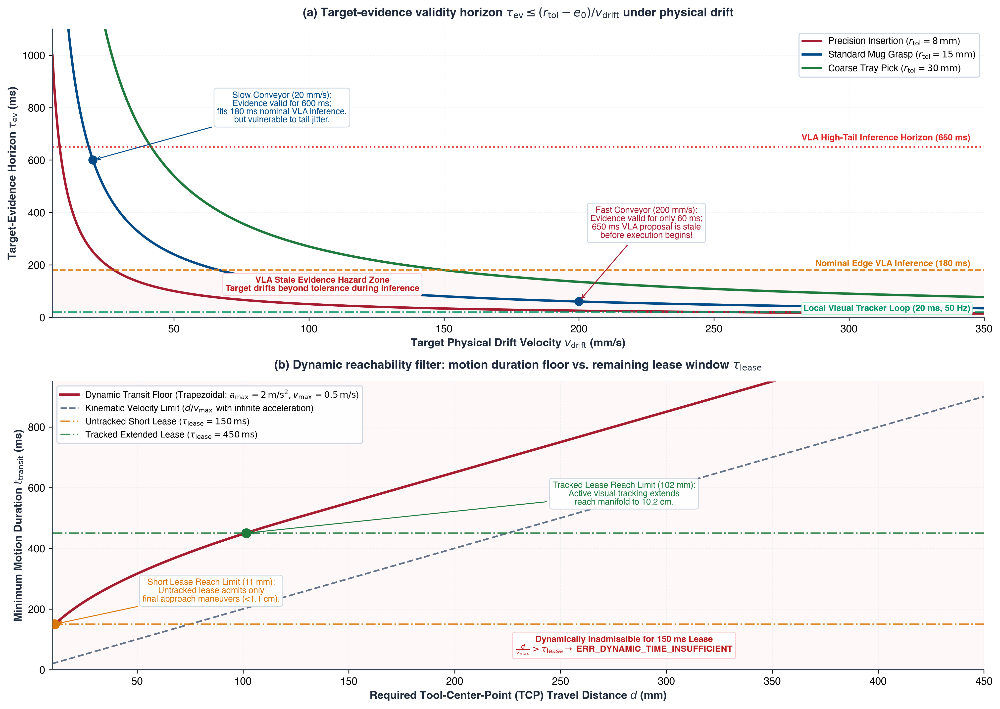
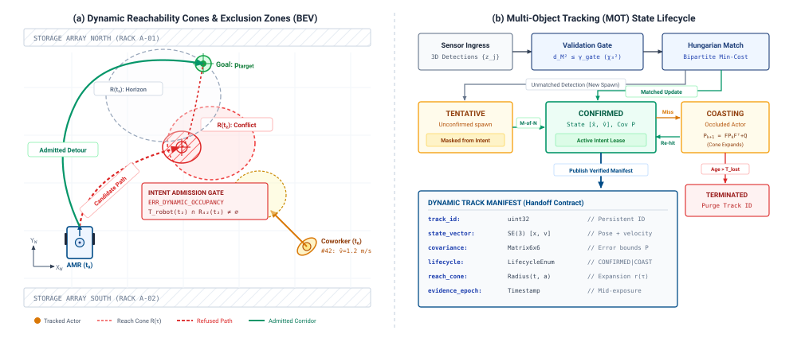

---
format:
  html:
    title: "Grounded Intent"
---

# Grounded Intent {#sec-intent}

::: {layout-narrow}
::: {.column-margin}

\chapterminitoc

:::

::: {.content-visible when-format="pdf"}
\noindent
{fig-alt="Isometric blueprint showing grounded intent: The system comprises several components for grounded intent: a 'task token prism' representing multifaceted AI tasks; a 'deliberative projection beam' signifying the AI’s focus on decision-making pathways; a 'green reachability manifold cone' defining operational limits for effective AI action; an 'inner amber tolerance cylinder' indicating acceptable task execution variances, topped with a 'countdown lease ring' tracking time-sensitive tasks; and an 'emergency expiration tripwire interlock' ensuring the system responds to critical failures."}
:::

::: {.content-visible unless-format="pdf"}
{fig-alt="Isometric blueprint showing grounded intent: floating multifaceted task token prism, deliberative projection beam, green reachability manifold cone, inner amber tolerance cylinder topped with a countdown lease ring, and emergency expiration tripwire interlock."}
:::

:::

## Purpose {.unnumbered .unlisted}

::: {.content-visible when-format="pdf"}
\begin{marginfigure}
\resizebox{0.92\linewidth}{!}{\mlphysicalstackfull{100}{20}{20}{20}{20}}
\end{marginfigure}
:::

_What must an autonomous goal carry to prevent a slow reasoning model from holding indefinite authority over a moving machine?_

High-level semantic directives such as "stow the parcel in the bin" specify human objectives but convey zero information regarding physical feasibility, collision clearance, or actuator limits. If a slow deliberative reasoning model issues an unconstrained goal, unexpected obstacles or changing human positions can render that objective dangerous while the model deliberates its next update. Physical AI resolves this by bounding goals through explicit intent specifications: lineage-verified, spatially bounded, and time-leased goal sets that define authorized spatial volumes and terminate automatically if the reasoning model fails to refresh them before its lease expires.


::: {.callout-learning-objectives}

- Ground natural-language directives into metric affordance frames, motion predicates, and verified geometric goal sets
- Emit the Intent Specification contract from parent belief records with explicit error envelopes, task tolerances, and effort ceilings
- Derive a target-evidence horizon from task tolerance and target drift, and distinguish it from the stopping deadline
- Decide when grounding ambiguity or a wrong-object premise requires refusal rather than admission
- Evaluate whether a proposed goal is reachable within its remaining evidence window
- Design lease expiry that revokes motion authority even when the issuing process cannot cancel it

:::

## Grounded Affordances {#sec-intent-grounded-affordances}

When the warehouse mobile manipulator is told to "pick the red mug" from the takeaway conveyor, the directive specifies an outcome but leaves path, force, and deadline unresolved. A motor inverter accepts electrical commands, not language. Vision-Language-Action (VLA) models [@brohan2023rt1; @brohan2023rt2] can propose actions or targets, but their update cadence depends on the model and hardware and may be much slower than local control. If a target moves during inference, a stale proposal can consume clearance. The system therefore needs dated geometric evidence, bounded requests, and an independent permission path that can withdraw authority while the model is silent.

To an engineer trained on digital vision-language models, the directive "pick the mug" might sound like a solved classification task: an attention map highlights the mug, and a decoder outputs an action token. In embodied physics, however, grasping a mug is not a single point; it is an action-relative relation governed by geometric **affordances**\index{Affordances!grasp envelopes} [@gibson1979ecological]. Each functional feature on an object establishes an **affordance coordinate frame** $\mathcal{F}_{\text{affordance}}$ rigidly attached to the object's body frame $\mathcal{F}_{\text{obj}}$. For the red mug, the rim affordance frame $\mathcal{F}_{\text{rim}}$ requires low gripping force to avoid crushing fragile ceramic or spilling liquid; the cylindrical body frame $\mathcal{F}_{\text{body}}$ requires wide parallel finger span and high normal force to prevent slipping; the handle affordance frame $\mathcal{F}_{\text{handle}}$ requires a six-degree-of-freedom (6-DoF) approach vector that aligns the gripper fingers with the ear of the mug while respecting joint reachability limits.

Intent grounding bridges this chasm by translating high-level semantic directives into continuous **motion predicates**\index{Motion predicates!definition} evaluated over these metric coordinate frames:

1. *Pre-contact approach predicate:* $P_{\text{approach}}(\mathbf{x}) \iff \|\mathbf{p}_{\text{TCP}} - \mathbf{p}_{\text{pre}}\| \le r_{\text{tol}} \land \arccos(\hat{\mathbf{z}}_{\text{TCP}} \cdot \hat{\mathbf{a}}_{\text{approach}}) \le \theta_{\text{tol}}$, requiring the end effector tool center point (TCP) frame $\mathcal{F}_{\text{TCP}}$ to align with the affordance approach axis $\hat{\mathbf{a}}_{\text{approach}}$ within spatial tolerance $r_{\text{tol}}$ and angular tolerance $\theta_{\text{tol}}$.
2. *Guarded contact predicate:* $P_{\text{contact}}(\mathbf{w}) \iff f_{\min} \le \|\mathbf{f}_{\text{contact}}\| \le f_{\max}$, ensuring that contact forces remain sufficient for friction grip while strictly bounded below structural crush limits.
3. *Spatial clearance predicate:* $P_{\text{clear}}(\mathbf{x}, \mathcal{M}) \iff \min_{\mathbf{o} \in \mathcal{M}} \|\mathbf{x} - \mathbf{o}\| \ge d_{\text{margin}}$, verifying collision-free swept volume against the spatial memory state $\mathcal{M}$ (@sec-memory).

Together, these predicates bound the allowable terminal configurations into a formal **geometric goal set** $\mathcal{G}_{\text{goal}} \subset SE(3)$\index{SE(3)!target goal set}:
$$\mathcal{G}_{\text{goal}} = \left\{ \mathbf{T} = (\mathbf{R}, \mathbf{p}) \in SE(3) \;\middle|\; \|\mathbf{p} - \mathbf{p}_{\text{target}}\|_{\mathbf{E}} \le 1, \; \angle(\mathbf{R}, \mathbf{R}_{\text{target}}) \le \theta_{\text{tol}} \right\}$$ {#eq-intent-goal-set-se3}
where $\|\mathbf{p} - \mathbf{p}_{\text{target}}\|_{\mathbf{E}} = \sqrt{\sum_{i \in \{x,y,z\}} \left(\frac{p_i - p_{\text{target},i}}{r_i}\right)^2}$ denotes spatial containment within the task tolerance ellipsoid with principal semi-axes $\mathbf{r} = (r_x, r_y, r_z)$, and $\angle(\mathbf{R}, \mathbf{R}_{\text{target}}) = \arccos\left(\frac{\operatorname{tr}(\mathbf{R}^\top \mathbf{R}_{\text{target}}) - 1}{2}\right)$ bounds geodesic orientation divergence on $SO(3)$. If a controller attempts to command an end-effector pose outside $\mathcal{G}_{\text{goal}}$, the physical task fails: position error exceeding $r_i$ causes the gripper fingers to strike the mug rim or close on empty air, while angular tilt beyond $\theta_{\text{tol}}$ jams the fingers against the handle opening, tripping joint torque monitors or shattering the workpiece.

Before any candidate affordance is packaged into an intent proposal, the system executes **affordance validation**\index{Affordances!validation}. The intent engine evaluates whether the candidate frame $\mathcal{F}_{\text{affordance}}$ is kinematically reachable within the manipulator's workspace manifold $\mathcal{W}$, whether the gripper jaw aperture clears the object width, and whether a collision-free approach cone exists. If validation fails or candidate referents remain unresolved, the system must not execute an ungrounded guess; it triggers an explicit **intent grounding refusal**\index{Intent grounding refusal!definition} (`ERR_GROUNDING_AMBIGUITY`).

::: {.column-margin .margin-pointer}
↩ The belief record a lease consumes (evidence epoch, initial error, growth law) is specified in @sec-memory-spatial-state-schema.
:::

Memory can supply a spatial belief with an expiry (@sec-memory-belief-through-occlusion); it cannot decide what action that belief authorizes. **Intent**\index{Intent} closes that gap by connecting high-level task semantics to a bounded physical goal. It specifies an admissible, time-bounded target before the trajectory planner of @sec-planning constructs a continuous motion profile to reach it.

Connecting words to physical targets is the robotics form of what Harnad termed the **symbol grounding problem**\index{Symbol grounding problem} [@harnad1990symbol]: purely symbolic or linguistic tokens within a computational system have no intrinsic physical meaning unless causally grounded in non-symbolic, sensorimotor interactions with the physical environment.[^fn-intent-symbol-grounding] Whereas early artificial intelligence systems such as Winograd's SHRDLU [@winograd1972] operated inside closed-world blocks domains with synthetic, analytic geometries,[^fn-std-strips-planning] modern physical AI systems must ground open-vocabulary instructions into continuous, dynamic, and uncertain physical spaces.[^fn-intent-affordance-space]

[^fn-intent-symbol-grounding]: **Symbol Grounding Problem**\index{Symbol Grounding Problem}: Stevan Harnad's 1990 formulation argues that syntactic manipulation alone does not give symbols intrinsic meaning. In physical AI, grounding binds a proposed label to dated sensor evidence, calibrated metric frames, and task-specific physical checks. Without that binding, a planner may optimize toward the wrong physical target.

[^fn-std-strips-planning]: **Classical STRIPS planning**\index{Planning!STRIPS}\index{STRIPS planning}: Classical planning represents goals as logical predicates in a modeled world. Dynamic obstacles and sensor dropouts can invalidate a physical target before its planned use.

[^fn-intent-affordance-space]: **Affordance space parameterization**\index{Affordances!spatial parameterization}: In robot learning, affordances are parameterized as continuous spatial probability fields or reachability manifolds over the Lie group $SE(3)$. Parameterizing reachability as an explicit manifold enables low-level controllers to evaluate physical feasibility before invoking computationally intensive trajectory optimizers.

::: {#dfn-intent-grounding-refusal .callout-definition title="Intent grounding refusal"}

***Intent grounding refusal***\index{Intent grounding refusal!definition}\index{Refusal!grounding ambiguity} is the admission rule whereby an embodied system explicitly rejects semantically ambiguous natural-language directives, returning a typed failure status (`ERR_GROUNDING_AMBIGUITY`) rather than executing ungrounded maximum-likelihood guesses across physical clearance margins.

1.  **Significance**: Rejects a proposal when a task-specific ambiguity test (@sec-intent-failure-modes) fails, before that proposal reaches trajectory generation.
2.  **Distinction**: Unlike a trajectory planning failure that cannot find a collision-free path to a valid goal, grounding refusal rejects the goal itself as physically ungrounded or ambiguous before the planner is invoked.
3.  **Common pitfall**: Forcing an argmax token decode or nearest-neighbor guess when candidate referents remain unresolved, driving the physical plant toward an arbitrary or hazardous target.

:::

Whatever the model proposes must also remain bounded in time. @Fig-intent-frequency-gap gives a schedule in which a slow deliberative model, local tracker, permission loop, and drive run at different rates. A common misconception among machine learning practitioners is that compiling or distilling a vision-language-action policy (via INT4 quantization, speculative decoding, or TensorRT) to run at $50\text{ Hz}$ eliminates the need for modular intent leases. However, average throughput on an edge operating system does not guarantee deterministic real-time deadlines: Linux scheduling jitter, memory bus contention, and sensor dropouts create severe tail latency ($P_{99} \gg P_{50}$). More fundamentally, an unconstrained statistical neural network lacks formal mathematical bounds against hallucinating full-scale reverse torque steps or out-of-bounds reach requests. Accelerating neural throughput changes execution speed, not epistemic trust; tail jitter, sensor dropouts, and non-Lipschitz neural hallucinations still require an independent deterministic safety gate armed with monotonic countdown leases. A conveyor target whose evidence expires within tens of milliseconds cannot be renewed by a model updating every few hundred milliseconds, so it requires a separate validated local observation path or a task pause. The figure's rates are illustrative, and @sec-intent-goals-expire sets the machine's own intent cadence against the conveyor horizon.

::: {#fig-intent-frequency-gap fig-env="figure" fig-pos="htb" fig-cap="**Multi-rate schedule**: Four illustrative rates show why a deliberative proposal cannot act as a motor or permission-loop heartbeat. The schedule does not relate model size to frequency. The local tracker can renew target evidence only if its sensor and error bounds are independently validated. The machine's own tiers are those of @sec-nervous-cadences; the machine's intent model runs faster than the deliberative rate shown, and the chunk policy is omitted here." fig-alt="Horizontal log-scale chart of four frequencies: drive current loop 20 kilohertz, independent permission loop 1 kilohertz, local target tracker 50 hertz, and deliberative proposal 2 hertz."}

```{python}
#| echo: false
#| warning: false
#| message: false
# ┌─────────────────────────────────────────────────────────────────────────────┐
# │ Plot the four-rate schedule from the chapter-local CSV.                     │
# │ No point is a model or hardware benchmark.                                  │
# └─────────────────────────────────────────────────────────────────────────────┘
import pandas as pd
from mlsysim import viz

data = pd.read_csv("vol4/10_intent/data/frequency_gap_trends.csv")  # category: illustrative
fig, ax, COLORS, plt = viz.setup_plot(figsize=(8, 4.5))
colors = ["#334155", "#1d4ed8", "#0f766e", "#b45309"]
ax.barh(data["Stage"], data["Frequency_Hz"], color=colors, height=0.58)
ax.set_xscale("log")
ax.set_xlim(1, 50000)
ax.invert_yaxis()
ax.set_xlabel("Update frequency (Hz)")
for row in data.itertuples():
    ax.text(row.Frequency_Hz * 1.13, row.Index, f"{row.Frequency_Hz:,} Hz", va="center", fontsize=9)
ax.grid(axis="x", alpha=0.2)
plt.tight_layout()
plt.show()
plt.close()
```

:::

::: {.column-margin .margin-pointer}
↩ The proposal boundary and the permission path are defined in @sec-boundary-machine-model.
:::

Grounding an open-ended directive therefore ends in a dated **intent proposal**, which the application processor sends across the proposal boundary. It requests bounds in space, time, and effort, and the independent permission path tests each against configured limits, current state, and stopping clearance before motion begins.

## The Intent Handoff and Bounded Authority {#sec-intent-handoff}

When the arm reaches for the red mug, the Brain sends neither joint trajectories nor winding voltages across the proposal boundary. It sends a request for bounded authority, and the permission path must be able to check every part of it before it grants any of it. The checks are target tolerance, evidence validity, requested effort, and a feasible fallback, and each exists because a delayed proposal can fail in a different way. In the machine stack's contract lineage, this handoff is formalized as the **Intent Specification** (Contract 9). Emitted downstream to the trajectory planner (@sec-planning) as an admitted **Intent Lease** record, it provides certified geometric goal sets, affordance frame bindings, and verified motion predicates that constrain continuous spline generation. @Sec-intent-lease details the schema and lineage of this record.

```{python}
#| label: calc-intent-lease-duration-collision-exposure
#| echo: false
#| warning: false
#| message: false
# ┌─────────────────────────────────────────────────────────────────────────────┐
# │ The running machine's intent horizons, the arm's transit lower bound, the   │
# │ mug intent lapse and its arm stop onset, the latch contact at brake command,│
# │ and the Class 3 plant.                                                      │
# └─────────────────────────────────────────────────────────────────────────────┘
from mlsysim import *
from mlsysim.core.units import *
from mlsysim.fmt import (
    fmt_latency,
    fmt_length,
    fmt_velocity,
    fmt_acceleration,
    fmt_frequency,
    fmt_force,
    fmt_force_rate,
    fmt_heat_capacity,
    fmt_power,
    fmt_temperature,
    fmt_temperature_rate,
    fmt_sci_qty,
    check,
)
from mlsysim.physics.robotics import (
    calc_target_evidence_horizon,
    calc_latch_contact_stopping_profile,
    calc_contact_force,
)

# ┌── 1. LOAD: the running machine, plus chapter-local scenario inputs ─────────
RM = Embodied.MobileManipulator.WarehouseMobileManipulator  # category: illustrative (running machine)
AISLE = Embodied.Scenario.WarehouseAisle  # category: illustrative (aisle scene; lease chosen)

delta_t_stall_intent = 200.0 * millisecond  # category: illustrative (stalled proposer holds the mug target)
delta_t_stall_arm = 200.0 * millisecond  # category: illustrative (unbraked contact interval)
v_drift_slow = 20.0 * millimeter / second  # category: illustrative (slow-drift case in the figure)
t_intent_tail = 650.0 * millisecond  # category: illustrative (high-tail intent inference, as in the figure)
d_target_offset = 300.0 * millimeter  # category: illustrative (scenario assumption: gripper-to-handle distance at proposal)

# ┌── 2. EXECUTE: evidence horizons, mug intent lapse, latch contact ───────────
# Mug on the conveyor: untracked and tracked target-evidence horizons. Both
# horizons charge the 3 mm initial error against the 15 mm tolerance.
grasp_error_budget = (AISLE.grasp_tolerance - AISLE.grasp_initial_error).to(millimeter)
tau_ev_untracked = calc_target_evidence_horizon(AISLE.grasp_tolerance, AISLE.grasp_initial_error, AISLE.v_conveyor).to(millisecond)
tau_ev_tracked = ((2 * grasp_error_budget / AISLE.a_conveyor_slip) ** 0.5).to(millisecond)
t_intent_period = (1.0 / RM.intent_rate).to(millisecond)
err_at_intent_period = (AISLE.grasp_initial_error + AISLE.v_conveyor * t_intent_period).to(millimeter)
err_excess_at_period = (err_at_intent_period - AISLE.grasp_tolerance).to(millimeter)
t_tail_overrun = (t_intent_tail - tau_ev_untracked).to(millisecond)
tau_ev_slow_drift = calc_target_evidence_horizon(AISLE.grasp_tolerance, AISLE.grasp_initial_error, v_drift_slow).to(millisecond)

# Dynamic reachability: the TCP speed ceiling bounds the reach inside the tracked
# horizon, and a proposal farther away fails the transit lower bound.
d_reach_tracked = (RM.tcp_speed_limit * tau_ev_tracked).to(millimeter)
d_reach_untracked = (RM.tcp_speed_limit * tau_ev_untracked).to(millimeter)
t_transit_floor = (d_target_offset / RM.tcp_speed_limit).to(millisecond)

# Mug intent lapse: a stalled proposer holds the target; untracked drift at the
# conveyor speed, tracked drift from residual slip only; arm stop onset after
# intent expiry is one permission tick, one bus cycle, and the brake onset.
err_stalled_untracked = (AISLE.grasp_initial_error + AISLE.v_conveyor * delta_t_stall_intent).to(millimeter)
err_stalled_tracked = (AISLE.grasp_initial_error + 0.5 * AISLE.a_conveyor_slip * delta_t_stall_intent**2).to(millimeter)
t_arm_onset_after_expiry = (AISLE.t_tick + AISLE.t_bus + AISLE.t_brake_onset).to(millisecond)

# Latch contact: force at brake command, then the arm stop that keeps it under the limit.
latch_profile = calc_latch_contact_stopping_profile(scenario=AISLE)
df_dt = latch_profile["df_dt"]
f_at_brake_onset = latch_profile["f_at_brake_onset"]
x_remaining = latch_profile["x_remaining"]
a_arm_needed = latch_profile["a_arm_needed"]
t_arm_stop = latch_profile["t_arm_stop"]
delta_x_unbounded = (AISLE.v_latch_approach * delta_t_stall_arm).to(millimeter)
f_unbounded = calc_contact_force(AISLE.k_latch, delta_x_unbounded)

# ┌── 3. GUARD: canon values quoted in the prose ──────────────────────────────
check(abs(tau_ev_untracked.magnitude - 60.0) < 1e-6, "Untracked mug horizon is 60 ms")
check(abs(tau_ev_tracked.magnitude - 219.09) < 5e-3, "Tracked mug horizon is 219 ms")
check(abs(grasp_error_budget.magnitude - 12.0) < 1e-6, "Mug error budget is 12 mm")
check(abs(err_stalled_untracked.magnitude - 43.0) < 1e-6, "Stalled untracked target sits 43 mm off")
check(abs(err_stalled_tracked.magnitude - 13.0) < 1e-6, "Stalled tracked target sits 13 mm off")
check(abs(t_arm_onset_after_expiry.magnitude - 22.0) < 1e-6, "Arm stop onset within 22 ms of intent expiry")
check(abs(RM.tcp_speed_limit.to(meter / second).magnitude - 1.0) < 1e-9, "TCP speed ceiling is 1.0 m/s")
check(abs(t_intent_period.magnitude - 200.0) < 1e-6, "5 Hz intent period is 200 ms")
check(abs(err_at_intent_period.magnitude - 43.0) < 1e-6, "Error at the intent period")
check(abs(tau_ev_slow_drift.magnitude - 600.0) < 1e-6, "Slow-drift horizon in the figure")
check(abs(t_tail_overrun.magnitude - 590.0) < 1e-6, "Tail overrun past the untracked horizon is 590 ms")
check(abs(d_reach_tracked.magnitude - 219.09) < 5e-3, "TCP reach inside the tracked horizon is 219 mm")
check(abs(d_reach_untracked.magnitude - 60.0) < 1e-6, "TCP reach inside the untracked horizon is 60 mm")
check(abs(t_transit_floor.magnitude - 300.0) < 1e-6, "Transit floor for the offset proposal is 300 ms")
check(t_transit_floor > tau_ev_tracked, "Offset proposal fails the transit lower bound")
check(abs(AISLE.t_lease.to(millisecond).magnitude - 60.0) < 1e-9, "Chunk lease is 60 ms")
check(abs(f_at_brake_onset.to(newton).magnitude - 39.0) < 1e-9, "Force at brake command")
check(abs(x_remaining.magnitude - 0.1525) < 5e-5, "Latch compression left is 0.15 mm")
check(abs(a_arm_needed.magnitude - 2.95) < 5e-3, "Arm stop premise is about 3 m/s^2 (2.95)")
check(abs(t_arm_stop.magnitude - 10.0) < 0.5, "Arm stop takes about 10 ms")
check(abs(f_unbounded.to(newton).magnitude - 2400.0) < 1.0, "Unbraked contact model")

# ┌── 4. OUTPUT: rendered values ──────────────────────────────────────────────
class IntentLeaseArchetypes:
    # Mug on the conveyor
    v_conveyor_str = fmt_velocity(AISLE.v_conveyor, unit=meter / second, precision=2)
    r_tol_str = fmt_length(AISLE.grasp_tolerance, unit=millimeter, precision=0)
    e0_str = fmt_length(AISLE.grasp_initial_error, unit=millimeter, precision=0)
    tau_untracked_str = fmt_latency(tau_ev_untracked, unit=millisecond, precision=0)
    tau_tracked_str = fmt_latency(round(tau_ev_tracked.magnitude) * millisecond, unit=millisecond, precision=0)
    a_slip_str = fmt_acceleration(AISLE.a_conveyor_slip, unit=meter / second**2, precision=2)
    f_intent_str = fmt_frequency(RM.intent_rate, unit=hertz, precision=0)
    t_intent_period_str = fmt_latency(t_intent_period, unit=millisecond, precision=0)
    t_intent_infer_str = fmt_latency(RM.intent_inference_latency, unit=millisecond, precision=0)
    err_at_period_str = fmt_length(err_at_intent_period, unit=millimeter, precision=0)
    err_excess_str = fmt_length(err_excess_at_period, unit=millimeter, precision=0)
    v_drift_slow_str = fmt_velocity(v_drift_slow, unit=millimeter / second, precision=0)
    tau_slow_drift_str = fmt_latency(tau_ev_slow_drift, unit=millisecond, precision=0)
    t_intent_tail_str = fmt_latency(t_intent_tail, unit=millisecond, precision=0)
    t_tail_overrun_str = fmt_latency(round(t_tail_overrun.magnitude) * millisecond, unit=millisecond, precision=0)
    # Dynamic reachability on the arm
    d_reach_tracked_str = fmt_length(round(d_reach_tracked.magnitude) * millimeter, unit=millimeter, precision=0)
    d_reach_untracked_str = fmt_length(d_reach_untracked, unit=millimeter, precision=0)
    d_target_str = fmt_length(d_target_offset, unit=millimeter, precision=0)
    t_transit_floor_str = fmt_latency(t_transit_floor, unit=millisecond, precision=0)
    # Mug intent lapse and the admitted mug lease
    err_budget_str = fmt_length(grasp_error_budget, unit=millimeter, precision=0)
    t_stall_intent_str = fmt_latency(delta_t_stall_intent, unit=millisecond, precision=0)
    err_stalled_untracked_str = fmt_length(err_stalled_untracked, unit=millimeter, precision=0)
    err_stalled_tracked_str = fmt_length(err_stalled_tracked, unit=millimeter, precision=0)
    t_arm_onset_str = fmt_latency(t_arm_onset_after_expiry, unit=millisecond, precision=0)
    v_tcp_str = fmt_velocity(RM.tcp_speed_limit.to(meter / second))
    # Latch contact
    k_latch_str = fmt_sci_qty(AISLE.k_latch, newton / meter, precision=1)
    v_latch_str = fmt_velocity(AISLE.v_latch_approach, unit=meter / second, precision=2)
    f_trip_str = fmt_force(AISLE.f_latch_tripwire, precision=0)
    t_contact_str = fmt_latency(AISLE.t_contact_response, unit=millisecond, precision=0)
    df_dt_nms_str = fmt_force_rate(df_dt, unit=newton / millisecond, precision=0)
    f_at_brake_onset_n_str = fmt_force(f_at_brake_onset, precision=0)
    f_lim_str = fmt_force(AISLE.f_latch_limit, precision=0)
    x_remaining_str = fmt_length(round(x_remaining.magnitude, 2) * millimeter, unit=millimeter, precision=2)
    a_arm_str = fmt_acceleration(round(a_arm_needed.magnitude) * meter / second**2, unit=meter / second**2, precision=0)
    t_arm_stop_str = fmt_latency(round(t_arm_stop.magnitude) * millisecond, unit=millisecond, precision=0)
    t_stall_arm_str = fmt_latency(delta_t_stall_arm, unit=millisecond, precision=0)
    delta_x_unbounded_mm_str = fmt_length(delta_x_unbounded, unit=millimeter, precision=0)
    f_unbounded_n_str = fmt_force(f_unbounded, precision=0, commas=True)
    # Permission loop
    f_permission_str = fmt_frequency(RM.permission_rate, unit=ureg.kHz, precision=0)
```

In physical manipulation, an isolated coordinate is incomplete. In Gibson's sense, an affordance is an action-relative relation among geometry, robot reach, and contact limits [@gibson1979ecological]. The intent proposal therefore requests a target pose in $SE(3)$, the space of three-dimensional positions and orientations, and a **task tolerance region**\index{Tolerance region!3D spatial}\index{Intent record!spatial tolerance region} within which the task counts as complete. This tolerance differs from the estimator's covariance, which describes uncertainty about the target. For the machine's mug grasp, the approved task profile allows `{python} IntentLeaseArchetypes.r_tol_str` of translational error. A controller can then terminate within that region rather than integrating forever toward an exact noisy point; it still checks that estimated target error fits inside the tolerance.

Spatial validity in the physical world is transient. A physical goal therefore carries an evidence epoch and a finite requested expiry\index{Intent record!temporal lease} rather than relying on an asynchronous cancellation message[^fn-anti-async-abort] from the reasoning layer. A model that produces a new result only once per period cannot, even before jitter, renew a target whose evidence stays valid for less than that period. An independent permission controller evaluates the admitted deadline on each control cycle and drops tracking when the evidence or lease expires. It selects a configured hold or stop only when the measured state and remaining clearance make that response feasible.[^fn-std-iso-watchdog] The local timer removes dependence on a host abort packet; the stopping distance remains a separate physical obligation.

[^fn-std-iso-watchdog]: **Hardware watchdog safety monitors**\index{Hardware!watchdog timer}\index{Safety standards!ISO 13849}: A safety design can use an independently clocked watchdog to detect missed renewals and initiate a validated response without the host. Safe Torque Off removes drive torque; it does not by itself hold a suspended load or stop moving mass within a specified clearance.

[^fn-anti-async-abort]: **Asynchronous Safety Event Dispatch**\index{Antipatterns!asynchronous safety cancellation}: Relying on asynchronous cancellation messages or network event dispatch to abort motion introduces non-deterministic queue serialization delays, and every millisecond of that delay is unbraked travel at the base's drive limit. A local countdown can revoke tracking authority on missed renewal.

A target bounded in space and time is hazardous if the controller is allowed unlimited physical effort. The intent proposal therefore requests effort ceilings\index{Intent record!force limits} on speed, acceleration, and contact wrench. A model may place a target slightly behind the surface it must touch because of stereo disparity error; a stiff position controller can then command excessive restoring torque. For the arm's guarded approach to the spring-latched cage door, the proposal might request the `{python} IntentLeaseArchetypes.f_trip_str` tripwire as its contact-force ceiling, well below the `{python} IntentLeaseArchetypes.f_lim_str` latch limit, and the `{python} IntentLeaseArchetypes.v_latch_str` approach speed as its speed cap. The permission path compares each request with independently configured actuator and task ceilings, then admits only a feasible subset. The low-level **impedance controller**\index{Impedance controller}[^fn-ctrl-impedance-intent] enforces the admitted limits.

[^fn-ctrl-impedance-intent]: **Mechanical impedance regulation**\index{Control systems!impedance control}: Impedance control regulates the relation between contact force and motion through effective mass, damping, and stiffness. It can reduce loads within a validated contact regime; the first impact and peak force still depend on approach speed, passive compliance, sensing, and actuator response.

Omitting any of these three bounds leaves a machine exposed during communication dropouts or perception stalls. Stopping distance grows linearly with the delay before braking and quadratically with speed (@eq-body-stopping-distance). On the moving base, whose stopping budget is a distance, a stalled proposer lengthens the delay term by the time its last proposal keeps authority. That time is the chunk lease of @sec-nervous-cadences, and it enters $\tau_{\text{delay}}$. Clearance holds only if an independently checked obstacle boundary lies beyond the stopping distance, with model and sensing margins added.

The intent lease is a different object. It bounds how long a target stays justified, and its expiry withdraws the target and ends tracking at once, without adding a term to the base's stopping budget.

::: {#nbk-intent-lease-duration-collision-exposure-tradeoff-across .callout-notebook title="Lapsed authority and physical response"}

The two models below answer different questions. A stopping calculation needs the total delay to brake onset and the deceleration available from the *current* state.

1. **The mug intent lapse:** The arm reaches for the red mug under an intent admitted without local tracking. At `{python} IntentLeaseArchetypes.v_conveyor_str` the conveyor consumes the `{python} IntentLeaseArchetypes.err_budget_str` between the `{python} IntentLeaseArchetypes.e0_str` initial error and the `{python} IntentLeaseArchetypes.r_tol_str` tolerance in `{python} IntentLeaseArchetypes.tau_untracked_str`, so the target's evidence expires then, as the mug-handle belief record of @sec-memory-spatial-state-schema states. Suppose the application processor stalls. A target held for `{python} IntentLeaseArchetypes.t_stall_intent_str` by the stalled proposer would sit `{python} IntentLeaseArchetypes.err_stalled_untracked_str` from the mug. The lease does not wait for the proposer. At `{python} IntentLeaseArchetypes.tau_untracked_str` the intent expires, the arm's tracking authority ends, and the arm enters a stop matched to its current state, with onset within `{python} IntentLeaseArchetypes.t_arm_onset_str` (one permission tick, one bus cycle, and the brake onset). The chunk lease of @sec-nervous-cadences is the backstop if that expiry is never observed. Under local tracking the same `{python} IntentLeaseArchetypes.t_stall_intent_str` leaves the target `{python} IntentLeaseArchetypes.err_stalled_tracked_str` off, inside the tolerance, because the tracked horizon derived in @sec-intent-goals-expire is `{python} IntentLeaseArchetypes.tau_tracked_str`; tracking is what makes the `{python} IntentLeaseArchetypes.f_intent_str` intent refresh viable.
2. **The arm at the cage door:** In mechanical contact with stiff physical environments, contact force does not rise gradually; for contact stiffness $k$, force escalates at the rate $\frac{df}{dt} = k \cdot v_{\text{approach}}$. At the guarded approach speed of `{python} IntentLeaseArchetypes.v_latch_str` against the `{python} IntentLeaseArchetypes.k_latch_str` strike plate of the cage door, modeled force rises at `{python} IntentLeaseArchetypes.df_dt_nms_str` ($20\text{ N/ms}$). A `{python} IntentLeaseArchetypes.f_trip_str` tripwire and `{python} IntentLeaseArchetypes.t_contact_str` contact-loop response yield `{python} IntentLeaseArchetypes.f_at_brake_onset_n_str` **when the brake command begins**; force keeps rising while the arm decelerates. Staying under the `{python} IntentLeaseArchetypes.f_lim_str` latch limit leaves only `{python} IntentLeaseArchetypes.x_remaining_str` of further compression, so the arm must decelerate at about `{python} IntentLeaseArchetypes.a_arm_str` and stop within about `{python} IntentLeaseArchetypes.t_arm_stop_str`. Whether the arm can brake that hard from the approach is an open premise, which only arm stopping trials can settle. Unbraked motion for `{python} IntentLeaseArchetypes.t_stall_arm_str` advances `{python} IntentLeaseArchetypes.delta_x_unbounded_mm_str` and gives `{python} IntentLeaseArchetypes.f_unbounded_n_str` in the linear-spring model, far past the latch limit.
:::

These two examples clarify the division of authority. High-level reasoning can propose a target, time window, and effort ceiling. The independent permission path determines which limits are admissible from measured state, configured ceilings, and a feasible fallback. Local control then tracks only an admitted proposal and withdraws authority on invalid evidence or expiry. This resembles the priority separation of the **subsumption architecture**\index{Subsumption architecture}[^fn-ai-subsumption-intent] [@brooks1986robust].

[^fn-ai-subsumption-intent]: **Subsumption architecture principles**\index{Architecture!subsumption}\index{Control!subsumption}: Rodney Brooks's subsumption architecture decomposed autonomous robotics into asynchronous, priority-arbitrated behavioral layers operating on sensory feedback. Here, the learned layer proposes a bounded target while an independent controller checks permission and executes a validated response on expiry.

Grounding an intent proposal into these three bounds requires a formal transformation from ambiguous sensory inputs into structured, verifiable proposals. When a system processes a high-level directive or a sequence of visual tokens, the initial proposal is rarely a single, unambiguous set of coordinates. It begins as an uncertain geometric hypothesis that must carry its own spatial ambiguity and its own temporal limits before it can be admitted to the execution pipeline.

## Semantic Request Translation to Geometric Proposals {#sec-intent-request-to-proposal}

A natural language instruction becomes dangerous when an unverified semantic hypothesis commands motion. When an operator or high-level supervisor asks for the red mug, an onboard vision-language model parses the character stream, projects image features into a shared embedding space, and selects a candidate visual bounding region. From those pixels, the network extracts an estimated pose in $SE(3)$ and writes coordinate values into a memory buffer. At the proposal boundary (@sec-boundary-machine-model), an ungrounded string of tokens becomes a requested destination; if admitted, it reaches the causal boundary as mass, velocity, and current.[^fn-math-semantic-metric]

If the visual backbone associates the language token with an adjacent fixture or an unlabeled calibration target, the resulting coordinate vector $\mathbf{p} \in \mathbb{R}^3$ enters the trajectory pipeline as an authoritative physical goal. Because a low-level motor drive measures only encoder pulses, winding temperatures, and phase currents, it cannot evaluate whether the coordinate it tracks corresponds to the intended mug or to an empty stretch of belt.[^fn-math-vlm-lipschitz] Furthermore, extrinsic transform errors ($\Delta \mathbf{T}_{\text{base} \leftarrow \text{cam}}$) arising from wrist mounting compliance, mechanical payloads, thermal expansion, or link elasticity propagate directly into metric goal bias. High semantic confidence from a vision backbone masks underlying geometric calibration drift, reinforcing why the proposal must carry conservative base-frame error bounds rather than raw point coordinates. The grounding process must produce an explicit geometric proposal that includes spatial uncertainty, selection evidence, and temporal expiration before any motion planner accepts it.

[^fn-math-semantic-metric]: **Semantic-to-metric transformation**\index{Kinematics!semantic-to-metric}\index{Grounding!metric mapping}: Projecting discrete linguistic embeddings into continuous $SE(3)$ coordinates requires an unbroken coordinate calibration chain from image pixels to actuator base frames. Unmodeled camera mounting compliance or lens distortion maps semantic attention peaks into systematic metric offsets. If the transformation chain lacks rigid extrinsic calibration, high semantic confidence produces large physical tracking errors at the end effector.

[^fn-math-vlm-lipschitz]: **Learned-output sensitivity**\index{Neural network!Lipschitz continuity}\index{Safety!Lipschitz bounds}: A learned pose estimate can change substantially when the image or scene changes, and an empirical confidence score does not bound that change. The permission path limits the admitted target and motion using independently checked geometry, state, and actuator constraints.

### The four-stage open-vocabulary grounding pipeline {#sec-intent-four-stage-pipeline}

To systematize the wide variety of modern foundation-model-driven robotics frameworks—ranging from task-ranking networks [@ahn2022saycan] and code synthesizers [@huang2023voxposer; @liang2023code] to open-vocabulary grasp generators [@liu2024okrobot] and end-to-end vision-language-action policies [@brohan2023rt1; @kim2024openvla]—we formulate the canonical **four-stage open-vocabulary grounding pipeline**:

1. **Stage 1: Multimodal Perception & Visual Feature Encoding**: High-bandwidth visual streams (RGB-D frames from static cameras or eye-in-hand sensors) are ingested alongside proprioceptive joint states. A deep vision backbone (such as a Vision Transformer, CLIP, or ResNet encoder) extracts dense spatial feature pyramids and patch embeddings that encode both geometry and visual texture.
2. **Stage 2: 2D Semantic Referent Selection & Open-Vocabulary Prompt Grounding**: Given an unconstrained natural language prompt (e.g., "pick the red ceramic mug"), cross-attention mechanisms align linguistic tokens with visual patches. Frameworks such as Grounding DINO [@liu2023grounding], OWL-ViT, or PaliGemma predict candidate 2D bounding boxes, segmentation masks, or normalized location tokens identifying candidate physical referents in image pixel space $(u, v)$.
3. **Stage 3: Metric 3D Lifting & Workspace Unprojection**: Using calibrated camera intrinsic parameters $\mathbf{K} \in \mathbb{R}^{3\times3}$ and synchronized optical depth values $z = d(u, v)$, the selected 2D pixel coordinates are lifted into metric camera coordinates: $\mathbf{x}_{\text{cam}} = z \mathbf{K}^{-1} [u, v, 1]^\top$. Applying the rigid extrinsic transform from the camera frame to the robot base frame, $\mathbf{T}_{\text{base} \leftarrow \text{cam}} \in \mathrm{SE}(3)$, transforms the point into base-frame workspace coordinates: $\mathbf{x}_{\text{base}} = \mathbf{T}_{\text{base} \leftarrow \text{cam}} \mathbf{x}_{\text{cam}}$. Any extrinsic calibration bias or optical depth jitter propagates directly into spatial displacement at this stage.
4. **Stage 4: Affordance Parameterization & Candidate Goal Generation**: The lifted metric geometry is converted into actionable manipulation hypotheses. Depending on the architecture, this output may take the form of 6-DoF grasp envelopes with approach cones, continuous 3D attraction/repulsion cost fields [@huang2023voxposer], parameterized motion primitives [@liang2023code], or 256-bin action token distributions [@brohan2023rt1]. Crucially, Stage 4 parameterizes candidate geometric goal sets $\mathcal{G}_{\text{goal}} \subset SE(3)$ around validated affordance frames $\mathcal{F}_{\text{affordance}}$ and specifies the target motion predicates ($P_{\text{approach}}, P_{\text{contact}}, P_{\text{clear}}$) required for task completion.

Across the physical silicon boundary between the non-real-time Linux Application Processor (AP) and the hard real-time Safety MCU, Stage 4 serializes these hypotheses into a fixed-size, statically verified proposal structure (@tbl-10-intent-proposal-fields).

\Needspace{22\baselineskip}

| Field                  | Representation       | Physical semantics                                                                              | Invariant and admission check                                               |             |                                       |
|:-----------------------|:---------------------|:------------------------------------------------------------------------------------------------|:----------------------------------------------------------------------------|-------------|---------------------------------------|
| `evidence_epoch_ns`    | `uint64_t` (ns)      | Sensor capture timestamp $t_0$ from parent belief record                                        | Must match retained belief epoch; reject if stale or unrecorded             |             |                                       |
| `affordance_frame_id`  | `uint32_t` (enum)    | Target coordinate frame $\mathcal{F}_{\text{affordance}}$ (e.g., $\mathcal{F}_{\text{handle}}$) | Must resolve to an approved kinematic frame on the target object            |             |                                       |
| `predicate_mask`       | `uint32_t` (bitmask) | Requested motion predicates ($P_{\text{approach}}, P_{\text{contact}}, P_{\text{clear}}$)       | Verified against task requirements before planner invocation                |             |                                       |
| `target_pose_se3`      | `double[7]`          | Proposed pose $[x, y, z, q_x, q_y, q_z, q_w]$ in robot base frame                               | Finite values; unit quaternion ($\                                          | \mathbf{q}\ | = 1$); within workspace $\mathcal{W}$ |
| `pos_error_envelope_m` | `double[3]` (m)      | Bounded spatial uncertainty semi-axes $(e_x, e_y, e_z)$                                         | Conservative upper bounds on perception uncertainty; $0 \le e_i \le r_i$    |             |                                       |
| `task_tolerance_m`     | `double[3]` (m)      | Allowable goal region semi-axes $(r_x, r_y, r_z)$                                               | Must meet task profile tolerances; defines $\mathcal{G}_{\text{goal}}$      |             |                                       |
| `max_linear_vel_mps`   | `double` (m/s)       | Requested tool center point speed ceiling $v_{\max}$                                            | Clamped to plant ceiling; verified against dynamic transit time             |             |                                       |
| `max_wrench`           | `double[6]` (N, N·m) | Maximum effort ceiling $[F_x, F_y, F_z, \tau_x, \tau_y, \tau_z]$                                | Must not exceed structural yield or sensor saturation limits                |             |                                       |
| `lease_duration_ms`    | `uint32_t` (ms)      | Requested operational validity horizon $\tau_{\text{lease}}$                                    | Clamped to target-evidence horizon $\tau_{\text{ev}}$ and stopping deadline |             |                                       |
| `fallback_policy_id`   | `uint32_t` (enum)    | Advisory terminal mode (`HOLD`, `STOP`, `TORQUE_OFF`)                                           | Advisory only; Safety MCU overrides based on load and contact state         |             |                                       |

: **Untrusted intent proposal fields**: Layout and validation invariants of the candidate proposal transmitted from the Application Processor across the proposal boundary. {#tbl-10-intent-proposal-fields tbl-colwidths="[20,17,33,30]"}

None of these outputs, regardless of model size or prompt engineering, constitutes a certified target. SayCan [@ahn2022saycan] multiplies a large language model (LLM)'s semantic prior by a learned value function for each pretrained skill, providing a task ranking conditioned on training data rather than a physical safety veto. VoxPoser [@huang2023voxposer] (@fig-10-real-grounded-affordance-franka) has an LLM generate Python code that rasterizes 3D attraction and repulsion value maps in voxel space, yet gradient descent over a cost map guarantees neither collision freedom nor joint torque limits. Code as Policies [@liang2023code] writes reactive control scripts that call perception APIs, yet a generated script can enter an infinite loop or stall on edge cases. OK-Robot [@liu2024okrobot] (@fig-10-real-open-vocab-grounding) filters candidate grasps using language-conditioned masks, producing a candidate 6-DoF pose without an execution lease or stopping guarantee. @Tbl-10-grounding-paradigms summarizes what each paradigm emits and what the downstream physical permission path must independently verify.

::: {#fig-10-real-grounded-affordance-franka fig-env="figure" fig-pos="t" fig-cap="**Manipulator 3D affordance grounding via synthesized value maps**: VoxPoser composes language-guided 3D value maps for robotic manipulation tasks [@huang2023voxposer]. An LLM generates code that establishes 3D attraction fields (green) pulling the end effector toward the target and repulsion fields (red) pushing away from obstacles. The resulting spatial cost fields guide trajectory optimization; however, an independent permission path, torque check, and stopping wrapper remain mandatory before motor actuation. (Source: Huang et al., 2023 [@huang2023voxposer], CC BY 4.0)." fig-alt="VoxPoser research figure showing a manipulator and sequential language-guided 3D spatial value maps for several tabletop tasks. The image illustrates proposed objectives and motion planning, not a certified force limit, collision bound, or intent lease. Source: Huang et al., 2023."}
{width="95%"}
:::

In @fig-10-real-grounded-affordance-franka, Huang et al. [-@huang2023voxposer] illustrate how an LLM synthesizes spatial cost volumes directly in the robot's physical workspace. Given instructions such as "open the top drawer" or "sort the cans into the basket," the model writes code that populates a 3D voxel grid with numerical potential values. Attraction fields pull the end effector toward affordance targets (such as drawer handles or grasping points), while repulsion fields build potential barriers around visual obstacles. A trajectory optimizer computes paths by descending the negative gradient of the combined field. However, cost fields alone certify neither collision freedom nor actuator feasibility: an unvalidated gradient descent can command joint velocities that exceed inverter limits or drive the tool center point into transparent glass barriers that generated no depth returns.

::: {#fig-10-real-open-vocab-grounding fig-env="figure" fig-pos="t" fig-cap="**Open-vocabulary grasp grounding pipeline**: OK-Robot combines candidate grasp generation with language-conditioned object selection and geometric filtering [@liu2024okrobot]. An open-vocabulary detector isolates the target object mask, candidate grasps are sampled across the 3D point cloud, and geometric heuristics prune inadmissible approaches. The resulting grasp pose represents a candidate proposal; bounding tolerances, evidence deadlines, and independent permission checks are an architectural wrapper developed in this chapter. (Source: Liu et al., 2024 [@liu2024okrobot], CC BY 4.0)." fig-alt="OK-Robot figure showing a robot camera view, candidate grasps, a language-conditioned target mask, filtering, and a selected grasp pose. The image illustrates proposal generation; it does not show a certified collision check or an expiring intent lease."}
{width="95%"}
:::

In @fig-10-real-open-vocab-grounding, Liu et al. [-@liu2024okrobot] demonstrate open-vocabulary grasping by decoupling semantic object identification from geometric grasp generation. The robot captures an RGB-D camera view of a cluttered tabletop. An open-vocabulary 2D detector (e.g., OWL-ViT) isolates the segmentation mask corresponding to the target prompt ("blue mug"). Concurrently, an unconditioned 3D grasp sampler (AnyGrasp) evaluates candidate 6-DoF gripper poses across the entire scene point cloud. The pipeline filters these candidates by retaining only grasps whose contact surfaces align with the segmented object mask while passing geometric collision heuristics. However, the selected grasp pose remains an unvalidated geometric hypothesis: it carries no temporal evidence epoch, no physical contact force ceiling, and no expiring intent lease, meaning that a software stall during downstream execution can leave the robot executing a blind approach long after the target object has shifted.

| Proposal source           | Representation sent downstream                          | Early check                                                | Remaining evidence needed                                                                        |
|:--------------------------|:--------------------------------------------------------|:-----------------------------------------------------------|:-------------------------------------------------------------------------------------------------|
| 2D box or mask            | Image region plus measured depth and camera calibration | Reject absent depth or a target outside a validated region | 3D pose error, occlusion, object identity, and swept-path clearance                              |
| 3D feature or value field | Candidate target or cost field in a stated frame        | Reject out-of-workspace targets and stale map cells        | Conservative occupancy, unknown-space policy, actuator and timing bounds                         |
| Action-token VLA          | Decoded action in its trained action range              | Reject out-of-range or inadmissible proposals              | State-dependent physical limit and independent permission; token bins provide no clearance proof |
| Language-selected skill   | Skill identifier with estimated success                 | Rank or decline low-confidence candidates                  | Current preconditions, path feasibility, and separate physical enforcement                       |

: **Grounding representations and admission questions**: Outputs from different model families require different conversions before a physical permission check. {#tbl-10-grounding-paradigms tbl-colwidths="[18,24,24,34]"}

Discretized outputs carry no metric bound, and the two common kinds lack it for different reasons. RT-1 [@brohan2023rt1] and OpenVLA [@kim2024openvla] quantize each robot action dimension into 256 bins over a trained range, so a decoded bin is an action and encodes no clearance to any target. [PaliGemma's location tokens](https://google-research.github.io/big_vision/big_vision/configs/proj/paligemma/) quantize normalized image coordinates, which become a base-frame pose only with measured depth, a calibration chain, and an error model whose extrinsic and depth terms can dominate the quantization itself.

To prevent a learned output from masquerading as a deterministic setpoint, the producer must retain the referent identity and the dated evidence that selected it. Its observation record may contain bounding boxes, attention weights, class probabilities, and a full oriented covariance estimate. The intent proposal (@sec-intent-lease) links to the belief record built from that observation (@sec-memory-spatial-state-schema) by digest and evidence epoch; it carries a candidate pose, conservative base-frame error bounds, task tolerances, and requested expiry, not those full producer-side fields. The independent permission path checks the linked evidence and request against its own limits. An object can shift or become occluded after camera exposure, so a coordinate without a valid evidence link and deadline cannot remain an authorized target.

When a vision-language model sees multiple candidate objects, an argmax can hide an unresolved choice. A digital recommendation can still mislead a user, but it has no direct actuator path; in a robot, an admitted spatial proposal can move mass. If a red glass jar sits beside the red mug on the takeaway conveyor, a poorly grounded guess may select the jar. The system should preserve candidate identity and calibrated uncertainty, refusing a proposal when a task-specific ambiguity threshold is exceeded. The permission path then maintains a feasible hold or stop while the producer seeks a clearer observation or instruction.

Formally, **open-vocabulary grounding ambiguity**\index{Grounding!ambiguity} is the condition where multimodal feature projections yield multi-peak posterior distributions, overlapping geometric hypotheses, or unresolvable evidential ties across candidate physical referents, requiring an explicit grounding refusal (`ERR_GROUNDING_AMBIGUITY`) rather than optimistic argmax tie-breaking. A high entropy over the candidate-referent distribution $\mathbf{z}$, $H(\mathbf{z}) > H_{\text{thresh}}$, is one signal of it, and the producer-side filter of @fig-10-vla-cross-attention-intent-lease can refuse on that signal before the proposal crosses the proposal boundary. The test that must hold for every proposal is an independent count of the candidates in the pick window (@sec-intent-failure-modes), because a confidently wrong model can report low entropy.

::: {#fig-10-vla-cross-attention-intent-lease fig-env="figure" fig-pos="t" fig-cap="**Grounded intent pipeline architecture across the silicon boundary**: Physical AI system architecture partitioning high-capacity deliberative reasoning on the Application Processor (AP) from deterministic safety enforcement on the real-time Safety Microcontroller Unit (MCU). The AP processes multimodal streams (RGB-D vision, natural language prompts, proprioception) through a vision-language backbone and 3D spatial field generator. A producer-side entropy filter ($H(\\mathbf{z}) \\le H_{\\text{thresh}}$) rejects ambiguous bimodal hypotheses before passing a structured intent proposal across the inter-core shared memory boundary (e.g., RPMSG over SRAM). The MCU independently verifies evidence epochs, physical actuator ceilings, and braking stopping reserve before arming a hardware countdown timer and admitting motion (synthesized from Huang et al. [-@huang2023voxposer], Ahn et al. [-@ahn2022saycan], and Gray [-@gray1989leases])." fig-alt="Diagram of vision, prompt, and robot state entering a vision-language backbone and candidate 3D cost field on the Application Processor. A producer-side entropy filter can reject the proposal. A bounded record crosses a silicon boundary via RPMSG/SRAM to a Safety MCU, which checks evidence, physical limits, and stopping feasibility before granting actuator permission."}
{width="100%"}
:::

In @fig-10-vla-cross-attention-intent-lease, the architecture enforces physical safety by physically separating the compute environments across a silicon boundary:

- *Application Processor (AP Domain):* Running a non-real-time operating system (such as Linux) on multi-core host CPUs and neural accelerators, the AP processes computationally intensive visual and linguistic models. Multimodal inputs (RGB-D video, joint telemetry, natural language task instructions) enter a cross-attention vision-language backbone. If candidate referent features indicate high entropy ($H(\mathbf{z}) > H_{\text{thresh}}$), a producer-side filter immediately flags semantic ambiguity. Otherwise, the AP packages the candidate goal, requested wrench limits, and parent belief digest into a static intent proposal message.
- *Inter-Core Transport Boundary:* The proposal crosses from the AP to the real-time core via a deterministic, bounded communication channel, such as the Remote Processor Messaging (RPMSG) protocol operating over dedicated shared SRAM rings.
- *Safety Microcontroller Unit (MCU Domain):* Executing a hard real-time operating system (RTOS) or bare-metal control loop, the Safety MCU acts as an untrusted gatekeeper. It treats the incoming proposal purely as an unverified candidate. The MCU validates the evidence epoch against its local monotonic hardware clock, evaluates static workspace and dynamic reachability bounds, checks requested force and velocity limits against configured plant ceilings, and verifies that a collision-free emergency stop profile remains executable within current clearance. Only when all physical invariants are satisfied does the MCU arm a hardware countdown timer ($\tau_{\text{lease}}$) and grant transient tracking authority.

```{python}
#| label: calc-intent-handle-ellipsoid
#| echo: false
#| warning: false
#| message: false
# ┌─────────────────────────────────────────────────────────────────────────────┐
# │ The mug-handle localization estimate as a 95 percent region, compared with  │
# │ the mug's grasp tolerance axis by axis.                                     │
# └─────────────────────────────────────────────────────────────────────────────┘
import math

# ┌── 1. LOAD: illustrative single-view localization model ────────────────────
sigma_lat_x = 4.0 * millimeter  # category: illustrative (distant pre-approach wrist-camera view, lateral std. dev.)
sigma_lat_y = 5.0 * millimeter  # category: illustrative (wrist-camera lateral std. dev.)
sigma_depth = 12.0 * millimeter  # category: illustrative (wrist-camera depth std. dev.)
chi2_3dof_95 = 7.815  # category: constant (chi-square quantile, 3 degrees of freedom, 0.95)

# ┌── 2. EXECUTE: principal semi-axes of the 95 percent region ────────────────
k_region = math.sqrt(chi2_3dof_95)
semi_x = (k_region * sigma_lat_x).to(millimeter)
semi_y = (k_region * sigma_lat_y).to(millimeter)
semi_z = (k_region * sigma_depth).to(millimeter)
chi2_cdf = math.erf(math.sqrt(chi2_3dof_95 / 2)) - math.sqrt(2 * chi2_3dof_95 / math.pi) * math.exp(-chi2_3dof_95 / 2)

# ┌── 3. GUARD: the claims the prose makes ────────────────────────────────────
check(abs(chi2_cdf - 0.95) < 1e-4, "7.815 is the 0.95 chi-square quantile for 3 degrees of freedom")
check(semi_x < AISLE.grasp_tolerance and semi_y < AISLE.grasp_tolerance, "Lateral semi-axes fit the grasp tolerance")
check(semi_z > AISLE.grasp_tolerance, "Depth semi-axis exceeds the grasp tolerance")
check(AISLE.grasp_initial_error < AISLE.grasp_tolerance, "Admitted handle estimate fits the tolerance")

# ┌── 4. OUTPUT: rendered values ──────────────────────────────────────────────
class HandleEllipsoid:
    sigma_x_str = fmt_length(sigma_lat_x, unit=millimeter, precision=0)
    sigma_y_str = fmt_length(sigma_lat_y, unit=millimeter, precision=0)
    sigma_z_str = fmt_length(sigma_depth, unit=millimeter, precision=0)
    chi2_str = fmt(chi2_3dof_95, precision=3, commas=False)
    semi_x_str = fmt_length(semi_x, unit=millimeter, precision=1)
    semi_y_str = fmt_length(semi_y, unit=millimeter, precision=1)
    semi_z_str = fmt_length(semi_z, unit=millimeter, precision=1)
```

Consider the grounding model's estimate of the red mug's handle from a single wrist-camera view taken at a distance, before the arm begins its approach. In an illustrative calibrated Gaussian localization model, the principal sensor-frame standard deviations are `{python} HandleEllipsoid.sigma_x_str`, `{python} HandleEllipsoid.sigma_y_str`, and `{python} HandleEllipsoid.sigma_z_str`, the largest along the camera's depth axis, which is also the gripper's approach axis. A **95 percent statistical region** around the estimated handle position $\mathbf{p}_0$ uses Mahalanobis squared distance $(\mathbf{p}-\mathbf{p}_0)^T\mathbf{\Sigma}^{-1}(\mathbf{p}-\mathbf{p}_0)\le\chi^2_{3,0.95}$, where the three-degree-of-freedom quantile is `{python} HandleEllipsoid.chi2_str`, yielding principal semi-axes `{python} HandleEllipsoid.semi_x_str`, `{python} HandleEllipsoid.semi_y_str`, and `{python} HandleEllipsoid.semi_z_str`. @Fig-10-intent-lease-envelope contrasts that uncertain target with the mug's `{python} IntentLeaseArchetypes.r_tol_str` grasp tolerance. Both lateral semi-axes fit inside the tolerance, but the depth semi-axis does not, so this estimate fails admission and needs better sensing, a different approach, or refusal.

The pick admitted in @sec-intent-lease rests on better sensing. Its belief record (@sec-memory-spatial-state-schema) comes from a closer wrist-camera capture on the approach, which bounds the initial error at `{python} IntentLeaseArchetypes.e0_str`. Even that admitted estimate's 95 percent region leaves a residual tail and cannot by itself certify clearance, so the intent proposal carries conservative base-frame error bounds rather than claiming to encode this covariance.

::: {#fig-10-intent-lease-envelope fig-env="figure" fig-pos="t" fig-cap="**Localization uncertainty and authority expiry**: Panel (a) sketches a statistical target-uncertainty ellipsoid beside the grasp's separate task tolerance. Panel (b) compares counterfactual traces: blue expires and brakes, green continues only with fresh renewals, and red shows motion without a lease. Whether the blue trace rests before the obstacle depends on total pre-brake delay, deceleration, and clearance." fig-alt="Panel (a) shows target-position uncertainty beside the grasp's separate task tolerance region. Panel (b) compares alternative velocity traces: blue authority expires then braking reaches rest if feasible; green dots show fresh renewals in a separate scenario; red continues without a lease toward the obstacle. Physical clearance depends on the complete stopping budget."}
{width="100%"}
:::

In @fig-10-intent-lease-envelope, the two panels illustrate the dual constraints of spatial localization uncertainty and temporal lease enforcement:

- *Panel (a): Spatial Uncertainty Ellipsoid vs. Task Tolerance:* The blue wireframe ellipsoid depicts the 95 percent confidence region of the mug-handle localization estimate $\mathbf{p}_0$ under the calibrated Gaussian covariance $\boldsymbol{\Sigma}$. Because optical triangulation uncertainty along the camera optical axis scales quadratically with distance ($z$) and inversely with stereo baseline ($B$), the standard deviation along depth ($\sigma_z = 12\text{ mm}$) is roughly three times larger than lateral standard deviations ($\sigma_x = 4\text{ mm}, \sigma_y = 5\text{ mm}$). Scaling by the 3-DoF chi-square factor $k = \sqrt{\chi^2_{3,0.95}} \approx 2.80$ produces principal semi-axes of $11.2\text{ mm}$ ($x$), $14.0\text{ mm}$ ($y$), and $33.5\text{ mm}$ ($z$). The dashed circle represents the physical task clearance boundary $r_{\text{tol}} = 15\text{ mm}$. While lateral uncertainty fits inside this tolerance, the elongated depth semi-axis ($33.5\text{ mm}$) pierces the boundary by more than a factor of two. Admitting this uncertain goal directly would risk gripper collision or finger stubbing; the system must either capture closer observations or reject the proposal.
- *Panel (b): Counterfactual Execution Traces:* This panel plots robot velocity over time across three distinct architectural paradigms:
  1. *Unleased Open-Loop Execution (Solid Red Curve):* The system commands motion toward the target at constant cruise velocity. When an unexpected obstacle blocks the path or upstream computation hangs, the robot lacks an expiring lease. It continues driving open-loop until crashing violently into the obstacle at full speed.
  2. *Continuous Active Renewal (Dashed Green Curve):* As the robot moves, high-rate local perception ($50\text{ Hz}$) continuously re-estimates target coordinates, issuing fresh leases before the current lease expires ($T_{\text{renew}} < \tau_{\text{lease}}$). This enables seamless, continuous tracking toward dynamic targets.
  3. *Expiring Lease with Assured Fallback (Solid Blue Curve):* An intent lease is granted with hardware deadline $t_{\text{exp}}$. When an upstream stall occurs and no renewal packet arrives, the Safety MCU automatically revokes motion authority at $t_{\text{exp}}$. Rather than freezing open-loop, the controller engages a pre-validated braking profile that safely dissipates kinetic energy to bring the robot to rest before violating physical obstacle clearance.

A detection with a large uncertainty estimate can be rejected by a configured statistical gate. A confident grounding to the wrong physical entity can pass that gate. Suppose instead that a thin-walled glass jar arrives alone where the mug should be, and the vision-language model assigns it a high confidence score when asked for the red mug. The model emits a sharp, low-variance geometric proposal centered on the glass. The trajectory planner receives the coordinate, computes an $SE(3)$ inverse kinematics solution, verifies joint limits, and confirms that the path clears all obstacles in the static environment map. The permission path may find the proposed motion within its configured geometric and force bounds. If those bounds allow the grip force the ceramic mug needs, a smooth, geometrically valid trajectory can crush the glass despite passing the checks.

This failure reveals the boundary between what the permission path can verify and what it must accept as an unvalidated premise. The permission path checks coordinate bounds, kinematic reachability, joint torque limits, and geometric collisions against known occupancy grids. Those physical checks do not establish that the coordinate names the intended object, so the premise that the grasped object is the named object lies outside the permission path's reach. It needs its own task evidence, and it travels with the mug into the handover branch of the release case (@sec-release-case-worked-full) and into the register of claims the machine's evidence leaves open (@sec-frontier-residual-claims-register).

Multimodal feature extraction, cross-attention alignment, and open-vocabulary phrase grounding belong to the computer vision and language literature [@kamath2021mdetr; @gu2022open; @radford2021learning; @liu2023grounding]. A physical AI architecture consumes these grounding models without relying on their internal activations for safety, and even a filtered proposal stream still needs the independent motion-permission check. AutoRT's language-model task filter raised the fraction of acceptable proposed tasks yet still passed a small fraction of unsafe ones, and its deployment relied on joint-force pausing, emergency stops, and human supervision rather than on the prompt (\ref{ws-intent-autort-hallucination-constitution}) [@ahn2023autort].

::: {#ws-intent-autort-hallucination-constitution .callout-war-story title="AutoRT task filtering and supervision (2024)"}
**Context**: AutoRT used language models to propose and filter tasks for mobile manipulators in office environments [@ahn2023autort]. The authors collected 77,000 robot episodes across more than 20 robots; they did not report the mirror-grasp, shattered-object, or chassis-strike sequence previously attributed to this study.

**Evidence**: In a labeled sample of 259 proposed tasks, 228 were initially judged acceptable. After an LLM affordance filter, 200 of 214 retained tasks were acceptable, raising the acceptable fraction from about 88 to 93 percent while leaving some unsuitable tasks. The paper explicitly says constitutional prompting cannot guarantee compliance.

**Response**: The reported deployment supplemented prompts with joint-force pausing, physical emergency stops, and human line-of-sight supervision unless a work area was barricaded. These are distinct controls with different coverage; the prompt itself was not a certified geometric or physical safety supervisor.

**Systems lesson**: A learned task filter can improve the proposal stream, while an independent permission and fallback path must still validate each physical action for its stated operating region.
:::

Whatever its source, a grounded target is also a claim about a moment. The red mug that the model selected correctly at capture keeps moving with the conveyor, so a proposal that was right when issued becomes wrong with no change to its contents. It must therefore carry a deadline that the permission path can enforce without the model.

## Expiring Goals and Temporal Validity Leases {#sec-intent-goals-expire}

Suppose the application processor hangs while the arm reaches for the red mug. The fault that makes cancellation necessary is the same fault that stops the cancellation from being sent, because an explicit abort requires a working sender, scheduler, and communication path. An intent lease must therefore expire on its own. This is principle \ref{pri-vol4-proposal-permission} applied to a goal. The permission path owns a fallback it can execute without the proposer, so an independent countdown withdraws the stalled proposal's tracking authority without waiting for the model. This adapts the lease primitive of @gray1989leases to a physical controller: expiry triggers a separately validated fallback, whose ability to stop before a hazard depends on current state, clearance, actuator authority, and total response delay.[^fn-hw-watchdog-rtt]

::: {.column-margin .margin-pointer}
↩ Kinetic momentum budgets and stopping distance constraints originate in @sec-body-kinetic-momentum.
:::

The target-evidence deadline follows the rate at which the physical target can diverge from its last measurement. Suppose validated bounds cap relative target drift at $v_{\text{drift}}$ (representing the maximum relative velocity divergence between the robot end-effector frame and the physical target, incorporating both workpiece conveyor motion and unmodeled robot base odometry drift) and initial position error at $e_0$ within the belief record's declared validity region, and the task allows a target error of $r_{\text{tol}}$. The horizon is then @eq-mem-invalidation-horizon applied to @eq-mem-occlusion-expansion with $a_{\text{dist}}=0$, writing $e_0$ for $E_0$ and $r_{\text{tol}}$ for $E_{\max}$:
$$\tau_{\text{ev}} \le \frac{r_{\text{tol}} - e_0}{v_{\text{drift}}}$$ {#eq-intent-lease-drift-bound}

[^fn-hw-watchdog-rtt]: **Hardware watchdog down-counters**\index{Hardware!watchdog timer}: Detecting a missed renewal is only the first term of the response budget. Drive command propagation, brake engagement, and physical deceleration each add a separately measured term.

When $r_{\text{tol}}\le e_0$, the target is inadmissible at capture. The controller refuses dependent motion. Even when @eq-intent-lease-drift-bound gives a positive horizon, a separate motion-permission check must verify current clearance against total sensing, permission, communication, and brake-onset delay plus physical braking distance, as in @sec-nervous.

If a validated disturbance acceleration bound $a_{\text{dist}}$ is also needed, the quadratic term of @eq-mem-occlusion-expansion returns, and its positive root at $r_{\text{tol}}$ shortens the evidence horizon.

For the red mug on the takeaway conveyor, the grounded target moves at `{python} IntentLeaseArchetypes.v_conveyor_str`. A `{python} IntentLeaseArchetypes.r_tol_str` grasp tolerance and `{python} IntentLeaseArchetypes.e0_str` initial error leave a `{python} IntentLeaseArchetypes.tau_untracked_str` **target-evidence horizon** by @eq-intent-lease-drift-bound. Stretching the horizon to the `{python} IntentLeaseArchetypes.t_intent_period_str` refresh period of the machine's `{python} IntentLeaseArchetypes.f_intent_str` intent model would let modeled target error reach `{python} IntentLeaseArchetypes.err_at_period_str`, or `{python} IntentLeaseArchetypes.err_excess_str` beyond the tolerance. The intent model, whose inference alone takes `{python} IntentLeaseArchetypes.t_intent_infer_str`, cannot by itself refresh a `{python} IntentLeaseArchetypes.tau_untracked_str` target for continuous motion. Without a qualified tracker the conveyor must slow or pause, or the task must be refused. At `{python} IntentLeaseArchetypes.v_drift_slow_str` drift the same bound gives a `{python} IntentLeaseArchetypes.tau_slow_drift_str` evidence horizon (@fig-10-lease-dynamics-tradeoff).

A qualified local tracker changes the arithmetic. It re-measures the mug on every frame and follows the conveyor's velocity, so the conveyor speed no longer drives the error. The same `{python} IntentLeaseArchetypes.e0_str` initial error is still charged against the tolerance, which leaves `{python} IntentLeaseArchetypes.err_budget_str` for the residual slip of `{python} IntentLeaseArchetypes.a_slip_str` to consume. Against that budget, residual slip alone sets the tracked evidence horizon that @sec-brain-cognitive-pipeline solves, `{python} IntentLeaseArchetypes.tau_tracked_str`. The tracker renews that evidence at its own rate, so the tracker's period plus latency is what must fit inside the horizon. The intent model only re-confirms which mug is meant, and each renewal it sends carries the tracker's fresh evidence rather than the frame the model last read. Whichever horizon applies caps the intent lease on this target (@sec-intent-lease).

::: {#fig-10-lease-dynamics-tradeoff fig-env="figure" fig-pos="t" fig-cap="**Target-evidence horizon and early filters**: Panel (a) plots the bound $\tau_{\text{ev}}\le(r_{\text{tol}}-e_0)/v_{\text{drift}}$; its green region means only that the target remains within the task tolerance. An illustrative 650 ms high-tail inference cannot renew the 60 ms conveyor case. Panel (b) shows early rejection stages that precede the full path and stopping checks." fig-alt="Panel (a): target-evidence validity vs. drift speed, with 600 milliseconds at 20 millimeters per second and 60 milliseconds at 200 millimeters per second for a 15-millimeter tolerance and 3-millimeter initial error. Green means target evidence remains within this model's tolerance, not that motion is safe. Panel (b): sequence and evidence check, workspace prefilter, dynamic lower-bound check, and ambiguity gate leading to the planner. Full path and stopping clearance remain separate checks."}
{width="100%"}
:::

Coupling target-evidence validity to the reasoning model's cadence creates a drift hazard. Suppose a design ties the mug's evidence to the intent model's output rather than to a tracker, so the untracked `{python} IntentLeaseArchetypes.tau_untracked_str` horizon applies, and a single inference runs to a high-tail latency of `{python} IntentLeaseArchetypes.t_intent_tail_str`. Extending the target record to `{python} IntentLeaseArchetypes.t_intent_tail_str` solely to hide that delay would leave its estimate outside the declared error envelope for `{python} IntentLeaseArchetypes.t_tail_overrun_str`. The `{python} IntentLeaseArchetypes.tau_untracked_str` limit is an evidence-validity deadline, and only new evidence, checked again against the motion, can extend it; faster compute cannot.

Continuous tracking requires *fresh physical evidence*, not merely a new packet from the same stale frame. A renewal based on a new capture must arrive before the current evidence and admitted authority expire, with capture, processing, transfer, clock uncertainty, and permission time included in its budget. The simple condition $T_{\text{period}}+t_{\text{latency}}<\tau_{\text{ev}}$ is only a necessary scheduling check. When a fresh proposal arrives, the planner may compute a jerk-limited splice\index{Trajectory Generation!jerk-limited splice} from the measured state. It admits that splice only if the swept path, new evidence, and stopping reserve remain feasible; an abrupt target change can instead require refusal or a checked stop.

When the countdown the MCU armed at admission runs out, whether or not the host is still running, the independent controller withdraws the proposal's authority and selects a previously validated response\index{Safety!deterministic terminal state} for the measured load and contact mode. An active position hold needs torque and can protect a suspended payload; controlled deceleration needs brake capability and clearance; torque disable can be suitable for some drives but can release a load or leave momentum uncontrolled. The proposer may request a mode, but it cannot choose the terminal action for the MCU. Admission fails when no response remains feasible from the current state.

Executing an expiring lease safely assumes that the commanded geometric proposal is actually achievable by the physical body. If a proposed coordinate lies beyond kinematic reach\index{Kinematics!workspace reachability} or demands joint velocities that exceed actuator limits\index{Actuator!velocity limits} during the lease window, granting the lease wastes control authority and can trip the drive's overcurrent protection as a motor draws excessive current toward an impossible speed. Determining whether a goal is kinematically and dynamically admissible belongs before the trajectory generator accepts the lease, establishing a physical filter between high-level intent and motion execution.

## Admissible Goal Sets {#sec-intent-admissible-goal-sets}

If the red mug rides past on the far side of the belt, beyond the arm's reach from where the base is parked, no sequence of joint torques can bring the gripper to its handle. That impossibility should be caught at the proposal boundary\index{Proposal boundary!goal filtering}, before the target enters the trajectory optimization queue. When an upstream vision-language model\index{Vision-language model} or neural policy emits a coordinate, treating that proposal as an unverified candidate protects the real-time motion pipeline from executing or even evaluating impossible motions. Kinematic workspace analysis, imported from classical formulations [@craig2005introduction; @lynch2017modern], defines the closed spatial manifold of reachable end-effector configurations (the physical 3D volume the robot arm can reach) given link dimensions, joint range limits, and mounting geometry.[^fn-math-workspace-manifold] An analytical reachability check evaluates whether the target $SE(3)$\index{SE(3)} pose $\mathbf{p}_{\text{target}}$ resides inside this workspace manifold $\mathcal{W}$, while an occupancy check verifies that the bounding volume of the target does not intersect known persistent obstacles, and both are cheap enough to run before trajectory optimization (@fig-10-lease-dynamics-tradeoff, panel b). Passing an out-of-reach goal to a trajectory optimizer forces the solver to search an empty solution space, converting geometric impossibility into computing failure. Passing these cheap tests is necessary but never sufficient, because joint orientation, swept obstacles, torque, thermal state, unknown space, and stopping clearance still require a checked path and a permission decision.

::: {.column-margin .margin-pointer}
↪ Admissible goal regions specify the boundary conditions for spline generation in @sec-planning-continuous-trajectories.
:::

[^fn-math-workspace-manifold]: **Kinematic workspace boundaries and singularities**\index{Kinematics!workspace boundaries}: The kinematic workspace defines the continuous manifold of task-space poses attainable by the manipulator given link geometry and joint travel limits. Near workspace boundaries and internal singular configurations, the kinematic Jacobian $\mathbf{J}(\mathbf{q})$ loses rank, requiring infinite joint velocities to maintain finite Cartesian end-effector motion. Enforcing workspace manifold filters at the proposal boundary prevents trajectory optimizers from driving actuators into kinematic lockup.

A target inside the static workspace\index{Kinematics!workspace} may still be out of reach within the time its evidence stays valid. **Dynamic reachability**\index{Dynamic reachability} is the condition that the end effector can move from its measured state $(\mathbf{p}_0, \mathbf{v}_0)$ to the target pose within the remaining window $t_{\text{exp}} - t_{\text{now}}$ while respecting its velocity, acceleration, jerk, and thermal torque limits. Whatever profile the actuators follow, no move covers a distance $d$ faster than its speed ceiling allows, so admission requires at least
$$\frac{d}{v_{\max}} \le t_{\text{exp}} - t_{\text{now}}.$$ {#eq-intent-dynamic-reachability-bound}
Acceleration and jerk limits only lengthen the transit, so a proposal that fails this inequality fails every fuller test. If a motion controller attempts to execute a trajectory toward a target that violates @eq-intent-dynamic-reachability-bound, the solver either demands infinite acceleration or the controller saturates actuator velocity limits, inducing severe phase lag, drive bus overcurrent trips, or an emergency stop midway through transit. @Sec-appendix-control-reachability derives the triangular, trapezoidal, and jerk-limited profiles those limits produce.

Evaluating this kinematic lower bound (@eq-intent-dynamic-reachability-bound) acts as a **zero-cost algorithmic gatekeeper**\index{Zero-cost algorithmic gatekeeper!definition}. Non-linear trajectory optimizers (such as TrajOpt or sequential quadratic programming) consume $50\text{--}200\text{ ms}$ of CPU time searching for dynamically feasible paths. Passing a target that physically cannot be reached within the remaining lease window forces the optimizer to search an empty solution set until it exhausts its iteration limit, starving the real-time scheduler. The dynamic transit check rejects impossible proposals in under a microsecond before invoking computationally intensive solvers.

On the arm, the mug's evidence under the qualified tracker stays valid for `{python} IntentLeaseArchetypes.tau_tracked_str`, and at the `{python} IntentLeaseArchetypes.v_tcp_str` tool center point (TCP) speed limit the gripper covers at most `{python} IntentLeaseArchetypes.d_reach_tracked_str` in that window. A proposal issued with the gripper `{python} IntentLeaseArchetypes.d_target_str` from the handle needs at least `{python} IntentLeaseArchetypes.t_transit_floor_str` of transit, so the MCU rejects it with `ERR_DYNAMIC_TIME_INSUFFICIENT` before any path is solved. Without the tracker the window shrinks to `{python} IntentLeaseArchetypes.tau_untracked_str` and the reach to `{python} IntentLeaseArchetypes.d_reach_untracked_str`, so an untracked reach can close only the last few centimeters of an approach. Passing the inequality only permits the fuller path, torque, and stopping check.

The physical interaction between target-evidence validity and dynamic transit time floors governs whether an intent lease can be admitted into execution (@fig-10-intent-lease-horizon). When target drift is high or tracking is lost (panel a), evidence validity decays along hyperbolic bounds, collapsing below deliberative VLA inference latency and demanding local high-rate trackers. In turn, actuator velocity and acceleration ceilings impose a strict transit time floor $t_{\text{transit}}$ (panel b): if the commanded motion distance exceeds the dynamic reach of the remaining lease window $\tau_{\text{lease}}$, the admission layer rejects the proposal immediately without allocating motion planning compute.

::: {#fig-10-intent-lease-horizon fig-env="figure" fig-pos="htb" fig-cap="**Target-Evidence Horizon and Dynamic Reachability Filter**: Quantitative bounds governing grounded intent admission under target drift and plant dynamics. Panel (a) evaluates the target-evidence validity horizon $\tau_{\text{ev}} \le (r_{\text{tol}} - e_0) / v_{\text{drift}}$ across precision insertion ($r_{\text{tol}} = 8\,\text{mm}$), standard grasp ($15\,\text{mm}$), and coarse pick ($30\,\text{mm}$) tolerances with initial measurement error $e_0 = 3\,\text{mm}$. When drift velocity exceeds $100\,\text{mm/s}$, evidence validity collapses below the 180 ms nominal edge VLA inference horizon, rendering upstream proposals stale before execution begins unless refreshed by a 50 Hz local tracker. Panel (b) evaluates the dynamic reachability filter comparing minimum transit time $t_{\text{transit}}$ against the remaining lease window $\tau_{\text{lease}}$. A 150 ms untracked lease admits only short terminal adjustments ($d \le 11\,\text{mm}$), triggering immediate rejection (`ERR_DYNAMIC_TIME_INSUFFICIENT`) for distant goals before path planning begins." fig-alt="Two-panel quantitative analysis of intent lease admission. Panel (a) plots target-evidence horizon in milliseconds against target physical drift velocity from 5 to 350 millimeters per second, showing hyperbolic decay curves across three grasp tolerances and highlighting the stale evidence hazard zone relative to 650 millisecond VLA tail latency and 20 millisecond local tracker loops. Panel (b) plots minimum transit time in milliseconds against required tool-center-point travel distance from 10 to 450 millimeters, showing trapezoidal acceleration curves intersecting 150 millisecond untracked and 450 millisecond tracked lease horizons with shaded inadmissible regions."}
{width="100%"}
:::

This bound and the fuller checks behind it rest on imported rigid-body mechanics under three assumptions, namely that actuator torque-speed curves remain within nominal thermal ratings, joint encoders accurately report the initial state $(\mathbf{p}_0, \mathbf{v}_0)$, and the payload mass matches the inertial model behind the actuator limits. A representative permission-path implementation monitors joint current\index{Joint current}, motor temperature\index{Joule heating}, and communication delay\index{Bus latency} at rates chosen from the plant and sensor budgets. These observations can detect some departures from the model but cannot verify every assumption, such as payload inertia, on every tick.

If motor winding temperatures exceed the thermal thresholds of @sec-body-thermal-duty-cycles, the permission path imposes thermal derating\index{Thermal derating}, scaling down the maximum allowed acceleration ($a_{\max}$) and velocity ($v_{\max}$) in the parameter registry. An external force measurement that indicates a payload mass deviation lowers the same limits. The intent filter immediately evaluates subsequent incoming leases against these reduced physical limits. A derating event can make a previously admitted path infeasible; the controller must recheck it and select a feasible fallback if the margin is lost.

When the reachability filter rejects an intent proposal, it must not simply discard the packet. Discarding without feedback leaves the upstream reasoning model unaware of why motion failed to occur, forcing it to wait for an end-to-end task timeout. The intent filter generates an immediate, structured diagnostic packet returned directly to the reasoning layer across the proposal boundary. This diagnostic payload contains the rejection classification, such as a kinematic workspace violation (`ERR_WORKSPACE_OUT_OF_BOUNDS`), dynamic time insufficiency (`ERR_DYNAMIC_TIME_INSUFFICIENT`), or swept-volume collision intersection (`ERR_OCCUPANCY_BLOCKED`), along with the numerical margins of failure. For a dynamic reachability failure, the feedback returns the shortfall between the transit lower bound and the remaining window, and the maximum reachable distance along the commanded vector within the allotted lease. For a static workspace violation, the feedback provides the projection of the target onto the boundary of $\mathcal{W}$ (the closest physical point the arm can actually reach). The reasoning layer uses this structured signal to adjust its proposal on the subsequent inference cycle, by obtaining fresher evidence, choosing an alternate approach, slowing or pausing the process, or proposing base relocation. It cannot extend the evidence horizon without a new justification.

Reachability filters remove targets the body cannot reach, or cannot reach in time, and leave the complete motion to the planner and the permission path.

### Dynamic obstacle forecasting and reachable exclusion zones {#sec-intent-dynamic-forecasting}

Kinematic workspace and dynamic transit bounds evaluate whether the machine's own body can attain the commanded pose within the evidence window. However, physical AI agents rarely operate in isolation; they share physical workspaces with moving human coworkers, automated guided vehicles, and other mobile manipulators. Grounding intent in a shared environment requires extending the admission filter from static obstacle occupancy to **dynamic obstacle forecasting**\index{Dynamic obstacle!reachability forecasting}\index{Dynamic reachability!exclusion cones}.

Consuming the dynamic track manifest $[(\text{ID}_k, \hat{\mathbf{p}}_k, \hat{\mathbf{v}}_k, \mathbf{P}_k, t_{\text{last}}, \text{state})]$ published by the multi-object tracker (@sec-perception-tracking-association), the intent filter must not treat tracked obstacles as static bounding spheres. As an obstacle moves, its future position is a time-varying spatial volume that expands forward in time. For each confirmed or coasting track $k$, the admission engine constructs the **dynamic reachability cone** $\mathcal{R}_k(\tau)$ of @eq-intent-reachability-cone over the candidate execution horizon $\tau \in [0, T_{\text{horizon}}]$:
$$\mathcal{R}_k(\tau) = \left\{ \mathbf{p} \in \mathbb{R}^3 \;\middle|\; \|\mathbf{p} - (\hat{\mathbf{p}}_k + \hat{\mathbf{v}}_k \tau)\| \le r_k + \frac{1}{2} a_{k,\max} \tau^2 + k_\sigma \sigma_{\text{track}}(\tau) \right\}$$ {#eq-intent-reachability-cone}
where:

- $r_k$ is the conservative bounding radius of the tracked entity (e.g., $r_k = 0.35\text{ m}$ enclosing a human coworker's torso and shoulders).
- $\frac{1}{2} a_{k,\max} \tau^2$ models worst-case kinematic expansion under unobserved acceleration, where $a_{k,\max}$ is the actor's physical acceleration limit (e.g., $a_{\max} \approx 2.0\text{ m/s}^2$ for agile pedestrian maneuvers).
- $k_\sigma$ is the statistical confidence multiplier (e.g., $k_\sigma = 3$, corresponding to the 99.7 percent three-sigma Gaussian confidence boundary).
- $\mathbf{H} = [\mathbf{I}_{3\times3} \mid \mathbf{0}_{3\times3}]$ is the linear state projection matrix that maps the six-dimensional kinematic state vector $[\mathbf{p}^\top, \mathbf{v}^\top]^\top$ down to 3D Cartesian coordinates.
- $\sigma_{\text{track}}(\tau) = \sqrt{\text{tr}(\mathbf{H}\mathbf{P}_{t+\tau}\mathbf{H}^\top)}$ captures the root-mean-square spatial tracking standard deviation $\sqrt{\sigma_x^2 + \sigma_y^2 + \sigma_z^2}$, growing monotonically under unobserved process noise during sensor dropouts or coasting intervals.

As illustrated in @fig-10-dynamic-reachability-cones, the intent filter evaluates candidate robot transit corridors $\mathcal{T}_{\text{robot}}(\tau)$ against each obstacle's reachability cone. An intent proposal is admitted only if the swept spatial volume of the machine guarantees non-intersection across the entire proposed execution window:
$$\mathcal{T}_{\text{robot}}(\tau) \cap \mathcal{R}_k(\tau) = \emptyset \quad \forall \tau \in [0, T_{\text{lease}}], \;\; \forall k$$ {#eq-intent-dynamic-exclusion}
If the candidate path intersects an expanding cone (as shown in panel a, where the nominal candidate trajectory intersects $\mathcal{R}(t_2)$ of the walking coworker), the admission gate immediately evaluates @eq-intent-dynamic-exclusion and refuses the proposal with `ERR_DYNAMIC_OCCUPANCY_CONFLICT`. Admitting an intersecting intent lease would force the downstream tracking controller into an emergency braking maneuver or safe stop midway through execution, causing task oscillation and unnecessary wear. The refusal diagnostic returns the earliest predicted conflict time $\tau_{\text{conflict}}$ and the conflicting actor identifier $\text{ID}_k$ to the upstream reasoning layer, directing the model to select an alternate corridor or yield until the dynamic exclusion zone clears.

A subtle yet critical hazard of quadratic forward reachability sets ($\frac{1}{2} a_{\max} \tau^2$) is the notorious **freezing robot problem**\index{Freezing robot problem!mitigation via short leases}. If an autonomous mobile robot projects human pedestrian reachability over a multi-second planning horizon ($\tau = 2.0\text{ s}$) with an agile sprint acceleration capability ($a_{\max} = 2.0\text{ m/s}^2$), the exclusion cone radius expands by $4.0\text{ meters}$. In an active industrial warehouse or crowded hospital corridor, these massive forward reachability cones overlap, instantly consuming all free space and forcing the robot to freeze indefinitely. Practical physical AI systems defeat this paralysis through three architectural countermeasures:

1. *Short Intent Lease Horizons:* By restricting intent leases to short, receding temporal horizons ($\tau \le 200\text{--}400\text{ ms}$), the quadratic expansion term remains tightly contained ($\frac{1}{2} a_{\max} \tau^2 \le 0.04\text{--}0.16\text{ m}$), preserving navigable corridors.
2. *Velocity Capping:* Physical human pedestrians cannot accelerate indefinitely; their reachable sets are clipped by an absolute maximum velocity cap ($v_{\max} \approx 1.6\text{ m/s}$), transforming parabolic cones into linear cylinders for longer horizons.
3. *High-Rate Recursive Re-centering:* Local trackers running at $50\text{ Hz}$ continuously re-center the cone origin on fresh sensor measurements ($t_0 \leftarrow t_{\text{fresh}}$) and collapse tracking covariance, preventing the cumulative uncertainty explosion that causes trajectory starvation.

::: {#fig-10-dynamic-reachability-cones fig-env="figure" fig-pos="t" fig-cap="**Dynamic reachability cones and multi-object tracking lifecycle**: (a) Top-down bird's-eye view (BEV) of a shared workspace. A moving coworker (track 42) generates forward-expanding reachability cones $\\mathcal{R}(t)$ whose radii grow quadratically with the actor's acceleration capability $a_{\\max}$ and tracking covariance $\\sigma_{\\text{track}}$. When a proposed robot trajectory intersects $\\mathcal{R}(t_2)$, the intent gate rejects the lease with `ERR_DYNAMIC_OCCUPANCY`, admitting only verified detour or yield profiles. (b) Multi-object tracking state lifecycle, transitioning candidate detections through a chi-squared Mahalanobis validation gate and Hungarian bipartite matching into tentative, confirmed, coasting (with covariance inflation $\\mathbf{P}_{t+1} = \\mathbf{F}\\mathbf{P}\\mathbf{F}^\\top + \\mathbf{Q}$), and terminated states." fig-alt="Two-panel systems diagram. Left panel shows top-down warehouse layout with a robot planning a path toward a goal, a walking coworker with three expanding circular reachability cones R(t1), R(t2), R(t3), and a red conflict crosshatch where the path intersects R(t2) triggering an intent refusal gate. Right panel shows a state machine for multi-object tracking from sensor ingress to validation gate, Hungarian match, tentative, confirmed, coasting, and terminated states, outputting a dynamic track manifest schema."}
{width="100%"}
:::

In @fig-10-dynamic-reachability-cones, the two panels illustrate the physical mechanics and software tracking state machine that underpin dynamic safety:

- *Panel (a): Bird's-Eye View (BEV) Dynamic Reachability Conflict:* The warehouse floor plan shows a mobile manipulator evaluating a transit trajectory $\mathcal{T}_{\text{robot}}(\tau)$ through an intersection. A moving coworker (tracked entity 42) walks toward the aisle crossing. The admission engine projects forward three expanding reachability cones $\mathcal{R}(t_1), \mathcal{R}(t_2), \mathcal{R}(t_3)$, whose radii grow quadratically with the coworker's acceleration capability ($\frac{1}{2}a_{\max}\tau^2$) and linearly with tracking covariance ($k_\sigma\sigma_{\text{track}}$). At future epoch $t_2$, the candidate robot corridor intersects $\mathcal{R}(t_2)$ (highlighted by the red crosshatched collision zone). Rather than launching the robot and forcing an emergency stop midway through, the intent admission engine evaluates $\mathcal{T}_{\text{robot}}(t_2) \cap \mathcal{R}_{42}(t_2) \neq \emptyset$, instantly rejecting the lease with `ERR_DYNAMIC_OCCUPANCY_CONFLICT` and directing the planner to formulate an evasive detour or yield.
- *Panel (b): Multi-object tracking state lifecycle:* The software state machine coordinates target persistence through occlusion:
  1. *Measurement Ingress & Gating:* Sensor returns enter a chi-squared Mahalanobis distance validation gate ($d_M \le \gamma$) to filter spurious noise.
  2. *Bipartite Matching:* A Hungarian assignment algorithm matches gated detections to existing active tracks.
  3. *State Progression:*
     - *Tentative:* New unconfirmed returns must be detected across $N_{\text{init}}$ consecutive frames before motion authority is granted.
     - *Confirmed:* Actively observed entities receive recursive Kalman measurement updates, keeping spatial covariance bounded.
     - *Coasting:* When an obstacle passes behind a shelf or enters an occlusion zone, measurement updates cease. The tracker preserves track identity, propagating the state purely via the kinematic transition matrix ($\hat{\mathbf{x}}_{t+1} = \mathbf{F}\hat{\mathbf{x}}_t$) while inflating covariance on every tick ($\mathbf{P}_{t+1} = \mathbf{F}\mathbf{P}_t\mathbf{F}^\top + \mathbf{Q}$).
     - *Terminated:* If covariance expands beyond safety margins or occlusion persists beyond a timeout horizon, the track is evicted from the active manifest.

Reachability filters and dynamic exclusion zones together eliminate targets and corridors that the physical machine cannot safely execute, passing only spatially and temporally admissible candidates to the trajectory optimizer and safety enforcer.

## Intent Grounding Failure Modes and Affordance Invalidation {#sec-intent-failure-modes}

When a vision-language model\index{Vision-language model} outputs an $SE(3)$ target pose\index{SE(3) Kinematics} for a physical manipulator, that pose can fail in several distinct ways. It may be a hallucinated target generated from visual attention patterns on reflective background textures. It may be a stale target representing an object that a human coworker bumped or displaced moments earlier while the camera pipeline was buffering frames. It may be a reference ambiguity where the model arbitrarily selects one of two identical red mugs side by side on the conveyor without resolving which one the task requires. Or it may stem from an out-of-distribution scene shift, such as unexpected lighting or dust on an optical lens, that degrades the spatial prediction accuracy of the network. Despite their different causes, these failures arrive downstream in the same form.

The planner receives a dated target proposal, not an actuator command. A pose on an empty location may lead to a futile reach; a pose inside an occupied fixture may lead to contact if the later path and permission checks fail. In the wrong-object case, by contrast, the geometry can be valid while the selected object is semantically wrong. The independent permission path therefore checks what it can measure (freshness, coverage, geometry, current state, and actuator limits) without claiming to verify the task's meaning. **The Safety MCU enforces physical feasibility, not semantic truth: a goal can be perfectly collision-free, kinematically smooth, and torque-limited, yet completely wrong for the task.** If a vision-language model confuses an expensive camera lens with a compliant rubber ball, the downstream controller will execute a smooth, authorized grasp that fractures the lens. Semantic verification belongs to upstream task monitoring and operator oversight; the physical permission path guarantees only that execution does not violate conservation laws or plant safety envelopes.

A fresh depth observation can reject a proposed grasp whose required object evidence is absent in a covered, visible region. No return in an occluded or unobserved region leaves the region unknown. A task-specific ambiguity test runs on every proposal, confident or not, because a high score describes the model's certainty and cannot show that no second candidate shares the pick window. The test refuses a window that holds two candidates, and the item goes to the coworker for a manual pick. The permission path runs it on its side of the proposal boundary, as the ambiguity gate of @fig-10-lease-dynamics-tradeoff (panel b), on evidence the grounding model does not produce; the producer's entropy filter can refuse earlier but cannot replace it.

@Tbl-10-grounding-failure-modes groups these failures by the check that catches them, adds two that the model's output cannot reveal until contact or timing exposes them (a misclassified affordance and a target unreachable within its window), and separates admission checks from responses after motion or contact has begun. At the cage-door latch of \ref{nbk-intent-lease-duration-collision-exposure-tradeoff-across}, the `{python} IntentLeaseArchetypes.t_contact_str` contact-loop response already leaves `{python} IntentLeaseArchetypes.f_at_brake_onset_n_str` at brake-command onset, and the peak comes later, so precontact speed and force limits, actuator response, compliance, and available clearance determine whether the full contact trace stays within the validated contact limits.

\Needspace{28\baselineskip}

| Failure mode                                                             | Evidence or check                                                                                                              | Admission or response                                                                                          | Physical limit to verify                                                                                                            |
|:-------------------------------------------------------------------------|:-------------------------------------------------------------------------------------------------------------------------------|:---------------------------------------------------------------------------------------------------------------|:------------------------------------------------------------------------------------------------------------------------------------|
| **Phantom target:** image artifact in empty space                        | Fresh depth evidence and target-region occupancy, with coverage and occlusion checked                                          | Reject the proposal when the required object evidence is absent; request another view if the region is unknown | Rejection precedes motion only if the proposal has not already been admitted. Missing returns alone do not prove empty space.       |
| **Stale target:** workpiece moved after capture                          | Converted capture time, bounded clock error, local tracking, and target-error envelope                                         | Revoke dependent tracking when the evidence limit fails; select the validated fallback                         | Total detection, communication, actuation, and braking delay must fit the measured clearance.                                       |
| **Semantic ambiguity:** two candidate objects in the pick window         | Independent count of candidates in the pick window from fresh depth evidence; model entropy as an earlier producer-side signal | Refuse admission and route the item to the coworker for a manual pick                                          | A single wrong object passes the count, and a confident model can report low entropy; independent physical checks remain necessary. |
| **Misclassified affordance:** bolted fixture selected as graspable       | Contact-force and motion residuals after contact; precontact task/geometry checks where possible                               | Limit precontact speed and force, then invoke the validated contact response on a threshold crossing           | A reactive trip does not cap the first impact peak; test the full force trace, response delay, and stopping energy.                 |
| **Dynamic unreachability:** target cannot be reached in its valid window | Speed-ceiling transit lower bound followed by a complete path and stopping check                                               | Reject a proposal whose lower bound exceeds the remaining evidence window                                      | Passing the lower bound proves neither collision-free motion nor a feasible stop.                                                   |

: **Grounding failure modes and their evidence limits**: Each check addresses a different failure class. The table separates proposal rejection from a response to an already moving plant. {#tbl-10-grounding-failure-modes tbl-colwidths="[19,27,25,29]"}

Every row of the table therefore requires the proposal to carry its spatial bounds, the provenance of its evidence, and its expiry, in a form the permission path can check without the model. A rejected proposal returns a reason to the learned layer; an admitted proposal remains subject to independent permission checks as the plant moves. The proposal carries those fields across the proposal boundary, and the record the permission path grants from it is the intent lease.

## The Intent Lease Specification and Contract {#sec-intent-lease}

The intent lease takes its lineage from memory. Its parent is the belief record of @sec-memory-spatial-state-schema, named by digest, and that record's evidence epoch, converted to the MCU's clock, becomes the lease's evidence time. The lease itself carries a goal region, an error envelope and task tolerance, a requested wrench, a requested terminal mode, an evidence horizon, and an expiry. It is a lease in the sense of @sec-nervous-cadences, here on a target, and the proposal that requests it travels under the proposal header with an intent payload in place of a chunk. An admitted intent grants a target and effort ceilings, never a path.

In the machine stack's 14-record contract lineage, this stage emits the **Intent Specification** (Contract 9). While the uncertified Application Processor proposes an untrusted candidate intent proposal (@tbl-10-intent-proposal-fields) across the proposal boundary (@sec-intent-four-stage-pipeline), the Safety MCU independently evaluates and latches the admitted **Intent Specification** record (realized at runtime as the active **Intent Lease**). This cyber-physical contract binds high-level semantic intent to verified geometric goal sets, affordance frame transforms, and certified motion predicates, constraining the downstream trajectory planner (@sec-planning-behavior-seam) before any motion is admitted.

An intuitive way to conceptualize an intent lease is as a temporary parking permit. When high-level autonomy requests permission to reach toward an object or traverse an aisle, that authorization cannot be an open-ended blank check. While the robot moves, physical reality changes: an obstacle shifts, a human enters the corridor, or sensor confidence degrades. The intent lease grants bounded tracking authority only for a strictly limited duration. When the timer expires, the robot cannot coast on optimistic assumptions; it must either produce a renewed lease backed by fresh physical evidence or immediately transition to a pre-validated safe stop.

::: {.column-margin .margin-pointer}
↪ **Byte layout:** The intent payload's fields, types, and offsets are given in @sec-appendix-systems-wire-intent.
:::

On the running machine the proposal travels from the application processor to the MCU as a fixed-size, statically parsed message in a bounded shared mailbox,[^fn-intent-intercore-channel] so its parse time can be measured against the control deadline. The message only transports a request; the independent permission controller owns the configured force ceilings, deadline ceilings, and state-dependent fallback.

[^fn-intent-intercore-channel]: **Inter-core communication across the proposal boundary**\index{Inter-core communication!RPMSG}\index{Proposal boundary!inter-core communication}: RPMSG over a statically bounded shared SRAM ring is one transport. Copy count, cache maintenance, coherency, and worst-case handoff time depend on the system-on-chip (SoC) and driver, and the MCU's independent timer detects lost renewals even through a host kernel panic. See @sec-appendix-systems-ipc.

The covariance ellipsoid of the mug-handle estimate in @sec-intent-request-to-proposal is a producer-side localization estimate. The proposal does not try to encode a general oriented $3\times3$ covariance; its bounds carry three conservative **position-error envelopes** $(e_x,e_y,e_z)$ and three requested **task tolerances** $(r_x,r_y,r_z)$ in the named robot-base frame instead. Envelope and tolerance keep the distinction drawn in @sec-intent-handoff, so admission requires $0\le e_i\le r_i$ on each axis. The producer must justify any conversion from covariance to an envelope, including calibration bias and declared tail risk. Orientation tolerances and contact-mode rules come from an independently approved task profile; the proposal carries only the target orientation itself.

The proposal's evidence time is the **belief record's evidence epoch**, never its estimate epoch, converted to the MCU's clock under the clock rule of @sec-nervous-cadences. The MCU matches both the parent digest and that epoch to a retained belief record and adds the mapping's error bound to its age test. The requested expiry uses the same clock, so the MCU can compare it directly with the evidence and stopping deadlines that bound it. The parent digest is **lineage, not message authentication**, under the integrity policy of @sec-nervous-cadences. It does not prove who chose the target, limits, or requested terminal mode, and the intent proposal carries no keyed tag because the permission path admits it by content, not origin.

The admitted intent moves through Pending, Active, Renewed, Expired, and Aborted states. The MCU enters Active only after checking the request against independently configured ceilings and a feasible response from the measured state. A renewal needs a newer sequence, a fresh belief record, and a new permission check; it does not automatically extend authority. Meeting the approved task tolerance completes the goal. Unexpected contact or loss of a required belief aborts the dependent motion.

::: {#dfn-intent-expiring-intent-lease .callout-definition title="Expiring intent lease"}

***Expiring intent lease***\index{Expiring intent lease!definition}\index{Intent lease!definition} ($\mathcal{L}_{\text{intent}}$) is a time-bounded execution authorization issued by the independent permission path that binds an admitted target pose and effort ceilings to a monotonic hardware deadline $t_{\text{exp}}$:
$$t_{\text{exp}} = \min(t_{\text{evidence}} + \tau_{\text{ev}}, \; t_{\text{issue}} + \tau_{\text{lease}}, \; t_{\text{stop\_deadline}})$$ {#eq-intent-lease-expiry-bound}
upon whose expiration motion tracking authority is automatically revoked without requiring an explicit cancellation packet.

1.  **Significance**: Withdraws tracking authority on a hardware deadline when upstream deliberation stalls, so the validated fallback starts without waiting for the proposer.
2.  **Distinction**: Unlike a network keepalive or software ping, an intent lease couples the horizon of physical sensor evidence ($\tau_{\text{ev}}$) with dynamic braking feasibility, and its expiry falls no later than the stop deadline at which a validated fallback still fits the remaining clearance.
3.  **Common pitfall**: Sizing lease durations generously to mask tail latency ($P_{99}$) in neural inference, which creates an unmonitored open-loop window where the robot moves through an environment that may have changed.

:::

The three terms in the minimization enforce fundamentally distinct safety bounds:

- $t_{\text{evidence}} + \tau_{\text{ev}}$ is the *physical target validity horizon*: the instant when unobserved target drift or perturbation exceeds task tolerance $r_{\text{tol}}$.
- $t_{\text{issue}} + \tau_{\text{lease}}$ is the *software administrative lease*: an upper bound on how long the deliberative application processor is permitted to remain silent before the safety MCU presumes a host deadlock or transport failure.
- $t_{\text{stop\_deadline}}$ is the *immutable physical stopping boundary*: the absolute deadline by which the robot must begin braking to ensure that physical stopping distance ($d_{\text{stop}} = v \tau_{\text{delay}} + \frac{v^2}{2a_{\text{brake}}}$) does not violate obstacle clearance.

At expiration, the timer revokes tracking authority and the MCU starts whichever of its approved hold, controlled-deceleration, and torque-disable responses the rule of @sec-intent-goals-expire selects for the measured load and contact mode. The requested terminal mode is advisory, so a request for torque disable over a suspended payload cannot override the powered hold that such a load requires. Neither a `{python} IntentLeaseArchetypes.f_permission_str` check period nor a hardware interrupt establishes a physical stop within one period.

The proposal's fields support layered checks, cheapest first, and one implementation orders them in this bounded admission sequence:

1. **Evidence and sequence:** Read a complete proposal packet. Reject an old sequence or a parent digest and evidence epoch that do not match a retained belief record. Compute evidence age in the MCU monotonic domain and add the bounded clock-conversion error. Reject when that age exceeds the target-evidence horizon.
2. **Proposal limits:** Check finite pose values, quaternion normalization, base-frame error and task-tolerance axes, and requested wrench against approved task and actuator limits. Check known occupancy and unknown-space policy.
3. **Dynamic admission:** Use current velocity, clearance, and actuator state to reject proposals that already fail a lower bound on transit time. Require that the total sensing-to-brake-onset travel plus braking distance fit inside the current clearance before granting motion. If no feasible fallback exists from this state, refuse the proposal. Refuse also when fresh evidence shows more than one candidate in the pick window, and route the item to the coworker for a manual pick. This stage admits a target and effort ceilings, never a path; admission of the whole trajectory belongs to the planner's record (@sec-planning-behavior-seam).
4. **Authority latch:** Store only the MCU-approved target, effort ceilings, expiry no later than the evidence deadline, and selected fallback. Arm the local timer for the admitted interval. The untrusted requested expiry and terminal mode do not control the drive directly.
5. **Runtime check:** On each configured control tick and relevant hardware fault event, compare measured state with the admitted limits. On evidence expiry, missed renewal, or an observed violation, revoke the proposal and start the previously validated response. The ensuing braking and hold have their own measured delay and physical margin.

When the Safety MCU latches an admitted proposal in Stage 4, it emits the certified contract record consumed by the trajectory planner (@tbl-10-intent-specification-contract).

\Needspace{26\baselineskip}

| Field                    | Representation                  | Physical semantics                                                                                                            | Invariant and consumer check                                                                          |
|:-------------------------|:--------------------------------|:------------------------------------------------------------------------------------------------------------------------------|:------------------------------------------------------------------------------------------------------|
| `magic` & `version`      | `uint32_t[2]`                   | Magic bytes (`0x494E5453`, 'INTS') and contract revision                                                                      | Statically reject mismatched schema revisions across inter-core boundary                              |
| `parent_belief_digest`   | `uint8_t[32]` (SHA-256)         | Digest of upstream Spatial Belief record (Contract 8)                                                                         | Establishes custody chain; matches retained belief record in memory                                   |
| `intent_digest`          | `uint8_t[32]` (SHA-256)         | Digest over all admitted fields in this record                                                                                | Emitted to Trajectory Record (Contract 10) to bind downstream planning                                |
| `evidence_epoch_ns`      | `uint64_t` (ns)                 | Physical measurement epoch $t_0$ from sensor transduction                                                                     | Evaluated on MCU clock; upper age must not exceed $\tau_{\text{ev}}$                                  |
| `admission_epoch_ns`     | `uint64_t` (ns)                 | Monotonic hardware timestamp when proposal was admitted                                                                       | Baseline epoch for administrative lease duration $\tau_{\text{lease}}$                                |
| `expiration_deadline_ns` | `uint64_t` (ns)                 | Absolute hardware deadline $t_{\text{exp}} = \min(t_0+\tau_{\text{ev}}, t_{\text{adm}}+\tau_{\text{lease}}, t_{\text{stop}})$ | Countdown timer revokes tracking authority upon expiry (@eq-intent-lease-expiry-bound)                |
| `frame_ids`              | `uint32_t[2]`                   | Base frame $\mathcal{F}_{\text{base}}$ and target affordance frame $\mathcal{F}_{\text{affordance}}$                          | Verified against active kinematic tree; prevents frame confusion                                      |
| `target_pose_se3`        | `double[7]`                     | Admitted nominal pose $[x, y, z, q_x, q_y, q_z, q_w]$ in $\mathcal{F}_{\text{base}}$                                          | Kinematically reachable within $\mathcal{W}$; swept-volume collision-free                             |
| `goal_region`            | `double[3]` (m), `double` (rad) | Spatial semi-axes $(r_x, r_y, r_z)$ and angular tolerance $\theta_{\text{tol}}$                                               | Defines $SE(3)$ goal set $\mathcal{G}_{\text{goal}}$ (@eq-intent-goal-set-se3); terminal boundary     |
| `dynamic_limits`         | `double[2]` (m/s, m/s²)         | Admitted TCP speed ceiling $v_{\max}$ and acceleration $a_{\max}$                                                             | Evaluated against thermal ratings; bounds transit lower bound (@eq-intent-dynamic-reachability-bound) |
| `max_wrench`             | `double[6]` (N, N·m)            | Admitted wrench ceiling $[F_x, F_y, F_z, \tau_x, \tau_y, \tau_z]$                                                             | Low-level impedance bounds; guards against crushing fragile items                                     |
| `validated_predicates`   | `uint32_t` (bitmask)            | Bitmask of verified predicates ($P_{\text{approach}}, P_{\text{contact}}, P_{\text{clear}}$)                                  | Planner must satisfy all asserted predicates across candidate trajectory                              |
| `fallback_policy_id`     | `uint32_t` (enum)               | Enforced terminal response (`HOLD`, `STOP`, `TORQUE_OFF`)                                                                     | MCU-selected deterministic safe state matched to measured load and contact                            |

: **Intent Specification contract record (Contract 9)**: Schema, data types, physical semantics, and invariant checks for the certified intent contract emitted by the Safety MCU and consumed by trajectory planning. {#tbl-10-intent-specification-contract tbl-colwidths="[20,18,32,30]"}

The **Intent Specification** contract record (@tbl-10-intent-specification-contract) acts as the formal contract boundary between spatial memory and trajectory planning. By anchoring `parent_belief_digest` to the upstream `SpatialBeliefRecord` (Contract 8, @sec-memory-spatial-state-schema) and emitting its own `intent_digest` to the downstream `TrajectoryRecord` (Contract 10, @sec-planning-behavior-seam), it creates an unbroken, auditable custody chain from raw camera photons to motor currents. Trajectory planners cannot alter the admitted geometric goal set $\mathcal{G}_{\text{goal}}$ (@eq-intent-goal-set-se3), nor can they extend tracking beyond `expiration_deadline_ns`.

Filled in for the red mug, the lease admitted for the pick carries six entries. Its parent is the mug-handle belief record of @sec-memory-spatial-state-schema, matched by digest and evidence epoch. Its goal is the handle pose, and its error envelope is that record's `{python} IntentLeaseArchetypes.e0_str` initial error, inside a `{python} IntentLeaseArchetypes.r_tol_str` task tolerance. Its evidence horizon is the age at which the governing growth law reaches that tolerance, `{python} IntentLeaseArchetypes.tau_untracked_str` under the record's belt-drift law and `{python} IntentLeaseArchetypes.tau_tracked_str` under the residual-slip law of the qualified tracker's renewed record. Its speed ceiling is the arm's `{python} IntentLeaseArchetypes.v_tcp_str` tool-center-point speed limit, and it requests no item-specific wrench ceiling, because none is registered for the mug. The configured task and actuator ceilings still bound the wrench, and fragility is handled by the site's control of which items reach the conveyor, not by the controller. Its requested terminal mode is grasp, then hold for the handover, although the MCU still selects the fallback from its approved responses. Its expiry is the earliest of that evidence horizon, the configured lease ceiling, and the stop deadline.

This record gives @sec-verification a concrete interface for fault-injection tests in which corrupted quaternions, stale capture records, oversize force requests, and incompatible terminal requests should each be rejected under the tested state and timing conditions.

::: {#chk-intent-wire-schema-watchdogs .callout-checkpoint title="Expiring intent and fallback authority"}

Verify your understanding of how a proposal is refused or admitted, and how the lease granted from it is sized and revoked:

- [ ] **Ambiguity refusal**: Why must a pick window holding two candidates refuse the proposal, and why must that test run on a confident proposal as well as an uncertain one?
- [ ] **Wrong-object premise**: Which premise about the grasped object remains outside the permission path even when every coordinate, reachability, and force check passes, and where does the machine carry that premise instead?
- [ ] **Evidence horizon**: Can you explain why the evidence horizon of an intent lease is bounded by task tolerance and target drift rather than by the reasoning model's period, and why inflating it to hide tail inference latency leaves motion on an obsolete target?
- [ ] **Clock domain**: Why must the MCU convert the belief record's evidence epoch into its own monotonic clock, with a bounded conversion error, before checking age and the requested expiry?
- [ ] **Fallback selection**: Can you explain why the MCU must select a feasible approved hold, deceleration, or torque-disable response from the measured load state rather than obey the proposal's requested terminal mode?

:::

## Fallacies and Pitfalls {#sec-intent-fallacies-pitfalls}

Each mistake in this section trusts an upstream message to mean more than it does. Local checks\index{Local checks!authority withdrawal} must refuse a target, or withdraw tracking authority over one, when its evidence expires or its physical justification dissolves, and they must decide on evidence the proposer does not control, even while its messages remain well formed and confident.

::: {.fallacy-pitfall}

**Fallacy**: *A renewal computed from the same stale frame is a valid renewal.*

The machine's intent model re-reads its last wrist-camera frame of the red mug and sends a renewal with a newer sequence number, a later issue time, and the same pose. Every field a keepalive would check has advanced, yet no image has been captured since the evidence that justified the target, and the mug has kept moving at `{python} IntentLeaseArchetypes.v_conveyor_str`. Because the lease dates its evidence by the belief record's evidence epoch\index{Lease!evidence epoch}, not by the renewal's issue time, the MCU matches the renewal's parent digest and epoch to the retained record, finds the epoch unchanged, and keeps counting age from the original capture. The target still expires `{python} IntentLeaseArchetypes.tau_untracked_str` after that capture. A controller that dated evidence by message arrival would let a stream of well-formed renewals hold an obsolete target indefinitely, turning the drift hazard of @sec-intent-goals-expire from a single late inference into a standing condition. **Advancing software timestamps on stale sensory data creates an illusion of liveliness while unobserved physical drift violates clearance.**

**Architect's countermeasure:** Anchor lease validity strictly to the sensor evidence epoch $t_0$ of the parent belief record; reject renewals that fail to supply a certified newer hardware capture timestamp.

:::

::: {.fallacy-pitfall}

**Pitfall**: *Allowing an unexpired temporal lease to continue commanding motion when target spatial bounds are violated.*

The machine's arm lowers its gripper toward the red mug under an intent with the `{python} IntentLeaseArchetypes.r_tol_str` grasp tolerance. A slip on the takeaway conveyor carries the mug beyond that tolerance while time still remains on the lease. The timestamp still permits execution, but the target has left the $SE(3)$\index{SE(3)!spatial bounds} region that justified the approach. Continuing until expiry would preserve an obsolete, potentially colliding command. The local perception and permission loops\index{Perception!local loop} must compare the observed target with the intent's spatial bounds and withdraw permission when those bounds fail\index{Lease!spatial invalidation}. Encoding that geometric condition in the lease allows the controller to interrupt the descent without waiting for a new high-level plan. **A temporal lease confers authority only within declared spatial bounds; temporal freshness never excuses spatial divergence.**

**Architect's countermeasure:** Embed runtime spatial containment checks ($E(\Delta t) \le r_{\text{tol}}$) in high-rate control loops, instantly terminating motion authority if target drift or workpiece slip breaches tolerance mid-lease.

:::

::: {.fallacy-pitfall}

**Fallacy**: *A confident grounding needs no refusal path.*

A confidence score cannot certify that the scene holds only one candidate. A design that sends only low-confidence proposals to the ambiguity test treats the model's score as evidence about the scene, when it is the model's report about itself. The glass jar beside the red mug in @sec-intent-request-to-proposal arrives with a high score and a tight geometric envelope, so a score-gated design skips the test exactly where the test was needed. The refusal path\index{Refusal!confident grounding} must run on every proposal and must draw on evidence the model does not produce. A check that the pick window holds exactly one object refuses the jar-beside-mug scene whatever the score. What such a check cannot see, a lone jar arriving where the mug should be, remains a premise the permission path names rather than settles, and the site's feed procedure, which admits to the conveyor only items on the station's declared list, is what contains it. **Neural softmax confidence reflects internal model agreement, not real-world uniqueness; an ungrounded argmax over candidate clusters guarantees collision.**

**Architect's countermeasure:** Mandate independent physical candidate counting in the task pick window; treat `ERR_GROUNDING_AMBIGUITY` as an admissible, first-class control outcome that routes execution to a safe hold or operator handoff.

:::

::: {.fallacy-pitfall}

**Fallacy**: *Neural networks can resolve bimodal spatial ambiguity by averaging candidate target locations.*

In end-to-end imitation learning and behavioral cloning, training a deterministic neural policy with Mean Squared Error (MSE) loss mathematically forces the network to output the conditional expectation $\mathbb{E}[\mathbf{y}|\mathbf{x}]$ under multimodal demonstrations. Faced with two equally valid candidate grasp targets, the network commands the spatial centroid between them, driving the end effector straight into empty air or colliding with intervening fixtures.

The machine sees two identical red mugs set a few centimeters apart on the takeaway conveyor and receives their spatial mean as a grasp target. The midpoint lies in empty space, so averaging has destroyed the $SE(3)$\index{SE(3)!target precision} distinction the task requires. Both mugs are real, so the innovation check of @sec-memory-belief-through-occlusion rejects neither measurement before fusion. Each hypothesis alone is sharp, and a gate applied to either one passes. The window check of @sec-intent-failure-modes still catches the case, because it counts two candidates in the pick window and the admission gate\index{Admission gate!rejection} refuses the proposal and maintains a hold, whatever the fused estimate reports. A covariance gate\index{Uncertainty!covariance expansion} would catch it only for an estimator that reports the bimodal ambiguity\index{Bimodal ambiguity!spatial}, which an averaging estimator does not. The intent interface must preserve statistical uncertainty rather than collapse competing object hypotheses into an apparently precise Cartesian coordinate, because only a representation that keeps both hypotheses lets a check other than the window count see the ambiguity. **Averaging bimodal physical targets replaces two valid manipulation candidates with a guaranteed crash into empty space.**

**Architect's countermeasure:** Preserve explicit multi-hypothesis distributions at the reasoning boundary (via diffusion policies or Gaussian mixture models), and enforce discrete candidate selection backed by the independent pick-window ambiguity gate.

:::

## Summary {#sec-intent-summary}

Grounded intent meets a request whose meaning the permission path cannot check, and it keeps the third law, that proposal is not permission, because the path grants only what it can check. A learned model proposes a dated target and an uncertainty description. The record the permission path grants from that proposal is the intent lease, which takes its evidence epoch and parent from the belief record of @sec-memory and grants a target and effort ceilings with an expiry no later than the evidence horizon that target drift and task tolerance set. An independent countdown then withdraws authority that a stalled model could never cancel. The independent permission path checks the target's evidence age, configured motion bounds, current state, path clearance, and feasible fallback before applying motion. The target-evidence horizon $\tau_{\text{ev}}\le(r_{\text{tol}}-e_0)/v_{\text{drift}}$ limits how long the target estimate may be used under its stated drift bound; it grants no time to stop, which a separate total-delay and braking check must find within the available physical clearance.

The red mug on the conveyor makes the cadence constraint concrete. Its untracked evidence lasts `{python} IntentLeaseArchetypes.tau_untracked_str`, and the machine's `{python} IntentLeaseArchetypes.f_intent_str` intent model, refreshing every `{python} IntentLeaseArchetypes.t_intent_period_str`, cannot maintain that target by itself. A qualified local tracker can refresh it from new evidence and lengthen the horizon to `{python} IntentLeaseArchetypes.tau_tracked_str`, leaving the intent model only to re-confirm which mug is meant; otherwise the machine slows, pauses, or refuses the task. Expiry revokes the proposal's tracking authority and invokes a response validated for the measured state. It cannot undo motion already executed.

What grounded intent adds to the law is evidence age on a moving target, and refusal as the permission path's answer to what it can detect but not resolve. A target the arm cannot reach inside its evidence window fails the transit lower bound before any path is solved, a pick window holding two candidates fails the ambiguity test, and each rejection returns a reason the proposer can act on. The wrong-object case marks the limit of that machinery. A confident grounding to the wrong entity passes every geometric and timing check, so the premise that the grasped object is the named one stays open rather than being settled by the controller. After contact, a force trip bounds later loading only through the measured response, and precontact limits are what bound the first impact.

::: {.callout-takeaways title="Grounded intent at the proposal boundary"}
* **A lease grants a target, never a path:** The Brain supplies a target, evidence epoch, error envelope, task tolerances, and requested expiry, and it writes no actuator setpoints. The permission path admits a target and effort ceilings that expire at the earliest of the evidence horizon, the lease ceiling, and the stop deadline.
* **The Intent Specification emits verified goal sets:** The 9th contract in the contract lineage binds admitted affordance frames, validated motion predicates, and geometric goal regions into an immutable record consumed by trajectory planners.
* **Evidence expires with drift:** Target drift and task tolerance set a finite validity horizon under a declared validity region. A fresh timestamp does not make a target correct, and only fresh evidence, never a faster model, renews it.
* **The evidence deadline is not the motion deadline:** The permission path separately budgets sensing, communication, enforcement, actuator delay, and braking distance for the current state and clearance.
* **Geometry cannot verify meaning:** A confident grounding to the wrong object can pass every coordinate, reachability, and force check. That premise needs its own task evidence, because the permission path cannot settle it.
* **Refusal is an admissible outcome:** Ambiguous identity, stale evidence, insufficient reachability, or infeasible stopping can each reject a proposal, and a structured rejection tells the proposer what to change. Each check has its own evidence limit.
:::

::: {.callout-chapter-connection title="From intent leases to trajectory planning"}
The Intent Specification (emitted at runtime as the admitted intent lease record) provides the formal spatial and temporal boundary conditions: the terminal $SE(3)$ goal set $\mathcal{G}_{\text{goal}}$, verified affordance frames, task tolerances, maximum wrench ceilings, and hard expiration deadline. @Sec-planning takes these certified constraints as input to synthesize the continuous, jerk-limited polynomial splines that execute within the admitted space-time tube. When an upcoming trajectory chunk is delayed in flight, the planner relies on the lease's pre-validated terminal state to guarantee a feasible stopping trajectory from every reachable state.
:::
