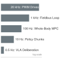

---
format:
  html:
    title: "Grounded Intent"
---

# Grounded Intent {#sec-intent}

::: {layout-narrow}
::: {.column-margin}

\chapterminitoc

:::

::: {.content-visible when-format="pdf"}
\noindent
{fig-alt="Isometric blueprint showing grounded intent: The system comprises several components for grounded intent: a 'task token prism' representing multifaceted AI tasks; a 'deliberative projection beam' signifying the AI’s focus on decision-making pathways; a 'green reachability manifold cone' defining operational limits for effective AI action; an 'inner amber tolerance cylinder' indicating acceptable task execution variances, topped with a 'countdown lease ring' tracking time-sensitive tasks; and an 'emergency expiration tripwire interlock' ensuring the system responds to critical failures."}
:::

::: {.content-visible unless-format="pdf"}
{fig-alt="Isometric blueprint showing grounded intent: floating multifaceted task token prism, deliberative projection beam, green reachability manifold cone, inner amber tolerance cylinder topped with a countdown lease ring, and emergency expiration tripwire interlock."}
:::

:::

## Purpose {.unnumbered .unlisted}

::: {.content-visible when-format="pdf"}
\begin{marginfigure}
\resizebox{0.92\linewidth}{!}{\mlphysicalstackfull{100}{20}{20}{20}{20}}
\end{marginfigure}
:::

_Why is recognizing the right object insufficient to authorize a robot to reach for it?_

A request to pick a mug names an outcome but leaves the machine to determine where to grasp, how much force to apply, and how long the observation remains useful. A correct label can accompany an uncertain handle position, and a correctly located mug can move while the model computes. Treating either prediction as an unrestricted command lets an error in meaning or timing become a physical collision. The engineer must translate the request into a bounded target, retain the evidence that supports it, and provide a refusal path when that evidence is insufficient. Independent checks limit the target's validity and the effort available to pursue it; trajectory planning must still find a feasible motion, and the permission path must still decide whether that motion may execute. These distinctions keep learned intent on the proposal side of the causal boundary, before a mistaken request becomes motion that software cannot undo.



::: {.callout-learning-objectives}

- Ground natural-language directives into metric affordance frames, continuous motion predicates, and verified geometric goal sets
- Emit the Intent Specification contract from parent belief records with explicit error envelopes, task tolerances, and effort ceilings
- Derive a target-evidence horizon from task tolerance and target drift, and distinguish it from the stopping deadline
- Decide when grounding ambiguity or a wrong-object premise requires refusal rather than admission
- Evaluate terminal reachability within one evidence window and select guarded, renewed stages for a longer approach
- Design hardware lease expiry that revokes motion authority even when the issuing process hangs or crashes

:::

## Grounded Affordances {#sec-intent-grounded-affordances}

When the warehouse mobile manipulator is told to "pick the red mug" from the takeaway conveyor, the directive specifies an outcome but leaves path, force, and deadline unresolved. A motor inverter accepts electrical commutations, not language. Vision-Language-Action (VLA) models [@brohan2023rt1; @brohan2023rt2] can propose candidate actions or targets, but their update cadence depends on model parameter counts and edge hardware accelerators, executing at frequencies ($0.5\text{--}5\text{ Hz}$) orders of magnitude slower than local real-time control. If a target moves during neural inference, a stale proposal consumes physical clearance before execution even begins. The system therefore requires dated geometric evidence, bounded capability requests, and an independent permission path that can withdraw authority while the deliberative model is silent.

For the mug, grounding means selecting a physical feature, locating it relative to the robot, and bounding the interaction with it. A pose combines position and orientation; $SE(3)$ denotes the space of these poses, while $SO(3)$ denotes orientations alone. A wrench combines force and torque. The notation below packages those familiar physical quantities so that a candidate grasp can be checked independently of the words that suggested it.

To an engineer trained on digital vision-language models, the directive "pick the mug" might sound like a solved classification task: a cross-attention map highlights the mug, and an autoregressive decoder outputs an action token. In natural language processing, the directive is a discrete sequence of linguistic tokens $\mathbf{z} = (z_1, z_2, \dots, z_k)$ sampled from a vocabulary $\mathcal{V}$. In transformer latent space, these tokens map to continuous embedding vectors $\mathbf{e} \in \mathbb{R}^d$ where vector distance reflects statistical co-occurrence across text corpora. Yet discrete semantic tokens carry zero physical dimensions (no meters, seconds, or Newtons), zero coordinate frames, zero inertial awareness, and zero physical extent. In embodied physics, grasping an object is not an isolated mathematical point or a categorical label; it is an action-relative physical relation governed by geometric **affordances**\index{Affordances!grasp envelopes} [@gibson1979ecological]. In ecological psychology, an affordance defines what an environment offers, provides, or furnishes to an active agent. In modern robot learning, we demystify this concept from first principles: an affordance model does not produce a vague qualitative abstraction, but evaluates a **spatial probability distribution over valid continuous action parameters**:
$$\mathcal{P}(\mathbf{a} \mid \mathcal{O}, \mathbf{z})$$
where the continuous action parameter vector $\mathbf{a} = (\mathbf{T}_{\text{grasp}}, \hat{\mathbf{a}}_{\text{approach}}, w_{\text{aperture}}, \mathbf{w}_{\text{contact}}) \in SE(3) \times \mathbb{S}^2 \times \mathbb{R}^+ \times \mathbb{R}^6$ specifies the candidate grasp pose, approach vector, finger aperture, and contact wrench profile, conditioned on dense 3D sensor observations $\mathcal{O}$ (such as RGB-D point clouds or signed distance fields) and natural-language directive $\mathbf{z}$.

Each functional feature on an object establishes an **affordance coordinate frame** $\mathcal{F}_{\text{affordance}}$ rigidly attached to the object's body frame $\mathcal{F}_{\text{obj}}$. To bridge the semantic gap between discrete words and physical interaction, this action parameter distribution must be grounded into concrete physical parameters:

1. *Spatial Grasp Center & Pose $\mathbf{T}_{\text{grasp}} = (\mathbf{R}_{\text{grasp}}, \mathbf{p}_{\text{grasp}}) \in SE(3)$:* The 3D translation $\mathbf{p}_{\text{grasp}} \in \mathbb{R}^3$ locates the grasp center in metric base-frame coordinates, while the orientation $\mathbf{R}_{\text{grasp}} \in SO(3)$ aligns the gripper fingers with the workpiece surface tangents.
2. *Directional Approach Vector $\hat{\mathbf{a}}_{\text{approach}} \in \mathbb{S}^2$:* A unit vector specifying the proposed direction of approach. The full gripper geometry and surrounding occupancy must still establish whether that approach has a clear corridor.
3. *Jaw Aperture Clearance $w_{\text{aperture}} \in \mathbb{R}^+$:* The finger opening span required to envelop the object geometry prior to contact closure.
4. *Contact Wrench Profile $\mathbf{w}_{\text{contact}} = [\mathbf{f}_{\text{contact}}^\top, \boldsymbol{\tau}_{\text{contact}}^\top]^\top \in \mathbb{R}^6$:* The contact force and torque profile that governs physical interaction upon contact. Under contact mechanics, grasping requires establishing normal squeeze forces $f_n$ along opposing contact normals such that tangential shear forces $\mathbf{f}_t$ satisfy the Coulomb friction cone condition $\|\mathbf{f}_t\| \le \mu f_n$. The grasp's available wrench envelope must contain the task's required resisting wrenches, including those opposing external gravitational loads $\mathbf{w}_{\text{ext}} = [0, 0, -mg, 0, 0, 0]^\top$ and dynamic inertial accelerations during transit without exceeding the workpiece's structural crush limit $f_{\text{crush}}$. Force closure is a stronger geometric property: the contact arrangement can resist a disturbance in any wrench direction under its idealized force assumptions. Supporting this task still requires adequate capacity under finite force limits.

For the red mug, these parameters specialize across its physical features: the rim affordance frame $\mathcal{F}_{\text{rim}}$ requires low gripping force to avoid crushing fragile ceramic or spilling liquid; the cylindrical body frame $\mathcal{F}_{\text{body}}$ requires wide parallel finger span and high normal force to prevent slipping; the handle affordance frame $\mathcal{F}_{\text{handle}}$ requires a six-degree-of-freedom (6-DoF) grasp pose that aligns the gripper fingers with the ear of the mug while respecting joint travel and torque limits. Under contact mechanics, opposing contact points must lie within mutually opposing friction cones to resist external gravitational and dynamic disturbance wrenches without slipping, while normal squeeze force $f_n$ remains strictly below structural crush thresholds.

Connecting words to physical targets is the robotics manifestation of the **symbol grounding problem**\index{Symbol grounding problem} [@harnad1990symbol]: a symbol needs a sensorimotor connection to the physical entity it denotes.[^fn-intent-symbol-grounding] For the mug, that connection is the measured handle frame, its calibration chain, and the interaction limits. A plausible label or generated coordinate supplies none of those bounds by itself. A wrong proposal must remain containable even when the model is confident.[^fn-intent-hallucination-containment]

Independent geometric checks test candidate affordances in $SE(3)$ against obstacle clearance, inverse-kinematics feasibility, and contact limits before trajectory optimization. Contact-rich proposals may also undergo simulation checkouts, whose conclusions remain conditional on the modeled geometry, friction, and dynamics. These checks make an affordance useful to a planner by identifying physically plausible interactions; they do not replace admission of the resulting motion.[^fn-intent-affordance-space]

A symbolic action such as `Grasp(Mug, Handle)` expresses the task, but its preconditions need physical tests. Noisy perception does not directly establish that the handle is clear or the gripper aligned. Here, **motion predicates**\index{Motion predicates!definition} connect those task conditions to measured geometry and contact quantities:

1. *Pre-contact approach predicate:* $P_{\text{approach}}(\mathbf{x}) \iff \|\mathbf{p}_{\text{TCP}} - \mathbf{p}_{\text{pre}}\| \le r_{\text{tol}} \land \arccos(\hat{\mathbf{z}}_{\text{TCP}} \cdot \hat{\mathbf{a}}_{\text{approach}}) \le \theta_{\text{tol}}$, requiring the end effector tool center point (TCP, the coordinate origin at the robot's gripper tip—distinct from the network Transmission Control Protocol) frame $\mathcal{F}_{\text{TCP}}$ to align with the affordance approach axis $\hat{\mathbf{a}}_{\text{approach}}$ within spatial tolerance $r_{\text{tol}}$ and angular tolerance $\theta_{\text{tol}}$.
2. *Guarded contact predicate:* $P_{\text{contact}}(\mathbf{w}) \iff f_{\min} \le \|\mathbf{f}_{\text{contact}}\| \le f_{\max}$, ensuring that contact forces remain sufficient for friction grip while strictly bounded below structural crush limits.
3. *Spatial clearance predicate:* $P_{\text{clear}}(\mathbf{x}, \mathcal{M}) \iff \min_{\mathbf{o} \in \mathcal{M}} \|\mathbf{x} - \mathbf{o}\| \ge d_{\text{margin}}$, checking the point $\mathbf{x}$ against stored obstacle geometry in $\mathcal{M}$ (@sec-memory). This point test alone does not establish clearance for the gripper, links, or their swept volumes; those require the later full-path check.

The position and orientation tolerances define a **geometric goal set** $\mathcal{G}_{\text{goal}} \subset SE(3)$\index{SE(3)!target goal set}:
$$\mathcal{G}_{\text{goal}} = \left\{ \mathbf{T} = (\mathbf{R}, \mathbf{p}) \in SE(3) \;\middle|\; \|\mathbf{p} - \mathbf{p}_{\text{target}}\|_{\mathbf{E}} \le 1, \; \angle(\mathbf{R}, \mathbf{R}_{\text{target}}) \le \theta_{\text{tol}} \right\}$$ {#eq-intent-goal-set-se3}
The contact and clearance predicates remain separate, phase-specific task constraints; they are not encoded by this pose region. Here $\|\mathbf{p} - \mathbf{p}_{\text{target}}\|_{\mathbf{E}} = \sqrt{\sum_{i \in \{x,y,z\}} \left(\frac{p_i - p_{\text{target},i}}{r_i}\right)^2}$ denotes spatial containment within the task tolerance ellipsoid with principal semi-axes $\mathbf{r} = (r_x, r_y, r_z)$, and $\angle(\mathbf{R}, \mathbf{R}_{\text{target}}) = \arccos\left(\frac{\operatorname{tr}(\mathbf{R}^\top \mathbf{R}_{\text{target}}) - 1}{2}\right)$ bounds geodesic orientation divergence on $SO(3)$ (equivalent to $2 \arccos(|\mathbf{q} \cdot \mathbf{q}_{\text{target}}|)$ when orientations are represented as unit quaternions). If the terminal grasp pose lies outside $\mathcal{G}_{\text{goal}}$, the task can fail: position error exceeding $r_i$ causes the gripper fingers to strike the mug rim or close on empty air, while angular tilt beyond $\theta_{\text{tol}}$ jams the fingers against the handle opening, tripping joint torque monitors or shattering the workpiece.

```{python}
#| label: calc-intent-lease-duration-collision-exposure
#| echo: false
#| warning: false
#| message: false
# ┌─────────────────────────────────────────────────────────────────────────────┐
# │ The running machine's intent horizons, the arm's transit lower bound, the   │
# │ mug intent lapse and its arm stop onset, the latch contact at brake command,│
# │ and the Class 3 plant.                                                      │
# └─────────────────────────────────────────────────────────────────────────────┘
from mlsysim import *
from mlsysim.core.units import *
from mlsysim.fmt import (
    fmt_latency,
    fmt_length,
    fmt_velocity,
    fmt_acceleration,
    fmt_frequency,
    fmt_force,
    fmt_force_rate,
    fmt_heat_capacity,
    fmt_power,
    fmt_temperature,
    fmt_temperature_rate,
    fmt_sci_qty,
    check,
)
from mlsysim.physics.robotics import (
    calc_target_evidence_horizon,
    calc_latch_contact_stopping_profile,
    calc_contact_force,
)

# ┌── 1. LOAD: the running machine, plus chapter-local scenario inputs ─────────
RM = Embodied.MobileManipulator.WarehouseMobileManipulator  # category: illustrative (running machine)
AISLE = Embodied.Scenario.WarehouseAisle  # category: illustrative (aisle scene; lease chosen)

delta_t_stall_intent = 200.0 * millisecond  # category: illustrative (stalled proposer holds the mug target)
delta_t_stall_arm = 200.0 * millisecond  # category: illustrative (unbraked contact interval)
v_drift_slow = 20.0 * millimeter / second  # category: illustrative (slow-drift case in the figure)
t_intent_tail = 650.0 * millisecond  # category: illustrative (high-tail intent inference, as in the figure)
d_target_offset = 300.0 * millimeter  # category: illustrative (scenario assumption: gripper-to-handle distance at proposal)

# ┌── 2. EXECUTE: evidence horizons, mug intent lapse, latch contact ───────────
# Mug on the conveyor: untracked and tracked target-evidence horizons. Both
# horizons charge the 3 mm initial error against the 15 mm tolerance.
grasp_error_budget = (AISLE.grasp_tolerance - AISLE.grasp_initial_error).to(millimeter)
tau_ev_untracked = calc_target_evidence_horizon(AISLE.grasp_tolerance, AISLE.grasp_initial_error, AISLE.v_conveyor).to(millisecond)
tau_ev_tracked = ((2 * grasp_error_budget / AISLE.a_conveyor_slip) ** 0.5).to(millisecond)
t_intent_period = (1.0 / RM.intent_rate).to(millisecond)
err_at_intent_period = (AISLE.grasp_initial_error + AISLE.v_conveyor * t_intent_period).to(millimeter)
err_excess_at_period = (err_at_intent_period - AISLE.grasp_tolerance).to(millimeter)
t_tail_overrun = (t_intent_tail - tau_ev_untracked).to(millisecond)
tau_ev_slow_drift = calc_target_evidence_horizon(AISLE.grasp_tolerance, AISLE.grasp_initial_error, v_drift_slow).to(millisecond)

# Dynamic reachability: the TCP speed ceiling bounds the reach inside the tracked
# horizon, and a proposal farther away fails the transit lower bound.
d_reach_tracked = (RM.tcp_speed_limit * tau_ev_tracked).to(millimeter)
d_reach_untracked = (RM.tcp_speed_limit * tau_ev_untracked).to(millimeter)
t_transit_floor = (d_target_offset / RM.tcp_speed_limit).to(millisecond)

# Mug intent lapse: a stalled proposer holds the target; untracked drift at the
# conveyor speed, tracked drift from residual slip only; arm stop onset after
# intent expiry is one permission tick, one bus cycle, and the brake onset.
err_stalled_untracked = (AISLE.grasp_initial_error + AISLE.v_conveyor * delta_t_stall_intent).to(millimeter)
err_stalled_tracked = (AISLE.grasp_initial_error + 0.5 * AISLE.a_conveyor_slip * delta_t_stall_intent**2).to(millimeter)
t_arm_onset_after_expiry = (AISLE.t_tick + AISLE.t_bus + AISLE.t_brake_onset).to(millisecond)

# Latch contact: force at brake command, then the arm stop that keeps it under the limit.
latch_profile = calc_latch_contact_stopping_profile(scenario=AISLE)
df_dt = latch_profile["df_dt"]
f_at_brake_onset = latch_profile["f_at_brake_onset"]
x_remaining = latch_profile["x_remaining"]
a_arm_needed = latch_profile["a_arm_needed"]
t_arm_stop = latch_profile["t_arm_stop"]
delta_x_unbounded = (AISLE.v_latch_approach * delta_t_stall_arm).to(millimeter)
f_unbounded = calc_contact_force(AISLE.k_latch, delta_x_unbounded)

# ┌── 3. GUARD: canon values quoted in the prose ──────────────────────────────
check(abs(tau_ev_untracked.magnitude - 60.0) < 1e-6, "Untracked mug horizon is 60 ms")
check(abs(tau_ev_tracked.magnitude - 219.09) < 5e-3, "Tracked mug horizon is 219 ms")
check(abs(grasp_error_budget.magnitude - 12.0) < 1e-6, "Mug error budget is 12 mm")
check(abs(err_stalled_untracked.magnitude - 43.0) < 1e-6, "Stalled untracked target sits 43 mm off")
check(abs(err_stalled_tracked.magnitude - 13.0) < 1e-6, "Stalled tracked target sits 13 mm off")
check(abs(t_arm_onset_after_expiry.magnitude - 22.0) < 1e-6, "Arm stop onset within 22 ms of intent expiry")
check(abs(RM.tcp_speed_limit.to(meter / second).magnitude - 1.0) < 1e-9, "TCP speed ceiling is 1.0 m/s")
check(abs(t_intent_period.magnitude - 200.0) < 1e-6, "5 Hz intent period is 200 ms")
check(abs(err_at_intent_period.magnitude - 43.0) < 1e-6, "Error at the intent period")
check(abs(tau_ev_slow_drift.magnitude - 600.0) < 1e-6, "Slow-drift horizon in the figure")
check(abs(t_tail_overrun.magnitude - 590.0) < 1e-6, "Tail overrun past the untracked horizon is 590 ms")
check(abs(d_reach_tracked.magnitude - 219.09) < 5e-3, "TCP reach inside the tracked horizon is 219 mm")
check(abs(d_reach_untracked.magnitude - 60.0) < 1e-6, "TCP reach inside the untracked horizon is 60 mm")
check(abs(t_transit_floor.magnitude - 300.0) < 1e-6, "Transit floor for the offset proposal is 300 ms")
check(t_transit_floor > tau_ev_tracked, "Offset proposal fails the transit lower bound")
check(abs(AISLE.t_lease.to(millisecond).magnitude - 60.0) < 1e-9, "Chunk lease is 60 ms")
check(abs(f_at_brake_onset.to(newton).magnitude - 39.0) < 1e-9, "Force at brake command")
check(abs(x_remaining.magnitude - 0.1525) < 5e-5, "Latch compression left is 0.15 mm")
check(abs(a_arm_needed.magnitude - 2.95) < 5e-3, "Arm stop premise is about 3 m/s^2 (2.95)")
check(abs(t_arm_stop.magnitude - 10.0) < 0.5, "Arm stop takes about 10 ms")
check(abs(f_unbounded.to(newton).magnitude - 2400.0) < 1.0, "Unbraked contact model")

# ┌── 4. OUTPUT: rendered values ──────────────────────────────────────────────
class IntentLeaseArchetypes:
    # Mug on the conveyor
    v_conveyor_str = fmt_velocity(AISLE.v_conveyor, unit=meter / second, precision=2)
    r_tol_str = fmt_length(AISLE.grasp_tolerance, unit=millimeter, precision=0)
    e0_str = fmt_length(AISLE.grasp_initial_error, unit=millimeter, precision=0)
    tau_untracked_str = fmt_latency(tau_ev_untracked, unit=millisecond, precision=0)
    tau_tracked_str = fmt_latency(round(tau_ev_tracked.magnitude) * millisecond, unit=millisecond, precision=0)
    a_slip_str = fmt_acceleration(AISLE.a_conveyor_slip, unit=meter / second**2, precision=2)
    f_intent_str = fmt_frequency(RM.intent_rate, unit=hertz, precision=0)
    t_intent_period_str = fmt_latency(t_intent_period, unit=millisecond, precision=0)
    t_intent_infer_str = fmt_latency(RM.intent_inference_latency, unit=millisecond, precision=0)
    err_at_period_str = fmt_length(err_at_intent_period, unit=millimeter, precision=0)
    err_excess_str = fmt_length(err_excess_at_period, unit=millimeter, precision=0)
    v_drift_slow_str = fmt_velocity(v_drift_slow, unit=millimeter / second, precision=0)
    tau_slow_drift_str = fmt_latency(tau_ev_slow_drift, unit=millisecond, precision=0)
    t_intent_tail_str = fmt_latency(t_intent_tail, unit=millisecond, precision=0)
    t_tail_overrun_str = fmt_latency(round(t_tail_overrun.magnitude) * millisecond, unit=millisecond, precision=0)
    # Dynamic reachability on the arm
    d_reach_tracked_str = fmt_length(round(d_reach_tracked.magnitude) * millimeter, unit=millimeter, precision=0)
    d_reach_untracked_str = fmt_length(d_reach_untracked, unit=millimeter, precision=0)
    d_target_str = fmt_length(d_target_offset, unit=millimeter, precision=0)
    t_transit_floor_str = fmt_latency(t_transit_floor, unit=millisecond, precision=0)
    # Mug intent lapse and the admitted mug lease
    err_budget_str = fmt_length(grasp_error_budget, unit=millimeter, precision=0)
    t_stall_intent_str = fmt_latency(delta_t_stall_intent, unit=millisecond, precision=0)
    err_stalled_untracked_str = fmt_length(err_stalled_untracked, unit=millimeter, precision=0)
    err_stalled_tracked_str = fmt_length(err_stalled_tracked, unit=millimeter, precision=0)
    t_arm_onset_str = fmt_latency(t_arm_onset_after_expiry, unit=millisecond, precision=0)
    v_tcp_str = fmt_velocity(RM.tcp_speed_limit.to(meter / second))
    # Latch contact
    k_latch_str = fmt_sci_qty(AISLE.k_latch, newton / meter, precision=1)
    v_latch_str = fmt_velocity(AISLE.v_latch_approach, unit=meter / second, precision=2)
    f_trip_str = fmt_force(AISLE.f_latch_tripwire, precision=0)
    t_contact_str = fmt_latency(AISLE.t_contact_response, unit=millisecond, precision=0)
    df_dt_nms_str = fmt_force_rate(df_dt, unit=newton / millisecond, precision=0)
    f_at_brake_onset_n_str = fmt_force(f_at_brake_onset, precision=0)
    f_lim_str = fmt_force(AISLE.f_latch_limit, precision=0)
    x_remaining_str = fmt_length(round(x_remaining.magnitude, 2) * millimeter, unit=millimeter, precision=2)
    a_arm_str = fmt_acceleration(round(a_arm_needed.magnitude) * meter / second**2, unit=meter / second**2, precision=0)
    t_arm_stop_str = fmt_latency(round(t_arm_stop.magnitude) * millisecond, unit=millisecond, precision=0)
    t_stall_arm_str = fmt_latency(delta_t_stall_arm, unit=millisecond, precision=0)
    delta_x_unbounded_mm_str = fmt_length(delta_x_unbounded, unit=millimeter, precision=0)
    f_unbounded_n_str = fmt_force(f_unbounded, precision=0, commas=True)
    # Permission loop
    f_permission_str = fmt_frequency(RM.permission_rate, unit=ureg.kHz, precision=0)
```

The goal region is a task requirement, not an estimate of where the target lies. The **task tolerance region**\index{Tolerance region!3D spatial}\index{Intent record!spatial tolerance region} specifies how much terminal error the grasp permits; estimator covariance describes uncertainty about the target itself. For the machine's mug grasp, the approved task profile allows `{python} IntentLeaseArchetypes.r_tol_str` of translational error. The proposal must carry a conservative target-error envelope that fits within that tolerance, with the motion check accounting for the remaining tracking error. Enlarging the tolerance to accommodate a poor observation would change the task rather than improve the observation.

Before any candidate affordance is packaged into an intent proposal, the system executes **affordance validation and scoring**\index{Affordances!validation}\index{Affordances!scoring}. When open-vocabulary foundation models predict multiple candidate grasp frames on an object, an affordance scoring function ranks candidate frames across kinematic, geometric, and semantic dimensions:
$$\mathcal{S}(\mathcal{F}_{\text{affordance}}) = w_{\text{sem}} S_{\text{sem}} + w_{\text{manip}} \frac{\mu(\mathbf{q})}{\mu_{\max}} + w_{\text{clear}} \frac{d_{\text{margin}}(\mathcal{M})}{d_{\max}} + w_{\text{align}} (\hat{\mathbf{z}}_{\text{TCP}} \cdot \hat{\mathbf{a}}_{\text{approach}})$$ {#eq-intent-affordance-score}
where $S_{\text{sem}} \in [0, 1]$ represents visual-linguistic alignment from cross-attention maps, $\mu(\mathbf{q}) = \sqrt{\det(\mathbf{J}(\mathbf{q})\mathbf{J}^\top(\mathbf{q}))}$ is Yoshikawa's manipulability index at inverse kinematics configuration $\mathbf{q}$ (favoring configurations with greater local freedom of motion), $d_{\text{margin}}(\mathcal{M})$ evaluates signed Euclidean distance to obstacle geometry in spatial memory $\mathcal{M}$, and $\hat{\mathbf{z}}_{\text{TCP}} \cdot \hat{\mathbf{a}}_{\text{approach}}$ measures directional alignment with the affordance approach vector. The Jacobian maps joint motion to tool motion, so a loss of its rank signals a direction the tool cannot follow locally. A singularity can occur inside the joint range, and a high manipulability score does not establish distance from a joint limit. Joint travel therefore needs a separate check. The intent engine confirms whether candidate frame $\mathcal{F}_{\text{affordance}}$ is kinematically reachable within workspace manifold $\mathcal{W}$, whether gripper jaw aperture clears the object width, and whether a collision-free approach cone exists. If validation fails or candidate referents remain unresolved, the system must not execute an ungrounded guess; it triggers an explicit **intent grounding refusal**\index{Intent grounding refusal!definition} (`ERR_GROUNDING_AMBIGUITY`).

::: {.column-margin .margin-pointer}
↩ The belief record a lease consumes (evidence epoch, initial error, growth law) is specified in @sec-memory-spatial-state-schema.
:::

Memory can supply a spatial belief with an expiry (@sec-memory-belief-through-occlusion); it cannot decide what action that belief authorizes. **Intent**\index{Intent} closes that gap by connecting high-level task semantics to a bounded physical goal. It specifies an admissible, time-bounded target before the trajectory planner of @sec-planning constructs a continuous motion profile to reach it.

[^fn-intent-symbol-grounding]: **Symbol Grounding Problem**\index{Symbol Grounding Problem}: Stevan Harnad's 1990 formulation argues that syntactic manipulation alone does not give symbols intrinsic meaning. In physical AI, grounding binds a proposed label to dated sensor evidence, calibrated metric frames, and task-specific physical checks. Without that binding, a planner may optimize toward the wrong physical target.

[^fn-intent-hallucination-containment]: **Semantic hallucination containment**\index{Safety!hallucination containment}\index{Grounding!semantic containment}: Unlike disembodied text generation where hallucinations degrade conversational coherence, robotic hallucinations command physical momentum. Containment requires packaging high-level outputs into typed proposal contracts with verifiable metric bounds before execution.

[^fn-intent-affordance-space]: **Affordance space parameterization**\index{Affordances!spatial parameterization}: In robot learning, affordances are parameterized as continuous spatial probability fields or reachability manifolds over the Lie group $SE(3)$. Parameterizing reachability as an explicit manifold enables low-level controllers to evaluate physical feasibility before invoking computationally intensive trajectory optimizers.

::: {#dfn-intent-grounding-refusal .callout-definition title="Intent grounding refusal"}

***Intent grounding refusal***\index{Intent grounding refusal!definition}\index{Refusal!grounding ambiguity} is the admission rule whereby an embodied system explicitly rejects semantically ambiguous natural-language directives, returning a typed failure status (`ERR_GROUNDING_AMBIGUITY`) rather than executing ungrounded maximum-likelihood guesses across physical clearance margins.

1.  **Significance**: Rejects a proposal when a task-specific ambiguity test (@sec-intent-failure-modes) fails, before that proposal reaches trajectory generation.
2.  **Distinction**: Unlike a trajectory planning failure that cannot find a collision-free path to a valid goal, grounding refusal rejects the goal itself as physically ungrounded or ambiguous before the planner is invoked.
3.  **Common pitfall**: Forcing an argmax token decode or nearest-neighbor guess when candidate referents remain unresolved, driving the physical plant toward an arbitrary or hazardous target.

:::

Whatever the model proposes must also remain bounded in time. @Fig-intent-frequency-gap separates the deliberative model, local tracker, permission loop, and drive. Even a model running at $50\text{ Hz}$ can exhibit tail latency ($P_{99} \gg P_{50}$). Faster inference increases proposal throughput but does not establish a worst-case response deadline or verify a target's physical feasibility. A conveyor target whose evidence expires between model updates needs a validated local observation path or a task pause. The figure's rates are illustrative; @sec-intent-goals-expire compares the machine's intent cadence with its conveyor evidence horizon.

::: {.column-margin}
{width="100%" fig-alt="Vertical ladder comparing operating frequencies from twenty kilohertz motor drives to half-hertz cognitive models."}
*Control hierarchy operates across four orders of frequency magnitude between cognitive models and motor PWM drives.*
:::

::: {#fig-intent-frequency-gap fig-env="figure" fig-pos="htb" fig-cap="**Multi-rate schedule**: Four illustrative rates show why a deliberative proposal cannot act as a motor or permission-loop heartbeat. The schedule does not relate model size to frequency. The local tracker can renew target evidence only if its sensor and error bounds are independently validated. The machine's own tiers are those of @sec-nervous-cadences; the machine's intent model runs faster than the deliberative rate shown, and the chunk policy is omitted here." fig-alt="Horizontal log-scale chart of four frequencies: drive current loop 20 kilohertz, independent permission loop 1 kilohertz, local target tracker 50 hertz, and deliberative proposal 2 hertz."}

```{python}
#| echo: false
#| warning: false
#| message: false
# ┌─────────────────────────────────────────────────────────────────────────────┐
# │ Plot the four-rate schedule from the chapter-local CSV.                     │
# │ No point is a model or hardware benchmark.                                  │
# └─────────────────────────────────────────────────────────────────────────────┘
import pandas as pd
from mlsysim import viz

data = pd.read_csv("vol4/10_intent/data/frequency_gap_trends.csv")  # category: illustrative
fig, ax, COLORS, plt = viz.setup_plot(figsize=(8, 4.5))
colors = ["#334155", "#1d4ed8", "#0f766e", "#b45309"]
ax.barh(data["Stage"], data["Frequency_Hz"], color=colors, height=0.58)
ax.set_xscale("log")
ax.set_xlim(1, 50000)
ax.invert_yaxis()
ax.set_xlabel("Update frequency (Hz)")
for row in data.itertuples():
    ax.text(row.Frequency_Hz * 1.13, row.Index, f"{row.Frequency_Hz:,} Hz", va="center", fontsize=9)
ax.grid(axis="x", alpha=0.2)
plt.tight_layout()
plt.show()
plt.close()
```

:::

::: {.column-margin .margin-pointer}
↩ The proposal boundary and the permission path are defined in @sec-boundary-machine-model.
:::

Grounding an open-ended directive therefore produces a dated **intent proposal**. The first design decision is how to turn the selected image region into a metric target without losing its identity, uncertainty, or evidence time. Only then can the independent permission path decide what bounds that target may carry.

## Semantic Request Translation to Geometric Proposals {#sec-intent-request-to-proposal}

A natural language instruction becomes dangerous when an unverified semantic hypothesis commands motion. When an operator or high-level supervisor asks for the red mug, an onboard vision-language foundation model parses the character stream, projects image features into a shared embedding space, and selects a candidate visual bounding region. From those pixels, the network extracts an estimated pose in $SE(3)$ and writes coordinate values into a memory buffer. At the proposal boundary (@sec-boundary-machine-model), an ungrounded string of tokens becomes a requested destination; if admitted, it reaches the causal boundary as mass, velocity, and current.[^fn-math-semantic-metric]

If the visual backbone associates the language token with an adjacent fixture or an unlabeled calibration target, the resulting coordinate vector $\mathbf{p} \in \mathbb{R}^3$ enters the trajectory pipeline as an authoritative physical goal. Because a low-level motor drive measures only encoder pulses, winding temperatures, and phase currents, it cannot evaluate whether the coordinate it tracks corresponds to the intended mug or to an empty stretch of belt.[^fn-math-vlm-lipschitz] Furthermore, extrinsic transform errors ($\Delta \mathbf{T}_{\text{base} \leftarrow \text{cam}}$) arising from wrist mounting compliance, mechanical payloads, thermal expansion, or link elasticity propagate directly into metric goal bias. High semantic confidence from a vision backbone masks underlying geometric calibration drift, reinforcing why the proposal must carry conservative base-frame error bounds rather than raw point coordinates. The grounding process must produce an explicit geometric proposal that includes spatial uncertainty, selection evidence, and temporal expiration before any motion planner accepts it.

[^fn-math-semantic-metric]: **Semantic-to-metric transformation**\index{Kinematics!semantic-to-metric}\index{Grounding!metric mapping}: Projecting discrete linguistic embeddings into continuous $SE(3)$ coordinates requires an unbroken coordinate calibration chain from image pixels to actuator base frames. Unmodeled camera mounting compliance or lens distortion maps semantic attention peaks into systematic metric offsets. If the transformation chain lacks rigid extrinsic calibration, high semantic confidence produces large physical tracking errors at the end effector.

[^fn-math-vlm-lipschitz]: **Learned-output sensitivity**\index{Neural network!Lipschitz continuity}\index{Safety!Lipschitz bounds}: A learned pose estimate can change substantially when the image or scene changes, and an empirical confidence score does not bound that change. The permission path limits the admitted target and motion using independently checked geometry, state, and actuator constraints.

### The four-stage open-vocabulary grounding pipeline {#sec-intent-four-stage-pipeline}

The **four-stage open-vocabulary grounding pipeline** separates selecting a referent from locating and acting on it:

1. **Stage 1: Multimodal Perception & Visual Feature Encoding**: High-bandwidth visual streams (RGB-D frames from static cameras or eye-in-hand sensors) are ingested alongside proprioceptive joint states. Executing at batch size one ($B=1$) on edge NPUs or GPUs, a vision backbone (for example, a transformer with $14\times14$ patch tokenization) extracts dense spatial feature embeddings that encode both fine geometry and visual semantics.
2. **Stage 2: 2D Semantic Referent Selection & Open-Vocabulary Prompt Grounding**: Given an unconstrained natural language prompt (e.g., "pick the red ceramic mug"), cross-attention mechanisms align linguistic tokens with visual patch embeddings. Open-vocabulary grounding models such as Grounding DINO [@liu2023grounding] compute attention heatmaps and predict candidate 2D bounding boxes, instance segmentation masks, or normalized spatial location tokens identifying physical referents in image pixel space $(u, v)$. However, a 2D bounding box or pixel mask carries zero metric depth, zero contact surface normal orientation, and zero wrench capability; it identifies where an object appears in the optical projection, not how a physical gripper can contact it.
3. **Stage 3: Metric 3D Lifting & Workspace Unprojection**: Using calibrated camera intrinsic parameters $\mathbf{K} \in \mathbb{R}^{3\times3}$ (focal lengths $f_x, f_y$ and principal point $c_x, c_y$) and synchronized optical depth returns $z = d(u, v)$, the selected 2D pixel coordinates are unprojected into metric camera coordinates: $\mathbf{x}_{\text{cam}} = z \mathbf{K}^{-1} [u, v, 1]^\top = [z(u - c_x)/f_x, \; z(v - c_y)/f_y, \; z]^\top$. Applying the rigid extrinsic transform from the camera frame to the robot base frame, $\mathbf{T}_{\text{base} \leftarrow \text{cam}} = (\mathbf{R}_{\text{base} \leftarrow \text{cam}}, \mathbf{p}_{\text{base} \leftarrow \text{cam}}) \in SE(3)$, transforms the point into base-frame workspace coordinates: $\mathbf{x}_{\text{base}} = \mathbf{R}_{\text{base} \leftarrow \text{cam}} \mathbf{x}_{\text{cam}} + \mathbf{p}_{\text{base} \leftarrow \text{cam}}$. The unprojection Jacobian:
$$\mathbf{J}_{\text{lift}} = \frac{\partial \mathbf{x}_{\text{base}}}{\partial [u, v, z]^\top} = \mathbf{R}_{\text{base} \leftarrow \text{cam}} \begin{bmatrix} \frac{z}{f_x} & 0 & \frac{u - c_x}{f_x} \\ 0 & \frac{z}{f_y} & \frac{v - c_y}{f_y} \\ 0 & 0 & 1 \end{bmatrix}$$
propagates optical measurement noise into Cartesian base-frame covariance: $\boldsymbol{\Sigma}_{\text{base}} = \mathbf{J}_{\text{lift}} \boldsymbol{\Sigma}_{\text{sensor}} \mathbf{J}_{\text{lift}}^\top + \boldsymbol{\Sigma}_{\text{extrinsic}}$. Because stereo and structured-light triangulation depth standard deviation scales quadratically with distance ($\sigma_z \approx \frac{z^2}{B f} \sigma_{\text{disp}}$ where $B$ is baseline and $f$ is focal length), depth uncertainty dominates lateral uncertainty by nearly an order of magnitude, producing an elongated uncertainty ellipsoid aligned with the optical line of sight. Any unmodeled link compliance or thermal deflection in $\Delta \mathbf{T}_{\text{base} \leftarrow \text{cam}}$ tilts this elongated uncertainty ellipsoid directly into the robot's physical clearance margin.
4. **Stage 4: Affordance Parameterization & Candidate Goal Generation**: The lifted metric geometry is converted into actionable manipulation hypotheses, formalizing affordance prediction as estimating a spatial probability distribution $\mathcal{P}(\mathbf{a} \mid \mathcal{O}, \mathbf{z})$ over action parameters $\mathbf{a} \in SE(3) \times \mathbb{S}^2 \times \mathbb{R}^+ \times \mathbb{R}^6$. Depending on the architecture, this output may take the form of 6-DoF grasp envelopes with approach cones, continuous 3D attraction/repulsion cost fields [@huang2023voxposer], parameterized motion primitives [@liang2023code], or 256-bin action token distributions [@brohan2023rt1]. Crucially, Stage 4 scores candidate affordance frames $\mathcal{F}_{\text{affordance}}$ using the multi-factor scoring function $\mathcal{S}(\mathcal{F}_{\text{affordance}})$ (@eq-intent-affordance-score), evaluating kinematic manipulability $\mu(\mathbf{q}) = \sqrt{\det(\mathbf{J}\mathbf{J}^\top)}$, distance margins to spatial memory $\mathcal{M}$, and gripper jaw opening clearance. It then parameterizes candidate geometric goal sets $\mathcal{G}_{\text{goal}} \subset SE(3)$ around validated affordance frames and specifies the target motion predicates ($P_{\text{approach}}, P_{\text{contact}}, P_{\text{clear}}$) required for task completion.

Across the physical silicon boundary between the non-real-time Linux Application Processor (AP) and the hard real-time Safety MCU, Stage 4 serializes these hypotheses into a fixed-size, statically verified proposal structure (@tbl-10-intent-proposal-fields).

\Needspace{22\baselineskip}

| Field                  | Representation       | Physical semantics                                                                              | Invariant and admission check                                                         |
|:-----------------------|:---------------------|:------------------------------------------------------------------------------------------------|:--------------------------------------------------------------------------------------|
| `evidence_epoch_ns`    | `uint64_t` (ns)      | Sensor capture timestamp $t_0$ from parent belief record                                        | Must match retained belief epoch; reject if stale or unrecorded                       |
| `affordance_frame_id`  | `uint32_t` (enum)    | Target coordinate frame $\mathcal{F}_{\text{affordance}}$ (e.g., $\mathcal{F}_{\text{handle}}$) | Must resolve to an approved kinematic frame on the target object                      |
| `predicate_mask`       | `uint32_t` (bitmask) | Requested motion predicates ($P_{\text{approach}}, P_{\text{contact}}, P_{\text{clear}}$)       | Verified against task requirements before planner invocation                          |
| `target_pose_se3`      | `double[7]`          | Proposed pose $[x, y, z, q_x, q_y, q_z, q_w]$ in robot base frame                               | Finite values; unit quaternion ($\lVert \mathbf{q} \rVert = 1$); within $\mathcal{W}$ |
| `pos_error_envelope_m` | `double[3]` (m)      | Bounded spatial uncertainty semi-axes $(e_x, e_y, e_z)$                                         | Conservative upper bounds on perception uncertainty; $0 \le e_i \le r_i$              |
| `task_tolerance_m`     | `double[3]` (m)      | Allowable goal region semi-axes $(r_x, r_y, r_z)$                                               | Must meet task profile tolerances; defines $\mathcal{G}_{\text{goal}}$                |
| `max_linear_vel_mps`   | `double` (m/s)       | Requested tool center point speed ceiling $v_{\max}$                                            | Clamped to plant ceiling; verified against dynamic transit time                       |
| `max_wrench`           | `double[6]` (N, N·m) | Maximum effort ceiling $[F_x, F_y, F_z, \tau_x, \tau_y, \tau_z]$                                | Must not exceed structural yield or sensor saturation limits                          |
| `lease_duration_ms`    | `uint32_t` (ms)      | Requested operational validity horizon $\tau_{\text{lease}}$                                    | Clamped to target-evidence horizon $\tau_{\text{ev}}$ and stopping deadline           |
| `fallback_policy_id`   | `uint32_t` (enum)    | Advisory terminal mode (`HOLD`, `STOP`, `TORQUE_OFF`)                                           | Advisory only; Safety MCU overrides based on load and contact state                   |

: **Untrusted intent proposal fields**: Layout and validation invariants of the candidate proposal transmitted from the Application Processor across the proposal boundary. {#tbl-10-intent-proposal-fields tbl-colwidths="[20,17,33,30]"}

To prevent a learned output from masquerading as a deterministic setpoint, the producer must retain the referent identity and the dated evidence that selected it. Its observation record may contain bounding boxes, attention weights, class probabilities, and a full oriented covariance estimate. The intent proposal (@sec-intent-lease) links to the belief record built from that observation (@sec-memory-spatial-state-schema) by digest and evidence epoch; it carries a candidate pose, conservative base-frame error bounds, task tolerances, and requested expiry, not those full producer-side fields. The independent permission path checks the linked evidence and request against its own limits. An object can shift or become occluded after camera exposure, so a coordinate without a valid evidence link and deadline cannot remain an authorized target.

When a vision-language model sees multiple candidate objects, an argmax can hide an unresolved choice. A digital recommendation can still mislead a user, but it has no direct actuator path; in a robot, an admitted spatial proposal can move mass. If a red glass jar sits beside the red mug on the takeaway conveyor, a poorly grounded guess may select the jar. The system should preserve candidate identity and calibrated uncertainty, refusing a proposal when a task-specific ambiguity threshold is exceeded. The producer can seek a clearer observation or instruction while any previously admitted motion remains subject to its own evidence, lease, and fallback checks.

Formally, **open-vocabulary grounding ambiguity**\index{Grounding!ambiguity} is the condition where multimodal feature projections yield multi-peak posterior distributions, overlapping geometric hypotheses, or unresolvable evidential ties across candidate physical referents, requiring an explicit grounding refusal (`ERR_GROUNDING_AMBIGUITY`) rather than optimistic argmax tie-breaking. A high entropy over the candidate-referent distribution $\mathbf{z}$, $H(\mathbf{z}) > H_{\text{thresh}}$, is one signal of it, and the producer-side filter of @fig-10-vla-cross-attention-intent-lease can refuse on that signal before the proposal crosses the proposal boundary. This station adopts a singulated-feed operating rule: independently checked evidence must support a single candidate in the pick window (@sec-intent-failure-modes). That rule avoids unresolved selection at this station; other tasks can admit a uniquely identified target among several objects when their evidence supports the distinction. Low model entropy establishes neither case.

::: {#fig-10-vla-cross-attention-intent-lease fig-env="figure" fig-pos="t" fig-cap="**Grounded intent pipeline architecture across the silicon boundary**: Physical AI system architecture partitioning high-capacity deliberative reasoning on the Application Processor (AP) from deterministic safety enforcement on the real-time Safety Microcontroller Unit (MCU). The AP processes multimodal streams (RGB-D vision, natural language prompts, proprioception) through a vision-language backbone and 3D spatial field generator. A producer-side entropy filter ($H(\\mathbf{z}) \\le H_{\\text{thresh}}$) rejects ambiguous bimodal hypotheses before passing a structured intent proposal across the inter-core shared memory boundary (e.g., RPMSG over SRAM). The MCU independently verifies evidence epochs, physical actuator ceilings, and braking stopping reserve before arming a target-validity countdown; trajectory admission remains a separate check (synthesized from Huang et al. [-@huang2023voxposer], Ahn et al. [-@ahn2022saycan], and Gray [-@gray1989leases])." fig-alt="Diagram of vision, prompt, and robot state entering a vision-language backbone and candidate 3D cost field on the Application Processor. A producer-side entropy filter can reject the proposal. A bounded record crosses a silicon boundary via RPMSG/SRAM to a Safety MCU, which checks evidence, physical limits, and stopping feasibility before granting bounded target authority; trajectory permission remains separate."}
{width="100%"}
:::

In @fig-10-vla-cross-attention-intent-lease, the selected architecture separates proposal computation from bounded target admission across a silicon boundary. This separation supports independence only when the memory, timing, and fault paths are qualified:

- *Application Processor (AP Domain):* Running a non-real-time operating system (such as Linux) on multi-core host CPUs and neural accelerators, the AP processes computationally intensive visual and linguistic models. Multimodal inputs (RGB-D video, joint telemetry, natural language task instructions) enter a cross-attention vision-language backbone. If candidate referent features indicate high entropy ($H(\mathbf{z}) > H_{\text{thresh}}$), a producer-side filter immediately flags semantic ambiguity. Otherwise, the AP packages the candidate goal, requested wrench limits, and parent belief digest into a static intent proposal message.
- *Inter-Core Transport Boundary:* The proposal crosses from the AP to the real-time core via a deterministic, bounded communication channel, such as a qualified Remote Processor Messaging (RPMSG) implementation over dedicated shared SRAM rings; the protocol name alone supplies no timing bound.
- *Safety Microcontroller Unit (MCU Domain):* Executing a hard real-time operating system (RTOS) or bare-metal control loop, the Safety MCU acts as an independent gatekeeper for untrusted proposals. It treats the incoming proposal purely as an unverified candidate. The MCU validates the evidence epoch against its local monotonic hardware clock, evaluates static workspace and dynamic reachability bounds, checks requested force and velocity limits against configured plant ceilings, and verifies that a collision-free emergency stop profile remains executable within current clearance. Only when all physical invariants are satisfied does the MCU arm a hardware countdown timer ($\tau_{\text{lease}}$) and grant transient tracking authority.

```{python}
#| label: calc-intent-handle-ellipsoid
#| echo: false
#| warning: false
#| message: false
# ┌─────────────────────────────────────────────────────────────────────────────┐
# │ The mug-handle localization estimate as a 95 percent region, compared with  │
# │ the mug's grasp tolerance axis by axis.                                     │
# └─────────────────────────────────────────────────────────────────────────────┘
import math

# ┌── 1. LOAD: illustrative single-view localization model ────────────────────
sigma_lat_x = 4.0 * millimeter  # category: illustrative (distant pre-approach wrist-camera view, lateral std. dev.)
sigma_lat_y = 5.0 * millimeter  # category: illustrative (wrist-camera lateral std. dev.)
sigma_depth = 12.0 * millimeter  # category: illustrative (wrist-camera depth std. dev.)
chi2_3dof_95 = 7.815  # category: constant (chi-square quantile, 3 degrees of freedom, 0.95)

# ┌── 2. EXECUTE: principal semi-axes of the 95 percent region ────────────────
k_region = math.sqrt(chi2_3dof_95)
semi_x = (k_region * sigma_lat_x).to(millimeter)
semi_y = (k_region * sigma_lat_y).to(millimeter)
semi_z = (k_region * sigma_depth).to(millimeter)
chi2_cdf = math.erf(math.sqrt(chi2_3dof_95 / 2)) - math.sqrt(2 * chi2_3dof_95 / math.pi) * math.exp(-chi2_3dof_95 / 2)

# ┌── 3. GUARD: the claims the prose makes ────────────────────────────────────
check(abs(chi2_cdf - 0.95) < 1e-4, "7.815 is the 0.95 chi-square quantile for 3 degrees of freedom")
check(semi_x < AISLE.grasp_tolerance and semi_y < AISLE.grasp_tolerance, "Lateral semi-axes fit the grasp tolerance")
check(semi_z > AISLE.grasp_tolerance, "Depth semi-axis exceeds the grasp tolerance")
check(AISLE.grasp_initial_error < AISLE.grasp_tolerance, "Admitted handle estimate fits the tolerance")

# ┌── 4. OUTPUT: rendered values ──────────────────────────────────────────────
class HandleEllipsoid:
    sigma_x_str = fmt_length(sigma_lat_x, unit=millimeter, precision=0)
    sigma_y_str = fmt_length(sigma_lat_y, unit=millimeter, precision=0)
    sigma_z_str = fmt_length(sigma_depth, unit=millimeter, precision=0)
    chi2_str = fmt(chi2_3dof_95, precision=3, commas=False)
    semi_x_str = fmt_length(semi_x, unit=millimeter, precision=1)
    semi_y_str = fmt_length(semi_y, unit=millimeter, precision=1)
    semi_z_str = fmt_length(semi_z, unit=millimeter, precision=1)
```

Consider the grounding model's estimate of the red mug's handle from a single wrist-camera view taken at a distance, before the arm begins its approach. In an illustrative calibrated Gaussian localization model, the principal sensor-frame standard deviations are `{python} HandleEllipsoid.sigma_x_str`, `{python} HandleEllipsoid.sigma_y_str`, and `{python} HandleEllipsoid.sigma_z_str`, the largest along the camera's depth axis, which is also the gripper's approach axis. A **95 percent statistical region** around the estimated handle position $\mathbf{p}_0$ uses Mahalanobis squared distance $(\mathbf{p}-\mathbf{p}_0)^T\mathbf{\Sigma}^{-1}(\mathbf{p}-\mathbf{p}_0)\le\chi^2_{3,0.95}$, where the three-degree-of-freedom quantile is `{python} HandleEllipsoid.chi2_str`, yielding principal semi-axes `{python} HandleEllipsoid.semi_x_str`, `{python} HandleEllipsoid.semi_y_str`, and `{python} HandleEllipsoid.semi_z_str`. @Fig-10-intent-lease-envelope contrasts that uncertain target with the mug's `{python} IntentLeaseArchetypes.r_tol_str` grasp tolerance. Both lateral semi-axes fit inside the tolerance, but the depth semi-axis does not, so this estimate fails admission and needs better sensing, a different approach, or refusal.

The worked pick in @sec-intent-lease therefore needs a separately admitted, collision-checked pre-contact approach to acquire better sensing; it cannot use the rejected handle estimate to authorize contact. Its belief record (@sec-memory-spatial-state-schema) comes from a closer wrist-camera capture on the approach, which bounds the initial error at `{python} IntentLeaseArchetypes.e0_str`. A statistical region alone leaves a residual tail and cannot certify clearance, so the intent proposal carries conservative base-frame error bounds rather than claiming to encode this covariance.

::: {#fig-10-intent-lease-envelope fig-env="figure" fig-pos="t" fig-cap="**Localization uncertainty and authority expiry**: Panel (a) sketches a statistical target-uncertainty ellipsoid beside the grasp's separate task tolerance. Panel (b) compares counterfactual traces: blue expires and brakes, green continues only with fresh renewals, and red shows motion without a lease. Whether the blue trace rests before the obstacle depends on total pre-brake delay, deceleration, and clearance." fig-alt="Panel (a) shows target-position uncertainty beside the grasp's separate task tolerance region. Panel (b) compares alternative velocity traces: blue authority expires then braking reaches rest if feasible; green dots show fresh renewals in a separate scenario; red continues without a lease toward the obstacle. Physical clearance depends on the complete stopping budget."}
{width="100%"}
:::

The renewal traces in @fig-10-intent-lease-envelope are alternative outcomes. Fresh measurements can support continued tracking; a missed renewal invokes the validated stop. Neither outcome repairs the distant view's excessive depth uncertainty, and stopping before the obstacle still depends on the complete response budget.

A detection with a large uncertainty estimate can be rejected by a configured statistical gate. A confident grounding to the wrong physical entity can pass that gate. Suppose instead that a thin-walled glass jar arrives alone where the mug should be, and the vision-language model assigns it a high confidence score when asked for the red mug. The model emits a sharp, low-variance geometric proposal centered on the glass. The trajectory planner receives the coordinate, computes an $SE(3)$ inverse kinematics solution, verifies joint limits, and confirms that the path clears all obstacles in the static environment map. The permission path may find the proposed motion within its configured geometric and force bounds. If those bounds allow the grip force the ceramic mug needs, a smooth, geometrically valid trajectory can crush the glass despite passing the checks.

This failure reveals the boundary between what the permission path can verify and what it must accept as an unvalidated premise. The permission path checks coordinate bounds, kinematic reachability, joint torque limits, and geometric collisions against known occupancy grids. Those physical checks do not establish that the coordinate names the intended object, so the premise that the grasped object is the named object lies outside the permission path's reach. It needs its own task evidence, and it travels with the mug into the handover branch of the release case (@sec-release-case-worked-full) and into the register of claims the machine's evidence leaves open (@sec-frontier-residual-claims-register).

Multimodal feature extraction, cross-attention alignment, and open-vocabulary phrase grounding belong to the computer vision and language literature [@kamath2021mdetr; @gu2022open; @radford2021learning; @liu2023grounding]. A physical AI architecture consumes these grounding models without relying on their internal activations for safety, and even a filtered proposal stream still needs the independent motion-permission check. AutoRT's language-model task filter raised the fraction of acceptable proposed tasks yet still passed a small fraction of unsafe ones, and its deployment relied on joint-force pausing, emergency stops, and human supervision rather than on the prompt (\ref{ws-intent-autort-hallucination-constitution}) [@ahn2023autort].

::: {#ws-intent-autort-hallucination-constitution .callout-war-story title="AutoRT task filtering and supervision (2024)"}
**Context**: AutoRT deployed foundation models to propose and filter physical manipulation tasks for fleets of mobile manipulators operating in unstructured human office environments [@ahn2023autort].

**Mechanism**: In an empirical sample of 259 proposed tasks, 228 were initially judged acceptable by human annotators. Applying a secondary large language model (LLM) as a "constitutional" affordance and safety filter improved retention (200 of 214 retained tasks were acceptable), raising the acceptable fraction from 88 to 93 percent. However, the semantic filter still permitted 14 unsuitable or unsafe tasks to pass through to execution.

**Impact**: Relying strictly on high-level prompting or semantic filtering left open a non-negligible tail of hazardous proposals, demonstrating that ungrounded foundation models cannot self-certify physical safety or guarantee collision-free execution in open environments.

**Response**: The system architecture placed physical safety outside the model's domain: deployments supplemented learned proposals with hardware joint-force limits, physical emergency stop buttons, and direct human line-of-sight supervision or physical perimeter barricades.

**Systems lesson**: A learned task filter can improve proposal quality, but it cannot serve as a safety referee. An independent, deterministic permission and fallback path must validate every physical action against real-time plant limits before execution.
:::

Once the mug candidate has a metric frame and a dated record, alternative proposal sources can use the same interface. The sources in @tbl-10-grounding-paradigms differ in what they make available to the planner. SayCan ranks pretrained skills using semantic relevance and learned value [@ahn2022saycan]; Code as Policies generates scripts that call perception and control interfaces [@liang2023code]. VoxPoser supplies spatial value maps (@fig-10-real-grounded-affordance-franka), while OK-Robot selects candidate grasps (@fig-10-real-open-vocab-grounding). Each can help turn a request into a useful action candidate, but its output still needs current geometric, effort, and timing checks.

Predicting a plausible coordinate or motion script does not establish physical feasibility. The grounding interface must account for metric geometry, non-penetration, kinematics, and contact mechanics:

1. *Token Discretization and Lack of Metric Topology:* Autoregressive LLMs minimize cross-entropy loss over discrete token vocabularies ($\mathcal{L}_{\text{MLE}} = -\sum \log P(w_t \mid w_{<t})$). Numerical strings like `"0.45"` and `"-0.05"` are represented by vocabulary tokens. Distances in the learned latent space $\mathbb{R}^d$ need not preserve Euclidean metric distance ($\|\mathbf{x}_1 - \mathbf{x}_2\|_2$) in physical 3D space ($\mathbb{R}^3$). Token similarity alone supplies no bound on coordinate error. A consumer therefore needs explicit metric checks rather than treating token likelihood as evidence of geometric continuity.
2. *Absence of Rigid-Body Non-Penetration:* In natural language, words combine freely: the string "the gripper is positioned five centimeters inside the granite table" is syntactically coherent and easily generated by an autoregressive model. In the rigid-body model, solid interiors cannot overlap ($\operatorname{int}(\mathcal{B}_1) \cap \operatorname{int}(\mathcal{B}_2) = \emptyset$), while boundaries may touch at contact. A signed distance field can represent this distinction: $\Phi(\mathbf{x}) = s_{\mathcal{O}}(\mathbf{x}) \min_{\mathbf{y} \in \partial \mathcal{O}} \|\mathbf{x} - \mathbf{y}\|$, with $s_{\mathcal{O}}=+1$ outside the obstacle, $-1$ inside, and $0$ on its boundary. A token prediction alone does not establish whether coordinate `[0.45, 0.12, -0.05]` places the robot fingers five centimeters beneath the solid countertop surface. That claim requires independently checked geometry in the stated frame.
3. *Ignorance of Differential Kinematics and Singularities:* A generated coordinate alone supplies neither the manipulator's configuration manifold $\mathcal{C}$ nor its kinematic Jacobian $\mathbf{J}(\mathbf{q}) = \frac{\partial f_{\text{FK}}(\mathbf{q})}{\partial \mathbf{q}}$. Near kinematic singularities where $\det(\mathbf{J}\mathbf{J}^\top) \to 0$, demanding Cartesian velocity along a vanishing singular direction can require unbounded joint rates in the ideal inverse relation $\dot{\mathbf{q}} = \mathbf{J}^\dagger \dot{\mathbf{x}}$. Real actuators saturate first; motion along a retained direction need not have this failure.
4. *Neglect of Coulomb Friction and Wrench Equilibrium:* Language descriptions treat "grasping" as an instantaneous symbolic event. Physical manipulation, however, requires adequate task-load wrench capacity: contact forces must reside within Coulomb friction cones $\|\mathbf{f}_t\| \le \mu f_n$ to resist external gravitational and inertial disturbance wrenches $\mathbf{w}_{\text{ext}}$ without slipping, while normal squeeze force $f_n$ remains strictly below structural yield limits. A proposed grasp therefore needs contact geometry and material limits before its wrench request can be assessed.

Geometric verification and simulation provide complementary checks on these proposed interactions:

1. *Deterministic Geometric Verifiers:* Before a foundation model proposal reaches the trajectory optimizer, independent libraries evaluate signed distance fields over the relevant robot geometry to check clearance from non-contact obstacles ($\min_{\mathbf{x} \in \mathcal{B}_{\text{robot}}} \Phi(\mathbf{x}) \ge d_{\text{margin}}$). Inverse kinematics may use closed-form solutions where the mechanism permits them or numerical solvers otherwise. Each returned configuration still needs joint-limit and singularity checks; a determinant threshold ($\det(\mathbf{J}\mathbf{J}^\top) > \epsilon$) is a selected conditioning screen, not a universal distance from singularity. Grasp-quality metrics, such as the Ferrari-Canny metric, can assess the contact wrench envelope under their stated friction and force assumptions. Force closure ($\mathbf{0} \in \operatorname{int}(\operatorname{conv}(\bigcup \mathcal{FC}_i))$) alone does not establish finite capacity for the task loads. These candidate checks precede the full trajectory and contact-phase checks.
2. *Physical Simulation Checkouts:* For contact-rich, dynamic, or non-prehensile tasks (such as sliding, unlatching, or dual-arm handovers), candidate proposals can be checked in accelerated multi-body physics simulation environments (e.g., Isaac Sim or MuJoCo) executing in parallel on edge accelerators. Simulation checkouts integrate forward rigid-body dynamics $\mathbf{M}(\mathbf{q})\ddot{\mathbf{q}} + \mathbf{C}(\mathbf{q}, \dot{\mathbf{q}})\dot{\mathbf{q}} + \mathbf{g}(\mathbf{q}) = \boldsymbol{\tau} + \mathbf{J}_c^\top \mathbf{f}_c$ under frictional contact constraints to evaluate whether the proposed contact sequence causes tipping, jamming, or slippage under realistic contact friction before physical hardware commits kinetic energy.

@Tbl-10-grounding-paradigms summarizes what each paradigm emits and what the downstream physical permission path must independently verify.

::: {#fig-10-real-grounded-affordance-franka fig-env="figure" fig-pos="t" fig-cap="**Manipulator 3D affordance grounding via synthesized value maps**: VoxPoser composes language-guided 3D value maps for robotic manipulation tasks [@huang2023voxposer]. An LLM generates code that establishes 3D attraction fields (green) pulling the end effector toward the target and repulsion fields (red) pushing away from obstacles. The resulting spatial cost fields guide trajectory optimization; however, an independent permission path, torque check, and stopping wrapper remain mandatory before motor actuation. (Source: Huang et al., 2023 [@huang2023voxposer], CC BY 4.0)." fig-alt="VoxPoser research figure showing a manipulator and sequential language-guided 3D spatial value maps for several tabletop tasks. The image illustrates proposed objectives and motion planning, not a certified force limit, collision bound, or intent lease. Source: Huang et al., 2023."}
{width="95%"}
:::

In @fig-10-real-grounded-affordance-franka, Huang et al. [-@huang2023voxposer] turn instructions such as "open the top drawer" into spatial objectives. Attraction toward a handle and repulsion from observed obstacles guide the optimizer toward a useful interaction. The planner must still check the resulting path and actuator demands; an obstacle missing from the observations also remains missing from the generated field.

::: {#fig-10-real-open-vocab-grounding fig-env="figure" fig-pos="t" fig-cap="**Open-vocabulary grasp grounding pipeline**: OK-Robot combines candidate grasp generation with language-conditioned object selection and geometric filtering [@liu2024okrobot]. An open-vocabulary detector isolates the target object mask, candidate grasps are sampled across the 3D point cloud, and geometric heuristics prune inadmissible approaches. The resulting grasp pose represents a candidate proposal; bounding tolerances, evidence deadlines, and independent permission checks are an architectural wrapper developed in this chapter. (Source: Liu et al., 2024 [@liu2024okrobot], CC BY 4.0)." fig-alt="OK-Robot figure showing a robot camera view, candidate grasps, a language-conditioned target mask, filtering, and a selected grasp pose. The image illustrates proposal generation; it does not show a certified collision check or an expiring intent lease."}
{width="95%"}
:::

In @fig-10-real-open-vocab-grounding, Liu et al. [-@liu2024okrobot] separate language-conditioned object selection from geometric grasp generation. A scene-wide grasp sampler supplies candidates, and the selected object mask filters them to the requested referent. The selected pose still requires dated evidence, effort bounds, and expiry before it can support execution.

| Proposal source           | Representation sent downstream                          | Early check                                                | Remaining evidence needed                                                                        |
|:--------------------------|:--------------------------------------------------------|:-----------------------------------------------------------|:-------------------------------------------------------------------------------------------------|
| 2D box or mask            | Image region plus measured depth and camera calibration | Reject absent depth or a target outside a validated region | 3D pose error, occlusion, object identity, and swept-path clearance                              |
| 3D feature or value field | Candidate target or cost field in a stated frame        | Reject out-of-workspace targets and stale map cells        | Conservative occupancy, unknown-space policy, actuator and timing bounds                         |
| Action-token VLA          | Decoded action in its trained action range              | Reject out-of-range or inadmissible proposals              | State-dependent physical limit and independent permission; token bins provide no clearance proof |
| Language-selected skill   | Skill identifier with estimated success                 | Rank or decline low-confidence candidates                  | Current preconditions, path feasibility, and separate physical enforcement                       |

: **Grounding representations and admission questions**: Outputs from different model families require different conversions before a physical permission check. {#tbl-10-grounding-paradigms tbl-colwidths="[18,24,24,34]"}
Discretized outputs carry no metric bound, and the two common kinds lack it for different reasons.[^fn-vla-action-discretization] In action-token models such as RT-1 [@brohan2023rt1] and OpenVLA [@kim2024openvla], a decoded token is an empirical index within a normalized training distribution that encodes zero metric clearance to physical obstacles. In vision-language models such as PaliGemma, location tokens quantize normalized image coordinates, which become a metric base-frame pose only through measured depth, a sensor calibration chain, and an uncertainty model whose extrinsic and depth terms can easily dominate the quantization grid itself.

[^fn-vla-action-discretization]: **Action and Location Token Discretization**\index{Vision-language-action!token discretization}: Vision-language-action architectures discretize continuous joint or Cartesian deltas into uniform bins (typically 256 per dimension) over an empirical training range, discarding continuous metric clearance. Similarly, multimodal backbones with location tokens map normalized image coordinates into discrete spatial bins (for example, 1,024 bins in PaliGemma), requiring external camera intrinsics and optical depth unprojection to recover metric coordinates in the robot's physical workspace.

The distant view fails on depth uncertainty, and the wrong-object example fails on a different premise: precise geometry does not establish identity. A useful candidate therefore carries both dated metric evidence and task-specific selection evidence. The handoff must preserve those distinctions while limiting the time and effort available to pursue the target.

## The Intent Handoff and Bounded Authority {#sec-intent-handoff}

When the arm reaches for the red mug, the Brain sends neither joint trajectories nor winding voltages across the proposal boundary. It requests a target region, an expiry, and limits on physical effort. The independent permission path checks those bounds using retained evidence and configured plant limits. Admitting the target allows a planner to seek a motion toward it; it does not admit that motion or give the model access to actuator registers.

The independent permission path evaluates the requested target bounds before the planner relies on them. Host-side geometry work supplies bounded local evidence under a qualified interface; the full scene map does not become MCU-resident merely because a check consumes it. The checks span four mandatory invariants:

1. *Spatial containment invariant:* The proposed geometric goal set $\mathcal{G}_{\text{goal}} \subset SE(3)$ must lie strictly within the robot's reachable workspace manifold $\mathcal{W}$, and the bounded spatial uncertainty envelope $(e_x, e_y, e_z)$ must fit inside the task tolerance $(r_x, r_y, r_z)$ without intersecting persistent obstacle geometry in spatial memory $\mathcal{M}$.
2. *Temporal freshness invariant:* The sensor evidence epoch $t_0$ must match a retained parent belief record, and the unobserved elapsed time on the Safety MCU's monotonic hardware clock must not exceed the target-evidence horizon $\tau_{\text{ev}} \le (r_{\text{tol}} - e_0) / v_{\text{drift}}$.
3. *Dynamic effort invariant:* Requested tool-center-point velocity $v_{\max}$, acceleration $a_{\max}$, and contact wrench $\mathbf{w}_{\max} = [F_{\max}, \tau_{\max}]^\top$ must remain strictly within actuator thermal ratings, link inertia limits, and workpiece structural yield thresholds.
4. *Certified deterministic fallback invariant:* The robot must possess an independently verified, pre-computed stopping or hold trajectory that brings all moving links to rest within current physical obstacle clearance ($d_{\text{stop}} \le d_{\text{clear}}$) if authority is abruptly revoked.

Each invariant addresses a different failure: an uncertain target can exceed the grasp tolerance, old evidence can describe a displaced mug, excessive effort can damage the workpiece, and loss of authority can leave moving mass without a feasible fallback. The Intent Specification (Contract 9), realized as an admitted Intent Lease, records the target bounds that survive these checks. It constrains the trajectory planner (@sec-planning), which must still construct a motion whose path, timing, and stopping behavior the permission path can admit. @Sec-intent-lease collects the resulting fields after their physical meaning has been established.

::: {.column-margin}
{width="100%" fig-alt="S·P·A locator triad highlighting the Plan node."}
*The Plan node: generating bounded intent leases that constrain autonomous action within verifiable safety limits.*
:::

The candidate's evidence epoch and finite requested expiry\index{Intent record!temporal lease} make temporal validity enforceable without an asynchronous cancellation message from the proposer.[^fn-anti-async-abort] The independent controller checks the admitted deadline and selects a validated hold or stop if the supporting evidence or authority lapses.[^fn-std-iso-watchdog] The deadline mechanism and its drift-derived duration are developed in @sec-intent-goals-expire; here the remaining handoff obligation is to bound the physical effort before that deadline.

[^fn-std-iso-watchdog]: **Hardware watchdog safety monitors**\index{Hardware!watchdog timer}\index{Safety standards!ISO 13849}: A safety design can use an independently clocked watchdog to detect missed renewals and initiate a validated response without the host. Safe Torque Off removes drive torque; it does not by itself hold a suspended load or stop moving mass within a specified clearance.

[^fn-anti-async-abort]: **Asynchronous Safety Event Dispatch**\index{Antipatterns!asynchronous safety cancellation}: Relying on asynchronous cancellation messages or network event dispatch to abort motion introduces non-deterministic queue serialization delays, and every millisecond of that delay is unbraked travel at the base's drive limit. A local countdown can revoke tracking authority on missed renewal.

A target bounded in space and time remains dangerous if the controller is granted unlimited physical effort. The intent proposal therefore requests explicit effort ceilings\index{Intent record!force limits} on tool-center-point velocity, acceleration, and contact wrench. If a vision backbone localizes a surface with small stereo disparity error, placing a goal coordinate two millimeters inside a rigid workpiece, a stiff proportional-integral-derivative (PID) position controller will saturate motor currents attempting to eliminate the persistent error. The integrator winds up, driving inverter phase currents to thermal and overcurrent trip limits while transmitting destructive shock loads into gear teeth. For the arm's guarded approach to the spring-latched cage door, the proposal requests the `{python} IntentLeaseArchetypes.f_trip_str` tripwire as its contact-force ceiling, well below the `{python} IntentLeaseArchetypes.f_lim_str` structural latch limit, and the `{python} IntentLeaseArchetypes.v_latch_str` approach speed as its velocity cap. The permission path compares each request against independently configured actuator torque-speed limits and task ceilings, admitting only a safe, feasible subset.

The low-level **impedance controller**\index{Impedance controller}[^fn-ctrl-impedance-intent] can reduce contact loads by regulating the relation between motion and force:
$$\mathbf{M}_d (\ddot{\mathbf{x}} - \ddot{\mathbf{x}}_d) + \mathbf{D}_d (\dot{\mathbf{x}} - \dot{\mathbf{x}}_d) + \mathbf{K}_d (\mathbf{x} - \mathbf{x}_d) = \mathbf{f}_{\text{ext}}$$ {#eq-intent-impedance-law}
where $\mathbf{M}_d, \mathbf{D}_d, \mathbf{K}_d$ in @eq-intent-impedance-law represent the target virtual inertia, damping, and stiffness matrices, and $\mathbf{f}_{\text{ext}}$ is the environmental force on the robot in the stated Cartesian frame. The reaction force the robot applies to the environment has the opposite sign. Under the controller's validated quasi-static contact assumptions, virtual stiffness relates position error to steady-state contact force:
$$\mathbf{f}_{\text{ext}} \approx \mathbf{K}_d (\mathbf{x} - \mathbf{x}_d)$$
Tailoring $\mathbf{K}_d$ along the approach axis can limit this steady-state load. The relation alone does not bound initial impact or peak force: approach speed, passive compliance, sensing delay, and available actuator response must support the contact limit as well.

[^fn-ctrl-impedance-intent]: **Mechanical impedance regulation**\index{Control systems!impedance control}: Impedance control regulates the relation between contact force and motion through effective mass, damping, and stiffness. It can reduce loads within a validated contact regime; the first impact and peak force still depend on approach speed, passive compliance, sensing, and actuator response.

Omitting any of these three bounds leaves a physical machine exposed during communication dropouts or perception stalls. Kinetic stopping distance grows linearly with the delay before braking onset and quadratically with physical velocity (@eq-body-stopping-distance). On a mobile base, whose stopping budget is a spatial clearance, a stalled proposer lengthens the delay term by the entire duration its last proposal retains execution authority. That duration is the chunk lease of @sec-nervous-cadences, and it directly inflates the unbraked latency term $\tau_{\text{delay}}$. Under the selected stopping model, the checked obstacle boundary must lie beyond this cumulative stopping distance, including sensor delay and uncertainty margins. The selected powered response also requires drive energy, sensing, and actuator authority to survive the fault; logic hold-up alone cannot supply braking torque.

The intent lease bounds how long the high-level target remains justified. Expiration withdraws permission to keep tracking that target and invokes a validated response. It does not replace the chunk lease or remove sensing, communication, actuator, and braking delays from the stopping budget.

::: {#nbk-intent-lease-duration-collision-exposure-tradeoff-across .callout-notebook title="Lapsed authority and physical response"}

The two quantitative models below evaluate the physical consequences of stalled computation across distinct manipulation regimes. A stopping calculation requires the total delay to brake onset and the deceleration available from the *current* measured physical state:

1. **The mug intent lapse:** The manipulator reaches for the red mug under an intent proposal admitted without local tracking. At conveyor speed `{python} IntentLeaseArchetypes.v_conveyor_str`, the conveyor consumes the `{python} IntentLeaseArchetypes.err_budget_str` error budget between the `{python} IntentLeaseArchetypes.e0_str` initial localization error and the `{python} IntentLeaseArchetypes.r_tol_str` grasp tolerance in `{python} IntentLeaseArchetypes.tau_untracked_str`. Consequently, the target's sensor evidence expires at `{python} IntentLeaseArchetypes.tau_untracked_str`, as formalized in the mug-handle belief record of @sec-memory-spatial-state-schema. Suppose the application processor stalls during neural inference. A target held for `{python} IntentLeaseArchetypes.t_stall_intent_str` by the frozen proposer would sit `{python} IntentLeaseArchetypes.err_stalled_untracked_str` away from the physical mug, guaranteeing that the gripper fingers close on empty air or strike the rim. The intent lease does not wait for a host recovery packet: at `{python} IntentLeaseArchetypes.tau_untracked_str`, the lease expires, tracking authority terminates, and the arm initiates a controlled stop with onset within `{python} IntentLeaseArchetypes.t_arm_onset_str` (spanning one permission loop tick, one fieldbus cycle, and actuator brake onset). The independently enforced chunk lease of @sec-nervous-cadences bounds active motion separately; its detection path must remain available under the declared host fault. By contrast, with conveyor velocity compensated and the declared residual-slip bound, a prediction carried for the same `{python} IntentLeaseArchetypes.t_stall_intent_str` inference stall leaves the target only `{python} IntentLeaseArchetypes.err_stalled_tracked_str` off, inside the `{python} IntentLeaseArchetypes.r_tol_str` tolerance, because the tracked evidence horizon derived in @sec-intent-goals-expire extends to `{python} IntentLeaseArchetypes.tau_tracked_str`. A qualified local tracker can supply new evidence before this horizon; the bound does not claim that a continuously renewed estimate ages for the entire stall. Local tracking is what renders a `{python} IntentLeaseArchetypes.f_intent_str` deliberative intent refresh rate viable.
2. **The arm at the cage door:** In mechanical contact with stiff physical environments, contact force does not rise gradually; for contact stiffness $k$, force escalates at the rate $\frac{df}{dt} = k \cdot v_{\text{approach}}$. At the guarded approach speed of `{python} IntentLeaseArchetypes.v_latch_str` against the `{python} IntentLeaseArchetypes.k_latch_str` strike plate of the cage door, modeled contact force rises at `{python} IntentLeaseArchetypes.df_dt_nms_str`. A `{python} IntentLeaseArchetypes.f_trip_str` tripwire threshold combined with a `{python} IntentLeaseArchetypes.t_contact_str` contact-loop response yields `{python} IntentLeaseArchetypes.f_at_brake_onset_n_str` **at the exact instant the brake command begins**; force continues to rise rapidly while actuator inertia decelerates. Staying strictly below the `{python} IntentLeaseArchetypes.f_lim_str` latch yield limit leaves only `{python} IntentLeaseArchetypes.x_remaining_str` of allowable mechanical compression, requiring the arm to decelerate at `{python} IntentLeaseArchetypes.a_arm_str` and come to rest within `{python} IntentLeaseArchetypes.t_arm_stop_str`. Whether the manipulator can sustain that peak deceleration depends on actuator torque limits and link inertia. If unbraked motion continues for `{python} IntentLeaseArchetypes.t_stall_arm_str` due to a delayed abort command, the gripper advances `{python} IntentLeaseArchetypes.delta_x_unbounded_mm_str` past initial contact, generating `{python} IntentLeaseArchetypes.f_unbounded_n_str` in the linear-spring contact model—vastly exceeding structural yield limits and destroying the mechanism.
:::

The mug and latch expose different limits on the same **privilege separation boundary**\index{Privilege separation!intent boundary}.[^fn-ai-subsumption-intent] The proposer requests a target and effort bounds; the independent supervisor must retain a feasible response when target evidence expires or contact changes. This separates deliberation from real-time supervision, extending the behavioral priority separation of early reactive systems [@brooks1986robust].

[^fn-ai-subsumption-intent]: **Privilege separation in behavioral layers**\index{Architecture!subsumption}\index{Control!subsumption}: Rodney Brooks's subsumption architecture established priority-arbitrated behavioral layers on sensory feedback. In physical AI systems, this architecture manifests as an unprivileged deliberative layer proposing targets to a privileged real-time supervisor that validates invariants and enforces safe fallbacks.

The handoff now separates target tolerance, evidence uncertainty, effort, and fallback. The conveyor determines how long those bounds remain useful: even a correctly selected and localized handle moves after capture. Its evidence-growth law supplies the deadline the independent controller must enforce.

## Expiring Goals and Temporal Validity Leases {#sec-intent-goals-expire}

The mug can leave its grasp tolerance while the proposal still names exactly the same coordinate. Target validity therefore needs a deadline derived from physical drift, independent of when the model next produces an output. A temporal lease makes that deadline enforceable even when the proposer stops communicating.

To see why goal expiration must be autonomous and time-bounded, suppose the application processor hangs while the arm reaches for the red mug. The fault that makes cancellation necessary is the same fault that stops the cancellation from being sent, because an explicit abort requires a working sender, scheduler, and communication path. An intent lease must therefore expire on its own. This is principle \ref{pri-vol4-proposal-permission} applied to a goal. In distributed systems, Gray and Cheriton [-@gray1989leases] introduced leases to ensure cache consistency without distributed commit protocols: a coordinator grants time-bounded authority that lapses automatically unless renewed, eliminating blocking when a client crashes. In distributed software, an expired lease simply delays a read or write; data in RAM remains static. In physical AI, however, moving links possess kinetic energy ($E_k = \frac{1}{2} m v^2$). An unexpired lease does not maintain a static cache; it permits moving mass to consume physical clearance. The authority relationship is therefore inverted: the privileged Safety MCU acts as the real-time resource coordinator, granting a transient tracking lease to the unprivileged deliberative layer. If the host operating system stalls, deadlocks in a garbage-collection pause, or crashes under a kernel panic, the Safety MCU does not negotiate or wait for an abort packet: its local hardware countdown timer lapses, atomically revoking tracking authority and engaging an independent, pre-certified fallback profile.[^fn-hw-watchdog-rtt]

::: {.column-margin .margin-pointer}
↩ Kinetic momentum budgets and stopping distance constraints originate in @sec-body-kinetic-momentum.
:::

The lease uses the Safety MCU's monotonic hardware clock. Wall-clock adjustments can change apparent age, and host software callbacks can stall with the process they are meant to supervise. A $50\text{ Hz}$ inference rate does not eliminate $P_{99}$ stalls. An independently clocked countdown instead triggers local withdrawal of tracking authority on expiry. This removes host scheduling from expiry detection; it does not remove communication, actuator response, or deceleration from the physical stopping budget.

The target-evidence deadline follows the rate at which the physical target can diverge from its last measurement. Suppose validated bounds cap relative target drift at $v_{\text{drift}}$ (representing the maximum relative velocity divergence between the robot end-effector frame and the physical target, incorporating both workpiece conveyor motion and unmodeled robot base odometry drift) and initial position error at $e_0$ within the belief record's declared validity region, and the task allows a target error of $r_{\text{tol}}$. Over elapsed time $\Delta t$, unobserved physical divergence expands linearly: $\|\mathbf{x}^*(t) - \hat{\mathbf{x}}(t_0)\| \le e_0 + v_{\text{drift}} \Delta t$. Setting this maximum error equal to the task tolerance boundary $r_{\text{tol}}$ yields the linear **target-evidence horizon**:
$$\tau_{\text{ev}} \le \frac{r_{\text{tol}} - e_0}{v_{\text{drift}}}$$ {#eq-intent-lease-drift-bound}

[^fn-hw-watchdog-rtt]: **Hardware watchdog down-counters**\index{Hardware!watchdog timer}: Detecting a missed renewal is only the first term of the response budget. Drive command propagation, brake engagement, and physical deceleration each add a separately measured term.

When $r_{\text{tol}}\le e_0$, the target is inadmissible at capture: sensor uncertainty alone exceeds the task clearance, and the controller immediately refuses dependent motion. Even when @eq-intent-lease-drift-bound gives a positive horizon, a separate motion-permission check must verify current clearance against total sensing, permission, communication, and brake-onset delay plus physical braking distance, as in @sec-nervous.

When target tracking cancels relative drift velocity ($v_{\text{drift}} \to 0$) but workpiece motion exhibits bounded residual slip acceleration $a_{\text{slip}}$, the tracker predicts the target at time $t$ from evidence captured at $t_0$, denoted $\hat{\mathbf{x}}(t\mid t_0)$. The residual prediction error expands quadratically: $\|\mathbf{x}^*(t) - \hat{\mathbf{x}}(t\mid t_0)\| \le e_0 + \frac{1}{2} a_{\text{slip}} \Delta t^2$. Equating this to $r_{\text{tol}}$ yields the **accelerated evidence horizon**:
$$\tau_{\text{ev,tracked}} \le \sqrt{\frac{2(r_{\text{tol}} - e_0)}{a_{\text{slip}}}}$$ {#eq-intent-lease-slip-bound}
When residual slip acceleration dominates, the accelerated evidence horizon follows @eq-intent-lease-slip-bound. If both linear drift and disturbance acceleration $a_{\text{dist}}$ are simultaneously present, unobserved divergence follows the quadratic root of @eq-mem-occlusion-expansion, shortening the admissible validity window accordingly.

For the red mug on the takeaway conveyor, the grounded target moves at `{python} IntentLeaseArchetypes.v_conveyor_str`. A `{python} IntentLeaseArchetypes.r_tol_str` grasp tolerance and `{python} IntentLeaseArchetypes.e0_str` initial error leave a `{python} IntentLeaseArchetypes.tau_untracked_str` **target-evidence horizon** by @eq-intent-lease-drift-bound. Stretching the horizon to the `{python} IntentLeaseArchetypes.t_intent_period_str` refresh period of the machine's `{python} IntentLeaseArchetypes.f_intent_str` intent model would let modeled target error reach `{python} IntentLeaseArchetypes.err_at_period_str`, or `{python} IntentLeaseArchetypes.err_excess_str` beyond the tolerance. The intent model, whose inference alone takes `{python} IntentLeaseArchetypes.t_intent_infer_str`, cannot by itself refresh a `{python} IntentLeaseArchetypes.tau_untracked_str` target for continuous motion. Without a qualified tracker the conveyor must slow or pause, or the task must be refused. At `{python} IntentLeaseArchetypes.v_drift_slow_str` drift the same bound gives a `{python} IntentLeaseArchetypes.tau_slow_drift_str` evidence horizon (@fig-10-lease-dynamics-tradeoff).

A qualified local tracker changes the arithmetic. It re-measures the mug on every frame and follows the conveyor's velocity, so the conveyor speed no longer drives the error. The same `{python} IntentLeaseArchetypes.e0_str` initial error is still charged against the tolerance, which leaves `{python} IntentLeaseArchetypes.err_budget_str` for the residual slip of `{python} IntentLeaseArchetypes.a_slip_str` to consume. Against that budget, residual slip alone sets the tracked evidence horizon that @sec-brain-cognitive-pipeline solves, `{python} IntentLeaseArchetypes.tau_tracked_str`. The tracker renews that evidence at its own rate, so the tracker's period plus latency is what must fit inside the horizon. The intent model only re-confirms which mug is meant, and each renewal it sends carries the tracker's fresh evidence rather than the frame the model last read. Whichever horizon applies caps the intent lease on this target (@sec-intent-lease).

::: {#fig-10-lease-dynamics-tradeoff fig-env="figure" fig-pos="t" fig-cap="**Target-evidence horizon and early filters**: Panel (a) plots the bound $\tau_{\text{ev}}\le(r_{\text{tol}}-e_0)/v_{\text{drift}}$; its green region means only that the target remains within the task tolerance. An illustrative 650 ms high-tail inference cannot renew the 60 ms conveyor case. Panel (b) shows early rejection stages that precede the full path and stopping checks." fig-alt="Panel (a): target-evidence validity vs. drift speed, with 600 milliseconds at 20 millimeters per second and 60 milliseconds at 200 millimeters per second for a 15-millimeter tolerance and 3-millimeter initial error. Green means target evidence remains within this model's tolerance, not that motion is safe. Panel (b): sequence and evidence check, workspace prefilter, dynamic lower-bound check, and ambiguity gate leading to the planner. Full path and stopping clearance remain separate checks."}
{width="100%"}
:::

Coupling target-evidence validity to the reasoning model's cadence creates a drift hazard. Suppose a design ties the mug's evidence to the intent model's output rather than to a tracker, so the untracked `{python} IntentLeaseArchetypes.tau_untracked_str` horizon applies, and a single inference runs to a high-tail latency of `{python} IntentLeaseArchetypes.t_intent_tail_str`. Extending the target record to `{python} IntentLeaseArchetypes.t_intent_tail_str` solely to hide that delay would leave its estimate outside the declared error envelope for `{python} IntentLeaseArchetypes.t_tail_overrun_str`. The `{python} IntentLeaseArchetypes.tau_untracked_str` limit is an evidence-validity deadline, and only new evidence, checked again against the motion, can extend it; faster compute cannot.

Continuous tracking requires *fresh physical evidence*, not merely a new packet from the same stale frame. A renewal based on a new capture must arrive before the current evidence and admitted authority expire, with capture, processing, transfer, clock uncertainty, and permission time included in its budget. The simple condition $T_{\text{period}}+t_{\text{latency}}<\tau_{\text{ev}}$ is only a necessary scheduling check. When a fresh proposal arrives, the planner may compute a jerk-limited splice\index{Trajectory Generation!jerk-limited splice} from the measured state. It admits that splice only if the swept path, new evidence, and stopping reserve remain feasible; an abrupt target change can instead require refusal or a checked stop.

When the countdown the MCU armed at admission runs out, whether or not the host is still running, the independent controller withdraws the proposal's authority and selects a previously validated response\index{Safety!deterministic terminal state} for the measured load and contact mode. An active position hold needs torque and can protect a suspended payload; controlled deceleration needs brake capability and clearance; torque disable can be suitable for some drives but can release a load or leave momentum uncontrolled. The proposer may request a mode, but it cannot choose the terminal action for the MCU. Admission fails when no response remains feasible from the current state.

Executing an expiring lease safely assumes that the commanded geometric proposal is actually achievable by the physical body. If a proposed coordinate lies beyond kinematic reach\index{Kinematics!workspace reachability} or demands joint velocities that exceed actuator limits\index{Actuator!velocity limits} during the lease window, granting the lease wastes control authority and can trip the drive's overcurrent protection as a motor draws excessive current toward an impossible speed. Determining whether a goal is kinematically and dynamically admissible belongs before the trajectory generator accepts the lease, establishing a physical filter between high-level intent and motion execution.

## Admissible Goal Sets {#sec-intent-admissible-goal-sets}

If the red mug rides past on the far side of the belt, beyond the arm's physical reach from where the base is parked, no sequence of joint torques can bring the gripper to its handle. In an embodied ML system, this physical impossibility must be intercepted at the proposal boundary\index{Proposal boundary!goal filtering}, before the target enters the trajectory optimization queue. When an upstream vision-language model\index{Vision-language model} or diffusion policy emits a candidate Cartesian coordinate, treating that proposal as an unverified candidate protects the real-time motion pipeline from executing—or even attempting to solve—impossible trajectories.

A reachability screen also protects the planner's compute budget. The trajectory optimization problem below previews the work developed in @sec-planning: choose joint motion over time, penalize abrupt changes, and satisfy the target and joint limits. Here the engineering decision is simpler. If a target cannot be reached at all, or a requested terminal move cannot finish before its supporting evidence expires, that request should fail before detailed planning. A longer task can instead request guarded progress under renewable evidence; that is a different request from completing the grasp on one capture:
$$\min_{\mathbf{q}(t)} \int_0^T \left( \ddot{\mathbf{q}}(t)^\top \mathbf{W}_a \ddot{\mathbf{q}}(t) + \dddot{\mathbf{q}}(t)^\top \mathbf{W}_j \dddot{\mathbf{q}}(t) \right) dt \quad \text{s.t.} \quad \mathbf{q}(0) = \mathbf{q}_0, \; f_{\text{FK}}(\mathbf{q}(T)) \in \mathcal{G}_{\text{goal}}, \; \mathbf{q}_{\min} \le \mathbf{q}(t) \le \mathbf{q}_{\max}$$ {#eq-intent-nlp-trajectory-formulation}
In the non-linear trajectory optimization formulation of @eq-intent-nlp-trajectory-formulation, continuous collision avoidance constraints $d(\mathbf{q}(t), \mathcal{O}) \ge d_{\text{margin}}$ are enforced against spatial memory $\mathcal{M}$. The planning budget depends on the solver, scene, and hardware; it must be measured for the selected implementation. If an out-of-reach target is passed directly to the solver, the forward kinematics constraint $f_{\text{FK}}(\mathbf{q}(T)) \in \mathcal{G}_{\text{goal}}$ has an empty feasibility set ($f_{\text{FK}}^{-1}(\mathcal{G}_{\text{goal}}) = \emptyset$). Rather than failing instantly, the non-linear solver consumes its entire computational iteration budget searching gradient space before terminating on an iteration timeout, converting a geometric hallucination from an upstream foundation model directly into real-time compute starvation on the planning core.

To avoid spending the planning budget on an already impossible request, the admission layer first applies two lower-cost checks. Their execution and evidence-query budgets still require qualification:

1. **Static Workspace Manifold Check ($\mathbf{T}_{\text{target}} \in \mathcal{W}$):** Geometric workspace analysis defines the closed spatial manifold $\mathcal{W} \subset SE(3)$ of reachable end-effector configurations given link dimensions, joint travel limits, and mounting geometry [@craig2005introduction; @lynch2017modern].[^fn-math-workspace-manifold] An analytical reachability check evaluates whether the target $SE(3)$\index{SE(3)} pose $\mathbf{T}_{\text{target}}$ resides inside this workspace manifold $\mathcal{W}$, while an occupancy lookup in spatial memory confirms that the target volume does not intersect persistent static obstacles.
2. **Dynamic Reachability Transit Check:** For a terminal move supported by one evidence record, even if a target lies inside the static workspace manifold $\mathcal{W}$, it may be physically unreachable within the finite window during which its sensor evidence remains valid. **Dynamic reachability**\index{Dynamic reachability} is the condition that the end effector can transition from its measured state $(\mathbf{p}_0, \mathbf{v}_0)$ to the target pose within the remaining window $t_{\text{exp}} - t_{\text{now}}$ while respecting its velocity, acceleration, jerk, and thermal torque limits.

Whatever continuous trajectory profile the actuators follow, no physical move covers distance $d = \|\mathbf{p}_{\text{target}} - \mathbf{p}_0\|$ faster than its maximum speed ceiling allows. Here both $\mathbf{p}$ terms are translation vectors in the same Cartesian frame, not full $SE(3)$ poses; orientation feasibility requires a separate check. For terminal completion before the current expiry, a necessary condition is:
$$\frac{d}{v_{\max}} \le t_{\text{exp}} - t_{\text{now}}.$$ {#eq-intent-dynamic-reachability-bound}
Actuator acceleration limits, jerk ceilings, and motor torque-speed curves only lengthen the required transit time. A proposal that violates this inequality cannot promise terminal completion in that window. A request for an intermediate guarded segment may remain feasible if its executed motion and fallback fit the current authority and its continuation requires newly admitted evidence. @Sec-appendix-control-reachability derives triangular and trapezoidal transit bounds and explains how jerk limits change the complete-move check.

The scalar lower bound is an early rejection test, not a path solver. It avoids optimizing a terminal request that is already too late, while leaving acceleration, obstacles, and stopping reserve to the fuller motion check. No rejection fraction or execution-time bound follows from the inequality alone.

::: {.column-margin .margin-pointer}
↪ Admissible goal regions specify the boundary conditions for spline generation in @sec-planning-continuous-trajectories.
:::

[^fn-math-workspace-manifold]: **Kinematic workspace boundaries and singularities**\index{Kinematics!workspace boundaries}: The kinematic workspace defines the continuous manifold of task-space poses attainable by the manipulator given link geometry and joint travel limits. At a singular configuration the kinematic Jacobian $\mathbf{J}(\mathbf{q})$ loses rank. A nonzero Cartesian velocity in a lost direction is unattainable at that configuration; approaching the singularity can require unbounded joint rates for that demand in the ideal inverse model. Retained directions can remain usable. Workspace filtering rejects unreachable targets but does not eliminate internal singularities, which require configuration and path checks.

On the arm, the mug's evidence under the qualified tracker stays valid for `{python} IntentLeaseArchetypes.tau_tracked_str` after its capture. At the `{python} IntentLeaseArchetypes.v_tcp_str` tool center point (TCP) speed limit, the gripper could cover at most `{python} IntentLeaseArchetypes.d_reach_tracked_str` even if the entire window remained. A terminal proposal issued with the gripper `{python} IntentLeaseArchetypes.d_target_str` from the handle needs at least `{python} IntentLeaseArchetypes.t_transit_floor_str` of transit. It therefore receives `ERR_DYNAMIC_TIME_INSUFFICIENT` if it promises completion on that record. Without the tracker, the full window is only `{python} IntentLeaseArchetypes.tau_untracked_str` and the corresponding speed-only reach is `{python} IntentLeaseArchetypes.d_reach_untracked_str`. Processing and transport consume part of either window; acceleration further reduces the reachable distance.

::: {.column-margin}
{width="100%" fig-alt="Budget envelope showing transit time exceeding lease duration."}
*In this separate illustrative case, demanded terminal transit exceeds one lease window. Renewed guarded segments require their own evidence and motion checks.*
:::

The separate illustrative cases in @fig-10-intent-lease-horizon compare single-window terminal moves. Panel (a) shows how drift consumes target validity; panel (b) compares full-move transit against the remaining window. The shaded rejections apply to those terminal promises. They do not prohibit a longer approach composed of newly observed, separately admitted segments.

::: {#fig-10-intent-lease-horizon fig-env="figure" fig-pos="htb" fig-cap="**Target-Evidence Horizon and Dynamic Reachability Filter**: Illustrative bounds for completing a terminal move within one evidence window under target drift and plant dynamics; these are separate scenarios from the running mug calculation. Renewed guarded segments require new evidence and separate admission. Panel (a) evaluates the target-evidence validity horizon $\tau_{\text{ev}} \le (r_{\text{tol}} - e_0) / v_{\text{drift}}$ across precision insertion ($r_{\text{tol}} = 8\,\text{mm}$), standard grasp ($15\,\text{mm}$), and coarse pick ($30\,\text{mm}$) tolerances with initial measurement error $e_0 = 3\,\text{mm}$. Each curve crosses the illustrative inference horizon at a different drift speed because each tolerance leaves a different error budget. Local tracking can supply newer evidence if its own error and timing bounds are qualified. Panel (b) evaluates the dynamic reachability filter comparing minimum transit time $t_{\text{transit}}$ against the remaining lease window $\tau_{\text{lease}}$. A 150 ms untracked lease admits only short terminal adjustments ($d \le 11\,\text{mm}$), triggering immediate rejection (`ERR_DYNAMIC_TIME_INSUFFICIENT`) for distant goals before path planning begins." fig-alt="Two-panel quantitative analysis of intent lease admission. Panel (a) plots target-evidence horizon in milliseconds against target physical drift velocity from 5 to 350 millimeters per second, showing hyperbolic decay curves across three grasp tolerances and highlighting the stale evidence hazard zone relative to 650 millisecond VLA tail latency and 20 millisecond local tracker loops. Panel (b) plots minimum transit time in milliseconds against required tool-center-point travel distance from 10 to 450 millimeters, showing trapezoidal acceleration curves intersecting 150 millisecond untracked and 450 millisecond tracked lease horizons with shaded inadmissible regions."}
{width="100%"}
:::

This bound and the fuller checks behind it rest on imported rigid-body mechanics under three assumptions, namely that actuator torque-speed curves remain within nominal thermal ratings, joint encoders accurately report the initial state $(\mathbf{p}_0, \mathbf{v}_0)$, and the payload mass matches the inertial model behind the actuator limits. A representative permission-path implementation monitors joint current\index{Joint current}, motor temperature\index{Joule heating}, and communication delay\index{Bus latency} at rates chosen from the plant and sensor budgets. These observations can detect some departures from the model but cannot verify every assumption, such as payload inertia, on every tick.

If motor winding temperatures exceed the thermal thresholds of @sec-body-thermal-duty-cycles, the permission path imposes thermal derating\index{Thermal derating}, scaling down the maximum allowed acceleration ($a_{\max}$) and velocity ($v_{\max}$) in the parameter registry. An external force measurement that indicates a payload mass deviation lowers the same limits. The intent filter immediately evaluates subsequent incoming leases against these reduced physical limits. A derating event can make a previously admitted path infeasible; the controller must recheck it and select a feasible fallback if the margin is lost.

When the reachability filter rejects an intent proposal, it must not simply discard the packet. Discarding without feedback leaves the upstream reasoning model unaware of why motion failed to occur, forcing it to wait for an end-to-end task timeout. The intent filter generates an immediate, structured diagnostic packet returned directly to the reasoning layer across the proposal boundary. This diagnostic payload contains the rejection classification, such as a kinematic workspace violation (`ERR_WORKSPACE_OUT_OF_BOUNDS`), dynamic time insufficiency (`ERR_DYNAMIC_TIME_INSUFFICIENT`), or swept-volume collision intersection (`ERR_OCCUPANCY_BLOCKED`), along with the numerical margins of failure. For a dynamic reachability failure, the feedback returns the shortfall between the transit lower bound and the remaining window, and the maximum reachable distance along the commanded vector within the allotted lease. For a static workspace violation, the feedback provides the projection of the target onto the boundary of $\mathcal{W}$ (the closest physical point the arm can actually reach). The reasoning layer uses this structured signal to adjust its proposal on the subsequent inference cycle, by obtaining fresher evidence, choosing an alternate approach, slowing or pausing the process, or proposing base relocation. It cannot extend the evidence horizon without a new justification.

The diagnostic makes a useful staged approach possible. In the following worked branch, stipulate that the pre-contact corridor and its stopping reserve are qualified, the closer wrist observation supports the existing `{python} IntentLeaseArchetypes.e0_str` error bound, and the local tracker maintains the declared residual-slip bound. These are conditions of the example, not reported test results.

We first replace the rejected terminal promise with a pre-contact observation goal. The distant handle estimate does not yet support a grasp, but a separately checked corridor can support motion toward a better viewing position while preserving a stop outside contact. The closer capture supplies the mug-handle belief record whose `{python} IntentLeaseArchetypes.e0_str` error fits the `{python} IntentLeaseArchetypes.r_tol_str` tolerance. The admitted target then follows that same identified mug through fresh tracker observations.

The `{python} IntentLeaseArchetypes.d_target_str` approach still takes at least `{python} IntentLeaseArchetypes.t_transit_floor_str`; improving sensing does not shorten the physical transit floor. The planner therefore executes guarded segments under the chunk leases of @sec-nervous-cadences, checking each continuation against the current intent, target evidence, corridor, and fallback. The overall approach may outlast the `{python} IntentLeaseArchetypes.tau_tracked_str` horizon of any one capture because later captures support later segments. A replacement header alone cannot extend the old record, and the predicted route beyond the current admitted segment carries no execution authority.

Once the remaining approach and closure pass the full trajectory check within the then-current evidence and authority, the gripper completes the terminal grasp inside the task tolerance and transitions to the admitted hold for handover. That is the useful outcome under the stipulated conditions: the same mug reaches the handover through observed progress rather than an impossible single-window promise. If the closer observation fails, identity becomes unresolved, or a renewal arrives too late, the corresponding next segment is refused. Existing motion continues only while its own evidence, authority, and fallback remain valid; otherwise the independent controller takes the validated response. @Sec-planning constructs the timed segments and their state-matched continuations.

### Dynamic obstacle forecasting and reachable exclusion zones {#sec-intent-dynamic-forecasting}

A mug may be reachable while a coworker is about to cross the approach corridor. The workspace and transit tests alone cannot reject that conflict. **Dynamic obstacle forecasting**\index{Dynamic obstacle!reachability forecasting}\index{Dynamic reachability!exclusion cones} carries the perception and memory estimates forward into regions that moving obstacles could occupy. At the intent stage, these regions support early corridor rejection; the planner and permission path must later check the complete timed trajectory.

Consuming the dynamic track manifest $[(\text{ID}_k, \hat{\mathbf{p}}_k, \hat{\mathbf{v}}_k, \mathbf{P}_k, t_{\text{last}}, \text{state})]$ published by the multi-object tracker (@sec-perception-tracking-association), the intent filter must not treat tracked obstacles as static bounding spheres. As an obstacle moves, its future position is a time-varying spatial volume that expands forward in time. The manifest must be consumed alongside tentative detections, raw occupied regions, and unknown-space evidence: failure to confirm an identity does not make its occupied region clear. For each confirmed or coasting track $k$, the admission engine constructs the **dynamic reachability cone** $\mathcal{R}_k(\tau)$ of @eq-intent-reachability-cone over the candidate execution horizon $\tau \in [0, T_{\text{horizon}}]$:
$$\mathcal{R}_k(\tau) = \left\{ \mathbf{p} \in \mathbb{R}^3 \;\middle|\; \|\mathbf{p} - (\hat{\mathbf{p}}_k + \hat{\mathbf{v}}_k \tau)\| \le r_k + \frac{1}{2} a_{k,\max} \tau^2 + k_\sigma \sigma_{\text{track}}(\tau) \right\}$$ {#eq-intent-reachability-cone}
where:

- $r_k$ is the conservative bounding radius of the tracked entity (the illustrative $r_k = 0.35\text{ m}$ represents a torso-and-shoulder region, not a whole-person enclosure). A human exclusion model must additionally cover limbs, carried objects, and their motion under the declared operating conditions.
- $\frac{1}{2} a_{k,\max} \tau^2$ models worst-case kinematic expansion under unobserved acceleration, where $a_{k,\max}$ is the actor's physical acceleration limit (e.g., $a_{\max} \approx 2.0\text{ m/s}^2$ for agile pedestrian maneuvers).
- $k_\sigma$ is the statistical confidence multiplier (e.g., $k_\sigma = 3$, a selected multiplier whose joint spatial coverage must be calibrated, rather than inferred from a scalar Gaussian rule).
- $\mathbf{H} = [\mathbf{I}_{3\times3} \mid \mathbf{0}_{3\times3}]$ is the linear state projection matrix that maps the six-dimensional kinematic state vector $[\mathbf{p}^\top, \mathbf{v}^\top]^\top$ down to 3D Cartesian coordinates.
- $\sigma_{\text{track}}(\tau) = \sqrt{\text{tr}(\mathbf{H}\mathbf{P}_{t+\tau}\mathbf{H}^\top)}$ captures the root-mean-square spatial tracking standard deviation $\sqrt{\sigma_x^2 + \sigma_y^2 + \sigma_z^2}$, computed from the propagated covariance during sensor dropouts or coasting intervals. Its growth depends on the dynamics and position–velocity correlations; monotonic growth is not a general property. The permission check needs a conservative bound over the full interval, not an assumed increase between samples.

As illustrated in @fig-10-dynamic-reachability-cones, a candidate transit corridor $\mathcal{T}_{\text{robot}}(\tau)$ can be screened against each obstacle's reachability cone. The geometric condition in @eq-intent-dynamic-exclusion becomes a full trajectory requirement only after the planner supplies the machine's swept volume over time. Under the declared obstacle-motion and uncertainty bounds, that volume must avoid every exclusion region throughout the proposed execution window:
$$\mathcal{T}_{\text{robot}}(\tau) \cap \mathcal{R}_k(\tau) = \emptyset \quad \forall \tau \in [0, T_{\text{lease}}], \;\; \forall k$$ {#eq-intent-dynamic-exclusion}
If a candidate corridor intersects an expanding cone, the early screen can return `ERR_DYNAMIC_OCCUPANCY_CONFLICT` and request a different corridor or a yield. The refusal diagnostic returns the earliest predicted conflict time $\tau_{\text{conflict}}$ and the conflicting actor identifier $\text{ID}_k$. Passing this screen does not establish a collision-free trajectory: the planner must supply the timed motion, and the permission path must check its swept volume and stopping reserve against evidence that remains valid.

A subtle yet critical hazard of quadratic forward reachability sets ($\frac{1}{2} a_{\max} \tau^2$) is the notorious **freezing robot problem**\index{Freezing robot problem!mitigation via short leases}. If an autonomous mobile robot projects human pedestrian reachability over a multi-second planning horizon ($\tau = 2.0\text{ s}$) with an agile sprint acceleration capability ($a_{\max} = 2.0\text{ m/s}^2$), the exclusion cone radius expands by $4.0\text{ meters}$. In an active industrial warehouse or crowded hospital corridor, these massive forward reachability cones overlap, instantly consuming all free space and forcing the robot to freeze indefinitely. A design can reduce unnecessary conservatism through three conditional choices. None permits shrinking a physically justified bound merely to obtain motion:

1. *Short Intent Lease Horizons:* By restricting intent leases to short, receding temporal horizons ($\tau \le 200\text{--}400\text{ ms}$), the quadratic expansion term remains tightly contained ($\frac{1}{2} a_{\max} \tau^2 \le 0.04\text{--}0.16\text{ m}$), reducing expansion over that short interval. The obstacle forecast must still cover the entire executed prefix and physical fallback, including response delay and deceleration; shortening the lease does not shorten an actor's possible motion while the robot stops.
2. *Velocity Capping:* An operating domain may justify clipping reachable sets by a validated velocity cap ($v_{\max} \approx 1.6\text{ m/s}$), transforming parabolic cones into linear cylinders for longer horizons.
3. *High-Rate Recursive Re-centering:* Qualified local trackers running at $50\text{ Hz}$ re-center the cone origin when fresh sensor measurements qualify ($t_0 \leftarrow t_{\text{fresh}}$). Those updates can reduce tracking covariance and avoid unnecessary accumulation of uncertainty, provided their accuracy and latency support the required bound.

::: {#fig-10-dynamic-reachability-cones fig-env="figure" fig-pos="t" fig-cap="**Dynamic reachability cones and multi-object tracking lifecycle**: (a) Top-down bird's-eye view (BEV) of a shared workspace. A moving coworker (track 42) generates forward-expanding reachability cones $\\mathcal{R}(t)$ whose radii grow with the actor's bounded acceleration contribution $a_{\\max}$ and tracking covariance $\\sigma_{\\text{track}}$. When a proposed robot trajectory intersects $\\mathcal{R}(t_2)$, the intent gate rejects the lease with `ERR_DYNAMIC_OCCUPANCY`, requesting a detour or yield whose trajectory still requires independent admission. (b) Multi-object tracking state lifecycle, transitioning candidate detections through a chi-squared Mahalanobis validation gate and Hungarian bipartite matching into tentative, confirmed, coasting (with covariance inflation $\\mathbf{P}_{t+1} = \\mathbf{F}\\mathbf{P}\\mathbf{F}^\\top + \\mathbf{Q}$), and terminated states." fig-alt="Two-panel systems diagram. Left panel shows top-down warehouse layout with a robot planning a path toward a goal, a walking coworker with three expanding circular reachability cones R(t1), R(t2), R(t3), and a red conflict crosshatch where the path intersects R(t2) triggering an intent refusal gate. Right panel shows a state machine for multi-object tracking from sensor ingress to validation gate, Hungarian match, tentative, confirmed, coasting, and terminated states, outputting a dynamic track manifest schema."}
{width="100%"}
:::

The two panels of @fig-10-dynamic-reachability-cones connect the corridor test to the tracking evidence it consumes. The tracking lifecycle recalls the upstream evidence states: a confirmed track has fresh measurements, while a coasting track carries propagated uncertainty. Intent consumes those distinctions when bounding a goal; it does not renew a track merely by requesting motion.

The crossing corridor fails when its predicted swept volume intersects the coworker's expanding region. The resulting diagnostic asks for a detour or yield; a newly proposed route still needs its own timed check. A coasting track can widen the exclusion region as evidence ages. Terminating its software track does not make the occluded space free, so the unknown-space policy remains in force until new observations justify a different claim.

Reachability and corridor filters reject some impossible requests before planning. The survivors remain candidates, carrying the target bounds and obstacle evidence needed for the full motion check. The next distinction is between failures these physical checks can expose and errors in task meaning that they cannot settle.

## Intent Grounding Failure Modes and Affordance Invalidation {#sec-intent-failure-modes}

When a vision-language model\index{Vision-language model} or multimodal transformer outputs an $SE(3)$ target pose\index{SE(3) Kinematics} for a physical manipulator, that pose can fail in several distinct, physically hazardous ways:

1. **Phantom Target (Visual Saliency Leakage / Hallucination):** Cross-attention softmax weights spike on a specular glare, shadow, background texture, or transparent surface (such as acrylic shielding or glass beakers), causing the decoder to predict a 3D bounding volume where no solid workpiece exists. When optical depth returns are missing or corrupted by specular multipath reflection, the unprojection pipeline projects image tokens into empty space or directly inside transparent barriers. If admitted, the robot executes a futile reach into empty air or collides with invisible glass enclosures.
2. **Stale Target (Pipeline Latency / Temporal Drift):** The physical workpiece shifts on a conveyor, vibrates on a feeder tray, or is displaced by a human coworker while the multi-stage perception pipeline buffers, batches, and decodes frames. Deliberative VLA backbones running with large KV-caches on edge accelerators incur inference latencies of $200\text{--}650\text{ ms}$. The resulting proposal arrives downstream with mathematically valid coordinates that describe where the object *used to be* rather than where it *is*, consuming physical clearance before motion begins.
3. **Semantic Ambiguity (Bimodal Posterior / Argmax Failure):** Two visually identical candidate objects (e.g., two red mugs) reside within the pick zone. The network's referent distribution exhibits high entropy ($H(\mathbf{z}) > H_{\text{thresh}}$). Forcing an argmax token decode or spatial centroid averaging commands an arbitrary choice or drives the end effector toward the empty midpoint between the objects, risking a dual-object collision.
4. **Misclassified Affordance (Category Hallucination / Compliance Mismatch):** A rigid structural fixture is misclassified as a movable handle, or a thin-walled fragile container is classified as a robust workpiece, requesting grip forces that shatter the item. The trajectory planner generates a geometrically collision-free approach, but the physical wrench envelope commanded by low-level impedance loops destroys the mechanism upon contact.
5. **Dynamic Unreachability (Kinematic Transit Shortfall):** A requested terminal move is geometrically within the static workspace manifold $\mathcal{W}$, but the transit time demanded by actuator velocity and acceleration limits exceeds the remaining sensor evidence window ($t_{\text{transit}} > \tau_{\text{lease}}$). The terminal request must be rejected or replaced with guarded stages supported by fresh observations; extending its old evidence deadline cannot make it feasible.

Despite their varied mathematical origins across attention heads, depth triangulation, and latency tails, all five failures arrive downstream across the proposal boundary in the exact same format: a candidate coordinate vector $\mathbf{p} \in \mathbb{R}^3$ and orientation $\mathbf{R} \in SO(3)$.

The downstream planner receives a dated target proposal, not an actuator command. A pose on an empty location may lead to a futile reach; a pose inside an occupied fixture may lead to contact if the later path and permission checks fail. In the wrong-object case, by contrast, the geometry can be valid while the selected object is semantically wrong. The independent permission path therefore checks what it can measure (freshness, coverage, geometry, current state, and actuator limits) without claiming to verify the task's meaning. **The Safety MCU enforces physical feasibility, not semantic truth: a goal can be perfectly collision-free, kinematically smooth, and torque-limited, yet completely wrong for the task.** If a vision-language model confuses an expensive optical lens with a compliant rubber puck, the downstream controller will execute a smooth, authorized grasp that fractures the lens. Semantic verification belongs to upstream task monitoring and operator oversight; the physical permission path can enforce its declared physical bounds only while their sensing, model, timing, and actuator premises hold.

A fresh depth observation can reject a proposed grasp whose required object evidence is absent in a covered, visible region. No return in an occluded or unobserved region leaves it unknown. For this station, the selected singulation rule requires independently qualified evidence of a single candidate in the pick window, even when the grounding model is confident. A window with multiple candidates leaves this operating mode and goes to a coworker for manual selection. This is a scoped operating choice: another qualified mode could select a uniquely identified mug among several objects. Counting itself needs validated coverage and segmentation; it cannot establish that the lone object is a mug. The producer's entropy filter may refuse earlier but cannot replace the station's independent check.

@Tbl-10-grounding-failure-modes groups these failures by the check that can expose them. Dynamic transit insufficiency can be rejected before motion, whereas a misclassified affordance may first become observable through contact residuals. The table separates admission checks from responses after motion or contact has begun. At the cage-door latch of \ref{nbk-intent-lease-duration-collision-exposure-tradeoff-across}, the `{python} IntentLeaseArchetypes.t_contact_str` contact-loop response already leaves `{python} IntentLeaseArchetypes.f_at_brake_onset_n_str` at brake-command onset, and the peak comes later, so precontact speed and force limits, actuator response, compliance, and available clearance determine whether the full contact trace stays within the validated contact limits.

\Needspace{28\baselineskip}

| Failure mode                                                             | Evidence or check                                                                                                              | Admission or response                                                                                          | Physical limit to verify                                                                                                            |
|:-------------------------------------------------------------------------|:-------------------------------------------------------------------------------------------------------------------------------|:---------------------------------------------------------------------------------------------------------------|:------------------------------------------------------------------------------------------------------------------------------------|
| **Phantom target:** image artifact in empty space                        | Fresh depth evidence and target-region occupancy, with coverage and occlusion checked                                          | Reject the proposal when the required object evidence is absent; request another view if the region is unknown | Rejection precedes motion only if the proposal has not already been admitted. Missing returns alone do not prove empty space.       |
| **Stale target:** workpiece moved after capture                          | Converted capture time, bounded clock error, local tracking, and target-error envelope                                         | Revoke dependent tracking when the evidence limit fails; select the validated fallback                         | Total detection, communication, actuation, and braking delay must fit the measured clearance.                                       |
| **Station singulation failure:** multiple candidates in the pick window  | Independent count of candidates in the pick window from fresh depth evidence; model entropy as an earlier producer-side signal | Refuse admission and route the item to the coworker for a manual pick                                          | A single wrong object passes the count, and a confident model can report low entropy; independent physical checks remain necessary. |
| **Misclassified affordance:** bolted fixture selected as graspable       | Contact-force and motion residuals after contact; precontact task/geometry checks where possible                               | Limit precontact speed and force, then invoke the validated contact response on a threshold crossing           | A reactive trip does not cap the first impact peak; test the full force trace, response delay, and stopping energy.                 |
| **Dynamic unreachability:** target cannot be reached in its valid window | Speed-ceiling transit lower bound followed by a complete path and stopping check                                               | Reject terminal completion on that record; consider separately admitted guarded segments                       | Passing the lower bound proves neither collision-free motion nor a feasible stop.                                                   |

: **Grounding failure modes and their evidence limits**: Each check addresses a different failure class. The table separates proposal rejection from a response to an already moving plant. {#tbl-10-grounding-failure-modes tbl-colwidths="[19,27,25,29]"}

Every row of the table therefore requires the proposal to carry its spatial bounds, the provenance of its evidence, and its expiry, in a form the permission path can check without the model. A rejected proposal returns a reason to the learned layer. It does not itself revoke an earlier active record, which remains usable only while its own state, evidence, lease, and fallback hold. An admitted proposal remains subject to independent permission checks as the plant moves. The proposal carries those fields across the proposal boundary, and the record the permission path grants from it is the intent lease.

## The Intent Lease Specification and Contract {#sec-intent-lease}

For the red mug, the engineering result is a target region that the evidence can still support, a limit on the effort used to pursue it, and a deadline after which tracking must stop. The intent lease preserves that decision for downstream consumers. Its parent is the belief record of @sec-memory-spatial-state-schema, named by digest, and its evidence time comes from that record's evidence epoch converted to the MCU's monotonic clock. The admitted target constrains planning; it supplies neither a continuous path nor permission to execute one.

In the machine stack's 14-record contract lineage, this stage emits the **Intent Specification** (Contract 9). While the uncertified Application Processor proposes an untrusted candidate intent proposal (@tbl-10-intent-proposal-fields) across the proposal boundary (@sec-intent-four-stage-pipeline), the Safety MCU independently evaluates and latches the admitted **Intent Specification** record (realized at runtime as the active **Intent Lease**). This cyber-physical contract binds high-level semantic intent to verified geometric goal sets, affordance frame transforms, and admitted task predicates, constraining the downstream trajectory planner (@sec-planning-behavior-seam) before any motion is admitted.

The candidate proposal uses a statically bounded record so the permission path can reject malformed fields and bound ingestion work.[^fn-intent-intercore-channel] Fixed-size fields avoid unbounded allocation and pointer traversal, but constant record size alone does not prove a deadline: copying, cache maintenance, synchronization, and contention still need a measured bound. The wire layout and platform-specific transport obligations are collected in @sec-appendix-systems-wire-intent and @sec-appendix-systems-ipc. The message carries a request; configured limits, the deadline, and the state-dependent fallback remain under the independent controller's authority.

::: {.column-margin .margin-pointer}
↪ **Byte layout:** The intent payload's fields, types, and offsets are given in @sec-appendix-systems-wire-intent.
:::

[^fn-intent-intercore-channel]: **Inter-core communication across the proposal boundary**\index{Inter-core communication!RPMSG}\index{Proposal boundary!inter-core communication}: RPMSG over a statically bounded shared SRAM ring is one transport. Copy count, cache maintenance, coherency, and worst-case handoff time depend on the system-on-chip (SoC) and driver, and the MCU's independent timer detects lost renewals even through a host kernel panic. See @sec-appendix-systems-ipc.

The covariance ellipsoid of the mug-handle estimate in @sec-intent-request-to-proposal is a producer-side localization estimate. The proposal does not attempt to serialize a general oriented $3\times3$ covariance matrix across the wire; its bounds carry three conservative **position-error envelopes** $(e_x,e_y,e_z)$ and three requested **task tolerances** $(r_x,r_y,r_z)$ in the named robot-base frame instead. Envelope and tolerance maintain the strict distinction established in @sec-intent-grounded-affordances: admission mandates $0\le e_i\le r_i$ on every axis. The producer must justify any conversion from raw covariance to a conservative error envelope, including camera calibration uncertainty and declared tail risk. Orientation tolerances and contact-mode rules originate from an independently approved task profile; the proposal carries only the nominal target orientation itself.

The proposal's evidence time is the **belief record's evidence epoch**, never its estimate epoch, converted to the MCU's clock domain under the clock synchronization rules of @sec-nervous-cadences. The MCU matches both the parent digest and that epoch to the bounded retained belief evidence supplied through the qualified local interface, adding the clock mapping's bounded conversion error to its age evaluation. The requested expiry uses the same monotonic clock, enabling the MCU to compare it directly with physical evidence and braking stopping deadlines. The parent digest establishes **data lineage and auditability, not message authentication**, under the integrity policy of @sec-nervous-cadences: it links the proposal to its perceptual origin, allowing post-incident telemetry analysis to trace a commanded action back to raw camera photons. The intent proposal carries no cryptographic signature because the permission path admits it by empirical physical content and invariant checks, not by sender identity.

The admitted intent transitions through five formal states: `Pending`, `Active`, `Renewed`, `Expired`, and `Aborted`. The MCU transitions to `Active` only after validating the request against independently configured ceilings and verifying that a collision-free fallback trajectory remains feasible from the current physical state. A renewal requires a strictly increasing sequence counter, a fresh parent belief record with an advanced sensor capture timestamp, and a re-evaluated permission check; it does not automatically extend execution authority. Satisfying the terminal task predicates while the supporting lease remains valid completes the goal; an approach can span several properly renewed leases. A contact-limit violation or loss of required evidence revokes dependent tracking. A missed sensor frame need not revoke it before the validated coasting bound expires, but it cannot renew that bound. Revocation initiates a physical response rather than instantaneously stopping moving mass.

::: {#dfn-intent-expiring-intent-lease .callout-definition title="Expiring intent lease"}

***Expiring intent lease***\index{Expiring intent lease!definition}\index{Intent lease!definition} ($\mathcal{L}_{\text{intent}}$) is a time-bounded target authorization issued by the independent permission path that binds an admitted target pose and effort ceilings to a monotonic hardware deadline $t_{\text{exp}}$:
$$t_{\text{exp}} = \min(t_{\text{evidence}} + \tau_{\text{ev}}, \; t_{\text{adm}} + \tau_{\text{lease}}, \; t_{\text{stop\_deadline}})$$ {#eq-intent-lease-expiry-bound}
upon whose expiration dependent target-tracking authority is automatically revoked without requiring an explicit cancellation packet. The lease constrains a separately admitted trajectory; it does not authorize a path by itself.

1.  **Significance**: Withdraws tracking authority on a hardware deadline when upstream deliberation stalls, so the validated fallback starts without waiting for the proposer.
2.  **Distinction**: Unlike a network keepalive or software ping, an intent lease couples the horizon of physical sensor evidence ($\tau_{\text{ev}}$) with dynamic braking feasibility, and its expiry falls no later than the stop deadline at which a validated fallback still fits the remaining clearance.
3.  **Common pitfall**: Sizing lease durations generously to mask tail latency ($P_{99}$) in neural inference, which creates an unmonitored open-loop window where the robot moves through an environment that may have changed.

:::

The three terms in the minimization enforce fundamentally distinct safety bounds that prevent different classes of failure across the cyber-physical stack:

- $t_{\text{evidence}} + \tau_{\text{ev}}$ is the **physical target validity horizon**: the absolute monotonic-clock instant when unobserved physical drift, vibration, or workpiece slip causes the true object position to diverge beyond the task tolerance $r_{\text{tol}}$. Rooted in the sensor transduction epoch $t_{\text{evidence}}$ rather than packet transmission time, this bound reflects the physical decay of sensory information. Under linear drift rate $v_{\text{drift}}$ and initial state estimation error $e_0$, the validity horizon elapses at $\tau_{\text{ev}} \le (r_{\text{tol}} - e_0) / v_{\text{drift}}$. Once this horizon expires without fresh perceptual confirmation, the robot moves toward an ungrounded hallucination, regardless of whether the upstream software stack is executing normally.
- $t_{\text{adm}} + \tau_{\text{lease}}$ is the **software administrative lease**: an explicit upper bound on how long the deliberative Application Processor (AP) is permitted to retain motion authority before the Safety MCU presumes host failure, measured from the monotonic hardware admission tick $t_{\text{adm}}$. Even if the physical workpiece is completely stationary ($\tau_{\text{ev}} \to \infty$), an uncertified host running Linux, ROS 2, or PyTorch cannot be granted unbounded open-loop authority. Operating system scheduling jitter, garbage collection pauses, neural inference timeouts ($P_{99}$ latency spikes), or host kernel panics can freeze the deliberative planner. The administrative lease $\tau_{\text{lease}}$ bounds the host's maximum unmonitored execution window, ensuring that a deadlocked planner triggers safe deceleration rather than runaway open-loop extrapolation.
- $t_{\text{stop\_deadline}}$ is the **physical stopping boundary** for the current state and selected response: the latest authority-revocation deadline from which the budgeted response can stop the robot. It reserves command transport and actuator onset before braking, so that physical stopping distance ($d_{\text{stop}} = v \tau_{\text{delay}} + \frac{v^2}{2a_{\text{brake}}}$) does not violate available obstacle clearance. If clearance along the robot's swept volume is $d_{\text{clear}}$, continuing tracking past $t_{\text{stop\_deadline}} = t_{\text{adm}} + (d_{\text{clear}} - d_{\text{stop}})/v$ exhausts the reserve for this declared response. For this deadline calculation, $\tau_{\text{delay}}$ contains only the bounded interval from scheduled authority revocation through its interrupt or tick handling, command transport, and physical braking onset. The waiting interval before revocation is already represented by the deadline and must not be charged again. Clearance is evaluated at admission after accounting for observation age. The expression assumes $v>0$, constant speed while waiting, and the stated braking model; at $v=0$, use a stationary hold and obstacle-approach assessment instead of dividing by speed. Changing speed, clearance, or actuator capability requires recomputation.

By evaluating the minimum across all three terms on the Safety MCU's monotonic hardware clock, the architecture requires motion authority to terminate at whichever validated margin is exhausted first: physical evidence decay, host software silence, or kinematic clearance limits. At expiration, an independent hardware timer interrupt revokes tracking authority and the MCU initiates whichever of its validated fallback responses—powered hold, controlled path deceleration, or torque disable—is appropriate for the measured dynamic load and contact state. The proposal's requested terminal mode is purely advisory; an upstream model requesting torque disable over a suspended payload cannot override the powered hold mandated by the safety controller. Neither a `{python} IntentLeaseArchetypes.f_permission_str` check period nor a hardware interrupt establishes a physical stop within a single period: stopping is a mechanical process governed by inertia, requiring pre-reserved stopping clearance before any motion is admitted.

The proposal's fields support layered checks, cheapest first, and one implementation orders them in this bounded admission sequence:

1. **Evidence and sequence:** Read a complete proposal packet. Reject an old sequence or a parent digest and evidence epoch that do not match a retained belief record. Compute evidence age in the MCU monotonic domain and add the bounded clock-conversion error. Reject when that age exceeds the target-evidence horizon.
2. **Proposal limits:** Check finite pose values, quaternion normalization, base-frame error and task-tolerance axes, and requested wrench against approved task and actuator limits. Check known occupancy and unknown-space policy.
3. **Dynamic admission:** Use current velocity, clearance, and actuator state to reject proposals that already fail a lower bound on transit time. Require that the total sensing-to-brake-onset travel plus braking distance fit inside the current clearance before granting motion. If no feasible fallback exists from this state, refuse the proposal. Under this station's singulation rule, refuse also when qualified fresh evidence shows more than one candidate in the pick window, and route the item to the coworker for manual selection. This stage admits a target and effort ceilings, never a path; admission of the whole trajectory belongs to the planner's record (@sec-planning-behavior-seam).
4. **Authority latch:** Store only the MCU-approved target, effort ceilings, expiry no later than the evidence deadline, and selected fallback. Arm the local timer for the admitted interval. The untrusted requested expiry and terminal mode do not control the drive directly.
5. **Runtime check:** On each configured control tick and relevant hardware fault event, compare measured state with the admitted limits. On evidence expiry, missed renewal, or an observed violation, revoke the proposal and start the previously validated response. The ensuing braking and hold have their own measured delay and physical margin.

When the Safety MCU latches an admitted proposal in Stage 4, it emits the admitted target record consumed by the trajectory planner (@tbl-10-intent-specification-contract).

\Needspace{26\baselineskip}

| Field                    | Representation                  | Physical semantics                                                                                                            | Invariant and consumer check                                                                          |
|:-------------------------|:--------------------------------|:------------------------------------------------------------------------------------------------------------------------------|:------------------------------------------------------------------------------------------------------|
| `magic` & `version`      | `uint32_t[2]`                   | Magic bytes (`0x494E5453`, 'INTS') and contract revision                                                                      | Statically reject mismatched schema revisions across inter-core boundary                              |
| `parent_belief_digest`   | `uint8_t[32]` (SHA-256)         | Digest of upstream Spatial Belief record (Contract 8)                                                                         | Establishes custody chain; matches retained belief record in memory                                   |
| `intent_digest`          | `uint8_t[32]` (SHA-256)         | Digest over all admitted fields in this record                                                                                | Emitted to Trajectory Record (Contract 10) to bind downstream planning                                |
| `evidence_epoch_ns`      | `uint64_t` (ns)                 | Physical measurement epoch $t_0$ from sensor transduction                                                                     | Evaluated on MCU clock; upper age must not exceed $\tau_{\text{ev}}$                                  |
| `admission_epoch_ns`     | `uint64_t` (ns)                 | Monotonic hardware timestamp when proposal was admitted                                                                       | Baseline epoch for administrative lease duration $\tau_{\text{lease}}$                                |
| `expiration_deadline_ns` | `uint64_t` (ns)                 | Absolute hardware deadline $t_{\text{exp}} = \min(t_0+\tau_{\text{ev}}, t_{\text{adm}}+\tau_{\text{lease}}, t_{\text{stop}})$ | Countdown timer revokes tracking authority upon expiry (@eq-intent-lease-expiry-bound)                |
| `frame_ids`              | `uint32_t[2]`                   | Base frame $\mathcal{F}_{\text{base}}$ and target affordance frame $\mathcal{F}_{\text{affordance}}$                          | Verified against active kinematic tree; prevents frame confusion                                      |
| `target_pose_se3`        | `double[7]`                     | Admitted nominal pose $[x, y, z, q_x, q_y, q_z, q_w]$ in $\mathcal{F}_{\text{base}}$                                          | Target reachable within $\mathcal{W}$; full swept path checked downstream                             |
| `goal_region`            | `double[3]` (m), `double` (rad) | Spatial semi-axes $(r_x, r_y, r_z)$ and angular tolerance $\theta_{\text{tol}}$                                               | Defines $SE(3)$ goal set $\mathcal{G}_{\text{goal}}$ (@eq-intent-goal-set-se3); terminal boundary     |
| `dynamic_limits`         | `double[2]` (m/s, m/s²)         | Admitted TCP speed ceiling $v_{\max}$ and acceleration $a_{\max}$                                                             | Evaluated against thermal ratings; bounds transit lower bound (@eq-intent-dynamic-reachability-bound) |
| `max_wrench`             | `double[6]` (N, N·m)            | Admitted wrench ceiling $[F_x, F_y, F_z, \tau_x, \tau_y, \tau_z]$                                                             | Low-level impedance bounds; guards against crushing fragile items                                     |
| `validated_predicates`   | `uint32_t` (bitmask)            | Bitmask of verified predicates ($P_{\text{approach}}, P_{\text{contact}}, P_{\text{clear}}$)                                  | Planner applies each predicate in its task-specified phase; checks full-path clearance                |
| `fallback_policy_id`     | `uint32_t` (enum)               | Enforced terminal response (`HOLD`, `STOP`, `TORQUE_OFF`)                                                                     | MCU-selected deterministic safe state matched to measured load and contact                            |

: **Intent Specification contract record (Contract 9)**: Schema, data types, physical semantics, and invariant checks for the admitted target contract emitted by the Safety MCU and consumed by trajectory planning. {#tbl-10-intent-specification-contract tbl-colwidths="[20,18,32,30]"}

The **Intent Specification** contract record (@tbl-10-intent-specification-contract) acts as the formal contract boundary between spatial memory and trajectory planning. By anchoring `parent_belief_digest` to the upstream `SpatialBeliefRecord` (Contract 8, @sec-memory-spatial-state-schema) and emitting its own `intent_digest` to the downstream `TrajectoryRecord` (Contract 10, @sec-planning-behavior-seam), it creates an unbroken, auditable custody chain from raw camera photons to motor currents. Trajectory planners cannot alter the admitted geometric goal set $\mathcal{G}_{\text{goal}}$ (@eq-intent-goal-set-se3), nor can they extend tracking beyond `expiration_deadline_ns`.

Filled in for the red mug, the lease admitted for the pick carries six entries. Its parent is the mug-handle belief record of @sec-memory-spatial-state-schema, matched by digest and evidence epoch. Its goal is the handle pose, and its error envelope is that record's `{python} IntentLeaseArchetypes.e0_str` initial error, inside a `{python} IntentLeaseArchetypes.r_tol_str` task tolerance. Its evidence horizon is the age at which the governing growth law reaches that tolerance, `{python} IntentLeaseArchetypes.tau_untracked_str` under the record's belt-drift law and `{python} IntentLeaseArchetypes.tau_tracked_str` under the residual-slip law of the qualified tracker's renewed record. Its speed ceiling is the arm's `{python} IntentLeaseArchetypes.v_tcp_str` tool-center-point speed limit, and it requests no item-specific wrench ceiling, because none is registered for the mug. The configured task and actuator ceilings still bound the wrench, and fragility is handled by the site's control of which items reach the conveyor, not by the controller. Its task objective is grasp, then hold for the handover, although the MCU still selects the fallback from its approved responses. Its expiry is the earliest of that evidence horizon, the configured lease ceiling, and the stop deadline.

This record gives @sec-verification a concrete interface for fault-injection tests in which corrupted quaternions, stale capture records, oversize force requests, and incompatible terminal requests should each be rejected under the tested state and timing conditions.

::: {#chk-intent-wire-schema-watchdogs .callout-checkpoint title="Expiring intent and fallback authority"}

Verify your understanding of how a proposal is refused or admitted, and how the lease granted from it is sized and revoked:

- [ ] **Ambiguity refusal**: Why does this station's singulation rule refuse a pick window holding two candidates, and why must that test run on a confident proposal as well as an uncertain one?
- [ ] **Wrong-object premise**: Which premise about the grasped object remains outside the permission path even when every coordinate, reachability, and force check passes, and where does the machine carry that premise instead?
- [ ] **Evidence horizon**: Can you explain why the evidence horizon of an intent lease is bounded by task tolerance and target drift rather than by the reasoning model's period, and why inflating it to hide tail inference latency leaves motion on an obsolete target?
- [ ] **Clock domain**: Why must the MCU convert the belief record's evidence epoch into its own monotonic clock, with a bounded conversion error, before checking age and the requested expiry?
- [ ] **Fallback selection**: Can you explain why the MCU must select a feasible approved hold, deceleration, or torque-disable response from the measured load state rather than obey the proposal's requested terminal mode?

:::

## Fallacies and Pitfalls {#sec-intent-fallacies-pitfalls}

Each mistake in this section trusts an upstream message to mean more than it does. Local checks\index{Local checks!authority withdrawal} must refuse a target, or withdraw tracking authority over one, when its evidence expires or its physical justification dissolves, and they must decide on evidence the proposer does not control, even while its messages remain well formed and confident.

::: {.fallacy-pitfall}

**Fallacy**: *A renewal computed from the same stale frame is a valid renewal.*

In distributed computing and cloud infrastructure, lease renewals operate as software heartbeats: a client process demonstrates liveliness and retains its lease simply by transmitting an uncorrupted keepalive packet before the timeout elapses. In physical AI, however, software liveliness has zero correlation with physical evidence validity.

Consider an intent model that re-reads its last captured wrist-camera frame of the red mug and transmits a renewal with an incremented sequence number, a later issue time, and the identical target pose. Every field a standard network keepalive or RPC liveness check inspects has advanced normally. Yet no new photons have struck the camera sensor since the original capture that justified the target, and the physical mug has continued drifting along the takeaway conveyor at `{python} IntentLeaseArchetypes.v_conveyor_str`. Because the intent lease anchors its evidence clock strictly to the parent belief record's sensor transduction epoch $t_{\text{evidence}}$\index{Lease!evidence epoch}, not to proposal transmission or packet arrival time, the Safety MCU detects that the physical evidence epoch has not advanced. The MCU continues counting evidence age from the original physical capture, enforcing expiration `{python} IntentLeaseArchetypes.tau_untracked_str` after that original frame. A controller that dated renewals by message arrival would allow a tight, unmonitored software loop to maintain tracking authority over an obsolete coordinate indefinitely, transforming transient target drift into a permanent collision hazard. **Advancing software timestamps on stale sensory data creates an illusion of liveliness while unobserved physical drift violates clearance.**

**Architect's countermeasure:** Anchor lease validity strictly to the sensor evidence epoch $t_0$ of the parent belief record; reject renewals that fail to supply a qualified newer capture record, including its error bound and bounded clock conversion.

:::

::: {.fallacy-pitfall}

**Pitfall**: *Allowing an unexpired temporal lease to continue commanding motion when target spatial bounds are violated.*

In distributed locking protocols, a lease grants exclusive, unconditional authority over a resource for the entire duration of its temporal grant. In physical AI, however, an intent lease is a coupled spatio-temporal contract:
$$\mathcal{L}_{\text{intent}} = \left( \mathcal{G}_{\text{goal}}, \; [t_{\text{adm}}, t_{\text{exp}}], \; \mathbf{w}_{\max} \right)$$
Temporal freshness ($t < t_{\text{exp}}$) is a necessary condition for motion execution, but never a sufficient one.

Suppose the robot arm lowers its end effector toward the red mug under an admitted intent lease with the `{python} IntentLeaseArchetypes.r_tol_str` grasp tolerance. An unexpected conveyor belt slip or workpiece collision shifts the physical mug beyond that tolerance while substantial time still remains on the hardware lease timer. Although the temporal lease remains active, the physical target has exited the $SE(3)$\index{SE(3)!spatial bounds} goal region $\mathcal{G}_{\text{goal}}$ that justified the approach trajectory. Continuing execution until the countdown timer elapses would drive the arm toward an empty coordinate or collide with a displaced obstacle. The selected permission loop must compare the latest qualified target evidence and its age-dependent bound against the admitted spatial limits, revoking tracking authority when a checked update shows that the spatial containment condition $\|\mathbf{p}_{\text{target}}(t) - \hat{\mathbf{p}}_{\text{target}}\|_2 \le r_{\text{tol}}$ is breached. The loop cannot detect an unobserved slip merely by checking faster; sensing delay and error growth must remain in the response budget. Encoding the invariant lets the controller withdraw tracking authority without waiting for host replanning or timer expiry once the violation is detected. **A temporal lease confers authority only within declared spatial bounds; temporal freshness never excuses spatial divergence.**

**Architect's countermeasure:** Embed runtime spatial containment checks ($E(\Delta t) \le r_{\text{tol}}$) in high-rate control loops, revoking dependent authority when qualified evidence or its propagated bound no longer supports the tolerance mid-lease.

:::

::: {.fallacy-pitfall}

**Fallacy**: *A confident grounding needs no refusal path.*

In machine learning and natural language processing, a high softmax or sigmoid probability ($p > 0.99$) is often treated as definitive proof of class identity. Engineers transitioning to physical robotics frequently attempt to optimize pipeline latency by implementing shortcut logic: `if confidence > threshold: skip_ambiguity_checks()`. This design treats the model's subjective confidence score as an objective audit of the physical environment, creating three critical points of failure:

1. **Neural miscalibration and open-vocabulary bias:** Deep vision-language models trained with cross-entropy loss are notoriously overconfident on out-of-distribution inputs. An open-vocabulary detector will readily assign a $0.98$ confidence score to a glass jar or printed decal if it represents the closest semantic match in the prompt token vocabulary.
2. **Relative classification versus physical uniqueness:** Softmax normalization enforces a probability distribution over candidate tokens or classes; it does not measure real-world uniqueness. If two identical red mugs sit side-by-side in the pick window, an uncalibrated detector may assign high confidence to one mug due to subtle crop or lighting variations, performing an arbitrary $\operatorname{argmax}$ that masks genuine scene ambiguity.
3. **Severe physical consequence:** A confidence score is a diagnostic of the model's internal parameter agreement, not a guarantee that the physical workspace contains exactly one manipulable entity. In @sec-intent-request-to-proposal, a glass jar beside the red mug arrives with a high confidence score and a tight bounding box, precisely where an ambiguity refusal was mandatory.

The station's singulation check\index{Refusal!confident grounding} must execute on every proposal, drawing on evidence that the vision-language model does not produce. An independent candidate-counting check operating directly on calibrated spatial point clouds or voxel occupancy grids evaluates the physical workspace: if the pick window contains more than one candidate cluster, the system refuses the proposal with `ERR_GROUNDING_AMBIGUITY` and returns the selection failure regardless of model confidence. Any earlier active record remains subject to its own evidence, lease, and fallback; a hold or human handoff requires the corresponding feasible transition. **Neural softmax confidence reflects internal model agreement, not real-world uniqueness; an ungrounded argmax can select the wrong physical object.**

**Architect's countermeasure:** Enforce the selected station's singulation rule using qualified independent candidate evidence; treat `ERR_GROUNDING_AMBIGUITY` as a first-class diagnostic that can request a feasible hold or operator handoff without automatically revoking a still-valid active record.

:::

::: {.fallacy-pitfall}

**Fallacy**: *Neural networks can resolve bimodal spatial ambiguity by averaging candidate target locations.*

In end-to-end imitation learning and behavioral cloning, Mean Squared Error (MSE) favors a single prediction that averages unresolved alternatives. A deterministic policy $\pi_\theta(\mathbf{x})$ trained on demonstration dataset $\mathcal{D} = \{(\mathbf{x}_i, \mathbf{y}_i)\}$ minimizes the empirical $L_2$ regression loss:
$$\min_\theta \mathbb{E}_{(\mathbf{x}, \mathbf{y}) \sim \mathcal{D}} \left[ \|\mathbf{y} - \pi_\theta(\mathbf{x})\|_2^2 \right]$$
For the corresponding population loss, finite conditional second moments and an unrestricted predictor yield the conditional mean as the optimum:
$$\pi^*(\mathbf{x}) = \arg\min_{\hat{\mathbf{y}}} \int \|\mathbf{y} - \hat{\mathbf{y}}\|_2^2 \, p(\mathbf{y} \mid \mathbf{x}) \, d\mathbf{y} = \mathbb{E}[\mathbf{y} \mid \mathbf{x}]$$

A finite network trained on finite data need not attain this population optimum: model capacity, sampling, and optimization affect the result. The mean nevertheless exposes the ambiguity that the squared-error objective rewards.

Now consider a physical pick-and-place scenario where two identical red mugs, $A$ and $B$, sit side-by-side on the takeaway conveyor at coordinates $\mathbf{y}_A$ and $\mathbf{y}_B$. In the training demonstrations, human operators pick Mug $A$ half the time and Mug $B$ half the time. The true target distribution conditioned on visual observation $\mathbf{x}$ is bimodal:
$$p(\mathbf{y} \mid \mathbf{x}) = \frac{1}{2}\delta(\mathbf{y} - \mathbf{y}_A) + \frac{1}{2}\delta(\mathbf{y} - \mathbf{y}_B)$$
Here $\delta$ denotes a point mass at each candidate location, so the model assigns equal probability to the two exact targets. When evaluated on this multimodal distribution, the MSE minimizer collapses to the spatial centroid:
$$\mathbb{E}[\mathbf{y} \mid \mathbf{x}] = \frac{\mathbf{y}_A + \mathbf{y}_B}{2}$$

In abstract representation learning, regression to the mean produces a blurry image or an interpolated feature embedding. In physical manipulation, however, the configuration space $\mathcal{C}$ and collision-free workspace $\mathcal{W}_{\text{free}}$ are non-convex sets. The midpoint $\frac{\mathbf{y}_A + \mathbf{y}_B}{2}$ lies in empty space between the two mugs, or worse, directly on an intervening barrier. Commanding the end effector to this centroid drives the gripper into empty air, missing both targets, or collides with the inner edges of both mugs, risking severe joint overload.

The machine sees two identical red mugs set a few centimeters apart on the takeaway conveyor and receives their spatial mean as a grasp target. Suppose both detections pass their association and innovation gates (@sec-memory-belief-through-occlusion) and each retained hypothesis is sharp. Their physical existence alone would not guarantee those results: the gates compare measurements with predicted tracks. The window check of @sec-intent-failure-modes still catches the case, because it counts two candidates in the pick window and the admission gate\index{Admission gate!rejection} refuses the new proposal, whatever the fused estimate reports. That refusal does not revoke a still-valid active record; if a transition to hold is needed, it must remain physically feasible. A covariance gate\index{Uncertainty!covariance expansion} would catch it only for an estimator that reports the bimodal ambiguity\index{Bimodal ambiguity!spatial}, which an averaging estimator does not.

This fundamental failure of unimodal regression under multimodal data is why modern physical AI architectures utilize expressive generative modeling (such as Diffusion Policies, Flow Matching, or Mixture Density Networks) to preserve full multi-hypothesis distributions. However, at the **Grounded Intent proposal boundary**, systems safety cannot depend on the policy's internal generative mechanics. The intent proposal passed across the proposal boundary must commit to a single discrete, certified geometric goal set $\mathcal{G}_{\text{goal}}$ anchored to a unique entity tracking digest, never an interpolated spatial average. Furthermore, this station's independent candidate-counting gate enforces its singulated pick window, rejecting multi-candidate scenes with `ERR_GROUNDING_AMBIGUITY` before any motion trajectory is synthesized. **Averaging bimodal physical targets can replace two valid manipulation candidates with a location that satisfies neither task.**

**Architect's countermeasure:** Preserve explicit multi-hypothesis distributions at the reasoning boundary (via diffusion policies or Gaussian mixture models), and enforce discrete candidate selection backed by the independent pick-window ambiguity gate.

:::

## Summary {#sec-intent-summary}

Grounded intent resolves the fundamental systems mismatch between unconstrained semantic reasoning and deterministic physical execution. A large foundation model or vision-language-action policy proposes a candidate target in $SE(3)$, bounded error envelopes, and requested effort ceilings. The Safety MCU acts as an independent gatekeeper for untrusted proposals: it admits a bounded target through the active **Intent Lease** (Contract 9), anchored to a parent belief record in spatial memory (@sec-memory). The lease bounds operational validity to a strict monotonic hardware deadline derived from physical target drift ($\tau_{\text{ev}}$), host administrative silence ($\tau_{\text{lease}}$), and kinematic stopping clearance ($t_{\text{stop\_deadline}}$). The independent countdown initiates revocation through bounded interrupt or control-tick handling when the deadline elapses. That response delay belongs in the stopping budget; the fallback does not wait for the stalled deliberative host.

The red mug on the conveyor makes the multi-rate cadence constraint concrete. Its untracked evidence lasts `{python} IntentLeaseArchetypes.tau_untracked_str`, and the machine's `{python} IntentLeaseArchetypes.f_intent_str` intent model, refreshing every `{python} IntentLeaseArchetypes.t_intent_period_str`, cannot maintain that target by itself. A qualified local tracker can refresh it from new evidence and lengthen the horizon to `{python} IntentLeaseArchetypes.tau_tracked_str`, leaving the intent model only to re-confirm which mug is meant; otherwise the machine slows, pauses, or refuses the task. With the stipulated corridor, closer observation, and qualified tracking, the longer approach succeeds through separately admitted segments and a terminal grasp that fits the current evidence. Expiry invokes a response validated for the measured state; it cannot undo momentum already injected into physical links.

What grounded intent adds to physical AI is formal capability sandboxing: bounding semantic uncertainty into geometric affordance manifolds before trajectory optimization, and treating refusal (`ERR_GROUNDING_AMBIGUITY`, `ERR_DYNAMIC_TIME_INSUFFICIENT`) as a first-class control outcome. A terminal request that cannot finish on its current evidence fails the transit lower bound; guarded progress may instead use fresh observations and renewed segments. A pick window holding two candidates fails this station's singulation rule, and each rejection returns structured diagnostics the proposer can act on. The wrong-object case marks the immutable epistemic boundary of physical verification: a confident grounding to the wrong physical entity passes every coordinate, reachability, and force check. That premise requires its own perceptual evidence and operator oversight, because geometric and effort checks cannot establish object identity, and their own physical guarantees remain conditional on validated premises.

::: {.callout-takeaways title="Grounded intent at the proposal boundary"}
* **A lease grants a target, never a path:** The Brain supplies a target, evidence epoch, error envelope, task tolerances, and requested expiry, and it writes no actuator setpoints. The permission path admits a target and effort ceilings that expire at the earliest of the evidence horizon, the lease ceiling, and the stop deadline.
* **The Intent Specification emits verified goal sets:** The 9th contract in the contract lineage binds admitted affordance frames, validated motion predicates, and geometric goal regions into an immutable record consumed by trajectory planners.
* **Evidence expires with drift:** Target drift and task tolerance set a finite validity horizon under a declared validity region. A fresh timestamp does not make a target correct, and only fresh evidence, never a faster model, renews it.
* **The evidence deadline is not the motion deadline:** The permission path separately budgets sensing, communication, enforcement, actuator delay, and braking distance for the current state and clearance.
* **Geometry cannot verify meaning:** A confident grounding to the wrong object can pass every coordinate, reachability, and force check. That premise needs its own task evidence, because the permission path cannot settle it.
* **Refusal is an admissible outcome:** Ambiguous identity, stale evidence, insufficient reachability, or infeasible stopping can each reject a proposal, and a structured rejection tells the proposer what to change. Each check has its own evidence limit.
:::

::: {.callout-chapter-connection title="From intent leases to trajectory planning"}
The intent lease fixes the target region, effort ceilings, and evidence deadline. It leaves the path unresolved. @Sec-planning constructs a timed motion and a matched stopping continuation within those bounds, recording them in the Trajectory Record (Contract 10). The independent permission path must admit that complete proposal before execution; a valid goal alone cannot establish that the moving machine can stop.
:::
