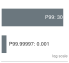
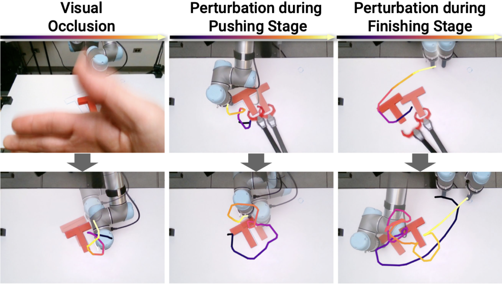
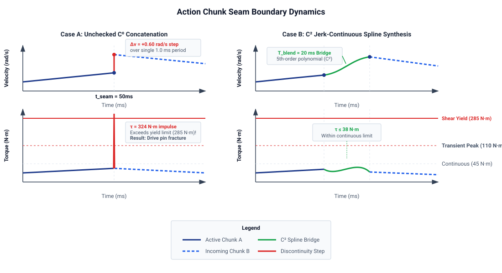
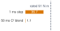

---
format:
  html:
    title: "Trajectory Planning"
---

# Trajectory Planning {#sec-planning}

::: {layout-narrow}
::: {.column-margin}

\chapterminitoc

:::

::: {.content-visible when-format="pdf"}
\noindent
{fig-alt="Isometric blueprint showing 3D flight trajectory planning for an autonomous aerial quadrotor drone: BLDC outrunner cutaway, aerodynamic thrust cones, executed cyan 3D polynomial spline threading an obstacle ring, prospective amber waypoint chunk, and crimson hover-recovery stopping suffix landing on a terminal perch."}
:::

::: {.content-visible unless-format="pdf"}
{fig-alt="Isometric blueprint showing 3D flight trajectory planning for an autonomous aerial quadrotor drone: BLDC outrunner cutaway, aerodynamic thrust cones, executed cyan 3D polynomial spline threading an obstacle ring, prospective amber waypoint chunk, and crimson hover-recovery stopping suffix landing on a terminal perch."}
:::

:::

## Purpose {.unnumbered .unlisted}

::: {.content-visible when-format="pdf"}
\begin{marginfigure}
\resizebox{0.92\linewidth}{!}{\mlphysicalstackfull{100}{20}{20}{20}{20}}
\end{marginfigure}
:::

_What does a moving machine do during the unbudgeted milliseconds while its neural planner computes the next trajectory, and how do you guarantee continuous safety across receding horizons?_

In classic motion planning, algorithms such as RRT* or trajectory optimization formulate paths through static geometric representations, assuming computation time is an offline cost. In modern learned systems, neural action chunkers and diffusion policies predict sequences of future actions from high-dimensional sensor streams. Yet on a physical machine traveling with nonzero momentum, time does not pause while the planner executes its optimization loop. If a trajectory generation algorithm requires two hundred milliseconds to evaluate a trajectory, the robot must already be executing a previously verified plan that guarantees dynamic feasibility and collision-free clearance throughout that computation window. This fundamental timing tension requires motion planning to be formulated as a receding-horizon pipeline with continuous temporal overlap. Every candidate trajectory chunk must not only achieve operational progress toward the goal, but must terminate in a guaranteed, physically viable safe stopping suffix—a pre-computed trajectory that can safely bring the machine to a standstill within verified clearance margins if the next planning cycle is delayed. This chapter examines the architecture of real-time trajectory generation, exploring how learned action chunking, model predictive control, and formal collision checking combine to ensure smooth, continuous, and dynamically feasible physical motion under hard real-time deadlines.



::: {.callout-learning-objectives}

- Select trajectory horizons from replacement latency, target-evidence age, and the time the stop needs
- Evaluate trajectory feasibility and seam continuity against the body's actuator and transmission limits
- Distinguish trajectory failures detectable before execution from those requiring monitoring during physical motion
- Calculate the distance a matched stop suffix adds to the machine's stopping budget and compare it with the clear distance
- Specify the commitment deadline and matched stop that govern a replacement trajectory arriving late or never
- Construct a trajectory record that the permission path can admit by content, from its parent lease, deadlines, and stop

:::

## Continuous Trajectory Generation {#sec-planning-continuous-trajectories}

```{python}
#| label: calc-planning-opening-machine
#| echo: false
#| warning: false
#| message: false
# ┌─────────────────────────────────────────────────────────────────────────────
# │ THE MACHINE'S ARM LOOP AND CHUNK-POLICY LATENCY
# ├─────────────────────────────────────────────────────────────────────────────
# │ Context: @sec-planning-continuous-trajectories (opening paragraph).
# │
# │ Goal:    Pin the arm tracking rate and chunk inference latency the opening
# │          quotes for the warehouse mobile manipulator.
# │ Show:    1 kHz joint loop; 40 ms P99 chunk inference; 150 ms interference tail.
# │ How:     RM registry fields; the tail is a scenario assumption.
# └─────────────────────────────────────────────────────────────────────────────
from mlsysim import *
from mlsysim.core.units import millisecond
from mlsysim.fmt import check, fmt_frequency, fmt_latency

RM = Embodied.MobileManipulator.WarehouseMobileManipulator

class PlanningOpeningMachine:
    """Arm tracking rate and chunk-policy inference latency on the machine."""

    # ┌── 1. LOAD (Constants) ──────────────────────
    f_track = RM.arm.control_frequency  # category: datasheet; arm joint loop, registry
    t_chunk = RM.chunk_inference_latency  # category: illustrative; P99 incl. vision, registry
    t_tail = 150 * millisecond  # category: illustrative; interference tail

    # ┌── 2. EXECUTE (The Compute) ─────────────────
    tail_over_nominal = (t_tail / t_chunk).to("dimensionless").magnitude

    # ┌── 3. GUARD (Invariants) ────────────────────
    check(abs(f_track.to("hertz").magnitude - 1000.0) < 1e-9, "arm loop rate changed")
    check(abs(t_chunk.to(millisecond).magnitude - 40.0) < 1e-9, "chunk inference latency changed")
    check(tail_over_nominal > 3, "interference tail no longer several times the nominal pass")

    # ┌── 4. OUTPUT (Formatting) ───────────────────
    f_track_str = fmt_frequency(f_track)
    t_chunk_str = fmt_latency(t_chunk, unit=millisecond)
    t_tail_str = fmt_latency(t_tail, unit=millisecond)
```

Whether synthesizing three-dimensional flight trajectories for an autonomous aerial drone threading an obstacle ring via aerodynamic thrust cones and perch-landing stopping suffixes (as depicted on this chapter's cover blueprint) or guiding the articulated arm of a warehouse mobile manipulator reaching for a mug on a moving conveyor, the underlying physical and mathematical imperatives are identical. The mechanism possesses physical mass, structural inertia $\mathbf{M}(\mathbf{q})$, and continuous kinetic energy $E_k = \frac{1}{2} \dot{\mathbf{q}}^T \mathbf{M}(\mathbf{q}) \dot{\mathbf{q}}$. It cannot change velocity or direction instantly. Even when upstream autonomy grants a time-bounded intent lease, authorizing motion toward a grounded semantic goal, that semantic permission alone cannot turn motor shafts. The machine must synthesize continuous nominal motion while target evidence remains valid, plus a separately authorized stopping continuation if tracking authority ends. Conceptually, every trajectory must carry a pre-computed "return ticket": an achievable deceleration profile that brings the mechanism to a safe standstill within current clearance. If an upstream neural policy misses an inference deadline or wireless communications drop, the robot never charges blindly into unverified space at full speed; it simply activates its return ticket and comes to a controlled stop. On this machine the arm's joint tracking loop evaluates feedback and setpoints at `{python} PlanningOpeningMachine.f_track_str` (datasheet; see the Reader Guide); that period does not specify the physical stopping response. Above this loop sits the Brain, where modern robot learning policies, such as Action Chunking with Transformers (ACT) [@zhao2023learning] or score-based Diffusion Policies [@chi2024diffusionpolicy], process multimodal observations to synthesize future reference paths on the application processor.[^fn-plan-action-chunking] Inference latency varies with workload and contention. The machine's chunk policy is budgeted at an illustrative `{python} PlanningOpeningMachine.t_chunk_str` per pass at P99, vision included, yet memory or scheduling interference can stretch a single pass beyond `{python} PlanningOpeningMachine.t_tail_str`, so the horizon is sized from the deployed tail rather than from the budget.

::: {.column-margin .margin-pointer}
↩ Kinetic energy ($E_k$) and joint torque limits are established in @sec-body-kinetic-momentum.
:::

If an architecture predicts actions one step ahead ($N = 1$), the motor tracking loop starves. If it generates a multi-step action chunk of $N > 1$ setpoints across a finite future horizon, the machine must cross an **execution seam**, the junction where one chunk's setpoints give way to the next. When an active trajectory chunk finishes executing before its replacement clears the tail of the inference distribution, the controller faces an execution discontinuity. If the controller clamps to the final position, the reference velocity steps to zero and asks the drive to remove the arm's momentum within one servo tick. If a newly arrived chunk begins with a velocity or acceleration that diverges from the physical state of the moving mechanism, the commanded torque steps and excites the structure.

A natural question is why an intermediate trajectory planning layer is necessary at all: why not train an end-to-end neural policy to output motor torques directly at the 1 kHz servo rate? Two hard physical constraints rule this out. First, high-capacity neural networks cannot execute at 1 kHz within the thermal and electrical power budgets of mobile embedded platforms (typically 15 to 50 watts on an accelerator such as the Jetson Orin). Second, even if a lightweight model could achieve 1 kHz nominal throughput, inference latency jitter introduces variable zero-order hold (ZOH) phase lag, $\phi_{\text{lag}} = \omega \Delta t$, into the feedback loop. In high-gain position and impedance control, phase lag directly erodes the control loop's phase margin, inducing destructive high-frequency chatter and mechanical limit cycles. The trajectory abstraction is therefore the mandatory cyber-physical decoupling boundary: the neural policy plans smooth, multi-step reference trajectories across hundreds of milliseconds, while deterministic real-time servo loops track those references at sub-millisecond cadence.

[^fn-plan-action-chunking]: **Action chunking representations**\index{Action chunking!architectures}\index{Policy learning!temporal horizons}: ACT and Diffusion Policy chunks carry no boundary-derivative constraints, so the planner must propose a transition bridge across each replanning seam, and the permission path checks it before admission.

::: {#dfn-planning-kinodynamic-feasibility-envelope .callout-definition title="Kinodynamic feasibility envelope"}

***Kinodynamic feasibility envelope***\index{Kinodynamic feasibility envelope!definition}\index{Feasibility!kinodynamic} is the subset of state space from which a physical machine can track a candidate trajectory while strictly satisfying simultaneous actuator torque limits, velocity ceilings, and jerk bounds, with position, velocity, and acceleration continuous across segment seams, without exceeding mechanical stopping margins.

1.  **Significance**: Geometric collision freedom is necessary but insufficient for physical execution; an arm may follow a collision-free path that nonetheless demands motor torques exceeding continuous thermal ratings or produces accelerations that tip an underactuated base. The envelope states the conditions under which the model predicts trackable motion; runtime sensing and actuator checks must still validate them.
2.  **Distinction**: Unlike pure kinematic reachability (which evaluates whether the robot's linkages can attain a spatial configuration), kinodynamic feasibility incorporates time parameterization, actuator force and torque limits, reflected inertia, and mechanical braking runways.
3.  **Common pitfall**: Checking feasibility only at discrete waypoints. Interpolation splines between sample points can produce intra-sample velocity overshoots and torque spikes that breach motor limits even when every individual waypoint passes validation.

:::

Intent defines the admissible goal; planning supplies the continuous motion, temporal parameterization, and dynamic limits needed to pursue that goal. Across the proposal boundary (@sec-boundary-machine-model), a plan is not a command written to actuator registers. It is an unprivileged proposal, sent from the application processor to the safety microcontroller (MCU), where the tracking controller follows it and the permission path (@sec-enforcement) checks it.[^fn-plan-nervous-gatekeeper] Because inference latency has a long tail, the downstream controller in this design consumes admitted references on its own clock and cannot suspend physical motion while the model finishes. A plan must therefore be self-contained. It carries its own seam state, continuous through acceleration ($C^2$),[^fn-plan-c2-spline] its own deadlines, and its own stop, a stopping suffix admitted with the nominal motion so that the stopping continuation exists before it is needed.

::: {.column-margin .margin-pointer}
↩ Expiring intent leases provide the bounded time windows discharged by trajectories in @sec-intent-lease.
:::

[^fn-plan-nervous-gatekeeper]: **Deterministic proposal verification**\index{Nervous system!gatekeeper}\index{Safety enforcement!execution buffer}: The permission path isolates unprivileged trajectory proposals within hardware-managed staging buffers and admits one only after checking it there (@sec-planning-behavior-seam), so no unchecked setpoint reaches the motor control registers. For runtime safety filter architectures, see @sec-enforcement-deterministic-gatekeeper.

[^fn-plan-c2-spline]: **$C^2$ derivative continuity**\index{C2 continuity@$C^2$ continuity}\index{Drivetrain!jerk dynamics}: $C^2$ continuity means that position, velocity, and acceleration remain unbroken functions of time across trajectory boundaries. In permanent-magnet synchronous motors (PMSM), electromagnetic torque couples directly to quadrature stator current ($\tau = K_t I_q$). An acceleration step asks for a finite torque and current step under this model, while a velocity step implies an ideal acceleration impulse.

Momentum, a long inference tail, and a seam that must stay continuous together decide what a plan has to contain. The first decision is therefore what the planner hands to the tracking controller and the permission path while the arm is still moving.

## The Planning Handoff and Trajectory Contracts {#sec-planning-handoff}

In the cyber-physical architecture of embodied AI, trajectory planning operates at the critical **$P \cap A$ (Planning-to-Action) boundary**. The planner does not invent reference motions in an abstract vacuum. Instead, it consumes two upstream contracts: the **Scene Memory State** (`SceneMemoryState`, Contract 8 from @sec-memory), which supplies verified geometric free space $\mathcal{C}_{\mathrm{free}} = \mathcal{C} \setminus \mathcal{C}_{\mathrm{obs}}$, 3D Euclidean Signed Distance Fields (ESDF), and raycast obstacle clearance margins; and the **Intent Specification** (`IntentSpecification`, Contract 9 from @sec-intent), which supplies the grounded semantic goal set, task tolerance balls, effort ceilings, and time-bounded intent lease ($t_{\mathrm{intent\_exp}}$). From these inputs, the planner's mandate is to synthesize time-parameterized, dynamically feasible reference trajectories that respect the actuator and transmission limits of the physical body (@sec-body).

::: {.column-margin}
{width="100%" fig-alt="S·P·A locator triad highlighting the Plan-to-Act boundary edge."}
*The Plan $\cap$ Act interface: synthesizing dynamically feasible trajectories with certified stopping continuations.*
:::

For a two-joint arm, one pair of joint angles $(q_1,q_2)$ is one point in **configuration space**\index{Configuration space!definition} $\mathcal{C}$. An obstacle excludes some angle pairs, leaving $\mathcal{C}_{\mathrm{free}}=\mathcal{C}\setminus\mathcal{C}_{\mathrm{obs}}$. A curve through that free set says where the arm may move, but not how quickly it may move or whether its motors can supply the required torque [@lozanoperez1983spatial]. A **trajectory**\index{Executable trajectory!definition} assigns time to the curve and exposes $\mathbf{x}(t)=[\mathbf{q}(t)^T,\dot{\mathbf{q}}(t)^T,\ddot{\mathbf{q}}(t)^T]^T$. The planner proposes that time-indexed reference, and the permission path checks it before any setpoint reaches the drive. A geometric path alone supplies neither timing nor fallback clearance.

```{python}
#| label: calc-planning-lease-rule
#| echo: false
#| warning: false
#| message: false
# ┌─────────────────────────────────────────────────────────────────────────────
# │ ONE CHUNK LEASE FOR BOTH BODIES: THE ARM'S LEASE PATH AND CEILING
# ├─────────────────────────────────────────────────────────────────────────────
# │ Context: @sec-planning-handoff (TRACK/STOP paragraph),
# │          @sec-planning-behavior-seam (arm lease path),
# │          @sec-planning-trajectory-contract (record expiry, filled record).
# │
# │ Goal:    Charge the arm's stop from the last admitted chunk when the
# │          shared chunk lease lapses, and bound the lease by commitment.
# │ Show:    60 ms lease, renewed every 50 ms; lease path 60 + 1 + 1 + 20 =
# │          82 ms, 82 mm at 1.0 m/s; with the 150 mm C2 stop, 232 mm of
# │          300 mm, leaving 68 mm against 90 mm on the commitment path;
# │          lease ceiling 300 - 22 = 278 ms.
# │ How:     AISLE lease, tick, bus, and brake onset (charged as the arm's
# │          onset, conservative); RM TCP limit; calc_c2_stop_suffix. The arm's
# │          worked deadlines and clearance are defined here and read by
# │          calc-planning-arm-timeline and calc-planning-c2-stop-clearance.
# └─────────────────────────────────────────────────────────────────────────────
from mlsysim import *
from mlsysim.core.units import ureg, millisecond
from mlsysim.fmt import check, fmt_latency, fmt_length, fmt_velocity

RM = Embodied.MobileManipulator.WarehouseMobileManipulator
AISLE = Embodied.Scenario.WarehouseAisle

class PlanningLeaseRule:
    """The shared chunk lease applied to the arm: lease path and commitment ceiling."""

    # ┌── 1. LOAD (Constants) ──────────────────────
    t_lease = AISLE.t_lease  # category: chosen; chunk lease (@sec-nervous-cadences), registry
    f_renew = RM.chunk_rate  # category: chosen; admitted-chunk renewal rate, registry
    t_tick = AISLE.t_tick  # category: derived; permission-loop period, registry
    t_bus = AISLE.t_bus  # category: illustrative; fieldbus cycle, registry
    t_onset = AISLE.t_brake_onset  # category: illustrative; brake onset, charged as the arm's onset
    v_arm = RM.tcp_speed_limit  # category: chosen; free-space TCP limit, registry
    t_blend = 240 * millisecond  # category: chosen; blend deadline
    t_commit = 300 * millisecond  # category: chosen; physical suffix onset
    t_arm_stop = 300 * millisecond  # category: illustrative; arm stop duration
    d_arm_clear = 300 * ureg.millimeter  # category: illustrative; obstacle clearance

    # ┌── 2. EXECUTE (The Compute) ─────────────────
    t_renew = (1 / f_renew).to(millisecond)
    t_lease_slack = (t_lease - t_renew).to(millisecond)
    t_dispatch = (t_tick + t_bus + t_onset).to(millisecond)
    t_lease_path = (t_lease + t_dispatch).to(millisecond)
    d_lease_path = (v_arm * t_lease_path).to(ureg.millimeter)
    arm_stop_dist = calc_c2_stop_suffix(v_arm, (1.5 * v_arm / t_arm_stop).to(ureg.meter / ureg.second**2))["distance"].to(ureg.millimeter)
    lease_total = d_lease_path + arm_stop_dist
    lease_margin = d_arm_clear - lease_total
    commit_margin = d_arm_clear - (v_arm * (t_commit - t_blend)).to(ureg.millimeter) - arm_stop_dist
    t_lease_max = (t_commit - t_dispatch).to(millisecond)

    # ┌── 3. GUARD (Invariants) ────────────────────
    check(abs(t_lease.to(millisecond).magnitude - 60.0) < 1e-9, "chunk lease changed")
    check(abs(t_renew.magnitude - 50.0) < 1e-9, "renewal period changed")
    check(t_renew < t_lease, "lease no longer outlasts one renewal period")
    check(abs(t_lease_slack.magnitude - 10.0) < 1e-9, "lease slack beyond one renewal period changed")
    check(abs(t_lease_path.magnitude - 82.0) < 1e-9, "arm lease path changed")
    check(abs(d_lease_path.magnitude - 82.0) < 1e-9, "arm lease-path travel changed")
    check(abs(arm_stop_dist.magnitude - 150.0) < 1e-9, "arm C2 stop distance changed")
    check(abs(lease_total.magnitude - 232.0) < 1e-9, "arm lease-path stop total changed")
    check(abs(lease_margin.magnitude - 68.0) < 1e-9, "arm lease-path margin changed")
    check(abs(commit_margin.magnitude - 90.0) < 1e-9, "arm commitment-path margin changed")
    check(lease_margin < commit_margin, "lease path no longer the tighter arm case")
    check(abs(t_dispatch.magnitude - 22.0) < 1e-9, "tick + bus + onset changed")
    check(abs(t_lease_max.magnitude - 278.0) < 1e-9, "arm lease ceiling changed")
    check(t_lease < t_lease_max, "chunk lease exceeds the arm's commitment ceiling")

    # ┌── 4. OUTPUT (Formatting) ───────────────────
    t_lease_str = fmt_latency(t_lease, unit=millisecond)
    t_renew_str = fmt_latency(t_renew, unit=millisecond)
    t_lease_slack_str = fmt_latency(t_lease_slack, unit=millisecond)
    t_dispatch_str = fmt_latency(t_dispatch, unit=millisecond)
    t_lease_path_str = fmt_latency(t_lease_path, unit=millisecond)
    d_lease_path_str = fmt_length(d_lease_path, unit=ureg.millimeter)
    v_arm_str = fmt_velocity(v_arm)
    arm_stop_dist_str = fmt_length(arm_stop_dist, unit=ureg.millimeter)
    lease_total_str = fmt_length(lease_total, unit=ureg.millimeter)
    lease_margin_str = fmt_length(lease_margin, unit=ureg.millimeter)
    commit_margin_str = fmt_length(commit_margin, unit=ureg.millimeter)
    d_arm_clear_str = fmt_length(d_arm_clear, unit=ureg.millimeter)
    t_lease_max_str = fmt_latency(t_lease_max, unit=millisecond)
```

What the planner hands over is a **trajectory record** (the **Trajectory Plan** record, `TrajectoryPlan`, the tenth contract in the physical AI lineage)\index{Trajectory record!definition}\index{Trajectory Plan!contract record}, the immutable proposal that the tracking controller follows and the permission path admits. Consuming the geometric obstacle bounds from the Scene Memory State (Contract 8) and the task target and lease window from the Intent Specification (Contract 9), this tenth contract binds the unprivileged reference setpoints to certified physical invariants. It names its coordinate frame $\mathcal{F}$, evidence time $t_0$, initial reference state, and four deadlines in the **MCU monotonic clock domain**: nominal tracking begins at $t_{\mathrm{start}}$, the nominal setpoints end at $t_{\mathrm{plan\_exp}}$, replacement closes at $t_{\mathrm{commit}}$, and the admitted stop finishes at $t_{\mathrm{stop\_end}}$. It also links to the active intent expiry $t_{\mathrm{intent\_exp}}$. Conversion from the sensor and host clocks carries a bounded error. The planner schedules each replacement against an earlier target, the blend deadline $t_{\mathrm{blend}}$, by which the successor should be admitted and at which the arm's obstacle clearance is last checked; it is the schedule's target, not a field of the record.

The permission path permits nominal **TRACK** only while the intent and plan remain valid, so the intent's expiry ends TRACK at once, whatever the record's own deadlines allow. To manage unexpected compute stalls and hardware faults safely, the system enforces a strict **two-tier deadline hierarchy**:

1.  **Fast Nervous System periodic chunk lease ($t_{\mathrm{lease}} = 60\ \text{ms}$):** This high-rate heartbeat governs the real-time execution contract between Brain and Nervous System. The chunk policy proposes base velocity and arm joint targets together, so one chunk lease (@sec-nervous-cadences) governs both bodies, and only an admitted replacement chunk renews it, every `{python} PlanningLeaseRule.t_renew_str` on this machine. If an upstream inference pass hangs or communication drops, the lease lapses `{python} PlanningLeaseRule.t_lease_slack_str` after its expected renewal, triggering an immediate controlled stop long before the full trajectory finishes.
2.  **Trajectory commitment deadline ($t_{\mathrm{commit}} = 300\ \text{ms}$):** This internal planning deadline represents the point of no return for receding-horizon replacement. Because deceleration requires dedicated physical clearance, nominal tracking cannot continue past $t_{\mathrm{commit}}$ without an admitted successor. Replacement admission closes strictly at $t_{\mathrm{commit}}$.

These two distinct deadlines dictate two fundamentally different stopping mechanisms:

-   **Matched stop suffix (planned termination at $t = t_{\mathrm{commit}}$):** A pre-computed, continuous $C^2$ polynomial deceleration continuation anchored specifically at the nominal state expected at $t_{\mathrm{commit}}$. If an ongoing trajectory chunk executes normally toward its end but no successor chunk is admitted by $t_{\mathrm{commit}}$, the controller smoothly transfers to this pre-latched suffix at commitment, decelerating to rest without requiring runtime replanning.
-   **Live state-matched fallback (reactive termination at $t < t_{\mathrm{commit}}$):** If the high-rate chunk lease lapses, the parent intent expires, or a runtime safety monitor detects an unmodeled obstacle or torque fault *before* reaching $t_{\mathrm{commit}}$, the robot cannot use the matched stop suffix (which is anchored at the future state $t_{\mathrm{commit}}$). Instead, the MCU instantly generates a live state-matched fallback directly from live joint encoder telemetry, solving the $C^2$ deceleration polynomial on the fly from the current measured state $(q, \dot{q}, \ddot{q})$ within reserved clearance.

Importantly, statistical temporal ensembling across overlapping model inferences is a coordinate-space heuristic, not a dynamical property. Exponentially averaging predicted positions cannot provide derivative continuity. Only an analytical boundary-value bridge, such as a quintic spline matching position, velocity, and acceleration, guarantees finite actuator torques across replanning cycles.

After a lease lapse, the arm's stop begins one permission tick, one bus cycle, and one brake onset later; together with the lease itself, these delays make up the renewal-to-onset delay of @sec-nervous-cadences. Commitment caps the lease, because stop onset must come by $t_{\mathrm{commit}}$, so no lease may run longer than $t_{\mathrm{commit}}$ less those three delays. Only a lease run near that ceiling lets a record reach $t_{\mathrm{commit}}$ without a successor; such a record transfers to **STOP** on its matched stop suffix, which may finish after the intent's tracking permission expires. On this machine the `{python} PlanningLeaseRule.t_lease_str` lease lapses long before commitment, so a stalled proposer meets the renewal-to-onset delay rather than the ceiling, and @sec-planning-behavior-seam charges that delay against the arm's clearance.

The two consumers read different parts of the record. The tracker interpolates the admitted reference, timestamps, and feedforward terms to drive the actuators along a smooth path. The independent permission path reads the lineage, timing, dynamic assumptions, validity bounds, and stop suffix, and it monitors current limits and authority without inheriting the planner's feasibility claim as proof; a fresh obstacle, changed payload, or contact event can revoke TRACK and invoke the state-matched fallback. Because each field in the handoff corresponds to a runtime check, the Nervous System can admit fast motion without assuming that the next inference cycle will succeed. Producing such a record begins from a goal that carries no timing at all.

## Trajectory Synthesis from Discrete Goals {#sec-planning-goal-to-trajectory}

The intent lease for the mug, which the arm takes from the conveyor for the coworker at the packing station, grants a goal region and effort ceilings (@sec-intent-lease), but no actuator can execute a region. The tracking controller needs a trajectory, which assigns state targets, feedforward terms, and timestamps across a bounded interval. If a learned policy could output valid motor currents at the `{python} PlanningOpeningMachine.f_track_str` joint loop rate, planning would not exist as an architectural stage, and the machine would operate as a high-rate feedback controller. Learned policies instead need tens or hundreds of milliseconds to compute a motion sequence, while the tracking controller and the permission path run deterministically on fixed millisecond-scale periods. Reconciling these asynchronous cognitive timescales with hard real-time execution demands structured trajectory synthesis across three distinct paradigms.

### Geometric search, numerical MPC, and learned action chunking {#sec-planning-paradigms}

Classical sampling-based planners answer the geometric half of this problem. A probabilistic roadmap\index{Probabilistic roadmap} [@kavraki1996probabilistic] or a rapidly-exploring random tree\index{Rapidly-exploring random tree} [@lavalle1998rapidly] searches $\mathcal{C}_{\text{free}}$ for a collision-free path without building an explicit model of the obstacles. A path from such a search, like a chunk from a learned policy, still carries no timing, no derivatives at its ends, and no stop, and those are what this chapter supplies.

Learned proposers bridge slow inference and fast actuator control by receding-horizon action chunking (@sec-brain-cognitive-pipeline), predicting a multi-step sequence, executing a prefix, and replanning on fresh observations. Three kinds of proposer fill this role, and each matters here through the latency and continuity of what it emits. ACT [@zhao2023learning] predicts $N$ future joint setpoints at once and blends overlapping chunks by the temporal ensembling of @sec-brain-cognitive-pipeline, which averages setpoints but leaves derivative continuity at the chunk seam to this chapter. Diffusion Policy [@chi2024diffusionpolicy] denoises a chunk of horizon $T_p$ (16 steps in the real Push-T setup), executes a subset $T_a$ (six there), and replans on the next observation; its iterative denoising adds workload-dependent latency and variance. A learned warm-start for a constrained trajectory optimizer can cut solver iterations when it lands near a feasible basin, but it can also choose the wrong side of an obstacle or miss the deadline. None of these outputs is a feasibility certificate, and only a candidate whose full path, seam, torque, and stop checks pass is admitted.

This receding-horizon structure mirrors classical **Model Predictive Control (MPC)**\index{Model Predictive Control!receding horizon}\index{Trajectory optimization!collocation and MPC} and trajectory optimization, where an optimizer plans a trajectory over a finite horizon $T$, executes an initial prefix, and resolves the problem from the updated state on the next cycle. Classical MPC formulates trajectory synthesis as an explicit constrained numerical optimization problem over discrete steps $k = 0, \dots, N-1$ [@tedrake2023manipulation; @lynch2017modern]:

$$\begin{aligned}
\min_{\mathbf{u}_{0:N-1}} \quad & \sum_{k=0}^{N-1} \ell(\mathbf{x}_k, \mathbf{u}_k) + \ell_f(\mathbf{x}_N) \\
\text{subject to} \quad & \mathbf{x}_{k+1} = f(\mathbf{x}_k, \mathbf{u}_k), \quad k = 0, \dots, N-1 \\
& \mathbf{x}_k \in \mathcal{X}_{\text{safe}}, \quad \mathbf{u}_k \in \mathcal{U}_{\text{adm}}, \quad k = 0, \dots, N-1 \\
& \mathbf{x}_N \in \mathcal{X}_f
\end{aligned}$$ {#eq-plan-mpc-formulation}

In @eq-plan-mpc-formulation, the stage cost $\ell(\mathbf{x}_k, \mathbf{u}_k)$ penalizes tracking error and control effort, while the safe state set $\mathcal{X}_{\text{safe}}$ enforces collision-free clearances obtained from the Scene Memory State (Contract 8), and the admissible control set $\mathcal{U}_{\text{adm}}$ enforces joint torque and voltage limits from the body's Limit Record. The crucial theoretical linchpin is the **terminal invariant set** $\mathbf{x}_N \in \mathcal{X}_f$: in control theory, *recursive feasibility* (the mathematical guarantee that if a feasible trajectory exists at time $t$, a feasible solution is guaranteed to exist at $t+1$) strictly requires that the terminal state $\mathbf{x}_N$ lands within a region where a known, safe control law keeps the system safe indefinitely. In physical robotics, $\mathcal{X}_f$ is precisely the set of states from which a safe braking policy can bring the machine to a complete rest within observed clearance.

Continuous-time optimal control problems are typically transcribed into finite-dimensional non-linear programs via **direct shooting** (forward-integrating controls) or **direct collocation** (parameterizing states and controls with polynomial splines and enforcing dynamic defect constraints $f(\mathbf{x}_k, \mathbf{u}_k) - \dot{\mathbf{x}}_k = \mathbf{0}$ at interior knots). Where analytical models accurately capture the physical plant and state dimensions remain compact, MPC provides rigorous guarantees of constraint satisfaction and closed-loop stability. Yet classical trajectory optimization hits the "Classical Wall" of @sec-brain-classical-wall when applied to unstructured open-world manipulation: numerical solvers cannot ingest high-dimensional semantic tokens (such as raw camera pixels or natural-language instructions) directly, and non-smooth contact mechanics or deformable objects introduce combinatorial local minima that render online numerical optimization intractable within real-time control periods. Generative action chunking resolves the semantic ingestion problem by learning continuous multimodal trajectory distributions directly from visual demonstrations, but sacrifices analytical guarantees. Specifically, learned policies predict multi-step action chunks open-loop without enforcing a terminal invariant constraint $\mathbf{x}_N \in \mathcal{X}_f$, destroying recursive feasibility: an aggressive chunk can drive the robot at high speed directly into a dynamic dead-end where no subsequent braking action can avoid impact. The physical AI architecture reconciles these paradigms by treating learned chunking policies as unprivileged semantic proposers across multi-second task horizons, while the deterministic safety microcontroller independently validates kinodynamic admissibility and enforces an invariant brake-to-stop suffix before actuation. @Tbl-11-planning-paradigms compares these three paradigms across their core systems properties.

| Trajectory paradigm                         | Input representation                                       | Dynamic and safety guarantees                                       | Typical solve rate | Boundary continuity across replanning                  |
|:--------------------------------------------|:-----------------------------------------------------------|:--------------------------------------------------------------------|:-------------------|:-------------------------------------------------------|
| Classical Numerical MPC                     | Low-dimensional state vector $\mathbf{x} \in \mathbb{R}^n$ | Hard constraint satisfaction and provable stability                 | 50–200 Hz          | Natural $C^2$ continuity via warm-starting             |
| Sampling-Based Optimization (MPPI, TrajOpt) | State vector and signed distance fields (ESDF)             | Soft constraint costs; probabilistic obstacle avoidance             | 20–60 Hz           | Requires spline smoothing or terminal costs            |
| Generative Action Chunking (ACT, Diffusion) | High-dimensional multimodal tokens (vision, text)          | Empirical demonstration distribution; zero formal safety guarantees | 5–20 Hz            | Coordinate-level $C^0$; requires explicit $C^2$ bridge |

: **Comparison of trajectory generation paradigms**: Classical control guarantees constraint satisfaction but cannot ingest high-dimensional semantic tokens; learned action chunking ingests vision but requires explicit downstream kinodynamic filtering and derivative boundary bridging. {#tbl-11-planning-paradigms tbl-colwidths="[22,23,23,14,18]"}

### Action chunk horizon sizing and reactive lag trade-offs {#sec-planning-horizon-tradeoff}

Before sizing the temporal prediction horizon $H$, the systems engineer must construct an end-to-end latency budget for the replacement pipeline. Trajectory replacement is not an instantaneous inference pass; it comprises a multi-stage data transport and verification sequence across the host processor and microcontroller.

```{python}
#| label: calc-planning-replacement-ledger
#| echo: false
#| warning: false
#| message: false
# ┌─────────────────────────────────────────────────────────────────────────────
# │ REPLACEMENT-LATENCY STAGE LEDGER FOR THE MACHINE'S CHUNK POLICY
# ├─────────────────────────────────────────────────────────────────────────────
# │ Context: @sec-planning-goal-to-trajectory (replacement-latency paragraph).
# │
# │ Goal:    Sum one representative pass of the replacement path, with the
# │          inference stage taken from the machine's chunk policy.
# │ Show:    15 + 5 + 40 + 2 + 18 + 1 = 81 ms.
# │ How:     RM chunk inference latency; other stages are scenario assumptions.
# └─────────────────────────────────────────────────────────────────────────────
from mlsysim import *
from mlsysim.core.units import millisecond
from mlsysim.fmt import check, fmt_latency

RM = Embodied.MobileManipulator.WarehouseMobileManipulator

class PlanningReplacementLedger:
    """Stage-by-stage replacement latency for one chunk-policy pass."""

    # ┌── 1. LOAD (Constants) ──────────────────────
    t_sense = 15 * millisecond  # category: illustrative; sensor ingress
    t_dma = 5 * millisecond  # category: illustrative; IPC and DMA transfer
    t_infer = RM.chunk_inference_latency  # category: illustrative; P99 incl. vision, registry
    t_deser = 2 * millisecond  # category: illustrative; deserialization
    t_validate = 18 * millisecond  # category: illustrative; full-trajectory validation
    t_admit = 1 * millisecond  # category: illustrative; activation

    # ┌── 2. EXECUTE (The Compute) ─────────────────
    t_sum = t_sense + t_dma + t_infer + t_deser + t_validate + t_admit

    # ┌── 3. GUARD (Invariants) ────────────────────
    check(abs(t_infer.to(millisecond).magnitude - 40.0) < 1e-9, "chunk inference latency changed")
    check(abs(t_sum.to(millisecond).magnitude - 81.0) < 1e-9, "stage ledger total changed")

    # ┌── 4. OUTPUT (Formatting) ───────────────────
    t_sense_str = fmt_latency(t_sense, unit=millisecond)
    t_dma_str = fmt_latency(t_dma, unit=millisecond)
    t_infer_str = fmt_latency(t_infer, unit=millisecond)
    t_deser_str = fmt_latency(t_deser, unit=millisecond)
    t_validate_str = fmt_latency(t_validate, unit=millisecond)
    t_admit_str = fmt_latency(t_admit, unit=millisecond)
    t_sum_str = fmt_latency(t_sum, unit=millisecond)
```

The scheduling quantity is **replacement latency** $L$: elapsed time from the observation needed for a new proposal through transfer, inference, full-trajectory validation, and admission. An illustrative stage ledger for the machine's chunk policy has `{python} PlanningReplacementLedger.t_sense_str` of sensing, `{python} PlanningReplacementLedger.t_dma_str` of direct memory access (DMA), the policy's `{python} PlanningReplacementLedger.t_infer_str` of inference, `{python} PlanningReplacementLedger.t_deser_str` of deserialization, `{python} PlanningReplacementLedger.t_validate_str` of validation, and `{python} PlanningReplacementLedger.t_admit_str` of activation, totaling `{python} PlanningReplacementLedger.t_sum_str`. When stages overlap or share contention, a sum of stage percentiles is not a percentile of the sum (@sec-body-measurement-freshness), so the horizon is sized from the end-to-end distribution of $L$.

$$L = t_{\mathrm{sense\_ingress}} + t_{\mathrm{ipc\_dma}} + t_{\mathrm{infer}} + t_{\mathrm{deser}} + t_{\mathrm{validate}} + t_{\mathrm{admit}}$$ {#eq-plan-replacement-latency}

The choice of action chunk prediction horizon $H$ introduces a fundamental systems dilemma between computational amortization and reactive responsiveness (@fig-11-planning-action-chunk-horizon). High-capacity vision-language-action (VLA) models and diffusion policies require non-trivial inference latency ($t_{\mathrm{infer}} \approx 180\ \text{ms}$ on embedded accelerators). If the planner evaluates actions single-step ($H = 1$), the compute duty cycle exceeds 100 percent ($t_{\mathrm{infer}} / \Delta t = 9.0$, or 900 percent), starving the 50 Hz control loop ($\Delta t = 20\ \text{ms}$) and causing the robot to pause and shudder between consecutive steps. Expanding the prediction horizon $H$ amortizes inference across multi-step execution windows, reducing accelerator duty cycle below 50 percent once $H \ge 18$. However, executing a long chunk open-loop inflates the mean reaction delay to dynamic obstacles, $\tau_{\mathrm{react}} \approx \frac{1}{2} H \Delta t + t_{\mathrm{infer}}$. The factor of $1/2$ reflects temporal expectation: because an unexpected disturbance or obstacle appears at a uniformly distributed random time $\tau \in [0, H \Delta t]$ within the chunk's execution window, the expected remaining wait time until the controller can transition to a freshly replanned chunk is $\frac{1}{H\Delta t} \int_0^{H\Delta t} (H\Delta t - \tau)\,d\tau = \frac{1}{2} H \Delta t$. Adding the downstream model inference latency $t_{\mathrm{infer}}$ yields the total reaction delay. When $H > 36$ ($>720\ \text{ms}$ physical window), reaction delay exceeds the dynamic obstacle avoidance threshold ($\sim 350\ \text{ms}$), causing closed-loop task success in dynamic environments to plunge from 90 percent down to single digits. The underlying physical phenomenon is open-loop dynamic blindness. When $H = 64$ at 50 Hz, the robot executes open-loop for $1.28\ \text{seconds}$. In a shared workspace with a moving coworker or conveyor, an obstacle traveling at $0.5\ \text{m/s}$ moves $\Delta x_{\text{obs}} = v_{\text{obs}} \tau_{\text{react}} = 64\ \text{cm}$ during that window, vast enough to breach obstacle clearance margins completely and cause closed-loop manipulation success to collapse from 90 percent to 4 percent. Sizing the action chunk horizon to the Pareto-optimal window $H^* \in [16, 24]$ achieves the necessary balance: compute duty cycle remains comfortably amortized at 38 to 45 percent while reaction latency stays below 400 ms, preserving high closed-loop success rates across both static and dynamic operating conditions.

::: {#fig-11-planning-action-chunk-horizon fig-env="figure" fig-pos="htb" fig-cap="**The action chunk horizon dilemma: compute amortization vs. dynamic reaction delay**: Two-panel systems evaluation across action chunk horizon $H$ under a 50 Hz control loop ($\\Delta t = 20\\ \\text{ms}$) and 180 ms model inference latency. Top: GPU compute duty cycle (red) drops below the 100 percent real-time feasibility ceiling only when $H \\ge 9$, while mean reaction delay to unexpected obstacles (blue) scales linearly with horizon length. Bottom: Closed-loop manipulation success rate across stationary objects (green) and moving obstacles (orange). While static tasks tolerate long horizons ($H > 30$), dynamic workspace interactions collapse due to open-loop latency, establishing an empirical Pareto-optimal operating window at $H^* \\in [16, 24]$ ($320\\text{--}480\\ \\text{ms}$ execution window)." fig-alt="Two-panel chart showing the action chunk horizon dilemma for horizons H from 1 to 64 steps at 50 Hz. Top panel shows GPU compute duty cycle descending from 900 percent at H=1 to below 100 percent at H=9 and leveling off at 15 percent at H=64, against mean dynamic reaction delay rising from 190 ms to 820 ms. Bottom panel shows closed-loop success rate: static workspace reaches 95 percent at H=16 to 24, while dynamic workspace peaks at 90 percent at H=20 before dropping to 4 percent at H=64 due to open-loop latency."}

```{python}
#| label: fig-11-planning-action-chunk-horizon
#| echo: false
#| message: false
#| warning: false

import matplotlib.pyplot as plt
import numpy as np

# Publication styling
plt.rcParams["font.sans-serif"] = ["Helvetica", "Arial", "DejaVu Sans"]
plt.rcParams["axes.edgecolor"] = "#334155"
plt.rcParams["axes.linewidth"] = 1.0

fig, (ax1, ax2) = plt.subplots(2, 1, figsize=(13.5, 9.4), sharex=True, dpi=300, facecolor="#FFFFFF")
ax1.set_facecolor("#FFFFFF")
ax2.set_facecolor("#FFFFFF")

dt = 0.020
t_inf = 0.180

H_fine = np.linspace(1, 64, 300)
H_discrete = np.array([1, 2, 4, 8, 12, 16, 20, 24, 32, 40, 48, 56, 64])

duty_cycle_fine = (t_inf / (H_fine * dt)) * 100.0
duty_cycle_discrete = (t_inf / (H_discrete * dt)) * 100.0

react_lag_fine = (0.5 * H_fine * dt + t_inf) * 1000.0
react_lag_discrete = (0.5 * H_discrete * dt + t_inf) * 1000.0

def static_success(h):
    turn_on = 1.0 / (1.0 + np.exp(-0.50 * (h - 10.0)))
    drift_penalty = np.where(h > 24, 0.0035 * np.maximum(0, h - 24) ** 1.35, 0.0)
    succ = (0.20 + 0.76 * turn_on - drift_penalty) * 100.0
    return np.clip(succ, 15.0, 95.0)

def dynamic_success(h):
    base = static_success(h) / 100.0
    lag = 0.5 * h * dt + t_inf
    collision_hazard = 1.0 / (1.0 + np.exp(-15.0 * (lag - 0.56)))
    dyn = base * (1.0 - 0.92 * collision_hazard)
    return np.clip(dyn * 100.0, 4.0, 92.0)

succ_static_fine = np.array([static_success(h) for h in H_fine])
succ_dyn_fine = np.array([dynamic_success(h) for h in H_fine])
succ_static_disc = np.array([static_success(h) for h in H_discrete])
succ_dyn_disc = np.array([dynamic_success(h) for h in H_discrete])

for ax in [ax1, ax2]:
    ax.grid(True, linestyle="--", linewidth=0.6, alpha=0.5, color="#E2E8F0")
    ax.set_axisbelow(True)
    ax.spines["top"].set_visible(False)
    ax.axvspan(1, 9, color="#FEF2F2", alpha=0.55, zorder=1)
    ax.axvspan(14, 26, color="#ECFDF5", alpha=0.60, zorder=1)
    ax.axvspan(36, 64, color="#FFFBEB", alpha=0.55, zorder=1)

ax1_twin = ax1.twinx()
ax1_twin.spines["top"].set_visible(False)
ax1_twin.grid(False)

line1 = ax1.plot(H_fine, duty_cycle_fine, color="#A51C30", linewidth=2.4, label="Compute Duty Cycle (Inference Load %)")
ax1.scatter(H_discrete, duty_cycle_discrete, color="#A51C30", s=35, zorder=4)

ax1.axhline(100.0, color="#DC2626", linestyle=":", linewidth=1.5, alpha=0.85)
ax1.text(2.5, 105.0, "Real-Time Execution Ceiling (100% GPU Load)", color="#DC2626", fontsize=8.5, fontweight="bold")

line2 = ax1_twin.plot(H_fine, react_lag_fine, color="#004B87", linewidth=2.4, linestyle="-.", label="Dynamic Obstacle Reaction Delay (ms)")
ax1_twin.scatter(H_discrete, react_lag_discrete, color="#004B87", marker="s", s=30, zorder=4)

ax1_twin.axhline(350.0, color="#004B87", linestyle=":", linewidth=1.5, alpha=0.7)
ax1_twin.text(42.0, 310.0, "Dynamic Avoidance Reflex Limit (~350 ms)", color="#004B87", fontsize=8.5, fontweight="bold")

ax1.set_ylim(0, 160)
ax1_twin.set_ylim(100, 950)

ax1.set_ylabel("GPU Compute Duty Cycle (%)", fontsize=10.5, fontweight="bold", color="#A51C30")
ax1_twin.set_ylabel("Mean Reaction Delay to Obstacle (ms)", fontsize=10.5, fontweight="bold", color="#004B87")

ax1.set_title("(a) Compute amortization vs. obstacle reaction delay", fontsize=11.5, fontweight="bold", color="#1E293B", pad=12)

ax1.text(5.0, 148, "Compute Starvation\n(Robot Stalls / Freezes)", ha="center", va="top", fontsize=8.2, fontweight="bold", color="#B91C1C")
ax1.text(20.0, 148, "Optimal Horizon Window\n(H* in [16, 24])", ha="center", va="top", fontsize=8.2, fontweight="bold", color="#047857")
ax1.text(50.0, 148, "Open-Loop Latency Hazard\n(Dynamic Collision Zone)", ha="center", va="top", fontsize=8.2, fontweight="bold", color="#B45309")

lines = line1 + line2
labels = [l.get_label() for l in lines]
ax1.legend(lines, labels, loc="upper center", bbox_to_anchor=(0.58, 0.98), frameon=True, facecolor="#FFFFFF", edgecolor="#CBD5E1", fontsize=8.6)

ax2.plot(H_fine, succ_static_fine, color="#1E793C", linewidth=2.4, label="Static Workspace (Stationary Objects)")
ax2.scatter(H_discrete, succ_static_disc, color="#1E793C", marker="o", s=40, zorder=4)

ax2.plot(H_fine, succ_dyn_fine, color="#D97706", linewidth=2.4, linestyle="-", label="Dynamic Workspace (Moving Obstacles / Human Co-worker)")
ax2.scatter(H_discrete, succ_dyn_disc, color="#D97706", marker="^", s=45, zorder=4)

best_H = 20
best_succ_dyn = dynamic_success(best_H)
ax2.scatter(
    best_H, best_succ_dyn, color="#10B981", edgecolors="#065F46", s=150, marker="*", zorder=6, label=f"Pareto Optimal Operating Point (H*={best_H})"
)

ax2.set_ylim(0, 108)
ax2.set_xlim(1, 64)

ax2.set_xlabel(
    "Action Chunk Horizon H (Predicted Steps at 50 Hz Control Cadence, Δt = 20 ms)", fontsize=11.0, fontweight="bold", color="#1E293B", labelpad=10
)
ax2.set_ylabel("Closed-Loop Success Rate (%)", fontsize=10.5, fontweight="bold", color="#1E293B")
ax2.set_title("(b) Closed-loop task success in static vs. dynamic environments", fontsize=11.5, fontweight="bold", color="#1E293B", pad=12)

def add_clean_badge(ax, text, xy, xytext, color="#1E293B", fontsize=8.2, arrow_color="#94A3B8"):
    bbox = dict(boxstyle="round,pad=0.4", facecolor="#FFFFFF", edgecolor="#CBD5E1", alpha=0.96, linewidth=0.8)
    arrowprops = dict(arrowstyle="->", color=arrow_color, linewidth=1.0, shrinkA=3, shrinkB=4)
    ax.annotate(
        text, xy=xy, xytext=xytext, fontsize=fontsize, fontweight="normal", color=color, bbox=bbox, arrowprops=arrowprops, va="center", zorder=10
    )

add_clean_badge(
    ax2,
    "Single-Step (H=1) Failure:\nSevere GPU inference stutter (T_inf = 180 ms);\nrobot execution pauses between steps.",
    xy=(1, succ_dyn_disc[0]),
    xytext=(7.0, 10),
    color="#DC2626",
    fontsize=8.2,
    arrow_color="#DC2626",
)

add_clean_badge(
    ax2,
    "Optimal Balance (H* = 16-24):\nDuty cycle amortized to 38-45%;\nreaction latency kept under 400 ms.",
    xy=(best_H, best_succ_dyn),
    xytext=(20.0, 48),
    color="#047857",
    fontsize=8.2,
    arrow_color="#047857",
)

add_clean_badge(
    ax2,
    "Large Horizon (H=64) Failure:\nBlind open-loop execution for 1.28 s;\nfrequent collisions with dynamic obstacles.",
    xy=(64, succ_dyn_disc[-1]),
    xytext=(48.0, 26),
    color="#B45309",
    fontsize=8.2,
    arrow_color="#B45309",
)

ax2.legend(loc="upper right", bbox_to_anchor=(0.985, 0.96), frameon=True, facecolor="#FFFFFF", edgecolor="#CBD5E1", fontsize=8.8)

xticks_pos = [1, 8, 16, 24, 32, 40, 48, 56, 64]
xtick_labels = [f"H={h}\n({h*20}ms)" for h in xticks_pos]
ax2.set_xticks(xticks_pos)
ax2.set_xticklabels(xtick_labels, fontsize=8.8, fontweight="normal")

plt.tight_layout()
plt.show()
plt.close()
```
:::

### Tail latency budgeting and the mission exposure wall {#sec-planning-tail-latency-budgeting}

Machine learning benchmark evaluations typically report average-case or $P_{99}$ latency across millions of independent test queries. In cyber-physical motion control, however, mission failure is an absorbing barrier: an autonomous machine executing thousands of sequential trajectory handoffs will inevitably encounter the extreme tail of the compute distribution, where a single unhandled missed deadline precipitates physical collision.

```{python}
#| label: calc-planning-mission-exposure
#| echo: false
#| warning: false
#| message: false
# ┌─────────────────────────────────────────────────────────────────────────────
# │ MISSION EXPOSURE OF A P99 REPLACEMENT BUDGET
# ├─────────────────────────────────────────────────────────────────────────────
# │ Context: @sec-planning-goal-to-trajectory (design-tail paragraph),
# │          chk-plan-action-chunk-horizon-tail.
# │
# │ Goal:    Show why a per-handoff P99 budget says little about a mission, and
# │          derive the per-handoff design-tail target by the union bound.
# │ Show:    K = 600 s x 5 Hz = 3000; 30 late; 0.99^3000 ~ 8e-14;
# │          1e-3 / 3000 ~ 3.3e-7, i.e. P99.99997.
# │ How:     Generic replanner (not the machine's 20 Hz chunk renewal);
# │          independence assumed, as the prose states.
# └─────────────────────────────────────────────────────────────────────────────
from mlsysim import *
from mlsysim.core.units import ureg, second
from mlsysim.fmt import check, fmt, fmt_int, fmt_frequency, fmt_math, sci_latex

class PlanningMissionExposure:
    """Handoff count, late-handoff exposure, and union-bound design target."""

    # ┌── 1. LOAD (Constants) ──────────────────────
    t_mission = 600 * second  # category: illustrative; ten-minute mission
    f_replan = 5 * ureg.hertz  # category: illustrative; generic replanner rate
    p_late = 0.01  # category: definitional; exceedance of a P99 budget
    eps_mission = 1e-3  # category: chosen; mission exceedance target

    # ┌── 2. EXECUTE (The Compute) ─────────────────
    n_handoff = round((t_mission * f_replan).to("dimensionless").magnitude)
    n_late = n_handoff * p_late
    p_all = (1 - p_late) ** n_handoff
    eps_handoff = eps_mission / n_handoff
    q_pct = 100 * (1 - eps_handoff)

    # ┌── 3. GUARD (Invariants) ────────────────────
    check(n_handoff == 3000, "handoff count changed")
    check(abs(n_late - 30) < 1e-9, "expected late handoffs changed")
    check(7e-14 < p_all < 9e-14, "all-on-time probability changed")
    check(abs(eps_handoff - eps_mission / 3000) < 1e-15, "per-handoff target changed")

    # ┌── 4. OUTPUT (Formatting) ───────────────────
    f_replan_str = fmt_frequency(f_replan)
    n_handoff_str = fmt_int(n_handoff, commas=False)
    n_late_str = fmt_int(n_late)
    k_math = fmt_math(f"K={n_handoff}")
    p_all_math = fmt_math(rf"(0.99)^{{{n_handoff}}}\approx{sci_latex(p_all, precision=0)}")
    eps_math = fmt_math(rf"\epsilon\le\epsilon_{{\mathrm{{mission}}}}/K\approx{sci_latex(eps_handoff, precision=1)}")
    q_math = fmt_math(rf"P_{{{fmt(q_pct, precision=5, commas=False)}}}")
```

The component sum in @eq-plan-replacement-latency is an elapsed replacement path, not an absolute timestamp. Consider a generic replanner, slower than this machine's chunk renewal, that makes `{python} PlanningMissionExposure.k_math` handoffs in a ten-minute mission at `{python} PlanningMissionExposure.f_replan_str`. If each handoff independently has a $0.01$ chance of exceeding a $P_{99}$ budget, the expected number of late handoffs is `{python} PlanningMissionExposure.n_late_str` and the probability that *all* arrive on time is `{python} PlanningMissionExposure.p_all_math`. Correlated contention clusters misses, which breaks the independence this arithmetic assumes. Allocating a mission exceedance target $\epsilon_{\mathrm{mission}}=10^{-3}$ equally gives a per-handoff target `{python} PlanningMissionExposure.eps_math` by the union bound. The corresponding `{python} PlanningMissionExposure.q_math` is a **design quantile target**, a risk allocation rather than an observed latency. A deployment either supports it with representative load testing and a conservative bound, or accepts a higher fallback rate.

::: {.column-margin}
{width="100%" fig-alt="Conceptual strip comparing a P99 latency allowance with a much rarer design-tail target. The rarer percentile is a risk allocation."}

*The tail target allocates replacement risk; observed latency and confidence determine whether the chosen deadline is credible.*
:::

The next request leaves no later than $T_{\mathrm{request}}$ after the active chunk starts. Admission must finish **before** $t_{\mathrm{commit}}$, not merely before the last nominal setpoint. With a replacement-latency target $Q_{1-\epsilon}(L)$ and reserve $T_{\mathrm{reserve}}$, require $t_{\mathrm{commit}}-t_{\mathrm{start}}\ge T_{\mathrm{request}}+Q_{1-\epsilon}(L)+T_{\mathrm{reserve}}$. The admitted stop then needs another $T_{\mathrm{stop}}$ under MCU authority. The complete **time horizon** $T_{\mathrm{record}}$ that the record must cover, regardless of encoding, has the lower bound:

$$T_{\mathrm{record}}\ge T_{\mathrm{request}}+Q_{1-\epsilon}(L)+T_{\mathrm{reserve}}+T_{\mathrm{stop}}$$ {#eq-plan-action-chunk-horizon}

```{python}
#| label: calc-planning-arm-timeline
#| echo: false
#| warning: false
#| message: false
# ┌─────────────────────────────────────────────────────────────────────────────
# │ AUTHORITY TIMELINE FOR THE CONVEYOR-TRACKING ARM
# ├─────────────────────────────────────────────────────────────────────────────
# │ Context: @sec-planning-goal-to-trajectory (horizon paragraph, evidence
# │          age), @sec-planning-behavior-seam (arm case).
# │
# │ Goal:    Hold the arm's timeline inputs in one place so the horizon bound,
# │          the evidence-age check, the C2 arm case, and the trajectory record
# │          read the same values.
# │ Show:    20 ms setpoint period; 60 ms request delay vs. the 50 ms chunk
# │          renewal period; 540 ms minimum authority (27 periods);
# │          240 ms replacement deadline; 300 ms commitment (60 ms slack);
# │          320 ms nominal end (H = 16 setpoints); 600 ms stop end (30 periods).
# │ How:     RM chunk step and horizon; the rest are scenario assumptions;
# │          eq-plan-action-chunk-horizon.
# └─────────────────────────────────────────────────────────────────────────────
from mlsysim import *
from mlsysim.core.units import millisecond
from mlsysim.fmt import check, fmt_frequency, fmt_latency, fmt_int

RM = Embodied.MobileManipulator.WarehouseMobileManipulator

class PlanningArmTimeline:
    """Replacement and stop timeline for the conveyor-tracking arm."""

    # ┌── 1. LOAD (Constants) ──────────────────────
    t_period = RM.chunk_step  # category: chosen; chunk setpoint period, registry
    n_horizon = RM.chunk_horizon  # category: chosen; setpoints per chunk, registry
    t_chunk = RM.chunk_inference_latency  # category: illustrative; P99 chunk pass incl. vision, registry
    t_request = 60 * millisecond  # category: chosen; request delay
    f_renew = RM.chunk_rate  # category: chosen; chunk renewal rate, registry
    q_latency = 160 * millisecond  # category: chosen; design-tail replacement-latency target
    t_reserve = 20 * millisecond  # category: chosen; admission reserve
    t_stop = PlanningLeaseRule.t_arm_stop  # category: illustrative; arm stop duration, calc-planning-lease-rule
    t_blend = PlanningLeaseRule.t_blend  # category: chosen; blend deadline, calc-planning-lease-rule
    t_commit = PlanningLeaseRule.t_commit  # category: chosen; physical suffix onset, calc-planning-lease-rule

    # ┌── 2. EXECUTE (The Compute) ─────────────────
    f_step = (1 / t_period).to("hertz")
    t_renew = (1 / f_renew).to(millisecond)
    request_slack = t_request - t_renew
    t_plan_exp = (n_horizon * t_period).to(millisecond)
    t_replace_min = t_request + q_latency + t_reserve
    t_record_min = t_replace_min + t_stop
    n_record_min = round((t_record_min / t_period).to("dimensionless").magnitude)
    commit_slack = t_commit - t_replace_min
    t_stop_end = t_commit + t_stop
    n_window = round((t_stop_end / t_period).to("dimensionless").magnitude)

    # ┌── 3. GUARD (Invariants) ────────────────────
    check(abs(t_period.to(millisecond).magnitude - 20.0) < 1e-9, "chunk setpoint period changed")
    check(n_horizon == 16, "chunk horizon changed")
    check(abs(t_plan_exp.magnitude - 320.0) < 1e-9, "nominal end changed")
    check(q_latency > PlanningReplacementLedger.t_sum > t_chunk, "design-tail target no longer beyond the stage ledger")
    check(abs(t_replace_min.to(millisecond).magnitude - 240.0) < 1e-9, "replacement deadline changed")
    check(abs(t_record_min.to(millisecond).magnitude - 540.0) < 1e-9, "minimum authority horizon changed")
    check(n_record_min == 27, "minimum duration equivalents changed")
    check(abs(commit_slack.to(millisecond).magnitude - 60.0) < 1e-9, "commitment slack changed")
    check(abs(t_stop_end.to(millisecond).magnitude - 600.0) < 1e-9, "arm stop end changed")
    check(n_window == 30, "authority-window duration equivalents changed")
    check(t_replace_min <= t_blend < t_commit < t_plan_exp < t_stop_end, "arm deadline order broken")
    check(abs(t_renew.magnitude - 50.0) < 1e-9, "chunk renewal period changed")
    check(request_slack.magnitude > 0, "request delay no longer exceeds the renewal period")

    # ┌── 4. OUTPUT (Formatting) ───────────────────
    t_period_str = fmt_latency(t_period, unit=millisecond)
    f_step_str = fmt_frequency(f_step)
    n_horizon_str = fmt_int(n_horizon)
    t_chunk_str = fmt_latency(t_chunk, unit=millisecond)
    t_request_str = fmt_latency(t_request, unit=millisecond)
    t_renew_str = fmt_latency(t_renew, unit=millisecond)
    request_slack_str = fmt_latency(request_slack, unit=millisecond)
    q_latency_str = fmt_latency(q_latency, unit=millisecond)
    t_reserve_str = fmt_latency(t_reserve, unit=millisecond)
    t_stop_str = fmt_latency(t_stop, unit=millisecond)
    t_replace_min_str = fmt_latency(t_replace_min, unit=millisecond)
    t_record_min_str = fmt_latency(t_record_min, unit=millisecond)
    n_record_min_str = fmt_int(n_record_min)
    t_blend_str = fmt_latency(t_blend, unit=millisecond)
    t_commit_str = fmt_latency(t_commit, unit=millisecond)
    commit_slack_str = fmt_latency(commit_slack, unit=millisecond)
    t_plan_exp_str = fmt_latency(t_plan_exp, unit=millisecond)
    t_stop_end_str = fmt_latency(t_stop_end, unit=millisecond)
    n_window_str = fmt_int(n_window)
```

The complete duration in @eq-plan-action-chunk-horizon includes the stop suffix. The machine's chunk policy emits a setpoint every `{python} PlanningArmTimeline.t_period_str` (the setpoint period $\Delta t_{\text{step}}$), `{python} PlanningArmTimeline.n_horizon_str` to a chunk, so one chunk carries `{python} PlanningArmTimeline.t_plan_exp_str` of nominal motion. For the conveyor-tracking arm, a chosen request delay of `{python} PlanningArmTimeline.t_request_str`, replacement target of `{python} PlanningArmTimeline.q_latency_str`, and reserve of `{python} PlanningArmTimeline.t_reserve_str`, with a separately checked `{python} PlanningArmTimeline.t_stop_str` stop, require at least `{python} PlanningArmTimeline.t_record_min_str` of complete motion authority, or `{python} PlanningArmTimeline.n_record_min_str` setpoint-period **duration equivalents**. This does not mean `{python} PlanningArmTimeline.n_record_min_str` stored setpoints: $N$ in the record counts only nominal samples; the stop is represented by its separately validated polynomial coefficients. An authority horizon that covered only the request delay, replacement target, and reserve would omit the stop runway.

The chunk policy sends its next request in the renewal slot `{python} PlanningArmTimeline.t_renew_str` after each chunk starts (@sec-brain-cognitive-pipeline), so in steady operation several requests are in flight at once, an admitted chunk arrives every `{python} PlanningArmTimeline.t_renew_str`, and their latencies overlap. The bound sets $T_{\mathrm{request}}$ `{python} PlanningArmTimeline.request_slack_str` above that slot, so it still holds for a request that leaves up to that much late.

The replacement target is a design-tail quantile of the whole replacement path, so it sits well beyond both the policy's `{python} PlanningArmTimeline.t_chunk_str` P99 pass and the `{python} PlanningReplacementLedger.t_sum_str` stage ledger. The blend deadline must fall at least `{python} PlanningArmTimeline.t_replace_min_str` after start, the sum of request delay, replacement target, and reserve, and the worked `{python} PlanningArmTimeline.t_commit_str` commitment of @sec-planning-behavior-seam leaves `{python} PlanningArmTimeline.commit_slack_str` beyond that target. In the worked arm, the chunk's nominal setpoints end at `{python} PlanningArmTimeline.t_plan_exp_str` and the admitted stop completes at `{python} PlanningArmTimeline.t_stop_end_str`, so the complete authority window spans `{python} PlanningArmTimeline.n_window_str` setpoint-period duration equivalents.

The `{python} PlanningArmTimeline.t_replace_min_str` replacement window is the arm's limit rather than its operating case. The shared lease of @sec-planning-handoff lapses once an admission falls more than `{python} PlanningLeaseRule.t_lease_slack_str` behind its slot, so a replacement that takes the full design tail ends in the arm's state-matched fallback long before the blend deadline, and the window instead sets how long any lease may run on this arm.

This timing lower bound competes with target-evidence age. Even under a qualified local tracker, where only the conveyor's residual slip carries the mug away from the tracker's prediction, @sec-intent-goals-expire finds that one observation stays inside the grasp tolerance for less time than the `{python} PlanningArmTimeline.t_commit_str` commitment. A single observation therefore cannot justify nominal tracking to commitment. The tracker must deliver fresh evidence before its horizon ends; otherwise TRACK ends at evidence expiry and the MCU uses its state-matched fallback. Extending a target timestamp because the compute tail is long would invert the permission rule.

Whatever the proposer, the systems interface treats the learned model as a stochastic producer of motion chunks, characterized by an empirical latency profile and an output horizon $N$; diffusion schedules, attention caching, and token generation shape that profile but sit below the first budgetable quantity. The execution buffer absorbs inference latency while the controller still reacts to disturbances, as demonstrated in the physical Push-T benchmark recoveries of @fig-11-action-chunking-trace. In this benchmark, an articulated pusher arm maneuvers a planar T-shaped block into a target fixture using a diffusion policy that predicts $T_p = 16$ future steps and executes $T_a = 6$ steps before replanning on fresh camera observations. The three panels highlight distinct closed-loop recovery behaviors:

1.  **Camera occlusion (left):** An opaque barrier temporarily obscures the workspace camera. Because the robot maintains an active execution buffer of predicted actions, it continues tracking its buffered trajectory open-loop through the blind interval rather than freezing in place. Once the occlusion clears, fresh visual features immediately re-anchor the diffusion process to correct accumulated positioning error.
2.  **In-flight target disturbance (center):** While the pusher is executing an active approach stroke, an external disturbance abruptly slides the T-block several centimeters away. Because the policy replans at 10 Hz (every 100 ms), the subsequent chunk discards the obsolete continuation and generates a new curved approach vector toward the displaced block without kinematic discontinuity.
3.  **Terminal target displacement (right):** When the block is jostled just as the pusher approaches the final keyed insertion slot, fine corrective sweeps dynamically re-align the end-effector to complete the mating sequence.

While these empirical recoveries show the strength of receding-horizon replanning under active perception, they also expose a critical systems vulnerability: the benchmark assumes continuous GPU compute availability and incorporates *no stopping suffix*. If the host GPU suffers an inference hang, thermal throttling, or bus fault during any of these dynamic pushes, the arm would coast open-loop into whatever lies along its last commanded vector. Sizing $N$ against a validated latency distribution lowers the probability of a missed replacement, but safety requires the invariant stopping suffix developed next.

::: {#fig-11-action-chunking-trace fig-env="figure" fig-pos="t" fig-cap="**Push-T disturbance recovery**: Chi et al. report a real Push-T configuration with 16 predicted and 6 executed action steps; 10 Hz commands were interpolated to 125 Hz. The recoveries show closed-loop replanning; the experiment includes no stopping suffix and no inference-starvation case [@chi2024diffusionpolicy]." fig-alt="Three Push-T examples show recovery from camera occlusion, in-flight target movement, and target movement near completion. The real Push-T configuration predicts 16 steps and executes 6 before replanning; the experiment includes no stopping suffix."}
{width="100%"}
:::

### Future-state conditioning and execution delay compensation {#sec-planning-future-state-conditioning}

Because trajectory synthesis requires nonzero compute time, a replacement plan cannot be initiated from the robot's state at the moment the solver is invoked. Planning from a stale measurement introduces the Stale-State Paradox: when the planner finishes 80 ms later, commanding the robot along that trajectory instructs the physical mechanism to jump instantaneously back to where it was 80 ms ago, creating an intolerable step discontinuity in position and velocity.

```{python}
#| label: calc-planning-stale-pose-gap
#| echo: false
#| warning: false
#| message: false
# ┌─────────────────────────────────────────────────────────────────────────────
# │ STALE REQUEST-EPOCH POSE GAP
# ├─────────────────────────────────────────────────────────────────────────────
# │ Context: @sec-planning-goal-to-trajectory (projected-seam paragraph).
# │
# │ Goal:    Show how far a moving reference runs ahead of a pose captured when
# │          the replacement was requested.
# │ Show:    0.50 rad/s x 80 ms = 0.040 rad (2.29 degrees).
# │ How:     Illustrative delay and joint speed.
# └─────────────────────────────────────────────────────────────────────────────
from mlsysim import *
from mlsysim.core.units import ureg, millisecond, second
from mlsysim.fmt import check, fmt, fmt_angular_velocity, fmt_angle, fmt_latency

class PlanningStalePoseGap:
    """Reference lag of a stale request-epoch pose."""

    # ┌── 1. LOAD (Constants) ──────────────────────
    t_delay = 80 * millisecond  # category: illustrative; replacement delay
    w_joint = 0.50 * ureg.radian / second  # category: illustrative; constant joint speed

    # ┌── 2. EXECUTE (The Compute) ─────────────────
    gap = (w_joint * t_delay).to(ureg.radian)
    gap_deg = gap.to(ureg.degree)

    # ┌── 3. GUARD (Invariants) ────────────────────
    check(abs(gap.magnitude - 0.040) < 1e-12, "stale pose gap changed")

    # ┌── 4. OUTPUT (Formatting) ───────────────────
    t_delay_str = fmt_latency(t_delay, unit=millisecond)
    w_joint_str = fmt_angular_velocity(w_joint, precision=2)
    gap_str = fmt_angle(gap, precision=3)
    gap_deg_str = fmt(gap_deg.magnitude, precision=2)
```

A replacement planner must account for motion during its computation. In an illustrative `{python} PlanningStalePoseGap.t_delay_str` delay at a constant joint speed of `{python} PlanningStalePoseGap.w_joint_str`, a stale request-epoch pose lags the moving reference by `{python} PlanningStalePoseGap.gap_str` (`{python} PlanningStalePoseGap.gap_deg_str`°). A proposed replacement can instead start from the active plan's projected reference at the intended seam:

$$\Delta q_{\mathrm{reference}}=\int_{t_0}^{t_{\mathrm{seam}}}\dot q_A(t)\,dt,\qquad \hat{\mathbf{x}}_{\mathrm{seam}}=\mathbf{x}_A(t_{\mathrm{seam}})$$ {#eq-plan-execution-delay-gap}

The projected seam in @eq-plan-execution-delay-gap is useful for constructing a candidate; contact, tracking error, or scheduling changes can make the plant differ. The MCU therefore measures current encoder state, validates the actual seam $(q,\dot q,\ddot q)$ and any bridge, and refuses a candidate outside the admitted region. Matching two *reference* trajectories makes the references $C^2$, not the plant.

::: {#dfn-planning-future-state-conditioning .callout-definition title="Future-state conditioning"}

***Future-state conditioning***\index{Future-state conditioning!definition} is the practice of generating candidate motion plans anchored to the anticipated state at execution time rather than the stale state measured at plan initiation.

1.  **Significance**: Offsets computational latency $\Delta t_{\text{plan}}$, removing the reference jump at trajectory handoff that planning from the stale state would create, without zero-velocity stops between chunks.
2.  **Distinction**: Distinct from state estimation or filtering; it is a reference-planning strategy that projects the admitted trajectory forward rather than filtering sensor noise.
3.  **Common pitfall**: Treating the predicted execution state as the measured one; if a disturbance displaces the plant during planning, the candidate stays inadmissible until the MCU checks the seam against encoder state.

:::

The horizon now answers to two clocks. It must be long enough for a design-tail replacement to land before commitment with the stop still behind it, and that same window caps the lease. The evidence behind the target, meanwhile, must stay fresh for as long as TRACK runs. A replacement that arrives in time, however, secures only the plan's continuity in time. The setpoints it carries must also lie within what the joints can deliver and join the mechanism's actual velocity and acceleration at the seam.

::: {#chk-plan-action-chunk-horizon-tail .callout-checkpoint title="Action chunk horizon and tail latency"}

Before turning from replacement timing to the feasibility of the motion itself, verify your ability to size an action chunk horizon against the latency tail:

- [ ] **Mission exposure and tail quantiles**: In the stated independent-handoff illustration, what is the chance of one or more missed $P_{99}$ deadlines across `{python} PlanningMissionExposure.n_handoff_str` handoffs, and why is that not a measured mission failure rate?
- [ ] **Horizon sizing trade-off**: Can you distinguish between the risk of trajectory buffer starvation from too short an action chunk and the risk of unmodeled state drift and stale perception from an excessively long chunk?
- [ ] **Projected seam state**: Can you explain why a candidate built from the active plan's projected reference still needs an encoder-state and bridge check at admission?

:::

## Kinodynamic Feasibility {#sec-planning-kinodynamic-feasibility}

A candidate trajectory is a geometric and timed proposal, not permission to move. While high-level planners navigate the configuration space $\mathcal{C}_{\text{free}}$, physical actuators operate under strict electromotive, thermal, and structural constraints. Kinodynamic feasibility bridges geometric intent and physical reality by ensuring that every reference trajectory respects actuator torque ratings, velocity limits, and transmission dynamics before setpoints are dispatched.

### Rigid-body dynamics and continuous collision evaluation {#sec-planning-rigidbody-dynamics}

Before submitting a candidate trajectory, the planner screens it by testing whether the verified initial state lies inside the candidate's kinodynamic feasibility envelope, evaluating joint position and velocity, predicted actuator torque and current, contact limits, obstacle clearance, and the matched stop suffix over the proposed horizon. For an arm, the rigid-body model maps $\mathbf{q}(t)$, $\dot{\mathbf{q}}(t)$, and $\ddot{\mathbf{q}}(t)$ to $\boldsymbol{\tau}(t)=\mathbf{M}(\mathbf{q})\ddot{\mathbf{q}}+\mathbf{C}(\mathbf{q},\dot{\mathbf{q}})\dot{\mathbf{q}}+\mathbf{g}(\mathbf{q})$ and $I_i(t)=\tau_i(t)/k_{\tau,i}$ [@craig2005introduction; @lynch2017modern]. The planner's screen is not admission; the MCU repeats the decisive check and admits the bounded trajectory only if its configured limits and complete stop clearance hold for the verified initial state; it then checks tracking, freshness, and the remaining stopping budget during execution.

An optimizer may smooth a path or reduce obstacle proximity, but the admitted trajectory and resident stop, not the optimizer's objective value, define the motion permission. The operational deployment of modern real-time trajectory optimization is illustrated in @fig-11-manipulator-trajectory, which shows GPU-accelerated motion generation (cuRobo [@sundaralingam2023curobo]) executing time-parameterized minimum-jerk splines across three canonical industrial manipulation challenges:

1.  **Dynamic obstacle avoidance (top row):** A 6-DoF articulated industrial manipulator dynamically re-plans its end-effector trajectory around a moving workspace obstacle. Rather than checking clearance solely at discrete sample waypoints, the GPU evaluator computes continuous-time signed distances against a 3D Euclidean Signed Distance Field (ESDF) voxel grid constructed from live depth perception. Sweeping continuous collision volumes eliminates intra-waypoint tunneling, enabling reactive re-routing within tens of milliseconds.
2.  **Constrained pick-and-lift (middle row):** A collaborative robot arm executes a high-speed pick, lift, and transfer trajectory constrained by simultaneous joint position envelopes, velocity ceilings, torque limits, and acceleration jerk bounds. The optimizer computes smooth spline knots that maximize task speed while keeping commanded motor torques strictly within continuous thermal ratings.
3.  **Synchronized multi-arm workspace sharing (bottom row):** Two adjacent manipulators coordinate complex intersecting manipulation paths in simulation. By evaluating mutual swept-volume distances in parallel across thousands of GPU cores, the planner synthesizes collision-free trajectories that avoid deadlock while sharing overlapping workspace envelopes.

Crucially, while GPU-accelerated solvers can propose kinematically optimal, collision-free splines in 10 to 30 ms, they operate in user space on high-power host application processors subject to Linux kernel scheduling jitter, CUDA driver context switches, and unified memory bus contention. In the physical AI safety architecture, GPU-accelerated motion generators act purely as unprivileged proposers; the safety MCU must independently re-validate boundary constraints in deterministic $O(1)$ time and latch the stopping suffix before committing the motors.

::: {#fig-11-manipulator-trajectory fig-env="figure" fig-pos="t" fig-cap="**Real-time trajectory optimization**: GPU-accelerated motion generation executing minimum-jerk splines on hardware, avoiding a dynamic obstacle against a signed distance field, executing a constrained pick-and-lift, and coordinating two arms in a shared workspace. Collision distance is evaluated in continuous time rather than at waypoints, which is what allows the trajectory to be re-optimized while it is being executed. Adapted from [@sundaralingam2023curobo]." fig-alt="Real-Time Trajectory Optimization and Dynamic Obstacle Avoidance on Industrial Manipulators. Experimental deployment of GPU-accelerated motion generation (cuRobo) executing time-parameterized, minimum-jerk trajectory splines on physical hardware. (Top row) A canonical 6-DOF industrial manipulator executes an online obstacle avoidance trajectory around a dynamic workspace obstacle, continuously evaluating continuous-time collision distances against a 3D Euclidean Signed Distance Field (ESDF) voxel map generated via real-time depth perception. (Middle row) A canonical 6-DOF collaborative arm executes a collision-free pick-and-lift trajectory spline constrained by joint velocity, acceleration, and torque limits. (Bottom row) Coordinated multi-arm trajectory synthesis in simulation showing two canonical industrial manipulators executing synchronized, collision-free obstacle avoidance around shared workspace boundaries. Adapted from [@sundaralingam2023curobo]."}
{width="95%"}
:::

### Intra-sample derivative overshoot and contracted limits {#sec-planning-intrasample-overshoot}

Feasibility checked only at discrete waypoints is not feasibility of the continuous motion. The mechanism follows an interpolated path between discrete samples spaced $T_s$ apart, so a check at $t_k = k T_s$ alone allows derivatives to exceed their bounds inside the interval $(t_k, t_{k+1})$. If the interpolator may apply up to $a_{\max}$ within a sample, a worst-case triangular acceleration reversal across the sampling midpoint lets velocity overshoot the sampled values.

Consider an interpolator executing a symmetric acceleration reversal: a positive triangular acceleration pulse over $[0, T_s/2]$ that peaks at $a_{\max}$ (having base $T_s/2$), followed by a matching negative pulse over $[T_s/2, T_s]$ to return the velocity to its endpoint setpoint. The maximum intra-sample velocity excursion occurs at the interval midpoint $t = T_s/2$, equal to the integrated area under the first acceleration pulse:

$$\Delta v = \frac{1}{2} \times \text{base} \times \text{height} = \frac{1}{2} \cdot \left(\frac{T_s}{2}\right) \cdot a_{\max} = \frac{1}{4} a_{\max} T_s$$ {#eq-plan-intrasample-overshoot}

As derived in @eq-plan-intrasample-overshoot, two samples evaluated just under $v_{\max}$ can bracket an interior peak above it, tripping an over-speed clamp between two individually valid waypoints. To bound velocity in continuous time without evaluating an infinite continuum of points, the admission filter tests the analytical contracted limit:

$$|\dot{q}_k| \le v_{\max} - \frac{1}{4} a_{\max} T_s$$ {#eq-plan-contracted-velocity-limit}

which absorbs the largest intra-sample overshoot directly at the discrete sampling grid. Testing @eq-plan-contracted-velocity-limit at each waypoint guarantees continuous-time velocity feasibility throughout the execution interval.

### Seam acceleration jumps and reflected rotor inertia {#sec-planning-seam-torque-inertia}

Concatenating individually feasible chunks can create an infeasible seam. Position-only matching ($C^0$) can leave a velocity step; matching velocity ($C^1$) can leave a finite acceleration and torque step. In a rigid-inertia approximation, a commanded velocity change $\Delta\dot q$ spread over servo period $T_c$ asks for the inertial torque:

$$\tau_{\mathrm{request}} = J_{\mathrm{eff}} \frac{\Delta\dot q}{T_c}$$ {#eq-plan-seam-torque}

where $J_{\mathrm{eff}} = J_L + N_g^2 J_{\text{rotor}}$ is the output-side effective inertia, summing the link load inertia $J_L$ and the motor rotor inertia $J_{\text{rotor}}$ reflected through gear ratio $N_g$. The quadratic scaling $N_g^2$ follows directly from kinetic energy equivalence:

$$E_k = \frac{1}{2} J_{\text{rotor}} \dot{\theta}_{\text{motor}}^2 = \frac{1}{2} J_{\text{rotor}} (N_g \dot{\theta}_{\text{link}})^2 = \frac{1}{2} (N_g^2 J_{\text{rotor}}) \dot{\theta}_{\text{link}}^2$$

In precision robotic joints utilizing high-ratio strain-wave gearing ($N_g = 50\text{--}100$), reflected rotor inertia is amplified by a factor of $2,500$ to $10,000$, dominating over link mass during rapid accelerations and amplifying seam torque spikes. A physical drive saturates or filters that request according to its current limits and compliance. @Fig-11-action-chunk-seam-continuity places that request beside its remedy, a finite $C^2$ bridge that removes the reference velocity step.

The physical necessity of $C^2$ continuity and bounded jerk is intuitive when carrying a full mug of coffee or riding a roller coaster. If a track has sharp, polygonal kinks ($C^0$ continuity), the cart experiences infinite acceleration impulses. If the track has continuous velocity ($C^1$ continuity) but abrupt steps in curvature, acceleration changes instantaneously: passengers experience a violent snap as lateral force appears out of nowhere. A coffee cup spills not from moving fast, but from rapid changes in acceleration—**jerk**\index{Jerk!definition} ($j = \dot{a} = \dddot{x}$). In an articulated robot arm, discontinuous acceleration demands instantaneous jumps in motor torque ($\tau = J_{\text{eff}} a$), violently shaking the structural links, exciting high-frequency resonances in strain-wave gears, and breaking payload friction. Enforcing $C^2$ continuity guarantees that acceleration profiles remain smooth and continuous across segment boundaries.

::: {#fig-11-action-chunk-seam-continuity fig-env="figure" fig-pos="t" fig-cap="**Seam demand and checked bridge**: A position-matched velocity step creates a large one-tick inertial torque *request*. A finite $C^2$ bridge removes the reference velocity step, but its interior jerk, torque, and joint response still require validation." fig-alt="Panel (a) shows a velocity step at a trajectory seam and a high one-tick torque request. Panel (b) shows a smoother C-squared reference bridge. The diagram compares proposed reference demands, not measured torque."}
{width="100%"}
:::

::: {#dfn-planning-c-jerk-spline-seam .callout-definition title="C² spline seam"}

A ***$C^2$ spline seam***\index{C2 spline seam@$C^2$ spline seam!definition} is a trajectory junction that enforces continuity through the second time derivative (position, velocity, and acceleration) between adjoining motion segments.

1.  **Significance**: Prevents instantaneous acceleration steps across trajectory chunks, bounding the inertial torque spike $\tau_{\text{step}} = J_{\text{eff}} \Delta\ddot{q}$ demanded from actuators.
2.  **Distinction**: Distinct from $C^1$ continuity (which matches only velocity and allows finite acceleration jumps) and $C^0$ continuity (which matches only position and allows infinite acceleration impulses).
3.  **Common pitfall**: Assuming $C^2$ continuity guarantees torque feasibility; while acceleration is continuous, interior velocities, accelerations, or jerks within the blending bridge may still violate physical actuator or clearance limits.

:::

The transmission shapes the response to what the drive delivers. For a two-inertia model with load inertia $J_L$, reflected motor inertia $J_{\text{ref}}=N_g^2J_{\text{rotor}}$ (@sec-body-actuator-limits), and coupling stiffness $k_\theta$, the antiresonance and resonance frequencies [for this model](https://link.springer.com/article/10.1186/s10033-024-01041-5) are $\frac{1}{2\pi}\sqrt{k_\theta/J_L}$ and $\frac{1}{2\pi}\sqrt{k_\theta(1/J_L+1/J_{\text{ref}})}$. In the arm's strain-wave joints, reflected rotor inertia and a compliant transmission can amplify a sharp reference change, so admission needs the joint's identified, load-dependent modes and checks bridge extrema, torque, and drive limits against them. No frequency, stiffness, or jerk range transfers between products without measured parameters.[^fn-rule-servo-bandwidth]

### Quintic spline synthesis for C$^2$ boundary matching {#sec-planning-quintic-splines}

Smoothing the seam's velocity step requires online $C^2$ trajectory spline blending\index{C2 trajectory spline blending@$C^2$ trajectory spline blending}, which must be treated as the synthesis of an entirely new motion plan rather than as cosmetic filtering. When the planner inserts a polynomial bridge $\theta_{\mathrm{blend}}(t)$ over a transition interval $T_{\mathrm{blend}}$, a duration distinct from the blend deadline $t_{\mathrm{blend}}$, to connect chunk $A$ and incoming chunk $B$, the resulting bridge segment must undergo the exact same dynamic feasibility checks as the primary chunks.[^fn-hw-jerk-limits]

While standard cubic splines can enforce $C^2$ continuity across a batch of knot points simultaneously in offline path smoothing, an isolated local transition bridge between two independently generated chunks strictly requires a quintic polynomial. A cubic polynomial provides only four degrees of freedom ($a_0 \dots a_3$), sufficient to match position and velocity at two endpoints ($C^1$), but leaving acceleration discontinuous. Matching position, velocity, and acceleration at both boundaries requires six independent constraints, uniquely dictating a fifth-degree polynomial.

[^fn-hw-jerk-limits]: **Trajectory jerk**\index{Jerk!minimization}\index{Drivetrain!torsional resonance}: A jerk objective can make a particular bridge smoother. A finite jerk bound alone does not exclude energy near a measured resonance; the complete command spectrum and closed-loop response must be checked for the joint and load.

[^fn-rule-servo-bandwidth]: **Sampling and mechanical modes**\index{Bandwidth!servo sampling}: A control period faster than a mechanical mode can help resolve that mode but is not a stability proof. Controller phase margin, sensor delay, damping, filtering, and actuator bandwidth must be validated for the identified joint.

The bridge is a fifth-order (quintic) polynomial because torque follows acceleration ($\tau = J_{\mathrm{eff}}\ddot\theta$ in the rigid-inertia model), so a bridge that matches only velocity still leaves an acceleration step, and with it a torque step of $J_{\mathrm{eff}}\Delta\ddot\theta$. For $C^2$ continuity across the seam, the bridge must match position, velocity, and acceleration at both endpoints, a total of six boundary conditions:
$$\theta(0) = \theta_0, \quad \dot{\theta}(0) = \dot{\theta}_0, \quad \ddot{\theta}(0) = \ddot{\theta}_0$$
$$\theta(T_{\mathrm{blend}}) = \theta_1, \quad \dot{\theta}(T_{\mathrm{blend}}) = \dot{\theta}_1, \quad \ddot{\theta}(T_{\mathrm{blend}}) = \ddot{\theta}_1$$
where $(\theta_0, \dot{\theta}_0, \ddot{\theta}_0)$ is the terminal physical state of chunk $A$ at the seam instant, and $(\theta_1, \dot{\theta}_1, \ddot{\theta}_1)$ is the target state on incoming chunk $B$ at $t = T_{\mathrm{blend}}$. Matching six boundary conditions requires six independent coefficients ($a_0 \dots a_5$), uniquely dictating a fifth-degree polynomial:
$$\theta(t) = a_0 + a_1 t + a_2 t^2 + a_3 t^3 + a_4 t^4 + a_5 t^5$$

Evaluating boundary conditions at $t = 0$ directly yields the first three coefficients: $a_0 = \theta_0$, $a_1 = \dot{\theta}_0$, and $a_2 = \frac{1}{2}\ddot{\theta}_0$. The remaining three coefficients $[a_3, a_4, a_5]^T$ satisfy the $3 \times 3$ linear system evaluated at duration $T = T_{\mathrm{blend}}$:

$$\begin{bmatrix} T^3 & T^4 & T^5 \\ 3T^2 & 4T^3 & 5T^4 \\ 6T & 12T^2 & 20T^3 \end{bmatrix} \begin{bmatrix} a_3 \\ a_4 \\ a_5 \end{bmatrix} = \begin{bmatrix} \theta_1 - \left(\theta_0 + \dot{\theta}_0 T + \frac{1}{2}\ddot{\theta}_0 T^2\right) \\ \dot{\theta}_1 - \left(\dot{\theta}_0 + \ddot{\theta}_0 T\right) \\ \ddot{\theta}_1 - \ddot{\theta}_0 \end{bmatrix}$$ {#eq-plan-quintic-spline-matrix}

Inverting @eq-plan-quintic-spline-matrix yields closed-form algebraic expressions (@sec-appendix-control-splines) that the safety microcontroller evaluates in microsecond $O(1)$ time. Differentiating $\theta(t)$ three times gives the commanded jerk:

$$j(t) = \dddot{\theta}(t) = 6 a_3 + 24 a_4 t + 60 a_5 t^2$$ {#eq-plan-quintic-jerk}

Because $j(t)$ in @eq-plan-quintic-jerk is quadratic in time, its extrema over $[0, T]$ occur strictly at the boundaries ($t = 0$ or $t = T$) or at the single interior stationary point $t^* = -a_4 / (5 a_5)$ (when $t^* \in (0, T)$). The safety microcontroller can therefore evaluate the exact peak jerk $|j_{\text{peak}}|$ analytically without numerical line searches.

The physical consequence of bounded jerk directly governs actuator health. Because joint torque rate scales with jerk ($\dot{\tau} = J_{\mathrm{eff}} j(t)$), a discontinuous acceleration ($C^1$ seam) demands an infinite jerk impulse, which in turn requests an instantaneous step in motor current. In a physical permanent-magnet motor, winding inductance limits the current slew rate according to the voltage headroom:

$$V_{\mathrm{bus}} \ge L \frac{di}{dt} + R i + K_b \omega$$

An unbounded jerk request demands $\frac{di}{dt} \to \infty$, which instantly saturates the motor driver against the DC bus voltage $V_{\mathrm{bus}}$. The drive loses current-loop control, phase lag accumulates, and the unbuffered torque shock excites torsional resonances in harmonic drive gearing. Enforcing $C^2$ continuity with a quintic spline keeps jerk bounded and commanded currents within the driver's linear voltage headroom. A fixed-degree polynomial can be evaluated with bounded work per axis on a chosen controller. Coefficient synthesis and whole-trajectory extrema checks occur at admission; the measured worst-case execution time, including memory access and monitoring, must fit the configured servo period.

Representation affects what can be proved at admission. @Tbl-11-trajectory-representations separates continuity supplied by the representation from the dynamic checks still required. A B-spline of degree $p$ has $C^{p-r}$ continuity at an interior knot of multiplicity $r$; its control-point convex hull bounds position, not automatically velocity, torque, or clearance. Minimizing an integrated jerk objective requires solving that optimization; choosing a B-spline does not itself solve it.

| Representation         | Native seam property                                                               | Checks before execution                                         |
|:-----------------------|:-----------------------------------------------------------------------------------|:----------------------------------------------------------------|
| Quintic bridge         | Can match $q,\dot q,\ddot q$ at both ends; jerk is generally quadratic.            | Check interior extrema, torque, clearance, and timed admission. |
| B-spline               | Continuity depends on degree and knot multiplicity.                                | Check derivatives, dynamics, clearance, and optimizer result.   |
| ACT action chunk       | Discrete setpoints; zero-order hold jumps at ticks, linear interpolation is $C^0$. | Construct and admit a feasible bridge and stop.                 |
| Diffusion action chunk | Discrete sampled actions; no intrinsic actuator authority.                         | Validate timing, state, bridge, limits, and stop.               |

: **Trajectory representations and required checks**: Smooth parameterization helps form a candidate but does not by itself prove dynamic feasibility. {#tbl-11-trajectory-representations tbl-colwidths="[22,35,43]"}

```{python}
#| label: calc-planning-seam-reflected-inertia
#| echo: false
#| warning: false
#| message: false
from mlsysim import *
from mlsysim.core.units import *
from mlsysim.fmt import fmt_torque, fmt_multiple, fmt_angular_velocity, fmt_inertia, fmt_latency, check

class PlanningSeamInertia:
    """Illustrative one-tick velocity request vs. symmetric C2 blend."""

    joint = Actuators.HarmonicDrive.CSG_25_50  # category: datasheet; gear ratio and rotor inertia
    j_reflected = joint.reflected_inertia  # category: derived; N^2 J_rotor, 0.25 kg m^2
    delta_omega = 0.2 * ureg.radian / second  # category: illustrative; reference velocity gap
    dt_tick = 1 * millisecond  # category: chosen; servo tick
    t_blend = 50 * millisecond  # category: illustrative; blend duration
    tau_step = calc_seam_acceleration_torque_jump(joint.gear_ratio, joint.rotor_inertia, (delta_omega / dt_tick).to(ureg.radian / second**2))
    tau_blend_mean = calc_seam_acceleration_torque_jump(joint.gear_ratio, joint.rotor_inertia, (delta_omega / t_blend).to(ureg.radian / second**2))
    # Symmetric C2 velocity blend: a(u)=6*delta_omega*u*(1-u)/T.
    tau_blend_peak = 1.5 * tau_blend_mean
    peak_reduction = tau_step / tau_blend_peak
    tau_rated = joint.rated_torque  # category: datasheet; L10 rated torque
    tau_peak_rated = joint.peak_torque  # category: datasheet; repeated peak torque
    # One-tick velocity change the whole repeated peak could supply to reflected rotor inertia alone.
    dq_ceiling = (tau_peak_rated * dt_tick / j_reflected).to(ureg.radian / second)
    check(abs(tau_step.magnitude - 50) < 0.01, "one-tick request changed")
    check(abs(tau_blend_mean.magnitude - 1) < 0.01, "blend mean changed")
    check(abs(tau_blend_peak.magnitude - 1.5) < 0.01, "blend peak changed")
    check(abs(peak_reduction.magnitude - 50 / 1.5) < 0.01, "peak ratio changed")
    check(abs(dq_ceiling.magnitude - 0.508) < 1e-9, "one-tick velocity ceiling changed")
    check(delta_omega < dq_ceiling, "notebook velocity gap no longer below the one-tick ceiling")
    check(tau_step < tau_rated, "one-tick request no longer below the rated torque")
    tau_step_str = fmt_torque(tau_step, precision=0)
    tau_mean_str = fmt_torque(tau_blend_mean, precision=0)
    tau_peak_str = fmt_torque(tau_blend_peak, precision=1)
    reduction_mult_str = fmt_multiple(peak_reduction.magnitude, precision=1)
    j_reflected_str = fmt_inertia(j_reflected, precision=2)
    tau_rated_str = fmt_torque(tau_rated, precision=0)
    tau_peak_rated_str = fmt_torque(tau_peak_rated, precision=0)
    dt_tick_str = fmt_latency(dt_tick, unit=millisecond)
    dq_ceiling_str = fmt_angular_velocity(dq_ceiling, precision=2)
    delta_omega_str = fmt_angular_velocity(delta_omega, precision=1)
    t_blend_str = fmt_latency(t_blend, unit=millisecond)
```

::: {#nbk-planning-seam-acceleration-jump-reflected-inertia-torque .callout-notebook title="Seam acceleration and torque requests"}
For the registered CSG-25-50 teaching example, reflected rotor inertia is `{python} PlanningSeamInertia.j_reflected_str`. Correcting a `{python} PlanningSeamInertia.delta_omega_str` reference velocity gap in one `{python} PlanningSeamInertia.dt_tick_str` tick asks for `{python} PlanningSeamInertia.tau_step_str` of inertial torque. Datasheet ratings give `{python} PlanningSeamInertia.tau_rated_str` rated continuous and `{python} PlanningSeamInertia.tau_peak_rated_str` repeated peak torque; this one-tick **request** falls below the rated limit. A symmetric $C^2$ velocity blend over `{python} PlanningSeamInertia.t_blend_str` has `{python} PlanningSeamInertia.tau_mean_str` mean and `{python} PlanningSeamInertia.tau_peak_str` peak inertial torque, a `{python} PlanningSeamInertia.reduction_mult_str` peak-request reduction. Total torque still includes load, gravity, friction, and control response; it needs a full peak and thermal check.
:::

<!-- The margin fig-alt and caption below hand-type values because they cannot hold inline python. Keep them in sync:
     "50 newton-meters"   = PlanningSeamInertia.tau_step_str
     "50-millisecond"     = PlanningSeamInertia.t_blend
     "1.5 newton-meter"   = PlanningSeamInertia.tau_peak_str
     "33.3x"              = PlanningSeamInertia.reduction_mult_str -->

::: {.column-margin}
{width="100%" fig-alt="Illustrative one-tick velocity-step request of 50 newton-meters vs. a 50-millisecond C-squared blend with 1.5 newton-meter peak inertial torque."}

*In this inertia model, the $C^2$ blend cuts the peak inertial torque request by 33.3×.*
:::

Output chatter in learned proposals is a related failure. Stochastic sampling can produce successive chunks whose every sample satisfies position and velocity limits while the commanded acceleration reverses sign rapidly, and each reversal asks the drive for a torque reversal, with the current transitions and $I^2R$ heating that follow if the drive tracks it (@sec-body-actuator-limits).[^fn-hw-thermal-derating] The systems engineer budgets that variation as actuator thermal rise and transmission fatigue, not as perceptual roughness; a trajectory that excites structural resonances or exceeds the drive's thermal limits is infeasible however closely its waypoints follow the task. Even a candidate that passes every internal and seam check must still provide for a replacement that never arrives.

[^fn-hw-thermal-derating]: **Actuator Thermal Derating**\index{Actuator thermal derating!physics}: Joule heating ($I^2R$) in the windings raises stator temperature, and past its limit degrades magnet flux and insulation, so motor controllers enforce derating curves that throttle continuous torque. A velocity profile that ignores this governor meets a mid-trajectory current limit and loses tracking.

## Behavior at the Seam {#sec-planning-behavior-seam}

The transition seam between consecutive action chunks is where physical AI systems face their greatest operational vulnerability. If upstream neural inference encounters scheduling delays, bus stalls, or unhandled exceptions, the execution runtime must manage the seam without violating kinodynamic limits or exhausting mechanical stopping clearance.

### The two-tier deadline hierarchy and commitment cutoffs {#sec-planning-two-tier-deadlines}

Managing motion continuity across chunk transitions requires an explicit, multi-tiered hierarchy of real-time deadlines. In receding-horizon planning, a system cannot simply execute an action chunk until its final setpoint and abruptly decide what to do next; by the time the trajectory runs out of points, physical velocity is nonzero and mechanical inertia makes a collision-free stop impossible. Instead, the runtime establishes a strict two-tier deadline structure governed by monotonic hardware clocks: a soft *blend deadline* ($t_{\mathrm{blend}}$) by which a candidate successor chunk should arrive to enable smooth trajectory blending, and a hard *commitment cutoff* ($t_{\mathrm{commit}}$) at which the controller must unconditionally revoke nominal tracking and activate a verified stopping suffix if no successor has been admitted.

To see how this deadline hierarchy safeguards physical execution during inference hiccups, suppose the chunk policy stalls while the arm is reaching toward the mug. On this machine the shared lease ends the wait `{python} PlanningLeaseRule.t_lease_str` after the last admission, and the arm enters its state-matched fallback along the renewal-to-onset path of @sec-planning-handoff. Crucially, all deadline evaluations and timeout checks execute strictly within the **MCU monotonic hardware clock domain**, completely insulated from host operating system freezes, NTP time steps, or Linux scheduler jitter. The record's own deadlines decide how long any lease could be allowed to run, because until the stop begins the arm keeps moving, and every millisecond the MCU waits is travel its stop can no longer use. Let the lease run to its ceiling, then, so that the blend deadline $t_{\mathrm{blend}}$ passes with no replacement admitted. The four deadlines of @sec-planning-handoff, compared in the MCU monotonic clock with $t_{\mathrm{intent\_exp}}$, now decide what happens. A replacement may still be admitted until $t_{\mathrm{commit}}$, the entry of the matched stop suffix, whose duration is $T_{\mathrm{stop}}=t_{\mathrm{stop\_end}}-t_{\mathrm{commit}}$. It must pass the full admission check before that cutoff; a late host progress report has no authority.

### The C$^2$ stopping suffix and effective deceleration penalty {#sec-planning-c2-stopping-suffix}

A moving robot carries continuous momentum. If an emergency brake uses an idealized constant-deceleration profile ($a(t) = -a_{\text{brake}}$), the commanded acceleration steps discontinuously from zero to $-a_{\text{brake}}$ at $t_{\mathrm{commit}}$, and steps discontinuously back to zero when velocity reaches zero. This instantaneous switch demands an infinite jerk impulse ($\dddot{q} = \infty$) and an instantaneous step jump in actuator braking torque ($\Delta\tau = J_{\mathrm{eff}} a_{\text{brake}}$). On a mobile base, this torque shock breaks tire traction, skidding the wheels across warehouse epoxy; on an articulated arm, it violently jerks the payload, risking gripper slippage or structural damage.

To brake non-destructively, the deceleration profile must ramp smoothly up and down with unbroken $C^2$ continuity. For a cruise entry with position $q(t_{\mathrm{commit}}) = q_c$, cruise speed $v_c > 0$, and zero entry acceleration, a $C^2$ position-and-velocity-matched stop over duration $T$ parameterizes motion via the normalized time variable $u = (t - t_{\mathrm{commit}}) / T \in [0, 1]$:

$$q(u) = q_c + v_c T \left(u - u^3 + \frac{1}{2} u^4\right), \qquad 0 \le u \le 1$$ {#eq-plan-c2-stopping-suffix}

Differentiating @eq-plan-c2-stopping-suffix with respect to physical time $t$ ($\frac{d}{dt} = \frac{1}{T} \frac{d}{du}$) yields the continuous velocity, acceleration, and jerk profiles:

$$\begin{aligned}
\dot{q}(u) &= v_c \left(1 - 3u^2 + 2u^3\right) \\
\ddot{q}(u) &= -\frac{6 v_c}{T} u(1 - u) \\
\dddot{q}(u) &= -\frac{6 v_c}{T^2} (1 - 2u)
\end{aligned}$$ {#eq-plan-c2-derivatives}

Evaluating the profiles of @eq-plan-c2-derivatives at the boundaries confirms their physical properties:

- At entry ($u = 0$, $t = t_{\mathrm{commit}}$): $q(0) = q_c$, $\dot{q}(0) = v_c$, and $\ddot{q}(0) = 0$. The suffix seamlessly matches steady-state cruise with zero acceleration step.
- At rest ($u = 1$, $t = t_{\mathrm{commit}} + T$): $q(1) = q_c + \frac{1}{2} v_c T$, $\dot{q}(1) = 0$, and $\ddot{q}(1) = 0$. The mechanism reaches a complete, stable standstill with zero residual acceleration shock.

The deceleration profile $\ddot{q}(u)$ forms a symmetric inverted parabola over $u \in [0, 1]$. Its maximum deceleration occurs at the maneuver midpoint $u = 0.5$ (where $u(1-u) = 1/4$):

$$a_{\mathrm{peak}} = \max_{u \in [0, 1]} |\ddot{q}(u)| = \frac{6 v_c}{T} \cdot \frac{1}{4} = \frac{1.5 v_c}{T}$$

Holding the peak at the robot's physical braking limit $a_{\mathrm{peak}} \le a_{\mathrm{brake}}$ fixes the required stopping duration:

$$T = \frac{1.5 v_c}{a_{\mathrm{brake}}}$$

The total stopping distance traveled during the suffix is the integral of velocity over $[0, T]$:

$$d_{C^2} = q(1) - q(0) = \frac{1}{2} v_c T = \frac{1}{2} v_c \left(\frac{1.5 v_c}{a_{\mathrm{brake}}}\right) = \frac{3}{4} \frac{v_c^2}{a_{\mathrm{brake}}} = 1.5 \left(\frac{v_c^2}{2 a_{\mathrm{brake}}}\right)$$

This 50 percent increase in braking distance is the **Kinematic Deceleration Tax**: smooth, non-destructive braking always costs $1.5\times$ the distance of an idealized constant-deceleration step ($d_{C^2} = 0.75 \frac{v_c^2}{a_{\mathrm{brake}}}$ vs. $0.5 \frac{v_c^2}{a_{\text{brake}}}$). In a stopping budget, the $C^2$ suffix behaves like constant braking at $a_{\text{eff}}=a_{\text{brake}}/1.5$. Any autonomous machine that sizes its sensor horizon or clearance margins using freshman physics ($v^2 / 2a$) will breach its safety envelope during smooth stops. A nonzero measured entry acceleration requires a general quintic matching the actual $(q,\dot q,\ddot q)$ at entry and zero terminal velocity and acceleration; the permission path checks its interior speed, acceleration, jerk, torque, and clearance.

```{python}
#| label: calc-planning-c2-stop-clearance
#| echo: false
#| warning: false
#| message: false
# ┌─────────────────────────────────────────────────────────────────────────────
# │ C2 STOP SUFFIX ON THE WAREHOUSE MOBILE MANIPULATOR
# ├─────────────────────────────────────────────────────────────────────────────
# │ Context: @sec-planning-behavior-seam (arm case, base budget row, commitment
# │          counterfactual, checkpoint), @sec-planning-summary.
# │
# │ Goal:    Size the C2 suffix for the arm and the base and add its term to the
# │          base's stopping budget.
# │ Show:    Arm 150 mm suffix and 90 mm margin; a lease run 200 ms past
# │          commitment breaches the 300 mm clearance by 110 mm; base
# │          1125 ms / 843.75 mm at 1.5 m/s, +281.25 mm, running total
# │          1194.15 mm past 1.10 m.
# │ How:     RM/AISLE registry fields; calc_c2_stop_suffix for each suffix;
# │          calc_safe_stopping_distance with a_brake (Ch8 total) and with
# │          a_eff = a_brake/1.5 (Ch11 total).
# │
# │ Note:    No aisle-speed value appears here; @sec-enforcement owns the
# │          finished budget (canon round 3, F6).
# └─────────────────────────────────────────────────────────────────────────────
from mlsysim import *
from mlsysim.core.units import ureg, millisecond
from mlsysim.fmt import check, fmt_latency, fmt_length, fmt_velocity, fmt_acceleration

RM = Embodied.MobileManipulator.WarehouseMobileManipulator
AISLE = Embodied.Scenario.WarehouseAisle

class PlanningC2Stop:
    """C2 stop suffix for the machine's arm and base, and the budget row it adds."""

    # ┌── 1. LOAD (Constants) ──────────────────────
    # Arm: free-space stop from the machine's TCP speed limit.
    v_arm = RM.tcp_speed_limit  # category: chosen; registry
    t_blend = PlanningArmTimeline.t_blend  # category: chosen; calc-planning-arm-timeline
    t_commit = PlanningArmTimeline.t_commit  # category: chosen
    t_plan_exp = PlanningArmTimeline.t_plan_exp  # category: derived
    t_arm_stop = PlanningArmTimeline.t_stop  # category: illustrative
    d_arm_clear = PlanningLeaseRule.d_arm_clear  # category: illustrative; obstacle clearance, calc-planning-lease-rule
    t_wait = 200 * millisecond  # category: illustrative; tracking authority run past commitment
    # Base: the stop at the rack end.
    v_drive = RM.base.max_velocity  # category: illustrative; registry drive limit
    a_brake = AISLE.a_brake  # category: illustrative; credible deceleration, loaded, dry floor
    tau_delay = AISLE.tau_delay  # category: derived; total pre-brake delay
    delta_loc = AISLE.delta_loc  # category: illustrative
    delta_margin = AISLE.delta_margin  # category: chosen
    d_clear = AISLE.d_clear  # category: illustrative; rack-end clear distance

    # ┌── 2. EXECUTE (The Compute) ─────────────────
    a_arm_peak = (1.5 * v_arm / t_arm_stop).to(ureg.meter / ureg.second**2)
    arm_suffix = calc_c2_stop_suffix(v_arm, a_arm_peak)
    arm_cruise = (v_arm * (t_commit - t_blend)).to(ureg.millimeter)
    arm_stop_dist = arm_suffix["distance"].to(ureg.millimeter)
    arm_total = arm_cruise + arm_stop_dist
    arm_margin = d_arm_clear - arm_total
    t_stop_end = (t_commit + arm_suffix["duration"]).to(millisecond)
    late_cruise_arm = (v_arm * t_wait).to(ureg.millimeter)
    late_breach_arm = late_cruise_arm - arm_margin

    c2_drive = calc_c2_stop_suffix(v_drive, a_brake)
    brake_const = (v_drive**2 / (2 * a_brake)).to(ureg.millimeter)
    c2_increment = c2_drive["distance"].to(ureg.millimeter) - brake_const
    total_prev = calc_safe_stopping_distance(v_drive, tau_delay, a_brake, delta_loc, delta_margin).to(ureg.millimeter)
    total_new = calc_safe_stopping_distance(v_drive, tau_delay, a_brake / 1.5, delta_loc, delta_margin).to(ureg.millimeter)
    excess = total_new - d_clear.to(ureg.millimeter)

    # ┌── 3. GUARD (Invariants) ────────────────────
    check(abs(a_arm_peak.magnitude - 5.0) < 1e-9, "arm suffix peak changed")
    check(abs(arm_suffix["duration"].to(millisecond).magnitude - 300.0) < 1e-9, "arm suffix duration changed")
    check(abs(arm_stop_dist.magnitude - 150.0) < 1e-9, "arm suffix distance changed")
    check(abs(arm_cruise.magnitude - 60.0) < 1e-9, "arm pre-onset cruise changed")
    check(abs(arm_margin.magnitude - 90.0) < 1e-9, "arm clearance margin changed")
    check(abs(t_stop_end.magnitude - 600.0) < 1e-9, "arm stop end changed")
    check(t_stop_end == PlanningArmTimeline.t_stop_end, "C2 arm stop end disagrees with the timeline cell")
    check(t_blend < t_commit < t_plan_exp < t_stop_end, "arm deadline order broken")
    check(
        abs(arm_stop_dist.magnitude - PlanningLeaseRule.arm_stop_dist.to(ureg.millimeter).magnitude) < 1e-9,
        "arm stop disagrees with the lease-rule cell",
    )
    check(
        abs(arm_margin.magnitude - PlanningLeaseRule.commit_margin.to(ureg.millimeter).magnitude) < 1e-9,
        "arm margin disagrees with the lease-rule cell",
    )
    check(abs(late_cruise_arm.magnitude - 200.0) < 1e-9, "late-commitment arm cruise changed")
    check(abs(late_breach_arm.magnitude - 110.0) < 1e-9, "late-commitment arm breach changed")
    check(abs(c2_drive["duration"].to(millisecond).magnitude - 1125.0) < 1e-9, "C2 duration at drive limit changed")
    check(abs(c2_drive["distance"].to(ureg.millimeter).magnitude - 843.75) < 1e-9, "C2 distance at drive limit changed")
    check(abs(brake_const.magnitude - 562.5) < 1e-9, "constant-deceleration braking changed")
    check(abs(c2_increment.magnitude - 281.25) < 1e-9, "C2 budget increment changed")
    check(abs(total_prev.magnitude - 912.9) < 5e-3, "Ch8 running total changed")
    check(abs(total_new.magnitude - 1194.15) < 5e-3, "Ch11 running total changed")
    check(abs(excess.magnitude - 94.15) < 5e-3, "excess over clear distance changed")

    # ┌── 4. OUTPUT (Formatting) ───────────────────
    v_arm_str = fmt_velocity(v_arm)
    t_blend_str = fmt_latency(t_blend, unit=millisecond)
    t_commit_str = fmt_latency(t_commit, unit=millisecond)
    t_plan_exp_str = fmt_latency(t_plan_exp, unit=millisecond)
    t_stop_end_str = fmt_latency(t_stop_end, unit=millisecond)
    t_arm_stop_str = fmt_latency(t_arm_stop, unit=millisecond)
    a_arm_peak_str = fmt_acceleration(a_arm_peak)
    arm_stop_dist_str = fmt_length(arm_stop_dist, unit=ureg.millimeter)
    arm_cruise_str = fmt_length(arm_cruise, unit=ureg.millimeter)
    arm_total_str = fmt_length(arm_total, unit=ureg.millimeter)
    arm_margin_str = fmt_length(arm_margin, unit=ureg.millimeter)
    d_arm_clear_str = fmt_length(d_arm_clear, unit=ureg.millimeter)
    v_drive_str = fmt_velocity(v_drive)
    a_brake_str = fmt_acceleration(a_brake)
    c2_drive_time_str = fmt_latency(c2_drive["duration"], unit=millisecond, commas=True)
    c2_drive_dist_str = fmt_length(c2_drive["distance"], unit=ureg.millimeter, precision=2)
    brake_const_str = fmt_length(brake_const, unit=ureg.millimeter, precision=1)
    c2_increment_str = fmt_length(c2_increment, unit=ureg.millimeter, precision=2)
    total_prev_str = fmt_length(total_prev, unit=ureg.millimeter, precision=1)
    total_new_str = fmt_length(total_new, unit=ureg.millimeter, precision=2)
    d_clear_str = fmt_length(d_clear, unit=ureg.meter, precision=2)
    excess_str = fmt_length(excess, unit=ureg.millimeter, precision=2)
    t_wait_str = fmt_latency(t_wait, unit=millisecond)
    late_cruise_arm_str = fmt_length(late_cruise_arm, unit=ureg.millimeter)
    late_breach_arm_str = fmt_length(late_breach_arm, unit=ureg.millimeter)
```

In the worked arm case, the blend deadline is `{python} PlanningC2Stop.t_blend_str`, matched commitment `{python} PlanningC2Stop.t_commit_str`, nominal setpoint end `{python} PlanningC2Stop.t_plan_exp_str`, and stop end `{python} PlanningC2Stop.t_stop_end_str`, so $T$ is `{python} PlanningC2Stop.t_arm_stop_str`. At the arm's `{python} PlanningC2Stop.v_arm_str` Tool Center Point (TCP) speed limit, the suffix's peak deceleration is `{python} PlanningC2Stop.a_arm_peak_str` and it travels `{python} PlanningC2Stop.arm_stop_dist_str`. Clearance is last checked at the blend deadline, so the cruise from `{python} PlanningC2Stop.t_blend_str` to physical brake onset at `{python} PlanningC2Stop.t_commit_str` is charged against that clearance and uses `{python} PlanningC2Stop.arm_cruise_str`; the full `{python} PlanningC2Stop.arm_total_str` leaves `{python} PlanningC2Stop.arm_margin_str` of the `{python} PlanningC2Stop.d_arm_clear_str` obstacle clearance. Sensing and model error must still come out of that geometric margin. The stated `{python} PlanningC2Stop.t_commit_str` is **physical suffix onset**, so the MCU must close replacement admission and pretrigger any communication or actuator delay $\delta$ by that instant minus $\delta$. If it does not, add $v_c\delta$ of travel and shift the stop end; the `{python} PlanningC2Stop.arm_margin_str` margin is then smaller. Nominal setpoints end at `{python} PlanningC2Stop.t_plan_exp_str` while MCU STOP continues to `{python} PlanningC2Stop.t_stop_end_str`, and the case assumes that fresh target evidence keeps TRACK valid that long (@sec-planning-goal-to-trajectory).

The operational lifecycle of this deadline structure is illustrated in @fig-11-seam-timeline-fallback, which compares nominal continuous execution against the protected stopping transition on a synchronized MCU timeline:

- **Nominal replacement path (top):** Motion commences at $t=0$. Upstream neural planners target the blend deadline at $t_{\mathrm{blend}} = 240\ \text{ms}$. When a replacement chunk arrives and passes full MCU admission checks before $t_{\mathrm{commit}}$, the new chunk smoothly blends into the trajectory at $t_{\mathrm{blend}}$, refreshing the horizon and extending nominal tracking without deceleration.
- **Physical commitment boundary ($t_{\mathrm{commit}} = 300\ \text{ms}$):** If no successor passes admission by 300 ms, nominal tracking permission is revoked. Even though the current chunk holds nominal setpoints extending to $t_{\mathrm{plan\_exp}} = 320\ \text{ms}$, the controller does not continue tracking toward them. Continuing nominal tracking would consume the deceleration clearance.
- **Protected stopping continuation ($t_{\mathrm{stop\_end}} = 600\ \text{ms}$):** At $t_{\mathrm{commit}}$, the MCU activates its pre-latched $C^2$ stopping suffix. As shown in the lower panel of @fig-11-seam-timeline-fallback, the robot transitions from nominal tracking to the protected STOP regime, executing the 300 ms smooth polynomial deceleration until reaching zero velocity at 600 ms. Notice that the stop continuation safely outlasts both the nominal chunk setpoints ($t_{\mathrm{plan\_exp}}$) and any expiring upstream intent leases.

A stall on this machine never reaches commitment. One permission tick, one bus cycle, and brake onset, `{python} PlanningLeaseRule.t_dispatch_str` together, put the arm's stop onset `{python} PlanningLeaseRule.t_lease_path_str` after the last admission, or `{python} PlanningLeaseRule.d_lease_path_str` of travel at the TCP limit. From zero-acceleration cruise the $C^2$ profile matches the arm at whatever instant it starts, so the state-matched fallback travels the same `{python} PlanningLeaseRule.arm_stop_dist_str` as the matched stop suffix. The renewal-to-onset path therefore uses `{python} PlanningLeaseRule.lease_total_str` of the `{python} PlanningLeaseRule.d_arm_clear_str` clearance and leaves `{python} PlanningLeaseRule.lease_margin_str`, against `{python} PlanningLeaseRule.commit_margin_str` when the stop begins at commitment. Because stop onset must come by the `{python} PlanningC2Stop.t_commit_str` commitment, the lease may run at most `{python} PlanningLeaseRule.t_lease_max_str`.

On the arm, commitment decides whether the `{python} PlanningC2Stop.arm_margin_str` margin survives. A lease `{python} PlanningC2Stop.t_wait_str` longer than the arm's `{python} PlanningLeaseRule.t_lease_max_str` ceiling would let tracking run that far past commitment, and cruise at the TCP limit would add `{python} PlanningC2Stop.late_cruise_arm_str` before the same stop and breach the `{python} PlanningC2Stop.d_arm_clear_str` clearance by `{python} PlanningC2Stop.late_breach_arm_str`. A later stop must still match its actual entry state; this counterfactual holds cruise speed constant only to show the lost clearance. An arm that waits that long may already occupy a state from which no admissible control avoids the obstacle.

### Inevitable collision states and physical commitment boundaries {#sec-planning-inevitable-collision-states}

In classical robotic path planning, obstacle avoidance is frequently formulated as a static geometric query: does the robot's physical geometry intersect an obstacle in configuration space at the current instant? In physical AI systems operating with continuous momentum, this static spatial check is dangerously inadequate. A mobile manipulator moving with high velocity and finite actuator braking torque cannot reverse its direction or halt instantaneously. Long before the machine physically touches an obstacle, its combined dynamic state—position, velocity, acceleration, and traction limits—can cross an irreversible boundary beyond which every mathematically possible control trajectory leads inevitably to collision. In dynamic systems and control theory, such states are classified as Inevitable Collision States (ICS).

The commitment deadline $t_{\mathrm{commit}}$ is sized precisely so that the machine initiates braking *before* its dynamic state enters an Inevitable Collision State $\text{ICS}(\mathcal{X}_{\text{obs}})$. If the controller delays braking past commitment in the hope that an overdue replanner will deliver an evasive path, physical momentum carries the machine into an ICS from which no admissible control input can prevent impact.

::: {#dfn-planning-inevitable-collision-state .callout-definition title="Inevitable collision state"}

***Inevitable collision state***\index{Inevitable collision state!definition}\index{Collision avoidance!inevitable collision state} (ICS) is any dynamic plant state $\mathbf{x}(t) \in \mathcal{X}$ from which every physically admissible future control trajectory $\mathbf{u}_{[t, \infty)} \in \mathcal{U}$ inevitably produces collision with an obstacle or constraint boundary:
$$\mathbf{x} \in \text{ICS}(\mathcal{X}_{\text{obs}}) \iff \forall \mathbf{u}(\cdot) \in \mathcal{U}, \; \exists \tau \ge t \text{ such that } \mathbf{x}(\tau) \in \mathcal{X}_{\text{obs}}$$
where $\mathcal{U}$ denotes the admissible control input set bounded by actuator torque, traction, and deceleration limits.

1.  **Significance**: Sets the commitment deadline $t_{\text{commit}}$ in receding-horizon planning; continuing nominal motion past it without an admitted successor can carry the plant into an ICS, and no later replanning can bring it back out.
2.  **Distinction**: Unlike static geometric collision checks that evaluate only instantaneous spatial overlap ($\mathbf{x} \in \mathcal{X}_{\text{obs}}$), an ICS identifies dynamically trapped states where current momentum and finite braking torque make future boundary breach physically unavoidable.
3.  **Common pitfall**: Delaying emergency braking in the expectation that an overdue neural planner will complete an evasive path, ignoring that moving mass enters an ICS long before geometric contact occurs.

:::

<!-- fig-alt below hand-types values because fig-alt cannot hold inline python. Keep them in sync with these cell outputs:
     "240 milliseconds" = PlanningC2Stop.t_blend_str
     "300"              = PlanningC2Stop.t_commit_str
     "320"              = PlanningC2Stop.t_plan_exp_str
     "600"              = PlanningC2Stop.t_stop_end_str -->

::: {#fig-11-seam-timeline-fallback fig-env="figure" fig-pos="t" fig-cap="**Nominal tracking and the matched stop suffix**: The worked arm permits a checked replacement before the `{python} PlanningC2Stop.t_commit_str` physical stop onset. Nominal references would end at `{python} PlanningC2Stop.t_plan_exp_str`, while the separately authorized, $C^2$ stop reaches rest at `{python} PlanningC2Stop.t_stop_end_str`. The suffix is matched to the commitment state; earlier invalidation needs the state-matched fallback. All deadlines use the MCU monotonic clock, and physical clearance includes the full response and stop." fig-alt="Timeline distinguishes preferred blend at 240 milliseconds, physical stop commitment at 300, nominal setpoint end at 320, and stop end at 600. A second panel shows tracking transferring to a protected stopping state when no replacement is admitted. The stop can continue after nominal or intent tracking permission ends."}
{width="100%"}
:::

These deadlines and the stop they protect are fixed at admission, before motion begins. The candidate declares payload, contact, effort, and obstacle assumptions. The MCU first validates its fixed header and lineage, then checks the complete bounded trajectory and suffix, including the seam $(q,\dot q,\ddot q)$ against its current encoder state, interior extrema, clearance, stopping distance, and a feasible response from every state reachable before commitment. A scan over $N$ setpoints is $O(N)$, even with a fixed maximum $N$ and measured worst-case execution time; after admission, a distinct $O(1)$ per-tick check reads the current state and local reference. A replacement received after the blend deadline passes the same check with a compressed bridge, whose higher acceleration and torque its extrema must still clear, and if the check cannot finish before commitment the MCU keeps the current record. A candidate received after commitment cannot restore the spent runway.

The planner proposes the suffix, but the MCU latches the validated payload and stop coefficients into protected memory **before** enabling TRACK and selects that resident path at commitment without reading host DRAM, so a host crash, bus stall, or corrupted shared packet cannot erase the stop.[^fn-hw-dma-pingpong] If the measured state falls outside the latched suffix's entry region, the MCU uses the state-matched fallback; torque disable or a spring brake is not a universal substitute for a controlled stop, especially with a suspended load (@sec-enforcement-fallback-ladder).

[^fn-hw-dma-pingpong]: **Inter-core shared-memory contracts**\index{Inter-processor communication!shared memory}\index{Real-time systems!memory barriers}: A shared-memory implementation needs an ownership protocol, cache maintenance where required, and release/acquire ordering. The MCU validates a completed candidate and copies the admitted plan and stop into protected memory before activation.

### Base stopping budget inflation under gentle deceleration {#sec-planning-base-stopping-budget}

The base of the mobile manipulator stops the same way, and for a reason of its own. The loaded tote rack tolerates the machine's credible deceleration only if that deceleration is reached gradually; a stop that begins and ends at zero acceleration costs half again the distance of an abrupt one at the same peak. That cost now enters the stopping budget. At the drive limit of `{python} PlanningC2Stop.v_drive_str`, a suffix that peaks at the credible `{python} PlanningC2Stop.a_brake_str` lasts `{python} PlanningC2Stop.c2_drive_time_str` and travels `{python} PlanningC2Stop.c2_drive_dist_str`, against the `{python} PlanningC2Stop.brake_const_str` of constant-deceleration braking in @eq-body-stopping-distance. The suffix therefore adds `{python} PlanningC2Stop.c2_increment_str` to the budget that @sec-perception-transduction-calibration left at `{python} PlanningC2Stop.total_prev_str`, for a running total of `{python} PlanningC2Stop.total_new_str`. That total passes the `{python} PlanningC2Stop.d_clear_str` rack-end clear distance by `{python} PlanningC2Stop.excess_str`.

This `{python} PlanningC2Stop.excess_str` deficit proves that the robot cannot safely cruise at its `{python} PlanningC2Stop.v_drive_str` drive limit in this aisle once smooth, non-destructive stopping kinetics are respected. The machine must either derate its maximum operating speed or expand its perception horizon. This intentional deficit sets up the runtime enforcement speed governor in @sec-enforcement. This is the stopping condition of Principle \ref{pri-vol4-irreversibility} with one more term, because a stop the load can tolerate is a longer stop and the distance it adds comes out of the same clear distance. With such a stop the machine can no longer run at its drive limit and still stop short of a person who has stepped out at the rack end. Of the budget's terms, only speed is left to give that distance back, and @sec-enforcement-stopping-envelopes sets it once the last term is in.

For either body, the admission and fallback decisions in @tbl-11-seam-fallback-hierarchy are distinct from an emergency power cut.

| State                      | Trigger                                                                          | MCU action and required evidence                                                                                                                     |
|:---------------------------|:---------------------------------------------------------------------------------|:-----------------------------------------------------------------------------------------------------------------------------------------------------|
| TRACK, ordinary handoff    | Replacement passes the complete admission check before commitment.               | Latch the new nominal path and its own stop, then transfer at a checked $C^2$ seam.                                                                  |
| TRACK, late candidate      | Candidate arrives after the blend deadline but before commitment.                | Admit only if the compressed bridge, full path, stop, and timing still fit; otherwise keep the current record.                                       |
| STOP, matched suffix       | No successor admitted by commitment.                                             | MCU follows its protected suffix from the validated entry state; nominal tracking may end while STOP continues.                                      |
| STOP, earlier invalidation | Lease lapse, intent expiry, contact, state mismatch, or fault before commitment. | MCU selects the state-matched fallback with reserved clearance.                                                                                      |
| Fault response             | Controlled stop cannot be assured from measured state.                           | Use the machine-specific risk response (which may include drive inhibit, brake, or compliance) only under its validated load and timing assumptions. |

: **Tracking and fallback decisions**: A host crash does not remove a latched stop. TRACK is the nominal mode; STOP is the stop rung of the fallback ladder in @sec-enforcement-fallback-ladder. {#tbl-11-seam-fallback-hierarchy tbl-colwidths="[18,29,53]"}

::: {#chk-plan-fallback-clearance-stopping-budget .callout-checkpoint title="Commitment and full stopping clearance"}

Before committing an autonomous machine to an action chunk, verify your understanding of commitment deadlines, stopping budgets, and trajectory continuity:

- [ ] **Deadline distinction**: Can you distinguish nominal setpoint end, physical stop completion, and target-evidence expiry?
- [ ] **Continuous entry**: Why would a constant-deceleration switch fail $C^2$ matching at zero-acceleration cruise entry?
- [ ] **Clearance and latency**: The arm's `{python} PlanningC2Stop.arm_margin_str` margin already charges cruise from the blend deadline to commitment. Where must an unreserved delay $\delta$ beyond it be charged, and how much of that margin does $v_c\delta$ consume?

:::

Each row of @tbl-11-seam-fallback-hierarchy presumes that its trigger reaches the MCU in time. A failure can first show itself in the candidate, at the seam, or in the world, and each reaches the MCU on a different schedule.

## Trajectory Planning Failure Modes and Infeasible Seams {#sec-planning-failure-modes}

A plan can become infeasible by execution time. Between synthesis in the learned policy and actuation at the causal boundary (@sec-boundary-causal-boundary), the machine's state drifts, the environment shifts, or the seam between consecutive chunks violates dynamic constraints. Where a failure first becomes visible decides which subsystem holds the signal and how much time it has to detect and reject the plan.

### Pre-execution limit and boundary checkers {#sec-planning-pre-execution-checkers}

Before any trajectory setpoint can influence actuator control registers, the safety MCU screens the proposal through two complementary admission gates:

1.  **Pre-execution Bound Checker:** Evaluates the proposed action chunk in isolation against intrinsic kinematic and dynamic limits, computing margin $M(t) = L_{\mathrm{limit}} - |x(t)|$ across all trajectory points for position $q$, velocity $\dot{q}$, and acceleration $\ddot{q}$. Any sample where $M(t) < 0$ triggers immediate rejection with a diagnostic fault record naming the joint channel, timestamp, and negative margin. Rejection at admission causes no dynamic disturbance because the machine continues executing its previously admitted trajectory.
2.  **Boundary Checker:** Evaluates the transition seam between the currently executing trajectory and the candidate replacement at $t_{\mathrm{seam}}$. It compares state vectors $(\Delta q, \Delta\dot{q}, \Delta\ddot{q})$ against measured joint encoder telemetry and bounds the commanded seam torque request via @eq-plan-seam-torque.

For the CSG-25-50 joint of the seam notebook, counting only its `{python} PlanningSeamInertia.j_reflected_str` reflected rotor inertia over one `{python} PlanningSeamInertia.dt_tick_str` tick and allocating the whole `{python} PlanningSeamInertia.tau_peak_rated_str` repeated-peak rating to this acceleration gives an *idealized ceiling* of `{python} PlanningSeamInertia.dq_ceiling_str` on $\Delta\dot q$. Available margin is smaller after link and payload inertia, gravity, friction, other commanded torque, current rise time, and thermal or bus limits are accounted for. The permission path must use that state-dependent margin and the measured drive response when evaluating a finite bridge. It rejects a direct velocity discontinuity even if its one-tick arithmetic falls below that ceiling; a bounded $C^2$ bridge and its interior checks are still required.[^fn-inc-seam-trip]

[^fn-inc-seam-trip]: **Drive and resonance response**\index{Drivetrain!resonant frequency}\index{Inverter!desaturation trip}: A sharp command can excite a joint's *identified* flexible modes, but their frequencies and damping depend on the transmission and load. Current limiting, desaturation detection, DC-bus response, and shutdown depend on the selected driver and its configuration; see the [TI gate-driver protection description](https://www.ti.com/document-viewer/lit/html/SLVAG18/GUID-1263241E-9C90-419F-B3D8-D2F599BCABEA).

### Runtime tracking monitors and unmodeled contact trips {#sec-planning-runtime-monitors}

Even when candidate chunks pass all pre-execution and boundary checks, real-world disturbances during execution can invalidate physical feasibility. Unexpected contact wrenches, grasped payload slip, or structural deflection can cause the physical plant to diverge from its nominal plan.

```{python}
#| label: calc-planning-monitor-trip
#| echo: false
#| warning: false
#| message: false
# ┌─────────────────────────────────────────────────────────────────────────────
# │ RUNTIME MONITOR TRIP THRESHOLDS FOR THE ARM
# ├─────────────────────────────────────────────────────────────────────────────
# │ Context: @sec-planning-failure-modes (runtime monitors paragraph).
# │
# │ Goal:    Derive the tool-position error trip from the budgeted clearance and
# │          the deflection allowance, beside the unmodeled-contact threshold.
# │ Show:    0.020 m - 0.005 m = 0.015 m; 10 N contact threshold.
# │ How:     Illustrative clearance, allowance, and contact threshold.
# └─────────────────────────────────────────────────────────────────────────────
from mlsysim import *
from mlsysim.core.units import ureg
from mlsysim.fmt import check, fmt_length, fmt_force

class PlanningMonitorTrip:
    """Position-error trip threshold and contact threshold for the arm."""

    # ┌── 1. LOAD (Constants) ──────────────────────
    d_clearance = 0.020 * ureg.meter  # category: illustrative; budgeted clearance past the conveyor guard
    d_deflect = 0.005 * ureg.meter  # category: illustrative; payload deflection and gearbox compliance
    f_contact = 10 * ureg.newton  # category: illustrative; unmodeled free-space contact threshold

    # ┌── 2. EXECUTE (The Compute) ─────────────────
    eps_pos = (d_clearance - d_deflect).to(ureg.meter)

    # ┌── 3. GUARD (Invariants) ────────────────────
    check(abs(eps_pos.magnitude - 0.015) < 1e-12, "position error trip changed")
    check(eps_pos.magnitude > 0, "deflection allowance consumes the clearance")

    # ┌── 4. OUTPUT (Formatting) ───────────────────
    d_clearance_str = fmt_length(d_clearance, unit=ureg.meter, precision=3)
    d_deflect_str = fmt_length(d_deflect, unit=ureg.meter, precision=3)
    eps_pos_str = fmt_length(eps_pos, unit=ureg.meter, precision=3)
    f_contact_str = fmt_force(f_contact, precision=0)
```

Even with all pre-execution and boundary checks passed, changes in the physical world can render the plan infeasible. A grasped workpiece can slip from its intended $\mathrm{SE}(3)$ pose, an unmodeled obstacle can enter the workspace, or structural tracking error can accumulate beyond allowable tolerances. **Runtime monitors**\index{Runtime monitor} detect changed-world infeasibility by observing four dedicated signals, comprising joint state divergence, tracking error velocity, unexpected contact wrenches, and the invalidation of the geometric assumptions the record declares (@sec-planning-trajectory-contract). This derivation demonstrates **Spatial Margin Budgeting**: geometric obstacle clearance cannot be allocated entirely to tracking error. Physical compliance and mechanical deflection under load consume clearance before any tracking divergence occurs. The tracking error allowance $\epsilon_{\mathrm{pos}}$ is therefore the total swept-volume clearance less the structural deflection and gearbox compliance allowance $\delta_{\mathrm{deflect}}$. For the mobile manipulator's arm reaching past the conveyor guard, a budgeted swept-volume clearance of `{python} PlanningMonitorTrip.d_clearance_str` and an unmodeled payload deflection and gearbox compliance allowance $\delta_{\mathrm{deflect}}$ of `{python} PlanningMonitorTrip.d_deflect_str` leave an allowance $\epsilon_{\mathrm{pos}}$ of `{python} PlanningMonitorTrip.eps_pos_str`. The allowance caps the tracking bound rather than replacing it. The arm tracker's own validated bound, the arm's instance of the $\epsilon_{\text{track}}$ that @sec-enforcement-handoff validates for the base, must sit inside those `{python} PlanningMonitorTrip.eps_pos_str`, and the per-tick check trips on $\epsilon_{\text{track}}$. If measured Cartesian tool-position error $\|\mathbf{x}_{\mathrm{tool,actual}}(t)-\mathbf{x}_{\mathrm{tool,planned}}(t)\|$ exceeds $\epsilon_{\text{track}}$, or a six-axis force-torque sensor reports an unmodeled `{python} PlanningMonitorTrip.f_contact_str` contact in this free-space example, the monitor revokes nominal tracking and requests the validated state-matched fallback. Actual deceleration begins after the measured detection, dispatch, and actuator response delays.

A plan can also exhaust its nominal references before the next candidate passes admission. The MCU must not wait for the execution pointer to run off the array or treat a final-position hold as a stop. On this machine the chunk lease ends the wait first, and a lease run toward its ceiling reaches the commitment rule of @sec-planning-behavior-seam, which the MCU applies in its own monotonic clock. Complete stopping clearance includes detection, dispatch, actuator response, and motion under the selected profile; an assumed constant deceleration is insufficient for the $C^2$ worked suffix.

Every detector in this section relies on an explicit contract between the trajectory generator and the execution runtime. A plan delivered as a raw list of coordinates, without its valid lifespan, clearance bounds, boundary derivatives, and fallback, leaves the permission path unable to tell whether an ongoing motion remains safe or has drifted into infeasibility.

## The Trajectory Contract {#sec-planning-trajectory-contract}

Each time the chunk policy proposes `{python} PlanningArmTimeline.n_horizon_str` new setpoints for the reach toward the mug, the permission path must decide whether to admit them without asking the planner anything. The formal **Trajectory Plan** record (`TrajectoryPlan`, the tenth contract in the physical AI lineage)\index{Trajectory Plan!contract record}\index{Cyber-physical contract!trajectory planning}, immutable and handed over at every replanning cycle, makes that decision possible. The trajectory record is not merely a data serialization schema or ROS message definition; it is a formal **Cyber-Physical Contract** binding the high-level planner to explicit, auditable physical assumptions.

In the book's contract custody chain, the Trajectory Plan consumes two upstream contracts: the **Scene Memory State** (`SceneMemoryState`, Contract 8 from @sec-memory), from which it ingests the 3D Euclidean Signed Distance Field (ESDF), voxel occupancy epochs, and raycasted free-space clearances; and the **Intent Specification** (`IntentSpecification`, Contract 9 from @sec-intent), from which it ingests the grounded semantic goal set, task tolerance bounds, effort ceilings, and parent intent lease digest. In return, the Trajectory Plan synthesizes a time-indexed, kinodynamically validated motion proposal that downstream @sec-enforcement ingests to evaluate Control Barrier Functions (CBFs) and emit per-tick **Admitted Commands** (`AdmittedCommand`, Contract 11).

If the physical plant violates declared bounds—such as payload mass, contact impedance, surface friction, or ODD geometry—the contract is breached, and TRACK authority is revoked immediately by the safety MCU. None of its nominal setpoints is admitted unless the record's matched stop suffix is resident and feasible from every state reachable before $t_{\text{commit}}$. It answers to the intent lease of @sec-intent-lease, whose digest it carries as its parent, and every setpoint it proposes pursues the lease's target without exceeding its effort ceilings. The record stores the motion as setpoint arrays or spline coefficients, together with the sample cadence (on this machine a `{python} PlanningArmTimeline.t_period_str` period $\Delta t_{\text{step}}$, a `{python} PlanningArmTimeline.f_step_str` setpoint stream), the nominal end $t_{\mathrm{plan\_exp}}$ (`{python} PlanningArmTimeline.t_plan_exp_str` for one chunk), and SI units. With the frame and evidence time of @sec-planning-handoff, the units, and the cadence in the handoff, the joint controller interpolates setpoints and evaluates derivatives without frame mismatches or reliance on ambient system clocks.

::: {.column-margin .margin-pointer}
↪ Trajectory feasibility proposals are separately checked against conditional control barrier functions in @sec-enforcement-safe-sets-conditional-permission.
:::

Physical feasibility depends on the scene and load used to validate the plan. The immutable sidecar therefore identifies obstacle-map epochs, payload and friction assumptions, limits, validator version, measured margin, and the source observation, and a digest in the fixed header binds it to the setpoints. The validator proves the stop feasible only under these assumptions, and they may claim no more than evaluation sampled, so the payload and friction the sidecar declares must lie inside the target Operational Design Domain (ODD) of @sec-evaluation-logs. The permission path revokes TRACK when live state leaves them, since a recorded margin holds only for the scene it was computed against. Solver seed and model hash belong in the audit sidecar for reproducibility where the toolchain supports it, not in the servo's per-tick path.

On this machine the chunk policy's output supplies only the nominal part of each trajectory record. Planning adds the seam state, the four deadlines, and the matched stop suffix, so the permission path admits one stream of records. The fixed header groups each record's fields by purpose. Lineage fields give a sequence number, the evidence time $t_0$, and the digest of the parent intent lease. Timing fields give the four deadlines of @sec-planning-handoff, and the record's tracking authority ends at the earliest of its commitment deadline, the lapse of the chunk lease (@sec-nervous-cadences) `{python} PlanningLeaseRule.t_lease_str` after the last admitted chunk, the parent intent's expiry, and target-evidence expiry. Seam fields give the frame, each joint's entry state $(q,\dot q,\ddot q)$, and the stop-suffix coefficients. Content fields give the payload kind and size and one digest over the setpoint payload and the sidecar. A variable-length setpoint payload and immutable provenance/assumption sidecar are outside the fixed header, and the MCU verifies their digest before the admission check of @sec-planning-behavior-seam. The payload digest binds content, and the parent digest binds lineage. The record carries no keyed tag, because the permission path admits a proposal by its content rather than its origin (@sec-nervous-cadences).

::: {.column-margin .margin-pointer}
↪ **Byte layout:** The trajectory record's field offsets and sizes are given in @sec-appendix-systems-wire-trajectory.
:::

```{python}
#| label: calc-planning-record-trace
#| echo: false
#| warning: false
#| message: false
# ┌─────────────────────────────────────────────────────────────────────────────
# │ FILLED TRAJECTORY RECORD FOR THE REACH TOWARD THE MUG
# ├─────────────────────────────────────────────────────────────────────────────
# │ Context: @sec-planning-trajectory-contract (filled record paragraph).
# │
# │ Goal:    Gather the worked record's field values from the cells that own
# │          them and add the one sidecar value no earlier cell holds.
# │ Show:    3 kg payload bound; 16 x 20 ms = 320 ms nominal end.
# │ How:     RM arm payload capacity; the other fields read
# │          PlanningLeaseRule, PlanningArmTimeline, and PlanningC2Stop.
# └─────────────────────────────────────────────────────────────────────────────
from mlsysim import *
from mlsysim.core.units import kilogram
from mlsysim.fmt import check, fmt_mass

RM = Embodied.MobileManipulator.WarehouseMobileManipulator

class PlanningRecordTrace:
    """Sidecar payload bound for the worked trajectory record."""

    # ┌── 1. LOAD (Constants) ──────────────────────
    m_payload = RM.arm.payload_capacity  # category: datasheet; arm payload capacity, registry

    # ┌── 2. EXECUTE (The Compute) ─────────────────
    t_nominal = (PlanningArmTimeline.n_horizon * PlanningArmTimeline.t_period).to(PlanningArmTimeline.t_plan_exp.units)

    # ┌── 3. GUARD (Invariants) ────────────────────
    check(abs(m_payload.to(kilogram).magnitude - 3.0) < 1e-9, "arm payload capacity changed")
    check(t_nominal == PlanningArmTimeline.t_plan_exp, "nominal end disagrees with horizon x period")
    check(PlanningLeaseRule.lease_total <= PlanningLeaseRule.d_arm_clear, "lease-path stop no longer inside the clearance")

    # ┌── 4. OUTPUT (Formatting) ───────────────────
    m_payload_str = fmt_mass(m_payload, unit=kilogram, precision=0)
```

Filled in for one reach toward the mug, the record is the timeline of @fig-11-seam-timeline-fallback with its fields named. Its parent is the mug's intent lease, bound by digest; its frame is the machine's base frame, and every time field is in the MCU monotonic clock. Measured from $t_{\mathrm{start}}$, the timing fields hold the `{python} PlanningArmTimeline.t_commit_str` commitment, the `{python} PlanningArmTimeline.t_plan_exp_str` nominal end that `{python} PlanningArmTimeline.n_horizon_str` setpoints at `{python} PlanningArmTimeline.t_period_str` give, and the `{python} PlanningArmTimeline.t_stop_end_str` stop end; the `{python} PlanningArmTimeline.t_blend_str` blend deadline is the schedule's target, not a field. The seam fields hold a `{python} PlanningC2Stop.t_arm_stop_str` $C^2$ suffix that peaks at `{python} PlanningC2Stop.a_arm_peak_str` and brings the arm to rest from its `{python} PlanningC2Stop.v_arm_str` TCP limit in `{python} PlanningC2Stop.arm_stop_dist_str`. While the record is in force, the `{python} PlanningLeaseRule.t_lease_str` chunk lease bounds its tracking, a lapse leads to the state-matched fallback along a path that uses `{python} PlanningLeaseRule.lease_total_str` of the `{python} PlanningLeaseRule.d_arm_clear_str` clearance, and commitment caps that lease at `{python} PlanningLeaseRule.t_lease_max_str`. The sidecar declares a payload of at most `{python} PlanningRecordTrace.m_payload_str`, free space until the grasp, and a scene inside the target ODD. Each field is one the permission path checks at admission or monitors on every tick, without asking the planner what it meant.

In the worked case the deadlines satisfy $t_{\mathrm{start}}\le t_{\mathrm{commit}}<t_{\mathrm{plan\_exp}}<t_{\mathrm{stop\_end}}$. The MCU applies these deadlines under the TRACK and STOP rules of @sec-planning-handoff, and a header timestamp cannot make a mismatched suffix safe. A log records evidence, request, validation, admission, activation, transfer, and stop-completion times in a common converted domain so actual response delay can be measured.

Every record in the runtime chain, from the observation contract through the belief record and the intent lease to the trajectory record itself, now names what it rests on and when it expires. The trajectory record proves only what the planner could foresee, a stop feasible from the states reachable before commitment under the scene and load in its sidecar. Several of the fallacies that follow mistake that bounded proof for a broader one.

## Fallacies and Pitfalls {#sec-planning-fallacies-pitfalls}

A trajectory remains feasible only while its physical assumptions hold at chunk boundaries and during fallback. Admission and execution checks must address those transitions as well as the nominal path.

::: {.fallacy-pitfall}

**Fallacy**: *Static admission checks protect a machine against obstacle displacements during active execution.*

**Static geometry is an admission precondition, not an execution certificate; dynamic reality always requires runtime monitoring.** The arm begins an admitted reach toward the mug with the conveyor guard clear of its swept volume. During execution, a coworker slides a tote into the tool's path. The admission check was correct for the earlier geometry but no longer supports continued motion. Execution monitoring\index{Execution monitoring!collision detection} must detect the changed clearance and begin deceleration while sufficient stopping room remains. The design must bound how quickly workspace changes become visible via sensor bus latency\index{Network!bus latency} and reserve the stopping margin needed to respond before the updated geometry becomes impossible to avoid.

**Architect's countermeasure**: Couple static pre-execution spatial screening with a real-time swept-volume collision monitor running on the safety MCU. If an unmodeled obstacle breaches the reserved spatial margin $\epsilon_{\text{pos}}$, immediately abort nominal tracking and initiate the validated state-matched fallback.

:::

::: {.fallacy-pitfall}

**Pitfall**: *Checking each action chunk alone without examining the motion the chunks compose.*

**Individual chunk feasibility does not imply composed trajectory stability; high-frequency reversals destroy transmissions.** The arm receives successive chunks that each reverse a joint's direction. Each chunk passes its own acceleration and jerk checks, yet the sequence produces oscillatory motion that can excite the drivetrain's resonant frequencies\index{Drivetrain!resonant frequency} through gearbox compliance\index{Gearbox!compliance}. Admission must compare derivatives across each seam and retain enough recent motion history to detect recurring reversals that would drive Joule heating ($I^2R$)\index{Motor!Joule heating} in the stator. The motor and transmission execute the composed trajectory, and treating chunks as independent requests hides behavior that appears only when the requests are joined.

**Architect's countermeasure**: Enforce multi-chunk frequency and reversal monitoring across the execution window. Reject or low-pass filter proposed chunk sequences whose direction-reversal cadence approaches the drivetrain's torsional antiresonance or thermal $I^2R$ accumulation threshold.

:::

::: {.fallacy-pitfall}

**Pitfall**: *Delaying fallback transition past the hard stopping horizon in the hope that delayed compute finishes.*

**An overdue compute cycle never justifies extending a physical commitment deadline. Hope is not a deceleration profile.** With the lease run to its `{python} PlanningLeaseRule.t_lease_max_str` ceiling, the worked arm's record ends its nominal setpoints at `{python} PlanningArmTimeline.t_plan_exp_str` and carries a `{python} PlanningArmTimeline.t_stop_str` matched stop suffix that must finish by `{python} PlanningArmTimeline.t_stop_end_str`, so the MCU must commit to fallback\index{Fallback trajectory!commitment point} at `{python} PlanningArmTimeline.t_commit_str` unless it has admitted a valid replacement. At that point the application processor reports inference nearly complete, but it has not delivered an executable plan. Waiting spends the runway reserved for deceleration. The MCU must follow the matched stop suffix at the commitment point. Progress reports cannot extend a mechanical stopping budget; only a newly validated trajectory can justify continued execution.

**Architect's countermeasure**: Bind the commitment deadline $t_{\mathrm{commit}}$ strictly to the MCU monotonic hardware timer. When the timer expires without an admitted successor in the staging buffer, execute the pre-latched $C^2$ stopping suffix immediately, ignoring host progress updates.

:::

::: {.fallacy-pitfall}

**Pitfall**: *Relying solely on feedforward dynamic models when physical contact or payload mass can change abruptly.*

**Feedforward model inversion without closed-loop disturbance bounds turns payload loss into explosive runaway.** The arm lifts an item near its `{python} PlanningRecordTrace.m_payload_str` payload bound using feedforward torque\index{Feedforward control!torque demand} computed for the loaded arm. The item slips from the gripper, but the drives keep applying the same lifting torque to the now unloaded arm, so it accelerates upward. The admitted trajectory has not changed; the dynamics that made its commands appropriate have. Feedback monitoring\index{Feedback control!error monitoring} must detect the resulting tracking error and constrain the commands within the available margin before a mechanical limit strike or thermal derating\index{Motor!thermal derating}. A feedforward model improves nominal tracking, but it cannot replace runtime checks for abrupt changes in payload or contact.

**Architect's countermeasure**: Implement real-time torque and tracking error monitoring ($\|\mathbf{x}_{\text{actual}} - \mathbf{x}_{\text{ref}}\| \le \epsilon_{\text{track}}$) at the 1 kHz servo layer. If sudden payload detachment or contact mismatch causes acceleration to spike, clamp motor currents and transition to compliance or emergency stop.

:::

::: {.fallacy-pitfall}

**Fallacy**: *A trajectory can omit an achievable terminal stopping suffix if replacement plans are expected to arrive in time.*

**A trajectory without a pre-latched stopping continuation is an unhedged bet on infinite compute availability.** At its `{python} PlanningC2Stop.v_drive_str` drive limit, the mobile manipulator's base needs a $C^2$ suffix of $T=1.5v_c/a_{\text{brake}}$, `{python} PlanningC2Stop.c2_drive_time_str` at the credible `{python} PlanningC2Stop.a_brake_str`, to stop without exceeding that deceleration.\index{Trajectory!braking time} A proposed suffix sized by the constant-deceleration time $v_c/a_{\text{brake}}$ is a third shorter, so its profile peaks at $1.5a_{\text{brake}}$, past what the loaded rack tolerates. Expecting the next plan to arrive does not make this fallback executable. The admission gate must check $T_{\mathrm{stop}} \ge 1.5\,v_c/a_{\text{brake}}$ for the $C^2$ profile it latches and reject a record that fails. Every accepted trajectory needs a physically achievable termination path\index{Fallback trajectory!achievability} for the case in which no replacement becomes available.

**Architect's countermeasure**: Require every candidate trajectory record to include complete, closed-form $C^2$ stopping polynomial coefficients satisfying $T_{\mathrm{stop}} \ge 1.5 v_c / a_{\text{brake}}$ within available clearance. Reject any record at the admission gate that lacks this independently executable return ticket.

:::

## Summary {#sec-planning-summary}

A trajectory is a timed proposal, and what shapes it is the case in which the next one is late. An inference-latency quantile is a scheduling risk target, not a safety certificate. It sets how often the machine should expect a late replacement, and the resident stop is what the machine does when one comes due. Two clocks bound the horizon from opposite sides. The compute tail pushes the commitment point later, while target evidence expires on its own schedule; on the conveyor, even a tracked observation of the mug expires before the worked `{python} PlanningArmTimeline.t_commit_str` commitment (@sec-intent-goals-expire), so tracking that long needs fresh evidence rather than a later timestamp.

Commitment is where these results meet. A replacement must pass full admission before $t_{\mathrm{commit}}$, not merely before the last nominal setpoint. On this machine the shared `{python} PlanningLeaseRule.t_lease_str` lease ends a stall long before then and sends the arm to its state-matched fallback with `{python} PlanningLeaseRule.lease_margin_str` of clearance left; commitment caps that lease at `{python} PlanningLeaseRule.t_lease_max_str`, and a record that reaches commitment without a successor plays the $C^2$ suffix the MCU latched before motion began. The worked arm's `{python} PlanningC2Stop.arm_cruise_str` of cruise and `{python} PlanningC2Stop.arm_stop_dist_str` suffix leave `{python} PlanningC2Stop.arm_margin_str` of geometric margin before uncertainty and unreserved delay. On the mobile manipulator's base, the suffix the tote rack tolerates raises the stopping budget at the drive limit to `{python} PlanningC2Stop.total_new_str`, past the `{python} PlanningC2Stop.d_clear_str` rack-end clear distance.

::: {.callout-takeaways title="Timed motion and independent stopping"}
* **A latency quantile is a risk target**: The design-tail replacement target allocates the risk of a late plan and never certifies arrival, so every admitted trajectory carries a resident stop for the miss.
* **Commit before the runway is spent**: Admission closes at $t_{\mathrm{commit}}$, the deadline chosen so the matched stop still fits, and commitment caps the chunk lease that ends a stall first. On the arm, a lease run `{python} PlanningC2Stop.t_wait_str` past commitment breaches the `{python} PlanningC2Stop.d_arm_clear_str` clearance by `{python} PlanningC2Stop.late_breach_arm_str`.
* **Evidence age and the compute tail pull apart**: A long tail pushes commitment later while target evidence expires on its own clock. Tracking past the evidence horizon needs a fresh observation, never a stretched timestamp.
* **A gentle stop is a longer stop**: A $C^2$ stop at the same peak deceleration travels half again the constant-deceleration distance, and on the mobile manipulator adding that term carries the budget past the rack-end clear distance at the drive limit.
* **The stage that first sees a failure owns it**: An invalid chunk, an infeasible seam, and a changed world first become visible at admission, at the seam, and during motion, so each stage holds its own signal and its own time budget for rejecting the plan.
* **Continuity is not feasibility**: A $C^2$ seam removes reference jumps, but the bridge's interior jerk, torque, resonance, and clearance must still be checked against the actual drive.
* **The planner proposes, the MCU admits**: The trajectory record binds setpoints, deadlines, and stop coefficients under its parent lease's digest, so the permission path judges the proposal by its content and holds a stop no host failure can erase.
:::

Trajectory generation represents the critical bridge where temporal predictions meet continuous mechanical dynamics. In classical motion planning, paths are solved over static geometric maps with the assumption that computation is an offline prerequisite. In Physical AI, high-capacity neural policies continuously generate receding-horizon action chunks while the machine hurtles through space with nonzero momentum. Time does not pause for optimization. Systems engineering resolves this fundamental tension by structuring planning as an unhedged contract: every admitted trajectory chunk must carry its own return ticket—a certified, dynamically feasible $C^2$ stopping suffix pre-latched in real-time memory. By binding motion proposals to rigorous commitment deadlines, the architecture guarantees that a computational stall or late replacement plan never converts into blind physical collision. With planned trajectories verified against kinematic limits and stopping clearance, the execution pipeline descends to the final real-time arbiter: the kilohertz enforcement loop.

::: {.callout-chapter-connection title="From admitted plans to per-tick permission"}
This chapter admits whole proposals. The MCU checks a complete trajectory and its matched stop before commitment and latches the stop in protected memory. Admission judges the plan against the state the machine was in when the plan arrived, yet while the plan runs the plant can lag its reference, an obstacle can appear, and an actuator can saturate. @Sec-enforcement checks each tick against live state, insets the stopping distance by the tracking error the controller can bound, and owns the fallback ladder whose stop rung plays this chapter's resident stop. That inset is the last term of the machine's stopping budget, and adding it sets the speed at which the mobile manipulator may run the aisle.
:::
