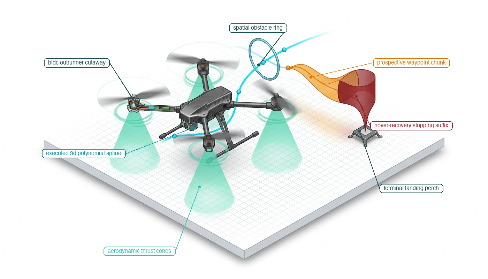
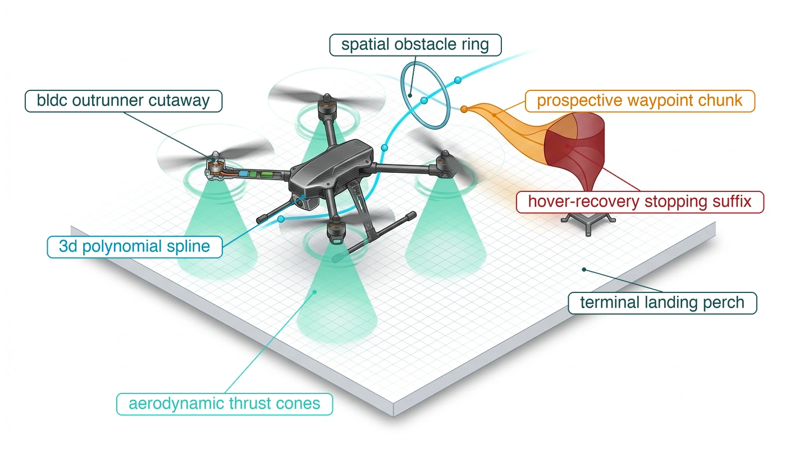
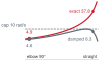
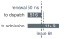
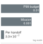
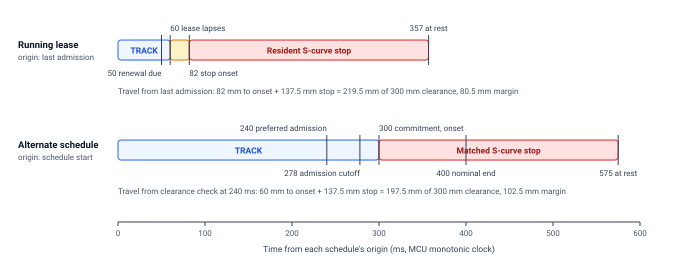
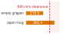

# Trajectory Planning {#sec-planning}

::: {layout-narrow}
::: {.column-margin}

\chapterminitoc

:::

::: {.content-visible when-format="pdf"}
\noindent
{fig-alt="Isometric blueprint showing 3D flight trajectory planning for an autonomous aerial quadrotor drone: brushless DC outrunner cutaway, aerodynamic thrust cones, executed cyan 3D polynomial spline threading an obstacle ring, prospective amber waypoint chunk, and crimson hover-recovery stopping suffix landing on a terminal perch."}
:::

::: {.content-visible unless-format="pdf"}
{fig-alt="Isometric blueprint showing 3D flight trajectory planning for an autonomous aerial quadrotor drone: brushless DC outrunner cutaway, aerodynamic thrust cones, executed cyan 3D polynomial spline threading an obstacle ring, prospective amber waypoint chunk, and crimson hover-recovery stopping suffix landing on a terminal perch."}
:::

:::

## Purpose {.unnumbered .unlisted}

::: {.content-visible when-format="pdf"}
\begin{marginfigure}
\resizebox{0.92\linewidth}{!}{\mlphysicalstackfull{100}{20}{20}{20}{20}}
\end{marginfigure}
:::

::: {.content-visible unless-format="pdf"}
::: {.column-margin}
{width="100%" fig-alt="Physical AI Systems Stack"}

*Physical AI stack focus for this chapter.*
:::
:::

_Why must every motion a robot follows already contain the stop it will probably never use?_

A moving robot cannot pause its momentum while a learned policy computes the next piece of its motion. Each new plan must take over from motion already under way, and a plan that matches only the arm's position leaves a jump in velocity or acceleration that the motors can meet only with a sudden step in torque, which a real drive refuses or converts into vibration, wear, and a spilled load. A path that clears every obstacle can still ask for more joint speed, torque, or current than the body can supply, and the fastest timing along that path demands exactly the abrupt changes a drive cannot make. The next plan can also arrive late, because inference time has a long tail, and a machine that keeps moving while it waits spends the distance it needs to stop. Without trajectory planning, a correct decision about where to go becomes a command the body cannot follow, or motion that cannot be halted in the room that remains. Planning attaches timing, a smooth join to the present state, and a stop that runs without the proposer, and those three properties decide whether a command that crosses the causal boundary can still be brought to rest before its energy reaches something that cannot be undone.



::: {.callout-learning-objectives}

- Distinguish prediction horizon, executed prefix, renewal cadence, and evidence age when budgeting trajectory replacement
- Map tool-space speed limits to joint rates through the manipulator Jacobian, explain why the mapping fails near a singularity, and bound an inverse-kinematics step there with damped least squares
- Evaluate a timed trajectory and its time parameterization against actuator torque, current-slew, and voltage limits, including reflected rotor inertia ($\GearReductionRatio^2 \RotorInertia$)
- Synthesize closed-form quintic spline bridges, anchored at the projected seam state rather than a stale sampled pose, that eliminate acceleration steps and bound commanded jerk across replanning seams
- Size a jerk-limited $\DifferentiabilityClass^2$ stopping suffix from deceleration and jerk bounds and verify stopping clearance ($\StoppingDistance \le \ClearDistance$)
- Compare sampling-based search, trajectory optimization, and learned action chunking by the work each performs and the checks its output still requires
- Construct trajectory records whose two-tier deadlines (high-rate chunk lease and hardware commitment cutoff) keep motion out of inevitable collision states (ICS) and support independent per-tick permission decisions

:::

## Continuous Trajectory Generation {#sec-planning-continuous-trajectories}

```{python}
#| label: calc-planning-opening-machine
#| echo: false
#| warning: false
#| message: false
# ┌─────────────────────────────────────────────────────────────────────────────
# │ THE MACHINE'S ARM LOOP AND CHUNK-POLICY LATENCY
# ├─────────────────────────────────────────────────────────────────────────────
# │ Context: @sec-planning-continuous-trajectories (opening paragraph).
# │
# │ Goal:    Pin the arm tracking rate and chunk inference latency the opening
# │          quotes for the warehouse mobile manipulator.
# │ Show:    1 kHz joint loop; 40 ms P99 chunk inference; 150 ms interference tail.
# │ How:     RM registry fields; the tail is a scenario assumption.
# └─────────────────────────────────────────────────────────────────────────────
from mlsysim import *
from mlsysim.core.units import millisecond
from mlsysim.fmt import check, fmt_frequency, fmt_latency

RM = Embodied.MobileManipulator.WarehouseMobileManipulator

class PlanningOpeningMachine:
    """Arm tracking rate and chunk-policy inference latency on the machine."""

    # ┌── 1. LOAD (Constants) ──────────────────────
    f_track = RM.arm.control_frequency  # category: datasheet; arm joint loop, registry
    t_chunk = RM.chunk_inference_latency  # category: illustrative; P99 incl. vision, registry
    t_tail = 150 * millisecond  # category: illustrative; interference tail

    # ┌── 2. EXECUTE (The Compute) ─────────────────
    tail_over_nominal = (t_tail / t_chunk).to("dimensionless").magnitude

    # ┌── 3. GUARD (Invariants) ────────────────────
    check(abs(f_track.to("hertz").magnitude - 1000.0) < 1e-9, "arm loop rate changed")
    check(abs(t_chunk.to(millisecond).magnitude - 40.0) < 1e-9, "chunk inference latency changed")
    check(tail_over_nominal > 3, "interference tail no longer several times the nominal pass")

    # ┌── 4. OUTPUT (Formatting) ───────────────────
    f_track_str = fmt_frequency(f_track)
    t_chunk_str = fmt_latency(t_chunk, unit=millisecond)
    t_tail_str = fmt_latency(t_tail, unit=millisecond)
```

The arm of the warehouse mobile manipulator is reaching for a mug that drifts along a moving conveyor when an inference pass is delayed by operating-system scheduling contention. The intent lease still names the mug as a valid target, but a lease grants a target, never a path. A target coordinate paired with an expiration timestamp specifies neither velocity nor acceleration, so it cannot tell the arm what to do while the next pass is late. The arm cannot freeze abruptly, and it cannot extrapolate blind setpoints into space no check has covered. Planning must supply a concrete, time-parameterized path, an admissible transition from the motion already under way, and a precomputed stop that runs even if the next inference pass never returns.

::: {.column-margin .margin-pointer}
↩ The intent lease, whose expiry bounds the validity window of every trajectory, is established in @sec-intent-lease.
:::

Classical robotics split this problem into two stages. A search first finds a collision-free geometric path through a configuration space, and a time parameterization then assigns timing that respects kinematic and torque limits. Learned sensorimotor policies change both stages. Instead of searching a static, pre-mapped scene, a policy emits short chunks of future setpoints conditioned directly on live camera observations, and because it replans while the machine moves, each new trajectory must splice into motion already under way rather than start from rest. Neural inference also has variable, heavy-tailed latency, and the hardware keeps moving along its previous trajectory while it waits. Geometric clearance therefore does not settle a plan. A plan must also establish how long the proposed motion remains executable, how it joins the retiring trajectory, and how the machine comes to a controlled stop if later inference passes stall.

The machine meets these obligations in a fixed order. What the planner hands to the tracking controller and the permission path comes first, together with the map from tool coordinates to the joint limits the drives enforce. Replacement timing is then sized against the inference tail, a timed candidate and its seams are checked against what the actuators can follow, and the jerk-limited stop that every admitted plan must carry is sized. The generators that propose candidates, from sampling-based search to learned action chunks, can be compared only after those obligations are fixed.

On this machine, the arm's low-level joint tracking loop evaluates feedback and setpoints at `{python} PlanningOpeningMachine.f_track_str` (datasheet; see the Reader Guide); however, this high-rate servo clock does not specify the physical stopping response. Above this loop sits the Brain, where learned policies such as Action Chunking with Transformers (ACT) [@zhao2023learning] or Diffusion Policy [@chi2024diffusionpolicy] process sensory observations on the host application processor to synthesize future reference paths.[^fn-plan-action-chunking] The machine's chunk policy operates with an illustrative budget of `{python} PlanningOpeningMachine.t_chunk_str` per pass at p99, vision included. Even so, memory contention, direct memory access (DMA) traffic, or thread preemption can stretch tail latency beyond `{python} PlanningOpeningMachine.t_tail_str`. The real-time controller therefore cannot block synchronously on policy execution; it requires both buffered nominal motion and an immediately dispatchable, pre-validated stop.

::: {.column-margin .margin-pointer}
↩ The kinetic energy a trajectory commits, and the stopping distance that energy demands, are established in @sec-body-stopping-distance-prebrake.
:::

A geometric path specifies where the arm must pass, but a trajectory also specifies when it passes each point. Time parameterization exposes instantaneous velocity, acceleration, and jerk to dynamic validation against actuator torque limits and structural thresholds. While sampling-based search, numerical trajectory optimization, and learned action chunking propose candidate motions through distinct mechanisms (@sec-planning-paradigms), every proposal confronts identical execution constraints on physical hardware.

A learned neural policy serves strictly as an unprivileged proposer. Although a downstream trajectory generator can shape and filter raw policy outputs into a continuous candidate profile, the independent safety permission path must formally validate that profile before any motion is admitted. A smooth geometric reference alone provides no guarantee that motor windings can generate the necessary torques under dynamic load, nor does it confirm that sufficient clearance exists along the arm's swept stopping volume.

::: {.column-margin .margin-pointer}
↪ The runtime gatekeeper that checks every admitted setpoint against live state is developed in @sec-enforcement-deterministic-gatekeeper.
:::

A multi-step action chunk delivers a finite horizon of future setpoints that the low-level tracking controller consumes sequentially while the proposer computes the next chunk. Splicing successive chunks introduces an **execution seam**: the temporal and kinematic boundary where the retiring setpoints hand off control to the incoming plan. Matching position alone across this seam leaves a discontinuous velocity step, and matching velocity while neglecting acceleration leaves an instantaneous acceleration step. Because physical links and payloads carry inertia, discontinuous accelerations demand instantaneous steps in motor torque, exciting mechanical vibrations and risking overcurrent faults. The trajectory generator must therefore enforce continuity through position, velocity, and acceleration (the $\DifferentiabilityClass^2$ continuity condition) while verifying that dynamic torques and swept clearance throughout the transition segment remain within safe physical envelopes.[^fn-plan-c2-spline]

Decoupling the execution rate from the inference rate allows the low-level tracking controller to service motor loops on a rigid real-time clock while neural inference runs asynchronously. Setpoint buffering absorbs latency jitter, but buffered motion cannot remain valid indefinitely. Sensor observations age, dynamic obstacles shift, and localization drift accumulates over time. Consequently, the planner's replacement deadline must account for the worst-case inference tail, guaranteeing sufficient lead time to commit to a feasible, controlled stop before either the buffered trajectory drains or the supporting environmental evidence expires.

[^fn-plan-action-chunking]: **Action chunking representations**\index{Action chunking!architectures}\index{Policy learning!temporal horizons}: ACT and Diffusion Policy, the 2023-era chunk policies, carry no boundary-derivative constraints. Real-time chunking [@black2025realtime] conditions each new chunk on the actions already committed, which makes a consistent join more likely without guaranteeing one, so the planner still proposes a transition bridge across each replanning seam and the permission path checks it before admission.

Every admitted proposal must therefore arrive as a self-contained bundle: the active trajectory segment continuous through acceleration ($\DifferentiabilityClass^2$), its explicit validity deadlines, and a pre-verified stopping suffix whose required deceleration distance fits within verified obstacle clearance ($\StoppingDistance \le \ClearDistance$). An isolated safety microcontroller (MCU) inspects and validates this bundle across the proposal boundary before arming actuator outputs, caching the emergency stopping continuation in local real-time memory so it can be autonomously dispatched if communications falter.

[^fn-plan-c2-spline]: **$\DifferentiabilityClass^2$ continuity at the motor**\index{C2 continuity@$\DifferentiabilityClass^2$ continuity}\index{Drivetrain!jerk dynamics}: In permanent-magnet synchronous motors, electromagnetic torque couples directly to quadrature stator current ($\MotorTorque = \MotorTorqueConstant \TorqueProducingCurrent$). Under this model an acceleration step requires a finite step in torque and current, while a velocity step implies an ideal acceleration impulse, which no drive can supply.

Momentum, long-tailed inference latency, and seam continuity therefore shape every trajectory plan, starting at the interface where the high-level planner hands motion to the joint tracking controller and the safety permission path while the machine is moving.

## The Planning Handoff and the Trajectory Record {#sec-planning-handoff}

If the planner hands over raw joint setpoints for the reach toward the mug without binding them to the obstacle geometry, the active intent lease, and a pre-checked stop, the arm can chase an expired target or coast past its clearance the moment the next inference cycle stalls. To prevent that failure, the planner consumes the belief record, which supplies obstacle geometry and clearance, and the intent lease, which supplies the grounded goal, task tolerances, effort ceilings, and time-bounded intent lease ($\IntentLeaseExpiry$), while respecting the actuator and transmission limits of the physical body. The handoff connects those inputs to the checks that permit execution, and two things must be fixed before any replacement timing can be budgeted. The first is the map between the tool coordinates in which clearance is measured and the joint coordinates whose limits the drives enforce. The second is the record that carries a candidate across the proposal boundary, with the deadlines and the stop that bound its authority.

::: {.column-margin .margin-pointer}
↩ The belief record and the state invariants it carries are established in @sec-memory-handoff.
:::

### Mapping tool motion to joint limits {#sec-planning-handoff-kinematics}

A path that keeps the tool inside its speed limit and clear of obstacles in workspace can still command a joint near a straightened elbow to spin faster than its drive allows, tripping a velocity fault mid-reach. Catching that mismatch requires translating workspace motion into the manipulator's joint coordinates. A configuration $(\JointPosition_1, \dots, \JointPosition_n)$ collects the joint positions into a single point in the **configuration space**\index{Configuration space!definition}[^fn-configuration-space-origin] $\ConfigurationSpace$, and removing configurations occupied by obstacles leaves the collision-free subset $\FreeConfigurationSpace = \ConfigurationSpace \setminus \ObstacleConfigurationSet$ [@lozanoperez1983spatial]. Because a geometric path through $\FreeConfigurationSpace$ still lacks timing, an **executable trajectory**\index{Executable trajectory!definition} assigns physical timestamps to the path, generating continuous state references $\MechanicalPlantState(\TimeInstant) = [\GeneralizedCoordinates(\TimeInstant)^\top, \GeneralizedVelocities(\TimeInstant)^\top]^\top$ and acceleration profiles $\GeneralizedAccelerations(\TimeInstant)$ alongside feedforward torque profiles $\FeedforwardJointTorque(\TimeInstant)$. Whereas the kinematic references state the intended position, velocity, and acceleration, the feedforward terms supply the torque predicted by the rigid-body model. The complete candidate crosses the proposal boundary for independent checking, and only admitted actuator commands cross the causal boundary to the drives.

[^fn-configuration-space-origin]: **Configuration space**\index{Configuration space!history}: @lozanoperez1983spatial shrank the moving body to a point by growing each obstacle by the body's shape, and in the same year @schwartz1983piano treated the "piano movers' problem" as a search of exactly this space. The reduction turns a collision query into a membership test on $\ObstacleConfigurationSet$, but the space gains a dimension with every joint, which is why collision queries dominate the run time of the sampling planners in @sec-planning-paradigms.

```{python}
#| label: calc-planning-two-link-arm
#| echo: false
#| warning: false
#| message: false
# ┌─────────────────────────────────────────────────────────────────────────────
# │ JOINT SPACE VERSUS TOOL SPACE FOR A PLANAR TWO-LINK ARM
# ├─────────────────────────────────────────────────────────────────────────────
# │ Context: @sec-planning-handoff (kinematics paragraph),
# │          @sec-planning-future-state-conditioning (tool displacement),
# │          @sec-planning-rigidbody-dynamics (one-joint reduction).
# │
# │ Goal:    Show that a tool-speed limit does not bound joint speed near a
# │          singularity, using the arm's published link lengths.
# │ Show:    l1 = 0.316 m, l2 = 0.384 m, reach 0.700 m; det J = l1 l2 sin q2;
# │          1.0 m/s in the weakest direction needs |qdot| = 4.90 rad/s at a
# │          90 degree elbow (one joint >= 3.46 rad/s > 2.175 rad/s) and
# │          37.8 rad/s at a 10 degree elbow.
# │ How:     Franka FER kinematic chain (d3, d5) and joint velocity limit from
# │          the registry (franka2023robot); smallest singular value of the
# │          2x2 Jacobian.
# └─────────────────────────────────────────────────────────────────────────────
import numpy as np
from mlsysim import *
from mlsysim.core.units import meter, radian, second
from mlsysim.fmt import check, fmt, fmt_length, fmt_angular_velocity, fmt_velocity, fmt_int

RM = Embodied.MobileManipulator.WarehouseMobileManipulator

def _two_link_sigma_min(l1_m, l2_m, q2_deg):
    """Smallest singular value of the planar two-link Jacobian at q1 = 0 (rank depends only on q2)."""
    q2 = np.radians(q2_deg)
    jac = np.array([[-l2_m * np.sin(q2), -l2_m * np.sin(q2)], [l1_m + l2_m * np.cos(q2), l2_m * np.cos(q2)]])
    return float(np.linalg.svd(jac, compute_uv=False)[-1])

class PlanningTwoLinkArm:
    """Planar two-link abstraction of the arm: forward kinematics and Jacobian conditioning."""

    # ┌── 1. LOAD (Constants) ──────────────────────
    l1 = RM.arm.upper_arm_length  # category: datasheet; FER DH d3, shoulder to elbow, registry (franka2023robot)
    l2 = RM.arm.forearm_length  # category: datasheet; FER DH d5, elbow to wrist, registry (franka2023robot)
    qd_max = RM.arm.joint_velocity_limits[1]  # category: datasheet; FER joints 1-4 velocity limit, registry (franka2023robot)
    v_tool = RM.tcp_speed_limit  # category: chosen; free-space TCP limit, registry
    q2_good_deg = 90  # category: illustrative; right-angle elbow
    q2_bad_deg = 10  # category: illustrative; nearly straight elbow

    # ┌── 2. EXECUTE (The Compute) ─────────────────
    reach = (l1 + l2).to(meter)
    sig_good = _two_link_sigma_min(l1.magnitude, l2.magnitude, q2_good_deg)
    sig_bad = _two_link_sigma_min(l1.magnitude, l2.magnitude, q2_bad_deg)
    qd_norm_good = (v_tool / (sig_good * meter)).to(second**-1).magnitude * radian / second
    qd_norm_bad = (v_tool / (sig_bad * meter)).to(second**-1).magnitude * radian / second
    qd_one_good = qd_norm_good / np.sqrt(2)  # some joint must reach at least ||qdot|| / sqrt(2)

    # ┌── 3. GUARD (Invariants) ────────────────────
    check(abs(reach.magnitude - 0.700) < 1e-12, "planar reach changed")
    check(abs(qd_norm_good.magnitude - 4.8968) < 1e-3, "right-angle joint-rate norm changed")
    check(abs(qd_norm_bad.magnitude - 37.760) < 1e-2, "near-singular joint-rate norm changed")
    check(qd_one_good > qd_max, "right-angle weakest direction no longer exceeds the joint limit")

    # ┌── 4. OUTPUT (Formatting) ───────────────────
    l1_str = fmt_length(l1, unit=meter, precision=3)
    l2_str = fmt_length(l2, unit=meter, precision=3)
    reach_str = fmt_length(reach, unit=meter, precision=2)
    qd_max_str = fmt_angular_velocity(qd_max, precision=3)
    v_tool_str = fmt_velocity(v_tool)
    q2_good_str = fmt_int(q2_good_deg)
    q2_bad_str = fmt_int(q2_bad_deg)
    qd_norm_good_str = fmt_angular_velocity(qd_norm_good, precision=1)
    qd_norm_bad_str = fmt_angular_velocity(qd_norm_bad, precision=1)
    qd_one_good_str = fmt_angular_velocity(qd_one_good, precision=1)
```

The drives track joint angles, but clearance is measured in the task space where the tool, the mug, and the conveyor guard sit. In a planar two-link abstraction of the arm's shoulder, elbow, and wrist with upper-arm length $\LinkLength_1$ and forearm length $\LinkLength_2$, **forward kinematics**\index{Forward kinematics!two-link arm} gives the tool position directly as a function of the joint angles:

$$\ToolPlanarAbscissa = \LinkLength_1\cos \JointPosition_1 + \LinkLength_2\cos(\JointPosition_1+\JointPosition_2), \qquad \ToolPlanarOrdinate = \LinkLength_1\sin \JointPosition_1 + \LinkLength_2\sin(\JointPosition_1+\JointPosition_2)$$ {#eq-plan-two-link-kinematics}

Differentiating @eq-plan-two-link-kinematics gives tool velocity $\EndEffectorVelocity = \ManipulatorJacobian(\GeneralizedCoordinates)\,\GeneralizedVelocities$, where the manipulator Jacobian\index{Jacobian!manipulator}[^fn-jacobian-autograd-bridge] $\ManipulatorJacobian = \partial\CartesianPosition/\partial\GeneralizedCoordinates$ changes with configuration. It is the same map that showed, in @sec-data-kinematic-topology, why a Cartesian action label can force a different arm through a singularity; here it prices the arm's own reach. For the two-link arm its determinant is $\LinkLength_1 \LinkLength_2 \sin \JointPosition_2$, which vanishes when the elbow straightens, the singular pose at which no joint motion moves the tool along the arm.

Consider the link lengths from the arm's published kinematic chain: `{python} PlanningTwoLinkArm.l1_str` and `{python} PlanningTwoLinkArm.l2_str`, which yield a `{python} PlanningTwoLinkArm.reach_str` planar reach [@franka2023robot]. In the arm's weakest direction (the tool direction that a unit of joint rate moves least, set by the smallest singular value $\SmallestJacobianSingularNumber$ of $\ManipulatorJacobian$, so that $\|\GeneralizedVelocities\| = \ToolSpeedLimit/\SmallestJacobianSingularNumber$), moving the tool at the `{python} PlanningTwoLinkArm.v_tool_str` tool center point (TCP) limit requires a joint-rate vector of magnitude `{python} PlanningTwoLinkArm.qd_norm_good_str` at a `{python} PlanningTwoLinkArm.q2_good_str`° elbow. With two joints, the larger component of a vector is at least its norm divided by $\sqrt{2}$, so at least one joint must then turn at `{python} PlanningTwoLinkArm.qd_one_good_str`, above the published `{python} PlanningTwoLinkArm.qd_max_str` limit of the shoulder and elbow joints. Straightening the arm makes the demand far worse. The image of a unit joint-rate circle under $\ManipulatorJacobian$, the manipulability ellipse of tool velocities, is broad at the `{python} PlanningTwoLinkArm.q2_good_str`° elbow and collapses into a narrow sliver across the links at `{python} PlanningTwoLinkArm.q2_bad_str`° (@fig-11-two-link-singularity). Sustaining `{python} PlanningTwoLinkArm.v_tool_str` along the arm, the ellipse's minor axis, then needs a joint-rate magnitude of `{python} PlanningTwoLinkArm.qd_norm_bad_str`. Because a tool-speed limit bounds no joint speed near a singularity, every tool-space quantity this chapter checks (the TCP limit, the stopping distance, and the swept clearance) must be mapped back through $\ManipulatorJacobian$ to the joint limits the drives enforce, even on a seven-joint arm whose extra degrees of freedom help the planner steer around singular poses that this planar abstraction omits.

[^fn-jacobian-autograd-bridge]: **Manipulator Jacobian**\index{Jacobian!automatic differentiation}: It is the same object automatic differentiation builds, the matrix of first derivatives of an output with respect to its inputs, here tool position with respect to joint angles. Reverse-mode autograd never forms the matrix; it computes products $\ManipulatorJacobian^\top\UpstreamGradientVector$, and the manipulator equation uses that same transpose product to map a tool wrench into joint torques (@eq-plan-rigidbody-dynamics). A planner is the unusual consumer that must *invert* $\ManipulatorJacobian$, and it is the inverse, not the Jacobian, that fails at a singularity.

::: {.column-margin .margin-pointer}
↪ Forward kinematics, the manipulator Jacobian, singularities, and the damped least-squares inverse are developed for $\JointCount$ joints in @sec-appendix-control-kinematics.
:::

::: {#fig-11-two-link-singularity fig-env="figure" fig-pos="t" fig-cap="**The same tool speed, two elbows**: The planar two-link arm drawn to scale with its `{python} PlanningTwoLinkArm.l1_str` and `{python} PlanningTwoLinkArm.l2_str` links. Each ellipse is the set of tool velocities that a unit joint-rate vector can produce, drawn at one scale in both panels; its short axis is the weakest direction (arrow). At a right-angle elbow the ellipse is round enough that `{python} PlanningTwoLinkArm.v_tool_str` in that direction needs `{python} PlanningTwoLinkArm.qd_norm_good_str` of joint rate. Near the straight elbow the ellipse collapses toward a line across the arm, and the same tool speed along the arm needs `{python} PlanningTwoLinkArm.qd_norm_bad_str`." fig-alt="Two panels, each showing a two-link arm drawn from a shoulder joint through an elbow joint to a tool point, with a dashed arc marking the arm's reach. In the left panel the elbow is bent at a right angle and a wide shaded ellipse surrounds the tool point, with a double arrow along its short axis. In the right panel the arm is nearly straight, the tool sits near the reach arc, and the ellipse is a thin sliver across the arm with the double arrow pointing along the arm. Text in each panel gives the joint rate needed for 1 meter per second along the arrow: 4.9 and 37.8 radians per second."}

```{python}
#| label: plot-planning-two-link-singularity
#| echo: false
#| warning: false
#| message: false
# ┌─────────────────────────────────────────────────────────────────────────────
# │ TWO-LINK ARM AT TWO ELBOW ANGLES (FIGURE)
# ├─────────────────────────────────────────────────────────────────────────────
# │ Context: @fig-11-two-link-singularity in @sec-planning-continuous-trajectories.
# │
# │ Goal:    Make the Jacobian's conditioning visible: the same tool speed costs
# │          little joint rate at a right-angle elbow and much more near straight.
# │ Show:    the arm to scale at q2 = 90 and 10 degrees; the tool-velocity
# │          ellipse J * (unit joint-rate circle); the weakest direction.
# │ How:     PlanningTwoLinkArm link lengths, elbow angles, TCP limit, and
# │          joint-rate norms; the guard ties the drawn ellipses to the cell.
# └─────────────────────────────────────────────────────────────────────────────
from mlsysim import viz
import numpy as np

TL = PlanningTwoLinkArm
R = viz.VOL4_ROLES
l1, l2 = TL.l1.to(meter).magnitude, TL.l2.to(meter).magnitude
v_tool = TL.v_tool.to(meter / second).magnitude
k_ell = 0.25  # drawing scale: meters of page per (m/s) of tool speed

def _jac(q1, q2):
    return np.array(
        [[-l1 * np.sin(q1) - l2 * np.sin(q1 + q2), -l2 * np.sin(q1 + q2)], [l1 * np.cos(q1) + l2 * np.cos(q1 + q2), l2 * np.cos(q1 + q2)]]
    )

cases = [(TL.q2_good_deg, TL.qd_norm_good), (TL.q2_bad_deg, TL.qd_norm_bad)]
viz.set_book_style()
import matplotlib.pyplot as plt
from mlsysim.core.units import meter, second

fig, axes = plt.subplots(1, 2, figsize=(6.4, 3.1))
drawn = []
for ax, tag, (q2d, qd_need) in zip(axes, ("a", "b"), cases):
    q2 = np.radians(q2d)
    q1 = np.radians(45) - np.arctan2(l2 * np.sin(q2), l1 + l2 * np.cos(q2))  # tool direction at 45 degrees
    elbow = np.array([l1 * np.cos(q1), l1 * np.sin(q1)])
    tool = elbow + l2 * np.array([np.cos(q1 + q2), np.sin(q1 + q2)])
    # reach circle
    arc = np.radians(np.linspace(-14, 80, 120))
    th = np.linspace(0, 2 * np.pi, 200)
    ax.plot(TL.reach.magnitude * np.cos(arc), TL.reach.magnitude * np.sin(arc), color=R["neutral"], lw=0.6, ls=(0, (3, 3)))
    # links
    ax.plot([0, elbow[0], tool[0]], [0, elbow[1], tool[1]], color=R["structural"], lw=3.2, solid_capstyle="round", zorder=3)
    for p in ((0, 0), elbow):
        ax.plot(*p, "o", ms=6.5, mfc="white", mec=R["structural"], mew=1.4, zorder=4)
    ax.plot(*tool, "o", ms=3.5, color=R["structural"], zorder=4)
    # velocity ellipse: image of the unit joint-rate circle, scaled so the tool speed per (rad/s)
    J = _jac(q1, q2)
    U, s, Vt = np.linalg.svd(J)
    circ = np.vstack([np.cos(th), np.sin(th)])
    ell = (J @ circ) * k_ell
    ax.fill(tool[0] + ell[0], tool[1] + ell[1], color=R["measured"], alpha=0.14, lw=0, zorder=2)
    ax.plot(tool[0] + ell[0], tool[1] + ell[1], color=R["measured"], lw=1.0, zorder=2)
    # weakest direction
    u_min = U[:, 1]
    ax.annotate("", xy=tool + u_min * 0.13, xytext=tool - u_min * 0.13, arrowprops=dict(arrowstyle="<->", color=R["proposal"], lw=1.2), zorder=5)
    drawn.append((s[1], qd_need.magnitude))
    ax.text(0.0, 1.0, f"({tag}) elbow {q2d}°", transform=ax.transAxes, ha="left", va="bottom", fontsize=9, fontweight="bold", color=R["neutral"])
    ax.text(
        0.97,
        0.03,
        f"weakest direction:\n{v_tool:g} m/s needs {qd_need.magnitude:.1f} rad/s",
        transform=ax.transAxes,
        ha="right",
        va="bottom",
        fontsize=9,
        color=R["proposal"],
        bbox=dict(boxstyle="square,pad=0.1", fc="white", ec="none"),
    )
    ax.set_aspect("equal")
    ax.set_xlim(-0.12, 0.82)
    ax.set_ylim(-0.22, 0.74)
    ax.axis("off")
    ax.text(0.03, -0.035, "shoulder", fontsize=9, color=R["neutral"], ha="left", va="top")
axes[0].text(
    TL.reach.magnitude * np.cos(np.radians(12)) + 0.035,
    TL.reach.magnitude * np.sin(np.radians(12)),
    f"reach\n{TL.reach.magnitude:.2f} m",
    fontsize=9,
    color=R["neutral"],
    ha="left",
    va="center",
)
check(
    abs(drawn[0][1] - v_tool / drawn[0][0]) < 1e-6 and abs(drawn[1][1] - v_tool / drawn[1][0]) < 1e-6,
    "Two-link figure: drawn ellipse minor axes must give the cell's joint-rate norms.",
)
plt.tight_layout()
plt.show()
```

:::

```{python}
#| label: calc-planning-dls-step
#| echo: false
#| warning: false
#| message: false
# ┌─────────────────────────────────────────────────────────────────────────────
# │ ONE DAMPED-LEAST-SQUARES INVERSE-KINEMATICS STEP ON THE TWO-LINK ARM
# ├─────────────────────────────────────────────────────────────────────────────
# │ Context: @sec-planning-handoff (inverse-kinematics paragraphs after
# │          @fig-11-two-link-singularity).
# │
# │ Goal:    Show that damping bounds the joint command near the singularity
# │          the figure shows, and what it costs in tool motion.
# │ Show:    lambda = 50 mm; weakest-direction 1.0 m/s request needs 4.6 rad/s
# │          (was 4.9) at a 90 degree elbow, 94.3 percent of the request realized;
# │          8.3 rad/s (was 37.8) at a 10 degree elbow, 21.9 percent realized;
# │          bound v / (2 lambda) = 10 rad/s at any configuration.
# │ How:     Per singular direction the DLS gain is sigma / (sigma^2 + lambda^2)
# │          and the realized fraction sigma^2 / (sigma^2 + lambda^2)
# │          (wampler1986manipulator; nakamura1986inverse); sigma_min from
# │          PlanningTwoLinkArm. Chapter-local: promote to MLSysIM only if a
# │          second chapter reuses it.
# └─────────────────────────────────────────────────────────────────────────────
from mlsysim.core.units import dimensionless, meter, millimeter, radian, second
from mlsysim.fmt import check, fmt_length, fmt_angular_velocity, fmt_percent

class PlanningDLSStep:
    """Damped-least-squares IK gain and realized tool motion in the arm's weakest direction."""

    # ┌── 1. LOAD (Constants) ──────────────────────
    lam = 50 * millimeter  # category: chosen; illustrative damping, not a vendor setting
    v_tool = PlanningTwoLinkArm.v_tool  # category: chosen; free-space TCP limit, registry
    qd_max = PlanningTwoLinkArm.qd_max  # category: datasheet; shoulder and elbow limit, registry
    sig_good = PlanningTwoLinkArm.sig_good * meter  # derived; 90 degree elbow
    sig_bad = PlanningTwoLinkArm.sig_bad * meter  # derived; 10 degree elbow

    # ┌── 2. EXECUTE (The Compute) ─────────────────
    def _gain(sig, lam):
        return (sig / (sig**2 + lam**2)).to(meter**-1)

    def _realized(sig, lam):
        return (sig**2 / (sig**2 + lam**2)).to(dimensionless).magnitude

    rad_s = radian / second
    qd_dls_good = (v_tool * _gain(sig_good, lam)).to(second**-1).magnitude * rad_s
    qd_dls_bad = (v_tool * _gain(sig_bad, lam)).to(second**-1).magnitude * rad_s
    qd_bound = (v_tool / (2 * lam)).to(second**-1).magnitude * rad_s
    frac_good = _realized(sig_good, lam)
    frac_bad = _realized(sig_bad, lam)

    # ┌── 3. GUARD (Invariants) ────────────────────
    check(qd_dls_good < PlanningTwoLinkArm.qd_norm_good, "damping must not raise the joint command")
    check(qd_dls_bad < PlanningTwoLinkArm.qd_norm_bad / 4, "damping no longer cuts the near-singular command by 4x")
    check(qd_dls_bad <= qd_bound and qd_dls_good <= qd_bound, "DLS gain exceeded its 1/(2 lambda) bound")
    check(abs(qd_bound.magnitude - 10.0) < 1e-9, "DLS joint-rate bound changed")
    check(frac_good > 0.9 and frac_bad < 0.3, "damping no longer spares the good pose and taxes the bad one")
    check(qd_dls_bad > qd_max, "damped command now within the joint limit; revise the feasibility sentence")
    # margin_dls_joint_rate_knee.svg fig-alt hand-types 4.9, 37.8, 4.6, 8.3 and 10 rad/s.
    check(
        [
            round(PlanningTwoLinkArm.qd_norm_good.magnitude, 1),
            round(PlanningTwoLinkArm.qd_norm_bad.magnitude, 1),
            round(qd_dls_good.magnitude, 1),
            round(qd_dls_bad.magnitude, 1),
        ]
        == [4.9, 37.8, 4.6, 8.3],
        "DLS knee margin fig-alt values are stale",
    )

    # ┌── 4. OUTPUT (Formatting) ───────────────────
    lam_str = fmt_length(lam, unit=millimeter)
    qd_dls_good_str = fmt_angular_velocity(qd_dls_good, precision=1)
    qd_dls_bad_str = fmt_angular_velocity(qd_dls_bad, precision=1)
    qd_bound_str = fmt_angular_velocity(qd_bound, precision=0)
    frac_good_str = fmt_percent(frac_good, precision=1, style="prose")
    frac_bad_str = fmt_percent(frac_bad, precision=1, style="prose")
```

The same map must also run in reverse. A proposal stated in tool space, whether a grasp pose from the intent lease or a Cartesian velocity from a policy or a teleoperation device, leaves the planner to find the joint motion that produces it, the **inverse kinematics**\index{Inverse kinematics!differential step} problem. The two-link arm has a closed-form inverse, but a seven-joint arm replanning chunk by chunk is solved by differential steps: linearize at the current configuration and solve $\ManipulatorJacobian\,\FiniteChange\GeneralizedCoordinates = \FiniteChange\CartesianPosition$ for the joint step that moves the tool by $\FiniteChange\CartesianPosition$, then repeat from the new configuration. Where $\ManipulatorJacobian$ is invertible the exact step is $\FiniteChange\GeneralizedCoordinates = \ManipulatorJacobian^{-1}\FiniteChange\CartesianPosition$. Written along the singular directions of $\ManipulatorJacobian$, this step divides the part of $\FiniteChange\CartesianPosition$ along each tool direction by that direction's singular value $\JacobianSingularNumber$. The weakest direction therefore receives the largest joint step, $1/\SmallestJacobianSingularNumber$ per unit of tool motion, which is exactly the joint-rate demand that @fig-11-two-link-singularity charts diverging along the minor axis as the elbow straightens. An exact inverse passes the singularity's arithmetic straight to the drives.

**Damped least squares**\index{Damped least squares!inverse kinematics} gives up exactness to bound the step [@wampler1986manipulator; @nakamura1986inverse]. Instead of demanding $\ManipulatorJacobian\,\FiniteChange\GeneralizedCoordinates = \FiniteChange\CartesianPosition$, it chooses the joint step that best trades tool error against joint motion, with a damping length $\InverseKinematicsDamping$ that sets the exchange rate:

$$\FiniteChange\DampedStepConfiguration = \arg\min_{\FiniteChange\GeneralizedCoordinates} \left(\|\ManipulatorJacobian\,\FiniteChange\GeneralizedCoordinates-\FiniteChange\CartesianPosition\|^2 + \InverseKinematicsDamping^2\|\FiniteChange\GeneralizedCoordinates\|^2\right) = \ManipulatorJacobian^\top\!\left(\ManipulatorJacobian\ManipulatorJacobian^\top+\InverseKinematicsDamping^2\IdentityMatrix\right)^{-1}\FiniteChange\CartesianPosition$$ {#eq-plan-dls-ik}

Setting the gradient of the objective to zero gives $(\ManipulatorJacobian^\top\ManipulatorJacobian+\InverseKinematicsDamping^2\IdentityMatrix)\,\FiniteChange\GeneralizedCoordinates = \ManipulatorJacobian^\top\FiniteChange\CartesianPosition$, and moving $\ManipulatorJacobian^\top$ through the inverse yields the form in @eq-plan-dls-ik, which needs only a $2 \times 2$ solve for the planar arm. A reader who has trained a model will recognize ridge regression, with $\InverseKinematicsDamping^2$ as the weight-decay coefficient. Along each singular direction the gain changes from $1/\JacobianSingularNumber$ to $\JacobianSingularNumber/(\JacobianSingularNumber^2+\InverseKinematicsDamping^2)$. Far from the singularity, where $\JacobianSingularNumber \gg \InverseKinematicsDamping$, the two agree. As $\JacobianSingularNumber$ falls toward zero the damped gain falls with it instead of diverging, and it never exceeds $1/(2\InverseKinematicsDamping)$, reached where $\JacobianSingularNumber = \InverseKinematicsDamping$. The damping thus places a configuration-independent ceiling on the joint step, which no choice of pose can breach.

With an illustrative $\InverseKinematicsDamping$ of `{python} PlanningDLSStep.lam_str`, the weakest-direction request at the `{python} PlanningTwoLinkArm.v_tool_str` TCP limit needs `{python} PlanningDLSStep.qd_dls_good_str` of joint rate at the `{python} PlanningTwoLinkArm.q2_good_str`° elbow, against `{python} PlanningTwoLinkArm.qd_norm_good_str` undamped, and the tool still realizes `{python} PlanningDLSStep.frac_good_str` of the requested motion. At the `{python} PlanningTwoLinkArm.q2_bad_str`° elbow the damped command is `{python} PlanningDLSStep.qd_dls_bad_str` instead of `{python} PlanningTwoLinkArm.qd_norm_bad_str`, and no pose can demand more than `{python} PlanningDLSStep.qd_bound_str`. The price is paid where the damping acts: the tool realizes only `{python} PlanningDLSStep.frac_bad_str` of the requested motion along the arm, so the step lags its target in exactly the direction the arm cannot move well. That residual is a tracking error the planner must carry into the trajectory's timing and clearance checks rather than discard. A larger $\InverseKinematicsDamping$ lowers the ceiling and enlarges the error everywhere, which is why practical solvers raise the damping only as $\SmallestJacobianSingularNumber$ approaches it.

::: {.column-margin}
{width="100%" fig-alt="Joint-rate norm needed for 1 meter per second in the weakest direction, plotted on a log scale against elbow angle from 90 degrees down to near straight. The exact-inverse curve climbs steeply from 4.9 at 90 degrees to 37.8 radians per second at 10 degrees. The damped curve stays below a dashed ceiling at 10 radians per second, reading 4.6 and 8.3 at the same two elbows."}

*As the elbow straightens, the exact inverse climbs from `{python} PlanningTwoLinkArm.qd_norm_good_str` to `{python} PlanningTwoLinkArm.qd_norm_bad_str`; damping caps it at `{python} PlanningDLSStep.qd_bound_str`.*
:::

Damping bounds the inverse-kinematics step; it does not make the step feasible. Even the damped `{python} PlanningDLSStep.qd_dls_bad_str` exceeds the `{python} PlanningTwoLinkArm.qd_max_str` joint limit, so the planner must still slow the tool through time parameterization (@sec-planning-time-parameterization), and the permission path still checks every joint rate against the limits the drives enforce. Damped least squares is a better proposal, not a permission.

### The trajectory record and its deadlines {#sec-planning-handoff-record}

```{python}
#| label: calc-planning-lease-rule
#| echo: false
#| warning: false
#| message: false
# ┌─────────────────────────────────────────────────────────────────────────────
# │ ONE CHUNK LEASE FOR BOTH BODIES: THE ARM'S LEASE PATH AND ALTERNATE CUTOFF
# ├─────────────────────────────────────────────────────────────────────────────
# │ Context: @sec-planning-handoff (TRACK/STOP paragraph),
# │          @sec-planning-behavior-seam (arm lease path),
# │          @sec-planning-trajectory-contract (record expiry, filled record).
# │
# │ Goal:    Charge the arm's stop from the last admitted chunk when the
# │          shared chunk lease lapses; separately derive the alternate cutoff.
# │ Show:    60 ms lease, renewed every 50 ms; lease path 60 + 1 + 1 + 20 =
# │          82 ms, 82 mm at 1.0 m/s; with the 137.5 mm S-curve stop (275 ms),
# │          219.5 mm of 300 mm, leaving 80.5 mm; alternate path leaves
# │          102.5 mm from its later epoch; alternate admission cutoff
# │          300 - 22 = 278 ms from schedule origin.
# │ How:     AISLE lease, tick, bus, and brake onset (charged as the arm's
# │          onset, conservative); RM TCP limit; the arm's jerk bound is the
# │          peak jerk of the reference C2 polynomial at the same peak
# │          (calc_c2_stop_suffix), and the stop is calc_scurve_stop_distance
# │          / calc_scurve_stop_time. The arm's worked deadlines and clearance
# │          are defined here and read by calc-planning-arm-timeline and
# │          calc-planning-c2-stop-clearance.
# └─────────────────────────────────────────────────────────────────────────────
from mlsysim import *
from mlsysim.core.units import millisecond, meter, millimeter, second
from mlsysim.fmt import check, fmt_latency, fmt_length, fmt_velocity

RM = Embodied.MobileManipulator.WarehouseMobileManipulator
AISLE = Embodied.Scenario.WarehouseAisle

class PlanningLeaseRule:
    """The arm lease path and the alternate schedule admission cutoff."""

    # ┌── 1. LOAD (Constants) ──────────────────────
    t_lease = AISLE.t_lease  # category: chosen; chunk lease (@sec-nervous-lease-sizing), registry
    f_renew = RM.chunk_rate  # category: chosen; admitted-chunk renewal rate, registry
    t_tick = AISLE.t_tick  # category: derived; permission-loop period, registry
    t_bus = AISLE.t_bus  # category: illustrative; fieldbus cycle, registry
    t_onset = AISLE.t_brake_onset  # category: illustrative; brake onset, charged as the arm's onset
    v_arm = RM.tcp_speed_limit  # category: chosen; free-space TCP limit, registry
    t_blend = 240 * millisecond  # category: chosen; blend deadline
    t_commit = 300 * millisecond  # category: chosen; physical suffix onset
    a_arm_stop = 5.0 * meter / second**2  # category: illustrative; arm stop deceleration bound
    d_arm_clear = 300 * millimeter  # category: illustrative; obstacle clearance

    # ┌── 2. EXECUTE (The Compute) ─────────────────
    t_renew = (1 / f_renew).to(millisecond)
    t_lease_slack = (t_lease - t_renew).to(millisecond)
    t_dispatch = (t_tick + t_bus + t_onset).to(millisecond)
    t_lease_path = (t_lease + t_dispatch).to(millisecond)
    d_lease_path = (v_arm * t_lease_path).to(millimeter)
    j_arm_stop = calc_c2_stop_suffix(v_arm, a_arm_stop)["peak_jerk"]  # jerk bound: reference polynomial's peak
    t_arm_stop = calc_scurve_stop_time(v_arm, a_arm_stop, j_arm_stop).to(millisecond)
    arm_stop_dist = calc_scurve_stop_distance(v_arm, a_arm_stop, j_arm_stop).to(millimeter)
    lease_total = d_lease_path + arm_stop_dist
    lease_margin = d_arm_clear - lease_total
    commit_margin = d_arm_clear - (v_arm * (t_commit - t_blend)).to(millimeter) - arm_stop_dist
    t_alt_admission_cutoff = (t_commit - t_dispatch).to(millisecond)

    # ┌── 3. GUARD (Invariants) ────────────────────
    check(abs(t_lease.to(millisecond).magnitude - 60.0) < 1e-9, "chunk lease changed")
    check(abs(t_renew.magnitude - 50.0) < 1e-9, "renewal period changed")
    check(t_renew < t_lease, "lease no longer outlasts one renewal period")
    check(abs(t_lease_slack.magnitude - 10.0) < 1e-9, "lease slack beyond one renewal period changed")
    check(abs(t_lease_path.magnitude - 82.0) < 1e-9, "arm lease path changed")
    check(abs(d_lease_path.magnitude - 82.0) < 1e-9, "arm lease-path travel changed")
    check(abs(j_arm_stop.to(meter / second**3).magnitude - 200.0 / 3.0) < 1e-9, "arm jerk bound changed")
    check(abs(t_arm_stop.magnitude - 275.0) < 1e-9, "arm S-curve stop duration changed")
    check(abs(arm_stop_dist.magnitude - 137.5) < 1e-9, "arm S-curve stop distance changed")
    check(abs(lease_total.magnitude - 219.5) < 1e-9, "arm lease-path stop total changed")
    check(abs(lease_margin.magnitude - 80.5) < 1e-9, "arm lease-path margin changed")
    check(abs(commit_margin.magnitude - 102.5) < 1e-9, "arm commitment-path margin changed")
    check(abs(t_dispatch.magnitude - 22.0) < 1e-9, "tick + bus + onset changed")
    check(abs(t_alt_admission_cutoff.magnitude - 278.0) < 1e-9, "alternate admission cutoff changed")
    check(lease_total <= d_arm_clear, "running lease-path stop exceeds illustrative clearance")

    # ┌── 4. OUTPUT (Formatting) ───────────────────
    t_lease_str = fmt_latency(t_lease, unit=millisecond)
    t_renew_str = fmt_latency(t_renew, unit=millisecond)
    t_lease_slack_str = fmt_latency(t_lease_slack, unit=millisecond)
    t_dispatch_str = fmt_latency(t_dispatch, unit=millisecond)
    t_lease_path_str = fmt_latency(t_lease_path, unit=millisecond)
    d_lease_path_str = fmt_length(d_lease_path, unit=millimeter)
    v_arm_str = fmt_velocity(v_arm)
    arm_stop_dist_str = fmt_length(arm_stop_dist, unit=millimeter, precision=1)
    lease_total_str = fmt_length(lease_total, unit=millimeter, precision=1)
    lease_margin_str = fmt_length(lease_margin, unit=millimeter, precision=1)
    commit_margin_str = fmt_length(commit_margin, unit=millimeter, precision=1)
    d_arm_clear_str = fmt_length(d_arm_clear, unit=millimeter)
    t_alt_admission_cutoff_str = fmt_latency(t_alt_admission_cutoff, unit=millisecond)
```

If a candidate trajectory crosses from the planner to the controller without an immutable expiration time and a pre-checked stop, a hung host process leaves the drives tracking the last command into an obstacle. What the planner hands over is therefore a **trajectory record**\index{Trajectory record!definition}, the ninth record in the record chain and the immutable proposal that the tracking controller follows and the permission path admits. Consuming the geometric obstacle bounds from the belief record and the task target and lease window from the intent lease, the trajectory record binds an untrusted sequence proposal to checked physical limits across the formal boundary between the unprivileged, asynchronous Brain and the deterministic, hard real-time Nervous System. Its header names its coordinate frame $\TrajectoryRecordFrame$, evidence time $\EvidenceEpoch$, initial reference state, active intent lease expiry $\IntentLeaseExpiry$, and four deadlines defined in the **MCU monotonic clock domain** (into which host and sensor timestamps are converted with a bounded synchronization error): nominal tracking begins at $\TrackingStartInstant$, the nominal setpoints end at $\NominalPlanExpiry$, the matched stop must physically begin at $\CommitmentInstant$, and the admitted stop finishes at $\StopCompletionInstant$. Beside these header fields, an assumption sidecar declares the payload, friction, obstacle-map epoch, and other conditions under which the candidate was checked (@sec-planning-trajectory-contract). Within the planner itself, each replacement is scheduled against an earlier internal milestone, the blend deadline $\BlendDeadline$, by which a preferred successor should clear validation, while the latest replacement-admission decision on the MCU precedes physical stop onset at $\CommitmentInstant$ by the reserved decision, transport, and actuator delay.

The permission path permits nominal **TRACK** only while the intent lease and trajectory record remain valid, so an expired intent lease terminates nominal tracking immediately, regardless of what the trajectory's own timestamps allow. To manage asynchronous inference latency tails and hardware faults without compromising safety, the architecture enforces a strict **two-tier deadline hierarchy**:

1.  **Fast Nervous System periodic chunk lease ($\ChunkLease$, `{python} PlanningLeaseRule.t_lease_str`):** This high-rate heartbeat governs the real-time execution contract between Brain and Nervous System. The chunk policy proposes base velocity and arm joint targets together, so one chunk lease governs both bodies, and only an admitted replacement chunk renews it, with a desired admission interval of `{python} PlanningLeaseRule.t_renew_str` on this machine. Qualification must bound successful-admission interarrival, not merely inference or request cadence. If an upstream inference pass hangs or communication drops, the lease lapses `{python} PlanningLeaseRule.t_lease_slack_str` after its expected renewal, immediately requesting a controlled stop whose onset follows the reserved response delay.
2.  **Trajectory commitment deadline:** The record names the latest physical onset of its matched stop. Replacement admission must close early enough to dispatch that stop and absorb actuator response delay. This geometric limit does not replace the running machine's shorter chunk lease; the later worked timeline examines an explicitly different, longer-lease configuration.

::: {.column-margin .margin-pointer}
↩ The chunk lease and its sizing from the stopping budget are established in @sec-nervous-lease-sizing.
:::

Two stopping responses back these deadlines. A matched stop suffix, latched at admission, begins at $\CommitmentInstant$ if no successor has been admitted; a state-matched fallback, built from the measured state, answers any earlier invalidation, such as a lapsed lease (@sec-planning-two-tier-deadlines). Either stop remains authorized after nominal tracking expires, provided its own state, clearance, sensing, and drive-energy premises still hold.

::: {#dfn-planning-stopping-suffix .callout-definition title="Stopping suffix"}

***Stopping suffix***\index{Stopping suffix!definition} is the bounded continuation, checked and latched with a trajectory at admission, that brings the machine from a declared entry state to rest along the already-checked path, within the clearance that remains and without further input from the proposer.

1.  **Significance**: It is the term that makes $\StoppingDistance \le \ClearDistance$ checkable before motion begins. From the arm's `{python} PlanningLeaseRule.v_arm_str` TCP limit, the worked suffix sized in @sec-planning-c2-stopping-suffix travels `{python} PlanningLeaseRule.arm_stop_dist_str` of an illustrative `{python} PlanningLeaseRule.d_arm_clear_str` of clearance, the free distance along the checked path between the tool and the nearest obstacle, so the stop alone claims nearly half the room before any response delay is charged.
2.  **Distinction**: The matched suffix is anchored at the nominal state expected at $\CommitmentInstant$; the state-matched fallback is built from the measured state when authority ends earlier. Both are controlled stops along the checked path, unlike a drive inhibit or brake, whose motion is not planned.
3.  **Common pitfall**: Treating the last nominal setpoint, or a hold at the final position, as the stop. A hold is not a deceleration profile, and a suffix sized with constant deceleration understates the distance any drive that ramps its deceleration will travel.

:::

The two execution consumers read distinct subsets of the trajectory record. The downstream tracking controller interpolates admitted setpoints, timestamps, and feedforward torque terms to drive the motor inverters along a continuous profile fetched from the real-time execution jitter buffer. Simultaneously, the independent permission path inspects the record's lineage, timing bounds, dynamic assumptions, validity envelopes, and verified stopping continuation ($\StoppingDistance \le \ClearDistance$). The permission path monitors current limits and physical tracking error on every millisecond tick without inheriting the planner's feasibility claim as proof. An unmodeled obstacle, payload slip, or contact wrench immediately revokes TRACK authority and activates the state-matched fallback. Because every contract field maps to an explicit hardware or software gate, the Nervous System safely executes fast physical motion without presuming that subsequent neural inference cycles will complete on schedule. A record of this kind is short-lived by design, so the next constraint is how often a successor must arrive and how long producing one takes.

## Replacement Timing and the Planning Horizon {#sec-planning-goal-to-trajectory}

On the mug reach, the arm needs an admitted replacement every `{python} PlanningLeaseRule.t_renew_str` and loses tracking authority `{python} PlanningLeaseRule.t_lease_str` after the last one. Whether a replacement can arrive that often depends on how long it takes to produce one, and producing one is more than a single inference pass. The observation behind the candidate must be captured, the proposer must run, and the candidate must cross to the safety MCU and pass validation before it is admitted. Every generator, from numerical trajectory optimization to an autoregressive policy, pays for that pipeline, so the timing questions come before the choice of generator: how long a replacement takes, how deep into its latency tail the design must look, how much motion one record must cover, and from which state the next candidate must be planned.

### Action chunk horizons and reaction lag {#sec-planning-horizon-tradeoff}

If a replacement chunk takes longer from camera capture to MCU admission than the active chunk's lease allows, the arm drops into its stopping fallback before the new plan arrives; if the executed prefix is stretched to hide that latency, the arm reacts too slowly when the mug or an obstacle shifts. Sizing the prediction horizon $\ActionChunkHorizon$ therefore starts from an end-to-end latency budget for replacement, one that spans host accelerator memory, the inter-processor link, and real-time microcontroller firmware.

```{python}
#| label: calc-planning-replacement-budget
#| echo: false
#| warning: false
#| message: false
# ┌─────────────────────────────────────────────────────────────────────────────
# │ REPLACEMENT-LATENCY STAGE BUDGET FOR THE MACHINE'S CHUNK POLICY
# ├─────────────────────────────────────────────────────────────────────────────
# │ Context: @sec-planning-horizon-tradeoff (replacement-latency paragraph),
# │          @eq-plan-replacement-latency; rows 1 + 2 of @tbl-04-event-timing.
# │
# │ Goal:    Read replacement latency L as capture to admission from the
# │          shared timing table, not from a stage list of this chapter's own.
# │ Show:    L = t_age 51.6 + Delta_da 63.3 = 114.9 ms; inside Delta_da the
# │          40 ms inference and the 18 ms whole-plan validation.
# │ How:     AISLE.perception_age (Ch8), AISLE.t_dispatch_to_admission (Ch13),
# │          AISLE.t_capture_to_admission (MLSysIM). 2026-09-29: replaced the
# │          15 + 5 + 40 + 2 + 18 + 1 = 81 ms chapter-local stage list, whose
# │          sensing stages disagreed with the registry's capture-to-dispatch age.
# └─────────────────────────────────────────────────────────────────────────────
from mlsysim import *
from mlsysim.core.units import millisecond
from mlsysim.fmt import check, fmt_latency

RM = Embodied.MobileManipulator.WarehouseMobileManipulator
AISLE = Embodied.Scenario.WarehouseAisle

class PlanningReplacementBudget:
    """Replacement latency L: capture to admission, from the two registry intervals."""

    # ┌── 1. LOAD (Constants) ──────────────────────
    t_age = AISLE.perception_age  # category: derived; capture to dispatch (@sec-perception-latency-waterfall)
    t_da = AISLE.t_dispatch_to_admission  # category: derived; dispatch to admission allocation (@sec-placement-dispatch-admission)
    t_infer = RM.chunk_inference_latency  # category: illustrative; P99 incl. vision, registry (inside t_da)
    t_validate = AISLE.t_plan_validate  # category: illustrative; whole-plan validation, registry (inside t_da)

    # ┌── 2. EXECUTE (The Compute) ─────────────────
    t_sum = AISLE.t_capture_to_admission.to(millisecond)

    # ┌── 3. GUARD (Invariants) ────────────────────
    check(abs(t_infer.to(millisecond).magnitude - 40.0) < 1e-9, "chunk inference latency changed")
    check(abs((t_age + t_da - t_sum).to(millisecond).magnitude) < 1e-9, "L must be capture-to-dispatch plus dispatch-to-admission")
    check(abs(t_sum.magnitude - 114.91072) < 1e-6, "replacement latency changed")
    check(t_validate < t_da, "validation is counted once, inside Delta_da")
    # margin_replacement_latency_envelope.svg fig-alt hand-types 51.6, 114.9, 50 and 60 ms.
    check(
        [
            round(t_age.to(millisecond).magnitude, 1),
            round(t_sum.magnitude, 1),
            round(PlanningLeaseRule.t_renew.magnitude),
            round(PlanningLeaseRule.t_lease.to(millisecond).magnitude),
        ]
        == [51.6, 114.9, 50, 60],
        "replacement-latency margin fig-alt values are stale",
    )

    # ┌── 4. OUTPUT (Formatting) ───────────────────
    t_age_str = fmt_latency(t_age.to(millisecond), unit=millisecond, precision=1)
    t_da_str = fmt_latency(t_da.to(millisecond), unit=millisecond, precision=1)
    t_infer_str = fmt_latency(t_infer, unit=millisecond)
    t_validate_str = fmt_latency(t_validate, unit=millisecond)
    t_sum_str = fmt_latency(t_sum, unit=millisecond, precision=1)
```

The scheduling metric that governs every handoff is **replacement latency**\index{Replacement latency!definition} $\ReplacementLatency$: the total elapsed wall-clock time from the initial physical capture of the sensor observation on which a candidate trajectory proposal rests to the formal admission of that proposal into the real-time execution queue. Formulated in the event taxonomy of @tbl-04-event-timing, $\ReplacementLatency$ spans the interval from capture to admission. It represents the direct sum of two distinct intervals derived across the system architecture: the capture-to-dispatch perception age $\DispatchObservationAge$ established in @sec-perception-latency-waterfall and the dispatch-to-admission interval $\DispatchAdmissionInterval$, a design allocation whose stages are listed next and which @sec-placement-dispatch-admission later tests against the hardware:
$$\ReplacementLatency = \underbrace{\DispatchObservationAge}_{\text{capture}\,\to\,\text{dispatch}} + \underbrace{\DispatchAdmissionInterval}_{\text{dispatch}\,\to\,\text{admission}}, \qquad \DispatchAdmissionInterval = \ProposerInferenceTime + \ProposalLinkTransportTime + \ProposalDeserializationTime + \CombinedPlanValidationAllowance + \ActivationStagingTime + \PermissionTickWaitTime$$ {#eq-plan-replacement-latency}
On the physical machine, sensor data is already `{python} PlanningReplacementBudget.t_age_str` old when planning dispatches. The subsequent dispatch-to-admission allocation $\DispatchAdmissionInterval$ of `{python} PlanningReplacementBudget.t_da_str` accounts for the chunk policy's full `{python} PlanningReplacementBudget.t_infer_str` neural network forward pass, `{python} PlanningReplacementBudget.t_validate_str` of whole-plan kinematic validation, and the few milliseconds of inter-board link transport, message deserialization, activation staging, and synchronization wait until the next discrete permission tick that make up the balance, which @sec-placement-dispatch-admission itemizes when it tests the allocation on the selected hardware. These stages combine to yield an overall replacement latency $\ReplacementLatency$ of `{python} PlanningReplacementBudget.t_sum_str`. $\ReplacementLatency$ is a latency, not a period. It exceeds both the `{python} PlanningLeaseRule.t_renew_str` renewal period and the `{python} PlanningLeaseRule.t_lease_str` lease, so the renewal cadence can be sustained only by overlapping requests, several in flight at once, a throughput condition the timeline below returns to. Charging the entire neural inference pass after dispatch intentionally bills the visual encoding stage twice, since that stage is already inside $\DispatchObservationAge$, which makes the budget deliberately conservative. When pipelined stages execute concurrently or contend for shared memory buses, the sum of independent stage percentiles does not equal the percentile of the sum (@sec-body-latency-pipeline). Sizing the planning horizon therefore demands evaluating the empirical end-to-end distribution of $\ReplacementLatency$, measured directly between physical sensor capture interrupts and microcontroller admission timestamps.

::: {.column-margin}
{width="100%" fig-alt="One stacked bar on a millisecond scale: 51.6 milliseconds from capture to dispatch plus 63.3 from dispatch to admission, 114.9 in all. The bar runs past a dashed line for the 50 millisecond renewal period and a dotted line for the 60 millisecond lease."}

*A `{python} PlanningReplacementBudget.t_sum_str` replacement path outlasts the `{python} PlanningLeaseRule.t_renew_str` renewal, so requests must overlap.*
:::

Trajectory validation represents the motion planner's dedicated compute contribution within this latency budget. The `{python} PlanningReplacementBudget.t_validate_str` validation allowance covers the combined elapsed contribution of host geometry validation and bounded local MCU admission, including scheduling delays, rather than overhead silently absorbed into the millisecond actuator tick. Its split between processors remains to be qualified. Formal admission requires bounded staging memory, candidate spline and stopping coefficients, and qualified local clearance evidence; the host processor's full, multi-gigabyte scene representation need not reside on the embedded MCU. The real-time scheduler must preserve deterministic per-tick enforcement while background admission executes, refreshing the seam boundary check immediately prior to commitment. System architects must allocate and qualify this compute and memory footprint under worst-case shared-bus interference. Because each term in @eq-plan-replacement-latency represents an illustrative design allocation, neither $\ReplacementLatency$ nor its constituent stages serve as unverified static bounds; both intervals remain explicit qualification obligations on the physical hardware.

Prediction length and execution duration are separate architectural parameters. While the prediction horizon $\ActionChunkHorizon\FiniteChange \TimeInstant$ specifies how far into the future the sequence proposer forecasts, the **executed prefix**\index{Executed prefix!definition} represents only the initial slice dispatched to actuators before an admitted replacement plan supersedes it. Expanding the prediction horizon supplies candidate continuity well past the next planned handoff, but does not grant the robot authority to execute that trajectory unchecked. The production controller targets an admitted renewal every `{python} PlanningLeaseRule.t_renew_str`, enforcing hard lease expiry at `{python} PlanningLeaseRule.t_lease_str` following the most recent admission. The evidence horizon of the upstream target observation can be shorter still.

Compute amortization depends strictly on inference dispatch frequency rather than the raw number of future setpoints generated in a forward pass. Executing a longer trajectory prefix lowers invocation frequency and amortizes accelerator workload, yet it simultaneously inflates closed-loop reaction lag, delaying task corrections when the environment drifts. Conversely, predicting farther into the future while maintaining a high renewal rate increases proposer compute without reducing inference duty. Emergency protective stopping remains governed by an independent hardware permission path and its certified reaction latency. Sizing the prediction horizon therefore balances closed-loop reactivity, pipeline renewal throughput, sensor evidence freshness, and fallback transition rates under realistic system loads; no universal optimal horizon emerges from trajectory buffer capacity alone.

::: {.column-margin .margin-pointer}
↩ Action chunking as a supply lever is established in @sec-brain-action-chunking.
:::

### Tail latency budgeting across a mission {#sec-planning-tail-latency-budgeting}

When the resident fallback works as certified, a late replacement costs availability rather than safety. A missed replanning deadline becomes a collision hazard only if the resident stop is kinematically infeasible, corrupted in memory, or delayed beyond its budgeted stopping distance. Over a long mission, however, the number of handoffs makes tail latency decide whether the mission completes,[^fn-tail-scale-fanout] even when a stopping profile safely absorbs every individual miss. The analysis below therefore bounds how often handoffs miss their deadlines, not how often the machine collides.

[^fn-tail-scale-fanout]: **Tail at scale**\index{Tail latency!fan-out}: @dean2013tail showed that a distributed request fanned out across many servers is bottlenecked by the slowest tail response, transforming rare single-server delays into frequent user-facing latencies. A continuous mission comprising thousands of sequential handoffs maps this same fan-out onto the time domain. Because every individual handoff must meet its admission deadline to avoid triggering a stop, the complete mission inherits the worst-case tail latency, rendering conventional per-handoff p99 benchmarks insufficient for assessing end-to-end mission reliability.

```{python}
#| label: calc-planning-mission-exposure
#| echo: false
#| warning: false
#| message: false
# ┌─────────────────────────────────────────────────────────────────────────────
# │ MISSION EXPOSURE OF A P99 REPLACEMENT BUDGET
# ├─────────────────────────────────────────────────────────────────────────────
# │ Context: @sec-planning-goal-to-trajectory (design-tail paragraph),
# │          chk-plan-action-chunk-horizon-tail.
# │
# │ Goal:    Show why a per-handoff P99 budget says little about a mission, and
# │          derive the per-handoff design-tail target by the union bound.
# │ Show:    K = 600 s x 5 Hz = 3000; 30 late; 0.99^3000 ~ 8e-14;
# │          1e-3 / 3000 ~ 3.3e-7, i.e. P99.99997.
# │ How:     Generic replanner (not the machine's 20 Hz chunk renewal);
# │          independence assumed, as the prose states.
# └─────────────────────────────────────────────────────────────────────────────
from mlsysim import *
from mlsysim.core.units import second, hertz
from mlsysim.fmt import check, fmt, fmt_int, fmt_frequency, fmt_math, sci_latex

class PlanningMissionExposure:
    """Handoff count, late-handoff exposure, and union-bound design target."""

    # ┌── 1. LOAD (Constants) ──────────────────────
    t_mission = 600 * second  # category: illustrative; ten-minute mission
    f_replan = 5 * hertz  # category: illustrative; generic replanner rate
    p_late = 0.01  # category: definitional; exceedance of a P99 budget
    eps_mission = 1e-3  # category: chosen; mission exceedance target

    # ┌── 2. EXECUTE (The Compute) ─────────────────
    n_handoff = round((t_mission * f_replan).to("dimensionless").magnitude)
    n_late = n_handoff * p_late
    p_all = (1 - p_late) ** n_handoff
    eps_handoff = eps_mission / n_handoff
    q_pct = 100 * (1 - eps_handoff)

    # ┌── 3. GUARD (Invariants) ────────────────────
    check(n_handoff == 3000, "handoff count changed")
    check(abs(n_late - 30) < 1e-9, "expected late handoffs changed")
    check(7e-14 < p_all < 9e-14, "all-on-time probability changed")
    check(abs(eps_handoff - eps_mission / 3000) < 1e-15, "per-handoff target changed")
    # margin_handoff_exceedance_ladder.svg fig-alt hand-types 0.01, 0.001 and 3.3e-7.
    check(p_late == 0.01 and eps_mission == 1e-3 and f"{eps_handoff:.1e}" == "3.3e-07", "exceedance-ladder margin fig-alt values are stale")
    check(f"{q_pct:.5f}" == "99.99997", "exceedance-ladder caption quantile P99.99997 out of date")

    # ┌── 4. OUTPUT (Formatting) ───────────────────
    f_replan_str = fmt_frequency(f_replan)
    t_mission_str = fmt_latency(t_mission, unit=second)
    n_handoff_str = fmt_int(n_handoff, commas=False)
    n_late_str = fmt_int(n_late)
    p_late_math = fmt_math(f"\\LateHandoffProbability={fmt(p_late, precision=2)}")
    eps_mission_math = fmt_math(rf"\MissionExceedanceBudget={sci_latex(eps_mission, precision=0)}")
    late_math = fmt_math(rf"\MissionHandoffCount\LateHandoffProbability={n_handoff}\times{fmt(p_late, precision=2)}={fmt_int(n_late)}")
    eps_ratio_math = fmt_math(
        rf"{fmt(p_late, precision=2)}/({sci_latex(eps_handoff, precision=1)})\approx{sci_latex(p_late / eps_handoff, precision=0)}"
    )
    k_math = fmt_math(f"\\MissionHandoffCount={n_handoff}")
    p_all_math = fmt_math(rf"(0.99)^{{{n_handoff}}}\approx{sci_latex(p_all, precision=0)}")
    eps_math = fmt_math(rf"\HandoffExceedanceProbability\le\MissionExceedanceBudget/\MissionHandoffCount\approx{sci_latex(eps_handoff, precision=1)}")
    q_math = fmt_math(rf"\text{{p{fmt(q_pct, precision=5, commas=False)}}}")
```

The component breakdown in @eq-plan-replacement-latency defines the latency of a single replacement cycle. Because an autonomous mission executes this handoff cycle repeatedly, the tail of the latency distribution dictates system behavior. A mission requiring $\MissionHandoffCount$ successive plan handoffs fails its continuous execution target if even one handoff misses its deadline. Partitioning a cumulative mission exceedance budget $\MissionExceedanceBudget$ uniformly across all $\MissionHandoffCount$ handoffs yields an upper bound on allowable per-handoff failure probability via the union bound:

$$\HandoffExceedanceProbability \le \frac{\MissionExceedanceBudget}{\MissionHandoffCount}$$ {#eq-plan-union-bound}

::: {#nbk-planning-handoff-exposure-wall .callout-notebook title="Handoff deadlines across a mission"}

**Problem**: A generic replanner, slower than this machine's chunk renewal, meets a p99 replacement budget on each handoff. Over a ten-minute mission, how likely is it that every handoff arrives on time, and what per-handoff tail must the design target instead?

**Variables**:

- Mission length `{python} PlanningMissionExposure.t_mission_str` and replanning rate `{python} PlanningMissionExposure.f_replan_str` (illustrative)
- Per-handoff exceedance of the p99 budget, `{python} PlanningMissionExposure.p_late_math` (definitional)
- Mission exceedance target `{python} PlanningMissionExposure.eps_mission_math` (chosen)
- Independent misses (assumption)

**Math**:

1. **Handoff count**: `{python} PlanningMissionExposure.t_mission_str` $\times$ `{python} PlanningMissionExposure.f_replan_str` gives `{python} PlanningMissionExposure.k_math`, and `{python} PlanningMissionExposure.late_math` handoffs are expected late.
2. **Every handoff on time**: `{python} PlanningMissionExposure.p_all_math`.
3. **Design tail** (@eq-plan-union-bound): `{python} PlanningMissionExposure.eps_math`, the `{python} PlanningMissionExposure.q_math` quantile, deeper than the p99 budget by `{python} PlanningMissionExposure.eps_ratio_math`.

**Result**: A mission almost never completes with every handoff inside a p99 budget, and the tail a mission target implies lies more than four orders of magnitude deeper.

**Systems insight**: The quantile a design must target is set by how many handoffs a mission makes, not by the per-handoff budget, and it lies beyond what a test campaign of practical size observes. A late handoff must degrade service availability, not safety clearance. Preserving $\StoppingDistance \le \ClearDistance$ relies on the resident stop profile (the pre-validated stopping suffix latched in MCU memory at admission and triggered without the host), not on optimistic assumptions about latency tails.

:::

This per-handoff quantile functions as a **design quantile target**\index{Design quantile target!definition}, a risk allocation across the software stack rather than an observed tail latency. In practice, resource contention across shared memory, PCIe buses, and hardware accelerators introduces temporal correlation, clustering deadline misses and violating independent-failure assumptions. Hardware-in-the-loop stress testing under maximum bus and memory saturation can expose deadline misses, but establishing this deep quantile requires a stated statistical model, sufficient observations, and evidence that the operating conditions match. The mission architecture must tolerate fallback frequencies that the available evidence cannot rule out without requiring human intervention.

::: {.column-margin}
{width="100%" fig-alt="Three bars measured from probability 1 on a log scale of exceedance probability, so a rarer target draws a longer bar: the p99 per-handoff budget at 0.01, the whole-mission target at 0.001, and the per-handoff design target, 0.001 divided across 3000 handoffs, at 3.3 times 10 to the minus 7, about four and a half orders of magnitude below p99."}

*Spread over `{python} PlanningMissionExposure.n_handoff_str` handoffs, a mission target demands a `{python} PlanningMissionExposure.q_math` deadline, far past p99.*
:::

To maintain continuous tracking, the client dispatches the next planning request at an offset no later than $\ReplanRequestOffset$ after the active chunk begins executing. Plan admission must complete before a hard decision cutoff that precedes physical commitment $\CommitmentInstant$ by the actuator response allowance, rather than running up against the final nominal setpoint. Given a replacement-latency quantile target $\DesignLatencyQuantile(\ReplacementLatency)$ and a safety reserve $\ReplacementTimingReserve$, a sufficient conservative timing requirement is $\CommitmentInstant-\TrackingStartInstant\ge \ReplanRequestOffset+\DesignLatencyQuantile(\ReplacementLatency)+\ReplacementTimingReserve$. This requirement charges the complete capture-to-admission quantile after request dispatch, conservatively charging the preceding capture-to-dispatch age again. That extra age charge is separate from the visual-encoding overlap in @eq-plan-replacement-latency. A tighter dispatch-relative requirement would use an independently characterized dispatch-to-admission distribution; subtracting marginal latency quantiles would not establish it. The reserve parameter $\ReplacementTimingReserve$ includes both scheduling slack before preferred admission and the physical decision-to-onset allowance. Furthermore, executing the resident stop requires an additional time window $\StoppingDuration$ under dedicated MCU authority. Consequently, the time horizon $\TrajectoryRecordDuration$ that an admitted trajectory record must cover, whether stored as dense setpoint arrays or polynomial splines, satisfies the corresponding conservative design requirement:

$$\TrajectoryRecordDuration\ge \ReplanRequestOffset+\DesignLatencyQuantile(\ReplacementLatency)+\ReplacementTimingReserve+\StoppingDuration$$ {#eq-plan-action-chunk-horizon}

```{python}
#| label: calc-planning-arm-timeline
#| echo: false
#| warning: false
#| message: false
# ┌─────────────────────────────────────────────────────────────────────────────
# │ AUTHORITY TIMELINE FOR THE CONVEYOR-TRACKING ARM
# ├─────────────────────────────────────────────────────────────────────────────
# │ Context: @sec-planning-goal-to-trajectory (horizon paragraph, evidence
# │          age), @sec-planning-behavior-seam (arm case).
# │
# │ Goal:    Hold the arm's timeline inputs in one place so the horizon bound,
# │          the evidence-age check, the C2 arm case, and the trajectory record
# │          read the same values.
# │ Show:    25 ms setpoint period; 60 ms request delay vs. the 50 ms chunk
# │          renewal period; 575 ms motion-and-stop window (the 275 ms
# │          S-curve stop after 300 ms onset); 240 ms preferred admission;
# │          20 ms scheduling slack plus 22 ms response = 42 ms full reserve;
# │          262 ms sufficient minimum onset; selected onset 300 ms
# │          (60 ms after preferred admission); 278 ms latest admission;
# │          400 ms nominal end (H = 16 setpoints).
# │ How:     RM chunk step and horizon; the rest are scenario assumptions;
# │          eq-plan-action-chunk-horizon.
# └─────────────────────────────────────────────────────────────────────────────
from mlsysim import *
from mlsysim.core.units import millisecond
from mlsysim.fmt import check, fmt, fmt_frequency, fmt_latency, fmt_int

RM = Embodied.MobileManipulator.WarehouseMobileManipulator

class PlanningArmTimeline:
    """Replacement and stop timeline for the conveyor-tracking arm."""

    # ┌── 1. LOAD (Constants) ──────────────────────
    t_period = RM.chunk_step  # category: chosen; chunk setpoint period, registry
    n_horizon = RM.chunk_horizon  # category: chosen; setpoints per chunk, registry
    t_chunk = RM.chunk_inference_latency  # category: illustrative; P99 chunk pass incl. vision, registry
    t_request = 60 * millisecond  # category: chosen; request delay
    f_renew = RM.chunk_rate  # category: chosen; chunk renewal rate, registry
    q_latency = 160 * millisecond  # category: chosen; design-tail replacement-latency target
    t_schedule_slack = 20 * millisecond  # category: chosen; scheduling slack before preferred admission
    t_response = PlanningLeaseRule.t_dispatch  # category: derived; physical decision-to-onset allowance
    t_stop = PlanningLeaseRule.t_arm_stop  # category: derived; arm S-curve stop duration, calc-planning-lease-rule
    t_blend = PlanningLeaseRule.t_blend  # category: chosen; blend deadline, calc-planning-lease-rule
    t_commit = PlanningLeaseRule.t_commit  # category: chosen; physical suffix onset, calc-planning-lease-rule

    # ┌── 2. EXECUTE (The Compute) ─────────────────
    f_step = (1 / t_period).to("hertz")
    t_renew = (1 / f_renew).to(millisecond)
    request_slack = t_request - t_renew
    t_plan_exp = (n_horizon * t_period).to(millisecond)
    t_replace_min = t_request + q_latency + t_schedule_slack  # preferred admission, not physical onset
    t_reserve = t_schedule_slack + t_response  # full reserve in eq-plan-action-chunk-horizon
    t_onset_min = t_request + q_latency + t_reserve
    commit_slack = t_commit - t_replace_min
    t_stop_end = t_commit + t_stop
    n_window = (t_stop_end / t_period).to("dimensionless").magnitude

    # ┌── 3. GUARD (Invariants) ────────────────────
    check(abs(t_period.to(millisecond).magnitude - 25.0) < 1e-9, "chunk setpoint period changed")
    check(n_horizon == 16, "chunk horizon changed")
    check(abs(t_plan_exp.magnitude - 400.0) < 1e-9, "nominal end changed")
    check(q_latency > PlanningReplacementBudget.t_sum > t_chunk, "design-tail target no longer beyond the stage budget")
    check(abs(t_replace_min.to(millisecond).magnitude - 240.0) < 1e-9, "replacement deadline changed")
    check(abs(commit_slack.to(millisecond).magnitude - 60.0) < 1e-9, "preferred-admission-to-onset gap changed")
    check(abs(t_reserve.to(millisecond).magnitude - 42.0) < 1e-9, "full reserve changed")
    check(abs(t_onset_min.to(millisecond).magnitude - 262.0) < 1e-9, "conservative minimum onset changed")
    check(t_onset_min <= t_commit and t_response <= commit_slack, "selected onset must cover the full reserve")
    check(abs(t_stop_end.to(millisecond).magnitude - 575.0) < 1e-9, "arm stop end changed")
    check(abs(n_window - 23.0) < 1e-9, "authority-window duration equivalents changed")
    check(t_replace_min <= t_blend < t_commit < t_plan_exp < t_stop_end, "arm deadline order broken")
    check(abs(t_renew.magnitude - 50.0) < 1e-9, "chunk renewal period changed")
    check(request_slack.magnitude > 0, "request delay no longer exceeds the renewal period")

    # ┌── 4. OUTPUT (Formatting) ───────────────────
    t_period_str = fmt_latency(t_period, unit=millisecond)
    f_step_str = fmt_frequency(f_step)
    n_horizon_str = fmt_int(n_horizon)
    t_chunk_str = fmt_latency(t_chunk, unit=millisecond)
    t_request_str = fmt_latency(t_request, unit=millisecond)
    t_renew_str = fmt_latency(t_renew, unit=millisecond)
    request_slack_str = fmt_latency(request_slack, unit=millisecond)
    q_latency_str = fmt_latency(q_latency, unit=millisecond)
    t_schedule_slack_str = fmt_latency(t_schedule_slack, unit=millisecond)
    t_response_str = fmt_latency(t_response, unit=millisecond)
    t_reserve_str = fmt_latency(t_reserve, unit=millisecond)
    t_onset_min_str = fmt_latency(t_onset_min, unit=millisecond)
    t_stop_str = fmt_latency(t_stop, unit=millisecond)
    t_replace_min_str = fmt_latency(t_replace_min, unit=millisecond)
    t_blend_str = fmt_latency(t_blend, unit=millisecond)
    t_commit_str = fmt_latency(t_commit, unit=millisecond)
    commit_slack_str = fmt_latency(commit_slack, unit=millisecond)
    t_plan_exp_str = fmt_latency(t_plan_exp, unit=millisecond)
    t_stop_end_str = fmt_latency(t_stop_end, unit=millisecond)
    n_window_str = fmt_int(n_window)
```

In the baseline warehouse configuration, the chunk policy outputs a discrete setpoint every `{python} PlanningArmTimeline.t_period_str` across a `{python} PlanningArmTimeline.n_horizon_str`-step horizon, producing `{python} PlanningArmTimeline.t_plan_exp_str` of nominal forward trajectory. Under nominal operation, an admitted replacement supersedes this trajectory after `{python} PlanningArmTimeline.t_renew_str`. If renewal fails, the active lease lapses at `{python} PlanningLeaseRule.t_lease_str` past the preceding admission tick. Unexecuted setpoints beyond that cutoff serve as candidate references for continuous handoffs rather than extended tracking authority.

On this running schedule the second tier, the record's commitment deadline, never acts, because a stalled proposer lets the `{python} PlanningLeaseRule.t_lease_str` chunk lease lapse long before commitment arrives. To show how a record's own deadlines coordinate nominal motion with its stop, the worked timeline therefore uses an **alternate longer-lease schedule**\index{Alternate longer-lease schedule} for the same arm, one whose chunk lease is long enough not to lapse before the commitment cutoff, so the commitment tier can be seen on its own. On this schedule the planner issues its request `{python} PlanningArmTimeline.t_request_str` after the active chunk begins (later than the running machine's `{python} PlanningArmTimeline.t_renew_str` renewal, which only a longer lease permits), budgets `{python} PlanningArmTimeline.q_latency_str` as its design-tail replacement latency $\DesignLatencyQuantile(\ReplacementLatency)$ above the `{python} PlanningReplacementBudget.t_sum_str` nominal sum as a chosen stand-in for the deep quantile that @eq-plan-union-bound implies, and adds `{python} PlanningArmTimeline.t_schedule_slack_str` of scheduling slack to set a preferred admission deadline at `{python} PlanningArmTimeline.t_replace_min_str`. Adding the `{python} PlanningArmTimeline.t_response_str` decision-to-onset response allowance to the scheduling slack gives the `{python} PlanningArmTimeline.t_reserve_str` full reserve of @eq-plan-action-chunk-horizon and a conservative minimum stop onset of `{python} PlanningArmTimeline.t_onset_min_str`. Selecting a slightly later physical stopping onset at `{python} PlanningArmTimeline.t_commit_str` leaves `{python} PlanningArmTimeline.commit_slack_str` between preferred admission and commitment, so replacement admission can close as late as `{python} PlanningLeaseRule.t_alt_admission_cutoff_str` (one `{python} PlanningLeaseRule.t_dispatch_str` decision-to-onset delay before commitment) while the pre-validated `{python} PlanningArmTimeline.t_stop_str` stopping suffix (@sec-planning-c2-stopping-suffix) brings the arm to rest at `{python} PlanningArmTimeline.t_stop_end_str`, provided clearance holds through that entire window.

This alternate profile serves to contrast buffer structure with the production policy. Its window spans `{python} PlanningArmTimeline.n_window_str` setpoint periods, yet it stays compact in memory because the stop is stored as an analytical profile (jerk limits, acceleration limits, and phase durations) rather than as a dense array of setpoints. Set on one time axis, the two schedules spend clearance differently (@fig-11-seam-timeline-fallback). On the running lease, the lease lapses at `{python} PlanningLeaseRule.t_lease_str`, the tick, bus, and onset allowance delays the resident stop to `{python} PlanningLeaseRule.t_lease_path_str`, and the arm uses `{python} PlanningLeaseRule.lease_total_str` of the `{python} PlanningLeaseRule.d_arm_clear_str` clearance, leaving `{python} PlanningLeaseRule.lease_margin_str`. On the alternate schedule, admission must close by `{python} PlanningLeaseRule.t_alt_admission_cutoff_str`, after the preferred `{python} PlanningArmTimeline.t_replace_min_str`, so that the matched stop begins at the `{python} PlanningArmTimeline.t_commit_str` commitment and reaches rest at `{python} PlanningArmTimeline.t_stop_end_str` with `{python} PlanningLeaseRule.commit_margin_str` to spare; the nominal setpoints that run on to `{python} PlanningArmTimeline.t_plan_exp_str` are never executed.

```{python}
#| label: calc-planning-timeline-figure
#| echo: false
#| warning: false
#| message: false
# ┌─────────────────────────────────────────────────────────────────────────────
# │ SYNC GUARD FOR THE HAND-DRAWN TWO-SCHEDULE TIMELINE FIGURE
# ├─────────────────────────────────────────────────────────────────────────────
# │ Context: @fig-11-seam-timeline-fallback (SVG labels are hand-typed).
# │
# │ Goal:    Fail the build if a cell value the figure draws changes.
# │ Show:    running 50 / 60 / 82 / 357 ms, 82 + 137.5 = 219.5 mm, 80.5 mm;
# │          alternate 240 / 278 / 300 / 400 / 575 ms, 60 + 137.5 = 197.5 mm,
# │          102.5 mm; 300 mm clearance.
# │ How:     Reads PlanningLeaseRule and PlanningArmTimeline; the alternate
# │          cruise is recomputed because PlanningC2Stop is defined later.
# └─────────────────────────────────────────────────────────────────────────────
from mlsysim.core.units import millisecond, millimeter
from mlsysim.fmt import check

class PlanningTimelineFigure:
    """Values drawn in fig11_seam_timeline_fallback.svg."""

    # ┌── 1. LOAD (Constants) ──────────────────────
    LR = PlanningLeaseRule  # category: derived; calc-planning-lease-rule
    AT = PlanningArmTimeline  # category: derived; calc-planning-arm-timeline

    # ┌── 2. EXECUTE (The Compute) ─────────────────
    t_run_stop_end = (LR.t_lease_path + LR.t_arm_stop).to(millisecond)
    alt_cruise = (LR.v_arm * (AT.t_commit - AT.t_blend)).to(millimeter)

    # ┌── 3. GUARD (Invariants) ────────────────────
    def _ms(q):
        return q.to(millisecond).magnitude

    for _v, _drawn in (
        (LR.t_renew, 50),
        (LR.t_lease, 60),
        (LR.t_lease_path, 82),
        (t_run_stop_end, 357),
        (AT.t_replace_min, 240),
        (LR.t_alt_admission_cutoff, 278),
        (AT.t_commit, 300),
        (AT.t_plan_exp, 400),
        (AT.t_stop_end, 575),
    ):
        check(abs(_ms(_v) - _drawn) < 1e-9, f"timeline figure label {_drawn} ms is stale")
    check(abs(LR.arm_stop_dist.to(millimeter).magnitude - 137.5) < 1e-9, "figure stop distance is stale")
    check(abs(LR.lease_total.to(millimeter).magnitude - 219.5) < 1e-9, "figure running travel is stale")
    check(abs(LR.lease_margin.to(millimeter).magnitude - 80.5) < 1e-9, "figure running margin is stale")
    check(abs(alt_cruise.magnitude - 60.0) < 1e-9, "figure alternate cruise is stale")
    check(abs(LR.commit_margin.to(millimeter).magnitude - 102.5) < 1e-9, "figure alternate margin is stale")
    check(abs(LR.d_arm_clear.to(millimeter).magnitude - 300.0) < 1e-9, "figure clearance is stale")
```

::: {#fig-11-seam-timeline-fallback fig-env="figure" fig-pos="t" fig-cap="**Two lease schedules for the arm**: On the running lease (top), a stalled proposer lapses the lease 60 ms after the last admission, and the tick, bus, and onset allowance (amber) delays the resident stop to 82 ms. On the alternate schedule (bottom), admission must close by 278 ms so the matched stop begins at the 300 ms commitment; the unused nominal setpoints run to 400 ms. Each margin is charged against its own clearance check and still excludes sensing and model reserves." fig-alt="Two horizontal timelines on a shared axis from 0 to 600 milliseconds. Top: tracking until the lease lapses at 60 ms, a response interval to stop onset at 82 ms, and an S-curve stop at rest by 357 ms, using 219.5 of 300 millimeters of clearance. Bottom: tracking until commitment at 300 ms with preferred admission at 240 and cutoff at 278, nominal end at 400, and a matched stop at rest by 575 ms, using 197.5 of 300 millimeters."}
{width="100%"}
:::

Sustaining the continuous `{python} PlanningArmTimeline.t_renew_str` renewal cadence of the running lease requires verifying pipeline throughput alongside latency. Because the illustrative `{python} PlanningReplacementBudget.t_sum_str` replacement latency exceeds the `{python} PlanningArmTimeline.t_renew_str` renewal period, the system must pipeline consecutive planning requests. Pipelining maintains real-time throughput only when intermediate hardware stages provide non-blocking queue capacity and bounded bus arbitration delay; pipelined concurrency cannot be established from latency sums alone. Until comprehensive load testing validates multi-request pipelining under peak bus contention, the specified resident fallback responds to missed renewal only under its stated state, clearance, sensing, energy, drive-response, deceleration, and jerk assumptions.

Both lease architectures remain bounded by the validity lifespan of upstream perceptual evidence. Even when employing a qualified local object tracker, the tracked evidence horizon derived in @sec-intent-goals-expire is shorter than the alternate commitment duration, so a single vision observation of a target object cannot justify that entire duration. Instead, the manipulator uses a staged perceptual approach: it follows an admitted prefix through a certified clear corridor, triggers fresh visual acquisition from a wrist-mounted camera at closer proximity, and re-anchors subsequent trajectory segments to updated state estimates so that embedded firmware admits the terminal grasp maneuver only when the complete motion profile satisfies current target tolerances within an active validity envelope. Although an overall reaching motion may span several observation cycles, every executed trajectory slice requires fresh evidentiary support; generating a new trajectory proposal cannot refresh stale sensor evidence, and losing perceptual tracking immediately transitions the robot into a state-matched stopping fallback.

On the Push-T manipulation benchmark [@chi2024diffusionpolicy], frequent closed-loop replanning lets an articulated planar arm recover from live disturbances as it guides a T-shaped block toward a designated pose: a diffusion policy generates $\ActionChunkHorizon = 16$ future steps and executes an initial prefix of $\ExecutedActionStepCount = 6$ steps before replanning, recovering dynamically from transient camera occlusions, external block displacements during approach, and perturbations near the terminal pose. However, these empirical trials demonstrate task-level reactive correction rather than certified derivative continuity or deterministic stopping under compute starvation. A safety-critical production system still requires an independently executable stopping suffix verified against known kinematic clearance bounds.

### Conditioning on the state at splice time {#sec-planning-future-state-conditioning}

```{python}
#| label: calc-planning-stale-pose-gap
#| echo: false
#| warning: false
#| message: false
# ┌─────────────────────────────────────────────────────────────────────────────
# │ STALE REQUEST-EPOCH POSE GAP
# ├─────────────────────────────────────────────────────────────────────────────
# │ Context: @sec-planning-goal-to-trajectory (projected-seam paragraph).
# │
# │ Goal:    Show how far a moving reference runs ahead of a pose captured when
# │          the replacement was requested.
# │ Show:    0.50 rad/s x 80 ms = 0.040 rad (2.29 degrees); up to 28 mm of
# │          tool motion at the 0.70 m planar reach.
# │ How:     Illustrative delay and joint speed; reach from
# │          calc-planning-two-link-arm (lever arm bounded by the reach).
# └─────────────────────────────────────────────────────────────────────────────
from mlsysim import *
from mlsysim.core.units import millisecond, second, degree, millimeter, radian
from mlsysim.fmt import check, fmt, fmt_angular_velocity, fmt_angle, fmt_latency, fmt_length

class PlanningStalePoseGap:
    """Reference lag of a stale request-epoch pose."""

    # ┌── 1. LOAD (Constants) ──────────────────────
    t_delay = 80 * millisecond  # category: illustrative; replacement delay
    w_joint = 0.50 * radian / second  # category: illustrative; constant joint speed

    # ┌── 2. EXECUTE (The Compute) ─────────────────
    gap = (w_joint * t_delay).to(radian)
    gap_deg = gap.to(degree)
    d_tool_max = (gap.magnitude * PlanningTwoLinkArm.reach).to(millimeter)  # arc length at the full lever arm

    # ┌── 3. GUARD (Invariants) ────────────────────
    check(abs(gap.magnitude - 0.040) < 1e-12, "stale pose gap changed")
    check(abs(d_tool_max.magnitude - 28.0) < 1e-9, "stale tool displacement bound changed")

    # ┌── 4. OUTPUT (Formatting) ───────────────────
    t_delay_str = fmt_latency(t_delay, unit=millisecond)
    w_joint_str = fmt_angular_velocity(w_joint, precision=2)
    gap_str = fmt_angle(gap, precision=3)
    gap_deg_str = fmt(gap_deg.magnitude, precision=2)
    d_tool_max_str = fmt_length(d_tool_max, unit=millimeter)
```

While a joint rotates at `{python} PlanningStalePoseGap.w_joint_str` during an illustrative `{python} PlanningStalePoseGap.t_delay_str` compute and transport delay (somewhat longer than the `{python} PlanningReplacementBudget.t_da_str` dispatch-to-admission allocation), a joint pose sampled when the replacement request was dispatched lags the advancing reference by `{python} PlanningStalePoseGap.gap_str` (`{python} PlanningStalePoseGap.gap_deg_str`°). Mapped through the arm's forward kinematics (@eq-plan-two-link-kinematics) at its `{python} PlanningTwoLinkArm.reach_str` maximum planar reach, that angular lag displaces the tool center point by up to `{python} PlanningStalePoseGap.d_tool_max_str`, more than the entire lateral swept-volume clearance budgeted for a reach past the conveyor guard (@sec-planning-runtime-monitors, a sideways allowance distinct from the `{python} PlanningLeaseRule.d_arm_clear_str` of free path ahead of the tool that a stop consumes). Conditioning a motion plan on sensor feedback captured when inference begins therefore induces the **stale-state paradox**\index{Stale-state paradox}: by the time the generative policy completes its forward pass, the physical arm has already advanced along its prior trajectory, so initializing the new plan from the request-time state commands the actuators to step backward across the distance traversed during computation, injecting step discontinuities into commanded position, velocity, and acceleration. To eliminate boundary discontinuities, the sequence proposer must instead condition its action generation on the forward-projected reference state[^fn-smith-predictor-delay] of the active trajectory at the designated replanning seam $\SeamInstant$:

$$\FiniteChange \ReferenceJointPosition=\int_{t_0}^{\SeamInstant}\RetiringChunkJointVelocity(\TimeInstant)\,d\TimeInstant,\qquad \ProjectedSeamState=\RetiringChunkReferenceState(\SeamInstant)$$ {#eq-plan-execution-delay-gap}

[^fn-smith-predictor-delay]: **Smith predictor**\index{Smith predictor!dead-time compensation}: @smith1957closer handled known dead time in feedback control loops by projecting a plant model forward across the delay interval rather than closing feedback against delayed measurements. Future-state conditioning adapts this idea to trajectory planning by anchoring prospective trajectories to the reference state expected at the handoff seam. It also inherits the weakness of any dead-time predictor: external disturbances during the delay interval go uncompensated until physical feedback arrives, which is why the MCU must check measured joint states against strict error bounds at activation.

The left-hand integral is the joint-space gap that a stale anchor would leave, the `{python} PlanningStalePoseGap.gap_str` of the example, while the right-hand state is the anchor the proposer uses instead. Because the projected seam state $\ProjectedSeamState$ in @eq-plan-execution-delay-gap exists strictly in reference trajectory space, external contact forces, mechanical compliance, and closed-loop tracking errors invariably displace the physical plant from this nominal point. Rather than presuming an unobservable future measurement, admission verification prior to the seam evaluates a bounded reachable-state envelope, confirming that feasible polynomial bridges and certified stopping profiles exist across all reachable states within that set. At activation, embedded MCU firmware reads fresh optical encoder measurements and state-estimator error bounds to validate the actual boundary discrepancy $(\FiniteChange \JointPosition, \FiniteChange\JointVelocity, \FiniteChange\JointAcceleration)$ against that certified envelope, then instantiates the bounded fifth-degree $\DifferentiabilityClass^2$ bridge of @sec-planning-quintic-splines and checks its joint-space derivatives against actuator velocity, torque, and jerk limits within the reserved real-time tick before dispatching motor commands. If measured tracking errors or bridge derivatives exceed admitted bounds, the MCU rejects the replacement and maintains the active plan only while its tracking error, target evidence, lease duration, and stopping clearances satisfy safety invariants; otherwise, it triggers the pre-latched fallback profile. Matching two *reference* profiles guarantees derivative continuity across reference commands, but it never eliminates physical tracking errors in the underlying mechanical hardware.

Recent generative imitation learning architectures incorporate delay compensation directly into their sampling algorithms. Real-time chunking [@black2025realtime] computes upcoming action sequences concurrently with active chunk execution. Because setpoints scheduled to run during the inference delay window are already committed to the actuator queue, the model fixes those initial steps to their committed values and samples subsequent actions conditioned on this prefix, applying decaying consistency weights across the overlap window. Although empirical evaluations show that control throughput remains stable under artificial latency injection, the formulation provides no formal continuity or stability guarantees. In contrast, bidirectional decoding [@liu2024bidirectional] samples a diverse candidate batch of trajectory chunks, scoring and selecting the proposal whose trajectory matches the previously executed actions most smoothly. Conditioning generation on the committed trajectory prefix promotes smooth kinematic transitions and reduces boundary tracking discrepancies, yet it cannot substitute for formal safety verification. Embedded microcontroller logic must still evaluate actual physical states against the admitted safety envelope before committing any new chunk to execution.

::: {#dfn-planning-future-state-conditioning .callout-definition title="Future-state conditioning"}

***Future-state conditioning***\index{Future-state conditioning!definition} is the practice of generating candidate motion plans anchored to the anticipated state at execution time rather than the stale state measured at plan initiation.

1.  **Significance**: Offsets computational and transport latency $\FiniteChange \PlanningStartInstant$, eliminating boundary step discontinuities at trajectory handoffs without forcing zero-velocity pauses between consecutive chunks.
2.  **Distinction**: Differs from state estimation or Kalman filtering; it is a forward reference-planning technique that propagates an admitted nominal trajectory rather than filtering sensor noise.
3.  **Common pitfall**: Conflating forward-projected reference states with actual physical plant positions. If external contact forces or tracking lag displace the mechanism during planning, activation remains contingent upon the MCU verifying actual encoder feedback and bridge feasibility at the handoff seam.

:::

Trajectory replacement therefore comes down to three sizing decisions. The prediction horizon must be long enough to carry kinematically feasible motion together with a certified stopping profile, the executed prefix short enough to keep closed-loop responses to a changing environment fast, and the renewal cadence one that the pipelined compute can sustain deterministically. Perceptual evidence freshness dictates the maximum lifespan over which any target estimate justifies physical motion. Even when replacement plans arrive strictly within latency budgets, timely delivery alone cannot guarantee that physical joint actuators can track the synthesized trajectory or bridge seamlessly from their measured state.

::: {#chk-plan-action-chunk-horizon-tail .callout-checkpoint title="Action chunk horizon and tail latency"}

Verify your understanding of replacement timing budgets, tail latency exposure, and delay compensation mechanisms before examining kinodynamic feasibility:

- [ ] **Mission length and tail quantiles**: In the stated independent-handoff illustration, what is the probability that one or more missed p99 handoff deadlines occur across `{python} PlanningMissionExposure.n_handoff_str` consecutive cycles, and why does this represent an allocation target rather than an empirical mission collision rate?
- [ ] **Horizon sizing trade-offs**: Why can a long prediction horizon coexist with a short executed prefix, and which scheduling parameter dictates accelerator inference duty?
- [ ] **Projected seam state**: Why must a trajectory synthesized from a forward-projected reference still undergo reachable-set verification at admission and measured state bridge validation at activation?

:::

## Kinodynamic Feasibility {#sec-planning-kinodynamic-feasibility}

A candidate trajectory that clears every obstacle in workspace and arrives before its deadline will still fault on the hardware if it asks a joint for more speed, torque, or current slew than the drive can supply. What an embodied model generates is a geometric and timed proposal, not permission to move. While high-level motion planners and learned policies navigate free configuration space $\FreeConfigurationSpace$, physical actuators operate under fixed electromotive, thermal, and structural limits. Kinodynamic feasibility bridges geometric intent and mechanical reality, ensuring that reference trajectories respect actuator torque limits, velocity boundaries, and transmission dynamics before the low-level controller dispatches setpoints to motor drives.

::: {#dfn-planning-kinodynamic-feasibility-envelope .callout-definition title="Kinodynamic feasibility envelope"}

***Kinodynamic feasibility envelope***\index{Kinodynamic feasibility envelope!definition}\index{Feasibility!kinodynamic} is the set of initial states from which the machine can track a candidate trajectory, including its transition seams and terminal stop, while every joint remains within its configured position, velocity, acceleration, jerk (the rate of change of acceleration), torque, and stator current limits.

1.  **Significance**: Obstacle clearance in configuration space is necessary but insufficient. At the `{python} PlanningTwoLinkArm.v_tool_str` TCP speed limit, a collision-free reach in the arm's weakest kinematic direction at a right-angle elbow demands `{python} PlanningTwoLinkArm.qd_one_good_str` from a single joint against its `{python} PlanningTwoLinkArm.qd_max_str` ceiling; the spatial geometry succeeds while the timing fails. The envelope defines the state region where dynamic models predict trackable motion, which admission and runtime monitors must continuously verify.
2.  **Distinction**: Kinematic reachability evaluates whether a mechanism can geometrically achieve a configuration. Kinodynamic feasibility introduces time and momentum: the time derivatives that a trajectory profile implies, the dynamic torques produced through the manipulator equation, the effective inertia reflected through gear trains, and the physical stopping distance required to brake safely.
3.  **Common pitfall**: Evaluating feasibility solely at discrete waypoints. The continuous-time interpolant between discrete samples can overshoot velocity bounds or demand severe torque steps even when every discrete sample satisfies constraints.

:::

### Rigid-body dynamics and continuous collision checks {#sec-planning-rigidbody-dynamics}

A trajectory can stay completely clear of obstacles in $\FreeConfigurationSpace$ and still fail on the physical machine because it demands actuator torques that saturate motor inverters, induces base accelerations that tip the platform, or drives current slew rates that trip motor protection circuits. Classical kinematic motion planning checked only whether the swept volume avoided obstacles; a moving body with momentum must satisfy configuration-space clearance and time-domain dynamic limits together.

```{python}
#| label: calc-planning-one-joint-dynamics
#| echo: false
#| warning: false
#| message: false
# ┌─────────────────────────────────────────────────────────────────────────────
# │ ONE-JOINT DYNAMICS: THE SHOULDER HOLDING THE RATED PAYLOAD AT FULL REACH
# ├─────────────────────────────────────────────────────────────────────────────
# │ Context: @sec-planning-rigidbody-dynamics (one-joint reduction),
# │          @sec-planning-time-parameterization (worked phase plane).
# │
# │ Goal:    Size the gravity and inertia terms of the one-joint equation for
# │          the payload alone, as a lower bound on the real joint load.
# │ Show:    3 kg x g x 0.70 m = 20.6 N m (23.7 % of 87 N m);
# │          3 kg x 0.70^2 + 0.1835 = 1.65 kg m^2.
# │ How:     RM arm payload and joint torque limit (registry); planar reach
# │          from calc-planning-two-link-arm; reflected rotor inertia of the
# │          registered Panda-class stand-in joint. Link masses omitted
# │          (not in the manufacturer specification; needs identified link
# │          parameters, e.g. gaz2019dynamic, entered in the registry with source).
# └─────────────────────────────────────────────────────────────────────────────
from mlsysim import *
from mlsysim.core.units import meter, newton, standard_gravity
from mlsysim.fmt import check, fmt_torque, fmt_inertia, fmt_percent, fmt_mass

RM = Embodied.MobileManipulator.WarehouseMobileManipulator

class PlanningOneJointDynamics:
    """Payload-only gravity and inertia terms for the shoulder joint at full planar reach."""

    # ┌── 1. LOAD (Constants) ──────────────────────
    m_pay = RM.arm.payload_capacity  # category: datasheet; rated payload, registry
    tau_max = RM.arm.max_torque  # category: datasheet; joints 1-4 torque limit, registry
    r_reach = PlanningTwoLinkArm.reach  # category: datasheet; planar reach, calc-planning-two-link-arm
    j_rotor_ref = Actuators.PandaClassJoint.CSG_25_50_ILM70x18.reflected_inertia  # category: derived; registry stand-in joint
    g0 = standard_gravity  # category: definitional

    # ┌── 2. EXECUTE (The Compute) ─────────────────
    tau_grav = (m_pay * g0 * r_reach).to(newton * meter)
    grav_ratio = (tau_grav / tau_max).to("dimensionless").magnitude
    j_eff = (m_pay * r_reach**2 + j_rotor_ref).to(kilogram * meter**2)

    # ┌── 3. GUARD (Invariants) ────────────────────
    check(abs(tau_grav.magnitude - 20.594) < 1e-3, "payload holding torque changed")
    check(abs(j_eff.magnitude - 1.6535) < 1e-4, "payload plus rotor inertia changed")
    check(grav_ratio < 0.5, "payload gravity no longer a minority of the joint limit")

    # ┌── 4. OUTPUT (Formatting) ───────────────────
    m_pay_str = fmt_mass(m_pay, unit=kilogram, precision=0)
    tau_max_str = fmt_torque(tau_max, precision=0)
    tau_grav_str = fmt_torque(tau_grav, precision=1)
    grav_pct_str = fmt_percent(grav_ratio, precision=1, style="prose")
    j_eff_str = fmt_inertia(j_eff, precision=2)
```

On a single joint, such as the manipulator's shoulder lifting a grasped payload, the balance of torques obeys the scalar equation of motion:

$$\CommandedJointTorque = \EffectiveJointInertia\,\JointAcceleration + \Mass \Gravity \PayloadLeverArm\cos \JointPosition + \JointFrictionTorque$$ {#eq-plan-one-joint-dynamics}

where $\EffectiveJointInertia$ represents the effective inertia driven by the joint, $\Mass$ is a concentrated mass whose center of gravity lies at distance $\PayloadLeverArm$ from the joint axis, $\JointPosition$ is the joint angle measured from the horizontal plane, and $\JointFrictionTorque$ is friction torque opposing motion. Mechanical inertia resists angular acceleration, while gravity exerts a static load proportional to the horizontal moment arm $\PayloadLeverArm\cos \JointPosition$. Holding the rated `{python} PlanningOneJointDynamics.m_pay_str` payload horizontally at the manipulator's full `{python} PlanningTwoLinkArm.reach_str` planar reach requires `{python} PlanningOneJointDynamics.tau_grav_str` of static holding torque, which consumes `{python} PlanningOneJointDynamics.grav_pct_str` of the joint's `{python} PlanningOneJointDynamics.tau_max_str` torque limit before motion begins [@franka2023robot]. Adding the actuator's reflected rotor inertia, the $\GearReductionRatio^2$-amplified rotor term of @sec-body-reflected-rotor-inertia that the seam analysis below prices for a Panda-class joint, to the payload inertia produces an effective joint inertia of `{python} PlanningOneJointDynamics.j_eff_str` that every commanded acceleration must accelerate. Structural link mass and distributed inertia add to this baseline. Because manufacturer datasheets rarely provide link mass distributions, empirical evaluations rely on published identified parameters [@gaz2019dynamic]; an operational deployment requires system identification on the physical arm and attached tooling.

In multi-degree-of-freedom manipulators, dynamic coupling interconnects the joints. The scalar terms generalize into the matrix terms of the **manipulator equation**\index{Manipulator equation}, derived from the Euler-Lagrange equations of motion [@craig2005introduction; @lynch2017modern]:

$$\JointTorque(\TimeInstant) = \GeneralizedInertiaMatrix(\GeneralizedCoordinates)\GeneralizedAccelerations + \CoriolisCentrifugalMatrix(\GeneralizedCoordinates, \GeneralizedVelocities)\GeneralizedVelocities + \GravitationalTorqueVector(\GeneralizedCoordinates) - \ManipulatorJacobian^\top(\GeneralizedCoordinates)\ExternalWrench$$ {#eq-plan-rigidbody-dynamics}

Here, the symmetric, positive-definite inertia matrix $\GeneralizedInertiaMatrix(\GeneralizedCoordinates)$ generalizes scalar inertia $\EffectiveJointInertia$ from @eq-plan-one-joint-dynamics. Off-diagonal elements capture cross-joint inertial coupling (accelerating the elbow induces reaction torques at the shoulder), and matrix values vary continuously as the arm articulates. The quadratic velocity term $\CoriolisCentrifugalMatrix(\GeneralizedCoordinates, \GeneralizedVelocities)\GeneralizedVelocities$ aggregates centrifugal and Coriolis torques, which scale quadratically with joint velocity, while the gravity vector $\GravitationalTorqueVector(\GeneralizedCoordinates)$ generalizes $\Mass \Gravity \PayloadLeverArm\cos \JointPosition$ to represent configuration-dependent static holding torque. The geometric Jacobian from @eq-plan-two-link-kinematics maps an external wrench $\ExternalWrench$ acting on the end effector into equivalent joint torques via the transpose $\ManipulatorJacobian^\top(\GeneralizedCoordinates)$; external contact wrenches that assist motion reduce actuator torque demands, while resistive loads increase them. Evaluating @eq-plan-rigidbody-dynamics along a prospective trajectory $\GeneralizedCoordinates(\TimeInstant)$ is the problem of **inverse dynamics**\index{Inverse dynamics!definition}. The recursive Newton-Euler algorithm computes inverse dynamics for an $\JointCount$-joint serial arm in $\mathcal{O}(\JointCount)$ arithmetic operations per trajectory sample [@luh1980online; @lynch2017modern]. An admission filter scanning an $\TrajectorySampleCount$-sample candidate trajectory therefore performs $\mathcal{O}(\TrajectorySampleCount \JointCount)$ operations whose worst-case execution time must fit within the system's admission latency allowance.

Before dispatching a proposed trajectory chunk, the planning runtime screens it against the kinodynamic feasibility envelope, verifying that the physical state at the handoff seam satisfies position, velocity, torque, stator current, contact force, and collision boundaries over the planning horizon. For robotic arms, the rigid-body model maps joint trajectories $\GeneralizedCoordinates(\TimeInstant)$, $\GeneralizedVelocities(\TimeInstant)$, and $\GeneralizedAccelerations(\TimeInstant)$ to joint torques $\JointTorque(\TimeInstant)$ via @eq-plan-rigidbody-dynamics, which convert to quadrature-axis motor currents ${\TorqueProducingCurrent}_i(\TimeInstant) = \CommandedJointTorque_i(\TimeInstant) / {\JointTorqueConstant}_i$ using the joint-effective torque constant ${\JointTorqueConstant}_i$. (When using motor-side torque constants, the conversion must explicitly incorporate gear ratios and transmission mechanical efficiencies.) Initial screening by an unprivileged planner, however, does not constitute system admission. The real-time safety MCU executes an independent, deterministic verification check, admitting a bounded trajectory chunk only if configured dynamic limits and certified stop clearances hold for the verified initial state. Once admitted, the MCU monitors control tracking error, plan freshness, and stopping distance margins on every servo cycle.

Numerical optimizers can smooth geometric paths and expand obstacle clearance, but motion permission resides strictly in the admitted trajectory chunk and its resident stopping suffix. For example, the cuRobo motion-generation framework uses massively parallel GPU compute to generate collision-free, minimum-jerk trajectories across kinematic configurations [@sundaralingam2023curobo]. Its collision pipeline evaluates signed distance fields across sampled swept-sphere volumes under a linear-motion approximation, leaving continuous inter-sample swept volume evaluation as an open requirement. Following trajectory optimization, cuRobo identifies the limiting time step where joint velocity, acceleration, or jerk encounters actuator bounds, rescaling trajectory duration before re-optimizing. This uniform temporal scaling represents an initial form of the rigorous time parameterization developed in @sec-planning-time-parameterization. Because cuRobo's algorithmic formulation focuses on kinematic derivatives rather than full multi-body dynamics, torque boundaries, winding thermal accumulation, continuous swept-volume containment, and admission deadlines remain external system-level requirements.

Under this systems architecture, the GPU trajectory generator operates as an unprivileged proposer. The real-time safety MCU independently validates prospective trajectories and seam constraints within a strict admission deadline, latching an executable stopping continuation before authorizing motion.

### Overshoot between samples and contracted limits {#sec-planning-intrasample-overshoot}

When the admission filter checks a candidate only at discrete waypoints spaced $\SamplingPeriod$ apart, two consecutive joint samples $\TimeInstant_k = \SetpointSampleIndex \SamplingPeriod$ that sit just below the velocity ceiling $\SpeedBound$ can still bracket an overspeed fault midway between them because physical actuators track a continuous interpolant across $(\TimeInstant_k, \TimeInstant_{k+1})$. If that interpolator can command accelerations up to $\ProfileAccelerationBound$ within a sample period, an acceleration sign reversal across the midpoint lets continuous velocity rise above the values recorded at both endpoints.

Under acceleration-bounded interpolation, the maximum velocity excursion between two consecutive samples sharing equal velocity arises from a bang-bang acceleration reversal: $+\ProfileAccelerationBound$ applied over $[0, \SamplingPeriod/2]$, followed immediately by $-\ProfileAccelerationBound$ over $[\SamplingPeriod/2, \SamplingPeriod]$ to restore endpoint velocity. The velocity excursion reaches its maximum at the midpoint, corresponding to the integrated area of the initial acceleration phase:

$$\FiniteChange \JointVelocity = \ProfileAccelerationBound \cdot \frac{\SamplingPeriod}{2} = \frac{1}{2} \ProfileAccelerationBound \SamplingPeriod$$ {#eq-plan-intrasample-overshoot}

As @eq-plan-intrasample-overshoot demonstrates, two consecutive waypoint samples evaluated just beneath velocity ceiling $\SpeedBound$ can bracket an interior velocity peak that exceeds the limit, tripping drive overspeed protection between individually valid samples. To ensure continuous-time velocity compliance without evaluating an infinite continuum of points, the admission filter tests discrete waypoints against an analytically contracted velocity threshold:

$$|\JointVelocity_k| \le \SpeedBound - \frac{1}{2} \ProfileAccelerationBound \SamplingPeriod$$ {#eq-plan-contracted-velocity-limit}

This contraction creates a safety margin that absorbs the worst-case overshoot any acceleration-bounded interpolator can generate across a sample period $\SamplingPeriod$. A smaller reserve requires additional boundary conditions. If consecutive samples have equal velocity and zero acceleration, and the interpolator enforces $\JerkLimit \le 4\ProfileAccelerationBound/\SamplingPeriod$, the extremal reversal consists of a positive triangular acceleration pulse followed by its negative counterpart, each of base $\SamplingPeriod/2$. Their peaks reach $\ProfileAccelerationBound$ only at equality in the jerk condition, so $\frac{1}{4} \ProfileAccelerationBound \SamplingPeriod$ is a conservative velocity reserve for this restricted interpolation. A jerk bound alone does not justify that reserve when endpoint accelerations are nonzero. For polynomial spline interpolants, the admission filter can instead compute exact interior extrema analytically before certifying continuous-time feasibility.

### Seam acceleration jumps and reflected rotor inertia {#sec-planning-seam-torque-inertia}

When the arm hands off from one action chunk to the next while moving, two chunks that are each feasible in isolation can still form an infeasible seam between them. Whereas matching joint positions alone ($\DifferentiabilityClass^0$ continuity) leaves an unconstrained velocity step across the boundary, matching both position and velocity ($\DifferentiabilityClass^1$ continuity) eliminates velocity jumps only to leave an instantaneous acceleration discontinuity that demands an immediate step in joint torque. Under a rigid-inertia approximation, commanding a velocity step $\FiniteChange\JointVelocity$ across a single servo period $\SamplingPeriod$ requires an inertial torque of:

$$\SeamStepTorque = \EffectiveJointInertia \frac{\FiniteChange\JointVelocity}{\SamplingPeriod}$$ {#eq-plan-seam-torque}

where $\EffectiveJointInertia = \LoadInertia + \GearReductionRatio^2 \RotorInertia$ in @eq-plan-seam-torque represents the total effective inertia referenced to the joint output. This term adds link and payload inertia $\LoadInertia$ to the reflected rotor inertia established in @sec-body-reflected-rotor-inertia, the motor rotor inertia $\RotorInertia$ seen through gear reduction ratio $\GearReductionRatio$. Because the rotor turns $\GearReductionRatio$ times faster than the joint, its kinetic energy, written in joint velocity, carries the factor $\GearReductionRatio^2$:

$$\KineticEnergy = \frac{1}{2} \RotorInertia \RotorAngularSpeed^2 = \frac{1}{2} \RotorInertia (\GearReductionRatio \JointVelocity)^2 = \frac{1}{2} (\GearReductionRatio^2 \RotorInertia) \JointVelocity^2$$

```{python}
#| label: calc-planning-seam-reflected-inertia
#| echo: false
#| warning: false
#| message: false
from mlsysim import *
from mlsysim.core.units import *
from mlsysim.fmt import fmt_torque, fmt_multiple, fmt_angular_velocity, fmt_inertia, fmt_latency, check

class PlanningSeamInertia:
    """Illustrative one-tick velocity request vs. symmetric C2 blend."""

    joint = (
        Actuators.PandaClassJoint.CSG_25_50_ILM70x18
    )  # category: datasheet; CSG-25-50 gear ratio and torque limits, ILM 70x18 rotor plus gear input inertia
    j_reflected = joint.reflected_inertia  # category: derived; N^2 J_rotor, 0.1835 kg m^2
    delta_omega = 0.2 * radian / second  # category: illustrative; reference velocity gap
    dt_tick = 1 * millisecond  # category: chosen; servo tick
    t_blend = 50 * millisecond  # category: illustrative; blend duration
    tau_step = calc_seam_acceleration_torque_jump(joint.gear_ratio, joint.rotor_inertia, (delta_omega / dt_tick).to(radian / second**2))
    tau_blend_mean = calc_seam_acceleration_torque_jump(joint.gear_ratio, joint.rotor_inertia, (delta_omega / t_blend).to(radian / second**2))
    # Symmetric C2 velocity blend: a(u)=6*delta_omega*u*(1-u)/T.
    tau_blend_peak = 1.5 * tau_blend_mean
    peak_reduction = tau_step / tau_blend_peak
    tau_rated = joint.rated_torque  # category: datasheet; L10 rated torque
    tau_peak_rated = joint.peak_torque  # category: datasheet; repeated peak torque
    # One-tick velocity change the whole repeated peak could supply to reflected rotor inertia alone.
    dq_ceiling = (tau_peak_rated * dt_tick / j_reflected).to(radian / second)
    check(abs(tau_step.magnitude - 36.7) < 0.01, "one-tick request changed")
    check(abs(tau_blend_mean.magnitude - 0.734) < 0.001, "blend mean changed")
    check(abs(tau_blend_peak.magnitude - 1.101) < 0.001, "blend peak changed")
    check(abs(peak_reduction.magnitude - 50 / 1.5) < 0.01, "peak ratio changed")
    check(abs(dq_ceiling.magnitude - 0.6921) < 1e-4, "one-tick velocity ceiling changed")
    check(delta_omega < dq_ceiling, "notebook velocity gap no longer below the one-tick ceiling")
    check(tau_step < tau_rated, "one-tick request no longer below the rated torque")
    tau_step_str = fmt_torque(tau_step, precision=1)
    tau_mean_str = fmt_torque(tau_blend_mean, precision=2)
    tau_peak_str = fmt_torque(tau_blend_peak, precision=1)
    reduction_mult_str = fmt_multiple(peak_reduction.magnitude, precision=1)
    j_reflected_str = fmt_inertia(j_reflected, precision=2)
    tau_rated_str = fmt_torque(tau_rated, precision=0)
    tau_peak_rated_str = fmt_torque(tau_peak_rated, precision=0)
    dt_tick_str = fmt_latency(dt_tick, unit=millisecond)
    dq_ceiling_str = fmt_angular_velocity(dq_ceiling, precision=2)
    delta_omega_str = fmt_angular_velocity(delta_omega, precision=1)
    t_blend_str = fmt_latency(t_blend, unit=millisecond)
```

In precision robotic manipulators equipped with high-ratio strain-wave gearing[^fn-strain-wave-gearing] ($\GearReductionRatio = 50\text{--}100$), reflected rotor inertia is magnified by a factor of $2{,}500$ to $10{,}000$. It can then rival or exceed link inertia, most often for an unloaded arm or a folded pose, although a rated payload held at full reach outweighs it: in the one-joint example the payload supplies most of the `{python} PlanningOneJointDynamics.j_eff_str` total, against `{python} PlanningSeamInertia.j_reflected_str` from the rotor. Either way, the reflected term sits in every joint's $\EffectiveJointInertia$ regardless of payload, and on its own it makes seam torque spikes large. At a $\DifferentiabilityClass^0$ boundary, an instantaneous velocity step implies an idealized Dirac acceleration impulse $\UnitImpulseFunction(\TimeInstant)$, which no physical motor drive can supply. At a $\DifferentiabilityClass^1$ boundary, an acceleration jump $\FiniteChange\JointAcceleration$ demands a step change in electromagnetic torque, $\FiniteChange\CommandedJointTorque = \EffectiveJointInertia \FiniteChange\JointAcceleration$. Such abrupt torque transients excite structural resonance in flexible transmissions, accelerate mechanical wear, and degrade control tracking. On the strain-wave joint priced in the notebook below, an unblended one-tick velocity step of `{python} PlanningSeamInertia.delta_omega_str` asks the reflected rotor inertia for a `{python} PlanningSeamInertia.tau_step_str` torque pulse, while a `{python} PlanningSeamInertia.t_blend_str` $\DifferentiabilityClass^2$ quintic bridge closing the same gap peaks at `{python} PlanningSeamInertia.tau_peak_str` (@fig-11-action-chunk-seam-continuity). Commercial industrial arms enforce this exact discipline at their low-level control interfaces. For example, the Franka Research 3 arm samples setpoints at `{python} PlanningOpeningMachine.f_track_str`, comparing each incoming command against the previous cycle; if inter-cycle setpoint differences exceed factory derivative thresholds, the drive immediately aborts motion with an unrecoverable discontinuity fault (such as `joint_motion_generator_velocity_discontinuity`) [@franka2026troubleshooting; @franka2023robot]. An unblended seam can therefore abort nominal tracking before repeated transitions accumulate mechanical fatigue. Physical stopping still requires the drive's qualified response delay and deceleration profile.

[^fn-strain-wave-gearing]: **Strain-wave (harmonic) gearing**\index{Strain-wave gearing!origin}: In the mechanism @musser1959strain patented, an elliptical wave generator flexes a thin toothed cup, the flexspline, so that it meshes with a rigid ring carrying two more teeth, and each turn of the generator advances the cup by only that difference. The result is a high reduction in one compact stage with almost no backlash. The flexspline is also the joint's main compliance, so the same gearing that multiplies rotor inertia by $\GearReductionRatio^2$ supplies the compliant coupling of the two-inertia model below.

When the arm carries an open cup of liquid, steady velocity does not spill the contents, whereas rapid acceleration transitions and high jerk provoke sloshing and spillage (@sec-planning-c2-stopping-suffix models this deceleration threshold directly). A trajectory interface that continuously matches position, velocity, and acceleration constitutes a **$\DifferentiabilityClass^2$ spline seam**\index{C2 spline seam@$\DifferentiabilityClass^2$ spline seam!definition}. Enforcing $\DifferentiabilityClass^2$ continuity eliminates reference acceleration steps and prevents the associated torque jump $\FiniteChange\CommandedJointTorque = \EffectiveJointInertia\FiniteChange\JointAcceleration$. Concurrently, bounding trajectory **jerk**\index{Jerk!definition} ($\JointJerk=\Glyph{\dot{a}}=\dddot{\Glyph{x}}$) limits the rate at which joint acceleration changes. Neither mathematical property alone guarantees payload stability or mechanical longevity, however; an interpolating bridge that matches boundary conditions perfectly can still violate velocity, jerk, actuator torque, or obstacle clearance limits in its interior.

Mechanical transmissions govern how actuator torque couples into physical link motion. In a standard two-inertia drivetrain comprising load inertia $\LoadInertia$, reflected rotor inertia $\ReflectedRotorInertia=\GearReductionRatio^2\RotorInertia$, and torsional coupling stiffness $\TransmissionTorsionalStiffness$, the antiresonance and resonance frequencies [@li2024optimal] are:

$$\DrivetrainAntiresonanceFrequency = \frac{1}{2\pi}\sqrt{\frac{\TransmissionTorsionalStiffness}{\LoadInertia}}, \qquad \DrivetrainResonanceFrequency = \frac{1}{2\pi}\sqrt{\TransmissionTorsionalStiffness\left(\frac{1}{\LoadInertia} + \frac{1}{\ReflectedRotorInertia}\right)}$$

In robot joints constructed with strain-wave gearing, large reflected inertia coupled with flexspline torsional compliance amplifies high-frequency setpoint harmonics. An admission checker must therefore verify prospective bridges against the joint's identified, load-dependent vibrational modes, evaluating derivative extrema, peak torques, and drive current limits against empirical structural parameters. The two frequencies reach the checker through the bridge duration. A short bridge can excite these modes, but duration alone does not determine its spectral content or the joint's response. Identified modal frequencies and damping therefore inform qualified bridge-duration and derivative limits alongside the torque-rate limit. Structural stiffness, resonance modes, and admissible jerk envelopes never transfer between robot platforms without direct system identification.

### Quintic splines and C$^2$ boundary matching {#sec-planning-quintic-splines}

Closing the position, velocity, and acceleration gap between retiring chunk $\Glyph{A}$ and incoming chunk $\Glyph{B}$ over a finite blend duration $\SeamBridgeDuration$ (a physical execution interval distinct from the computational blend deadline $\BlendDeadline$) requires online $\DifferentiabilityClass^2$ trajectory spline blending\index{C2 trajectory spline blending@$\DifferentiabilityClass^2$ trajectory spline blending}: synthesizing a dedicated polynomial bridge $\SeamBridgePosition(\TimeInstant)$ that must undergo the exact same kinodynamic feasibility checks as the primary chunks rather than acting as a cosmetic filter.[^fn-minimum-jerk-reaching]

A localized seam bridge must simultaneously satisfy position, velocity, and acceleration constraints at both boundary states. Because a cubic polynomial possesses only four degrees of freedom, it cannot satisfy six independent boundary conditions; a fifth-degree quintic polynomial provides the six required coefficients. This localized endpoint-matching formulation differs from fitting a globally continuous cubic spline across an entire offline sequence of knots.

[^fn-minimum-jerk-reaching]: **Minimum jerk**\index{Jerk!minimum-jerk trajectory}: @flash1985coordination found that unconstrained human reaching follows the trajectory that minimizes integrated squared jerk, which for a rest-to-rest reach is a quintic polynomial in time. The jerk term of @eq-plan-kinodynamic-projection inherits that smoothness but not a bound, so a minimum-jerk bridge can still exceed the drive's limits, and its extrema are checked through @eq-plan-quintic-jerk.

The six boundary conditions are
$$\JointPosition(0) = \JointPosition_0, \quad \JointVelocity(0) = \JointVelocity_0, \quad \JointAcceleration(0) = \JointAcceleration_0$$
$$\JointPosition(\SeamBridgeDuration) = \JointPosition_1, \quad \JointVelocity(\SeamBridgeDuration) = \JointVelocity_1, \quad \JointAcceleration(\SeamBridgeDuration) = \JointAcceleration_1$$
where $(\JointPosition_0, \JointVelocity_0, \JointAcceleration_0)$ is the terminal physical state of chunk $\Glyph{A}$ at the seam instant, and $(\JointPosition_1, \JointVelocity_1, \JointAcceleration_1)$ is the target state on incoming chunk $\Glyph{B}$ at $\TimeInstant = \SeamBridgeDuration$. The six conditions fix the six coefficients ($\PolynomialTrajectoryCoefficient_0 \dots \PolynomialTrajectoryCoefficient_5$) of the fifth-degree polynomial:
$$\JointPosition(\TimeInstant) = \PolynomialTrajectoryCoefficient_0 + \PolynomialTrajectoryCoefficient_1 \TimeInstant + \PolynomialTrajectoryCoefficient_2 \TimeInstant^2 + \PolynomialTrajectoryCoefficient_3 \TimeInstant^3 + \PolynomialTrajectoryCoefficient_4 \TimeInstant^4 + \PolynomialTrajectoryCoefficient_5 \TimeInstant^5$$

Evaluating boundary conditions at $\TimeInstant = 0$ directly yields the first three coefficients: $\PolynomialTrajectoryCoefficient_0 = \JointPosition_0$, $\PolynomialTrajectoryCoefficient_1 = \JointVelocity_0$, and $\PolynomialTrajectoryCoefficient_2 = \frac{1}{2}\JointAcceleration_0$. The remaining three coefficients $[\PolynomialTrajectoryCoefficient_3, \PolynomialTrajectoryCoefficient_4, \PolynomialTrajectoryCoefficient_5]^\top$ satisfy the $3 \times 3$ linear system evaluated at duration $\Time = \SeamBridgeDuration$:

$$\begin{bmatrix} \SeamBridgeDuration^3 & \SeamBridgeDuration^4 & \SeamBridgeDuration^5 \\ 3\SeamBridgeDuration^2 & 4\SeamBridgeDuration^3 & 5\SeamBridgeDuration^4 \\ 6\SeamBridgeDuration & 12\SeamBridgeDuration^2 & 20\SeamBridgeDuration^3 \end{bmatrix} \begin{bmatrix} \PolynomialTrajectoryCoefficient_3 \\ \PolynomialTrajectoryCoefficient_4 \\ \PolynomialTrajectoryCoefficient_5 \end{bmatrix} = \begin{bmatrix} \JointPosition_1 - \left(\JointPosition_0 + \JointVelocity_0 \SeamBridgeDuration + \frac{1}{2}\JointAcceleration_0 \SeamBridgeDuration^2\right) \\ \JointVelocity_1 - \left(\JointVelocity_0 + \JointAcceleration_0 \SeamBridgeDuration\right) \\ \JointAcceleration_1 - \JointAcceleration_0 \end{bmatrix}$$ {#eq-plan-quintic-spline-matrix}

Analytically inverting @eq-plan-quintic-spline-matrix yields closed-form expressions for $[\PolynomialTrajectoryCoefficient_3, \PolynomialTrajectoryCoefficient_4, \PolynomialTrajectoryCoefficient_5]^\top$, given in @sec-appendix-control-splines, that require deterministic arithmetic operations per joint. Differentiating $\JointPosition(\TimeInstant)$ three times produces the continuous commanded jerk profile:

$$\JointJerk(\TimeInstant) = \dddot{\JointPosition}(\TimeInstant) = 6 \PolynomialTrajectoryCoefficient_3 + 24 \PolynomialTrajectoryCoefficient_4 \TimeInstant + 60 \PolynomialTrajectoryCoefficient_5 \TimeInstant^2$$ {#eq-plan-quintic-jerk}

Because $\JointJerk(\TimeInstant)$ in @eq-plan-quintic-jerk is a quadratic function of time, its extrema over the interval $[0, \Time]$ occur exclusively at the domain boundaries ($\TimeInstant = 0$ or $\TimeInstant = \Time$) or at the interior stationary point $\TimeInstant^* = -\PolynomialTrajectoryCoefficient_4 / (5 \PolynomialTrajectoryCoefficient_5)$ (when $\PolynomialTrajectoryCoefficient_5 \ne 0$ and $\TimeInstant^* \in (0, \Time)$). If $\PolynomialTrajectoryCoefficient_5 = 0$, jerk varies linearly or remains constant, and evaluating the boundaries alone suffices. The safety microcontroller can therefore compute exact peak jerk $|\PeakBridgeJerk|$ analytically in $\mathcal{O}(1)$ operations without executing iterative numerical line searches. An identical principle governs lower derivatives: acceleration extrema occur at the roots of the quadratic jerk, and velocity extrema occur at the roots of cubic acceleration, both solvable in closed form.

Evaluating coupled joint torques across the bridge presents an entirely different challenge. Along a polynomial trajectory $\GeneralizedCoordinates(\TimeInstant)$, the right-hand side of @eq-plan-rigidbody-dynamics is non-polynomial because the inertia matrix $\GeneralizedInertiaMatrix(\GeneralizedCoordinates)$, Coriolis matrix $\CoriolisCentrifugalMatrix(\GeneralizedCoordinates, \GeneralizedVelocities)$, and gravity vector $\GravitationalTorqueVector(\GeneralizedCoordinates)$ contain transcendental trigonometric functions of joint positions. Consequently, peak torque possesses no closed-form analytic solution. The safety monitor therefore evaluates torque at discrete sample waypoints and bounds inter-sample torque variation using the contraction principles established in @sec-planning-intrasample-overshoot.

Bounding trajectory jerk directly protects actuator health, preserves motor inverter voltage headroom, and prevents premature transmission wear. When a trajectory generator outputs time-parameterized splines, it transforms kinematic waypoints into continuous reference functions whose derivatives map directly onto physical electrical and mechanical states. In permanent-magnet synchronous motors operated under field-oriented control, joint torque rate couples to jerk through the time derivative of the manipulator equation: $\JointTorqueSlew(\TimeInstant) = \GeneralizedInertiaMatrix(\GeneralizedCoordinates) \dddot{\GeneralizedCoordinates}(\TimeInstant) + \InertiaMatrixDerivative(\GeneralizedCoordinates) \GeneralizedAccelerations(\TimeInstant) + \dots$. For a single joint with constant effective inertia $\EffectiveJointInertia = \LoadInertia + \GearReductionRatio^2 \RotorInertia$, neglecting changing gravity, friction, and external-load torques reduces the output torque rate to $\CommandedJointTorqueSlew = \EffectiveJointInertia \JointJerk(\TimeInstant)$. Defining a joint-effective torque constant $\JointTorqueConstant$ such that output torque satisfies $\CommandedJointTorque = \JointTorqueConstant \TorqueProducingCurrent$, commanding an output torque rate $\CommandedJointTorqueSlew$ demands a proportional quadrature-axis stator current slew rate:

$$\frac{d\TorqueProducingCurrent}{d\TimeInstant} = \frac{\EffectiveJointInertia}{\JointTorqueConstant} \JointJerk(\TimeInstant)$$

Here, $\JointTorqueConstant$ incorporates both the gear reduction ratio and transmission mechanical efficiency; directly substituting a raw motor-side torque constant without gear scaling would incorrectly pair motor torque with output-side inertia. Motor winding inductance $\PhaseInductance$ and available DC bus voltage impose hard electrical limits on current slew rate. During positive motoring operations with resistive and back-electromotive force (back-EMF) drops, a simplified necessary condition for voltage headroom is:

$$\DcBusVoltage \ge \PhaseInductance \frac{d\TorqueProducingCurrent}{d\TimeInstant} + \PhaseResistance\, \TorqueProducingCurrent + \MotorBackEmfConstant \ElectricalAngularSpeed$$ {#eq-plan-inverter-headroom}

where $\PhaseResistance$ represents phase winding resistance, $\MotorBackEmfConstant$ is the motor back-EMF constant, and $\ElectricalAngularSpeed$ denotes motor electrical speed. In operational motor drives, space-vector pulse-width modulation limits the maximum usable quadrature-axis voltage to a fraction of the total DC bus voltage. A complete electrical feasibility check must evaluate available voltage against the fully coupled, signed motor equations, including regenerative braking and inductive flyback, rather than treat a scalar approximation as sufficient qualification.

::: {.column-margin .margin-pointer}
↩ Phase inductance, back-EMF, and the current-slew limits they impose are established in @sec-body-electrical-time-constants.
:::

An acceleration discontinuity in a motion plan demands an instantaneous step in electromagnetic torque and stator current. Because finite bus voltage and nonzero winding inductance prevent physical inverters from supplying infinite current slew rates ($d\TorqueProducingCurrent/d\TimeInstant$), the physical actuator lags the commanded reference. The resulting tracking error, inverter saturation, and thermal protection response depend on drive gains and mechanical compliance; an unbounded mathematical jerk demand does not instantly cause an overcurrent shutdown, but it induces severe tracking lag, mechanical vibration, and drive stress. A valid bridge must satisfy both continuous mathematical derivative bounds and the physical bandwidth limits of the actuator drive.

Satisfying the six boundary conditions guarantees acceleration continuity at chunk interfaces, but it does not guarantee that interior jerk, torque, or current slew rates remain within actuator ratings. The admission filter evaluates closed-form derivative extrema from @eq-plan-quintic-jerk against the electrical constraints of @eq-plan-inverter-headroom, checks sampled multi-body torques against inter-sample contraction bounds, and rejects any bridge violating physical thresholds. Evaluating a fixed-degree polynomial requires bounded arithmetic operations per joint. Spline coefficient synthesis and trajectory extrema verification take place prior to trajectory dispatch; the qualified worst-case execution bound, accounting for memory access latency and register operations, must remain strictly within the configured admission deadline.

While a local quintic bridge resolves seam continuity through explicit boundary matching, global trajectory representations provide alternative verification properties. **Uniform B-splines**[^fn-spline-shipwright-origin] parameterize joint trajectories as $\GeneralizedCoordinates(\TimeInstant) = \sum_{i=0}^\SplineFinalControlIndex \SplineControlPoint_i {\BsplineBasisFunction}_{i,\SplineDegree}(\TimeInstant)$, where $\SplineControlPoint_i$ represent geometric control points, ${\BsplineBasisFunction}_{i,\SplineDegree}$ are polynomial basis functions of degree $\SplineDegree$, and $\SplineKnotTime_i$ denote knot timestamps. Using simple knot sequences, uniform B-splines ensure $\DifferentiabilityClass^{\SplineDegree-1}$ continuity by construction. Furthermore, the **convex hull property** ensures that the continuous trajectory lies entirely within the convex hull formed by its control points, enabling spatial collision checkers to prune entire collision volumes without dense sampling. Differentiating a B-spline yields a derivative spline whose control points are $\DerivativeSplineControlPoint_i = \frac{\SplineDegree}{\SplineKnotTime_{i+\SplineDegree+1}-\SplineKnotTime_{i+1}}(\SplineControlPoint_{i+1} - \SplineControlPoint_i)$, allowing difference operations on control points to establish conservative upper bounds on velocity, acceleration, and jerk. These geometric bounds accelerate screening, though they do not replace full dynamic inverse dynamics or swept-volume collision checks. In streaming replanning architectures, the trajectory representation must also support rapid coefficient joining within the real-time admission deadline.

[^fn-spline-shipwright-origin]: **Spline** (a draftsman's bending strip): The word named the thin flexible strip that shipwrights and draftsmen bent through fixed points, held in place by lead weights, to draw a fair curve. @schoenberg1946contributions borrowed it for piecewise polynomials, and @deboor1978practical made B-splines practical to compute with a stable recursion. The convex-hull property that construction supplies is what lets a checker bound a whole segment's derivatives from a few control-point differences.\index{Spline!etymology}

@Tbl-11-trajectory-representations separates the continuity supplied by each representation from the dynamic checks still required before execution.

| Representation                                  | Native seam property                                                                                                                                                                                            | Checks before execution                                                                                                                      |
|:------------------------------------------------|:----------------------------------------------------------------------------------------------------------------------------------------------------------------------------------------------------------------|:---------------------------------------------------------------------------------------------------------------------------------------------|
| Cubic polynomial ($\DifferentiabilityClass^1$)  | Matches $\JointPosition, \JointVelocity$; adjoining acceleration need not match.                                                                                                                                | Check acceleration matching and interior limits; position and velocity matching alone are insufficient.                                      |
| Quintic bridge ($\DifferentiabilityClass^2$)    | Matches $\JointPosition,\JointVelocity,\JointAcceleration$ at both ends; jerk is quadratic within each bridge.                                                                                                  | Check interior extrema, torque rates, inverter headroom, and clearance.                                                                      |
| Septic polynomial ($\DifferentiabilityClass^3$) | Can match derivatives through jerk at both endpoints.                                                                                                                                                           | Check interior derivatives and actuator limits; endpoint matching does not bound their magnitudes.                                           |
| Uniform B-spline (degree $\SplineDegree$)       | $\DifferentiabilityClass^{\SplineDegree-1}$ continuity; convex hull bounds spatial curve.                                                                                                                       | Constrain control point differences for velocity/jerk; check global knot system.                                                             |
| Neural action chunk (ACT, Diffusion)            | Discrete samples; continuity depends on interpolation and seam constraints.                                                                                                                                     | Project onto feasibility manifold via numerical solver or $\DifferentiabilityClass^2$ quintic bridge; latch stop.                            |
| Online jerk-limited generator                   | Reaches a target $(\JointPosition,\JointVelocity,\JointAcceleration)$ from any current state within per-axis $\SpeedBound$, $\ProfileAccelerationBound$, $\JerkLimit$ bounds; the generator picks the duration. | Check coupled torque, clearance, evidence age, and the configured limits themselves; kinematic feasibility by construction is not admission. |

: **Trajectory representations and required checks**: Smooth parameterization helps form a candidate but does not by itself prove dynamic feasibility. {#tbl-11-trajectory-representations tbl-colwidths="[24,36,40]"}

```{python}
#| label: calc-planning-quintic-bridge
#| echo: false
#| warning: false
#| message: false
# ┌─────────────────────────────────────────────────────────────────────────────
# │ THE SEAM BRIDGE SOLVED AS A QUINTIC: COEFFICIENTS, JERK, AND TORQUE RATE
# ├─────────────────────────────────────────────────────────────────────────────
# │ Context: nbk-planning-seam-acceleration-jump-reflected-inertia-torque,
# │          @sec-planning-quintic-splines, chk-plan-seam-feasibility.
# │
# │ Goal:    Instantiate eq-plan-quintic-spline-matrix and eq-plan-quintic-jerk
# │          for the seam notebook's bridge, and screen the one-tick step and
# │          the bridge against the arm's torque-rate limit.
# │ Show:    a3 = 80 rad/s^3, a4 = -800 rad/s^4, a5 = 0; peak acceleration
# │          6.0 rad/s^2; peak jerk 480 rad/s^3; torque rate 88.1 N m/s
# │          (8.8 percent of 1,000 N m/s); one-tick step 36,700 N m/s (36.7x);
# │          halving T: 2.2 N m, 1,920 rad/s^3, 352.3 N m/s.
# │ How:     Zero boundary accelerations and an endpoint on chunk B's
# │          reference (position residual dw T / 2); the 3x3 system is solved
# │          numerically and guarded against its closed form. Torque rate is
# │          J_refl x jerk (rigid reflected inertia only); the FER torque-rate
# │          limit (franka2023robot) is applied to the stand-in joint, as in
# │          calc-planning-time-parameterization.
# └─────────────────────────────────────────────────────────────────────────────
import numpy as np
from mlsysim import *
from mlsysim.core.units import millisecond, second, newton, meter, radian, kilogram
from mlsysim.fmt import (
    check,
    fmt,
    fmt_int,
    fmt_latency,
    fmt_torque,
    fmt_torque_rate,
    fmt_percent,
    fmt_multiple,
    fmt_angle,
    fmt_math,
    fmt_angular_acceleration,
)

RM = Embodied.MobileManipulator.WarehouseMobileManipulator

class PlanningQuinticBridge:
    """The seam notebook's C2 bridge as a quintic, with its peak jerk and torque rate."""

    # ┌── 1. LOAD (Constants) ──────────────────────
    d_omega = PlanningSeamInertia.delta_omega  # category: illustrative; reference velocity gap
    t_b = PlanningSeamInertia.t_blend  # category: illustrative; bridge duration
    dt_tick = PlanningSeamInertia.dt_tick  # category: chosen; servo tick
    j_refl = PlanningSeamInertia.j_reflected  # category: derived; N^2 J_rotor of the stand-in joint
    tau_step = PlanningSeamInertia.tau_step  # category: derived; one-tick inertial request
    tau_bridge = PlanningSeamInertia.tau_blend_peak  # category: derived; bridge peak inertial torque
    taud_max = RM.arm.joint_torque_rate_limit  # category: datasheet; FER torque-rate limit, registry (franka2023robot)
    t_short = 10 * millisecond  # category: illustrative; compressed bridge in chk-plan-seam-feasibility

    # ┌── 2. EXECUTE (The Compute) ─────────────────
    _T = t_b.to(second).magnitude
    _dw = d_omega.to(radian / second).magnitude
    _A = np.array([[_T**3, _T**4, _T**5], [3 * _T**2, 4 * _T**3, 5 * _T**4], [6 * _T, 12 * _T**2, 20 * _T**3]])
    _rhs = np.array([_dw * _T / 2, _dw, 0.0])  # position, velocity, acceleration residuals
    a3, a4, a5 = (float(c) for c in np.linalg.solve(_A, _rhs))
    pos_res = (_dw * _T / 2) * radian
    acc_mid = 1.5 * _dw / _T  # rad/s^2 at mid-bridge
    j_peak = abs(6 * a3)  # rad/s^3 at both ends
    _j_end = abs(6 * a3 + 24 * a4 * _T + 60 * a5 * _T**2)
    _jm2 = j_refl.to(kilogram * meter**2).magnitude
    tau_rate_bridge = (_jm2 * j_peak) * newton * meter / second
    tau_rate_step = (tau_step / dt_tick).to(newton * meter / second)
    step_over_limit = (tau_rate_step / taud_max).to("dimensionless").magnitude
    bridge_share = (tau_rate_bridge / taud_max).to("dimensionless").magnitude
    tau_half = 2 * tau_bridge
    j_half = 4 * j_peak
    tau_rate_half = 4 * tau_rate_bridge

    # ┌── 3. GUARD (Invariants) ────────────────────
    check(
        abs(a3 - _dw / _T**2) < 1e-6 and abs(a4 + _dw / (2 * _T**3)) < 1e-3 and abs(a5) < 1e-3, "quintic coefficients disagree with the closed form"
    )
    check(abs(a3 - 80.0) < 1e-6 and abs(a4 + 800.0) < 1e-3, "quintic coefficients changed")
    check(abs(_j_end - j_peak) < 1e-6, "bridge jerk no longer symmetric at the ends")
    check(abs(_jm2 * acc_mid - tau_bridge.to(newton * meter).magnitude) < 1e-9, "quintic peak torque disagrees with the seam cell")
    check(abs(j_peak - 480.0) < 1e-6, "bridge peak jerk changed")
    check(abs(tau_rate_bridge.magnitude - 88.08) < 0.01, "bridge torque rate changed")
    check(abs(tau_rate_step.magnitude - 36700.0) < 5.0, "one-tick torque rate changed")
    check(step_over_limit > 30 and bridge_share < 0.1, "torque-rate verdicts changed")
    check(tau_rate_half < taud_max, "half-duration bridge no longer inside the torque-rate limit")
    _k_short = (t_b / t_short).to("dimensionless").magnitude
    check(tau_rate_bridge * _k_short**2 > taud_max, "checkpoint: compressed bridge no longer exceeds the torque-rate limit")

    # ┌── 4. OUTPUT (Formatting) ───────────────────
    a3_math = fmt_math(
        rf"\PolynomialTrajectoryCoefficient_3=\FiniteChange\JointVelocity/\SeamBridgeDuration^2={fmt(a3, precision=0)}\ \text{{rad/s}}^3"
    )
    a4_math = fmt_math(
        rf"\PolynomialTrajectoryCoefficient_4=-\FiniteChange\JointVelocity/(2\SeamBridgeDuration^3)={fmt(a4, precision=0)}\ \text{{rad/s}}^4"
    )
    pos_res_str = fmt_angle(pos_res, precision=3)
    acc_mid_str = fmt_angular_acceleration(round(acc_mid) * radian / second**2, precision=0)
    j_peak_str = fmt(j_peak, precision=0, suffix=" rad/s³")
    tau_rate_bridge_str = fmt_torque_rate(tau_rate_bridge, precision=1)
    taud_max_str = fmt_torque_rate(taud_max, precision=0, commas=True)
    bridge_share_str = fmt_percent(bridge_share, precision=1, style="prose")
    tau_rate_step_str = fmt_torque_rate(tau_rate_step, precision=0, commas=True)
    step_over_mult_str = fmt_multiple(step_over_limit, precision=1)
    tau_half_str = fmt_torque(tau_half, precision=1)
    j_half_str = fmt(j_half, precision=0, commas=True, suffix=" rad/s³")
    tau_rate_half_str = fmt_torque_rate(tau_rate_half, precision=1)
    t_short_str = fmt_latency(t_short, unit=millisecond)
```

::: {#nbk-planning-seam-acceleration-jump-reflected-inertia-torque .callout-notebook title="The seam spike"}

**Problem**: At a replanning seam the incoming chunk's reference runs `{python} PlanningSeamInertia.delta_omega_str` faster than the active one. Should the joint close that gap in one servo tick or over a $\DifferentiabilityClass^2$ bridge, and what does each ask of the drive?

**Variables**:

- Joint: a CSG-25-50 strain-wave gear driven by a TQ-RoboDrive ILM 70x18 motor, a Panda-class stand-in because Franka does not publish the Panda's joint internals (datasheet parts); reflected rotor inertia $\EffectiveJointInertia = \GearReductionRatio^2 \RotorInertia =$ `{python} PlanningSeamInertia.j_reflected_str` (derived; link and payload inertia excluded, so here $\EffectiveJointInertia$ is the reflected inertia $\ReflectedRotorInertia$ of @sec-body-reflected-rotor-inertia alone)
- Ratings `{python} PlanningSeamInertia.tau_rated_str` rated and `{python} PlanningSeamInertia.tau_peak_rated_str` repeated peak (datasheet); the arm's torque-rate limit `{python} PlanningQuinticBridge.taud_max_str` (datasheet)
- Velocity gap $\FiniteChange\JointVelocity =$ `{python} PlanningSeamInertia.delta_omega_str` (illustrative) and servo tick $\SamplingPeriod =$ `{python} PlanningSeamInertia.dt_tick_str` (chosen)
- Bridge duration $\SeamBridgeDuration =$ `{python} PlanningSeamInertia.t_blend_str` (illustrative), zero acceleration at both ends, ending on chunk B's reference, a position residual $\FiniteChange\JointVelocity\,\SeamBridgeDuration/2 =$ `{python} PlanningQuinticBridge.pos_res_str` (chosen)

**Math**:

1. **One tick** (@eq-plan-seam-torque): $\EffectiveJointInertia\,\FiniteChange\JointVelocity/\SamplingPeriod =$ `{python} PlanningSeamInertia.tau_step_str`, below the rating. Reaching it within the tick needs at least `{python} PlanningSeamInertia.tau_step_str` per `{python} PlanningSeamInertia.dt_tick_str`, or `{python} PlanningQuinticBridge.tau_rate_step_str`, `{python} PlanningQuinticBridge.step_over_mult_str` the torque-rate limit.
2. **Quintic bridge** (@eq-plan-quintic-spline-matrix): With zero boundary accelerations the system gives $\PolynomialTrajectoryCoefficient_5 = 0$, `{python} PlanningQuinticBridge.a4_math`, and `{python} PlanningQuinticBridge.a3_math`.
3. **Bridge peaks**: Acceleration peaks at mid-bridge at $1.5\,\FiniteChange\JointVelocity/\SeamBridgeDuration =$ `{python} PlanningQuinticBridge.acc_mid_str`, a torque of `{python} PlanningSeamInertia.tau_peak_str`. Jerk (@eq-plan-quintic-jerk) peaks at both ends at $6\PolynomialTrajectoryCoefficient_3 =$ `{python} PlanningQuinticBridge.j_peak_str`, a torque rate $\EffectiveJointInertia\,\JointJerk$ of `{python} PlanningQuinticBridge.tau_rate_bridge_str`, `{python} PlanningQuinticBridge.bridge_share_str` of the limit.
4. **Half the duration**: Peak torque scales as $1/\SeamBridgeDuration$ and jerk as $1/\SeamBridgeDuration^2$, so a bridge half as long needs `{python} PlanningQuinticBridge.tau_half_str`, `{python} PlanningQuinticBridge.j_half_str`, and `{python} PlanningQuinticBridge.tau_rate_half_str`, still inside the limit.

**Result**: The one-tick step passes a torque check and asks for `{python} PlanningQuinticBridge.step_over_mult_str` the torque-rate limit; the bridge passes both with a `{python} PlanningSeamInertia.reduction_mult_str` smaller torque peak.

**Systems insight**: Evaluating torque magnitude alone is an inadequate feasibility screen at a trajectory seam. Actuator drives fail on the rate of change of torque, which grows quadratically ($1/\SeamBridgeDuration^2$) as blending duration compresses. When late trajectory admission forces the system to compress bridge duration $\SeamBridgeDuration$, required jerk and torque slew rates increase fourfold for every twofold reduction in duration. An admission monitor must explicitly re-evaluate the compressed bridge rather than inheriting validity from the uncompressed nominal profile. Furthermore, link inertia, payload mass, gravity, and joint friction compound this inertial baseline, requiring independent peak torque and thermal budget verification. The torque verdict of step 1 depends on that exclusion. With the payload inertia of @eq-plan-one-joint-dynamics included, `{python} PlanningOneJointDynamics.j_eff_str` in place of `{python} PlanningSeamInertia.j_reflected_str`, the one-tick request grows by the same ratio and exceeds even the `{python} PlanningSeamInertia.tau_peak_rated_str` repeated peak, so the one-tick step fails the torque check as well.

:::

::: {#fig-11-action-chunk-seam-continuity fig-env="figure" fig-pos="t" fig-cap="**Seam demand and checked bridge**: Both columns close the same `{python} PlanningSeamInertia.delta_omega_str` reference velocity gap on the notebook's strain-wave joint, with torque drawn to one scale against its datasheet ratings. The one-tick step (left) asks the reflected rotor inertia for `{python} PlanningSeamInertia.tau_step_str`, below the `{python} PlanningSeamInertia.tau_rated_str` rating, so the torque-magnitude check alone passes. The notebook's torque-rate calculation rejects the transition, and the drive also rejects its discontinuity. The `{python} PlanningSeamInertia.t_blend_str` $\DifferentiabilityClass^2$ bridge (right) peaks at `{python} PlanningSeamInertia.tau_peak_str`, but its interior jerk, full joint torque, and response still require checking." fig-alt="Two columns of stacked plots against time in milliseconds around a trajectory seam. Top row: reference velocity relative to chunk A. On the left it steps from zero to 0.2 radians per second within one millisecond; on the right an S-shaped bridge rises over 50 milliseconds before chunk B continues. Bottom row: inertial torque request on a shared scale with dashed lines for the rated torque of 51 and the repeated peak of 127 newton-meters. On the left a one-millisecond pulse reaches 36.7 newton-meters; on the right a low hump peaks at 1.1 newton-meters."}

```{python}
#| label: plot-planning-seam-continuity
#| echo: false
#| warning: false
#| message: false
# ┌─────────────────────────────────────────────────────────────────────────────
# │ SEAM DEMAND VS. C2 BRIDGE, DRAWN TO SCALE
# ├─────────────────────────────────────────────────────────────────────────────
# │ Context: @fig-11-action-chunk-seam-continuity.
# │
# │ Goal:    Show the one-tick seam request and the C2 bridge on one torque
# │          scale against the joint's datasheet ratings.
# │ Show:    0.2 rad/s gap; 36.7 N m for one 1 ms tick vs. 1.1 N m peak over a
# │          50 ms bridge; 51 N m rated and 127 N m repeated peak.
# │ How:     PlanningSeamInertia values only; the bridge is the cell's
# │          symmetric profile a(u) = 6 dw u (1 - u) / T, tau = J_refl a.
# └─────────────────────────────────────────────────────────────────────────────
import numpy as np
from mlsysim import viz
from mlsysim.core.units import millisecond, radian, second
from mlsysim.fmt import check

SI = PlanningSeamInertia
_dw = SI.delta_omega.to(radian / second).magnitude
_tick = SI.dt_tick.to(millisecond).magnitude
_T = SI.t_blend.to(millisecond).magnitude
_J = SI.j_reflected.to(kilogram * meter**2).magnitude
_rated = SI.tau_rated.to(newton * meter).magnitude
_peak = SI.tau_peak_rated.to(newton * meter).magnitude
_step = SI.tau_step.to(newton * meter).magnitude
_bridge = SI.tau_blend_peak.to(newton * meter).magnitude

t = np.linspace(-30, 90, 2401)
# (a) one-tick step: linear ramp across the tick, constant request during it
v_a = _dw * np.clip(t / _tick, 0, 1)
tau_a = np.where((t >= 0) & (t < _tick), _J * _dw / (_tick * 1e-3), 0.0)
# (b) symmetric C2 bridge over T
u = np.clip(t / _T, 0, 1)
v_b = _dw * (3 * u**2 - 2 * u**3)
tau_b = np.where((t > 0) & (t < _T), _J * 6 * _dw * u * (1 - u) / (_T * 1e-3), 0.0)
check(abs(tau_a.max() - _step) < 1e-6, "plotted one-tick request disagrees with the cell")
check(abs(tau_b.max() - _bridge) < 1e-3, "plotted bridge peak disagrees with the cell")

C = viz.COLORS
viz.set_book_style()
import matplotlib.pyplot as plt

fig, axes = plt.subplots(2, 2, figsize=(6.8, 4.6), sharex=True, gridspec_kw=dict(height_ratios=[1, 1.25], hspace=0.12, wspace=0.12))
PROP, BRIDGE, INK, SOFT = "#B87333", "#1A4D3E", C["primary"], "#4A5568"
for col, (v, tau, title) in enumerate(((v_a, tau_a, "(a) One-tick step"), (v_b, tau_b, "(b) $C^2$ bridge"))):
    av, at = axes[0, col], axes[1, col]
    pre, post = t <= 0, t >= (_tick if col == 0 else _T)
    mid = ~pre & ~post
    mid = mid | np.roll(mid, 1) | np.roll(mid, -1)  # join the segments
    av.plot(t[pre], v[pre], color=PROP, lw=1.6)
    av.plot(t[post], v[post], color=PROP, lw=1.6)
    av.plot(t[mid], v[mid], color=BRIDGE if col else PROP, lw=1.6, ls="-" if col else ":")
    av.text(-27, 0.03 * _dw + 0.02, "chunk A", color=PROP, fontsize=9)
    av.text(88, _dw * 0.84, "chunk B", color=PROP, fontsize=9, ha="right")
    if col:
        av.axvspan(0, _T, color=C["GreenL"], alpha=0.45, lw=0)
        av.text(_T / 2, _dw * 1.12, f"{_T:.0f} ms", color=BRIDGE, fontsize=9, ha="center")
    av.set_title(title, fontsize=9, loc="left")
    av.set_ylim(-0.03, _dw * 1.3)
    at.axhline(_rated, color=SOFT, lw=0.9, ls="--")
    at.axhline(_peak, color=C["RedLine"], lw=0.9, ls="--")
    at.fill_between(t, 0, tau, color=BRIDGE if col else PROP, alpha=0.9, lw=0.8)
    at.plot(t, tau, color=BRIDGE if col else PROP, lw=1.0)
    at.set_ylim(0, _peak * 1.18)
    at.text(-27, _rated + 4, f"rated {_rated:.0f}", color=SOFT, fontsize=9)
    at.text(-27, _peak + 4, f"repeated peak {_peak:.0f}", color=C["RedLine"], fontsize=9)
    if col:
        at.annotate(
            f"peak {_bridge:.1f} N·m",
            xy=(_T / 2, _bridge),
            xytext=(_T / 2 + 8, 22),
            fontsize=9,
            color=BRIDGE,
            arrowprops=dict(arrowstyle="-", color=BRIDGE, lw=0.7),
        )
    else:
        at.annotate(
            f"{_step:.1f} N·m for {_tick:.0f} ms",
            xy=(_tick, _step),
            xytext=(12, _step - 16),
            fontsize=9,
            color=PROP,
            arrowprops=dict(arrowstyle="-", color=PROP, lw=0.7),
        )
    at.set_xlabel("time from seam (ms)", fontsize=9)
    for ax in (av, at):
        ax.tick_params(labelsize=9)
        ax.grid(False)
        for sd in ("top", "right"):
            ax.spines[sd].set_visible(False)
    if col:
        av.tick_params(labelleft=False)
        at.tick_params(labelleft=False)
    av.set_xlim(-30, 90)
axes[0, 1].sharey(axes[0, 0])
axes[1, 1].sharey(axes[1, 0])
axes[0, 0].set_ylabel("$\\Delta\\dot q$ (rad/s)", fontsize=9)
axes[1, 0].set_ylabel("inertial torque (N·m)", fontsize=9)
plt.show()
```

:::

High-frequency chatter in learned policy outputs represents an identical physical hazard under a different guise. Stochastic sampling policies, such as diffusion policies or action-chunking transformers, often generate consecutive trajectory chunks where individual waypoints satisfy static position and velocity limits, yet commanded accelerations reverse sign erratically between steps. Each acceleration reversal demands an immediate torque reversal from the actuator, triggering rapid current transitions and severe $\TorqueProducingCurrent^2 \PhaseResistance$ resistive heating in the motor windings. In physical AI systems, engineers must treat this high-frequency variance as a direct cause of thermal rise and transmission fatigue rather than cosmetic jitter. A trajectory candidate that excites structural resonances or exceeds drive thermal dissipation limits is infeasible, regardless of how closely its geometric path resembles demonstration data.

### Time parameterization under torque and jerk bounds {#sec-planning-time-parameterization}

A collision-free curve through configuration space says where the arm goes, but nothing about how fast it may travel along that curve without saturating a joint's torque limit on the way up or demanding an impossible torque step when it switches to braking. Geometric search and neural proposal generators determine only the spatial path of motion: a curve $\GeneralizedCoordinates(\PathCoordinate)$ parameterized by scalar path coordinate $\PathCoordinate \in [0, 1]$. The timing law $\PathCoordinate(\TimeInstant)$ governs the physical motion, determining every joint velocity, acceleration, and torque required along the trajectory. Establishing a valid timing profile $\PathCoordinate(\TimeInstant)$ subject to physical actuator limits is the problem of **time parameterization**\index{Time parameterization!definition}. Applying the chain rule to the joint coordinates yields:

$$\GeneralizedVelocities = \JointPathTangent(\PathCoordinate)\,\PathVelocity, \qquad \GeneralizedAccelerations = \JointPathTangent(\PathCoordinate)\,\PathAcceleration + \JointPathCurvature(\PathCoordinate)\,\PathVelocity^2$$

where primes denote differentiation with respect to path coordinate $\PathCoordinate$ ($\DerivativeOperator\GeneralizedCoordinates/d\PathCoordinate$ and $\DerivativeOperator^2\GeneralizedCoordinates/d\PathCoordinate^2$). Substituting these path derivatives into the unconstrained manipulator equation from @eq-plan-rigidbody-dynamics expresses joint torque as a function of three path-dependent terms:

$$\JointTorque = \PathAccelerationTorqueCoefficient(\PathCoordinate)\,\PathAcceleration + \PathVelocitySquaredTorqueCoefficient(\PathCoordinate)\,\PathVelocity^2 + \GravitationalTorqueVector(\PathCoordinate)$$ {#eq-plan-path-torque}

with vector coefficients $\PathAccelerationTorqueCoefficient(\PathCoordinate) = \GeneralizedInertiaMatrix(\GeneralizedCoordinates)\JointPathTangent(\PathCoordinate)$, $\PathVelocitySquaredTorqueCoefficient(\PathCoordinate) = \GeneralizedInertiaMatrix(\GeneralizedCoordinates)\JointPathCurvature(\PathCoordinate) + \CoriolisCentrifugalMatrix(\GeneralizedCoordinates,\JointPathTangent)\,\JointPathTangent(\PathCoordinate)$, and $\GravitationalTorqueVector(\PathCoordinate) = \GravitationalTorqueVector(\GeneralizedCoordinates)$. Each actuator torque bound $|\CommandedJointTorque_i| \le {\JointTorqueLimit}_i$ translates into an admissible interval of path acceleration, $\PathAccelerationLowerBound(\PathCoordinate,\PathVelocity) \le \PathAcceleration \le \PathAccelerationUpperBound(\PathCoordinate,\PathVelocity)$, at every coordinate of the **phase plane**\index{Phase plane!time parameterization} $(\PathCoordinate, \PathVelocity)$. Actuator velocity and acceleration limits introduce equivalent bounding intervals. As path velocity $\PathVelocity$ increases, the centrifugal and Coriolis term $\PathVelocitySquaredTorqueCoefficient(\PathCoordinate)\PathVelocity^2$ grows quadratically until the admissible acceleration interval closes entirely ($\PathAccelerationLowerBound = \PathAccelerationUpperBound$). The locus of phase-plane points where this interval collapses defines the maximum velocity curve, representing an upper speed envelope that no feasible parameterization can exceed.

Because total motion duration is $\Time = \int_0^1 \frac{1}{\PathVelocity}\,d\PathCoordinate$, the minimum-time profile maintains the highest permissible path velocity $\PathVelocity$ at every point along the path. Under torque constraints alone, the time-optimal solution takes a bang-bang form [@bobrow1985time]: the system accelerates along the upper bound $\PathAccelerationUpperBound$ until its phase-plane trajectory encounters a braking curve integrated backward from the goal at lower bound $\PathAccelerationLowerBound$, then decelerates along $\PathAccelerationLowerBound$ to reach the target at rest. Switch points mark the phase-plane coordinates where the trajectory transitions between maximum acceleration and maximum braking. The TOPP-RA algorithm [@pham2018new] solves this phase-plane parameterization efficiently by transforming it into a convex optimization problem. By substituting squared path velocity $\SquaredPathVelocity = \PathVelocity^2$ and path acceleration $\PathAccelerationInput = \PathAcceleration$, the torque constraints in @eq-plan-path-torque and the differential step equation $\SquaredPathVelocity_{i+1} = \SquaredPathVelocity_i + 2\,\FiniteChange \PathCoordinate\,\PathAccelerationInput_i$ become linear across a grid of $\PathGridPointCount$ path waypoints. (This linear step relation follows from $d\SquaredPathVelocity/d\PathCoordinate = 2\PathVelocity\,(\DerivativeOperator\PathVelocity/d\PathCoordinate) = 2\PathAcceleration$, matching the kinematic equation $\Glyph{v}^2 = 2\Glyph{a} \Glyph{d}$). A backward integration pass computes the controllable interval of $\SquaredPathVelocity$ at each grid point from which the terminal state remains reachable, solving a single linear program per point; a subsequent forward pass selects the largest admissible acceleration $\PathAccelerationInput$ at each step. The complete pass runs in $\mathcal{O}(\PathGridPointCount)$ time, and an empty feasible interval at any point provides constructive proof that no parameterization satisfies the bounds on that grid. Kinematic variants that constrain only joint velocity and acceleration compute this timing structure with lower overhead [@kunz2012time]; the Kunz and Stilman algorithm serves as the default time-parameterization method in MoveIt 2, which can apply a downstream jerk-limiting filter [@moveit2timeparam].

```{python}
#| label: calc-planning-time-parameterization
#| echo: false
#| warning: false
#| message: false
# ┌─────────────────────────────────────────────────────────────────────────────
# │ TIME-OPTIMAL AND JERK-LIMITED SWING OF ONE JOINT, AND ONLINE GENERATOR TIMING
# ├─────────────────────────────────────────────────────────────────────────────
# │ Context: @sec-planning-time-parameterization (notebook and online
# │          generation paragraph), tbl-11-practice-2026.
# │
# │ Goal:    Work the phase-plane bang-bang solution for a rest-to-rest swing
# │          of the loaded shoulder, then price the torque-rate (jerk) bound.
# │ Show:    torque-limited 40.2 up / 65.1 rad/s^2 down vs. 7.5 rad/s^2
# │          joint limit; 0.5 rad in 516 ms, peak 1.94 rad/s; 24.8 N m step
# │          at the switch; jerk 604.8 rad/s^3; 528.9 ms jerk-limited (+12.6 ms).
# │ How:     PlanningOneJointDynamics (payload-only, gravity held at its
# │          horizontal value over the swing); FER joint-2 acceleration limit
# │          and torque-rate limit (registry, franka2023robot); rest-to-rest
# │          double-S without cruise, calc_scurve_rest_to_rest_time:
# │          D = a x (x + a/j), T = 2 (x + a/j).
# │          Ruckig timing from berscheid2021jerk, Table III.
# └─────────────────────────────────────────────────────────────────────────────
import math
from mlsysim import *
from mlsysim.core.units import millisecond, microsecond, meter, newton, radian, second, rad
from mlsysim.physics.robotics import calc_scurve_rest_to_rest_time
from mlsysim.fmt import (
    check,
    fmt,
    fmt_int,
    fmt_latency,
    fmt_percent,
    fmt_torque,
    fmt_torque_rate,
    fmt_angular_velocity,
    fmt_angle,
    fmt_angular_acceleration,
)

RM = Embodied.MobileManipulator.WarehouseMobileManipulator

class PlanningTimeParam:
    """Phase-plane swing of the loaded shoulder and the cost of a jerk bound."""

    # ┌── 1. LOAD (Constants) ──────────────────────
    d_q = 0.5 * radian  # category: illustrative; swing amplitude
    j_eff = PlanningOneJointDynamics.j_eff  # category: derived; payload plus reflected rotor inertia
    tau_g = PlanningOneJointDynamics.tau_grav  # category: derived; payload holding torque, held constant near horizontal
    tau_max = PlanningOneJointDynamics.tau_max  # category: datasheet; joint torque limit, registry
    qd_max = PlanningTwoLinkArm.qd_max  # category: datasheet; FER joint 2 velocity limit (franka2023robot)
    qdd_max = RM.arm.joint_acceleration_limits[1]  # category: datasheet; FER joint 2 acceleration limit, registry (franka2023robot)
    taud_max = RM.arm.joint_torque_rate_limit  # category: datasheet; FER torque-rate limit, registry (franka2023robot)
    ruckig_mean = 19.8 * microsecond  # category: literature; 7-DoF mean, i7-8700K (berscheid2021jerk, Table III)
    ruckig_worst = 123 * microsecond  # category: literature; 7-DoF worst case (berscheid2021jerk, Table III)
    ruckig_dofs = 7  # category: literature; axes in the benchmark (berscheid2021jerk)

    # ┌── 2. EXECUTE (The Compute) ─────────────────
    a_up = ((tau_max - tau_g) / j_eff).to(second**-2).magnitude * rad / second**2
    a_dn = ((tau_max + tau_g) / j_eff).to(second**-2).magnitude * rad / second**2
    a_bind = min(a_up, a_dn, qdd_max)
    _dq, _a = d_q.magnitude, a_bind.magnitude
    t_opt = (2 * math.sqrt(_dq / _a)) * second
    v_peak = math.sqrt(_a * _dq) * rad / second
    tau_step = (2 * j_eff * a_bind / rad).to(newton * meter)
    t_step = (tau_step / taud_max).to(millisecond)
    j_bound = (taud_max / j_eff).to(second**-3).magnitude * rad / second**3
    _move = calc_scurve_rest_to_rest_time(d_q, a_bind, j_bound)
    t_jerk = _move["duration"].to(second)
    v_peak_jerk = _move["peak_velocity"].to(rad / second)
    t_extra = (t_jerk - t_opt).to(millisecond)
    extra_ratio = (t_extra / t_opt).to("dimensionless").magnitude
    t_ramp = (a_bind.magnitude / j_bound.magnitude) * second  # a / j, one jerk ramp
    t_hold = (t_jerk / 2 - t_ramp).to(millisecond)  # x in D = a x (x + a/j), T = 2 (x + a/j)

    # ┌── 3. GUARD (Invariants) ────────────────────
    check(abs(a_up.magnitude - 40.16) < 0.01, "upward torque-limited acceleration changed")
    check(abs(a_dn.magnitude - 65.07) < 0.01, "downward torque-limited acceleration changed")
    check(a_bind == qdd_max, "the joint acceleration limit no longer binds")
    check(v_peak < qd_max and v_peak_jerk < qd_max, "swing now reaches the joint velocity limit")
    check(abs(t_opt.to(millisecond).magnitude - 516.40) < 0.01, "time-optimal swing changed")
    check(abs(tau_step.magnitude - 24.80) < 0.01, "switch torque step changed")
    check(abs(t_jerk.to(millisecond).magnitude - 528.95) < 0.01, "jerk-limited swing changed")
    check(_move["reaches_max_acceleration"], "jerk-limited swing no longer reaches the acceleration plateau")
    check(ruckig_worst < 1 * millisecond, "online generator worst case no longer inside a 1 ms cycle")

    # ┌── 4. OUTPUT (Formatting) ───────────────────
    d_q_str = fmt_angle(d_q, precision=1)
    a_up_str = fmt_angular_acceleration(a_up, precision=1)
    a_dn_str = fmt_angular_acceleration(a_dn, precision=1)
    qdd_max_str = fmt_angular_acceleration(qdd_max, precision=1)
    t_opt_str = fmt_latency(t_opt, unit=millisecond, precision=1)
    v_peak_str = fmt_angular_velocity(v_peak, precision=2)
    qd_max_str = PlanningTwoLinkArm.qd_max_str
    tau_step_str = fmt_torque(tau_step, precision=1)
    taud_max_str = fmt_torque_rate(taud_max, precision=0)
    t_step_str = fmt_latency(t_step, unit=millisecond, precision=1)
    j_bound_str = fmt(j_bound.magnitude, precision=1, suffix=" rad/s³")
    t_jerk_str = fmt_latency(t_jerk, unit=millisecond, precision=1)
    t_extra_str = fmt_latency(t_extra, unit=millisecond, precision=1)
    extra_pct_str = fmt_percent(extra_ratio, precision=1, style="prose")
    t_ramp_str = fmt_latency(t_ramp.to(millisecond), unit=millisecond, precision=1)
    t_hold_str = fmt_latency(t_hold, unit=millisecond, precision=1)
    ruckig_mean_str = fmt_latency(ruckig_mean, unit=microsecond, precision=1)
    ruckig_worst_str = fmt_latency(ruckig_worst, unit=microsecond)
    ruckig_dofs_str = fmt_int(ruckig_dofs)
```

::: {#nbk-planning-time-optimal-joint-swing .callout-notebook title="Time-optimal swing of one joint"}

**Problem**: The shoulder lifts the rated payload at full planar reach through `{python} PlanningTimeParam.d_q_str`, from rest to rest. How fast can it swing, and what does the fastest timing ask of the drive?

**Variables**:

- Swing $\FiniteChange \JointPosition =$ `{python} PlanningTimeParam.d_q_str` (illustrative), with the joint angle itself as the path parameter ($\PathCoordinate = \JointPosition$, measured from the start)
- Inertia $\EffectiveJointInertia =$ `{python} PlanningOneJointDynamics.j_eff_str` and payload gravity torque $\PayloadGravityTorque =$ `{python} PlanningOneJointDynamics.tau_grav_str`, held at its horizontal value (derived, payload only)
- Joint limits: torque $\JointTorqueLimit =$ `{python} PlanningOneJointDynamics.tau_max_str`, acceleration `{python} PlanningTimeParam.qdd_max_str`, velocity `{python} PlanningTimeParam.qd_max_str`, torque rate $\TorqueRateLimit =$ `{python} PlanningTimeParam.taud_max_str` (datasheet [@franka2023robot])

**Math**:

1. **Binding acceleration**: The torque limit allows $(\JointTorqueLimit-\PayloadGravityTorque)/\EffectiveJointInertia =$ `{python} PlanningTimeParam.a_up_str` upward and $(\JointTorqueLimit+\PayloadGravityTorque)/\EffectiveJointInertia =$ `{python} PlanningTimeParam.a_dn_str` braking, an asymmetry that gravity creates. The published `{python} PlanningTimeParam.qdd_max_str` is tighter than both, so it binds in both directions.
2. **Time-optimal swing**: The accelerating curve $\PathVelocity^2 = 2\ProfileAccelerationBound \PathCoordinate$ meets the braking curve at mid-swing, where speed peaks at $\sqrt{\ProfileAccelerationBound\,\FiniteChange \JointPosition} =$ `{python} PlanningTimeParam.v_peak_str`, below the velocity limit. The swing takes $2\sqrt{\FiniteChange \JointPosition/\ProfileAccelerationBound} =$ `{python} PlanningTimeParam.t_opt_str`.
3. **Switch-point step**: Acceleration reverses from $+\ProfileAccelerationBound$ to $-\ProfileAccelerationBound$, a torque step $2\EffectiveJointInertia{}\ProfileAccelerationBound =$ `{python} PlanningTimeParam.tau_step_str`, which needs at least `{python} PlanningTimeParam.t_step_str` at the torque-rate limit. That limit bounds jerk at $\TorqueRateLimit/\EffectiveJointInertia =$ `{python} PlanningTimeParam.j_bound_str`.
4. **Jerk-limited swing**: A rest-to-rest double-S profile with no cruise covers $\FiniteChange \JointPosition = \ProfileAccelerationBound\,\SCurveAccelerationPhaseTime\,(\SCurveAccelerationPhaseTime + \ProfileAccelerationBound/\JerkLimit)$ in $\Time = 2(\SCurveAccelerationPhaseTime + \ProfileAccelerationBound/\JerkLimit)$, where $\SCurveAccelerationPhaseTime = \Time/2 - \ProfileAccelerationBound/\JerkLimit$ is half the swing less one jerk ramp (the constant-acceleration hold plus one ramp), so $\ProfileAccelerationBound \SCurveAccelerationPhaseTime$ is the peak speed. With $\ProfileAccelerationBound/\JerkLimit =$ `{python} PlanningTimeParam.t_ramp_str`, the swing needs $\SCurveAccelerationPhaseTime =$ `{python} PlanningTimeParam.t_hold_str` and takes `{python} PlanningTimeParam.t_jerk_str`.

**Systems insight**: Enforcing the torque-rate limit incurs an execution penalty of `{python} PlanningTimeParam.t_extra_str`, a modest `{python} PlanningTimeParam.extra_pct_str` increase in motion duration, while eliminating the instantaneous torque step entirely. For the payload alone, torque was not the binding constraint; the published kinematic limits governed the trajectory, though identified link inertia would narrow this torque headroom. A valid time parameterization must incorporate every constraint capable of binding in practice. The theoretical time-optimal profile without a jerk bound is an unexecutable mathematical abstraction that physical drives reject.

:::

In the phase plane the two profiles differ only near their corners (@fig-11-phase-plane-swing). The torque limits alone would permit steeper accelerating and braking parabolas, but the published `{python} PlanningTimeParam.qdd_max_str` acceleration limit contracts both arcs, and the bang-bang path rides them to its `{python} PlanningTimeParam.v_peak_str` switch point, well below the velocity limit. The jerk-limited path rounds the start, the apex, and the finish just inside those arcs. That rounding is where its extra `{python} PlanningTimeParam.extra_pct_str` of duration goes, and it is what removes the `{python} PlanningTimeParam.tau_step_str` torque step at the switch point.

::: {#fig-11-phase-plane-swing fig-env="figure" fig-pos="t" fig-cap="**Phase plane of the shoulder swing**: Path speed $\PathVelocity$ against path position $\PathCoordinate$ for the `{python} PlanningTimeParam.d_q_str` rest-to-rest swing. The joint's `{python} PlanningTimeParam.qdd_max_str` acceleration limit, tighter than either torque-derived bound, sets both the accelerating and braking curves; the bang-bang path follows them to the switch point at `{python} PlanningTimeParam.v_peak_str`, below the velocity limit, in `{python} PlanningTimeParam.t_opt_str`. The jerk-limited path stays inside it and takes `{python} PlanningTimeParam.t_jerk_str`, `{python} PlanningTimeParam.extra_pct_str` longer, with no torque step at the switch." fig-alt="A plot of path speed in radians per second against path position in radians from 0 to 0.5. A horizontal dashed line marks the velocity limit near 2.2. Two dashed gray parabolas rise steeply from each end. Two solid parabolas, one rising from the left and one falling to the right, meet at a peak near 1.9 radians per second at mid-swing, marked as the switch point. A second solid curve with rounded start and peak lies just inside them."}

```{python}
#| label: plot-planning-phase-plane
#| echo: false
#| warning: false
#| message: false
# ┌─────────────────────────────────────────────────────────────────────────────
# │ PHASE PLANE OF THE TIME-OPTIMAL AND JERK-LIMITED SHOULDER SWING
# ├─────────────────────────────────────────────────────────────────────────────
# │ Context: @fig-11-phase-plane-swing.
# │
# │ Goal:    Draw the notebook's bang-bang solution and its jerk-limited
# │          counterpart in (s, sdot), with the bounds that shape them.
# │ Show:    velocity limit 2.175 rad/s; torque bounds 40.2 / 65.1 rad/s^2;
# │          binding 7.5 rad/s^2 curves meeting at 1.94 rad/s; 516.4 ms vs.
# │          528.9 ms.
# │ How:     PlanningTimeParam values; the jerk-limited path integrates the
# │          double-S jerk schedule (ramp a/j, hold, ramp) and is guarded to end
# │          at the swing amplitude at the cell's duration.
# └─────────────────────────────────────────────────────────────────────────────
import numpy as np
from mlsysim import viz
from mlsysim.core.units import millisecond, radian, second
from mlsysim.fmt import check

TP = PlanningTimeParam
_rps, _rps2 = radian / second, radian / second**2
_D = TP.d_q.to(radian).magnitude
_vmax = TP.qd_max.to(_rps).magnitude
_a = TP.a_bind.to(_rps2).magnitude
_aup, _adn = TP.a_up.to(_rps2).magnitude, TP.a_dn.to(_rps2).magnitude
_j = TP.j_bound.to(radian / second**3).magnitude
_T = TP.t_jerk.to(second).magnitude

s = np.linspace(0, _D, 801)
acc = lambda a: np.sqrt(2 * a * s)
brk = lambda a: np.sqrt(np.clip(2 * a * (_D - s), 0, None))
bang = np.minimum(acc(_a), brk(_a))
check(abs(bang.max() - TP.v_peak.to(_rps).magnitude) < 1e-3, "plotted switch speed disagrees with the cell")

# Double-S rest-to-rest: jerk +j, 0, -j over the first half, mirrored in the second.
_tj = _a / _j
_ta = _T / 2 - 2 * _tj
_dt = _T / 20000
tt = np.arange(0, _T + _dt / 2, _dt)
_b = np.cumsum([0, _tj, _ta, _tj, _tj, _ta, _tj])
jerk = np.select([tt < _b[1], tt < _b[2], tt < _b[3], tt < _b[4], tt < _b[5], tt < _b[6]], [_j, 0, -_j, -_j, 0, _j], 0.0)
acc_t = np.cumsum(jerk) * _dt
vel_t = np.cumsum(acc_t) * _dt
pos_t = np.cumsum(vel_t) * _dt
check(abs(pos_t[-1] - _D) < 2e-3 * _D, "jerk-limited path no longer ends at the swing amplitude")
check(vel_t.max() < _vmax, "jerk-limited path reaches the velocity limit")

C = viz.COLORS
viz.set_book_style()
import matplotlib.pyplot as plt

fig, ax = plt.subplots(figsize=(6.8, 3.8))
PROP, STRUCT, SOFT = "#B87333", "#1A4D3E", "#4A5568"
ax.axhline(_vmax, color=C["RedLine"], lw=0.9, ls="--")
ax.text(_D * 0.5, _vmax + 0.06, f"joint velocity limit {_vmax:.3f} rad/s", color=C["RedLine"], fontsize=9, ha="center", va="bottom")
m_up, m_dn = acc(_aup) < _vmax * 1.25, brk(_adn) < _vmax * 1.25
ax.plot(s[m_up], acc(_aup)[m_up], color="#A0AEC0", lw=1.0, ls="--")
ax.plot(s[m_dn], brk(_adn)[m_dn], color="#A0AEC0", lw=1.0, ls="--")
ax.text(0.045, 1.62, f"torque bound\n+{_aup:.1f} rad/s²", color=SOFT, fontsize=9, ha="left", va="center")
ax.text(_D - 0.035, 1.62, f"torque bound\n−{_adn:.1f} rad/s²", color=SOFT, fontsize=9, ha="right", va="center")
ax.plot(s, bang, color=PROP, lw=1.8, label=f"bang-bang, ±{_a:.1f} rad/s², {TP.t_opt.to(millisecond).magnitude:.1f} ms")
ax.plot(pos_t, vel_t, color=STRUCT, lw=1.6, label=f"jerk-limited, {TP.t_jerk.to(millisecond).magnitude:.1f} ms")
ax.plot([_D / 2], [bang.max()], "o", color=PROP, ms=4, zorder=5)
ax.annotate(
    f"switch point, {bang.max():.2f} rad/s",
    xy=(_D / 2, bang.max()),
    xytext=(_D * 0.58, 1.98),
    fontsize=9,
    color=PROP,
    va="center",
    arrowprops=dict(arrowstyle="-", color=PROP, lw=0.7),
)
ax.set_xlim(0, _D)
ax.set_ylim(0, 2.65)
ax.set_xlabel("path position $s = q$ (rad)", fontsize=9)
ax.set_ylabel("path speed $\\dot s$ (rad/s)", fontsize=9)
ax.tick_params(labelsize=9)
ax.grid(False)
for sd in ("top", "right"):
    ax.spines[sd].set_visible(False)
ax.legend(loc="lower center", fontsize=9, frameon=False)
plt.show()
```

:::

The time-optimal bang-bang solution produces precisely the derivative discontinuities that safe seam execution forbids. Every transition between maximum acceleration and maximum braking represents a step change in acceleration, demanding an instantaneous step in electromagnetic torque that actuator drives cannot deliver within finite voltage and current slew limits. Incorporating an explicit jerk bound transforms the problem into a third-order trajectory formulation. As the shoulder swing notebook shows, the time cost of bounding jerk is small next to the torque step it removes. Modern motion pipelines therefore parameterize paths under coupled torque and velocity limits and enforce explicit jerk bounds downstream, or constrain jerk directly during parameterization.

An identical jerk-limited profile, synthesized from the robot's verified state, resolves both seam blending and safe stopping. An **online trajectory generator**\index{Online trajectory generation} receives the instantaneous position, velocity, and acceleration of each joint together with a target boundary state, returning a time-optimal profile that satisfies per-axis velocity, acceleration, and jerk limits [@kroger2010online]. For example, the Ruckig algorithm [@berscheid2021jerk] evaluates arbitrary initial and target states across seven distinct constant-jerk phases, calculating profile durations analytically for most trajectory classes and using a bounded polynomial root solver for asymmetric edge cases. In published benchmarks, Ruckig achieved an average execution latency of `{python} PlanningTimeParam.ruckig_mean_str` and a worst-case latency of `{python} PlanningTimeParam.ruckig_worst_str` for `{python} PlanningTimeParam.ruckig_dofs_str` axes on a desktop processor, making it fast enough to re-solve within a 1 kHz control cycle. This formulation differs structurally from the fixed-duration quintic bridge in @sec-planning-quintic-splines. While the quintic approach fixes blending duration $\SeamBridgeDuration$ upfront and risks exceeding joint limits during aggressive maneuvers (requiring downstream extrema checks to reject invalid solutions), an online trajectory generator solves for minimum duration as an optimization variable, guaranteeing that kinematic derivative bounds hold by construction. The S-curve stopping trajectory examined in @sec-planning-c2-stopping-suffix represents this exact profile structure evaluated toward a zero-velocity terminal state.

Kinematic feasibility by construction, however, does not grant permission to move. An online generator guarantees only the mathematical bounds explicitly configured in its parameters. Single-axis velocity, acceleration, and jerk bounds cannot account for multi-joint dynamic coupling in @eq-plan-rigidbody-dynamics, spatial swept-volume collisions, or stale perception data. Furthermore, configuration errors or numerical solver faults can directly compromise the guarantees the generator claims to provide. Real-time benchmarks reported on high-performance desktop CPUs also do not represent execution latency on a constrained safety MCU. Online generators produce higher-quality proposals that satisfy kinematic constraints by design, but the deterministic safety controller must independently validate dynamic feasibility, collision margins, and temporal deadlines before granting execution permission.

::: {#chk-plan-seam-feasibility .callout-checkpoint title="Followable motion and the seam"}

A collision-free candidate becomes followable only after its joint rates, its seams, and its timing fit the body's limits.

**Mapping and sampling**

- [ ] **Singularity cost**: Explain why the `{python} PlanningTwoLinkArm.v_tool_str` TCP limit bounds no joint speed near a straightened elbow, and what damped least squares gives up to bound the inverse-kinematics step there.
- [ ] **Contracted limit**: Explain why two velocity samples inside their limit can bracket an interior over-speed, and when the smaller reserve of a jerk-bounded interpolant may be used.

**Pricing the seam**

- [ ] **Bridge estimate**: If the `{python} PlanningSeamInertia.t_blend_str` bridge of notebook \ref{nbk-planning-seam-acceleration-jump-reflected-inertia-torque} must shrink to `{python} PlanningQuinticBridge.t_short_str` to fit a late admission, estimate its peak inertial torque and peak torque rate, and decide whether it still fits the arm's `{python} PlanningQuinticBridge.taud_max_str` torque-rate limit.
- [ ] **Executable timing**: Why does the time-optimal swing ask the drive for a step it refuses, and what does a jerk bound cost the shoulder swing in time?

:::

Even a candidate trajectory that passes every internal dynamic and seam continuity check remains unsafe without an admitted contingency. The system must continuously maintain a certified stopping suffix to handle replacement chunks that fail to arrive before the admission deadline.

## Behavior at the Seam {#sec-planning-behavior-seam}

When the replacement does not arrive, because inference stalls on scheduling interference, a bus fault, or an unhandled exception, the arm reaches the end of its authority with no successor in hand. The runtime must then bring it to rest without violating the limits derived above or exhausting its stopping clearance. Three things decide the outcome: which deadline has passed, which stop the MCU runs, and how much clearance that stop consumes.

### Replacement deadlines and commitment cutoffs {#sec-planning-two-tier-deadlines}

A single timeout cannot protect both a fast control loop against a hung proposer and a moving arm against overrunning its obstacle clearance, because a lease short enough to catch a dropped packet fires long before the geometric point of no return, while a cutoff placed at the point of no return leaves a stalled policy coasting blind in the meantime. The two tiers named with the trajectory record in @sec-planning-handoff, the periodic chunk lease and the commitment cutoff, therefore answer different questions: whether a replacement has renewed tracking authority recently enough, and whether the reserved stop can still begin in time. The planner also uses a soft *blend deadline* ($\BlendDeadline$), a scheduling target for a smooth replacement. Missing that target need not end tracking if the current lease and evidence remain valid and a checked replacement can still arrive before the admission cutoff that precedes physical commitment ($\CommitmentInstant$). The earlier admission cutoff leaves the response interval needed for the matched stopping suffix to begin at commitment, before its reserved clearance is spent.

The two deadlines call for two different stops:

-   **Matched stop suffix (planned termination at $\TimeInstant = \CommitmentInstant$):** A pre-computed, jerk-limited $\DifferentiabilityClass^2$ slowdown along the admitted path, anchored specifically at the nominal state expected at $\CommitmentInstant$, checked at admission to satisfy $\StoppingDistance \le \ClearDistance$. If no successor is admitted before the earlier admission cutoff, the controller dispatches the stop early enough that the body smoothly transfers to this pre-latched suffix at commitment, decelerating to rest without requiring runtime replanning.
-   **State-matched fallback (reactive termination at $\TimeInstant < \CommitmentInstant$):** If the high-rate chunk lease lapses, the parent intent expires, or a runtime safety monitor detects an unmodeled obstacle or torque fault *before* reaching $\CommitmentInstant$, the robot cannot use the matched stop suffix (which is anchored at the future state $\CommitmentInstant$). Instead, the MCU selects or constructs a validated state-matched fallback from current state estimates $(\JointPosition, \JointVelocity, \JointAcceleration)$ within reserved clearance. Encoder-derived velocity and acceleration have their own error bounds; bounded polynomial evaluation does not eliminate sensing, dispatch, or actuator response delay.

Both are the stopping suffix that every admitted trajectory carries (definition \ref{dfn-planning-stopping-suffix}), differing only in the entry state from which they start.

For the running mug reach, a stalled proposer expires the shared lease `{python} PlanningLeaseRule.t_lease_str` after the last admission. The MCU then requests its state-matched fallback; physical onset follows the separately budgeted response delay. All timeout checks use the MCU monotonic clock. The longer-lease comparison isolates the geometric limit: even with tracking evidence continually renewed, the controller must dispatch the matched stop early enough to begin at commitment. A host progress report changes neither cutoff. Both stops also inherit the seam's continuity requirement, and that requirement fixes their shape and therefore their length.

### The C$^2$ stopping suffix and jerk-limited braking {#sec-planning-c2-stopping-suffix}

A moving robot carries continuous momentum. If an emergency brake uses an idealized constant-deceleration profile ($\StopAxisAcceleration(\TimeInstant) = -\CredibleBrakingDeceleration$), the commanded acceleration steps discontinuously from zero to $-\CredibleBrakingDeceleration$ at $\CommitmentInstant$, and steps discontinuously back to zero when velocity reaches zero. This instantaneous switch demands an infinite jerk impulse ($\dddot{\StopAxisPosition} = \infty$) and an instantaneous step jump in actuator braking torque ($\FiniteChange\CommandedJointTorque = \EffectiveJointInertia \CredibleBrakingDeceleration$). A real drive can only approximate that step. Whether the response loses traction, disturbs the payload, or exceeds structural limits depends on the load and controller, so the worked design chooses an explicitly smooth profile.

Two bounds describe what the load and the drive tolerate during that stop: a peak deceleration $\ProfileAccelerationBound$ and a peak jerk $\JerkLimit$, the rate at which deceleration may change. A $\DifferentiabilityClass^2$ stop keeps position, velocity, and acceleration continuous at both ends, so it must ramp its deceleration up from zero and back down to zero, and the jerk bound limits how quickly it can do either. Within those bounds, the shape of the profile decides how far the machine travels. For a cruise entry with position $\StopAxisPosition(\CommitmentInstant) = \CommitmentPathPosition$, cruise speed $\CruiseSpeed > 0$, and zero entry acceleration, one smooth candidate is the lowest-order polynomial that matches position, velocity, and acceleration at both ends, written in the normalized time $\StopProgress = (\TimeInstant - \CommitmentInstant) / \StoppingDuration \in [0, 1]$:

$$\StopAxisPosition(\StopProgress) = \CommitmentPathPosition + \CruiseSpeed \StoppingDuration \left(\StopProgress - \StopProgress^3 + \frac{1}{2} \StopProgress^4\right), \qquad \StopAxisAcceleration(\StopProgress) = -\frac{6 \CruiseSpeed}{\StoppingDuration} \StopProgress(1 - \StopProgress), \qquad \dddot{\StopAxisPosition}(\StopProgress) = -\frac{6 \CruiseSpeed}{\StoppingDuration^2} (1 - 2\StopProgress)$$ {#eq-plan-c2-polynomial-stop}

Its deceleration is an inverted parabola that peaks at the midpoint, $\PeakStopDeceleration = 1.5\,\CruiseSpeed/\StoppingDuration$, and its jerk is largest at the two ends, $6\CruiseSpeed/\StoppingDuration^2$. Holding the peak at $\ProfileAccelerationBound$ gives $\StoppingDuration = 1.5\,\CruiseSpeed/\ProfileAccelerationBound$ and a distance of $\frac{1}{2}\CruiseSpeed \StoppingDuration = 0.75\,\CruiseSpeed^2/\ProfileAccelerationBound$, which is $1.5$ times the constant-deceleration distance $\CruiseSpeed^2/2\ProfileAccelerationBound$. That factor is a property of this polynomial, not of smooth stopping. The polynomial touches its peak deceleration only at the midpoint and spends half the stop below three quarters of it, so it gives away distance that its own bounds would allow it to use.

The profile that uses those bounds fully is the **jerk-limited S-curve**\index{S-curve!jerk-limited stop}\index{Stopping suffix!S-curve} (trapezoidal acceleration, the "double S" velocity profile) [@biagiotti2008trajectory]. It ramps deceleration from zero to $\ProfileAccelerationBound$ at the jerk limit, holds $\ProfileAccelerationBound$, and ramps back to zero at the jerk limit just as velocity reaches zero. Each ramp lasts $\ProfileAccelerationBound/\JerkLimit$. The velocity profile is point-symmetric about its midpoint, so the distance is half the entry speed times the duration:

$$\StoppingDistance(\SpeedAtDetection) = \begin{cases} \dfrac{\SpeedAtDetection^2}{2\ProfileAccelerationBound} + \dfrac{\SpeedAtDetection\,\ProfileAccelerationBound}{2\JerkLimit}, & \SpeedAtDetection \ge \ProfileAccelerationBound^2/\JerkLimit \\[1.2ex] \SpeedAtDetection\sqrt{\SpeedAtDetection/\JerkLimit}, & \SpeedAtDetection < \ProfileAccelerationBound^2/\JerkLimit \end{cases} \qquad \StoppingDuration(\SpeedAtDetection) = \begin{cases} \dfrac{\SpeedAtDetection}{\ProfileAccelerationBound} + \dfrac{\ProfileAccelerationBound}{\JerkLimit}, & \SpeedAtDetection \ge \ProfileAccelerationBound^2/\JerkLimit \\[1.2ex] 2\sqrt{\SpeedAtDetection/\JerkLimit}, & \SpeedAtDetection < \ProfileAccelerationBound^2/\JerkLimit \end{cases}$$ {#eq-plan-c2-stopping-suffix}

Above the threshold speed $\ProfileAccelerationBound^2/\JerkLimit$, the stop costs constant-deceleration braking at $\ProfileAccelerationBound$ plus cruise over half of one jerk ramp, $\ProfileAccelerationBound/2\JerkLimit$, so a finite jerk limit acts like extra reaction time. Below the threshold the stop is too short to reach $\ProfileAccelerationBound$, and its deceleration peaks at $\sqrt{\SpeedAtDetection\,\JerkLimit}$. Among stops that respect both bounds and never reverse, this profile reaches rest in the least time and the least distance. The shape of the stop, not physics, sets the distance beyond $\SpeedAtDetection^2/2\ProfileAccelerationBound$, and for given deceleration and jerk bounds the S-curve spends the least. A slower profile remains admissible, but it must be charged at its own distance.

The jerk bound belongs to the load. The loaded tote rack and the mug tolerate a deceleration only if it is reached gradually, and the registry does not yet hold a measured jerk tolerance for either. The worked design therefore sets each body's $\JerkLimit$ to the peak jerk of @eq-plan-c2-polynomial-stop at that body's peak deceleration and top speed, a jerk the polynomial already asked the load to accept. A loaded stopping trial that measures the tolerable jerk would replace this stipulation, and @eq-plan-c2-stopping-suffix would then give the distance directly.

The stop is also a slowdown along the admitted path, not a new path. The planner fixes the geometry $\GeneralizedCoordinates(\PathCoordinate)$ it checked for clearance, and the S-curve governs only the speed $\PathVelocity(\TimeInstant)$ along that geometry, so the stop sweeps no volume outside the corridor already checked and the one-dimensional comparison $\StoppingDistance \le \ClearDistance$ applies along the path. A stop computed separately for each joint would leave that path and would need its own swept-volume check. A nonzero measured entry acceleration requires a profile matched to the actual $(\JointPosition,\JointVelocity,\JointAcceleration)$ at entry with zero terminal velocity and acceleration; the permission path checks its interior speed, acceleration, jerk, torque, and clearance.

```{python}
#| label: calc-planning-c2-stop-clearance
#| echo: false
#| warning: false
#| message: false
# ┌─────────────────────────────────────────────────────────────────────────────
# │ C2 STOP SUFFIX ON THE WAREHOUSE MOBILE MANIPULATOR
# ├─────────────────────────────────────────────────────────────────────────────
# │ Context: @sec-planning-behavior-seam (arm case, base budget row, commitment
# │          counterfactual, checkpoint), @sec-planning-summary.
# │
# │ Goal:    Size the jerk-limited S-curve suffix for the arm and the base and
# │          add its term to the base's stopping budget.
# │ Show:    Arm 137.5 mm / 275 ms suffix and 102.5 mm margin; a lease run
# │          200 ms past commitment breaches the 300 mm clearance by 97.5 mm;
# │          base jerk bound 7.11 m/s^3 (the reference polynomial's peak at
# │          1.5 m/s and 2 m/s^2); base S-curve 1031.25 ms / 773.44 mm at
# │          1.5 m/s vs. 843.75 mm for the polynomial; +210.94 mm, running
# │          total 1123.84 mm, 23.84 mm past 1.10 m.
# │ How:     RM/AISLE registry fields; calc_c2_stop_suffix for the reference
# │          polynomial's peak jerk; calc_scurve_stop_distance and
# │          calc_scurve_stop_time for each suffix; calc_safe_stopping_distance
# │          with a_brake for the Ch8 total.
# │
# │ Note:    No aisle-speed value appears here; @sec-enforcement owns the
# │          candidate-speed calculation and outstanding qualification budget.
# └─────────────────────────────────────────────────────────────────────────────
from mlsysim import *
from mlsysim.core.units import millisecond, meter, millimeter, second
from mlsysim.fmt import check, fmt_latency, fmt_length, fmt_velocity, fmt_acceleration, fmt_jerk

RM = Embodied.MobileManipulator.WarehouseMobileManipulator
AISLE = Embodied.Scenario.WarehouseAisle

class PlanningC2Stop:
    """Jerk-limited stop suffix for the machine's arm and base, and the budget row it adds."""

    # ┌── 1. LOAD (Constants) ──────────────────────
    # Arm: free-space stop from the machine's TCP speed limit.
    v_arm = RM.tcp_speed_limit  # category: chosen; registry
    a_arm_peak = PlanningLeaseRule.a_arm_stop  # category: illustrative; calc-planning-lease-rule
    j_arm = PlanningLeaseRule.j_arm_stop  # category: derived; reference polynomial's peak jerk
    t_blend = PlanningArmTimeline.t_blend  # category: chosen; calc-planning-arm-timeline
    t_commit = PlanningArmTimeline.t_commit  # category: chosen
    t_plan_exp = PlanningArmTimeline.t_plan_exp  # category: derived
    t_arm_stop = PlanningArmTimeline.t_stop  # category: derived; S-curve duration
    d_arm_clear = PlanningLeaseRule.d_arm_clear  # category: illustrative; obstacle clearance, calc-planning-lease-rule
    t_wait = 200 * millisecond  # category: illustrative; tracking authority run past commitment
    # Base: the stop at the rack end.
    v_drive = RM.base.max_velocity  # category: illustrative; registry drive limit
    a_brake = AISLE.a_brake  # category: illustrative; credible deceleration, loaded, dry floor
    tau_delay = AISLE.tau_delay  # category: derived; pre-brake delay, excl. dispatch-to-admission
    delta_loc = AISLE.delta_loc  # category: illustrative
    delta_margin = AISLE.delta_margin  # category: chosen
    d_clear = AISLE.d_clear  # category: illustrative; rack-end clear distance

    # ┌── 2. EXECUTE (The Compute) ─────────────────
    arm_stop_dist = calc_scurve_stop_distance(v_arm, a_arm_peak, j_arm).to(millimeter)
    arm_poly_dist = calc_c2_stop_suffix(v_arm, a_arm_peak)["distance"].to(millimeter)
    arm_cruise = (v_arm * (t_commit - t_blend)).to(millimeter)
    arm_total = arm_cruise + arm_stop_dist
    arm_margin = d_arm_clear - arm_total
    t_stop_end = (t_commit + t_arm_stop).to(millisecond)
    late_cruise_arm = (v_arm * t_wait).to(millimeter)
    late_breach_arm = late_cruise_arm - arm_margin

    poly_drive = calc_c2_stop_suffix(v_drive, a_brake)
    j_base = poly_drive["peak_jerk"].to(meter / second**3)  # jerk bound: reference polynomial's peak
    v_plateau = (a_brake**2 / j_base).to(meter / second)
    s_drive_time = calc_scurve_stop_time(v_drive, a_brake, j_base).to(millisecond)
    s_drive_dist = calc_scurve_stop_distance(v_drive, a_brake, j_base).to(millimeter)
    poly_drive_dist = poly_drive["distance"].to(millimeter)
    brake_const = (v_drive**2 / (2 * a_brake)).to(millimeter)
    ramp_delay = (a_brake / (2 * j_base)).to(millisecond)
    t_const_drive = (v_drive / a_brake).to(millisecond)
    c2_increment = s_drive_dist - brake_const
    total_prev = calc_safe_stopping_distance(v_drive, tau_delay, a_brake, delta_loc, delta_margin).to(millimeter)
    total_new = total_prev + c2_increment
    excess = total_new - d_clear.to(millimeter)

    # ┌── 3. GUARD (Invariants) ────────────────────
    check(abs(a_arm_peak.to(meter / second**2).magnitude - 5.0) < 1e-9, "arm suffix peak changed")
    check(abs(t_arm_stop.to(millisecond).magnitude - 275.0) < 1e-9, "arm suffix duration changed")
    check(abs(arm_stop_dist.magnitude - 137.5) < 1e-9, "arm suffix distance changed")
    check(abs(arm_poly_dist.magnitude - 150.0) < 1e-9, "arm reference polynomial distance changed")
    check(abs(arm_cruise.magnitude - 60.0) < 1e-9, "arm pre-onset cruise changed")
    check(abs(arm_margin.magnitude - 102.5) < 1e-9, "arm clearance margin changed")
    check(abs(t_stop_end.magnitude - 575.0) < 1e-9, "arm stop end changed")
    check(t_stop_end == PlanningArmTimeline.t_stop_end, "C2 arm stop end disagrees with the timeline cell")
    check(t_blend < t_commit < t_plan_exp < t_stop_end, "arm deadline order broken")
    check(
        abs(arm_stop_dist.magnitude - PlanningLeaseRule.arm_stop_dist.to(millimeter).magnitude) < 1e-9,
        "arm stop disagrees with the lease-rule cell",
    )
    check(
        abs(arm_margin.magnitude - PlanningLeaseRule.commit_margin.to(millimeter).magnitude) < 1e-9,
        "arm margin disagrees with the lease-rule cell",
    )
    check(abs(late_cruise_arm.magnitude - 200.0) < 1e-9, "late-commitment arm cruise changed")
    check(abs(late_breach_arm.magnitude - 97.5) < 1e-9, "late-commitment arm breach changed")
    check(abs(j_base.magnitude - 64.0 / 9.0) < 1e-9, "base jerk bound changed")
    check(v_drive >= v_plateau, "drive-limit stop no longer reaches the deceleration bound")
    check(abs(s_drive_time.magnitude - 1031.25) < 1e-9, "S-curve duration at drive limit changed")
    check(abs(s_drive_dist.magnitude - 773.4375) < 1e-9, "S-curve distance at drive limit changed")
    check(abs(poly_drive_dist.magnitude - 843.75) < 1e-9, "reference polynomial distance at drive limit changed")
    check(abs(brake_const.magnitude - 562.5) < 1e-9, "constant-deceleration braking changed")
    check(abs(t_const_drive.magnitude - 750.0) < 1e-9, "constant-deceleration stop time changed")
    check(abs(c2_increment.magnitude - 210.9375) < 1e-9, "S-curve budget increment changed")
    check(abs(total_prev.magnitude - 912.9) < 5e-3, "Ch8 running total changed")
    check(abs(total_new.magnitude - 1123.8375) < 5e-3, "Ch11 running total changed")
    check(abs(excess.magnitude - 23.8375) < 5e-3, "excess over clear distance changed")
    check(excess.magnitude > 0, "drive limit no longer exceeds the rack-end clear distance")

    # ┌── 4. OUTPUT (Formatting) ───────────────────
    v_arm_str = fmt_velocity(v_arm)
    t_blend_str = fmt_latency(t_blend, unit=millisecond)
    t_commit_str = fmt_latency(t_commit, unit=millisecond)
    t_plan_exp_str = fmt_latency(t_plan_exp, unit=millisecond)
    t_stop_end_str = fmt_latency(t_stop_end, unit=millisecond)
    t_arm_stop_str = fmt_latency(t_arm_stop, unit=millisecond)
    a_arm_peak_str = fmt_acceleration(a_arm_peak)
    j_arm_str = fmt_jerk(j_arm, precision=1)
    arm_stop_dist_str = fmt_length(arm_stop_dist, unit=millimeter, precision=1)
    arm_poly_dist_str = fmt_length(arm_poly_dist, unit=millimeter)
    arm_cruise_str = fmt_length(arm_cruise, unit=millimeter)
    arm_total_str = fmt_length(arm_total, unit=millimeter, precision=1)
    arm_margin_str = fmt_length(arm_margin, unit=millimeter, precision=1)
    d_arm_clear_str = fmt_length(d_arm_clear, unit=millimeter)
    v_drive_str = fmt_velocity(v_drive)
    a_brake_str = fmt_acceleration(a_brake)
    j_base_str = fmt_jerk(j_base, precision=2)
    v_plateau_str = fmt_velocity(v_plateau, precision=4)
    s_drive_time_str = fmt_latency(s_drive_time, unit=millisecond, precision=2, commas=True)
    s_drive_dist_str = fmt_length(s_drive_dist, unit=millimeter, precision=2)
    poly_drive_dist_str = fmt_length(poly_drive_dist, unit=millimeter, precision=2)
    brake_const_str = fmt_length(brake_const, unit=millimeter, precision=1)
    ramp_delay_str = fmt_latency(ramp_delay, unit=millisecond, precision=1)
    t_const_drive_str = fmt_latency(t_const_drive, unit=millisecond)
    c2_increment_str = fmt_length(c2_increment, unit=millimeter, precision=2)
    total_prev_str = fmt_length(total_prev, unit=millimeter, precision=1)
    total_new_str = fmt_length(total_new, unit=millimeter, precision=2)
    d_clear_str = fmt_length(d_clear, unit=meter, precision=2)
    excess_str = fmt_length(excess, unit=millimeter, precision=2)
    t_wait_str = fmt_latency(t_wait, unit=millisecond)
    late_cruise_arm_str = fmt_length(late_cruise_arm, unit=millimeter)
    late_breach_arm_str = fmt_length(late_breach_arm, unit=millimeter, precision=1)
```

In the alternate longer-lease arm case, the blend deadline is `{python} PlanningC2Stop.t_blend_str`, matched commitment `{python} PlanningC2Stop.t_commit_str`, nominal setpoint end `{python} PlanningC2Stop.t_plan_exp_str`, and stop end `{python} PlanningC2Stop.t_stop_end_str`, so the stop lasts `{python} PlanningC2Stop.t_arm_stop_str`. At the arm's `{python} PlanningC2Stop.v_arm_str` TCP speed limit, the S-curve suffix with a `{python} PlanningC2Stop.a_arm_peak_str` deceleration bound and a `{python} PlanningC2Stop.j_arm_str` jerk bound travels `{python} PlanningC2Stop.arm_stop_dist_str`, compared with `{python} PlanningC2Stop.arm_poly_dist_str` for the polynomial of @eq-plan-c2-polynomial-stop with the same peaks. Because the blend deadline is the preferred admission instant on this schedule, the last scheduled validation and clearance evidence finish at `{python} PlanningC2Stop.t_blend_str`, which means the `{python} PlanningC2Stop.arm_cruise_str` of cruise between `{python} PlanningC2Stop.t_blend_str` and physical brake onset at `{python} PlanningC2Stop.t_commit_str` must be charged against that clearance alongside the stop, consuming `{python} PlanningC2Stop.arm_total_str` in all and leaving `{python} PlanningC2Stop.arm_margin_str` of the `{python} PlanningC2Stop.d_arm_clear_str` obstacle clearance before sensing and model error are deducted. Because `{python} PlanningC2Stop.t_commit_str` is **physical suffix onset**, the MCU must close replacement admission and pretrigger any communication or actuator delay $\UnreservedStopDelay$ by that instant minus $\UnreservedStopDelay$; otherwise, the arm travels an extra $\CruiseSpeed\UnreservedStopDelay$, shifts the stop end later, and shrinks the `{python} PlanningC2Stop.arm_margin_str` margin. Nominal setpoints end at `{python} PlanningC2Stop.t_plan_exp_str` while MCU STOP continues to `{python} PlanningC2Stop.t_stop_end_str`, assuming fresh target evidence keeps TRACK valid until stop dispatch (@sec-planning-goal-to-trajectory).

On the running machine, as the alternate schedule's introduction noted, a stall never reaches commitment because the chunk lease lapses first, so its stop is the state-matched fallback. From zero-acceleration cruise the S-curve matches the arm at whatever instant it starts, and it slows the tool along the path already checked, so the state-matched fallback travels the same distance as the matched stop suffix. On the arm, as on the base, the chunk lease is a term of the stopping budget, the rule established in @sec-nervous-lease-sizing; the arm's own speed, stop, and clearance set what that term costs.

```{python}
#| label: calc-planning-stall-runway
#| echo: false
#| warning: false
#| message: false
# ┌─────────────────────────────────────────────────────────────────────────────
# │ THE STALL RUNWAY: LEASE PATH PLUS S-CURVE STOP FOR THE ARM
# ├─────────────────────────────────────────────────────────────────────────────
# │ Context: nbk-planning-stall-runway in @sec-planning-c2-stopping-suffix.
# │
# │ Goal:    Put the arm's stall arithmetic on the page: response path, the
# │          S-curve branch test and its two terms, and the remaining margin.
# │ Show:    60 + 1 + 1 + 20 = 82 ms, 82 mm; a^2/j = 0.375 m/s < 1.0 m/s;
# │          100 + 37.5 = 137.5 mm in 200 + 75 = 275 ms; 219.5 of 300 mm,
# │          80.5 mm left; response path 59.6 percent of the stop; the margin
# │          equals 80.5 ms of further lease at the TCP limit.
# │ How:     Reads PlanningLeaseRule; the two S-curve terms are
# │          eq-plan-c2-stopping-suffix and are guarded against
# │          calc_scurve_stop_distance / calc_scurve_stop_time.
# └─────────────────────────────────────────────────────────────────────────────
from mlsysim.core.units import millisecond, meter, millimeter, second
from mlsysim.fmt import check, fmt_latency, fmt_length, fmt_velocity, fmt_acceleration, fmt_jerk, fmt_percent

class PlanningStallRunway:
    """Worked stall case for the arm: lease path, S-curve stop, and margin."""

    # ┌── 1. LOAD (Constants) ──────────────────────
    LR = PlanningLeaseRule  # category: derived; calc-planning-lease-rule
    v = LR.v_arm  # category: chosen; TCP limit, registry
    a = LR.a_arm_stop  # category: illustrative; arm stop deceleration bound
    j = LR.j_arm_stop  # category: derived; reference polynomial's peak jerk

    # ┌── 2. EXECUTE (The Compute) ─────────────────
    v_thresh = (a**2 / j).to(meter / second)
    d_brake = (v**2 / (2 * a)).to(millimeter)
    d_ramp = (v * a / (2 * j)).to(millimeter)
    t_brake = (v / a).to(millisecond)
    t_ramp = (a / j).to(millisecond)
    path_share = (LR.d_lease_path / LR.arm_stop_dist).to("dimensionless").magnitude
    t_margin = (LR.lease_margin / v).to(millisecond)

    # ┌── 3. GUARD (Invariants) ────────────────────
    check(v >= v_thresh, "arm stop no longer reaches the deceleration bound (plateau branch)")
    check(abs((d_brake + d_ramp - LR.arm_stop_dist).to(millimeter).magnitude) < 1e-9, "S-curve terms disagree with calc_scurve_stop_distance")
    check(abs((t_brake + t_ramp - LR.t_arm_stop).to(millisecond).magnitude) < 1e-9, "S-curve times disagree with calc_scurve_stop_time")
    check(abs(d_brake.magnitude - 100.0) < 1e-9 and abs(d_ramp.magnitude - 37.5) < 1e-9, "stall-runway stop terms changed")
    check(abs(path_share - 82.0 / 137.5) < 1e-9, "response-path share changed")
    check(abs(t_margin.magnitude - 80.5) < 1e-9, "margin in lease milliseconds changed")

    # ┌── 4. OUTPUT (Formatting) ───────────────────
    t_tick_str = fmt_latency(LR.t_tick.to(millisecond), unit=millisecond)
    t_bus_str = fmt_latency(LR.t_bus.to(millisecond), unit=millisecond)
    t_onset_str = fmt_latency(LR.t_onset.to(millisecond), unit=millisecond)
    a_str = fmt_acceleration(a)
    j_str = fmt_jerk(j, precision=1)
    v_thresh_str = fmt_velocity(v_thresh, precision=3)
    d_brake_str = fmt_length(d_brake, unit=millimeter)
    d_ramp_str = fmt_length(d_ramp, unit=millimeter, precision=1)
    t_brake_str = fmt_latency(t_brake, unit=millisecond)
    t_ramp_str = fmt_latency(t_ramp, unit=millisecond)
    t_stop_str = fmt_latency(LR.t_arm_stop, unit=millisecond)
    path_share_str = fmt_percent(path_share, precision=1, style="prose")
    t_margin_str = fmt_latency(t_margin, unit=millisecond, precision=1)
```

::: {#nbk-planning-stall-runway .callout-notebook title="The stall runway"}

**Problem**: The proposer stalls while the arm reaches at its TCP limit, and no replacement is admitted. How much of the obstacle clearance does the arm use between its last admission and rest, and how much remains?

**Variables**:

- Chunk lease $\ChunkLease =$ `{python} PlanningLeaseRule.t_lease_str` (chosen); permission tick `{python} PlanningStallRunway.t_tick_str` (derived) and bus cycle `{python} PlanningStallRunway.t_bus_str` (illustrative); onset `{python} PlanningStallRunway.t_onset_str` (illustrative, the base's registered brake onset charged conservatively to the arm)
- Speed $\SpeedAtDetection =$ `{python} PlanningLeaseRule.v_arm_str` (chosen, TCP limit)
- Deceleration bound $\ProfileAccelerationBound =$ `{python} PlanningStallRunway.a_str` (illustrative) and jerk bound $\JerkLimit =$ `{python} PlanningStallRunway.j_str` (derived, the peak jerk of @eq-plan-c2-polynomial-stop at the same peak)
- Clearance $\ClearDistance =$ `{python} PlanningLeaseRule.d_arm_clear_str` (illustrative)

**Math**:

1. **Response path**: `{python} PlanningLeaseRule.t_lease_str` $+$ `{python} PlanningStallRunway.t_tick_str` $+$ `{python} PlanningStallRunway.t_bus_str` $+$ `{python} PlanningStallRunway.t_onset_str` $=$ `{python} PlanningLeaseRule.t_lease_path_str` from last admission to stop onset, which is `{python} PlanningLeaseRule.d_lease_path_str` at $\SpeedAtDetection$.
2. **Branch test** (@eq-plan-c2-stopping-suffix): $\ProfileAccelerationBound^2/\JerkLimit =$ `{python} PlanningStallRunway.v_thresh_str`, below $\SpeedAtDetection$, so the stop reaches $\ProfileAccelerationBound$.
3. **Stop**: $\SpeedAtDetection^2/2\ProfileAccelerationBound + \SpeedAtDetection\,\ProfileAccelerationBound/2\JerkLimit =$ `{python} PlanningStallRunway.d_brake_str` $+$ `{python} PlanningStallRunway.d_ramp_str` $=$ `{python} PlanningLeaseRule.arm_stop_dist_str`, in $\SpeedAtDetection/\ProfileAccelerationBound + \ProfileAccelerationBound/\JerkLimit =$ `{python} PlanningStallRunway.t_brake_str` $+$ `{python} PlanningStallRunway.t_ramp_str` $=$ `{python} PlanningStallRunway.t_stop_str`.
4. **Clearance**: `{python} PlanningLeaseRule.d_lease_path_str` $+$ `{python} PlanningLeaseRule.arm_stop_dist_str` $=$ `{python} PlanningLeaseRule.lease_total_str` of `{python} PlanningLeaseRule.d_arm_clear_str`.

**Result**: The stall leaves `{python} PlanningLeaseRule.lease_margin_str` of geometric margin, before sensing and model reserves.

**Systems insight**: The travel before the stop begins is `{python} PlanningStallRunway.path_share_str` of the stop itself, and at this speed every millisecond of lease costs a millimeter. The remaining margin equals only `{python} PlanningStallRunway.t_margin_str` of further lease, so the lease length is a term of $\StoppingDistance \le \ClearDistance$ exactly as the deceleration bound is.

:::

While hardware qualification must establish the arm's actual response in place of the charged onset allowance, the two schedules leave different geometric margins because they date their clearance evidence differently (@fig-11-seam-timeline-fallback). Whereas the running lease charges travel from the last admission (`{python} PlanningLeaseRule.d_lease_path_str`) plus the `{python} PlanningLeaseRule.arm_stop_dist_str` stop to keep `{python} PlanningLeaseRule.lease_margin_str`, the alternate schedule charges only the cruise from its blend deadline, when clearance was last checked, to commitment (`{python} PlanningC2Stop.arm_cruise_str`) plus the same stop to keep `{python} PlanningLeaseRule.commit_margin_str`. The alternate schedule's `{python} PlanningLeaseRule.t_alt_admission_cutoff_str` admission cutoff is therefore an offset on its own time axis rather than a lease length that the running clearance could support; any lease, whatever its length, must fit its own evidence age, response travel, stop, and uncertainty reserve, just as the running lease does in the notebook above.

```{python}
#| label: calc-planning-mug-spill
#| echo: false
#| warning: false
#| message: false
# ┌─────────────────────────────────────────────────────────────────────────────
# │ DOES THE ARM STOP SPILL AN OPEN MUG?
# ├─────────────────────────────────────────────────────────────────────────────
# │ Context: @sec-planning-c2-stopping-suffix (carrying paragraph).
# │
# │ Goal:    Check the free-space arm stop against the quasi-static tilt of a
# │          liquid surface, and size the carry speed that fits the lease path.
# │ Show:    5 m/s^2 raises the liquid 20.4 mm at a 40 mm radius (> 10 mm
# │          freeboard); a <= g h_f / R = 2.45 m/s^2; stop from 1.0 m/s at that
# │          bound 280.4 mm; with 82 mm lease path 362.4 mm > 300 mm; fitting
# │          carry speed 0.885 m/s.
# │ How:     calc_quasistatic_spill_acceleration (free surface normal to
# │          effective gravity, tan theta = a / g);
# │          illustrative mug geometry; jerk bound = reference polynomial's peak
# │          at the same peak and the TCP limit, as for the free-space stop;
# │          calc_scurve_stop_distance and calc_scurve_max_permitted_velocity.
# └─────────────────────────────────────────────────────────────────────────────
from mlsysim import *
from mlsysim.core.units import millisecond, meter, millimeter, second, standard_gravity
from mlsysim.physics.robotics import calc_quasistatic_spill_acceleration
from mlsysim.fmt import check, fmt_length, fmt_acceleration, fmt_velocity

class PlanningMugSpill:
    """Quasi-static spill bound for an open mug and the carry speed it implies."""

    # ┌── 1. LOAD (Constants) ──────────────────────
    r_mug = 40 * millimeter  # category: illustrative; inner radius of the mug
    h_free = 10 * millimeter  # category: illustrative; liquid surface below the rim
    a_free = PlanningLeaseRule.a_arm_stop  # category: illustrative; free-space arm stop bound
    v_arm = PlanningLeaseRule.v_arm  # category: chosen; TCP limit, registry
    t_path = PlanningLeaseRule.t_lease_path  # category: derived; lease lapse plus dispatch
    d_clear = PlanningLeaseRule.d_arm_clear  # category: illustrative; obstacle clearance
    g0 = standard_gravity  # category: definitional

    # ┌── 2. EXECUTE (The Compute) ─────────────────
    rise_free = (r_mug * a_free / g0).to(millimeter)
    a_mug = calc_quasistatic_spill_acceleration(r_mug, h_free)
    j_mug = calc_c2_stop_suffix(v_arm, a_mug)["peak_jerk"]
    d_mug = calc_scurve_stop_distance(v_arm, a_mug, j_mug).to(millimeter)
    d_mug_total = (v_arm * t_path).to(millimeter) + d_mug
    v_carry = calc_scurve_max_permitted_velocity(d_clear, t_path, a_mug, j_mug, 0 * meter, 0 * meter).to(meter / second)

    # ┌── 3. GUARD (Invariants) ────────────────────
    check(rise_free > h_free, "free-space stop no longer tips the surface past the rim")
    check(abs(a_mug.magnitude - 2.4517) < 1e-4, "quasi-static spill bound changed")
    check(abs(d_mug.magnitude - 280.42) < 0.01, "mug-limited stop distance changed")
    check(d_mug_total > d_clear, "mug-limited stop now fits at the TCP limit")
    check(abs(v_carry.magnitude - 0.885) < 1e-3, "fitting carry speed changed")
    # margin_mug_carry_clearance_envelope.svg fig-alt hand-types 219.5, 362.4 and 300 mm.
    check(
        [
            round(PlanningLeaseRule.lease_total.to(millimeter).magnitude, 1),
            round(d_mug_total.magnitude, 1),
            round(d_clear.to(millimeter).magnitude),
        ]
        == [219.5, 362.4, 300],
        "mug-carry margin fig-alt values are stale",
    )

    # ┌── 4. OUTPUT (Formatting) ───────────────────
    r_mug_str = fmt_length(r_mug, unit=millimeter)
    h_free_str = fmt_length(h_free, unit=millimeter)
    a_free_str = fmt_acceleration(a_free)
    rise_free_str = fmt_length(rise_free, unit=millimeter, precision=1)
    a_mug_str = fmt_acceleration(a_mug, precision=2)
    d_mug_str = fmt_length(d_mug, unit=millimeter, precision=1)
    d_mug_total_str = fmt_length(d_mug_total, unit=millimeter, precision=1)
    v_carry_str = fmt_velocity(v_carry, precision=2)
```

Although the free-space deceleration bound suits the empty-gripper reach toward the mug, it is too aggressive once the arm carries an open mug of liquid away from the conveyor, because container acceleration tilts the free surface and excites sloshing [@mayer2012walking]. Under a steady deceleration $\SteadyDeceleration$, the free surface settles perpendicular to the effective gravity, tilting by $\tan\FreeSurfaceTiltAngle = \SteadyDeceleration/\Gravity$ and raising the liquid at the wall by $\ContainerInnerRadius\,\SteadyDeceleration/\Gravity$ for inner radius $\ContainerInnerRadius$. In an illustrative mug of `{python} PlanningMugSpill.r_mug_str` inner radius filled to `{python} PlanningMugSpill.h_free_str` below the rim, the free-space stop's `{python} PlanningMugSpill.a_free_str` deceleration raises the liquid `{python} PlanningMugSpill.rise_free_str` at the wall, well past the rim. Keeping even the steady tilt inside the freeboard $\FreeboardHeight$ (a necessary condition, since dynamic sloshing overshoots the steady tilt) limits deceleration to $\Gravity\,\FreeboardHeight/\ContainerInnerRadius$, or `{python} PlanningMugSpill.a_mug_str`. At that gentler bound, with the jerk the polynomial reaches at the same peak, the stop from the `{python} PlanningLeaseRule.v_arm_str` TCP limit lengthens to `{python} PlanningMugSpill.d_mug_str` and, together with the running lease path, demands `{python} PlanningMugSpill.d_mug_total_str` of the `{python} PlanningLeaseRule.d_arm_clear_str` clearance. The loaded carry must therefore run slower than the empty reach: before sensing and model reserves are deducted, the highest speed whose lease path and stop fit that clearance is `{python} PlanningMugSpill.v_carry_str`, and the trajectory record's assumption sidecar must declare which payload regime and measured slosh limit (or lid) the record assumes.

::: {.column-margin}
{width="100%" fig-alt="Two horizontal distance bars against a red line at the 300 millimeter clearance: the empty-gripper lease path and stop at 219.5 millimeters, inside the line, and the open-mug lease path and gentler stop at 362.4 millimeters, past it."}

*At the TCP limit, the open mug's gentler stop overruns the clearance the empty reach fits.*
:::

The commitment deadline forbids waiting. In the alternate arm schedule, commitment preserves the `{python} PlanningC2Stop.arm_margin_str` margin computed from clearance dated at `{python} PlanningC2Stop.t_blend_str`. Missing the `{python} PlanningLeaseRule.t_alt_admission_cutoff_str` admission cutoff and delaying stop dispatch by `{python} PlanningC2Stop.t_wait_str` would delay physical stop onset that far past commitment, and cruise at the TCP limit would add `{python} PlanningC2Stop.late_cruise_arm_str` before the same stop and breach the `{python} PlanningC2Stop.d_arm_clear_str` clearance by `{python} PlanningC2Stop.late_breach_arm_str`. A later stop must still match its actual entry state; this counterfactual holds cruise speed constant only to show the lost clearance. An arm that waits that long may already occupy a state from which no admissible control avoids the obstacle.

### Inevitable collision states {#sec-planning-inevitable-collision-states}

An arm or base that is still clear of every obstacle at the current millisecond can already be doomed to hit one if its speed and remaining distance leave no control input inside its drive and traction limits that can bring it to rest in time. Classical path planning misses this trap when it treats obstacle avoidance as a static geometric query that asks only whether the robot's configuration overlaps an obstacle volume at the current instant. Because a mobile manipulator moving with momentum and finite braking torque cannot halt instantaneously, its dynamic state (position, velocity, and acceleration, under its traction limits) can cross a boundary beyond which every admissible control trajectory leads to collision long before geometric contact occurs. Such states are inevitable collision states (ICS)[^fn-ics-viability-kernel] [@fraichard2004inevitable].

::: {#dfn-planning-inevitable-collision-state .callout-definition title="Inevitable collision state"}

***Inevitable collision state***\index{Inevitable collision state!definition}\index{Collision avoidance!inevitable collision state} (ICS) is any dynamic plant state $\MechanicalPlantState(\TimeInstant) \in \PlantStateSpace$ from which every physically admissible future control trajectory $\FutureControlTrajectory \in \AdmissibleControlSet$ inevitably produces collision with an obstacle or constraint boundary:
$$\MechanicalPlantState \in \text{ICS}(\ObstacleStateSet) \iff \forall \ControlInput(\cdot) \in \AdmissibleControlSet, \; \exists \FutureTimeInstant \ge \TimeInstant \text{ such that } \MechanicalPlantState(\FutureTimeInstant) \in \ObstacleStateSet$$
where $\AdmissibleControlSet$ denotes the admissible control input set bounded by actuator torque, traction, and deceleration limits.

1.  **Significance**: Sets the commitment deadline $\CommitmentInstant$ in receding-horizon planning; continuing nominal motion past it without an admitted successor can carry the plant into an ICS, and no later replanning can bring it back out.
2.  **Distinction**: Unlike static geometric collision checks that evaluate only instantaneous spatial overlap ($\MechanicalPlantState \in \ObstacleStateSet$), an ICS identifies dynamically trapped states where current momentum and finite braking torque make future boundary breach physically unavoidable.
3.  **Common pitfall**: Delaying emergency braking in the expectation that an overdue neural planner will complete an evasive path, ignoring that moving mass enters an ICS long before geometric contact occurs.

:::

[^fn-ics-viability-kernel]: **Inevitable collision states and viability**\index{Viability kernel!inevitable collision states}: Within the free states, the complement of the ICS set is what @aubin1991viability calls the viability kernel, the states from which some admissible control keeps the system inside its constraints forever. Planning must therefore keep the commitment state inside that kernel, not merely outside the obstacle, and against static obstacles a verified stop to rest is the witness that it is there.

The commitment deadline $\CommitmentInstant$ and the admission-checked stopping suffix are co-designed precisely so that the machine initiates braking *before* its dynamic state enters an inevitable collision state, $\text{ICS}(\ObstacleStateSet)$. If an action chunk's stopping suffix requires distance $\StoppingDistance > \ClearDistance$, that suffix cannot justify admitting the chunk. Failure of this particular stop does not establish that every admissible maneuver collides, as the definition of an inevitable collision state requires. The architecture nevertheless refuses the proposal because it lacks the independently executable stop on which its permission depends. The safety microcontroller therefore enforces the hard admission invariant:
$$\StoppingDistance(\CommitmentInstant) \le \ClearDistance(\CommitmentInstant)$$ {#eq-plan-commitment-invariant}
If the controller delays braking past commitment in the hope that an overdue neural replanner will deliver an evasive path, physical momentum can carry the machine into an ICS from which no admissible control input can prevent impact. The commitment deadline is the deadline form of this boundary, fixed at planning time. Its set form, the recoverable set of plant states from which the resident stop still succeeds, is the stopping envelope that @sec-enforcement-stopping-envelopes develops for the runtime check.

These deadlines and the stop they protect are fixed at admission, before motion begins. The candidate declares payload, contact, effort, and obstacle assumptions. The MCU first validates its fixed header and lineage, then checks the complete bounded trajectory and suffix, including the seam $(\JointPosition,\JointVelocity,\JointAcceleration)$ against the reachable state envelope from its current estimate, interior extrema, clearance, stopping distance, and a feasible response from every state reachable through physical stop onset. A scan over $\TrajectorySampleCount$ setpoints is $\mathcal{O}(\TrajectorySampleCount)$, even with a fixed maximum $\TrajectorySampleCount$ and measured worst-case execution time; after admission, a distinct $\mathcal{O}(1)$ per-tick check reads the current state and local reference. A replacement received after the blend deadline passes the same check with a compressed bridge, whose higher acceleration and torque its extrema must still clear, and if the check cannot finish before the earlier admission cutoff, the MCU retains the current record only while its own lease, evidence, and fallback remain valid. A candidate received after commitment cannot restore the spent runway.

The planner proposes the suffix, but the MCU latches the validated payload and stop profile into protected memory **before** enabling TRACK and dispatches that resident path before commitment without reading host DRAM, so a host crash, bus stall, or corrupted shared packet cannot erase the stop. If the measured state falls outside the latched suffix's entry region, the MCU uses the state-matched fallback; torque disable or a spring brake is not a universal substitute for a controlled stop, especially with a suspended load (@sec-enforcement-fallback-ladder).

### Base stopping budget under jerk-limited deceleration {#sec-planning-base-stopping-budget}

On the mobile base approaching the rack end at its `{python} PlanningC2Stop.v_drive_str` drive limit, the loaded tote rack tolerates the machine's credible `{python} PlanningC2Stop.a_brake_str` deceleration only when that deceleration is ramped gradually rather than applied as an abrupt step. The base's stop is therefore the S-curve of @eq-plan-c2-stopping-suffix with $\ProfileAccelerationBound$ at `{python} PlanningC2Stop.a_brake_str` and a jerk bound of `{python} PlanningC2Stop.j_base_str`, the peak jerk of the polynomial stop from the `{python} PlanningC2Stop.v_drive_str` drive limit and the stop jerk bound already listed on the machine card (@tbl-01-machine-card), under which every speed above `{python} PlanningC2Stop.v_plateau_str` reaches the deceleration plateau. At the drive limit, this suffix lasts `{python} PlanningC2Stop.s_drive_time_str` and travels `{python} PlanningC2Stop.s_drive_dist_str`, compared with `{python} PlanningC2Stop.brake_const_str` for constant-deceleration braking in @eq-body-stopping-distance and `{python} PlanningC2Stop.poly_drive_dist_str` for the polynomial with the same peaks. Because the jerk ramps cost the equivalent of `{python} PlanningC2Stop.ramp_delay_str` of cruise, the suffix adds `{python} PlanningC2Stop.c2_increment_str` to the budget that @sec-perception-latency-waterfall left at `{python} PlanningC2Stop.total_prev_str`, raising the running total to `{python} PlanningC2Stop.total_new_str` and exceeding the `{python} PlanningC2Stop.d_clear_str` rack-end clear distance by `{python} PlanningC2Stop.excess_str`. Because this partial total still omits the unqualified dispatch-to-admission interval, which can only add travel, the `{python} PlanningC2Stop.excess_str` overrun is a conditional design deficit rather than a complete measured response bound.

Plotted as velocity against time, the area under each curve is its stopping distance, and the jerk ramps appear as the rounded start and finish that stretch the S-curve and the polynomial past the constant-deceleration line (@fig-11-stopping-profiles). Stacked onto the budget's other terms, only the constant-deceleration stop, which no drive can execute, ends inside the `{python} PlanningC2Stop.d_clear_str` rack-end clearance.

::: {#fig-11-stopping-profiles fig-env="figure" fig-pos="t" fig-cap="**Three stops from the drive limit**: Velocity against time for the base's stop from `{python} PlanningC2Stop.v_drive_str` under the same `{python} PlanningC2Stop.a_brake_str` deceleration bound (a), and each stop added to the budget's other terms against the `{python} PlanningC2Stop.d_clear_str` rack-end clearance (b). The area under each velocity curve is its stopping distance. Constant deceleration, which no drive can execute, fits with `{python} PlanningC2Stop.brake_const_str` of braking; the jerk-limited S-curve, the shortest stop under the stipulated bounds, needs `{python} PlanningC2Stop.s_drive_dist_str` and passes the clearance by `{python} PlanningC2Stop.excess_str`; the polynomial with the same peaks needs `{python} PlanningC2Stop.poly_drive_dist_str`." fig-alt="Two stacked panels. Top panel a: three velocity curves falling from 1.5 meters per second to zero. A straight line reaches zero at 750 milliseconds, an S-shaped curve with a straight middle at about 1,031 milliseconds, and a smooth curve at 1,125 milliseconds. Bottom panel b: three horizontal stacked bars, each with a gray segment for the other budget terms and a colored segment for the stop, against a dashed vertical line at 1.10 meters. The constant-deceleration bar ends before the line; the S-curve and polynomial bars cross it, with the overrun hatched."}

```{python}
#| label: plot-planning-stopping-profiles
#| echo: false
#| warning: false
#| message: false
# ┌─────────────────────────────────────────────────────────────────────────────
# │ CONSTANT, S-CURVE, AND POLYNOMIAL STOPS FROM THE DRIVE LIMIT
# ├─────────────────────────────────────────────────────────────────────────────
# │ Context: @fig-11-stopping-profiles.
# │
# │ Goal:    Show why the stop's shape sets its distance and how the chosen
# │          S-curve pushes the rack-end budget past the clearance.
# │ Show:    1.5 m/s, 2 m/s^2, j = 7.11 m/s^3; 750 / 1031.25 / 1125 ms;
# │          562.5 / 773.44 / 843.75 mm; totals 912.9 / 1123.84 / 1194.15 mm
# │          against 1.10 m.
# │ How:     PlanningC2Stop values; velocity curves from the closed forms of
# │          eq-plan-c2-polynomial-stop and the double-S suffix, guarded to
# │          integrate to the cell's distances.
# └─────────────────────────────────────────────────────────────────────────────
import numpy as np
from mlsysim import viz
from mlsysim.core.units import millisecond, meter, millimeter, second
from mlsysim.fmt import check

CS = PlanningC2Stop
_v = CS.v_drive.to(meter / second).magnitude
_a = CS.a_brake.to(meter / second**2).magnitude
_j = CS.j_base.to(meter / second**3).magnitude
_mm = lambda q: q.to(millimeter).magnitude
_clear = _mm(CS.d_clear)
_other = _mm(CS.total_prev) - _mm(CS.brake_const)  # delay travel, localization, margin

_T_c = _v / _a
_T_s = CS.s_drive_time.to(second).magnitude
_T_p = 1.5 * _v / _a
t = np.linspace(0, 1.2, 6001)
v_const = np.clip(_v - _a * t, 0, None)
_tj = _a / _j
_t2 = _T_s - _tj
v_s = np.where(
    t < _tj, _v - 0.5 * _j * t**2, np.where(t < _t2, _v - 0.5 * _a * _tj - _a * (t - _tj), np.where(t < _T_s, 0.5 * _j * (_T_s - t) ** 2, 0.0))
)
u = np.clip(t / _T_p, 0, 1)
v_poly = _v * (1 - 3 * u**2 + 2 * u**3)
_dt = t[1] - t[0]
_dist = [np.trapezoid(y, dx=_dt) * 1000 for y in (v_const, v_s, v_poly)]
for _d, _ref in zip(_dist, (CS.brake_const, CS.s_drive_dist, CS.poly_drive_dist)):
    check(abs(_d - _mm(_ref)) < 0.5, "plotted stop profile no longer integrates to the cell's distance")
check(abs(_other + _mm(CS.s_drive_dist) - _mm(CS.total_new)) < 1e-6, "plotted S-curve total disagrees with the cell")

C = viz.COLORS
viz.set_book_style()
import matplotlib.pyplot as plt

fig, (ax, bx) = plt.subplots(2, 1, figsize=(6.2, 5.8), gridspec_kw=dict(hspace=0.45))
NEUT, STRUCT, PROP, SOFT = "#4A5568", "#1A4D3E", "#B87333", "#4A5568"
rows = (
    ("constant", v_const, _T_c, NEUT, "--"),
    ("S-curve", v_s, _T_s, STRUCT, "-"),
    ("polynomial", v_poly, _T_p, PROP, ":"),
)
for name, vv, T, col, ls in rows:
    ax.plot(t * 1000, vv, color=col, lw=1.6, ls=ls)
ax.text(20, 0.18, f"constant, {_T_c * 1000:,.0f} ms", color=NEUT, fontsize=9, ha="left")
ax.text(560, 1.25, f"S-curve, {_T_s * 1000:,.0f} ms", color=STRUCT, fontsize=9, ha="left")
ax.text(760, 0.90, f"polynomial,\n{_T_p * 1000:,.0f} ms", color=PROP, fontsize=9, ha="left")
ax.set_xlim(0, 1200)
ax.set_ylim(0, _v * 1.12)
ax.set_xlabel("time from brake onset (ms)", fontsize=9)
ax.set_ylabel("base speed (m/s)", fontsize=9)
ax.set_title("(a) Stop profiles", fontsize=9, loc="left")

for i, ((name, _, _, col, _), d) in enumerate(zip(rows, (_mm(CS.brake_const), _mm(CS.s_drive_dist), _mm(CS.poly_drive_dist)))):
    y = 2 - i
    bx.barh(y, _other, height=0.55, color=C["grid"], edgecolor="white", lw=0.6)
    bx.text(_other / 2, y, f"{_other:.1f}", color=C["primary"], fontsize=9, ha="center", va="center")
    bx.barh(y, d, left=_other, height=0.55, color=col, edgecolor="white", lw=0.6)
    tot = _other + d
    if tot > _clear:
        bx.barh(y, tot - _clear, left=_clear, height=0.55, facecolor="none", edgecolor=C["RedLine"], hatch="////", lw=0.8)
    bx.text(_other + d / 2, y, f"{d:.1f}" if d % 1 else f"{d:.0f}", color="white", fontsize=9, ha="center", va="center")
    bx.text(-30, y, name, fontsize=9, ha="right", va="center")
    bx.text(max(tot, _clear) + 25, y, f"{tot:,.1f}", fontsize=9, ha="left", va="center", color=C["primary"])
bx.axvline(_clear, color=C["RedLine"], lw=1.1, ls="--")
bx.text(_clear - 20, 2.6, f"rack end {_clear / 1000:.2f} m", color=C["RedLine"], fontsize=9, ha="right", va="bottom")
bx.set_xlim(0, 1450)
bx.set_ylim(-0.5, 2.9)
bx.set_yticks([])
bx.set_xlabel("distance before rest (mm)", fontsize=9)
bx.set_title("(b) Rack-end budget", fontsize=9, loc="left")
for axx in (ax, bx):
    axx.tick_params(labelsize=9)
    axx.grid(False)
    for sd in ("top", "right"):
        axx.spines[sd].set_visible(False)
bx.spines["left"].set_visible(False)
plt.show()
```

:::

Even the shortest stop under the stipulated bounds leaves a `{python} PlanningC2Stop.excess_str` deficit at the `{python} PlanningC2Stop.v_drive_str` drive limit, so the robot cannot cruise at that limit in this aisle under the stated deceleration and jerk bounds. The deficit is narrow and it rests on a stipulated jerk bound, so a measured jerk tolerance could move it in either direction. The machine must either derate its operating speed or detect the boundary with more usable clearance ahead; a longer prediction or evidence lifetime alone creates no stopping room. This is the first law's stopping condition (principle \ref{pri-vol4-irreversibility}) with one more term, because a stop the load can tolerate is a longer stop and the distance it adds comes out of the same clear distance. This calculation concerns the fixed rack-end boundary. A person entering the aisle requires separately qualified moving-actor bounds and crossing control or an operating restriction; this static clearance calculation does not establish that protection. Under the selected body and aisle constraints, reducing speed can recover clearance. @Sec-enforcement-stopping-envelopes adds the tracking allowance and derives a candidate speed; permission to operate still requires complete capture-to-admission timing, positive stopping reserve, and qualification under the declared conditions.

::: {.column-margin .margin-pointer}
↩ The intrusion distance an approaching pedestrian adds to the stopping budget, and the site controls it demands, are established in @sec-memory-belief-through-occlusion.
:::

For either body, the admission and fallback decisions in @tbl-11-seam-fallback-hierarchy are distinct from an emergency power cut.

| State                      | Trigger                                                                                           | MCU action and required evidence                                                                                                                             |
|:---------------------------|:--------------------------------------------------------------------------------------------------|:-------------------------------------------------------------------------------------------------------------------------------------------------------------|
| TRACK, ordinary handoff    | Replacement passes the complete admission check before the admission cutoff preceding commitment. | Latch the new nominal path and its own stop, then transfer at a checked $\DifferentiabilityClass^2$ seam.                                                    |
| TRACK, late candidate      | Candidate arrives after the blend deadline but before the admission cutoff preceding commitment.  | Admit only if the compressed bridge, full path, stop, and timing still fit; otherwise retain the current record only while its own permission remains valid. |
| STOP, matched suffix       | No successor admitted by the earlier cutoff.                                                      | MCU follows its protected suffix from the validated entry state; nominal tracking may end while STOP continues.                                              |
| STOP, earlier invalidation | Lease lapse, intent expiry, contact, state mismatch, or fault before physical stop onset.         | MCU selects the state-matched fallback with reserved clearance.                                                                                              |
| Fault response             | Controlled stop cannot be assured from measured state.                                            | Use the machine-specific risk response (which may include drive inhibit, brake, or compliance) only under its validated load and timing assumptions.         |

: **Tracking and fallback decisions**: A host crash does not remove a latched stop. TRACK is the nominal mode; STOP is the stop rung of the fallback ladder in @sec-enforcement-four-rungs. {#tbl-11-seam-fallback-hierarchy tbl-colwidths="[18,29,53]"}

::: {#chk-plan-fallback-clearance-stopping-budget .callout-checkpoint title="Commitment and full stopping clearance"}

Before committing an autonomous machine to an action chunk, verify your understanding of commitment deadlines, stopping budgets, and trajectory continuity:

- [ ] **Deadline distinction**: Distinguish nominal setpoint end, physical stop completion, and the end of the evidence horizon.
- [ ] **Continuous entry**: Why would a constant-deceleration switch fail $\DifferentiabilityClass^2$ matching at zero-acceleration cruise entry?
- [ ] **Clearance and latency**: The arm's `{python} PlanningC2Stop.arm_margin_str` margin already charges cruise from the blend deadline to commitment. Where must an unreserved delay $\UnreservedStopDelay$ beyond it be charged, and how much of that margin does $\CruiseSpeed\UnreservedStopDelay$ consume?

:::

The mug reach now has a complete execution argument: a timed prefix, a checked seam, and a stop reserved under stated conditions. With those obligations fixed, trajectory generators can be compared by the candidate work they perform rather than by treating their outputs as permission.

## Choosing a Trajectory Generator {#sec-planning-paradigms}

When a mobile manipulator reaches around a conveyor guard, a planner that searches configuration space can run out of time before finding a route, a local trajectory optimizer can get trapped in a non-convex pocket behind the guard, and a learned action-chunk policy can propose a smooth reach that clips the guard or exceeds a joint's torque limit. The three algorithmic families that propose motion, geometric search, continuous optimization, and learned action chunking, each fail in a different way if treated as self-certifying. In all three paradigms, deciding where the body can travel geometrically remains separate from determining how quickly actuators can safely traverse that path. Regardless of which family generates a proposal, the resulting trajectory remains an unverified candidate that requires exhaustive dynamic validation before the execution engine commits it to the hardware.

The conveyor reach also fixes what each family can afford. A replacement must be admitted every `{python} PlanningLeaseRule.t_renew_str`, and `{python} PlanningReplacementBudget.t_validate_str` of every replacement's dispatch-to-admission allocation is already reserved for whole-plan validation, while a chunk policy spends another `{python} PlanningReplacementBudget.t_infer_str` of it on inference. To sustain the intended renewal cadence, the generation pipeline must provide both the allocated latency and the throughput that overlapping requests require. A solver without a bounded completion time needs a timeout that leaves the resident fallback executable; it can also run outside the renewal loop, planning the route around the guard and handing the loop a corridor to follow. That deadline, more than the quality of the motion, sorts the three families below.

Sampling-based geometric planners explore configuration space without requiring an explicit algebraic representation of obstacles. Probabilistic Roadmaps (PRM) [@kavraki1996probabilistic] construct multi-query roadmaps by sampling collision-free configurations and connecting nearby neighbors with local collision-free segments, amortizing graph construction costs across multiple tasks. Conversely, Rapidly-exploring Random Trees (RRT) [@lavalle1998rapidly] target single-query problems by growing a space-filling tree from the initial configuration toward unexplored territory. Its asymptotically optimal counterpart, RRT* [@karaman2011sampling], continuously rewires parent connections within local neighborhoods as samples accumulate, ensuring that the discovered path cost converges almost surely to the theoretical optimum [@karaman2011sampling]. These methods resolve geometric routes through complex obstacle geometry, yet their completeness guarantees remain strictly probabilistic: the probability of discovering a feasible path approaches one only as the number of samples approaches infinity. When a sampling planner exhausts its computation budget without finding a path, its timeout provides no proof that the route is obstructed. The admission logic must therefore treat planner silence as an unresolved proposal rather than a verified safety determination. Furthermore, evaluating configuration samples and connecting edges requires repeated collision queries against environment geometry, usually accelerated by enclosing the manipulator links in bounding spheres or capsules, and these queries dominate the planner's run time. Even when successful, search yields only an un-timed geometric path with discontinuous derivative transitions. The system must still apply time parameterization, smooth corner blends, joint torque verification, and a valid stopping continuation before dispatching the trajectory to physical actuators.

The complementary classical formulation is **constrained continuous trajectory optimization**, exemplified by Covariant Hamiltonian Optimization for Motion Planning (CHOMP) [@ratliff2009chomp], TrajOpt [@schulman2014motion], and receding-horizon Model Predictive Control (MPC) [@tedrake2023manipulation; @lynch2017modern]. Rather than evaluating discrete graph nodes, continuous trajectory optimization represents motion as a continuous, time-indexed curve $\GeneralizedCoordinates(\TimeInstant)$ and minimizes an objective functional that balances dynamic smoothness against obstacle proximity:

$$\min_{\GeneralizedCoordinates(t)} \quad \TrajectoryOptimizationObjective[\GeneralizedCoordinates] = \int_0^\Time \left( \frac{1}{2} \|\dddot{\GeneralizedCoordinates}(\TimeInstant)\|^2 + \ObstacleCostWeight \ObstacleProximityCost(\GeneralizedCoordinates(\TimeInstant)) \right) d\TimeInstant$$

subject to physical boundary conditions and actuator invariants:
$$\GeneralizedCoordinates(0) = \GeneralizedCoordinates_0, \quad \GeneralizedVelocities(0) = \GeneralizedVelocities_0, \quad \GeneralizedAccelerations(0) = \GeneralizedAccelerations_0$$
$$\GeneralizedCoordinates(\Time) = \GoalConfiguration, \quad \GeneralizedVelocities(\Time) = \ZeroVector, \quad \GeneralizedAccelerations(\Time) = \ZeroVector$$
$$|\GeneralizedVelocities(\TimeInstant)| \le \JointVelocityLimit, \quad |\GeneralizedInertiaMatrix(\GeneralizedCoordinates)\GeneralizedAccelerations + \CoriolisCentrifugalMatrix(\GeneralizedCoordinates, \GeneralizedVelocities)\GeneralizedVelocities + \GravitationalTorqueVector(\GeneralizedCoordinates)| \le \JointTorqueUpperLimit$$

While CHOMP performs functional gradient descent and TrajOpt solves sequential convex subproblems using signed-distance collision constraints, both rely on local optimization. Consequently, non-convex obstacle geometry can trap the solver in infeasible local minima or geometric dead ends. Graphs of Convex Sets (GCS) resolve this susceptibility when the collision-free configuration space can be partitioned beforehand into convex regions. Finding the global sequence of regions and optimizing the polynomial spline within them then formulates as a mixed-integer convex program whose convex relaxation can be solved efficiently [@marcucci2023motion]. Because generating these convex decompositions requires substantial offline computation, GCS suits static structures such as the conveyor guard far better than dynamic, rapidly shifting environments. Although geometric search or learned policies can propose alternative routes around unforeseen obstructions, any candidate motion must still undergo explicit verification against dynamic torque limits and actuator constraints.

Repeatedly re-optimizing from an updated state estimate forms the operational foundation of classical **Model Predictive Control (MPC)**\index{Model Predictive Control!receding horizon}[^fn-mpc-process-origin]\index{Trajectory optimization!collocation and MPC}. In this receding-horizon paradigm, an optimizer computes an optimal trajectory over a finite horizon $\Time$, dispatches an initial prefix to the actuator controllers, and re-solves the problem from the newly observed state on the subsequent cycle. The objective functional ranks candidate motions by performance, while hard constraints eliminate trajectories that exceed physical limits. Classical discrete-time MPC frames this trade-off as a constrained numerical optimization problem over steps $\HorizonStepIndex = 0, \dots, \MpcPredictionHorizon-1$ [@tedrake2023manipulation; @lynch2017modern]:

[^fn-mpc-process-origin]: **Model predictive control**\index{Model Predictive Control!origin}: MPC began in the process industries of the 1970s, in refineries and chemical plants whose slow dynamics left seconds to minutes for each solve; @qin2003survey trace its industrial lineage from the first IDCOM and dynamic matrix control installations. Moving the same receding-horizon loop onto an arm tracked at `{python} PlanningOpeningMachine.f_track_str` shrinks that time to milliseconds, which is why a solver's deadline, and not its optimum, decides what reaches admission.

$$\begin{aligned}
\min_{\MpcControlSequence} \quad & \sum_{k=0}^{\MpcPredictionHorizon-1} \ell(\MechanicalPlantState_k, \ControlInput_k) + \MpcTerminalCost(\TerminalPlantState) \\
\text{subject to} \quad & \MechanicalPlantState_{k+1} = \DiscretePlantDynamics(\MechanicalPlantState_k, \ControlInput_k), \quad \HorizonStepIndex = 0, \dots, \MpcPredictionHorizon-1 \\
& \MechanicalPlantState_k \in \SafeStateSet, \quad \ControlInput_k \in \AdmissibleControlSet, \quad \HorizonStepIndex = 0, \dots, \MpcPredictionHorizon-1 \\
& \TerminalPlantState \in \TerminalInvariantSet
\end{aligned}$$ {#eq-plan-mpc-formulation}

The variables in @eq-plan-mpc-formulation decouple the predicted state sequence $\MechanicalPlantState_k$ from the selected control inputs $\ControlInput_k$. The dynamic transition map $\DiscretePlantDynamics(\MechanicalPlantState_k, \ControlInput_k)$ propagates the system state forward, requiring every intermediate step to remain admissible. The stage cost $\ell(\MechanicalPlantState_k, \ControlInput_k)$ penalizes tracking error and control effort, while the safe state set $\SafeStateSet$ enforces collision margins derived from the spatial perception pipeline. The admissible control set $\AdmissibleControlSet$ bounds actuator torques and voltages according to verified hardware limits.

The terminal constraint forces the horizon endpoint into a **terminal invariant set**, $\TerminalPlantState \in \TerminalInvariantSet$. In classical control theory, *recursive feasibility* guarantees that if a feasible solution exists at control cycle $\ControlCycleIndex$, a feasible solution remains provably discoverable at cycle $\ControlCycleIndex+1$. Establishing this property requires an accurate dynamic model and a terminal set $\TerminalInvariantSet$ within which an invariant fallback control law maintains safety indefinitely. In an embodied robotic system, this terminal invariant is implemented through a validated braking continuation that brings the machine to rest within verified spatial clearance ($\StoppingDistance \le \ClearDistance$). Bringing the machine to a standstill does not guarantee indefinite safety on its own, because dynamic obstacles can move into the workspace of a stationary robot unless external interlocks preserve the boundary.

Continuous-time optimal control problems are typically transcribed into finite-dimensional nonlinear programs through **direct shooting** or **direct collocation**.[^fn-plan-collocation-defects] Direct shooting forward-integrates the control trajectory $\ControlInput(\TimeInstant)$, yielding a compact optimization problem that can nonetheless become ill-conditioned over long horizons. Direct collocation parameterizes both states and controls using piecewise polynomial splines, enforcing dynamic defect constraints $\PlantDynamicsFunction(\MechanicalPlantState_k, \ControlInput_k) - \PlantStateRate_k = \ZeroVector$ at interior knots to generate large, sparse nonlinear programs that converge rapidly near smooth trajectories [@hargraves1987direct]. However, theoretical MPC guarantees hold only when the dynamic model is accurate, constraints are satisfied, and the numerical solver finishes before its real-time deadline. Contact transitions, stick-slip friction, and unexpected loads degrade solver convergence, often causing iterations to time out. Learned action chunking eliminates online numerical solves during inference, but neural policies do not enforce the terminal invariant constraint $\TerminalPlantState \in \TerminalInvariantSet$; an unvalidated action chunk can easily end at high velocity where the robot lacks adequate braking room.

[^fn-plan-collocation-defects]: **Direct collocation defects in real-time solvers**\index{Direct collocation!defect constraints}: Direct collocation, introduced for trajectory optimization by @hargraves1987direct, turns a continuous-time control problem into a finite nonlinear program by requiring the defect $\CollocationDefect_k = \PlantStateRate(\TimeInstant_k) - \PlantDynamicsFunction(\MechanicalPlantState_k, \ControlInput_k) = \ZeroVector$ at each collocation point. Contact transitions and unmodeled friction make the problem non-smooth, and the solver then loses its fast local convergence and needs more iterations than a fixed control deadline may allow.

Decoupling generation into a learned proposer and a constrained optimizer reconciles statistical representation with physical safety. The learned policy acts as a proposer, generating behavioral candidates conditioned on raw visual tokens and task semantics. A constrained trajectory generator then adjusts the proposed trajectory to satisfy boundary conditions, actuator limits, and spatial clearances. Because this numerical projection can become infeasible or miss its real-time deadline, it operates entirely on the untrusted proposal side of the architecture, upstream of independent safety admission.

Mathematically, this dual-stage architecture formulates trajectory generation as a constrained projection operator $\FeasibleTrajectoryProjection(\LearnedActionProposal)$:

$$\GeneralizedCoordinates^*(\TimeInstant) = \FeasibleTrajectoryProjection(\LearnedActionProposal) = \arg\min_{\GeneralizedCoordinates(t)} \int_0^\Time \|\GeneralizedCoordinates(\TimeInstant) - \LearnedNominalTrajectory(\TimeInstant)\|_{\StateTrackingWeightMatrix}^2 d\TimeInstant + \int_0^\Time \|\dddot{\GeneralizedCoordinates}(\TimeInstant)\|_{\JerkWeightMatrix}^2 d\TimeInstant$$ {#eq-plan-kinodynamic-projection}

The projection begins at the planned activation seam, so its initial-state constraints refer to that seam rather than to the state measured when the planning request begins. Upstream synthesis uses the projected reference and its reachable-state envelope; at activation, the MCU instantiates and checks the bounded bridge against measured state. The candidate remains subject to physical boundary conditions and safety invariants across the execution interval $\TimeInstant \in [0, \Time]$:
$$\GeneralizedCoordinates(0) = \SeamActualConfiguration, \quad \GeneralizedVelocities(0) = \SeamActualVelocities, \quad \GeneralizedAccelerations(0) = \SeamActualAccelerations$$
$$\GeneralizedCoordinates(\TimeInstant) \in \FreeConfigurationSpace, \quad |\GeneralizedVelocities(\TimeInstant)| \le \JointVelocityLimit, \quad |\GeneralizedInertiaMatrix(\GeneralizedCoordinates)\GeneralizedAccelerations + \CoriolisCentrifugalMatrix(\GeneralizedCoordinates, \GeneralizedVelocities)\GeneralizedVelocities + \GravitationalTorqueVector(\GeneralizedCoordinates)| \le \JointTorqueUpperLimit$$
$$\StoppingDistance(\GeneralizedCoordinates(\CommitmentInstant), \GeneralizedVelocities(\CommitmentInstant)) \le \ClearDistance(\CommitmentInstant)$$

In @eq-plan-kinodynamic-projection, the primary term penalizes tracking deviation from the learned nominal trajectory $\LearnedNominalTrajectory(\TimeInstant)$ using positive semidefinite state weights $\StateTrackingWeightMatrix$, while the regularization term penalizes joint jerk $\|\dddot{\GeneralizedCoordinates}(\TimeInstant)\|_{\JerkWeightMatrix}^2$ to minimize mechanical vibration and wear. The weighted quadratic norm is defined as $\|\WeightedNormArgument\|_{\NormWeightMatrix}^2 = \WeightedNormArgument^\top \NormWeightMatrix \WeightedNormArgument$, and $\FeasibleTrajectorySet$ denotes the feasible set of trajectories satisfying the displayed physical constraints. These constraints enforce the dynamic invariants that unconstrained learned models cannot guarantee: $\DifferentiabilityClass^2$ continuity with the currently executing state, collision avoidance within the free configuration space $\FreeConfigurationSpace$, kinematic joint speed bounds, full rigid-body inverse dynamics torque limits, and certified stopping viability at the commitment horizon $\CommitmentInstant$. Even when the optimizer finds a feasible trajectory, that solution remains contingent on model assumptions regarding payload mass and obstacle positions; the independent admission gate must verify those assumptions before granting hardware permission.

Altering the proposer modifies the computational budget and latency profile, but leaves the physical safety obligations unchanged. Action Chunking with Transformers (ACT) [@zhao2023learning] infers an entire chunk of future joint setpoints in a single forward pass and smooths replanning boundaries by ensembling overlapping temporal chunks. However, simple coordinate averaging across predictions fails to enforce higher-order boundary derivatives, which can induce severe acceleration transients at chunk transitions. Diffusion policies [@chi2024diffusionpolicy] capture complex, multimodal behavioral distributions through iterative score-based denoising, but the multiple neural network evaluations required during inference add substantial latency to the replacement planning path. Alternatively, a neural model can warm-start a numerical trajectory optimizer by providing initial collocation knots. While a good warm-start drastically reduces sequential quadratic programming iterations, an out-of-distribution observation can seed the optimizer in an infeasible basin of attraction, causing solver divergence and missed execution deadlines. Generator selection therefore balances configuration-space exploration, constrained local tracking, and multimodal perceptual synthesis against the strict temporal deadlines required to validate and admit candidate trajectories.

@Tbl-11-planning-paradigms compares the inputs, constraints, and seam obligations of the synthesis methods. Its sampling-based MPC row, model predictive path integral control (MPPI), rolls many sampled control sequences through the dynamics model and returns their cost-weighted average; it reappears as a base controller in @sec-planning-mobile-base.

| Trajectory paradigm                         | Input representation                                                                | Dynamic and safety guarantees                                       | Dominant workload        | Boundary continuity across replanning                                                     |
|:--------------------------------------------|:------------------------------------------------------------------------------------|:--------------------------------------------------------------------|:-------------------------|:------------------------------------------------------------------------------------------|
| Sampling-Based Graph Search (PRM, RRT*)     | Configuration samples $\GeneralizedCoordinates \in \FreeConfigurationSpace$         | Route quality depends on the search; dynamics need separate checks  | Collision queries        | Piecewise-linear ($\DifferentiabilityClass^0$); discontinuous $\GeneralizedAccelerations$ |
| Classical Numerical MPC                     | Low-dimensional state vector $\MechanicalPlantState \in \mathbb{R}^\StateDimension$ | Constraint and stability guarantees depend on model and assumptions | Constrained solve        | Continuity requires explicit boundary constraints                                         |
| Sampling-Based MPC (MPPI)                   | State vector and a Euclidean signed distance field (ESDF)                           | Constraint treatment depends on the formulation and solver          | Rollouts or optimization | Requires spline smoothing or terminal costs                                               |
| Generative Action Chunking (ACT, Diffusion) | High-dimensional multimodal tokens (vision, text)                                   | Empirical demonstration distribution; no formal safety guarantee    | Model inference          | Discrete samples; requires checked interpolation and seam                                 |

: **Comparison of trajectory generation paradigms**: Search, optimization, and learned proposals perform different candidate-generation work. Solve time and supported constraints depend on the implementation and problem; every selected pipeline still needs checked dynamics, seams, and stopping clearance. {#tbl-11-planning-paradigms tbl-colwidths="[22,23,23,14,18]"}

The mechanisms in this chapter are durable; the systems that implement them change quickly. @Tbl-11-practice-2026 records the named systems a practitioner meets today, each tied to the mechanism it implements.

```{python}
#| label: calc-planning-practice-2026
#| echo: false
#| warning: false
#| message: false
# ┌─────────────────────────────────────────────────────────────────────────────
# │ STATE OF PRACTICE, AS OF 2026: REPORTED FIGURES FROM EACH SYSTEM'S PAPER
# ├─────────────────────────────────────────────────────────────────────────────
# │ Context: tbl-11-practice-2026.
# │
# │ Goal:    Hold the literature values the dated table quotes.
# │ Show:    pi0 chunk H = 50; 50 Hz robots re-infer after 25 actions (0.5 s);
# │          Ruckig 19.8 us mean / 123 us worst for 7 DoFs.
# │ How:     black2024pi0 (sec. IV and inference section);
# │          PlanningTimeParam for the Ruckig figures (berscheid2021jerk).
# └─────────────────────────────────────────────────────────────────────────────
from mlsysim.core.units import second, hertz
from mlsysim.fmt import check, fmt_int, fmt_frequency, fmt_latency

class PlanningPractice2026:
    """Literature figures for the dated state-of-practice table."""

    # ┌── 1. LOAD (Constants) ──────────────────────
    pi0_horizon = 50  # category: literature; action chunk length H (black2024pi0)
    pi0_rate = 50 * hertz  # category: literature; control rate of the 50 Hz robots (black2024pi0)
    pi0_executed = 25  # category: literature; actions executed before re-inference at 50 Hz (black2024pi0)

    # ┌── 2. EXECUTE (The Compute) ─────────────────
    pi0_reinfer = (pi0_executed / pi0_rate).to(second)

    # ┌── 3. GUARD (Invariants) ────────────────────
    check(abs(pi0_reinfer.magnitude - 0.5) < 1e-12, "pi0 re-inference interval changed")
    check(pi0_executed < pi0_horizon, "pi0 no longer executes a prefix of its chunk")

    # ┌── 4. OUTPUT (Formatting) ───────────────────
    pi0_horizon_str = fmt_int(pi0_horizon)
    pi0_rate_str = fmt_frequency(pi0_rate)
    pi0_executed_str = fmt_int(pi0_executed)
    pi0_reinfer_str = fmt_latency(pi0_reinfer, unit=second, precision=1)
```

| Job in this chapter              | System                                             | Mechanism                                                                          | Reported figure                                                                                                                                                                                                                              |
|:---------------------------------|:---------------------------------------------------|:-----------------------------------------------------------------------------------|:---------------------------------------------------------------------------------------------------------------------------------------------------------------------------------------------------------------------------------------------|
| Time parameterization            | TOPP-RA [@pham2018new]                             | Reachability analysis over a path grid (@sec-planning-time-parameterization)       | $\mathcal{O}(\PathGridPointCount)$ small linear programs for $\PathGridPointCount$ grid points                                                                                                                                               |
| Online jerk-limited generation   | Ruckig [@berscheid2021jerk]                        | Time-optimal constant-jerk phases from an arbitrary state                          | `{python} PlanningTimeParam.ruckig_mean_str` mean, `{python} PlanningTimeParam.ruckig_worst_str` worst case for `{python} PlanningTimeParam.ruckig_dofs_str` axes on a desktop processor                                                     |
| Parallel trajectory optimization | cuRobo [@sundaralingam2023curobo]                  | Parallel optimizer seeds, sphere collision model, time step rescaled to the limits | Kinematics and position derivatives only; full dynamics left open                                                                                                                                                                            |
| Learned chunk proposals          | $\pi_0$ [@black2024pi0]                            | Flow-matching action chunks executed open loop                                     | `{python} PlanningPractice2026.pi0_horizon_str`-action chunks; `{python} PlanningPractice2026.pi0_rate_str` robots re-infer after `{python} PlanningPractice2026.pi0_executed_str` actions (`{python} PlanningPractice2026.pi0_reinfer_str`) |
| Chunk-boundary conditioning      | Real-time chunking [@black2025realtime]            | Freeze the actions that run during inference, generate the rest to agree with them | No continuity guarantee stated                                                                                                                                                                                                               |
| Mobile-base local control        | Nav2 DWB and MPPI controllers [@macenski2023desks] | Velocity-space arcs scored by plugin critics, or sampled control sequences by cost | Both ship in the ROS 2 navigation stack                                                                                                                                                                                                      |

: **Trajectory generation in practice, as of 2026**: Each system implements a mechanism this chapter teaches and remains a proposer in this architecture. Figures come from each system's own paper, measured on its authors' hardware, and are not admission evidence for this machine. {#tbl-11-practice-2026 tbl-colwidths="[18,22,30,30]"}

### Mobile-base planning under nonholonomic constraints {#sec-planning-mobile-base}

```{python}
#| label: calc-planning-mobile-base
#| echo: false
#| warning: false
#| message: false
# ┌─────────────────────────────────────────────────────────────────────────────
# │ DYNAMIC WINDOW AND CLASSICAL ADMISSIBILITY FOR THE BASE
# ├─────────────────────────────────────────────────────────────────────────────
# │ Context: @sec-planning-mobile-base.
# │
# │ Goal:    Size the base's dynamic window over one chunk renewal, and show
# │          what the classical admissibility test admits on the rack-end arc.
# │ Show:    2.0 m/s^2 x 50 ms = +/-0.1 m/s; sqrt(2 x 1.10 m x 2.0 m/s^2) =
# │          2.10 m/s, above the 1.5 m/s drive limit.
# │ How:     RM base acceleration and velocity limits and chunk renewal
# │          (registry); AISLE rack-end clear distance and a_brake; DWA
# │          admissibility v <= sqrt(2 dist a_b) (fox1997dynamic, eq. 14).
# └─────────────────────────────────────────────────────────────────────────────
from mlsysim import *
from mlsysim.core.units import millisecond, meter, second
from mlsysim.fmt import check, fmt_velocity, fmt_acceleration, fmt_latency, fmt_length

RM = Embodied.MobileManipulator.WarehouseMobileManipulator
AISLE = Embodied.Scenario.WarehouseAisle

class PlanningMobileBase:
    """Dynamic-window width over one renewal and the classical admissible speed."""

    # ┌── 1. LOAD (Constants) ──────────────────────
    a_base = RM.base.max_acceleration  # category: illustrative; base acceleration limit, registry
    v_drive = RM.base.max_velocity  # category: illustrative; drive limit, registry
    f_renew = RM.chunk_rate  # category: chosen; chunk renewal rate, registry
    a_brake = AISLE.a_brake  # category: illustrative; credible deceleration, registry
    d_clear = AISLE.d_clear  # category: illustrative; rack-end clear distance, registry

    # ┌── 2. EXECUTE (The Compute) ─────────────────
    t_renew = (1 / f_renew).to(millisecond)
    dv_window = (a_base * t_renew).to(meter / second)
    v_admissible = ((2 * d_clear * a_brake) ** 0.5).to(meter / second)

    # ┌── 3. GUARD (Invariants) ────────────────────
    check(abs(dv_window.magnitude - 0.1) < 1e-12, "dynamic window width changed")
    check(abs(v_admissible.magnitude - 2.0976) < 1e-4, "classical admissible speed changed")
    check(v_admissible > v_drive, "classical test no longer admits the drive limit")

    # ┌── 4. OUTPUT (Formatting) ───────────────────
    a_base_str = fmt_acceleration(a_base)
    t_renew_str = fmt_latency(t_renew, unit=millisecond)
    dv_window_str = fmt_velocity(dv_window, precision=1)
    v_admissible_str = fmt_velocity(v_admissible, precision=2)
    v_drive_str = fmt_velocity(v_drive)
    d_clear_str = fmt_length(d_clear, unit=meter, precision=2)
```

Unlike the seven-joint arm, the mobile base cannot follow a straight line interpolated between two poses in the warehouse aisle, because its two coaxial drive wheels roll without slipping and therefore cannot slide sideways along their axle. Expressed in terms of heading angle $\HeadingAngle$, forward linear speed $\BaseForwardSpeed$, and yaw rate $\YawRate$, the differential-drive (unicycle) kinematics satisfy

$$\BaseAbscissaVelocity = \BaseForwardSpeed\cos\HeadingAngle, \qquad \BaseOrdinateVelocity = \BaseForwardSpeed\sin\HeadingAngle, \qquad \BaseHeadingRate = \YawRate, \qquad \BaseAbscissaVelocity\sin\HeadingAngle - \BaseOrdinateVelocity\cos\HeadingAngle = 0$$ {#eq-plan-unicycle}

The non-integrable relation in @eq-plan-unicycle forms a **nonholonomic constraint**\index{Nonholonomic constraint!differential drive},[^fn-holonomic-hertz-etymology] restricting the instantaneous velocity space without diminishing the dimension of the reachable configuration space $\PlanarSpecialEuclideanGroup$ [@siciliano2009robotics]. The base can reach any planar pose in the aisle, but not with any velocity. It can drive forward at $\BaseForwardSpeed$ and turn at $\YawRate$ about the center of its axle, while the no-slip condition forbids translation along the axle (@fig-11-nonholonomic-base). A pure sideways offset is therefore reached as a maneuver rather than a step: turn in place, drive along the new heading, and turn back. A base planner must therefore search directly over kinematically admissible control trajectories rather than straight geometric paths in configuration space. Furthermore, each wheel's tangential speed equals $\BaseForwardSpeed \pm \YawRate \WheelTrackWidth/2$ for track width $\WheelTrackWidth$, so hardware motor limits constrain linear velocity and turning rate jointly.

[^fn-holonomic-hertz-etymology]: **Holonomic** (Greek *holos*, whole, and *nomos*, law): @hertz1894prinzipien introduced the term for systems whose constraints obey integral laws, relations among positions alone, in contrast to material systems in general, which obey only differential laws. A wheel's no-slip rule is a differential law that cannot be integrated into such a relation. The distinction decides the planner's search space, since a holonomic arm can be planned as a path through configuration space while the base must be planned through its controls.\index{Holonomic constraint!etymology}

::: {#fig-11-nonholonomic-base fig-env="figure" fig-pos="t" fig-cap="**What the wheels allow**: (a) A differential-drive base with track width $\WheelTrackWidth$ can move forward at $\BaseForwardSpeed$ and turn at $\YawRate$ about the center of its axle, but its wheels cannot roll sideways. (b) A pure sideways offset is still reachable, as a maneuver rather than a step: turn in place, drive, and turn back. Proportions are schematic." fig-alt="Two top-view panels of a rectangular base with a drive wheel on each side. In the left panel, a solid arrow points forward along the heading, a curved arrow shows turning, a bracket marks the track width, and a dashed arrow pointing sideways is crossed out. In the right panel, a dashed sideways arrow between a start and a goal pose is crossed out, and a second path shows the base turned a quarter turn in place at the start, driving straight to the goal, and turning back, with the three steps numbered."}

```{python}
#| label: plot-planning-nonholonomic-base
#| echo: false
#| warning: false
#| message: false
# ┌─────────────────────────────────────────────────────────────────────────────
# │ NONHOLONOMIC BASE (FIGURE)
# ├─────────────────────────────────────────────────────────────────────────────
# │ Context: @fig-11-nonholonomic-base in @sec-planning-mobile-base.
# │
# │ Goal:    Make the rolling constraint of @eq-plan-unicycle physical: the base
# │          has two velocity inputs and cannot translate along its axle.
# │ Show:    admissible v and omega, the forbidden sideways velocity, and the
# │          turn-drive-turn maneuver that reaches a sideways offset.
# │ How:     Schematic geometry; no physical values are drawn.
# └─────────────────────────────────────────────────────────────────────────────
from mlsysim import viz
import numpy as np
from matplotlib.patches import Rectangle, FancyArrowPatch, Polygon
from matplotlib.transforms import Affine2D

R = viz.VOL4_ROLES
viz.set_book_style()
import matplotlib.pyplot as plt

def _footprint(ax, x, y, th, ghost=False):
    """Base outline, drive wheels on the axle, and heading tick (schematic proportions)."""
    L, W, wl, ww = 0.9, 0.6, 0.26, 0.09
    tr = Affine2D().rotate(th).translate(x, y) + ax.transData
    ec = R["neutral"] if ghost else R["structural"]
    ax.add_patch(
        Rectangle((-L / 2, -W / 2), L, W, fc="none" if ghost else "#EEF3F1", ec=ec, lw=1.0, ls=(0, (3, 2)) if ghost else "-", transform=tr, zorder=3)
    )
    if not ghost:
        for s in (1, -1):
            ax.add_patch(Rectangle((-wl / 2, s * W / 2 - ww / 2), wl, ww, fc=R["structural"], ec="none", transform=tr, zorder=4))
    ax.add_patch(Polygon([[L / 2 - 0.16, 0.1], [L / 2 - 0.02, 0], [L / 2 - 0.16, -0.1]], closed=True, fc=ec, ec="none", transform=tr, zorder=4))

fig, ax = plt.subplots(figsize=(6.4, 3.8))
ax.set_aspect("equal")
ax.axis("off")
_footprint(ax, 0, 0, 0)
# allowed: forward speed along the heading, turn rate about the axle center
ax.add_patch(FancyArrowPatch((0.5, 0), (1.25, 0), arrowstyle="-|>", mutation_scale=11, color=R["structural"], lw=1.4, zorder=5))
ax.text(1.28, 0, r"$v$", ha="left", va="center", fontsize=10, color=R["structural"])
ax.add_patch(
    FancyArrowPatch(
        (0.28, -0.52), (-0.28, -0.52), connectionstyle="arc3,rad=-0.45", arrowstyle="-|>", mutation_scale=10, color=R["structural"], lw=1.1, zorder=5
    )
)
ax.text(0, -0.8, r"$\omega_z$", ha="center", va="top", fontsize=10, color=R["structural"])
# forbidden: translation along the axle
ax.add_patch(FancyArrowPatch((0, 0.33), (0, 0.95), arrowstyle="-|>", mutation_scale=11, color=R["neutral"], lw=1.2, ls=(0, (3, 2)), zorder=5))
ax.plot([-0.09, 0.09], [0.55, 0.73], color=R["neutral"], lw=1.6, zorder=6)
ax.plot([-0.09, 0.09], [0.73, 0.55], color=R["neutral"], lw=1.6, zorder=6)
ax.text(0.14, 0.95, "no sideways velocity", ha="left", va="center", fontsize=9, color=R["neutral"])
ax.annotate("", xy=(-0.55, 0.3), xytext=(-0.55, -0.3), arrowprops=dict(arrowstyle="<->", color=R["neutral"], lw=0.8))
ax.text(-0.6, 0, r"$b$", ha="right", va="center", fontsize=10, color=R["neutral"])
# a sideways offset: the direct step is inadmissible; turn in place, drive, turn back
x0, dy = 2.9, 1.7
_footprint(ax, x0, 0, 0)
_footprint(ax, x0, 0, np.pi / 2, ghost=True)
_footprint(ax, x0, dy, np.pi / 2, ghost=True)
_footprint(ax, x0, dy, 0)
ax.add_patch(FancyArrowPatch((x0, 0.5), (x0, dy - 0.5), arrowstyle="-|>", mutation_scale=11, color=R["proposal"], lw=1.4, ls=(0, (4, 2)), zorder=5))
for yy, lab in ((0, "1  turn in place"), (dy / 2, "2  drive"), (dy, "3  turn back")):
    ax.text(x0 + 0.62, yy, lab, ha="left", va="center", fontsize=9, color=R["proposal"])
xs = x0 - 1.0
ax.add_patch(FancyArrowPatch((xs, 0), (xs, dy), arrowstyle="-|>", mutation_scale=11, color=R["neutral"], lw=1.2, ls=(0, (3, 2)), zorder=5))
ax.plot([xs - 0.09, xs + 0.09], [dy / 2 - 0.09, dy / 2 + 0.09], color=R["neutral"], lw=1.6, zorder=6)
ax.plot([xs - 0.09, xs + 0.09], [dy / 2 + 0.09, dy / 2 - 0.09], color=R["neutral"], lw=1.6, zorder=6)
ax.text(xs - 0.14, dy / 2, "direct\nsideways\nstep", ha="right", va="center", fontsize=9, color=R["neutral"])
ax.text(0, 2.2, "(a) admissible velocities", ha="center", va="bottom", fontsize=9, fontweight="bold", color=R["neutral"])
ax.text(x0, 2.2, "(b) a sideways offset", ha="center", va="bottom", fontsize=9, fontweight="bold", color=R["neutral"])
ax.set_xlim(-0.9, 4.6)
ax.set_ylim(-0.95, 2.45)
plt.tight_layout()
plt.show()
```

:::

Local base planners enforce nonholonomic constraints by planning directly in velocity space over a receding time horizon. The dynamic window approach (DWA) [@fox1997dynamic] maps each control pair $(\BaseForwardSpeed, \YawRate)$ to a circular trajectory arc and evaluates candidate pairs through two nested dynamic criteria. *Reachable velocities* comprise pairs achievable within actuator acceleration limits over the replanning window; with the mobile manipulator's base acceleration limit of `{python} PlanningMobileBase.a_base_str` and a `{python} PlanningMobileBase.t_renew_str` chunk renewal interval, this dynamic window spans `{python} PlanningMobileBase.dv_window_str` on either side of the current forward velocity. *Admissible velocities* select the subset from which the base can decelerate to a complete stop before reaching the nearest obstacle along that arc, satisfying $\BaseForwardSpeed \le \sqrt{2\,\ArcObstacleDistance(\BaseForwardSpeed,\YawRate)\,\CredibleBrakingDeceleration}$. From these admissible candidates, DWA selects the control pair maximizing an objective that balances target heading alignment, obstacle clearance, and forward speed. MPPI [@williams2017information], the sampling-based MPC of @tbl-11-planning-paradigms, replaces this deterministic velocity grid by rolling forward thousands of stochastic control sequences through the dynamic model on a GPU, synthesizing an optimal control action as a cost-weighted trajectory distribution. Production navigation frameworks such as ROS 2 Nav2 incorporate both controller families [@macenski2023desks].

The admissibility test applies the core stopping requirement across candidate arcs, yet its classical textbook formulation assumes instantaneous, constant-deceleration braking. On a straight trajectory with `{python} PlanningMobileBase.d_clear_str` of rack-end clearance, this simplified test admits forward speeds up to `{python} PlanningMobileBase.v_admissible_str`, well above the physical drive limit of `{python} PlanningMobileBase.v_drive_str`. However, when evaluated against the conditional stopping subtotal derived in @sec-planning-base-stopping-budget (which accounts for sensor latency, communication delays, localization uncertainty margins, and jerk-limited deceleration), that same clearance fails to guarantee safety even at the nominal drive limit. A mobile-base trajectory generator, whether a classical DWA planner or a learned chunk policy, is therefore a proposer of candidate velocities. The real-time permission path must also charge dispatch-to-admission travel before validating each proposed trajectory against the full stopping budget.

The choice of trajectory generator governs how candidate motions are discovered and determines the computational burden placed on downstream verification. However, the system's safety enforcement mechanisms must respond consistently regardless of how a proposal was generated. In particular, the execution architecture must cleanly differentiate between rejecting an invalid replacement candidate and responding to unexpected environmental changes. Rejecting an unvalidated proposal leaves the active trajectory in control only while its state, evidence, lease, and stopping reserve remain valid, whereas detecting an unexpected obstacle incursion along the executed path demands an immediate transition to verified braking.

## Trajectory Planning Failure Modes and Infeasible Seams {#sec-planning-failure-modes}

On the mug reach, a replacement trajectory can fail in three distinct regimes: within the candidate itself, along the boundary where it joins the executing motion, or during execution when the environment changes. The point where a failure first manifests dictates which subsystem has the sensory evidence to reject the trajectory, as well as how much time and clearance remain to bring the machine to a safe stop. Pre-execution candidate and boundary checks intercept the first two failure modes before setpoints can reach actuator registers, whereas runtime monitoring guards against the third.

### Checking limits and boundaries before execution {#sec-planning-pre-execution-checkers}

If an unvalidated chunk reaches actuator registers directly, a single out-of-bounds waypoint or an unblended velocity step at the splice instant will fault the drive before feedback monitoring can react. Before any proposed trajectory setpoint can influence actuator registers, a deterministic safety MCU therefore screens the candidate record through two independent admission gates within a measured worst-case execution budget. Fixed-degree seam calculations require bounded compute per axis, whereas checking a complete setpoint sequence scales with the candidate horizon length:

1.  **Pre-execution Bound Checker:** Evaluates the proposed neural action chunk in isolation across the full candidate horizon $[\TrackingStartInstant, \NominalPlanExpiry]$ against intrinsic kinematic, dynamic, and stopping invariants. The checker evaluates margin functions $\LimitMarginFunction(\TimeInstant) = \CheckedSignalLimit - |\CheckedSignal(\TimeInstant)|$ across joint positions $\JointPosition(\TimeInstant)$, contracted velocity limits $|\JointVelocity(\TimeInstant)| \le \SpeedBound - \frac{1}{2} \ProfileAccelerationBound \SamplingPeriod$ (@eq-plan-contracted-velocity-limit, or the $\frac{1}{4}$ reserve under the equal-velocity, zero-acceleration endpoint conditions and jerk bound of @sec-planning-intrasample-overshoot), and free-space inverse-dynamics joint torques, sampled with a bound on their inter-sample variation, $|\JointTorque(\TimeInstant)| = |\GeneralizedInertiaMatrix(\GeneralizedCoordinates)\GeneralizedAccelerations + \CoriolisCentrifugalMatrix(\GeneralizedCoordinates, \GeneralizedVelocities)\GeneralizedVelocities + \GravitationalTorqueVector(\GeneralizedCoordinates)| \le \RatedJointTorque$. The checker also enforces the binding stopping invariant: the candidate's matched stopping suffix must satisfy $\StoppingDistance \le \ClearDistance$ throughout observed free space. If any knot point or interior interval yields $\LimitMarginFunction(\TimeInstant) < 0$ or causes the stopping runway to breach available clearance, the gate immediately rejects the candidate and logs a diagnostic fault record containing the joint index, timestamp, and negative margin. Gate rejection causes neither mechanical shudder nor physical pause, because the low-level tracking controller continues along the previously admitted trajectory as long as that trajectory's state, sensor evidence, lease, and stopping reserve remain valid. A rejected replacement simply fails to renew that lease.
2.  **Boundary Checker:** Evaluates the transition seam between the currently executing trajectory $\Glyph{A}$ and the candidate replacement $\Glyph{B}$ at transition time $\SeamInstant$. Because unconstrained sequence decoders predict open-loop action tokens without terminal derivative matching, concatenating raw chunks frequently produces sharp acceleration steps. The boundary checker addresses this in two stages: during early admission, it screens the reachable seam-state envelope projected from trajectory $\Glyph{A}$; then, at activation, it incorporates real-time encoder estimates $(\MeasuredSeamConfiguration, \MeasuredSeamVelocities, \MeasuredSeamAccelerations)$ and their error bounds to calculate the physical seam gap $(\FiniteChange\GeneralizedCoordinates, \FiniteChange\GeneralizedVelocities, \FiniteChange\GeneralizedAccelerations)$. It then evaluates whether an analytical $\DifferentiabilityClass^2$ quintic bridge (@eq-plan-quintic-spline-matrix) can reconcile the boundary without violating torque limits or the motor drive's voltage and current-slew constraints. A fast one-tick estimate, $\SeamStepTorque = \EffectiveJointInertia \frac{\FiniteChange\JointVelocity}{\SamplingPeriod}$, diagnoses the demand of an unblended one-tick transition. Failure of that estimate cannot reject a finite bridge by itself; admission checks the bridge at its actual duration, with its endpoint states, interior derivatives, torque and electrical bounds, and swept clearance.

For the CSG-25-50 joint in the seam analysis, accounting solely for its `{python} PlanningSeamInertia.j_reflected_str` reflected rotor inertia over a single `{python} PlanningSeamInertia.dt_tick_str` tick, and allocating the entire `{python} PlanningSeamInertia.tau_peak_rated_str` repeated-peak rating purely to acceleration, yields an *idealized ceiling* of `{python} PlanningSeamInertia.dq_ceiling_str` on that hypothetical one-tick step $\FiniteChange\JointVelocity$, not on a finite-duration bridge. In practice, the available torque margin is substantially smaller once link and payload inertia, gravity, friction, feedforward torque commands, coil current rise times, and thermal or DC-bus limits are deducted. The admission path must evaluate the finite bridge against this state-dependent torque margin and the drive's measured step response. The gate nevertheless rejects a step velocity discontinuity outright, even one whose idealized single-tick torque falls below that ceiling, because continuous physical motion requires a smooth, bounded $\DifferentiabilityClass^2$ bridge that satisfies its own interior limit checks.[^fn-inc-seam-trip]

[^fn-inc-seam-trip]: **Drive and resonance response**\index{Drivetrain!resonant frequency}\index{Inverter!desaturation trip}: A sharp command can excite a joint's *identified* flexible modes, but their frequencies and damping depend on the transmission and load. Current limiting, desaturation detection, DC-bus response, and shutdown depend on the selected driver and its configuration; one vendor's desaturation-protection design note shows how such trip thresholds are set [@chen2025tpsi3133].

### Runtime tracking monitors and unexpected contact {#sec-planning-runtime-monitors}

::: {.column-margin .margin-pointer}
↪ The cyclic checking that enforces these trips on every tick, and the independence the monitor needs from the proposer, are developed in @sec-enforcement-where-enforcer-sits.
:::

```{python}
#| label: calc-planning-monitor-trip
#| echo: false
#| warning: false
#| message: false
# ┌─────────────────────────────────────────────────────────────────────────────
# │ RUNTIME MONITOR TRIP THRESHOLDS FOR THE ARM
# ├─────────────────────────────────────────────────────────────────────────────
# │ Context: @sec-planning-failure-modes (runtime monitors paragraph).
# │
# │ Goal:    Derive the tool-position error trip from the budgeted clearance and
# │          the deflection allowance, beside the unmodeled-contact threshold.
# │ Show:    0.020 m - 0.005 m = 0.015 m; 10 N contact threshold.
# │ How:     Illustrative clearance, allowance, and contact threshold.
# └─────────────────────────────────────────────────────────────────────────────
from mlsysim import *
from mlsysim.core.units import meter, newton
from mlsysim.fmt import check, fmt_length, fmt_force

class PlanningMonitorTrip:
    """Position-error trip threshold and contact threshold for the arm."""

    # ┌── 1. LOAD (Constants) ──────────────────────
    d_clearance = 0.020 * meter  # category: illustrative; budgeted clearance past the conveyor guard
    d_deflect = 0.005 * meter  # category: illustrative; payload deflection and gearbox compliance
    f_contact = 10 * newton  # category: illustrative; unmodeled free-space contact threshold

    # ┌── 2. EXECUTE (The Compute) ─────────────────
    eps_pos = (d_clearance - d_deflect).to(meter)

    # ┌── 3. GUARD (Invariants) ────────────────────
    check(abs(eps_pos.magnitude - 0.015) < 1e-12, "position error trip changed")
    check(eps_pos.magnitude > 0, "deflection allowance consumes the clearance")

    # ┌── 4. OUTPUT (Formatting) ───────────────────
    d_clearance_str = fmt_length(d_clearance, unit=meter, precision=3)
    d_deflect_str = fmt_length(d_deflect, unit=meter, precision=3)
    eps_pos_str = fmt_length(eps_pos, unit=meter, precision=3)
    f_contact_str = fmt_force(f_contact, precision=0)
```

When the arm reaches past the conveyor guard with `{python} PlanningMonitorTrip.d_clearance_str` of budgeted swept-volume clearance, a slipping payload or an unexpected contact after admission can invalidate the dynamic and geometric assumptions under which the plan was cleared. Independent **runtime monitors**\index{Runtime monitor} must detect this divergence while remaining obstacle clearance still allows a controlled stop, tracking four primary signals on every tick: joint state divergence, tracking error velocity, unexpected contact wrenches, and violations of the geometric assumptions declared in the trajectory record's sidecar (@sec-planning-trajectory-contract). This monitoring relies on **spatial margin budgeting**, in which geometric obstacle clearance is not simply awarded to control tracking error. Because mechanical compliance under load, structural deflection, and drivetrain backlash consume physical clearance before any feedback tracking error becomes observable at the encoders, the tracking error allowance $\TrackingErrorAllowance$ equals the total swept-volume clearance minus the structural deflection and gearbox compliance allowance $\DeflectionComplianceAllowance$.

On the conveyor-guard reach, once payload deflection and gearbox compliance claim an allowance $\DeflectionComplianceAllowance$ of `{python} PlanningMonitorTrip.d_deflect_str`, the nominal tracking allowance $\TrackingErrorAllowance$ drops from `{python} PlanningMonitorTrip.d_clearance_str` to `{python} PlanningMonitorTrip.eps_pos_str`. This remainder represents an upper ceiling on allocatable margin rather than a direct trip threshold, because latencies across detection, dispatch, and actuator response, along with state-estimation uncertainty and the swept motion of the fallback maneuver, all require dedicated clearance reserves. The arm tracker's validated tracking bound, the arm's counterpart to the base tracking bound $\TrackingErrorBound$ that @sec-enforcement-handoff derives, must fit within these `{python} PlanningMonitorTrip.eps_pos_str` and is checked by the real-time safety loop on every control tick. If the measured Cartesian tool-position error $\|\MeasuredTrackedPosition(\TimeInstant)-\ReferencePosition(\TimeInstant)\|$ exceeds $\TrackingErrorBound$, or if a wrist-mounted six-axis force-torque sensor detects an unmodeled `{python} PlanningMonitorTrip.f_contact_str` contact during free-space transit, the monitor immediately revokes nominal tracking and commands the validated state-matched fallback, with active physical deceleration beginning once the measured detection, communication, and actuator-onset delays elapse.

A trajectory plan can also exhaust its nominal setpoints before a subsequent candidate passes admission. The safety MCU cannot simply allow the execution pointer to overrun the trajectory buffer, nor can it treat a stationary position-hold setpoint as an active, verified stop. Instead, the two deadline tiers of @sec-planning-two-tier-deadlines end the window of validity on the MCU's monotonic clock, whichever fires first. Furthermore, computing stopping clearance requires accounting for the full physical chain: sensing and detection delays, dispatch latency, actuator torque rise times, and the swept volume across the deceleration profile. Elementary calculations assuming instantaneous or constant deceleration fail to model the true physical trajectory of a smooth $\DifferentiabilityClass^2$ stopping suffix.

Every checker and monitor described here depends on an explicit execution contract between the upstream trajectory generator and the downstream real-time controller. If a planner delivers only a raw sequence of Cartesian or joint waypoints, without its validity lease, clearance margins, boundary derivative bounds, and certified stopping suffix, the low-level permission path has no principled way to distinguish safe nominal motion from dangerous dynamic drift. Safe autonomous execution requires that geometry, dynamics, and timing be verified together before setpoints ever reach actuator registers.

## The Trajectory Record {#sec-planning-trajectory-contract}

If the planner hands the low-level controller a bare array of `{python} PlanningArmTimeline.n_horizon_str` joint setpoints for the reach toward the mug without the obstacle epoch, payload assumption, and pre-checked stopping suffix under which those setpoints were cleared, the MCU has no way to tell whether the plan is still safe to run when the host stalls or the load changes. The trajectory record\index{Trajectory record!contract}\index{Cyber-physical contract!trajectory planning}, handed over immutably at every replanning cycle, lets the low-level permission path decide whether to admit those setpoints without consulting the high-level planner again. Carrying the header, four deadlines, two deadline tiers, and assumption sidecar defined with the planning handoff in @sec-planning-handoff-record, the record works not as a passive message format, but as a cyber-physical contract in which every field encodes a physical invariant that the downstream runtime can verify before a command crosses the causal boundary.

By pairing a staged admission check with the latched stopping profile of @sec-planning-inevitable-collision-states, the record lets the MCU evaluate safety independently of the host planner. Even if the host operating system crashes mid-motion, the resident emergency stop profile remains intact on the real-time controller. Bringing the physical machine to rest still demands operational sensors, DC bus energy, and mechanical braking authority. The belief record and intent lease consumed at the planning handoff remain embedded in the record's lineage. The completed record binds these physical assumptions directly to the proposed motion before forwarding them to the runtime enforcer, where live sensor feedback governs per-tick tracking permission.

Every field in the contract captures an explicit condition of admission. Kinematic boundary derivatives define how the trajectory must mesh with ongoing motion at the seam, real-time deadlines dictate exactly when nominal tracking must yield to a safe stop, and the accompanying sidecar documents the precise geometric and inertial assumptions under which the validator certified the plan. Instead of taking the planner's assertion of feasibility on faith, the execution runtime uses the record to hold the motion accountable to physical reality.

Hierarchically, the trajectory record answers to the intent lease. The cryptographic digest binds the record to the exact parent lease whose target and effort ceilings the permission path must check against the proposed motion. The motion itself is stored as discrete setpoint arrays or continuous spline coefficients, parameterized by an explicit sample cadence (a `{python} PlanningArmTimeline.t_period_str` timestep $\SetpointStepInterval$ on the running machine, a `{python} PlanningArmTimeline.f_step_str` stream), alongside the nominal trajectory expiration $\NominalPlanExpiry$ (`{python} PlanningArmTimeline.t_plan_exp_str` for a single chunk) and canonical SI units. Pairing this explicit cadence and unit specification with the reference coordinate frame and evidence timestamp established in @sec-planning-handoff allows the joint controller to interpolate setpoints and evaluate higher-order derivatives cleanly, eliminating coordinate-frame ambiguities and any reliance on unsynchronized host clocks.

Physical feasibility is never unconditional; it holds only under the environmental geometry and dynamic loads assumed during planning. The immutable sidecar captures these conditions, recording the obstacle-map epoch, payload mass, surface friction coefficients, kinematic limits, validator software version, certified clearance margins, and the source observation identifiers. A cryptographic digest in the fixed header immutably binds this sidecar to the setpoint payload. Because safety proofs cannot extrapolate beyond validated boundaries, the payload and friction values declared in the sidecar must fall strictly within the target operational design domain (ODD) declared in @sec-evaluation-logs. If live sensor feedback indicates that the robot has drifted outside these operating assumptions, the permission path immediately revokes the TRACK state, recognizing that clearance margins computed for one world state do not hold in another. Diagnostic metadata, such as random solver seeds and neural model weight hashes, belongs in this audit sidecar for offline postmortem analysis, keeping the per-tick servo loop lean and deterministic.

::: {.column-margin .margin-pointer}
↪ Conditional permission, the per-tick safe-set test that holds a clearance margin valid only for the live state, is developed in @sec-enforcement-safe-sets-conditional-permission.
:::

On this machine, the chunk policy generates only the nominal motion profile, which the planning runtime then packages into a self-contained record by appending the seam state, the four operational deadlines, and a matched stopping suffix. Inside the fixed header, lineage fields record a monotonic sequence number, the evidence timestamp $\EvidenceEpoch$, and the digest of the parent intent lease, while timing fields encode the four deadlines from @sec-planning-handoff-record. Seam fields then define the reference frame, each joint's initial state $(\JointPosition,\JointVelocity,\JointAcceleration)$ at handoff, and the representation of an admission-checked stopping profile satisfying $\StoppingDistance \le \ClearDistance$, and content fields specify the payload format, byte length, and an integrity digest spanning both the setpoint payload and the sidecar.

Both the variable-length setpoint sequence and the immutable assumption sidecar sit immediately outside the fixed header. The MCU verifies their composite digest before running the admission checks described in @sec-planning-behavior-seam. This dual-digest design decouples integrity from provenance: the payload digest validates contents, while the parent digest anchors lineage. Because the permission path admits a motion proposal based entirely on whether its physical invariants check out rather than on the identity of the process that generated it (@sec-nervous-supervisory-timers), the record deliberately omits cryptographic signatures or origin tags.

::: {.column-margin .margin-pointer}
↪ **Byte layout:** @Sec-appendix-systems-wire-trajectory illustrates a record carrying a single polynomial stopping suffix; it does not encode the worked piecewise S-curve.
:::

```{python}
#| label: calc-planning-record-trace
#| echo: false
#| warning: false
#| message: false
# ┌─────────────────────────────────────────────────────────────────────────────
# │ FILLED TRAJECTORY RECORD FOR THE REACH TOWARD THE MUG
# ├─────────────────────────────────────────────────────────────────────────────
# │ Context: @sec-planning-trajectory-contract (filled record paragraph).
# │
# │ Goal:    Gather the worked record's field values from the cells that own
# │          them and add the one sidecar value no earlier cell holds.
# │ Show:    3 kg payload bound; 16 x 25 ms = 400 ms nominal end.
# │ How:     RM arm payload capacity; the other fields read
# │          PlanningLeaseRule, PlanningArmTimeline, and PlanningC2Stop.
# └─────────────────────────────────────────────────────────────────────────────
from mlsysim import *
from mlsysim.core.units import kilogram
from mlsysim.fmt import check, fmt_mass

RM = Embodied.MobileManipulator.WarehouseMobileManipulator

class PlanningRecordTrace:
    """Sidecar payload bound for the worked trajectory record."""

    # ┌── 1. LOAD (Constants) ──────────────────────
    m_payload = RM.arm.payload_capacity  # category: datasheet; arm payload capacity, registry

    # ┌── 2. EXECUTE (The Compute) ─────────────────
    t_nominal = (PlanningArmTimeline.n_horizon * PlanningArmTimeline.t_period).to(PlanningArmTimeline.t_plan_exp.units)

    # ┌── 3. GUARD (Invariants) ────────────────────
    check(abs(m_payload.to(kilogram).magnitude - 3.0) < 1e-9, "arm payload capacity changed")
    check(t_nominal == PlanningArmTimeline.t_plan_exp, "nominal end disagrees with horizon x period")
    check(PlanningLeaseRule.lease_total <= PlanningLeaseRule.d_arm_clear, "lease-path stop no longer inside the clearance")

    # ┌── 4. OUTPUT (Formatting) ───────────────────
    m_payload_str = fmt_mass(m_payload, unit=kilogram, precision=0)
```

Instantiated for the warehouse reach toward the mug, the record carries its own deadlines, which are those of the alternate timeline, while the running chunk lease decides how long tracking actually continues. Its parent digest points directly to the mug-acquisition intent lease, its coordinates are expressed in the robot base frame, and every timestamp references the MCU's monotonic clock. Measured relative to $\TrackingStartInstant$, the timing fields record the commitment deadline at `{python} PlanningArmTimeline.t_commit_str`, the nominal trajectory end at `{python} PlanningArmTimeline.t_plan_exp_str` (derived from `{python} PlanningArmTimeline.n_horizon_str` setpoints spaced at `{python} PlanningArmTimeline.t_period_str`), and the final safe-stop horizon at `{python} PlanningArmTimeline.t_stop_end_str`, while the `{python} PlanningArmTimeline.t_blend_str` blend deadline remains a planner scheduling target outside the fixed header. Of the four candidates that end tracking authority—the admission cutoff at `{python} PlanningLeaseRule.t_alt_admission_cutoff_str`, the lease timeout `{python} PlanningLeaseRule.t_lease_str` after the last admitted chunk, the intent lease expiry, and evidence staleness—the lease timeout binds first on the running machine, leaving the commitment fields as a backstop that acts only under a lease long enough to outlast the cutoff.

The worked seam specifies a `{python} PlanningC2Stop.t_arm_stop_str`, jerk-limited $\DifferentiabilityClass^2$ stopping suffix bounded by peak acceleration `{python} PlanningC2Stop.a_arm_peak_str` and jerk `{python} PlanningC2Stop.j_arm_str`, which is anchored at the commitment state and brings the arm safely to rest from its `{python} PlanningC2Stop.v_arm_str` TCP velocity limit within `{python} PlanningC2Stop.arm_stop_dist_str`. Serializing and admitting this analytical S-curve requires a specified bounded profile encoding and decoder, bound to the admitted path and stop-entry state, with decoding and validation included in the admission budget (a representation not supplied by the illustrative single-polynomial wire layout). Under the running lease, a lease timeout triggers the state-matched fallback built from the measured state; because from zero-acceleration cruise that fallback follows the same S-curve and travels the same distance (@sec-planning-c2-stopping-suffix), the lease path and stop together consume `{python} PlanningLeaseRule.lease_total_str` of the available `{python} PlanningLeaseRule.d_arm_clear_str` clearance, and the `{python} PlanningLeaseRule.t_alt_admission_cutoff_str` commitment cutoff never extends the lease. In the sidecar, the planner asserts a payload mass bounded by `{python} PlanningRecordTrace.m_payload_str`, unobstructed free space leading up to the grasp contact, and operating conditions inside the target ODD, all of which the real-time permission path evaluates upon admission and audits on every control cycle.

In this concrete trajectory, the temporal ordering strictly satisfies $\TrackingStartInstant\le \CommitmentInstant<\NominalPlanExpiry<\StopCompletionInstant$, and the MCU enforces these timing boundaries according to the TRACK and STOP transition rules developed in @sec-planning-handoff. Because safety requires both temporal validity and physical realizability, a well-formed timestamp in the header cannot compensate for an unviable stopping suffix. To make latency and timing jitter auditable, the system logs the timestamps for evidence capture, plan request, validation completion, admission, activation, control transfer, and stop completion in a synchronized time domain, exposing the end-to-end response delay of the entire perception-planning-control pipeline.

Every artifact in this runtime chain, from the observation contract and the belief record through the intent lease to the trajectory record itself, declares its physical dependencies and its expiration deadline. The trajectory record proves only what the planner could verify at plan time: that a collision-free stop remains physically feasible from any state the robot might reach before commitment, given the obstacle scene and dynamic payload asserted in its sidecar. Common design pitfalls often mistake this bounded, conditional guarantee for unconditional safety, overlooking what happens when physical reality deviates from the planner's model.

## Fallacies and Pitfalls {#sec-planning-fallacies-pitfalls}

A planned trajectory remains physically feasible only as long as its environmental, dynamic, and computational assumptions hold true. In embodied systems, failures rarely stem from minor mathematical errors along the nominal interior of a path. Instead, they emerge at operational and physical seams: when dynamic obstacles intrude into an active swept volume, when concatenated action chunks excite mechanical resonances, when host inference pipelines miss scheduling deadlines, or when controllers attempt to stop faster than actuator dynamics permit. Both the trajectory admission gate and the real-time execution monitor must defend against these five failure modes.

::: {.fallacy-pitfall}

**Fallacy**: *Static admission checks protect a machine against obstacle displacements during active execution.*

**Static geometry confirms clear space only at admission time; dynamic workspaces demand continuous runtime monitoring.** Consider a robotic manipulator reaching toward an assembly target. When the trajectory is first admitted, the swept volume between the end-effector and the target is completely clear. Halfway through execution, however, an operator slides a storage tote into the arm's path. Although the admission check was mathematically correct when computed, the physical workspace has changed. Static pre-screening guarantees only that a trajectory was safe in the past; it cannot guarantee that the path remains clear as time elapses. Execution monitoring\index{Execution monitoring!collision detection} must continuously track obstacle clearances and initiate deceleration while adequate stopping distance remains. Systems architects must explicitly budget sensor bus latency\index{Network!bus latency} and vision pipeline transit times, reserving enough spatial stopping margin to ensure the machine can halt before an encroaching obstacle breaches its swept volume.

**Architect's countermeasure**: Pair high-level spatial screening on the host with low-latency local clearance sensing processed directly by the MCU. Explicitly allocate the sensing refresh rate, bus transit latency, and MCU memory footprint. If an unmodeled obstacle breaches the reserved spatial safety margin $\ProtectiveClearanceMargin$, immediately abort nominal tracking and engage the pre-validated, state-matched fallback trajectory.

:::

::: {.fallacy-pitfall}

**Pitfall**: *Checking each action chunk alone without examining the motion the chunks compose.*

**Individual chunk feasibility does not guarantee smooth motion across seams; stochastic neural chatter can overstress a mechanical transmission.** When generative sequence policies (such as diffusion models or action-chunking transformers) are sampled stochastically, successive chunks frequently disagree in direction or mismatch acceleration at their boundary. While every individual chunk satisfies kinematic position and velocity bounds in isolation, concatenating them without boundary constraints induces rapid torque reversals $\FiniteChange\CommandedJointTorque = \EffectiveJointInertia \FiniteChange\JointAcceleration$. Amplified by the reflected rotor inertia ($\GearReductionRatio^2 \RotorInertia$), this high-frequency chatter excites flexible structural modes, accelerates gearbox wear, and causes severe Joule heating ($\TorqueProducingCurrent^2 \PhaseResistance$)\index{Motor!Joule heating} in the stator windings. The admission pipeline must evaluate derivative continuity across every chunk boundary seam, enforce $\DifferentiabilityClass^2$ quintic smoothing, and track recent motion history to reject oscillating command sequences before they reach the motor drives.

**Architect's countermeasure**: Enforce multi-chunk frequency and reversal monitoring across a sliding execution window. Reject any trajectory candidate whose frequency spectrum or repeated effort exceeds the motor's identified mechanical or thermal envelope. If smoothing filters alter a candidate chunk, re-run the full kinematic, seam continuity, and terminal stop checks on the modified trajectory prior to admission.

:::

::: {.fallacy-pitfall}

**Pitfall**: *Delaying fallback transition past the hard stopping horizon in the hope that delayed compute finishes.*

**An overdue compute cycle never justifies extending a physical commitment deadline.** In an alternate schedule operating with an admission cutoff of `{python} PlanningLeaseRule.t_alt_admission_cutoff_str`, the active trajectory record supplies nominal setpoints that expire at `{python} PlanningArmTimeline.t_plan_exp_str`. The record carries a `{python} PlanningArmTimeline.t_stop_str` matched stopping suffix that must finish deceleration by `{python} PlanningArmTimeline.t_stop_end_str`. To guarantee physical braking onset by `{python} PlanningArmTimeline.t_commit_str`, the MCU must dispatch the fallback trajectory\index{Fallback trajectory!commitment point} no later than the `{python} PlanningLeaseRule.t_alt_admission_cutoff_str` cutoff unless a verified replacement plan has already arrived. If the host application processor reports that neural inference is nearly complete but has not yet delivered a validated plan, delaying the fallback transition consumes the runway reserved for stopping. The MCU must dispatch the resident stopping suffix by the earlier cutoff so its physical onset occurs at commitment. Progress reports cannot extend a mechanical stopping budget; only an admitted, physically verifiable trajectory justifies continued forward motion.

**Architect's countermeasure**: Bind the physical commitment deadline $\CommitmentInstant$ strictly to a monotonic hardware timer on the MCU. When the timer reaches the admission cutoff, close the admission window and dispatch the resident stopping suffix immediately, disregarding any speculative progress updates from the host processor.

:::

::: {.fallacy-pitfall}

**Pitfall**: *Relying solely on feedforward dynamic models when physical contact or payload mass can change abruptly.*

**Feedforward model inversion without closed-loop disturbance bounds can drive an unloaded arm beyond its admitted trajectory.** Consider an arm lifting a heavy workpiece near its `{python} PlanningRecordTrace.m_payload_str` payload limit. To track the aggressive trajectory, the controller injects feedforward torque\index{Feedforward control!torque demand} computed from an inverse dynamics model of the fully loaded arm. If the workpiece slips from the gripper mid-lift, the drives continue applying the massive lifting torque intended for the heavy load to an arm that is now empty. Without a timely feedback correction or torque clamp, the excess torque accelerates the arm above its planned rate. While the admitted trajectory has not changed, the physical mass properties that justified those torque commands have vanished. High-bandwidth feedback monitoring\index{Feedback control!error monitoring} must detect the resulting tracking error and clamp torque commands before the arm strikes a mechanical joint stop or triggers inverter thermal derating\index{Motor!thermal derating}. Feedforward dynamic models significantly reduce tracking lag under nominal conditions, but they must never run without closed-loop supervisory bounds.

**Architect's countermeasure**: Implement real-time torque limiters and tracking-error monitoring ($\|\MeasuredTrackedPosition - \ReferencePosition\| \le \TrackingErrorBound$) directly inside the `{python} PlanningOpeningMachine.f_track_str` servo loop. If an abrupt payload drop or unexpected contact causes acceleration to spike, clamp motor currents immediately and transition the system to compliance mode or an emergency stop.

:::

::: {.fallacy-pitfall}

**Fallacy**: *A trajectory can omit an achievable terminal stopping suffix if replacement plans are expected to arrive in time.*

**A trajectory without a pre-latched stopping continuation is an unhedged bet on infinite compute availability.** Traveling at its drive limit of `{python} PlanningC2Stop.v_drive_str`, a mobile manipulator's base requires `{python} PlanningC2Stop.s_drive_time_str` for even the shortest deceleration profile its kinematic bounds permit. That minimum stop follows an S-curve profile $\Time=\CruiseSpeed/\ProfileAccelerationBound+\ProfileAccelerationBound/\JerkLimit$ evaluated at a credible braking acceleration `{python} PlanningC2Stop.a_brake_str` and jerk limit `{python} PlanningC2Stop.j_base_str`.\index{Trajectory!braking time} Sizing a proposed stopping suffix using the idealized constant-deceleration formula $\CruiseSpeed/\CredibleBrakingDeceleration$ yields `{python} PlanningC2Stop.t_const_drive_str`. However, no physical actuator can ramp deceleration instantaneously without infinite jerk; forcing a stop into that truncated duration inevitably violates the acceleration bound, the jerk limit, or both, exceeding what the chassis and its payload can tolerate. Expecting the next plan to arrive on time does not make an unfeasible fallback executable. The admission gate must verify that the terminal stopping suffix strictly respects $\ProfileAccelerationBound$ and $\JerkLimit$ throughout its duration. With an S-curve, this requires validating $\StoppingDuration$ against @eq-plan-c2-stopping-suffix and confirming that the stopping distance satisfies $\StoppingDistance \le \ClearDistance$ within verified clearance. The admission gate must reject any record that fails this test. Every admitted trajectory requires a physically executable termination path\index{Fallback trajectory!achievability} to protect the machine when upstream inference stalls.

**Architect's countermeasure**: Require every candidate trajectory record to incorporate a complete, closed-form $\DifferentiabilityClass^2$ stopping profile along its admitted corridor. Deceleration and jerk along this profile must remain strictly within vehicle and payload stability limits, while the stopping distance must satisfy $\StoppingDistance \le \ClearDistance$ within verified clear space. Reject any record at the admission gate that lacks this independently executable stopping guarantee.

:::

## Summary {#sec-planning-summary}

A trajectory transforms a high-level goal into timed physical motion. On an active machine, it must resolve three questions that a geometric path leaves unanswered: how long the motion remains valid and executable, how it splices smoothly into the motion already under way, and how the machine stops safely if no replacement arrives. A multi-step task such as the reach for a mug progresses through a continuous sequence of renewed, validated trajectory prefixes without forcing the entire task into a single observation window. Predictive models and planners generate candidate trajectories, but the runtime system grants execution authority only after verifying fresh sensor evidence, admission deadlines, and the machine's true state. When a replacement trajectory arrives late, the controller falls back to its resident stopping maneuver. Tail latency bounds ($\DesignLatencyQuantile(\ReplacementLatency)$) therefore quantify the expected frequency of service degradation to this safe fallback, while the machine's physical safety rests on the stopping profile itself.

Whether a physical system can track a candidate trajectory is distinct from whether that trajectory avoids obstacles. Kinematic feasibility alone can fail in subtle ways. Near kinematic singularities, the manipulator Jacobian maps modest Cartesian end-effector velocities into unbounded joint rates. Damped least-squares inversion caps these joint steps, but does so by accepting tracking error that can still push joints against their limits. Dynamic feasibility imposes even stricter constraints. The rigid-body manipulator equations translate planned motions into actuator torques, where reflected rotor inertia amplifies any velocity or acceleration discontinuity across trajectory seams into severe torque spikes. A quintic bridge matches position, velocity, and acceleration across the boundary, eliminating these impulsive torque requests. Similarly, time-optimal path parameterization drives actuators along their torque envelopes, but bang-bang acceleration profiles demand instantaneous torque steps that physical drives cannot achieve. Enforcing an explicit jerk bound rounds these transitions at minimal time cost, turning theoretical path timings into executable motor commands. Whether candidates originate from sampling-based search, trajectory optimization, or learned action chunking, the underlying physical obligations remain unchanged. Each planning method generates a prospective motion proposal, but never a license to execute without validation.

Real-time execution relies on strict timing contracts between the planner and the low-level controller. A `{python} PlanningLeaseRule.t_lease_str` lease halts a stalled proposal stream using a state-matched stopping response, reserving an illustrative `{python} PlanningLeaseRule.lease_margin_str` safety buffer to absorb sensing delay and model uncertainty. In an alternate longer-lease configuration, replacement admission closes strictly by `{python} PlanningLeaseRule.t_alt_admission_cutoff_str` so that physical deceleration can initiate no later than `{python} PlanningArmTimeline.t_commit_str`. Both regimes enforce the identical systems invariant: every active trajectory must reserve sufficient travel to accommodate perception-action latency and the entire stopping maneuver. The base faces the same arithmetic. Its jerk-limited S-curve, the shortest stop under the stipulated load bounds, raises the partial stopping budget at the drive limit to `{python} PlanningC2Stop.total_new_str` (row 6 of @tbl-enforcement-stopping-budget). Because this exceeds the available `{python} PlanningC2Stop.d_clear_str` rack-end clearance, the runtime controller must proactively restrict operating speed.

@Tbl-11-key-equations lists the equations behind these admission decisions, detailing the physical limit each bounds and where it is derived in this chapter.

| Equation                                                                                                                                                                                                    | What it bounds or decides                                                                                                           | Derived in                         |
|:------------------------------------------------------------------------------------------------------------------------------------------------------------------------------------------------------------|:------------------------------------------------------------------------------------------------------------------------------------|:-----------------------------------|
| $\FiniteChange\DampedStepConfiguration = \ManipulatorJacobian^\top(\ManipulatorJacobian\ManipulatorJacobian^\top+\InverseKinematicsDamping^2\IdentityMatrix)^{-1}\FiniteChange\CartesianPosition$           | The inverse-kinematics step near a singularity, capped at $\ToolSpeedLimit/(2\InverseKinematicsDamping)$ at the price of tool error | @eq-plan-dls-ik                    |
| $\ReplacementLatency = \DispatchObservationAge + \DispatchAdmissionInterval$                                                                                                                                | Replacement latency from capture to admission, which the renewal schedule must absorb                                               | @eq-plan-replacement-latency       |
| $\HandoffExceedanceProbability \le \MissionExceedanceBudget/\MissionHandoffCount$                                                                                                                           | The per-handoff tail that a mission target implies, far beyond p99                                                                  | @eq-plan-union-bound               |
| $\TrajectoryRecordDuration \ge \ReplanRequestOffset + \DesignLatencyQuantile(\ReplacementLatency) + \ReplacementTimingReserve + \StoppingDuration$                                                          | Conservative capture-latency charge; full reserve includes scheduling slack and response; stop included                             | @eq-plan-action-chunk-horizon      |
| $\JointTorque = \GeneralizedInertiaMatrix\GeneralizedAccelerations + \CoriolisCentrifugalMatrix\GeneralizedVelocities + \GravitationalTorqueVector - \ManipulatorJacobian^\top\ExternalWrench$              | The torque a planned motion demands, evaluated by inverse dynamics at admission                                                     | @eq-plan-rigidbody-dynamics        |
| $\lvert\JointVelocity_k\rvert \le \SpeedBound - \tfrac{1}{2}\ProfileAccelerationBound{}\SamplingPeriod$                                                                                                     | A sampled velocity limit that still holds between samples                                                                           | @eq-plan-contracted-velocity-limit |
| $\SeamStepTorque = \EffectiveJointInertia\,\FiniteChange\JointVelocity/\SamplingPeriod$                                                                                                                     | The torque a seam's velocity step asks of the reflected inertia                                                                     | @eq-plan-seam-torque               |
| $\JointJerk(\TimeInstant) = 6\PolynomialTrajectoryCoefficient_3 + 24\PolynomialTrajectoryCoefficient_4\TimeInstant + 60\PolynomialTrajectoryCoefficient_5\TimeInstant^2$                                    | The jerk of a quintic bridge, whose extrema the checker evaluates in closed form                                                    | @eq-plan-quintic-jerk              |
| $\DcBusVoltage \ge \PhaseInductance\,d\TorqueProducingCurrent/d\TimeInstant + \PhaseResistance\, \TorqueProducingCurrent + \MotorBackEmfConstant\ElectricalAngularSpeed$                                    | Whether the drive has the voltage for the current slew a bridge demands                                                             | @eq-plan-inverter-headroom         |
| $\JointTorque = \PathAccelerationTorqueCoefficient(\PathCoordinate)\PathAcceleration + \PathVelocitySquaredTorqueCoefficient(\PathCoordinate)\PathVelocity^2 + \GravitationalTorqueVector(\PathCoordinate)$ | The path accelerations the torque limits allow, and so the fastest timing of a path                                                 | @eq-plan-path-torque               |
| $\StoppingDistance = \SpeedAtDetection^2/2\ProfileAccelerationBound + \SpeedAtDetection\,\ProfileAccelerationBound/2\JerkLimit$                                                                             | The shortest stop within deceleration and jerk bounds, above the plateau speed $\ProfileAccelerationBound^2/\JerkLimit$             | @eq-plan-c2-stopping-suffix        |
| $\StoppingDistance(\CommitmentInstant) \le \ClearDistance(\CommitmentInstant)$                                                                                                                              | Whether a trajectory may be admitted at all                                                                                         | @eq-plan-commitment-invariant      |

: **Key equations of trajectory planning**: Each load-bearing equation of the chapter, the limit it bounds or the decision it settles, and the equation where it is derived. {#tbl-11-key-equations tbl-colwidths="[40,42,18]"}

::: {.callout-takeaways title="Timed motion and independent stopping"}

* **Prediction is not execution authority**: A long predicted path can guide motion, but the controller executes only short, validated prefixes. While renewal cadence dictates how frequently new plans are requested, target evidence retains its own capture-based timestamp, and its evidence horizon bounds how long it stays valid.
* **Reserve a stopping response from the current state**: A stopping suffix is mathematically valid only for its declared entry state. If an execution lease or sensor observation expires, the machine must possess a pre-validated fallback trajectory, sufficient reserve energy, and enough physical clearance to absorb both response latency and full deceleration.
* **Admission precedes physical commitment**: The alternate arm schedule closes replacement admission strictly by `{python} PlanningLeaseRule.t_alt_admission_cutoff_str` to ensure a physical stop can initiate at `{python} PlanningArmTimeline.t_commit_str`. A late planner proposal cannot spend or delay this reserved response window.
* **A collision-free path is not inherently executable**: Near singularities, Cartesian end-effector speeds demand infeasible joint velocities. Damped least squares bounds the inverse-kinematics step only by introducing tracking error. Similarly, time-optimal path timing produces discontinuous torque demands that trigger actuator saturation. Adding quintic seams and jerk bounds smooths transitions, but interior joint limits, inverter voltage headroom, and clearance remain binding constraints.
* **Trajectory smoothness dictates stopping distance**: Finite jerk bounds make smooth stopping profiles significantly longer than ideal constant-deceleration braking. An S-curve profile pays the least, the equivalent of cruising for half of one jerk ramp, yet that overhead still sets operating speed limits near rack ends and obstacles.
* **Candidate rejection does not require immediate stopping**: The running trajectory continues executing normally as long as its state, sensor evidence, lease deadline, and fallback trajectory remain valid. Rejecting an invalid replacement proposal simply leaves those original expiration boundaries unchanged.
* **Admission and runtime enforcement require separate system budgets**: Evaluating a candidate plan requires an asynchronous, bounded scan over the entire trajectory chunk, whereas per-tick enforcement performs strict real-time checks against current state and local sensor data. System designers must isolate their CPU time, memory footprints, and bus interference to prevent high-level planning from disrupting the low-level control loop.

:::

A plan stays valid only while the stop it carries can still be executed. When a timing, seam, or clearance check fails, the remedy is to shorten the lease, slow the motion, or lengthen the bridge until every check passes with the resident stop still inside the clearance, never to wait for a better proposal. The stall runway shows which term to work on: if the travel before stop onset rivals the stop itself, the lease is the term to shorten; if the stop dominates, the deceleration or jerk bound the load tolerates is the term to measure.

For motion, the third law, proposal is not permission (principle \ref{pri-vol4-proposal-permission}), reduces to a clearance test. However smooth, collision-free, and timely a candidate is, the MCU admits it only with an independently executable stop that fits the clearance that remains, and that test does not depend on how the candidate was generated. Admission is not a waiver either. The conditions certified at admission remain obligations on every control tick, so the machine must keep checking live state against the clearance it has left.

## Historical Perspective and Further Reading {#sec-planning-history}

Motion planning became a concrete computational discipline when @lozanoperez1983spatial mapped geometric collision avoidance into configuration-space search, shrinking the geometry of a complex moving body to a single point. In the same year, @schwartz1983piano formulated the piano movers' problem through exact algebraic decomposition. While theoretically complete, exact algebraic methods scale doubly exponentially with degrees of freedom, rendering them intractable for multi-joint manipulators. In the 1990s, randomized sampling bypassed this geometric bottleneck by trading exact completeness for probabilistic guarantees. Probabilistic roadmaps [@kavraki1996probabilistic] introduced multi-query graph construction across free configuration space, while rapidly-exploring random trees [@lavalle1998rapidly] solved single-query kinodynamic problems by incrementally biasing search trees toward unexplored regions. Later, RRT* [@karaman2011sampling] proved that standard random trees almost surely fail to find optimal paths, introducing local edge rewiring to guarantee asymptotic convergence toward the optimum. Together, these foundational algorithms resolve where a robot may safely pass, which represents the geometric half of motion planning.

The second half, timing and dynamics, followed an independent line of work. @bobrow1985time showed that the fastest traversal along a pre-specified path under actuator torque limits follows a bang-bang structure in the phase plane, switching between maximum acceleration and maximum deceleration. Decades later, TOPP-RA [@pham2018new] reformulated time-optimal path parameterization through reachability analysis, casting the search into a sequence of linear programs that execute in time linear in the number of path waypoints. Pure time-optimal trajectories command discontinuous accelerations, however, and the resulting infinite jerk excites mechanical resonances that degrade physical drives. To produce smoother execution, roboticists drew inspiration from biology: @flash1985coordination showed that human reaching movements naturally minimize jerk. In robotic manipulation, @kroger2010online demonstrated that complete, jerk-limited trajectory profiles could be synthesized deterministically from an arbitrary initial state within a single millisecond-scale control cycle. Ruckig [@berscheid2021jerk] generalized this formulation to arbitrary target kinematic states and asymmetric limits, establishing the fast, closed-form generator that produces this chapter's stopping profiles. Trajectory optimization reached robotics along a parallel route. Direct collocation [@hargraves1987direct] originated in aerospace trajectory design to transcribe continuous optimal control into sparse nonlinear programs. Receding-horizon control matured in the process industries [@qin2003survey], where slow chemical plant dynamics afforded ample time for numerical convergence. Later, algorithms like CHOMP [@ratliff2009chomp] brought functional gradient optimization directly to robotic arms, optimizing trajectory smoothness and obstacle clearance simultaneously.

The commitment problem, deciding when a planned motion becomes irrevocable and keeping execution safe after that point, is the most recent to mature. Because physical systems possess inertia, safety cannot be judged solely by examining whether the current state is collision-free. @fraichard2004inevitable formalized inevitable collision states, establishing that a planner must verify that a system never enters a state from which every future control trajectory culminates in a crash. This formulation gave a robotic form to the viability kernels that @aubin1991viability had introduced in control theory. Modern learning-based methods have transformed how candidate motions are generated. Action chunking [@zhao2023learning] and diffusion policies [@chi2024diffusionpolicy] predict multi-step action trajectories directly from visual observations, capturing dexterous behaviors without explicit geometric reconstruction. To bridge the latency gap between neural network inference and high-frequency actuation, real-time chunking [@black2025realtime] conditions incoming predictions on the action sequence already committed to the hardware controller. Regardless of how candidate motions are generated, the execution runtime must enforce physical safety: the trajectory record binds the admitted trajectory to its initial seam state, enforces hard commitment deadlines, and guarantees a deterministically executable stopping suffix whenever the policy stalls.

For further reading, six works trace the lineage from classical planning to modern learned proposals:

- @qin2003survey provides a comprehensive survey of industrial model predictive control, charting its progression from early petrochemical applications to commercial implementations and illustrating how receding-horizon optimization operates on physical systems whose long time constants tolerate multi-second solve times.
- @fraichard2004inevitable formalizes inevitable collision states and defines the dynamic conditions required for provable motion safety under actuator limits, establishing the theoretical foundation for the commitment deadlines analyzed in @sec-planning-inevitable-collision-states.
- @biagiotti2008trajectory provides an exhaustive reference on trajectory generation profiles across robotics and industrial automation, detailing the analytical formulation of polynomial splines, filter-based smoothers, and the double-S profile used for the $\DifferentiabilityClass^2$ stopping suffix in @sec-planning-c2-stopping-suffix.
- @kroger2010online develops the mathematical framework for online trajectory generation, deriving algorithms that compute kinematically feasible, jerk-limited motion profiles from arbitrary initial states within single-cycle real-time deadlines.
- @lynch2017modern offers a unified, geometrically rigorous treatment of configuration space, kinematics, rigid-body dynamics, time scaling, and motion planning, serving as a comprehensive companion to @sec-appendix-control-kinematics.
- @chi2024diffusionpolicy details diffusion policies for robotic manipulation, examining receding-horizon execution of predicted action sequences and presenting the modern learned proposers whose seams, deadlines, and fallback stopping profiles this chapter evaluates.

::: {.callout-chapter-connection title="From admitted plans to per-tick permission"}
Admission judges a trajectory against the state the planner predicted, but the machine executes it against the state it actually reaches. Between the two, the body lags its reference, a person can step into the aisle, and an actuator can run short of torque, and the stopping budget assembled here has not yet charged the first of these. On the base the gap is already decisive, because the jerk-limited stop carries the partial budget to `{python} PlanningC2Stop.total_new_str` against `{python} PlanningC2Stop.d_clear_str` of rack-end clearance at the drive limit before the body's departure from its reference is priced. @Sec-enforcement begins with the per-tick gatekeeper, the permission-path check that runs on every control tick against live state. It prices tracking error as an inset on the stopping distance, derives a candidate aisle speed whose timing and braking premises still require qualification, and, when a check fails, selects among fallback responses that include the resident stopping suffix latched at admission.
:::
