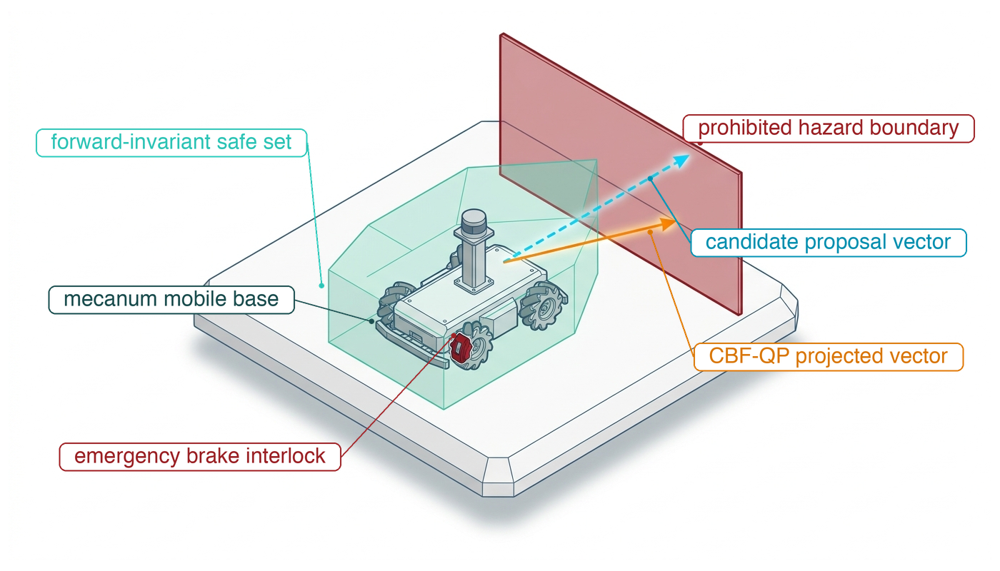
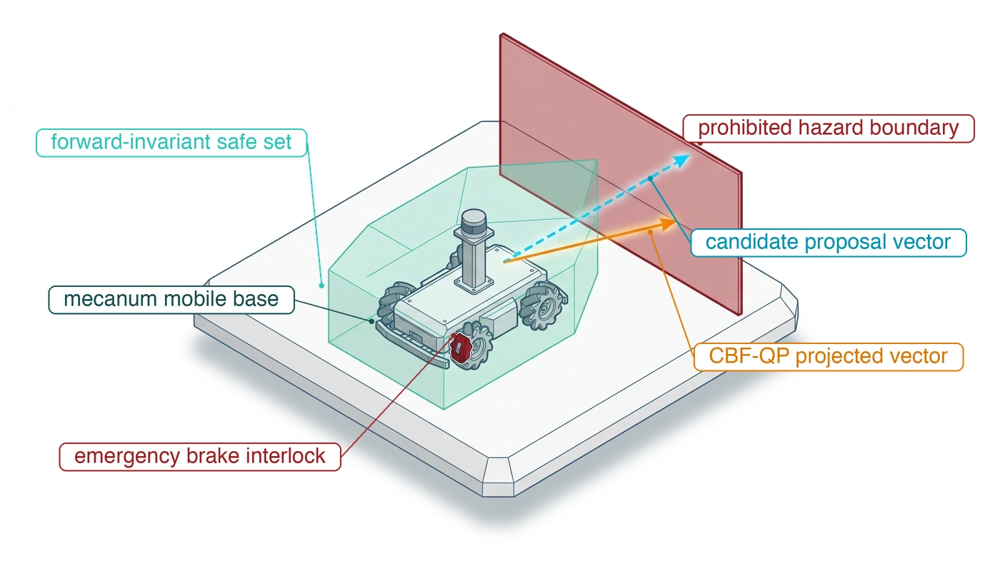
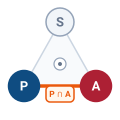
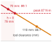
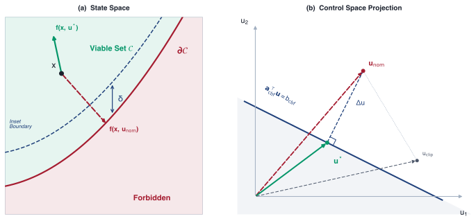
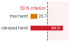
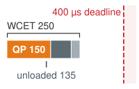
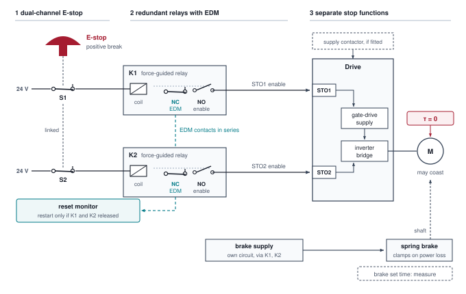
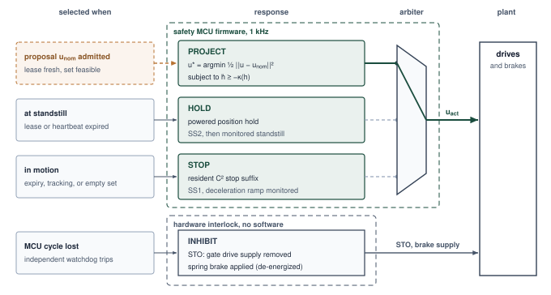
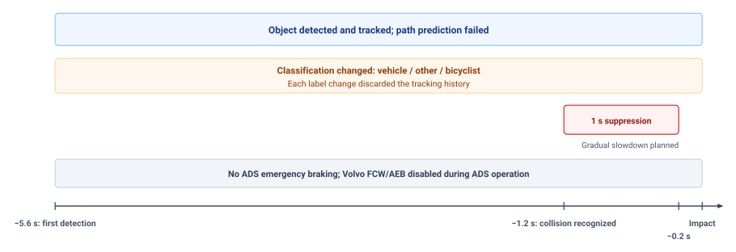

---
format:
  html:
    title: "Safety Enforcement"
---

# Safety Enforcement {#sec-enforcement}

::: {layout-narrow}
::: {.column-margin}

\chapterminitoc

:::

::: {.content-visible when-format="pdf"}
\noindent
{fig-alt="Isometric blueprint showing runtime safety enforcement for an autonomous mobile robot: omnidirectional mecanum base, translucent mint-green forward-invariant safe set boundary, candidate cyan neural proposal vector pointing toward a prohibited crimson hazard wall, amber CBF-QP projected admissible vector, and crimson emergency brake interlock."}
:::

::: {.content-visible unless-format="pdf"}
{fig-alt="Isometric blueprint showing runtime safety enforcement for an autonomous mobile robot: omnidirectional mecanum base, translucent mint-green forward-invariant safe set boundary, candidate cyan neural proposal vector pointing toward a prohibited crimson hazard wall, amber CBF-QP projected admissible vector, and crimson emergency brake interlock."}
:::

:::

## Purpose {.unnumbered .unlisted}

::: {.content-visible when-format="pdf"}
\begin{marginfigure}
\resizebox{0.92\linewidth}{!}{\mlphysicalstackfull{20}{100}{20}{20}{20}}
\end{marginfigure}
:::

_Why does an admitted plan still need permission on every control tick?_

A trajectory can be feasible when it arrives and become unsafe while the machine follows it. The body lags its reference, a payload or a hot motor erodes braking authority, a person steps into the path, or the learned proposer stalls with its last command still in force. A machine that checks only before motion begins discovers these changes after the energy is already moving, and the proposer cannot be trusted to notice them, because nothing in its output bounds stopping distance, actuator effort, or timing. Learned proposals therefore need an independent permission path that re-checks current conditions on every tick, keeps useful motion inside a stopping envelope, corrects a command when a feasible correction exists, and holds a response it can execute without the proposer before the remaining margin is spent. Each of those guarantees depends on bounded sensing error, available actuator force, and a decision delivered on time. Enforcement joins these conditions at the causal boundary, where a permitted command becomes motion that software cannot undo.



::: {.callout-learning-objectives}

- Explain the relationship between tracking accuracy, command permission, and independent enforcement at the actuator boundary
- Calculate the finished stopping budget and the speed ceiling it sets from response delay, braking, localization, and tracking error
- Derive how momentum and commanded effort change the remaining safety margin, and the contact force at a latch and at a handover that caps approach speed
- Explain how a control barrier function limits motion while its model, sensing, actuator, and timing assumptions hold
- Formulate a quadratic program that minimally adjusts a proposal within feasible actuator and safety constraints
- Select state-matched fallback responses when sensing, computation, or actuator limits invalidate normal enforcement
- Distinguish the permission path's unrated performance checks from the certified drive, scanner, and arm safety functions that carry the protective claim beneath it
- Construct an enforcement record and formulate the admitted command that binds each check to its detector, its fallback response, and the records it consumes

:::
## Deterministic Safety Filters and Permission Gating {#sec-enforcement-deterministic-gatekeeper}

Every physical AI system ends in the same act. A command leaves software, becomes current in a motor winding, and puts momentum into a world that does not roll back. Safety enforcement is the runtime mechanism that decides, one control tick at a time, whether the next command may cross that causal boundary. Checking a plan once before it runs does not settle the question, because admission judges the plan against the state the planner predicted, and the machine then executes it against the state it actually reaches. Between those two moments the body can lag its reference, an actuator can run short of torque, a person can step into the aisle, and the learned proposer can stall or emit a setpoint the plan never contained. Enforcement exists so that none of these events is discovered only after the energy has been delivered.

The central constraint is that the learned proposer can neither be trusted with that decision nor be discarded. Its competence is what makes the machine useful, yet nothing in its output bounds stopping distance, actuator effort, or timing. Enforcement resolves the tension by separating proposal from permission (principle \ref{pri-vol4-proposal-permission}) and giving the permission side three jobs. It must hold a stopping reservation, the clearance the machine needs to arrest its motion from the current state; it must correct a proposal minimally when a feasible correction exists; and it must select a response it can execute without the proposer when none does. We develop these in that order. The tracking bound and the stopping budget fix the reservation and the speed it allows. Actuator authority and the control barrier function turn the reservation into a constraint on the next command. The least-change filter and its cycle budget make the correction timely. The fallback ladder, and the certified safety functions beneath it, supply the response that survives a failed check, and the enforcement record binds every check to its evidence.

On the warehouse mobile manipulator, the safety microcontroller (MCU) admits the run down the aisle only after the matched stop suffix named in its trajectory record (@sec-planning-trajectory-contract) is resident in the MCU's memory and feasible from its commitment entry state. Admission also requires an independently executable, state-matched fallback from every state reachable during the admitted motion before commitment; the attached suffix need not fit those earlier states. That admission checks the plan once, before the motion starts. The machine then executes it one millisecond tick at a time, and enforcement is the check made on every one of those ticks, together with the response it selects when even the resident stop no longer fits.

An invalid command must be intercepted before it reaches the drive, because once current in a winding imparts momentum, an exception handler cannot recall it (@sec-boundary-bedrock-laws). Enforcement therefore keeps the task competence of learned policies while denying them authority over geometric clearance, thermal limits, and human-safety invariants. The enforcer\index{Enforcer} of @sec-nervous-cadences, the permission path's per-tick gatekeeper, sits on the permission side of the proposal boundary. It is a hard real-time component that evaluates candidate proposals, verifies invariant state bounds, and holds the exclusive hardware authority to permit current flow or command a fallback stop.

::: {.column-margin}
{width="100%" fig-alt="S·P·A locator triad highlighting the Plan-to-Act gating edge."}
*Enforcement sits on the Plan-to-Act edge: no proposal reaches a drive unchecked.*
:::

In the architecture this chapter follows, the enforcer executes on a dedicated microcontroller wired to the sensing and drive interfaces it needs. It checks each candidate command before the drive can apply it. A packet firewall offers a limited software analogy: a sender may request an operation without having authority to perform it. Unlike a packet filter, the enforcer must also account for momentum already present in the plant and preserve an achievable response when it refuses a request.

The architecture separates a capable proposer, a resident protective controller, and an output selector. This is the **Simplex architecture**\index{Simplex architecture!dual-controller model}[^fn-simplex-online-upgrade] [@seto1998simplex; @sha2001using]: the proposer supplies useful candidates, while the permission path retains the exclusive ability to select a physically feasible response without waiting for it. The hardware allocation that makes this separation effective is developed in @sec-placement. The first quantity the enforcer needs is how far the body can stray from the reference it is asked to follow, because every clearance the permission path defends must also contain that error.

[^fn-simplex-online-upgrade]: **Simplex Architecture**: The design came from Carnegie Mellon in the 1990s as a way to upgrade the controller of a running plant without stopping it. An untested new controller drove the plant while a simple verified controller and a switching rule stood ready to take it back [@seto1998simplex]. The learned proposer occupies the untested controller's seat, and the design's premise, that the region from which the verified controller can still recover is known in advance, is the stopping envelope this chapter computes. \index{Simplex architecture!online upgrade}

```{python}
#| label: calc-enforcement-lease-stop
#| echo: false
#| warning: false
#| message: false
# ┌─────────────────────────────────────────────────────────────────────────────
# │ TIMING CONTRACT AND THE LEASE-EXPIRY WORST CASE
# ├─────────────────────────────────────────────────────────────────────────────
# │ Context: the lease paragraph below; the cycle timeline, @tbl-12-fallback-hierarchy,
# │          the enforcement record, and the summary reuse these strings.
# │ Goal:    state the three timers and the delay from last renewal to brake onset.
# │ Show:    chunk rate, lease, heartbeat rate and timeout, self-watchdog,
# │          tick, bus cycle, brake onset, renewal-to-onset delay; the
# │          evidence-age refusal threshold (budgeted observation age plus the
# │          clock-conversion bound) read by cycle stage 2 and the record. The
# │          base stall is priced in calc-enforcement-stopping-budget, after the
# │          spare is set.
# │ How:     the same RM/AISLE fields that size the lease in @sec-nervous-cadences.
# └─────────────────────────────────────────────────────────────────────────────
from mlsysim import *
from mlsysim.fmt import fmt, fmt_latency, fmt_frequency, check

RM = Embodied.MobileManipulator.WarehouseMobileManipulator
AISLE = Embodied.Scenario.WarehouseAisle

class EnforcementLeaseStop:
    # ┌── 1. LOAD ───────────────────────────────────────────────────────────
    chunk_rate = RM.chunk_rate  # category: chosen
    lease = AISLE.t_lease  # category: chosen
    heartbeat_rate = AISLE.heartbeat_rate  # category: chosen
    heartbeat_timeout = AISLE.heartbeat_timeout  # category: chosen
    self_watchdog = AISLE.mcu_self_watchdog  # category: chosen
    tick = AISLE.t_tick  # category: chosen
    bus = AISLE.t_bus  # category: illustrative
    onset = AISLE.t_brake_onset  # category: illustrative
    t_age = AISLE.perception_age  # category: derived (observation age the budget charges, row 5)
    eps_sync = 0.2 * millisecond  # category: illustrative (clock-conversion bound, @sec-perception-observation-contract)

    # ┌── 2. EXECUTE ────────────────────────────────────────────────────────
    chunk_period = (1 / chunk_rate).to(millisecond)
    renewal_to_onset = (lease + tick + bus + onset).to(millisecond)
    age_threshold = (t_age + eps_sync).to(millisecond)  # dispatch-age qualification threshold

    # ┌── 3. GUARD ──────────────────────────────────────────────────────────
    check(chunk_period < lease, "One chunk period must fit inside the lease.")
    check(heartbeat_timeout < lease, "A total host stall must trip the heartbeat before the lease expires.")
    check(abs(lease.to(millisecond).magnitude - 60.0) < 1e-9, "The chunk lease is 60 ms.")
    check(abs(renewal_to_onset.magnitude - 82.0) < 1e-9, "Brake onset comes 82 ms after the last valid renewal.")
    check(abs(t_age.to(millisecond).magnitude - 51.6) < 0.05, "The budgeted observation age is 51.6 ms.")
    check(abs(age_threshold.magnitude - 51.8) < 0.05, "The dispatch-age qualification threshold is 51.8 ms.")
    # fig12_canonical_fallback_ladder.svg and parts/images/svg/fig_part3_record_chain.svg draw 1 kHz, 60 ms, and 51.6 ms from these guards.
    check(abs(tick.to(millisecond).magnitude - 1.0) < 1e-9, "The hand-drawn figures label the MCU tick 1 kHz.")

    # ┌── 4. OUTPUT ─────────────────────────────────────────────────────────
    chunk_rate_hz_str = fmt(chunk_rate.to(hertz).magnitude, precision=0)
    lease_ms_str = fmt_latency(lease, unit=millisecond, precision=0)
    heartbeat_rate_hz_str = fmt(heartbeat_rate.to(hertz).magnitude, precision=0)
    heartbeat_timeout_ms_str = fmt_latency(heartbeat_timeout, unit=millisecond, precision=0)
    self_watchdog_ms_str = fmt_latency(self_watchdog, unit=millisecond, precision=0)
    tick_ms_str = fmt_latency(tick, unit=millisecond, precision=0)
    tick_us_str = fmt_latency(tick, unit=microsecond, precision=0)
    loop_rate_str = fmt_frequency((1 / tick).to(hertz))
    bus_ms_str = fmt_latency(bus, unit=millisecond, precision=0)
    onset_ms_str = fmt_latency(onset, unit=millisecond, precision=0)
    renewal_to_onset_ms_str = fmt_latency(renewal_to_onset, unit=millisecond, precision=0)
    t_age_str = fmt_latency(t_age, unit=millisecond, precision=1)
    eps_sync_str = fmt_latency(eps_sync, unit=millisecond, precision=1)
    age_threshold_str = fmt_latency(age_threshold, unit=millisecond, precision=1)
```
## The Tracker Handoff and Dynamic Reference Envelopes {#sec-enforcement-handoff}

Even when communication latency is zero and the safety filter admits every reference command without delay, physical robots follow reference trajectories imperfectly. Mechanical compliance, inertia, and non-ideal motor dynamics inevitably produce tracking discrepancies. The feedback tracker—the closed-loop controller responsible for translating admitted references into actuator effort (@sec-planning-handoff)—must rigorously bound this deviation across the entire maneuver. We formalize this deviation using a **worst-case tracking error tube** ($\epsilon_{\text{track}}$), which defines an upper bound on the spatial departure of the tracked position output from its nominal reference. In our tracking formulations, $\mathbf{x}(t)$ and $\mathbf{r}(t)$ denote the actual and reference positions evaluated in identical spatial coordinates, rather than a full state vector conflating position, velocity, and internal joint angles. For whole-body systems such as mobile manipulators, the execution stack defines a declared output map or metric weighting that bounds the maximum physical swept-volume displacement in meters. The safety enforcer depends directly on this bound: any spatial clearance reserved around a planned reference path must guarantee physical containment of the actual robot body.

Provided that the physical system begins within an initial qualified error region and operating parameters—such as reference velocity, command acceleration, payload mass, external disturbances, and actuator temperature—stay within their validated operating envelope, the feedback controller guarantees the transient position-error bound:
$$\|\mathbf{x}(t) - \mathbf{r}(t)\| \le \epsilon_{\text{track}} \quad \forall t \ge 0.$$
This guarantee forms a software contract between the tracking layer and the safety enforcer\index{Enforcer!tracking contract}. Rather than re-analyzing raw plant dynamics or reconstructing low-level controller state on every millisecond control cycle, the enforcer consumes this certified error bound as an invariant. However, this contract confines physical motion to the $\epsilon_{\text{track}}$\index{Tracking error bound} tube only while the operational conditions used to establish the certificate remain valid.

The magnitude of $\epsilon_{\text{track}}$ is a physical distance dictated by hardware properties: reflected rotor inertia ($N^2 J_{\text{rotor}}$, @sec-body-reflected-rotor-inertia), gearbox backlash, structural compliance, and actuator torque saturation\index{Actuator torque limits}. While a steady-state stiffness calculation balances constant external disturbances against closed-loop restoring force\index{Closed-loop stiffness}, steady-state metrics fail to capture transient overshoot, phase lag, or settling oscillations excited during aggressive maneuvers. Consequently, engineering teams cannot rely on static linear approximations; they must establish the tracking tube bound $\epsilon_{\text{track}}$ through full-envelope dynamic qualification testing across worst-case operational maneuvers.

```{python}
#| label: calc-enforcement-tracking-bound
#| echo: false
#| warning: false
#| message: false
# ┌─────────────────────────────────────────────────────────────────────────────
# │ THE BASE'S TRACKING BOUND
# ├─────────────────────────────────────────────────────────────────────────────
# │ Context: the tracking-bound paragraphs immediately below.
# │ Goal:    state the inset the enforcer applies and what a doubled error costs.
# │ Show:    the base's tracking bound and the error if wear doubled it.
# │ How:     AISLE.eps_track, the same field row 7 of the stopping budget uses.
# └─────────────────────────────────────────────────────────────────────────────
from mlsysim import *
from mlsysim.fmt import fmt_length, check

AISLE = Embodied.Scenario.WarehouseAisle

class EnforcementTrackingBound:
    # ┌── 1. LOAD ───────────────────────────────────────────────────────────
    eps_track = AISLE.eps_track  # category: illustrative

    # ┌── 2. EXECUTE ────────────────────────────────────────────────────────
    eps_doubled = (2 * eps_track).to(millimeter)

    # ┌── 3. GUARD ──────────────────────────────────────────────────────────
    check(abs(eps_track.to(millimeter).magnitude - 40.0) < 1e-9, "The base's tracking bound is 40 mm.")

    # ┌── 4. OUTPUT ─────────────────────────────────────────────────────────
    eps_track_str = fmt_length(eps_track, unit=millimeter, precision=0)
    eps_doubled_str = fmt_length(eps_doubled, unit=millimeter, precision=0)
```

For our baseline warehouse mobile manipulator, the certified dynamic qualification target is $\epsilon_{\text{track}} =$ `{python} EnforcementTrackingBound.eps_track_str` (illustrative; see the Reader Guide). The tracking controller sustains this bound only while three coupled operational constraints remain satisfied: reference trajectories must not demand accelerations exceeding drive torque limits, external disturbance forces must remain below $d_{\text{max}}$, and actuator coils must operate below their continuous thermal derating thresholds (@sec-body-thermal-duty-cycles\index{Joule heating}) and DC bus voltage limits. A reference trajectory demanding acceleration beyond peak torque drives the actuators into saturation\index{Actuator saturation}, causing the physical chassis to lag behind the command. Without aggressive anti-windup clamping, the integrator state accumulates severe windup\index{Integrator windup}, prolonging recovery long after the reference demand subsides. Outside this qualified operating envelope, the tracking certificate is void, and the system loses its guaranteed error bound.

Because the physical robot can deviate from its planned reference by up to $\epsilon_{\text{track}}$ in any direction, the safety architecture must subtract this uncertainty margin directly from the admissible workspace. Let $h$ measure the spatial clearance remaining around a reference. To guarantee that the physical robot maintains non-negative clearance, the enforcer applies an inset contraction:
$$h_{\text{contracted}}(\mathbf{r}) = h(\mathbf{r}) - \epsilon_{\text{track}} \ge 0.$$
A reference trajectory that maintains nominal clearance $c$ from a warehouse rack upright guarantees the physical chassis only $c - \epsilon_{\text{track}}$ of actual clearance. Consequently, the safety enforcer evaluates reference commands against a contracted boundary that adds `{python} EnforcementTrackingBound.eps_track_str` to the nominal buffer. As detailed in @sec-enforcement-stopping-envelopes, this tracking inset compounds directly with stopping distance budgets, where localization uncertainty and transport delay consume additional clearance. Mechanical wear poses an insidious operational risk here: if worn drive bearings, tire degradation, or altered motor parameters double the true tracking error to `{python} EnforcementTrackingBound.eps_doubled_str` without updating the enforcer's parameter registry, the physical base consumes an unbudgeted `{python} EnforcementTrackingBound.eps_track_str` of clearance that the enforcer assumes remains available. An unmodeled tracking degradation silently undermines every higher-level safety margin.

::: {.column-margin .margin-pointer}
↩ Spatial clearance insetting from sensor covariance and transport delay originates in @sec-perception-error-clearance.
:::

To maintain safety guarantees in production, the runtime monitoring stack must treat $\epsilon_{\text{track}}$ as an actively verified contract rather than a static design assumption. The underlying real-time middleware publishes $\epsilon_{\text{track}}$ alongside its validity envelope, while hardware monitors compute the instantaneous tracking error $e(t) = \|\mathbf{x}(t) - \mathbf{r}(t)\|$ on every 1 ms controller tick. If an unmodeled disturbance spike, wheel slippage on a slick surface, or actuator thermal throttling causes $e(t)$ to exceed $\epsilon_{\text{track}}$, the tracking contract is broken. Upon detecting this violation, the safety enforcer revokes the admitted command and activates a state-matched emergency fallback maneuver. Maintaining physical containment during this transition requires that the fallback braking trajectory remains dynamically feasible even after the tracking bound is lost.

::: {#psp-enforcement-inset-margin .callout-perspective title="The inset margin invariant"}
A spatial stopping boundary must reserve margin for the tracking loop's qualified error bound. The runtime stopping envelope (@eq-enforce-stopping-envelope) incorporates this geometric inset alongside displacement accumulated during transport lag\index{Transport lag} before admitting reference trajectories. When safety barrier certificates\index{Barrier certificates} are formulated in non-spatial coordinates (such as energy or momentum limits), the safety layer must map the tracking tube into a corresponding conservative bound on barrier variation, rather than subtracting a scalar distance. Evaluating barrier certificates against nominal trajectory geometry alone risks admitting references whose physical tracking tubes intersect obstacle boundaries.
:::

Control theory provides rich methodologies for synthesizing tracking controllers, state observers, and disturbance rejection algorithms [@slotine1991applied; @astrom2021feedback]. In embedded industrial robotics, systems frequently deploy a **cascaded control hierarchy**\index{Cascaded control!tracking architecture}, where outer position loops feed intermediate velocity setpoints down to high-rate current loops. Alternatively, a **tracking Model Predictive Controller (MPC)**\index{Model Predictive Control!tracking layer} solves an online optimization problem over a receding horizon to generate optimal corrective control actions while respecting actuator bounds. From the perspective of the safety enforcer, the specific internal architecture of the tracking controller is abstracted away; the safety filter requires only that the chosen implementation certifies and guarantees a concrete tracking bound $\epsilon_{\text{track}}$ under specified operational conditions.

Crucially, a tracking controller guarantees convergence to the reference path, not collision avoidance. A well-tuned tracker will follow an erroneous trajectory directly into a warehouse support column with high precision. Control Lyapunov functions[^fn-clf-tracking-convergence] mathematically formalize this asymptotic convergence toward reference targets; @sec-appendix-control-lyapunov details their theoretical foundation and demonstrates how optimization pipelines unify stabilizing Lyapunov objectives with forward-invariant safety barrier certificates.

[^fn-clf-tracking-convergence]: **Control Lyapunov Function**: A Lyapunov function certifies that an unforced system settles; a control Lyapunov function asks only that, at each state, some admissible input make it decrease. @artstein1983stabilization tied the existence of such a function to stabilizability by feedback, and @sontag1989universal gave an explicit formula that builds the stabilizing input from it. The barrier is its mirror image, keeping the state out of a region instead of pulling it toward a point, and when the two conflict the combined optimization relaxes convergence so that the barrier holds. \index{Control Lyapunov function!barrier counterpart}

This division of responsibilities cleanly separates trajectory tracking from safety enforcement. The low-level tracking controller focuses on driving the physical plant toward reference states, while the safety enforcer determines whether those references can be executed without violating invariant boundaries. The tracking error bound $\epsilon_{\text{track}}$ bridges these subsystems: it quantifies the spatial divergence between admitted commands and physical execution. Because environmental disturbances, unmodeled payload shifts, or thermal current derating can rapidly widen this error tube, safety architectures must continuously verify physical performance against contracted assumptions. The downstream stopping envelope accounts for this tracking tube alongside sensor latency, braking distance, and localization drift, ensuring that the physical robot remains safely buffered from surrounding hazards.
## Stopping Envelopes {#sec-enforcement-stopping-envelopes}

Every physical subsystem contributes an essential stopping term to the mobile manipulator's spatial budget at the warehouse rack end, with the base tracking error providing the final physical margin. One critical timing interval—the delay from proposal dispatch to runtime admission—is omitted from this spatial sum; the budget instead charges it against the temporal allowance preserved by the remaining clearance. The stopping envelope defines the set of physical states from which a validated braking maneuver can bring the machine to a complete rest before contacting an obstacle boundary. The underlying irreversibility principle (\ref{pri-vol4-irreversibility}) establishes the governing test: $d_{\text{stop}} \le D_{\text{clear}}$, with every constituent term bounded by qualified physical limits and empirical evidence. Our running calculation incorporates representative engineering limits, though physical deployment requires empirical qualification on the actual hardware platform. Guaranteeing this stopping capability directly constrains achievable vehicle speed, because velocity inflates communication and reaction latency linearly while inflating braking distance quadratically. At runtime, the enforcer must ensure the robot remains strictly within this safe envelope before any fault or unmodeled disturbance can manifest.

The pre-brake delay $\tau_{\text{delay}}$ established in the stopping distance formulation of @sec-body-kinetic-momentum already accounts for the enforcer's permission evaluation cycle, budgeted alongside the lease communication path in @sec-nervous-cadences. The final remaining discrepancy is the physical tracking error between the commanded reference trajectory and the actual robot plant.

The safety enforcement layer accounts for this deviation using the tracking bound $\epsilon_{\text{track}}$ established in @sec-enforcement-handoff, effectively offsetting the baseline stopping distance of @eq-body-stopping-distance. The enforcer can admit a candidate reference trajectory only if the plant—which may lag behind that reference by up to $\epsilon_{\text{track}}$—can still brake to a standstill within the available free distance $D_{\text{clear}}$. Combining physical clearance, latency, and velocity yields the composite admission test:
$$v\,\tau_{\text{delay}} + d_{\text{suffix}}(v) + \delta_{\text{loc}} + \delta_{\text{margin}} + \epsilon_{\text{track}} \le D_{\text{clear}}$$ {#eq-enforce-stopping-envelope}
Here, $d_{\text{suffix}}(v)$ represents the physical distance traversed during the braking maneuver from an initial speed $v$. For idealized constant-deceleration braking, this term simplifies to $v^2 / (2a_{\text{brake}})$. Under the realistic jerk-limited trajectory profiles analyzed in @sec-planning-behavior-seam, $d_{\text{suffix}}(v)$ is governed by @eq-plan-c2-stopping-suffix, which incorporates the additional displacement accrued during finite jerk transitions. The term $\delta_{\text{loc}}$ denotes the localization uncertainty bound, while $\delta_{\text{margin}}$ provides an explicit protective safety cushion. The left-hand side sums the baseline stopping distance $d_{\text{stop}}(v)$ from @eq-body-stopping-distance with the tracking inset $\epsilon_{\text{track}}$, completing the physical derivation presented in @sec-appendix-systems-stopping.

This inequality defines a viable conditional stopping region in state space. Within this set, the combined reaction latency and braking profile fit within the measured obstacle clearance. Operating outside this boundary violates the stopping reservation under the qualified model assumptions, though conservative engineering margins do not imply that an instantaneous collision is certain under all conceivable emergency maneuvers. Crucially, per-tick enforcement must maintain this stopping reservation over the entire control epoch until the next validated command can take effect, rather than merely verifying instantaneous feasibility at the sample instant.

Whenever a proposed trajectory requires a stopping distance in @eq-enforce-stopping-envelope that exceeds the measured clearance along the current heading, the enforcer rejects the command. Because the robot moves directionally, the stopping envelope is fundamentally anisotropic\index{Stopping envelope!Anisotropy}. Heading dictates which obstacles threaten forward travel and consume braking clearance, while localization uncertainty and the robot's swept geometric volume demand clearance margins around the entire perimeter.

### Sizing the composite stopping budget {#sec-enforcement-composite-budget}

The composite stopping budget integrates these disparate physical claims into the **spatial footprint of the chunk lease**, the bounded execution window formalized in @sec-nervous-lease-sizing under which an admitted action executes. This budget reserves clearance for sensor transduction lag, compute scheduling delays, physical actuator engagement, trajectory deceleration profiles, and mechanical tracking divergence. To ensure mathematical and operational validity, every constituent term must be evaluated under identical, worst-case operating conditions; otherwise, their linear combination cannot provide an authoritative admission guarantee.

```{python}
#| label: calc-enforcement-stopping-budget
#| echo: false
#| warning: false
#| message: false
# ┌─────────────────────────────────────────────────────────────────────────────
# │ THE FINISHED STOPPING BUDGET OF THE WAREHOUSE MOBILE MANIPULATOR
# ├─────────────────────────────────────────────────────────────────────────────
# │ Context: row 7 and aisle-speed prose below, @tbl-enforcement-stopping-budget.
# │ Goal:    add the tracking inset (row 7), then choose the aisle speed that the
# │          finished budget allows.
# │ Show:    each row's term, value, running total, and remainder at the drive
# │          limit; the same terms at the aisle speed; the ceiling; the time rows;
# │          the missed-tick cost reused by the cycle list; the walking-person
# │          ceiling (moved from @sec-memory-belief-through-occlusion); the
# │          base stall at the aisle speed (distance added, overrun past D_clear);
# │          the Delta_da allocation charged against the timing allowance and
# │          the reserve it leaves.
# │ How:     RM/AISLE fields; jerk bound = peak jerk of the reference C2
# │          polynomial at the drive limit (calc_c2_stop_suffix);
# │          calc_scurve_stop_distance / _time (row 6, stop rows);
# │          calc_scurve_max_permitted_velocity (ceilings, solved numerically);
# │          calc_safe_stopping_distance with tau + a/(2j) (closed-form
# │          cross-check above a^2/j); RM.intent_inference_latency, the
# │          computed prefill-plus-decode latency (time row).
# └─────────────────────────────────────────────────────────────────────────────
from mlsysim import *
from mlsysim.core.units import ureg
from mlsysim.physics.robotics import (
    calc_c2_stop_suffix,
    calc_scurve_stop_distance,
    calc_scurve_stop_time,
    calc_scurve_max_permitted_velocity,
    calc_max_permitted_velocity,
    calc_safe_stopping_distance,
    calc_free_space_expiry,
)
from mlsysim.fmt import fmt, fmt_int, fmt_length, fmt_velocity, fmt_latency, fmt_acceleration, fmt_jerk, fmt_magnitude, fmt_math, check

RM = Embodied.MobileManipulator.WarehouseMobileManipulator
AISLE = Embodied.Scenario.WarehouseAisle

class EnforcementStoppingBudget:
    # ┌── 1. LOAD ───────────────────────────────────────────────────────────
    v_drive = RM.base.max_velocity  # category: illustrative (drive limit)
    v_aisle = AISLE.v_aisle  # category: chosen
    a_brake = AISLE.a_brake  # category: illustrative (credible, loaded, dry floor)
    d_clear = AISLE.d_clear  # category: illustrative
    delta_loc = AISLE.delta_loc  # category: illustrative
    delta_margin = AISLE.delta_margin  # category: chosen
    eps_track = AISLE.eps_track  # category: illustrative
    t_act = AISLE.t_brake_onset  # category: illustrative
    t_lease = AISLE.t_lease  # category: chosen
    t_tick = AISLE.t_tick  # category: chosen
    t_bus = AISLE.t_bus  # category: illustrative
    t_age = AISLE.perception_age  # category: derived
    tau_delay = AISLE.tau_delay  # category: derived (excludes Delta_da)
    delta_da = AISLE.t_dispatch_to_admission.to(
        millisecond
    )  # category: illustrative (allocation of @sec-placement-isolation-decisions, not yet measured)
    v_human = AISLE.v_human_approach  # category: datasheet (ISO 13855 K)
    mu_inspected = AISLE.mu_inspected_floor  # category: illustrative
    t_intent = RM.intent_inference_latency  # category: derived (deployed INT4 prefill plus decode, @sec-brain-memory-wall)
    t_stall = 200.0 * millisecond  # category: illustrative (proposer stall before any brake)

    # ┌── 2. EXECUTE ────────────────────────────────────────────────────────
    lease_path = (t_lease + t_tick + t_bus).to(millisecond)
    overhead = (delta_loc + delta_margin).to(millimeter)
    # Jerk bound: the peak jerk of the reference C2 polynomial at the drive limit (@sec-planning-c2-stopping-suffix)
    j_brake = calc_c2_stop_suffix(v_drive, a_brake)["peak_jerk"].to(meter / second**3)
    v_plateau = (a_brake**2 / j_brake).to(meter / second)
    ramp_delay = (a_brake / (2 * j_brake)).to(millisecond)
    c2_drive = calc_scurve_stop_distance(v_drive, a_brake, j_brake).to(millimeter)
    c2_aisle = calc_scurve_stop_distance(v_aisle, a_brake, j_brake).to(millimeter)

    # Rows 1-7 at the drive limit, in book order
    brake_drive = (v_drive**2 / (2 * a_brake)).to(millimeter)
    onset_drive = (v_drive * t_act).to(millimeter)
    lease_drive = (v_drive * lease_path).to(millimeter)
    age_drive = (v_drive * t_age).to(millimeter)
    shape_drive = (c2_drive - brake_drive).to(millimeter)
    inset = eps_track.to(millimeter)
    run1 = brake_drive
    run2 = run1 + overhead
    run3 = run2 + onset_drive
    run4 = run3 + lease_drive
    run5 = run4 + age_drive
    run6 = run5 + shape_drive
    run7 = run6 + inset
    left = [
        (d_clear - run1).to(millimeter),
        (d_clear - run2).to(millimeter),
        (d_clear - run3).to(millimeter),
        (d_clear - run4).to(millimeter),
        (d_clear - run5).to(millimeter),
        (d_clear - run6).to(millimeter),
        (d_clear - run7).to(millimeter),
    ]

    # The same terms at the aisle speed
    brake_aisle = (v_aisle**2 / (2 * a_brake)).to(millimeter)
    onset_aisle = (v_aisle * t_act).to(millimeter)
    lease_aisle = (v_aisle * lease_path).to(millimeter)
    age_aisle = (v_aisle * t_age).to(millimeter)
    shape_aisle = (c2_aisle - brake_aisle).to(millimeter)
    total_aisle = (brake_aisle + overhead + onset_aisle + lease_aisle + age_aisle + shape_aisle + inset).to(millimeter)
    spare = (d_clear - total_aisle).to(millimeter)
    # Base stall: a last proposal that keeps authority for the stall instead of
    # the lease adds the extra delay's travel to the finished budget.
    stall_added = (v_aisle * (t_stall - t_lease)).to(millimeter)
    stall_breach = (total_aisle + stall_added - d_clear).to(millimeter)

    # Speed is the one free term: the ceiling of @eq-enforce-stopping-envelope
    ceiling = calc_scurve_max_permitted_velocity(
        d_clear, tau_delay, a_brake, j_brake, loc_margin=delta_loc, physical_margin=delta_margin + eps_track
    ).to(meter / second)
    # Above a^2/j the S-curve is constant braking at a_brake with the delay lengthened by a/(2j)
    ceiling_closed = calc_max_permitted_velocity(
        d_clear, tau_delay + ramp_delay, a_brake, loc_margin=delta_loc, physical_margin=delta_margin + eps_track
    ).to(meter / second)
    total_check = calc_safe_stopping_distance(
        v_drive, tau_delay + ramp_delay, a_brake, loc_margin=delta_loc, physical_margin=delta_margin + eps_track
    ).to(millimeter)
    # Operands of @eq-enforce-speed-ceiling for the napkin-math notebook
    tau_eff = (tau_delay + ramp_delay).to(millisecond)
    d_avail = (d_clear - delta_loc - delta_margin - eps_track).to(millimeter)
    a_tau = (a_brake * tau_eff).to(meter / second)
    a_tau_sq = (a_tau**2).to(meter**2 / second**2)
    two_a_d = (2 * a_brake * d_avail).to(meter**2 / second**2)
    root_term = ((a_tau_sq + two_a_d) ** 0.5).to(meter / second)
    ceiling_hand = (root_term - a_tau).to(meter / second)

    # Time rows (no distance added)
    # Free-space expiry abreast of the occluded rack end (@eq-mem-free-space-expiry):
    # the free depth is the hull-to-rack side clearance.
    belief_life = calc_free_space_expiry(AISLE.side_clearance, delta_loc, delta_margin, v_human).to(millisecond)
    missed_tick = (v_aisle * t_tick).to(millimeter)
    t_latest = (spare / v_aisle).to(millisecond)
    capture_to_admission_max = (t_age + t_latest).to(millisecond)
    capture_to_onset_max = (tau_delay + t_latest).to(millisecond)
    # Delta_da is not a term of tau_delay; the timing allowance pays for it.
    travel_da = (v_aisle * delta_da).to(millimeter)
    reserve_t = (t_latest - delta_da).to(millisecond)
    reserve_d = (spare - travel_da).to(millimeter)
    capture_to_onset = AISLE.t_capture_to_brake_onset.to(millisecond)  # rows 1-3 of @tbl-04-event-ledger
    mu_min = (a_brake / ureg.standard_gravity).to("dimensionless").magnitude
    a_inspected = min(a_brake, (mu_inspected * ureg.standard_gravity).to(meter / second**2))
    # The floor caps the deceleration; the jerk bound belongs to the load and is unchanged.
    ceiling_inspected = calc_scurve_max_permitted_velocity(
        d_clear, tau_delay, a_inspected, j_brake, loc_margin=delta_loc, physical_margin=delta_margin + eps_track
    ).to(meter / second)

    # Walking person: v tau + d_stop(v) + v_h (tau + T_stop(v)) + overhead = d_clear.
    # The S-curve's distance and time are not one polynomial in v, so MLSysIM solves it numerically.
    overhead_all = AISLE.fixed_overhead  # category: derived (delta_loc + delta_margin + eps_track)
    v_walk = calc_scurve_max_permitted_velocity(
        d_clear, tau_delay, a_brake, j_brake, loc_margin=delta_loc, physical_margin=delta_margin + eps_track, approach_velocity=v_human
    ).to(meter / second)
    d_walk = (
        v_walk * tau_delay
        + calc_scurve_stop_distance(v_walk, a_brake, j_brake)
        + v_human * (tau_delay + calc_scurve_stop_time(v_walk, a_brake, j_brake))
        + overhead_all
    ).to(meter)
    # Why the walking-person ceiling is so low: below a^2/j the jerk-limited stop never
    # reaches a_brake and lasts 2 sqrt(v/j), far longer than v/a, and the person walks
    # for the whole stop.
    t_stop_walk = calc_scurve_stop_time(v_walk, a_brake, j_brake).to(millisecond)
    t_stop_walk_const = (v_walk / a_brake).to(millisecond)
    brake_walk = calc_scurve_stop_distance(v_walk, a_brake, j_brake).to(millimeter)
    closure_walk = (v_human * t_stop_walk).to(millimeter)
    # A reference polynomial rescaled to stop from v_walk at the full a_brake would need this jerk
    jerk_rescaled_walk = calc_c2_stop_suffix(v_walk, a_brake)["peak_jerk"].to(meter / second**3)
    # The same walking-person budget under constant-deceleration braking (no jerk bound):
    # v^2/2a + (tau + v_h/a) v + v_h tau + overhead - d_clear = 0, positive root
    _qa = 1 / (2 * a_brake)
    _qb = tau_delay + v_human / a_brake
    _qc = v_human * tau_delay + overhead_all - d_clear
    v_walk_const = ((-_qb + (_qb**2 - 4 * _qa * _qc) ** 0.5) / (2 * _qa)).to(meter / second)
    # Latency sensitivity of the static ceiling: 10 ms more pre-brake delay
    ceiling_plus10 = calc_scurve_max_permitted_velocity(
        d_clear, tau_delay + 10 * millisecond, a_brake, j_brake, loc_margin=delta_loc, physical_margin=delta_margin + eps_track
    ).to(meter / second)
    ceiling_drop_10ms = (ceiling - ceiling_plus10).to(millimeter / second)

    # ┌── 3. GUARD ──────────────────────────────────────────────────────────
    check(abs(run1.magnitude - 562.5) < 1e-6, "Row 1 running total is 562.5 mm.")
    check(abs(run2.magnitude - 712.5) < 1e-6, "Row 2 running total is 712.5 mm.")
    check(abs(run3.magnitude - 742.5) < 1e-6, "Row 3 running total is 742.5 mm.")
    check(abs(run4.magnitude - 835.5) < 1e-6, "Row 4 running total is 835.5 mm.")
    check(abs(run5.magnitude - 912.9) < 1e-6, "Row 5 running total is 912.9 mm.")
    check(abs(j_brake.magnitude - 64.0 / 9.0) < 1e-9, "The jerk bound is the reference polynomial's 7.11 m/s^3 peak.")
    check(v_aisle >= v_plateau and v_drive >= v_plateau, "Both budget speeds reach the deceleration bound (trapezoidal regime).")
    check(abs(run6.magnitude - 1123.8375) < 1e-6, "Row 6 running total is 1123.84 mm.")
    check(abs(run7.magnitude - 1163.8375) < 1e-6, "Row 7 running total is 1163.84 mm.")
    check(abs(total_check.magnitude - run7.magnitude) < 1e-6, "Row 7 total must equal @eq-enforce-stopping-envelope at the drive limit.")
    check(abs(left[6].magnitude + 63.8375) < 1e-6, "Row 7 runs 63.84 mm past the clear distance.")
    check(abs(lease_path.magnitude - 62.0) < 1e-9, "Lease path is 62 ms.")
    check(abs(tau_delay.magnitude - 133.6) < 1e-9, "tau_delay is 133.6 ms.")
    check(abs(ceiling.magnitude - ceiling_closed.magnitude) < 1e-9, "Numerical ceiling must match the closed form above a^2/j.")
    check(ceiling >= v_plateau, "The ceiling lies in the trapezoidal regime.")
    check(abs(ceiling.magnitude - 1.4367) < 5e-5, "Ceiling is 1.44 m/s.")
    check(abs(ceiling_hand.magnitude - ceiling.magnitude) < 1e-9, "The notebook's hand arithmetic must reproduce the ceiling.")
    check(abs(d_avail.magnitude - 910.0) < 1e-9, "Clearance left after the fixed allowances is 910 mm.")
    check(v_aisle < ceiling, "The chosen aisle speed must sit under the ceiling.")
    check(abs(total_aisle.magnitude - 968.9925) < 1e-6, "Budget at 1.3 m/s is 968.99 mm.")
    check(abs(spare.magnitude - 131.0075) < 1e-6, "Spare at 1.3 m/s is 131.01 mm.")
    check(abs(stall_added.magnitude - 182.0) < 1e-6, "A 200 ms stall adds 182 mm at 1.3 m/s.")
    check(stall_added > spare, "The stall's added travel exceeds the whole spare.")
    check(abs(stall_breach.magnitude - 50.9925) < 5e-3, "The stall runs 51.0 mm past the clear distance.")
    # 2026-09-28 (M1/M2): the deployed intent model is INT4; its full computed inference replaces the FP16 weight sweep.
    check(abs(t_intent.to(millisecond).magnitude - 335.61) < 5e-3, f"Intent inference latency drifted: {t_intent}")
    check(t_intent > t_lease, "The intent inference cannot renew a chunk lease.")
    check(belief_life.magnitude == 0.0, "Abreast of the occluded rack end the free-space claim expires at capture.")
    check(abs(missed_tick.magnitude - 1.3) < 1e-9, "One missed tick costs 1.3 mm at 1.3 m/s.")
    check(abs(t_latest.magnitude - 100.775) < 5e-3, "The unallocated timing allowance is 100.8 ms at 1.3 m/s.")
    check(reserve_t.magnitude > 0 and reserve_d.magnitude > 0, "The Delta_da allocation must leave positive reserve.")
    check(abs((tau_delay + delta_da - capture_to_onset).to(millisecond).magnitude) < 1e-9, "Capture to onset = tau_delay + Delta_da.")
    check(capture_to_onset < capture_to_onset_max, "The allocated capture-to-onset time must fall inside the latest onset.")
    check(
        abs((capture_to_onset_max - capture_to_admission_max - t_lease - t_tick - t_bus - t_act).to(millisecond).magnitude) < 1e-9,
        "Admission-to-onset must contain the lease, tick, bus, and drive onset exactly once.",
    )
    check(abs(mu_min - 0.204) < 5e-4, "Friction premise is 0.204.")
    check(abs(ceiling_inspected.magnitude - 1.2309) < 5e-5, "Inspected-floor ceiling is 1.23 m/s.")
    check(abs(v_walk.magnitude - 0.2599) < 5e-5, f"Walking-person ceiling should be 0.260 m/s, got {v_walk}.")
    check(v_walk < v_plateau, "The walking-person stop never reaches the deceleration bound.")
    check(abs((d_walk - d_clear).to(millimeter).magnitude) < 1e-6, "At the walking-person ceiling the budget must fill the clear distance exactly.")
    check(abs(t_stop_walk.magnitude - 382.38) < 5e-2, "The jerk-limited stop from the walking-person ceiling lasts about 382 ms.")
    check(t_stop_walk > 2.9 * t_stop_walk_const, "Below a^2/j the jerk-limited stop lasts roughly three times a constant-deceleration stop.")
    check(closure_walk > 10 * brake_walk, "The person closes more than ten times the base's own braking travel.")
    check(jerk_rescaled_walk > 5 * j_brake, "Reaching a_brake from the walking-person ceiling would need several times the jerk bound.")
    check(abs(v_walk_const.magnitude - 0.6371) < 5e-4, "Without the jerk bound the walking-person ceiling would be 0.64 m/s.")
    check(ceiling_drop_10ms.magnitude > 0, "More pre-brake delay must lower the ceiling.")

    # ┌── 4. OUTPUT ─────────────────────────────────────────────────────────
    v_drive_str = fmt_velocity(v_drive, precision=1)
    v_aisle_str = fmt_velocity(v_aisle, precision=1)
    ceiling_str = fmt_velocity(ceiling, precision=2)
    ceiling_inspected_str = fmt_velocity(ceiling_inspected, precision=2)
    v_walk_str = fmt_velocity(v_walk, precision=2)
    v_plateau_str = fmt_velocity(v_plateau, precision=2)
    v_human_str = fmt_velocity(v_human, precision=1)
    t_stop_walk_str = fmt_latency(round(t_stop_walk.magnitude) * millisecond, unit=millisecond, precision=0)
    t_stop_walk_const_str = fmt_latency(round(t_stop_walk_const.magnitude) * millisecond, unit=millisecond, precision=0)
    brake_walk_str = fmt_length(round(brake_walk.magnitude) * millimeter, unit=millimeter, precision=0)
    closure_walk_str = fmt_length(round(closure_walk.magnitude) * millimeter, unit=millimeter, precision=0)
    jerk_rescaled_walk_str = fmt_jerk(round(jerk_rescaled_walk.magnitude) * meter / second**3, precision=0)
    v_walk_const_str = fmt_velocity(v_walk_const, precision=2)
    ceiling_drop_10ms_str = fmt_int(ceiling_drop_10ms.magnitude)
    d_clear_str = fmt_length(d_clear, unit=meter, precision=2)
    a_brake_str = fmt_acceleration(a_brake, precision=0)
    j_brake_str = fmt_jerk(j_brake, precision=2)
    ramp_delay_str = fmt_latency(ramp_delay, unit=millisecond, precision=1)
    tau_eff_str = fmt_latency(tau_eff, unit=millisecond, precision=1)
    d_avail_str = fmt_length(d_avail, unit=millimeter, precision=0)
    d_clear_mm_str = fmt_length(d_clear, unit=millimeter, precision=0, commas=True)
    overhead_all_str = fmt_length(AISLE.fixed_overhead, unit=millimeter, precision=0)
    delta_loc_str = fmt_length(delta_loc, unit=millimeter, precision=0)
    delta_margin_str = fmt_length(delta_margin, unit=millimeter, precision=0)
    a_tau_str = fmt(a_tau.magnitude, precision=4)
    a_tau_sq_str = fmt(a_tau_sq.magnitude, precision=4)
    two_a_d_str = fmt(two_a_d.magnitude, precision=2)
    root_term_str = fmt(root_term.magnitude, precision=4)
    tau_delay_str = fmt_latency(tau_delay, unit=millisecond, precision=1)
    lease_path_str = fmt_latency(lease_path, unit=millisecond, precision=0)
    t_age_str = fmt_latency(t_age, unit=millisecond, precision=1)
    t_intent_str = fmt_latency(round(t_intent.to(millisecond).magnitude) * millisecond, unit=millisecond, precision=0)
    belief_life_str = fmt_latency(belief_life, unit=millisecond, precision=0)
    missed_tick_str = fmt_length(missed_tick, unit=millimeter, precision=1)
    t_latest_str = fmt_latency(t_latest, unit=millisecond, precision=1)
    capture_to_admission_max_str = fmt_latency(capture_to_admission_max, unit=millisecond, precision=1)
    capture_to_onset_max_str = fmt_latency(capture_to_onset_max, unit=millisecond, precision=1)
    delta_da_str = fmt_latency(delta_da, unit=millisecond, precision=1)
    travel_da_str = fmt_length(travel_da, unit=millimeter, precision=1)
    reserve_t_str = fmt_latency(reserve_t, unit=millisecond, precision=1)
    reserve_d_str = fmt_length(reserve_d, unit=millimeter, precision=1)
    capture_to_onset_str = fmt_latency(capture_to_onset, unit=millisecond, precision=1)
    mu_min_str = fmt(mu_min, precision=3)
    mu_inspected_str = fmt(mu_inspected, precision=2)
    inset_str = fmt_length(inset, unit=millimeter, precision=0)
    run6_str = fmt_length(run6, unit=millimeter, precision=2)
    run7_str = fmt_length(run7, unit=millimeter, precision=2)
    over7_str = fmt_length(-left[6], unit=millimeter, precision=2)
    total_aisle_str = fmt_length(total_aisle, unit=millimeter, precision=1)
    spare_str = fmt_length(spare, unit=millimeter, precision=1)
    t_stall_str = fmt_latency(t_stall, unit=millisecond, precision=0)
    stall_added_str = fmt_length(stall_added, unit=millimeter, precision=0)
    stall_breach_str = fmt_length(stall_breach, unit=millimeter, precision=2)
    # Table cells (the column headers carry mm)
    brake_drive_value_str = fmt_magnitude(brake_drive, millimeter, precision=1, commas=True)
    overhead_value_str = fmt_magnitude(overhead, millimeter, precision=0, commas=True)
    onset_drive_value_str = fmt_magnitude(onset_drive, millimeter, precision=0, commas=True)
    lease_drive_value_str = fmt_magnitude(lease_drive, millimeter, precision=0, commas=True)
    age_drive_value_str = fmt_magnitude(age_drive, millimeter, precision=1, commas=True)
    shape_drive_value_str = fmt_magnitude(shape_drive, millimeter, precision=2, commas=True)
    inset_value_str = fmt_magnitude(inset, millimeter, precision=0, commas=True)
    run1_value_str = fmt_magnitude(run1, millimeter, precision=1, commas=True)
    run2_value_str = fmt_magnitude(run2, millimeter, precision=1, commas=True)
    run3_value_str = fmt_magnitude(run3, millimeter, precision=1, commas=True)
    run4_value_str = fmt_magnitude(run4, millimeter, precision=1, commas=True)
    run5_value_str = fmt_magnitude(run5, millimeter, precision=1, commas=True)
    run6_value_str = fmt_magnitude(run6, millimeter, precision=2, commas=True)
    run7_value_str = fmt_magnitude(run7, millimeter, precision=2, commas=True)
    left1_value_str = fmt_magnitude(left[0], millimeter, precision=1, commas=True)
    left2_value_str = fmt_magnitude(left[1], millimeter, precision=1, commas=True)
    left3_value_str = fmt_magnitude(left[2], millimeter, precision=1, commas=True)
    left4_value_str = fmt_magnitude(left[3], millimeter, precision=1, commas=True)
    left5_value_str = fmt_magnitude(left[4], millimeter, precision=1, commas=True)
    left6_math = fmt_math(fmt_magnitude(left[5], millimeter, precision=2, commas=True))
    left7_math = fmt_math(fmt_magnitude(left[6], millimeter, precision=2, commas=True))
    brake_aisle_value_str = fmt_magnitude(brake_aisle, millimeter, precision=1, commas=True)
    onset_aisle_value_str = fmt_magnitude(onset_aisle, millimeter, precision=0, commas=True)
    lease_aisle_value_str = fmt_magnitude(lease_aisle, millimeter, precision=1, commas=True)
    age_aisle_value_str = fmt_magnitude(age_aisle, millimeter, precision=2, commas=True)
    shape_aisle_value_str = fmt_magnitude(shape_aisle, millimeter, precision=2, commas=True)
    total_aisle_value_str = fmt_magnitude(total_aisle, millimeter, precision=2, commas=True)
    spare_value_str = fmt_magnitude(spare, millimeter, precision=2, commas=True)
```

With each constituent term quantified, we formalize the stopping envelope as the primary invariant enforced throughout runtime execution.

::: {#dfn-enforcement-stopping-envelope .callout-definition title="Stopping envelope"}

***Stopping envelope***\index{Stopping envelope!definition} is the set of plant states—parameterized by clearance and velocity along each degree of freedom—from which the resident emergency braking response, initiated after accounting for all worst-case delays, halts motion before reaching an obstacle boundary while preserving all localization, protective, and tracking margins.

1.  **Significance**: The envelope translates the abstract irreversibility requirement $d_{\text{stop}} \le D_{\text{clear}}$ into an actionable runtime velocity ceiling. When approaching a rack end, the warehouse mobile manipulator's envelope restricts forward velocity to at most `{python} EnforcementStoppingBudget.ceiling_str`, substantially below its mechanical drive limit of `{python} EnforcementStoppingBudget.v_drive_str`.
2.  **Distinction**: Unlike a static geometric keep-out zone that depends solely on position, the stopping envelope is a dynamic construct governed by speed, system latencies, and braking authority. A given physical clearance safely admits a slow approach while strictly forbidding a high-speed transit.
3.  **Common pitfall**: Treating the stopping envelope as a static, precomputed boundary. In practice, carried payload mass, surface traction coefficients, and motor thermal limits continuously reshape this boundary; calculating safety margins from ideal datasheet decelerations severely overestimates stopping authority when the machine is heavily loaded.

:::

For the warehouse mobile manipulator, the tracking bound of `{python} EnforcementStoppingBudget.inset_str` provides the final physical distance margin incorporated into the budget. At the nominal `{python} EnforcementStoppingBudget.v_drive_str` drive limit, incorporating the matched stop suffix of @sec-planning-behavior-seam pushes the cumulative stopping requirement to `{python} EnforcementStoppingBudget.run6_str`, exceeding the available rack-end clearance of `{python} EnforcementStoppingBudget.d_clear_str`. Factoring in the tracking inset expands this distance to `{python} EnforcementStoppingBudget.run7_str`, producing a net overshoot of `{python} EnforcementStoppingBudget.over7_str` beyond the physical boundary.

The terms comprising @eq-enforce-stopping-envelope unify the physical and computational constraints analyzed throughout this book: the credible deceleration and fixed allowances established by rigid-body mechanics (@sec-body-kinetic-momentum), the lease execution window derived from real-time scheduling cadences (@sec-nervous-cadences), the sensor observation age dictated by transduction latency (@sec-perception-transduction-calibration), the trajectory deceleration profile shaped by jerk limits (@sec-planning-behavior-seam), and the closed-loop tracking bound introduced here. The $C^2$ stop suffix replaces idealized constant deceleration ($v^2 / 2a_{\text{brake}}$) with jerk-limited S-curve deceleration governed by the peak jerk limit $j_{\max} =$ `{python} EnforcementStoppingBudget.j_brake_str`. Because both operating velocities reach the peak deceleration threshold, @eq-plan-c2-stopping-suffix models this maneuver by adding the displacement of half a jerk ramp:
$$d_{\text{suffix}}(v) = \frac{v^2}{2 a_{\text{brake}}} + v\,\frac{a_{\text{brake}}}{2 j_{\max}}.$$
Because this smoothly shaped trajectory consumes more physical clearance than discontinuous full-torque braking, we must determine the admissible transit velocity directly from the finished spatial budget.

Velocity remains the single operational variable the control architecture can dynamically modulate. Above the characteristic velocity threshold $a_{\text{brake}}^2/j_{\max} =$ `{python} EnforcementStoppingBudget.v_plateau_str`, the finite jerk ramps function equivalently to an added delay of $a_{\text{brake}}/(2j_{\max})$ prior to braking at constant deceleration $a_{\text{brake}}$. Under these conditions, evaluating @eq-enforce-stopping-envelope at equality yields a quadratic equation in $v$, whose positive real root defines the authoritative **speed ceiling**\index{Speed ceiling!stopping envelope}:
$$v_{\max} = -a_{\text{brake}}\tau' + \sqrt{(a_{\text{brake}}\tau')^2 + 2a_{\text{brake}}D_{\text{avail}}}, \qquad \tau' = \tau_{\text{delay}} + \frac{a_{\text{brake}}}{2j_{\max}}, \qquad D_{\text{avail}} = D_{\text{clear}} - \delta_{\text{loc}} - \delta_{\text{margin}} - \epsilon_{\text{track}}$$ {#eq-enforce-speed-ceiling}
Below $a_{\text{brake}}^2/j_{\max}$, the deceleration trajectory never reaches the peak limit $a_{\text{brake}}$, rendering stopping distance non-quadratic in velocity; in this low-speed regime, MLSysIM evaluates @eq-enforce-stopping-envelope via numerical root-finding. The callout in \ref{nbk-enforcement-speed-ceiling} computes this ceiling for the mobile manipulator approaching the aisle rack end.

::: {#nbk-enforcement-speed-ceiling .callout-notebook title="The ceiling the budget sets"}

**Problem**: The warehouse mobile manipulator approaches the rack end with every stopping term of @tbl-enforcement-stopping-budget accounted except speed. What is the highest speed at which the jerk-limited stop still fits the clear distance, and how much clearance does a candidate aisle speed of `{python} EnforcementStoppingBudget.v_aisle_str` leave?

**Variables**:

* $D_{\text{clear}} =$ `{python} EnforcementStoppingBudget.d_clear_str` (Illustrative; clear distance at the rack end).
* $\delta_{\text{loc}} + \delta_{\text{margin}} =$ `{python} EnforcementStoppingBudget.delta_loc_str` $+$ `{python} EnforcementStoppingBudget.delta_margin_str` (Illustrative localization bound; chosen protective clearance), and $\epsilon_{\text{track}} =$ `{python} EnforcementStoppingBudget.inset_str` (Illustrative; the qualification target of @sec-enforcement-handoff).
* $a_{\text{brake}} =$ `{python} EnforcementStoppingBudget.a_brake_str` (Illustrative; credible loaded deceleration on a dry floor) and $j_{\max} =$ `{python} EnforcementStoppingBudget.j_brake_str` (Derived; the peak jerk of the reference $C^2$ polynomial).
* $\tau_{\text{delay}} =$ `{python} EnforcementStoppingBudget.tau_delay_str` (Derived; observation age plus lease path plus brake onset, excluding $\Delta_{\text{da}}$).
* Drive limit `{python} EnforcementStoppingBudget.v_drive_str` (Illustrative).

**Math**: The fixed allowances leave $D_{\text{avail}} =$ `{python} EnforcementStoppingBudget.d_clear_mm_str` $-$ `{python} EnforcementStoppingBudget.overhead_all_str` $=$ `{python} EnforcementStoppingBudget.d_avail_str`. The jerk ramps lengthen the delay to $\tau' =$ `{python} EnforcementStoppingBudget.tau_delay_str` $+$ `{python} EnforcementStoppingBudget.ramp_delay_str` $=$ `{python} EnforcementStoppingBudget.tau_eff_str`, so $a_{\text{brake}}\tau' =$ `{python} EnforcementStoppingBudget.a_tau_str` m/s. Under the square root of @eq-enforce-speed-ceiling, $(a_{\text{brake}}\tau')^2 =$ `{python} EnforcementStoppingBudget.a_tau_sq_str` and $2a_{\text{brake}}D_{\text{avail}} =$ `{python} EnforcementStoppingBudget.two_a_d_str` (both in m²/s²), whose sum has root `{python} EnforcementStoppingBudget.root_term_str` m/s; subtracting `{python} EnforcementStoppingBudget.a_tau_str` m/s gives the ceiling. At `{python} EnforcementStoppingBudget.v_aisle_str` the terms of @tbl-enforcement-stopping-budget sum to `{python} EnforcementStoppingBudget.total_aisle_str`, and the remainder divided by the speed is the timing allowance.

**Result**: $v_{\max} =$ `{python} EnforcementStoppingBudget.ceiling_str`, below the `{python} EnforcementStoppingBudget.v_drive_str` drive limit. The candidate aisle speed leaves `{python} EnforcementStoppingBudget.spare_str` of spare, equivalent to `{python} EnforcementStoppingBudget.t_latest_str` of unallocated delay.

**Systems insight**: The irreversibility requirement $d_{\text{stop}} \le D_{\text{clear}}$, rather than motor electrical capability, dictates the operating speed. Running at the nominal drive limit violates the verified spatial budget, and the speed ceiling shifts strictly through the parameters governing the quadratic root and effective latency $\tau'$: available clearance, qualified braking deceleration, fixed margins, and end-to-end transport lag. Any latency introduced by downstream processing directly consumes the `{python} EnforcementStoppingBudget.t_latest_str` timing allowance, which cannot be arbitrarily replenished.

:::

We select `{python} EnforcementStoppingBudget.v_aisle_str` as a candidate transit speed below that ceiling. Its `{python} EnforcementStoppingBudget.spare_str` margin is the sole clearance remaining to absorb unmodeled pipeline delays or provide secondary safety reserve.

This remaining margin is precariously narrow relative to the failure modes it must absorb. If chunk lease enforcement were entrusted to a non-real-time host operating system, an upstream planning stall lasting `{python} EnforcementStoppingBudget.t_stall_str` instead of the nominal `{python} EnforcementLeaseStop.lease_ms_str` lease would inject `{python} EnforcementStoppingBudget.stall_added_str` of unbraked displacement, causing the base to overrun the rack clearance by `{python} EnforcementStoppingBudget.stall_breach_str`. This hazard underscores why lease termination must be autonomously enforced by dedicated microcontroller hardware directly gating motor power (@sec-enforcement-authority-refuse).

The sensor observation-age term terminates upon action dispatch, whereas the chunk lease takes effect upon admission. Between these milestones lies the dispatch-to-admission latency $\Delta_{\text{da}}$, cataloged as the second critical stage in the event ledger of @tbl-04-event-ledger. Because the baseline pre-brake delay $\tau_{\text{delay}}$ excludes this transition, the complete operational delay expands to $\tau_{\mathrm{true}}=\tau_{\text{delay}}+\Delta_{\text{da}}$, requiring an additional spatial reservation of $v\Delta_{\text{da}}$. This phase encompasses any remaining neural inference, safety envelope projection, and inter-process communication; pipelined or overlapping stages must be budgeted carefully to avoid double-counting. A newly arrived sensor observation updates this ledger only when the hardware pipeline delivers and validates it prior to actuation. @Fig-12-capture-to-onset maps these sequential latencies onto a five-lane timing strip (camera, perception, proposal, permission, and drive) across time and physical travel, tracking how observation age and the hatched dispatch-to-admission interval lead up to lease expiry, MCU tick and bus transfer, and mechanical brake onset at the candidate aisle speed.

At this candidate speed, the unallocated timing allowance totals `{python} EnforcementStoppingBudget.t_latest_str`. To maintain a positive clearance reserve, elapsed time from capture to admission must not exceed `{python} EnforcementStoppingBudget.capture_to_admission_max_str`, and total latency from capture to physical brake onset must stay strictly below `{python} EnforcementStoppingBudget.capture_to_onset_max_str`. Operating at these precise boundaries exhausts all available clearance. These figures constitute formal qualification constraints rather than empirical performance claims. In @sec-placement-isolation-decisions, the architecture allocates $\Delta_{\text{da}} =$ `{python} EnforcementStoppingBudget.delta_da_str` to the partitioned compute pipeline, consuming `{python} EnforcementStoppingBudget.travel_da_str` of the spatial margin while preserving a safety cushion of `{python} EnforcementStoppingBudget.reserve_t_str` (equivalent to `{python} EnforcementStoppingBudget.reserve_d_str` of distance). Under this allocation, total latency from sensor capture to brake onset is `{python} EnforcementStoppingBudget.capture_to_onset_str`. Because this parameter represents an engineering budget rather than an empirical measurement, the instrumented validation campaign in @sec-placement-testing-separation must verify it with physical hardware timestamps before the vehicle can be certified to operate at this speed. @Tbl-enforcement-stopping-budget and @fig-enforcement-stopping-budget break down this cumulative spatial expenditure across successive physical and computational layers: in the stacked bar chart, seven bars at the `{python} EnforcementStoppingBudget.v_drive_str` drive limit accumulate braking distance, sensor age, and communication overhead against the horizontal `{python} EnforcementStoppingBudget.d_clear_str` rack-end clearance threshold, showing how jerk-limited S-curve shaping (bar 6) and tracking insets (bar 7) force a severe clearance breach; in contrast, the eighth bar at the candidate `{python} EnforcementStoppingBudget.v_aisle_str` aisle speed preserves a positive `{python} EnforcementStoppingBudget.reserve_d_str` safety reserve.

| Row | Added in                                 | Term                                                                                                                                                                                                                          |                                        At drive limit (mm) |                                  Running total (mm) |                      Left of $D_{\text{clear}}$ (mm) |                                        At aisle speed (mm) |
|----:|:-----------------------------------------|:------------------------------------------------------------------------------------------------------------------------------------------------------------------------------------------------------------------------------|-----------------------------------------------------------:|----------------------------------------------------:|-----------------------------------------------------:|-----------------------------------------------------------:|
|   1 | @sec-body-kinetic-momentum               | Braking, $v^2/2a_{\text{brake}}$                                                                                                                                                                                              | `{python} EnforcementStoppingBudget.brake_drive_value_str` | `{python} EnforcementStoppingBudget.run1_value_str` | `{python} EnforcementStoppingBudget.left1_value_str` | `{python} EnforcementStoppingBudget.brake_aisle_value_str` |
|   2 | @sec-body-kinetic-momentum               | Overhead, $\delta_{\text{loc}}+\delta_{\text{margin}}$                                                                                                                                                                        |    `{python} EnforcementStoppingBudget.overhead_value_str` | `{python} EnforcementStoppingBudget.run2_value_str` | `{python} EnforcementStoppingBudget.left2_value_str` |    `{python} EnforcementStoppingBudget.overhead_value_str` |
|   3 | @sec-body-kinetic-momentum               | Brake onset, $vT_{\text{act}}$                                                                                                                                                                                                | `{python} EnforcementStoppingBudget.onset_drive_value_str` | `{python} EnforcementStoppingBudget.run3_value_str` | `{python} EnforcementStoppingBudget.left3_value_str` | `{python} EnforcementStoppingBudget.onset_aisle_value_str` |
|   — | @sec-brain-cognitive-pipeline            | Time only: the chunk policy can renew a lease; the intent model's `{python} EnforcementStoppingBudget.t_intent_str` inference cannot                                                                                          |                                                          — |                                                   — |                                                    — |                                                          — |
|   4 | @sec-nervous-cadences                    | Lease path, $v(T_{\text{lease}}+T_{\text{tick}}+T_{\text{bus}})$ over `{python} EnforcementStoppingBudget.lease_path_str`                                                                                                     | `{python} EnforcementStoppingBudget.lease_drive_value_str` | `{python} EnforcementStoppingBudget.run4_value_str` | `{python} EnforcementStoppingBudget.left4_value_str` | `{python} EnforcementStoppingBudget.lease_aisle_value_str` |
|   5 | @sec-perception-transduction-calibration | Observation age, $v\,t_{\text{age}}$ over `{python} EnforcementStoppingBudget.t_age_str`                                                                                                                                      |   `{python} EnforcementStoppingBudget.age_drive_value_str` | `{python} EnforcementStoppingBudget.run5_value_str` | `{python} EnforcementStoppingBudget.left5_value_str` |   `{python} EnforcementStoppingBudget.age_aisle_value_str` |
|   — | @sec-memory-belief-through-occlusion     | Time only: abreast of an occluded rack end the erosion law of @eq-mem-free-space-expiry leaves no free depth, so the free-space claim lasts `{python} EnforcementStoppingBudget.belief_life_str` and memory cannot certify it |                                                          — |                                                   — |                                                    — |                                                          — |
|   6 | @sec-planning-behavior-seam              | Jerk-limited $C^2$ stop, the jerk-ramp travel $v\,a_{\text{brake}}/2j_{\max}$ added to $v^2/2a_{\text{brake}}$                                                                                                                | `{python} EnforcementStoppingBudget.shape_drive_value_str` | `{python} EnforcementStoppingBudget.run6_value_str` |      `{python} EnforcementStoppingBudget.left6_math` | `{python} EnforcementStoppingBudget.shape_aisle_value_str` |
|   7 | @sec-enforcement-stopping-envelopes      | Tracking inset, $\epsilon_{\text{track}}$                                                                                                                                                                                     |       `{python} EnforcementStoppingBudget.inset_value_str` | `{python} EnforcementStoppingBudget.run7_value_str` |      `{python} EnforcementStoppingBudget.left7_math` |       `{python} EnforcementStoppingBudget.inset_value_str` |
|     |                                          | **Total**                                                                                                                                                                                                                     |        `{python} EnforcementStoppingBudget.run7_value_str` |                                                     |                                                      | `{python} EnforcementStoppingBudget.total_aisle_value_str` |
|     |                                          | **Left of $D_{\text{clear}}$**                                                                                                                                                                                                |            `{python} EnforcementStoppingBudget.left7_math` |                                                     |                                                      |       `{python} EnforcementStoppingBudget.spare_value_str` |

: **The warehouse mobile manipulator's stopping budget**: Each numbered row details the distance contributed by a physical subsystem or software stage, modeled for a loaded chassis on a dry industrial floor at the `{python} EnforcementStoppingBudget.v_drive_str` drive limit vs. the candidate `{python} EnforcementStoppingBudget.v_aisle_str` aisle speed; the running total and clearance remainder are evaluated at the drive limit against the `{python} EnforcementStoppingBudget.d_clear_str` obstacle clearance. Row 6 accounts for the additional displacement imposed by jerk-limited $C^2$ deceleration profiles relative to ideal constant deceleration. Time-only rows contribute latency rather than physical distance. The totals exclude dispatch-to-admission displacement $v\,\Delta_{\text{da}}$, which must be absorbed by the remaining clearance budget at the chosen aisle speed. {#tbl-enforcement-stopping-budget tbl-colwidths="[5,17,38,10,10,10,10]"}

::: {#fig-enforcement-stopping-budget fig-env="figure" fig-pos="t" fig-cap="**The stopping budget, row by row**: Each bar illustrates the cumulative distance required as each successive physical and timing term is incorporated into the budget, evaluated at the vehicle drive limit under loaded conditions on dry concrete. While kinematic braking, fixed margins, actuator onset, lease execution, and perception age collectively remain within the available clearance, the jerk-limited deceleration profile causes the total to exceed the boundary, and the closed-loop tracking inset exacerbates this overrun. The final bar displays the accounted subtotal at the candidate aisle speed, where the remaining clearance must absorb the dispatch-to-admission interval before providing a net safety reserve." fig-alt="Stacked bar chart of stopping distance in millimeters. Seven bars at the drive limit grow from braking alone to the full budget, adding overhead, brake onset, lease path, observation age, the matched stop suffix, and the tracking inset; the sixth and seventh bars cross a dashed horizontal line marking the clear distance at the rack end. An eighth bar at the aisle speed, built from the same terms, ends below the line."}

```{python}
#| echo: false
#| warning: false
#| message: false
# ┌─────────────────────────────────────────────────────────────────────────────
# │ THE STOPPING BUDGET, ROW BY ROW (FIGURE)
# │ Context: @fig-enforcement-stopping-budget
# │ Goal:    show each chapter's term accumulating against the clear distance
# │ Show:    seven stacked bars at the drive limit, one at the aisle speed,
# │          and the clear-distance line
# │ How:     the terms of @tbl-enforcement-stopping-budget from RM/AISLE
# ├─────────────────────────────────────────────────────────────────────────────
from mlsysim import *
from mlsysim.physics.robotics import calc_c2_stop_suffix, calc_scurve_stop_distance
from mlsysim.fmt import check
from mlsysim import viz

RM = Embodied.MobileManipulator.WarehouseMobileManipulator
AISLE = Embodied.Scenario.WarehouseAisle

# ┌── 1. LOAD ─────────────────────────────────────────────────────────────────
v_drive = RM.base.max_velocity  # category: illustrative (drive limit)
v_aisle = AISLE.v_aisle  # category: chosen
a_brake = AISLE.a_brake  # category: illustrative
j_brake = calc_c2_stop_suffix(v_drive, a_brake)["peak_jerk"]  # category: derived (reference polynomial's peak jerk)
lease_path = AISLE.t_lease + AISLE.t_tick + AISLE.t_bus  # category: chosen (lease, tick) + illustrative (bus)
d_clear_mm = AISLE.d_clear.to(millimeter).magnitude  # category: illustrative

# ┌── 2. EXECUTE ──────────────────────────────────────────────────────────────
def terms(v):
    brake = (v**2 / (2 * a_brake)).to(millimeter).magnitude
    c2 = calc_scurve_stop_distance(v, a_brake, j_brake).to(millimeter).magnitude
    return {
        "braking": brake,
        "overhead": (AISLE.delta_loc + AISLE.delta_margin).to(millimeter).magnitude,
        "brake onset": (v * AISLE.t_brake_onset).to(millimeter).magnitude,
        "lease path": (v * lease_path).to(millimeter).magnitude,
        "observation age": (v * AISLE.perception_age).to(millimeter).magnitude,
        "stop-suffix shape": c2 - brake,
        "tracking inset": AISLE.eps_track.to(millimeter).magnitude,
    }

order = list(terms(v_drive).keys())
drive = terms(v_drive)
aisle = terms(v_aisle)
bars = [{k: (drive[k] if i <= n else 0.0) for i, k in enumerate(order)} for n in range(len(order))]
bars.append(aisle)
totals = [sum(b.values()) for b in bars]

# ┌── 3. GUARD ────────────────────────────────────────────────────────────────
check(abs(totals[6] - 1163.8375) < 1e-6, "Row 7 total at the drive limit is 1163.84 mm.")
check(abs(totals[7] - 968.9925) < 1e-6, "The aisle-speed bar is 968.99 mm.")
check(totals[4] < d_clear_mm < totals[5], "The budget first passes the clear distance at row 6.")

# ┌── 4. PLOT ─────────────────────────────────────────────────────────────────
fig, ax, COLORS, plt = viz.setup_plot(figsize=(8, 4.6))
# Vol IV roles (tex/theme-colors.tex): structural pine for braking and its shape,
# authority purple for the lease path, measured petrol for observation age,
# neutral inks for fixed terms; red stays reserved for the clear-distance breach.
palette = {
    "braking": "#1A4D3E",
    "overhead": "#E2E8F0",
    "brake onset": "#4A5568",
    "lease path": "#5B4B8A",
    "observation age": "#007A87",
    "stop-suffix shape": "#8FB3A5",
    "tracking inset": "#A0AEC0",
}
labels = [
    "1\nbraking",
    "2\n+ overhead",
    "3\n+ onset",
    "4\n+ lease",
    "5\n+ age",
    "6\n+ $C^2$ stop",
    "7\n+ inset",
    f"aisle\n{v_aisle.to(meter / second).magnitude:.1f} m/s",
]
x = list(range(len(bars)))
bottoms = [0.0] * len(bars)
for k in order:
    heights = [b[k] for b in bars]
    ax.bar(x, heights, bottom=bottoms, width=0.66, color=palette[k], edgecolor="white", lw=0.6, label=k, zorder=3)
    bottoms = [bt + h for bt, h in zip(bottoms, heights)]
for xi, t in zip(x, totals):
    ax.text(xi, t + 18, f"{t:,.2f}".rstrip("0").rstrip("."), ha="center", va="bottom", fontsize=8.5, color=COLORS["primary"], zorder=5)

ax.axhline(d_clear_mm, color=COLORS["RedLine"], lw=1.4, ls=(0, (5, 3)), zorder=4)
ax.text(
    -0.45,
    d_clear_mm + 18,
    f"clear distance at the rack end, {d_clear_mm:,.0f} mm",
    color=COLORS["RedLine"],
    fontsize=8.5,
    ha="left",
    va="bottom",
    zorder=5,
)
ax.axvline(6.5, color=COLORS["grid"], lw=0.8, zorder=2)
ax.text(3.0, 1440, f"drive limit, {v_drive.to(meter / second).magnitude:.1f} m/s", fontsize=8.5, color=COLORS["primary"], ha="center", va="bottom")

ax.set_xticks(x)
ax.set_xticklabels(labels, fontsize=8.5)
ax.set_xlim(-0.6, len(bars) - 0.4)
ax.set_ylim(0, 1520)
ax.set_ylabel("Stopping distance (mm)")
handles, leg_labels = ax.get_legend_handles_labels()
ax.legend(handles[::-1], leg_labels[::-1], loc="upper left", bbox_to_anchor=(1.01, 1.0), fontsize=8.5, frameon=False)
plt.tight_layout()
plt.show()
```

:::

::: {#fig-12-capture-to-onset fig-env="figure" fig-pos="t" fig-cap="**From capture to brake onset, in time and in travel**: The warehouse mobile manipulator's permission path at the `{python} EnforcementStoppingBudget.v_aisle_str` aisle speed, drawn to scale from the exposure midpoint of the frame that first shows the hazard. The observation age of `{python} EnforcementStoppingBudget.t_age_str` ends at dispatch; the hatched dispatch-to-admission interval is the `{python} EnforcementStoppingBudget.delta_da_str` allocation @sec-placement makes, a budget that loaded measurement must still confirm; the lease, one tick, one bus cycle, and drive onset follow admission. The row beneath reads the same axis as travel, so the `{python} EnforcementStoppingBudget.t_latest_str` timing allowance and the `{python} EnforcementStoppingBudget.spare_str` spare are one interval. Admission later than `{python} EnforcementStoppingBudget.capture_to_admission_max_str`, or onset later than `{python} EnforcementStoppingBudget.capture_to_onset_max_str`, spends clearance the budget does not have. The jerk-limited stop that follows onset runs past the right edge." fig-alt="Timing strip with five lanes labeled camera, perception, proposal, permission, and drive over a time axis in milliseconds. Exposure and readout bars start the camera lane, an observation-age bar ends at a dispatch marker, a hatched dispatch-to-admission bar ends at an admission marker, a lease bar ends at lease expiry followed by a short tick and bus bar, and a drive-onset bar ends at brake onset, after which a solid stop bar runs off the right edge. A bracket over the strip marks the timing allowance from dispatch to a dashed latest-admission line; a second dashed line marks the latest onset. A travel row beneath converts the axis to millimeters and brackets the same interval as the spare distance."}

```{python}
#| echo: false
#| warning: false
#| message: false
# ┌─────────────────────────────────────────────────────────────────────────────
# │ CAPTURE TO BRAKE ONSET (TIMING STRIP FIGURE)
# │ Context: @fig-12-capture-to-onset
# │ Goal:    show the permission path as time becoming distance, with the
# │          unallocated timing allowance and the spare as one interval
# │ Show:    exposure, readout, observation age, Delta_da (hatched), lease,
# │          tick, bus, onset, the jerk-limited stop; the allowance bracket and
# │          the latest admission and onset; travel at the aisle speed
# │ How:     viz.capture_to_onset_strip reads every duration from AISLE
# │          (Delta_da = AISLE.t_dispatch_to_admission); the allowance and the
# │          spare come from EnforcementStoppingBudget; the stop from
# │          calc_scurve_stop_time / _distance at the aisle speed
# ├─────────────────────────────────────────────────────────────────────────────
from mlsysim import *
from mlsysim.physics.robotics import calc_scurve_stop_distance, calc_scurve_stop_time
from mlsysim.fmt import check
from mlsysim import viz
import matplotlib.pyplot as plt

AISLE = Embodied.Scenario.WarehouseAisle
S = EnforcementStoppingBudget

# ┌── 1. LOAD ─────────────────────────────────────────────────────────────────
v_aisle = S.v_aisle  # category: chosen
t_allow = S.t_latest  # category: derived (spare / v at the aisle speed)
spare = S.spare  # category: derived
t_stop = calc_scurve_stop_time(v_aisle, S.a_brake, S.j_brake)  # category: derived
d_stop = calc_scurve_stop_distance(v_aisle, S.a_brake, S.j_brake)  # category: derived

# ┌── 2. EXECUTE ──────────────────────────────────────────────────────────────
strip = viz.capture_to_onset_strip(AISLE, v_aisle, t_allowance=t_allow, spare=spare, stop_time=t_stop, stop_distance=d_stop, xlim=(-14, 262))
t_latest_adm = next(e.t for e in strip.events if e.label.startswith("latest admission"))
t_latest_onset = next(e.t for e in strip.events if e.label.startswith("latest onset"))

# ┌── 3. GUARD ────────────────────────────────────────────────────────────────
check(abs(t_latest_adm - S.capture_to_admission_max.to(millisecond).magnitude) < 1e-9, "The strip's latest admission must match the budget cell.")
check(abs(t_latest_onset - S.capture_to_onset_max.to(millisecond).magnitude) < 1e-9, "The strip's latest onset must match the budget cell.")
check(AISLE.t_dispatch_to_admission < t_allow, "The allocated Delta_da must fit inside the timing allowance.")
check(
    abs((spare / v_aisle).to(millisecond).magnitude - t_allow.to(millisecond).magnitude) < 1e-9,
    "The allowance and the spare are one interval at the aisle speed.",
)

# ┌── 4. PLOT ─────────────────────────────────────────────────────────────────
fig, ax, axd = viz.plot_timing_strip(strip)
plt.show()
```

:::

This baseline stopping model evaluates a stationary obstacle situated at distance $D_{\text{clear}}$, such as a dropped warehouse tote or a pedestrian who has stepped out from an aisle rack and stopped. Under this assumption, the hazard remains fixed from the instant braking begins. If, instead, a pedestrian continues walking toward the vehicle throughout the reaction and braking phases, the obstacle actively closes the safety gap from the opposing direction (@sec-memory-belief-through-occlusion). Sizing the budget to accommodate an ongoing pedestrian approach would restrict the mobile base to a maximum speed of just `{python} EnforcementStoppingBudget.v_walk_str` at this rack end.

This drastic velocity reduction occurs because an active hazard penalizes the stopping budget by the *duration* of the stop rather than merely its displacement. Assuming an ISO 13855 approach velocity $v_h =$ `{python} EnforcementStoppingBudget.v_human_str` across the entire reaction and stopping interval $\tau_{\text{delay}} + T_{\text{stop}}(v)$, the spatial budget acquires an additional closure penalty $v_h\,T_{\text{stop}}(v)$ absent from static calculations. When operating below the acceleration threshold $a_{\text{brake}}^2/j_{\max} =$ `{python} EnforcementStoppingBudget.v_plateau_str`, the jerk-limited braking profile cannot achieve peak deceleration $a_{\text{brake}}$; it ramps deceleration up and immediately down in a triangular profile lasting $2\sqrt{v/j_{\max}}$. This duration diminishes far more slowly than the linear scaling $v/a_{\text{brake}}$ as velocity decreases. Initiating a jerk-limited stop from `{python} EnforcementStoppingBudget.v_walk_str` requires `{python} EnforcementStoppingBudget.t_stop_walk_str`, compared to only `{python} EnforcementStoppingBudget.t_stop_walk_const_str` for idealized step deceleration. While the mobile base travels only `{python} EnforcementStoppingBudget.brake_walk_str` during braking, the pedestrian advances `{python} EnforcementStoppingBudget.closure_walk_str` toward the robot over the same window. Achieving peak deceleration from such low speeds would demand a jerk of `{python} EnforcementStoppingBudget.jerk_rescaled_walk_str`, vastly exceeding the mechanical qualification of the payload suspension; unconstrained step deceleration would permit `{python} EnforcementStoppingBudget.v_walk_const_str`. Consequently, jerk limits impose negligible spatial overhead at full aisle velocity but consume an overwhelming share of available clearance at low speeds—demonstrating why simply reducing operating speed yields diminishing safety returns against moving pedestrians.

Throttling nominal aisle velocity to the walking-person ceiling would severely degrade warehouse transport throughput for an event that facility layout and procedural crossing rules can prevent. The baseline operational design therefore mandates enforced physical or optical crossing restrictions at aisle ends, while the safety case register in @sec-frontier-residual-claims-register tracks the governing premise: that pedestrian incursions into the stopping zone are procedurally prevented. Operating at the candidate aisle velocity remains contingent on empirical validation of these access restrictions. While this quantitative derivation proves crash-free stopping against static obstructions, protecting against an unconstrained approaching pedestrian requires certified physical interlocks or external safety scanners.

@Fig-12-stopping-vs-speed plots stopping distance against forward velocity across these three operating regimes: on dry concrete, four stacked bands build the stopping curve from fixed overheads, linear delay travel $v\tau_{\text{delay}}$, quadratic braking distance $v^2/(2a_{\text{brake}})$, and jerk-ramp travel, culminating in a solid total curve that intersects the horizontal `{python} EnforcementStoppingBudget.d_clear_str` rack-end clearance threshold at `{python} EnforcementStoppingBudget.ceiling_str`; on a sealed floor with lower traction ($\mu =$ `{python} EnforcementStoppingBudget.mu_inspected_str`), reduced deceleration shifts the dashed curve leftward to an inspected ceiling of `{python} EnforcementStoppingBudget.ceiling_inspected_str`; and when budgeting for an approaching pedestrian walking at `{python} EnforcementStoppingBudget.v_human_str`, the dotted curve incorporates duration-dependent spatial closure, contracting the admissible speed ceiling to `{python} EnforcementStoppingBudget.v_walk_str`. Subsequent control stages may consume only the `{python} EnforcementStoppingBudget.reserve_t_str` timing reserve remaining after deducting the `{python} EnforcementStoppingBudget.delta_da_str` dispatch-to-admission allocation; the intervention logic analyzed in @sec-intervention-authority-transitions cannot claim the original `{python} EnforcementStoppingBudget.t_latest_str` margin a second time. Furthermore, the qualified braking deceleration $a_{\text{brake}}$ holds only on surfaces providing a friction coefficient of at least `{python} EnforcementStoppingBudget.mu_min_str`, because traction limits effective acceleration to $a = \min(a_{\text{brake}}, \mu g)$. On a sealed floor qualified to $\mu =$ `{python} EnforcementStoppingBudget.mu_inspected_str`, available deceleration declines, depressing the speed ceiling to `{python} EnforcementStoppingBudget.ceiling_inspected_str` (@sec-frontier-residual-claims-register).

::: {#fig-12-stopping-vs-speed fig-env="figure" fig-pos="t" fig-cap="**Stopping distance against speed, and the three ceilings**: The stacked bands build the dry-floor stop from the fixed allowances, the travel during the `{python} EnforcementStoppingBudget.tau_delay_str` pre-brake delay, constant-deceleration braking, and the extra travel of the jerk ramps. Delay travel grows linearly with speed and braking travel quadratically, so the total meets the `{python} EnforcementStoppingBudget.d_clear_str` clear distance at `{python} EnforcementStoppingBudget.ceiling_str`. The dashed curve lowers the deceleration to what a floor inspected to $\mu =$ `{python} EnforcementStoppingBudget.mu_inspected_str` supports, moving the ceiling to `{python} EnforcementStoppingBudget.ceiling_inspected_str`. The dotted curve adds the closure of a person walking toward the base through the delay and the stop, which charges the stop by its duration and caps speed at `{python} EnforcementStoppingBudget.v_walk_str`." fig-alt="Plot of stopping distance in millimeters against speed in meters per second. Four stacked bands, a flat band of fixed allowances, a linearly growing band of delay travel, a quadratic braking band, and a thin band of jerk-ramp travel, rise to a solid total curve. A dashed curve for a low-friction floor and a dotted curve for a walking person rise more steeply. A dashed horizontal line marks the clear distance, and three markers where the curves cross it are labeled with their speed ceilings."}

```{python}
#| echo: false
#| warning: false
#| message: false
# ┌─────────────────────────────────────────────────────────────────────────────
# │ STOPPING DISTANCE AGAINST SPEED (FIGURE)
# │ Context: @fig-12-stopping-vs-speed
# │ Goal:    show why speed, not delay, is the free term, and how floor and a
# │          walking person move the ceiling
# │ Show:    fixed allowances, v tau_delay, v^2/2a, the S-curve's jerk-ramp
# │          travel; the inspected-floor and walking-person totals; D_clear;
# │          the three ceilings
# │ How:     calc_scurve_stop_distance / _time over a speed grid with the
# │          EnforcementStoppingBudget inputs (a_brake, j_brake, tau_delay,
# │          overheads, v_h, inspected-floor deceleration); ceilings read from
# │          the budget cell and guarded against the plotted crossings
# ├─────────────────────────────────────────────────────────────────────────────
import numpy as np
from mlsysim import *
from mlsysim.physics.robotics import calc_scurve_stop_distance, calc_scurve_stop_time
from mlsysim.fmt import check
from mlsysim import viz

AISLE = Embodied.Scenario.WarehouseAisle
S = EnforcementStoppingBudget
MPS = meter / second

# ┌── 1. LOAD ─────────────────────────────────────────────────────────────────
tau = S.tau_delay.to(second).magnitude  # category: derived
fixed = AISLE.fixed_overhead.to(millimeter).magnitude  # category: derived (delta_loc + delta_margin + eps_track)
d_clear = S.d_clear.to(millimeter).magnitude  # category: illustrative
v_h = S.v_human.to(MPS).magnitude  # category: datasheet (ISO 13855 K)
v_drive = S.v_drive.to(MPS).magnitude  # category: illustrative (drive limit)
ceilings = {  # category: derived (budget cell)
    "dry": S.ceiling.to(MPS).magnitude,
    "inspected": S.ceiling_inspected.to(MPS).magnitude,
    "walking": S.v_walk.to(MPS).magnitude,
}

# ┌── 2. EXECUTE ──────────────────────────────────────────────────────────────
def d_s(v, a):
    return calc_scurve_stop_distance(v * MPS, a, S.j_brake).to(millimeter).magnitude

def t_s(v, a):
    return calc_scurve_stop_time(v * MPS, a, S.j_brake).to(second).magnitude

a_dry = S.a_brake.to(meter / second**2).magnitude
v = np.linspace(0.0, 1.6, 321)
delay = v * tau * 1000.0
braking = v**2 / (2 * a_dry) * 1000.0
ramps = np.array([d_s(x, S.a_brake) for x in v]) - braking
total = fixed + delay + braking + ramps
total_inspected = fixed + delay + np.array([d_s(x, S.a_inspected) for x in v])
total_walking = total + v_h * (tau + np.array([t_s(x, S.a_brake) for x in v])) * 1000.0

def total_at(x, case):
    if case == "dry":
        return fixed + x * tau * 1000 + d_s(x, S.a_brake)
    if case == "inspected":
        return fixed + x * tau * 1000 + d_s(x, S.a_inspected)
    return fixed + x * tau * 1000 + d_s(x, S.a_brake) + v_h * (tau + t_s(x, S.a_brake)) * 1000

# ┌── 3. GUARD ────────────────────────────────────────────────────────────────
for case, vc in ceilings.items():
    check(abs(total_at(vc, case) - d_clear) < 1e-3, f"The {case} curve must meet D_clear at its ceiling.")
check(ceilings["walking"] < ceilings["inspected"] < ceilings["dry"] < v_drive, "Ceiling order: walking < inspected < dry < drive limit.")
check(np.all(ramps >= -1e-9), "The jerk-limited stop never travels less than constant-deceleration braking.")

# ┌── 4. PLOT ─────────────────────────────────────────────────────────────────
fig, ax, COLORS, plt = viz.setup_plot(figsize=(10, 4.6))
base = np.full_like(v, fixed)
ax.fill_between(v, 0, base, color=COLORS["grid"], alpha=0.7, lw=0, label="fixed allowances", zorder=2)
ax.fill_between(v, base, base + delay, color=COLORS["BrownL"], lw=0, label="pre-brake delay travel", zorder=2)
ax.fill_between(v, base + delay, base + delay + braking, color=COLORS["BlueLine"], alpha=0.85, lw=0, label="constant-deceleration braking", zorder=2)
ax.fill_between(v, base + delay + braking, total, color=COLORS["BlueL"], lw=0, label="jerk-ramp travel", zorder=2)
ax.plot(v, total, color=COLORS["primary"], lw=1.6, label="total, dry floor", zorder=4)
ax.plot(v, total_inspected, color=COLORS["primary"], lw=1.4, ls=(0, (5, 3)), label="total, inspected floor", zorder=4)
ax.plot(v, total_walking, color=COLORS["primary"], lw=1.4, ls=(0, (1, 1.6)), label="total, person walking in", zorder=4)
ax.axhline(d_clear, color=COLORS["RedLine"], lw=1.3, ls=(0, (6, 3)), zorder=3)
ax.text(
    0.62,
    d_clear - 25,
    f"clear distance {d_clear / 1000:.2f} m",
    color=COLORS["RedLine"],
    fontsize=9,
    va="top",
    bbox=dict(boxstyle="square,pad=0.1", fc="white", ec="none"),
    zorder=5,
)

# label offsets (dx in m/s, dy in mm, alignment): kept inside the axes and off the legend
offsets = {"walking": (0.08, 180, "left"), "inspected": (-0.08, 220, "right"), "dry": (0.12, 620, "right")}
for case, vc in ceilings.items():
    ax.plot([vc], [d_clear], "o", ms=6, mfc="white", mec=COLORS["RedLine"], mew=1.5, zorder=6)
    ax.vlines(vc, 0, d_clear, color=COLORS["RedLine"], lw=0.8, ls=(0, (1, 2)), zorder=3)
    dx, dy, ha = offsets[case]
    ax.annotate(
        f"{case}: {vc:.2f} m/s",
        xy=(vc, d_clear),
        xytext=(vc + dx, d_clear + dy),
        fontsize=9,
        ha=ha,
        color=COLORS["RedLine"],
        arrowprops=dict(arrowstyle="-", color=COLORS["RedLine"], lw=0.8),
        bbox=dict(boxstyle="square,pad=0.1", fc="white", ec="none"),
        zorder=6,
    )

ax.set_xlim(0, 1.6)
ax.set_ylim(0, 1800)
ax.set_xlabel("Speed at the start of the delay, $v$ (m/s)")
ax.set_ylabel("Stopping distance (mm)")
# legend outside the axes: inside, the walking-person curve and the clear-distance label run under it
ax.legend(loc="upper left", bbox_to_anchor=(1.01, 1.0), fontsize=8.5, frameon=False)
plt.tight_layout()
plt.show()
```

:::

An independent protective safety scanner operates under its own distinct hardware-to-actuation timing ledger. When an obstacle breaches a safety-rated zone, the scanner's internal optical sampling, fail-safe output switching, safety controller logic, and drive disconnect delays entirely bypass the perception dispatch and software lease infrastructure. However, the physical response must still reserve the same underlying deceleration distance, mechanical tracking error, localization tolerance, and protective safety cushion; only computational delays bypassed by the safety bus are eliminated from the sum. Industrial mobile bases deploy such protective scanning fields under established machinery directives, specifically ISO 3691-4 [@iso3691part4] for driverless industrial trucks and ISO 13849-1 [@iso13849part1] for safety-related control circuits, exemplified by the time-of-flight LiDAR scanner shown in @fig-12-real-laser-scanner. In this unit, a rotating internal mirror sweeps a pulsed laser beam across a horizontal planar fan through the wraparound optical window below the diagnostic display housing, evaluating programmable early warning and protective stopping fields. The physical dimensions of this protective field must be calculated from the dedicated scanner path's verified hardware ledger, rather than inheriting the software lease and vision latencies of the neural planner. The optical scanner serves as an independently certified safety instrumented system (SIS), operating completely separately from the primary perception LiDAR that generates non-safety-rated point clouds for neural proposal generation. In an accredited deployment, this dedicated scanner path—rather than the vision processing stack—authoritatively validates protection against pedestrian incursions at rack intersections. In @sec-enforcement-certified-functions, we map the software stopping budget directly over this certified hardware baseline, demonstrating that industrial vehicle testing standards validate pedestrian detection against the identical static-obstacle assumptions derived here.

::: {#fig-12-real-laser-scanner fig-env="figure" fig-pos="t" fig-cap="**Planar laser scanner**: A rotating mirror sweeps a time-of-flight beam across a horizontal fan, so the device reports range over one plane around the base. A safety-rated scanner of this form adds an early warning field and a protective field. The warning field requests earlier deceleration; the protective field's safety output feeds a controller that selects a risk-assessed stop. Protective-field length must include scanner response, controller and drive delay, braking travel, and uncertainty; a moving base does not become safe merely because motor torque is removed. (Photograph: [Björn Heller](https://commons.wikimedia.org/wiki/File:Sick_laserscanner.jpg) / Wikimedia Commons, [CC BY-SA 3.0 DE](https://creativecommons.org/licenses/by-sa/3.0/de/deed.en).)" fig-alt="Photograph of a blue industrial laser scanner on an office desk beside a keyboard and mouse. A boxy upper housing carries a small status window and the maker's label; below it a black cylindrical window wraps around the base, behind which the beam sweeps."}
{width="85%"}
:::

### Dynamic phase portraits and speed ceilings {#sec-enforcement-phase-portraits}

Visualizing system dynamics in the distance--velocity $(d, v)$ phase plane reveals the boundary separating safe operating states from those that have depleted their stopping reserve. Under the verified delay and deceleration bounds, this envelope establishes an absolute velocity ceiling as a function of instantaneous clearance; operating beyond this threshold violates the formal stopping reservation, even if emergency maneuvering might avoid a collision in edge cases.

::: {#fig-12-stopping-envelope-phase-plane fig-env="figure" fig-pos="t" fig-cap="**Conditional stopping envelope**: For the warehouse mobile manipulator's base, a boundary separates states with modeled braking clearance from states that have already exhausted it. The inset includes the pre-brake delay, the matched stop suffix's jerk ramps, and the localization, protective, and tracking allowances. Clearance below the fixed allowances admits no approach speed, including zero. The curves use the accounted delay and stated braking envelope; unaccounted dispatch-to-admission time lowers the ceiling further." fig-alt="Phase portrait with obstacle distance on the horizontal axis and approach speed on the vertical axis. A braking-only parabola and an inset stopping boundary show the cost of pre-brake delay, the matched stop suffix, and the fixed allowances; a marker at the rack-end clear distance shows the speed ceiling, with the chosen aisle speed just below it."}

```{python}
#| echo: false
#| warning: false
#| message: false
# ┌─────────────────────────────────────────────────────────────────────────────
# │ CONDITIONAL STOPPING ENVELOPE (FIGURE)
# │ Context: @fig-12-stopping-envelope-phase-plane
# │ Goal:    show the speed ceiling clearance imposes, independent of throughput
# │ Show:    the viable set in the distance-velocity plane, and what pre-brake
# │          delay, the C2 stop, and the overheads cost relative to pure braking
# │ How:     tau v + d_S(v) + overhead <= d (@eq-enforce-stopping-envelope with
# │          the S-curve stop), solved by calc_scurve_max_permitted_velocity
# │          at each clearance, from RM/AISLE
# ├─────────────────────────────────────────────────────────────────────────────
import numpy as np
from mlsysim import *
from mlsysim.physics.robotics import calc_c2_stop_suffix, calc_max_permitted_velocity, calc_scurve_max_permitted_velocity
from mlsysim.fmt import check
from mlsysim import viz

RM = Embodied.MobileManipulator.WarehouseMobileManipulator
AISLE = Embodied.Scenario.WarehouseAisle

# ┌── 1. LOAD ─────────────────────────────────────────────────────────────────
A_BRAKE = AISLE.a_brake.to(meter / second**2).magnitude  # category: illustrative
TAU_DELAY = AISLE.tau_delay.to(second).magnitude  # category: derived
OVERHEAD = AISLE.fixed_overhead.to(meter).magnitude  # category: illustrative + chosen
D_CLEAR = AISLE.d_clear.to(meter).magnitude  # category: illustrative
V_AISLE = AISLE.v_aisle.to(meter / second).magnitude  # category: chosen
_v_ref = RM.base.max_velocity  # category: illustrative (drive limit)
J_BRAKE = calc_c2_stop_suffix(_v_ref, AISLE.a_brake)["peak_jerk"]  # category: derived (reference polynomial's peak jerk)

# ┌── 2. EXECUTE ──────────────────────────────────────────────────────────────
def _ceiling_at(d):
    return (
        calc_scurve_max_permitted_velocity(
            d * meter,
            AISLE.tau_delay,
            AISLE.a_brake,
            J_BRAKE,
            loc_margin=AISLE.delta_loc,
            physical_margin=AISLE.delta_margin + AISLE.eps_track,
        )
        .to(meter / second)
        .magnitude
    )

def v_admissible(d):
    """Largest v with tau v + d_S(v) + overhead <= d; NaN inside the fixed allowances."""
    d_arr = np.atleast_1d(np.asarray(d, dtype=float))
    root = np.array([_ceiling_at(x) if x >= OVERHEAD else np.nan for x in d_arr])
    return root if np.ndim(d) else root[0]

v_braking_only = lambda d: np.sqrt(2.0 * A_BRAKE * d)  # constant deceleration, no delay or allowances
v_ceiling = float(v_admissible(D_CLEAR))

# ┌── 3. GUARD ────────────────────────────────────────────────────────────────
check(abs(OVERHEAD - 0.190) < 1e-9, "Fixed overheads are 190 mm.")
# Closed form above a^2/j: constant braking at a_brake after tau + a/(2j)
_ceiling_ref = (
    calc_max_permitted_velocity(
        AISLE.d_clear,
        AISLE.tau_delay + AISLE.a_brake / (2 * J_BRAKE),
        AISLE.a_brake,
        loc_margin=AISLE.delta_loc,
        physical_margin=AISLE.delta_margin + AISLE.eps_track,
    )
    .to(meter / second)
    .magnitude
)
check(abs(v_ceiling - _ceiling_ref) < 1e-9, "The figure's ceiling must match the closed form above a^2/j.")
check(V_AISLE < v_ceiling, "The aisle speed sits inside the viable set.")
check(np.isnan(v_admissible(OVERHEAD / 2)), "No speed is admissible below the fixed clearance allowance.")
check(abs(float(v_admissible(OVERHEAD))) < 1e-12, "At exactly the fixed allowance, only zero approach speed fits.")

d = np.unique(np.append(np.linspace(0, 3.0, 500), OVERHEAD))

# ┌── 4. PLOT ─────────────────────────────────────────────────────────────────
fig, ax, COLORS, plt = viz.setup_plot(figsize=(8, 4.4))
ax.axvspan(0, OVERHEAD, color=COLORS["RedFill"], alpha=0.55, zorder=1)
ax.fill_between(d, v_admissible(d), 3.6, color=COLORS["RedFill"], alpha=0.55, zorder=1)
ax.fill_between(d, 0, v_admissible(d), color=COLORS["GreenFill"], alpha=0.55, zorder=1)
ax.plot(d, v_braking_only(d), color=COLORS["primary"], lw=1.5, ls=(0, (6, 3)), label="braking limit alone", zorder=4)
ax.plot(d, v_admissible(d), color=COLORS["BlueLine"], lw=2.4, label="conditional boundary (delay, $C^2$ stop, allowances)", zorder=5)

ax.text(0.55, 2.75, "forbidden set", color=COLORS["RedLine"], fontsize=9.5, fontweight="bold", ha="center", zorder=6)
ax.text(2.5, 0.22, "modeled viable set", color=COLORS["GreenLine"], fontsize=9.5, fontweight="bold", ha="center", zorder=6)

ax.plot([D_CLEAR], [v_ceiling], "o", ms=7, color=COLORS["BlueLine"], zorder=7)
ax.plot([D_CLEAR], [V_AISLE], "s", ms=5.5, color=COLORS["GreenLine"], zorder=7)
ax.vlines(D_CLEAR, 0, v_ceiling, color=COLORS["BlueLine"], lw=1.0, ls=(0, (1, 2)), zorder=4)
ax.hlines(v_ceiling, 0, D_CLEAR, color=COLORS["BlueLine"], lw=1.0, ls=(0, (1, 2)), zorder=4)
ax.annotate(
    f"rack end at {D_CLEAR:.2f} m\ncaps speed at {v_ceiling:.2f} m/s",
    xy=(D_CLEAR, v_ceiling),
    xytext=(D_CLEAR + 0.40, v_ceiling - 0.30),
    fontsize=9,
    color=COLORS["BlueLine"],
    ha="left",
    zorder=7,
    arrowprops=dict(arrowstyle="->", color=COLORS["BlueLine"], lw=0.9),
)
ax.annotate(
    f"aisle speed {V_AISLE:.1f} m/s",
    xy=(D_CLEAR, V_AISLE),
    xytext=(D_CLEAR + 0.40, V_AISLE - 0.75),
    fontsize=9,
    color=COLORS["GreenLine"],
    ha="left",
    zorder=7,
    arrowprops=dict(arrowstyle="->", color=COLORS["GreenLine"], lw=0.9),
)

ax.set_xlim(0, 3.0)
ax.set_ylim(0, 3.6)
ax.set_xlabel("Clearance to obstacle, $d$ (m)")
ax.set_ylabel("Velocity, $v$ (m/s)")
ax.legend(loc="upper left", fontsize=9)
plt.tight_layout()
plt.show()
```

:::

@Fig-12-stopping-envelope-phase-plane maps these operational boundaries in the distance--velocity $(d, v)$ phase plane: the outer parabola represents idealized braking-only deceleration, while the inset stopping boundary contracts the viable safe set inward to account for pre-brake latency $v\tau_{\text{delay}}$, the matched S-curve jerk ramps, and fixed localization and tracking allowances. At the rack-end clear distance ($1.10\text{ m}$), a circular marker identifies the resulting speed ceiling, with the nominal candidate aisle speed operating just beneath this threshold; states falling outside the inset boundary have irrevocably exhausted stopping clearance and trigger immediate fallback intervention.

The stopping envelope functions as a real-time safety filter when evaluated synchronously on every enforcer tick. The enforcement sequence executes in two mandatory stages where ordering is critical:

1. **Current State Feasibility Check**: The enforcer first verifies whether the robot's current operational state $(d_{\text{now}}, v_{\text{now}})$ remains strictly inside the envelope. Specifically, it tests whether executing a full braking response from the current velocity $v_{\text{now}}$—incorporating all transport lags, jerk transitions, and margin allowances—fits within the currently measured clearance $D_{\text{clear}}$. If this condition fails, no newly proposed command setpoint can restore safety, because reducing the target acceleration cannot retroactively erase the kinetic energy or displacement accrued from the existing physical velocity. A violation at this step immediately triggers the fail-safe `STOP` rung on the fallback ladder (@sec-enforcement-fallback-ladder).
2. **Candidate Command Projection**: If and only if the current state passes validation, the enforcer samples the speed ceiling $v_{\max}(D_{\text{clear}})$ from the envelope boundary shown in @fig-12-stopping-envelope-phase-plane. It then clamps the candidate velocity proposal $v_{\text{cand}}$ to the admissible ceiling, admitting $v^* = \min\bigl(v_{\text{cand}}, \max(0, v_{\max})\bigr)$. Rather than discarding an over-speed proposal entirely, this governor projects the command onto the boundary of the safe set.

If obstacle clearance shrinks, computational jitter expands end-to-end latency, or floor friction degrades, the envelope boundary shifts inward, automatically throttling admissible velocity on the subsequent control cycle. This one-dimensional velocity governor, introduced as a kinematic constraint in @sec-body-dynamic-velocity-ceilings, represents the foundational baseline for multi-dimensional safety filters; in @sec-enforcement-safe-sets-conditional-permission, control barrier functions extend this exact principle to enforce forward invariance over full state spaces.

The stopping envelope constrains vehicle velocity in the same fundamental manner that memory bandwidth constrains computational throughput on a roofline curve [@williams2009roofline]. Physical obstacle clearance ($D_{\text{clear}}$) establishes a hard ceiling on transit speed, regardless of policy inference frequency or available neural compute capacity on the host SoC. When an embodied agent operates within a clearance-bound regime, increasing inference frame rates yields zero operational speed gain. Neural architecture size and inference optimizations affect throughput strictly through their contribution to sensor-to-actuator transport latency $\tau_{\text{delay}}$. On the warehouse mobile manipulator, every `{python} EnforcementLeaseStop.tick_ms_str` of added pipeline delay consumes `{python} EnforcementStoppingBudget.missed_tick_str` of spatial clearance at nominal aisle velocity, and an unbudgeted 10 ms latency increase depresses the allowable speed ceiling by approximately `{python} EnforcementStoppingBudget.ceiling_drop_10ms_str` mm/s. Consequently, deploying an oversized vision-language model that increases latency directly lowers maximum transit speed, whereas optimizing a model below the scheduler tick cadence produces negligible returns. The speed ceiling shifts materially only when altering the physical parameters of the plant: verified deceleration authority $a_{\text{brake}}$, end-to-end transport lag $\tau_{\text{delay}}$, tracking error bound $\epsilon_{\text{track}}$, and localization uncertainty $\delta_{\text{loc}}$.

None of these governing parameters remain stationary during real-world operation. Manipulating a heavy payload in the end-effector increases arm inertia, diminishing joint deceleration limits within peak motor torque bounds. Industrial floor contaminants such as oil or water severely degrade tire traction beneath the assumed braking limit $a_{\text{brake}}$, while aggressive operational cycles heat motor windings and drive inverters into thermal derating\index{Thermal derating} (@sec-body-thermal-duty-cycles). A safety enforcer that treats $a_{\text{brake}}$ as an immutable datasheet constant will dangerously underestimate stopping distance under heavy workloads. Runtime safety monitors must continuously bound actual braking capability and dynamically throttle operating speed as measured friction, payload mass, and thermal states evolve; relying on unvalidated, optimistic estimates invalidates the formal safety contract.

Dynamic adaptation remains effective only as long as state estimators remain uncorrupted and physical actuators retain control authority. If severe surface contamination reduces friction toward zero, or if sustained high-torque demands push drive inverters beyond their thermal trip thresholds, physical braking authority collapses. When required stopping torque exceeds what the physical hardware can exert against the environment, software safety filters can reliably detect the boundary violation—but they can no longer prevent an impact.
## Authority Exhaustion and Emergency Fallback {#sec-enforcement-exhausted-authority}

A loaded arm descending toward the packing station must counter gravity before any torque remains to slow its motion. **Actuator saturation**\index{Actuator!saturation} occurs when requested effort reaches the electrical, mechanical, or thermal limits of the physical body (@sec-body-actuator-limits), which can cause downstream integral controllers to accumulate windup\index{Controller!windup}.[^fn-integrator-windup-unwind] When motor phase currents hit inverter current-chopping limits ($I_{\max}$), the DC bus sags under inductive switching transients ($L dI/dt$), back-EMF at high rotor speeds collapses voltage headroom ($V_{\text{rail}} - K_e \omega \to 0$), or winding temperatures approach thermal derating thresholds ($T_j \to T_{\max}$, @sec-body-thermal-duty-cycles), the actuator cannot deliver the corrective control action $\mathbf{u}_{\text{corr}}$ at its commanded magnitude. No mathematical safety boundary can be defended with control effort the physical body cannot generate.

[^fn-integrator-windup-unwind]: **Integrator Windup**: A proportional-integral controller's integral term continues summing tracking error while an actuator sits at its saturation limit, as standard feedback loops do not inherently know that command outputs are clipped. When tracking error reverses, this accumulated state must unwind before the actuator command can leave the saturation rail. That unwinding delay directly consumes safety clearance. While modern anti-windup schemes clamp or back-calculate integrator state during saturation [@astrom2021feedback], the safety enforcer must still budget whatever residual unwinding delay remains in the low-level hardware controller. \index{Integrator windup!unwinding delay}

When required braking effort exceeds physical actuator limits, no safety filter can enforce the promised stopping horizon. An emergency fallback invoked after control authority is lost can mitigate damage, but it cannot restore an invariant guarantee that physical dynamics have already broken. The runtime enforcer must therefore contract its forward reservation *before* actuator effort saturates, preserving a feasible braking margin under worst-case loading.

```{python}
#| label: calc-enforcement-authority-loss
#| echo: false
#| warning: false
#| message: false
# ┌─────────────────────────────────────────────────────────────────────────────
# │ AUTHORITY LOSS ON THE MACHINE: ARM BIAS TORQUE AND BASE WINDUP
# ├─────────────────────────────────────────────────────────────────────────────
# │ Context: the descending-arm and windup paragraphs immediately below;
# │          reused by calc-enforcement-kinetic-barrier.
# │ Goal:    show that bias torque quarters the arm's braking and that windup
# │          delay on the base overruns the spare.
# │ Show:    arm stop with and without bias; unbraked windup travel vs. spare.
# │ How:     RM.arm.max_torque, RM.tcp_speed_limit, AISLE fields,
# │          calc_scurve_stop_distance for the finished budget at the aisle
# │          speed (jerk bound from calc_c2_stop_suffix at the drive limit).
# └─────────────────────────────────────────────────────────────────────────────
import math
from mlsysim import *
from mlsysim.physics.robotics import calc_c2_stop_suffix, calc_scurve_stop_distance
from mlsysim.fmt import fmt, fmt_length, fmt_latency, fmt_velocity, fmt_torque, fmt_inertia, fmt_percent, check

RM = Embodied.MobileManipulator.WarehouseMobileManipulator
AISLE = Embodied.Scenario.WarehouseAisle

class EnforcementAuthorityLoss:
    # ┌── 1. LOAD ───────────────────────────────────────────────────────────
    torque_limit = RM.arm.max_torque  # category: datasheet (peak torque, axes 1-4)
    tcp_limit = RM.tcp_speed_limit  # category: chosen
    inertia = 3.0 * kilogram * meter**2  # scenario assumption; category: illustrative (joint with payload)
    link_length = 0.80 * meter  # scenario assumption; category: illustrative
    joint_speed = 1.2 / second  # rad/s; scenario assumption; category: illustrative
    bias_fraction = 0.75  # scenario assumption; share of peak torque holding the load on descent; category: illustrative
    windup_span = 200 * millisecond  # scenario assumption; category: illustrative
    unwind = 150 * millisecond  # scenario assumption; category: illustrative
    v_aisle = AISLE.v_aisle  # category: chosen
    a_brake = AISLE.a_brake  # category: illustrative
    tau_delay = AISLE.tau_delay  # category: derived
    fixed_overhead = AISLE.fixed_overhead  # category: illustrative + chosen
    d_clear = AISLE.d_clear  # category: illustrative

    # ┌── 2. EXECUTE ────────────────────────────────────────────────────────
    bias = (torque_limit * bias_fraction).to(newton * meter)
    net_torque = (torque_limit - bias).to(newton * meter)
    alpha_nom = (torque_limit / inertia).to(1 / second**2)
    alpha_eff = (net_torque / inertia).to(1 / second**2)
    angle_nom = (joint_speed**2 / (2 * alpha_nom)).to("dimensionless").magnitude
    angle_eff = (joint_speed**2 / (2 * alpha_eff)).to("dimensionless").magnitude
    d_nom = (link_length * angle_nom).to(millimeter)
    d_eff = (link_length * angle_eff).to(millimeter)
    overrun = (d_eff - d_nom).to(millimeter)
    tcp_speed = (link_length * joint_speed).to(meter / second)
    windup_travel = (v_aisle * unwind).to(millimeter)
    j_brake = calc_c2_stop_suffix(RM.base.max_velocity, a_brake)["peak_jerk"]  # reference polynomial's peak jerk
    budget = (v_aisle * tau_delay + calc_scurve_stop_distance(v_aisle, a_brake, j_brake) + fixed_overhead).to(millimeter)
    spare = (d_clear - budget).to(millimeter)
    windup_excess = (windup_travel - spare).to(millimeter)

    # ┌── 3. GUARD ──────────────────────────────────────────────────────────
    check(abs(bias.magnitude - 65.25) < 1e-9, "Bias is 65.25 of 87 N·m.")
    check(abs(alpha_nom.magnitude / alpha_eff.magnitude - 4.0) < 1e-9, "Bias quarters the braking deceleration.")
    check(abs(d_eff.magnitude / d_nom.magnitude - 4.0) < 1e-9, "Bias quadruples the tool stopping travel.")
    check(tcp_speed <= tcp_limit, "The descending tool point stays inside the free-space TCP limit.")
    check(abs(windup_travel.magnitude - 195.0) < 1e-9, "Windup at 1.3 m/s adds 195 mm.")
    check(abs(spare.magnitude - 131.0075) < 1e-6, "The finished budget leaves 131.01 mm spare at 1.3 m/s.")
    check(windup_travel > spare, "Windup travel exceeds the spare.")

    # ┌── 4. OUTPUT ─────────────────────────────────────────────────────────
    torque_limit_str = fmt_torque(torque_limit, precision=0)
    bias_str = fmt_torque(bias, precision=2)
    net_torque_str = fmt_torque(net_torque, precision=2)
    bias_pct_str = fmt_percent(bias_fraction, precision=0, style="prose")
    inertia_str = fmt_inertia(inertia, precision=0)
    link_length_str = fmt_length(link_length, unit=meter, precision=2)
    joint_speed_str = fmt(joint_speed.magnitude, precision=1)
    tcp_speed_str = fmt_velocity(tcp_speed, precision=2)
    tcp_limit_str = fmt_velocity(tcp_limit, precision=0)
    alpha_nom_str = fmt(alpha_nom.magnitude, precision=0)
    alpha_eff_str = fmt(alpha_eff.magnitude, precision=2)
    angle_nom_str = fmt(angle_nom, precision=4)
    angle_eff_str = fmt(angle_eff, precision=4)
    angle_nom_deg_str = fmt(math.degrees(angle_nom), precision=2)
    angle_eff_deg_str = fmt(math.degrees(angle_eff), precision=2)
    d_nom_str = fmt_length(d_nom, unit=millimeter, precision=2)
    d_eff_str = fmt_length(d_eff, unit=millimeter, precision=2)
    overrun_str = fmt_length(overrun, unit=millimeter, precision=2)
    windup_span_str = fmt_latency(windup_span, unit=millisecond, precision=0)
    unwind_str = fmt_latency(unwind, unit=millisecond, precision=0)
    v_aisle_str = fmt_velocity(v_aisle, precision=1)
    windup_travel_str = fmt_length(windup_travel, unit=millimeter, precision=0)
    windup_excess_str = fmt_length(windup_excess, unit=millimeter, precision=2)
    spare_str = fmt_length(spare, unit=millimeter, precision=1)
```

A stopping envelope\index{Stopping envelope} based on peak torque alone overstates braking authority when gravity drives the moving load toward a hazard. Under a steady-state bias torque $\tau_{\text{bias}}$, the effective deceleration available to arrest angular motion collapses:
$$\alpha_{\text{net}} = \frac{\tau_{\max} - \tau_{\text{bias}}}{J}$$ {#eq-enforce-effective-deceleration}
where $J$ is mechanism inertia and $\tau_{\max}$ is the peak dynamic torque limit. In linear translational systems with mass $m$ and bias force $u_{\text{bias}}$, @eq-enforce-effective-deceleration takes the equivalent form $a_{\text{net}} = (u_{\max} - \lvert u_{\text{bias}}\rvert) / m$. For motion aligned with the bias, a payload consuming `{python} EnforcementAuthorityLoss.bias_pct_str` of peak opposing torque leaves only the remaining quarter for active braking, quadrupling the constant-deceleration stopping distance at that speed.

Gravitational and dynamic biases are directionally asymmetric. When motion opposes gravity (such as during an upward arm swing), gravity assists motor braking, yielding $\alpha_{\text{net}} = (\tau_{\max} + \tau_{\text{bias}}) / J$. Conversely, when motion aligns with the bias (such as a loaded arm descending toward a workstation), gravity directly opposes deceleration, collapsing braking headroom to $\alpha_{\text{net}} = (\tau_{\max} - \tau_{\text{bias}}) / J$. Because safety certificates must guarantee forward invariance in the worst-case physical direction, the runtime enforcer must evaluate $\alpha_{\text{net}}$ with directional sign awareness rather than treating braking authority as an isotropic scalar.

Consider the warehouse mobile manipulator carrying a mug from the takeaway conveyor down toward a coworker at the packing station. The arm's tool center point moves at `{python} EnforcementAuthorityLoss.tcp_speed_str`, comfortably within its `{python} EnforcementAuthorityLoss.tcp_limit_str` free-space limit; only the final approach to the coworker's hand operates at the reduced handover speed tracked in @sec-enforcement-telemetry. \ref{nbk-enforcement-gravity-braking-tax} details how gravitational bias penalizes braking distance during this descent.

::: {#nbk-enforcement-gravity-braking-tax .callout-notebook title="The gravity braking tax"}

**Problem**: The loaded joint descends toward the packing station at $\omega_0$. How far does the tool point travel before the joint stops when the whole peak torque brakes, and how far when gravity on the arm and mug holds part of it?

**Variables**:

* $\omega_0 =$ `{python} EnforcementAuthorityLoss.joint_speed_str` rad/s and $\ell =$ `{python} EnforcementAuthorityLoss.link_length_str` (Illustrative; the joint speed and effective link length of the scenario, see the Reader Guide).
* $J =$ `{python} EnforcementAuthorityLoss.inertia_str` (Illustrative; joint inertia with the mug).
* $\tau_{\max} =$ `{python} EnforcementAuthorityLoss.torque_limit_str` (Datasheet; peak torque of the registered arm's axes 1 to 4).
* $\tau_{\text{bias}} =$ `{python} EnforcementAuthorityLoss.bias_str`, `{python} EnforcementAuthorityLoss.bias_pct_str` of peak torque (Illustrative; gravity on the arm and mug in the direction of motion).

**Math**: With no bias, $\alpha_{\text{nom}} = \tau_{\max}/J =$ `{python} EnforcementAuthorityLoss.alpha_nom_str` rad/s², the stopping angle is $\omega_0^2/(2\alpha_{\text{nom}}) =$ `{python} EnforcementAuthorityLoss.angle_nom_str` rad (`{python} EnforcementAuthorityLoss.angle_nom_deg_str`$^\circ$), and the tool point travels $\ell\,\Delta\theta =$ `{python} EnforcementAuthorityLoss.d_nom_str`. On the descent, @eq-enforce-effective-deceleration leaves $\tau_{\max} - \tau_{\text{bias}} =$ `{python} EnforcementAuthorityLoss.net_torque_str` for braking, so $\alpha_{\text{net}} =$ `{python} EnforcementAuthorityLoss.alpha_eff_str` rad/s², the stopping angle is `{python} EnforcementAuthorityLoss.angle_eff_str` rad (`{python} EnforcementAuthorityLoss.angle_eff_deg_str`$^\circ$), and the tool travels `{python} EnforcementAuthorityLoss.d_eff_str`.

**Result**: The descending stop is four times the unbiased one, an unbudgeted overrun of `{python} EnforcementAuthorityLoss.overrun_str` for an enforcer that assumes the datasheet torque.

**Systems insight**: Stopping distance scales as $1/\alpha_{\text{net}}$, so a bias that takes `{python} EnforcementAuthorityLoss.bias_pct_str` of the torque quadruples the braking term of $d_{\text{stop}}$ at the same speed. The certificate must use the net authority in the worst direction, not the actuator's rating.

:::

@Fig-12-arm-bias-braking diagrams these joint mechanics and charts directional braking asymmetry across paired structural and bar panels: panel (a) sketches the free-body diagram of a descending joint where clockwise gravity torque ($\tau_{\text{bias}} =$ `{python} EnforcementAuthorityLoss.bias_str`) acts in the direction of motion, opposing the counterclockwise motor torque ($\tau_{\max} =$ `{python} EnforcementAuthorityLoss.torque_limit_str`); panel (b) contrasts the resulting net deceleration torques across three cases, showing how descent quarters available braking authority to `{python} EnforcementAuthorityLoss.net_torque_str` and quadruples tool stopping distance to `{python} EnforcementAuthorityLoss.d_eff_str` (red bar) compared to the unbiased baseline of `{python} EnforcementAuthorityLoss.d_nom_str`, whereas upward motion recruits gravity to stop within `{python} EnforcementAuthorityLoss.d_nom_str` (green bar). Whether that overrun results in physical contact with the workstation depends on the clearance available when braking initiates—a margin evaluated by the barrier certificate in @sec-enforcement-safe-sets-conditional-permission. The coworker's hand must never fall within the arm's biased stopping distance of `{python} EnforcementAuthorityLoss.d_eff_str` plus its blind travel during sensing and communication delay before the handover channel engages.

::: {#fig-12-arm-bias-braking fig-env="figure" fig-pos="t" fig-cap="**Gravity decides how much braking is left**: (a) On the way down, gravity on the arm and mug loads the joint with `{python} EnforcementAuthorityLoss.bias_str` in the direction of motion, against the motor's `{python} EnforcementAuthorityLoss.torque_limit_str` peak. (b) The same motor leaves `{python} EnforcementAuthorityLoss.net_torque_str` for braking on the descent, a quarter of the unbiased case, so the tool stops in `{python} EnforcementAuthorityLoss.d_eff_str` instead of `{python} EnforcementAuthorityLoss.d_nom_str`; moving up, gravity adds to the braking torque. The certificate must use the descending case." fig-alt="Two panels. (a) Sketch of a loaded arm joint: a link runs down and to the right from a pivot to a payload with a gravity arrow m g. A red curved arrow labeled tau bias 65.25 newton meters, gravity, turns clockwise with the descending motion; a green curved arrow labeled tau max 87 newton meters, motor, braking, turns counterclockwise; a black arrow at the payload marks omega, descending. (b) Horizontal bars of torque left for braking: no bias 87.00 newton meters, deceleration 29.00 radians per second squared, tool stops in 19.86 millimeters; descending, with gravity, 21.75 newton meters, 7.25, stops in 79.45 millimeters, in red; ascending, against gravity, 152.25 newton meters, 50.75, stops in 11.35 millimeters, in green."}

```{python}
#| label: plot-enforcement-arm-bias-braking
#| echo: false
#| warning: false
#| message: false
# ┌─────────────────────────────────────────────────────────────────────────────
# │ DESCENDING ARM UNDER BRAKING: BIAS TORQUE AND DIRECTIONAL ASYMMETRY (FIGURE)
# ├─────────────────────────────────────────────────────────────────────────────
# │ Context: @fig-12-arm-bias-braking in @sec-enforcement-exhausted-authority,
# │          after calc-enforcement-authority-loss.
# │ Goal:    Show why gravity quarters braking on the way down and helps on the
# │          way up, at the same peak torque.
# │ Show:    (a) free-body sketch of the loaded joint; (b) braking torque left
# │          and tool stopping travel for no bias, descending, and ascending.
# │ How:     Every value reads EnforcementAuthorityLoss; ascending adds the
# │          bias (eq-enforce-effective-deceleration with the opposite sign).
# └─────────────────────────────────────────────────────────────────────────────
import math
import numpy as np
import matplotlib.pyplot as plt
from matplotlib.patches import FancyArrowPatch, Arc
from mlsysim import viz
from mlsysim.fmt import check

L = EnforcementAuthorityLoss
_nm = lambda q: q.to(newton * meter).magnitude
t_max, t_bias = _nm(L.torque_limit), _nm(L.bias)
J = L.inertia.to(kilogram * meter**2).magnitude
w0 = L.joint_speed.to(1 / second).magnitude
ell = L.link_length.to(meter).magnitude
cases = [  # label, braking torque left, role
    ("no bias", t_max, "#4A5568"),
    ("descending\n(with gravity)", t_max - t_bias, "#A51C30"),
    ("ascending\n(against gravity)", t_max + t_bias, "#1A4D3E"),
]
alpha = [tq / J for _, tq, _ in cases]
stop_mm = [1000 * ell * w0**2 / (2 * a) for a in alpha]
check(abs(stop_mm[0] - L.d_nom.to(millimeter).magnitude) < 1e-6, "no-bias stop matches d_nom")
check(abs(stop_mm[1] - L.d_eff.to(millimeter).magnitude) < 1e-6, "descending stop matches d_eff")
check(abs(alpha[1] - L.alpha_eff.magnitude) < 1e-9, "descending deceleration matches alpha_eff")

INK, SOFT = "#1A202C", "#4A5568"
fig, (ax, bx) = plt.subplots(1, 2, figsize=(7.4, 3.0), gridspec_kw=dict(width_ratios=[1, 1.35]))
# (a) free-body sketch of the loaded joint, descending (clockwise motion)
ax.set_aspect("equal")
ax.axis("off")
th = math.radians(-25)
ex, ey = math.cos(th), math.sin(th)
ax.plot([0, ex], [0, ey], color="#334155", lw=5, solid_capstyle="butt", zorder=2)
ax.add_patch(plt.Circle((0, 0), 0.07, fc="white", ec="#334155", lw=1.5, zorder=3))
ax.add_patch(plt.Rectangle((ex - 0.07, ey - 0.09), 0.14, 0.12, fc="#F8FAFC", ec="#334155", lw=1.2, zorder=3))
ax.annotate("", xy=(ex, ey - 0.5), xytext=(ex, ey - 0.1), arrowprops=dict(arrowstyle="-|>", color=SOFT, lw=1.3))
ax.text(ex + 0.06, ey - 0.42, "mg", fontsize=8.5, color=SOFT, style="italic")

def arc(r, a0, a1, col, rad):
    p0 = (r * math.cos(math.radians(a0)), r * math.sin(math.radians(a0)))
    p1 = (r * math.cos(math.radians(a1)), r * math.sin(math.radians(a1)))
    ax.add_patch(FancyArrowPatch(p0, p1, connectionstyle=f"arc3,rad={rad}", arrowstyle="-|>,head_length=5,head_width=3", color=col, lw=1.3))

arc(1.3, 22, -12, "#A51C30", -0.2)  # gravity bias: clockwise, with the motion
arc(0.55, -45, 8, "#1A4D3E", 0.2)  # motor braking: counterclockwise, against it
# motion: clockwise, so the tool point moves down along the tangent
ax.annotate("", xy=(ex - 0.15 - 0.13, ey - 0.12 - 0.28), xytext=(ex - 0.15, ey - 0.12), arrowprops=dict(arrowstyle="-|>", color=INK, lw=1.3))
ax.text(1.36, 0.14, r"$\tau_{\mathrm{bias}}$", fontsize=9, color="#A51C30")
ax.text(1.36, 0.0, "%.2f N·m" % t_bias, fontsize=8, color="#A51C30")
ax.text(1.36, -0.12, "gravity", fontsize=7.5, color="#A51C30")
ax.text(0.5, 0.26, r"$\tau_{\max}$ = %.0f N·m" % t_max, fontsize=8, color="#1A4D3E")
ax.text(0.5, 0.14, "motor, braking", fontsize=7.5, color="#1A4D3E")
ax.text(ex - 0.32, ey - 0.4, r"$\omega$ (descending)", fontsize=8, color=INK, ha="right")
ax.set_xlim(-0.2, 1.9)
ax.set_ylim(-1.0, 0.55)
ax.text(-0.2, 0.55, "(a) Loaded joint, descending", fontsize=9, fontweight="bold", va="bottom")
# (b) braking torque left and stopping travel
y = np.arange(len(cases))[::-1]
for yi, (lab, tq, col), a, d in zip(y, cases, alpha, stop_mm):
    bx.barh(yi, tq, height=0.55, color=col, alpha=0.9)
    bx.text(tq + 3, yi + 0.05, f"{tq:.2f} N·m  →  α = {a:.2f} rad/s²", fontsize=7.5, va="bottom", color=INK)
    bx.text(tq + 3, yi - 0.05, f"tool stops in {d:.2f} mm", fontsize=7.5, va="top", color=col)
bx.set_yticks(y)
bx.set_yticklabels([c[0] for c in cases], fontsize=8)
bx.set_xlim(0, (t_max + t_bias) * 1.75)
bx.set_xlabel("torque left for braking (N·m)", fontsize=8.5)
bx.tick_params(axis="x", labelsize=7.5)
for s in ("top", "right"):
    bx.spines[s].set_visible(False)
bx.grid(False)
bx.set_title("(b) Same motor, three directions", fontsize=9, fontweight="bold", loc="left")
plt.tight_layout()
plt.show()
plt.close()
```

:::

An unprotected integrator downstream of the safety enforcer can introduce severe latency during actuator saturation. If clipping does not halt integration, tracking error continues to accumulate in the controller state. When the safety system subsequently requests maximum braking, the command must pass through this wound-up state rather than bypassing it; the actuator command consequently remains pinned at its forward saturation limit while the integrator unwinds. If tracking error accumulates for `{python} EnforcementAuthorityLoss.windup_span_str`, this unwinding phase delays net braking deceleration by $\tau_{\text{unwind}} =$ `{python} EnforcementAuthorityLoss.unwind_str`. At an aisle speed of `{python} EnforcementAuthorityLoss.v_aisle_str`, this latency adds $v\,\tau_{\text{unwind}} =$ `{python} EnforcementAuthorityLoss.windup_travel_str` of unbraked travel. That overrun exceeds the system's entire `{python} EnforcementAuthorityLoss.spare_str` unallocated clearance buffer by `{python} EnforcementAuthorityLoss.windup_excess_str`—even before charging dispatch-to-admission latency. Classical techniques such as integrator clamping, back-calculation, and conditional integration prevent windup in the feedback loop [@astrom2006advanced; @franklin1998digital]. The enforcement architecture, however, must explicitly quantify any residual unwinding delay and budget the corresponding unbraked distance into the stopping horizon.

Actuator saturation is one of the few hardware limitations with an immediate, deterministic detector inside the permission path. On each `{python} EnforcementLeaseStop.tick_ms_str` tick, the permission path compares the commanded effort $u_{\text{cmd}}$ against the realizable actuator envelope: $u_{\text{act}} = \text{clip}(u_{\text{cmd}}, u_{\min}, u_{\max})$. A nonzero residual $u_{\text{cmd}} - u_{\text{act}} \neq 0$ or an active drive-stage current-limit flag directly reveals that the requested effort has been clipped. This comparison detects saturation at the command interface, however, rather than measuring delivered shaft torque or tire-ground traction. Direct physical evidence—including phase currents, DC bus voltage, thermal derating thresholds, and kinematic state telemetry—must continuously establish the true upper bound on achievable deceleration.

Because degraded authority immediately lengthens stopping distance, the enforcer updates its braking envelope in real time. Before admitting the next trajectory segment, the filter recomputes the effective deceleration $a_{\text{net}} = (u_{\max} - \lvert u_{\text{bias}}\rvert) / m$. Allowable vehicle velocity scales down as authority contracts; if the recalculated stopping distance no longer fits within the confirmed clear distance, the enforcer must command immediate deceleration while sufficient braking headroom remains.

Authority exhaustion must also be communicated upstream to the planner. If a `{python} EnforcementLeaseStop.chunk_rate_hz_str` $\text{Hz}$ trajectory generator continues commanding aggressive accelerations while the low-level `{python} EnforcementLeaseStop.loop_rate_str` loop reports saturation, the policy is planning trajectories for a virtual body that the physical robot cannot realize. The permission path treats saturation as an active constraint violation: it revokes the active trajectory lease and forces a replan initialized from the machine's actual, authority-constrained dynamic state.

::: {#psp-enforcement-actuator-authority .callout-perspective title="The actuator authority invariant"}
A Control Barrier Function\index{Control barrier function}, as formulated in @sec-appendix-control-cbf, remains mathematically valid only while physical actuators retain sufficient current, voltage, and thermal headroom to deliver the computed corrective effort: $u^* \in [u_{\min}, u_{\max}]$. When steady-state gravity, friction, or payload inertia encroaches on this operating envelope, the runtime enforcer must dynamically contract the safe set before marginal control authority vanishes.
:::

::: {#chk-enforce-actuator-saturation-headroom .callout-checkpoint title="Stopping envelope and actuator headroom"}

Consider how the stopping envelope, and the actuator authority beneath it, bound permissible motion:

- [ ] **Quadratic envelope scaling**: Can you explain why the stopping budget grows faster than speed, so that the finished budget, rather than the drive limit, sets the aisle speed, and why no planning policy can bypass this kinematic floor?
- [ ] **Transport lag vs. braking estimate**: At the `{python} EnforcementStoppingBudget.v_aisle_str` aisle speed, can you compute the clearance spent during $\tau_{\text{delay}}$ ($v\,\tau_{\text{delay}}$) and during constant-deceleration braking ($v^2/2a_{\text{brake}}$), and find the speed below which the delay term dominates?
- [ ] **Effective deceleration collapse**: Can you describe the physical mechanism that causes stopping distance to quadruple when steady-state gravity consumes `{python} EnforcementAuthorityLoss.bias_pct_str` of peak actuator torque?
- [ ] **Dynamic safe set contraction**: Can you explain why the permission path must actively shrink the admissible state space when an actuator approaches thermal or electrical saturation, rather than waiting for tracking error to breach a hard limit?
:::
## Safe Sets as Conditional Permission {#sec-enforcement-safe-sets-conditional-permission}

Once we account for gravitational bias torque, the descending arm analyzed in @sec-enforcement-exhausted-authority requires `{python} EnforcementAuthorityLoss.d_eff_str` of tool travel to brake to a complete stop, and this stopping distance scales quadratically with approach speed. A clearance margin that guarantees safety at one velocity fails completely at a higher velocity. The runtime safety enforcer therefore requires a joint predicate over position and velocity that it can evaluate synchronously on every tick of the control clock.

While a stopping budget establishes a static physical margin, a control barrier function[^fn-barrier-function-origin] transforms that spatial margin into an instantaneous constraint on the next actuator command [@ames2014control; @ames2019control]. This formulation belongs to the broader family of **safety filters** that monitor candidate action proposals against certified fallbacks, intervening only when necessary [@hsu2024safetyfilter] so that the machine can execute aggressive tasks while guaranteeing sufficient braking authority to halt.

[^fn-barrier-function-origin]: **Barrier Function**: In constrained optimization, an interior barrier term such as $-\log(-g(x))$ grows without bound near constraint boundaries, preventing numerical iterates from escaping the feasible set. Barrier certificates extended this mathematical principle to dynamical systems, proving that no trajectory starting in a safe set can ever reach an unsafe state [@prajna2004barrier]. Control barrier functions subsequently formulated this certificate as an explicit, affine condition on the instantaneous control input [@wieland2007constructive]. While an optimization algorithm's safety guarantee holds because its numerical iterates are evaluated exactly in software, a physical plant's safety guarantee holds only as long as actuator limits, dynamics, and real-time execution match the model assumed by the certificate. \index{Barrier function!optimization origin}

A **safe set**\index{Safe set} $\mathcal{C}$ collects all system states for which a scalar certificate $h(\mathbf{x})$ remains nonnegative. Its boundary represents zero margin, whereas its interior provides positive margin. For the manipulator arm, both position and velocity must enter this certificate because a physical clearance that safely accommodates a slow approach must reject a high-speed approach at the identical position:
$$\mathcal{C} = \{\mathbf{x} \in \mathcal{X} \mid h(\mathbf{x}) \ge 0\}, \quad \partial \mathcal{C} = \{\mathbf{x} \in \mathcal{X} \mid h(\mathbf{x}) = 0\}, \quad \text{Int}(\mathcal{C}) = \{\mathbf{x} \in \mathcal{X} \mid h(\mathbf{x}) > 0\}.$$
Ensuring that trajectories remain inside $\mathcal{C}$ is known as forward invariance, the physical counterpart to an **inductive loop invariant** in formal software verification:
$$h(\mathbf{x}_0) \ge 0 \quad \land \quad \dot{h}(\mathbf{x}, \mathbf{u}) \ge -\kappa(h(\mathbf{x})) \quad \implies \quad h(\mathbf{x}_t) \ge 0 \quad \forall t \ge 0.$$ {#eq-enforce-forward-invariance}
This implication holds in continuous time under valid plant models and actuator feasibility. Nagumo's theorem[^fn-nagumo-boundary-sampling] [@blanchini1999set] provides the geometric boundary interpretation: the closed-loop vector field at the boundary $\partial \mathcal{C}$ must point tangent to or back into the set. The comparison function $\kappa(\cdot)$, chosen as an extended class-$\mathcal{K}$ function, strictly increases with safety margin and vanishes at zero. This allows rapid approach motions deep inside the interior of $\mathcal{C}$ while enforcing a nondecreasing safety margin along the perimeter. In an embedded implementation, discrete-time sampling, state estimation noise, and torque delivery latency demand additional safety buffers before continuous-time invariance translates into physical reliability.

[^fn-nagumo-boundary-sampling]: **Nagumo's Theorem**: @nagumo1942lage established that, under conditions ensuring unique solutions, a closed set is forward-invariant if and only if the system vector field points into the set or remains tangent to its boundary at every boundary point; viability theory subsequently formalized and generalized this principle. Because Nagumo's condition applies to continuous-time flows, a digital controller executing at periodic control ticks requires the inter-sample buffer derived in @sec-enforcement-fallacies-pitfalls to guarantee physical safety between discrete updates. \index{Nagumo's theorem!sampled enforcement}

::: {#dfn-enforcement-control-barrier-function .callout-definition title="Control barrier function"}

A ***control barrier function***\index{Control barrier function!definition} is a continuously differentiable scalar function $h(\mathbf{x})$ of the plant state whose 0-superlevel set defines the safe set $\mathcal{C}$, and whose directional derivative can be directly influenced by the control input. Restricting actuation to control inputs that satisfy $\dot{h}(\mathbf{x}, \mathbf{u}) \ge -\kappa(h(\mathbf{x}))$ guarantees that any trajectory initialized within $\mathcal{C}$ remains inside $\mathcal{C}$ for all time (forward invariance, @eq-enforce-forward-invariance), provided the plant model, actuator limits, and timing assumptions remain valid.

1.  **Significance**: The function translates an empirical stopping margin into an admissible half-space constraint on the next control cycle. For the descending arm of @sec-enforcement-exhausted-authority, its zero level set sits exactly where remaining tool clearance equals the biased stopping distance of `{python} EnforcementAuthorityLoss.d_eff_str`; closer than this boundary, no admissible torque command can keep the system within $\mathcal{C}$.
2.  **Distinction**: Whereas a Lyapunov function certifies asymptotic convergence toward an equilibrium state, a control barrier function certifies set invariance, proving that system trajectories never exit an admissible operating region. The barrier function provides the mathematical certificate; the least-change quadratic program filter of @sec-enforcement-minimal-intervention provides the runtime mechanism to enforce it.
3.  **Common pitfall**: Formulating $h$ strictly as raw geometric distance. Because distance exhibits relative degree two with respect to torque (commanded torque produces acceleration, which integrates to velocity, which in turn integrates to position), the control input has zero direct authority over $\dot{h}$ at the boundary. A filter monitoring position alone reacts only after physical momentum has made collision unavoidable. An effective barrier must incorporate approach velocity and net braking deceleration, as shown in @sec-enforcement-kinetic-barrier-certificates.

:::

### Kinetic barrier certificates and relative degree {#sec-enforcement-kinetic-barrier-certificates}

Across the causal boundary, high-level software proposals meet continuous physical plant dynamics governed by a control-affine differential equation:
$$\dot{\mathbf{x}} = f(\mathbf{x}) + g(\mathbf{x})\mathbf{u}$$
where $f(\mathbf{x})$ captures unforced physical drift (including inertia, Coriolis forces, gravitational bias, and passive friction), $g(\mathbf{x})$ maps control inputs to generalized accelerations, and $\mathbf{u}$ represents delivered joint torques. On this robot, embedded motor drives close the internal current and velocity loops, meaning the microcontroller unit (MCU) does not write raw voltages to the coils; stage 5 of @sec-enforcement-loop-budget shows how a torque-space decision propagates to the drive as a dynamic setpoint.

Evaluating how a scalar barrier certificate $h(\mathbf{x})$ evolves along state trajectories requires computing its directional time derivative. By the multivariable chain rule, the total time derivative $\dot{h}$ expands across the state velocity $\dot{\mathbf{x}}$:
$$\dot{h}(\mathbf{x}, \mathbf{u}) = \frac{dh}{dt} = \frac{\partial h}{\partial \mathbf{x}} \dot{\mathbf{x}} = \nabla h(\mathbf{x}) \cdot \dot{\mathbf{x}} = \underbrace{\nabla h(\mathbf{x}) \cdot f(\mathbf{x})}_{L_f h(\mathbf{x})} + \underbrace{\left(\nabla h(\mathbf{x}) \cdot g(\mathbf{x})\right)}_{L_g h(\mathbf{x})} \mathbf{u}$$
Nonlinear control theory designates $L_f h$ and $L_g h$ as Lie derivatives.[^fn-lie-derivative-jvp] In modern computational systems, these directional derivatives are standard **Jacobian-vector products (JVPs)** supported natively by autodiff frameworks such as JAX and PyTorch:
$$L_f h(\mathbf{x}) = \nabla h(\mathbf{x})^\top f(\mathbf{x}) = \text{JVP}(h, \mathbf{x}, f(\mathbf{x})), \qquad L_g h(\mathbf{x}) = \nabla h(\mathbf{x})^\top g(\mathbf{x}) = \text{JVP}(h, \mathbf{x}, g(\mathbf{x})).$$
In forward-mode automatic differentiation, a JVP evaluates the derivative along a single tangent vector. When the control matrix $g(\mathbf{x})$ contains multiple input columns $g_j(\mathbf{x})$, the notation $\operatorname{JVP}(h, \mathbf{x}, g)$ denotes the row vector of individual channel products $\operatorname{JVP}(h, \mathbf{x}, g_j)$. The drift term and the control-channel terms capture distinct physical dynamics:

1. $L_f h(\mathbf{x}) = \text{JVP}(h, \mathbf{x}, f(\mathbf{x}))$ is the **system drift JVP**, measuring the rate at which safety margin changes due solely to momentum, gravitational load, and passive dynamics.
2. $L_g h(\mathbf{x}) = \text{JVP}(h, \mathbf{x}, g(\mathbf{x}))$ is the **control authority JVP**, measuring the instantaneous sensitivity of the barrier rate of change to commanded actuator torque across the causal boundary.

[^fn-lie-derivative-jvp]: **Lie Derivative** (the derivative along a flow): Named after Sophus Lie, whose continuous transformation groups generate the flows along which the derivative is taken, the Lie derivative in control theory is identical to the Jacobian-vector product in modern scientific computing. Because both describe the same directional derivative, the automatic differentiation frameworks used during neural policy training can directly evaluate drift and control authority for learned or tabulated barrier functions, whereas the embedded safety enforcer executes the analytical closed form. \index{Lie derivative!Jacobian-vector product}

Formulating an effective barrier certificate requires avoiding the **relative degree trap**\index{Relative degree!relative degree trap}. In computational graph terms, relative degree represents the graph distance—the number of time-integrator nodes—between the commanded control input $\mathbf{u}$ and the barrier certificate $h(\mathbf{x})$. If an engineer defines a safety certificate purely as geometric clearance, $h(\mathbf{x}) = x_{\text{obstacle}} - x_{\text{robot}} \ge 0$, the commanded actuation is separated from position by two successive integrations:
$$\text{Actuation } u \xrightarrow{\int \frac{1}{m} dt} \text{Velocity } v \xrightarrow{\int dt} \text{Position } x$$
This two-stage integration cascade establishes relative degree $r = 2$. Taking the first time derivative of clearance yields the closing velocity, $\dot{h} = -v$, which contains no control input whatsoever ($L_g h(\mathbf{x}) = \text{JVP}(h, \mathbf{x}, g(\mathbf{x})) = \mathbf{0}$). Because the control authority JVP evaluates to zero, motor torque has zero instantaneous authority over the rate of barrier decay. At the boundary of the safe set ($h = 0$), enforcing forward invariance $\dot{h} \ge -\kappa(0) = 0$ requires $-v \ge 0 \implies v \le 0$. Halting a moving system instantaneously would require infinite deceleration and unbounded torque ($u = -\infty$). A barrier certificate formulated on position alone detects danger only after momentum has already rendered a collision physically inevitable.

To restore nonzero control authority ($L_g h \neq \mathbf{0}$), the barrier certificate must explicitly incorporate kinetic energy and braking limits. For an approaching arm joint, let $D = d_{\text{tool}} / \ell$ represent the remaining angular clearance, $\omega > 0$ the approach speed, $J \dot{\omega} = \tau + \tau_{\text{bias}}$ the joint dynamics, and $\alpha_{\text{net}}$ a validated lower bound on net available angular braking deceleration. Adopting the linear class-$\mathcal{K}$ function $\kappa(h) = \gamma_{\text{cbf}} h$, where $\gamma_{\text{cbf}} > 0$ is a constant approach-rate gain, we formulate the **kinetic barrier certificate**:
$$h(D,\omega)=D-\frac{\omega^2}{2\alpha_{\text{net}}}.$$ {#eq-enforce-kinetic-barrier}
Differentiating $h(D,\omega)$ along the joint dynamics yields $\dot{h} = L_f h + L_g h\,\tau$, where $L_g h = -\frac{\omega}{J\alpha_{\text{net}}} \ne 0$ for any nonzero approach speed $\omega > 0$. Because commanded torque $\tau$ appears directly in this first time derivative with a nonzero coefficient, the kinetic barrier achieves **relative degree one** ($r = 1$). Actuator commands now exert immediate control authority across the causal boundary. Enforcing the forward-invariance condition $\dot{h} + \gamma_{\text{cbf}} h \ge 0$ isolates the admissible torque into an explicit affine half-space constraint:[^fn-math-kinetic-derivation]
$$\tau\le-\tau_{\text{bias}}+J\alpha_{\text{net}}\left(\frac{\gamma_{\text{cbf}} h}{\omega}-1\right),\qquad -\tau_{\max}\le\tau\le\tau_{\max}.$$ {#eq-enforce-kinetic-torque}
This condition defines the linear half-space $\mathbf{a}(\mathbf{x})^\top \mathbf{u} \le b(\mathbf{x})$ solved by the control barrier function quadratic program (CBF-QP) filter developed next, with the half-space normal and scalar threshold determined directly by the Jacobian-vector products: $\mathbf{a}(\mathbf{x})^\top = -L_g h(\mathbf{x})$ and $b(\mathbf{x}) = L_f h(\mathbf{x}) + \gamma_{\text{cbf}} h(\mathbf{x})$.

[^fn-math-kinetic-derivation]: **Kinetic barrier directional derivative chain rule**: Evaluating $\dot{h}(D, \omega) = \frac{\partial h}{\partial D}\dot{D} + \frac{\partial h}{\partial \omega}\dot{\omega}$ with $\dot{D} = -\omega$ and $\dot{\omega} = (\tau + \tau_{\text{bias}})/J$ yields $\dot{h} = (-\omega - \frac{\omega\tau_{\text{bias}}}{J\alpha_{\text{net}}}) - \frac{\omega}{J\alpha_{\text{net}}}\tau = L_f h(D,\omega) + L_g h(D,\omega)\tau$. Substituting into $\dot{h} + \gamma_{\text{cbf}} h \ge 0$ and rearranging produces $\frac{\omega(\tau + \tau_{\text{bias}})}{J\alpha_{\text{net}}} \le \gamma_{\text{cbf}} h - \omega$. Multiplying by the positive factor $\frac{J\alpha_{\text{net}}}{\omega}$ and subtracting the bias yields @eq-enforce-kinetic-torque.

At standstill ($\omega = 0$), the microcontroller firmware applies a separate static acceleration and position-hold check to prevent division by zero.[^fn-cbf-standstill-guard]

[^fn-cbf-standstill-guard]: **Standstill velocity thresholding**: In microcontroller firmware, floating-point evaluation of $\frac{\gamma_{\text{cbf}} h}{\omega}$ is explicitly guarded by a velocity threshold $\epsilon_{\text{vel}}$: when $|\omega| \le \epsilon_{\text{vel}}$, the kinetic barrier is bypassed in favor of a static acceleration or position-hold bound, preventing floating-point division by zero and NaN exceptions in the sub-millisecond loop.

```{python}
#| label: calc-enforcement-kinetic-barrier
#| echo: false
#| warning: false
#| message: false
# ┌─────────────────────────────────────────────────────────────────────────────
# │ KINETIC BARRIER ON THE MACHINE'S DESCENDING ARM JOINT
# ├─────────────────────────────────────────────────────────────────────────────
# │ Context: the loaded-arm paragraph immediately below (@eq-enforce-kinetic-torque).
# │ Goal:    evaluate the torque ceiling of the kinetic barrier at three clearances.
# │ Show:    alpha, h at 110 mm, the h = 0 clearance, and the braking torque demanded.
# │ How:     reuses the joint scenario of EnforcementAuthorityLoss (RM.arm torque).
# └─────────────────────────────────────────────────────────────────────────────
from mlsysim import *
from mlsysim.fmt import fmt, fmt_length, fmt_torque, check

class KineticBarrierArm:
    # ┌── 1. LOAD ───────────────────────────────────────────────────────────
    inertia = EnforcementAuthorityLoss.inertia  # scenario assumption; category: illustrative
    bias = EnforcementAuthorityLoss.bias  # scenario assumption; category: illustrative
    torque_limit = EnforcementAuthorityLoss.torque_limit  # category: datasheet
    speed = EnforcementAuthorityLoss.joint_speed  # rad/s; scenario assumption; category: illustrative
    radius = EnforcementAuthorityLoss.link_length  # scenario assumption; category: illustrative
    gamma = 10.0 / second  # scenario assumption; category: chosen (barrier gain)
    clear_far = 110 * millimeter  # scenario assumption; category: illustrative
    clear_near = 70 * millimeter  # scenario assumption; category: illustrative

    # ┌── 2. EXECUTE ────────────────────────────────────────────────────────
    alpha = ((torque_limit - bias) / inertia).to(1 / second**2)
    stop_angle = (speed**2 / (2 * alpha)).to("dimensionless")
    clear_zero = (radius * stop_angle).to(millimeter)
    angle_far = (clear_far / radius).to("dimensionless")
    h_far = angle_far - stop_angle
    h_near = (clear_near / radius).to("dimensionless") - stop_angle
    ceiling_far = (-bias + inertia * alpha * (gamma * h_far / speed - 1)).to(newton * meter)
    ceiling_zero = (-bias + inertia * alpha * (0 - 1)).to(newton * meter)
    ceiling_near = (-bias + inertia * alpha * (gamma * h_near / speed - 1)).to(newton * meter)

    # ┌── 3. GUARD ──────────────────────────────────────────────────────────
    check(abs(alpha.magnitude - 7.25) < 1e-9, "Net braking headroom gives 7.25 rad/s^2.")
    check(abs(ceiling_far.magnitude + 80.078125) < 1e-9, "At 110 mm the barrier demands at least 80.1 N·m of braking.")
    check(abs(ceiling_zero.magnitude + torque_limit.magnitude) < 1e-9, "At h = 0 the barrier demands the full peak torque.")
    check(-ceiling_near > torque_limit, "At 70 mm the demanded braking torque exceeds the joint's peak torque.")
    # margin_barrier_braking_demand_knee.svg fig-alt hand-types 80.1, 87, 89.1 N·m and 79, 70, 110 mm.
    check(abs(-ceiling_near.magnitude - 89.1) < 0.05, "At 70 mm the barrier demands 89.1 N·m.")
    check(abs(clear_zero.magnitude - 79.45) < 0.01, "The barrier's zero set sits at 79.45 mm of tool clearance.")

    # ┌── 4. OUTPUT ─────────────────────────────────────────────────────────
    alpha_str = fmt(alpha.magnitude, precision=2)
    gamma_str = fmt(gamma.magnitude, precision=0)
    angle_far_str = fmt(angle_far.magnitude, precision=4)
    h_far_str = fmt(h_far.magnitude, precision=4)
    clear_far_str = fmt_length(clear_far, unit=millimeter, precision=0)
    clear_zero_str = fmt_length(clear_zero, unit=millimeter, precision=2)
    clear_near_str = fmt_length(clear_near, unit=millimeter, precision=0)
    brake_far_str = fmt_torque(-ceiling_far, precision=1)
    brake_zero_str = fmt_torque(-ceiling_zero, precision=0)
    brake_near_str = fmt_torque(-ceiling_near, precision=1)
```

Applying this kinetic barrier to the descending-arm parameters from @sec-enforcement-exhausted-authority yields concrete numerical bounds: moment of inertia $J =$ `{python} EnforcementAuthorityLoss.inertia_str`, gravitational bias torque $\tau_{\text{bias}} =$ `{python} EnforcementAuthorityLoss.bias_str` directed toward the workstation, actuator saturation limit $|\tau| \le$ `{python} EnforcementAuthorityLoss.torque_limit_str`, net angular braking deceleration $\alpha_{\text{net}} = (\tau_{\max} - \tau_{\text{bias}}) / J =$ `{python} KineticBarrierArm.alpha_str` $\text{rad/s}^2$, link radius $\ell =$ `{python} EnforcementAuthorityLoss.link_length_str`, approach speed $\omega =$ `{python} EnforcementAuthorityLoss.joint_speed_str` $\text{rad/s}$, and barrier gain $\gamma_{\text{cbf}} =$ `{python} KineticBarrierArm.gamma_str` $\text{s}^{-1}$. These values reflect calibrated joint-level dynamics rather than unmodeled payload heuristics. At `{python} KineticBarrierArm.clear_far_str` of tool clearance from the workstation surface, the angular clearance is $D =$ `{python} KineticBarrierArm.angle_far_str` $\text{rad}$ and the barrier certificate evaluates to $h =$ `{python} KineticBarrierArm.h_far_str` $\text{rad}$. Substituting these values into @eq-enforce-kinetic-torque requires the joint to deliver at least `{python} KineticBarrierArm.brake_far_str` of counteracting braking torque. At `{python} KineticBarrierArm.clear_zero_str`, the system reaches the zero set ($h = 0$), where the barrier demands `{python} KineticBarrierArm.brake_zero_str`—the motor's absolute peak torque capacity. If clearance degrades to `{python} KineticBarrierArm.clear_near_str`, the inequality demands `{python} KineticBarrierArm.brake_near_str`, which exceeds peak actuator limits. This state lies strictly outside the control-admissible viable set: no fallback controller initiated here can restore safety or prevent contact. The enforcer must intervene early enough to prevent the system from ever crossing this threshold.

::: {.column-margin}
{width="100%" fig-alt="Line of the braking torque the barrier demands against tool clearance, falling as clearance grows. A dot at 110 millimeters reads 80.1 newton meters. The line meets a red dashed line at the joint's 87 newton meter peak at 79 millimeters, where h equals 0, and a red dot at 70 millimeters reads 89.1, above the peak, in a shaded red region."}

*Inside `{python} KineticBarrierArm.clear_zero_str` of clearance the barrier asks for more braking than the joint has.*
:::

Physical robotic hardware provides neither perfectly continuous state feedback nor instantaneous torque response. Stator current rise times, fieldbus jitter, and drivetrain mechanical compliance delay and soften corrective torque delivery. To guarantee safety under these real-world non-idealities, the runtime enforcer evaluates the barrier certificate against an inset boundary that explicitly accounts for the worst-case stopping deficit induced by hardware latency and compliant dynamics, initiating corrective filtering earlier along the trajectory.

This kinetic barrier construction derives directly from fundamental physical principles. Its zero level set represents the exact boundary of states from which maximum allowable braking stops the joint before collision: the **viability kernel**\index{Viability kernel} [@aubin1991viability] of a double integrator subject to actuator saturation. Crucially, the resulting torque requirement remains fully compatible with physical actuator limits. At $h = 0$, the inequality in @eq-enforce-kinetic-torque demands exactly $-\tau_{\max}$, and for all $h > 0$ the demand is strictly less restrictive, ensuring that at least one admissible control command exists everywhere within the safe set. Actuator feasibility across the entire set—rather than merely the symbolic calculus of the derivative—is what qualifies $h(D, \omega)$ as a valid barrier certificate under input constraints.

This identical principle governs autonomous base navigation: the mobile base certificate $h_{\text{base}}(d, v) = d - [v\,\tau_{\text{delay}} + d_{\text{suffix}}(v) + \delta_{\text{loc}} + \delta_{\text{margin}} + \epsilon_{\text{track}}]$ is nonnegative precisely when the stopping envelope in @eq-enforce-stopping-envelope holds. The physical stopping budget and the kinetic barrier certificate represent the same invariant expressed in differing engineering notations. The single-joint arm derivation omits latency and localization margins temporarily only to isolate the mechanics of relative degree.

When complex nonlinear dynamics prevent closed-form analytical solutions for the viability kernel, **Hamilton-Jacobi (HJ) reachability**\index{Hamilton-Jacobi reachability}[^fn-hj-reachability-games] computes the boundary numerically as the zero level set of an optimal control value function [@mitchell2005time; @bansal2017hamilton]. The resulting tabulated lookup surface serves as the runtime barrier certificate, with its spatial gradient defining the half-space normal for real-time filtering (@sec-appendix-control-hj-reachability). Because state-space grid discretization scales exponentially with dimensionality, HJ reachability lookup tables are best suited for decoupled, low-dimensional subsystems such as a single revolute joint or the longitudinal tracking channel of a mobile base.

[^fn-hj-reachability-games]: **Hamilton-Jacobi Reachability**: Originating in the zero-sum differential game formulations of @isaacs1965differential, reachability analysis frames safety as a game between a control policy and a worst-case adversarial disturbance. The resulting safe set contains precisely those states from which the controller can guarantee safety against any bounded disturbance trajectory. Consequently, an HJ reachability table is inherently robust but conservative, and its safety guarantee holds only within the assumed disturbance envelope. \index{Hamilton-Jacobi reachability!differential games}

A barrier certificate specifies which actuator commands preserve forward invariance, but it does not specify how the runtime safety path should handle an uncertified proposal. When a candidate command violates the half-space constraint, the enforcer must choose whether to project the command onto the boundary of admissible inputs, reject it in favor of a precomputed emergency braking trajectory, or maintain the previously certified setpoint. This intervention policy determines how mathematical barrier constraints translate into real-time authority over the motor drives.
## Proposal Rejection Authority and State Invariants {#sec-enforcement-authority-refuse}

A trajectory chunk arrives from the application processor on schedule, properly framed, and bearing a fresh evidence timestamp, yet one of its constituent joint setpoints would accelerate the arm directly into a steel rack upright. Nothing in the incoming packet payload marks that setpoint as erroneous. The permission path therefore grants zero executive authority to an incoming learned command until that proposal passes the configured state, input, freshness, and stopping-clearance checks. This is the concrete realization of the third bedrock law: **proposal is not permission** (principle \ref{pri-vol4-proposal-permission}), executed deterministically a 1 ms tick at a time. Rather than assuming that a learned proposal satisfies stability criteria, actuator limits, or stopping guarantees, the permission path treats every incoming vector strictly as an advisory candidate.

The resident controller and output selector translate this principle of refusal into deterministic execution. The resident controller maintains a fallback response qualified for the current machine state, while the selector determines whether to admit an incoming candidate, apply a feasible correction, or transfer authority directly to that resident response. Rejecting an incoming candidate does not instantaneously abort the command currently driving the plant. Instead, the active command continues running so long as its own evidence timestamp, lease deadline, tracking error bound, and stopping reservation remain valid.

Under this architecture, the upstream neural policy never commands the physical plant directly. Communication across the causal boundary operates through the chunk lease introduced in @sec-nervous-cadences—a hardware-enforced dead-man permission[^fn-deadman-control-lease] that automatically lapses unless renewed by a fresh, validated proposal. The host application processor transmits candidate control vectors as framed packets over a dedicated board-level link to a discrete safety MCU (@sec-placement-isolation-decisions), sharing no addressable memory between the two compute domains. The MCU receiver completes a direct memory access (DMA) transfer outside the tick interrupt service routine, validates each frame, and copies the payload into a seqlock mailbox inside local MCU memory (@sec-nervous-mailbox-exchanges). Link serialization, DMA transfer, and receive-interrupt latencies degrade the freshness of incoming commands and are accounted for within the dispatch-to-admission timing budget. Every proposal begins with the standardized proposal header (@sec-nervous-cadences); on each control cycle, the safety MCU verifies both the evidence timestamp and the expiry deadline while incorporating the header's clock-synchronization error bound. A trajectory chunk arrives as a horizon of $H$ waypoints (@sec-nervous-cadences), and the admission filter inspects all $H$ points against reach, velocity, and stopping-reservation constraints before permitting the first waypoint to execute. On each subsequent control tick, the enforcer re-evaluates the specific setpoint scheduled for execution against live sensor telemetry. If the enforcer projects a setpoint on a single tick, it does not rewrite the chunk's downstream waypoints. Instead, the safety MCU reports the intervention upstream, requiring the policy to replan from the actual, corrected state rather than resuming execution along a trajectory computed for a state the machine never reached.

If the proposal remains fresh, the physical machine state resides within the qualified stopping region, and the tracking error satisfies $\|e(t)\| \le \epsilon_{\text{track}}$, the output selector permits the proposal (or its minimally projected variant $\mathbf{u}^*$) to drive the actuators. Conversely, if the chunk lease expires without renewal, tracking error breaches the tolerance bound, no admissible command satisfies instantaneous physical constraints, or the active command endangers physical boundaries beyond the corrective capacity of projection, the output selector revokes permission and unilaterally engages the baseline safety controller. The upstream neural policy is not consulted, cannot negotiate, and possesses no hardware mechanism to override the selector's decision.

[^fn-deadman-control-lease]: **Dead-Man Control**: Early electric locomotives incorporated a spring-loaded dead-man handle that the operator had to depress continuously; releasing the handle—if the driver lost consciousness, for example—interrupted tractive power and engaged the mechanical brakes. System safety arose from the cessation of action rather than the transmission of an explicit fault message. The chunk lease provides an identical software fail-safe: the host must actively renew its permission, ensuring that an upstream processor too damaged to command a stop is inherently incapable of renewing execution authority. \index{Dead-man control!chunk lease}

```{python}
#| label: calc-enforcement-latch-filter
#| echo: false
#| warning: false
#| message: false
# ┌─────────────────────────────────────────────────────────────────────────────
# │ THE LATCH APPROACH AS THE FILTERING CASE
# ├─────────────────────────────────────────────────────────────────────────────
# │ Context: the filter-vs.-veto paragraph immediately below; the record's
# │          approach-ceiling paragraph cites the same speeds.
# │ Goal:    give the chapter's first projection on the machine.
# │ Show:    the chunk policy's proposed approach and the target-ODD approach.
# │ How:     AISLE latch fields (the same ones EnforcementRecordMachine loads).
# └─────────────────────────────────────────────────────────────────────────────
from mlsysim import *
from mlsysim.fmt import fmt_velocity, check

AISLE = Embodied.Scenario.WarehouseAisle

class EnforcementLatchFilter:
    # ┌── 1. LOAD ───────────────────────────────────────────────────────────
    v_latch_high = AISLE.v_latch_high  # category: illustrative (policy's proposed approach)
    v_latch = AISLE.v_latch_approach  # category: chosen (target-ODD approach)

    # ┌── 2. EXECUTE ────────────────────────────────────────────────────────
    speed_ratio = (v_latch_high / v_latch).to("dimensionless").magnitude

    # ┌── 3. GUARD ──────────────────────────────────────────────────────────
    check(abs(v_latch_high.to(meter / second).magnitude - 0.10) < 1e-9, "The policy proposes 0.10 m/s.")
    check(abs(v_latch.to(meter / second).magnitude - 0.03) < 1e-9, "The target-ODD approach is 0.03 m/s.")
    check(speed_ratio > 1.0, "The proposed approach is faster than the evidence covers.")

    # ┌── 4. OUTPUT ─────────────────────────────────────────────────────────
    v_latch_high_str = fmt_velocity(v_latch_high, precision=2)
    v_latch_str = fmt_velocity(v_latch, precision=2)
```

When a proposal conflicts with physical constraints, the enforcer chooses between filtering and vetoing the command. Filtering applies when the proposal is structurally sound and a nearby admissible control action preserves the policy's underlying intent. Consider the manipulator arm approaching a spring-latched cage door. The chunk policy proposes approaching the strike plate at `{python} EnforcementLatchFilter.v_latch_high_str`. Although kinematically feasible, the door zone admits only the guarded approach speed of `{python} EnforcementLatchFilter.v_latch_str` defined by the target operational design domain (ODD)—the velocity envelope validated across empirical trials and demonstration datasets (@sec-evaluation-logs). This velocity ceiling reflects the boundary of empirical verification rather than the structural limit of the steel plate. Consequently, the enforcer preserves the approach trajectory's target and spatial direction, projecting only its scalar speed down to the `{python} EnforcementLatchFilter.v_latch_str` limit. The least-change quadratic program\index{Quadratic programming} formulated in @sec-enforcement-minimal-intervention solves this projection in real time alongside the half-space constraints derived by a Control Barrier Function\index{Control barrier function}.

Filtering must account for momentum alongside position, ensuring that the actuators retain sufficient control authority to bring the machine to a complete stop before available clearance vanishes (@sec-enforcement-safe-sets-conditional-permission). In the latch example, scalar speed projection preserves both the goal and the approach direction. In a coupled joint-torque filter, however, a correction can alter the end-effector trajectory through task space; such modification remains permissible only when the revised motion satisfies dynamic continuity constraints and remains task-admissible. Conversely, structurally invalid proposals—such as discontinuous jumps in commanded position, acceleration profiles exceeding peak motor torque, or trajectories pointed directly into immovable obstacles—indicate that perception or inference has entered an unmodeled failure mode. Projecting an ungrounded candidate onto the nearest admissible boundary would execute arbitrary motion unrelated to any coherent task intent. Under these conditions, the enforcer exercises an outright veto. The selector permits the active command to finish only if that command continues to satisfy its own validity checks; otherwise, it immediately transfers authority to a prequalified local fallback.

Both filtering and veto operate strictly at runtime; offline training cannot substitute for either mechanism. As established in @sec-boundary-fallacies-pitfalls, penalty terms, barrier losses, and reward shaping bias the policy distribution during training, but they cannot mathematically bound what the deployed neural network will emit in edge cases. The **statistical safety fallacy**\index{Statistical safety fallacy} conflates a bound on expected violation cost with an absolute guarantee across every execution trace. A constrained reinforcement learning\index{Constrained reinforcement learning} objective such as $\mathbb{E}[\text{cost}] \le \delta$ constrains only the ensemble mean, leaving open the possibility of catastrophic tail events during individual rollouts. Formal neural-network verification can establish provable output bounds over bounded input sets [@katz2017reluplex], and closed-loop verification can combine those bounds with plant models. Yet formal proofs remain vulnerable to reality gaps: unmodeled friction, sensor latency, non-deterministic scheduling, or actuator saturation outside the proof's operational assumptions will invalidate the guarantee. The permission path therefore verifies every candidate control vector at the hardware actuation boundary, regardless of the optimization objective used during training. When an incoming proposal is safe, the verification check is transparent, allowing learned sensorimotor competence to pass directly to the motor drives without alteration.

The chunk lease—configured to `{python} EnforcementLeaseStop.lease_ms_str` on this machine—guarantees that the enforcer retains control authority if the upstream host stalls or experiences scheduling jitter. In addition to the lease, a dedicated `{python} EnforcementLeaseStop.heartbeat_rate_hz_str` $\text{Hz}$ host heartbeat monitors basic link viability with a `{python} EnforcementLeaseStop.heartbeat_timeout_ms_str` silence timeout. The safety MCU executes its deterministic `{python} EnforcementLeaseStop.loop_rate_str` control loop, servicing a local `{python} EnforcementLeaseStop.self_watchdog_ms_str` hardware watchdog timer only after successfully completing an entire cycle; an independent hardware trip circuit supervises MCU power and clock integrity. If either the host heartbeat or the chunk lease expires, the safety MCU revokes proposal permissions and engages a deterministic, state-matched fallback trajectory from the Fallback Ladder, assuming reserved clearance and actuator braking capacities remain sufficient. On the warehouse mobile manipulator, if a proposer renews its lease and subsequently stalls, mechanical braking begins within `{python} EnforcementLeaseStop.renewal_to_onset_ms_str` of the last valid renewal. This lease-expiry scenario assumes the underlying heartbeat remains active even as valid proposals cease; a total host operating-system freeze trips the `{python} EnforcementLeaseStop.heartbeat_timeout_ms_str` heartbeat timeout even earlier. If a worker steps out from behind a warehouse rack, the sensor capture latency of the camera frame that first revealed the obstacle adds directly to this renewal-to-onset delay, and @sec-enforcement-stopping-envelopes carries this cumulative latency directly into the admission check. Enforcing lease deadlines directly at the embedded drive controller, rather than relying on the application host to withdraw its own proposal, provides a hard upper bound on worst-case braking latency.

Severing upstream authority requires an unambiguously defined physical response at the lowest hardware interface. The zero-command floor\index{Zero-command floor} defines the default physical state enforced when active software control terminates, but commanding 'zero' produces drastically different dynamics depending on the actuator topology. Injecting zero current into a low-friction, direct-drive actuator allows a gravity-loaded manipulator arm to drop freely unless a mechanical brake or counterweight holds the link. Conversely, commanding zero velocity to a stiff position-controlled servo can demand infinite acceleration and trigger violent inertial transients. As detailed in @sec-body-power-integrity, an unpowered drive drops into one of three hardware states: unconstrained coasting, phase-short dynamic braking\index{Dynamic braking}, or mechanical locking via spring-applied brakes. The system architect must ensure that the commanded fallback matches both the instantaneous kinetic state and the physical capabilities of the surviving hardware.

Proposal rejection is a continuous, steady-state operating decision rather than an exceptional emergency trip. The enforcer must evaluate every invariant and execute its selected fallback deterministically even if the upstream proposer crashes completely, provided local sensing, braking authority, and stopping clearance remain intact. When those physical invariants hold, runtime filtering smoothly reconciles learned proposals with safety boundaries, preserving the policy's productive intent while never compromising the physical integrity of the machine.
## The Minimal Intervention Principle and Optimization Filters {#sec-enforcement-minimal-intervention}

The arm can approach the latch too quickly while still proposing a useful target and direction. Rejecting every such proposal would discard useful learned behavior; accepting it would exceed the permitted approach. The **minimal intervention principle**\index{Minimal intervention} instead preserves a proposal when it is admissible and chooses the smallest feasible correction when it is not. A correction still has to satisfy the physical constraints and finish before the permission deadline.

The resulting **safety shield**\index{Safety shield}\index{Minimal-intervention QP projection (safety shield)}[^fn-shield-safe-rl] preserves useful task progress within the physical limits. For the torque forbidden by @eq-enforce-kinetic-torque, the correction should remove only the constraint violation; replacing every near-boundary command with a stop would discard admissible learned behavior.

[^fn-shield-safe-rl]: **Shielding**: In safe reinforcement learning, a shield sits between the learning agent and its environment and overrides only those actions that would violate a temporal-logic safety specification [@alshiekh2018safe]. The CBF-QP is a continuous-control shield. Its override is the smallest torque change rather than a substituted discrete action, and its specification is a stopping margin rather than a logic formula, which lets it keep the learned action's direction instead of replacing it. \index{Shielding!safe reinforcement learning}

::: {.column-margin .margin-pointer}
↩ Nominal trajectory setpoints and feedforward torques are synthesized by the planner in @sec-planning-goal-to-trajectory.
:::

```{python}
#| label: calc-enforcement-cycle-budget
#| echo: false
#| warning: false
#| message: false
# ┌── LOAD: declared enforcer cycle budget ────────────────────────────────
from mlsysim import Embodied
from mlsysim.core.units import microsecond, millisecond
from mlsysim.fmt import fmt, fmt_latency, fmt_frequency, check

class EnforcementCycleBudget:
    scenario = Embodied.Scenario.WarehouseAisle
    wcet = scenario.enforcer_wcet  # category: chosen (declared, not measured)
    deadline = scenario.enforcer_deadline  # category: chosen
    tick = scenario.t_tick  # category: chosen
    unloaded = scenario.enforcer_unloaded  # category: illustrative (unloaded observed cycle)
    acquisition = 30 * microsecond  # category: chosen (sub-budget; with the proposal check it covers the unloaded 40 us read in Ch13)
    proposal_lease = 15 * microsecond  # category: chosen (sub-budget)
    tracking = 10 * microsecond  # category: chosen (sub-budget)
    qp = 150 * microsecond  # category: chosen (sub-budget)
    write = 15 * microsecond  # category: chosen (sub-budget)
    reserve = 30 * microsecond  # category: chosen (sub-budget)
    window = 500 * millisecond  # category: illustrative (rolling window of the intervention metric)

    # ┌── EXECUTE ───────────────────────────────────────────────────────────
    total = (acquisition + proposal_lease + tracking + qp + write + reserve).to(microsecond)

    # ┌── GUARD ─────────────────────────────────────────────────────────────
    check(abs((total - wcet.to(microsecond)).magnitude) < 1e-9, "The stage sub-budgets must sum to the declared WCET.")
    check(wcet < deadline < tick, "The declared WCET must sit inside the deadline, and the deadline inside the tick.")
    check(unloaded < wcet, "The unloaded observed cycle must sit below the declared WCET.")
    # margin_cbf_qp_cycle_budget_envelope.svg fig-alt hand-types 150, 250, 30, 400 and 135 us.
    check(
        [round(x.to(microsecond).magnitude) for x in (qp, wcet, reserve, deadline, unloaded)] == [150, 250, 30, 400, 135],
        "The cycle-budget margin figure's alt text states 150, 250, 30, 400 and 135 us.",
    )

    # ┌── OUTPUT ────────────────────────────────────────────────────────────
    wcet_us_str = fmt(wcet.to(microsecond).magnitude, precision=0)
    deadline_us_str = fmt(deadline.to(microsecond).magnitude, precision=0)
    unloaded_us_str = fmt(unloaded.to(microsecond).magnitude, precision=0)
    acquisition_us_str = fmt(acquisition.magnitude, precision=0)
    proposal_lease_us_str = fmt(proposal_lease.magnitude, precision=0)
    tracking_us_str = fmt(tracking.magnitude, precision=0)
    qp_us_str = fmt(qp.magnitude, precision=0)
    write_us_str = fmt(write.magnitude, precision=0)
    reserve_us_str = fmt(reserve.magnitude, precision=0)
    tick_str = fmt_latency(tick.to(millisecond), unit=millisecond, precision=0)
    rate_str = fmt_frequency((1 / tick).to("Hz"))
    window_ms_str = fmt_latency(window, unit=millisecond, precision=0)
```

For the already-derived torque half-space, the enforcer solves a constrained least-change problem, the **CBF-QP safety filter**\index{CBF-QP safety filter} [@ames2016control]. The tracker supplies the nominal effort; the barrier and actuator limits constrain the result. A combined tracking-and-barrier optimization can instead soften tracking convergence when the objectives conflict, as derived in @sec-appendix-control-lyapunov. That additional controller design is not required to implement the filter here:
$$\min_{\mathbf{u} \in \mathbb{R}^m} \frac{1}{2}\|\mathbf{u} - \mathbf{u}_{\text{nom}}\|^2 \quad \text{s.t.} \quad \mathbf{a}(\mathbf{x})^\top \mathbf{u} \le b(\mathbf{x}), \quad \mathbf{u}_{\min} \le \mathbf{u} \le \mathbf{u}_{\max}$$ {#eq-enforce-cbf-qp}
where the half-space normal and threshold are defined by the directional derivatives $\mathbf{a}(\mathbf{x})^\top = -L_g h(\mathbf{x})$ and $b(\mathbf{x}) = L_f h(\mathbf{x}) + \kappa(h(\mathbf{x}))$ derived in @sec-enforcement-kinetic-barrier-certificates, matching the single-axis torque constraint of @eq-enforce-kinetic-torque, and $[\mathbf{u}_{\min}, \mathbf{u}_{\max}]$ represents the verified actuator torque envelope. The selected implementation allocates `{python} EnforcementCycleBudget.qp_us_str` $\mu\text{s}$ to this solve. Dedicated memory and a fixed iteration cap support that target; qualification must establish completion or a timely fallback under the admitted constraint set.

### Closed-form quadratic programming and torque projection {#sec-enforcement-qp-projection}

A single active barrier admits a closed-form projection when the projected command also lies inside the actuator bounds. If a bound becomes active, the enforcer must solve for the intersection rather than project onto the barrier and clamp afterward.

```{python}
#| label: calc-enforce-cbf-qp-projection
#| echo: false
#| warning: false
#| message: false
import math
from mlsysim.physics.robotics import calc_cbf_qp_orthogonal_projection
from mlsysim.fmt import fmt, check

class CBFQPProjection:
    u_nom = [3.5, 3.0]  # N·m; category: illustrative (abstract proposal)
    a_vec = [2.0, 1.0]  # category: illustrative (abstract half-space normal)
    b_scalar = 5.0  # N·m; category: illustrative (abstract threshold)
    u_clip = [2.0, 3.0]  # N·m; category: illustrative (per-axis clamp for contrast)
    u_lim = 5.0  # N·m; category: illustrative (symmetric per-joint actuator limit)

    res = calc_cbf_qp_orthogonal_projection(u_nom, a_vec, b_scalar)
    u_proj = res["u_projected"]
    lambda_star = res["lambda_star"]
    correction_norm = res["correction_norm"]

    a_dot_u_nom = a_vec[0] * u_nom[0] + a_vec[1] * u_nom[1]
    breach = a_dot_u_nom - b_scalar
    a_dot_u_clip = a_vec[0] * u_clip[0] + a_vec[1] * u_clip[1]
    clip_penetration = a_dot_u_clip - b_scalar

    theta_nom_deg = math.degrees(math.atan2(u_nom[1], u_nom[0]))
    theta_clip_deg = math.degrees(math.atan2(u_clip[1], u_clip[0]))
    skew_deg = theta_clip_deg - theta_nom_deg

    check(abs(u_proj[0]) <= u_lim and abs(u_proj[1]) <= u_lim, "The projected command stays within the joint limits.")

    # ┌── 4. OUTPUT (Format & Export) ────────────────────────────────────────
    u_nom_1_str = fmt(u_nom[0], precision=1)
    u_nom_2_str = fmt(u_nom[1], precision=0)
    a_1_str = fmt(a_vec[0], precision=0)
    a_2_str = fmt(a_vec[1], precision=0)
    b_str = fmt(b_scalar, precision=0)
    u_lim_str = fmt(u_lim, precision=0)

    a_dot_u_nom_str = fmt(a_dot_u_nom, precision=0)
    breach_str = fmt(breach, precision=0)
    lambda_star_str = fmt(lambda_star, precision=0)
    u_proj_1_str = fmt(u_proj[0], precision=1)
    u_proj_2_str = fmt(u_proj[1], precision=0)
    correction_norm_str = fmt(correction_norm, precision=3)

    u_clip_1_str = fmt(u_clip[0], precision=0)
    u_clip_2_str = fmt(u_clip[1], precision=0)
    a_dot_u_clip_str = fmt(a_dot_u_clip, precision=0)
    clip_penetration_str = fmt(clip_penetration, precision=0)
    theta_nom_deg_str = fmt(theta_nom_deg, precision=1)
    theta_clip_deg_str = fmt(theta_clip_deg, precision=1)
    skew_deg_str = fmt(skew_deg, precision=1)
```

For a nonzero constraint normal and inactive actuator bounds, the single barrier constraint $\mathbf{a}^\top \mathbf{u} \le b$ in @eq-enforce-cbf-qp admits the closed-form projection derived in @sec-appendix-control-cbf-qp:
$$\mathbf{u}^* = \mathbf{u}_{\text{nom}} - \lambda^* \mathbf{a}, \qquad \lambda^* = \max\left(0, \frac{\mathbf{a}^\top \mathbf{u}_{\text{nom}} - b}{\|\mathbf{a}\|^2}\right)$$ {#eq-enforce-cbf-projection}
where the optimal dual multiplier $\lambda^* \ge 0$ is zero whenever the nominal proposal is safe ($\mathbf{a}^\top \mathbf{u}_{\text{nom}} \le b$), leaving $\mathbf{u}^* = \mathbf{u}_{\text{nom}}$, and strictly positive when the proposal breaches the boundary ($\mathbf{a}^\top \mathbf{u}_{\text{nom}} > b$), scaling the minimal intervention vector $\Delta \mathbf{u} = -\lambda^* \mathbf{a}$ to project $\mathbf{u}^*$ orthogonally onto the safe half-space boundary $\mathbf{a}^\top \mathbf{u} = b$.

The projection arithmetic is clearest on a two-axis manipulator with illustrative values. Its tracker, following setpoints from an unconstrained neural policy, computes nominal joint torques $\mathbf{u}_{\text{nom}} = [$ `{python} CBFQPProjection.u_nom_1_str`, `{python} CBFQPProjection.u_nom_2_str` $]^\top\text{ N}\cdot\text{m}$. Suppose an abstract safety half-space has already been derived and validated, $\mathbf{a}^\top \mathbf{u} \le b$ with $\mathbf{a} = [$ `{python} CBFQPProjection.a_1_str`, `{python} CBFQPProjection.a_2_str` $]^\top$ and $b =$ `{python} CBFQPProjection.b_str` $\text{N}\cdot\text{m}$, with per-joint actuator limits of $\pm$`{python} CBFQPProjection.u_lim_str` $\text{N}\cdot\text{m}$. The candidate gives $\mathbf{a}^\top \mathbf{u}_{\text{nom}} =$ `{python} CBFQPProjection.a_dot_u_nom_str` $\text{N}\cdot\text{m}$ and breaches the boundary by `{python} CBFQPProjection.breach_str` $\text{N}\cdot\text{m}$.

By @eq-enforce-cbf-projection, $\lambda^* =$ `{python} CBFQPProjection.lambda_star_str`, and the minimal-intervention command is $\mathbf{u}^* = [$ `{python} CBFQPProjection.u_proj_1_str`, `{python} CBFQPProjection.u_proj_2_str` $]^\top\text{ N}\cdot\text{m}$, which meets the half-space exactly while both joints stay within their limits, with an intervention norm of `{python} CBFQPProjection.correction_norm_str` $\text{N}\cdot\text{m}$.

Per-axis clamping shows why the projection is needed. Clamping Joint 1 to `{python} CBFQPProjection.u_clip_1_str` $\text{N}\cdot\text{m}$ while passing Joint 2 at `{python} CBFQPProjection.u_clip_2_str` $\text{N}\cdot\text{m}$ gives $\mathbf{a}^\top \mathbf{u}_{\text{clip}} =$ `{python} CBFQPProjection.a_dot_u_clip_str` $\text{N}\cdot\text{m}$, still `{python} CBFQPProjection.clip_penetration_str` $\text{N}\cdot\text{m}$ outside the constraint, and it skews the torque vector from `{python} CBFQPProjection.theta_nom_deg_str`$^\circ$ to `{python} CBFQPProjection.theta_clip_deg_str`$^\circ$. The clamp therefore both violates the constraint and distorts the command. The projection satisfies the constraint with the smallest possible torque change, although it too rotates the torque vector, so the end-effector path still needs a check against the coupled plant model.

This geometric behavior exposes the distinction between **torque-space and task-space minimal intervention**\index{Minimal intervention!torque vs. task space}: an orthogonal projection $\mathbf{u}^* = \mathbf{u}_{\text{nom}} + \Delta \mathbf{u}$ minimizes joint effort deviation $\|\mathbf{u} - \mathbf{u}_{\text{nom}}\|^2$, which redistributes multi-axis joint torques and rotates the net Cartesian wrench. While a feasible projection can preserve the safe set $\mathcal{C}$ under the stated model and timing assumptions, it deflects the end-effector trajectory and may arrest task progress. If the upstream neural policy continues emitting unprojected nominal setpoints without awareness of the intervention, the robot can chatter or stall at the boundary. The downstream enforcer must therefore stream the intervention vector $\Delta \mathbf{u}$ back to the application processor as a telemetry signal, notifying the high-level planner to re-plan around the newly active physical constraint.

@Fig-12-cbf-safety-filter formalizes these interventions across complementary state and control geometries: in state space (panel a), candidate trajectories that would breach the barrier are deflected tangentially along the velocity-dependent inset boundary $\partial \mathcal{C}$ to maintain forward invariance; in the two-axis joint torque plane (panel b), the CBF-QP filter orthogonally projects the nominal torque command $\mathbf{u}_{\text{nom}}$ directly onto the admissible half-space boundary $\mathbf{a}^\top \mathbf{u} = b$, yielding minimal intervention $\mathbf{u}^*$, whereas per-axis coordinate clamping leaves $\mathbf{u}_{\text{clip}}$ outside the viable constraint half-space while distorting command directionality.

::: {#fig-12-cbf-safety-filter fig-env="figure" fig-pos="t" fig-cap="**Kinetic barrier and torque projection**: Panel (a) schematically shows a velocity-dependent viable boundary inset from geometric clearance; the raw distance alone has relative degree two for torque. Panel (b) illustrates Euclidean projection onto a supplied torque half-space. The $[2,1]$ normal and $5\text{ N}\cdot\text{m}$ threshold are abstract arithmetic inputs, not coefficients derived from the arm example." fig-alt="Two panels: a schematic inset stopping boundary in state space, and a two-axis torque plane in which a nominal command is projected onto a feasible half-space while a per-axis clamped command remains outside it."}
{width="100%"}
:::

Filter choice joins a mathematical condition to a measured execution budget and the machine's available braking authority. As summarized in @tbl-12-safety-filter-architectures, architectural choices differ in their handling of relative degree, solver worst-case execution time (WCET), forward invariance guarantees, and directional fidelity. Independent clamping can miss coupled constraints; a CBF-QP can enforce a derived half-space if it is feasible and finishes within the verified cycle. Predictive filters [@wabersich2021predictive] trade a longer horizon for configuration-dependent compute cost.

The rows are members of one family rather than rival techniques [@hsu2024safetyfilter]. Each filter monitors a candidate against a **fallback policy**\index{Fallback policy!safety filter} that is known to keep the machine safe, and intervenes when the candidate would leave the set from which that fallback still works. Filters differ in how they intervene. A **least-restrictive**\index{Safety filter!least-restrictive} filter passes the proposal untouched until the boundary and then switches to the fallback, which is simple but chatters at the boundary. A smooth filter such as the CBF-QP blends a correction in before the boundary. This chapter's enforcer uses both. Admitting a trajectory only with a matched stop suffix, and holding a state-matched fallback for every reachable state, is a **backup-set filter**\index{Backup-set filter}: safety is checked by rolling the fallback forward from the proposed state [@gurriet2018online; @chen2021backup]. The per-tick CBF-QP is the smooth local filter layered on it. HJ reachability [@fisac2019general] supplies the value function for the table row that replaces a closed-form barrier with a precomputed one.

```{=latex}
\Needspace{26\baselineskip}
```

| Filter                         | Input and condition                                                                      | What it can establish                                                   | Main validation task                                                                                                         |
|:-------------------------------|:-----------------------------------------------------------------------------------------|:------------------------------------------------------------------------|:-----------------------------------------------------------------------------------------------------------------------------|
| Independent torque clamp       | Each axis checked separately                                                             | Hardware amplitude limit, not coupled stopping clearance                | Test coupled wrench and stopping behavior                                                                                    |
| First-order CBF-QP             | Barrier whose first derivative contains the input                                        | Conditional invariance from a viable initial state                      | Validate model, feasible torque set, and cycle bound                                                                         |
| Kinetic / higher-order barrier | Position constraint with speed and braking authority included                            | Conditional stopping margin before geometric contact                    | Bound bias torque, delay, estimate error, and discretization                                                                 |
| Energy tank / passivity filter | State $E_{\text{tank}}$, power balance $\dot{E}_{\text{tank}}$, force $F_{\text{limit}}$ | Conditional energy bound; force requires a separately qualified channel | Bound force-sensor bias, calibrate virtual damping matrix $\mathbf{D}_{\text{virt}}$, and set reserve floor $E_{\text{min}}$ |
| HJ value-function filter       | Precomputed value function over a gridded state space                                    | Containment for the modeled region                                      | Verify grid coverage, interpolation error, and disturbance bounds                                                            |
| Predictive safety filter       | Finite-horizon trajectory and terminal set                                               | Recursive feasibility only under terminal and timing assumptions        | Bound full solve time and fallback on timeout                                                                                |

: **Safety-filter decisions**: A filter's physical claim depends on the chosen barrier and validated plant, not on the algorithm name. Nominal solve measurements are not worst-case deadlines. {#tbl-12-safety-filter-architectures tbl-colwidths="[20,26,28,26]"}

Operating near an active safe-set boundary can produce chattering. If a learned policy repeatedly proposes an unsafe command, sampled enforcement may switch the active constraint across successive `{python} EnforcementLeaseStop.tick_ms_str` ticks. Depending on the plant and controller, rapid torque changes can excite a structural mode or increase motor heating and transmission wear. A tested boundary layer or hysteresis can reduce switching, but its added tracking error must fit inside the validated stopping margin.

The intervention vector $\Delta u = u^* - u_{\text{nom}}$ also measures upstream policy health. A rising intervention frequency or magnitude can indicate proposal drift, a changed task, or a changed plant. Normal filtering can also preserve successful whole-machine service while reducing unassisted proposer autonomy; the log must distinguish these outcomes rather than count every correction as a task failure. Summed over an illustrative rolling window of $W =$ `{python} EnforcementCycleBudget.window_ms_str` as $\sum_{k} \|u_k^* - u_{\text{nom}, k}\| \Delta t$, the metric lets the permission path flag divergence for logging or operator notification while the per-tick limits still protect the plant.

### Intentional contact and in-contact energy barriers {#sec-enforcement-intentional-contact}

This kinetic barrier operates under an essential premise: the robot's objective is to avoid collision ($D > 0$). In manipulation, grasping, and assembly, that premise inverts: the task requires intentional physical contact ($D = 0$). If an arm closing on a workbench to grasp a workpiece or insert a pin evaluates @eq-enforce-kinetic-barrier at $D = 0$, the condition $h(0, \omega) = -\omega^2 / (2\alpha_{\text{net}}) \ge 0$ admits only $\omega = 0$. This barrier can admit arrival at contact with zero approach speed. It does not describe the subsequent force-controlled interaction, where geometric separation no longer supplies the relevant margin. On the warehouse mobile manipulator that interaction is the cage door: once the gripper meets the strike plate at the guarded approach, the arm must push against the latch spring, and the margin that matters is the energy and force it delivers there.

Enforcing safety during intentional contact requires transitioning from a **spatial clearance barrier** to an **energetic passivity barrier**\index{Passivity observer!contact safety}\index{Energy tank!contact barrier function}. When physical clearance is zero ($D_{\text{clear}} = 0$), safety cannot mean zero velocity; it means bounding mechanical energy exchange and normal contact force $F_n$. A controller in physical contact interacts with an unmodeled, potentially stiff environment. If tracking errors or neural policy oscillations pump unmeasured energy into the interface, the closed-loop system undergoes contact chattering, limit cycles, or high-force impact spikes that damage both the workpiece and the robot's transmission.

To bound active energy exchange, the enforcer augments the controller state with an **energy tank** $E_{\text{tank}}(t)$[^fn-dissipativity-energy-tank] [@ferraguti2013tank; @hogan1985impedance]. The tank is a software work ledger, not a source of recovered heat. In this contact formulation, $\mathbf{u}$ denotes the active torque component excluding damping, and the total controller torque is $\mathbf{u}-\mathbf{D}_{\text{virt}}\dot{\mathbf{q}}$. The damping term can credit the ledger only to the extent that the actuator actually realizes the corresponding dissipative work. Using total torque in the debit while also crediting damping would count the same dissipation twice. With those components separated, the modeled balance is:
$$\dot{E}_{\text{tank}} = \dot{\mathbf{q}}^\top \mathbf{D}_{\text{virt}}\,\dot{\mathbf{q}} - \mathbf{u}^\top \dot{\mathbf{q}}$$ {#eq-enforce-energy-tank}
where $\dot{\mathbf{q}}^\top \mathbf{D}_{\text{virt}}\,\dot{\mathbf{q}} \ge 0$ is the dissipative power credited under qualified torque tracking and $\mathbf{u}^\top \dot{\mathbf{q}}$ is active mechanical power. Saturation, delay, or tracking error requires conservative bounds on realized work rather than credit for an unrealized damping request. The enforcer then defines the energy-tank barrier certificate of @eq-enforce-energy-cbf:
$$h_{\text{energy}}(\mathbf{x}, E_{\text{tank}}) = E_{\text{tank}} - E_{\text{min}} \ge 0$$ {#eq-enforce-energy-cbf}
where $E_{\text{min}} > 0$ is a reserved baseline. Combined with a hard contact-force limit $h_{\text{force}}(\mathbf{F}_{\text{contact}}) = F_{\text{limit}} - \|\mathbf{F}_{\text{contact}}\| \ge 0$, the enforcer establishes the in-contact viable set $\mathcal{C}_{\text{contact}}$. While $E_{\text{tank}} > E_{\text{min}}$ and $\|\mathbf{F}_{\text{contact}}\| < F_{\text{limit}}$, candidate neural actions are admitted to perform manipulation. If the task consumes the allocated energy budget ($E_{\text{tank}} \to E_{\text{min}}$) or contact force approaches $F_{\text{limit}}$, the barrier filter clamps active energy injection ($\mathbf{u}^\top \dot{\mathbf{q}} \le 0$), restricting active work under the modeled power balance. This energy constraint does not by itself bound contact force: a passive interaction with a stiff surface can still produce a large force. The force channel needs its own sensing-error, response-delay, and actuator bounds before the combined constraints can justify continued contact.

[^fn-dissipativity-energy-tank]: **Dissipativity**: @willems1972dissipative generalized circuit passivity to any dynamical system with a storage function, an energy-like quantity that can grow no faster than the power supplied to the system. Interconnected passive systems inherit that bound, which is why contact with an unknown but passive environment can be kept stable without a model of the environment. The energy tank is a storage function that the controller keeps explicitly in software, so the bound holds only as far as the tank's bookkeeping matches the work the actuators actually do. \index{Dissipativity!energy tank}

For a contact command, integrating the work balance in @eq-enforce-energy-tank over one control interval $\Delta t$ supplies the energy allowance for the same least-change decision. Let $E_0\ge E_{\min}$ be the current tank level, $P_d$ a conservative lower bound on damping power actually realized, and $v_c>0$ a bounded contact-direction speed held for this simplified interval. The spendable work is $E_0-E_{\min}+P_d\Delta t$. A proposed constant force $F_{\mathrm{nom}}\ge0$ debits $F_{\mathrm{nom}}v_c\Delta t$, so the energy allowance caps force at $F_E=(E_0-E_{\min}+P_d\Delta t)/(v_c\Delta t)$. Let $F_{\mathrm{cap}}$ be the smaller of the deliverable force and the contact-force ceiling after sensing and delay allowances. Under these stipulated scalar conditions, the admitted command is $F^*=\min(F_{\mathrm{nom}},F_E,F_{\mathrm{cap}})$. Its debit leaves $E_1=E_0+P_d\Delta t-F^*v_c\Delta t\ge E_{\min}$ and its force stays below the independent cap. The controller can therefore continue useful contact with a reduced force instead of abandoning the task. At the reserve with no credited damping, no positive active work is admitted. Zero speed requires a separate force check rather than division by speed, and delayed or uncertain power requires conservative work bounds over the interval.

The force channel's own bounds can be computed for the running machine's two contacts: the cage door, which the arm pushes on purpose, and the coworker's hand, which it must never press too hard. Each calculation turns a force limit into a speed that the enforcement record carries as a channel ceiling, and each rests on premises that only a measurement can settle. They are derived here, where the channel is enforced; the release decision consumes the results as premises (@sec-release-question).

```{python}
#| label: calc-enforcement-contact-force
#| echo: false
#| warning: false
#| message: false
# ┌─────────────────────────────────────────────────────────────────────────────
# │ CONTACT FORCE AT THE DOOR AND AT THE HANDOVER
# ├─────────────────────────────────────────────────────────────────────────────
# │ Context: @sec-enforcement-intentional-contact (latch and handover paragraphs,
# │          @eq-release-trip-indentation, @eq-release-coupled-indentation,
# │          @eq-release-unbraked-force), @fig-10-latch-force-budget.
# │ Goal:    derive once, where the channel is enforced, the latch force at
# │          brake onset and the stop it requires, and the handover contact
# │          force and speed ceilings; release cites these as premises.
# │ Show:    latch force-rise rate, force at onset, remaining compression, arm
# │          deceleration and stop time at the guarded and unsupported
# │          approaches; hand-arm reduced mass, transient force at the TCP limit
# │          and at the handover speed, clamped force, both speed ceilings.
# │ How:     calc_latch_contact_stopping_profile (AISLE latch fields);
# │          calc_reduced_mass, calc_transient_impact_force,
# │          calc_transient_contact_speed_limit with the ISO/TS 15066 hand body
# │          model (AISLE.m_contact_human, AISLE.k_contact_human).
# └─────────────────────────────────────────────────────────────────────────────
from mlsysim import *
from mlsysim.core.units import *
from mlsysim.physics.robotics import (
    calc_latch_contact_stopping_profile,
    calc_reduced_mass,
    calc_transient_impact_force,
    calc_transient_contact_speed_limit,
)
from mlsysim.fmt import (
    fmt_velocity,
    fmt_force,
    fmt_force_rate,
    fmt_length,
    fmt_latency,
    fmt_acceleration,
    fmt_mass,
    fmt_stiffness,
    fmt_multiple,
    fmt_sci_qty,
    fmt,
    fmt_int,
    check,
)

RM = Embodied.MobileManipulator.WarehouseMobileManipulator
AISLE = Embodied.Scenario.WarehouseAisle

class EnforcementContactForce:
    # ┌── 1. LOAD ───────────────────────────────────────────────────────────
    v_latch = AISLE.v_latch_approach  # category: chosen (guarded approach)
    v_latch_high = AISLE.v_latch_high  # category: illustrative (policy's proposed approach)
    k_latch = AISLE.k_latch  # category: illustrative
    f_trip = AISLE.f_latch_tripwire  # category: illustrative
    t_contact = AISLE.t_contact_response  # category: illustrative (contact loop)
    f_lim = AISLE.f_latch_limit  # category: illustrative
    m_eff = RM.arm_effective_contact_mass  # category: derived
    m_hand = AISLE.m_contact_human  # category: datasheet (ISO/TS 15066 hand body model)
    k_hand = AISLE.k_contact_human  # category: datasheet (ISO/TS 15066 hand body model)
    f_contact = AISLE.f_contact_criterion  # category: chosen
    v_handover = AISLE.v_handover  # category: chosen (handover approach under accept_item)
    tcp_limit = RM.tcp_speed_limit  # category: chosen (free-space TCP limit)

    # ┌── 2. EXECUTE ────────────────────────────────────────────────────────
    stop_lo = calc_latch_contact_stopping_profile(v_latch, scenario=AISLE)
    stop_hi = calc_latch_contact_stopping_profile(v_latch_high, scenario=AISLE)
    df_dt = stop_lo["df_dt"]
    f_cmd = stop_lo["f_at_brake_onset"]
    x_rem = stop_lo["x_remaining"]
    a_arm = stop_lo["a_arm_needed"]
    t_arm_stop = stop_lo["t_arm_stop"]
    f_cmd_hi = stop_hi["f_at_brake_onset"]
    a_arm_hi = stop_hi["a_arm_needed"]
    m_red = calc_reduced_mass(m_eff, m_hand).to(kilogram)
    f_at_tcp_limit = calc_transient_impact_force(tcp_limit, m_eff, k_hand, human_mass=m_hand).to(newton)
    f_ratio = (f_at_tcp_limit / f_contact).to("dimensionless").magnitude
    f_handover = calc_transient_impact_force(v_handover, m_eff, k_hand, human_mass=m_hand).to(newton)
    f_handover_clamped = calc_transient_impact_force(v_handover, m_eff, k_hand).to(newton)
    v_ceiling = calc_transient_contact_speed_limit(f_contact, m_eff, k_hand, human_mass=m_hand).to(meter / second)
    v_ceiling_clamped = calc_transient_contact_speed_limit(f_contact, m_eff, k_hand).to(meter / second)
    # Notebook operands: sqrt(k_H * mu) for the free and the clamped hand (N per m/s)
    imp_free = ((k_hand * m_red) ** 0.5).to(newton / (meter / second))
    imp_clamped = ((k_hand * m_eff) ** 0.5).to(newton / (meter / second))
    clamp_ratio = (imp_clamped / imp_free).to("dimensionless").magnitude

    # ┌── 3. GUARD ──────────────────────────────────────────────────────────
    check(abs(f_cmd.to(newton).magnitude - 39.0) < 1e-9, "Latch force at brake onset, guarded approach, is 39 N.")
    check(abs(x_rem.to(millimeter).magnitude - 0.1525) < 5e-5, "Remaining latch compression is 0.15 mm.")
    check(abs(a_arm.to(meter / second**2).magnitude - 2.95) < 5e-3, "The guarded stop needs about 3 m/s^2 (2.95).")
    check(abs(t_arm_stop.to(millisecond).magnitude - 10.0) < 0.5, "The guarded stop takes about 10 ms.")
    check(abs(f_cmd_hi.to(newton).magnitude - 95.0) < 1e-9, "Latch force at brake onset, unsupported approach, is 95 N.")
    check(abs(a_arm_hi.to(meter / second**2).magnitude - 400.0) < 1e-6, "The unsupported approach needs 400 m/s^2.")
    check(f_cmd < f_lim and f_cmd_hi < f_lim, "Both approaches reach brake onset below the latch limit.")
    check(abs(m_eff.to(kilogram).magnitude - 12.0) < 1e-9, "Arm effective contact mass is 12.0 kg.")
    check(abs(m_red.magnitude - 0.5714) < 5e-5, "Hand-arm reduced mass is 0.571 kg.")
    check(abs(f_at_tcp_limit.magnitude - 207.02) < 0.01, "Transient force at the TCP limit is 207 N.")
    check(abs(f_handover.magnitude - 20.70) < 0.01, "Transient handover force is 20.7 N.")
    check(abs(f_handover_clamped.magnitude - 94.87) < 0.01, "Clamped handover force is 94.9 N.")
    check(f_handover < f_contact < f_handover_clamped, "Transient passes and clamped fails the criterion.")
    check(abs(v_ceiling.magnitude - 0.2415) < 5e-5, "Free-hand ceiling is 0.24 m/s.")
    check(abs(v_ceiling_clamped.magnitude - 0.0527) < 5e-5, "Clamped-hand ceiling is 0.053 m/s.")
    check(v_ceiling_clamped < v_handover < v_ceiling, "The handover cap sits between the clamped and free-hand ceilings.")
    check(abs((v_handover * imp_free).to(newton).magnitude - f_handover.magnitude) < 1e-9, "Notebook: v * sqrt(k mu) reproduces the free-hand force.")
    check(
        abs((f_contact / imp_clamped).to(meter / second).magnitude - v_ceiling_clamped.magnitude) < 1e-9,
        "Notebook: F_h / sqrt(k m_eff) reproduces the clamped ceiling.",
    )
    check(4.0 < clamp_ratio < 5.0, "Clamping multiplies the force by between four and five.")
    # margin_handover_clamp_force_envelope.svg fig-alt hand-types 20.7 N, 94.9 N and the 50 N criterion.
    check(abs(f_contact.to(newton).magnitude - 50.0) < 1e-9, "The handover force criterion is 50 N.")

    # ┌── 4. OUTPUT ─────────────────────────────────────────────────────────
    v_latch_str = fmt_velocity(v_latch, unit=meter / second, precision=2)
    v_latch_high_str = fmt_velocity(v_latch_high, unit=meter / second, precision=2)
    k_latch_str = fmt_sci_qty(k_latch, newton / meter, precision=1)
    f_trip_str = fmt_force(f_trip, precision=0)
    t_contact_str = fmt_latency(t_contact, unit=millisecond, precision=0)
    df_dt_nms_str = fmt_force_rate(df_dt, unit=newton / millisecond, precision=0)
    f_cmd_str = fmt_force(f_cmd, precision=0)
    f_cmd_high_str = fmt_force(f_cmd_hi, precision=0)
    f_lim_str = fmt_force(f_lim, precision=0)
    x_remaining_str = fmt_length(round(x_rem.to(millimeter).magnitude, 2) * millimeter, unit=millimeter, precision=2)
    a_arm_str = fmt_acceleration(round(a_arm.to(meter / second**2).magnitude) * meter / second**2, unit=meter / second**2, precision=0)
    a_arm_high_str = fmt_acceleration(a_arm_hi, unit=meter / second**2, precision=0)
    t_arm_stop_str = fmt_latency(round(t_arm_stop.to(millisecond).magnitude) * millisecond, unit=millisecond, precision=0)
    m_eff_str = fmt_mass(m_eff, unit=kilogram, precision=0)
    m_hand_str = fmt_mass(m_hand, unit=kilogram, precision=1)
    k_hand_str = fmt_stiffness(k_hand, unit=newton / millimeter, precision=0)
    m_red_str = fmt_mass(m_red, unit=kilogram, precision=2)
    tcp_limit_str = fmt_velocity(tcp_limit, unit=meter / second, precision=0)
    f_tcp_str = fmt_force(round(f_at_tcp_limit.magnitude) * newton, precision=0)
    f_ratio_mult_str = fmt_multiple(f_ratio, precision=1)
    f_contact_str = fmt_force(f_contact, precision=0)
    v_handover_str = fmt_velocity(v_handover, unit=meter / second, precision=2)
    f_handover_str = fmt_force(f_handover, precision=1)
    f_handover_clamped_str = fmt_force(f_handover_clamped, precision=1)
    v_ceiling_str = fmt_velocity(round(v_ceiling.magnitude, 2) * meter / second, unit=meter / second, precision=2)
    v_ceiling_clamped_str = fmt_velocity(round(v_ceiling_clamped.magnitude, 3) * meter / second, unit=meter / second, precision=3)
    k_hand_nm_str = fmt(k_hand.to(newton / meter).magnitude, precision=0, commas=True)
    m_red_val_str = fmt(m_red.magnitude, precision=3)
    m_eff_val_str = fmt(m_eff.to(kilogram).magnitude, precision=0)
    m_hand_val_str = fmt(m_hand.to(kilogram).magnitude, precision=1)
    v_handover_val_str = fmt(v_handover.to(meter / second).magnitude, precision=2)
    f_contact_val_str = fmt(f_contact.to(newton).magnitude, precision=0)
    imp_free_str = fmt_int(round(imp_free.magnitude))
    imp_clamped_str = fmt_int(round(imp_clamped.magnitude))
    clamp_ratio_str = fmt(clamp_ratio, precision=1)
```

At the door the quantity that matters is how fast force rises. Against a strike plate of stiffness $k_{\text{latch}}$, an arm approaching at $v_{\text{latch}}$ raises the contact force at $dF/dt = k_{\text{latch}}\,v_{\text{latch}}$, which at the guarded `{python} EnforcementContactForce.v_latch_str` against the `{python} EnforcementContactForce.k_latch_str` plate is `{python} EnforcementContactForce.df_dt_nms_str`. The contact tripwire fires at $F_{\text{trip}} =$ `{python} EnforcementContactForce.f_trip_str`, but the contact loop needs $T_c =$ `{python} EnforcementContactForce.t_contact_str` for detection, command delivery, and torque rise, and the plate keeps compressing by $v_{\text{latch}} T_c$ before deceleration begins. The force at physical braking onset is therefore
$$F_{\text{cmd}} = F_{\text{trip}} + k_{\text{latch}}\,v_{\text{latch}}\,T_c$$ {#eq-release-trip-indentation}
which evaluates to `{python} EnforcementContactForce.f_cmd_str`, well inside the `{python} EnforcementContactForce.f_lim_str` latch limit. The limit still binds the stop that follows, because the plate goes on compressing while the arm sheds its remaining kinetic energy:
$$x_{\max} = \frac{F_{\text{cmd}}}{k_{\text{latch}}} + \frac{v_{\text{latch}}^2}{2a_{\text{arm}}} \le \frac{F_{\text{lim}}}{k_{\text{latch}}}$$ {#eq-release-coupled-indentation}
@Fig-10-latch-force-budget charts this contact force progression against time since first strike plate impact: force climbs linearly at `{python} EnforcementContactForce.df_dt_nms_str`, passing the dotted `{python} EnforcementContactForce.f_trip_str` tripwire threshold before continuing to rise across the shaded `{python} EnforcementContactForce.t_contact_str` loop-response window, reaching `{python} EnforcementContactForce.f_cmd_str` at physical brake onset. From that point, the commanded deceleration profile bends smoothly to terminate precisely at the horizontal `{python} EnforcementContactForce.f_lim_str` structural latch limit over an illustrative `{python} EnforcementContactForce.t_arm_stop_str` stop, whereas an unbraked run (dashed red line) punches through the limit within milliseconds. The braking term ignores the plate's spring work, which would help decelerate the arm, so the bound is conservative. Below the limit the plate can compress only `{python} EnforcementContactForce.x_remaining_str` further, and stopping within that distance requires about `{python} EnforcementContactForce.a_arm_str`, an illustrative stop of about `{python} EnforcementContactForce.t_arm_stop_str`.

::: {#fig-10-latch-force-budget fig-env="figure" fig-pos="t" fig-cap="**Latch contact force against time**: Force on the strike plate rises at `{python} EnforcementContactForce.df_dt_nms_str` from first contact. It crosses the `{python} EnforcementContactForce.f_trip_str` tripwire, but the `{python} EnforcementContactForce.t_contact_str` contact-loop response lets it reach `{python} EnforcementContactForce.f_cmd_str` before the brake command. A stop at about `{python} EnforcementContactForce.a_arm_str`, lasting about `{python} EnforcementContactForce.t_arm_stop_str`, brings the arm to rest exactly at the `{python} EnforcementContactForce.f_lim_str` limit; without the brake, force crosses the limit within a few milliseconds. The plate is modeled as a linear spring and the arm as rigid." fig-alt="Plot of contact force in newtons against time since first contact in milliseconds. A solid line rises straight from zero, passes a dotted tripwire line at 15 newtons, crosses a shaded band labeled response 2 milliseconds, and reaches a dot labeled brake command 39 newtons. After the dot the line bends over and levels off exactly at a dashed limit line labeled latch limit 100 newtons, with a label reading arm stop about 3 meters per second squared, about 10 milliseconds. A dashed red line labeled no brake continues straight up from the dot and crosses the limit near 8 milliseconds. The region above the limit is shaded."}

```{python}
#| label: plot-intent-latch-force-budget
#| echo: false
#| warning: false
#| message: false
# ┌─────────────────────────────────────────────────────────────────────────────
# │ LATCH CONTACT FORCE AGAINST TIME (FIGURE)
# ├─────────────────────────────────────────────────────────────────────────────
# │ Context: @fig-10-latch-force-budget
# │
# │ Goal:    show why the stop must be sized from the force already reached at
# │          brake command, not from the tripwire.
# │ Show:    rise at k*v to the 15 N tripwire, 2 ms response to 39 N, the sized
# │          arm stop peaking at the 100 N limit; the unbraked rise for contrast.
# │ How:     reads calc-enforcement-contact-force (EnforcementContactForce);
# │          guards that the drawn profile hits 39 N at command and 100 N at rest.
# └─────────────────────────────────────────────────────────────────────────────
import numpy as np
import matplotlib.pyplot as plt
from mlsysim import viz
from mlsysim.core.units import millisecond, newton, meter, second
from mlsysim.fmt import check

# ┌── 1. LOAD (values from calc-enforcement-contact-force) ────────────────────
K = EnforcementContactForce.k_latch.to(newton / meter).magnitude  # N/m
V = EnforcementContactForce.v_latch.to(meter / second).magnitude  # m/s
F_TRIP = EnforcementContactForce.f_trip.to(newton).magnitude
F_LIM = EnforcementContactForce.f_lim.to(newton).magnitude
T_RESP = EnforcementContactForce.t_contact.to(second).magnitude
F_CMD = EnforcementContactForce.f_cmd.to(newton).magnitude
A_ARM = EnforcementContactForce.a_arm.to(meter / second**2).magnitude
T_STOP = EnforcementContactForce.t_arm_stop.to(second).magnitude

# ┌── 2. EXECUTE: force from first contact through the arm stop ──────────────
t_trip = F_TRIP / (K * V)
t_cmd = t_trip + T_RESP
tau = np.linspace(0.0, T_STOP, 200)
f_brake = F_CMD + K * (V * tau - 0.5 * A_ARM * tau**2)
t_rise = np.linspace(0.0, t_cmd, 50)
f_rise = K * V * t_rise
check(abs(f_rise[-1] - F_CMD) < 1e-6, "latch figure: rise reaches the brake-command force")
check(abs(f_brake[-1] - F_LIM) < 1e-6, "latch figure: the sized stop peaks exactly at the latch limit")
ms = 1000.0
t_end = (t_cmd + T_STOP) * ms
t_nb = np.linspace(t_cmd, t_end, 50)
f_nb = K * V * t_nb / ms

# ┌── 3. PLOT ────────────────────────────────────────────────────────────────
R = viz.VOL4_ROLES
viz.set_book_style()
fig, ax = plt.subplots(figsize=(6.2, 3.0))
ax.grid(False)
for s in ("top", "right"):
    ax.spines[s].set_visible(False)
Y_TOP = 1.45 * F_LIM
ax.axhspan(F_LIM, Y_TOP, color=R["consequence"], alpha=0.07, lw=0)
ax.axhline(F_LIM, color=R["consequence"], lw=1.2, ls=(0, (5, 3)))
ax.text(t_end * 1.02, F_LIM + 3, f"latch limit {F_LIM:.0f} N", ha="right", va="bottom", fontsize=8.5, color=R["consequence"])
ax.axhline(F_TRIP, color=R["neutral"], lw=0.8, ls=(0, (1, 2)))
ax.text(t_end * 1.02, F_TRIP + 2, f"tripwire {F_TRIP:.0f} N", ha="right", va="bottom", fontsize=8.5, color=R["neutral"])
ax.axvspan(t_trip * ms, t_cmd * ms, color="#D97706", alpha=0.14, lw=0)
ax.text((t_trip + t_cmd) / 2 * ms, Y_TOP * 0.93, f"response\n{T_RESP * ms:.0f} ms", ha="center", va="top", fontsize=8.5, color="#B45309")
ax.plot(t_nb, f_nb, color=R["consequence"], lw=1.4, ls=(0, (5, 3)), clip_on=True)
ax.text(t_nb[18], min(f_nb[18], Y_TOP) + 2, "no brake", ha="right", va="bottom", fontsize=8.5, color=R["consequence"])
ax.plot(t_rise * ms, f_rise, color=R["structural"], lw=2.0)
ax.plot((t_cmd + tau) * ms, f_brake, color=R["structural"], lw=2.0)
ax.plot([t_cmd * ms], [F_CMD], "o", ms=5, color=R["structural"])
ax.annotate(
    f"brake command {F_CMD:.0f} N",
    xy=(t_cmd * ms, F_CMD),
    xytext=(t_cmd * ms + 1.0, F_CMD - 16),
    fontsize=8.5,
    color=R["structural"],
    va="top",
    arrowprops=dict(arrowstyle="-", color=R["structural"], lw=0.7),
)
ax.text(
    (t_cmd + 0.58 * T_STOP) * ms,
    F_CMD + 22,
    f"arm stop ≈ {A_ARM:.0f} m/s², ≈ {T_STOP * ms:.0f} ms",
    ha="center",
    va="top",
    fontsize=8.5,
    color=R["structural"],
)
ax.set_xlim(0, t_end * 1.03)
ax.set_ylim(0, Y_TOP)
ax.set_xlabel("time since first contact (ms)", fontsize=9)
ax.set_ylabel("contact force (N)", fontsize=9)
ax.tick_params(labelsize=8.5)
fig.tight_layout()
plt.show()
```

:::

The same two equations show why the approach speed is an enforced channel rather than a preference. At the chunk policy's proposed `{python} EnforcementContactForce.v_latch_high_str` (@sec-enforcement-authority-refuse), @eq-release-trip-indentation already gives `{python} EnforcementContactForce.f_cmd_high_str` at braking onset, and @eq-release-coupled-indentation then demands an arm deceleration of `{python} EnforcementContactForce.a_arm_high_str`. The faster approach spends the response interval on force that the stop can no longer absorb. Both results treat the arm as rigid and the plate as the whole contact stiffness. Gripper, wrist-sensor, and joint compliance in series lower the effective stiffness and slow the rise, while a geared joint reflects rotor inertia into the moving mass; whether this arm achieves the required deceleration within a fraction of a millimeter depends on joint torque, drive rise time, and structural stiffness that only arm stopping trials establish.

The coworker's hand is the opposite case, a contact the task tolerates only up to a bounded peak force. The force depends first on which contact occurs. In a *transient* contact the hand is free and recoils, so both bodies move and the collision acts through their reduced mass $m_{\text{red}}$, the same quantity as in the spring-impact bound of @sec-evaluation-limits. In a *clamped* (quasi-static) contact the hand is trapped against a rack upright or the robot's own body, cannot recoil, and receives the full robot-side effective mass at the tool center point, $m_{\text{eff}} =$ `{python} EnforcementContactForce.m_eff_str`. The biomechanical body model of ISO/TS 15066:2016, whose collaborative-application requirements ISO 10218-2:2025 now incorporates (@sec-enforcement-certified-functions), assigns the hand and fingers an effective mass $m_H$ of `{python} EnforcementContactForce.m_hand_str` and an effective spring constant $k_H$ of `{python} EnforcementContactForce.k_hand_str` [@isots15066; @iso10218part2; @kirschner2022iso15066]. In an unbraked elastic contact the peak force is
$$F_{\text{unbraked}} = v\,\sqrt{k_H\,m_{\text{red}}}, \qquad m_{\text{red}} = \left(\frac{1}{m_H} + \frac{1}{m_{\text{eff}}}\right)^{-1}$$ {#eq-release-unbraked-force}
The formulation follows from conservation of momentum and energy. Momentum conservation keeps the pair's common (center-of-mass) motion unchanged through the contact, so only the kinetic energy of the relative motion, $\frac{1}{2}m_{\text{red}} v^2$ for a closing speed $v$, can compress the hand. Equating it to the peak elastic energy stored in the hand, $\frac{1}{2}k_H x_{\max}^2$, gives $x_{\max} = v\sqrt{m_{\text{red}}/k_H}$ and a peak force $F_{\text{unbraked}} = k_H x_{\max}$. For this hand and arm, $m_{\text{red}}$ is `{python} EnforcementContactForce.m_red_str`, because the light hand dominates the sum; a clamped hand is the limit $m_H \to \infty$, in which $m_{\text{red}}$ becomes $m_{\text{eff}}$. Solved for speed at a force criterion $F_h$, the equation gives the channel ceiling $v = F_h/\sqrt{k_H\,m_{\text{red}}}$. The peak follows the assumed masses and stiffness; the model establishes neither an impact duration nor a pressure or injury limit.

At the arm's `{python} EnforcementContactForce.tcp_limit_str` free-space limit even the transient model predicts `{python} EnforcementContactForce.f_tcp_str`, or `{python} EnforcementContactForce.f_ratio_mult_str` the `{python} EnforcementContactForce.f_contact_str` criterion, so the arm cannot enter an unseparated contact at that speed. At the handover speed the two contact cases bound the approach very differently (\ref{nbk-enforcement-clamped-hand-penalty}).

::: {#nbk-enforcement-clamped-hand-penalty .callout-notebook title="The clamped-hand penalty"}

**Problem**: The arm approaches the coworker's hand at the handover speed. What peak force does @eq-release-unbraked-force predict for a free hand that recoils and for a hand clamped against a rack upright, and what approach speed does the force criterion allow in each case?

**Variables**:

* $m_{\text{eff}} =$ `{python} EnforcementContactForce.m_eff_str` (Derived; the arm's effective mass at the tool center point).
* $m_H =$ `{python} EnforcementContactForce.m_hand_str` and $k_H =$ `{python} EnforcementContactForce.k_hand_str` (Datasheet; the ISO/TS 15066 hand body model).
* $v =$ `{python} EnforcementContactForce.v_handover_str` (Chosen; the handover approach under `accept_item`).
* $F_h =$ `{python} EnforcementContactForce.f_contact_str` (Chosen; the handover force criterion).

**Math**: For a free hand, $m_{\text{red}} = (1/$`{python} EnforcementContactForce.m_hand_val_str` $+ 1/$`{python} EnforcementContactForce.m_eff_val_str`$)^{-1} =$ `{python} EnforcementContactForce.m_red_val_str` kg, and with $k_H =$ `{python} EnforcementContactForce.k_hand_nm_str` N/m the stiffness term is $\sqrt{k_Hm_{\text{red}}} =$ `{python} EnforcementContactForce.imp_free_str` N per m/s. The peak force is $v\sqrt{k_Hm_{\text{red}}} =$ `{python} EnforcementContactForce.v_handover_val_str` $\times$ `{python} EnforcementContactForce.imp_free_str` $=$ `{python} EnforcementContactForce.f_handover_str`, and the criterion admits $F_h/\sqrt{k_Hm_{\text{red}}} =$ `{python} EnforcementContactForce.f_contact_val_str` $/$ `{python} EnforcementContactForce.imp_free_str`, or `{python} EnforcementContactForce.v_ceiling_str`. A clamped hand cannot recoil, so $m_{\text{red}}$ becomes $m_{\text{eff}}$ and $\sqrt{k_H m_{\text{eff}}} =$ `{python} EnforcementContactForce.imp_clamped_str` N per m/s. The same approach then delivers `{python} EnforcementContactForce.v_handover_val_str` $\times$ `{python} EnforcementContactForce.imp_clamped_str` $=$ `{python} EnforcementContactForce.f_handover_clamped_str`, and the criterion admits only `{python} EnforcementContactForce.f_contact_val_str` $/$ `{python} EnforcementContactForce.imp_clamped_str`, or `{python} EnforcementContactForce.v_ceiling_clamped_str`.

**Result**: The free hand sees `{python} EnforcementContactForce.f_handover_str`, inside the criterion; the clamped hand sees `{python} EnforcementContactForce.f_handover_clamped_str`, which fails it.

**Systems insight**: Clamping multiplies the force at any speed by $\sqrt{m_{\text{eff}}/m_{\text{red}}} =$ `{python} EnforcementContactForce.clamp_ratio_str`, because the whole arm-side mass, not the light hand, sets the collision. A speed ceiling derived for a free hand is therefore a geometric premise as much as a kinematic one.

:::

The handover channel is therefore a transient-contact ceiling. It holds only while the handover geometry excludes clamping, with the handover point in free space and no rack upright, tote edge, or link of the arm within reach of the hand along the approach.

::: {.column-margin}
{width="100%" fig-alt="Two horizontal bars of peak contact force at the handover speed: a free hand at 20.7 newtons, below a red dashed line at the 50 newton criterion, and a clamped hand at 94.9 newtons, in red, past it."}

*At one handover speed a free hand passes the force criterion and a clamped hand fails it.*
:::

Both contacts end the same way. The arithmetic is exact; what it cannot supply is the premise it rests on, whether an achievable arm deceleration, a contact stiffness, or a clamp-free geometry. The enforcement record keeps each ceiling beside that premise, and the same discipline governs every barrier in this chapter.

The containment claim provided by both spatial and energetic barrier calculations is strictly conditional. A forward-invariance claim requires a feasible barrier and the following bounded conditions; the list is necessary for this design, not an exhaustive if-and-only-if test:

1. **Model Fidelity:** The nominal plant dynamics $f(x)$ and $g(x)$ must capture the true system dynamics within a validated parameter error bound.
2. **Disturbance Bounds:** External forces and unmodeled friction acting on the mass must remain strictly within the modeled disturbance envelope $|d(t)| \le d_{\max}$.
3. **Actuation Authority:** Physical actuators must possess sufficient voltage, current, and thermal headroom to realize the commanded corrective force without saturation ($u^* \in [u_{\min}, u_{\max}]$).
4. **Solver Determinism:** The optimization solver or projection algorithm must terminate strictly within its allocated execution budget ($T_{\text{solve}} \le T_{\text{budget}} < T_{\text{loop}}$).
5. **Discretization Invariance:** The discrete sampling interval $T_{\text{ctrl}}$ must be sufficiently small that inter-sample state drift does not breach the continuous-time invariance boundary.

Each condition maps to a budget. Model fidelity and disturbance bounds come from system identification and load testing on the bench, actuation authority from dynamometer curves and thermal limits (@sec-body-thermal-duty-cycles), solver determinism from static worst-case execution time analysis on the MCU, and discretization from the loop period, which at $T_{\text{ctrl}} =$ `{python} EnforcementLeaseStop.tick_ms_str` must keep the zero-order-hold drift between samples to a fraction of $\delta_{\text{margin}}$.

A condition that no detector watches is an assumption, so the permission path attaches one to each: a **disturbance observer**\index{Disturbance observer} compares predicted with measured acceleration on every cycle, inverter status registers and current shunts report actuator saturation\index{Actuator saturation}, a hardware watchdog\index{Hardware watchdog} and cycle counter time the solver against its deadline, and timestamp counters on the sensor bus catch jitter and missed samples.

When a detector invalidates a premise, the enforcer cannot restore permission by substituting optimistic parameters. It selects a response whose sensing, effort, and clearance premises survive, as developed in @sec-enforcement-fallback-ladder. Both the free-space projection and contact decision must finish before the physical margin reserved for computation is spent.

### Deterministic execution timing and the sub-millisecond loop {#sec-enforcement-loop-budget}

A correct barrier calculation delivered after the permission deadline cannot protect the margin reserved for that deadline. The whole cycle must therefore have a bounded execution time [@wilhelm2008worst], including state acquisition and the final drive transfer. A real-time operating system can reduce scheduling delays, but its name does not establish a bound on shared-memory or peripheral interference. The permission path's implementation must be qualified under the competing workloads that can delay it.

The declared cycle allocation below is a timing requirement carried into loaded placement tests. It is not a measured trace or a platform-independent solver guarantee.

In this heterogeneous design, the shield executes inside a `{python} EnforcementCycleBudget.rate_str` timer interrupt routine on the MCU. An unloaded cycle of acquisition, validation, and a typical active-set solve completes in about `{python} EnforcementCycleBudget.unloaded_us_str` $\mu\text{s}$, an illustrative estimate rather than a bound. The candidate path instead declares a worst-case execution-time requirement of `{python} EnforcementCycleBudget.wcet_us_str` $\mu\text{s}$ for the whole cycle (@sec-appendix-systems-timers), divided among the stages below, and the whole sequence must finish inside the `{python} EnforcementCycleBudget.deadline_us_str` $\mu\text{s}$ deadline:

::: {.column-margin}
{width="100%" fig-alt="Three horizontal bars in microseconds: QP solve 150, declared WCET 250, and reserve 30, against a red dashed line at the 400 microsecond deadline. A dotted slate line marks the unloaded run at 135."}

*The QP solve takes `{python} EnforcementCycleBudget.qp_us_str` of the `{python} EnforcementCycleBudget.wcet_us_str` $\mu$s declared cycle, inside a `{python} EnforcementCycleBudget.deadline_us_str` $\mu$s deadline.*
:::

1. **Interrupt Entry & State Acquisition (`{python} EnforcementCycleBudget.acquisition_us_str` $\mu\text{s}$):** The hardware timer triggers the ISR, and firmware latches the wheel and joint encoder registers and the latest IMU sample.
2. **Proposal & Lease Verification (`{python} EnforcementCycleBudget.proposal_lease_us_str` $\mu\text{s}$):** The MCU makes one bounded read of its local mailbox, which the link receiver fills outside this routine. It validates the checksum, confirms sequence order, reads the proposal's evidence epoch, and makes two age checks against it and the lease. The stored dispatch-age upper bound may not exceed `{python} EnforcementLeaseStop.age_threshold_str`, the budgeted `{python} EnforcementLeaseStop.t_age_str` observation age plus `{python} EnforcementLeaseStop.eps_sync_str` clock uncertainty (@sec-perception-observation-contract). This qualifies the evidence at dispatch, not forever. The MCU reconstructs its current age from the source epoch and elapsed time, and checks the evidence's own validity deadline and remaining physical margin. Any subsequent inference, admission, waiting, or transfer time must already be reserved once in that margin, or fresh evidence is required before activation; a new proposal timestamp cannot renew old evidence. Elapsed time since valid admission or renewal may not exceed the `{python} EnforcementLeaseStop.lease_ms_str` active chunk lease. The MCU also reads the host heartbeat timer, which marks the host silent once no heartbeat has arrived within the `{python} EnforcementLeaseStop.heartbeat_timeout_ms_str` timeout.
3. **Tracking Contract Verification (`{python} EnforcementCycleBudget.tracking_us_str` $\mu\text{s}$):** Firmware evaluates instantaneous tracking error norm $\|e(t)\| = \|\mathbf{x}(t) - \mathbf{r}(t)\|$ against the qualified bound $\epsilon_{\text{track}}$.
4. **CBF-QP Safety Shield Solve (`{python} EnforcementCycleBudget.qp_us_str` $\mu\text{s}$):** An active-set QP solver[^fn-activeset-qp-dual] running in pre-allocated static DTCM SRAM (@sec-nervous-silicon-partitioning) evaluates active barrier inequalities and computes $\mathbf{u}^* = \arg\min_{\mathbf{u} \in \mathbb{R}^m} \frac{1}{2}\|\mathbf{u} - \mathbf{u}_{\text{nom}}\|^2$. A fixed iteration cap limits the work count; meeting the allocation also requires bounded per-iteration arithmetic, memory access, interrupt interference, and output service, including ill-conditioned constraint geometry. Dynamic memory allocation is forbidden on this path so that heap service is excluded from that timing obligation. Camera DMA streams cannot starve this cycle, because no memory is shared with the host; the only coupling to the application processor is the link receiver, whose DMA writes into the MCU's own memory are part of the measured interference (@sec-placement-hardware-allocation).
5. **Output Selection & Admitted Command Staging (`{python} EnforcementCycleBudget.write_us_str` $\mu\text{s}$):** If the QP is feasible and constraints hold, the enforcer emits the **admitted command**\index{Admitted command!enforcement record}. The drives, not the MCU, close the velocity and current loops (@sec-nervous-cadences), so the MCU converts the filtered torque into the two quantities a drive accepts: the next position setpoint, whose implied joint acceleration follows from $\mathbf{u}^*$ through the qualified joint model (for the single joint, $\dot{\omega} = (u^* + \tau_{\text{bias}})/J$), and a per-axis torque limit that caps what the drive's current loop may deliver this cycle. Both travel in the next EtherCAT frame. The drive-reported torque is checked against the barrier's half-space on the following tick, because how closely the drive realizes the setpoint is tested rather than inferred from its loop rate; an invalid replacement leaves previously admitted setpoints in force only while their own evidence, lease, state, and stopping reservation remain valid.
6. **Completion & Reserve (`{python} EnforcementCycleBudget.reserve_us_str` $\mu\text{s}$):** The MCU checks the register write and services its own watchdog only after the cycle succeeds. The reserve absorbs variation in the stages above; a cycle that has not completed by the deadline requires a qualified preempting timer or an independent mechanism to select the resident fallback before the next tick. The overrunning ISR cannot be assumed to detect and recover from its own stall. Only with that bounded transfer does a missed tick cost the base `{python} EnforcementStoppingBudget.missed_tick_str` of travel at the aisle speed. @Sec-placement-testing-separation tests whether the declared Worst-Case Execution Time (WCET) holds under load, so that ticks are not missed.

[^fn-activeset-qp-dual]: **Active-Set QP**: An active-set solver guesses which constraints hold with equality, solves the resulting linear system, and adds or drops one constraint per iteration. Dual variants such as that of @goldfarb1983numerically start from the unconstrained optimum, here the nominal command itself, and add only violated constraints, so a proposal that already satisfies every barrier costs almost nothing. The iteration count is bounded by the combinations of the constraint set rather than by a clock, so a fixed iteration cap bounds steps while the time per step must still be measured under interference. \index{Quadratic programming!active-set method}

Stage 5 is also where refusal takes effect. If the chunk lease has expired, the host heartbeat has fallen silent, the shared drive bus reports undervoltage, tracking error $\|e(t)\|$ exceeds $\epsilon_{\text{track}}$, actuator saturation renders the feasible control set empty ($\mathcal{U}_{\text{safe}} = \emptyset$), or an operating-contract detector such as the disturbance observer or the solver deadline trips, the output selector withholds the admitted command, revokes policy authority, and selects the state-matched stop. At standstill, lease or heartbeat expiry selects HOLD only while powered support remains available. Undervoltage instead requires a qualified transition to mechanical restraint before that support expires. In motion, STOP under undervoltage remains conditional on drive survival.

::: {#chk-enforcement-barrier-filter-budget .callout-checkpoint title="Barrier, projection, and cycle budget"}

The barrier fixes which commands preserve the stop; the filter and its cycle decide whether the chosen command arrives in time.

- [ ] **Relative degree**: Can you explain why a barrier on raw distance gives torque no control authority at the boundary, and what the kinetic barrier of @eq-enforce-kinetic-barrier adds to restore it?
- [ ] **Projection vs. clamp**: Can you explain why clamping each joint separately can leave a coupled half-space violated, while @eq-enforce-cbf-projection satisfies it with the smallest torque change?
- [ ] **Projection estimate**: Treat the latch approach as a one-dimensional speed command whose half-space is the `{python} EnforcementLatchFilter.v_latch_str` target-ODD ceiling. Can you compute $\lambda^*$ and the admitted speed when the chunk policy proposes `{python} EnforcementLatchFilter.v_latch_high_str`?
- [ ] **Timing premise**: Which of the five forward-invariance conditions do the declared `{python} EnforcementCycleBudget.wcet_us_str` $\mu\text{s}$ WCET and the `{python} EnforcementCycleBudget.deadline_us_str` $\mu\text{s}$ deadline defend, and what must select the fallback when a cycle overruns?

:::

Every stage of this cycle assumes that the solve returns a feasible command. When saturation empties the admissible torque set, the lease lapses, or the cycle overruns its deadline, projection has nothing to return, and the permission path must already hold a response it can execute without the proposer.
## Architectural Placement and Privilege Isolation of the Enforcer {#sec-enforcement-where-enforcer-sits}

A planned waypoint can easily clear a warehouse rack upright while the physical manipulator dynamically overshoots into it during execution. Conversely, an instantaneous motor torque well within electrical and thermal limits can accelerate the arm past the point where its stopping reservation can arrest motion before an impact. Robust safety enforcement therefore demands two distinct defensive layers operating at different timescales: an asynchronous full-plan admission check that validates global trajectory envelopes, and a synchronous cyclic checker that inspects every raw command immediately before it reaches the actuators.

Full-plan admission evaluates the candidate trajectory, trajectory seams, swept spatial clearance, and verified stopping continuations before the machine commits to motion (@sec-planning-trajectory-contract). This evaluation is a separately scheduled, computationally bounded job running on the host processor. High-overhead host operations—such as querying global occupancy octrees, evaluating signed distance fields, or checking mesh collision models—cannot run inside a 1 ms control interrupt simply because the real-time microcontroller unit (MCU) owns final actuation privilege. Instead, the permission path relies on bounded, qualified local evidence and an admitted plan certificate that the MCU can verify deterministically without traversing the global map. The hard real-time cyclic path then evaluates current joint state, remaining lease validity, and available actuator effort before selecting and dispatching the next physical command.

An in-line checker places its worst-case execution time directly inside the control-loop deadline, consuming a portion of the available compute tick. A parallel monitor instead operates asynchronously alongside the proposal pipeline, avoiding added forward latency during nominal execution but contributing detection latency and trip delay to the physical response budget. Either architectural placement must ensure privilege isolation: the untrusted proposer must never be able to bypass the selected output, and the system must preserve the dedicated sensing and actuation channels required by the fallback controller. As @sec-placement-two-paths-one-die demonstrates through hardware resource allocation, isolating these execution domains across memory spaces or heterogeneous processing cores guarantees that the safety monitor and its fallback mechanisms survive the very proposer faults that trigger an intervention. The physical stopping budget supplies the non-negotiable temporal and spatial boundaries that this hardware split must satisfy.

::: {#psp-enforcement-simplex-independence .callout-perspective title="The monitor independence rule"}
Any valid safety claim must explicitly define which proposer failure modes its sensing, compute, and actuation pathways survive. Placing a monitor on a separate physical core or processor does not establish true independence if that monitor shares a power rail, a memory bus, a sensor link, or an unisolated clock domain with the untrusted proposer. Shared hardware resources require provably bounded interference or a qualified, survivable fallback state. Any environmental condition that the monitor cannot observe directly must remain an explicit, documented operating premise rather than an unstated assumption.
:::

The runtime permission path is not the machine's certified functional safety layer; apart from a narrow hardware watchdog, its software checks carry no formal safety rating. Beneath this permission layer sit the certified safety functions embedded within motor drives, safety laser scanners, and the dedicated safety controller. These hardware-interlocked mechanisms carry the formal integrity claims that certification bodies audit against industrial standards. The primary operational duty of the software permission path is to regulate the learned proposer proactively so that the robot never trips those certified hardware interlocks during normal operation. @Sec-enforcement-certified-functions maps each dynamic response developed throughout this chapter onto that underlying certified safety floor once the complete response hierarchy is established.

### Where the thesis bends {#sec-enforcement-thesis-bends}

```{python}
#| label: calc-enforcement-torque-policy
#| echo: false
#| warning: false
#| message: false
# ┌─────────────────────────────────────────────────────────────────────────────
# │ A LEARNED POLICY AS THE CONTROL-RATE CONTROLLER
# ├─────────────────────────────────────────────────────────────────────────────
# │ Context: the "where the thesis bends" paragraphs immediately below.
# │ Goal:    price what the lease row of the stopping budget becomes when the
# │          policy itself emits a command every tick.
# │ Show:    lease-path travel at the aisle speed for the chunk lease and for a
# │          per-tick command stream.
# │ How:     AISLE lease, tick, and bus fields (rows 4 of the stopping budget).
# └─────────────────────────────────────────────────────────────────────────────
from mlsysim import *
from mlsysim.fmt import fmt_length, check

AISLE = Embodied.Scenario.WarehouseAisle

class EnforcementTorquePolicy:
    # ┌── 1. LOAD ───────────────────────────────────────────────────────────
    v_aisle = AISLE.v_aisle  # category: chosen
    t_lease = AISLE.t_lease  # category: chosen
    t_tick = AISLE.t_tick  # category: chosen
    t_bus = AISLE.t_bus  # category: illustrative

    # ┌── 2. EXECUTE ────────────────────────────────────────────────────────
    lease_row = (v_aisle * (t_lease + t_tick + t_bus)).to(millimeter)
    tick_row = (v_aisle * (t_tick + t_bus)).to(millimeter)

    # ┌── 3. GUARD ──────────────────────────────────────────────────────────
    check(abs(lease_row.magnitude - 80.6) < 1e-6, "The chunk-lease row is 80.6 mm at 1.3 m/s.")
    check(abs(tick_row.magnitude - 2.6) < 1e-6, "A per-tick command stream leaves 2.6 mm.")

    # ┌── 4. OUTPUT ─────────────────────────────────────────────────────────
    lease_row_str = fmt_length(lease_row, unit=millimeter, precision=1)
    tick_row_str = fmt_length(tick_row, unit=millimeter, precision=1)
```

The primary machine architecture modeled in this chapter assigns kinematic intent to the learned policy while delegating closed-loop torque synthesis to deterministic motor drives. Much of contemporary robot learning practice, however, abandons this classical division. Modern learned locomotion controllers frequently output joint targets directly at the control rate, leaving only stiff joint-level proportional-derivative loops beneath them [@lee2020learning], while end-to-end torque policies eliminate even that intermediate layer. The foundational rule that a proposal is not permission (principle \ref{pri-vol4-proposal-permission}) does not disappear in such direct control designs. Instead, the range of physical guarantees that the runtime permission path can uphold narrows, and this narrowing occurs in precise, quantifiable ways.

Four essential guarantees survive because each acts directly on raw commands at the causal boundary without requiring a forward plan. First, a per-tick rate and amplitude limit bounds torque slew and joint velocity at the hardware register interface. Second, the kinetic barrier of @eq-enforce-kinetic-torque operates directly in effort space: because its safe half-space is written natively in torque, a control barrier function quadratic program (CBF-QP) filters the policy's output without converting it to an intermediate kinematic setpoint. Third, the passivity-based energy tank of @sec-enforcement-intentional-contact monitors power exchange and bounds the physical work the policy can inject into the environment during contact. Fourth, low-level geofencing, safely-limited speed monitoring, and torque removal backed by mechanical spring brakes remain permanently active underneath the software stack. Communication timing even improves along one critical dimension: because a per-tick policy stream issues updates every control cycle, watchdogs detect policy silence within a single tick plus bus transport delay, reducing the lease-expiration travel row of @tbl-enforcement-stopping-budget from `{python} EnforcementTorquePolicy.lease_row_str` to `{python} EnforcementTorquePolicy.tick_row_str` at the aisle speed.

What is lost is admission. Without an explicit multi-step trajectory, the system cannot verify a collision-free stopping suffix before the robot commits to motion. The enforcer must instead evaluate the machine's dynamic stopping reservation on every tick against an active fallback controller that maintains its own internal braking model. On a wheeled mobile base, that fallback is straightforward to formulate: the controller commands maximum service braking along the current heading or locks the wheel drives. On an underactuated balancing machine, such as a bipedal humanoid, the fallback is itself an active balance controller; cutting motor torque produces an immediate uncontrolled fall rather than a safe state.

Runtime projection also alters the closed sensorimotor loop under which the policy was trained. Every time the enforcer projects a proposed action onto the admissible set, it delivers a state to the environment that the policy never intended, precipitating distributional shift in subsequent observations. This penalty surfaces directly in task performance, as quantified by the intervention metrics of @sec-enforcement-minimal-intervention. Frequent overrides cause the machine to chatter erratically along safety boundaries or freeze conservatively short of its goal. To reconcile this tension, modern architectures adopt filter-aware policy training, incorporating the safety filter directly into the training objective so that the neural network learns to avoid the boundary rather than encountering the enforcer for the first time on physical hardware [@hsu2024safetyfilter]. The core thesis still holds at the causal boundary: untrusted proposals never bypass runtime enforcement. What bends is how much of the safety argument can be settled mathematically before motion begins vs. how much performance the machine must sacrifice to settle the remainder while moving.
## The Fallback Ladder {#sec-enforcement-fallback-ladder}

A safety filter must select its fallback before the admissible control set becomes empty. Once that set is empty, no control input can guarantee forward invariance; a fallback can mitigate damage or contain a fault, but it cannot prevent a boundary crossing. Furthermore, physical systems cannot rely on a single, binary kill switch. Abruptly severing DC bus power whenever a control proposal approaches a barrier boundary induces uncontrolled deceleration, mechanical shock, and incessant false-positive mission aborts. Conversely, attempting to execute complex software optimization during a catastrophic hardware fault—such as an inverter shoot-through (@sec-body-actuator-limits)—destroys gate driver FETs milliseconds before an interrupt handler can even dispatch.

To resolve these competing physical realities, the permission path maintains a deterministic ladder of resident protective responses. The runtime arbiter evaluates plant kinematics, remaining sensor validity, and hardware integrity on every control cycle, selecting deterministically among minimally invasive projection, closed-loop position holding, controlled deceleration, or complete torque removal.

::: {#dfn-enforcement-dynamic-fallback-ladder .callout-definition title="Dynamic fallback ladder"}

***Dynamic fallback ladder***\index{Dynamic fallback ladder!definition}\index{Fallback ladder!definition} is the set of resident protective responses ($\mathbf{u} \in \{\mathcal{P}_{\mathcal{C}}(\mathbf{u}_{\text{nom}}), \mathbf{u}_{\text{hold}}, \mathbf{u}_{\text{stop}}, \mathbf{u}_{\text{cutoff}}\}$) from which a deterministic arbiter selects one on every tick according to the check that failed (an invariant violation, a timing overrun, or a hardware fault) and the measured state of the plant, so that one trigger can select different rungs in motion and at standstill.

1.  **Significance**: Physical AI systems cannot treat all faults identically. Cutting actuator power on dynamic, underactuated, or high-momentum plants (for example, legged robots mid-stride or multirotors in flight) precipitates immediate catastrophic falls or tumbling. These platforms require state-matched active deceleration before executing terminal torque removal.
2.  **Distinction**: Unlike software exception handlers that unwind the call stack or terminate a user-space thread, a dynamic fallback ladder operates against physical momentum. The arbiter matches each rung to the remaining valid sensor channels, surviving control authority, and available stopping clearance.
3.  **Common pitfall**: Treating the rungs as an escalation sequence where lower rungs, such as Safe Torque Off (STO), inherently provide faster or safer arrest. Each rung possesses distinct entry prerequisites; invoking an unpowered torque inhibit on an airborne drone or an unbraked mobile base allows the machine to coast freely without arresting motion.

:::

### The four-rung operational hierarchy {#sec-enforcement-four-rungs}

The dynamic fallback architecture organizes protection across four resident responses: PROJECT, HOLD, STOP, and INHIBIT. Each response executes on the specific compute and actuation substrate that survives the initiating trigger. The deterministic arbiter does not traverse these rungs sequentially like an exception escalation cascade; instead, it samples measured plant state (velocity, position, payload loading) and fault severity on every millisecond tick to dispatch the surviving actuation and sensing substrate directly:

1. `PROJECT`, minimal-intervention projection in MCU firmware. The primary safety filter executes on every control cycle while the feasible control set is nonempty ($\mathcal{U}_{\text{safe}} \neq \emptyset$), the proposal lease is fresh, and tracking error remains within bounds ($\|e(t)\| \le \epsilon_{\text{track}}$). It computes the minimal-intervention torque $\mathbf{u}^* = \arg\min_{\mathbf{u}} \|\mathbf{u} - \mathbf{u}_{\text{nom}}\|^2$ subject to active barrier half-spaces within its `{python} EnforcementCycleBudget.qp_us_str` $\mu\text{s}$ cycle allocation. It makes the smallest feasible effort correction under the stated invariance assumptions; the planner must still account for any changed task-space path.
2. `HOLD`, powered hold at standstill in MCU firmware. When the machine is stationary, the arbiter selects an energized position hold, analogous to an IEC 60204-1 Category 2 stop: Safe Stop 2 (SS2) followed by Safe Operating Stop (SOS), the drive function that monitors standstill.[^fn-stop-category-iec60204] Its protective validity stems from that certified standstill monitor rather than the position loop gain. Because IEC 60204-1 permits only Category 0 or Category 1 for an emergency stop, HOLD can never serve as an E-stop response [@iec60204]. The drives maintain coordinate $\mathbf{x}_{\text{hold}}$ under closed-loop position control, modulating inverter phase currents against gravity and static loads. While this rung incurs continuous Joule heating in motor windings\index{Joule heating} (@sec-body-thermal-duty-cycles), it eliminates friction brake wear and preserves kinematic calibration, enabling instantaneous task resumption when a valid trajectory proposal arrives. On the warehouse mobile manipulator, this rung handles lapsed leases or lost host heartbeats specifically when the platform is already at standstill.
3. `STOP`, controlled dynamic stop in MCU firmware. When a machine in active transit loses proposal authority, tracking error diverges, or an obstacle breaches the stopping envelope, the response is a resident, state-matched controlled stop, analogous to an IEC 60204-1 Category 1 stop (Safe Stop 1 / SS1). Its certified counterpart is the ramp-monitored variant (SS1-r), which checks deceleration against a bounded profile throughout the arrest; the unmonitored, time-controlled variant (SS1-t) merely removes torque after a fixed delay without verifying that the planned $C^2$ ramp actually decelerated the load [@iec61800part52]. The resident $C^2$ quartic position suffix serves this role provided the entry state falls within its validated domain. Executed autonomously by bare-metal MCU firmware directly from local SRAM, this stop peaks at the credible deceleration $a_{\text{brake}}$, returning kinetic energy through motor inverters to the DC bus for absorption by the qualified regeneration path. Power removal and mechanical brake clamping occur only after confirmed zero velocity.
4. `INHIBIT`, torque inhibit and spring-brake clamping by hardware interlocks. When the safety microcontroller suffers a brownout, clock loss, or watchdog timeout, all software decision logic ceases. Dedicated, out-of-band hardware interlocks trigger Safe Torque Off (STO) to de-energize gate drive power supplies and drop hold current to electromechanical spring-applied brakes. This terminal rung removes motor torque without software intervention; the mechanical brakes provide only their independently qualified holding or dynamic stopping capacity.

[^fn-stop-category-iec60204]: **Machine Stop Categories**\index{IEC 60204-1!Stopping categories}\index{Functional safety!Emergency stop categories}: IEC 60204-1 distinguishes uncontrolled power removal (Category 0), controlled stopping followed by power removal (Category 1), and controlled stopping with power retained (Category 2). A category defines electrical power status rather than stopping distance; every rung therefore requires its own empirically validated stopping measurement.

```{python}
#| label: calc-enforcement-stop-rung
#| echo: false
#| warning: false
#| message: false
# ┌─────────────────────────────────────────────────────────────────────────────
# │ THE STOP RUNG ON THE MACHINE'S BASE
# ├─────────────────────────────────────────────────────────────────────────────
# │ Context: the controlled-stop paragraph immediately below.
# │ Goal:    show that the stop rung executes the resident C2 suffix.
# │ Show:    aisle speed, credible deceleration, suffix duration and distance.
# │ How:     calc_scurve_stop_time / _distance on AISLE.v_aisle and
# │          AISLE.a_brake; jerk bound from calc_c2_stop_suffix at the drive limit.
# └─────────────────────────────────────────────────────────────────────────────
from mlsysim import *
from mlsysim.physics.robotics import calc_c2_stop_suffix, calc_scurve_stop_distance, calc_scurve_stop_time
from mlsysim.fmt import fmt_length, fmt_latency, fmt_velocity, fmt_acceleration, check

RM = Embodied.MobileManipulator.WarehouseMobileManipulator
AISLE = Embodied.Scenario.WarehouseAisle

class EnforcementStopRung:
    # ┌── 1. LOAD ───────────────────────────────────────────────────────────
    v_aisle = AISLE.v_aisle  # category: chosen
    a_brake = AISLE.a_brake  # category: illustrative

    # ┌── 2. EXECUTE ────────────────────────────────────────────────────────
    j_brake = calc_c2_stop_suffix(RM.base.max_velocity, a_brake)["peak_jerk"]  # reference polynomial's peak jerk
    duration = calc_scurve_stop_time(v_aisle, a_brake, j_brake).to(millisecond)
    distance = calc_scurve_stop_distance(v_aisle, a_brake, j_brake).to(millimeter)

    # ┌── 3. GUARD ──────────────────────────────────────────────────────────
    check(abs(duration.magnitude - 931.25) < 1e-6, "The S-curve stop from 1.3 m/s takes 931.25 ms.")
    check(abs(distance.magnitude - 605.3125) < 1e-6, "The S-curve stop from 1.3 m/s covers 605.31 mm.")

    # ┌── 4. OUTPUT ─────────────────────────────────────────────────────────
    v_aisle_str = fmt_velocity(v_aisle, precision=1)
    a_brake_str = fmt_acceleration(a_brake, precision=0)
    duration_str = fmt_latency(duration, unit=millisecond, precision=2)
    distance_str = fmt_length(distance, unit=millimeter, precision=2)
```

When a machine in motion loses proposal authority or violates a tracking bound, the arbiter engages a controlled dynamic stop, operating analogously to an IEC 60204-1 Category 1 stop\index{Safe stop 1}. On the warehouse mobile manipulator base, this rung executes the resident stop suffix pre-admitted alongside the motion trajectory (@sec-planning-behavior-seam), rather than attempting to synthesize a stopping trajectory on the fly during a fault. In steady-state cruising with zero acceleration, this pre-computed profile seamlessly matches the operating state at fault onset; nonzero acceleration states require their own qualified state-matched suffixes. From an aisle cruise velocity of `{python} EnforcementStopRung.v_aisle_str`, the jerk-limited $C^2$ suffix sustains a credible peak deceleration of `{python} EnforcementStopRung.a_brake_str` between its jerk transitions. The entire maneuver spans `{python} EnforcementStopRung.duration_str` and traverses `{python} EnforcementStopRung.distance_str`—the exact braking margin reserved in the stopping envelope calculations of @sec-enforcement-stopping-envelopes. Because the deceleration phase channels kinetic energy back through the inverter into the DC bus (@sec-body-power-integrity), bus capacitance and braking choppers must absorb this regenerative surge without triggering a bus overvoltage fault. Complete electrical power removal, if mandated by protocol, occurs only after sensors verify standstill.

```{python}
#| label: calc-enforcement-rail-holdup
#| echo: false
#| warning: false
#| message: false
# ┌─────────────────────────────────────────────────────────────────────────────
# │ THE HELD-UP PERMISSION RAIL AND THE UNBUDGETED INHIBIT RUNG
# ├─────────────────────────────────────────────────────────────────────────────
# │ Context: the inhibit paragraph immediately below.
# │ Goal:    compare logic/coil hold-up with the selected stop sequence;
# │          inverter torque survival is a separate qualification premise.
# │ Show:    spring-brake engage range, hold-up, flag-to-brakes-set time, margin.
# │ How:     RM D15 rail fields; the S-curve suffix at the inspected-floor
# │          ceiling (EnforcementStoppingBudget) with the friction-bound peak
# │          and the load's jerk bound.
# └─────────────────────────────────────────────────────────────────────────────
from mlsysim import *
from mlsysim.physics.robotics import calc_scurve_stop_time
from mlsysim.fmt import fmt, fmt_latency, check

RM = Embodied.MobileManipulator.WarehouseMobileManipulator
AISLE = Embodied.Scenario.WarehouseAisle

class EnforcementRailHoldup:
    # ┌── 1. LOAD ───────────────────────────────────────────────────────────
    holdup = RM.permission_rail_holdup  # category: chosen
    engage_min = RM.spring_brake_engage_min  # category: illustrative
    engage_max = RM.spring_brake_engage_max  # category: illustrative
    tick = AISLE.t_tick  # category: chosen
    bus = AISLE.t_bus  # category: illustrative
    onset = AISLE.t_brake_onset  # category: illustrative
    a_inspected = EnforcementStoppingBudget.a_inspected  # category: derived (mu_inspected_floor * g)
    v_inspected = EnforcementStoppingBudget.ceiling_inspected  # category: derived (inspected-floor ceiling)

    # ┌── 2. EXECUTE ────────────────────────────────────────────────────────
    flag_to_onset = (tick + bus + onset).to(millisecond)
    longest_stop = calc_scurve_stop_time(v_inspected, a_inspected, EnforcementStoppingBudget.j_brake).to(millisecond)
    flag_to_set = (flag_to_onset + longest_stop + engage_max).to(millisecond)
    margin = (holdup - flag_to_set).to(millisecond)

    # ┌── 3. GUARD ──────────────────────────────────────────────────────────
    check(abs(holdup.to(second).magnitude - 2.0) < 1e-9, "The permission rail holds up for 2.0 s.")
    check(abs(flag_to_onset.magnitude - 22.0) < 1e-9, "Stop onset follows the flag within 22 ms.")
    check(abs(flag_to_set.magnitude - 1313.43) < 5e-3, "Flag to all brakes set is 1313.43 ms.")
    check(abs(margin.magnitude - 686.57) < 5e-3, "The hold-up leaves 686.57 ms.")

    # ┌── 4. OUTPUT ─────────────────────────────────────────────────────────
    engage_min_ms_str = fmt_latency(engage_min, unit=millisecond, precision=0)
    engage_max_ms_str = fmt_latency(engage_max, unit=millisecond, precision=0)
    holdup_str = fmt_latency(holdup, unit=second, precision=0)
    flag_to_onset_str = fmt_latency(flag_to_onset, unit=millisecond, precision=0)
    longest_stop_str = fmt_latency(longest_stop, unit=millisecond, precision=1)
    flag_to_set_str = fmt_latency(flag_to_set, unit=millisecond, precision=2)
    margin_str = fmt_latency(margin, unit=millisecond, precision=2)
```

Beyond firmware-driven stops, a separate out-of-band circuit can inhibit motor torque generation entirely. Drive Safe Torque Off (STO) cuts gate-drive bias to isolate inverter FETs, but it does not disconnect the DC bus, energize mechanical friction brakes, or actively decelerate a moving rotor; an unbraked motor will simply coast under its existing momentum. In robust architectures, an external safety controller simultaneously drives a separately rated contactor and spring-applied mechanical brakes. Engineers must evaluate the dynamic stopping distance of this combined pathway as an integrated system, because dropping drive torque while an arm is under gravitational load or while a vehicle is at speed can exacerbate the hazard. For the warehouse mobile manipulator, this pathway—combining STO with nine spring brakes engaging between `{python} EnforcementRailHoldup.engage_min_ms_str` and `{python} EnforcementRailHoldup.engage_max_ms_str` following coil flux decay—constitutes the unbudgeted INHIBIT rung. It serves exclusively as a hardware backstop for MCU cycle failure, and the primary stopping envelope claims do not rely on it.

An undervoltage fault on the shared drive bus can invoke the STOP rung only while inverter gate drives, angular encoders, and control logic retain adequate voltage for closed-loop deceleration. The isolated permission rail (@sec-body-archetype-matrix) maintains power to logic circuits, transceivers, and brake coils for `{python} EnforcementRailHoldup.holdup_str`, but it does not supply the motor currents required for braking torque. Consequently, timing guarantees for powered stopping assume a surviving drive bus. Under this condition, dynamic braking begins within `{python} EnforcementRailHoldup.flag_to_onset_str` of the fault flag; stopping from the inspected-floor speed ceiling of `{python} EnforcementStoppingBudget.ceiling_inspected_str` requires `{python} EnforcementRailHoldup.longest_stop_str`; and mechanical brake engagement at standstill adds at most `{python} EnforcementRailHoldup.engage_max_ms_str`. This entire sequence completes within `{python} EnforcementRailHoldup.flag_to_set_str`, preserving a `{python} EnforcementRailHoldup.margin_str` buffer of control logic hold-up.

This analysis confirms the control-supply duration budget, whereas the electrical drive-energy budget requires separate qualification. Systems engineers must prove through empirical testing that the DC bus capacitance, inverter power stages, and regenerative dump resistors sustain controlled deceleration under worst-case electrical fault conditions. If the drive stage cannot guarantee this power integrity, the system must either adopt an unpowered dynamic braking configuration or restrict its operational safety envelope; INHIBIT cannot be credited with standard Category 1 stopping performance. Similarly, at standstill, an undervoltage fault must trigger verified mechanical brake engagement before the logic supply decays, rather than attempting to maintain an active HOLD indefinitely on finite capacitance.

::: {.column-margin .margin-pointer}
↩ Hardware trip zones and dynamic braking are introduced in @sec-nervous-actuation-authority.
:::

Physical AI systems engineers must distinguish between **fail-safe** and **fail-operational** plants when configuring terminal fallbacks. In a machine already at a mechanically restrained standstill, removing drive torque is safe once mechanical engagement is verified. On underactuated, open-loop unstable, or high-momentum platforms, however, abruptly removing actuator torque directly initiates a catastrophic failure mode:

1. **Aerial platforms (multirotors and eVTOLs)**: Cutting motor torque drops aerodynamic thrust to zero instantly, transforming an airborne vehicle into an uncontrolled ballistic projectile.
2. **Dynamic legged systems (bipedal humanoids)**: During dynamic locomotion, the robot's center of mass frequently falls outside the support polygon; stability depends on active ground-reaction forces and momentum exchange. Suddenly removing joint torques causes an unrecoverable fall, with impact severity governed by gait phase and available compliance.
3. **High-speed autonomous vehicles**: De-energizing steering actuators or electric traction motors at highway speeds strips away the control authority required to execute a coordinated deceleration, leaving the vehicle at the mercy of passive road friction.

The physical channel that dispatches a hardware torque-removal request is the out-of-band interlock described in @sec-nervous-actuation-authority. @Fig-12-estop-interlock diagrams how an industrial emergency-stop circuit distributes authority across three hardware stages to guarantee fault tolerance while isolating the spring-applied brake on its own dedicated current loop: in Stage 1, a positive-break mushroom pushbutton opens redundant $S_1/S_2$ normally closed contacts; in Stage 2, dual force-guided safety relays ($K_1/K_2$) couple drive enable lines with External Device Monitoring (EDM) series feedback to lock out restart upon contact weld; in Stage 3, separate outputs de-energize drive Safe Torque Off (STO) inverter inputs ($\tau = 0$) while an independent de-energized current loop drops magnetic flux to set the spring-applied mechanical shaft brake. This physical separation enforces the principle that removing drive torque ($\tau = 0$) and arresting physical momentum are distinct functions requiring separate validation paths:

1.  **Dual-channel E-stop ingress (Stage 1):** The physical mushroom pushbutton operates two mechanically linked, normally closed (NC) contact sets ($S_1$ and $S_2$). Depressing the button breaks both channels simultaneously. Using two separate channels ensures that a single short-circuit or contact weld across one pair cannot prevent the circuit from opening.
2.  **Redundant safety relays with External Device Monitoring (Stage 2):** Two force-guided safety relays ($K_1$ and $K_2$) monitor the dual channels. Each relay couples its primary normally open (NO) drive-enabling contacts with a mechanically linked, normally closed External Device Monitoring (EDM) contact. If one relay's contacts weld shut due to an electrical surge, its EDM contact remains held open, preventing the safety circuit from resetting and alerting the supervisor to the hidden hardware failure.
3.  **Separate stop functions (Stage 3):** De-energizing the safety relays drives two physically independent outputs. The drive's Safe Torque Off (STO) input de-energizes the gate drive power supply for the three-phase inverter bridge, rendering the power MOSFETs or IGBTs high-impedance, so the motor can no longer produce electromagnetic torque. As the diagram highlights, STO alone does not apply mechanical braking: an unbraked motor carries momentum and may coast freely. A separate coil circuit powers the spring-applied electromechanical friction brake. When power is removed, coil magnetic flux decays, allowing internal springs to physically clamp friction pads against the motor shaft, applying the brake without electrical power. A holding-brake rating does not establish the ability to arrest a moving load; dynamic stopping requires separate energy, torque, and response qualification.

::: {#fig-12-estop-interlock fig-env="figure" fig-pos="t" fig-cap="**Illustrative emergency-stop circuit**: The three stages map to the numbered list above. Two linked contacts each hold a force-guided relay, the relays' enable contacts hold the drive's two Safe Torque Off (STO) inputs, and their EDM contacts in series block a restart after a weld. The spring-applied brake runs on its own supply, and a supply contactor, if fitted, provides galvanic disconnection. A moving motor can coast after STO, so the brake's set time and the physical stopping distance must be measured for the load and state." fig-alt="Two-channel schematic in three labeled stages. Stage 1, dual-channel E-stop: a red positive-break E-stop mechanically linked to normally closed contacts S1 and S2, each fed from 24 volts. Stage 2, redundant relays with EDM: S1 drives the coil of force-guided relay K1 and S2 the coil of K2; each relay has a normally open enable contact and a normally closed EDM contact, and the EDM contacts in series run with a dashed teal line to a reset monitor, restart only if K1 and K2 released. Stage 3, separate stop functions: K1 and K2 send STO1 and STO2 enable to the drive, whose gate-drive supply feeds an inverter bridge driving motor M, tagged in red tau equals 0 and noted may coast. A dashed box above the drive reads supply contactor, if fitted. A brake supply on its own circuit, via K1 and K2, feeds a spring brake that clamps on power loss and acts on the motor shaft, with a dashed tag reading brake set time: measure."}
{width="100%"}
:::

The necessity of hardwired, out-of-band trip circuits is underscored by the catastrophic history of replacing electromechanical safety interlocks with software logic (\ref{ws-enforcement-therac-25-software-interlock-elimination}).

::: {#ws-enforcement-therac-25-software-interlock-elimination .callout-war-story title="Therac-25 software interlock elimination"}
**Context**: Between 1985 and 1987, the Therac-25 medical linear accelerator administered massive radiation overdoses to six cancer patients after system designers eliminated the electromechanical interlocks used in previous models, assigning safety-critical beam containment entirely to software [@leveson1993investigating].

**Mechanism**: Software race conditions and shared memory corruption in the operator interface allowed the machine to fire its high-current electron beam (25 MeV) without rotating the tungsten target and beam-flattening filter into position. Because the physical microswitches that previously interlocked beam activation had been removed, the underlying hardware possessed no independent means to detect that the operational mode conflicted with the turntable state.

**Impact**: Six patients received radiation doses estimated between 4,000 and 20,000 rads (up to 100 times the therapeutic level), causing severe tissue necrosis and three direct fatalities [@leveson1993investigating].

**Response**: Investigators mandated the restoration of independent hardware interlocks, requiring positive electromechanical verification of turntable configuration prior to beam generation, alongside formal software safety lifecycle standards.

**Systems lesson**: A software-based protection layer cannot serve as its own independent backstop. A runtime barrier filter may exercise binding authority over nominal control proposals, but the architecture still requires an out-of-band, physically independent trip mechanism to survive processor lockups, memory corruption, and firmware bugs. Moreover, because torque removal alone does not guarantee deceleration, the surviving physical response must match the plant's dynamic envelope.
:::

@Fig-12-fallback-ladder formalizes these four terminal rungs across firmware and hardware execution paths: three software rungs (`PROJECT`, `HOLD`, and `STOP`) evaluate inside Safety MCU firmware ($1\text{ kHz}$ tick), routing through an arbiter multiplexer that selects a single valid actuation command $\mathbf{u}_{\text{act}}$ for the drives, while the fourth rung (`INHIBIT`) bypasses firmware entirely along an out-of-band hardware interlock that cuts inverter gate power (STO) and drops spring-brake holding current upon processor failure or critical sensor loss. The rungs trade response latency, control authority, and recovery overhead against one another, selecting directly among responses whose physical and computational entry prerequisites remain valid. A controlled stop demands verified drive electronics and sufficient stopping clearance; losing drive integrity forces immediate fallback to unpowered mitigation strategies that carry strictly weaker physical guarantees.

::: {#fig-12-fallback-ladder fig-env="figure" fig-pos="t" fig-cap="**Fallback responses and the paths that run them**: The plant state and the failed check select one response directly; the four are alternatives, not steps of an escalation. PROJECT, HOLD, and STOP run in the safety MCU's firmware and reach the drives through its arbiter, which here passes the projected command. INHIBIT is the one response that survives loss of the MCU itself, so it bypasses the arbiter on a hardware path that removes gate-drive supply and lets the spring brakes set. On a moving machine that path also removes motor braking, and the machine coasts until the separately qualified brakes take hold." fig-alt="Four rows, each with a condition card on the left joined by an arrow to a response card. The first three responses, PROJECT, HOLD, and STOP, sit inside a dashed box labeled safety MCU firmware, 1 kHz, and feed a multiplexer whose selected input, PROJECT, connects to an output arrow labeled u act entering a tall box labeled drives and brakes. The fourth response, INHIBIT, sits in a separate dashed box labeled hardware interlock and connects directly to the drives box by an arrow labeled STO, brake supply. The PROJECT condition, proposal u nom admitted, is drawn dashed in bronze."}
{width="100%"}
:::

```{python}
#| label: calc-enforcement-incident-record
#| echo: false
#| warning: false
#| message: false
# ┌─────────────────────────────────────────────────────────────────────────────
# │ THE TEMPE AND CRUISE RECORDS
# ├─────────────────────────────────────────────────────────────────────────────
# │ Context: the Cruise war story below, the Tempe pitfall, and
# │          @fig-12-uber-tempe-timeline.
# │ Goal:    print the investigators' values instead of hand-typed literals.
# │ Show:    Tempe first detection 5.6 s and recognition 1.2 s before impact;
# │          Cruise pullover about 20 ft (6.1 m) at up to 7.7 mph (3.4 m/s).
# │ How:     literature values from NTSB/HAR-19/03 and the Quinn Emanuel
# │          report, the same values as @sec-boundary-when-fails loads, kept
# │          here until the literature registry holds them.
# └─────────────────────────────────────────────────────────────────────────────
from mlsysim.core.units import *
from mlsysim.fmt import fmt_latency, fmt_length, fmt_velocity, check

class EnforcementIncidentRecord:
    # ┌── 1. LOAD ───────────────────────────────────────────────────────────
    # category: literature. NTSB/HAR-19/03 (2019), p. v and table pp. 15-16
    t_detect = 5.6 * second  # first detection, before impact
    t_recognize = 1.2 * second  # imminent collision recognized, before impact
    # category: literature. Quinn Emanuel report to the Cruise boards (2024), p. 10
    d_drag = 20 * ureg.foot  # approximate distance moved during the pullover
    v_drag = 7.7 * ureg.mph  # maximum speed during the pullover

    # ┌── 2. EXECUTE ────────────────────────────────────────────────────────
    d_drag_m = d_drag.to(meter)
    v_drag_ms = v_drag.to(meter / second)

    # ┌── 3. GUARD ──────────────────────────────────────────────────────────
    check(t_recognize < t_detect, "Recognition comes after first detection.")
    # fig-12-uber-tempe-timeline fig-alt hand-types 5.6 s and 1.2 s.
    check(abs(t_detect.magnitude - 5.6) < 1e-9 and abs(t_recognize.magnitude - 1.2) < 1e-9, "The NTSB times are 5.6 s and 1.2 s.")
    check(abs(d_drag_m.magnitude - 6.096) < 1e-3, "20 ft is 6.1 m.")

    # ┌── 4. OUTPUT ─────────────────────────────────────────────────────────
    t_detect_str = fmt_latency(t_detect, unit=second, precision=1)
    t_recognize_str = fmt_latency(t_recognize, unit=second, precision=1)
    d_drag_str = fmt_length(d_drag, unit=ureg.foot, precision=0)
    d_drag_m_str = fmt_length(d_drag_m, unit=meter, precision=1)
    v_drag_str = fmt_velocity(v_drag, unit=ureg.mph, precision=1)
    v_drag_ms_str = fmt_velocity(v_drag_ms, unit=meter / second, precision=1)
```

::: {#ws-enforcement-cruise-fallback-dragging .callout-war-story title="Cruise post-impact fallback (2023)"}
**Context**: In October 2023, an autonomous Cruise robotaxi in San Francisco encountered a pedestrian who had been struck by an adjacent human-driven vehicle and propelled into the robotaxi's travel lane [@exponent2024cruise].

**Mechanism**: The autonomous vehicle initiated an immediate emergency stop upon detecting the impact. However, the collision-classification subsystem erroneously localized the pedestrian to the side of the vehicle rather than under the chassis, categorizing the event as a side collision. The operational design domain for side collisions specified a secondary pullover maneuver to clear traffic. Because the perception pipeline had tracked the pedestrian only intermittently before the collision, the tracker marked the lane ahead as clear, prompting the vehicle to accelerate from standstill into the pullover [@exponent2024cruise].

**Impact**: Executing the pullover dragged the pedestrian—who remained pinned beneath the vehicle's floorpan—approximately `{python} EnforcementIncidentRecord.d_drag_str` (`{python} EnforcementIncidentRecord.d_drag_m_str`) at speeds reaching `{python} EnforcementIncidentRecord.v_drag_str` (`{python} EnforcementIncidentRecord.v_drag_ms_str`), causing severe trauma [@quinnemanuel2024cruise]. The California DMV subsequently suspended Cruise's autonomous testing and deployment permits, prompting Cruise to halt fleet operations nationwide and recall software across 950 vehicles [@cadmv2023cruise; @exponent2024cruise].

**Response**: A post-collision fallback must prohibit renewed motion whenever state uncertainty persists. In this scenario, retaining a locked standstill and mandating physical inspection prevents the system from treating missing perceptual tracks as free space. Teleoperation feeds cannot substitute for verified local sensor coverage.

**Systems lesson**: An embodied fallback cannot infer free space from the absence of sensor tracks. Every transition across fallback states requires positive evidence verifying that assumed physical invariants hold, paired with failsafe physical restraints while state ambiguity remains unresolved.
:::

### Industrial stop categories and the safe torque off trap {#sec-enforcement-stop-categories}

Decelerating the mobile manipulator uses closed-loop motor torque during the active braking phase, engaging mechanical holding brakes only once the plant reaches confirmed standstill. Industrial standards distinguish machine-level stop categories from drive-level safety functions across this sequence. Standard IEC 60204-1 classifies whether electrical power remains connected during and after deceleration, whereas functional safety standards such as IEC 61800-5-2 define specific drive functions—including Safe Torque Off (STO), Safe Stop 1 (SS1), and Safe Stop 2 (SS2)—that execute individual stages of a response. @Tbl-12-iec60204-stopping-categories maps these formal classifications to their concrete physical obligations.

| Response                                                    | Motor torque and power                                                         | Physical stop obligation                                                                           | Appropriate use                                          |
|:------------------------------------------------------------|:-------------------------------------------------------------------------------|:---------------------------------------------------------------------------------------------------|:---------------------------------------------------------|
| Admitted filtering                                          | Drive remains active                                                           | Recheck the feasible kinetic barrier and tracking bound every tick                                 | Nominal operation inside the validated envelope          |
| Controlled hold (Category 2 / SS2-like)                     | Power remains for braking and hold                                             | Verify stopping distance, thermal headroom, and static load support                                | Hold when feedback and torque authority remain available |
| Controlled stop then torque removal (Category 1 / SS1-like) | Power remains through deceleration; torque is removed afterward                | Verify the full braking and transition time under load                                             | Moving machine with enough reserved clearance            |
| Torque removal (Category 0 / STO-like)                      | Drive cannot produce commanded torque; DC bus isolation is a separate function | A moving motor may coast; a separate brake or mechanical restraint needs its own timing and rating | State for which loss of torque has been shown safe       |

: **Stop functions and physical response**: Machine stop categories, related drive functions, and the plant response each leaves to be tested. No stop category alone supplies a safety integrity rating, a brake, galvanic isolation, or a guaranteed stopping distance. {#tbl-12-iec60204-stopping-categories tbl-colwidths="[18,21,34,27]"}

### Certified safety functions beneath the permission path {#sec-enforcement-certified-functions}

In an embodied deployment, not all firmware executing the fallback ladder carries formal functional safety certification. A certification engineer immediately partitions software claims by the integrity of the underlying hardware substrate. On a production machine, formal guarantees rest primarily on a second, lower layer: dedicated safety functions in the motor drives, the optical safety scanner, and the arm's safety controller, each architected and validated to a Performance Level (PL) under ISO 13849-1 (@sec-nervous-silicon-partitioning) [@iso13849part1]. These hardened functions substantiate the certified protective envelope. Above them, the MCU permission path operates primarily as an unrated performance layer designed to keep the learned policy inside the admissible set, preventing unnecessary trips of the hard safety floor. Only one narrow component of this MCU layer requires safety qualification: the hardware watchdog and heartbeat monitor that revokes authority when lease renewals cease.

```{python}
#| label: calc-enforcement-certified-functions
#| echo: false
#| warning: false
#| message: false
# ┌─────────────────────────────────────────────────────────────────────────────
# │ THE ARM'S ROBOT CLASS AND ITS SPEED-AND-SEPARATION DISTANCE
# ├─────────────────────────────────────────────────────────────────────────────
# │ Context: the certified-functions table and the arm SSM paragraph below.
# │ Goal:    classify the arm under ISO 10218-1:2025 and evaluate the terms of the
# │          SSM protective separation distance that the chapter already owns.
# │ Show:    arm mass against the Class I limit; S_h, S_r, S_s and their sum;
# │          the human term's share.
# │ How:     RM.arm.mass; EnforcementAuthorityLoss (descending-joint stop);
# │          AISLE.tau_delay as the reaction time if the vision path were the
# │          separation sensor; AISLE.v_human_approach (ISO 13855 K).
# └─────────────────────────────────────────────────────────────────────────────
from mlsysim import *
from mlsysim.fmt import fmt, fmt_length, fmt_latency, fmt_velocity, fmt_percent, check

RM = Embodied.MobileManipulator.WarehouseMobileManipulator
AISLE = Embodied.Scenario.WarehouseAisle

class EnforcementCertifiedFunctions:
    # ┌── 1. LOAD ───────────────────────────────────────────────────────────
    arm_mass = RM.arm.mass  # category: datasheet
    class1_mass = 10.0 * kilogram  # category: standard (ISO 10218-1:2025 Class I limit, per Hartmann et al. 2026)
    class1_speed = 0.25 * meter / second  # category: standard (ISO 10218-1:2025 Class I limit)
    v_h = AISLE.v_human_approach  # category: datasheet (ISO 13855 K)
    t_r = AISLE.tau_delay  # category: derived (vision-path delay; not a safety-rated sensing path)
    v_r = EnforcementAuthorityLoss.tcp_speed  # category: illustrative (descending tool point)
    omega = EnforcementAuthorityLoss.joint_speed  # category: illustrative
    alpha_net = EnforcementAuthorityLoss.alpha_eff  # category: illustrative (bias-reduced)
    s_s = EnforcementAuthorityLoss.d_eff  # category: illustrative (biased tool stop)

    # ┌── 2. EXECUTE ────────────────────────────────────────────────────────
    t_s = (omega / alpha_net).to(millisecond)
    s_h = (v_h * (t_r + t_s)).to(millimeter)
    s_r = (v_r * t_r).to(millimeter)
    s_partial = (s_h + s_r + s_s).to(millimeter)
    share_h = (s_h / s_partial).to("dimensionless").magnitude

    # ┌── 3. GUARD ──────────────────────────────────────────────────────────
    check(arm_mass > class1_mass, "The registered arm exceeds the Class I mass limit, so it is Class II.")
    check(v_r > class1_speed, "The descending tool point also exceeds the Class I speed limit.")
    check(abs(t_s.magnitude - 165.517) < 5e-3, "The biased joint stop takes about 166 ms.")
    check(share_h > 0.6, "The person's own approach dominates the separation distance.")

    # ┌── 4. OUTPUT ─────────────────────────────────────────────────────────
    arm_mass_str = fmt(arm_mass.to(kilogram).magnitude, precision=0)
    class1_mass_str = fmt(class1_mass.magnitude, precision=0)
    t_s_str = fmt_latency(round(t_s.magnitude) * millisecond, unit=millisecond, precision=0)
    t_r_str = fmt_latency(t_r, unit=millisecond, precision=1)
    v_h_str = fmt_velocity(v_h, precision=1)
    v_r_str = fmt_velocity(v_r, precision=2)
    s_h_str = fmt_length(round(s_h.magnitude) * millimeter, unit=millimeter, precision=0)
    s_r_str = fmt_length(round(s_r.magnitude) * millimeter, unit=millimeter, precision=0)
    s_s_str = fmt_length(round(s_s.magnitude) * millimeter, unit=millimeter, precision=0)
    s_partial_str = fmt_length(round(s_partial.magnitude) * millimeter, unit=millimeter, precision=0)
    share_h_str = fmt_percent(round(share_h, 2), precision=0, style="prose")
```

@Tbl-12-certified-functions maps each response and speed channel onto its certified industrial counterpart. The core drive functions derive from IEC 61800-5-2 [@iec61800part52]: **safe torque off (STO)**, **safe stop 1 (SS1)**, **safe stop 2 (SS2)**, **safe operating stop (SOS)** (which monitors standstill), **safely limited speed (SLS)**, and **safe brake control (SBC)** (which drives the mechanical brake coil through a monitored output). For the mobile base, ISO 3691-4 assigns required performance level (PLr) d to braking system control and personnel detection within the travel path, while assigning PLr b to the electromechanical parking brake [@iso3691part4; @tuv2021iso3691]. For robotic manipulators, ISO 10218-1:2025 classifies systems into Class I (manipulator mass under `{python} EnforcementCertifiedFunctions.class1_mass_str` kg with strictly limited force and velocity) and Class II, mandating PL d (or SIL 2) across all safety functions on Class II arms [@iso10218part1; @hartmann2026evolution]. Because the warehouse arm weighs `{python} EnforcementCertifiedFunctions.arm_mass_str` kg, it is governed by Class II mandates.

| Response or channel                  | Certified counterpart                                        | Governing requirement                               | Required level on this machine                      |
|:-------------------------------------|:-------------------------------------------------------------|:----------------------------------------------------|:----------------------------------------------------|
| `PROJECT`, feasibility, evidence-age | None; the admission checks are not claimed as safety rated   | None                                                | None claimed; recorded as a premise                 |
| Lease expiry and heartbeat loss      | MCU watchdog that commands STO or SS1 on the drives          | ISO 13849-1; IEC 61508 for the MCU firmware         | Set by the risk assessment for the stop it triggers |
| Base aisle-speed ceiling             | SLS on the drive wheels, switched by the scanner's field set | IEC 61800-5-2; speed control under ISO 3691-4       | Set by ISO 3691-4 and the risk assessment           |
| Person at the rack end               | Scanner protective field that selects `STOP`                 | ISO 3691-4 person detection; ISO 13855 field sizing | PL d                                                |
| `STOP` on the base                   | Ramp-monitored SS1 (SS1-r), then parking brake               | IEC 61800-5-2; ISO 3691-4 braking control           | PL d for braking control; PL b for parking brake    |
| `HOLD`                               | SS2 into SOS                                                 | IEC 61800-5-2                                       | PL d on the arm; base set by the risk assessment    |
| `INHIBIT`                            | STO with SBC                                                 | IEC 61800-5-2; IEC 60204-1 Category 0               | PL d on the arm; base as for braking control        |
| Arm TCP, latch, and handover limits  | Safety-rated monitored speed in the arm's safety controller  | ISO 10218-1:2025                                    | PL d (Class II)                                     |
| Handover to the coworker's hand      | Speed and separation monitoring or power and force limiting  | ISO 10218-2:2025                                    | Set by the application risk assessment              |

: **The permission path above its certified floor**: Each response and speed channel of this chapter beside the safety-rated function that carries the certified claim on a production machine, the requirement that governs it, and the performance level that requirement sets for this machine. Only the first row has no certified counterpart; its checks are the performance layer. The second row is the one rated function on the MCU. {#tbl-12-certified-functions tbl-colwidths="[24,28,26,22]"}

The first row highlights a fundamental engineering reality: the online control barrier function quadratic program (CBF-QP), feasibility tests, and sensor evidence-age checks operate without formal safety ratings. Consequently, safety cases cannot cite these complex numerical filters as certified protective measures; instead, the enforcement record treats their correct execution as an operational premise. System architects face two choices when structuring this boundary. An engineering team can treat all MCU-level admission checks strictly as an unrated performance layer, relying entirely on the certified hardware floor to prevent harm. Alternatively, the team can certify the entire MCU firmware stack to functional safety standards (such as IEC 61508 or ISO 26262), subjecting matrix solvers and barrier algorithms to exhaustive formal methods, tool qualification, and deterministic execution bounds.

This book demonstrates a pragmatic, hybrid architecture. Only the supervisory watchdog in the second row is certified: when a command lease expires or the host heartbeat falls silent, it independently commands STO or SS1 at the drive level. Because this watchdog logic is minimal, it readily complies with rigorous safety software lifecycles. Meanwhile, the complex admission checks remain unrated, leaving the certified optical scanner and drive-integrated safety functions to handle primary hazard mitigation. This split architecture demands strict physical and temporal isolation between the rated watchdog and unrated solver routines to eliminate common-cause faults (@sec-placement-two-paths-one-die). The release criteria developed in @sec-release-safety-cases-claims formalize how these tiered claims are validated.

The robotic arm introduces collaborative operational modes beyond those required by the mobile base. **Speed and separation monitoring (SSM)**\index{Speed and separation monitoring} continuously modulates or halts arm velocity to maintain a protective clearance envelope around human workers, while **power and force limiting (PFL)**\index{Power and force limiting} caps transient and quasi-static contact forces during intentional physical collaboration. Standard ISO 10218-2:2025 incorporates the collaborative requirements previously defined in ISO/TS 15066 [@iso10218part2; @isots15066]. The 2025 standard formalizes SSM within section 5.14.5 and normative Annex L, and specifies PFL limits across anatomical regions in section 5.14.6 and informative Annex M [@hartmann2026evolution]. The protective separation distance is governed by:
$$S_p = S_h + S_r + S_s + C + Z_d + Z_r,$$
where $S_h = v_h (T_r + T_s)$ represents worker displacement during robot reaction latency $T_r$ and stopping duration $T_s$, $S_r = v_r T_r$ is robot displacement prior to brake onset, $S_s$ is the physical braking distance, $C$ is the penetration distance permitted by sensor resolution, and $Z_d$ and $Z_r$ denote positional uncertainties for the human and robot, respectively [@marvel2017implementing].

Evaluating this expression for the descending arm highlights the relative weight of human vs. robot motion. With an ISO 13855 human approach speed $v_h =$ `{python} EnforcementCertifiedFunctions.v_h_str` [@iso13855], a vision-path latency $T_r =$ `{python} EnforcementCertifiedFunctions.t_r_str`, a tool-center-point velocity $v_r =$ `{python} EnforcementCertifiedFunctions.v_r_str`, and the gravity-biased joint deceleration from @sec-enforcement-exhausted-authority (which completes in $T_s =$ `{python} EnforcementCertifiedFunctions.t_s_str` across $S_s =$ `{python} EnforcementCertifiedFunctions.s_s_str`), the human displacement term is $S_h =$ `{python} EnforcementCertifiedFunctions.s_h_str` and the robot reaction displacement is $S_r =$ `{python} EnforcementCertifiedFunctions.s_r_str`. Together, these preliminary dynamic components total `{python} EnforcementCertifiedFunctions.s_partial_str` before accounting for sensor intrusion margin $C$ and spatial uncertainties $Z_d$ and $Z_r$.

Crucially, human movement accounts for `{python} EnforcementCertifiedFunctions.share_h_str` of this cumulative margin. Just as in the walking-person stopping budget of @sec-enforcement-composite-budget, human velocity during the combined reaction and deceleration phases dominates the required clearance: against an approaching human, total stopping duration imposes a far heavier spatial tax than the robot's physical braking distance alone. Because standard vision pipelines lack functional safety ratings, a certified SSM implementation must utilize dedicated, safety-qualified sensors to measure separation and bound $T_r$.

The standards establish an essential distinction regarding obstacle velocity. Standard ISO 3691-4 specifies detection assuming a stationary person standing in the travel path [@tuv2021iso3691]; consequently, vehicle testing protocols evaluate protective envelopes against the static-obstacle formulation of @eq-enforce-stopping-envelope. If a worker continues walking toward the vehicle throughout the braking sequence, the relative closing velocity exceeds the standard's baseline assumptions. In contrast, SSM explicitly models dynamic human approach velocity ($v_h$), explaining why mobile base navigation requires an explicit aisle-crossing protocol whereas robotic manipulation requires an active separation or contact-limiting channel. For collaborative handoffs, the enforcement record adopts the standardized biomechanical model of the human hand, distinguishing between unconstrained (transient) and clamped (quasi-static) contact scenarios. While simplified models often approximate PFL as a single lumped elastic collision with a fixed force threshold, ISO 10218-2 specifies distinct permissible force and pressure ceilings across individual anatomical regions. A complete architectural map correlating each subsystem, governing regulatory standard, and validation artifact is synthesized in the release decision framework (@tbl-16-standards-map).

::: {#chk-enforcement-fallback-ladder-preemption .callout-checkpoint title="Choosing the physical fallback"}

Before selecting a defensive fallback strategy, verify your understanding of state-dependent stopping modes, safety functions, and timing reserves:

- [ ] **State-dependent stop**: Why can powered braking be safer than STO for a moving AMR, while drive torque inhibit may be appropriate after a separately verified restraint holds a stationary arm?
- [ ] **Independent functions**: What does STO inhibit, and which separate functions would remove bus power or apply a spring brake?
- [ ] **Timing and clearance**: Which measured detection, dispatch, drive, and brake delays belong in the stop reservation?
- [ ] **Lost viability**: What can a fallback still accomplish when the admissible torque set is empty?

:::
## Runtime Enforcement Failure Modes {#sec-enforcement-failure-modes}

A safety filter cannot protect a machine if the physical computer executing it fails, nor can a flawless solver prevent a collision if its internal kinematic model no longer matches reality. Mathematical runtime enforcement mechanisms—such as control barrier function quadratic programs (CBF-QPs), reachability monitors, and hardware interlocks—rely on operational assumptions that bridge abstract dynamic models and physical hardware. When these assumptions fail, the safety guarantee collapses. In physical AI systems, runtime enforcement failures consistently trace back to four concrete failure classes:

1. **Common-cause infrastructure failures**:
When the primary neural policy and the safety filter share power distribution rails, clock sources, reset lines, or thermal dissipation paths, a single electrical or physical fault can disable both systems simultaneously. For example, a sudden current spike from high-torque actuator acceleration can cause a brownout on an unregulated 12 V bus, resetting both the high-throughput neural accelerator and the real-time microcontroller tasked with monitoring it. Similarly, a shared board-level reset or clock drift can silence the safety monitor at the exact instant the primary policy issues an errant command.

2. **Timing overruns and execution jitter**:
Safety filters compute control adjustments within a discrete control loop. If a numerical quadratic program stalls, encounters ill-conditioned active sets, or suffers scheduling jitter on a non-deterministic operating system, the time spent solving directly consumes the robot's physical braking clearance. A safety monitor designed to intervene within 10 ms provides no protection if a solver timeout delays actuation by 50 ms while the vehicle travels at 5 m/s. During that 40 ms overrun, the robot penetrates the safe set boundary before the brakes engage. Enforcement therefore requires a deterministic worst-case execution time (WCET) and an autonomous fallback response—such as an independent hardware watchdog or safe-stop interlock—that activates the moment a deadline expires.

3. **Plant mismatch and unobservable state drift**:
An optimization solver evaluates safety against an internal dynamical model of the plant. If physical conditions change—such as rain reducing tire-road friction, an unexpected 20 kg payload shifting the center of mass, or motor winding heat degrading peak torque—the assumed control authority vanishes. The solver may calculate an admissible deceleration profile that is dynamically infeasible for the compromised hardware. Because embedded sensors cannot always observe these parameter shifts directly at runtime, systems must incorporate qualified uncertainty margins into safe set definitions or enforce strict operational design domain (ODD) boundaries that restrict vehicle speed when parameter confidence drops.

4. **Interconnect contention and transport delays**:
Even when the solver executes on time and the model is accurate, state reads and command writes must traverse physical communication buses, such as CAN, Ethernet, SPI, or PCIe. Shared bus traffic introduces queuing delays and arbitration jitter. If high-bandwidth sensor telemetry or unprioritized logging floods the interconnect, a critical joint position reading may arrive stale, or a safety-filtered motor command may sit in a transmission queue. In the worst case, bus priority inversion or dropped packets can cause the actuator to continue executing a previous high-velocity setpoint while the safety filter's brake command waits for bus access.

These failure classes impose distinct architectural requirements that cannot be satisfied simply by selecting an automotive microcontroller or executing a barrier function algorithm. Instead, they demand rigorous engineering evidence across four specific obligations:

- **Placement obligations**: Mitigating common-cause failures and communication contention requires physical and architectural isolation. Designers must isolate safety monitors onto independent hardware domains with separate power regulation, isolated clock trees, and dedicated, deterministic communication links. We analyze and validate these hardware placement strategies under competing synthetic workloads in @sec-placement.
- **Real-time execution guarantees**: Mitigating timing overruns requires strictly bounded execution cycles. Every safety filter must run within a hard real-time envelope with verified worst-case completion bounds. If a solver overruns its deadline, the architecture must transition unconditionally to a fail-safe state through a surviving hardware mechanism that operates independently of the primary compute pipeline.
- **Robust uncertainty calibration**: Mitigating plant mismatch requires parameter margins that account for worst-case degradation rather than nominal laboratory conditions. When operating outside tightly controlled environments, safe set boundaries must contract to compensate for unmodeled physical variations.
- **Enforcement provenance and logging**: An autonomous system must continuously record runtime enforcement evidence. The telemetry system must capture not only the approved actuator commands, but also the solver's execution latency, active constraints, slack variables, and sensor timestamps. Retaining this diagnostic trail alongside every permitted command ensures that post-incident analysis can distinguish between policy errors, physical plant anomalies, and hardware infrastructure faults.
## The Enforcement Record {#sec-enforcement-telemetry}

When a warehouse mobile manipulator halts at a rack end because runtime safety logic rejected a motion proposal, forensic analysis requires unambiguous provenance: which threshold failed, which physical detector measured the violation, and which fallback rung took control of the actuators? The **enforcement record**\index{Enforcement record} represents the tenth entry in the system record chain, marking the point where offline characterization converges with online execution. It formalizes runtime safety across three cooperating artifacts:

1. **The Enforcement Contract:** The signed, immutable specification compiled into microcontroller firmware that fixes qualified tracking bounds $\epsilon_{\text{track}}$, barrier coefficients, timer deadlines, and fallback routing tables before deployment.
2. **The Admitted Command:** The record's per-tick output\index{Admitted command!per-tick output}. On each millisecond control cycle, the microcontroller gatekeeper generates an admitted command for transmission across the causal boundary. This payload contains the admitted or projected control $\mathbf{u}^*$, the verified barrier margin $h(\mathbf{x})$, tracking error validation $e(t) \le \epsilon_{\text{track}}$, and the remaining hardware lease. The gatekeeper forwards only the bare setpoint and protective envelope to the motor drives, committing the complete supervisory state to the audit ledger.
3. **The Enforcement Audit Ledger:** The high-rate streaming forensic log that captures per-tick proposal evaluations, intervention vectors $\Delta \mathbf{u} = \mathbf{u}^* - \mathbf{u}_{\text{nom}}$, quadratic programming (QP) solve latencies, and veto events in non-volatile storage.

Together, these artifacts render safety decisions fully auditable without burdening the actuator bus. The contract predefines the admissible operating envelope, the admitted command tags the immediate actuator setpoint, and the audit ledger preserves the causal chain of evidence. Real-time enforcement depends entirely on the protected command path, deterministic loop timing, and verified physical braking capabilities.

### The admitted command schema {#sec-enforcement-admitted-command-schema}

At each control cycle, the gatekeeper produces an admitted command that establishes runtime authority at the drive interface (@tbl-12-admitted-command-schema). Its fields explicitly bind the actuator setpoint to its parent trajectory, verified safety margins, and active fallback state. Because this record captures an evaluation evaluated under assumed physical conditions, runtime containment still relies on matching those assumptions to physical reality.

| Field Name                 | Type & Units            | Physical System Invariant & Validation Rule                                                                                                | Mobile Manipulator Parameter / Value                                                                                           |
|:---------------------------|:------------------------|:-------------------------------------------------------------------------------------------------------------------------------------------|:-------------------------------------------------------------------------------------------------------------------------------|
| `token_sequence_id`        | `uint64_t` (counter)    | Monotonically increasing admitted-command ID on MCU clock                                                                                  | Increments every `{python} EnforcementLeaseStop.tick_ms_str` tick                                                              |
| `timestamp_mcu_ns`         | `uint64_t` (ns)         | Absolute MCU monotonic timestamp of admission                                                                                              | Latch instant at causal boundary                                                                                               |
| `parent_trajectory_digest` | `uint8_t[32]` (SHA-256) | Cryptographic link to the admitted trajectory record and chunk lease                                                                       | SHA-256 of active trajectory record                                                                                            |
| `admitted_control_vector`  | `float32[N_act]` (N·m)  | Filtered torque $\mathbf{u}^*$ that the staged setpoint and torque limit realize; nominal if safe, projected if near boundary              | Per-axis qualified torque envelope; `{python} EnforcementAuthorityLoss.torque_limit_str` only for the characterized arm axis   |
| `intervention_vector`      | `float32[N_act]` (N·m)  | Intervention delta $\Delta \mathbf{u} = \mathbf{u}^* - \mathbf{u}_{\text{nom}}$; zero when the admitted command equals the nominal command | Nonzero only during CBF-QP projection                                                                                          |
| `barrier_margin`           | `float32` (normalized)  | Dimensionless $h(\mathbf{x})/h_{\mathrm{scale}}$ with positive scale and barrier identity bound in the contract                            | Must satisfy $h(\mathbf{x}) \ge 0$                                                                                             |
| `tracking_error`           | `float32` (m)           | Instantaneous tracking error norm $e(t) = \lVert \mathbf{x}_{\text{meas}} - \mathbf{r}_{\text{cmd}} \rVert$                                | Base position error: $e(t) \le$ `{python} EnforcementTrackingBound.eps_track_str`; arm channels use their own qualified bounds |
| `active_fallback_rung`     | `uint8_t` (enum)        | Active execution state: `PROJECT`, `HOLD`, `STOP`, `INHIBIT`                                                                               | `0x01` (`PROJECT`) during nominal tracking                                                                                     |
| `lease_remaining_ns`       | `uint32_t` (ns)         | Remaining validity duration of current chunk lease                                                                                         | Trips `STOP` / `HOLD` upon reaching zero                                                                                       |
| `crc32_token`              | `uint32_t` (checksum)   | CRC-32 over the ledger entry, for audit integrity                                                                                          | Ledger reader rejects a corrupt entry; the drive-facing setpoint carries its own safety-layer CRC                              |

: **Admitted command schema**: The per-tick output of the enforcement record, the tenth record in the record chain. Formed on every `{python} EnforcementLeaseStop.tick_ms_str` tick by the microcontroller and written to the audit ledger, identifying the selected command, checked assumptions, and state-matched response. The drives receive only the setpoint, torque limit, and active rung inside a black-channel safety message; drive hardware containment relies on the local safety watchdog rather than the record itself. {#tbl-12-admitted-command-schema tbl-colwidths="[22,18,34,26]"}

Constructing the enforcement record requires synthesizing four upstream records spanning both evidence strands. The offline strand establishes physical plant capabilities and empirical policy competence, while the runtime strand tracks live execution state:

- The trajectory record of @sec-planning-trajectory-contract supplies the admitted reference and its precomputed, dynamically feasible stop suffix.
- The evaluation record of @sec-evaluation-logs provides runtime monitor specifications and the empirical coverage-gap catalog, defining the active supervisory channels.
- The policy manifest of @sec-training-policy-manifest defines the certified Operational Design Domain (ODD), restricting the enforcer's validity region to well-sampled operating regimes.
- The limit records of @sec-body-measuring-limits establish empirical braking rates, actuator onset delays, and torque envelopes alongside their operating preconditions.

To these upstream parameters, the enforcement record contributes the formal guarantees of the gatekeeping pipeline: the qualified tracking bound $\epsilon_{\text{track}}$, stopping metrics ($t_{\text{stop}}, d_{\text{stop}}$, which bound the duration and displacement required to arrest plant momentum), Control Barrier Function\index{Control barrier function} coefficients, the discrete execution period, per-check thresholds mapped to fallback-ladder rungs, and the dynamic validity boundary.

The `parent_trajectory_digest` binds each admitted command to its originating trajectory and active chunk lease, providing forensic traceability back to the planner's proposal. While cryptographic digests verify data integrity, preventing replay attacks and confirming sender authenticity require complementary sequence counters and monotonic freshness checks within the protected drive interface. Similarly, the `lease_remaining_ns` field conveys remaining execution authority, but this parameter guarantees safety only when the drive firmware actively enforces lease expiration by triggering a deterministic physical fallback. Streaming these fields—alongside nominal proposals, intervention deltas, barrier margins, tracking errors, and solver latencies—to the audit ledger gives engineers the causal evidence needed to reconstruct anomalous behaviors within the temporal resolution of the sensor pipeline.

This division of responsibilities dictates an architectural split at the fieldbus boundary. Motor drives have no operational need for trajectory digests or barrier margins; they require immediate setpoints, current limits, and active fallback commands delivered with fail-safe transport guarantees. Industrial systems handle this through established safety bus architectures. For example, Safety over EtherCAT (FSoE) implements the **black-channel principle**\index{Black-channel principle!drive interface}, treating the underlying communication bus as inherently untrusted [@iec61784-3-2021]. FSoE encapsulates drive commands within an authenticated safety container featuring dedicated cyclic redundancy checks (CRCs), unique connection identifiers, strict sequence counters, and independent watchdog timers. When a communication watchdog expires, the drive autonomously engages its safe stop state without waiting for microcontroller intervention. Meanwhile, the rich diagnostic context—including digests, barrier margins, intervention vectors, and solver runtimes—streams directly to the forensic audit ledger. Designing an ad hoc transport security scheme for drive control merely replicates established functional-safety standards while forfeiting their formal certification.

::: {.column-margin .margin-pointer}
↪ High-rate enforcer refusal events populate the forensic evidence logs analyzed in @sec-intervention-authority-log.
:::

```{python}
#| label: calc-enforcement-record-machine
#| echo: false
#| warning: false
#| message: false
# ┌─────────────────────────────────────────────────────────────────────────────
# │ THE ENFORCEMENT RECORD ON THE MACHINE
# ├─────────────────────────────────────────────────────────────────────────────
# │ Context: the record list, the routing paragraph, and the approach-ceiling
# │          paragraph of @sec-enforcement-telemetry.
# │ Goal:    fill the record's fields with the base's and the arm's own values.
# │ Show:    tracking bound; resident stop at the aisle speed and drive limit;
# │          both base configurations; the latch approach and its projection;
# │          the free-space TCP limit and the handover ceiling under accept_item.
# │ How:     calc_scurve_stop_time / _distance on RM/AISLE with the jerk bound
# │          and inspected-floor peak from EnforcementStoppingBudget;
# │          calc_contact_yield_deadline for the door; the handover ceilings
# │          from EnforcementContactForce (@sec-enforcement-intentional-contact).
# └─────────────────────────────────────────────────────────────────────────────
from mlsysim import *
from mlsysim.physics.robotics import calc_scurve_stop_distance, calc_scurve_stop_time, calc_contact_yield_deadline
from mlsysim.fmt import fmt, fmt_length, fmt_latency, fmt_velocity, fmt_acceleration, check

RM = Embodied.MobileManipulator.WarehouseMobileManipulator
AISLE = Embodied.Scenario.WarehouseAisle

class EnforcementRecordMachine:
    # ┌── 1. LOAD ───────────────────────────────────────────────────────────
    eps_track = AISLE.eps_track  # category: illustrative
    v_aisle = AISLE.v_aisle  # category: chosen
    v_drive = RM.base.max_velocity  # category: illustrative (drive limit)
    a_brake = AISLE.a_brake  # category: illustrative
    mu_min = EnforcementStoppingBudget.mu_min  # category: derived (a_brake / g)
    mu_inspected = AISLE.mu_inspected_floor  # category: illustrative
    a_inspected = EnforcementStoppingBudget.a_inspected  # category: derived (mu_inspected_floor * g)
    v_inspected = EnforcementStoppingBudget.ceiling_inspected  # category: derived
    v_restricted = 1.0 * meter / second  # category: chosen (restricted-mode aisle speed, below the inspected-floor ceiling)
    v_latch_high = AISLE.v_latch_high  # category: illustrative (policy's proposed approach)
    v_latch = AISLE.v_latch_approach  # category: chosen (target-ODD approach)
    k_latch = AISLE.k_latch  # category: illustrative
    f_latch_limit = AISLE.f_latch_limit  # category: illustrative
    t_contact = AISLE.t_contact_response  # category: illustrative (contact loop)
    tcp_limit = RM.tcp_speed_limit  # category: chosen (free-space TCP limit)
    v_handover = AISLE.v_handover  # category: chosen (handover approach under accept_item)

    # ┌── 2. EXECUTE ────────────────────────────────────────────────────────
    j_brake = EnforcementStoppingBudget.j_brake  # category: derived (reference polynomial's peak jerk)
    t_stop_aisle = calc_scurve_stop_time(v_aisle, a_brake, j_brake).to(millisecond)
    d_stop_aisle = calc_scurve_stop_distance(v_aisle, a_brake, j_brake).to(millimeter)
    t_stop_drive = calc_scurve_stop_time(v_drive, a_brake, j_brake).to(millisecond)
    d_stop_drive = calc_scurve_stop_distance(v_drive, a_brake, j_brake).to(millimeter)
    t_stop_restricted = calc_scurve_stop_time(v_restricted, a_inspected, j_brake).to(millisecond)
    d_stop_restricted = calc_scurve_stop_distance(v_restricted, a_inspected, j_brake).to(millimeter)
    t_yield_high = calc_contact_yield_deadline(f_latch_limit, k_latch, v_latch_high).to(millisecond)
    v_handover_ceiling = EnforcementContactForce.v_ceiling  # derived in calc-enforcement-contact-force
    v_handover_ceiling_clamped = EnforcementContactForce.v_ceiling_clamped  # derived in calc-enforcement-contact-force

    # ┌── 3. GUARD ──────────────────────────────────────────────────────────
    check(abs(eps_track.to(millimeter).magnitude - 40.0) < 1e-9, "The base's tracking bound is 40 mm.")
    check(abs(t_stop_aisle.magnitude - 931.25) < 1e-6, "The S-curve stop from 1.3 m/s takes 931.25 ms.")
    check(abs(d_stop_aisle.magnitude - 605.3125) < 1e-6, "The S-curve stop from 1.3 m/s covers 605.31 mm.")
    check(abs(t_stop_drive.magnitude - 1031.25) < 1e-6, "The S-curve stop from 1.5 m/s takes 1031.25 ms.")
    check(abs(d_stop_drive.magnitude - 773.4375) < 1e-6, "The S-curve stop from 1.5 m/s covers 773.44 mm.")
    check(abs(a_inspected.to(meter / second**2).magnitude - 1.1768) < 5e-4, "The inspected-floor peak is 1.177 m/s^2.")
    check(v_restricted < v_inspected, "The restricted speed must sit under the inspected-floor ceiling.")
    check(abs(t_stop_restricted.magnitude - 1015.25) < 5e-2, "The restricted stop from 1.0 m/s takes 1015.3 ms.")
    check(abs(d_stop_restricted.magnitude - 507.63) < 5e-2, "The restricted stop from 1.0 m/s covers 507.6 mm.")
    check(abs(t_yield_high.magnitude - 2.5) < 1e-9, "At 0.10 m/s the contact deadline is 2.5 ms.")
    check(t_yield_high > t_contact, "The faster approach passes only the onset-delay comparison, not the full contact admission test.")
    check(v_latch < v_latch_high, "The target-ODD approach is the slower one.")
    check(abs(tcp_limit.to(meter / second).magnitude - 1.0) < 1e-9, "The free-space TCP limit is 1.0 m/s.")
    check(abs(v_handover.to(meter / second).magnitude - 0.10) < 1e-9, "The handover approach ceiling is 0.10 m/s.")
    check(v_handover < v_handover_ceiling, "The handover cap sits under the free-hand contact-force ceiling.")
    check(abs(v_handover_ceiling.magnitude - 0.2415) < 5e-5, "The free-hand contact-force ceiling is 0.24 m/s.")
    check(abs(v_handover_ceiling_clamped.magnitude - 0.0527) < 5e-5, "The clamped-hand contact-force ceiling is 0.053 m/s.")
    check(v_handover > v_handover_ceiling_clamped, "The handover cap exceeds the clamped ceiling, so clamping must be excluded.")

    # ┌── 4. OUTPUT ─────────────────────────────────────────────────────────
    eps_track_str = fmt_length(eps_track, unit=millimeter, precision=0)
    v_aisle_str = fmt_velocity(v_aisle, precision=1)
    v_drive_str = fmt_velocity(v_drive, precision=1)
    t_stop_aisle_str = fmt_latency(t_stop_aisle, unit=millisecond, precision=2)
    d_stop_aisle_str = fmt_length(d_stop_aisle, unit=millimeter, precision=2)
    t_stop_drive_str = fmt_latency(t_stop_drive, unit=millisecond, precision=2, commas=True)
    d_stop_drive_str = fmt_length(d_stop_drive, unit=millimeter, precision=2)
    mu_min_str = fmt(mu_min, precision=3)
    mu_inspected_str = fmt(mu_inspected, precision=2)
    a_inspected_str = fmt_acceleration(a_inspected, precision=3)
    v_inspected_str = fmt_velocity(v_inspected, precision=2)
    v_restricted_str = fmt_velocity(v_restricted, precision=0)
    t_stop_restricted_str = fmt_latency(t_stop_restricted, unit=millisecond, precision=1)
    d_stop_restricted_str = fmt_length(d_stop_restricted, unit=millimeter, precision=1)
    v_latch_high_str = fmt_velocity(v_latch_high, precision=2)
    v_latch_str = fmt_velocity(v_latch, precision=2)
    t_yield_high_str = fmt_latency(t_yield_high, unit=millisecond, precision=1)
    t_contact_str = fmt_latency(t_contact, unit=millisecond, precision=0)
    tcp_limit_str = fmt_velocity(tcp_limit, precision=0)
    v_handover_str = fmt_velocity(v_handover, precision=2)
    v_handover_ceiling_str = fmt_velocity(v_handover_ceiling, precision=2)
    v_handover_ceiling_clamped_str = fmt_velocity(v_handover_ceiling_clamped, precision=3)
```

Filled in for the machine, the record fixes the base's stops at the rack end and the arm's validity region and channels at the door and the packing station:

- The tracking bound $\epsilon_{\text{track}}$ is `{python} EnforcementRecordMachine.eps_track_str`, matching the bound in row 7 of @tbl-enforcement-stopping-budget.
- The resident stopping trajectory is a jerk-limited $C^2$ suffix, requiring `{python} EnforcementRecordMachine.t_stop_aisle_str` and covering `{python} EnforcementRecordMachine.d_stop_aisle_str` from the `{python} EnforcementRecordMachine.v_aisle_str` aisle speed, or `{python} EnforcementRecordMachine.t_stop_drive_str` and `{python} EnforcementRecordMachine.d_stop_drive_str` from the `{python} EnforcementRecordMachine.v_drive_str` drive limit.
- The loop period is `{python} EnforcementCycleBudget.tick_str`, with a declared worst-case execution time (WCET) of `{python} EnforcementCycleBudget.wcet_us_str` $\mu\text{s}$ inside a `{python} EnforcementCycleBudget.deadline_us_str` $\mu\text{s}$ deadline. Three independent timers run in parallel: the `{python} EnforcementLeaseStop.lease_ms_str` chunk lease, the `{python} EnforcementLeaseStop.heartbeat_rate_hz_str` $\text{Hz}$ host heartbeat with its `{python} EnforcementLeaseStop.heartbeat_timeout_ms_str` silence timeout, and the `{python} EnforcementLeaseStop.self_watchdog_ms_str` hardware watchdog.
- The validity region for the manipulator governs operations at both the doorway and the packing station. For the baseline door policy, it matches the nominal target ODD characterized in @sec-evaluation-logs: the nominal plate, standard door resistance, a stationary base, and the guarded approach. The recovery update analyzed in @sec-evaluation-recovery-update qualifies the displaced-plate cell under its own distinct record rather than expanding the baseline policy's validity region. At the packing station, the validity region admits picking a mug from the conveyor under a live intent lease (@sec-intent-lease), followed by coworker handover.
- Manipulator monitoring channels impose dynamic velocity ceilings at the Tool Center Point (TCP). Inside the door zone, the approach-speed channel from the evaluation record's `runtime_monitor_specs` caps tool velocity at `{python} EnforcementRecordMachine.v_latch_str`. In unconstrained space, the conveyor mug pick operates under the nominal `{python} EnforcementRecordMachine.tcp_limit_str` free-space TCP limit. While a coworker holds `accept_item` (@sec-intervention-human-authority), a handover channel caps the approach toward the coworker's hand at `{python} EnforcementRecordMachine.v_handover_str`, well below the `{python} EnforcementRecordMachine.v_handover_ceiling_str` contact-force ceiling for a free hand capable of recoil. Because a hand trapped against a rack upright or structural link permits an impact speed of at most `{python} EnforcementRecordMachine.v_handover_ceiling_clamped_str`, this handover cap is valid only when physical workstation geometry provably precludes clamping (@sec-enforcement-intentional-contact), a condition that the release argument must substantiate (@sec-release-question). The channel engages before the separating distance closes to the arm's biased stop plus its blind-travel displacement.
- For the mobile base, operating assumptions distinguish between nominal and low-friction surfaces. The standard configuration operates on floors with a friction coefficient of at least `{python} EnforcementRecordMachine.mu_min_str`, where the design braking deceleration holds. A restricted configuration accommodates degraded traction down to an inspected-floor friction of `{python} EnforcementRecordMachine.mu_inspected_str`. Its deceleration suffix is sized for the `{python} EnforcementRecordMachine.a_inspected_str` peak that this surface allows, taking `{python} EnforcementRecordMachine.t_stop_restricted_str` and `{python} EnforcementRecordMachine.d_stop_restricted_str` to stop from `{python} EnforcementRecordMachine.v_restricted_str` beneath the `{python} EnforcementRecordMachine.v_inspected_str` inspected-floor ceiling. Each configuration carries its own cryptographic digest, and the release manifest (@sec-release-manifest) explicitly identifies both.

The base entry also incorporates the `{python} EnforcementStoppingBudget.delta_da_str` dispatch-to-admission allocation and the resulting `{python} EnforcementStoppingBudget.reserve_d_str` stopping reserve at aisle transit speed. Because this allocation represents an analytical budget, neither configuration is certified for admission until physical deceleration measurements under maximum payload confirm the modeled margin.

Each numerical entry in the record carries the evidence category of its limit record (@sec-body-measuring-limits): *measured*, *derived*, *datasheet*, or *illustrative*. These categories reflect fundamentally different degrees of operational confidence. The base's `{python} EnforcementRecordMachine.t_stop_aisle_str` stopping time, for instance, is a *derived* value. It follows mathematically from the geometry of the $C^2$ suffix under a stipulated jerk bound and an illustrative deceleration figure, assuming that motor drives faithfully deliver commanded current and tires maintain continuous traction. Only loaded stopping trials on the actual operating surface establish a *measured* value. Physical tests reveal empirical non-idealities that escape closed-form derivations, including electromechanical brake onset scatter, structural compliance, and surface contamination. Even then, empirical data supports a formal bound only when combined with worst-case fault models and defined operating limits. Explicitly recording the evidence category prevents an integrator from mistaking a derived stopping estimate for a verified hardware limit.

The routing table below summarizes the state-dependent choices established in @sec-enforcement-fallback-ladder. Arriving proposals cannot renew an active command or revoke execution authority simply by being transmitted; the admitted setpoint continues executing until its own validity conditions expire or degrade. Chunk lease expiration and host heartbeat timeouts immediately terminate planning authority. Microcontroller cycle loss trips an external hardware interlock. DC bus undervoltage imposes an additional physical constraint: during motion, active dynamic braking (`STOP`) is available only while intermediate bus capacitance sustains inverter control and gate-drive voltages. At standstill, that capacitance must provide sufficient hold-up time to engage mechanical holding brakes. Where installed, safety contactors provide galvanic supply isolation on an independently timed hardware path.

Every field of the record is either an integrity token or an operational threshold evaluated against live execution state. These checks examine the proposal's sequence counter and checksum, its stored dispatch age against `{python} EnforcementLeaseStop.age_threshold_str`, reconstructed perception latency against validity and stopping-margin criteria, active elapsed time against the chunk lease, tracking error against the allowable envelope $\epsilon_{\text{track}}$, joint-velocity and torque-slew ceilings, barrier margins, phase-current and bus-voltage limits, and hardware watchdog timeouts. The contract binds each threshold to the independent sensing hardware that measures it and to the specific fallback rung selected upon violation. @Tbl-12-fallback-hierarchy organizes these rungs by residual system authority and specifies the hardware timer that triggers each transition.

::: {.column-margin .margin-pointer}
↪ **Byte layout:** The enforcement record's fields, types, and units are given in @sec-appendix-systems-wire-enforcement.
:::

| State     | Trigger and authority                                                                                                                                                                                                                         | Timing check                                                                                                                                                                                                              | Physical response to validate                                                                                                 |
|:----------|:----------------------------------------------------------------------------------------------------------------------------------------------------------------------------------------------------------------------------------------------|:--------------------------------------------------------------------------------------------------------------------------------------------------------------------------------------------------------------------------|:------------------------------------------------------------------------------------------------------------------------------|
| `PROJECT` | Fresh proposal, healthy heartbeat, feasible kinetic barrier; an invalid replacement is refused; active setpoints continue only while their own evidence, lease, state, and stop reserve remain valid                                          | `{python} EnforcementLeaseStop.tick_ms_str` cycle; declared full-cycle WCET `{python} EnforcementCycleBudget.wcet_us_str` $\mu\text{s}$ inside a `{python} EnforcementCycleBudget.deadline_us_str` $\mu\text{s}$ deadline | Track admitted torque within qualified error and brake reserve                                                                |
| `HOLD`    | At standstill, active elapsed time beyond the `{python} EnforcementLeaseStop.lease_ms_str` lease, host heartbeat silent beyond `{python} EnforcementLeaseStop.heartbeat_timeout_ms_str`, while powered support remains available              | Expiry detected on the MCU clock within one tick                                                                                                                                                                          | Powered support against gravity and payload; on undervoltage, secure qualified restraint before support expires               |
| `STOP`    | In motion, lease or heartbeat expiry, shared-rail undervoltage, tracking error beyond $\epsilon_{\text{track}}$, an empty feasible control set, or a tripped disturbance observer or solver deadline, while powered braking remains available | Include detection, dispatch, drive rise, and brake response                                                                                                                                                               | Resident stop on the base, state-matched stop on the arm; measured stop distance under load; no claim after viability is lost |
| `INHIBIT` | Independent wired supervisor or external trip detects MCU cycle loss                                                                                                                                                                          | Assumed `{python} EnforcementLeaseStop.self_watchdog_ms_str` detection plus measured drive, contactor, or brake response                                                                                                  | STO removes motor torque and the spring brakes set after coil decay; unbudgeted, so no stopping claim rests on it             |

: **Enforcement state contract**: The `{python} EnforcementLeaseStop.chunk_rate_hz_str` $\text{Hz}$ proposal, `{python} EnforcementLeaseStop.lease_ms_str` chunk lease, `{python} EnforcementLeaseStop.heartbeat_rate_hz_str` $\text{Hz}$ host heartbeat, and `{python} EnforcementLeaseStop.loop_rate_str` MCU loop have distinct renewal and failure paths. {#tbl-12-fallback-hierarchy tbl-colwidths="[18,29,22,31]"}

Because runtime safety guarantees require that plant dynamics remain inside the modeled operational envelope, the enforcement record bounds execution within an explicit validity region. The manipulator's doorway speed ceiling illustrates how empirical evidence defines these bounds. In @sec-enforcement-authority-refuse, the neural policy's proposed `{python} EnforcementRecordMachine.v_latch_high_str` approach passes a preliminary onset check, as its `{python} EnforcementRecordMachine.t_yield_high_str` contact deadline exceeds the `{python} EnforcementRecordMachine.t_contact_str` cycle of the contact loop. That timing comparison alone does not justify admission: post-trip braking displacement and peak impact force must also fit within the designated contact budget. Furthermore, neither the expert demonstrations nor the empirical evaluation trials behind this policy sampled velocities in that regime (@sec-evaluation-logs). The enforcer therefore clamps the command to the `{python} EnforcementRecordMachine.v_latch_str` evidence-based ceiling, evaluates full contact dynamics, and records the active constraint in the audit ledger. In contrast, the coworker handover ceiling is derived from the structural impact model (@eq-release-unbraked-force), which caps approach velocity below the contact-force limit where modeled impact forces meet allowable biomechanical thresholds for an unconstrained hand. Faster proposals are projected onto this boundary and logged as intervention vectors.

When onboard estimators detect a state outside the validity envelope—such as an undeclared payload mass—the supervisory monitor flags the violation, revokes policy authority, and commands a state-matched stop. Environmental conditions that lack direct onboard sensing, however, cannot trigger dynamic runtime vetoes. Surface friction at the wheel-floor interface represents an unobservable state: mobile bases carry no transducers to measure instantaneous traction coefficients beneath their wheels. Consequently, the standard configuration relies on verified floor friction as an operating precondition, while low-friction operations require manual floor inspection and commissioning of the restricted configuration (@sec-frontier-residual-claims-register).

An enforcement record connects proposed neural trajectories to validated physical invariants, operational thresholds, and deterministic fallback responses. Algorithmic correctness, however, cannot compensate for an execution platform that violates its timing or braking commitments under load. An enforcer whose control barrier functions are mathematically verified will still fail if its microcontroller is starved on a saturated system bus during high-speed transit. In physical artificial intelligence, safety failures manifest in the time domain just as decisively as in algorithmic logic.
## Fallacies and Pitfalls {#sec-enforcement-fallacies-pitfalls}

A physical safety filter prevents collisions only as long as its control loop meets hard real-time execution deadlines and its state feedback accurately reflects reality. Safety qualification cannot rely solely on evaluating nominal control barrier equations under idealized laboratory conditions; real systems fail when host processors lock up, state estimators drift, or perception pipelines misclassify obstacles. Production testing must therefore rigorously exercise system response precisely when these core execution and sensing assumptions break down.

::: {.fallacy-pitfall}

**Pitfall**: *Assuming high-level policy computers can be relied upon to execute graceful shutdown.*

**A software exception handler on an application processor cannot arrest physical momentum when the operating system kernel panics.** Consider a warehouse mobile manipulator whose high-level application processor experiences an operating system kernel panic\index{Fault Tolerance!kernel panic} while navigating an aisle at `{python} EnforcementStoppingBudget.v_aisle_str`. Once the host kernel crashes, it can no longer generate deceleration trajectories or dispatch motor setpoints. Cutting the drive enable line to zero torque is equally hazardous, leaving the unbraked base to coast under momentum directly into the aisle racks. Relying on an operating system shutdown handler or a user-space exception hook assumes that the host software stack remains functional—an assumption that dissolves during kernel panics, hardware lockups, or memory exhaustion. Physical fail-safety requires stopping clearance and torque authority that persist independently of the host. In a robust architecture, the downstream microcontroller (MCU) detects the missing heartbeat\index{Networking!heartbeat monitor} within its `{python} EnforcementLeaseStop.heartbeat_timeout_ms_str` timeout, comfortably within the stopping budget's reserved lease margin. The MCU then immediately executes its resident $C^2$ dynamic stopping suffix, decelerating the base to a complete stop in `{python} EnforcementStopRung.duration_str` across `{python} EnforcementStopRung.distance_str`. While host shutdown routines manage orderly transitions during routine operation, true fault tolerance demands that stopping authority resides in hardware and low-level firmware that survive host death.

**Architect's countermeasure**: Decouple physical stopping authority from host processor lifecycles by enforcing hardware-level leased heartbeats. The downstream microcontroller maintains an independent countdown timer refreshed exclusively by cryptographically or structurally valid host motion proposals. If a heartbeat packet is missed or times out, the MCU autonomously intervenes without waiting for host acknowledgment. It selects and executes a precompiled, state-matched $C^2$ dynamic stopping suffix within its validated entry envelope, actively commanding motor torques to bring the robot to a controlled, safe halt.

:::

::: {.fallacy-pitfall}

**Fallacy**: *A mathematically correct safety filter guarantees safety even when underlying state feedback has drifted.*

**A barrier certificate evaluated against a drifted or corrupted state estimate provides zero physical protection.** The mobile base's `{python} EnforcementRecordMachine.eps_track_str` tracking certificate bounds true physical position error only under qualified state feedback assumptions. In practice, comparing the reference trajectory against encoder-reported position serves merely as a runtime proxy; that agreement alone cannot verify the actual physical bound. Wheel slip or an optical encoder\index{Sensor!optical encoder} with an undetected scale bias can lead the state estimator to report that the base is farther from the aisle rack than its true physical location. The CBF-QP solver\index{Control barrier function!QP solver} then easily satisfies its barrier inequality on the corrupted estimate, while the physical base exhausts clearance margins that the stopping budget never granted. Only an independent sensing channel, such as an inertial measurement unit (IMU)\index{Sensor!IMU} or a safety lidar measuring direct range to the rack, can expose this divergence—and then only if the tracking error exceeds the diagnostic monitor's observability threshold. System qualification must rigorously bound how far the estimate can drift before detection occurs. The stopping budget must account for this worst-case drift in its localization allowance $\delta_{\text{loc}}$, rather than crediting that same uncertainty to the dynamic tracking inset. To preserve formal safety guarantees, the qualification framework must explicitly document which physical error source each budget allowance covers.

**Architect's countermeasure**: Implement redundant, heterogeneous sensor cross-checks that continuously validate kinematic wheel odometry against independent physical channels, such as optical flow, time-of-flight lidar, or secondary motor encoders. Expand the safety filter's localization allowance $\delta_{\text{loc}}$ to absorb the maximum unobservable drift that can accumulate before diagnostic cross-checks trip, guaranteeing that the contracted safe set remains physically invariant even under worst-case sensor degradation.

:::

::: {.fallacy-pitfall}

**Pitfall**: *Coupling safety braking authority to stochastic semantic classification rather than deterministic spatial clearance.*

**Emergency stopping authority must be bound to deterministic spatial clearance rather than upstream semantic classification.** When an automated vehicle conditions collision avoidance on object classification and trajectory forecasting, perception errors can silently disable emergency intervention. @Fig-12-uber-tempe-timeline reconstructs this sequence of cascading failures during the March 2018 Tempe fatal collision along a 5.6-second countdown timeline to impact. Although the developmental automated driving system (ADS) first detected the pedestrian pushing a bicycle `{python} EnforcementIncidentRecord.t_detect_str` before collision, repeated perception toggling between vehicle, other, and bicyclist classifications reset the tracking filter, discarding historical motion at each switch and treating the obstacle as an unpredicted static entity [@ntsb2019uber, sec. 1.5.5.2]. When the pipeline finally registered an imminent crash `{python} EnforcementIncidentRecord.t_recognize_str` before impact, high-level policy suppressed actuator intervention for a full 1-second delay to avoid vehicle swerving, after which the planner issued only a gradual deceleration request. The timeline's base records the critical architectural failure: the vehicle's factory-installed Volvo autonomous emergency braking (AEB) interlock had been suppressed during ADS operation (@sec-boundary-when-fails). An independent geometric safety barrier avoids these cascading failures by separating spatial clearance from semantic inference. It commands an emergency stop based solely on physical distance and closing speed, regardless of what label the neural perception pipeline assigns to the obstacle.

**Architect's countermeasure**: Enforce the causal separation of perception and safety by establishing an independent, non-semantic geometric barrier. A safety-rated sensor channel—such as a time-of-flight lidar curtain, radar, or safety scanner—must maintain direct hardware veto authority to command a Category 1 stop. This safety layer evaluates occupancy and closing rate directly, completely bypassing the neural perception pipeline, semantic classifiers, and trajectory forecasting models.

:::

```{python}
#| label: calc-enforcement-zoh-buffer
#| echo: false
#| warning: false
#| message: false
# ┌─────────────────────────────────────────────────────────────────────────────
# │ INTER-SAMPLE DRIFT UNDER ZERO-ORDER HOLD
# ├─────────────────────────────────────────────────────────────────────────────
# │ Context: the ZOH fallacy immediately below.
# │ Goal:    size the inter-sample buffer v T + a T^2 / 2 on the base.
# │ Show:    drive limit, credible deceleration, the buffer over one tick.
# │ How:     RM.base.max_velocity, AISLE.a_brake, AISLE.t_tick.
# └─────────────────────────────────────────────────────────────────────────────
from mlsysim import *
from mlsysim.fmt import fmt_length, fmt_velocity, fmt_acceleration, check

RM = Embodied.MobileManipulator.WarehouseMobileManipulator
AISLE = Embodied.Scenario.WarehouseAisle

class EnforcementZOHBuffer:
    # ┌── 1. LOAD ───────────────────────────────────────────────────────────
    v_max = RM.base.max_velocity  # category: illustrative (drive limit)
    a_max = AISLE.a_brake  # category: illustrative
    t_ctrl = AISLE.t_tick  # category: chosen

    # ┌── 2. EXECUTE ────────────────────────────────────────────────────────
    d_zoh = (v_max * t_ctrl + 0.5 * a_max * t_ctrl**2).to(millimeter)

    # ┌── 3. GUARD ──────────────────────────────────────────────────────────
    check(abs(d_zoh.magnitude - 1.501) < 1e-9, "The ZOH buffer at the drive limit is 1.501 mm.")

    # ┌── 4. OUTPUT ─────────────────────────────────────────────────────────
    v_str = fmt_velocity(v_max, precision=1)
    a_str = fmt_acceleration(a_max, precision=0)
    dzoh_str = fmt_length(d_zoh, unit=millimeter, precision=3)
```

::: {.fallacy-pitfall}

**Fallacy**: *Assuming a continuous-time barrier certificate holds under discrete Zero-Order Hold sampling without an inter-sample kinematic buffer.*

**Checking a continuous-time barrier inequality at discrete sampling instants does not guarantee inter-sample safety.** In digital control architectures, an actuator applies a constant torque or current command over the entire Zero-Order Hold (ZOH)[^fn-zoh-hold-drift] interval $T_{\text{ctrl}} =$ `{python} EnforcementLeaseStop.tick_ms_str`. If an active-set QP solver computes a minimally invasive control input at sample $t_k$ that places the plant directly on the boundary of the safe set ($\partial\mathcal{C}$), continuous physical dynamics unfold during the intervening hold period. Between $t_k$ and $t_{k+1}$, physical acceleration under the held actuator command can drive the true state across the boundary before the next control cycle executes. Equating a continuous barrier certificate $\dot{h} + \gamma_{\text{cbf}} h \ge 0$ directly with discrete-time invariance without an inter-sample buffer invites boundary violations whose severity grows with velocity and sample period.

[^fn-zoh-hold-drift]: **Zero-Order Hold**: The order counts the derivatives the hold carries forward. A zero-order hold keeps the command's value constant until the next sample, while a first-order hold would also extrapolate its slope. For one control tick the plant therefore integrates a torque the controller can no longer change, which is the source of the drift buffer $vT + \frac{1}{2}aT^2$ below; @sec-appendix-control-zoh develops the hold's delay. \index{Zero-order hold!inter-sample drift}

**Architect's countermeasure**: Contract discrete-time barrier certificates by the worst-case inter-sample kinematic drift buffer: $\Delta d_{\text{ZOH}} = v_{\max} T_{\text{ctrl}} + \frac{1}{2} a_{\max} T_{\text{ctrl}}^2$. In a `{python} EnforcementLeaseStop.loop_rate_str` control loop operating at the `{python} EnforcementZOHBuffer.v_str` drive limit with maximum deceleration $a =$ `{python} EnforcementZOHBuffer.a_str`, this inter-sample displacement bound equals `{python} EnforcementZOHBuffer.dzoh_str`. Enforcing the barrier condition against the tightened safe set $\mathcal{C}_{\text{discrete}} = \{\mathbf{x} \mid h(\mathbf{x}) \ge \Delta d_{\text{ZOH}}\}$ preserves physical clearance throughout the hold duration when the barrier measures spatial distance. When accounting for this margin in the system's stopping distance ledger, architects must avoid double-counting: any travel already allocated to the ledger's one-tick fault detection interval already covers this displacement. Furthermore, when evaluating non-spatial or kinetic barriers, engineers cannot rely solely on a geometric displacement bound; the implementation must bound the worst-case evolution of the barrier function itself under the held input across the full sample interval $[t_k, t_{k+1}]$.

:::

::: {#fig-12-uber-tempe-timeline fig-env="figure" fig-pos="t" fig-cap="**Tempe detection and braking timeline**: The NTSB reports first detection `{python} EnforcementIncidentRecord.t_detect_str` before impact and recognition of imminent collision `{python} EnforcementIncidentRecord.t_recognize_str` before impact. The ADS suppressed its motion plan for one second and then planned gradual slowing; it did not perform emergency braking. Classification and path prediction failed: at each change of class the ADS discarded the object's tracking history. The Volvo forward-collision warning and automated emergency braking functions were disabled while the developmental ADS operated. (Adapted from NTSB/HAR-19/03 [@ntsb2019uber].)" fig-alt="Timeline from first ADS detection 5.6 seconds before impact to imminent-collision recognition 1.2 seconds before impact, one-second action suppression, gradual-slowdown plan, and impact. Separate note says the Volvo collision-warning and emergency-braking functions were disabled during ADS operation; each classification change discarded the object's tracking history."}
{width="100%"}
:::
## Summary {#sec-enforcement-summary}

Runtime safety enforcement grants an admitted motion plan continuing, conditional permission to actuate physical hardware. At every control cycle, the enforcer evaluates live plant state against dynamic tracking bounds, stopping reservations, and available actuator authority. If a candidate proposal is safe, the enforcer passes it through; if the proposal drifts toward a hazard boundary but admits a feasible correction, the enforcer minimally projects it back into the admissible control set; and if safety invariants fail or communication lapses, the enforcer immediately triggers a resident fallback maneuver without waiting for the learned proposer.

```{python}
#| label: calc-enforcement-summary-budget
#| echo: false
#| warning: false
#| message: false
# ┌─────────────────────────────────────────────────────────────────────────────
# │ THE FINISHED BUDGET AT THE AISLE SPEED (SUMMARY)
# ├─────────────────────────────────────────────────────────────────────────────
# │ Context: the summary paragraph immediately below.
# │ Goal:    restate the finished stopping budget term by term at the aisle speed.
# │ Show:    reaction, C2 stop, overheads, inset, total, and spare.
# │ How:     RM/AISLE fields; calc_scurve_stop_distance for the resident
# │          stop, jerk bound from calc_c2_stop_suffix at the drive limit.
# └─────────────────────────────────────────────────────────────────────────────
from mlsysim import *
from mlsysim.physics.robotics import calc_c2_stop_suffix, calc_scurve_stop_distance
from mlsysim.fmt import fmt_length, fmt_velocity, check

RM = Embodied.MobileManipulator.WarehouseMobileManipulator
AISLE = Embodied.Scenario.WarehouseAisle

class EnforcementSummaryBudget:
    # ┌── 1. LOAD ───────────────────────────────────────────────────────────
    v_aisle = AISLE.v_aisle  # category: chosen
    a_brake = AISLE.a_brake  # category: illustrative
    tau_delay = AISLE.tau_delay  # category: derived
    overhead = AISLE.delta_loc + AISLE.delta_margin  # category: illustrative + chosen
    eps_track = AISLE.eps_track  # category: illustrative
    d_clear = AISLE.d_clear  # category: illustrative
    v_drive = RM.base.max_velocity  # category: illustrative (drive limit)

    # ┌── 2. EXECUTE ────────────────────────────────────────────────────────
    j_brake = calc_c2_stop_suffix(v_drive, a_brake)["peak_jerk"]  # reference polynomial's peak jerk
    reaction = (v_aisle * tau_delay).to(millimeter)
    braking = calc_scurve_stop_distance(v_aisle, a_brake, j_brake).to(millimeter)
    total = (reaction + braking + overhead + eps_track).to(millimeter)
    spare = (d_clear - total).to(millimeter)
    # The drive limit under constant-deceleration braking and under the C2 stop
    total_const_drive = (v_drive * tau_delay + v_drive**2 / (2 * a_brake) + overhead + eps_track).to(millimeter)
    total_c2_drive = (v_drive * tau_delay + calc_scurve_stop_distance(v_drive, a_brake, j_brake) + overhead + eps_track).to(millimeter)

    # ┌── 3. GUARD ──────────────────────────────────────────────────────────
    check(abs(reaction.magnitude - 173.68) < 1e-6, "Reaction over tau_delay at 1.3 m/s is 173.68 mm.")
    check(abs(braking.magnitude - 605.3125) < 1e-6, "The S-curve stop from 1.3 m/s is 605.31 mm.")
    check(abs(total.magnitude - 968.9925) < 1e-6, "The finished budget at 1.3 m/s is 968.99 mm.")
    check(abs(spare.magnitude - 131.0075) < 1e-6, "The finished budget leaves 131.01 mm spare.")
    check(total_const_drive < d_clear, "Constant-deceleration braking alone would admit the drive limit.")
    check(total_c2_drive > d_clear, "The finished budget runs past the clear distance at the drive limit.")

    # ┌── 4. OUTPUT ─────────────────────────────────────────────────────────
    v_aisle_str = fmt_velocity(v_aisle, precision=1)
    d_clear_str = fmt_length(d_clear, unit=meter, precision=2)
    reaction_str = fmt_length(reaction, unit=millimeter, precision=2)
    braking_str = fmt_length(braking, unit=millimeter, precision=2)
    overhead_str = fmt_length(overhead, unit=millimeter, precision=0)
    inset_str = fmt_length(eps_track, unit=millimeter, precision=0)
    total_str = fmt_length(total, unit=millimeter, precision=2)
    spare_str = fmt_length(spare, unit=millimeter, precision=2)
```

The physical clearance protecting an embodied machine is never a static geometric measurement read from a map. Instead, it is an active composite margin compounding sensing and pipeline delays, braking profiles under credible actuator limits, localization uncertainty, geometric protective buffers, and dynamic tracking bounds. For our warehouse mobile manipulator operating at its nominal `{python} EnforcementSummaryBudget.v_aisle_str` aisle speed, the complete budget accounts for every millimeter. Uncontrolled travel during the sensor-to-actuator reaction delay $\tau_{\text{delay}}$ consumes `{python} EnforcementSummaryBudget.reaction_str`, executing a smooth $C^2$ stopping suffix requires `{python} EnforcementSummaryBudget.braking_str`, localization uncertainty combined with the physical safety buffer adds `{python} EnforcementSummaryBudget.overhead_str`, and the dynamic tracking inset claims `{python} EnforcementSummaryBudget.inset_str`. Summing these accounted terms requires `{python} EnforcementSummaryBudget.total_str` out of the `{python} EnforcementSummaryBudget.d_clear_str` physical clearance available at the rack end. The remaining `{python} EnforcementSummaryBudget.spare_str` pays for travel during the dispatch-to-admission window ($v\Delta_{\text{da}} =$ `{python} EnforcementStoppingBudget.travel_da_str`) while leaving `{python} EnforcementStoppingBudget.reserve_d_str` of safety reserve. Crucially, admitting this candidate speed remains strictly conditional until real-time measurements confirm that timing allocation under load. A naive budget that assumed instantaneous, constant-deceleration braking would have mistakenly admitted travel at the hardware drive limit, where our validated $C^2$ trajectory would exceed the available clearance.

This stopping budget remains valid only as long as the actuators can deliver their assumed deceleration. Gravitational loading on a descending payload, bus voltage sag, phase current ceilings, and thermal throttling all shrink available braking torque. Because safety enforcement cannot rely on post-hoc fault detection, the runtime enforcer must continuously monitor actuator state and proactively contract the allowable velocity envelope before braking authority is exhausted.

While high-level motion planners evaluate multi-second candidate trajectories, local kinetic barrier functions enforce safety at every control tick by testing the current proposal against the robot's physical ability to stop. In torque-controlled systems, raw spatial clearance exhibits relative degree two with respect to torque inputs: commanded joint torques affect acceleration rather than position directly. Constructing the velocity-dependent kinetic barrier in @eq-enforce-kinetic-barrier reduces the relative degree to one, yielding the linear affine torque inequality in @eq-enforce-kinetic-torque for positive approach speeds. The zero level set of this barrier is simply the single-joint stopping budget expressed in state space. Differentiating the barrier isolates how existing momentum consumes margin from how commanded motor torque can alter that rate. However, this quadratic program projection guarantees forward invariance only when dynamic models, state estimates, torque bounds, and inter-sample discretization hold true in execution.

Enforcement does not merely veto unsafe proposals; it actively preserves task utility whenever possible. By solving a quadratic program that minimally perturbs the nominal control input, the enforcer satisfies coupled constraints with the smallest possible effort change, allowing the robot to pursue its target at the maximum safe speed. When physical contact is the explicit objective of a task, force replaces clearance as the operational safety margin. During latching or docking, contact force continues to build after mechanical touch while brakes engage and digital loops respond. Combining this latch force at brake onset with the elastic response of the end-effector converts an allowable force threshold into the approach-speed ceilings recorded by the enforcer. Because these ceilings hold only under specific structural stiffness, deceleration, and contact geometry premises, every intervention provides vital diagnostic data. Recording corrections in both the policy-health log and the maintenance audit ledger ensures that routine safety interventions preserve the task constructively without being mistaken for hardware faults.

When an execution lease lapses or a checked operational premise fails, the enforcer steps down a deterministic fallback ladder, selecting an intervention dictated by current plant state and surviving hardware. On our warehouse mobile manipulator, multi-rate timers isolate faults across distinct failure domains: a `{python} EnforcementLeaseStop.lease_ms_str` chunk lease bounds stale policy execution, a `{python} EnforcementLeaseStop.heartbeat_timeout_ms_str` host-heartbeat timeout catches high-level operating system stalls, and a `{python} EnforcementLeaseStop.self_watchdog_ms_str` MCU self-watchdog detects firmware deadlocks. The ladder's rungs match specific operational prerequisites: a powered hold requires a supportable stationary load, controlled braking requires functional drives alongside reserved clearance, and torque inhibit safely answers loss of the MCU control cycle by relying on mechanical brakes or passive dynamics. Architectural independence ensures that a host failure cannot compromise this selection or mask exhausted braking authority. Beneath these software responses sit the certified safety functions of the motor drives, optical safety scanners, and arm safety controllers, which carry the formal protective claim. The software permission path operates strictly as an unrated performance layer above that certified floor; its objective is to govern learned proposals cleanly so that the robot never trips a hard emergency stop.

The enforcement record is where telemetry and safety verification intersect. Each entry preserves its evidence category, documenting the physical quantities the permission path verified alongside the environmental and hardware assumptions it took for granted.

@Tbl-12-key-equations collects the mathematical relationships evaluated along the permission path, paired with the specific engineering decisions they govern.

| Equation                                                                                                                                      | What it bounds or decides                                                                          | Derived in                         |
|:----------------------------------------------------------------------------------------------------------------------------------------------|:---------------------------------------------------------------------------------------------------|:-----------------------------------|
| $v\,\tau_{\text{delay}} + d_{\text{suffix}}(v) + \delta_{\text{loc}} + \delta_{\text{margin}} + \epsilon_{\text{track}} \le D_{\text{clear}}$ | Admission: whether the plant, lagging its reference, can still stop inside the clear distance      | @eq-enforce-stopping-envelope      |
| $v_{\max} = -a_{\text{brake}}\tau' + \sqrt{(a_{\text{brake}}\tau')^2 + 2a_{\text{brake}}D_{\text{avail}}}$                                    | The speed ceiling the finished budget sets, and the timing allowance left below it                 | @eq-enforce-speed-ceiling          |
| $\alpha_{\text{net}} = (\tau_{\max} - \tau_{\text{bias}})/J$                                                                                  | Braking authority left when gravity loads the joint in the direction of motion                     | @eq-enforce-effective-deceleration |
| $h(\mathbf{x}_0) \ge 0 \land \dot{h} \ge -\kappa(h) \implies h(\mathbf{x}_t) \ge 0$                                                           | Forward invariance of the safe set under the model, actuator, and timing assumptions               | @eq-enforce-forward-invariance     |
| $h(D,\omega) = D - \omega^2/2\alpha_{\text{net}}$                                                                                             | A barrier with relative degree one: remaining clearance minus the cost to stop                     | @eq-enforce-kinetic-barrier        |
| $\tau \le -\tau_{\text{bias}} + J\alpha_{\text{net}}(\gamma_{\text{cbf}}h/\omega - 1)$                                                        | The torque half-space a proposal must satisfy on the next tick                                     | @eq-enforce-kinetic-torque         |
| $\min \tfrac{1}{2}\lVert\mathbf{u} - \mathbf{u}_{\text{nom}}\rVert^2$ s.t. $\mathbf{a}^\top\mathbf{u} \le b$                                  | The least-change correction of a proposal inside the actuator envelope                             | @eq-enforce-cbf-qp                 |
| $\mathbf{u}^* = \mathbf{u}_{\text{nom}} - \lambda^*\mathbf{a}$                                                                                | Closed-form projection onto one active half-space                                                  | @eq-enforce-cbf-projection         |
| $\dot{E}_{\text{tank}} = \dot{\mathbf{q}}^\top\mathbf{D}_{\text{virt}}\dot{\mathbf{q}} - \mathbf{u}^\top\dot{\mathbf{q}}$                     | The work a contact controller may still inject before its energy reserve is spent                  | @eq-enforce-energy-tank            |
| $F_{\text{cmd}} = F_{\text{trip}} + k_{\text{latch}}v_{\text{latch}}T_c$                                                                      | Contact force already reached when braking begins at the latch                                     | @eq-release-trip-indentation       |
| $F_{\text{unbraked}} = v\sqrt{k_Hm_{\text{red}}}$                                                                                             | Peak hand force at an approach speed, and so the handover speed ceiling for a free or clamped hand | @eq-release-unbraked-force         |

: **Key equations of safety enforcement**: Each equation fixes one check or ceiling the permission path applies. Every result holds only while its inputs (delays, braking authority, bias, contact stiffness, and timing) stay inside their qualified bounds. {#tbl-12-key-equations tbl-colwidths="[42,42,16]"}

::: {.callout-takeaways title="Conditional enforcement and physical stopping"}
* **Tracking is a bounded premise:** Steady-state tracking guarantees do not bound transient overshoot. Clearance insets must incorporate worst-case transient tracking errors validated experimentally across the robot's full operating envelope.
* **The stopping budget dictates allowable speed:** Sensing latency, reaction delays, $C^2$ braking trajectories, tracking error insets, and localization margins all compound into a single admission check. True physical clearance, rather than motor drive limits, determines how fast the machine may safely move.
* **Control barriers must account for kinetic energy:** Because spatial distance exhibits relative degree two with respect to joint torque, a position-only barrier cannot guarantee immediate forward invariance. Formulating a kinetic barrier that incorporates velocity yields an affine torque half-space for safe single-step execution.
* **In physical contact, force replaces distance as the margin:** Mechanical force continues to build throughout the latency of a braking response. Latching stops must be dimensioned from the projected peak force at brake onset, and approach velocities during human handover must be capped based on effective inertia and structural compliance.
* **Independent timers isolate distinct failure domains:** Trajectory chunk leases, host-to-controller heartbeats, microcontroller watchdog cycles, and sensor timestamps run on independent hardware clocks. No single software timeout can protect against all failure modes.
* **Fallback execution is state- and hardware-dependent:** Safely executing a least-change projection, powered zero-velocity hold, controlled deceleration ramp, or torque inhibit requires specific surviving hardware and dynamic state. If the admissible control set becomes empty, the system must trigger an orderly fallback rather than stall.
* **The software permission path complements certified hardware:** Safety-rated laser scanners, certified drives, and emergency stop interlocks provide the formal protective baseline. The algorithmic enforcement filter operates above this floor to ensure smooth, high-performance operation without tripping certified hard stops.
* **Every intervention requires an audit record:** The enforcer must bind every command token to verified sensor inputs and log all constraint modifications or fallback triggers to an audit ledger. This logging ensures system designers can audit safety margins on physical hardware and validate assumptions before production deployment.
:::

A complete runtime enforcement architecture bridges the flexibility of learned neural policies with the determinism of physical safety guarantees. It reserves stopping clearance dynamically, projects candidate controls when feasible, and degrades gracefully along a fallback ladder if communication fails or invariants break. Yet mathematical safety certificates and algorithmic barrier functions are only as dependable as the underlying real-time compute fabric. Contention across shared memory buses, operating system scheduling jitter, or clock throttling can silently consume time that the physical budget already assigned to braking. The final engineering obligation is therefore empirical: verifying that the entire permission pipeline strictly meets its real-time deadlines under worst-case system load on the physical hardware.
## Historical Perspective and Further Reading {#sec-enforcement-history}

The safety certificates developed in this chapter trace their intellectual lineage to classical questions about boundary invariance that predate digital computing. In 1892, Aleksandr Lyapunov demonstrated that one can prove the asymptotic stability of a dynamical system by constructing a scalar, energy-like function, bypassing the intractable problem of solving nonlinear differential equations directly. Mitio Nagumo extended this geometric intuition from isolated equilibrium points to entire sets [@nagumo1942lage]: a closed set traps all future trajectories if and only if the vector field at every point along its boundary points inward or tangent to the boundary surface. Decades later, Aubin formalized this boundary principle for controlled systems within viability theory [@aubin1991viability], characterizing the viability kernel as the set of states from which at least one admissible control input can prevent constraint violations indefinitely. The differential games of @isaacs1965differential introduced an adversarial perspective against worst-case disturbances, which Mitchell, Bayen, and Tomlin later computed on numerical grids through Hamilton-Jacobi reachability analysis [@mitchell2005time]. Prajna and Jadbabaie translated these boundary arguments into barrier certificates for algebraic system verification [@prajna2004barrier], and Wieland and Allgöwer framed the barrier condition as an affine inequality directly over the control input [@wieland2007constructive]. Ames and collaborators then combined this affine formulation with real-time optimization, creating the control barrier function quadratic program (CBF-QP) that evaluates in microseconds on every control cycle [@ames2014control; @ames2019control]. Contemporary systems engineering treats control barrier functions, reachability analysis, and predictive backup sets as a unified family of safety filters, each continuously monitoring an unverified control proposal against a verified fallback action that remains physically executable [@hsu2024safetyfilter].

The structural pattern that wraps an analytical certificate around a complex model originates in runtime assurance for aerospace and industrial automation. To deploy advanced, unverified control software without risking catastrophic failure, Sha and colleagues designed the Simplex architecture [@seto1998simplex; @sha2001using]. Simplex allowed a high-performance experimental controller to drive a live plant while an analytically verified baseline controller and a deterministic switching monitor stood ready to reclaim authority whenever the state neared the edge of the recoverable envelope. Alshiekh and collaborators later transplanted this runtime assurance principle into reinforcement learning under the rubric of shielding [@alshiekh2018safe], using reactive temporal logic specifications to intercept and correct unsafe exploratory actions before they reached the actuators. Physical embodiment, however, introduces contact dynamics that purely kinematic boundary checks cannot govern. Hogan transformed robotic manipulation by introducing impedance control [@hogan1985impedance], which regulates the dynamic relationship—stiffness, damping, and inertia—between environmental forces and manipulator motion instead of tracking brittle position trajectories. Willems provided the rigorous foundation for analyzing such interactions through dissipativity theory [@willems1972dissipative], which formalizes the energy bookkeeping required to guarantee stability across interconnected subsystems. Ferraguti and co-authors embedded that bookkeeping directly into digital software via virtual energy tanks [@ferraguti2013tank]. By tracking energy dissipation within the controller's internal state, energy tanks restrict command authority when stored reserves deplete, preventing explosive instability during abrupt contact or communication latency.

The requirement that a fail-safe mechanism must operate independently of the software it monitors emerged from painful engineering lessons. The Therac-25 medical radiation disasters in the 1980s illustrated the fatal cost of replacing electromechanical safety interlocks with software routines [@leveson1993investigating]; race conditions in unverified code bypassed intended protections and delivered lethal radiation doses to patients. International functional safety standards codified this experience by mandating strict architectural isolation between rated safety functions and the operational systems they supervise [@iec61508; @iso13849part1]. In robotic drivetrains, this separation extends down to hardware-level stop functions—such as Safe Torque Off and Safe Operating Stop—implemented directly within power electronics and drive logic [@iec61800part52]. When runtime enforcement relies on software, temporal predictability becomes just as vital as functional correctness. Worst-case execution-time (WCET) analysis, surveyed comprehensively by Wilhelm and colleagues [@wilhelm2008worst], provides the methods needed to convert empirical timing measurements into certified latency bounds. The architecture presented in this chapter unites these distinct traditions: a learned policy proposes high-performance actions, an online filter derived from physical stopping budgets guarantees forward invariance, and an isolated safety floor provides fail-safe recovery, while a tamper-evident enforcement log records the exact state evidence that justified each intervention.

For further reading, six works trace the ideas from their foundations to current practice.

- @blanchini1999set surveys set invariance in control, tracing the theory from Nagumo's boundary conditions to algorithmic methods for computing polyhedral and ellipsoidal invariant sets, providing the clearest geometric map of the state space that barrier certificates supervise.
- @aubin1991viability develops viability theory, the mathematical framework governing the states from which a constrained system can remain safe indefinitely, and the formal theoretical foundation for the kinetic barriers and viability kernels used throughout this chapter.
- @sha2001using presents the foundational runtime-assurance argument: a complex, unverified controller may retain command authority only while an analytically verified baseline controller, operating within a known recoverable region, stands ready to safely intervene.
- @leveson1993investigating reconstructs the Therac-25 radiation therapy accidents and remains the definitive case study demonstrating why safety interlocks must never depend solely on the software systems they are designed to protect.
- @ames2019control provides a comprehensive tutorial on control barrier functions and quadratic programming safety filters, covering both mathematical underpinnings and physical robotics deployments, and serving as the natural follow-up to @sec-enforcement-minimal-intervention.
- @hsu2024safetyfilter unifies control barrier functions, Hamilton-Jacobi reachability, and predictive backup sets into an overarching safety-filter framework, analyzing how learned neural policies can be trained alongside runtime filters to avoid boundary chattering, directly addressing the co-design challenges raised in @sec-enforcement-thesis-bends.
## Problems {#sec-enforcement-problems}

```{python}
#| label: calc-enforcement-problems
#| echo: false
#| warning: false
#| message: false
# ┌─────────────────────────────────────────────────────────────────────────────
# │ END-OF-CHAPTER PROBLEM GIVENS (LEGO)
# ├─────────────────────────────────────────────────────────────────────────────
# │ Context: @sec-enforcement-problems.
# │ Goal:    Print each problem's givens from the registry and the chapter's
# │          cells, and guard the property each problem depends on, so a
# │          changed value cannot silently turn an intended answer around.
# │ Show:    givens only (answers live in the private instructor solutions):
# │          a heavier tote's bias share; a stop cap; a mid clearance and a
# │          stiffer barrier gain; a tightened joint limit; a heavier gripper;
# │          the fulfillment AMR's registry limits and illustrative aisle; a
# │          host-rate filter; an added and a halved delay.
# │ How:     Reuses EnforcementStoppingBudget, EnforcementAuthorityLoss,
# │          KineticBarrierArm, EnforcementContactForce, EnforcementLeaseStop;
# │          ceilings via calc_scurve_max_permitted_velocity and
# │          calc_max_permitted_velocity.
# └─────────────────────────────────────────────────────────────────────────────
from mlsysim import *
from mlsysim.core.units import *
from mlsysim.physics.robotics import (
    calc_scurve_max_permitted_velocity,
    calc_max_permitted_velocity,
    calc_transient_contact_speed_limit,
)
from mlsysim.fmt import fmt, fmt_length, fmt_latency, fmt_velocity, fmt_acceleration, fmt_mass, fmt_percent, fmt_frequency, fmt_torque, check

AISLE = Embodied.Scenario.WarehouseAisle
AMR = Embodied.AMR.WarehouseAMR

class EnforcementProblems:
    """Givens for the Chapter 12 problems, with guards on the answers they imply."""

    # ┌── 1. LOAD (Constants & Parameters) ─────────────────────────────────
    S = EnforcementStoppingBudget
    L = EnforcementAuthorityLoss
    bias_heavy = 0.90  # category: illustrative; heavier tote's share of peak torque (P3)
    stop_cap = 100 * millimeter  # category: illustrative; tool clearance the station allows (P3)
    clear_mid = 150 * millimeter  # category: illustrative; tool clearance for the barrier (P4)
    gamma_hi = 20.0 / second  # category: chosen; stiffer barrier gain (P4)
    u2_limit = 1.5  # N·m; category: illustrative; tightened joint-2 limit (P5)
    m_eff_heavy = 20.0 * kilogram  # category: illustrative; arm with a heavier gripper (P6)
    amr_tau = 100 * millisecond  # category: illustrative; AMR pre-brake delay (P8)
    amr_clear = 0.80 * meter  # category: illustrative; AMR clear distance (P8)
    amr_loc = 50 * millimeter  # category: illustrative (P8)
    amr_margin = 100 * millimeter  # category: chosen (P8)
    amr_eps = 30 * millimeter  # category: illustrative (P8)
    host_rate = 100 * hertz  # category: illustrative; host-side filter rate (P11)
    delay_add = 50 * millisecond  # category: illustrative; latency a larger model adds (P12)

    # ┌── 2. EXECUTE (Compute) ─────────────────────────────────────────────
    eps2 = 2 * AISLE.eps_track
    ceiling_eps2 = calc_scurve_max_permitted_velocity(
        S.d_clear, S.tau_delay, S.a_brake, S.j_brake, loc_margin=S.delta_loc, physical_margin=S.delta_margin + eps2
    ).to(meter / second)
    half_spare_da = (0.5 * S.spare / S.v_aisle).to(millisecond)
    a_amr = AMR.max_acceleration
    a_amr_loaded = (a_amr * AMR.mass / (AMR.mass + AMR.payload_capacity)).to(meter / second**2)
    amr_ceiling = calc_max_permitted_velocity(amr_clear, amr_tau, a_amr, loc_margin=amr_loc, physical_margin=amr_margin + amr_eps).to(meter / second)
    amr_ceiling_loaded = calc_max_permitted_velocity(amr_clear, amr_tau, a_amr_loaded, loc_margin=amr_loc, physical_margin=amr_margin + amr_eps).to(
        meter / second
    )
    ceiling_slow = calc_scurve_max_permitted_velocity(
        S.d_clear, S.tau_delay + delay_add, S.a_brake, S.j_brake, loc_margin=S.delta_loc, physical_margin=S.delta_margin + S.eps_track
    ).to(meter / second)
    ceiling_fast = calc_scurve_max_permitted_velocity(
        S.d_clear, S.tau_delay - 0.5 * S.t_age, S.a_brake, S.j_brake, loc_margin=S.delta_loc, physical_margin=S.delta_margin + S.eps_track
    ).to(meter / second)
    a_desc_heavy = (L.torque_limit * (1 - bias_heavy) / L.inertia).to(1 / second**2)
    stop_heavy = (L.link_length * L.joint_speed**2 / (2 * a_desc_heavy)).to(millimeter)
    v_clamped_heavy = calc_transient_contact_speed_limit(AISLE.f_contact_criterion, m_eff_heavy, AISLE.k_contact_human).to(meter / second)
    t_host = (1 / host_rate).to(millisecond)

    # ┌── 3. GUARD (Invariants) ───────────────────────────────────────────
    check(S.v_aisle < ceiling_eps2 < S.ceiling, "P1: a doubled tracking error lowers the ceiling but still admits the aisle speed")
    check(AISLE.t_dispatch_to_admission > half_spare_da, "P2: the allocated Delta_da spends more than half the spare")
    check(stop_heavy > 2 * L.d_eff and stop_heavy > stop_cap > L.d_eff, "P3: the heavier tote overruns the stop cap that the mug fits")
    check(KineticBarrierArm.clear_zero < clear_mid < KineticBarrierArm.clear_far * 2, "P4: the mid clearance lies outside the zero set")
    check(u2_limit < 2.0, "P5: the tightened limit must cut the unbounded projection's joint-2 torque")
    check(AISLE.v_handover > v_clamped_heavy, "P6: the heavier gripper still fails the clamped case at the handover speed")
    check(amr_ceiling < AMR.max_velocity, "P8: the empty AMR is clearance-bound below its drive limit")
    check(amr_ceiling_loaded < 0.6 * amr_ceiling, "P8: full payload at the same braking force cuts the ceiling by more than 40 percent")
    check(S.v_aisle < ceiling_slow < S.ceiling < ceiling_fast, "P12: added delay lowers and a halved age raises the ceiling")
    check((ceiling_fast - S.ceiling) < 0.05 * meter / second, "P12: halving observation age buys under 0.05 m/s")

    # ┌── 4. OUTPUT (Format & Export) ────────────────────────────────────────
    bias_heavy_str = fmt_percent(bias_heavy, precision=0, style="prose")
    stop_cap_str = fmt_length(stop_cap, unit=millimeter, precision=0)
    clear_mid_str = fmt_length(clear_mid, unit=millimeter, precision=0)
    gamma_hi_str = fmt(gamma_hi.magnitude, precision=0)
    u2_limit_str = fmt(u2_limit, precision=1)
    m_eff_heavy_str = fmt_mass(m_eff_heavy, unit=kilogram, precision=0)
    amr_mass_str = fmt_mass(AMR.mass, unit=kilogram, precision=0)
    amr_payload_str = fmt_mass(AMR.payload_capacity, unit=kilogram, precision=0, commas=True)
    amr_vmax_str = fmt_velocity(AMR.max_velocity, precision=1)
    amr_amax_str = fmt_acceleration(a_amr, precision=0)
    amr_tau_str = fmt_latency(amr_tau, unit=millisecond, precision=0)
    amr_clear_str = fmt_length(amr_clear, unit=meter, precision=2)
    amr_loc_str = fmt_length(amr_loc, unit=millimeter, precision=0)
    amr_margin_str = fmt_length(amr_margin, unit=millimeter, precision=0)
    amr_eps_str = fmt_length(amr_eps, unit=millimeter, precision=0)
    host_rate_str = fmt_frequency(host_rate)
    delay_add_str = fmt_latency(delay_add, unit=millisecond, precision=0)
```

Each problem states its givens, which come from the machine card (@tbl-01-machine-card), the aisle scenario behind it, the MLSysIM registry, or this chapter's calculations. A given marked illustrative is an assumption for the exercise, not a measurement. The tag names the kind of work, and the parenthesis names the learning objective the problem assesses.

1. **[Compute]** (Stopping budget and speed ceiling) From the givens of \ref{nbk-enforcement-speed-ceiling}, evaluate @eq-enforce-speed-ceiling without the chapter's intermediate values and confirm the `{python} EnforcementStoppingBudget.ceiling_str` ceiling. Suppose worn drive bearings double the tracking bound to `{python} EnforcementTrackingBound.eps_doubled_str` without the record changing. Compute the ceiling the true bound sets, the spare and timing allowance left at the `{python} EnforcementStoppingBudget.v_aisle_str` aisle speed, and decide whether the aisle speed remains a candidate. State which detector of @sec-enforcement-handoff would expose the change.
2. **[Compute]** (Stopping budget and speed ceiling) At the aisle speed, the budget leaves the `{python} EnforcementStoppingBudget.t_latest_str` timing allowance of @fig-12-capture-to-onset. (a) A reserve policy requires that at least half the spare remain after the dispatch-to-admission travel is charged. What is the largest $\Delta_{\text{da}}$ the policy admits, and does the `{python} EnforcementStoppingBudget.delta_da_str` allocation of @sec-placement-isolation-decisions meet it? (b) If the host, not the MCU, honored the `{python} EnforcementLeaseStop.lease_ms_str` lease, how long could a stalled proposer keep its last command before the stop no longer fits? (c) Why does the `{python} EnforcementLeaseStop.heartbeat_timeout_ms_str` heartbeat timeout not relieve the budget for a proposer that keeps renewing with stale evidence?
3. **[Compute]** (Momentum and contact force) Repeat \ref{nbk-enforcement-gravity-braking-tax} for a heavier tote whose bias takes `{python} EnforcementProblems.bias_heavy_str` of the `{python} EnforcementAuthorityLoss.torque_limit_str` peak torque (illustrative), with the same $J$, $\ell$, and $\omega_0$. Compute the descending and ascending tool stops. The packing station leaves `{python} EnforcementProblems.stop_cap_str` of tool clearance when braking begins (illustrative). What is the largest bias, as a share of peak torque, for which the descending stop fits, and what must the enforcer do with a tote whose bias exceeds it?
4. **[Compute]** (Control barrier function limits) Using the descending-arm barrier of @eq-enforce-kinetic-torque with the values of @sec-enforcement-kinetic-barrier-certificates, (a) find the tool clearance at which the barrier first demands any braking torque, (b) compute the braking it demands at `{python} EnforcementProblems.clear_mid_str`, and (c) recompute the demand at `{python} KineticBarrierArm.clear_far_str` with $\gamma_{\text{cbf}} =$ `{python} EnforcementProblems.gamma_hi_str` $\text{s}^{-1}$. Does a larger gain make the filter intervene earlier or later, and what happens to the zero set?
5. **[Compute]** (Quadratic-program formulation) (a) Write the latch approach of @sec-enforcement-authority-refuse as a one-dimensional instance of @eq-enforce-cbf-projection and compute $\lambda^*$ and the admitted speed. (b) In the two-joint example of @sec-enforcement-qp-projection, tighten joint 2's actuator limit to $\pm$`{python} EnforcementProblems.u2_limit_str` N·m (illustrative). Compute the result of projecting onto the half-space and then clamping, and the solution of @eq-enforce-cbf-qp with both constraints. Compare their torque changes and explain why the enforcer must solve for the intersection.
6. **[Compute]** (Momentum and contact force) (a) From @eq-release-trip-indentation, find the fastest latch approach whose force at brake onset stays at or below the `{python} EnforcementContactForce.f_lim_str` latch limit, and use @eq-release-coupled-indentation to explain why the chunk policy's `{python} EnforcementLatchFilter.v_latch_high_str` proposal, just under that speed, is still refused. (b) A heavier gripper raises the arm's effective mass at the tool center point to `{python} EnforcementProblems.m_eff_heavy_str` (illustrative). Repeat \ref{nbk-enforcement-clamped-hand-penalty} and decide whether the `{python} EnforcementContactForce.v_handover_str` handover cap still holds for a free hand and for a clamped one.
7. **[Design]** (Fallback selection) For each fault, name the detector and its timer, the response of @tbl-12-fallback-hierarchy it selects, and the travel or timing consequence on the warehouse mobile manipulator: (a) an application-processor kernel panic at the aisle speed; (b) a lease lapse while the arm holds a loaded tote at standstill; (c) loss of the MCU's own cycle in motion; (d) a shared-rail undervoltage at the `{python} EnforcementStoppingBudget.ceiling_inspected_str` inspected-floor ceiling. For (c) and (d), state which claim the response cannot carry and what evidence the record must name instead.
8. **[Design]** (Stopping budget; transfer to a fulfillment AMR) The registry's warehouse fulfillment AMR has no arm: `{python} EnforcementProblems.amr_mass_str` of mass, a `{python} EnforcementProblems.amr_payload_str` payload capacity, a `{python} EnforcementProblems.amr_vmax_str` drive limit, and `{python} EnforcementProblems.amr_amax_str` of acceleration. Treat that acceleration as its credible braking deceleration when empty, with a `{python} EnforcementProblems.amr_tau_str` pre-brake delay, a `{python} EnforcementProblems.amr_clear_str` clear distance, $\delta_{\text{loc}} =$ `{python} EnforcementProblems.amr_loc_str`, $\delta_{\text{margin}} =$ `{python} EnforcementProblems.amr_margin_str`, and $\epsilon_{\text{track}} =$ `{python} EnforcementProblems.amr_eps_str`, all illustrative, and constant-deceleration braking. Compute its speed ceiling empty and at full payload with the same braking force. Then design its admission rule: which inputs the permission path must measure at runtime, which it may take as qualified premises, the evidence category each needs before a speed can be released, and how the enforcer should select a speed when the payload is unknown.
9. **[Design]** (Enforcement record) Construct the enforcement record entry for the restricted base configuration of @sec-enforcement-telemetry and the admitted command for one tick of the latch approach in the fields of @tbl-12-admitted-command-schema. Give each numerical field's value, its evidence category, the detector that checks it, and the response a failed check selects. Identify the two premises that no sensor on the machine observes and the record fields that must carry them.
10. **[Critique]** (Unrated checks and certified functions) A team proposes: "Our CBF-QP is formally verified, so we will certify the whole permission path at PL d, remove the safety scanner's protective field, and rely on the vision path for persons at the rack end." Using @tbl-12-certified-functions and @sec-enforcement-certified-functions, identify each claim the proposal would move from a certified function onto an unrated premise, and what a safety software lifecycle would have to cover if the admission checks were rated. State the architecture you would defend instead.
11. **[Critique]** (Tracking, permission, and enforcement; barrier limits) A colleague argues that the chunk policy, trained with a barrier loss, rarely violates the barrier in simulation, so the per-tick filter can move to the host and run at `{python} EnforcementProblems.host_rate_str`. Compute the inter-sample drift buffer of @sec-enforcement-fallacies-pitfalls at the `{python} EnforcementZOHBuffer.v_str` drive limit for the host rate and for the MCU's `{python} EnforcementLeaseStop.loop_rate_str` loop. Then write the rebuttal: what the training objective bounds and what it does not, what the move does to the lease row of @tbl-enforcement-stopping-budget and to independence from the proposer, and which condition of forward invariance fails first.
12. **[Critique]** (Stopping budget and speed ceiling) A vendor claims that a faster perception model will let the machine run its aisle faster. Compute the ceiling when the observation age is halved, when a larger model adds `{python} EnforcementProblems.delay_add_str` of delay, and compare both with the `{python} EnforcementStoppingBudget.ceiling_str` baseline. Assess the claim against @eq-enforce-speed-ceiling: which terms move the ceiling materially, and what evidence would support a faster aisle speed?

::: {.callout-chapter-connection title="From barrier certificates to SoC placement"}
Can the learned proposers share a chassis and a memory bus with the permission path without delaying it? The enforcement record declares a worst-case cycle inside the permission deadline on every tick. That deadline is a claim about silicon, and a barrier result holds only while the permission path meets it. In @sec-placement, we partition the learned proposers and the permission path across compute fabrics and name the loaded tests that would show whether memory starvation, clock throttling, or bus contention can delay permission or fallback, recording them in the placement record.
:::
