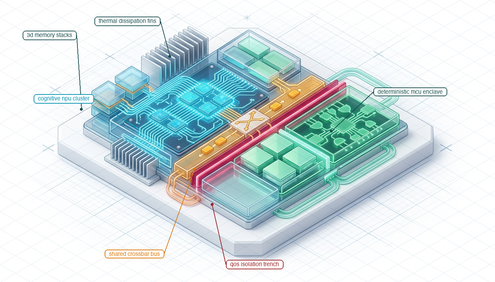
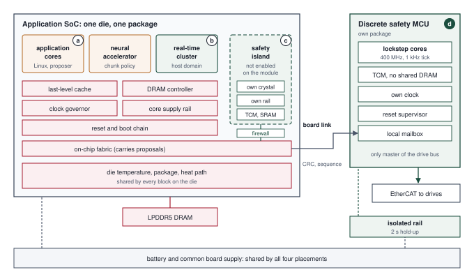
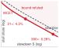
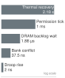

---
format:
  html:
    title: "Workload Placement"
---

# Workload Placement {#sec-placement}

::: {layout-narrow}
::: {.column-margin}

\chapterminitoc

:::

::: {.content-visible when-format="pdf"}
\noindent
{fig-alt="Isometric blueprint showing silicon placement: heterogeneous physical AI SoC with a neural accelerator cluster for the learned models, 3D memory stacks, perimeter thermal dissipation fins, shared interconnect crossbar bus, isolated deterministic real-time MCU enclave, and crimson QoS isolation trench."}
:::

::: {.content-visible unless-format="pdf"}
{fig-alt="Isometric blueprint showing silicon placement: heterogeneous physical AI SoC with a neural accelerator cluster for the learned models, 3D memory stacks, perimeter thermal dissipation fins, shared interconnect crossbar bus, isolated deterministic real-time MCU enclave, and crimson QoS isolation trench."}
:::

:::

## Purpose {.unnumbered .unlisted}

::: {.content-visible when-format="pdf"}
\begin{marginfigure}
\resizebox{0.92\linewidth}{!}{\mlphysicalstackfull{20}{100}{20}{20}{20}}
\end{marginfigure}
:::

_Why can a safety check miss its deadline even when it runs on its own processor core?_

A correct refusal computed too late does not stop the motion it was meant to prevent. Separating a learned proposer from its permission path in software does not make the two independent while they still share memory, electrical power, clocks, or cooling. A burst of inference can then delay the check that should stop the machine, heat from the accelerator can slow the core that runs that check for seconds after the burst has ended, and a single supply or reset fault can silence both paths at once. None of these couplings appears on a software architecture diagram, and none shows up in average utilization, so a safety argument that has never been loaded on its real silicon rests on an untested premise. Moving the check to separate hardware removes some couplings and adds others, a communication delay and a longer chain of supplies and wiring, so no placement is independent by construction. Where each workload runs therefore decides whether the permission path can still refuse in time, and an action that crosses the causal boundary on a late refusal cannot be taken back.



::: {.callout-learning-objectives}

- Conduct a dependent-failure inventory of the caches, memory controllers, interconnects, supply rails, clocks, resets, and thermal paths that each candidate placement leaves shared between the proposal and permission paths
- Explain why average bus utilization cannot bound a deadline, and identify which contention mechanism (bandwidth queueing, bank conflicts, or shared-cache miss handling) threatens a declared worst-case execution time
- Evaluate whether shared power and reset paths can defeat a selected permission placement
- Analyze thermal coupling and clock throttling hysteresis between multi-tenant workloads across disparate physical timescales
- Size a windowed watchdog's service window from measured completion jitter for a non-blocking lock-free record exchange
- Select among static reservation, spatial partitioning, workload reduction, and physical silicon relocation from measured interference and timing allowances, and allocate the selected placement's dispatch-to-admission interval against the stopping budget
- Design an adversarial stress campaign whose falsification threshold is the permission path's declared worst-case execution time ($T_{\text{wcet}}$)
- Construct a placement record formalizing the deployment envelope that scopes loaded observed maxima, thermal headroom, bus arbitration, mitigations, and untested conditions for release review

:::

## The Silicon Substrate {#sec-placement-silicon-substrate}

When the warehouse mobile manipulator's permission check finishes late, its motor drives keep executing the last admitted command, and the loaded base covers distance that the stopping budget of @sec-enforcement never reserved. The control barrier filter, the stopping reservation, and the fallback ladder developed there hold only while the permission path completes its check inside its hard real-time deadline on every cycle. The enforcement record declares a worst-case execution time inside that deadline, a bound on the check running alone, and whether the bound survives while the learned proposers run beside it is a question about the silicon underneath. Workload placement decides which silicon executes each computation, and with that choice, which memories, interconnects, clocks, power supplies, and thermal paths each task shares with the others. In conventional computing, placement is an optimization over throughput, latency, or energy. On a machine whose refusals must arrive on time, it becomes a safety problem.

Modern silicon integration works directly against the separation the permission path needs. A contemporary heterogeneous system-on-chip (SoC) integrates general-purpose application cores, neural accelerators, real-time microcontrollers, and specialized safety islands onto a single monolithic die. On that die, these subsystems share memory controllers, dynamic random-access memory (DRAM) channels, system-level caches, on-chip network interconnects, voltage regulators, clock governors, and the physical package that carries away heat. While silicon integration lowers unit cost, board area, and inter-processor communication latency, it quietly couples through shared hardware the very execution paths that the software architecture keeps apart. The question placement must answer is whether the deterministic permission path can keep its deadline and its authority to refuse unsafe motion while the proposal path runs at full load on shared hardware. Answering it requires a bound on hardware interference for every shared physical resource, derived from worst-case timing analysis and validated under loaded stress tests.

On the warehouse mobile manipulator, the software architecture draws the proposal boundary between the Brain and the Nervous System as a clean logical boundary, and Part I adopted a working hypothesis about where that line falls in hardware, placing the permission path on a discrete safety microcontroller physically separate from the application SoC. The machine's two physical jobs show what that separation must guard against. For the mobile base, whose mass-dominated mobility spends stopping clearance, an interconnect stall during visual feature extraction on the proposal engine could delay the permission path's refusal while the loaded base approaches a rack end. Every tick of delay beyond the single cycle accounted for in the stopping budget is travel distance the machine never reserved. For the arm, whose contact-dominated manipulation spends force margin, a burst of neural accelerator traffic that evicts the permission path's lookup tables from a shared cache could delay contact force validation while the gripper presses against a spring-latched cage door. The monolithic SoC is therefore an architecture the machine must be able to reject on evidence, and the discrete microcontroller is a design claim that must survive a loaded test rather than be assumed.

::: {.column-margin .margin-pointer}
↩ The physical separation hypothesis for silicon partitioning is established in @sec-nervous-silicon-partitioning.
:::

Assigning the permission filter to a dedicated processor core does not create an isolated failure domain. A core running in isolation may still stall on memory arbitration, slow down under dynamic clock throttling, or suffer transient voltage drops when adjacent accelerators become active. Memory protection units and operating system process boundaries enforce spatial partitioning by preventing unauthorized reads and writes across address spaces. However, memory protection hardware governs access permissions rather than access timing. The underlying interconnect crossbar, memory controllers, and DRAM banks determine when memory transactions actually complete. Establishing a sound safety case requires both spatial partitioning to prevent memory corruption and temporal partitioning to guarantee bounded service times for shared hardware resources [@kopetz2011real; @rushby1999partitioning].

::: {#dfn-placement-operational-independence .callout-definition title="Operational independence"}

***Operational independence***\index{Operational independence!definition} is the property that no activity, fault, or overload in the proposal domain can push the permission path's execution past its deadline or disable its authority to refuse, through any resource the two paths share.

1.  **Significance**: It is the premise under which the stopping budget charges exactly one permission tick of detection delay. Every tick that proposal-side load adds beyond that one is travel at speed $v$ that the irreversibility test $d_{\text{stop}} \le D_{\text{clear}}$ never reserved, and a stall of unbounded length leaves the test with no bound at all.
2.  **Distinction**: Unlike spatial isolation, which private address spaces and separate cores supply, operational independence also covers time, supply, clock, reset, and heat. It is the placement-level form of what functional-safety standards call freedom from interference, the absence of cascading failures from one element into another of higher integrity [@iso26262].
3.  **Common pitfall**: A frequent misconception is that a separate core, or even a separate chip, is independent by construction. Each shared resource is a hypothesis that needs a bound, and a loaded test on the real silicon can refute it.

:::

Every placement claim must therefore explicitly identify the physical and architectural resources that could delay or disable enforcement, alongside the mechanisms that bound their mutual interference. A shared die and a discrete safety microcontroller represent competing design hypotheses regarding these hardware dependencies, not interchangeable processor selections. Evaluating either design begins with analyzing what each path must compute and the exact timing constraints governing its execution.

## Two Paths and the Resources They Share {#sec-placement-two-paths-one-die}

A mobile manipulator must verify kinematic clearance and collision margins on every tick while its neural proposal model computes the next trajectory chunk. The third law, proposal is not permission, already separates the two in authority; placement decides whether the hardware keeps them separate in time when the proposer is at peak load. The argument runs in three steps. It first sizes what each path computes on the design Part I chose, because each path's workload and timing allowance set how much interference it can absorb. It then inventories the physical resources that could couple the paths, and finally scores four candidate placements, the chosen one among them, against that inventory.

```{python}
#| label: calc-placement-machine-paths
#| echo: false
#| warning: false
#| message: false
# ┌─────────────────────────────────────────────────────────────────────────────
# │ MACHINE PATHS: PROPOSAL AND PERMISSION BUDGETS
# ├─────────────────────────────────────────────────────────────────────────────
# │ Context: @sec-placement-two-paths-one-die, @sec-placement-isolation-decisions,
# │          @sec-placement-hardware-allocation, @sec-placement-fallacies-pitfalls,
# │          @sec-placement-summary
# │
# │ Goal: Size the running machine's two paths from the registry before any
# │       contention: the chunk policy on the application processor and the
# │       enforcer tick on the discrete safety MCU.
# │ Show: 135 µs unloaded = 40 + 80 + 15 µs = 54,000 cycles at 400 MHz, against
# │       a declared 250 µs WCET and a chosen 400 µs deadline in the 1 ms tick.
# │       Ch4's response budget (@eq-nervous-response-budget) also charges
# │       50 µs of blocking and 40 µs of interference, so the tick's own
# │       execution, shared-hardware interference included, must fit
# │       400 - 90 = 310 µs, and the declared WCET leaves 60 µs for
# │       shared-hardware interference.
# │       The permission path's isolated rail holds up for 2 s (a selected
# │       premise recorded here; decided in Ch2, sized in Ch12). The 5 ms
# │       renewal-jitter allowance tolerates at most a 12.5 percent stretch of
# │       the 40 ms chunk inference (Ch8's HostContentionAllowance).
# │ How: Registry fields of the warehouse mobile manipulator and its aisle
# │      scenario; the three enforcer sub-costs are chapter-local.
# └─────────────────────────────────────────────────────────────────────────────
from mlsysim import *
from mlsysim.core.units import nanosecond, microsecond, millisecond, second, hertz
from mlsysim.fmt import fmt_int, fmt_latency, fmt_frequency, fmt_percent, check

RM = Embodied.MobileManipulator.WarehouseMobileManipulator
AISLE = Embodied.Scenario.WarehouseAisle

class PlacementMachine:
    # ┌── 1. LOAD ───────────────────────────────────────────────────────────
    chunk_rate = RM.chunk_rate  # category: chosen
    chunk_inference = RM.chunk_inference_latency  # category: illustrative (P99, vision included)
    permission_rate = RM.permission_rate  # category: chosen
    mcu_clock = RM.permission_mcu.compute.clock_rate  # category: illustrative (reference class)
    tick = AISLE.t_tick  # category: chosen
    lease = AISLE.t_lease  # category: chosen
    unloaded = AISLE.enforcer_unloaded  # category: illustrative
    wcet = AISLE.enforcer_wcet  # category: chosen (declared, not measured)
    deadline = AISLE.enforcer_deadline  # category: chosen
    self_watchdog = AISLE.mcu_self_watchdog  # category: chosen
    rail_holdup = RM.permission_rail_holdup  # category: chosen (permission-rail hold-up)
    renewal_jitter = 5 * millisecond  # category: chosen (renewal-jitter allowance of the lease rule, @sec-nervous-lease-sizing)
    sense = 40 * microsecond  # scenario assumption; category: illustrative (encoders, IMU, evidence epoch)
    constraint = 80 * microsecond  # scenario assumption; category: illustrative
    write = 15 * microsecond  # scenario assumption; category: illustrative (drive-frame staging)
    # Blocking B and interference I from the MCU's own lower- and higher-priority
    # work: the scenario bounds of Ch4's TickResponseBudget (notebook
    # nbk-nervous-response-margin), mirrored here because a chapter cannot import
    # another chapter's LEGO cell. Keep equal to Ch4; promotion to the aisle
    # scenario in MLSysIM is pending.
    blocking = AISLE.enforcer_blocking  # category: illustrative (Ch4 B, scenario bound; registry)
    interference = AISLE.enforcer_interference  # category: illustrative (Ch4 I, scenario bound; registry)

    # ┌── 2. EXECUTE ────────────────────────────────────────────────────────
    chunk_period = (1 / chunk_rate).to(millisecond)
    chunk_slack = (chunk_period - chunk_inference).to(millisecond)
    unloaded_sum = (sense + constraint + write).to(microsecond)
    unloaded_slack = (deadline - unloaded).to(microsecond)
    wcet_margin = (deadline - wcet).to(microsecond)
    b_plus_i = (blocking + interference).to(microsecond)
    exec_ceiling = (deadline - b_plus_i).to(microsecond)  # t_enf ceiling under the full response budget
    shared_allowance = (exec_ceiling - wcet).to(microsecond)  # I_shared the declared WCET leaves before the deadline
    unloaded_cycles = (unloaded * mcu_clock).to("dimensionless").magnitude
    min_chunk_rate = (1 / lease).to(hertz)
    compute_after_sense = (constraint + write).to(microsecond)
    contention_stretch = (renewal_jitter / chunk_inference).to("dimensionless").magnitude

    # ┌── 3. GUARD ──────────────────────────────────────────────────────────
    check(
        abs((unloaded_sum - unloaded).to(microsecond).magnitude) < 1e-9, "Sense + constraint + write must equal the registry's 135 µs unloaded cycle."
    )
    check(abs(unloaded.to(microsecond).magnitude - 135.0) < 1e-9, "Canon: 135 µs unloaded.")
    check(abs(unloaded_cycles - 54_000) < 1e-6, "Canon: 135 µs = 54,000 cycles at 400 MHz.")
    check(wcet < deadline < tick, "Declared WCET inside the deadline, deadline inside the tick.")
    check(
        abs(wcet.to(microsecond).magnitude - 250.0) < 1e-9 and abs(deadline.to(microsecond).magnitude - 400.0) < 1e-9,
        "Canon: 250 µs WCET, 400 µs deadline.",
    )
    check(
        abs(blocking.to(microsecond).magnitude - 50.0) < 1e-9 and abs(interference.to(microsecond).magnitude - 40.0) < 1e-9,
        "Mirror of Ch4 TickResponseBudget: B = 50 µs, I = 40 µs.",
    )
    check(abs(exec_ceiling.magnitude - 310.0) < 1e-9 and abs(shared_allowance.magnitude - 60.0) < 1e-9, "400 - 90 = 310 µs; 310 - 250 = 60 µs.")
    check(wcet < exec_ceiling, "The declared WCET fits the full response budget.")
    check(abs(chunk_slack.to(millisecond).magnitude - 10.0) < 1e-9, "The 40 ms chunk inference leaves 10 ms of the 50 ms period.")
    # margin_coupling_timescale_ladder.svg fig-alt hand-types 1 millisecond
    check(abs(tick.to(millisecond).magnitude - 1.0) < 1e-9, "Canon: 1 ms permission tick.")
    check(
        chunk_period < lease, "Lease rule: the lease outlasts one chunk period, leaving the renewal-jitter allowance that absorbs the proposal link."
    )
    check(abs(rail_holdup.to(second).magnitude - 2.0) < 1e-9, "Canon (D15): the permission rail holds up for 2.0 s.")
    check(chunk_period + renewal_jitter < lease, "Lease rule: chunk period plus the 5 ms renewal-jitter allowance fits inside the lease.")
    check(
        abs(contention_stretch - 0.125) < 1e-9,
        "Matches Ch8 HostContentionAllowance: 5 ms of jitter is a 12.5 percent stretch of the 40 ms inference.",
    )

    # ┌── 4. OUTPUT ─────────────────────────────────────────────────────────
    chunk_rate_str = fmt_frequency(chunk_rate, precision=0)
    chunk_period_str = fmt_latency(chunk_period, unit=millisecond, precision=0)
    chunk_inference_str = fmt_latency(chunk_inference, unit=millisecond, precision=0)
    chunk_slack_str = fmt_latency(chunk_slack, unit=millisecond, precision=0)
    permission_rate_str = fmt_frequency(permission_rate, precision=0)
    mcu_clock_str = fmt_frequency(mcu_clock, precision=0)
    tick_str = fmt_latency(tick, unit=millisecond, precision=0)
    lease_str = fmt_latency(lease, unit=millisecond, precision=0)
    min_chunk_rate_str = fmt_frequency(min_chunk_rate, precision=1)
    sense_str = fmt_latency(sense, unit=microsecond, precision=0)
    constraint_str = fmt_latency(constraint, unit=microsecond, precision=0)
    write_str = fmt_latency(write, unit=microsecond, precision=0)
    compute_after_sense_str = fmt_latency(compute_after_sense, unit=microsecond, precision=0)
    unloaded_str = fmt_latency(unloaded, unit=microsecond, precision=0)
    unloaded_cycles_str = fmt_int(unloaded_cycles)
    unloaded_slack_str = fmt_latency(unloaded_slack, unit=microsecond, precision=0)
    wcet_str = fmt_latency(wcet, unit=microsecond, precision=0)
    wcet_margin_str = fmt_latency(wcet_margin, unit=microsecond, precision=0)
    blocking_str = fmt_latency(blocking, unit=microsecond, precision=0)
    interference_str = fmt_latency(interference, unit=microsecond, precision=0)
    b_plus_i_str = fmt_latency(b_plus_i, unit=microsecond, precision=0)
    exec_ceiling_str = fmt_latency(exec_ceiling, unit=microsecond, precision=0)
    shared_allowance_str = fmt_latency(shared_allowance, unit=microsecond, precision=0)
    deadline_str = fmt_latency(deadline, unit=microsecond, precision=0)
    tick_ns_str = fmt_int(tick, unit=nanosecond)  # placement-record field nominal_period_ns
    deadline_ns_str = fmt_int(deadline, unit=nanosecond)  # placement-record field hard_deadline_ns
    self_watchdog_str = fmt_latency(self_watchdog, unit=millisecond, precision=0)
    rail_holdup_str = fmt_latency(rail_holdup, unit=second, precision=0)
    renewal_jitter_str = fmt_latency(renewal_jitter, unit=millisecond, precision=0)
    contention_stretch_pct_str = fmt_percent(contention_stretch, precision=1, style="prose")
```

### Proposal and permission execution profiles

The mobile manipulator partitions its control across two distinct execution paths with conflicting systems requirements. The proposal path runs the chunk policy on the application processor at `{python} PlacementMachine.chunk_rate_str`, ingesting synchronized navigation and wrist camera streams to emit coordinated base velocity and arm joint targets. Its 99th-percentile (p99) inference latency, vision processing included, consumes `{python} PlacementMachine.chunk_inference_str` (an illustrative benchmark; see the Reader Guide) of each `{python} PlacementMachine.chunk_period_str` chunk period. Operating entirely in unprivileged user space, the proposal path holds no direct hardware authority over the motor drives. In the design Part I chose, the permission path executes on a discrete safety microcontroller (MCU) at `{python} PlacementMachine.permission_rate_str`. On every tick, it validates the active trajectory and any candidate replacement against the stopping envelope derived in @sec-enforcement-stopping-envelopes, staging admitted setpoints into the outbound EtherCAT frame destined for the drives. This routine must complete strictly within a chosen `{python} PlacementMachine.deadline_str` deadline inside its `{python} PlacementMachine.tick_str` tick. It executes within a privileged real-time domain on a dual-core lockstep controller,[^fn-lockstep-comparator-coverage] whose cycle-by-cycle comparator flags divergent execution. That hardware guard is needed because a software envelope check cannot diagnose a silent fault in the CPU core executing it. Only the permission path holds memory-mapped input-output (MMIO)\index{Memory-mapped I/O} access to the fieldbus master carrying drive commands.

::: {#dfn-placement-heterogeneous-silicon-partitioning .callout-definition title="Heterogeneous silicon partitioning"}

***Heterogeneous silicon partitioning***\index{Heterogeneous silicon partitioning!definition}\index{Silicon partitioning!definition} is the architectural allocation of stochastic, high-capacity cognitive workloads (perception, learned policy evaluation) and deterministic safety loops (safety invariant checks, admission and fallback) across specialized execution domains isolated in hardware.

1.  **Significance**: Placing high-capacity neural deliberation and real-time safety enforcement on the same general-purpose operating system or compute engine creates common-mode failures. Kernel thread preemption, dynamic memory allocation, and time-slicing between accelerator contexts add tail delay that no measured average bounds, and a permission path exposed to that tail can miss its physical control deadline.
2.  **Distinction**: Unlike logical software process isolation (such as Linux containers or POSIX process priorities), silicon partitioning enforces isolation across independent hardware registers, tightly coupled memories (TCM), and dedicated peripheral buses.
3.  **Common pitfall**: Assuming multicore CPU affinity provides true failure-domain separation, when the cores still share caches, memory controllers, clock trees, and power rails.

:::

These two processors execute distinct software stacks. Proposal inference, global scene-map updates, telemetry streaming, and fleet networking run on the application processor under Linux. While a real-time kernel patch reduces scheduler dispatch latency, it cannot bound latency tails introduced by unvetted device drivers, bus arbitration, or shared hardware memory controllers.[^fn-preemptrt-linux-latency] Similarly, zero-copy buffer designs reduce internal memory bus traffic, but they do not eliminate fundamental contention at the physical memory controller.

By contrast, enforcement and sensor validation execute on the discrete safety microcontroller as bare-metal firmware governed by a hardware memory protection unit (MPU),[^fn-mpu-iommu-isolation] with quadrature encoder counters, the inertial measurement unit (IMU) on its Serial Peripheral Interface (SPI) bus, and hardware timer capture channels mapped directly to dedicated physical pins. Each candidate proposal arrives from the application processor across a board-level serial link and is published into local memory via the seqlock mailbox described in @sec-nervous-mailbox-exchanges. No dynamic random-access memory (DRAM)\index{DRAM}\index{Dynamic random-access memory|see{DRAM}} is shared across the two execution paths. The memory protection unit strictly isolates local state, while the dedicated peripheral bus completely insulates the enforcer's execution path from the host's memory traffic.

Admitting an entire plan is computationally distinct from executing the cyclic permission tick. For example, the whole-plan validation routine examined in @sec-planning-horizon-tradeoff cannot execute as an uninterrupted task inside a 1 ms control loop without violating timing guarantees. Instead, the runtime scheduler must preserve the real-time tick either by executing admission as bounded, interruptible work or by moving it to a separate processor whose own timing is verified, and in either case admission ends with an atomic check of current state and sensor evidence immediately before activation. The running machine takes the first option. Whole-plan validation runs on the microcontroller as background work below the tick's priority, so the tick preempts it; the bounds that keep this background work from delaying the tick through the microcontroller's own buses and memory are listed in @sec-placement-dispatch-admission. The system resource ledger must account for the active trajectory buffer, the resident fallback plan, the temporary admission workspace, and worst-case interruption overheads. The proposal generation rate also does not set the interval between successful admissions. Qualification must show that the end-to-end pipeline (transfer, admission, and activation) preserves the lease renewal bound, a guarantee the tick deadline alone cannot provide.

Similarly, the full volumetric scene map remains anchored on the application processor. The permission path receives only a compact, bounded local evidence snapshot whose spatial coverage, state uncertainty, observation timestamp, expiration horizon, and cryptographic integrity have been pre-validated for the proposed motion and its associated fallback maneuver. Updating the host map, serializing the snapshot, transporting it across the bus, validating admission, storing it locally, and evaluating per-tick spatial queries all represent distinct computational costs that require separate accounting in the timing ledger. Under no circumstances may a synchronous query to the host processor stall the permission tick. If a proposed trajectory strays outside the validated bounds or lifetime of the local snapshot, the MCU must immediately reject it. Consequently, the microcontroller's static memory budget must prove that the local snapshot buffer and resident fallback trajectories fit comfortably alongside the compiled enforcement binary.

From an electrical perspective, the power delivery architecture isolates the microcontroller, low-voltage drive logic, and electromechanical spring-brake coils onto a dedicated safety rail. This rail incorporates a localized capacitive hold-up duration of `{python} PlacementMachine.rail_holdup_str` and carries zero load from the proposal subsystem. Hardware qualification must prove that severe voltage transients induced by motor acceleration or neural accelerator bursts on the shared battery pack cannot trigger an undervoltage reset on this isolated rail. This local energy reservoir sustains logic operation and holds the mechanical brakes disengaged throughout a controlled stopping sequence without supplying motive traction power. Achieving the powered deceleration profiles described in @sec-enforcement-four-rungs requires both an intact high-voltage drive path and an engineered sink for regenerative braking energy. If either prerequisite fails, the system must trigger a certified fail-safe fault response rather than relying on standard stopping-distance assumptions.

::: {.column-margin .margin-pointer}
↩ The isolated permission rail and its hold-up sizing are established in @sec-body-permission-rail-isolation.
:::

On an unloaded machine, the initial computational budgets appear comfortably generous. Representative baseline costs on the safety microcontroller allocate `{python} PlacementMachine.sense_str` to sample motor encoders, read the IMU over SPI, and verify the proposal's evidence epoch; `{python} PlacementMachine.constraint_str` to evaluate kinematic and dynamic envelope constraints; and `{python} PlacementMachine.write_str` to stage admitted setpoints into the outbound drive frame. This yields an unloaded enforcer execution time of `{python} PlacementMachine.unloaded_str`, which corresponds to `{python} PlacementMachine.unloaded_cycles_str` cycles at the microcontroller's `{python} PlacementMachine.mcu_clock_str` clock frequency. Measured against the `{python} PlacementMachine.deadline_str` hard deadline, this baseline path yields `{python} PlacementMachine.unloaded_slack_str` of timing slack. Even the declared worst-case execution time (WCET) of `{python} PlacementMachine.wcet_str`, the conservative design envelope established in @sec-enforcement-loop-budget, leaves `{python} PlacementMachine.wcet_margin_str` of headroom.

However, this timing margin cannot be assigned entirely to shared hardware contention. The formal response bound of @eq-nervous-response-budget explicitly charges the tick for blocking $B_i$ by lower-priority tasks (`{python} PlacementMachine.blocking_str`) and interference $I_i$ from higher-priority tasks and interrupts (`{python} PlacementMachine.interference_str`), both arising from the microcontroller's own workload, as modeled in notebook \ref{nbk-nervous-response-margin}. Delay from hardware shared with the proposer is a different quantity: it lengthens the execution term $C_i$ itself. Consequently, a loaded tick satisfies its real-time deadline only if its raw execution time, combined with all shared-hardware interference, remains below the deadline minus these internal overheads (`{python} PlacementMachine.b_plus_i_str`), establishing an effective execution ceiling of `{python} PlacementMachine.exec_ceiling_str`. Under the declared WCET bound, shared hardware contention can introduce at most `{python} PlacementMachine.shared_allowance_str` of delay before the tick misses its deadline, and every placement analysis must charge this complete budget.

The declared bound, not the deadline, is the quantity a placement must defend. It bounds the tick's execution in isolation, and the chosen placement claims that proposal-side load adds nothing to it. A loaded tick that runs longer than `{python} PlacementMachine.wcet_str` therefore refutes that claim even when it still finishes before the `{python} PlacementMachine.deadline_str` deadline, because every margin downstream of the bound was computed on the premise it has just broken. Each coupling in this chapter is priced against that *falsification threshold*, which @sec-placement-testing-separation formalizes and turns into a test campaign.

On the application processor, meanwhile, the neural policy's `{python} PlacementMachine.chunk_inference_str` inference latency leaves `{python} PlacementMachine.chunk_slack_str` of margin within its `{python} PlacementMachine.chunk_period_str` execution period. The enforcer's sub-costs above are a baseline model rather than an integrated measurement, and local spatial-query overheads must also fit within the cyclic allocation. Complete system qualification requires empirical measurement of the fully loaded control cycle, establishing precisely which spatial queries fall within constraint evaluation and accounting for any independent overheads; neither an unloaded benchmark nor an isolated query model can validate the declared WCET bound.

::: {.column-margin .margin-pointer}
↩ The spatial-query workload the safety microcontroller must answer each tick is established in @sec-memory-volumetric-metric-maps.
:::

### Shared microarchitectural failure domains and cyber-physical attack surfaces

Assigning tasks to distinct processor cores does not establish independent failure domains if the underlying microarchitectural silicon infrastructure is shared.[^fn-ac20193-multicore-interference] Beneath any software-level access control, four physical coupling mechanisms can bind the proposal and permission paths without appearing on an architecture diagram: memory subsystems, power rails, thermal dissipation paths, and clock distribution networks. Part I's design claims to sever each of them at the board level. The audit below takes the four in turn, states what each would do to a co-located permission path, and checks how the chosen board answers it.

Memory contention introduces the first, and often most severe, coupling. Operating system memory-map modifications trigger inter-processor interrupts that force Translation Lookaside Buffer (TLB) shootdowns across cores,[^fn-os-tlb-shootdown] while direct memory access (DMA) operations from high-throughput camera pipelines incur cache-coherence invalidation penalties.[^fn-hw-dma-coherence] More fundamentally, a time-critical control loop cannot read its sensor feedback buffers if an asynchronous accelerator client monopolizes the physical interconnect. In a Unified Memory Architecture (UMA), where neural network accelerators, general-purpose application cores, and real-time execution units arbitrate for a single pool of DRAM across a shared crossbar, a high-resolution vision pipeline or an aggressive DMA engine can saturate the bus and starve the permission routine of timely encoder and IMU feedback, however high its software thread priority is set. This mismatch between software priority and unmanaged interconnect contention is the **UMA crossbar trap**\index{Unified Memory Architecture!crossbar trap}, and @sec-placement-resource-contention prices the queueing delays and bank conflicts behind it. The chosen design avoids the trap by giving the safety controller exclusive ownership of its memory. Candidate proposals cross an isolated board-level serial bus into dedicated local SRAM, so no DRAM is shared between the two domains.

```{python}
#| label: calc-placement-board-rail
#| echo: false
#| warning: false
#| message: false
# ┌─────────────────────────────────────────────────────────────────────────────
# │ SHARED DRIVE BUS VS. THE ISOLATED PERMISSION RAIL (LEGO)
# ├─────────────────────────────────────────────────────────────────────────────
# │ Context: @sec-placement-two-paths-one-die, the power-coupling paragraph
# │          (moved from the Nervous System chapter with its prose).
# │ Goal:    Name the bus the application processor shares with the drives and
# │          the converter lockout that resets the host when that bus sags.
# │ Show:    47.7 V nominal drive bus; the application processor's converter
# │          locks out at 33 V; a depleted pack starts 9 V above it.
# │ How:     Registry fields on RM (M6: 48 V drive bus, MiR250-class pack,
# │          MEAN WELL DDR-240C-24 converter); the sag screen is derived in
# │          @sec-body-power-integrity.
# └─────────────────────────────────────────────────────────────────────────────
from mlsysim import *
from mlsysim.core.units import *
from mlsysim.fmt import fmt_voltage, check

RM = Embodied.MobileManipulator.WarehouseMobileManipulator

class PlacementBoardRail:
    """The drive bus the host shares, and the lockout that resets the host."""

    # ┌── 1. LOAD (Constants & Parameters) ─────────────────────────────────
    v_bus_nom = RM.drive_bus_nominal  # category: datasheet (48 V-class pack, nominal)
    v_bus_low = RM.drive_bus_battery_low  # category: datasheet (pack minimum)
    v_uvlo = RM.drive_bus_uvlo  # category: datasheet (converter input lockout)

    # ┌── 2. EXECUTE (Compute) ─────────────────────────────────────────────
    v_headroom_low = (v_bus_low - v_uvlo).to(volt)  # headroom a depleted pack starts with

    # ┌── 3. GUARD (Invariants) ───────────────────────────────────────────
    check(abs(v_bus_nom.to(volt).magnitude - 47.7) < 1e-9, f"Drive bus nominal drifted: {v_bus_nom}")
    check(abs(v_uvlo.to(volt).magnitude - 33.0) < 1e-9, f"Converter lockout drifted: {v_uvlo}")
    check(abs(v_headroom_low.magnitude - 9.0) < 1e-9, "Even a depleted pack starts 9 V above the converter lockout")

    # ┌── 4. OUTPUT (Format & Export) ────────────────────────────────────────
    v_bus_nom_str = fmt_voltage(v_bus_nom, unit=volt, precision=1)
    v_uvlo_str = fmt_voltage(v_uvlo, unit=volt, precision=0)
```

Power delivery represents the second coupling vector. Although the host processor and the safety controller draw from a common battery, they do not share a power rail. The host application processor draws from the nominal `{python} PlacementBoardRail.v_bus_nom_str` motor drive bus through a dedicated DC-DC step-down converter that triggers an undervoltage lockout (UVLO) if the supply sags to `{python} PlacementBoardRail.v_uvlo_str`. While the steady-state margin analysis in @sec-body-power-integrity ensures that even a depleted battery pack remains above this threshold during simultaneous drive acceleration and peak neural inference, unmodeled transients or supply faults (a blown fuse, or a battery management system (BMS) contactor trip) can depress the bus and crash the application processor. Had the safety microcontroller shared this unisolated supply, that same brownout would reset the safety monitor simultaneously. Motor gate drivers incorporate internal hardware protections for such events: integrated undervoltage lockouts disable power MOSFET outputs when gate-drive rails collapse, and pull-down resistors prevent floating logic pins from triggering destructive shoot-through currents. Those protections keep the drives from doing harm, but a shared brownout would also extinguish the permission path, leaving the robot's kinetic energy unmanaged as it coasts with no controller to command a controlled deceleration. The dedicated, held-up rail removes this common-mode failure. While the host browns out and reboots, the safety microcontroller stays powered, detects the bus undervoltage interrupt, and executes a fallback stop.

Thermal dissipation and clock distribution introduce the third and fourth coupling channels. When co-located on a shared silicon die or bonded to a common heat spreader, heavy sustained compute workloads on the application processor raise junction temperatures toward thermal trip points. Dynamic voltage and frequency scaling (DVFS) governors configured to protect the silicon package then throttle clock frequencies across the entire die, slowing real-time safety cores that share no code with the proposal pipeline. As demonstrated in @sec-placement-thermal-timing-coupling, thermal throttling introduces hysteresis that outlasts the transient compute burst that triggered it. Similarly, relying on a shared external crystal oscillator creates a fragile single point of failure: thermal drift, mechanical shock, or crystal fracturing desynchronizes both execution domains simultaneously. Utilizing a discrete microcontroller eliminates both vulnerabilities by providing a physically separated package, dedicated heat dissipation, and an independent quartz crystal oscillator.

Each coupling channel names a failure mode that would invalidate the separation, so qualification must test the isolation by injecting faults rather than by reviewing schematics. Four stress regimes evaluate the physical prototype, three aimed at the supply, clock, and link and one at the proposals themselves:

1. *Power-rail droop testing*: Injecting maximum-slew current transients into the drive bus to verify that the noise coupled onto the safety rail stays inside the microcontroller's specified supply tolerance, the limit the placement record's droop field carries.
2. *Clock glitching and frequency margining*: Verifying that the real-time core maintains deterministic instruction cycle counts under clock jitter and voltage fluctuation.
3. *Communication link flooding*: Saturating shared interconnects to confirm that safety-critical heartbeat frames and trajectory proposals retain their deterministic transmission windows.[^fn-hw-canfd-arbitration]
4. *Numerical and semantic fault injection*: Streaming synthetic proposals populated with out-of-range floats, subnormal numbers, and IEEE 754 NaNs to verify single-cycle rejection without pipeline stalls or exception traps.

The comprehensive timing stress test designed in @sec-placement-testing-separation validates these boundaries against the declared WCET threshold.

::: {.column-margin .margin-pointer}
↪ The physical injection apparatus for supply, clock, and bus disturbances is operationalized in @sec-verification-hardware-fault-injection.
:::

[^fn-os-tlb-shootdown]: **TLB Shootdown**\index{Translation lookaside buffer!shootdown}: When an operating system modifies page tables, it broadcasts inter-processor interrupts (IPIs) to invalidate stale Translation Lookaside Buffer entries across all active cores. Receiving cores must suspend thread execution and flush affected entries, introducing unbudgeted multi-microsecond stalls. In shared-silicon architectures, these unpredictable synchronization pauses destroy the cycle determinism demanded by inner motor regulation loops.

[^fn-hw-dma-coherence]: **DMA Cache Coherence**\index{Direct memory access!cache coherence}: Direct memory access transfers bypass CPU cache hierarchies, requiring explicit cache line invalidation or write-back operations to maintain memory consistency between peripherals and cores. Without hardware-enforced snoop filtering or explicit barriers, processors read stale sensor frames or overwrite pending actuator commands. These maintenance operations inject variable latency penalties into high-rate control routines unless static, unbuffered SRAM regions are dedicated to peripheral transfers.

[^fn-hw-canfd-arbitration]: **CAN Arbitration**\index{CAN arbitration}: Controller Area Network protocols resolve bus contention at the physical layer using wired-AND dominant ('0') and recessive ('1') signaling. If a defective transceiver continuously asserts a dominant state (a "babbling idiot" fault), it monopolizes the shared physical bus and blocks all higher-level communication. Hardware bus guardians and dominant-timeout clamp circuits monitor transmission duration, physically disconnecting jabbering nodes to preserve network availability for remaining safety participants.

Any safety-critical design must still evaluate the alternative it rejects, a single shared die carrying both paths. On one die the four couplings collapse into one semiconductor package, and real-time cores that execute their instructions independently of the application cores remain coupled through each of them:

- *Memory:* Bursts of camera DMA, neural accelerator memory access, and high-volume diagnostic logging can stall the real-time cores' cache fills and delay their interrupt handling unless hardware arbiters enforce deterministic bandwidth caps.
- *Power and reset:* Steep di/dt current steps can droop a shared core rail, and a software-initiated host reset can take down a common reset chain, unless power and supervisor domains are strictly isolated.
- *Thermal path:* Heat from the neural processing units raises the substrate temperature under the real-time cores, which share the package's only route to the chassis.
- *Clock:* A unified on-die governor throttles the real-time cores' clock together with the accelerator's when that substrate temperature reaches its trip point, and a shared PLL or crystal carries any fault to both.

Beyond accidental contention, these shared silicon pathways expose a **cyber-physical attack vector**\index{Cyber-physical security!shared-die attack surface}\index{Hardware security!side channels and DoS}. An adversary who compromises the unprivileged proposal stack can generate malicious memory traffic or toggle accelerator power states rapidly. The traffic starves the permission routine of memory service, and coordinated current surges pull the shared supply down (@sec-placement-resource-contention prices both). An isolation claim must therefore hold against the worst contention the proposal domain can generate within its authorized hardware limits, and benchmarks of benign workloads cannot establish that bound.

Functional-safety engineering provides formal methodologies to analyze this shared inventory. On the mobile manipulator, the certified safety scope is deliberately circumscribed. The trajectory admission algorithms that validate learned proposals carry no formal safety integrity rating; the certified protective stop functions implemented in the motor drives and safety laser scanner bear that legal responsibility. The single rated safety function assigned to the microcontroller is the watchdog that revokes authority when the chunk lease expires or the host heartbeat falls silent. It then commands a certified drive-level stop, safe stop 1 (SS1, a controlled deceleration followed by torque removal) or safe torque off (STO), whichever the risk assessment assigns to the machine's state. Keeping that rated function apart from unrated software components (the trajectory admission checks and the neural proposer) is a formal *safety decomposition*. Under international safety standards, such decomposition is legally valid only if the architect proves complete independence between elements, and workload placement directly determines whether this independence holds. Systematically identifying shared microarchitectural resources whose failure or overload could simultaneously compromise both paths is termed a **dependent failure analysis**\index{Dependent failure analysis!placement}\index{Common-cause failure!shared silicon}, mandated by ISO 26262 Part 9 [@iso26262] and treated as common-cause failure analysis under IEC 61508 [@iec61508]. The warehouse machine answers to industrial and mobile-robot safety standards rather than automotive ones (ISO 10218-2:2025, for instance, incorporates the collaborative-robot protections first defined in ISO/TS 15066 [@iso10218part2; @isots15066]), but the requirement of freedom from interference is the same in every domain. The resource audit of this chapter is that dependent-failure analysis carried out on physical silicon, with every coupling priced in the tick's timing budget.

::: {.column-margin .margin-pointer}
↩ The certified drive functions beneath the permission path, and the stop each failure triggers, are established in @sec-enforcement-certified-functions.
:::

::: {.column-margin .margin-pointer}
↪ The industrial and mobile-robot standards that govern this machine, and where each one's evidence is generated, are developed in @sec-release-standards-map.
:::

[^fn-ac20193-multicore-interference]: **Multicore Interference Certification (FAA AC 20-193)**\index{Multicore interference!FAA AC 20-193 / CAST-32A}\index{Worst-case execution time!multicore certification}: Avionics met this problem first. The 2016 CAST-32A position paper named shared caches, interconnects, and memory controllers as interference channels, and FAA Advisory Circular AC 20-193, issued in 2024 and aligned with EASA's AMC 20-193, replaced it with formal acceptance criteria [@faa2024ac20193]. Its lesson for this machine is that a timing bound measured on one core is void on a multicore until every shared row of @tbl-13-placement-candidates has been analyzed or mitigated.

[^fn-preemptrt-linux-latency]: **PREEMPT_RT**\index{Preempt RT!kernel latency}: The Linux real-time patch set makes most kernel code preemptible and runs interrupt handlers as schedulable threads, and it was merged into the mainline kernel in Linux 6.12 in 2024 after about two decades out of tree [@kernelnewbies2024linux612]. It shortens the scheduler's latency tail but cannot bound delays that drivers, firmware, or shared memory add, so a PREEMPT_RT host needs a measured bound before it may carry any part of the permission tick.

[^fn-mpu-iommu-isolation]: **MPU and IOMMU**\index{Memory Protection Unit!spatial isolation}\index{IOMMU!DMA isolation}: A memory protection unit (MPU) checks each CPU access against a few fixed address regions without translating addresses, so its cost is constant and analyzable. An input-output memory management unit (IOMMU) applies the same check to direct memory access (DMA) from accelerators and camera interfaces. Both govern *where* a memory transaction may access without arbitrating *when* the interconnect serves it; they enforce spatial partitioning while delegating deadline guarantees to hardware bus arbiters.

[^fn-lockstep-comparator-coverage]: **Dual-Core Lockstep**\index{Lockstep processor!fault detection}: Dual-core lockstep runs identical instruction streams across two physical cores, typically offset by several cycles so that a single transient fault cannot corrupt both pipelines identically, while an integrated hardware comparator detects architectural divergence. While lockstep execution flags internal CPU faults, it offers no protection against algorithmically flawed envelopes computed from corrupted sensor inputs or common-mode voltage sags on shared power rails. Consequently, lockstep operation serves as one component of the safety microcontroller's overall watchdog architecture rather than a complete integrity solution.

### Four candidate placements against one shared-resource inventory

Because operating system process isolation cannot remove silicon-level couplings, hardware placement is the primary defense against common-mode failure. Four candidate placements for the permission loop span the options, from sharing everything to sharing only the battery, and each is scored row by row against the shared-resource inventory (@tbl-13-placement-candidates).

(a) *Shared application cores* expose the permission loop to operating system scheduling jitter, driver interrupt stalls, and kernel preemption tails, delays that can push execution past not only the `{python} PlacementMachine.deadline_str` deadline but the entire `{python} PlacementMachine.tick_str` control period.

(b) *A real-time cluster in the host clock and power domain* dedicates execution cores to safety enforcement but shares the die's cache hierarchy, memory controller, core supply rail, clock governor, and thermal dissipation path. @Sec-placement-resource-contention prices its memory exposure, and @sec-placement-thermal-timing-coupling shows the clock throttling that rules this candidate out.

(c) *An on-die safety island* represents the architectural pattern implemented in modern automotive and industrial SoCs, offering far stronger isolation guarantees than candidate (b). For instance, the Functional Safety Island of NVIDIA's Orin-class SoCs integrates four dual-core lockstep Cortex-R52 processors, each equipped with private tightly coupled memory, surrounding 3 MB of on-island SRAM [@nvidia2023drivefsi]. The island executes from an independent crystal oscillator and a dedicated voltage rail, isolated behind hardware firewalls that block unauthorized access from the rest of the die. The application governor cannot throttle this clock, and an enforcement routine whose code and data reside in island memory never waits on host DRAM arbitration. However, several microarchitectural couplings persist: shared substrate temperature within the physical package, common reset and power sequencing logic, arbitration across the on-chip fabric carrying proposals or island DMA, and the common board-level power supply. Adopting an on-die island requires qualifying each shared row: reading back the configured firewall registers, tracing the power-sequencing logic, and running the loaded stress campaign of @sec-placement-testing-separation while the safety loop executes.

(d) *A discrete safety microcontroller* eliminates every on-die microarchitectural coupling, trading silicon integration for an explicit board-level transport link from the application processor, budgeted and characterized in @sec-placement-isolation-decisions.

Laid out on the machine's compute board, the four candidates differ in how many shared blocks stand between the permission tick and the proposer (@fig-13-placement-resource-map). Candidates (a) and (b) sit behind the application die's last-level cache, DRAM controller, clock governor, core rail, and fabric. The island (c) moves cores, crystal, and SRAM behind a firewall but stays in the same package and heat path. Only (d), a separate package clocked at `{python} PlacementMachine.mcu_clock_str` with local TCM and a `{python} PlacementMachine.rail_holdup_str` rail hold-up, leaves the die entirely and reaches it through a checked board link.

```{python}
#| label: calc-placement-resource-map-figure
#| echo: false
#| warning: false
#| message: false
# ┌─────────────────────────────────────────────────────────────────────────────
# │ VALUES DRAWN IN THE PLACEMENT RESOURCE MAP (FIGURE GUARD)
# ├─────────────────────────────────────────────────────────────────────────────
# │ Context: @fig-13-placement-resource-map
# │
# │ Goal: Keep the hand-drawn labels of fig13_placement_resource_map.svg
# │       pinned to the registry.
# │ Show: MCU clock 400 MHz, permission tick 1 kHz, permission-rail hold-up 2 s.
# │ How: PlacementMachine fields; a failed check means the SVG label is stale.
# └─────────────────────────────────────────────────────────────────────────────
from mlsysim.core.units import second, hertz, ureg
from mlsysim.fmt import check

class PlacementResourceMapFigure:
    # ┌── 1. LOAD ───────────────────────────────────────────────────────────
    PM = PlacementMachine  # category: derived; calc-placement-machine-paths

    # ┌── 3. GUARD ──────────────────────────────────────────────────────────
    check(abs(PM.mcu_clock.to(ureg.megahertz).magnitude - 400.0) < 1e-9, "figure MCU clock label (400 MHz) is stale")
    check(abs(PM.permission_rate.to(hertz).magnitude - 1000.0) < 1e-9, "figure tick-rate label (1 kHz) is stale")
    check(abs(PM.rail_holdup.to(second).magnitude - 2.0) < 1e-9, "figure isolated-rail hold-up label (2 s) is stale")
```

::: {#fig-13-placement-resource-map fig-env="figure" fig-pos="t" fig-cap="**Where each candidate placement runs**: Badges (a) to (d) mark where the permission tick would execute. Tinted blocks are shared with the proposer on the application die (cache, memory controller and external DRAM, clock governor, core rail, reset chain, fabric, and the package's heat path), so a tick placed on the die can lose them to proposal-side load. The safety island carries its own crystal, rail, and memory but remains behind the shared fabric and in the shared package; the discrete controller, the machine's choice, reaches the die only through a checked board link and shares only the battery with it." fig-alt="Block diagram of the machine's compute board. On the left, one application SoC die holds application cores and a neural accelerator in bronze, a real-time cluster in green, and a dashed safety island with its own crystal, rail, and memory behind a firewall. Below them, red-tinted shared blocks: last-level cache, DRAM controller, clock governor, core supply rail, reset and boot chain, on-chip fabric, and die temperature and package, with external LPDDR5 DRAM below the die. Badges a, b, and c mark the application cores, the real-time cluster, and the island. On the right, a separate green discrete safety MCU package, badge d, with lockstep cores at 400 MHz and a 1 kHz tick, TCM, its own clock, a reset supervisor, and a local mailbox, receives a board link from the fabric, drives EtherCAT to the drives, and is fed by an isolated rail with 2 s hold-up. A battery and common board supply bar along the bottom feeds both sides."}
{width="100%"}
:::

| Shared resource                        | \(a\) Shared cores | \(b\) RT cluster, host domain | \(c\) On-die safety island                   | \(d\) Discrete MCU                         |
|:---------------------------------------|:-------------------|:------------------------------|:---------------------------------------------|:-------------------------------------------|
| **Cores and scheduler**                | Shared             | Separated                     | Separated                                    | Separated                                  |
| **Last-level cache and miss handling** | Shared             | Shared                        | Separated (private caches, TCM)              | Separated (TCM)                            |
| **DRAM controller and channels**       | Shared             | Shared                        | Separated if the tick stays in island memory | Separated                                  |
| **On-chip fabric carrying proposals**  | Shared             | Shared                        | Shared, behind a firewall                    | Replaced by a board link                   |
| **Core supply rail**                   | Shared             | Shared                        | Separated (dedicated rail)                   | Separated (isolated rail)                  |
| **Clock source and governor**          | Shared             | Shared                        | Separated (dedicated crystal)                | Separated                                  |
| **Reset and boot chain**               | Shared             | Shared                        | Evidence needed                              | Separated if the supervisor is independent |
| **Die temperature and package**        | Shared             | Shared                        | Shared                                       | Separated                                  |
| **Board supply and battery**           | Shared             | Shared                        | Shared                                       | Shared; evidence needed                    |
| **Proposal transport**                 | In-process memory  | Shared-memory mailbox         | Shared-memory mailbox through the firewall   | Board link into a local mailbox            |

: **Dependent-failure inventory of four placements**: Each row is a resource whose fault or overload could delay or disable both the proposer and the permission path. "Separated" means the placement removes the resource from the permission tick's path; it is still a claim that register readback and loaded tests must support. Only the discrete controller removes the die-level rows, and none of the four removes the common board supply. {#tbl-13-placement-candidates tbl-colwidths="[24,14,18,24,20]"}

On the inventory alone, candidate (c) is a strong contender. It separates the cache and miss handling, DRAM, core rail, and governed clock, the rows behind the strongest mechanisms the next two sections price, and leaves shared the die temperature, the fabric its proposals cross, the board supply, and a reset chain whose independence still needs evidence, each of which a qualification would have to cover. This verdict is provisional, since nothing has yet been priced, but the machine does not wait on it, because it adopts candidate (d) for a reason outside silicon capability. While the safety island exists on the physical SoC die, commercial edge modules packaging the application processor do not expose it to system integrators, reserving access for dedicated industrial platforms (@tbl-13-island-exposure). Because an unexposed, unprogrammable safety island cannot serve as a valid deployment target, safety enforcement must move off the primary module.

| Platform (vendor statement date)  | Safety island on the SoC                          | Available to the integrator | Source              |
|:----------------------------------|:--------------------------------------------------|:----------------------------|:--------------------|
| **Jetson AGX Orin module (2023)** | Cortex-R52 island present                         | No                          | @nvidia2023orinfsi  |
| **IGX Orin platform (2023)**      | Same island                                       | Announced as offered        | @nvidia2023orinfsi  |
| **DRIVE AGX Orin (2023)**         | Island with dedicated crystal and rail, 3 MB SRAM | Yes, through DRIVE OS       | @nvidia2023drivefsi |
| **Jetson Thor module (2026)**     | Not supported                                     | No                          | @nvidia2026thorfsi  |
| **IGX Thor platform (2026)**      | Supported                                         | Yes                         | @nvidia2026thorfsi  |

: **Safety-island exposure on edge AI platforms, as of 2026**: The same silicon can carry an island that one product line exposes and another does not. Which island a placement can use is a property of the module and its software support, not of the SoC's block diagram, and a later edition should refresh this table. {#tbl-13-island-exposure tbl-colwidths="[30,28,20,22]"}

Commercial platform exposure is therefore itself an architectural constraint. A vendor block diagram illustrating isolated silicon domains establishes what the hardware could theoretically execute, but system developers can utilize only the execution resources unlocked by board support packages and platform firmware. While specific commercial product tiers change over time, the engineering requirement to audit software accessibility before committing to a workload placement remains permanent.

The third law (principle \ref{pri-vol4-proposal-permission}) says a proposal is not permission, and that separation is empty if the proposal can delay the permission decision through hardware the two share. The four candidates differ in which resources they force the paths to share, and even for the discrete microcontroller the separation remains a hypothesis about timing under load that only a measurement of the loaded tick can support.

Choosing (d) before pricing the shared die does not make the next two sections idle, for three reasons. Each mechanism they price turns the rejection of (a) and (b) from an assumption into evidence. Each also names an obligation the chosen design carries in miniature, because the microcontroller has its own DMA engines, interrupt controller, internal buses, and supply, and @sec-placement-dispatch-admission and @sec-placement-testing-separation return to them. And the same analysis is the qualification guide for an integrator whose module does expose an island. Unless a passage says otherwise, the numbers in @sec-placement-resource-contention and @sec-placement-thermal-timing-coupling describe the permission tick placed hypothetically on the application die, with the sub-costs and timing budget it has on the microcontroller. On a die, the first place proposal-side load reaches that tick is the memory system.

## Contention for Shared Resources {#sec-placement-resource-contention}

Had the mobile manipulator placed its permission path on the application SoC, camera DMA, neural weight fetches, telemetry writes, cache writebacks, and enforcement reads would compete for memory service. Their simultaneous bursts determine the queue seen by the enforcer. On the selected machine, those host-side bursts delay the observation and chunk rather than the permission tick. The permission path encounters their effects as evidence age, refusing stale evidence and entering fallback if no admitted chunk renews the lease.

::: {.column-margin .margin-pointer}
↩ Camera DMA ingestion and its contention for the shared memory bus are established in @sec-perception-cost-ingestion.
:::

### DRAM bank conflicts, AXI4 burst slicing, and arbiter starvation

```{python}
#| label: calc-placement-dram-timing
#| echo: false
#| warning: false
#| message: false
# ┌─────────────────────────────────────────────────────────────────────────────
# │ LPDDR5 ROW-CONFLICT PENALTY ON THE APPLICATION SOC
# ├─────────────────────────────────────────────────────────────────────────────
# │ Context: @sec-placement-resource-contention, @sec-placement-testing-separation
# │
# │ Goal: Source the row-conflict penalty (t_RP + t_RCD) that the loaded-read
# │       notebook and the stress suite charge, instead of a hand-typed DDR4-era
# │       14 ns.
# │ Show: at LPDDR5-6400 the command clock is 800 MHz (1.25 ns); t_RCD and the
# │       per-bank t_RP are 15 cycles each, 18.75 ns, so a conflict costs
# │       37.5 ns. 256 bits x 6400 MT/s = 204.8 GB/s, matching the registry's
# │       rounded 204 GB/s.
# │ How: Hardware.Tech.Memory.LPDDR5_6400 (JESD209-5 timings as encoded in
# │      the Ramulator 2.0 preset: nRCD = 15, nRPpb = 15, tCK = 1250 ps); bus
# │      width and per-pin data rate from the brain SoC's registry memory
# │      (Jetson AGX Orin technical brief: 256-bit LPDDR5, 204.8 GB/s).
# └─────────────────────────────────────────────────────────────────────────────
from mlsysim import *
import math
from mlsysim.core.units import Q_, nanosecond
from mlsysim.fmt import fmt, fmt_int, check

RM = Embodied.MobileManipulator.WarehouseMobileManipulator

class PlacementDramTiming:
    # ┌── 1. LOAD ───────────────────────────────────────────────────────────
    lpddr5 = Hardware.Tech.Memory.LPDDR5_6400  # category: datasheet (JESD209-5 via Ramulator 2.0 preset)
    pin_rate = RM.brain_soc.memory.pin_data_rate  # category: datasheet (registry; Orin technical brief)
    bus_width = RM.brain_soc.memory.bus_width  # category: datasheet (registry; Orin technical brief)
    bandwidth = RM.brain_soc.memory.bandwidth  # category: datasheet (registry, rounded)

    # ┌── 2. EXECUTE ────────────────────────────────────────────────────────
    t_ck = lpddr5.t_ck.to(nanosecond)
    t_rcd = lpddr5.t_rcd.to(nanosecond)
    t_rp = lpddr5.t_rp.to(nanosecond)
    n_rcd = (t_rcd / t_ck).to("dimensionless").magnitude
    n_rp_pb = (t_rp / t_ck).to("dimensionless").magnitude
    t_conflict = (t_rp + t_rcd).to(nanosecond)
    t_min = lpddr5.t_rcd_min.to(nanosecond)  # category: datasheet (JESD209-5 analog minimum, t_RCD = t_RPpb)
    n_min_cycles = math.ceil((t_min / t_ck).to("dimensionless").magnitude)
    data_rate_mts = pin_rate.to("Mbit/s").magnitude  # one bit per transfer per pin
    bus_bandwidth = (bus_width * pin_rate / Q_("1 bit")).to("GB/s")

    # ┌── 3. GUARD ──────────────────────────────────────────────────────────
    check(abs(n_rcd - 15) < 1e-9 and abs(n_rp_pb - 15) < 1e-9, "t_RCD and t_RP are 15 command-clock cycles each.")
    check(abs(t_conflict.magnitude - 37.5) < 1e-9, "t_RP + t_RCD = 2 x 15 x 1.25 ns = 37.5 ns at LPDDR5-6400.")
    check(
        n_min_cycles == round(n_rcd) and abs(lpddr5.t_rp_min.to(nanosecond).magnitude - t_min.magnitude) < 1e-9,
        "The 18 ns minimum rounds up to the 15-cycle clocked timing, for t_RCD and t_RPpb alike.",
    )
    check(abs(bus_bandwidth.magnitude - 204.8) < 1e-9, "256 bits at 6400 MT/s is 204.8 GB/s.")
    check(abs((bus_bandwidth / bandwidth).to("dimensionless").magnitude - 1) < 0.005, "Bus arithmetic matches the registry's rounded 204 GB/s.")

    # ┌── 4. OUTPUT ─────────────────────────────────────────────────────────
    t_rp_str = fmt(t_rp.magnitude, precision=2)
    t_min_str = fmt(t_min.magnitude, precision=0)
    t_ck_str = fmt(t_ck.magnitude, precision=2)
    n_rp_str = fmt_int(n_rp_pb)
    t_conflict_str = fmt(t_conflict.magnitude, precision=1)
    data_rate_str = fmt_int(data_rate_mts)
```

A small urgent read can wait behind a large transfer even when the memory bus is mostly idle over a longer interval. The deadline depends on the traffic already ahead of that read and on whether the controller lets it pass. This queueing delay, which arises when memory and DMA transactions share an interconnect and controller, is the mechanism inside the UMA crossbar trap\index{Crossbar bus and DRAM bank contention}, and its bound depends on transaction size, queue policy, and bank timing.

Each claimant's average demand follows from its transfer size and event rate. On a shared multi-channel LPDDR5 interface, camera DMA streams, weight fetches at the policy rate, the enforcer's reads, drive writes, cache writebacks, and logging together occupy a modest fraction of theoretical peak bandwidth on average. An engineer who inspects only that average concludes that most of the memory bus remains free. Memory crossbar arbiters and DRAM schedulers do not schedule average rates. They arbitrate discrete, bursty transactions, and two workloads with identical average throughput interfere with radically different latency profiles if one streams in small, sporadic packets while the other arrives in long, saturating blocks. The weight transfers that set the memory wall [@wulf1995] of @sec-brain-memory-wall are the long blocks here, and on a shared controller the proposer's throughput limit becomes the permission path's queue.

How long a safety read waits depends on transaction arbitration and DRAM scheduling. An accelerator moving weights in large $256\,\text{KiB}$ tiles generates discrete memory transactions across the internal system interconnect. The example assumes an arbiter that completes each granted burst before serving a different requester.[^fn-axi-burst-limits] Furthermore, while bus protocols provide quality-of-service (QoS) priority signals (`ARQOS`), commodity memory controllers frequently treat these tags as advisory unless strict hardware priority bypass with bounded preemption latency is explicitly certified in register configurations. Whether an in-flight transfer can delay the urgent read, and whether queued tensor transactions can pass it, depends on the selected interconnect and arbiter. AXI burst limits alone do not establish a service-time or starvation bound.

[^fn-axi-burst-limits]: **AXI4 (Advanced eXtensible Interface 4)**\index{Hardware!AXI4 burst limits}: Arm's AMBA on-chip bus protocol permits incrementing bursts of up to 256 beats and forbids any burst from crossing a 4,096-byte address boundary. At a 16-byte beat, one full burst is exactly one such page, which is why the notebook below splits a weight tile into one transaction per page. An urgent read that waits for the granted burst to finish, as this example assumes, is a property of the chosen arbiter, not an AXI guarantee.

Every memory request passes through four stages: the requester issues it, the interconnect arbiter grants it a slot, the memory controller queues it, and the target bank serves it. Each DRAM bank holds one open row in its **row buffer**. An LPDDR5 channel has 16 banks, divided into 4 bank groups at the higher data rates, or 8 larger banks, each formed by merging two, in an alternative mode [@steiner2022lpddr5]. A read to the open row (a *row hit*) needs only a column access. A read to a different row of the same bank (a *row conflict*) must first close the open row with a precharge ($t_{\text{RP}}$) and then open the new one with an activation ($t_{\text{RCD}}$). The memory standard sets a minimum time in nanoseconds for each step, `{python} PlacementDramTiming.t_min_str` ns for both, and the controller can only wait whole cycles of its command clock. At the `{python} PlacementDramTiming.data_rate_str` MT/s data rate of the machine's application SoC, that clock ticks every `{python} PlacementDramTiming.t_ck_str` ns, each step rounds up to `{python} PlacementDramTiming.n_rp_str` cycles, or `{python} PlacementDramTiming.t_rp_str` ns, and a conflict adds `{python} PlacementDramTiming.t_conflict_str` ns [@luo2024ramulator]. Bank-group spacing, refresh, and bus turnaround add further terms, which @sec-appendix-systems-dram treats.

The controller also decides the order of service. Controllers that use **first-ready, first-come-first-served (FR-FCFS)**\index{FR-FCFS scheduling!definition} scheduling serve ready row hits before older requests that need a new row, which maximizes throughput [@rixner2000memory]. A streaming accelerator supplies an unbroken run of row hits across its weight matrices, so an FR-FCFS scheduler can keep passing the safety core's sporadic read until an internal starvation counter expires. Under a FIFO queue that lets no later arrival pass the safety read, the idealized wait is
$$t_{\text{queue}} = \sum_{k \in \mathcal{Q}} \frac{D_{\text{vol},k}}{\text{BW}_{\text{peak}}} + N_{\text{conflict}} (t_{\text{RP}} + t_{\text{RCD}})$$ {#eq-placement-dram-queuing}
where $\mathcal{Q}$ holds the transactions ahead of the read, $D_{\text{vol},k}$ is each one's byte count, $N_{\text{conflict}}$ counts changes to a different row within an already active bank, and $\text{BW}_{\text{peak}}$ is an optimistic service rate. Arbitration overhead and refresh add to the result. Exceeding the sensing allowance first violates the allocation to that subtask; it does not by itself imply that the whole tick misses its deadline. The worked comparison below keeps the sense allocation, declared execution bound, and physical deadline separate.

```{python}
#| label: calc-placement-loaded-read
#| echo: false
#| warning: false
#| message: false
# ┌─────────────────────────────────────────────────────────────────────────────
# │ THE PERMISSION PATH'S LOADED READ ON A SHARED DIE (REJECTED PLACEMENT)
# ├─────────────────────────────────────────────────────────────────────────────
# │ Context: @sec-placement-resource-contention, @sec-placement-fallacies-pitfalls
# │
# │ Goal: Charge a FIFO backlog on shared DRAM to the machine's 40 µs sense
# │       allowance and 400 µs deadline (less Ch4's 90 µs of blocking and
# │       interference, so 310 µs of execution), to show why the bound is a property of
# │       the memory controller rather than of the workload.
# │ Show: one backlog of 88 transactions (360,448 bytes) plus three 37.5 ns row
# │       conflicts waits 1.879 µs at the application SoC's 204 GB/s; a 4 KiB
# │       snapshot then reads in 1.899 µs, inside the 40 µs allowance, which
# │       absorbs 21 such backlogs; the declared 250 µs WCET is crossed after
# │       more than 82 backlogs (155 µs read), refuting the declared bound,
# │       while the deadline holds until more than 114 (215 µs read); priority
# │       bypass cuts the read to 0.04 µs. Confined to one of 16 channels, a
# │       backlog takes 28.4 µs: the allowance absorbs 1, the WCET 5. Bandwidth
# │       queueing alone is a weak threat under interleaving;
# │       @sec-placement-interference-mechanisms prices the strong one.
# │ How: calc_axi_fifo_contention with PlacementMachine's sub-costs; bandwidth is
# │      the brain SoC's registry peak (RM.brain_soc.memory.bandwidth), served
# │      at the full aggregate rate because addresses interleave across all
# │      channels; queue composition and snapshot size are scenario inputs.
# └─────────────────────────────────────────────────────────────────────────────
import math
from mlsysim import *
from mlsysim.core.units import Q_, microsecond
from mlsysim.physics.robotics import calc_axi_fifo_contention
from mlsysim.fmt import fmt_int, fmt_latency, check

RM = Embodied.MobileManipulator.WarehouseMobileManipulator

class PlacementLoadedRead:
    # ┌── 1. LOAD ───────────────────────────────────────────────────────────
    sense = PlacementMachine.sense  # category: illustrative (sense allowance)
    compute_after_sense = PlacementMachine.compute_after_sense  # category: illustrative (80 + 15 µs)
    deadline = PlacementMachine.deadline  # category: chosen
    exec_ceiling = PlacementMachine.exec_ceiling  # category: derived (deadline less Ch4's blocking and interference)
    wcet = PlacementMachine.wcet  # category: chosen (declared WCET, the falsification threshold)
    tile_bytes = 256 * 1024  # category: illustrative (weight tile)
    camera_bytes = 64 * 1024  # category: illustrative
    telemetry_bytes = 32 * 1024  # category: illustrative
    snapshot_bytes = 4 * 1024  # category: illustrative (encoder, IMU, and evidence-epoch snapshot)
    transaction_bytes = 4 * 1024  # category: datasheet (AXI4 4 KiB boundary)
    # Premise: the controller interleaves physical addresses across all its
    # channels, so the backlog and the snapshot are both served at the SoC's
    # aggregate peak rate. A backlog confined to the snapshot's channel would wait
    # longer by the channel count.
    bandwidth = RM.brain_soc.memory.bandwidth  # category: datasheet (application SoC peak DRAM bandwidth)
    bank_switches = 3  # same-bank row conflicts; category: illustrative
    bank_switch_time = PlacementDramTiming.t_conflict  # category: datasheet (LPDDR5-6400 t_RP + t_RCD)
    channel_width = Hardware.Tech.Memory.LPDDR5_6400.channel_width.to("bit").magnitude  # category: datasheet (LPDDR5 x16 channel, registry)
    bus_width_bits = RM.brain_soc.memory.bus_width.to("bit").magnitude  # category: datasheet (registry)

    # ┌── 2. EXECUTE ────────────────────────────────────────────────────────
    result = calc_axi_fifo_contention(
        tile_bytes=tile_bytes,
        camera_bytes=camera_bytes,
        telemetry_bytes=telemetry_bytes,
        safety_read_bytes=snapshot_bytes,
        transaction_bytes=transaction_bytes,
        bandwidth=bandwidth,
        bank_switches=bank_switches,
        bank_switch_time=bank_switch_time,
        compute_time=compute_after_sense,
    )
    backlog_bytes = tile_bytes + camera_bytes + telemetry_bytes
    queue = result["queue_fifo"].to(microsecond)
    own_read = result["own_read"].to(microsecond)
    loaded_read = (queue + own_read).to(microsecond)
    sense_left = (sense - loaded_read).to(microsecond)
    read_ceiling = (exec_ceiling - compute_after_sense).to(microsecond)
    wcet_read_ceiling = (wcet - compute_after_sense).to(microsecond)
    backlogs_wcet = math.floor(((wcet_read_ceiling - own_read) / queue).to("dimensionless").magnitude)
    backlogs_sense = math.floor(((sense - own_read) / queue).to("dimensionless").magnitude)
    backlogs_deadline = math.floor(((read_ceiling - own_read) / queue).to("dimensionless").magnitude)
    bypass_read = (result["queue_priority_bypass"] + own_read).to(microsecond)
    # Contrast case: the backlog and the snapshot confined to one channel.
    n_channels = int(round(bus_width_bits / channel_width))
    result_1ch = calc_axi_fifo_contention(
        tile_bytes=tile_bytes,
        camera_bytes=camera_bytes,
        telemetry_bytes=telemetry_bytes,
        safety_read_bytes=snapshot_bytes,
        transaction_bytes=transaction_bytes,
        bandwidth=bandwidth / n_channels,
        bank_switches=bank_switches,
        bank_switch_time=bank_switch_time,
        compute_time=compute_after_sense,
    )
    queue_1ch = result_1ch["queue_fifo"].to(microsecond)
    own_read_1ch = result_1ch["own_read"].to(microsecond)
    backlogs_sense_1ch = math.floor(((sense - own_read_1ch) / queue_1ch).to("dimensionless").magnitude)
    backlogs_wcet_1ch = math.floor(((wcet_read_ceiling - own_read_1ch) / queue_1ch).to("dimensionless").magnitude)

    # ┌── 3. GUARD ──────────────────────────────────────────────────────────
    check(result["queued_transactions"] == 88 and result["tile_transactions"] == 64, "88 queued transactions, 64 of them from one tile.")
    check(abs(bandwidth.to("GB/s").magnitude - 204.0) < 1e-9, "The application SoC's registry bandwidth is 204 GB/s.")
    check(abs(queue.magnitude - 1.8794) < 5e-4, "360,448 bytes at 204 GB/s plus three 37.5 ns conflicts is 1.879 µs.")
    check(loaded_read < sense, "One backlog fits inside the sense allowance.")
    check(
        abs(read_ceiling.magnitude - 215.0) < 1e-9,
        "The deadline, less 90 µs of blocking and interference, leaves 215 µs for the read after 95 µs of compute.",
    )
    check(backlogs_sense == 21 and backlogs_deadline == 114, "The sense allowance absorbs 21 backlogs, the full-budget deadline 114.")
    check(abs(wcet_read_ceiling.magnitude - 155.0) < 1e-9 and backlogs_wcet == 82, "The declared WCET leaves 155 µs for the read, 82 backlogs.")
    check(bypass_read < own_read * 3, "Priority bypass leaves one in-flight transaction ahead of the read.")
    check(n_channels == 16, "A 256-bit interface of 16-bit LPDDR5 channels has 16 channels.")
    check(backlogs_sense_1ch == 1 and backlogs_wcet_1ch == 5, "Confined to one channel, the sense allowance absorbs 1 backlog and the WCET 5.")

    # ┌── 4. OUTPUT ─────────────────────────────────────────────────────────
    sense_str = fmt_latency(sense, unit=microsecond, precision=0)
    sense_us_str = fmt(sense.to(microsecond).magnitude, precision=0)
    compute_after_sense_str = fmt_latency(compute_after_sense, unit=microsecond, precision=0)
    deadline_str = fmt_latency(deadline, unit=microsecond, precision=0)
    b_plus_i_str = PlacementMachine.b_plus_i_str
    exec_ceiling_str = PlacementMachine.exec_ceiling_str
    n_tx_str = fmt_int(result["queued_transactions"])
    tile_tx_str = fmt_int(result["tile_transactions"])
    backlog_bytes_str = fmt_int(backlog_bytes)
    snapshot_bytes_str = fmt_int(snapshot_bytes)
    queue_str = fmt(queue.magnitude, precision=3)
    own_read_str = fmt(own_read.magnitude, precision=3)
    loaded_read_str = fmt(loaded_read.magnitude, precision=3)
    sense_left_str = fmt(sense_left.magnitude, precision=2)
    read_ceiling_str = fmt_latency(read_ceiling, unit=microsecond, precision=0)
    backlogs_deadline_str = fmt_int(backlogs_deadline)
    wcet_str = fmt_latency(wcet, unit=microsecond, precision=0)
    wcet_read_ceiling_str = fmt_latency(wcet_read_ceiling, unit=microsecond, precision=0)
    backlogs_wcet_str = fmt_int(backlogs_wcet)
    bypass_read_str = fmt(bypass_read.magnitude, precision=2)
    bandwidth_str = fmt(bandwidth.to("GB/s").magnitude, precision=0)
    backlogs_sense_str = fmt_int(backlogs_sense)
    bank_switch_str = fmt(bank_switch_time.to("ns").magnitude, precision=1)
    bank_switches_str = fmt_int(bank_switches)
    n_channels_str = fmt_int(n_channels)
    queue_1ch_str = fmt(queue_1ch.magnitude, precision=1)
    backlogs_sense_1ch_str = fmt_int(backlogs_sense_1ch)
    backlogs_wcet_1ch_str = fmt_int(backlogs_wcet_1ch)
```

::: {#nbk-placement-loaded-read .callout-notebook title="The backlog budget"}

**Problem**: Suppose the same permission tick, with the same sub-costs and the same blocking and interference budget, ran on a core of the application SoC and read its sensor snapshot from the SoC's shared DRAM. How much queued traffic could precede that read before the tick exceeds its sense allowance, its declared worst-case execution time, and its deadline?

**Variables**:

* Sense allowance `{python} PlacementLoadedRead.sense_str` and `{python} PlacementLoadedRead.compute_after_sense_str` of constraint evaluation and drive-frame write (Illustrative sub-costs), declared worst-case execution time $T_{\text{wcet}} =$ `{python} PlacementLoadedRead.wcet_str` and deadline $T_{\text{deadline,enf}} =$ `{python} PlacementLoadedRead.deadline_str` (Chosen), with `{python} PlacementLoadedRead.b_plus_i_str` of blocking and interference charged as in @eq-nervous-response-budget (Illustrative).
* Peak DRAM bandwidth $\text{BW}_{\text{peak}} =$ `{python} PlacementLoadedRead.bandwidth_str` GB/s (Datasheet), served at that aggregate rate because the controller interleaves addresses across all channels (Illustrative premise).
* One backlog ahead of the read: a weight tile (`{python} PlacementLoadedRead.tile_tx_str` transactions), a camera transfer, and a telemetry record, `{python} PlacementLoadedRead.n_tx_str` transactions and `{python} PlacementLoadedRead.backlog_bytes_str` bytes, with `{python} PlacementLoadedRead.bank_switches_str` same-bank row conflicts (Illustrative), each costing $t_{\text{RP}} + t_{\text{RCD}} =$ `{python} PlacementLoadedRead.bank_switch_str` ns (Datasheet). The snapshot itself is `{python} PlacementLoadedRead.snapshot_bytes_str` bytes (Illustrative).

**Math**: By @eq-placement-dram-queuing, one backlog waits `{python} PlacementLoadedRead.backlog_bytes_str` B $/$ `{python} PlacementLoadedRead.bandwidth_str` GB/s $+$ `{python} PlacementLoadedRead.bank_switches_str` $\times$ `{python} PlacementLoadedRead.bank_switch_str` ns $=$ `{python} PlacementLoadedRead.queue_str` $\mu\text{s}$, and the snapshot then reads in `{python} PlacementLoadedRead.own_read_str` $\mu\text{s}$. The number of backlogs $n$ that fit a read ceiling $R$ is $\lfloor (R - t_{\text{own}})/t_{\text{queue}} \rfloor$. The sense allowance gives $\lfloor ($ `{python} PlacementLoadedRead.sense_us_str` $-$ `{python} PlacementLoadedRead.own_read_str` $)/$ `{python} PlacementLoadedRead.queue_str` $\rfloor =$ `{python} PlacementLoadedRead.backlogs_sense_str`. The declared bound leaves `{python} PlacementLoadedRead.wcet_read_ceiling_str` for the read after the `{python} PlacementLoadedRead.compute_after_sense_str` of later work, so it is crossed beyond `{python} PlacementLoadedRead.backlogs_wcet_str` backlogs; the deadline, less blocking and interference, leaves `{python} PlacementLoadedRead.exec_ceiling_str` for the tick and `{python} PlacementLoadedRead.read_ceiling_str` for the read, and is crossed beyond `{python} PlacementLoadedRead.backlogs_deadline_str`. With validated priority bypass, only the one in-flight transaction waits ahead, and the read takes `{python} PlacementLoadedRead.bypass_read_str` $\mu\text{s}$.

**Result**: Between `{python} PlacementLoadedRead.backlogs_wcet_str` and `{python} PlacementLoadedRead.backlogs_deadline_str` backlogs, the tick still meets its deadline but exceeds $T_{\text{wcet}}$. No execution in isolation can exceed the declared bound, so such a cycle shows that shared memory has added an interference term the placement did not budget, and it refutes the placement's timing premise even though this tick was on time.

**Systems insight**: The read's bound belongs to the memory controller, not to the workload. The bound exists only if the controller limits how much traffic it admits ahead of a safety read or lets that read bypass the queue, and an FR-FCFS controller serving a streaming accelerator provides neither unless its configuration is qualified to do so. At the SoC's full bandwidth, though, plain queueing is a weak threat: the allowance absorbs `{python} PlacementLoadedRead.backlogs_sense_str` backlogs. The interleaving premise carries much of that result. If the backlog and the snapshot shared one of the interface's `{python} PlacementLoadedRead.n_channels_str` channels, each backlog would take `{python} PlacementLoadedRead.queue_1ch_str` $\mu\text{s}$, the allowance would absorb `{python} PlacementLoadedRead.backlogs_sense_1ch_str`, and more than `{python} PlacementLoadedRead.backlogs_wcet_1ch_str` would cross the declared bound, so the address mapping belongs in the placement evidence. The mechanisms that actually threaten the declared bound are the ones this FIFO model omits, which @sec-placement-interference-mechanisms prices next.

:::

Drawn to scale on one `{python} PlacementMachine.tick_str` period, the thresholds show how far the declared bound sits from the deadline and the period (@fig-13-loaded-tick). The unloaded tick ends at `{python} PlacementMachine.unloaded_str`. The next three rows carry the largest backlog counts that keep each bound: `{python} PlacementLoadedRead.backlogs_sense_str` for the `{python} PlacementLoadedRead.sense_str` sense allowance, `{python} PlacementLoadedRead.backlogs_wcet_str` for the declared `{python} PlacementLoadedRead.wcet_str`, and `{python} PlacementLoadedRead.backlogs_deadline_str` for the `{python} PlacementLoadedRead.deadline_str` deadline once `{python} PlacementLoadedRead.b_plus_i_str` is reserved for blocking and interference. The bottom row confines the traffic to one memory channel, where `{python} PlacementLoadedRead.backlogs_wcet_1ch_str` backlogs already reach the declared bound.

::: {#fig-13-loaded-tick fig-env="figure" fig-pos="t" fig-cap="**How many backlogs one tick absorbs**: Each row is one permission tick on the rejected shared-die placement, drawn to scale on the 1 ms period, with the FIFO wait for queued backlogs ahead of the snapshot read followed by the `{python} PlacementLoadedRead.compute_after_sense_str` of constraint evaluation and drive-frame write. With addresses interleaved across the interface, `{python} PlacementLoadedRead.backlogs_sense_str` backlogs fit the sense allowance, `{python} PlacementLoadedRead.backlogs_wcet_str` the declared bound, and `{python} PlacementLoadedRead.backlogs_deadline_str` the deadline once blocking and interference take their `{python} PlacementLoadedRead.b_plus_i_str`; confined to one channel, `{python} PlacementLoadedRead.backlogs_wcet_1ch_str` already reach the declared bound. Every row still ends well inside the period, which is why the declared bound, not the period, is the test the placement must pass." fig-alt="Horizontal bar chart on a time axis from 0 to 1,000 microseconds with five rows. The top row is the unloaded tick: a 40 microsecond sense read and 95 microseconds of constraint evaluation and write, ending at 135. Below it, rows with 21, 82, and 114 queued backlogs show a hatched memory wait growing until the tick ends near 135, 250, and 309 microseconds. The bottom row, with 5 backlogs confined to one memory channel, ends near 237 microseconds. Vertical lines mark the end of the sense allowance at 40, the declared worst-case execution time at 250, the deadline at 400, and the next tick at 1,000 microseconds; a shaded band from 310 to 400 microseconds is reserved for blocking and interference."}

```{python}
#| echo: false
#| warning: false
#| message: false
# ┌─────────────────────────────────────────────────────────────────────────────
# │ THE LOADED PERMISSION TICK, TO SCALE (FIGURE)
# ├─────────────────────────────────────────────────────────────────────────────
# │ Context: @fig-13-loaded-tick
# │
# │ Goal: Show the notebook's backlog thresholds on one tick's time axis.
# │ Show: the unloaded tick, then the tick at the largest backlog count that
# │       keeps each bound (sense allowance, declared WCET, deadline less
# │       Ch4's blocking and interference), and the one-channel case at the
# │       WCET, against the 1 ms period; the band before the deadline is B + I.
# │ How: PlacementMachine sub-costs and PlacementLoadedRead's FIFO model
# │      (calc_axi_fifo_contention); no new inputs.
# └─────────────────────────────────────────────────────────────────────────────
from mlsysim import viz
from mlsysim.core.units import microsecond
from mlsysim.fmt import check

PM = PlacementMachine
LR = PlacementLoadedRead
viz.set_book_style()
import matplotlib.pyplot as plt
from matplotlib.patches import Patch

C = viz.COLORS

# ┌── 1. LOAD ─────────────────────────────────────────────────────────────────
def us(q):
    return q.to(microsecond).magnitude

sense, compute = us(PM.sense), us(LR.compute_after_sense)
wcet, deadline, tick = us(PM.wcet), us(PM.deadline), us(PM.tick)
ceiling = us(PM.exec_ceiling)
q, own = us(LR.queue), us(LR.own_read)
q1, own1 = us(LR.queue_1ch), us(LR.own_read_1ch)

# ┌── 2. EXECUTE ──────────────────────────────────────────────────────────────
# (label, queued wait, snapshot read, compute after sense)
rows = [
    ("unloaded", 0.0, sense, compute),
    (f"{LR.backlogs_sense} backlogs", LR.backlogs_sense * q, own, compute),
    (f"{LR.backlogs_wcet} backlogs", LR.backlogs_wcet * q, own, compute),
    (f"{LR.backlogs_deadline} backlogs", LR.backlogs_deadline * q, own, compute),
    (f"{LR.backlogs_wcet_1ch} backlogs,\none channel", LR.backlogs_wcet_1ch * q1, own1, compute),
]
ends = [w + r + c for _, w, r, c in rows]

# ┌── 3. GUARD ────────────────────────────────────────────────────────────────
check(abs(ends[0] - us(PM.unloaded)) < 1e-9, "The unloaded row is the 135 µs tick.")
check(rows[1][1] + rows[1][2] <= sense, "The sense row's read fits the sense allowance.")
check(ends[2] <= wcet < ends[2] + q, "The WCET row is the largest backlog count within the declared bound.")
check(ends[3] <= ceiling < ends[3] + q, "The deadline row is the largest backlog count within the deadline less blocking and interference.")
check(ends[4] <= wcet < ends[4] + q1, "The one-channel row is the largest count within the declared bound.")
check(max(ends) < tick, "Every row ends inside the 1 ms period.")

# ┌── 4. PLOT ─────────────────────────────────────────────────────────────────
fig, ax = plt.subplots(figsize=(10, 3.9))
ys = list(range(len(rows)))[::-1]
for y, (lab, w, r, c), end in zip(ys, rows, ends):
    if w > 0:
        ax.barh(y, w, left=0, height=0.56, color=C["BlueL"], edgecolor=C["BlueLine"], hatch="////", lw=0.8, zorder=3)
    ax.barh(y, r, left=w, height=0.56, color=C["BlueLine"], edgecolor=C["BlueLine"], lw=0.8, zorder=3)
    ax.barh(y, c, left=w + r, height=0.56, color=C["OrangeL"], edgecolor=C["OrangeLine"], lw=0.8, zorder=3)
    x_lab = end + 10
    for x_line in (wcet, ceiling, deadline):
        if end <= x_line < end + 60:
            x_lab = x_line + 8
    ax.text(x_lab, y, f"{end:.0f} µs", ha="left", va="center", fontsize=9, color=C["primary"], zorder=4)
ax.axvspan(ceiling, deadline, color=C["RedL"], alpha=0.45, lw=0, zorder=1)
ax.text((ceiling + deadline) / 2, len(rows) - 0.35, "blocking +\ninterference", ha="center", va="bottom", fontsize=8, color=C["RedLine"])
for x, lab, col, ls in [
    (sense, "sense\nallowance", C["BlueLine"], (0, (2, 2))),
    (wcet, "declared\nWCET", C["primary"], (0, (5, 3))),
    (deadline, "deadline", C["RedLine"], "-"),
    (tick, "next tick", C["grid"], (0, (4, 3))),
]:
    ax.axvline(x, color=col, lw=1.2, ls=ls, zorder=2)
    ha, dx = ("right", -6) if x >= tick else ("left", 6)
    ax.text(x + dx, len(rows) - 0.35, lab, ha=ha, va="bottom", fontsize=8.5, color=col if col != C["grid"] else C["primary"])
ax.set_yticks(ys)
ax.set_yticklabels([r[0] for r in rows], fontsize=9)
ax.set_xlim(0, tick + 20)
ax.set_ylim(-0.6, len(rows) + 0.25)
ax.set_xticks([0, 100, 200, 300, 400, 500, 600, 700, 800, 900, 1000])
ax.set_xlabel("Time within one 1 ms tick (µs)")
ax.grid(axis="y", visible=False)
ax.legend(
    handles=[
        Patch(facecolor=C["BlueL"], edgecolor=C["BlueLine"], hatch="////", label="wait for queued backlogs"),
        Patch(facecolor=C["BlueLine"], edgecolor=C["BlueLine"], label="snapshot read (sense)"),
        Patch(facecolor=C["OrangeL"], edgecolor=C["OrangeLine"], label="constraints + drive-frame write"),
    ],
    loc="lower right",
    bbox_to_anchor=(0.93, 0.0),
    fontsize=8.5,
    frameon=False,
)
plt.tight_layout()
plt.show()
```

:::

### Which interference mechanism threatens the declared bound {#sec-placement-interference-mechanisms}

```{python}
#| label: calc-placement-interference-mechanisms
#| echo: false
#| warning: false
#| message: false
# ┌─────────────────────────────────────────────────────────────────────────────
# │ WHICH MECHANISM THREATENS THE DECLARED WCET
# ├─────────────────────────────────────────────────────────────────────────────
# │ Context: @sec-placement-interference-mechanisms, @sec-placement-summary
# │
# │ Goal: Compare the stretch the permission tick can absorb with measured
# │       shared-cache interference on embedded multicores, and find the
# │       memory-stall share of the tick at which each measured slowdown
# │       crosses the declared WCET.
# │ Show: WCET / unloaded = 1.85x, (deadline - B - I) / unloaded = 310/135
# │       = 2.30x under Ch4's full response budget; measured MSHR
# │       contention 21x (Valsan et al. 2016, with cache partitioning) and
# │       writeback-buffer DoS >300x (Bechtel and Yun 2019). If a stall share
# │       f of the 135 µs tick is slowed by r_{\text{slow}}, the WCET holds only for
# │       f <= (1.85 - 1) / (r_{\text{slow}} - 1): 4.3 percent at 21x, 0.28 percent at 300x.
# │ How: registry WCET, deadline, and unloaded tick, with Ch4's blocking and
# │      interference (PlacementMachine.exec_ceiling); slowdowns are published
# │      measurements on other platforms (not the Orin), used as multipliers;
# │      calc_stall_share_breakeven (Amdahl's fixed-fraction model read as a
# │      slowdown) for the break-even shares.
# └─────────────────────────────────────────────────────────────────────────────
from mlsysim import *
from mlsysim.physics import calc_partial_slowdown_stretch, calc_stall_share_breakeven
from mlsysim.fmt import fmt, fmt_percent, fmt_multiple, check

class PlacementInterference:
    # ┌── 1. LOAD ───────────────────────────────────────────────────────────
    unloaded = PlacementMachine.unloaded  # category: illustrative (registry)
    wcet = PlacementMachine.wcet  # category: chosen (declared)
    deadline = PlacementMachine.deadline  # category: chosen
    exec_ceiling = PlacementMachine.exec_ceiling  # category: derived (deadline less Ch4's blocking and interference)
    s_mshr = 21.0  # category: measured (Valsan, Yun, Farshchi, RTAS 2016: up to 21x WCET increase, MSHR contention, cache partitioned)
    s_wb = 300.0  # category: measured (Bechtel and Yun, RTAS 2019: >300x on a dedicated core; lower bound of the reported range)

    # ┌── 2. EXECUTE ────────────────────────────────────────────────────────
    stretch_wcet = (wcet / unloaded).to("dimensionless").magnitude
    stretch_deadline = (exec_ceiling / unloaded).to("dimensionless").magnitude  # full response budget
    f_mshr = calc_stall_share_breakeven(stretch_wcet, s_mshr)
    f_wb = calc_stall_share_breakeven(stretch_wcet, s_wb)
    f_mshr_deadline = calc_stall_share_breakeven(stretch_deadline, s_mshr)

    # ┌── 3. GUARD ──────────────────────────────────────────────────────────
    check(abs(stretch_wcet - 250 / 135) < 1e-9 and abs(stretch_deadline - 310 / 135) < 1e-9, "250/135 and (400 - 90)/135.")
    check(s_mshr > stretch_deadline and s_wb > 100 * stretch_wcet, "Measured slowdowns exceed the tick's absorbable stretch.")
    check(abs(f_mshr - 0.0426) < 5e-4 and abs(f_wb - 0.00285) < 5e-5, "Break-even stall shares: 4.3 and 0.28 percent.")
    check(abs(calc_partial_slowdown_stretch(f_mshr, s_mshr) - stretch_wcet) < 1e-9, "At the break-even share the tick lands exactly on the WCET.")
    # margin_stall_share_breakeven_knee.svg fig-alt hand-types 21, 4.3 percent, 300 and 0.28 percent (guards above)

    # ┌── 4. OUTPUT ─────────────────────────────────────────────────────────
    stretch_wcet_str = fmt(stretch_wcet, precision=2)
    stretch_deadline_str = fmt(stretch_deadline, precision=2)
    s_mshr_mult_str = fmt_multiple(s_mshr, precision=0)
    s_wb_mult_str = fmt_multiple(s_wb, precision=0)
    f_mshr_pct_str = fmt_percent(f_mshr, precision=1, style="prose")
    f_wb_pct_str = fmt_percent(f_wb, precision=2, style="prose")
    f_mshr_deadline_pct_str = fmt_percent(f_mshr_deadline, precision=1, style="prose")
```

The notebook's arithmetic makes the shared die look safe, and that impression is the danger. The permission tick can absorb a stretch of its unloaded `{python} PlacementMachine.unloaded_str` cycle by a factor of `{python} PlacementInterference.stretch_wcet_str` before it crosses the declared worst-case execution time, and by `{python} PlacementInterference.stretch_deadline_str` before it crosses the deadline, once blocking and interference take their `{python} PlacementMachine.b_plus_i_str`. Bandwidth queueing at the SoC's full rate does not come close. Two other mechanisms do, and both live in the shared cache rather than in DRAM.

A non-blocking cache tracks each outstanding miss in a *miss status holding register* (MSHR) and parks each dirty line it evicts in a *writeback buffer* until DRAM accepts it. Both structures are small and shared by every core behind the cache. When a streaming co-runner keeps them full, each miss of the victim core waits until an entry drains, so the victim's delay grows with its own miss count times the aggressor's drain time, not with the bytes it reads. Partitioning cache capacity does not help, because the partition divides the lines and leaves the MSHRs and the writeback buffer shared. Measured on commercial embedded multicores, MSHR contention raised a task's worst-case execution time by up to `{python} PlacementInterference.s_mshr_mult_str` with the cache partitioned [@valsan2016taming], and a deliberate attack on the writeback buffer slowed a victim on a dedicated core by more than `{python} PlacementInterference.s_wb_mult_str`, partitioned or not [@bechtel2019denial]. DRAM adds its own multiplier on top. An analytical bound for commercial controllers shows that each of the victim's requests can wait behind every request that other cores may place ahead of it in the same bank, a number set by queue depth and the reordering window rather than by average bandwidth [@kim2014bounding].

These slowdowns were measured on other platforms, on victims whose time was mostly memory stall, so they cannot be charged to the enforcer directly. They can be charged to its memory-stall share. If a fraction $f$ of the unloaded tick waits on shared-cache misses and interference slows that fraction by a factor $r_{\text{slow}}$ while the rest runs unchanged, the tick takes $t_{\text{unloaded}}[(1-f) + f r_{\text{slow}}] = t_{\text{unloaded}}[1 + f(r_{\text{slow}}-1)]$. Setting that no larger than $T_{\text{wcet}}$ and solving for $f$ shows that the loaded tick stays within the declared bound only while
$$f \le \frac{T_{\text{wcet}}/t_{\text{unloaded}} - 1}{r_{\text{slow}} - 1}.$$ {#eq-placement-stall-share}
At the MSHR-class `{python} PlacementInterference.s_mshr_mult_str`, the declared bound falls once more than `{python} PlacementInterference.f_mshr_pct_str` of the tick is miss stall, and the deadline once more than `{python} PlacementInterference.f_mshr_deadline_pct_str` is. At the writeback-buffer attack's `{python} PlacementInterference.s_wb_mult_str`, the threshold is `{python} PlacementInterference.f_wb_pct_str`. A constraint evaluation that touches tables in shared memory easily exceeds those fractions. The mechanism that threatens the declared bound is therefore miss handling in the shared cache, amplified by bank queueing, and the only placements that remove it are those whose tick runs from private memory: candidates (c) and (d) of @tbl-13-placement-candidates. On (a) and (b), the measured stall share on the target and a regulation mechanism that bounds $r_{\text{slow}}$ (@sec-placement-isolation-decisions) are what a qualification must supply.

::: {.column-margin}
{width="100%" fig-alt="Log-log plot of tolerable miss-stall share against interference slowdown. A red curve for the declared worst-case execution time falls from upper left to lower right with red shading above it, and a dashed gray deadline curve runs just above it. Red dots mark a slowdown of 21 at 4.3 percent and a slowdown of 300 at 0.28 percent."}

*At a `{python} PlacementInterference.s_mshr_mult_str` slowdown, `{python} PlacementInterference.f_mshr_pct_str` miss stall breaks the bound.*
:::

### Power-rail interference

The rail in question here is not the drive bus or the microcontroller's isolated rail. It is the on-die core supply that a shared-die placement, candidate (a) or (b), would share with the accelerator inside one package. A sudden accelerator current demand can lower the voltage available to every core on that supply, and the first-order package model is
$$\Delta V_{\text{droop}} = L_{\text{pkg}} \frac{dI}{dt} + \Delta I \cdot R_{\text{pkg}}$$ {#eq-placement-droop}
The placement decision depends on whether regulation, decoupling, and stored energy keep the permission path inside its characterized operating range. The package hierarchy and transistor-level delay model are developed in @sec-appendix-systems-droop; here the model identifies the disturbance a shared core rail would carry into the permission tick. The chosen placement keeps its core supply out of that package, and its isolated rail must instead survive board-level events (drive-bus sag, a contactor trip, converter dropout), the disturbances of stress regime 1 and the transient generators of @sec-placement-testing-separation.

```{python}
#| label: calc-placement-inductive-pdn-droop
#| echo: false
#| warning: false
#| message: false
from mlsysim.core.units import ureg, nanosecond
from mlsysim.physics.robotics import (
    calc_voltage_droop,
    calc_inductive_voltage_droop,
    calc_alpha_power_gate_delay_stretch,
)
from mlsysim.fmt import fmt, fmt_int, fmt_percent, check

class InductivePDNVoltageDroop:
    v_core = 0.850 * ureg.volt  # category: illustrative
    l_pkg = 30.0 * ureg.picohenry  # category: illustrative
    r_pkg = 8.0 * ureg.milliohm  # category: illustrative
    delta_i = 6.0 * ureg.ampere  # category: illustrative
    t_rise = 2.0 * nanosecond  # category: illustrative
    di_dt = delta_i / t_rise

    v_ind = calc_inductive_voltage_droop(l_pkg, di_dt)
    v_res = calc_voltage_droop(delta_i, r_pkg)
    v_droop = v_ind + v_res
    v_drooped = v_core - v_droop

    v_th = 0.420 * ureg.volt  # category: illustrative
    alpha = 1.3  # category: illustrative
    res_stretch = calc_alpha_power_gate_delay_stretch(
        nominal_voltage=v_core,
        drooped_voltage=v_drooped,
        threshold_voltage=v_th,
        alpha=alpha,
    )
    delay_expansion_pct = res_stretch["delay_expansion_percent"]

    # ┌── 3. GUARD ──────────────────────────────────────────────────────────
    # margin_coupling_timescale_ladder.svg fig-alt hand-types 2 nanoseconds
    check(abs(t_rise.to(nanosecond).magnitude - 2.0) < 1e-9, "The illustrative current step rises in 2 ns.")

    # ┌── 4. OUTPUT (Format & Export) ────────────────────────────────────────
    v_th_str = fmt(v_th.to(ureg.volt).magnitude, precision=3)
    alpha_str = fmt(alpha, precision=1)
    v_core_str = fmt(v_core.to(ureg.volt).magnitude, precision=2)
    v_core_3dec_str = fmt(v_core.to(ureg.volt).magnitude, precision=3)
    l_pkg_str = fmt(l_pkg.to(ureg.picohenry).magnitude, precision=0)
    r_pkg_str = fmt(r_pkg.to(ureg.milliohm).magnitude, precision=0)
    delta_i_str = fmt(delta_i.to(ureg.ampere).magnitude, precision=0)
    t_rise_str = fmt(t_rise.to(nanosecond).magnitude, precision=0)
    v_ind_mv_str = fmt(v_ind.to(ureg.millivolt).magnitude, precision=0)
    v_res_mv_str = fmt(v_res.to(ureg.millivolt).magnitude, precision=0)
    v_droop_mv_str = fmt(v_droop.to(ureg.millivolt).magnitude, precision=0)
    v_droop_v_str = fmt(v_droop.to(ureg.volt).magnitude, precision=3)
    v_drooped_str = fmt(v_drooped.to(ureg.volt).magnitude, precision=3)
    droop_pct_str = fmt_percent((v_droop / v_core).magnitude, precision=1)
    delay_expansion_pct_str = fmt_int(round(delay_expansion_pct))
```

For the illustrative package parameters, a `{python} InductivePDNVoltageDroop.delta_i_str` A step with a `{python} InductivePDNVoltageDroop.t_rise_str` ns rise through `{python} InductivePDNVoltageDroop.l_pkg_str` pH gives `{python} InductivePDNVoltageDroop.v_ind_mv_str` mV of inductive droop, and the same step through `{python} InductivePDNVoltageDroop.r_pkg_str` m$\Omega$ gives `{python} InductivePDNVoltageDroop.v_res_mv_str` mV of resistive droop, `{python} InductivePDNVoltageDroop.v_droop_mv_str` mV in all from a `{python} InductivePDNVoltageDroop.v_core_3dec_str` V nominal rail. This pure $L\,dI/dt$ term ignores on-die decoupling capacitance, so it overstates the first droop; power-integrity engineers instead design the delivery network to a target impedance[^fn-target-impedance-droop] across frequency, and the first droop is set by package inductance resonating with on-die capacitance. The alpha-power model[^fn-alpha-power-law] [@sakurai1990alpha] relates the resulting voltage to gate delay:
$$\frac{t_{\text{prop}}(V_{\text{drooped}})}{t_{\text{prop}}(V_{\text{nominal}})} = \frac{V_{\text{drooped}}}{V_{\text{nominal}}} \left( \frac{V_{\text{nominal}} - V_{\text{th}}}{V_{\text{drooped}} - V_{\text{th}}} \right)^\alpha$$
Here $V_{\text{th}}$ is the modeled threshold voltage, stipulated as `{python} InductivePDNVoltageDroop.v_th_str` V, and $\alpha$ is the technology-dependent exponent, stipulated as `{python} InductivePDNVoltageDroop.alpha_str`. With those inputs, the modeled delay increases by `{python} InductivePDNVoltageDroop.delay_expansion_pct_str` percent. This is a sensitivity calculation, not a measured reset threshold or a universal delay increase for every gate, and it is an upper-bound caricature because it ignores decoupling. The stretch lasts nanoseconds, so it does not lengthen the tick by that percentage; it threatens the setup-time margin of the paths switching during the droop, and it grows without bound as the drooped voltage approaches $V_{\text{th}}$. Many current processors detect the droop and stretch the clock until the rail recovers [@grenat2014adaptive], which turns a timing violation into lost cycles that the tick must absorb. Device characterization must establish whether the actual critical paths still meet setup time, how many cycles adaptive clocking removes, and whether undervoltage protection trips.

[^fn-target-impedance-droop]: **Target Impedance**\index{Target impedance!power delivery}: Power-integrity engineers hold the delivery network's impedance, seen from the die, below the allowed ripple divided by the largest current step, at every frequency the load can excite [@smith1999power]. A flat impedance bounds the droop from a current step of any shape, which a single $L\,dI/dt$ term cannot. That documented bound is what a shared-die placement would owe the permission core's rail, and what the discrete placement owes only its own isolated rail.

[^fn-alpha-power-law]: **Alpha-Power Law**\index{Alpha-power law!gate delay}: The model was proposed in 1990 [@sakurai1990alpha] because short-channel transistors no longer followed the long-channel square law: carrier velocity saturates, and drain current grows as $(V-V_{\text{th}})^\alpha$ with $\alpha$ falling from 2 toward 1. Delay therefore depends on the headroom between supply and threshold, not on the supply alone. A low-voltage core chosen for efficiency has the least headroom, so it is also the most droop-sensitive home for the permission path.

```{python}
#| label: calc-placement-checkpoint-estimates
#| echo: false
#| warning: false
#| message: false
# ┌─────────────────────────────────────────────────────────────────────────────
# │ CHECKPOINT ESTIMATES (CONTENTION AND FALSIFICATION)
# ├─────────────────────────────────────────────────────────────────────────────
# │ Context: chk-placement-contention-mechanisms, chk-placement-falsification
# │
# │ Goal: Give each new checkpoint one estimate item on the machine's numbers.
# │ Show: at an illustrative 10x slowdown the declared WCET tolerates a
# │       (250/135 - 1)/9 = 9.5 percent miss-stall share; an illustrative
# │       300 µs loaded cycle is 50 µs past the WCET and 100 µs inside the
# │       deadline.
# │ How: calc_stall_share_breakeven on PlacementInterference's stretch;
# │      PlacementMachine's WCET and deadline. Both givens are illustrative.
# └─────────────────────────────────────────────────────────────────────────────
from mlsysim.core.units import microsecond
from mlsysim.physics import calc_stall_share_breakeven
from mlsysim.fmt import fmt_latency, fmt_multiple, check

class PlacementCheckpointEstimates:
    # ┌── 1. LOAD ───────────────────────────────────────────────────────────
    stretch_wcet = PlacementInterference.stretch_wcet  # category: derived (C_wcet / t_unloaded)
    s_check = 10.0  # category: illustrative (checkpoint slowdown)
    wcet = PlacementMachine.wcet  # category: chosen
    deadline = PlacementMachine.deadline  # category: chosen
    t_loaded_check = 300 * microsecond  # category: illustrative (checkpoint loaded cycle)

    # ┌── 2. EXECUTE ────────────────────────────────────────────────────────
    f_check = calc_stall_share_breakeven(stretch_wcet, s_check)
    over_wcet = (t_loaded_check - wcet).to(microsecond)
    under_deadline = (deadline - t_loaded_check).to(microsecond)
    under_full_budget = (PlacementMachine.exec_ceiling - t_loaded_check).to(microsecond)  # after Ch4's blocking and interference

    # ┌── 3. GUARD ──────────────────────────────────────────────────────────
    check(abs(f_check - (250 / 135 - 1) / 9) < 1e-9, "Break-even share at 10x is (250/135 - 1)/9, about 9.5 percent.")
    check(
        wcet < t_loaded_check < PlacementMachine.exec_ceiling,
        "The checkpoint cycle lies between the WCET and the deadline less blocking and interference.",
    )
    check(abs(under_full_budget.magnitude - 10.0) < 1e-9, "300 µs plus 90 µs of blocking and interference leaves 10 µs of the 400 µs deadline.")

    # ┌── 4. OUTPUT ─────────────────────────────────────────────────────────
    s_check_mult_str = fmt_multiple(s_check, precision=0)
    t_loaded_check_str = fmt_latency(t_loaded_check, unit=microsecond, precision=0)
```

::: {#chk-placement-contention-mechanisms .callout-checkpoint title="Which shared resource breaks the bound"}

Queueing, miss handling, and rail droop all delay the permission tick through hardware the two paths share. Before moving to heat, check that you can separate them:

- [ ] **Resource inventory**: Can you list, for candidates (b) and (c) of @tbl-13-placement-candidates, which shared rows could delay the tick and which could disable it?
- [ ] **Averages versus order**: Can you explain why a memory controller at low average utilization can still hold a safety read behind a long backlog, and what a controller must provide for the read to have a bound?
- [ ] **Miss-stall estimate**: If interference slowed the tick's memory stalls by `{python} PlacementCheckpointEstimates.s_check_mult_str` instead of the measured `{python} PlacementInterference.s_mshr_mult_str`, what share of the `{python} PlacementMachine.unloaded_str` unloaded tick could be miss stall before the loaded tick crossed the declared `{python} PlacementMachine.wcet_str`?
- [ ] **Droop timescale**: Can you explain why a droop that stretches gate delay by tens of percent for nanoseconds does not stretch the tick by the same percentage, and what it threatens instead?

:::

A separate permission rail removes the modeled shared core-supply path, but the common battery, wiring, converter behavior, and return paths remain qualification obligations. Rail probes and independent timing instruments must observe them under simultaneous motor and proposal load. Droop and queueing both end within microseconds of the burst that causes them. The heat that the same accelerator dissipates does not, and it couples the paths on a timescale a million times longer.

## Thermal and Timing Coupling {#sec-placement-thermal-timing-coupling}

A permission core can suffer execution delays long after a heavy proposal workload has terminated, because thermal capacitance traps heat inside the package. While electrical droop and interconnect contention manifest over nanoseconds and microseconds, thermal coupling operates over seconds. When an accelerator and a real-time permission core share a silicon die, a cooling path, and an on-chip power management governor, sustained neural network inference can lower the clock frequency available to safety enforcement, and keep it lowered after the inference stops.

**Thermal clock throttling**\index{Thermal clock throttling!definition} is the automatic, hardware-enforced reduction of processor clock frequency triggered when sustained power dissipation pushes the silicon junction temperature ($T_{\text{j}}$) beyond a critical trip threshold ($T_{\text{trip}}$). On-die thermal sensing diodes alert the power management controller, which scales down clock frequency through hardware dividers or phase-locked loop (PLL) reconfiguration to prevent gate dielectric breakdown and thermal runaway. Because the physical die, package substrate, and heat spreader require time to dissipate this accumulated thermal energy, the reduced clock frequency persists long after the compute burst ends. For a co-located real-time task, this persistent slowdown can turn a nominal execution margin into a deadline overrun that lasts as long as the package takes to cool.

```{python}
#| label: calc-placement-rejected-throttle
#| echo: false
#| warning: false
#| message: false
# ┌─────────────────────────────────────────────────────────────────────────────
# │ THE REJECTED PLACEMENT: A THROTTLED SHARED-DIE PERMISSION TICK
# ├─────────────────────────────────────────────────────────────────────────────
# │ Context: @sec-placement-thermal-timing-coupling
# │
# │ Goal: Show why the machine does not run its permission path on a real-time
# │       cluster of the application SoC: a thermal governor halves that
# │       cluster's clock and the tick overruns its deadline for seconds.
# │ Show: a cluster sized to the declared 250 µs WCET at 1.2 GHz needs 3.0e5
# │       cycles (300,000); throttled to 600 MHz it takes 500 µs, and with Ch4's
# │       90 µs of blocking and interference its response of 590 µs overruns the
# │       400 µs deadline by 190 µs (nominal: 340 µs, 60 µs of slack); it also
# │       passes the WCET that falsifies independence; 2.18 s of
# │       hysteresis spans 2,175 ticks.
# │ How: WCET, deadline, and tick from the aisle scenario; cluster clocks and
# │      the thermal model are scenario inputs for the rejected design.
# │
# │ Note: @fig-13-thermal-hysteresis plots these values directly.
# └─────────────────────────────────────────────────────────────────────────────
import math
from mlsysim import *
from mlsysim.core.units import microsecond, millisecond, second, ureg
from mlsysim.fmt import fmt, fmt_int, fmt_latency, fmt_frequency, fmt_percent, check

AISLE = Embodied.Scenario.WarehouseAisle

class RejectedPlacementThrottle:
    # ┌── 1. LOAD ───────────────────────────────────────────────────────────
    tick = AISLE.t_tick  # category: chosen
    wcet = AISLE.enforcer_wcet  # category: chosen (declared, not measured)
    deadline = AISLE.enforcer_deadline  # category: chosen
    b_plus_i = PlacementMachine.b_plus_i  # category: illustrative (Ch4's blocking + interference, @eq-nervous-response-budget)
    f_nom = 1.20 * ureg.gigahertz  # scenario assumption; category: illustrative (shared-die cluster)
    f_throt = 600 * ureg.megahertz  # scenario assumption; category: illustrative (governor halves the clock)
    tau_th = 8.0 * second  # scenario assumption; category: illustrative
    t_ambient = 45.0  # °C, electronics-bay ambient; scenario assumption; category: illustrative
    p_base = 4.0  # W, enforcer plus idle and memory power; scenario assumption; category: illustrative
    p_load = 26.0  # W, total with continuous proposal inference; scenario assumption; category: illustrative
    theta_ja = 2.0  # K/W, junction-to-ambient; scenario assumption; category: illustrative
    t_start = 95.0  # °C, trip threshold; category: illustrative
    t_clear = 85.0  # °C, clearance threshold; category: illustrative
    mcu_unloaded = AISLE.enforcer_unloaded  # category: illustrative
    mcu_clock = RM.permission_mcu.compute.clock_rate  # category: illustrative (reference class)

    # ┌── 2. EXECUTE ────────────────────────────────────────────────────────
    n_cycles = (wcet * f_nom).to("dimensionless").magnitude  # cluster sized to meet the declared WCET
    t_exec = (n_cycles / f_nom).to(microsecond)
    t_exec_throt = (n_cycles / f_throt).to(microsecond)
    t_resp = (t_exec + b_plus_i).to(microsecond)  # full response bound, nominal clock
    t_resp_throt = (t_exec_throt + b_plus_i).to(microsecond)  # full response bound, throttled clock
    slack = (deadline - t_resp).to(microsecond)
    overrun = (t_resp_throt - deadline).to(microsecond)
    overrun_ratio = (overrun / deadline).to("dimensionless").magnitude
    t_target = t_ambient + p_base * theta_ja  # °C, baseline equilibrium
    t_rise_load = p_load * theta_ja  # K, steady-state rise under continuous inference
    t_steady_load = t_ambient + t_rise_load  # °C, loaded steady state
    t_recov = (tau_th * math.log((t_start - t_target) / (t_clear - t_target))).to(second)
    t_trip = (tau_th * math.log((t_steady_load - t_target) / (t_steady_load - t_start))).to(second)  # time from baseline to trip under load
    ticks_exposed = math.floor((t_recov / tick).to("dimensionless").magnitude)
    mcu_cycles = (mcu_unloaded * mcu_clock).to("dimensionless").magnitude  # TCM-resident unloaded tick on the discrete MCU
    c_th = tau_th.to(second).magnitude / theta_ja  # J/K, lumped heat capacity of the first-order pole (tau = theta C)

    # ┌── 3. GUARD ──────────────────────────────────────────────────────────
    check(abs(n_cycles - 3.0e5) < 1e-6, "250 µs at 1.2 GHz is 3.0e5 cycles.")
    check(
        abs(t_exec.magnitude - 250.0) < 1e-9 and abs(t_exec_throt.magnitude - 500.0) < 1e-9,
        "Nominal 250 µs and throttled 500 µs.",
    )
    check(
        t_resp < deadline < t_resp_throt < tick, "The nominal response meets the deadline; the throttled response misses it inside the 1 ms period."
    )
    check(
        abs(slack.magnitude - 60.0) < 1e-9 and abs(overrun.magnitude - 190.0) < 1e-9,
        "Nominal 340 µs leaves 60 µs; throttled 590 µs overruns by 190 µs.",
    )
    check(t_exec_throt > wcet, "The throttled tick exceeds the declared WCET, the falsification threshold.")
    check(abs(overrun_ratio - 0.475) < 1e-9, "The throttled response overruns the 400 µs deadline by 47.5%.")
    check(abs(t_target - 53.0) < 1e-9, "Baseline equilibrium 45 °C + 4.0 W x 2.0 K/W = 53 °C.")
    check(abs(t_steady_load - 97.0) < 1e-9 and t_steady_load > t_start, "26 W x 2.0 K/W = 52 K over 45 °C is 97 °C, above the 95 °C trip.")
    check(abs(t_recov.magnitude - 2.18) < 5e-3, "Recovery from 95 to 85 °C takes about 2.18 s.")
    check(n_cycles > mcu_cycles, "The shared-die cluster, without TCM, spends more cycles per tick than the discrete MCU's unloaded 54,000.")
    check(ticks_exposed == 2175, "2,175 scheduled ticks fall inside the hysteresis.")
    check(abs(c_th - 4.0) < 1e-9, "8 s / 2 K/W implies a 4 J/K lumped heat capacity.")
    # margin_coupling_timescale_ladder.svg fig-alt hand-types 2.18 seconds (t_recov guard above)
    check(abs(t_trip.magnitude - 8.0 * math.log(22.0)) < 1e-9, "From 53 °C toward 97 °C, the junction reaches 95 °C after 8 ln 22 = 24.7 s.")

    # ┌── 4. OUTPUT ─────────────────────────────────────────────────────────
    tick_str = fmt_latency(tick, unit=millisecond, precision=0)
    wcet_str = fmt_latency(wcet, unit=microsecond, precision=0)
    deadline_str = fmt_latency(deadline, unit=microsecond, precision=0)
    f_nom_str = fmt_frequency(f_nom, precision=1)
    f_throt_str = fmt_frequency(f_throt, precision=0)
    n_cycles_str = fmt_int(n_cycles)
    t_exec_str = fmt_latency(t_exec, unit=microsecond, precision=0)
    t_exec_throt_str = fmt_latency(t_exec_throt, unit=microsecond, precision=0)
    slack_str = fmt_latency(slack, unit=microsecond, precision=0)
    overrun_str = fmt_latency(overrun, unit=microsecond, precision=0)
    overrun_pct_str = fmt_percent(overrun_ratio, precision=1, style="prose")
    b_plus_i_str = fmt_latency(b_plus_i, unit=microsecond, precision=0)
    t_resp_str = fmt_latency(t_resp, unit=microsecond, precision=0)
    t_resp_throt_str = fmt_latency(t_resp_throt, unit=microsecond, precision=0)
    t_recov_str = fmt_latency(t_recov, unit=second, precision=2)
    t_trip_str = fmt_latency(t_trip, unit=second, precision=1)
    c_th_str = fmt(c_th, precision=0)
    ticks_exposed_str = fmt_int(ticks_exposed)
    t_ambient_str = fmt(t_ambient, precision=0)
    theta_ja_str = fmt(theta_ja, precision=0)
    tau_th_str = fmt(tau_th.to(second).magnitude, precision=0)
    p_base_str = fmt(p_base, precision=0)
    p_load_str = fmt(p_load, precision=0)
    t_target_str = fmt(t_target, precision=0)
    t_rise_load_str = fmt(t_rise_load, precision=0)
    t_steady_load_str = fmt(t_steady_load, precision=0)
    t_start_str = fmt(t_start, precision=0)
    t_clear_str = fmt(t_clear, precision=0)
```

In this illustrative warehouse scenario, the robot's electronics bay operates at an ambient temperature of `{python} RejectedPlacementThrottle.t_ambient_str`$\,^{\circ}\text{C}$. The thermal dissipation path follows the package row of @fig-13-placement-resource-map, shared by every computational component on the application SoC die. Because an industrial robot operating in a warehouse must use an ingress-protected enclosure to seal out airborne dust and conductive debris, convection cooling through open fan vents is ruled out. For any shared-die architecture, this conduction path must transfer all heat generated by sustained proposal inference to the chassis without driving the real-time permission core into a throttled clock state.

For a conduction-cooled enclosure, the total thermal resistance from junction to ambient ($R_{\text{th,JA}}$) sums three distinct mechanical layers:
$$R_{\text{th,JA}} = R_{\text{th,JC}} + R_{\text{th,TIM}} + R_{\text{th,chassis}}.$$
Here, $R_{\text{th,JC}}$ is the junction-to-case resistance of the silicon package, $R_{\text{th,TIM}}$ is the resistance through the thermal interface material, and $R_{\text{th,chassis}}$ represents heat conduction through the metal enclosure to the ambient air. Over extended operation, mechanical shock and thermal cycling can degrade the interface material, increasing $R_{\text{th,TIM}}$. Simultaneously, battery discharge losses and motor drive electronics inject parasitic heat into the bay; battery Joule heating scales with the square of the discharge current ($I^2 R$). A robust thermal envelope must therefore account for both the mechanical cooling path and the peak concurrent actuator workload. A quiescent bench test on a cold board cannot replicate the thermal reality of a warm, multi-hour operating shift.

Consider an application SoC inside this bay modeled with a lumped **junction-to-ambient thermal resistance**\index{Thermal resistance!junction-to-ambient} $R_{\text{th,JA}}$ and a **thermal time constant**\index{Thermal time constant}[^fn-thermal-rc-analogy] $\tau_{\text{th}}$. Under a continuous power dissipation $P_{\text{device}}$, the silicon junction reaches a steady-state temperature of $T_{\text{amb}} + P_{\text{device}} R_{\text{th,JA}}$. When power steps to a new level, the junction temperature converges toward this new equilibrium along a first-order exponential trajectory governed by $\tau_{\text{th}}$. This time constant represents the fast pole of the die and package thermal network. While heatsink and structural chassis poles operate on timescales of minutes to hours, holding the chassis at a constant baseline temperature provides an optimistic lower bound on junction heating.

[^fn-thermal-rc-analogy]: **Thermal RC Analogy**\index{Thermal time constant!RC analogy}: Heat flow is mathematically equivalent to electric current, temperature difference to voltage, thermal resistance (K/W) to electrical resistance, and heat capacity (J/K) to capacitance. Under a single dominant heat path, the silicon junction behaves as a first-order RC circuit with $\tau_{\text{th}} = R_{\text{th,JA}} C_{\text{th}}$. The parameters in this scenario imply a lumped thermal capacitance of `{python} RejectedPlacementThrottle.c_th_str` J/K, representing the stored thermal energy the package must shed through $R_{\text{th,JA}}$ before the governor can restore the clock. Much like an electrical RC low-pass filter smooths voltage spikes, this physical thermal mass integrates fast fluctuations in proposal compute power into a slow, sustained temperature rise that directly governs the permission core's clock.

These thermal dynamics eliminate candidate (b) in @tbl-13-placement-candidates. In that candidate design, the permission path runs on a real-time CPU cluster located on the main application SoC. Suppose this cluster shares the SoC's primary clock and power management domain, sized so that the permission tick's worst-case cycle count, run at the nominal clock, exactly meets its declared worst-case execution time. The sizing is not chosen to make the case fail. The declared bound is the worst execution the placement may assume, so judging the placement at that bound is the honest test, and a tick that executes at its bound has no slack against any slowing of the clock. When sustained neural network inference drives the junction temperature beyond the trip threshold $T_{\text{trip}}$, the hardware governor halves the cluster's clock frequency. As a consequence, every instruction cycle in the tick takes twice as long. The safety software executes the exact same code, but the shared governor injects an unmodeled cross-domain delay that isolated execution time profiling cannot detect. A discrete microcontroller, in contrast, runs on an independent oscillator and dedicated power rail beyond the reach of the SoC's thermal governor. An on-die safety island fed by its own clock tree and voltage rail would likewise isolate clock generation from the governor, although it would still share the silicon substrate and require rigorous thermal qualification.

A throttled tick outlasts the workload burst because hardware governors enforce **state-dependent hysteresis**\index{Hysteresis!state-dependent}. To prevent the clock frequency from chattering rapidly around the trip line, the controller restores the nominal clock only after junction temperature drops below a lower clearance threshold $T_{\text{clear}}$. Once proposal inference halts and chip power falls back to baseline, the junction relaxes toward its baseline equilibrium:
$$T_{\text{j}}(t) = T_{\text{j},\text{target}} + (T_{\text{j},\text{start}} - T_{\text{j},\text{target}}) e^{-t/\tau_{\text{th}}}$$ {#eq-placement-cooling-recovery}
where $T_{\text{j},\text{start}}$ is the junction temperature when throttling begins, $T_{\text{j},\text{target}}$ is the baseline equilibrium under quiescent load, and $\tau_{\text{th}}$ is the package thermal time constant. Solving @eq-placement-cooling-recovery for the time required to cool from $T_{\text{trip}}$ to $T_{\text{clear}}$ gives $t_{\text{recov}} = \tau_{\text{th}} \ln[(T_{\text{j},\text{start}} - T_{\text{j},\text{target}})/(T_{\text{clear}} - T_{\text{j},\text{target}})]$, which fixes how long the hangover lasts in this scenario.

::: {#nbk-placement-thermal-hangover .callout-notebook title="The thermal hangover"}

**Problem**: Candidate (b)'s permission cluster shares the application die's package and clock governor. Under continuous proposal inference, does the junction reach the trip threshold, what does the throttled clock do to the tick, and for how many ticks does the overrun persist after the load stops?

**Variables**:

* $T_{\text{amb}} =$ `{python} RejectedPlacementThrottle.t_ambient_str`$\,^{\circ}\text{C}$, $R_{\text{th,JA}} =$ `{python} RejectedPlacementThrottle.theta_ja_str` K/W, and $\tau_{\text{th}} =$ `{python} RejectedPlacementThrottle.tau_th_str` s (Illustrative; conduction-cooled bay).
* $P_{\text{base}} =$ `{python} RejectedPlacementThrottle.p_base_str` W for the permission loop with idle and memory power, and $P_{\text{load}} =$ `{python} RejectedPlacementThrottle.p_load_str` W with continuous proposal inference (Illustrative).
* $T_{\text{trip}} =$ `{python} RejectedPlacementThrottle.t_start_str`$\,^{\circ}\text{C}$ and $T_{\text{clear}} =$ `{python} RejectedPlacementThrottle.t_clear_str`$\,^{\circ}\text{C}$ (Illustrative governor thresholds).
* $f_{\text{nom}} =$ `{python} RejectedPlacementThrottle.f_nom_str`, halved to $f_{\text{throt}} =$ `{python} RejectedPlacementThrottle.f_throt_str` (Illustrative); the tick is sized to $T_{\text{wcet}} =$ `{python} RejectedPlacementThrottle.wcet_str` at $f_{\text{nom}}$ inside the `{python} RejectedPlacementThrottle.deadline_str` deadline and the `{python} RejectedPlacementThrottle.tick_str` tick (Chosen), with `{python} RejectedPlacementThrottle.b_plus_i_str` of blocking and interference charged as in @eq-nervous-response-budget (Illustrative).

**Math**: The steady states are $T_{\text{j},\text{target}} =$ `{python} RejectedPlacementThrottle.t_ambient_str` $+$ `{python} RejectedPlacementThrottle.p_base_str` $\times$ `{python} RejectedPlacementThrottle.theta_ja_str` $=$ `{python} RejectedPlacementThrottle.t_target_str`$\,^{\circ}\text{C}$ and $T_{\text{load}} =$ `{python} RejectedPlacementThrottle.t_ambient_str` $+$ `{python} RejectedPlacementThrottle.p_load_str` $\times$ `{python} RejectedPlacementThrottle.theta_ja_str` $=$ `{python} RejectedPlacementThrottle.t_steady_load_str`$\,^{\circ}\text{C}$, above the trip. Rising from the baseline, the junction trips after $\tau_{\text{th}} \ln[(T_{\text{load}} - T_{\text{j},\text{target}})/(T_{\text{load}} - T_{\text{trip}})] =$ `{python} RejectedPlacementThrottle.tau_th_str` $\ln[($ `{python} RejectedPlacementThrottle.t_steady_load_str` $-$ `{python} RejectedPlacementThrottle.t_target_str` $)/($ `{python} RejectedPlacementThrottle.t_steady_load_str` $-$ `{python} RejectedPlacementThrottle.t_start_str` $)] =$ `{python} RejectedPlacementThrottle.t_trip_str`. The tick needs $N = T_{\text{wcet}} f_{\text{nom}} =$ `{python} RejectedPlacementThrottle.n_cycles_str` cycles, which at `{python} RejectedPlacementThrottle.f_throt_str` take `{python} RejectedPlacementThrottle.t_exec_throt_str`. With blocking and interference the response grows from `{python} RejectedPlacementThrottle.t_resp_str` to `{python} RejectedPlacementThrottle.t_resp_throt_str`, `{python} RejectedPlacementThrottle.overrun_str` past the deadline. By @eq-placement-cooling-recovery the clock returns after $t_{\text{recov}} =$ `{python} RejectedPlacementThrottle.tau_th_str` $\ln[($ `{python} RejectedPlacementThrottle.t_start_str` $-$ `{python} RejectedPlacementThrottle.t_target_str` $)/($ `{python} RejectedPlacementThrottle.t_clear_str` $-$ `{python} RejectedPlacementThrottle.t_target_str` $)] =$ `{python} RejectedPlacementThrottle.t_recov_str`, which spans `{python} RejectedPlacementThrottle.ticks_exposed_str` ticks of `{python} RejectedPlacementThrottle.tick_str`.

**Result**: After about `{python} RejectedPlacementThrottle.t_trip_str` of continuous inference, every tick overruns its deadline by `{python} RejectedPlacementThrottle.overrun_pct_str` for as long as inference continues, and for another `{python} RejectedPlacementThrottle.t_recov_str` after it stops.

**Systems insight**: While inference continues, the junction stays near $T_{\text{load}}$, above the trip, so the cluster remains throttled for as long as the proposer runs, which is the worse case on a machine whose chunk policy runs continuously while it moves. The hangover adds the subtler one, in which pausing the proposer (at a stop, or when the policy idles) does not restore the clock for another `{python} RejectedPlacementThrottle.t_recov_str`, so a remedy that sheds proposal load cannot rescue the tick in time. Throughout, a refusal misses the drive frame timed to the deadline and waits for a later one. Because the throttled response still ends inside the period, each late refusal slips by about one tick, a distance the stopping ledger can absorb (@sec-placement-testing-separation). The case still disqualifies the placement, because the loaded tick has crossed the declared bound, every margin downstream was computed on the premise it breaks, and nothing in the premise limits a real governor to halving the clock. The lever is the heat path, not the tick's code: any $R_{\text{th,JA}}$ that keeps $P_{\text{load}} R_{\text{th,JA}}$ below $T_{\text{trip}} - T_{\text{amb}}$ never trips, and any placement with its own clock never throttles.

:::

The two timescales meet in one picture: a cooling curve measured in seconds holds the clock at `{python} RejectedPlacementThrottle.f_throt_str`, and every tick inside it, measured in microseconds, ends `{python} RejectedPlacementThrottle.overrun_str` past the deadline (@fig-13-thermal-hysteresis). The scenario is also optimistic. Over a full shift, heat accumulating in the chassis raises the baseline $T_{\text{j},\text{target}}$, which flattens the cooling gradient and lengthens recovery, and higher-order thermal poles in the enclosure can stretch the hysteresis by minutes. A shared-die placement would need a separately timed hardware fallback to stay safe across every exposed tick.

::: {#fig-13-thermal-hysteresis fig-env="figure" fig-pos="t" fig-cap="**A cooldown that outlasts the load**: Left, the junction relaxes from the `{python} RejectedPlacementThrottle.t_start_str`$\\,^{\circ}\text{C}$ trip threshold toward its `{python} RejectedPlacementThrottle.t_target_str`$\\,^{\circ}\text{C}$ baseline along @eq-placement-cooling-recovery, falling fastest at the moment the load stops and flattening afterward; the clock stays halved until the curve crosses `{python} RejectedPlacementThrottle.t_clear_str`$\\,^{\circ}\text{C}$ at `{python} RejectedPlacementThrottle.t_recov_str`. Right, one tick drawn to scale, with `{python} RejectedPlacementThrottle.b_plus_i_str` of blocking and interference after the execution: the same work that meets the deadline at `{python} RejectedPlacementThrottle.f_nom_str` overruns it by `{python} RejectedPlacementThrottle.overrun_str` at `{python} RejectedPlacementThrottle.f_throt_str`, on every one of the `{python} RejectedPlacementThrottle.ticks_exposed_str` ticks inside the cooldown. The scenario is stipulated, not measured." fig-alt="Two panels. Left: junction temperature versus time in seconds, an exponential cooling curve starting at 95 degrees Celsius at time zero, steepest at the start and flattening toward a 53 degree baseline, with dashed horizontal lines at 95 and 85 degrees; the interval until the curve crosses 85 degrees at 2.18 seconds is shaded and labeled 600 megahertz. Right: a horizontal time axis from 0 to 1,000 microseconds with two bars, each an execution segment followed by a hatched 90 microsecond block for blocking and interference. The nominal bar at 1.2 gigahertz executes for 250 microseconds and ends at 340, 60 microseconds before a vertical deadline line at 400; the throttled bar at 600 megahertz executes for 500 microseconds and ends at 590, its last 190 microseconds past the deadline."}

```{python}
#| echo: false
#| warning: false
#| message: false
# ┌─────────────────────────────────────────────────────────────────────────────
# │ THERMAL HYSTERESIS AND THE THROTTLED TICK (FIGURE)
# ├─────────────────────────────────────────────────────────────────────────────
# │ Context: @fig-13-thermal-hysteresis
# │
# │ Goal: Show the cooldown's first-order shape and the overrun it sustains.
# │ Show: left, T_j(t) = T_target + (T_trip - T_target) e^(-t/tau_th) from the
# │       trip to past the clear crossing; right, the nominal and throttled
# │       tick on a linear 0-1 ms axis with the deadline, each execution
# │       followed by Ch4's blocking and interference (full response budget).
# │ How: every value from RejectedPlacementThrottle (eq-placement-cooling-recovery).
# └─────────────────────────────────────────────────────────────────────────────
import numpy as np
from mlsysim import viz
from mlsysim.core.units import microsecond, second
from mlsysim.fmt import check

R = RejectedPlacementThrottle
viz.set_book_style()
import matplotlib.pyplot as plt

C = viz.COLORS

# ┌── 1. LOAD ─────────────────────────────────────────────────────────────────
tau = R.tau_th.to(second).magnitude
t_recov = R.t_recov.to(second).magnitude
T0, Tc, Tb = R.t_start, R.t_clear, R.t_target
nom = R.t_exec.to(microsecond).magnitude
thr = R.t_exec_throt.to(microsecond).magnitude
bi = R.b_plus_i.to(microsecond).magnitude
dl = R.deadline.to(microsecond).magnitude
tick = R.tick.to(microsecond).magnitude

# ┌── 2. EXECUTE ──────────────────────────────────────────────────────────────
t = np.linspace(0.0, 2.0 * tau, 400)
T = Tb + (T0 - Tb) * np.exp(-t / tau)

# ┌── 3. GUARD ────────────────────────────────────────────────────────────────
check(abs((Tb + (T0 - Tb) * np.exp(-t_recov / tau)) - Tc) < 1e-9, "The curve crosses T_clear at t_recov.")
check(np.all(np.diff(np.diff(T)) > 0), "First-order cooling is convex: steepest at t = 0, then flattening.")

# ┌── 4. PLOT ─────────────────────────────────────────────────────────────────
fig, (ax1, ax2) = plt.subplots(1, 2, figsize=(10, 3.8), gridspec_kw={"width_ratios": [1.05, 1.0]})

ax1.axvspan(0, t_recov, color=C["RedL"], alpha=0.55, lw=0, zorder=1)
ax1.text(t_recov / 2, 66, f"clock at {R.f_throt_str}", ha="center", va="center", rotation=90, fontsize=9, color=C["RedLine"])
ax1.axhline(T0, color=C["RedLine"], lw=1.1, ls=(0, (5, 3)), zorder=2)
ax1.axhline(Tc, color=C["GreenLine"], lw=1.1, ls=(0, (5, 3)), zorder=2)
ax1.axhline(Tb, color=C["grid"], lw=1.1, ls=(0, (5, 3)), zorder=2)
ax1.plot(t, T, color=C["primary"], lw=2.0, zorder=3)
ax1.plot([t_recov], [Tc], "o", color=C["GreenLine"], ms=5, zorder=4)
ax1.annotate(
    f"clock restored\n$t_{{\\mathrm{{recov}}}}$ = {R.t_recov_str}",
    xy=(t_recov, Tc),
    xytext=(t_recov + 1.6, (T0 + Tc) / 2),
    fontsize=9,
    color=C["GreenLine"],
    ha="left",
    va="center",
    arrowprops=dict(arrowstyle="-", color=C["GreenLine"], lw=0.8),
)
xr = t[-1]
xl = 0.985 * xr
ax1.text(xl, T0 + 1.0, "$T_{\\mathrm{trip}}$", ha="right", va="bottom", fontsize=9, color=C["RedLine"])
ax1.text(xl, Tc - 1.0, "$T_{\\mathrm{clear}}$", ha="right", va="top", fontsize=9, color=C["GreenLine"])
ax1.text(xl, Tb + 1.0, "$T_{\\mathrm{j},\\mathrm{target}}$ (baseline)", ha="right", va="bottom", fontsize=9, color=C["primary"])
ax1.set_xlim(0, xr)
ax1.set_ylim(Tb - 4, T0 + 6)
ax1.set_yticks([Tb, Tc, T0])
ax1.set_xlabel("Time after the proposal load stops (s)")
ax1.set_ylabel("Junction temperature (°C)")

rows = [(1, nom, f"nominal, {R.f_nom_str}"), (0, thr, f"throttled, {R.f_throt_str}")]
for y, dur, lab in rows:
    # (start, end, hatch): execution, then blocking + interference; red past the deadline
    for a, b, hatch in ((0.0, dur, None), (dur, dur + bi, "////")):
        for lo, hi, late in ((a, min(b, dl), False), (max(a, dl), b, True)):
            if hi > lo:
                fill, edge = (C["RedL"], C["RedLine"]) if late else ((C["BlueL"], C["BlueLine"]) if hatch is None else ("white", C["BlueLine"]))
                ax2.barh(y, hi - lo, left=lo, height=0.5, color=fill, edgecolor=edge, hatch=hatch, lw=1.0, zorder=3)
    ax2.text(8, y + 0.36, lab, ha="left", va="bottom", fontsize=9, color=C["primary"])
ax2.text(nom / 2, 1, f"{nom:.0f} µs", ha="center", va="center", fontsize=9, color=C["primary"], zorder=4)
ax2.text(nom + bi / 2, 1 + 0.36, "B + I", ha="center", va="bottom", fontsize=8.5, color=C["BlueLine"])
ax2.annotate("", xy=(dl, 1), xytext=(nom + bi, 1), arrowprops=dict(arrowstyle="<->", color=C["GreenLine"], lw=0.9), zorder=4)
ax2.text((nom + bi + dl) / 2, 1 - 0.3, f"slack\n{R.slack_str}", ha="center", va="top", fontsize=9, color=C["GreenLine"])
ax2.text(dl / 2, 0, f"{dl:.0f} µs to the deadline", ha="center", va="center", fontsize=9, color=C["primary"], zorder=4)
ax2.text(thr + bi + 12, 0, f"+{R.overrun_str} overrun", ha="left", va="center", fontsize=9, color=C["RedLine"], zorder=4)
ax2.axvline(dl, color=C["RedLine"], lw=1.2, zorder=5)
ax2.text(dl + 10, 1.62, f"deadline, {R.deadline_str}", ha="left", va="bottom", fontsize=9, color=C["RedLine"])
ax2.axvline(tick, color=C["grid"], lw=1.2, ls=(0, (4, 3)), zorder=2)
ax2.text(tick - 8, 1.62, "next tick", ha="right", va="bottom", fontsize=9, color=C["primary"])
ax2.set_xlim(0, tick + 10)
ax2.set_ylim(-0.55, 1.95)
ax2.set_yticks([])
ax2.set_xticks([0, 200, 400, 600, 800, 1000])
ax2.set_xlabel("Time within one tick (µs)")
ax2.grid(axis="y", visible=False)
plt.tight_layout()
plt.show()
```

:::

Heat completes the set of couplings, and placing it beside the other two shows how far apart they sit in time. The rail droop of @sec-placement-resource-contention\index{Power-rail coupling} acts within nanoseconds ($10^{-9}\,\text{s}$) of an accelerator current step, while thermal coupling develops over seconds ($10^1\,\text{s}$) as heat diffuses through silicon, package, and chassis. The separation is also a diagnostic: a latency spike that correlates with rail voltage points to power delivery network (PDN) impedance, and a slowdown that correlates with temperature points to the governor. Together with the tick they threaten, the couplings span about thirteen orders of magnitude on one machine, from nanoseconds to hours:

1. **$10^{-9}\,\text{s}$ (Nanoseconds)**: Simultaneous tensor core switching generates $L \cdot dI/dt$ inductive rail collapse, stretching transistor gate delays under the $\alpha$-power law within individual clock cycles.
2. **$10^{-6}\,\text{s}$ (Microseconds)**: AXI4 crossbar arbitration and head-of-line FIFO queueing stall memory reads, as row-buffer precharge and activation penalties ($t_{\text{RP}} + t_{\text{RCD}}$) of tens of nanoseconds each accumulate across a queue.
3. **$10^{-4}\text{--}10^{-3}\,\text{s}$ (Sub-milliseconds to milliseconds)**: The protected work itself. Sensor ingestion and the control barrier filter's quadratic program run inside the permission tick, and fieldbus frames (such as EtherCAT) repeat on deterministic 1 ms cycles.
4. **$10^0\text{--}10^1\,\text{s}$ (Seconds)**: Macroscopic silicon die and package heatsink thermal capacitance stores dissipated energy, enforcing governor throttling hysteresis (at least `{python} RejectedPlacementThrottle.t_recov_str` in this scenario) that degrades thousands of control ticks.
5. **$10^2\text{--}10^4\,\text{s}$ (Minutes to hours)**: Structural chassis thermal mass and battery Joule heating accumulate heat, shifting bay ambient temperature $T_{\text{amb}}$ upward and eroding cooling headroom across a multi-hour shift.

::: {.column-margin}
{width="100%" fig-alt="Log-scale ladder of five gray bars, longest at top: thermal recovery 2.18 seconds, permission tick 1 millisecond, DRAM backlog wait 1.88 microseconds, bank conflict 37.5 nanoseconds, and droop rise 2 nanoseconds."}

*Coupling on one chassis spans nanoseconds to seconds.*
:::

Because thermal mass and heat dissipation operate across seconds and hours, dynamic thermal management (DTM) [@brooks2001dynamic] and reactive thread migration cannot restore a co-located permission loop before its next deadline expires. A safety-critical permission path requires guaranteed lower bounds on clock frequency and power supply integrity that survive sustained accelerator workloads. When a shared-die architecture cannot guarantee this isolation across its internal clock and power domains, segregating the permission engine onto an independently clocked, independently powered microcontroller eliminates the shared physical vulnerability altogether.

::: {#chk-placement-thermal-throttling-hysteresis .callout-checkpoint title="Junction temperature and clock throttling"}

The cooldown and overrun in @fig-13-thermal-hysteresis follow from the stipulated thermal scenario, not from measured hardware behavior. Use them to check the consequences of the selected model:

- [ ] **Thermal mass latency memory**: Can you explain why physical thermal mass acts as a long-duration memory on real-time task execution latency even after the offending cognitive workload has been terminated?
- [ ] **Cooling recovery sizing**: How long, in seconds and in `{python} RejectedPlacementThrottle.tick_str` ticks, does the clock stay throttled while an SoC with thermal time constant $\tau_{\text{th}} =$ `{python} RejectedPlacementThrottle.tau_th_str` s cools from $T_{\text{trip}} =$ `{python} RejectedPlacementThrottle.t_start_str`$\,^{\circ}\text{C}$ to $T_{\text{clear}} =$ `{python} RejectedPlacementThrottle.t_clear_str`$\,^{\circ}\text{C}$ under a `{python} RejectedPlacementThrottle.t_target_str`$\,^{\circ}\text{C}$ baseline equilibrium?
- [ ] **Governor hysteresis purpose**: Can you explain the purpose of temperature hysteresis ($T_{\text{trip}}$ vs. $T_{\text{clear}}$) in hardware thermal governors and describe how it prevents high-frequency clock oscillation?
- [ ] **Physical segregation decision**: What measured clock, power, and timing evidence would justify a shared die, and when would a separate controller be needed?

:::

## The Boundary Contract {#sec-placement-boundary-contract}

Relocating the permission path isolates the execution domains on distinct processors, but the two still have to talk. Consider an upstream proposal writer, such as the chunk policy on the application processor, that stalls or crashes halfway through publishing an action chunk. The downstream safety enforcer running on the real-time microcontroller still owes the physical plant a deterministic actuation decision on its very next tick. Partitioning the compute engines isolates them only if the protocol lets the real-time reader inspect and reject an incomplete or in-flight record without ever waiting for the producer. The boundary contract therefore ties memory consistency directly to the deadline of the sensing and constraint-checking pipeline, and it is the one piece of the design that every placement, discrete or shared, must get right.

### Immutable record mailboxes and non-blocking synchronization

The boundary contract\index{Boundary contract} governs how two disparate execution domains safely exchange action proposals without compromising real-time guarantees. This contract demands an immutable, self-contained record whose publication integrity the safety enforcer can verify in constant time. Passing raw pointers into an application processor's working buffer would let a slow or crashed planner expose the reader to torn data structures, stale cache lines, or unbounded blocking. The proposal header and seqlock mechanism fix the message structure and publication semantics, but workload placement requires concrete experimental evidence that this synchronization channel honors its hard execution budget even under peak interconnect saturation.

When deploying across heterogeneous silicon or separate physical chips, communication divides into two decoupled stages: the link transport across the board and the local publication protocol inside the microcontroller's memory domain. An ingress peripheral or DMA engine receives the payload over a physical transport (SPI, PCIe, or Ethernet) and stages it into a local mailbox in the microcontroller's tightly coupled memory. Link transport and local publication are therefore two distinct timing obligations, and the boundary protocol governs only the second.

Inside that mailbox, the receive handler publishes fixed-size records with the single-attempt seqlock that the Nervous System already specified. An even sequence number before the copy and an unchanged one after it admit the record, and anything else discards it for this tick without a retry. Placement adds two obligations that the protocol alone does not discharge. Memory attributes, barriers, and cache maintenance on the actual target must keep the local copy coherent, and the copy itself, at its largest payload, must fit inside the tick's declared WCET.

::: {.column-margin .margin-pointer}
↩ The single-attempt seqlock protocol, whose reader never spins or retries within a tick, is established in @sec-nervous-mailbox-exchanges.
:::

Memory consistency proves only that a proposal arrived without tearing, not that the command is safe to execute. Once the record passes sequence validation, the admission pipeline evaluates its algorithmic certificates, dynamic feasibility, and cryptographic or lease validity. Rejecting a corrupted or late proposal neither renews an expiring lease nor prematurely revokes an active, previously vetted command. The physical actuator continues executing the current plan as long as that plan's existing lease, kinematic boundaries, and state checks remain valid. If the existing plan expires or the system deviates from safe operating boundaries, the microcontroller immediately invokes the state-dependent fallback ladder. Host-side operating system stalls, neural accelerator throttling, and asynchronous logging queues can never backpressure or delay this local decision.

Every cross-boundary exchange therefore imposes two separately characterized operational costs: board-level physical transport prior to publication, followed by a single, strictly bounded local read during the enforcement tick. Qualification test suites must systematically record payload dimensions, cache and memory configurations, and worst-case rejection paths. Yet even a real-time enforcer that reads asynchronously without blocking remains vulnerable if its own execution stalls; software decoupling must be paired with independent hardware supervision of processor liveness.

### Windowed watchdog timers and execution liveness

Lock-free seqlocks and memory protection boundaries prevent data corruption and torn reads across heterogeneous cores, but they cannot verify that the safety enforcer software remains alive and actively executing its control logic. Ensuring enforcer liveness requires a self-watchdog architecture in which the timer is refreshed exclusively upon the successful completion of an entire enforcement cycle. A watchdog kicked from an asynchronous timer interrupt gives false assurance, because the interrupt service routine keeps refreshing the counter after the main control task has deadlocked or crashed, the failure mode at issue in the *Bookout v. Toyota* unintended-acceleration litigation [@barr2013toyota]. On shared heterogeneous silicon, the enforcer faces symmetric failure risks: bus contention and memory starvation can stall its progress, while PLL clock corruption can cause instructions to execute dangerously ahead of schedule. Protecting physical systems therefore requires a bidirectional constraint on watchdog servicing.

High-integrity physical AI architectures enforce this discipline through **windowed watchdog timers**\index{Windowed watchdog timer!hardware mechanics}\index{Watchdog timer!windowed}. Unlike standard countdown timers that only catch execution delays, a windowed watchdog enforces both a lower threshold (the closed window, $T_{\text{lower}}$) and an upper threshold (the open window, $T_{\text{upper}}$), rejecting any service attempt that arrives either too early or too late:

1. **Early-kick violation ($t_{\text{service}} < T_{\text{lower}}$)**: If software attempts to refresh the watchdog before the lower threshold has elapsed, the hardware watchdog controller flags an immediate fault and trips the emergency safe state. An early service request indicates severe control-flow disruption. A corrupted program counter might have skipped safety barrier evaluations to branch straight into the housekeeping routine, an overflowing call stack might have aborted intermediate kinematic checks, or an unexpected PLL multiplier glitch might have caused runaway clock acceleration. Although the lower window catches rapid-fire refreshes, a compromised execution path could still happen to feed the timer inside the valid window. Primary defenses against physical anomalies (independent clock monitors, and rail supervisors with isolated voltage references) must catch PLL runaways and supply dips first, leaving the windowed watchdog as an architectural backstop.
2. **Late-kick violation ($t_{\text{service}} > T_{\text{upper}}$)**: If the timer counts down past $T_{\text{upper}}$ without receiving a valid refresh from the enforcer, the counter underflows and asserts an unmaskable hardware reset line. A late kick reveals that the safety enforcer stalled: it may have been starved of bus cycles by aggressive neural accelerator traffic on a shared crossbar, deadlocked within an unhandled exception handler, or delayed by excessive cache evictions.
3. **Valid service window ($T_{\text{lower}} \le t_{\text{service}} \le T_{\text{upper}}$)**: A refresh accepted within this bilateral interval confirms that the software traversed its dispatch loop within nominal timing bounds. However, validating timing alone does not verify algorithmic correctness; full liveness assurance requires combining windowed timing with algorithmic challenge-response checks or independent hardware supervision.

If the controller feeds once after each successful tick, the watchdog measures the interval *between feeds*. Let completion offset $c_n$ from tick $n$ start lie in $[c_{\min},c_{\max}]$, and let $J_{\text{phase}}$ bound the deviation of the interval between consecutive tick starts from $T_{\text{period}}$. A conservative range for the inter-feed interval is given by @eq-placement-watchdog-window:
$$T_{\text{feed}}\in[T_{\text{period}}-(c_{\max}-c_{\min})-J_{\text{phase}},\;T_{\text{period}}+(c_{\max}-c_{\min})+J_{\text{phase}}]$$ {#eq-placement-watchdog-window}
This formulation captures the two extreme consecutive tick completions:

- *Shortest interval (late-to-early compression):* Tick $n$ finishes as late as possible ($c_{\max}$), and Tick $n+1$ finishes as early as possible ($c_{\min}$); the elapsed time between consecutive feeds is compressed to $T_{\text{period}} - (c_{\max} - c_{\min}) - J_{\text{phase}}$.
- *Longest interval (early-to-late expansion):* Tick $n$ finishes as early as possible ($c_{\min}$), and Tick $n+1$ finishes as late as possible ($c_{\max}$); the elapsed time between consecutive feeds expands to $T_{\text{period}} + (c_{\max} - c_{\min}) + J_{\text{phase}}$.

Systems architects must configure $T_{\text{lower}}$ and $T_{\text{upper}}$ around this range, once a campaign has measured it, while guaranteeing that the late-trip threshold fits within the physical plant's tolerable fault budget. A single tick's nominal execution time is insufficient to calibrate a watchdog window. On the running machine, $T_{\text{period}}$ represents the `{python} PlacementMachine.tick_str` tick, and the declared worst-case execution time of `{python} PlacementMachine.wcet_str` sets $c_{\max}$. Conversely, the nominal unloaded measurement of `{python} PlacementMachine.unloaded_str` cannot serve as $c_{\min}$; early exit paths, optimized branches, or trivial constraint checks can complete much faster than nominal code paths. The lower bound $c_{\min}$ must therefore reflect the absolute shortest execution trace observed during an empirical stress and fault-injection campaign. Similarly, $J_{\text{phase}}$ represents the maximum cycle-to-cycle period jitter measured under maximum bus contention, rather than an idealized absolute phase offset. If an engineering team only has access to absolute phase bounds, they must compute the maximum difference between consecutive phase offsets before evaluating this expression.

The two ends of the window are set by different arguments. The lower end of @eq-placement-watchdog-window sets $T_{\text{lower}}$. Once a campaign has measured $c_{\min}$ and $J_{\text{phase}}$, any feed earlier than that bound cannot come from a healthy tick, and the machine's self-watchdog, which has only a late trip, gains the early trip it lacks. The upper end is not used as $T_{\text{upper}}$. It marks the latest a healthy tick can feed, so $T_{\text{upper}}$ must sit at or beyond it, and how far beyond is a separate choice of fault-detection latency, judged against what the plant can tolerate while a dead enforcer goes undetected. The machine keeps the selected `{python} PlacementMachine.self_watchdog_str` timeout, several ticks beyond the window, so that transient delays do not trigger spurious resets; problem 5 converts that timeout into base travel. The late trip also answers a different question from the falsification threshold. A tick that runs past the declared WCET but still feeds within the window refutes the placement's timing premise, and the loaded campaign, not the watchdog, must catch it; the watchdog's upper end catches only an enforcer that has stopped feeding altogether.

::: {.column-margin .margin-pointer}
↩ The microcontroller self-watchdog and its timeout are established in @sec-nervous-supervisory-timers.
:::

Setting a multi-tick timeout represents an engineered fault-detection latency, not proof that missing multiple control cycles is physically benign. If a microcontroller crashes or resets, the autonomous platform cannot execute an active, closed-loop powered deceleration; it must rely entirely on passive braking, friction deceleration, or hardwired mechanical interlocks. Consequently, the total fault-handling latency (watchdog trip delay, supervisory reset propagation, and brake engagement) must remain strictly within the plant's certified safety-stop budget. Engineers cannot justify a sluggish watchdog interval by citing active braking distances when the very fault being detected disables the processor responsible for modulating those brakes.

To defend against subtle software corruption where a disrupted control loop still cycles through the watchdog service call, high-integrity implementations introduce **challenge-response checkpointing**\index{Watchdog timer!challenge-response}. Here, an external hardware supervisor or isolated safety coprocessor issues pseudo-random cryptographic or mathematical seeds to the enforcer at runtime. The enforcer cannot simply touch a register to kick the watchdog; it must return a computed signature derived from fresh sensor frame hashes, constraint-barrier evaluations, and intermediate trajectory calculations. The diagnostic coverage of this mechanism depends directly on whether an erroneous execution path can accidentally replay or compute a valid digest. If the enforcer fails the challenge or misses the window, the external supervisor intervenes directly by asserting a hardware-level torque-inhibit line (such as Safe Torque Off on an electric drive). Direct torque removal prevents actuators from driving into hazards, but it does not equal a controlled powered deceleration. The resulting passive coast-down or mechanical braking dynamics require their own empirical qualification and safety-case documentation.

Both the boundary contract and its accompanying hardware supervision remain non-negotiable across every workload placement strategy. Whether the machine learning policy and the real-time safety enforcer reside on distinct physical boards, separate heterogeneous chiplets, or partitioned cores on a single SoC, the architecture must coordinate an asynchronous data exchange and actively verify execution liveness. What distinguishes one placement from another is how much cross-domain interference the tick must endure, and every mechanism that isolates that interference has its own price in silicon area, bus bandwidth, and hardware complexity.

## Silicon Isolation Decisions {#sec-placement-isolation-decisions}

Suppose a loaded test catches one of these couplings, a tick that exceeds the declared bound under proposal load. The team then has four remedies, each paid for in a different currency: static reservation, spatial partitioning, workload reduction, and physical relocation to separate silicon (@tbl-13-replacement-decisions). The machine's own choice, relocation, is the last of them, and it carries a transport budget that the section closes by allocating. The table is a map of the remedies, and the mechanisms it names (bandwidth regulation, cache coloring, bank partitioning, and the rest) are developed in the paragraphs after it; its last column says when a remedy no longer suffices and the next must be considered.

| Remediation Strategy     | Target Coupling Layer                                            | Implementation Mechanism                                                                         | Systems Engineering Trade-Off                                                                    | Residual Vulnerability                                                                      | When to Escalate                                                                                     |
|:-------------------------|:-----------------------------------------------------------------|:-------------------------------------------------------------------------------------------------|:-------------------------------------------------------------------------------------------------|:--------------------------------------------------------------------------------------------|:-----------------------------------------------------------------------------------------------------|
| **Static Reservation**   | CPU execution time, OS scheduling preemption                     | Fixed-priority scheduling, ARINC 653 time slots, per-core memory-bandwidth regulation (MemGuard) | Capacity withheld from other work, including during quiescent states                             | Micro-architectural contention beneath OS visibility (shared L3, DRAM bank conflicts)       | Memory bus or cache stalls violate real-time deadlines despite $100\%$ CPU core allocation           |
| **Spatial Partitioning** | Cache capacity thrashing, DRAM bus contention                    | Cache coloring or way partitioning, DRAM bank partitioning (PALLOC), Arm MPAM, MPU/IOMMU domains | Structural fragmentation; smaller perception working set may increase off-chip traffic           | Unpartitionable DRAM controller queues, row-buffer locality reordering, PDN voltage droop   | Measured rail disturbances violate characterized limits, or DRAM queue stalls exceed the bound       |
| **Workload Reduction**   | Memory throughput saturation, peak thermal power                 | Model quantization (INT8/FP8), context downsampling, halved policy rate                          | Degraded policy tracking fidelity; increased control phase lag near dynamic stability boundaries | Common clock distribution trees, shared Power Management Units (PMU), unified reset domains | Model accuracy drops below operational limits, or shared clock/reset faults propagate across domains |
| **Physical Relocation**  | Shared power, clock, reset, or unbounded controller interference | Separate enforcer MCU with independently assessed power, clock, memory, and sensor/actuator path | More board area and an external communication budget                                             | Harness, transceiver, and common-supply faults remain                                       | Choose when the shared die cannot provide evidence for required timing and fault containment         |

: **Workload re-placement and isolation decision matrix**: Remediation pathways for when a test falsifies independence on shared silicon. Each remedy trades distinct engineering currencies (throughput, capacity, latency, board footprint) to eliminate contention channels before escalating to physically segregated silicon. {#tbl-13-replacement-decisions tbl-colwidths="[16,16,18,18,16,16]"}

### The four remediation pathways for shared silicon contention

The specific coupling channel dictates the engineering remedy, which must then survive loaded testing. A queueing bottleneck requires an enforced bound on service time, a cache capacity conflict requires physical separation of working sets, and a power supply or clock glitch demands an isolated fault domain that survives electrical disturbances. Trimming proposal workload demand can recover valuable operating headroom, but only a bound on worst-case residual interference can support a safety claim.

Under **static reservation**\index{Static reservation},[^fn-time-partitioning-tdma] physical workload placement remains unchanged while the critical execution path receives dedicated CPU time slices or interconnect slots. Reserving CPU execution time alone fails to bound memory access latency; the system interconnect requires an independent service guarantee, such as periodic time-division multiple access (TDMA) slots with fixed transaction beat quotas. When hardware crossbars lack native slot arbitration, system software must intervene. **Memory-bandwidth regulation**\index{Memory bandwidth regulation!MemGuard} assigns each processor core an access budget per regulation epoch, monitors memory transactions via hardware performance counters, and throttles any aggressor core with an interrupt-driven stall once it exhausts its quota until the next regulation window begins [@yun2013memguard]. By capping the cumulative traffic an aggressor can queue ahead of a critical transaction, bandwidth regulation converts the unbounded queueing multiplier $r_{\text{slow}}$ described in @sec-placement-interference-mechanisms into a provably bounded quantity. Throttling reads alone is not enough; defending against writeback-buffer saturation requires charging both explicit reads and dirty-line writebacks against the aggressor's allocation [@bechtel2019denial]. The predictable execution model takes this separation further on the real-time core, decoupling each task into an initial memory acquisition phase that pulls its working set into private scratchpad memory, followed by an isolated compute phase that touches zero shared interconnect resources [@pellizzoni2011predictable]. This design mirrors the boundary contract established in @sec-placement-boundary-contract: execute one strictly bounded read, then perform purely local computation. The systems penalty is stranded capacity: memory throughput remains reserved for the safety path even when the enforcer is quiescent. Had the warehouse mobile manipulator kept its permission path on the SoC, reserving memory bus slots for sporadic $4\,\text{KiB}$ sensor reads would throttle policy weight streaming across the accelerator, even with the robot base stationary.

[^fn-time-partitioning-tdma]: **Time Partitioning (TDMA)**\index{Time partitioning!TDMA}\index{ARINC 653!time partitioning}: Time-division multiple access gives each requester a fixed recurring slot, so its worst wait is one schedule cycle whatever the others demand. Integrated modular avionics made the same idea the basis of processor sharing: the ARINC 653 interface schedules partitions in fixed windows of a repeating major frame, and the assurance argument for such partitioning treats spatial and temporal separation as distinct obligations [@rushby1999partitioning]. The price is capacity reserved even when its owner is idle, the cost this paragraph charges to the proposer.

When contention arises from competing working sets thrashing shared hierarchies, **spatial partitioning**\index{Spatial partitioning} isolates cache ways or physical memory channels. For example, splitting an 8 MB last-level cache into 6 MB for the proposal policy and 2 MB for enforcer permission tables prevents cross-domain cache-line evictions, although constraining the perception working set can increase external memory traffic. Operating systems can enforce this isolation without special hardware primitives through **cache coloring**\index{Cache coloring}: the OS page allocator reserves physical memory frames whose page-index bits map to mutually disjoint cache sets [@mancuso2013realtime]. Extending this address-bit coloring technique to the bits that address DRAM banks assigns each domain private memory banks, eliminating the inter-core row-buffer conflicts modeled in @eq-placement-dram-queuing [@yun2014palloc]. Arm's Memory System Resource Partitioning and Monitoring (MPAM) extension implements these controls in silicon, combining cache-portion allocation bitmaps across shared caches with memory-bandwidth throttling registers downstream of the last-level cache [@linux2026mpam]. However, spatial cache partitioning does not isolate the shared MSHRs or unified writeback queues (@sec-placement-interference-mechanisms). Consequently, spatial partitioning must operate in tandem with bandwidth regulation, and neither mechanism eliminates the unified DRAM controller queue. Assigning fully dedicated physical DRAM channels removes controller contention entirely, but permanently deprives the proposal accelerator of memory bandwidth.

A **static-partitioning hypervisor**\index{Hypervisor!static partitioning} integrates these mechanisms across a single SoC. It statically binds CPU cores, physical memory ranges, and memory-mapped peripherals to isolated guest partitions during boot, dispenses with a dynamic runtime scheduler, and applies cache coloring to partition boundaries, as demonstrated in microkernels such as Bao [@martins2020bao]. This architecture represents the standard deployment pattern for hosting a hard real-time safety enclave alongside a general-purpose Linux stack on a common die. The formal scheduling foundation underpinning the asymmetry between proposal overruns and enforcer guarantees is **mixed-criticality scheduling**\index{Mixed-criticality scheduling} [@vestal2007preemptive; @burns2017survey]. In mixed-criticality theory, each task receives separate execution budgets calibrated to different assurance levels; when a low-criticality task overruns its baseline allocation, the runtime guarantees execution budgets exclusively for high-criticality tasks. On the running machine, the safety enforcer constitutes the high-criticality task, while the generative proposal model operates as the low-criticality workload. The lease protocol natively implements this degraded operational mode: a proposer that exceeds its inference deadline forfeits lease renewal without delaying or perturbing the enforcer's periodic permission tick.

When an application can tolerate degraded performance, **workload reduction**\index{Workload reduction} mitigates memory pressure and thermal dissipation through model quantization, reduced intermediate tensor transfers, pruned telemetry logging, or a decreased control policy update rate. However, this engineering relief comes at the expense of operational tracking fidelity. On the mobile manipulator, extending the action chunk period beyond the `{python} PlacementMachine.lease_str` lease allows safety leases to expire between renewals; maintaining continuous control authority requires successful chunk admissions strictly above `{python} PlacementMachine.min_chunk_rate_str`, even before accounting for renewal jitter. Steady-state producer throughput alone cannot verify this condition. Furthermore, post-training model quantization demands renewed experimental validation to ensure manipulation precision remains within tolerance. Finally, reducing average power consumption does not eliminate transient current spikes ($\Delta I$) or suppress inductive voltage droop ($L \cdot dI/dt$), which remain distinct electrical qualification obligations.

When on-chip software and architectural controls fail to bound shared-die interference, **physical relocation**\index{Physical relocation!silicon segregation} migrates the permission path to a dedicated microcontroller equipped with private SRAM, independent clock oscillators, a separate reset domain, and a galvanically or regulation-isolated power supply. Dedicated TCM eliminates DRAM bus contention entirely, while an isolated power rail supported by hold-up capacitance protects the safety monitor against host-side voltage collapse. Nevertheless, relocation does not eliminate verification overhead; it trades microarchitectural contention analysis for board-level signal integrity, transceiver qualification, and common-cause electrical fault containment.

Relocating the permission enforcer to separate silicon shifts engineering costs from on-chip microarchitectural arbitration to board-level interconnect latency and PCB layout complexity. The drive command bus delay ($T_{\text{bus}}$) remains identical because joint drives connect across an EtherCAT fieldbus regardless of compute placement. What physical relocation introduces is explicit proposal transport across an inter-chip link (a high-speed SPI link driven by DMA, an isolated PCIe Non-Transparent Bridge (NTB), or a differential serial bus) from the application processor to the safety microcontroller. While this board-level hop does not delay an enforcer cycle executing against existing, valid sensor evidence, it directly ages the observation state underpinning any newly admitted plan. This transmission time must therefore be charged against the dispatch-to-admission interval budgeted below. Furthermore, nondeterministic jitter in transport and admission consumes the `{python} PlacementMachine.renewal_jitter_str` renewal-jitter margin that the lease rule reserves between the `{python} PlacementMachine.chunk_period_str` chunk generation period and the `{python} PlacementMachine.lease_str` lease horizon. Host-side memory contention drains the same margin. An illustrative `{python} PlacementMachine.contention_stretch_pct_str` stretch of the inference exhausts the jitter allowance on its own, leaving zero margin for link delays or validation variance. Engineers must therefore evaluate lease renewal across measured end-to-end admission timestamps rather than inferring safety margins from upstream producer inference rates.

::: {.column-margin .margin-pointer}
↩ The renewal-jitter margin and lease renewal rule are established in @sec-nervous-lease-sizing.
:::

Physical relocation also reshapes the sensor attachment topology. On the running machine, joint encoders and the IMU route directly to dedicated peripheral controllers on the safety microcontroller (hardware quadrature encoder counters and synchronous SPI channels), removing host-processor arbitration from the real-time feedback loop. Nevertheless, peripheral driver latency and register read jitter still require empirical qualification. In contrast, high-bandwidth perception sensors feed directly into the primary application processor: RGB cameras route over MIPI CSI-2 lanes, while lidar packets arrive over Ethernet. These heavy visual streams populate perception pipelines without traversing the microcontroller's constrained internal buses. Every silicon placement decision thus propagates across the physical hardware topology, trading on-die memory controller arbitration bottlenecks for board-level pin counts, differential trace routing, and serial link protocol overhead.

### The discrete placement's transport budget and the dispatch-to-admission interval {#sec-placement-dispatch-admission}

The budgets so far priced placements the machine rejected. The selected discrete placement has a timing budget of its own, and it closes the interval left unallocated in @sec-perception-latency-waterfall: the elapsed time from perception dispatching an observation frame to the safety enforcer admitting the resulting action chunk. This span is the **dispatch-to-admission interval**\index{Dispatch-to-admission interval!budget} $\Delta_{\text{da}}$, corresponding to the second phase in the system event ledger (@tbl-04-event-ledger). This interval encompasses the residual proposer inference pipeline following dispatch, serialization across the board-level interconnect, frame receipt and deserialization on the microcontroller, whole-plan kinematic validation, trajectory buffer activation, and the synchronization wait for the subsequent permission tick. Because the end-to-end stopping ledger originates at the initial sensor capture, every millisecond of $\Delta_{\text{da}}$ is base travel on aging evidence, and that travel must be paid for out of the stopping ledger's spare clearance.

::: {.column-margin .margin-pointer}
↩ The composite stopping budget, which leaves the dispatch-to-admission interval out of the pre-brake delay and pays for it from the remaining clearance, is established in @sec-enforcement-composite-budget.
:::

```{python}
#| label: calc-placement-transport-budget
#| echo: false
#| warning: false
#| message: false
# ┌─────────────────────────────────────────────────────────────────────────────
# │ THE DISCRETE PLACEMENT'S DISPATCH-TO-ADMISSION BUDGET
# ├─────────────────────────────────────────────────────────────────────────────
# │ Context: @sec-placement-isolation-decisions, @sec-placement-summary
# │          (Ch8, Ch12, and Ch14 name Delta_da; this cell allocates it)
# │
# │ Goal: Allocate Delta_da for the selected placement and compare it with the
# │       largest value the finished stopping budget can pay for.
# │ Show: SPI serialization of a 4 KiB chunk at 25 MHz = 1.31 ms; allocation
# │       40 (inference, conservative) + 1.31 (link) + 2 (deserialize) + 18
# │       (validate) + 1 (activate) + 1 (tick wait) = 63.31 ms; ceiling =
# │       spare / v = 131.01 mm / 1.3 m/s = 100.78 ms; reserve 37.47 ms =
# │       48.7 mm. Doubling the chunk or halving the link adds 1.31 ms; a
# │       second inference's worth of delay (103.31 ms) exhausts the spare.
# │ How: S-curve budget as in calc-placement-separation-budget; Delta_da is
# │      AISLE.t_dispatch_to_admission (MLSysIM), which Ch14 imports too; its
# │      stages (inference, chunk size, link clock, and the deserialization,
# │      validation, and activation allowances of @sec-planning-horizon-tradeoff)
# │      are loaded here only to display them.
# └─────────────────────────────────────────────────────────────────────────────
from mlsysim import *
from mlsysim.core.units import Q_, ureg, millisecond, millimeter, meter, second
from mlsysim.physics.robotics import calc_c2_stop_suffix, calc_scurve_stop_distance
from mlsysim.fmt import fmt, fmt_int, fmt_latency, fmt_length, check

RM = Embodied.MobileManipulator.WarehouseMobileManipulator
AISLE = Embodied.Scenario.WarehouseAisle

class PlacementTransport:
    # ┌── 1. LOAD ───────────────────────────────────────────────────────────
    chunk_bytes = int(AISLE.chunk_wire_bytes.to(ureg.byte).magnitude)  # category: illustrative (serialized chunk with header and evidence epoch)
    link_clock = AISLE.board_link_clock  # category: illustrative (SPI clock; one bit per clock)
    t_infer = RM.chunk_inference_latency  # category: illustrative (registry P99 incl. vision; conservative upper allocation after dispatch)
    t_deser = AISLE.t_chunk_deserialize  # category: illustrative (allowance of @sec-planning-horizon-tradeoff)
    t_validate = AISLE.t_plan_validate  # category: illustrative (whole-plan validation allowance of @sec-planning-horizon-tradeoff)
    t_activate = AISLE.t_plan_activate  # category: illustrative (activation allowance of @sec-planning-horizon-tradeoff)
    tick = AISLE.t_tick  # category: chosen (wait for the next permission tick)
    v_aisle = AISLE.v_aisle  # category: chosen
    tau_delay = AISLE.tau_delay  # category: derived
    a_brake = AISLE.a_brake  # category: illustrative
    v_drive = RM.base.max_velocity  # category: illustrative (drive limit that sets the jerk bound)
    overhead = AISLE.fixed_overhead  # category: illustrative + chosen
    d_clear = AISLE.d_clear  # category: illustrative

    # ┌── 2. EXECUTE ────────────────────────────────────────────────────────
    t_link = AISLE.t_board_link.to(millisecond)
    delta_da = AISLE.t_dispatch_to_admission.to(millisecond)
    j_brake = calc_c2_stop_suffix(v_drive, a_brake)["peak_jerk"].to(meter / second**3)
    budget = (v_aisle * tau_delay + calc_scurve_stop_distance(v_aisle, a_brake, j_brake) + overhead).to(millimeter)
    spare = (d_clear - budget).to(millimeter)
    t_ceiling = (spare / v_aisle).to(millisecond)
    reserve_t = (t_ceiling - delta_da).to(millisecond)
    reserve_d = (v_aisle * reserve_t).to(millimeter)
    travel_da = (v_aisle * delta_da).to(millimeter)
    delta_da_slow = (delta_da + t_infer).to(millisecond)
    t_replace = AISLE.t_capture_to_admission.to(millisecond)  # rows 1 + 2 of @tbl-04-event-ledger
    t_capture_onset = AISLE.t_capture_to_brake_onset.to(millisecond)  # rows 1 + 2 + 3

    # ┌── 3. GUARD ──────────────────────────────────────────────────────────
    check(abs(t_link.magnitude - 1.31072) < 1e-9, "4 KiB x 8 bits at 25 MHz is 1.31 ms.")
    check(abs(delta_da.magnitude - 63.31072) < 1e-6, "Allocation 40 + 1.31 + 2 + 18 + 1 + 1 = 63.31 ms.")
    check(
        abs((t_infer + t_link + t_deser + t_validate + t_activate + tick - delta_da).to(millisecond).magnitude) < 1e-9,
        "The displayed stages sum to the registry allocation.",
    )
    check(abs(spare.magnitude - 131.0075) < 5e-3, "Canon: spare at 1.3 m/s is 131.01 mm.")
    check(abs(t_ceiling.magnitude - 100.77) < 0.01, "Spare / v = 100.8 ms, the budget's unallocated allowance.")
    check(delta_da < t_ceiling and delta_da_slow > t_ceiling, "The allocation fits; one more inference's worth of delay does not.")
    check(t_link < 0.05 * delta_da, "The link is a small share of the interval; inference and validation dominate.")
    # margin_dispatch_admission_budget_envelope.svg fig-alt hand-types 40, 1.31, 63.3 and 100.8 milliseconds
    check(abs(t_infer.to(millisecond).magnitude - 40.0) < 1e-9, "Canon: 40 ms P99 chunk inference.")
    check(abs((AISLE.perception_age + delta_da - t_replace).to(millisecond).magnitude) < 1e-9, "L = t_age + Delta_da.")
    check(abs((tau_delay + delta_da - t_capture_onset).to(millisecond).magnitude) < 1e-9, "Capture to onset = tau_delay + Delta_da.")

    # ┌── 4. OUTPUT ─────────────────────────────────────────────────────────
    chunk_bytes_str = fmt_int(chunk_bytes)
    link_clock_str = fmt(link_clock.to(ureg.megahertz).magnitude, precision=0)
    t_link_str = fmt_latency(t_link, unit=millisecond, precision=2)
    t_infer_str = fmt_latency(t_infer, unit=millisecond, precision=0)
    t_deser_str = fmt_latency(t_deser, unit=millisecond, precision=0)
    t_validate_str = fmt_latency(t_validate, unit=millisecond, precision=0)
    t_activate_str = fmt_latency(t_activate, unit=millisecond, precision=0)
    tick_str = fmt_latency(tick, unit=millisecond, precision=0)
    delta_da_str = fmt_latency(delta_da, unit=millisecond, precision=1)
    spare_str = fmt_length(spare, unit=millimeter, precision=1)
    v_aisle_str = fmt(v_aisle.to(meter / second).magnitude, precision=1)
    t_ceiling_str = fmt_latency(t_ceiling, unit=millisecond, precision=1)
    reserve_t_str = fmt_latency(reserve_t, unit=millisecond, precision=1)
    reserve_d_str = fmt_length(reserve_d, unit=millimeter, precision=1)
    travel_da_str = fmt_length(travel_da, unit=millimeter, precision=1)
    delta_da_slow_str = fmt_latency(delta_da_slow, unit=millisecond, precision=1)
    t_replace_str = fmt_latency(t_replace, unit=millisecond, precision=1)
    t_capture_onset_str = fmt_latency(t_capture_onset, unit=millisecond, precision=1)
```

::: {#nbk-placement-transport-budget .callout-notebook title="The board-link toll"}

**Problem**: The machine's permission path runs on a discrete microcontroller that receives each chunk over a board link. How long may the interval from perception dispatch to admission last before the finished stopping budget has nothing left at the aisle speed?

**Variables**:

* Chunk policy p99 inference `{python} PlacementTransport.t_infer_str` (Illustrative), charged in full after dispatch, which is conservative because its vision stage already lies in the dispatch age of @sec-perception-latency-waterfall.
* Serialized chunk $D_{\text{vol,chunk}} =$ `{python} PlacementTransport.chunk_bytes_str` bytes on a $f_{\text{link}} =$ `{python} PlacementTransport.link_clock_str` MHz SPI link (Illustrative).
* Deserialization `{python} PlacementTransport.t_deser_str`, whole-plan validation `{python} PlacementTransport.t_validate_str`, and activation `{python} PlacementTransport.t_activate_str` (Illustrative allowances), and up to one `{python} PlacementTransport.tick_str` permission tick of waiting (Chosen).
* At $v =$ `{python} PlacementTransport.v_aisle_str` m/s the finished budget leaves $d_{\text{spare}} =$ `{python} PlacementTransport.spare_str` (Derived).

**Math**: Serialization takes $8\,D_{\text{vol,chunk}}/f_{\text{link}} =$ `{python} PlacementTransport.t_link_str`. The allocation totals $\Delta_{\text{da}} =$ `{python} PlacementTransport.t_infer_str` $+$ `{python} PlacementTransport.t_link_str` $+$ `{python} PlacementTransport.t_deser_str` $+$ `{python} PlacementTransport.t_validate_str` $+$ `{python} PlacementTransport.t_activate_str` $+$ `{python} PlacementTransport.tick_str` $=$ `{python} PlacementTransport.delta_da_str`, which the base covers as `{python} PlacementTransport.travel_da_str` of travel. The spare pays for at most $\Delta_{\text{da,max}} = d_{\text{spare}}/v =$ `{python} PlacementTransport.spare_str` $/$ `{python} PlacementTransport.v_aisle_str` m/s $=$ `{python} PlacementTransport.t_ceiling_str`, so the allocation leaves `{python} PlacementTransport.reserve_t_str`, or `{python} PlacementTransport.reserve_d_str` of positive reserve. Doubling the chunk or halving the link clock adds only another `{python} PlacementTransport.t_link_str`; adding one more inference's worth of delay, `{python} PlacementTransport.delta_da_slow_str` in all, exhausts the spare.

**Systems insight**: The board link that buys silicon separation costs about one millisecond, a small fraction of $\Delta_{\text{da}}$; proposer inference and whole-plan validation dominate the interval. Placement on discrete silicon therefore does not threaten the stopping budget, whereas a slower policy or a heavier validation kernel could exhaust it. The allocation is a target that qualification must confirm, not a relaxed runtime margin. The deterministic portion of $\Delta_{\text{da}}$ ages observation evidence and is charged here, while runtime variance between renewals drains the `{python} PlacementMachine.renewal_jitter_str` renewal-jitter budget, which host-side memory contention alone can saturate.

:::

With $\Delta_{\text{da}}$ formally allocated, the end-to-end event ledger (@tbl-04-event-ledger) contains no undefined timing windows. Total plan replacement latency from sensor capture to chunk admission (@eq-plan-replacement-latency) is `{python} PlacementTransport.t_replace_str`, while total elapsed time from capture to emergency brake onset in the event of an unresponsive proposer is `{python} PlacementTransport.t_capture_onset_str`. Both figures represent budget allocations that the loaded stress-testing campaign in @sec-placement-testing-separation must validate using physical hardware trace timestamps.

::: {.column-margin}
{width="100%" fig-alt="Three horizontal bars against a dashed ceiling line at 100.8 milliseconds: inference 40 milliseconds, board link 1.31 milliseconds as a thin sliver, and the dispatch-to-admission total 63.3 milliseconds."}

*The board link costs `{python} PlacementTransport.t_link_str` of a `{python} PlacementTransport.delta_da_str` budget.*
:::

Allocating the interval also exposes interference that the discrete placement keeps inside the microcontroller. The link's receive DMA engine and its completion interrupt, the fieldbus master dispatching motor drive frames, background whole-plan kinematic validation, and the periodic ingestion of evidence snapshots all contend for the microcontroller's internal crossbar, interrupt controller, and memory banks. Every potential interference path demands an enforceable bound: assigning SPI and fieldbus interrupt priorities strictly below the deterministic permission tick, allocating dedicated DMA channels, and mapping safety state to independent tightly coupled memory banks. The loaded validation campaign in @sec-placement-testing-separation must saturate the communication link and execute maximum-length plan validation while simultaneously triggering the refusal branch. Classical response-time analysis for the periodic tick, with its higher-priority preemption and lower-priority blocking terms, provides the formal static counterpart to those empirical stress tests.

::: {.column-margin .margin-pointer}
↪ Response-time analysis for a periodic tick, with its preemption and blocking terms, is developed in @sec-appendix-systems-timers.
:::

These remediation pathways determine which computing resources engineers must statically reserve or physically isolate. Two subsequent architectural decisions govern the remaining placement budget: whether any portion of proposal generation may be offloaded across an external network, and which candidate accelerator silicon completes autonomous missions within the chassis energy reserve. Off-board compute is first a timing question, and it comes first because energy efficiency matters only among architectures that already meet their deadlines.

### Off-board compute and mission energy

```{python}
#| label: calc-placement-offload-admissibility
#| echo: false
#| warning: false
#| message: false
# ┌─────────────────────────────────────────────────────────────────────────────
# │ OFF-BOARD INFERENCE AGAINST THE RENEWAL AND ADMISSION WINDOWS
# ├─────────────────────────────────────────────────────────────────────────────
# │ Context: @sec-placement-isolation-decisions
# │
# │ Goal: Apply the offload admissibility rule to a published remote
# │       vision-language-action deployment and to a published fog offload.
# │ Show: the renewal window is the 60 ms lease less the 5 ms jitter allowance,
# │       55 ms. RT-2's 5B model at about 5 Hz delivers one result every 200 ms
# │       (3.6x the renewal window); the 55B model at 1-3 Hz one every 333.3 ms
# │       at best. The paper reports rates, not latencies, so the admission
# │       ceiling is not compared. FogROS2 grasp planning, 14 s locally and
# │       1.2 s offloaded, lives on the task scale.
# │ How: lease and jitter from PlacementMachine; ceiling from
# │      PlacementTransport; remote rates and planning times are published
# │      measurements (Brohan et al. 2023, Sec. 3.3; Ichnowski et al. 2023).
# └─────────────────────────────────────────────────────────────────────────────
from mlsysim.core.units import ureg, millisecond, second, hertz
from mlsysim.fmt import fmt, fmt_latency, fmt_frequency, check

class PlacementOffload:
    # ┌── 1. LOAD ───────────────────────────────────────────────────────────
    lease = PlacementMachine.lease  # category: chosen
    renewal_jitter = PlacementMachine.renewal_jitter  # category: chosen
    t_ceiling = PlacementTransport.t_ceiling  # category: derived (spare / v)
    f_rt2_5b = 5 * hertz  # category: measured (Brohan et al. 2023, Sec. 3.3: 5B model "around 5 Hz", cloud TPU over the network)
    f_rt2_55b_max = 3 * hertz  # category: measured (Brohan et al. 2023, Sec. 3.3: 55B model 1-3 Hz; upper end)
    t_grasp_local = 14 * second  # category: measured (Ichnowski et al. 2023, abstract: grasp planning 14 s)
    t_grasp_fog = 1.2 * second  # category: measured (Ichnowski et al. 2023, abstract: 1.2 s with FogROS2)

    # ┌── 2. EXECUTE ────────────────────────────────────────────────────────
    w_renew = (lease - renewal_jitter).to(millisecond)
    t_step_5b = (1 / f_rt2_5b).to(millisecond)
    t_step_55b = (1 / f_rt2_55b_max).to(millisecond)
    ratio_renew = (t_step_5b / w_renew).to("dimensionless").magnitude

    # ┌── 3. GUARD ──────────────────────────────────────────────────────────
    check(abs(w_renew.magnitude - 55.0) < 1e-9, "Renewal window: 60 ms lease less 5 ms jitter = 55 ms.")
    check(abs(t_step_5b.magnitude - 200.0) < 1e-9, "5 Hz is 200 ms per step.")
    check(t_step_5b > w_renew, "The fastest published remote result interval exceeds the renewal window.")
    check(abs(ratio_renew - 200 / 55) < 1e-9, "3.6x the renewal window.")

    # ┌── 4. OUTPUT ─────────────────────────────────────────────────────────
    lease_str = fmt_latency(lease, unit=millisecond, precision=0)
    w_renew_str = fmt_latency(w_renew, unit=millisecond, precision=0)
    t_ceiling_str = fmt_latency(t_ceiling, unit=millisecond, precision=1)
    f_rt2_5b_str = fmt_frequency(f_rt2_5b, precision=0)
    t_step_5b_str = fmt_latency(t_step_5b, unit=millisecond, precision=0)
    t_step_55b_str = fmt_latency(t_step_55b, unit=millisecond, precision=1)
    ratio_renew_str = fmt(ratio_renew, precision=1)
    t_grasp_local_str = fmt_latency(t_grasp_local, unit=second, precision=0)
    t_grasp_fog_str = fmt_latency(t_grasp_fog, unit=second, precision=1)
```

Off-board computation operates under the exact same timing windows as a local board interconnect, but suffers from wide latency distributions across uncontrolled network infrastructure. An offloaded computational result is architecturally admissible if and only if the empirical tail latency of the network round-trip time combined with the tail processing latency fits entirely within the target admission window:
$$t_{\text{net}}^{\text{tail}} + t_{\text{proc}}^{\text{tail}} \le W,$$ {#eq-placement-offload-window}
where $W$ represents either the lease duration minus its renewal-jitter margin (`{python} PlacementOffload.w_renew_str` on the running machine) when the transaction renews dynamic authority, or the `{python} PlacementOffload.t_ceiling_str` dispatch-to-admission ceiling (notebook \ref{nbk-placement-transport-budget}) when admitting an entirely new action chunk.

Empirical robotics deployments demonstrate how severely this constraint restricts offloading. In RT-2, large vision-language-action (VLA) models ran in a multi-TPU data center queried over wireless networks; under real network conditions, the 55-billion-parameter model executed at only 1 to 3 Hz, while the 5-billion-parameter model reached approximately `{python} PlacementOffload.f_rt2_5b_str` [@brohan2023rt2]. At `{python} PlacementOffload.f_rt2_5b_str`, a fresh plan arrives only once every `{python} PlacementOffload.t_step_5b_str`, `{python} PlacementOffload.ratio_renew_str` times the renewal window, while the 55-billion-parameter model delivers outputs at best every `{python} PlacementOffload.t_step_55b_str`. Neither remote pipeline could sustain lease renewal on this machine. Because the published study documents overall throughput frequencies rather than an explicit breakdown between network latency and remote execution phases, one cannot determine whether a lower-latency wireless link could close the gap; qualifying any remote lease-renewal pipeline requires profiling the full tail distributions of both components. Instead, large remote foundation models are best positioned to synthesize coarse semantic goals or task decompositions, leaving high-frequency action chunk generation to an onboard policy. Coarser planning workloads operating on second-scale horizons represent prime candidates for edge offloading: for example, FogROS2 offloads ROS 2 compute graphs to cloud and fog instances, reducing grasp-planning latency from `{python} PlacementOffload.t_grasp_local_str` on local edge silicon to `{python} PlacementOffload.t_grasp_fog_str` [@ichnowski2023fogros2]. That acceleration speeds macro-task completion while leaving high-frequency microcontroller execution untouched. Packet loss or complete link disconnection must leave the onboard enforcer and its certified safe-stop routine fully operational. Neither remote offloading nor offline compilation eliminates the obligation to guarantee timely execution on local silicon.

Placement also decides which accelerator hosts the proposal path, and that choice reaches the permission path through energy as well as time. The chip's power is the load term that set the junction temperature in @sec-placement-thermal-timing-coupling, and it draws on the same battery whose sag the isolated rail must ride through. Among architectures that satisfy these timing bounds, candidate silicon must also complete the physical mission within the chassis energy reserve. Energy optimization often presents a subtle engineering trade-off: a lower-power edge accelerator draws fewer watts during active inference, yet if it extends execution latency, peripheral loads (lidar, depth cameras, cooling fans, and motor holding currents) remain energized longer. Conversely, a higher-throughput neural accelerator reduces mission energy only as long as faster compute actively shortens overall task duration. Once physical manipulator kinematics or vehicle velocity limits dominate the execution timeline, accelerating compute further merely burns excess power without saving task time, driving up total energy consumed per completed cycle.

For an assigned physical workload exhibiting steady-state compute power and baseline chassis power draw, total mission energy follows the relation:
$$E_{\text{mission}} = (P_{\text{chip}} + P_{\text{chassis\_static}}) \times T_{\text{mission}}$$
Evaluating this expression requires an empirical or rigorously modeled mission duration $T_{\text{mission}}$ for each candidate silicon configuration. Transient motor acceleration spikes, DC-DC converter losses, task retries, and quiescent dwell intervals demand explicit energy accounting whenever they diverge across platforms. Systems engineers cannot rank candidate SoCs simply by comparing datasheet figures such as peak tera-operations per second (TOPS) or nominal thermal design power (TDP). The workload to measure is the machine's own proposal pipeline, from camera ingestion through the chunk policy, and final silicon placement requires evaluating the compiled neural graph, its memory footprint, and the thermal assembly as one system. This chapter does not rank accelerators for the running machine, whose record carries no measured mission duration for any candidate; the relation states what such a ranking must measure.

The workload allocation model now accounts for explicit costs across reserved memory bandwidth, board-level transport latency, and battery energy draw. The engineering obligation that follows is experimental verification: generating reproducible empirical evidence that these isolation choices preserve permission tick deadlines and physical braking response under worst-case concurrent execution load.

## Empirical Verification of Silicon Isolation {#sec-placement-testing-separation}

The thermal hangover refuted candidate (b) from a model, but a placement that survives every model still has to face a measurement that could refute it. A claim of silicon isolation between an unverified learned workload and a safety enforcer must therefore reduce to a testable bound on enforcement latency and refusal availability. This bound must hold across all declared proposal workloads, junction temperatures, and operational modes. If shared-resource contention delays an enforcer refusal past its physical deadline, the claimed operational separation has failed, regardless of whatever architectural isolation was promised on paper.

```{python}
#| label: calc-placement-separation-budget
#| echo: false
#| warning: false
#| message: false
# ┌─────────────────────────────────────────────────────────────────────────────
# │ WHAT A MISSED TICK COSTS THE STOPPING BUDGET
# ├─────────────────────────────────────────────────────────────────────────────
# │ Context: @sec-placement-testing-separation, @sec-placement-hardware-allocation
# │
# │ Goal: Tie the placement test to the machine's finished stopping budget and
# │       show that the bound, not the distance, is what placement protects.
# │ Show: WCET 250 µs < deadline 400 µs < tick 1 ms; budget 969.0 mm at 1.3 m/s
# │       with 131.0 mm before dispatch-to-admission travel; one missed tick 1.3 mm; renewal-to-onset 82 ms;
# │       an illustrative 10^7-tick trace that refutes the rejected placement.
# │ How: v tau + the jerk-limited S-curve stop (calc_scurve_stop_distance; jerk
# │      bound = the reference C2 polynomial's peak jerk at the drive limit, as in
# │      @sec-planning-c2-stopping-suffix) + the aisle scenario's overheads;
# │      trace percentiles are illustrative.
# └─────────────────────────────────────────────────────────────────────────────
from mlsysim import *
from mlsysim.core.units import microsecond, millisecond, millimeter, meter, second
from mlsysim.physics.robotics import calc_c2_stop_suffix, calc_scurve_stop_distance
from mlsysim.fmt import fmt, fmt_int, fmt_latency, fmt_length, fmt_velocity, check

RM = Embodied.MobileManipulator.WarehouseMobileManipulator
AISLE = Embodied.Scenario.WarehouseAisle

class PlacementSeparationBudget:
    # ┌── 1. LOAD ───────────────────────────────────────────────────────────
    wcet = AISLE.enforcer_wcet  # category: chosen (declared)
    deadline = AISLE.enforcer_deadline  # category: chosen
    tick = AISLE.t_tick  # category: chosen
    v_aisle = AISLE.v_aisle  # category: chosen
    tau_delay = AISLE.tau_delay  # category: derived
    a_brake = AISLE.a_brake  # category: illustrative
    v_drive = RM.base.max_velocity  # category: illustrative (drive limit, where the jerk bound is set)
    overhead = AISLE.fixed_overhead  # category: illustrative + chosen (delta_loc + delta_margin + eps_track)
    d_clear = AISLE.d_clear  # category: illustrative
    t_lease = AISLE.t_lease  # category: chosen
    t_bus = AISLE.t_bus  # category: illustrative
    t_onset = AISLE.t_brake_onset  # category: illustrative
    n_ticks = 10_000_000  # scenario assumption; category: chosen (trace length)
    # Illustrative trace for the rejected placement (not a measurement)
    cold_p50 = 95 * microsecond  # category: illustrative
    cold_p99 = 128 * microsecond  # category: illustrative
    cold_max = 152 * microsecond  # category: illustrative
    warm_p50 = 210 * microsecond  # category: illustrative
    warm_p99 = 330 * microsecond  # category: illustrative
    warm_p999 = 395 * microsecond  # category: illustrative
    warm_max = 468 * microsecond  # category: illustrative

    # ┌── 2. EXECUTE ────────────────────────────────────────────────────────
    j_brake = calc_c2_stop_suffix(v_drive, a_brake)["peak_jerk"].to(meter / second**3)
    budget = (v_aisle * tau_delay + calc_scurve_stop_distance(v_aisle, a_brake, j_brake) + overhead).to(millimeter)
    spare = (d_clear - budget).to(millimeter)
    missed_tick = (v_aisle * tick).to(millimeter)
    deadline_share = (deadline / tick).to("dimensionless").magnitude
    renewal_to_onset = (t_lease + tick + t_bus + t_onset).to(millisecond)
    trace_s = (n_ticks * tick).to(second).magnitude
    trace_h = int(trace_s // 3600)
    trace_min = int((trace_s % 3600) // 60)
    trace_sec = int(round(trace_s % 60))

    # ┌── 3. GUARD ──────────────────────────────────────────────────────────
    check(wcet < deadline < tick, "Declared WCET < deadline < tick.")
    check(abs(j_brake.magnitude - 64.0 / 9.0) < 1e-9, "Canon: jerk bound is the reference polynomial's 7.11 m/s^3 peak.")
    check(abs(budget.magnitude - 968.9925) < 5e-3, "Canon: budget at 1.3 m/s is 968.99 mm.")
    check(abs(spare.magnitude - 131.0075) < 5e-3, "Canon: spare at 1.3 m/s is 131.01 mm.")
    check(abs(missed_tick.magnitude - 1.3) < 1e-9, "Canon: one missed tick costs 1.3 mm at 1.3 m/s.")
    check(abs(deadline_share - 0.4) < 1e-9, "The 400 µs deadline is 0.4 of the 1 ms tick.")
    check(abs(renewal_to_onset.magnitude - 82.0) < 1e-9, "Canon: renewal-to-onset bound is 82 ms.")
    check((trace_h, trace_min, trace_sec) == (2, 46, 40), "10^7 ticks at 1 ms span 2 h 46 min 40 s.")
    check(cold_max < wcet, "The cold trace stays under the declared WCET.")
    check(
        warm_p99 > wcet and warm_p99 + PlacementMachine.b_plus_i > deadline,
        "The loaded P99 breaks the declared WCET and, with Ch4's blocking and interference, the deadline.",
    )

    # ┌── 4. OUTPUT ─────────────────────────────────────────────────────────
    wcet_str = fmt_latency(wcet, unit=microsecond, precision=0)
    deadline_str = fmt_latency(deadline, unit=microsecond, precision=0)
    tick_str = fmt_latency(tick, unit=millisecond, precision=0)
    v_aisle_str = fmt_velocity(v_aisle, precision=1)
    budget_str = fmt_length(budget, unit=millimeter, precision=1)
    spare_str = fmt_length(spare, unit=millimeter, precision=1)
    d_clear_str = fmt_length(d_clear, precision=2)
    missed_tick_str = fmt_length(missed_tick, unit=millimeter, precision=1)
    deadline_share_str = fmt(deadline_share, precision=1)
    renewal_to_onset_str = fmt_latency(renewal_to_onset, unit=millisecond, precision=0)
    trace_s_str = fmt_latency(trace_s * second, unit=second, precision=0, commas=True)
    trace_h_str = fmt_int(trace_h)
    trace_min_str = fmt_int(trace_min)
    trace_sec_str = fmt_int(trace_sec)
    cold_p50_str = fmt_latency(cold_p50, unit=microsecond, precision=0)
    cold_p99_str = fmt_latency(cold_p99, unit=microsecond, precision=0)
    cold_max_str = fmt_latency(cold_max, unit=microsecond, precision=0)
    warm_p50_str = fmt_latency(warm_p50, unit=microsecond, precision=0)
    warm_p99_str = fmt_latency(warm_p99, unit=microsecond, precision=0)
    warm_p999_str = fmt_latency(warm_p999, unit=microsecond, precision=0)
    warm_max_str = fmt_latency(warm_max, unit=microsecond, precision=0)
```

### The worst-case execution time falsification threshold

The budget section of @sec-placement-two-paths-one-die introduced the permission tick's declared worst-case execution time ($T_{\text{wcet}}$) as the falsification threshold, and every mechanism since has been charged against it. This section states the threshold formally, because a test designed to refute a placement must name exactly which measured quantity it compares with that bound.

Worst-case execution time strictly bounds task execution in complete isolation. Microarchitectural interference from hardware shared with co-running workloads therefore does not appear as a separate term of the response-time bound (@eq-nervous-response-budget); it lengthens the execution term $C_i$, beside the blocking $B_i$ and interference $I_i$ that the microcontroller's own tasks contribute.

The pass-fail threshold for silicon isolation derives directly from the system specification. The machine's permission path specifies a declared worst-case execution time $T_{\text{wcet}} =$ `{python} PlacementSeparationBudget.wcet_str`, representing the isolated execution parameter $C_i$ in @eq-nervous-response-budget. It must complete each permission evaluation within a chosen enforcer deadline $T_{\text{deadline,enf}} =$ `{python} PlacementSeparationBudget.deadline_str`, which is nested inside the overall permission period $T_{\text{tick}} =$ `{python} PlacementSeparationBudget.tick_str`. When measured under operational load, total enforcer execution time is the sum of isolated execution latency and cross-workload hardware interference, as formalized in @eq-placement-falsification-threshold:
$$t_{\text{enf}} = t_{\text{iso}} + T_{\text{interf,shared}}, \qquad t_{\text{iso}} \le T_{\text{wcet}} < T_{\text{deadline,enf}} < T_{\text{tick}}$$ {#eq-placement-falsification-threshold}
where $t_{\text{iso}}$ represents the execution time of the permission path running with zero contention, and $T_{\text{interf,shared}}$ captures the cumulative delay inflicted by proposal-side activity competing for shared DRAM channels, caches, interconnects, clock trees, power distribution networks, and thermal budgets.

An ideal isolated placement claims that proposal-side execution introduces zero cross-workload interference ($T_{\text{interf,shared}} = 0$). Consequently, the declared bound $T_{\text{wcet}}$ serves as the **falsification threshold**\index{Falsification threshold!definition}. Because isolated execution cannot exceed $T_{\text{wcet}}$ by definition, any measured cycle under load that exceeds $T_{\text{wcet}}$ demonstrates that either the declared baseline WCET was underestimated or the shared hardware introduced an interference penalty that the architecture failed to eliminate. Either outcome refutes the timing contract of the placement. This holds even if the cycle completes before $T_{\text{deadline,enf}}$, because every downstream margin, from the deadline itself to the stopping distance budgeted for each tick, depends on that premise.

Conversely, observing a loaded execution cycle below $T_{\text{wcet}}$ does not establish that $T_{\text{interf,shared}}$ is zero. Empirical testing can decisively falsify a declared bound, but measurements alone cannot prove its universal validity. Any test campaign samples only the microarchitectural states it reaches, and microarchitectural timing anomalies can push the true worst-case latency beyond every observed cycle.[^fn-math-wcet-anomalies]

[^fn-math-wcet-anomalies]: **Microarchitectural Timing Anomalies**\index{Timing anomalies!worst-case execution time}\index{Worst-case execution time!timing anomalies}: A local speedup, such as an unexpected cache hit, can reorder subsequent pipeline or interconnect resource contention and paradoxically lengthen total execution time [@lundqvist1999timing]. Although first identified in dynamically scheduled out-of-order processors, timing anomalies also appear in pipelined in-order cores coupled to shared buses or caches [@wilhelm2008worst]. Consequently, composing local worst-case assumptions at each pipeline stage does not guarantee the global worst-case execution time, and empirical observation on an in-order core cannot substitute for formal timing analysis.

Even a small overrun invalidates the declared premise. It need not cause a collision on that tick, but it removes the guarantee beneath every downstream stopping and lease-renewal margin. Response-time verification charges the full bound from @eq-nervous-response-budget, $t_{\text{enf}} + B_i + I_i \le T_{\text{deadline,enf}}$, in which $T_{\text{interf,shared}}$ inflates the execution term $t_{\text{enf}}$, while $B_i$ and $I_i$ remain the blocking and interference from the safety microcontroller's own workload. Under the declared bound, shared platform hardware can introduce at most `{python} PlacementMachine.shared_allowance_str` of cross-workload delay before the enforcer violates its deadline, and every candidate in this chapter, chosen or rejected, is judged against that ledger.

Because a single permission tick at `{python} PlacementSeparationBudget.v_aisle_str` corresponds to only $v\,T_{\text{tick}} =$ `{python} PlacementSeparationBudget.missed_tick_str` of vehicle displacement, engineers often underestimate the severity of a missed deadline. The physical stopping ledger, however, leaves little margin for error. Under the baseline assumptions compiled in @tbl-enforcement-stopping-budget, bringing the vehicle to a controlled stop from `{python} PlacementSeparationBudget.v_aisle_str` requires `{python} PlacementSeparationBudget.budget_str`, which leaves `{python} PlacementSeparationBudget.spare_str` of clearance within the `{python} PlacementSeparationBudget.d_clear_str` clear distance. That subtotal accounts only for the onboard stopping maneuver; it excludes the dispatch-to-admission latency $\Delta_{\text{da}}$, which is an allocated system budget rather than a measured property. Deducting the `{python} PlacementTransport.delta_da_str` allocated to $\Delta_{\text{da}}$ in notebook \ref{nbk-placement-transport-budget} shrinks the stopping reserve to `{python} PlacementTransport.reserve_d_str`. While the safety ledger can absorb the loss of an isolated $T_{\text{tick}}$, unmitigated microarchitectural contention does not produce predictable single-tick delays; it produces open-ended stalls that exhaust the stopping margin entirely. That asymmetry is why the thermal case of @sec-placement-thermal-timing-coupling disqualifies candidate (b) even though each of its late refusals slips only about one tick. The distance lost is small, but the placement has broken the bound on which every distance was computed, and a broken bound no longer limits how far the next stall can run.

Guaranteeing that the enforcer finishes before $T_{\text{deadline,enf}}$ also stabilizes the downstream feedback loop. When the system dispatches motor-drive command frames at a deterministic phase offset scheduled no earlier than $T_{\text{deadline,enf}}$, execution jitter never propagates to the actuators. Instead, the feedback controller encounters a constant computation delay equal to `{python} PlacementSeparationBudget.deadline_share_str` of the tick period. Control engineers model this fixed latency directly as phase lag at the loop crossover frequency, mirroring the phase delay introduced by a zero-order hold.

::: {.column-margin .margin-pointer}
↪ The zero-order hold's phase lag, about half a sample period of delay, is developed in @sec-appendix-control-zoh.
:::

### Worst-case execution time analysis methods

A declared worst-case execution time is a formal timing commitment. Systems engineers substantiate that commitment through one of four established methodologies, each rooted in distinct operational premises [@puschner1989calculating; @wilhelm2008worst]:

*Static analysis* operates entirely without executing the binary on hardware. The analyzer reconstructs the control-flow graph directly from machine instructions, bounds every loop iteration, and applies abstract interpretation [@cousot1977abstract] to model the processor pipeline and cache states. This classifies memory references as definite hits, definite misses, or unresolvable states. The tool then solves an integer linear program [@li1995performance] to identify the longest feasible execution path: basic-block execution frequencies serve as decision variables constrained by structural flow conservation and loop bounds, while the objective function maximizes total cycle count based on block-level worst-case latencies. Static analysis yields a provably sound upper bound, provided the underlying microarchitectural model matches physical silicon. The prerequisite holds for the reference microcontroller, an in-order dual-core lockstep processor running out of tightly coupled memory without shared caches. However, static modeling collapses on commercial application multicores featuring out-of-order execution, undocumented interconnect arbitration, and non-blocking caches shared with arbitrary co-running tasks.

*Measurement-based analysis* executes the binary directly on target hardware under the most demanding synthetic test harnesses the engineer can construct, appending an empirical safety margin to the observed maximum latency (the high-water mark). The approach needs no exhaustive microarchitectural model, which explains its ubiquity in complex systems, but it provides no mathematical guarantee against unobserved execution paths or rare microarchitectural collisions. The adversarial stress testing suite developed below seeks to drive the unobserved state space as close to zero as possible.

*Hybrid analysis* measures the execution latency of isolated code snippets or basic blocks directly on physical silicon, then composes those empirical timings across the program's control-flow graph using static path-analysis techniques. It relies on target measurements at the sub-routine scale while adopting the structural path bounds of static modeling.

*Probabilistic analysis* models execution times as random variables, fitting extreme value distributions to empirical latency traces to project the probability that an execution exceeds a given threshold [@cucugrosjean2012measurement]. This methodology assumes that experimental measurement runs faithfully sample the operational probability distribution. On platforms with complex hidden microarchitectural state, unmodeled dependencies can invalidate this assumption; @sec-appendix-systems-timers analyzes these statistical models and their operational limits.

When migrating from an isolated processor to a shared multicore system-on-chip, isolated execution analysis becomes insufficient. Isolated worst-case latency must be augmented with explicit interference penalties for every contended shared resource. Modern multicore response-time frameworks construct these bounds by combining the formal service guarantees of shared arbiters with the maximum request demand generated by co-running cores [@davis2018extensible]. Such composition yields finite, provable bounds only when hardware mechanisms or operating system regulators enforce resource budgets, which is why @sec-placement-isolation-decisions relies on memory-bandwidth regulation (such as MemGuard) to render shared silicon analyzable. Aviation safety standards mandate this exact rigor: FAA AC 20-193 requires system architects to identify every microarchitectural interference channel and establish that unmitigated shared-resource contention is bounded by static analysis and confirmed through worst-case physical testing on the target hardware in its final operational configuration [@faa2024ac20193].

On the running machine, workload placement dictates the verification method. Placing the enforcer on a discrete, dedicated microcontroller makes static timing analysis straightforward and tractable; subsequent hardware testing needs only to evaluate the local real-time threads hosted on that single microcontroller. Conversely, placing the safety monitor on a shared application SoC confines the declared `{python} PlacementSeparationBudget.wcet_str` to isolated operation alone. To validate such a shared placement, the engineering team must formally bound $T_{\text{interf,shared}}$ across every shared architectural row identified in @tbl-13-placement-candidates, verify that the resulting response bound remains safely within $T_{\text{deadline,enf}}$, and execute an adversarial campaign capable of refuting both the analytical bounds and the isolation claims.

### Adversarial stress testing and end-to-end brake onset timing

Refuting an independence claim requires synthetic workloads engineered to induce correlated worst-case microarchitectural contention\index{Resource contention!worst-case} rather than standard benchmarks (such as MLPerf) that report average throughput. Standard ML inference pipelines schedule memory transactions to maximize pipeline overlap and average data bus utilization, which conceals transient contention peaks. On physical silicon, maximum interference occurs during synchronized bursts when multiple subsystems demand the exact same physical resources at the exact same clock edge. An adversarial stress suite must synthesize these collision patterns deliberately. The five generators below target the shared die first, because that is where the strongest mechanisms of this chapter live, and they serve two campaigns: refuting a shared-die candidate, or qualifying an island an integrator can use.

1. **Targeted DRAM bank conflict generators**: The stress suite issues unaligned DMA transfers with access strides calibrated to target the exact DRAM bank and bank group assigned to the enforcer's memory buffers. By continuously alternating access across conflicting row addresses, the generator repeatedly evicts open row buffers, incurring the full precharge and activation latency (`{python} PlacementDramTiming.t_conflict_str` ns at the application SoC's memory clock rate) on every subsequent read.
2. **Shared-cache miss-handling engines**: Streaming memory threads cycle through footprints substantially larger than the shared last-level cache. These routines exhaust its MSHRs and saturate writeback buffers with dirty cache lines, triggering the structural interconnect stalls identified in @sec-placement-interference-mechanisms as the primary threat to bounded enforcer latency.
3. **Resonant PDN current-step generators**: Microbenchmarks execute rapid, high-amplitude current transients across neural accelerator arrays while sweeping the transient's phase relative to the permission tick. High-bandwidth oscilloscope probes on the PDN capture package-level $L \cdot dI/dt$ voltage droop and ringing, directly testing whether supply collapse induces clock throttling or logic faults on co-located cores.
4. **Correlated peripheral interrupt storms and storage saturation**: High-bandwidth camera deserializers and NVMe storage controllers stream raw telemetry at line rate while asserting uncoalesced hardware interrupts. This flood stresses the interrupt controller, consumes shared crossbar bandwidth, and saturates system write buffers.
5. **Chassis electromechanical transient coupling**: Test benches inject realistic traction-motor current transients and regenerative braking pulses into the shared DC bus. These tests verify whether DC-DC converter dropout, ground bounce, or electromagnetic interference couples into the enforcer's power rails or clock distribution networks under worst-case operating envelope conditions.

The campaign on the chosen discrete microcontroller keeps only the generators that can reach it, and it maps onto the four fault-injection regimes of @sec-placement-two-paths-one-die, now applied together rather than one at a time. Supply transients on the shared battery bus (generator 5) are regime 1, power-rail droop testing. Clock margining under those transients is regime 2. Saturating the board link while the microcontroller's own receive DMA, fieldbus interrupts, and background plan validation contend for its internal buses (@sec-placement-dispatch-admission) is regime 3, link flooding. Streaming malformed and NaN-laden proposals during all of it is regime 4. Generators 1 to 4 have no target on the microcontroller, which shares no DRAM, cache, or package with the proposer. They drop out because (d) removes those rows, a claim the register readback and the inventory must support, not because the campaign overlooked them.

Hardware instrumentation must trace the complete perception-action timeline: sensor observation capture, coherent ingestion across the interconnect, permission decision completion, drive-frame dispatch over the real-time fieldbus, and physical frame arrival at the motor inverters. While digital bus logs reveal software delays, issuing a bus frame does not equal physical braking. For a controlled powered stop, synchronized motor-phase current probes and external optical tracking must measure the actual onset and dynamic trajectory of vehicle deceleration. The nominal renewal-to-onset budget is `{python} PlacementSeparationBudget.renewal_to_onset_str`, combining the software lease duration, one permission tick, fieldbus transit, and motor-drive torque development. Spring-applied mechanical brakes engage only when the vehicle has already decelerated to near-standstill, so mechanical brake contact cannot serve as a proxy for powered deceleration onset. In fault-injection scenarios involving total MCU failure or bus power loss, testing must independently verify the physical stopping distance delivered by the fail-safe emergency circuits. All timing intervals must be reported alongside verified clock synchronization bounds and instrument measurement uncertainties.

Because interference compounds across physical, thermal, and architectural domains, stress testing requires a full factorial experimental matrix to uncover paired-stress vulnerabilities. The evaluation sweeps across four orthogonal axes: a cold condition (an illustrative junction temperature of $35\,^{\circ}\text{C}$) vs. a hot one, which on a shared die means junctions held at or above the throttling threshold $T_{\text{trip}}$ of @sec-placement-thermal-timing-coupling and on the discrete microcontroller means the bay at its highest qualified ambient; an idle proposal path vs. a saturated proposal engine executing maximum-batch inference; diagnostic circular logging disabled vs. streaming at full non-volatile memory bandwidth; and nominal tracking commands vs. boundary-violating commands that trigger refusal routines. Testing refusal paths under full stress is mandatory because executing a safe clamping trajectory or entering emergency shutdown involves cold branch paths, non-cached error-handling code, and secondary bus transactions that never execute during steady-state aisle driving.

The factorial matrix exists to uncover co-runner collisions that escape isolated unit testing. Consider what happens on the rejected shared-die placement when an unexpected obstacle steps into the warehouse aisle. Detecting the obstacle forces the enforcer to execute its cold refusal branch to initiate an emergency stop. Simultaneously, the application processor flags the anomalous visual scene and triggers a high-priority diagnostic core dump over the shared DMA interconnect. If tested in isolation, the refusal branch executes within its latency budget, and diagnostic dumping runs without error. When triggered concurrently, however, the diagnostic DMA burst floods the shared memory controller precisely when the enforcer must fetch its cold refusal instructions from DRAM. The resulting contention spike stalls the enforcer at the exact moment safe physical actuation is most urgent.

To see how empirical traces refute invalid isolation claims, evaluate an illustrative $10^7$-tick stress test conducted on the rejected shared-die configuration (where the enforcer executes on a real-time core cluster within the application SoC). Operating at one tick per `{python} PlacementSeparationBudget.tick_str`, this campaign runs for `{python} PlacementSeparationBudget.trace_s_str`, or `{python} PlacementSeparationBudget.trace_h_str` h `{python} PlacementSeparationBudget.trace_min_str` min `{python} PlacementSeparationBudget.trace_sec_str` s of continuous physical execution, excluding platform setup and reset overheads. Under cold, unloaded conditions, enforcer latency remains well within limits: the trace exhibits a median $\text{p50} =$ `{python} PlacementSeparationBudget.cold_p50_str`, a 99th percentile $\text{p99} =$ `{python} PlacementSeparationBudget.cold_p99_str`, and a maximum recorded latency of `{python} PlacementSeparationBudget.cold_max_str`. Under warm, heavily contended conditions, however, resource conflicts degrade the tail latency: $\text{p50}$ rises to `{python} PlacementSeparationBudget.warm_p50_str`, $\text{p99}$ climbs to `{python} PlacementSeparationBudget.warm_p99_str`, $\text{p99.9}$ reaches `{python} PlacementSeparationBudget.warm_p999_str`, and the observed maximum spikes to `{python} PlacementSeparationBudget.warm_max_str`.

Because the loaded $\text{p99}$ alone exceeds the declared isolated bound $T_{\text{wcet}} =$ `{python} PlacementSeparationBudget.wcet_str`, the data immediately refutes the claim that cross-workload interference is negligible ($T_{\text{interf,shared}} = 0$). Once the `{python} PlacementMachine.b_plus_i_str` of local blocking and RTOS task interference is charged, the loaded 99th percentile also pushes the response beyond the enforcer deadline $T_{\text{deadline,enf}} =$ `{python} PlacementSeparationBudget.deadline_str`. A loaded trace of this shape would reach the verdict that the thermal analysis of @sec-placement-thermal-timing-coupling reached from a model, without relying on that model, and the verdict would stand even if the model were wrong. The percentiles here are illustrative; the point is that a real trace on the target, not an argument, is what can refute a placement.

Even if a 10-million-tick stress trace records zero deadline violations, that outcome demonstrates only that interference remained bounded across the specific microarchitectural states generated during the test. A qualification report must document the full latency distribution, observed maximums, total sample counts, and test durations, while explicitly listing all unexercised physical conditions, such as long-term power delivery degradation, transient electromagnetic interference, and silicon aging.[^fn-transistor-aging-guardband]

[^fn-transistor-aging-guardband]: **Transistor Aging (BTI and HCI)**\index{Silicon aging!timing margins}: Bias temperature instability (BTI) and hot-carrier injection (HCI) gradually increase transistor threshold voltages over operational lifetimes. This shift degrades switching speeds across logic gates, an impairment exacerbated during transient voltage droops. Because engineers cannot measure multi-year degradation on fresh silicon, production designs incorporate explicit end-of-life timing guardbands. A physical stress campaign on new development boards cannot certify silicon against aging; the placement qualification record must formally log aging as an analytically budgeted, rather than empirically measured, condition.

When an empirical contention test fails, the engineering team must re-evaluate its architecture: partition memory channels, implement strict arbiter bandwidth caps, restrict proposal workload concurrency, or relocate the enforcer to physically isolated silicon. Conversely, when a campaign passes, it provides empirical evidence that supports the analytical model within the tested parameters, without mistaking a finite empirical sample for an absolute mathematical proof.

::: {#chk-placement-falsification .callout-checkpoint title="Refuting a placement"}

A placement claim is only as strong as the test that could have refuted it. Verify that you can evaluate and defend these empirical criteria:

- [ ] **Threshold arithmetic**: A loaded campaign on a shared-die candidate records one cycle of `{python} PlacementCheckpointEstimates.t_loaded_check_str`. By how much does it exceed the declared `{python} PlacementMachine.wcet_str`, how much of the `{python} PlacementMachine.deadline_str` deadline does it leave once blocking and interference are charged, and which claim does it refute?
- [ ] **Isolation and interference**: Can you explain why a loaded cycle below the declared worst-case execution time does not prove that the shared hardware added zero interference?
- [ ] **Method follows placement**: Can you explain why static analysis provides sound bounds for the discrete microcontroller, but fails to yield verifiable bounds on a commercial multicore SoC?
- [ ] **Paired loads**: Can you explain why the enforcer's cold refusal routine must be evaluated concurrently with the application processor's diagnostic memory dump, rather than measured in isolation?

:::

## The Placement Record {#sec-placement-hardware-allocation}

A physical autonomous system cannot rely on informal benchmarks or unwritten assumptions to justify its safety claims. The mobile manipulator now has an assigned hardware placement for its permission path, an explicit deadline, an unloaded execution estimate, and an empirical test suite designed to falsify hardware isolation. However, none of these timing properties can support a release decision unless engineers document them alongside the exact environmental and operational conditions under which they hold.

The **placement record**\index{Placement record!definition}, the eleventh record in the record chain, formalizes where the safety permission path executes and supplies the physical evidence that its timing bounds remain invariant. It consumes the enforcement record of @sec-enforcement-telemetry, inheriting the declared worst-case execution time and hard deadline of the permission path. To these timing constraints it binds the evidence that would show the bound holding under peak proposal load on production silicon: the assigned execution domain, privilege ring, nominal loop period, unloaded and loaded observed maxima, AXI interconnect QoS arbitration settings, PDN inductive droop limits, thermal trip thresholds, enabled hardware mitigations, and a cryptographic digest of the external test ledger (@tbl-13-deployment-envelope-schema). An observed loaded maximum that exceeds the declared worst-case execution time immediately refutes the placement claim. Conversely, observed maxima that fall below the bound validate only the specific conditions exercised during testing; for any empirical latency distribution, sample maxima provide supporting evidence for an upper bound rather than an analytical substitute for it.

::: {.column-margin .margin-pointer}
↩ That measured maxima support but cannot replace an analytical worst-case bound is established in @sec-nervous-deterministic-fieldbuses.
:::

The placement record bridges architectural configuration registers with direct physical measurements. Register readbacks identify the configured execution enclaves and bus arbitration policies, hardware probes capture voltage rail transients and die temperatures, and cryptographic hashes link high-level summaries directly to fine-grained execution traces:

- `execution_domain_id` and `privilege_and_ring` document the compute domain topology and execution privilege, verified against architectural status registers and the physical system topology.
- `shared_axi_channel_qos` records interconnect arbitration configurations and verifies whether unprivileged software can reconfigure bus priorities; stress tests validate the resulting worst-case latency bounds.
- `max_pdn_droop_thermal_trip` ties voltage supply margins and junction temperature limits to high-bandwidth oscilloscope probe traces and on-die thermal telemetry gathered under full compute load.
- `enforcement_record_digest` and `test_ledger_digest` establish cryptographic provenance, binding the placement record directly to its upstream timing contract and empirical test ledger.

| Field Name                   | Type & Units                                 | Physical System Invariant & Validation Rule                                           | Mobile Manipulator Parameter / Value                                                                             |
|:-----------------------------|:---------------------------------------------|:--------------------------------------------------------------------------------------|:-----------------------------------------------------------------------------------------------------------------|
| `execution_domain_id`        | `uint64_t` (enum)                            | Explicit domain topology; confirms physical silicon segregation                       | `0x04` (selected dedicated dual-core lockstep MCU; qualification pending)                                        |
| `privilege_and_ring`         | `uint64_t` (privilege)                       | Record target-specific privilege and memory-protection configuration                  | Proposer: Unprivileged Linux; Enforcer: Bare-Metal MPU                                                           |
| `nominal_period_ns`          | `uint32_t` (ns)                              | Enforcer tick $T_{\text{tick}}$; matches enforcement record `loop_period_ns`          | `{python} PlacementMachine.tick_str` (`{python} PlacementMachine.tick_ns_str` ns)                                |
| `hard_deadline_ns`           | `uint32_t` (ns)                              | Physical deadline $T_{\text{deadline,enf}}$; matches enforcement record `deadline_ns` | `{python} PlacementMachine.deadline_str` (`{python} PlacementMachine.deadline_ns_str` ns)                        |
| `unloaded_observed_max_ns`   | `uint64_t` (ns)                              | Largest cycle without load; must satisfy $t_{\text{unloaded}} \le T_{\text{wcet}}$    | `0xFFFFFFFFFFFFFFFF` (pending; illustrative estimate `{python} PlacementMachine.unloaded_str` belongs in ledger) |
| `loaded_observed_max_ns`     | `uint64_t` (ns)                              | Peak response under adversarial stress; all ones until qualified                      | `0xFFFFFFFFFFFFFFFF` (Awaiting empirical test ledger)                                                            |
| `shared_axi_channel_qos`     | `uint64_t` (QoS mask)                        | Bus QoS configuration plus measured or justified service bound                        | Selected TCM-local bus; topology and access bounds pending verification                                          |
| `max_pdn_droop_thermal_trip` | `uint32_t[2]` (mV; $\text{m}^\circ\text{C}$) | Maximum tolerable rail droop and junction thermal trip threshold                      | Pending target-device characterization; shared-die example values are not MCU limits                             |
| `hardware_mitigation_flags`  | `uint8_t[32]` (bitmask)                      | Qualified hardware isolations only; selections remain in ledger                       | Pending verification; selected rail, TCM, lockstep, and watchdog listed in ledger                                |
| `enforcement_record_digest`  | `uint8_t[32]` (SHA-256)                      | Cryptographic link to upstream enforcement record                                     | SHA-256 digest of @tbl-appendix-systems-wire-enforcement                                                         |
| `test_ledger_digest`         | `uint8_t[32]` (SHA-256)                      | Cryptographic link to full factorial stress campaign ledger                           | Unset until a test ledger exists                                                                                 |

: **Placement record header**: Concrete fields defining the physical compute, memory, thermal, and electrical bounds for deterministic safety enforcement. Loaded observed maximum must remain at or below declared WCET, $T_{\text{wcet}} =$ `{python} PlacementMachine.wcet_str`, under full cognitive stress. {#tbl-13-deployment-envelope-schema tbl-colwidths="[22,18,34,26]"}

The record architecture separates concerns into two distinct structures. A compact, fixed-size header stores critical platform configurations and observed execution maxima for low-overhead verification at boot time. This header anchors an external test ledger via a cryptographic hash. The ledger holds all non-fixed evidentiary records: complete hardware inventories, empirical latency distributions, total sample counts, environmental conditions, active hardware mitigations, and unresolved operational boundaries.

::: {.column-margin .margin-pointer}
↪ **Byte layout:** The placement record's field offsets and sizes are given in @sec-appendix-systems-wire-placement.
:::

For the mobile manipulator, the header records the nominal `{python} PlacementMachine.tick_str` tick period and `{python} PlacementMachine.deadline_str` hard deadline, while the test ledger archives the preliminary `{python} PlacementMachine.unloaded_str` unloaded execution estimate. Both observed-maximum fields remain initialized to all ones (`0xFFFFFFFFFFFFFFFF`), and the dedicated power rail cannot yet be documented as an approved mitigation because full empirical qualification remains pending. The loaded execution field remains unpopulated because no stress campaign has yet been executed on this machine. Populating this value requires running the factorial contention campaign of @sec-placement-testing-separation directly on physical hardware. In that campaign, the discrete microcontroller executes its safety loop while the host application processor saturates neural accelerator clusters with trajectory proposals and writes continuous trace logs at maximum junction temperature, triggering the refusal branch across stress trials. Every cycle time recorded during this contention benchmark must remain at or below the declared worst-case execution time, $T_{\text{wcet}} =$ `{python} PlacementMachine.wcet_str`. Furthermore, the onset of powered deceleration, timed from the arrival of the last valid trajectory renewal, must occur within `{python} PlacementSeparationBudget.renewal_to_onset_str`. Until physical instrumentation confirms these bounds, the permission-independence claims of the safety case rest on unverified assertions, preventing any deployment safety release.

The external test ledger inventories all shared silicon and platform resources: memory channels, cache partitions, DMA engines, and power rails, alongside every competing bus master. For each resource, the ledger documents the hardware arbitration configuration and the resulting contention latency. For the safety permission rail, it records the selected `{python} PlacementMachine.rail_holdup_str` hold-up capacitance and its pending qualification by a supply-loss fault-injection campaign. The ledger also formalizes the electrical isolation boundary by enumerating allowable rail claimants, restricting access strictly to the microcontroller, the gate-drive logic, and the spring-applied brake release coils, while entirely excluding unverified proposal-side compute loads.

Any contention measurement is meaningful only in the context of its exact operating state. The test ledger therefore qualifies each latency distribution with cryptographic hashes of the active neural model and system firmware, DVFS policies, enclosure thermal interface materials, ambient and junction temperatures, power rail voltages, interconnect arbitration weights, synthetic traffic generation profiles, sensor sampling rates, measurement instrumentation calibration, sample counts, and total test duration. The ledger records these parameters alongside full latency histograms and explicit enumerations of unexercised operational states, while the fixed header exposes only the scalar maxima for fast verification. For example, the $10^7$-tick trace evaluated in @sec-placement-testing-separation spans only `{python} PlacementSeparationBudget.trace_h_str` h `{python} PlacementSeparationBudget.trace_min_str` min `{python} PlacementSeparationBudget.trace_sec_str` s of operation on a single physical machine. Such exposure demonstrates that the system survived specific benchmark conditions, but it does not exclude rare multi-contender collisions or provide a statistical bound across an entire production fleet.

Every placement record entry requires a predeclared falsification criterion formulated before executing hardware tests. This criterion defines the physical boundary that constitutes architectural failure, such as any safety enforcement cycle exceeding the declared `{python} PlacementMachine.wcet_str` worst case during concurrent neural accelerator bursts and DMA transfers\index{DMA}. The record documents the empirical execution distribution against this criterion and registers whether the isolation hypothesis survived or failed. When contention violates the latency budget and necessitates architectural revision, the record details the specific mitigation deployed, such as configuring bandwidth throttling on the neural accelerator memory bus. Furthermore, the test entry must explicitly report boundary conditions left unexercised during the test run, such as operating temperatures above the `{python} RejectedPlacementThrottle.t_ambient_str` $^{\circ}\text{C}$ bay ambient, multi-bit error injection in tightly coupled memory, or cascading sensor transceiver failures.

@Sec-verification consumes the documented arbitration points and shared power rails as a target map for hardware and software fault injection\index{Fault Injection}, deliberately corrupting shared structures to test whether fault containment matches predicted isolation domains. @Sec-release incorporates the verified execution bounds and unexercised operational limits into the formal safety case\index{Safety Case}, transforming raw physical measurements into auditable evidentiary warrants for real-world deployment.

With the placement record in place, the stopping budget is specified row by row for a wheeled mobile manipulator whose resident fallback is a brake-to-stop suffix on stable ground. A budget developed for one embodiment earns trust as a method only if it survives a machine with different dynamics. A legged humanoid, whose fallback trajectory must dynamically sustain balance while traversing unstructured terrain, provides the most demanding stress test of these principles (\ref{capstone-placement-humanoid-crucible}).

```{python}
#| label: calc-placement-humanoid-offset
#| echo: false
#| warning: false
#| message: false
# ┌─────────────────────────────────────────────────────────────────────────────
# │ PART III CAPSTONE: A CAMERA-IMU OFFSET ON A TURNING HEAD
# ├─────────────────────────────────────────────────────────────────────────────
# │ Context: @sec-placement-hardware-allocation (capstone-placement-humanoid-crucible)
# │
# │ Goal: Show that the observation-age row of the stopping budget survives on
# │       a biped: an uncalibrated camera-IMU offset during a head turn
# │       misplaces a point just as information age displaces a moving base.
# │ Show: 10 ms at 1.5 rad/s misplaces a point at 5 m by 7.5 cm.
# │ How: calc_spatial_information_age_displacement with the point's tangential
# │      speed omega * r; the three inputs are scenario assumptions.
# └─────────────────────────────────────────────────────────────────────────────
from mlsysim.core.units import millisecond, meter, second, ureg
from mlsysim.physics.robotics import calc_spatial_information_age_displacement
from mlsysim.fmt import fmt, fmt_latency, fmt_length, check

class HumanoidOffset:
    # ┌── 1. LOAD ───────────────────────────────────────────────────────────
    offset = 10 * millisecond  # scenario assumption; category: illustrative (uncalibrated camera-IMU offset)
    omega = 1.5 * ureg.radian / second  # scenario assumption; category: illustrative (head turn rate)
    lookahead = 5.0 * meter  # scenario assumption; category: illustrative (range to the point)

    # ┌── 2. EXECUTE ────────────────────────────────────────────────────────
    v_tangential = (omega * lookahead).to(meter / second)
    displacement = calc_spatial_information_age_displacement(v_tangential, offset).to(ureg.centimeter)

    # ┌── 3. GUARD ──────────────────────────────────────────────────────────
    check(abs(displacement.magnitude - 7.5) < 1e-9, "Canon: 10 ms at 1.5 rad/s misplaces a point at 5 m by 7.5 cm.")

    # ┌── 4. OUTPUT ─────────────────────────────────────────────────────────
    offset_str = fmt_latency(offset, unit=millisecond, precision=0)
    omega_str = fmt(omega.to(ureg.radian / second).magnitude, precision=1)
    lookahead_str = fmt_length(lookahead, unit=meter, precision=0)
    displacement_str = fmt_length(displacement, unit=ureg.centimeter, precision=1)
```

::: {#capstone-placement-humanoid-crucible .callout-perspective title="When the fallback is a step"}
**Question**: Which rows of the stopping budget survive when the fallback is a step rather than a stop?

When hardware placement guarantees deterministic execution for the single control cycle quantified by $\tau_{\text{delay}}$, the stopping-budget framework applies directly to the mobile manipulator's powered braking maneuver, with dispatch-to-admission delay allocated and drive-energy qualification still open. However, a bipedal humanoid walking mid-stride possesses no stationary equilibrium into which it can instantaneously brake. Its fallback maneuver is dynamic, a recovery step. Every row of the stopping budget must consequently be re-evaluated for dynamic stepping:

* **Observation age survives.** Temporal latency continues to translate directly into spatial displacement, the conversion stated in @sec-perception-age-budget. On an articulated sensor head undergoing angular rotation, this error scales with viewing distance: a feature at range $r$ traverses space at tangential speed $v_{\text{tangential}} = \omega r$ under an angular rate $\omega$. For instance, an uncalibrated `{python} HumanoidOffset.offset_str` camera–IMU temporal offset during a `{python} HumanoidOffset.omega_str` rad/s head pan misidentifies the position of an obstacle located `{python} HumanoidOffset.lookahead_str` ahead by `{python} HumanoidOffset.displacement_str`.
* **Commitment semantics change.** The latched zero-velocity trajectory suffix established in @sec-planning-behavior-seam is replaced by a certified recovery stepping trajectory. Rather than terminating in a stationary rest configuration, this contingency plan must be admitted alongside the nominal motion command to guarantee safe placement of the swing foot onto an admissible support polygon.
* **The safety inset changes.** The geometric obstacle clearance margins derived in @sec-enforcement-safe-sets-conditional-permission no longer suffice to guarantee dynamic balance. A recovery step demands full closed-loop hybrid dynamics, relative-degree constraint analysis, identification of reachable capture regions, and actuation limits under torque saturation. Kinematic tracking uncertainty and ground reaction force disturbances must propagate directly into this forward invariance set before a valid safety inset can be calculated.
* **The placement record expands.** Because commanding zero joint velocity mid-stride causes immediate instability rather than a fail-safe stop, the hardware isolation boundary must encompass all computational, interconnect, and power resources required to execute the active recovery step. Just as the wheeled manipulator's placement record isolates the energy storage and gate drivers needed for powered braking, the biped's placement record must certify dedicated bus bandwidth, joint controller execution enclaves, and battery rail capacitance for active balance recovery.
:::

## Fallacies and Pitfalls {#sec-placement-fallacies-pitfalls}

Placement determines the physical resources shared by complex proposal algorithms and critical enforcement routines. Traces of normal operation cannot prove these systems are truly independent when rare physical events, such as power voltage transients, clock faults, memory contention, or a stalled producer, stress those shared hardware pathways.

```{python}
#| label: calc-placement-fallacy-margins
#| echo: false
#| warning: false
#| message: false
# ┌─────────────────────────────────────────────────────────────────────────────
# │ FALLACY MARGINS ON THE MACHINE'S PERMISSION TICK
# ├─────────────────────────────────────────────────────────────────────────────
# │ Context: @sec-placement-fallacies-pitfalls
# │
# │ Goal: Put the rail-droop and average-utilization fallacies on the machine's
# │       own enforcer budget.
# │ Show: the droop worked example's accelerator step stretches the modeled gate
# │       delay on the shared rail by about 39 percent, whatever the
# │       enforcer's privilege; a 320 µs read tail leaves 80 µs, less than
# │       the 95 µs that constraint evaluation and the drive-frame write need.
# │ How: Reuses InductivePDNVoltageDroop (the droop worked example) and
# │      PlacementMachine (registry fields and chapter-local sub-costs); the
# │      read tail is a scenario input.
# └─────────────────────────────────────────────────────────────────────────────
from mlsysim.core.units import microsecond, ureg
from mlsysim.fmt import fmt_int, fmt_latency, check

class PlacementFallacyMargins:
    # ┌── 1. LOAD ───────────────────────────────────────────────────────────
    v_droop = InductivePDNVoltageDroop.v_droop  # category: derived (L dI/dt + I R)
    gate_stretch_pct = InductivePDNVoltageDroop.delay_expansion_pct  # category: derived (alpha-power model)
    deadline = PlacementMachine.deadline  # category: chosen (registry)
    compute_after_sense = PlacementMachine.compute_after_sense  # category: illustrative (80 + 15 µs)
    read_tail = 320 * microsecond  # scenario assumption; category: illustrative (shared-DRAM read tail)

    # ┌── 2. EXECUTE ────────────────────────────────────────────────────────
    after_read = (deadline - read_tail).to(microsecond)

    # ┌── 3. GUARD ──────────────────────────────────────────────────────────
    check(abs(v_droop.to(ureg.millivolt).magnitude - 138.0) < 1e-6, "90 mV inductive + 48 mV resistive = 138 mV of droop.")
    check(round(gate_stretch_pct) == 39, "The alpha-power model stretches gate delay by about 39 percent at 0.712 V.")
    check(after_read < compute_after_sense, "The read tail leaves less than the 95 µs of constraint and write work.")

    # ┌── 4. OUTPUT ─────────────────────────────────────────────────────────
    gate_stretch_pct_str = fmt_int(round(gate_stretch_pct))
    deadline_str = fmt_latency(deadline, unit=microsecond, precision=0)
    read_tail_str = fmt_latency(read_tail, unit=microsecond, precision=0)
    after_read_str = fmt_latency(after_read, unit=microsecond, precision=0)
    compute_after_sense_str = fmt_latency(compute_after_sense, unit=microsecond, precision=0)
```

::: {.fallacy-pitfall}

**Fallacy**: *Logical privilege rings protect real-time enforcers from shared-rail electrical droop.*\index{Voltage droop!gate delay}\index{Interference!shared power rail}

Privilege checks govern digital access, while the rail supplies the gates that perform those checks. The illustrative droop calculation predicts a `{python} PlacementFallacyMargins.gate_stretch_pct_str` percent gate-delay increase under its stated model; only device characterization can determine the resulting setup margin or reset behavior. Lockstep cores sharing a rail can share a failure, so comparator coverage does not establish supply independence. The selected isolated rail removes one coupling path and still requires common-supply fault tests.

:::

::: {.fallacy-pitfall}

**Pitfall**: *Sharing phase-locked loops or reset controllers across proposal and permission domains.*\index{Phase-locked loop!shared dependency}\index{Reset controller!isolation}

A separate core can still stop when a host-controlled reset asserts or slow when a shared governor changes its clock. The topology must trace each clock and reset to the controlling hardware, then test the relevant faults under load. Naming a controller a safety island does not establish that these dependencies are independent.

:::

::: {.fallacy-pitfall}

**Fallacy**: *Low average memory bus utilization guarantees bounded read latency for real-time safety tasks.*\index{Memory bandwidth!worst-case execution time}\index{Tightly coupled memory}

Average utilization leaves the arrival order and longest queue unspecified. Plain FIFO queueing at the SoC's full bandwidth is not the danger, as notebook \ref{nbk-placement-loaded-read} showed; the read tail comes from an FR-FCFS controller that keeps passing the safety read in favor of a streaming accelerator's row hits, or from the miss-handling contention of @sec-placement-interference-mechanisms, and neither shows in an average. In an illustrative counterexample, such a tail stretches the snapshot read to `{python} PlacementFallacyMargins.read_tail_str`, which leaves `{python} PlacementFallacyMargins.after_read_str` before the `{python} PlacementFallacyMargins.deadline_str` deadline, less than the `{python} PlacementFallacyMargins.compute_after_sense_str` needed for evaluation and staging even before blocking and interference are charged. A service bound, qualified bypass, or independent local memory addresses that failure; a low average does not.

:::

::: {.fallacy-pitfall}

**Pitfall**: *Using blocking software mutexes across inter-processor communication boundaries with untrusted neural policies.*\index{Mutex!inter-processor blocking}\index{Wait-free data structures!sequence locks}

A mutex held by a stalled proposer transfers control of the enforcement deadline to that proposer. An unbounded seqlock retry loop has the same defect when publication remains odd. The selected boundary protocol makes one read attempt per tick and discards a collision. That discard leaves an active valid command in force only while its own evidence, state, and lease remain admissible; it neither resets the lease nor forces premature revocation. Memory ordering and bounded copy time remain part of the placement evidence.

:::

## Summary {#sec-placement-summary}

Part I built the mobile manipulator on a hypothesis: its learned proposer runs on application processors and accelerators and its permission path on a bare-metal microcontroller\index{Microcontroller!bare-metal}. This chapter turned that hypothesis into a placement decision that evidence can refute. The allocation alone does not separate the two paths, because privilege boundaries govern none of the physical resources the two paths still share. Partitioning therefore requires a justified timing bound and fault evidence, with loaded tests able to refute the claim.

The evidence must cover the physical resources that the placement still shares. A loaded test supports a scoped claim about its workload, arbitration policy, supply, clock governance, and thermal conditions. Separate processor packages remove some coupling paths, but the board's common supply and communication links remain part of the argument. Across the link, the boundary contract keeps a stalled proposer from holding the permission deadline. The reader makes one bounded attempt per tick and discards a torn record, and a windowed watchdog trips on feeds that arrive too early as well as too late.

The placement record carries that evidence forward. It takes the permission path's declared worst-case execution time and deadline from the enforcement record and adds the loaded observed maxima for the declared test conditions, the shared-resource queue and power headroom, the common power, clock, reset, and memory failure paths, and the conditions left untested. The machine's own record holds a `{python} PlacementMachine.unloaded_str` illustrative unloaded estimate against the declared `{python} PlacementMachine.wcet_str` worst case inside the `{python} PlacementMachine.deadline_str` deadline and still awaits a loaded ledger, which must name the arbitration policy, clocks, sample count, and physical endpoint before any release claim can rest on it.

The observation contract, belief record, intent lease, trajectory record, enforcement record, and placement record now describe one machine. Its timing must hold across the chain, including the memory, power, and communication paths between stages. Placement makes the execution premise of principle \ref{pri-vol4-proposal-permission} falsifiable through a threshold, a stress campaign, and a record of what remains untested. Part IV inherits the conditional stopping margin, the unverified premise that aisle crossings are procedurally restricted (@sec-enforcement-composite-budget), the placement record's empty loaded field, and a dispatch-to-admission interval $\Delta_{\text{da}}$ that this chapter has allocated at `{python} PlacementTransport.delta_da_str`, inside the `{python} PlacementTransport.t_ceiling_str` the spare can pay for, but not yet measured.

Seven relations carry the chapter's quantitative argument, and @tbl-13-key-equations records each with the decision it settles and the place it is derived.

| Equation                                                                                                                                      | What it bounds or decides                                                                                                                         | Derived                               |
|:----------------------------------------------------------------------------------------------------------------------------------------------|:--------------------------------------------------------------------------------------------------------------------------------------------------|:--------------------------------------|
| $t_{\text{queue}} = \sum_{k \in \mathcal{Q}} D_{\text{vol},k}/\text{BW}_{\text{peak}} + N_{\text{conflict}}(t_{\text{RP}} + t_{\text{RCD}})$  | How long a safety read waits behind a FIFO backlog on shared DRAM; a bound exists only if the controller limits the backlog or lets the read pass | @eq-placement-dram-queuing            |
| $f \le \dfrac{T_{\text{wcet}}/t_{\text{unloaded}} - 1}{r_{\text{slow}} - 1}$                                                                  | The largest share of the tick that may stall on shared-cache misses slowed by $r_{\text{slow}}$ before the loaded tick crosses the declared bound | @eq-placement-stall-share             |
| $\Delta V_{\text{droop}} = L_{\text{pkg}}\,dI/dt + \Delta I\,R_{\text{pkg}}$                                                                  | The first-order rail disturbance a current step imposes on a controller sharing its supply                                                        | @eq-placement-droop                   |
| $T_{\text{j}}(t) = T_{\text{j},\text{target}} + (T_{\text{j},\text{start}} - T_{\text{j},\text{target}})\,e^{-t/\tau_{\text{th}}}$            | How long a throttled clock persists after the load stops, and so how many ticks a shared thermal path exposes                                     | @eq-placement-cooling-recovery        |
| $\lvert T_{\text{feed}} - T_{\text{period}} \rvert \le (c_{\max} - c_{\min}) + J_{\text{phase}}$                                              | The service window a windowed watchdog must accept from a healthy tick, which sets its early trip and the floor for its late one                  | @eq-placement-watchdog-window         |
| $t_{\text{enf}} = t_{\text{iso}} + T_{\text{interf,shared}},\ t_{\text{iso}} \le T_{\text{wcet}} < T_{\text{deadline,enf}} < T_{\text{tick}}$ | The falsification threshold: a loaded cycle above $T_{\text{wcet}}$ refutes the placement's claim that proposal-side load adds no interference    | @eq-placement-falsification-threshold |
| $t_{\text{net}}^{\text{tail}} + t_{\text{proc}}^{\text{tail}} \le W$                                                                          | Whether an off-board result can renew the lease or become an admitted chunk                                                                       | @eq-placement-offload-window          |

: **Key equations of workload placement**: The relations behind the chapter's contention, thermal, supervision, falsification, and offload decisions, with the place each is derived. {#tbl-13-key-equations tbl-colwidths="[40,42,18]"}

::: {.callout-takeaways title="Silicon placement and memory contention"}
* **Logical separation is a hypothesis about hardware:** Privilege rings govern which addresses a task may touch, not where its requests wait, which rail feeds it, or which clock and reset tree it depends on. Loaded tests can refute the claim; justified bounds and fault evidence must support it.
* **Averages cannot bound a deadline, and bandwidth is not the main threat:** On a shared die at full bandwidth, more than `{python} PlacementLoadedRead.backlogs_wcet_str` FIFO backlogs must precede the snapshot read before it crosses the declared worst-case execution time. Shared-cache miss handling is far stronger: measured slowdowns of `{python} PlacementInterference.s_mshr_mult_str` and more than `{python} PlacementInterference.s_wb_mult_str` cross the declared bound once `{python} PlacementInterference.f_mshr_pct_str` or `{python} PlacementInterference.f_wb_pct_str` of the tick is miss stall. Only private memory or regulated co-runners bound that multiplier.
* **Couplings act on four timescales around a millisecond tick:** Rail droop acts in nanoseconds and interconnect queueing in microseconds, below the millisecond tick they threaten, while silicon thermal throttling persists for seconds after the load stops, and chassis structural and battery pack self-heating accumulates over multi-hour shifts. In the rejected shared-die placement, a halved clock stretches the enforcer's `{python} RejectedPlacementThrottle.wcet_str` cycle to `{python} RejectedPlacementThrottle.t_exec_throt_str` while inference runs and for `{python} RejectedPlacementThrottle.ticks_exposed_str` ticks after it stops.
* **The declared bound is the falsification threshold:** The declared worst-case execution time bounds the tick in isolation, and the selected placement claims that proposal-side load adds no interference term, so any loaded cycle above it refutes the placement's timing premise even when the deadline still holds. A passing trace supports only the states it tested.
* **A refuted claim forces a priced choice:** Regulation and reservation cost idle capacity, coloring and partitioning cost working set, workload reduction costs policy authority, and relocation adds a board link. On the machine that link costs `{python} PlacementTransport.t_link_str` of a `{python} PlacementTransport.delta_da_str` dispatch-to-admission allocation dominated by inference and validation.
* **Platform exposure is a placement constraint:** An on-die safety island with its own crystal, rail, and memory removes every die-level coupling except temperature, the reset chain, and the fabric its proposals cross, but as of 2026 the commercial modules that carry the machine's application processor do not enable it, so the permission path moves to a discrete controller.
* **The placement record bounds the deployment envelope:** It takes its declared worst-case execution time and deadline from the enforcement record and adds loaded observed maxima, thermal headroom, bus arbitration, mitigations, and untested conditions. On the mobile manipulator the measurement fields are still empty, so the independence claim reaches release review without loaded qualification evidence.
:::

Placement is where the third law becomes a property of hardware. Proposal is not permission only while the proposer cannot reach the permission decision through anything the two share, and on a real machine that includes memory, supply, clock, reset, and heat. The useful habit is to read every architecture diagram as a list of claims, one per shared resource, and to ask of each one what loaded measurement would refute it.

The running machine leaves Part III with a placement decision and an explicit evidence gap. The record names the resources that must preserve the permission deadline, the measurements that could refute their bounds, and the fallback that must remain available if the proposer fails. Governing the machine means judging such conditional claims, and the next proposer to claim authority will be a person.

## Historical Perspective and Further Reading {#sec-placement-history}

Avionics met the placement problem first. Once integrated modular avionics put functions of different criticality on one processor, the certifying question became whether a fault or overrun in one function could reach another, and @rushby1999partitioning separated the answer into two obligations: spatial partitioning, which protects memory and devices, and temporal partitioning, which protects the time each function is promised. The ARINC 653 interface turned the temporal half into fixed windows of a repeating frame, and @kopetz2011real built whole architectures on a global time base so that timing could be designed rather than discovered. Automotive practice later wrote the same concern into ISO 26262 as freedom from interference and dependent-failure analysis [@iso26262].

The bound itself had to be computed before it could be defended. @puschner1989calculating showed how to derive a maximum execution time from program structure, abstract interpretation [@cousot1977abstract] gave analyzers a sound way to model caches and pipelines, and implicit path enumeration [@li1995performance] turned the longest feasible path into an integer linear program. @wilhelm2008worst surveys the tools that combined them, while @lundqvist1999timing showed that local worst cases need not compose into a global one. @vestal2007preemptive then gave each task a budget per assurance level, the idea that lets a proposer overrun while an enforcer may not [@burns2017survey].

Multicore processors undid the single-core premise. Cores that share caches and memory controllers turn the memory wall [@wulf1995] from a throughput limit into a deadline problem, and the software answers followed in quick succession: phased execution that confines memory access to a separate phase [@pellizzoni2011predictable], per-core bandwidth regulation [@yun2013memguard], and bank-aware allocation [@yun2014palloc]. Measurements then showed that partitioning capacity leaves the miss-handling structures shared [@valsan2016taming; @bechtel2019denial], and certification caught up with AC 20-193 [@faa2024ac20193]. What this chapter adds is the physical side of the argument: the enforcer's bound is charged against a stopping distance, heat and supply couple the paths on timescales no scheduler sees, and the evidence travels to release in a placement record.

For further reading, six works trace the ideas this chapter composes.

- @rushby1999partitioning states the requirements for partitioning processors shared by functions of different criticality and separates the spatial and temporal obligations that the dependent-failure inventory of @tbl-13-placement-candidates checks row by row.
- @kopetz2011real develops real-time system design from a global time base, the discipline behind fixed ticks, deadlines, and time-triggered exchange.
- @wilhelm2008worst surveys static, measurement-based, and hybrid methods for worst-case execution time and the premises each rests on, the comparison behind @sec-placement-testing-separation.
- @burns2017survey reviews mixed-criticality scheduling from its origin to multicore platforms, the theory behind letting the proposer lose renewal while the permission tick survives.
- @yun2013memguard introduces per-core memory-bandwidth regulation, the mechanism that turns an unbounded interference multiplier on a shared die into a bounded one.
- @faa2024ac20193 is the current certification guidance for multicore processors, and it shows what a regulator requires before a shared-die timing bound can be believed.

## Problems {#sec-placement-problems}

```{python}
#| label: calc-placement-problems
#| echo: false
#| warning: false
#| message: false
# ┌─────────────────────────────────────────────────────────────────────────────
# │ END-OF-CHAPTER PROBLEM GIVENS
# ├─────────────────────────────────────────────────────────────────────────────
# │ Context: @sec-placement-problems
# │
# │ Goal: Load each problem's illustrative givens beside the chapter's own
# │       values and guard the property each problem depends on.
# │ Show: nine row conflicts or half bandwidth shrink the backlog budget; a 5
# │       percent stall share at 21x crosses the WCET but not the deadline; a
# │       4 ns rise halves the inductive droop; a 90 °C clear threshold halves
# │       the hangover; a doubled clock trips the watchdog's lower bound; a
# │       50 ms validation still fits the dispatch-to-admission ceiling; a
# │       32-cell campaign overruns a 40 h window; a humanoid's fall timescale
# │       is a seventh of the thermal hangover.
# │ How: chapter classes (PlacementMachine, PlacementLoadedRead,
# │      PlacementInterference, InductivePDNVoltageDroop,
# │      RejectedPlacementThrottle, PlacementTransport) and MLSysIM physics;
# │      every new given is illustrative and loaded here.
# └─────────────────────────────────────────────────────────────────────────────
import math
from mlsysim.core.units import ureg, microsecond, millisecond, second, meter, millimeter, nanosecond, hour, minute, millivolt
from mlsysim.physics import calc_partial_slowdown_stretch
from mlsysim.physics.robotics import (
    calc_axi_fifo_contention,
    calc_inductive_voltage_droop,
    calc_voltage_droop,
    calc_alpha_power_gate_delay_stretch,
    calc_inverted_pendulum_fall_time,
    calc_watchdog_feed_window,
)
from mlsysim import Embodied
from mlsysim.fmt import fmt, fmt_int, fmt_latency, fmt_length, fmt_multiple, fmt_percent, check

PM = PlacementMachine
LR = PlacementLoadedRead
DR = InductivePDNVoltageDroop
TH = RejectedPlacementThrottle
TR = PlacementTransport

class PlacementProblems:
    # ┌── 1. LOAD ───────────────────────────────────────────────────────────
    conflicts_p1 = 9  # category: illustrative (P1: tripled row conflicts)
    f_stall_p2 = 0.05  # category: illustrative (P2: measured stall share)
    t_rise_p3 = 4.0 * nanosecond  # category: illustrative (P3: slower current step)
    t_clear_p4 = 90.0  # °C; category: illustrative (P4: raised clearance threshold)
    c_min_p5 = 60 * microsecond  # category: illustrative (P5: shortest completion)
    j_phase_p5 = 20 * microsecond  # category: illustrative (P5: inter-tick jitter bound)
    t_validate_p6 = 50 * millisecond  # category: illustrative (P6: heavier admission check)
    n_factors_p7 = 5  # category: chosen (P7: two-level factors)
    n_ticks_p7 = 10_000_000  # category: chosen (P7: ticks per cell)
    window_p7 = 40 * hour  # category: illustrative (P7: test window)
    loaded_max_p8 = 231 * microsecond  # category: illustrative (P8: campaign maximum)
    unloaded_max_p8 = 142 * microsecond  # category: illustrative (P8: unloaded maximum)
    z_c_p9 = (
        Embodied.Humanoid.Unitree_H1.com_height
    )  # category: illustrative (P9: humanoid CoM height; registry estimate, as in @sec-nervous-coupled-budget)
    p999_p10 = 180 * microsecond  # category: illustrative (P10: vendor P99.9)
    n_ticks_p10 = 1_000_000  # category: illustrative (P10: vendor trace length)
    util_p11 = 0.30  # category: illustrative (P11: average LPDDR utilization)

    # ┌── 2. EXECUTE ────────────────────────────────────────────────────────
    def _backlogs(bandwidth, conflicts):
        r = calc_axi_fifo_contention(
            tile_bytes=LR.tile_bytes,
            camera_bytes=LR.camera_bytes,
            telemetry_bytes=LR.telemetry_bytes,
            safety_read_bytes=LR.snapshot_bytes,
            transaction_bytes=LR.transaction_bytes,
            bandwidth=bandwidth,
            bank_switches=conflicts,
            bank_switch_time=LR.bank_switch_time,
            compute_time=LR.compute_after_sense,
        )
        q, o = r["queue_fifo"], r["own_read"]
        n = lambda ceiling: math.floor(((ceiling - o) / q).to("dimensionless").magnitude)
        return q.to(microsecond), n(LR.sense), n(LR.wcet_read_ceiling), n(LR.read_ceiling)

    q_p1a, ns_p1a, nw_p1a, nd_p1a = _backlogs(LR.bandwidth, conflicts_p1)
    q_p1b, ns_p1b, nw_p1b, nd_p1b = _backlogs(LR.bandwidth / 2, LR.bank_switches)
    s_wcet_p2 = 1 + (PlacementInterference.stretch_wcet - 1) / f_stall_p2
    s_dl_p2 = 1 + (PlacementInterference.stretch_deadline - 1) / f_stall_p2
    t_21_p2 = (PM.unloaded * calc_partial_slowdown_stretch(f_stall_p2, PlacementInterference.s_mshr)).to(microsecond)
    v_ind_p3 = calc_inductive_voltage_droop(DR.l_pkg, DR.delta_i / t_rise_p3).to(millivolt)
    v_res_p3 = calc_voltage_droop(DR.delta_i, DR.r_pkg).to(millivolt)
    v_droop_p3 = (v_ind_p3 + v_res_p3).to(millivolt)
    stretch_p3 = calc_alpha_power_gate_delay_stretch(
        nominal_voltage=DR.v_core, drooped_voltage=DR.v_core - v_droop_p3, threshold_voltage=DR.v_th, alpha=DR.alpha
    )["delay_expansion_percent"]
    t_recov_p4 = (TH.tau_th * math.log((TH.t_start - TH.t_target) / (t_clear_p4 - TH.t_target))).to(second)
    ticks_p4 = math.floor((t_recov_p4 / PM.tick).to("dimensionless").magnitude)
    theta_max_p4 = (TH.t_start - TH.t_ambient) / TH.p_load
    window_p5 = calc_watchdog_feed_window(PM.tick, c_min_p5, PM.wcet, j_phase_p5)  # @eq-placement-watchdog-window
    spread_p5 = window_p5["spread"]
    t_lower_p5 = window_p5["t_lower"]
    t_upper_p5 = window_p5["t_upper"]
    t_fast_p5 = (PM.tick / 2).to(microsecond)
    d_timeout_p5 = (TR.v_aisle * PM.self_watchdog).to(millimeter)
    period_max_p6 = (PM.lease - PM.renewal_jitter).to(millisecond)
    delta_da_p6 = (TR.delta_da - TR.t_validate + t_validate_p6).to(millisecond)
    reserve_p6 = (TR.t_ceiling - delta_da_p6).to(millisecond)
    reserve_d_p6 = (TR.v_aisle * reserve_p6).to(millimeter)
    validate_max_p6 = (TR.t_ceiling - (TR.delta_da - TR.t_validate)).to(millisecond)
    cells_p7 = 2**n_factors_p7
    t_cell_p7 = (n_ticks_p7 * PM.tick).to(hour)
    t_full_p7 = (cells_p7 * t_cell_p7).to(hour)
    ticks_half_p7 = math.floor((window_p7 / (cells_p7 // 2) / PM.tick).to("dimensionless").magnitude)
    margin_wcet_p8 = (PM.wcet - loaded_max_p8).to(microsecond)
    t_fall_p9 = calc_inverted_pendulum_fall_time(effective_length=z_c_p9).to(millisecond)
    ratio_p9 = (TH.t_recov / t_fall_p9).to("dimensionless").magnitude
    growth_p9 = math.exp(ratio_p9)
    t_trace_p10 = (n_ticks_p10 * PM.tick).to(minute)
    n_above_p10 = round(n_ticks_p10 * 0.001)
    rate_hr_p10 = (3 / n_ticks_p10) * (hour / PM.tick).to("dimensionless").magnitude

    # ┌── 3. GUARD ──────────────────────────────────────────────────────────
    check((ns_p1a, nw_p1a, nd_p1a) == (18, 73, 102), "P1: nine conflicts leave 18, 73, 102 backlogs (deadline under the full response budget).")
    check((ns_p1b, nw_p1b, nd_p1b) == (10, 42, 58), "P1: half bandwidth leaves 10, 42, 58 backlogs (deadline under the full response budget).")
    check(s_wcet_p2 < PlacementInterference.s_mshr < s_dl_p2, "P2: 21x crosses the WCET but not the deadline at 5 percent.")
    check(PM.wcet < t_21_p2 < PM.exec_ceiling, "P2: the tick lands between the WCET and the deadline less blocking and interference.")
    check(abs(v_ind_p3.magnitude - 45.0) < 1e-6 and abs(v_res_p3.magnitude - 48.0) < 1e-6, "P3: 45 mV inductive, 48 mV resistive.")
    check(stretch_p3 < DR.delay_expansion_pct, "P3: the slower step stretches gate delay less.")
    check(ticks_p4 == 1014 and theta_max_p4 < TH.theta_ja, "P4: 1,014 ticks at 90 °C; the scenario's resistance exceeds the no-trip limit.")
    check(
        abs(t_lower_p5.magnitude - 790.0) < 1e-6 and abs(t_upper_p5.magnitude - 1210.0) < 1e-6,
        f"P5: feed window drifted: [{t_lower_p5}, {t_upper_p5}]",
    )
    check(abs(z_c_p9.to(meter).magnitude - 0.9) < 1e-9, f"P9: humanoid CoM height drifted: {z_c_p9}")
    check(
        t_fast_p5 < t_lower_p5 and PM.self_watchdog > t_upper_p5,
        "P5: a doubled clock trips the lower bound; the 5 ms timeout sits beyond the window.",
    )
    check(TR.delta_da < TR.t_ceiling and delta_da_p6 < TR.t_ceiling, "P6: the heavier validation still fits the ceiling.")
    check(
        t_full_p7 > window_p7 and ticks_half_p7 < n_ticks_p7, "P7: the full factorial overruns the window, and so does a half fraction at 10^7 ticks."
    )
    check(loaded_max_p8 < PM.wcet and unloaded_max_p8 < loaded_max_p8, "P8: the illustrative campaign passes.")
    check(ratio_p9 > 7 and TH.ticks_exposed > 2000, "P9: the hangover spans more than seven fall timescales.")
    check(abs(rate_hr_p10 - 10.8) < 1e-9, "P10: 3e-6 per tick at 1 kHz is 10.8 per hour.")

    # ┌── 4. OUTPUT ─────────────────────────────────────────────────────────
    conflicts_p1_str = fmt_int(conflicts_p1)
    f_stall_p2_pct_str = fmt_percent(f_stall_p2, precision=0, style="prose")
    t_rise_p3_str = fmt(t_rise_p3.to(nanosecond).magnitude, precision=0)
    t_clear_p4_str = fmt(t_clear_p4, precision=0)
    c_min_p5_str = fmt_latency(c_min_p5, unit=microsecond, precision=0)
    j_phase_p5_str = fmt_latency(j_phase_p5, unit=microsecond, precision=0)
    t_validate_p6_str = fmt_latency(t_validate_p6, unit=millisecond, precision=0)
    n_factors_p7_str = fmt_int(n_factors_p7)
    window_p7_str = fmt(window_p7.to(hour).magnitude, precision=0)
    loaded_max_p8_str = fmt_latency(loaded_max_p8, unit=microsecond, precision=0)
    unloaded_max_p8_str = fmt_latency(unloaded_max_p8, unit=microsecond, precision=0)
    z_c_p9_str = fmt_length(z_c_p9, unit=meter, precision=1)
    p999_p10_str = fmt_latency(p999_p10, unit=microsecond, precision=0)
    util_p11_pct_str = fmt_percent(util_p11, precision=0, style="prose")
```

Each problem states its givens, which come from the running machine's registry values, the chapter's own calculations, or the problem itself. A given marked illustrative is an assumption for the exercise, not a measurement. The tag names the kind of work, and the parenthesis names the learning objective the problem assesses.

1. **[Compute]** (Contention mechanisms) Return to notebook \ref{nbk-placement-loaded-read} on the rejected shared die. Using @eq-placement-dram-queuing, recompute the number of backlogs the sense allowance, the declared worst-case execution time, and the deadline (less blocking and interference) each absorb if row conflicts per backlog rise from `{python} PlacementLoadedRead.bank_switches_str` to `{python} PlacementProblems.conflicts_p1_str` (illustrative). Repeat with the original conflicts but half the `{python} PlacementLoadedRead.bandwidth_str` GB/s peak bandwidth. Which change costs more, and what does the comparison say about whether a controller's timing parameters or its bandwidth deserve the placement evidence?
2. **[Compute]** (Contention mechanisms) A profile of the enforcer on candidate (b) attributes `{python} PlacementProblems.f_stall_p2_pct_str` of its `{python} PlacementMachine.unloaded_str` unloaded tick to shared-cache misses (illustrative). Using @eq-placement-stall-share, find the smallest interference slowdown $r_{\text{slow}}$ that pushes the loaded tick past the declared `{python} PlacementMachine.wcet_str`, and the smallest that pushes it past the `{python} PlacementMachine.deadline_str` deadline once blocking and interference take their `{python} PlacementMachine.b_plus_i_str`. Compute the loaded tick at the measured MSHR-class `{python} PlacementInterference.s_mshr_mult_str` and at the writeback-buffer attack's `{python} PlacementInterference.s_wb_mult_str`. Which claims survive each, and what must a qualification of candidate (b) supply before either number can be trusted?
3. **[Compute]** (Power and reset coupling) Recompute the droop of @eq-placement-droop and the gate-delay stretch of the alpha-power model for the chapter's package parameters when the `{python} InductivePDNVoltageDroop.delta_i_str` A current step rises in `{python} PlacementProblems.t_rise_p3_str` ns (illustrative) instead of `{python} InductivePDNVoltageDroop.t_rise_str` ns. Explain why the resistive term does not change, and state which quantity a rail qualification must therefore bound besides the slew rate.
4. **[Compute]** (Thermal coupling) Using the scenario of notebook \ref{nbk-placement-thermal-hangover}, compute the throttled interval and the number of exposed ticks if the governor restored the clock at `{python} PlacementProblems.t_clear_p4_str`$\,^{\circ}\text{C}$ (illustrative) instead of `{python} RejectedPlacementThrottle.t_clear_str`$\,^{\circ}\text{C}$. Then find the largest junction-to-ambient resistance for which continuous inference at `{python} RejectedPlacementThrottle.p_load_str` W never reaches the trip threshold. Which change would you ask for, and what does a higher clearance threshold cost the governor?
5. **[Compute]** (Watchdog sizing) The stress campaign on the discrete microcontroller records a shortest completion $c_{\min} =$ `{python} PlacementProblems.c_min_p5_str` and an inter-tick jitter bound $J_{\text{phase}} =$ `{python} PlacementProblems.j_phase_p5_str` (both illustrative), with $c_{\max}$ the declared `{python} PlacementMachine.wcet_str`. Using @eq-placement-watchdog-window, compute the feed interval's range. Would the window's lower bound catch a clock fault that doubles the core's speed and its tick timer together? The upper trip stays at the `{python} PlacementMachine.self_watchdog_str` self-watchdog timeout: how far does the base travel at `{python} PlacementTransport.v_aisle_str` m/s before a dead enforcer is detected, and why must that travel be charged to a separately qualified fault response?
6. **[Design]** (Selecting a remedy) Memory pressure on the application processor tempts the team into two remedies: halving the chunk rate, and replacing whole-plan validation with a heavier check that takes `{python} PlacementProblems.t_validate_p6_str` (illustrative) instead of `{python} PlacementTransport.t_validate_str`. Using the `{python} PlacementMachine.lease_str` lease and `{python} PlacementMachine.renewal_jitter_str` renewal-jitter allowance, find the slowest admissible chunk period and decide whether halving the rate is admissible. For the heavier check, recompute $\Delta_{\text{da}}$ with notebook \ref{nbk-placement-transport-budget} and the reserve it leaves under the `{python} PlacementTransport.t_ceiling_str` ceiling, and find the largest validation time the ceiling admits. Recommend one remedy and state its price.
7. **[Design]** (Stress campaign) Write the factorial matrix for the loaded test of the discrete microcontroller placement with `{python} PlacementProblems.n_factors_p7_str` two-level factors: the four of @sec-placement-testing-separation and one claimant hosted on the microcontroller itself, such as a saturated board link. At `{python} PlacementSeparationBudget.trace_s_str` ($10^7$ ticks) per cell, how long does the full campaign take, and how many ticks per cell fit a half fraction in a `{python} PlacementProblems.window_p7_str` h test window (illustrative)? State which paired loads a half fraction must keep, and write the predeclared falsification criterion.
8. **[Design]** (Placement record) The campaign of problem 7 passes, recording an unloaded maximum of `{python} PlacementProblems.unloaded_max_p8_str` and a loaded maximum of `{python} PlacementProblems.loaded_max_p8_str` (both illustrative). Fill the fields of @tbl-13-deployment-envelope-schema that these results support, mark the fields that remain unset and why, and list the untested conditions the ledger must carry. Which claim does the loaded maximum support, and which does it leave unproven?
9. **[Design]** (Dependent-failure inventory, transfer to a humanoid) A humanoid's balance supervisor ticks at `{python} PlacementMachine.tick_str` and would run on candidate (b) under the thermal scenario of notebook \ref{nbk-placement-thermal-hangover}. With a center-of-mass height of `{python} PlacementProblems.z_c_p9_str` (illustrative, the same height used in @sec-nervous-coupled-budget), compute the fall timescale $\sqrt{z_c/g}$, the throttled interval in units of that timescale, and the factor by which an unrecovered lean grows over it. Explain why the wheeled machine's fallback, braking to rest, does not exist here, rank the rows of @tbl-13-placement-candidates the biped cannot leave shared, and choose a placement.
10. **[Critique]** (Stress campaign) A vendor reports "p99.9 enforcement latency `{python} PlacementProblems.p999_p10_str` over $10^6$ ticks" for a shared-die design and claims it satisfies the declared `{python} PlacementMachine.wcet_str`. Compute how long the trace ran at `{python} PlacementMachine.tick_str` per tick, how many ticks lie above the reported percentile with their values unreported, and, taking zero exceedances in $n$ trials to bound the per-trial probability at about $3/n$ with 95 percent confidence, how many exceedances per hour the trace could not exclude even had its maximum been below the bound. Write the critique and name what the report must add.
11. **[Critique]** (Contention mechanisms, selecting a remedy) A colleague argues that because average LPDDR utilization stays under `{python} PlacementProblems.util_p11_pct_str` (illustrative), the enforcer can share the application SoC's memory controller. Refute the argument with the numbers of notebook \ref{nbk-placement-loaded-read} and @eq-placement-stall-share, then propose the cheapest remedy from @tbl-13-replacement-decisions that would bound the wait, and state the residual vulnerability it leaves.

::: {.callout-chapter-connection title="From compute placement to intervention"}
What happens to the stopping budget when the slowest delay belongs to a person? Every delay this chapter examined belonged to the machine (a queued read, a stretched gate, a throttled clock), and each one can be bounded or refuted by a test on the chassis. @Sec-intervention opens Part IV with a delay that no placement can bound. A remote assistant who takes over the mobile manipulator in an aisle introduces response delay beyond the machine intervals considered here, over a link the permission path does not control, and that reaction spends the same stopping budget. The right to propose must then pass between the learned proposer and a person while the permission path keeps checking every command from both, the handover must not itself produce the motion it was meant to prevent, and every tick must record who held that right.
:::

```{=latex}
\part{key:vol4_governance}
```
