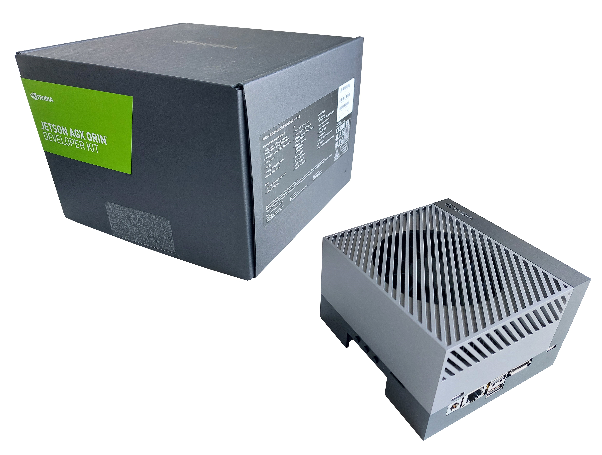
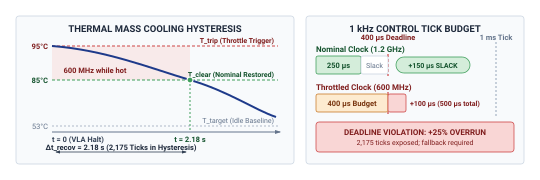

---
format:
  html:
    title: "Workload Placement and Silicon Partitioning"
---

# Workload Placement and Silicon Partitioning {#sec-placement}

::: {layout-narrow}
::: {.column-margin}

\chapterminitoc

:::

::: {.content-visible when-format="pdf"}
\noindent
{fig-alt="Isometric blueprint showing silicon placement: heterogeneous physical AI SoC with a neural accelerator cluster for the learned models, 3D memory stacks, perimeter thermal dissipation fins, shared interconnect crossbar bus, isolated deterministic real-time MCU enclave, and crimson QoS isolation trench."}
:::

::: {.content-visible unless-format="pdf"}
{fig-alt="Isometric blueprint showing silicon placement: heterogeneous physical AI SoC with a neural accelerator cluster for the learned models, 3D memory stacks, perimeter thermal dissipation fins, shared interconnect crossbar bus, isolated deterministic real-time MCU enclave, and crimson QoS isolation trench."}
:::

:::

## Purpose {.unnumbered .unlisted}

::: {.content-visible when-format="pdf"}
\begin{marginfigure}
\resizebox{0.92\linewidth}{!}{\mlphysicalstackfull{20}{100}{20}{20}{20}}
\end{marginfigure}
:::

_Why can a safety check miss its deadline even when it runs on its own processor core?_

A robot can compute the right refusal too late to prevent an irreversible action. Separating a learned proposer from a permission path in software does not establish independence when both still share memory, electrical power, clocks, or cooling. A burst of inference can delay the check that should stop the machine, and a processor fault can disable both paths at once. Placement must therefore follow the permission path's physical deadline and fallback requirements. Hardware separation has costs of its own, including communication delay and additional power connections, so the choice requires evidence about the resources each path uses under load. The engineer must select a placement, test the assumptions behind it, and record the conditions under which the permission path retains authority at the causal boundary.



::: {.callout-learning-objectives}

- Inventory the memory crossbar, interconnect queues, power delivery networks, clock trees, reset controllers, and thermal substrates that proposal and permission paths share
- Explain why average bus utilization cannot bound a deadline, analyzing AXI4 burst slicing, DRAM bank conflicts, and FR-FCFS arbiter starvation
- Evaluate whether shared power and reset paths can defeat a selected permission placement
- Analyze thermal coupling and clock throttling hysteresis between multi-tenant workloads across disparate physical timescales
- Size a windowed watchdog's service window from measured completion jitter for a non-blocking lock-free record exchange
- Design an adversarial stress campaign whose falsification threshold is the permission path's declared worst-case execution time ($C_{\text{wcet}}$)
- Select among static reservation, spatial partitioning, workload reduction, and physical silicon relocation from measured interference and timing allowances
- Construct a placement record formalizing the deployment envelope that scopes loaded observed maxima, thermal headroom, bus arbitration, mitigations, and untested conditions for release review

:::

## The Silicon Substrate {#sec-placement-silicon-substrate}

The warehouse mobile manipulator carries its application processor and its permission path in one chassis. On its software architecture diagram, the proposal boundary between the Brain and the Nervous System is a clean dashed line. The barrier filter and fallback ladder of @sec-enforcement keep their guarantees only while the permission path finishes its check inside its deadline on every tick. That condition depends on where the check executes and which resources it shares. A heterogeneous system-on-chip (SoC) can place application CPUs, neural accelerators, and real-time cores on one die, but shared memory, supply, and clock infrastructure can reconnect the paths the diagram separates. The shared die is therefore the placement this machine must evaluate before rejecting it.

The processor roles introduced with the machine's nervous system have different obligations. Application processors coordinate tasks, accelerators evaluate learned models, and real-time controllers execute bounded checks and drive updates. The relevant distinction is the work each must finish before its deadline. A separate core may still wait for memory or lose power when another core becomes busy.

Camera input, model-weight transfers, and telemetry logging compete with the enforcer for memory service if they share a controller. A sensor read can queue behind direct memory access (DMA) traffic and incur row-buffer precharge overhead, consuming time reserved for constraint evaluation. Software access permissions determine who may read an address; the interconnect and memory controller determine when the read proceeds. The inventory must therefore identify both the shared resource and the mechanism that bounds its service delay.

::: {.column-margin .margin-pointer}
↩ Hardware execution cadences and microcontroller timing loops were defined in @sec-nervous-cadences.
:::

Both of the machine's jobs would feel shared-die coupling. For the Class 1 base, a memory crossbar stall during feature extraction delays the permission path's refusal while the loaded base closes on a rack end, and every tick of delay beyond the one the stopping budget counts is distance it never reserved. For the Class 2 arm, an accelerator burst that evicts the permission path's tables from a shared cache delays the contact check while the gripper presses on the spring-latched cage door.

Following the end-to-end argument in system design [@saltzer1984end], memory protection and operating system process isolation do not by themselves establish operational independence. On a heterogeneous die,[^fn-place-system-chip] **operational independence**\index{Operational independence!definition} requires that proposal-side activity cannot push enforcement execution beyond its hard physical deadline, and that proposal-side crashes or thermal overruns cannot disable the permission path's authority to refuse.

[^fn-place-system-chip]: **Heterogeneous System-on-Chip Architecture**\index{Heterogeneous system-on-chip!architecture}\index{System-on-Chip (SoC)!heterogeneous compute}: Heterogeneous SoCs integrate multiple distinct compute domains onto a single silicon substrate, combining high-throughput application processors and neural accelerators with deterministic real-time safety islands. Although memory management units isolate software address spaces across domains, hardware subcomponents continue to share power distribution networks, clock distribution trees, and DRAM controllers. Under peak cognitive burst workloads, uncoordinated resource contention across these shared physical structures can degrade real-time response times beyond critical physical deadlines.

A placement claim must name the resources that could delay or disable enforcement and the conditions that bound their interference. The analysis begins with each path's workload and unloaded timing allowance, then exposes shared memory, power, and thermal dependencies to concurrent stress. The placement record carries the resulting bounds, observed maxima, and untested conditions into release review. The shared die and the machine's discrete controller are competing hypotheses about those dependencies, not interchangeable processor choices.

## Proposal and Permission Co-location on Shared Silicon {#sec-placement-two-paths-one-die}

The mobile manipulator must keep checking clearance while its proposal model computes the next chunk. The architectural overview established why these jobs need separate authority; placement asks whether the hardware can preserve that separation in time. Each path's work and timing allowance determine how much interference its placement can tolerate.

```{python}
#| label: calc-placement-machine-paths
#| echo: false
#| warning: false
#| message: false
# ┌─────────────────────────────────────────────────────────────────────────────
# │ MACHINE PATHS: PROPOSAL AND PERMISSION BUDGETS
# ├─────────────────────────────────────────────────────────────────────────────
# │ Context: @sec-placement-two-paths-one-die, @sec-placement-isolation-decisions,
# │          @sec-placement-hardware-allocation, @sec-placement-fallacies-pitfalls,
# │          @sec-placement-summary
# │
# │ Goal: Size the running machine's two paths from the registry before any
# │       contention: the chunk policy on the application processor and the
# │       enforcer tick on the discrete safety MCU.
# │ Show: 135 µs unloaded = 40 + 80 + 15 µs = 54,000 cycles at 400 MHz, against
# │       a declared 250 µs WCET and a chosen 400 µs deadline in the 1 ms tick.
# │       The permission path's isolated rail holds up for 2 s (a selected
# │       premise recorded here; decided in Ch2, sized in Ch12). The 5 ms
# │       renewal-jitter allowance tolerates at most a 12.5 percent stretch of
# │       the 40 ms chunk inference (Ch8's HostContentionAllowance).
# │ How: Registry fields of the warehouse mobile manipulator and its aisle
# │      scenario; the three enforcer sub-costs are chapter-local.
# └─────────────────────────────────────────────────────────────────────────────
from mlsysim import *
from mlsysim.core.units import microsecond, millisecond, second, hertz
from mlsysim.fmt import fmt_int, fmt_latency, fmt_frequency, fmt_percent, check

RM = Embodied.MobileManipulator.WarehouseMobileManipulator
AISLE = Embodied.Scenario.WarehouseAisle

class PlacementMachine:
    # ┌── 1. LOAD ───────────────────────────────────────────────────────────
    chunk_rate = RM.chunk_rate  # category: chosen
    chunk_inference = RM.chunk_inference_latency  # category: illustrative (P99, vision included)
    chunk_horizon = RM.chunk_horizon  # category: chosen
    permission_rate = RM.permission_rate  # category: chosen
    mcu_clock = RM.permission_mcu.compute.clock_rate  # category: illustrative (reference class)
    tick = AISLE.t_tick  # category: chosen
    t_bus = AISLE.t_bus  # category: illustrative
    lease = AISLE.t_lease  # category: chosen
    unloaded = AISLE.enforcer_unloaded  # category: illustrative
    wcet = AISLE.enforcer_wcet  # category: chosen (declared, not measured)
    deadline = AISLE.enforcer_deadline  # category: chosen
    self_watchdog = AISLE.mcu_self_watchdog  # category: chosen
    rail_holdup = RM.permission_rail_holdup  # category: chosen (permission-rail hold-up)
    renewal_jitter = 5 * millisecond  # category: chosen (renewal-jitter allowance of the lease rule, @sec-nervous-coupled-budget)
    sense = 40 * microsecond  # scenario assumption; category: illustrative (encoders, IMU, evidence epoch)
    constraint = 80 * microsecond  # scenario assumption; category: illustrative
    write = 15 * microsecond  # scenario assumption; category: illustrative (drive-frame staging)

    # ┌── 2. EXECUTE ────────────────────────────────────────────────────────
    chunk_period = (1 / chunk_rate).to(millisecond)
    chunk_slack = (chunk_period - chunk_inference).to(millisecond)
    unloaded_sum = (sense + constraint + write).to(microsecond)
    unloaded_slack = (deadline - unloaded).to(microsecond)
    wcet_margin = (deadline - wcet).to(microsecond)
    unloaded_cycles = (unloaded * mcu_clock).to("dimensionless").magnitude
    min_chunk_rate = (1 / lease).to(hertz)
    compute_after_sense = (constraint + write).to(microsecond)
    contention_stretch = (renewal_jitter / chunk_inference).to("dimensionless").magnitude

    # ┌── 3. GUARD ──────────────────────────────────────────────────────────
    check(
        abs((unloaded_sum - unloaded).to(microsecond).magnitude) < 1e-9, "Sense + constraint + write must equal the registry's 135 µs unloaded cycle."
    )
    check(abs(unloaded.to(microsecond).magnitude - 135.0) < 1e-9, "Canon: 135 µs unloaded.")
    check(abs(unloaded_cycles - 54_000) < 1e-6, "Canon: 135 µs = 54,000 cycles at 400 MHz.")
    check(wcet < deadline < tick, "Declared WCET inside the deadline, deadline inside the tick.")
    check(
        abs(wcet.to(microsecond).magnitude - 250.0) < 1e-9 and abs(deadline.to(microsecond).magnitude - 400.0) < 1e-9,
        "Canon: 250 µs WCET, 400 µs deadline.",
    )
    check(abs(chunk_slack.to(millisecond).magnitude - 10.0) < 1e-9, "The 40 ms chunk inference leaves 10 ms of the 50 ms period.")
    check(
        chunk_period < lease, "Lease rule: the lease outlasts one chunk period, leaving the renewal-jitter allowance that absorbs the proposal link."
    )
    check(abs(rail_holdup.to(second).magnitude - 2.0) < 1e-9, "Canon (D15): the permission rail holds up for 2.0 s.")
    check(chunk_period + renewal_jitter < lease, "Lease rule: chunk period plus the 5 ms renewal-jitter allowance fits inside the lease.")
    check(
        abs(contention_stretch - 0.125) < 1e-9,
        "Matches Ch8 HostContentionAllowance: 5 ms of jitter is a 12.5 percent stretch of the 40 ms inference.",
    )

    # ┌── 4. OUTPUT ─────────────────────────────────────────────────────────
    chunk_rate_str = fmt_frequency(chunk_rate, precision=0)
    chunk_period_str = fmt_latency(chunk_period, unit=millisecond, precision=0)
    chunk_inference_str = fmt_latency(chunk_inference, unit=millisecond, precision=0)
    chunk_slack_str = fmt_latency(chunk_slack, unit=millisecond, precision=0)
    chunk_horizon_str = fmt_int(chunk_horizon)
    permission_rate_str = fmt_frequency(permission_rate, precision=0)
    mcu_clock_str = fmt_frequency(mcu_clock, precision=0)
    tick_str = fmt_latency(tick, unit=millisecond, precision=0)
    t_bus_str = fmt_latency(t_bus, unit=millisecond, precision=0)
    lease_str = fmt_latency(lease, unit=millisecond, precision=0)
    min_chunk_rate_str = fmt_frequency(min_chunk_rate, precision=1)
    sense_str = fmt_latency(sense, unit=microsecond, precision=0)
    constraint_str = fmt_latency(constraint, unit=microsecond, precision=0)
    write_str = fmt_latency(write, unit=microsecond, precision=0)
    compute_after_sense_str = fmt_latency(compute_after_sense, unit=microsecond, precision=0)
    unloaded_str = fmt_latency(unloaded, unit=microsecond, precision=0)
    unloaded_cycles_str = fmt_int(unloaded_cycles)
    unloaded_slack_str = fmt_latency(unloaded_slack, unit=microsecond, precision=0)
    wcet_str = fmt_latency(wcet, unit=microsecond, precision=0)
    wcet_margin_str = fmt_latency(wcet_margin, unit=microsecond, precision=0)
    deadline_str = fmt_latency(deadline, unit=microsecond, precision=0)
    self_watchdog_str = fmt_latency(self_watchdog, unit=millisecond, precision=0)
    rail_holdup_str = fmt_latency(rail_holdup, unit=second, precision=0)
    renewal_jitter_str = fmt_latency(renewal_jitter, unit=millisecond, precision=0)
    contention_stretch_pct_str = fmt_percent(contention_stretch, precision=1)
```

### Proposal and permission execution profiles

The mobile manipulator partitions its control across two paths with conflicting requirements. The proposal path runs the chunk policy on the application processor at `{python} PlacementMachine.chunk_rate_str`, taking the navigation and wrist camera streams and emitting base velocity and arm joint targets together. Its P99 inference, vision included, takes `{python} PlacementMachine.chunk_inference_str` (illustrative; see the Reader Guide) of each `{python} PlacementMachine.chunk_period_str` chunk period; it holds no direct hardware authority over the drives and runs in unprivileged user space. The permission path runs on the discrete safety microcontroller (MCU) at `{python} PlacementMachine.permission_rate_str`. Each tick it checks the admitted trajectory and any eligible replacement against the stopping envelope of @sec-enforcement-stopping-envelopes and stages the admitted setpoints for the EtherCAT frame to the drives. It must finish inside a chosen `{python} PlacementMachine.deadline_str` deadline within its `{python} PlacementMachine.tick_str` tick, and it runs in a privileged real-time execution domain on a dual-core lockstep controller,[^fn-place-asild-lockstep] whose comparator diagnostics cover selected divergent execution faults, because an envelope check cannot detect a fault in the core that executes it. Only the permission path holds memory-mapped input-output (MMIO)\index{Memory-mapped I/O} access to the fieldbus master that carries drive commands.

::: {#dfn-placement-heterogeneous-silicon-partitioning .callout-definition title="Heterogeneous silicon partitioning"}

***Heterogeneous silicon partitioning***\index{Heterogeneous silicon partitioning!definition}\index{Silicon partitioning!definition} is the architectural allocation of stochastic, high-capacity cognitive workloads (perception, learned policy evaluation) and deterministic safety loops (safety invariant checks, admission and fallback) across specialized execution domains isolated in hardware.

1.  **Significance**: Placing high-capacity neural deliberation and real-time safety enforcement on the same general-purpose operating system or compute engine creates common-mode failures. Kernel thread preemption, dynamic memory allocation, and GPU warp scheduling inject multi-millisecond tail jitter that causes the permission path to miss physical control deadlines.
2.  **Distinction**: Unlike logical software process isolation (such as Linux containers or POSIX process priorities), silicon partitioning enforces isolation across independent hardware registers, tightly-coupled static memories (TCM), and dedicated peripheral buses.
3.  **Common pitfall**: Assuming multi-core CPU affinity provides true failure-domain separation, when the cores still share caches, memory controllers, clock trees, and power rails.

:::

::: {.column-margin .margin-pointer}
↩ The sub-millisecond execution deadline of the CBF-QP enforcer was established in @sec-enforcement-minimal-intervention.
:::

The two processors run the stacks introduced in @sec-nervous-silicon-partitioning. Proposal inference, scene-map updates, telemetry, and networking run on the application processor under Linux. A real-time kernel can reduce scheduler latency, but it does not bound every driver, memory, or shared-hardware delay.[^fn-place-preempt-rt] Zero-copy buffers reduce copying traffic without eliminating competition for the underlying memory controller.

Enforcement and sensor validation run on the discrete safety microcontroller as bare-metal firmware behind a hardware memory protection unit,[^fn-place-memory-partitioning] with encoder interfaces, the IMU, and hardware timer channels wired to its dedicated peripheral pins. Each proposal reaches the microcontroller over a board-level link and is published through the seqlock mailbox of @sec-nervous-cadences. No dynamic random-access memory (DRAM)\index{DRAM}\index{Dynamic random-access memory|see{DRAM}} is shared between the paths. The protection unit constrains access to local state; the separate bus removes the host's memory traffic from the enforcer's execution path.

Whole-plan admission is a separate workload from the permission tick. The illustrative whole-plan validation interval in @sec-planning-horizon-tradeoff cannot execute as an unbroken task inside the millisecond loop. Its scheduler must preserve the tick through bounded, interruptible work or an independently assessed admission domain, followed by a final current-state and evidence check before activation. The allocation ledger must include the trajectory buffer, resident fallback, admission workspace, and worst-case interruption costs. The producer period does not establish the interval between successful admissions. Qualification must show that transfer, admission, and activation preserve the renewal bound; the chosen tick deadline alone cannot establish it.

The full scene map remains on the application processor. The permission path receives only a bounded local evidence snapshot whose coverage, uncertainty, observation epoch, expiry, and integrity have been checked for the proposed motion and its fallback. The host map update, snapshot conversion, transport, admission, local storage, and per-tick query costs require separate ledger entries. A host query cannot enter the tick as an unbounded dependency. The MCU must reject motion outside the snapshot's supported region or validity, and its memory inventory must show that the local snapshot and resident trajectories fit alongside the enforcement code.

The supply design places the microcontroller, drive logic, and spring-brake coils on the isolated rail of @sec-body-archetype-matrix, with a selected local hold-up of `{python} PlacementMachine.rail_holdup_str` and no proposal-side load. Qualification must show that motor and accelerator transients on the common battery do not reset this path. That store supports logic and brake release during the selected stop; it does not supply traction power. The powered deceleration of @sec-enforcement-fallback-ladder additionally requires a surviving drive-energy path and a qualified destination for regenerative energy. Loss of either premise invokes a separately qualified fault response, not the normal stopping-distance claim.

On the unloaded machine the computational budgets appear generous. Illustrative sub-costs on the safety microcontroller put reading the encoders, the IMU, and the proposal's evidence epoch at `{python} PlacementMachine.sense_str`, evaluating the constraints at `{python} PlacementMachine.constraint_str`, and staging the admitted setpoints for the drive frame at `{python} PlacementMachine.write_str`. The enforcer's unloaded cycle totals `{python} PlacementMachine.unloaded_str`, which at the microcontroller's `{python} PlacementMachine.mcu_clock_str` clock is `{python} PlacementMachine.unloaded_cycles_str` cycles. Against the `{python} PlacementMachine.deadline_str` deadline, the unloaded path leaves `{python} PlacementMachine.unloaded_slack_str` of slack, and the declared worst-case execution time of `{python} PlacementMachine.wcet_str`, the selected budget of @sec-enforcement-minimal-intervention, still leaves `{python} PlacementMachine.wcet_margin_str`. On the application processor, the chunk policy's `{python} PlacementMachine.chunk_inference_str` inference leaves `{python} PlacementMachine.chunk_slack_str` of its `{python} PlacementMachine.chunk_period_str` period. These sub-costs form the simplified interference example below, not an integrated execution measurement. The local spatial-query allocation of @sec-memory must also fit the cyclic budget. Qualification must measure the complete cycle, identifying which query costs are included in constraint evaluation and adding any that are separate; neither the unloaded sum nor the query allocation alone establishes the declared bound.

### Shared microarchitectural failure domains and cyber-physical attack surfaces

Assigning tasks to separate processor cores does not create independent failure domains if the silicon infrastructure is shared.[^fn-std-cast-32a] @sec-nervous-hardware-isolation traced these common-cause paths on the machine's board, where separate packages and the isolated rail cut the memory and supply paths. On a shared die, the rejected option for this machine, they move inside one package. The real-time core executes instructions independently from the application processor, yet both cores rely on common hardware services:

- *Interrupt and memory service:* Camera, accelerator, and logging traffic can delay dispatch or memory reads unless arbitration bounds their interference.
- *Clock and thermal control:* A shared governor can slow the permission core when another domain heats the package.
- *Supply and reset:* Current steps or a host-triggered reset can disable both paths unless the electrical and reset domains remain independent.

These same dependencies create a **cyber-physical attack vector**\index{Cyber-physical security!shared-die attack surface}\index{Hardware security!side channels and DoS}. A compromised proposal process can deliberately generate the memory traffic or accelerator switching that an ordinary workload produces accidentally. Memory saturation delays enforcement, while a current step can induce $L \cdot dI/dt$ droop on a shared rail. The isolation claim must therefore cover adversarial demand within the proposal domain's permitted resource access; trusting its normal workload does not establish a hardware bound.

[^fn-std-cast-32a]: **Avionic Multicore Certification**\index{Multicore interference!FAA AC 20-193 / CAST-32A}\index{Worst-case execution time!multicore certification}: FAA Advisory Circular AC 20-193 and CAST-32A formalize multicore interference analysis for safety-critical avionics. The guidance requires bounding worst-case execution times by demonstrating that shared caches, interconnect crossbars, and memory controllers cannot cause critical tasks to overrun execution deadlines. Without hardware-enforced quality-of-service partitions or dedicated interconnect channels, cross-core memory traffic invalidates a single-core timing bound.

[^fn-place-preempt-rt]: **PREEMPT_RT**\index{Preempt RT!kernel latency}: A Linux real-time configuration reduces some scheduler latencies, but its tail depends on kernel, drivers, workload, and shared hardware. No portable sub-$50\,\mu\text{s}$ or bare-metal comparison follows without measurement.

[^fn-place-memory-partitioning]: **Hardware memory protection and IOMMU domains**\index{Memory Protection Unit!spatial isolation}\index{IOMMU!DMA isolation}: Physical silicon structures that enforce spatial address isolation. While an on-chip Memory Protection Unit (MPU) confines CPU thread execution to bounded memory segments, an Input-Output Memory Management Unit (IOMMU) translates and polices DMA requests from peripheral bus masters (such as PCIe neural accelerators or camera deserializers), physically preventing an untrusted device from corrupting safety state buffers.

[^fn-place-asild-lockstep]: **Dual-core lockstep**\index{Lockstep processor!fault detection}: Two cores can execute matching instruction streams while comparator logic detects selected divergences. Detection coverage, delay, shared-rail vulnerability, and diagnostic response depend on the device and the application safety case, so lockstep is one element of an ASIL D argument, not the whole of it.

Because software process isolation cannot mitigate these hardware-level timing and security couplings, physical silicon placement becomes the primary architectural defense. For the machine's permission loop, compare three placements. Shared application cores expose the permission loop to the kernel and driver scheduling tail described earlier, a tail that can push it past not only the `{python} PlacementMachine.deadline_str` deadline but the `{python} PlacementMachine.tick_str` tick itself. A real-time cluster on the application SoC keeps its own core but shares the die's memory controller, rails, and thermal path; @sec-placement-thermal-timing-coupling shows the clock throttle that rejects it. The discrete safety microcontroller that the machine uses pays for its separation in transport instead, a board-level hop from the application processor that neither shared-die option needs and that @sec-placement-isolation-decisions charges to the lease. The choice among the three rests on each option's measured sensor-to-drive response under interference, not on how many packages it uses.

Principle \ref{pri-vol4-proposal-permission} requires a permission path that learned workloads cannot delay, and the three placements differ precisely in which resources the two paths still share. Even the discrete microcontroller's separation is a claim about timing under load, which only a measurement of its tick under that load can support. Every resource the two paths share has claimants on that tick, and the memory system is where they collide first.

## Contention for Shared Resources {#sec-placement-resource-contention}

Had the mobile manipulator placed its permission path on the application SoC, camera DMA, neural weight fetches, telemetry writes, cache writebacks, and enforcement reads would compete for memory service. Their simultaneous bursts determine the queue seen by the enforcer. On the selected machine, those host-side bursts delay the observation and chunk rather than the permission tick. The permission path encounters their effects as evidence age (@sec-perception-cost-ingestion), refusing stale evidence and entering fallback if no admitted chunk renews the lease.

### DRAM bank conflicts, AXI4 burst slicing, and arbiter starvation

A small urgent read can wait behind a large transfer even when the memory bus is mostly idle over a longer interval. The deadline depends on the traffic already ahead of that read and on whether the controller lets it pass. On a shared die, **crossbar bus and DRAM bank contention**\index{Crossbar bus and DRAM bank contention!definition} is queuing delay when memory and DMA transactions share an interconnect and controller, and its bound depends on transaction size, queue policy, and bank timing.[^fn-place-dram-bandwidth]

[^fn-place-dram-bandwidth]: **DRAM bank conflicts**\index{DRAM!bank conflicts}: A different row in the same active bank may require precharge and activation before column service. Actual bank mapping, overlap, and scheduling determine the added delay.

Each claimant's average demand follows from its transfer size and event rate. On a shared multi-channel LPDDR5x interface, camera DMA streams, weight fetches at the policy rate, the enforcer's reads, drive writes, cache writebacks, and logging together occupy a modest fraction of theoretical peak bandwidth on average. An engineer who inspects only that average concludes that most of the memory bus remains free. Memory crossbar arbiters and DRAM schedulers do not schedule average rates. They arbitrate discrete, bursty transactions, and two workloads with identical average throughput interfere with radically different latency profiles if one streams in small, sporadic packets while the other arrives in long, saturating blocks.

The memory wall in @sec-brain-cognitive-pipeline also matters to the permission path. Weight transfers that limit proposal throughput become competing requests if the two paths share a controller. Camera DMA and telemetry add bursts of their own. Their average rates cannot reveal how many transactions will already be queued when an urgent read arrives.

How long a safety read waits depends on transaction arbitration and DRAM scheduling. An accelerator moving weights in large $256\,\text{KiB}$ tiles generates discrete memory transactions across the internal system interconnect. The example assumes an arbiter that completes each granted burst before serving a different requester.[^fn-hw-axi-burst] Furthermore, while bus protocols provide Quality of Service (QoS) priority signals (`ARQOS`), commodity memory controllers frequently treat these tags as advisory unless strict hardware priority bypass with bounded preemption latency is explicitly certified in register configurations. Whether an in-flight transfer can delay the urgent read, and whether queued tensor transactions can pass it, depends on the selected interconnect and arbiter. AXI burst limits alone do not establish a service-time or starvation bound.

[^fn-hw-axi-burst]: **AXI4 transaction slicing and burst limits**\index{Hardware!AXI4 burst limits}: AXI4 permits INCR bursts of up to 256 beats and forbids a burst from crossing a 4,096-byte address boundary. An aligned $256\,\text{KiB}$ tile transferred using full-width 128-bit ($16$-byte), 256-beat INCR bursts therefore takes 64 transactions. Smaller beats, shorter bursts, or misalignment change that count. In the selected arbitration example, an urgent read waits for the currently granted burst to finish; that scheduling premise is not a universal AXI guarantee.

DRAM microarchitecture introduces substantial internal latency because memory is organized into independent channels, ranks, bank groups, and banks that each maintain only a single active **row buffer**. Modern LPDDR5x architectures organize memory into 16 or 32 banks distributed across multiple bank groups. When an incoming read accesses an address in the currently open row (a *row hit*), the data is returned with minimal column-access latency ($t_{\text{CL}}$). However, when the enforcer's read targets a different row within the same active bank (a *row conflict* or *bank collision*), the memory controller must service the conflict through a multi-phase command sequence:

1. **Write recovery and bus turnaround ($t_{\text{WR}} + t_{\text{WTR}}$)**: If a prior write burst occupied the bank or bus channel, the memory controller must wait for internal write recovery before asserting precharge and satisfy write-to-read turnaround delays across the bus.
2. **Row precharge ($t_{\text{RP}} \approx 14\,\text{ns}$)**: The memory controller deactivates the currently active row in the target bank, restoring bitline voltages and closing the open page before a new row address can be accessed.
3. **Row-to-column activation delay ($t_{\text{RCD}} \approx 14\,\text{ns}$)**: The memory controller opens the new target row, latching the selected row data into the bank's row buffer before column read (CAS) commands can be issued.

Only after both $t_{\text{RP}}$ and $t_{\text{RCD}}$ have elapsed ($28\,\text{ns}$ of latency penalty per conflict) can column read commands proceed. In addition, consecutive accesses targeting different banks within the same bank group incur longer column-to-column cycle delays ($t_{\text{CCD\_L}}$) than accesses across distinct bank groups ($t_{\text{CCD\_S}}$). Controllers that use **First-Ready First-Come-First-Served (FR-FCFS)**\index{FR-FCFS scheduling!definition} scheduling reorder pending requests to prioritize ready row hits over older requests that target closed rows, maximizing aggregate data bus throughput. Because a streaming neural accelerator supplies an unbroken pipeline of row hits across its weight matrices, FR-FCFS schedulers repeatedly bypass the safety core's sporadic read until an internal starvation counter expires. Under a FIFO queue that lets no later arrival pass the safety read, the idealized wait is
$$t_{\text{queue}} = \sum_{k \in \mathcal{Q}} \frac{B_k}{\text{BW}_{\text{peak}}} + N_{\text{conflicts}} (t_{\text{RP}} + t_{\text{RCD}})$$ {#eq-placement-dram-queuing}
where $\mathcal{Q}$ holds the transactions ahead of the read, $B_k$ is each one's byte count, $N_{\text{conflicts}}$ counts changes to a different row within an already active bank, and $\text{BW}_{\text{peak}}$ is an optimistic service rate. Arbitration overhead and refresh add to the result. Exceeding the sensing allowance first violates the allocation to that subtask; it does not by itself imply that the whole tick misses its deadline. The worked comparison below keeps the sense allocation, declared execution bound, and physical deadline separate.

```{python}
#| label: calc-placement-loaded-read
#| echo: false
#| warning: false
#| message: false
# ┌─────────────────────────────────────────────────────────────────────────────
# │ THE PERMISSION PATH'S LOADED READ ON A SHARED DIE (REJECTED PLACEMENT)
# ├─────────────────────────────────────────────────────────────────────────────
# │ Context: @sec-placement-resource-contention, @sec-placement-fallacies-pitfalls
# │
# │ Goal: Charge a FIFO backlog on shared DRAM to the machine's 40 µs sense
# │       allowance and 400 µs deadline, to show why the bound is a property of
# │       the memory controller rather than of the workload.
# │ Show: one backlog of 88 transactions (360,448 bytes) waits 28.244 µs; a 4 KiB
# │       snapshot then reads in 28.564 µs, inside the 40 µs allowance (one
# │       backlog fits, two do not); the declared 250 µs WCET is crossed after
# │       more than five backlogs (155 µs read), refuting the declared bound, while the
# │       deadline holds until more than ten (305 µs read); priority bypass cuts
# │       the read to 0.64 µs.
# │ How: calc_axi_fifo_contention with PlacementMachine's sub-costs; queue
# │      composition and snapshot size are scenario inputs.
# └─────────────────────────────────────────────────────────────────────────────
import math
from mlsysim.core.units import Q_, microsecond
from mlsysim.physics.robotics import calc_axi_fifo_contention
from mlsysim.fmt import fmt_int, fmt_latency, check

class PlacementLoadedRead:
    # ┌── 1. LOAD ───────────────────────────────────────────────────────────
    sense = PlacementMachine.sense  # category: illustrative (sense allowance)
    compute_after_sense = PlacementMachine.compute_after_sense  # category: illustrative (80 + 15 µs)
    deadline = PlacementMachine.deadline  # category: chosen
    wcet = PlacementMachine.wcet  # category: chosen (declared WCET, the falsification threshold)
    tile_bytes = 256 * 1024  # category: illustrative (weight tile)
    camera_bytes = 64 * 1024  # category: illustrative
    telemetry_bytes = 32 * 1024  # category: illustrative
    snapshot_bytes = 4 * 1024  # category: illustrative (encoder, IMU, and evidence-epoch snapshot)
    transaction_bytes = 4 * 1024  # category: datasheet (AXI4 4 KiB boundary)
    bandwidth = Q_("12.8 GB/s")  # category: illustrative (peak rate)
    bank_switches = 3  # same-bank row conflicts; category: illustrative
    bank_switch_time = Q_("28 ns")  # category: illustrative (t_RP + t_RCD)

    # ┌── 2. EXECUTE ────────────────────────────────────────────────────────
    result = calc_axi_fifo_contention(
        tile_bytes=tile_bytes,
        camera_bytes=camera_bytes,
        telemetry_bytes=telemetry_bytes,
        safety_read_bytes=snapshot_bytes,
        transaction_bytes=transaction_bytes,
        bandwidth=bandwidth,
        bank_switches=bank_switches,
        bank_switch_time=bank_switch_time,
        compute_time=compute_after_sense,
    )
    backlog_bytes = tile_bytes + camera_bytes + telemetry_bytes
    queue = result["queue_fifo"].to(microsecond)
    own_read = result["own_read"].to(microsecond)
    loaded_read = (queue + own_read).to(microsecond)
    sense_left = (sense - loaded_read).to(microsecond)
    read_ceiling = (deadline - compute_after_sense).to(microsecond)
    wcet_read_ceiling = (wcet - compute_after_sense).to(microsecond)
    backlogs_wcet = math.floor(((wcet_read_ceiling - own_read) / queue).to("dimensionless").magnitude)
    backlogs_sense = math.floor(((sense - own_read) / queue).to("dimensionless").magnitude)
    backlogs_deadline = math.floor(((read_ceiling - own_read) / queue).to("dimensionless").magnitude)
    bypass_read = (result["queue_priority_bypass"] + own_read).to(microsecond)

    # ┌── 3. GUARD ──────────────────────────────────────────────────────────
    check(result["queued_transactions"] == 88 and result["tile_transactions"] == 64, "88 queued transactions, 64 of them from one tile.")
    check(abs(queue.magnitude - 28.244) < 1e-9, "360,448 bytes at 12.8 GB/s plus three 28 ns switches is 28.244 µs.")
    check(loaded_read < sense < 2 * queue + own_read, "One backlog fits inside the sense allowance; two do not.")
    check(abs(read_ceiling.magnitude - 305.0) < 1e-9, "The deadline leaves 305 µs for the read after 95 µs of compute.")
    check(backlogs_sense == 1 and backlogs_deadline == 10, "The sense allowance absorbs one backlog, the deadline ten.")
    check(abs(wcet_read_ceiling.magnitude - 155.0) < 1e-9 and backlogs_wcet == 5, "The declared WCET leaves 155 µs for the read, five backlogs.")
    check(bypass_read < own_read * 3, "Priority bypass leaves one in-flight transaction ahead of the read.")

    # ┌── 4. OUTPUT ─────────────────────────────────────────────────────────
    sense_str = fmt_latency(sense, unit=microsecond, precision=0)
    compute_after_sense_str = fmt_latency(compute_after_sense, unit=microsecond, precision=0)
    deadline_str = fmt_latency(deadline, unit=microsecond, precision=0)
    n_tx_str = fmt_int(result["queued_transactions"])
    tile_tx_str = fmt_int(result["tile_transactions"])
    backlog_bytes_str = fmt_int(backlog_bytes)
    snapshot_bytes_str = fmt_int(snapshot_bytes)
    queue_str = fmt(queue.magnitude, precision=3)
    own_read_str = fmt(own_read.magnitude, precision=2)
    loaded_read_str = fmt(loaded_read.magnitude, precision=3)
    sense_left_str = fmt(sense_left.magnitude, precision=3)
    read_ceiling_str = fmt_latency(read_ceiling, unit=microsecond, precision=0)
    backlogs_deadline_str = fmt_int(backlogs_deadline)
    wcet_str = fmt_latency(wcet, unit=microsecond, precision=0)
    wcet_read_ceiling_str = fmt_latency(wcet_read_ceiling, unit=microsecond, precision=0)
    backlogs_wcet_str = fmt_int(backlogs_wcet)
    bypass_read_str = fmt(bypass_read.magnitude, precision=2)
    bandwidth_str = fmt(bandwidth.to("GB/s").magnitude, precision=1)
    bank_switch_str = fmt(bank_switch_time.to("ns").magnitude, precision=0)
    bank_switches_str = fmt_int(bank_switches)
```

::: {#nbk-placement-loaded-read .callout-notebook title="Loaded read latency on a shared die"}

**Problem**: Suppose the permission path read its sensor snapshot from the application SoC's shared DRAM. How much queued traffic could precede that read before the tick exceeds its sense allowance, its declared worst-case execution time, and its deadline?

**Variables**: The tick allots `{python} PlacementLoadedRead.sense_str` to sensing and `{python} PlacementLoadedRead.compute_after_sense_str` to constraint evaluation and the drive-frame write, inside a `{python} PlacementLoadedRead.deadline_str` deadline. The snapshot is `{python} PlacementLoadedRead.snapshot_bytes_str` bytes on a `{python} PlacementLoadedRead.bandwidth_str` GB/s channel. Ahead of it the FIFO holds one weight tile (`{python} PlacementLoadedRead.tile_tx_str` transactions), a camera transfer, and a telemetry record: `{python} PlacementLoadedRead.n_tx_str` transactions, `{python} PlacementLoadedRead.backlog_bytes_str` bytes, `{python} PlacementLoadedRead.bank_switches_str` same-bank row conflicts.

**Math**: By @eq-placement-dram-queuing, serving the backlog's `{python} PlacementLoadedRead.backlog_bytes_str` bytes at `{python} PlacementLoadedRead.bandwidth_str` GB/s, plus `{python} PlacementLoadedRead.bank_switches_str` row-conflict penalties of `{python} PlacementLoadedRead.bank_switch_str` ns, takes `{python} PlacementLoadedRead.queue_str` $\mu\text{s}$. The snapshot itself reads in `{python} PlacementLoadedRead.own_read_str` $\mu\text{s}$, so the loaded read takes `{python} PlacementLoadedRead.loaded_read_str` $\mu\text{s}$ and leaves `{python} PlacementLoadedRead.sense_left_str` $\mu\text{s}$ of the sense allowance. A second backlog would overrun it. The declared worst-case execution time of `{python} PlacementLoadedRead.wcet_str` is crossed once the read exceeds `{python} PlacementLoadedRead.wcet_read_ceiling_str`, which takes more than `{python} PlacementLoadedRead.backlogs_wcet_str` backlogs, and that crossing refutes the declared execution bound even though the tick still meets its deadline. It does not by itself refute the weaker claim that this load preserves the deadline. The deadline itself holds until the read exceeds `{python} PlacementLoadedRead.read_ceiling_str`, which takes more than `{python} PlacementLoadedRead.backlogs_deadline_str` backlogs, so meeting the deadline does not establish the stronger declared execution bound. With validated priority bypass, only the one in-flight transaction waits ahead, and the read takes `{python} PlacementLoadedRead.bypass_read_str` $\mu\text{s}$.

**Systems insight**: The read's bound belongs to the memory controller, not to the workload. It exists only if the controller limits how much traffic it admits ahead of a safety read or lets that read bypass the queue, and an FR-FCFS controller serving a streaming accelerator provides neither unless its configuration is qualified to do so. The machine's discrete microcontroller removes the question by reading its snapshot from tightly coupled memory on its own bus.

:::

### Power-rail interference

A sudden motor or accelerator current demand can lower the voltage available to a controller sharing its supply. The first-order package model is
$$\Delta V_{\text{droop}} = L_{\text{pkg}} \frac{dI}{dt} + \Delta I \cdot R_{\text{pkg}}$$
The placement decision depends on whether regulation, decoupling, and stored energy keep the permission path inside its characterized operating range. The package hierarchy and transistor-level derivation are developed in @sec-appendix-systems-droop; here the model identifies the disturbance that the chosen rail must survive.

```{python}
#| label: calc-placement-inductive-pdn-droop
#| echo: false
#| warning: false
#| message: false
from mlsysim.core.units import ureg, nanosecond
from mlsysim.physics.robotics import (
    calc_voltage_droop,
    calc_inductive_voltage_droop,
    calc_alpha_power_gate_delay_stretch,
)
from mlsysim.fmt import fmt, fmt_int, fmt_percent

class InductivePDNVoltageDroop:
    v_core = 0.850 * ureg.volt  # category: illustrative
    l_pkg = 30.0 * ureg.picohenry  # category: illustrative
    r_pkg = 8.0 * ureg.milliohm  # category: illustrative
    delta_i = 6.0 * ureg.ampere  # category: illustrative
    t_rise = 2.0 * nanosecond  # category: illustrative
    di_dt = delta_i / t_rise

    v_ind = calc_inductive_voltage_droop(l_pkg, di_dt)
    v_res = calc_voltage_droop(delta_i, r_pkg)
    v_droop = v_ind + v_res
    v_drooped = v_core - v_droop

    v_th = 0.420 * ureg.volt  # category: illustrative
    alpha = 1.3  # category: illustrative
    res_stretch = calc_alpha_power_gate_delay_stretch(
        nominal_voltage=v_core,
        drooped_voltage=v_drooped,
        threshold_voltage=v_th,
        alpha=alpha,
    )
    delay_expansion_pct = res_stretch["delay_expansion_percent"]

    # ┌── 4. OUTPUT (Format & Export) ────────────────────────────────────────
    v_th_str = fmt(v_th.to(ureg.volt).magnitude, precision=3)
    alpha_str = fmt(alpha, precision=1)
    v_core_str = fmt(v_core.to(ureg.volt).magnitude, precision=2)
    v_core_3dec_str = fmt(v_core.to(ureg.volt).magnitude, precision=3)
    l_pkg_str = fmt(l_pkg.to(ureg.picohenry).magnitude, precision=0)
    r_pkg_str = fmt(r_pkg.to(ureg.milliohm).magnitude, precision=0)
    delta_i_str = fmt(delta_i.to(ureg.ampere).magnitude, precision=0)
    t_rise_str = fmt(t_rise.to(nanosecond).magnitude, precision=0)
    v_ind_mv_str = fmt(v_ind.to(ureg.millivolt).magnitude, precision=0)
    v_res_mv_str = fmt(v_res.to(ureg.millivolt).magnitude, precision=0)
    v_droop_mv_str = fmt(v_droop.to(ureg.millivolt).magnitude, precision=0)
    v_droop_v_str = fmt(v_droop.to(ureg.volt).magnitude, precision=3)
    v_drooped_str = fmt(v_drooped.to(ureg.volt).magnitude, precision=3)
    droop_pct_str = fmt_percent((v_droop / v_core).magnitude, precision=1)
    delay_expansion_pct_str = fmt_int(round(delay_expansion_pct))
```

For the illustrative package parameters, the current step produces `{python} InductivePDNVoltageDroop.v_droop_mv_str` mV of droop from a `{python} InductivePDNVoltageDroop.v_core_3dec_str` V nominal rail. The alpha-power model relates the resulting voltage to gate delay:
$$\frac{t_{\text{prop}}(V_{\text{drooped}})}{t_{\text{prop}}(V_{\text{nominal}})} = \frac{V_{\text{drooped}}}{V_{\text{nominal}}} \left( \frac{V_{\text{nominal}} - V_{\text{th}}}{V_{\text{drooped}} - V_{\text{th}}} \right)^\alpha$$
Here $V_{\text{th}}$ is the modeled threshold voltage, stipulated as `{python} InductivePDNVoltageDroop.v_th_str` V, and $\alpha$ is the technology-dependent exponent, stipulated as `{python} InductivePDNVoltageDroop.alpha_str`. With those inputs, the modeled delay increases by `{python} InductivePDNVoltageDroop.delay_expansion_pct_str` percent. This is a sensitivity calculation, not a measured reset threshold or a universal delay increase for every gate. Device characterization must establish whether the actual critical paths still meet setup time and whether undervoltage protection trips.

A separate permission rail removes the modeled shared core-supply path, but the common battery, wiring, converter behavior, and return paths remain qualification obligations. Rail probes and independent timing instruments must observe them under simultaneous motor and proposal load. The record exchange must preserve the same independence when a producer stalls in software.

## The Boundary Contract {#sec-placement-boundary-contract}

Suppose the proposal writer stops halfway through publishing a chunk. The permission path still owes the plant a decision on its next tick. Separating processors helps only if their exchange also lets the reader reject an incomplete record without waiting for the writer. The boundary contract therefore connects memory consistency to the same execution deadline as the sensor read and constraint check.

### Immutable record mailboxes and non-blocking synchronization

The boundary contract\index{Boundary contract} requires a self-contained record whose publication state the reader can check. A raw pointer into the proposal writer's private buffer exposes the reader to an incomplete update or stalled producer. The proposal header of @sec-nervous-cadences already supplies the record and its seqlock publication protocol; placement adds evidence that the exchange meets its deadline under load.

On the machine's separate processors, a receiver transfers the board-link payload into a mailbox local to the microcontroller. The local publication protocol and the link transport are distinct timing obligations; the publication protocol applies to the receiving domain's local mailbox.

The receiver publishes a fixed-size local record using the one-attempt protocol of @sec-nervous-cadences. On each tick, the reader samples the sequence, copies the bounded payload only when the first sequence is even, and checks the sequence again. An odd or changed sequence rejects this candidate immediately; the reader never spins or retries within that tick. The configured memory mapping, cache maintenance, and ordering must make the local copy coherent, and the copy itself must fit the measured execution allowance.

Consistency only establishes that the candidate arrived intact. Admission still checks its evidence, state, and lease. A rejected replacement neither renews nor revokes an active valid command. The previously admitted output remains usable only while its own lease, evidence, and current-state checks remain valid. Otherwise the MCU selects the state-dependent fallback of @sec-enforcement-fallback-ladder. Host stalls and logging cannot backpressure that choice.

The exchange therefore has two separately priced operations: board transport before publication and one bounded local read during enforcement. Their test evidence must identify the payload size, memory configuration, and rejection path. A controller that can read without waiting still needs independent supervision of its own progress.

### Windowed watchdog timers and execution liveness

Software memory boundaries and lock-free seqlocks protect against torn reads, but cannot guarantee that the safety enforcer code is alive and progressing through its intended operations. Liveness of the enforcer belongs to the self-watchdog of @sec-nervous-cadences, which is fed only after a completed tick. A countdown watchdog serviced from a timer interrupt stays blind to a dead task, the failure argued in *Bookout v. Toyota*. On shared silicon, the enforcer can also be starved by interconnect contention or run too fast after clock corruption, so placement needs a stronger form of that self-watchdog, one that constrains the feed from both sides.

High-integrity physical AI architectures therefore enforce **windowed watchdog timers**\index{Windowed watchdog timer!hardware mechanics}\index{Watchdog timer!windowed}. A windowed watchdog rejects any refresh that occurs either too early or too late. The timer hardware defines a service window parameterized by a lower bound (the closed window, $T_{\text{lower}}$) and an upper bound (the open window, $T_{\text{upper}}$):

1. **Early-kick violation ($t_{\text{service}} < T_{\text{lower}}$)**: If software attempts to refresh the watchdog before the lower threshold has elapsed, the hardware triggers its configured fault response. An early kick can indicate control-flow disruption: a corrupted program counter skipping the mathematical barrier evaluation to jump directly to the service subroutine, a stack overflow short-circuiting control loops, or an unexpected Phase-Locked Loop (PLL) multiplier glitch causing runaway clock acceleration. The lower threshold detects feeds that arrive too quickly, but a faulty path that feeds inside the window still requires other diagnostics.
2. **Late-kick violation ($t_{\text{service}} > T_{\text{upper}}$)**: If the timer counts down past $T_{\text{upper}}$ without receiving a valid refresh, the counter underflows, asserting a hardware reset. A late kick can indicate that the enforcer was starved of compute cycles by interconnect contention, deadlocked on an unhandled exception, or delayed by excessive cache evictions.
3. **Valid service window ($T_{\text{lower}} \le t_{\text{service}} \le T_{\text{upper}}$)**: A refresh inside the window shows the feed path met its timing condition; task progress still needs a suitable challenge or independent supervision.

If the controller feeds once after each successful tick, the watchdog measures the interval *between feeds*. Let completion offset $c_n$ from tick $n$ start lie in $[c_{\min},c_{\max}]$, and let $J_{\text{phase}}$ bound the deviation of the interval between consecutive tick starts from $T_{\text{period}}$. A conservative range for the inter-feed interval is given by @eq-placement-watchdog-window:
$$T_{\text{feed}}\in[T_{\text{period}}-(c_{\max}-c_{\min})-J_{\text{phase}},\;T_{\text{period}}+(c_{\max}-c_{\min})+J_{\text{phase}}]$$ {#eq-placement-watchdog-window}
This formulation captures the two extreme consecutive tick completions:

- *Shortest interval (late-to-early compression):* Tick $n$ finishes as late as possible ($c_{\max}$), and Tick $n+1$ finishes as early as possible ($c_{\min}$); the elapsed time between consecutive feeds is compressed to $T_{\text{period}} - (c_{\max} - c_{\min}) - J_{\text{phase}}$.
- *Longest interval (early-to-late expansion):* Tick $n$ finishes as early as possible ($c_{\min}$), and Tick $n+1$ finishes as late as possible ($c_{\max}$); the elapsed time between consecutive feeds expands to $T_{\text{period}} + (c_{\max} - c_{\min}) + J_{\text{phase}}$.
Configure $T_{\text{lower}}$ and $T_{\text{upper}}$ around that *measured or justified* range, while keeping the late-trip response within the plant's separately derived fault budget. A one-tick execution time alone does not set a watchdog service interval. On the machine, $T_{\text{period}}$ is the `{python} PlacementMachine.tick_str` tick and the declared `{python} PlacementMachine.wcet_str` worst case supplies $c_{\max}$. The unloaded `{python} PlacementMachine.unloaded_str` path does not supply $c_{\min}$, because the enforcer's shortest branch can complete sooner than its nominal one, so the lower bound comes from the shortest completion the stress campaign records. $J_{\text{phase}}$ is an inter-tick period-jitter bound measured under the same load, not an absolute phase-offset bound. If only an absolute phase bound is known, the difference between consecutive offsets must be bounded before using this expression. That range would give the machine's timeout-only self-watchdog the $T_{\text{lower}}$ it lacks, while $T_{\text{upper}}$ stays at the chosen `{python} PlacementMachine.self_watchdog_str` timeout, so the window tolerates several missed ticks before it trips.

The timeout is a selected fault-detection interval, not evidence that several missed ticks are harmless. The supervisor response after loss of the MCU must fit a separately qualified fault budget, including the surviving braking or restraint mechanism. The normal powered-stop margin cannot justify that interval when the fault removes the controller needed to execute the stop.

Some designs add **challenge-response checkpointing**\index{Watchdog timer!challenge-response}, tying the feed to fresh sensor validation, permission evaluation, and output checks. Its coverage depends on whether failed control paths can compute or replay a valid response. An external supervisor must route a detected failure to the plant's qualified fault response. Direct torque inhibit can remove active torque, but it cannot be credited with the powered stopping distance; the surviving restraint or braking mechanism needs its own evidence.

However, establishing clean boundaries in memory, interconnect arbitration, and watchdog execution liveness solves only the logical and timing half of co-location. When the accelerator and the real-time processor share the same silicon die, the high power dissipated during dense matrix operations conducts directly through the substrate, elevating local junction temperatures and altering circuit switching delays across adjacent cores.

## Thermal and Timing Coupling {#sec-placement-thermal-timing-coupling}

The permission core can slow down after the proposal workload has stopped, because stored heat takes time to leave the package. Thermal coupling therefore requires a longer test than the short current step or memory burst. When the accelerator and permission core share a thermal path and governor, sustained proposal power can change the clock available to enforcement.

In physical AI systems engineering, **thermal clock throttling**\index{Thermal clock throttling!definition} is the automatic, hardware-enforced reduction of processor clock frequency triggered when sustained high-power cognitive inference elevates silicon junction temperature ($T_j$) past thermal trip thresholds ($T_{\text{trip}}$). To prevent permanent physical damage or thermal runaway on the die, on-chip Digital Thermal Sensors (DTS) signal the Power Management Controller (PMC) to abruptly drop clock frequencies via hardware clock dividers or PLL reconfiguration. This introduces a lingering, temperature-dependent slowdown (hysteresis) that inflates execution times even after the cognitive workload subsides and can push co-located real-time safety loops past their hard physical deadlines.

```{python}
#| label: calc-placement-rejected-throttle
#| echo: false
#| warning: false
#| message: false
# ┌─────────────────────────────────────────────────────────────────────────────
# │ THE REJECTED PLACEMENT: A THROTTLED SHARED-DIE PERMISSION TICK
# ├─────────────────────────────────────────────────────────────────────────────
# │ Context: @sec-placement-thermal-timing-coupling
# │
# │ Goal: Show why the machine does not run its permission path on a real-time
# │       cluster of the application SoC: a thermal governor halves that
# │       cluster's clock and the tick overruns its deadline for seconds.
# │ Show: a cluster sized to the declared 250 µs WCET at 1.2 GHz needs 3.0e5
# │       cycles (300,000); throttled to 600 MHz it takes 500 µs, past the 400 µs deadline
# │       (25% overrun) and past the WCET that falsifies independence; 2.18 s of
# │       hysteresis spans 2,175 ticks.
# │ How: WCET, deadline, and tick from the aisle scenario; cluster clocks and
# │      the thermal model are scenario inputs for the rejected design.
# │
# │ Note: The clocks, times, and tick count match the checkpoint SVG
# │       chk_placement_thermal_throttling_hysteresis.svg.
# └─────────────────────────────────────────────────────────────────────────────
import math
from mlsysim import *
from mlsysim.core.units import microsecond, millisecond, second, ureg
from mlsysim.fmt import fmt, fmt_int, fmt_latency, fmt_frequency, fmt_percent, check

AISLE = Embodied.Scenario.WarehouseAisle

class RejectedPlacementThrottle:
    # ┌── 1. LOAD ───────────────────────────────────────────────────────────
    tick = AISLE.t_tick  # category: chosen
    wcet = AISLE.enforcer_wcet  # category: chosen (declared, not measured)
    deadline = AISLE.enforcer_deadline  # category: chosen
    f_nom = 1.20 * ureg.gigahertz  # scenario assumption; category: illustrative (shared-die cluster)
    f_throt = 600 * ureg.megahertz  # scenario assumption; category: illustrative (governor halves the clock)
    tau_th = 8.0 * second  # scenario assumption; category: illustrative
    t_ambient = 45.0  # °C, electronics-bay ambient; scenario assumption; category: illustrative
    p_base = 4.0  # W, enforcer plus idle and memory power; scenario assumption; category: illustrative
    p_load = 26.0  # W, total with continuous proposal inference; scenario assumption; category: illustrative
    theta_ja = 2.0  # K/W, junction-to-ambient; scenario assumption; category: illustrative
    t_start = 95.0  # °C, trip threshold; category: illustrative
    t_clear = 85.0  # °C, clearance threshold; category: illustrative
    mcu_unloaded = AISLE.enforcer_unloaded  # category: illustrative
    mcu_clock = RM.permission_mcu.compute.clock_rate  # category: illustrative (reference class)

    # ┌── 2. EXECUTE ────────────────────────────────────────────────────────
    n_cycles = (wcet * f_nom).to("dimensionless").magnitude  # cluster sized to meet the declared WCET
    t_exec = (n_cycles / f_nom).to(microsecond)
    t_exec_throt = (n_cycles / f_throt).to(microsecond)
    slack = (deadline - t_exec).to(microsecond)
    overrun = (t_exec_throt - deadline).to(microsecond)
    overrun_ratio = (overrun / deadline).to("dimensionless").magnitude
    t_target = t_ambient + p_base * theta_ja  # °C, baseline equilibrium
    t_rise_load = p_load * theta_ja  # K, steady-state rise under continuous inference
    t_steady_load = t_ambient + t_rise_load  # °C, loaded steady state
    t_recov = (tau_th * math.log((t_start - t_target) / (t_clear - t_target))).to(second)
    ticks_exposed = math.floor((t_recov / tick).to("dimensionless").magnitude)
    mcu_cycles = (mcu_unloaded * mcu_clock).to("dimensionless").magnitude  # TCM-resident unloaded tick on the discrete MCU

    # ┌── 3. GUARD ──────────────────────────────────────────────────────────
    check(abs(n_cycles - 3.0e5) < 1e-6, "250 µs at 1.2 GHz is 3.0e5 cycles.")
    check(
        abs(t_exec.magnitude - 250.0) < 1e-9 and abs(t_exec_throt.magnitude - 500.0) < 1e-9,
        "Nominal 250 µs and throttled 500 µs, as the SVG draws them.",
    )
    check(t_exec < deadline < t_exec_throt < tick, "The nominal tick meets the deadline; the throttled tick misses it inside the 1 ms period.")
    check(t_exec_throt > wcet, "The throttled tick exceeds the declared WCET, the falsification threshold.")
    check(abs(overrun_ratio - 0.25) < 1e-9, "The throttled tick overruns the 400 µs deadline by 25%.")
    check(abs(t_target - 53.0) < 1e-9, "Baseline equilibrium 45 °C + 4.0 W x 2.0 K/W = 53 °C.")
    check(abs(t_steady_load - 97.0) < 1e-9 and t_steady_load > t_start, "26 W x 2.0 K/W = 52 K over 45 °C is 97 °C, above the 95 °C trip.")
    check(abs(t_recov.magnitude - 2.18) < 5e-3, "Recovery from 95 to 85 °C takes about 2.18 s.")
    check(n_cycles > mcu_cycles, "The shared-die cluster, without TCM, spends more cycles per tick than the discrete MCU's unloaded 54,000.")
    check(ticks_exposed == 2175, "2,175 scheduled ticks fall inside the hysteresis, as the SVG labels them.")

    # ┌── 4. OUTPUT ─────────────────────────────────────────────────────────
    tick_str = fmt_latency(tick, unit=millisecond, precision=0)
    wcet_str = fmt_latency(wcet, unit=microsecond, precision=0)
    deadline_str = fmt_latency(deadline, unit=microsecond, precision=0)
    f_nom_str = fmt_frequency(f_nom, precision=1)
    f_throt_str = fmt_frequency(f_throt, precision=0)
    n_cycles_str = fmt_int(n_cycles)
    t_exec_str = fmt_latency(t_exec, unit=microsecond, precision=0)
    t_exec_throt_str = fmt_latency(t_exec_throt, unit=microsecond, precision=0)
    slack_str = fmt_latency(slack, unit=microsecond, precision=0)
    overrun_str = fmt_latency(overrun, unit=microsecond, precision=0)
    overrun_pct_str = fmt_percent(overrun_ratio, precision=0)
    t_recov_str = fmt_latency(t_recov, unit=second, precision=2)
    ticks_exposed_str = fmt_int(ticks_exposed)
    t_ambient_str = fmt(t_ambient, precision=0)
    theta_ja_str = fmt(theta_ja, precision=0)
    tau_th_str = fmt(tau_th.to(second).magnitude, precision=0)
    p_base_str = fmt(p_base, precision=0)
    p_load_str = fmt(p_load, precision=0)
    t_target_str = fmt(t_target, precision=0)
    t_rise_load_str = fmt(t_rise_load, precision=0)
    t_steady_load_str = fmt(t_steady_load, precision=0)
    t_start_str = fmt(t_start, precision=0)
    t_clear_str = fmt(t_clear, precision=0)
```

For this illustrative thermal scenario, the electronics bay is assumed to sit at `{python} RejectedPlacementThrottle.t_ambient_str`$\,^{\circ}\text{C}$ ambient. @Fig-13-jetson-orin shows the developer kit of the module class used as its application processor; the photograph reveals neither the heat path nor the clock domains on which the estimate depends. An enclosure that excludes warehouse dust and conductive debris also constrains cooling. For the following shared-die candidate, the assumed conduction path must carry sustained proposal heat without pushing the permission core into a slower clock state.

For a conduction-cooled enclosure, the modeled path includes the package, thermal interface, and chassis:
$$\theta_{\text{JA}} = \theta_{\text{JC}} + \theta_{\text{TIM}} + \theta_{\text{chassis}}.$$
Interface aging can increase that resistance. Battery and drive losses can also raise bay temperature; the battery contribution includes
$$P_{\text{batt}} = I_{\text{batt}}^2 R_{\text{batt}}$$
The environmental envelope must therefore specify both the cooling configuration and the simultaneous mechanical workload. A cold bench run cannot stand in for a warm operating shift.

Suppose the shared SoC within this enclosed bay were conduction-cooled with a **junction-to-ambient thermal resistance**\index{Thermal resistance!junction-to-ambient} of $\theta_{\text{JA}} =$ `{python} RejectedPlacementThrottle.theta_ja_str` $\text{K/W}$ and a **thermal time constant**\index{Thermal time constant} of $\tau_{\text{th}} =$ `{python} RejectedPlacementThrottle.tau_th_str` $\text{s}$. The permission loop with idle and memory power draws `{python} RejectedPlacementThrottle.p_base_str` $\text{W}$ and holds the junction at `{python} RejectedPlacementThrottle.t_target_str`$\,^{\circ}\text{C}$. Continuous proposal inference adds accelerator, memory-traffic, and regulator losses, and a total of `{python} RejectedPlacementThrottle.p_load_str` $\text{W}$ raises the steady state by $P\,\theta_{\text{JA}} =$ `{python} RejectedPlacementThrottle.t_rise_load_str` $\text{K}$ to $T_j =$ `{python} RejectedPlacementThrottle.t_steady_load_str`$\,^{\circ}\text{C}$.

::: {#fig-13-jetson-orin fig-env="figure" fig-pos="t" fig-cap="**Enclosed edge-compute kit**: The photograph shows a Jetson AGX Orin Developer Kit box and a closed, vented enclosure. The SoC, memory, cooling hardware, and clock domains are not visible; the thermal model in the text is a separate illustrative scenario. Photograph: [Auledas](https://commons.wikimedia.org/wiki/File:NVidia_Jetson_Orin_AGX.png), [CC BY 4.0](https://creativecommons.org/licenses/by/4.0/), via Wikimedia Commons; local copy re-encoded." fig-alt="Jetson AGX Orin Developer Kit retail box beside a closed gray enclosure with ventilation slots and external connectors. Internal components and cooling paths are not visible. Photograph by Auledas, CC BY 4.0; local copy re-encoded."}
{width="85%"}
:::

The stipulated thermal conditions reject this shared-die candidate. Suppose its permission path ran on a real-time cluster of the application SoC at $f_{\text{nom}} =$ `{python} RejectedPlacementThrottle.f_nom_str`, costing $N_{\text{cycles}} =$ `{python} RejectedPlacementThrottle.n_cycles_str` cycles per tick, an assumed workload for this candidate rather than a measured comparison with the discrete controller. When the junction crosses $T_{\text{trip}} =$ `{python} RejectedPlacementThrottle.t_start_str`$\,^{\circ}\text{C}$, the governor drops the cluster to $f_{\text{throt}} =$ `{python} RejectedPlacementThrottle.f_throt_str` and the enforcer's cycle stretches to $t_{\text{exec,throt}} =$ `{python} RejectedPlacementThrottle.t_exec_throt_str`, missing the `{python} RejectedPlacementThrottle.deadline_str` deadline by `{python} RejectedPlacementThrottle.overrun_str` (a `{python} RejectedPlacementThrottle.overrun_pct_str` percent overrun) and far exceeding the declared bound on which every margin above the enforcer was sized. The discrete microcontroller runs on its own clock and rail, beyond the reach of that governor.

The overrun outlasts the load because the governor applies **state-dependent hysteresis**\index{Hysteresis!state-dependent}, restoring `{python} RejectedPlacementThrottle.f_nom_str` only after the junction cools to $T_{\text{clear}} =$ `{python} RejectedPlacementThrottle.t_clear_str`$\,^{\circ}\text{C}$ so that the clock does not oscillate around the trip line. With the policy halted and power back at `{python} RejectedPlacementThrottle.p_base_str` $\text{W}$, the junction relaxes toward its `{python} RejectedPlacementThrottle.t_target_str`$\,^{\circ}\text{C}$ baseline:
$$T_j(t) = T_{j,\text{target}} + (T_{j,\text{start}} - T_{j,\text{target}}) e^{-t/\tau_{\text{th}}}$$ {#eq-placement-cooling-recovery}
where $T_{j,\text{start}}$ is the junction temperature when throttling begins, $T_{j,\text{target}}$ is the baseline equilibrium, and $\tau_{\text{th}}$ is the package thermal time constant. Solving @eq-placement-cooling-recovery for the fall from `{python} RejectedPlacementThrottle.t_start_str` to `{python} RejectedPlacementThrottle.t_clear_str`$\,^{\circ}\text{C}$ gives $t_{\text{recov}} = \tau_{\text{th}} \ln[(T_{j,\text{start}} - T_{j,\text{target}})/(T_{\text{clear}} - T_{j,\text{target}})] =$ `{python} RejectedPlacementThrottle.t_recov_str`. At the machine's `{python} RejectedPlacementThrottle.tick_str` tick, `{python} RejectedPlacementThrottle.ticks_exposed_str` scheduled ticks fall inside that cooldown, and a shared-die design would need a separately timed fallback active for every one of them.

A stretched cycle on a shared die can also arise from **electrical power-rail coupling**\index{Power-rail coupling}, which operates on a completely different timescale. While the inductive rail droop of @sec-placement-resource-contention arrives within nanoseconds ($10^{-9}\,\text{s}$) of an accelerator current step, thermal coupling accumulates over seconds ($10^1\,\text{s}$) as heat diffuses through silicon, package substrate, and chassis heatsinks. Consequently, temperature-correlated delays direct investigation toward clock governance, while voltage-correlated delays direct it toward the supply path; correlation alone does not identify the cause. This behavior exposes a multi-tiered physical timescale hierarchy spanning many orders of magnitude across the machine:

1. **$10^{-9}\,\text{s}$ (Nanoseconds)**: Simultaneous tensor core switching generates $L \cdot dI/dt$ inductive rail collapse, stretching CMOS gate delays under the $\alpha$-power law within individual clock cycles.
2. **$10^{-6}\,\text{s}$ (Microseconds)**: AXI4 crossbar arbitration, head-of-line FIFO queueing, and DRAM row-buffer precharge and activation delays ($t_{\text{RP}} + t_{\text{RCD}}$) stall memory reads.
3. **$10^{-3}\,\text{s}$ (Milliseconds)**: Hard real-time sensor ingestion, CBF-QP invariant evaluation, and EtherCAT fieldbus frame transmission execute cyclically.
4. **$10^0\text{--}10^1\,\text{s}$ (Seconds)**: Macroscopic silicon die and package heatsink thermal capacitance stores dissipated energy, enforcing long-duration governor throttling hysteresis ($t_{\text{recov}} = 2.18\,\text{s}$) that degrades thousands of control ticks.
5. **$10^2\text{--}10^3\,\text{s}$ (Minutes)**: Chassis structural thermal mass and battery pack internal Joule heating ($I_{\text{batt}}^2 R_{\text{batt}}$) accumulate heat, shifting bay ambient temperature $T_{\text{ambient}}$ upward and steadily eroding cooling headroom over multi-hour shifts.

Because thermal mass and heat dissipation operate across seconds and hours, dynamic software thermal management (DTM) or reactive thread migration cannot be assumed to restore a co-located permission loop before its next deadline. The permission path needs a clock and supply whose bounds survive both effects. A shared-die implementation must establish those bounds for its actual domains; when it cannot, relocation to an independently supplied and timed controller removes the offending shared dependencies.

::: {#chk-placement-thermal-throttling-hysteresis .callout-checkpoint title="Junction temperature and clock throttling"}

{fig-alt="Dynamic timing diagram of thermal clock throttling hysteresis. Left: Junction temperature cooling curve showing that after halting cognitive inference at t=0, cooling from 95°C to the 85°C clearance threshold takes 2.18 seconds. Right: Comparison within a 1 millisecond control tick showing nominal execution at 1.2 GHz finishing in 250 microseconds with 150 microseconds of slack before a 400 microsecond deadline, vs. throttled execution at 600 MHz expanding to 500 microseconds, a 25 percent deadline overrun, while 2,175 scheduled ticks are exposed during cooling; a separate fallback must carry control." width=100%}

The diagram shows the stipulated thermal scenario, not measured hardware behavior. Use it to check the consequences of the selected model:

- [ ] **Thermal mass latency memory**: Can you explain why physical thermal mass acts as a long-duration memory on real-time task execution latency even after the offending cognitive workload has been terminated?
- [ ] **Cooling recovery sizing**: Can you derive the clearance time $t_{\text{recov}}$ required for an SoC with thermal time constant $\tau_{\text{th}} =$ `{python} RejectedPlacementThrottle.tau_th_str` $\text{s}$ to cool from $T_{\text{trip}} =$ `{python} RejectedPlacementThrottle.t_start_str`$\,^{\circ}\text{C}$ to $T_{\text{clear}} =$ `{python} RejectedPlacementThrottle.t_clear_str`$\,^{\circ}\text{C}$ under a `{python} RejectedPlacementThrottle.t_target_str`$\,^{\circ}\text{C}$ baseline equilibrium?
- [ ] **Governor hysteresis purpose**: Can you explain the purpose of temperature hysteresis ($T_{\text{trip}}$ vs. $T_{\text{clear}}$) in hardware thermal governors and describe how it prevents high-frequency clock oscillation?
- [ ] **Physical segregation decision**: What measured clock, power, and timing evidence would justify a shared die, and when would a separate controller be needed?
:::

## Silicon Isolation Decisions {#sec-placement-isolation-decisions}

The shared-die contention and thermal examples motivate four remedies, each priced in a different currency (@tbl-13-replacement-decisions): static reservation, spatial partitioning, workload reduction, and physical relocation to separate silicon.

| Remediation Strategy     | Target Coupling Layer                                            | Implementation Mechanism                                                                         | Systems Engineering Trade-Off                                                                    | Residual Vulnerability                                                                      | Physical Silicon Migration Trigger                                                                   |
|:-------------------------|:-----------------------------------------------------------------|:-------------------------------------------------------------------------------------------------|:-------------------------------------------------------------------------------------------------|:--------------------------------------------------------------------------------------------|:-----------------------------------------------------------------------------------------------------|
| **Static Reservation**   | CPU execution time, OS scheduling preemption                     | Fixed-priority preemptive scheduling (`SCHED_FIFO`), static time-slot slicing (ARINC 653)        | Capacity withheld from other work, including during quiescent states                             | Micro-architectural contention beneath OS visibility (shared L3, DRAM bank conflicts)       | Memory bus or cache stalls violate real-time deadlines despite $100\%$ CPU core allocation           |
| **Spatial Partitioning** | Cache capacity thrashing, DRAM bus contention                    | Cache way-partitioning (ARM MPAM, Intel CAT), MPU/IOMMU domains, AXI QoS rate limiters           | Structural fragmentation; smaller perception working set may increase off-chip traffic           | Unpartitionable DRAM controller queues, row-buffer locality reordering, PDN voltage droop   | Measured rail disturbances violate characterized limits, or DRAM queue stalls exceed the bound       |
| **Workload Reduction**   | Memory throughput saturation, peak thermal power                 | Model quantization (INT8/FP8), context downsampling, halved policy rate                          | Degraded policy tracking fidelity; increased control phase lag near dynamic stability boundaries | Common clock distribution trees, shared Power Management Units (PMU), unified reset domains | Model accuracy drops below operational limits, or shared clock/reset faults propagate across domains |
| **Physical Relocation**  | Shared power, clock, reset, or unbounded controller interference | Separate enforcer MCU with independently assessed power, clock, memory, and sensor/actuator path | More board area and an external communication budget                                             | Harness, transceiver, and common-supply faults remain                                       | Choose when the shared die cannot provide evidence for required timing and fault containment         |

: **Workload re-placement and isolation decision matrix**: Remediation pathways for when a test falsifies independence on shared silicon. Each remedy trades distinct engineering currencies (throughput, capacity, latency, board footprint) to eliminate contention channels before escalating to physically segregated silicon. {#tbl-13-replacement-decisions tbl-colwidths="[16,16,18,18,16,16]"}

### The four remediation pathways for shared silicon contention

The identified coupling selects the remedy; loaded tests must then challenge that choice. A queueing failure calls for a bound on service, a capacity conflict calls for separation of working sets, and a supply or clock failure calls for a fault domain that survives the disturbance. Reducing proposal demand can recover useful operating margin, but only a bound on the remaining interference supports the permission claim.

With **static reservation**\index{Static reservation}, the placement stays fixed while the critical path receives dedicated CPU time or bus slots. A processor scheduling reservation does not bound the memory wait; the interconnect needs its own service guarantee, such as periodic TDMA slots with fixed beat quotas. The cost is capacity withheld from the proposer when the permission path has nothing to transfer. On the mobile manipulator, reserving crossbar service for sporadic $4\,\text{KiB}$ sensor reads can reduce chunk-policy throughput even while the base is stationary.

When interference comes from competing working sets, **spatial partitioning**\index{Spatial partitioning} assigns separate cache capacity or memory channels.[^fn-std-iso-placement] For example, splitting an eight-megabyte cache into six megabytes for the policy and two for permission tables prevents cross-boundary evictions, but the smaller policy partition can increase off-chip traffic. Cache-way controls such as MPAM do not by themselves separate the DRAM controller's queues or row buffers. Shared channels retain row conflicts ($t_{\text{RP}} + t_{\text{RCD}}$) and scheduling interference. Dedicated channels remove that sharing at the cost of memory bandwidth the proposer can no longer use.

[^fn-std-iso-placement]: **Automotive Freedom From Interference**\index{Freedom from interference!ISO 26262}\index{Automotive safety!FFI}: ISO 26262 Part 9 formalizes Freedom From Interference (FFI) as the absence of cascading faults between software elements with different safety integrity levels. In heterogeneous robotics SoCs, achieving FFI requires hardware-enforced spatial partitioning (memory protection units, IOMMU page tables) and temporal partitioning (fixed-priority bus arbitration, TDMA interconnects) to prevent unprivileged perception models from degrading safety-critical enforcement tasks.

If the proposal task can tolerate less capacity, **workload reduction**\index{Workload reduction} lowers its memory and thermal demand through quantization, fewer intermediate transfers, less logging, or a slower policy rate. The cost falls on useful behavior. On the mobile manipulator, a chunk period longer than the `{python} PlacementMachine.lease_str` lease lets proposals expire between renewals, requiring successful admissions strictly above `{python} PlacementMachine.min_chunk_rate_str` even before allowing renewal jitter. Producer throughput alone does not establish that condition. Quantization also requires renewed validation of manipulation accuracy. Reduced average demand alone does not bound the activation current step ($\Delta I$) or inductive droop ($L \cdot dI/dt$); those remain separate qualification obligations.

When on-chip controls cannot bound the offending shared dependency, **physical relocation**\index{Physical relocation!silicon segregation} moves the permission path to a controller with its own memory, clock, reset, and qualified supply. Dedicated tightly coupled memory removes shared DRAM arbitration; an isolated, held-up rail addresses host-side power loss. Common supplies, board transport, and the controller's own operating limits still require qualification, so relocation exchanges interference obligations for communication and board-level fault obligations.

Relocating the permission path to separate silicon shifts the engineering cost from on-chip microarchitectural contention to board-level interconnect latency and physical wiring. The drive command bus delay ($T_{\text{bus}}$) remains unchanged because motor drives connect via the EtherCAT fieldbus regardless of compute placement. What relocation adds is proposal transmission across the board-level link—such as high-speed Serial Peripheral Interface (SPI) with DMA, an isolated PCIe Non-Transparent Bridge (NTB), or differential fieldbuses—from the application processor to the safety microcontroller. For example, streaming a $4\,\text{KiB}$ action chunk across a $25\,\text{MHz}$ SPI link requires approximately $1.3\,\text{ms}$ of raw serialization time ($t_{\text{link}}$), before protocol and scheduling overhead. This board-level transport does not delay a local check that already has valid evidence, but it ages the evidence used by a newly admitted proposal. Dispatch-to-admission time must therefore be charged separately to that proposal's physical budget. Variation in proposal transport and admission also consumes the `{python} PlacementMachine.renewal_jitter_str` renewal-jitter allowance that the lease rule (@sec-nervous-coupled-budget) reserves between the `{python} PlacementMachine.chunk_period_str` chunk period and the `{python} PlacementMachine.lease_str` lease. Host memory contention draws on that allowance as well. The illustrative `{python} PlacementMachine.contention_stretch_pct_str` percent inference stretch uses the whole allowance and leaves none for other variable delay; it is not an independently available margin for every stage. Renewal must be measured between successful admissions, rather than inferred from the producer rate (@sec-nervous-coupled-budget).

Physical relocation also dictates sensor attachment topology. The machine connects joint encoders and the IMU directly to the safety microcontroller's dedicated peripheral interfaces (such as quadrature encoder pulse, QEP, counters and synchronous SPI channels), removing host-side arbitration from their sampling path; actual sampling latency and jitter still require qualification. Conversely, high-bandwidth cameras feed the application processor through the selected camera interfaces, such as MIPI CSI-2; lidar uses its own device-specific interface. These streams support host perception without traversing the microcontroller's local buses. Every silicon placement decision thus propagates across physical interconnects, trading on-die memory controller arbitration bottlenecks for board-level pin counts, trace routing, and serial bus protocols.

The remedies establish which resources must be reserved or separated. Choosing the remaining proposal hardware also requires accounting for the chassis power envelope, off-board communication, and the way the model uses memory. These constraints narrow the candidates before mission energy distinguishes among feasible placements.

### Mission energy after timing feasibility

The selected allocation must also complete useful work within the chassis energy budget. A smaller accelerator can consume less power yet prolong the period during which sensors, drive electronics, and holding loads remain active. A faster accelerator saves that energy only while it shortens the task; after motion becomes the limiting factor, additional compute power can increase energy per completed task.

For a stipulated workload with approximately constant chip power and chassis baseline power, the comparison is
$$E_{\text{mission}} = (P_{\text{chip}} + P_{\text{chassis\_static}}) \times T_{\text{mission}}$$
The relation requires a measured or explicitly assumed mission duration for each candidate. Dynamic actuation, conversion losses, retries, and idle intervals require additional accounting when they differ between candidates. It does not rank named platforms from peak operations per second or thermal design power. The proposal timing model of @sec-brain-cognitive-pipeline supplies the workload constraints; placement must test the compiled model, memory allocation, and cooling configuration together.

Off-board services may supply proposals or background work only while their communication delays fit the relevant renewal and evidence windows. Disconnection must leave the local permission path and its qualified fallback available. Neither remote compute nor static compilation removes the local execution obligation.

The allocation now has explicit costs in reserved capacity, board transport, and mission energy. Its next obligation is evidence that those choices preserve the permission deadline and physical response under concurrent load.

## Empirical Verification of Silicon Isolation {#sec-placement-testing-separation}

An independence claim, on any placement, is a testable bound on enforcement latency and refusal availability across declared proposal workloads, chip temperatures, and modes. If contention delays a refusal past the physical deadline, the claimed operational separation fails.

::: {.column-margin .margin-pointer}
↪ Adversarial microarchitectural contention tests inform the hardware fault injection suite in @sec-verification-hardware-fault-injection.
:::

```{python}
#| label: calc-placement-separation-budget
#| echo: false
#| warning: false
#| message: false
# ┌─────────────────────────────────────────────────────────────────────────────
# │ WHAT A MISSED TICK COSTS THE STOPPING BUDGET
# ├─────────────────────────────────────────────────────────────────────────────
# │ Context: @sec-placement-testing-separation, @sec-placement-hardware-allocation
# │
# │ Goal: Tie the placement test to the machine's finished stopping budget and
# │       show that the bound, not the distance, is what placement protects.
# │ Show: WCET 250 µs < deadline 400 µs < tick 1 ms; budget 997.4 mm at 1.3 m/s
# │       with 102.6 mm before dispatch-to-admission travel; one missed tick 1.3 mm; renewal-to-onset 82 ms;
# │       an illustrative 10^7-tick trace that refutes the rejected placement.
# │ How: calc_safe_stopping_distance with a_eff = a_brake / 1.5 (the C² stop)
# │      and the aisle scenario's overheads; trace percentiles are illustrative.
# └─────────────────────────────────────────────────────────────────────────────
from mlsysim import *
from mlsysim.core.units import microsecond, millisecond, millimeter, meter, second
from mlsysim.physics.robotics import calc_safe_stopping_distance
from mlsysim.fmt import fmt, fmt_int, fmt_latency, fmt_length, fmt_velocity, check

AISLE = Embodied.Scenario.WarehouseAisle

class PlacementSeparationBudget:
    # ┌── 1. LOAD ───────────────────────────────────────────────────────────
    wcet = AISLE.enforcer_wcet  # category: chosen (declared)
    deadline = AISLE.enforcer_deadline  # category: chosen
    tick = AISLE.t_tick  # category: chosen
    v_aisle = AISLE.v_aisle  # category: chosen
    tau_delay = AISLE.tau_delay  # category: derived
    a_brake = AISLE.a_brake  # category: illustrative
    overhead = AISLE.fixed_overhead  # category: illustrative + chosen (delta_loc + delta_margin + eps_track)
    d_clear = AISLE.d_clear  # category: illustrative
    t_lease = AISLE.t_lease  # category: chosen
    t_bus = AISLE.t_bus  # category: illustrative
    t_onset = AISLE.t_brake_onset  # category: illustrative
    n_ticks = 10_000_000  # scenario assumption; category: chosen (trace length)
    # Illustrative trace for the rejected placement (not a measurement)
    cold_p50 = 95 * microsecond  # category: illustrative
    cold_p99 = 128 * microsecond  # category: illustrative
    cold_max = 152 * microsecond  # category: illustrative
    warm_p50 = 210 * microsecond  # category: illustrative
    warm_p99 = 330 * microsecond  # category: illustrative
    warm_p999 = 395 * microsecond  # category: illustrative
    warm_max = 468 * microsecond  # category: illustrative

    # ┌── 2. EXECUTE ────────────────────────────────────────────────────────
    a_eff = a_brake / 1.5
    budget = calc_safe_stopping_distance(v_aisle, tau_delay, a_eff, physical_margin=overhead).to(millimeter)
    spare = (d_clear - budget).to(millimeter)
    missed_tick = (v_aisle * tick).to(millimeter)
    renewal_to_onset = (t_lease + tick + t_bus + t_onset).to(millisecond)
    trace_s = (n_ticks * tick).to(second).magnitude
    trace_h = int(trace_s // 3600)
    trace_min = int((trace_s % 3600) // 60)
    trace_sec = int(round(trace_s % 60))

    # ┌── 3. GUARD ──────────────────────────────────────────────────────────
    check(wcet < deadline < tick, "Declared WCET < deadline < tick.")
    check(abs(budget.magnitude - 997.43) < 5e-3, "Canon: budget at 1.3 m/s is 997.43 mm.")
    check(abs(spare.magnitude - 102.57) < 5e-3, "Canon: spare at 1.3 m/s is 102.57 mm.")
    check(abs(missed_tick.magnitude - 1.3) < 1e-9, "Canon: one missed tick costs 1.3 mm at 1.3 m/s.")
    check(abs(renewal_to_onset.magnitude - 82.0) < 1e-9, "Canon: renewal-to-onset bound is 82 ms.")
    check((trace_h, trace_min, trace_sec) == (2, 46, 40), "10^7 ticks at 1 ms span 2 h 46 min 40 s.")
    check(cold_max < wcet, "The cold trace stays under the declared WCET.")
    check(warm_p99 > wcet and warm_p999 < deadline < warm_max, "The loaded trace breaks the declared WCET and its maximum crosses the deadline.")

    # ┌── 4. OUTPUT ─────────────────────────────────────────────────────────
    wcet_str = fmt_latency(wcet, unit=microsecond, precision=0)
    deadline_str = fmt_latency(deadline, unit=microsecond, precision=0)
    tick_str = fmt_latency(tick, unit=millisecond, precision=0)
    v_aisle_str = fmt_velocity(v_aisle, precision=1)
    budget_str = fmt_length(budget, unit=millimeter, precision=1)
    spare_str = fmt_length(spare, unit=millimeter, precision=1)
    d_clear_str = fmt_length(d_clear, precision=2)
    missed_tick_str = fmt_length(missed_tick, unit=millimeter, precision=1)
    renewal_to_onset_str = fmt_latency(renewal_to_onset, unit=millisecond, precision=0)
    trace_s_str = fmt_latency(trace_s * second, unit=second, precision=0, commas=True)
    trace_h_str = fmt_int(trace_h)
    trace_min_str = fmt_int(trace_min)
    trace_sec_str = fmt_int(trace_sec)
    cold_p50_str = fmt_latency(cold_p50, unit=microsecond, precision=0)
    cold_p99_str = fmt_latency(cold_p99, unit=microsecond, precision=0)
    cold_max_str = fmt_latency(cold_max, unit=microsecond, precision=0)
    warm_p50_str = fmt_latency(warm_p50, unit=microsecond, precision=0)
    warm_p99_str = fmt_latency(warm_p99, unit=microsecond, precision=0)
    warm_p999_str = fmt_latency(warm_p999, unit=microsecond, precision=0)
    warm_max_str = fmt_latency(warm_max, unit=microsecond, precision=0)
```

### The worst-case execution time falsification threshold

The pass threshold for this experiment comes from the claim under test. The machine's permission path declares a worst-case execution time $C_{\text{wcet}} =$ `{python} PlacementSeparationBudget.wcet_str` and must finish each tick inside its chosen deadline $D_{\text{enf}} =$ `{python} PlacementSeparationBudget.deadline_str`, which sits inside the tick $T_{\text{tick}} =$ `{python} PlacementSeparationBudget.tick_str`. Every measured enforcement time $t_{\text{enf}}$ must respect that chain, as @eq-placement-falsification-threshold states:
$$t_{\text{enf}} \le C_{\text{wcet}} < D_{\text{enf}} < T_{\text{tick}}$$ {#eq-placement-falsification-threshold}
The declared bound $C_{\text{wcet}}$ is the **falsification threshold**\index{Falsification threshold!definition}. If any enforcement cycle under test exceeds it, the declared execution bound is refuted, even when the cycle still meets the deadline, because every margin above the enforcer, from its deadline to the tick that the stopping budget counts, was sized on the declared number. A measured maximum can refute the declared bound but cannot establish it, because a campaign samples only the states it reaches, and on speculative cores timing anomalies can place the true worst case above every cycle recorded.[^fn-math-wcet-anomalies]

[^fn-math-wcet-anomalies]: **Microarchitectural Timing Anomalies**\index{Timing anomalies!worst-case execution time}\index{Worst-case execution time!timing anomalies}: In out-of-order and speculative processing architectures, a local performance improvement, such as a cache hit or accelerated branch evaluation, can alter instruction scheduling and resource contention, resulting in a net increase in global execution time. This counterintuitive behavior invalidates simple compositional worst-case execution time analysis. Safety verification needs a justified bound for the declared workload, arbitration, temperature, and fault conditions; measurements alone and a non-speculative core alone do not establish a hard end-to-end bound.

Even an overrun of $10\,\mu\text{s}$ invalidates the declared timing premise. It need not cause a collision on that tick; it requires revisiting every stopping or renewal margin that relied on the violated bound before continuing to claim that guarantee.

::: {#dfn-placement-worst-case-execution-time .callout-definition title="Worst-case execution time"}

***Worst-case execution time***\index{Worst-case execution time!definition}\index{WCET!definition} is the formal upper bound on the physical wall-clock duration required for a computational task to execute to completion on a target hardware platform under all admissible inputs, architectural contention states, and operating conditions:
$$t_{\text{exec}} \le t_{\text{WCET}} \le t_{\text{deadline}}$$

1.  **Significance**: In cyber-physical control loops, correctness depends not only on the numerical validity of the output but also on the instant of its delivery; an optimal control command delivered after the hard physical deadline violates the timing claim, even when an independent fallback contains the resulting hazard.
2.  **Distinction**: Unlike average execution time ($\bar{t}$) or high percentiles ($P_{99}$), which characterize throughput in soft real-time software, WCET is an absolute deterministic bound that must hold under concurrent memory-bus saturation, cache thrashing, and peripheral interrupt storms.
3.  **Common pitfall**: Relying on empirical execution profiling or benchmark averages to establish WCET on modern superscalar or out-of-order processors. Microarchitectural timing anomalies (where a local cache hit or branch prediction success paradoxically increases total execution time) mean empirical testing alone cannot prove the true global upper bound without formal static analysis and hardware contention bounds.

:::

The distance at stake in one tick is small, which makes the bound easy to undervalue. The numerical comparison retains the partial budget before the unresolved dispatch-to-admission interval is added; it does not establish a qualified operating speed. Under its stated premises, the partial budget in @tbl-enforcement-stopping-budget requires `{python} PlacementSeparationBudget.budget_str` at the `{python} PlacementSeparationBudget.v_aisle_str` aisle speed, `{python} PlacementSeparationBudget.spare_str` inside the `{python} PlacementSeparationBudget.d_clear_str` clear distance, and one missed tick adds only $v\,T_{\text{tick}} =$ `{python} PlacementSeparationBudget.missed_tick_str`. The displayed spare must still absorb travel during dispatch-to-admission time and any required reserve. Placement must qualify that interval independently of the per-tick bound. Within the local response, the ledger counts one $T_{\text{tick}}$; contention without a bound can instead create a stall of unknown length.

### Adversarial stress testing and end-to-end brake onset timing

Refuting an independence claim requires synthetic workloads engineered to induce correlated worst-case microarchitectural contention\index{Resource contention!worst-case} rather than standard benchmarks (such as MLPerf) that report average throughput. Standard ML inference pipelines schedule memory transactions to maximize pipeline overlap and average data bus utilization, which conceals transient contention peaks. On physical silicon, maximum interference occurs during synchronized bursts when multiple subsystems demand the exact same physical resources at the exact same clock edge. An adversarial stress suite must deliberately synthesize these worst-case collision patterns:

1. **Targeted DRAM bank conflict generators**: The stress suite issues unaligned DMA transfers with memory strides engineered to target the exact same DRAM bank and bank group as the safety core's memory buffers. By continuously alternating row addresses across adjacent rows, the generator forces repeated row-buffer evictions, maximizing precharge ($t_{\text{RP}} \approx 14\,\text{ns}$) and activation ($t_{\text{RCD}} \approx 14\,\text{ns}$) penalties on every consecutive read.
2. **Shared cache thrashing engines**: High-bandwidth memory streaming routines cycle through working sets substantially larger than the shared Last-Level Cache (LLC), evicting all cache ways and generating continuous dirty-line writebacks that saturate internal Network-on-Chip (NoC) crossbar buffers.
3. **Resonant PDN current-step generators**: Exercise achievable accelerator current transitions while sweeping their phase relative to the permission tick. Rail probes establish which transitions excite the actual package response; software cannot assume a particular switching frequency or worst-case droop.
4. **Correlated peripheral interrupt storms and NVMe telemetry saturation**: MIPI CSI-2 camera deserializers and Non-Volatile Memory Express (NVMe) solid-state storage controllers stream uncompressed multi-gigabyte-per-second telemetry traces across shared PCIe Gen4 lanes, asserting un-coalesced interrupts to flood the Generic Interrupt Controller (GIC) and consuming write-buffer FIFO capacity.
5. **Chassis electromechanical transient coupling**: The campaign applies the selected machine's declared traction-current transients to its common DC bus, testing whether converter dropout or ground bounce couples into the permission supply or clock path. Current amplitude, slew rate, and bus voltage must come from that machine's operating envelope.

Instrumentation records observation capture, coherent ingestion, permission completion, drive-frame dispatch, and frame arrival. Those events diagnose delay, but dispatch is not braking. For the normal powered stop, synchronized drive-current and independent motion measurements must witness the onset and subsequent profile of physical deceleration. The selected renewal-to-onset allowance is `{python} PlacementSeparationBudget.renewal_to_onset_str`, including the lease, one tick, one bus cycle, and the selected actuation-onset allowance. It remains a qualification target. Spring-brake contact is a separate event at standstill in this response and cannot witness the earlier powered-deceleration onset. Tests of MCU failure or drive-energy loss must instead identify the physical endpoint of their separately qualified fault response. Clock alignment and instrument uncertainty accompany every interval.

Coupling mechanisms compound across physical, electrical, and logical domains. The illustrative campaign uses a factorial matrix to expose paired loads. The evaluation sweeps across cold junction conditions ($T_j = 35^\circ\text{C}$) and a warm junction held at or above the throttle trip $T_{\text{trip}}$ of @sec-placement-thermal-timing-coupling, an idle proposal path vs. a saturated proposal engine executing maximum-batch inference, diagnostic circular logging disabled vs. streaming at full non-volatile memory bandwidth, and nominal tracking commands vs. boundary-violating commands that trigger refusal routines. Testing refusal paths under full stress is mandatory because executing a safe clamping trajectory or entering emergency shutdown involves cold branch paths, non-cached error-handling code, and secondary bus transactions that never execute during steady-state aisle driving.

On the rejected shared-die placement, the pair the matrix exists to catch is specific. A person steps out at a rack end, and the permission path takes its refusal branch toward the stop rung, a cold path through uncached code. At the same instant the application processor, having flagged the same anomaly, starts a diagnostic memory dump over the shared direct memory access fabric. A test suite that exercises refusal and diagnostic logging separately passes both and never measures the pair, because the two subsystems contend for one memory controller only when they run together.

Consider an illustrative $10^7$-tick stress trace for the rejected placement, the permission path on a real-time cluster of the application SoC. At one tick per `{python} PlacementSeparationBudget.tick_str`, the trace spans `{python} PlacementSeparationBudget.trace_s_str`, or `{python} PlacementSeparationBudget.trace_h_str` h `{python} PlacementSeparationBudget.trace_min_str` min `{python} PlacementSeparationBudget.trace_sec_str` s, before reset or setup time. The cold trace has $P_{50}=$ `{python} PlacementSeparationBudget.cold_p50_str`, $P_{99}=$ `{python} PlacementSeparationBudget.cold_p99_str`, and stipulated maximum `{python} PlacementSeparationBudget.cold_max_str`; the warm, loaded trace has $P_{50}=$ `{python} PlacementSeparationBudget.warm_p50_str`, $P_{99}=$ `{python} PlacementSeparationBudget.warm_p99_str`, $P_{99.9}=$ `{python} PlacementSeparationBudget.warm_p999_str`, and stipulated maximum `{python} PlacementSeparationBudget.warm_max_str`. The loaded $P_{99}$ already exceeds the `{python} PlacementSeparationBudget.wcet_str` declared bound, and the maximum crosses the `{python} PlacementSeparationBudget.deadline_str` deadline, so such a trace would refute that placement. No trial is reported here.

Had the trace passed, its ticks would show only that observed interference stayed below the threshold in the tested states. A report gives the latency distribution, observed maximum, sample count, duration, and unexercised conditions, including supply degradation, electromagnetic interference, and aging.[^fn-hw-silicon-aging]

[^fn-hw-silicon-aging]: **Hardware Aging and Timing Margins**\index{Silicon aging!timing margins}: Long-term thermal aging and device wear gradually expand gate propagation delays over years of operation. When coupled with transient supply-voltage droop under sudden multi-tenant burst current steps ($dI/dt$), aged hardware experiences propagation delays that exceed nominal design margins. In hard real-time systems, these physical timing degradations cause intermittent race conditions and missed scheduler deadlines that never manifest during clean bench qualification.

A failed interference test returns the allocation to the relevant remedy: bound the queue, partition the working set, reduce the workload, or relocate the permission path. A passing campaign instead produces scoped observations for the placement record; it never changes a sampled maximum into a universal bound.

## Hardware Allocation {#sec-placement-hardware-allocation}

The mobile manipulator now has a placement for its permission path, a deadline, an unloaded execution estimate, and a test that could refute the separation. None of it reaches the release decision unless it is written down with the conditions under which it holds.

### The placement record and external test ledger schema

The **placement record**\index{Placement record!definition}\index{Deployment Envelope!contract record} formalizes the **Deployment Envelope** (the twelfth contract in the machine's contract lineage). It consumes the enforcement record of @sec-enforcement-telemetry, from which it takes the permission path's declared worst-case execution time and deadline, and adds the physical evidence that this timing bound holds under peak cognitive contention on target silicon: execution domain, privilege ring, nominal period, unloaded and loaded observed maxima, AXI interconnect arbitration settings, inductive droop limits, thermal trip thresholds, hardware mitigations, and a cryptographic digest of the external test ledger (@tbl-13-deployment-envelope-schema). A loaded maximum above the declared worst-case execution time refutes the claim. Maxima below it support only the tested conditions; as @sec-nervous-deterministic-fieldbuses argued for any observed latency distribution, a sample maximum is evidence about that bound and never replaces it.

The record must connect configuration claims to hardware evidence. Register readback identifies the configured execution and arbitration domains, probes measure rail and thermal behavior, and digests bind the summary to the underlying traces:

- `execution_domain_id` and `privilege_and_ring` record the execution domain and access configuration, checked against architecture registers and the physical topology.
- `shared_axi_channel_qos` records interconnect arbitration settings and whether unprivileged software can change them; loaded tests check the resulting service bounds.
- `max_pdn_droop_thermal_trip` links supply and temperature limits to probe traces and thermal telemetry under load.
- `enforcement_record_digest` and `test_ledger_digest` bind the placement record to its upstream timing contract and test evidence.

| Field Name                   | Type & Units                                 | Physical System Invariant & Validation Rule                                        | Mobile Manipulator Parameter / Value                                                                             |
|:-----------------------------|:---------------------------------------------|:-----------------------------------------------------------------------------------|:-----------------------------------------------------------------------------------------------------------------|
| `execution_domain_id`        | `uint64_t` (enum)                            | Explicit domain topology; confirms physical silicon segregation                    | `0x04` (selected dedicated dual-core lockstep MCU; qualification pending)                                        |
| `privilege_and_ring`         | `uint64_t` (privilege)                       | Record target-specific privilege and memory-protection configuration               | Proposer: Unprivileged Linux; Enforcer: Bare-Metal MPU                                                           |
| `nominal_period_ns`          | `uint32_t` (ns)                              | Enforcer tick $T_{\text{tick}}$; matches enforcement record `loop_period_ns`       | `{python} PlacementMachine.tick_str` ($1{,}000{,}000\,\text{ns}$)                                                |
| `hard_deadline_ns`           | `uint32_t` (ns)                              | Physical deadline $D_{\text{enf}}$; matches enforcement record `deadline_ns`       | `{python} PlacementMachine.deadline_str` ($400{,}000\,\text{ns}$)                                                |
| `unloaded_observed_max_ns`   | `uint64_t` (ns)                              | Largest cycle without load; must satisfy $t_{\text{unloaded}} \le C_{\text{wcet}}$ | `0xFFFFFFFFFFFFFFFF` (pending; illustrative estimate `{python} PlacementMachine.unloaded_str` belongs in ledger) |
| `loaded_observed_max_ns`     | `uint64_t` (ns)                              | Peak response under adversarial stress; all ones until qualified                   | `0xFFFFFFFFFFFFFFFF` (Awaiting empirical test ledger)                                                            |
| `shared_axi_channel_qos`     | `uint64_t` (QoS mask)                        | Bus QoS configuration plus measured or justified service bound                     | Selected TCM-local bus; topology and access bounds pending verification                                          |
| `max_pdn_droop_thermal_trip` | `uint32_t[2]` (mV; $\text{m}^\circ\text{C}$) | Maximum tolerable rail droop and junction thermal trip threshold                   | Pending target-device characterization; shared-die example values are not MCU limits                             |
| `hardware_mitigation_flags`  | `uint8_t[32]` (bitmask)                      | Qualified hardware isolations only; selections remain in ledger                    | Pending verification; selected rail, TCM, lockstep, and watchdog listed in ledger                                |
| `enforcement_record_digest`  | `uint8_t[32]` (SHA-256)                      | Cryptographic link to upstream enforcement record                                  | SHA-256 digest of @tbl-appendix-systems-wire-enforcement                                                         |
| `test_ledger_digest`         | `uint8_t[32]` (SHA-256)                      | Cryptographic link to full factorial stress campaign ledger                        | Unset until a test ledger exists                                                                                 |

: **Deployment Envelope record schema (placement record header)**: Concrete fields defining the physical compute, memory, thermal, and electrical bounds for deterministic safety enforcement. Loaded observed maximum must remain at or below declared WCET ($C_{\text{wcet}} = 250\,\mu\text{s}$) under full cognitive stress. {#tbl-13-deployment-envelope-schema tbl-colwidths="[22,18,34,26]"}

The record has two parts. A compact header holds the configuration values and the observed maxima, and it carries the digest of an external test ledger. The ledger holds what does not fit a fixed layout: inventories, the latency distributions and sample counts behind each maximum, test conditions, mitigations, and open limits.

::: {.column-margin .margin-pointer}
↪ **Byte layout:** The placement record's field offsets and sizes are given in @sec-appendix-systems-wire-placement.
:::

For the mobile manipulator, the header records the `{python} PlacementMachine.tick_str` tick and `{python} PlacementMachine.deadline_str` deadline, while the ledger carries the illustrative `{python} PlacementMachine.unloaded_str` unloaded estimate. Both observed-maximum fields remain unfilled, and the selected isolated rail cannot yet be recorded as a verified mitigation. The loaded field stays empty, because no loaded test ledger exists for this machine yet. Filling it takes the campaign of @sec-placement-testing-separation run on the machine itself, with the discrete microcontroller ticking while the application processor runs peak proposal inference with full logging, at warm junction, with the refusal branch exercised in the same trials. Every loaded maximum that campaign records must stay at or below the declared `{python} PlacementMachine.wcet_str`, and powered-deceleration onset, timed from the last valid renewal, must follow within `{python} PlacementSeparationBudget.renewal_to_onset_str`. Until those measurements exist, the permission-independence claim that @sec-release weighs rests on a declared bound with nothing behind it, and a verdict that needs the claim cannot be granted on it.

The external ledger inventories memory channels, cache partitions, DMA engines, power rails, and their competing claimants. For each it records the arbitration configuration and measured interference. For the permission rail it records the selected `{python} PlacementMachine.rail_holdup_str` hold-up and its pending qualification, which the feed-loss injection of @sec-verification-hardware-fault-injection exercises, and a claimant list that carries the isolation claim itself, naming the microcontroller, the drive logic, and the spring-brake coils and no proposal-side load.

An interference measurement needs its operating state: model and firmware hashes, clock policy, enclosure and thermal interface, ambient and junction temperatures, power rail, arbitration settings, traffic generators, sampling rates, instrumentation, sample count, and test duration. The ledger carries those fields beside the latency distributions and unexercised states they qualify, and the header's observed maxima summarize those distributions. The $10^7$-tick trace of @sec-placement-testing-separation spans only `{python} PlacementSeparationBudget.trace_h_str` h `{python} PlacementSeparationBudget.trace_min_str` min `{python} PlacementSeparationBudget.trace_sec_str` s of one machine's operation. Such exposure does not exclude rarer interference or supply a fleet-wide bound.

Every placement entry requires a predeclared falsification criterion written before the test executes. This criterion specifies the physical threshold that constitutes architectural failure, such as any enforcement cycle longer than the declared `{python} PlacementMachine.wcet_str` worst case during simultaneous neural accelerator bursts and DMA transfers\index{DMA}. The record logs the measured distribution against this criterion and states whether the tested claim survived or was refuted. When interference violates the target budget and forces an engineering change, the record details the exact mitigation applied, such as enabling memory bus bandwidth throttling on the neural accelerator. The entry must also document the boundary conditions that were not exercised during the test run, such as operating states above the `{python} RejectedPlacementThrottle.t_ambient_str`$\,^{\circ}\text{C}$ bay ambient, multi-bit memory error injection, or simultaneous sensor transceiver fault states.

@Sec-verification consumes the recorded arbitration points and shared power rails as the target map for hardware and software fault injection\index{Fault Injection}, deliberately corrupting shared structures to test whether fault propagation matches the predicted failure domains. @Sec-release incorporates the recorded loaded execution bounds and unexercised test limits into the formal safety case\index{Safety Case}, transforming empirical measurements into evidentiary arguments for operational deployment.

::: {.column-margin .margin-pointer}
↪ Hardware placement safety cases provide evidentiary warrants for production deployment in @sec-release-safety-cases-claims.
:::

### Humanoid capstone and angular information age on dynamic embodiments

The warehouse mobile manipulator operates on stable ground contact, where the resident fallback is a brake-to-stop suffix that halts motion within observed clearance $D_{\text{clear}}$. A walking machine tests which parts of this argument transfer. Its permission path still needs timely evidence and independent execution, but its fallback must preserve balance while moving.

A mid-stride recovery may require an active step into a reachable support region. A zero-velocity command alone does not establish a feasible balanced state. The placement record must therefore name the resources and energy that sustain the selected recovery, just as the wheeled machine's record names those needed by its powered stop.

A moving vision head also changes how timing error becomes spatial error. For a point at range $r$, angular speed $\omega$ gives tangential speed $\omega r$; a camera–IMU offset then misplaces the point. The following stipulated example transfers the same information-age calculation to that geometry.

```{python}
#| label: calc-placement-humanoid-offset
#| echo: false
#| warning: false
#| message: false
# ┌─────────────────────────────────────────────────────────────────────────────
# │ PART III CAPSTONE: A CAMERA-IMU OFFSET ON A TURNING HEAD
# ├─────────────────────────────────────────────────────────────────────────────
# │ Context: @sec-placement-hardware-allocation (capstone-placement-humanoid-crucible)
# │
# │ Goal: Show that the observation-age row of the stopping budget survives on
# │       a biped: an uncalibrated camera-IMU offset during a head turn
# │       misplaces a point just as information age displaces a moving base.
# │ Show: 10 ms at 1.5 rad/s misplaces a point at 5 m by 7.5 cm.
# │ How: calc_spatial_information_age_displacement with the point's tangential
# │      speed omega * r; the three inputs are scenario assumptions.
# └─────────────────────────────────────────────────────────────────────────────
from mlsysim.core.units import millisecond, meter, second, ureg
from mlsysim.physics.robotics import calc_spatial_information_age_displacement
from mlsysim.fmt import fmt, fmt_latency, fmt_length, check

class HumanoidOffset:
    # ┌── 1. LOAD ───────────────────────────────────────────────────────────
    offset = 10 * millisecond  # scenario assumption; category: illustrative (uncalibrated camera-IMU offset)
    omega = 1.5 * ureg.radian / second  # scenario assumption; category: illustrative (head turn rate)
    lookahead = 5.0 * meter  # scenario assumption; category: illustrative (range to the point)

    # ┌── 2. EXECUTE ────────────────────────────────────────────────────────
    v_tangential = (omega * lookahead).to(meter / second)
    displacement = calc_spatial_information_age_displacement(v_tangential, offset).to(ureg.centimeter)

    # ┌── 3. GUARD ──────────────────────────────────────────────────────────
    check(abs(displacement.magnitude - 7.5) < 1e-9, "Canon: 10 ms at 1.5 rad/s misplaces a point at 5 m by 7.5 cm.")

    # ┌── 4. OUTPUT ─────────────────────────────────────────────────────────
    offset_str = fmt_latency(offset, unit=millisecond, precision=0)
    omega_str = fmt(omega.to(ureg.radian / second).magnitude, precision=1)
    lookahead_str = fmt_length(lookahead, unit=meter, precision=0)
    displacement_str = fmt_length(displacement, unit=ureg.centimeter, precision=1)
```

Perspective \ref{capstone-placement-humanoid-crucible} analyzes how Part III's stopping budget and silicon allocation rules generalize when the physical fallback transition shifts from powered deceleration to dynamic step stabilization.

::: {#capstone-placement-humanoid-crucible .callout-perspective title="When the fallback is a step"}
**Question**: Which rows of the stopping budget survive when the fallback is a step rather than a stop?

With placement protecting the one tick that $\tau_{\text{delay}}$ counts, Part III's stopping-budget structure applies to the mobile manipulator's selected powered stop, with dispatch-to-admission delay and drive-energy qualification still open. A walking humanoid has no rest state to brake into mid-stride, so its fallback is a recovery step, and each row of the budget has to be rechecked against that maneuver.

* **Observation age survives.** Age still becomes displacement (@sec-perception-photons-to-claims), and on a turning head the error is angular. An uncalibrated `{python} HumanoidOffset.offset_str` camera–IMU offset during a `{python} HumanoidOffset.omega_str` rad/s head turn misplaces a point `{python} HumanoidOffset.lookahead_str` ahead by `{python} HumanoidOffset.displacement_str`.
* **Commitment changes.** The latched stop suffix of @sec-planning-behavior-seam becomes a validated step, admitted with the trajectory as before but ending on a new foothold rather than at rest.
* **The inset changes.** The clearance construction of @sec-enforcement-safe-sets-conditional-permission does not directly establish balance. A recovery step needs its own dynamics, relative-degree analysis, reachable support region, and admissible control set. Tracking uncertainty must then be propagated into that derived recovery condition before an inset can be assigned.
:::

## Fallacies and Pitfalls {#sec-placement-fallacies-pitfalls}

Placement determines the physical resources shared by complex proposal algorithms and critical enforcement routines. Traces of normal operation cannot prove these systems are truly independent when rare physical events, such as power voltage transients, clock faults, memory contention, or a stalled producer, stress those shared hardware pathways.

```{python}
#| label: calc-placement-fallacy-margins
#| echo: false
#| warning: false
#| message: false
# ┌─────────────────────────────────────────────────────────────────────────────
# │ FALLACY MARGINS ON THE MACHINE'S PERMISSION TICK
# ├─────────────────────────────────────────────────────────────────────────────
# │ Context: @sec-placement-fallacies-pitfalls
# │
# │ Goal: Put the rail-droop and average-utilization fallacies on the machine's
# │       own enforcer budget.
# │ Show: the droop worked example's accelerator step stretches the modeled gate
# │       delay on the shared rail by about 39 percent, whatever the
# │       enforcer's privilege; a 320 µs read tail leaves 80 µs, less than
# │       the 95 µs that constraint evaluation and the drive-frame write need.
# │ How: Reuses InductivePDNVoltageDroop (the droop worked example) and
# │      PlacementMachine (registry fields and chapter-local sub-costs); the
# │      read tail is a scenario input.
# └─────────────────────────────────────────────────────────────────────────────
from mlsysim.core.units import microsecond, ureg
from mlsysim.fmt import fmt_int, fmt_latency, check

class PlacementFallacyMargins:
    # ┌── 1. LOAD ───────────────────────────────────────────────────────────
    v_droop = InductivePDNVoltageDroop.v_droop  # category: derived (L dI/dt + I R)
    gate_stretch_pct = InductivePDNVoltageDroop.delay_expansion_pct  # category: derived (alpha-power model)
    deadline = PlacementMachine.deadline  # category: chosen (registry)
    compute_after_sense = PlacementMachine.compute_after_sense  # category: illustrative (80 + 15 µs)
    read_tail = 320 * microsecond  # scenario assumption; category: illustrative (shared-DRAM read tail)

    # ┌── 2. EXECUTE ────────────────────────────────────────────────────────
    after_read = (deadline - read_tail).to(microsecond)

    # ┌── 3. GUARD ──────────────────────────────────────────────────────────
    check(abs(v_droop.to(ureg.millivolt).magnitude - 138.0) < 1e-6, "90 mV inductive + 48 mV resistive = 138 mV of droop.")
    check(round(gate_stretch_pct) == 39, "The alpha-power model stretches gate delay by about 39 percent at 0.712 V.")
    check(after_read < compute_after_sense, "The read tail leaves less than the 95 µs of constraint and write work.")

    # ┌── 4. OUTPUT ─────────────────────────────────────────────────────────
    gate_stretch_pct_str = fmt_int(round(gate_stretch_pct))
    deadline_str = fmt_latency(deadline, unit=microsecond, precision=0)
    read_tail_str = fmt_latency(read_tail, unit=microsecond, precision=0)
    after_read_str = fmt_latency(after_read, unit=microsecond, precision=0)
    compute_after_sense_str = fmt_latency(compute_after_sense, unit=microsecond, precision=0)
```

::: {.fallacy-pitfall}

**Fallacy**: *Logical privilege rings protect real-time enforcers from shared-rail electrical droop.*\index{Voltage droop!gate delay}\index{Interference!shared power rail}

Privilege checks govern digital access, while the rail supplies the gates that perform those checks. The illustrative droop calculation predicts a `{python} PlacementFallacyMargins.gate_stretch_pct_str` percent gate-delay increase under its stated model; only device characterization can determine the resulting setup margin or reset behavior. Lockstep cores sharing a rail can share a failure, so comparator coverage does not establish supply independence. The selected isolated rail removes one coupling path and still requires common-supply fault tests.

:::

::: {.fallacy-pitfall}

**Pitfall**: *Sharing Phase-Locked Loops or reset controllers across proposal and permission domains.*\index{Phase-locked loop!shared dependency}\index{Reset controller!isolation}

A separate core can still stop when a host-controlled reset asserts or slow when a shared governor changes its clock. The topology must trace each clock and reset to the controlling hardware, then test the relevant faults under load. Naming a controller a safety island does not establish that these dependencies are independent.

:::

::: {.fallacy-pitfall}

**Fallacy**: *Low average memory bus utilization guarantees bounded read latency for real-time safety tasks.*\index{Memory bandwidth!worst-case execution time}\index{Tightly coupled memory}

Average utilization leaves the arrival order and longest queue unspecified. In the illustrative timing counterexample, a `{python} PlacementFallacyMargins.read_tail_str` read leaves `{python} PlacementFallacyMargins.after_read_str` before the `{python} PlacementFallacyMargins.deadline_str` deadline, less than the `{python} PlacementFallacyMargins.compute_after_sense_str` needed for evaluation and staging. A service bound, qualified bypass, or independent local memory addresses that failure; a low average does not.

:::

::: {.fallacy-pitfall}

**Pitfall**: *Using blocking software mutexes across inter-processor communication boundaries with untrusted neural policies.*\index{Mutex!inter-processor blocking}\index{Wait-free data structures!sequence locks}

A mutex held by a stalled proposer transfers control of the enforcement deadline to that proposer. An unbounded seqlock retry loop has the same defect when publication remains odd. The selected boundary protocol makes one read attempt per tick and discards a collision. That discard leaves an active valid command in force only while its own evidence, state, and lease remain admissible; it neither resets the lease nor forces premature revocation. Memory ordering and bounded copy time remain part of the placement evidence.

:::

## Summary {#sec-placement-summary}

The selected mobile manipulator places its learned proposer on application processors and accelerators and the permission path on a bare-metal microcontroller\index{Microcontroller!bare-metal}, but that allocation alone does not separate them, because privilege boundaries govern none of the physical resources the two paths still share. Partitioning therefore requires a justified timing bound and fault evidence, with loaded tests able to refute the claim.

The evidence must cover the physical resources that the placement still shares. A loaded test supports a scoped claim about its workload, arbitration policy, supply, clock governance, and thermal conditions. Separate processor packages remove some coupling paths, but the board's common supply and communication links remain part of the argument.

The placement record—formally emitting the machine's **Deployment Envelope** contract—carries that evidence forward. It takes the permission path's declared worst-case execution time and deadline from the enforcement record and adds the loaded observed maxima for the declared test conditions, the shared-resource queue and power headroom, the common power, clock, reset, and memory failure paths, and the conditions left untested. The machine's own record holds a `{python} PlacementMachine.unloaded_str` illustrative unloaded estimate against the declared `{python} PlacementMachine.wcet_str` worst case inside the `{python} PlacementMachine.deadline_str` deadline and still awaits a loaded ledger, which must name the arbitration policy, clocks, sample count, and physical endpoint before any release claim can rest on it.

The observation contract, belief record, intent lease, trajectory record, enforcement record, and placement record now describe one machine. Its timing must hold across the chain, including the memory, power, and communication paths between stages. Placement makes the execution premise of principle \ref{pri-vol4-proposal-permission} falsifiable through a threshold, a stress campaign, and a record of what remains untested. Part IV inherits the conditional stopping margin, the unsettled premise of the site crossing rule, and the placement record's empty loaded field.

::: {.callout-takeaways title="Silicon placement and memory contention"}
* **Logical separation is a hypothesis about hardware:** Privilege rings govern which addresses a task may touch, not where its requests wait, which rail feeds it, or which clock and reset tree it depends on. Loaded tests can refute the claim; justified bounds and fault evidence must support it.
* **Averages cannot bound a deadline:** On the rejected shared die, one backlog of weight-tile, camera, and telemetry transactions stretches the permission path's snapshot read from `{python} PlacementLoadedRead.own_read_str` to `{python} PlacementLoadedRead.loaded_read_str` $\mu\text{s}$. More than `{python} PlacementLoadedRead.backlogs_wcet_str` such backlogs cross the declared worst-case execution time, which nothing in the average forbids. Transaction size, queue policy, and bypass behavior decide the wait, so the bound belongs to the memory controller.
* **Coupling spans five physical timescales:** Rail droop acts in nanoseconds, interconnect queueing in microseconds, fieldbus loops in milliseconds, silicon thermal throttling persists for seconds after the load stops, and chassis structural and battery pack self-heating accumulates over multi-hour shifts. In the rejected shared-die placement, a halved clock stretches the enforcer's `{python} RejectedPlacementThrottle.wcet_str` cycle to `{python} RejectedPlacementThrottle.t_exec_throt_str` for `{python} RejectedPlacementThrottle.ticks_exposed_str` ticks.
* **The declared bound is the falsification threshold:** Any loaded cycle above the declared worst-case execution time refutes that bound even when the deadline still holds, because every margin above the enforcer was sized on that number. A passing trace supports only the states it tested.
* **A refuted claim forces a priced choice:** Reservation costs idle capacity, partitioning costs working set, workload reduction costs policy authority, and relocation adds a board-level link whose worst case must fit inside the lease's renewal-jitter allowance.
* **The placement record bounds the deployment envelope:** It takes its declared worst-case execution time and deadline from the enforcement record and adds loaded observed maxima, thermal headroom, bus arbitration, mitigations, and untested conditions. On the mobile manipulator the measurement fields are still empty, so the independence claim reaches release review without loaded qualification evidence.
:::

The completed design therefore carries a placement decision and an explicit evidence gap. It identifies the resources that must preserve the permission deadline, the measurements that could refute their bounds, and the fallback that must remain available if the proposer fails. Governing the machine requires judging those conditional claims and preserving the same permission boundary when a human requests control.

::: {.callout-chapter-connection title="From compute placement to intervention"}
What happens to the stopping budget when the slowest delay belongs to a person? Every delay this chapter examined belonged to the machine (a queued read, a stretched gate, a throttled clock), and each one can be bounded or refuted by a test on the chassis. @Sec-intervention opens Part IV with a delay that no placement can bound. A remote assistant who takes over the mobile manipulator in an aisle introduces response delay beyond the machine intervals considered here, over a link the permission path does not control, and that reaction spends the same stopping budget. Authority must then pass among the learned proposer, the permission path, and a human without the handover itself producing the motion it was meant to prevent, and every tick must record who held it.
:::

```{=latex}
\part{key:vol4_governance}
```
