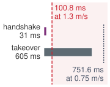
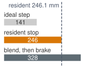
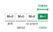
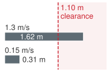

# Supervisory Intervention {#sec-intervention}

::: {layout-narrow}
::: {.column-margin}

\chapterminitoc

:::

::: {.content-visible when-format="pdf"}
\noindent
{fig-alt="Isometric vehicle steering blueprint with a perception mast, steering wheel, steer-by-wire rack, intervention relay, and tire contact patches. Arrows distinguish the operator request from the actuator path."}
:::

::: {.content-visible unless-format="pdf"}
{fig-alt="Isometric blueprint showing supervisory intervention on an autonomous vehicle steer-by-wire chassis: independent double-wishbone suspension, vehicle perception mast, steer-by-wire rack and pinion, human steering wheel override, glowing kinetic authority clutch, timestamped intervention relay, and tire contact friction ellipses."}
:::

:::

## Purpose {.unnumbered .unlisted}

::: {.content-visible when-format="pdf"}
\begin{marginfigure}
\resizebox{0.92\linewidth}{!}{\mlphysicalstackfull{20}{20}{20}{20}{20}}
\end{marginfigure}
:::

::: {.content-visible unless-format="pdf"}
::: {.column-margin}
{width="100%" fig-alt="Physical AI Systems Stack"}

*Physical AI stack focus for this chapter.*
:::
:::

_Why can handing a moving robot to a human operator cause the collision the handover was meant to prevent?_

Most deployed robots keep a person in reserve for the situations their learned policies cannot handle, and that reserve is usually treated as the final safeguard. A person, however, needs a large fraction of a second to respond even while watching closely and several seconds after only monitoring, and a machine moving at walking pace covers meters in that time, so a request for help can consume the very clearance the help was meant to protect. Taking over also creates hazards of its own. Two controllers that each believe they hold a joint can command it at once, a controller that believes the other still holds it can leave it unattended, and an abrupt switch between their commands jolts the drivetrain and the load it carries. A takeover that grants unchecked control lets a startled or lagging operator drive the machine into a rack, and a log that does not mark who commanded each instant can neither settle what caused an incident nor keep the machine's own near-failures out of the demonstrations it later learns from. Authority can change hands within a single control cycle, but the momentum already delivered across the causal boundary cannot be recalled, so a takeover must be engineered as a control action with its own deadline, its own limits, and its own record.



::: {.callout-learning-objectives}

- Specify operator permissions through capability matrices that bind each authenticated role's operations to physical channels, preemption tiers, and clearance-derived deadlines
- Select a state-dependent local fallback that remains physically feasible while human intervention is pending
- Calculate the latest fallback time and takeover speed ceilings from human reaction latency and remaining physical stopping clearance
- Evaluate the inherited chunk lease and the chosen manual lease against their modes' stopping reserves and available fallback mechanisms
- Design authority handshakes that keep one owner on each actuator output and size fixed-endpoint $\Glyph{C}^2$ command blends within each channel's rate limit
- Diagnose mode confusion in split-channel handovers and specify the per-channel annunciation that keeps an operator's model of ownership current
- Evaluate whether an authority record provides the cryptographic and kinematic evidence needed to reconstruct post-incident fault causality

:::

## Shared Authority {#sec-intervention-shared-authority}

Part III left the running machine with a stopping budget whose every term belongs to the machine. Each term has a declared bound and a loaded test that could refute it, even where the test has not yet run, as for the dispatch-to-admission interval $\DispatchAdmissionInterval$ that @sec-placement-dispatch-admission allocated but did not measure. Part IV begins with a delay that no test on the chassis can bound, because it belongs to a person.

Supervisory intervention transfers the right to propose actions from an autonomous policy to a human operator, and eventually returns that authority to the machine. Nearly every embodied machine learning system operating in the physical world relies on this exchange. Remote teleoperation assistants clear blocked aisles and resolve perceptual ambiguities that warehouse robots and autonomous vehicles cannot resolve independently. Similarly, safety drivers and teach-pendant operators step in whenever an operational policy drifts outside its design envelope, delivering corrections that protect the hardware and supply demonstration data for later retraining. Engineering block diagrams often reduce this supervision to a single switch or an external arrow pointing into the plant. In the physical world, however, kinetic energy does not pause while a multiplexer toggles inputs. Authority transfer is a control maneuver with its own deadlines, and it must be executed in coordination with the slowest and least predictable element in the loop, the human operator.

How often that exchange happens on a mature fleet is a matter of public record in one jurisdiction. California requires every company testing autonomous vehicles on its public roads to file annual reports of autonomous miles and of the disengagements, transfers of control to a person, that occurred during them [@cadmv2026disengagement]. @Fig-14-disengagement-record plots the filings of one long-running fleet.

```{python}
#| label: calc-intervention-disengagement-record
#| echo: false
# ┌─────────────────────────────────────────────────────────────────────────────
# │ A DECADE OF REPORTED DISENGAGEMENTS (LEGO)
# ├─────────────────────────────────────────────────────────────────────────────
# │ Context: @fig-14-disengagement-record and the paragraph after it.
# │ Goal: Show that human takeover remains a recurring event on a mature fleet,
# │       and that its reported rate is not a monotone capability curve.
# │ Show: Miles per disengagement in the first and latest report years; the
# │       2020-to-2021 swing; the latest driverless-testing rate.
# │ How:  Literature.CaliforniaDisengagements, one company's annual rows.
# └─────────────────────────────────────────────────────────────────────────────
from mlsysim import Literature
from mlsysim.fmt import check, fmt_int, fmt_multiple

def _rate(rows, year, permit):
    return next(r for r in rows if r["report_year"] == year and r["permit_type"] == permit)

class DisengagementRecord:
    # ┌── 1. LOAD (Constants) ──────────────────────────────────────────────
    rows = tuple(
        filter(lambda r: r["company"] == "Waymo" and r["filer_type"] in ("annual", "first_report"), Literature.CaliforniaDisengagements.entries)
    )
    driver, driverless = "drivered_AVT", "driverless_AVDT"

    # ┌── 2. EXECUTE (The Compute) ────────────────────────────────────────
    first, latest = _rate(rows, 2015, driver), _rate(rows, 2025, driver)
    y2020, y2021 = _rate(rows, 2020, driver), _rate(rows, 2021, driver)
    dl = _rate(rows, 2025, driverless)
    drop = y2020["miles_per_disengagement"] / y2021["miles_per_disengagement"]
    miles_growth = y2021["autonomous_miles"] / y2020["autonomous_miles"]

    # ┌── 3. GUARD (Invariants) ──────────────────────────────────────────
    check(drop > 3 and miles_growth > 3, "Prose: the rate fell over threefold while miles grew over threefold")
    check(dl["miles_per_disengagement"] > latest["miles_per_disengagement"], "Prose: driverless testing logs fewer disengagements per mile")

    # ┌── 4. OUTPUT (Formatting) ──────────────────────────────────────────
    first_str = fmt_int(round(first["miles_per_disengagement"], -2))
    latest_str = fmt_int(round(latest["miles_per_disengagement"], -2))
    latest_n_str = fmt_int(latest["disengagements"])
    drop_mult_str = fmt_multiple(round(drop, 1), precision=1)
    growth_mult_str = fmt_multiple(round(miles_growth, 1), precision=1)
    dl_str = fmt_int(round(dl["miles_per_disengagement"], -2))
    dl_n_str = fmt_int(dl["disengagements"])
```

:::: {#fig-14-disengagement-record fig-env="figure" fig-pos="htb" fig-cap="**A decade of reported takeovers**: One company's annual filings to the California DMV. (a) Autonomous miles driven on public roads under the safety-driver testing permit and the driverless testing permit. (b) Miles per reported disengagement under each permit, on a logarithmic axis. Each company defines which disengagements are reportable, and the regulator notes that the reports are not designed for comparison across companies; commercial deployment miles are excluded. Early years are transcribed from the filed PDFs. Data from @cadmv2026disengagement." fig-alt="Two panels with report years 2015 to 2025. Panel a is a stacked bar chart of autonomous miles in millions, safety-driver testing in blue and driverless testing in green, rising from under half a million miles to over 7 million in 2025. Panel b plots miles per disengagement on a logarithmic axis: a blue line for safety-driver testing rises from about 1,000 in 2015 to about 30,000 in 2020, falls to about 8,000 in 2021, and ends near 19,000 in 2025; a green line with square markers for driverless testing runs from 2023 to 2025, the last point near 72,000."}

```{python}
#| echo: false
# ┌─────────────────────────────────────────────────────────────────────────────
# │ A DECADE OF REPORTED DISENGAGEMENTS (FIGURE)
# ├─────────────────────────────────────────────────────────────────────────────
# │ Context: @fig-14-disengagement-record
# │
# │ Goal: Show testing exposure and reported takeover rate over a decade.
# │ Show: (a) miles by permit type; (b) miles per disengagement by permit.
# │ How: Literature.CaliforniaDisengagements (MLSysIM); book_style.set_book_style().
# └─────────────────────────────────────────────────────────────────────────────
from mlsysim import Literature
from binder.tools.figures import style as book_style

book_style.set_book_style()
plt = book_style.plt
COLORS = book_style.COLORS
rows = [r for r in Literature.CaliforniaDisengagements.entries if r["company"] == "Waymo" and r["filer_type"] in ("annual", "first_report")]
years = sorted({int(r["report_year"]) for r in rows})
get = lambda y, p: next((r for r in rows if int(r["report_year"]) == y and r["permit_type"] == p), None)
fig, (a1, a2) = plt.subplots(1, 2, figsize=(10, 3.7))
drv = [(get(y, "drivered_AVT") or {}).get("autonomous_miles") or 0 for y in years]
dls = [(get(y, "driverless_AVDT") or {}).get("autonomous_miles") or 0 for y in years]
a1.bar(years, [v / 1e6 for v in drv], color=COLORS["BlueLine"], label="Safety-driver testing")
a1.bar(years, [v / 1e6 for v in dls], bottom=[v / 1e6 for v in drv], color=COLORS["GreenLine"], label="Driverless testing")
a1.set_ylabel("Autonomous miles (millions)")
a1.set_title("(a) Miles reported per year", loc="left", fontsize=10.5)
a1.legend(frameon=False, fontsize=8.5, loc="upper left")
a1.grid(axis="x", visible=False)
for permit, col, mk, lab in (
    ("drivered_AVT", COLORS["BlueLine"], "o", "Safety-driver testing"),
    ("driverless_AVDT", COLORS["GreenLine"], "s", "Driverless testing"),
):
    pts = [(y, get(y, permit)["miles_per_disengagement"]) for y in years if get(y, permit) and get(y, permit)["miles_per_disengagement"]]
    a2.plot([p[0] for p in pts], [p[1] for p in pts], "-" if permit == "drivered_AVT" else "", marker=mk, color=col, lw=1.8, ms=5, label=lab)
a2.set_yscale("log")
a2.set_ylim(500, 2e5)
a2.set_yticks([1000, 10000, 100000])
a2.set_yticklabels(["1,000", "10,000", "100,000"])
a2.set_ylabel("Miles per reported disengagement")
a2.set_title("(b) Reported takeover rate", loc="left", fontsize=10.5)
a2.legend(frameon=False, fontsize=8.5, loc="upper left")
for ax in (a1, a2):
    ax.set_xticks(years[::2])
    ax.set_xlabel("Report year")
fig.tight_layout()
plt.show()
plt.close()
```

::::

Over the decade the safety-driver rate rose from about `{python} DisengagementRecord.first_str` to about `{python} DisengagementRecord.latest_str` miles per disengagement, yet the fleet still reported `{python} DisengagementRecord.latest_n_str` takeovers in its latest year, and the series is far from monotone. Between 2020 and 2021 the rate fell `{python} DisengagementRecord.drop_mult_str` while the miles driven grew `{python} DisengagementRecord.growth_mult_str`. Driverless testing reports one disengagement every `{python} DisengagementRecord.dl_str` miles, `{python} DisengagementRecord.dl_n_str` in its latest year. Two consequences follow for the machine. Human authority is not a phase a capable system grows out of; even the most experienced fleet exercises it every year, so the transfer mechanism is a permanent part of the design. The reported rate also depends on where the fleet drove and on what its operator chose to count, which is why an intervention count tells a reviewer how often the exchange happened but not, by itself, how well either party performed it.

::: {.column-margin .margin-pointer}
↪ The two permit series as two stages of permission to operate, and how a machine leaves one stage for the next, are developed in @sec-responsibility-staged-permission.
:::

The central engineering problem of supervisory intervention is how authority can transition cleanly on a moving machine without depleting stopping clearance, without allowing two controllers to simultaneously command the same actuator, and without obscuring the provenance of commands at any instant. The fourth law, permission must be earned (principle \ref{pri-vol4-evidence-bounds-authority}), frames the answer, and here Part IV applies it for the first time to a person. Much like an autonomous policy, a human operator receives control authority only when supported by valid evidence, and that authority expires the moment that evidence lapses. Until verified by the platform's permission path, every command proposed by an operator remains an untrusted request that cannot cross the causal boundary. Safely orchestrating this transition requires coordinating six distinct mechanisms: establishing which physical channels each actor may control, enforcing the latency budget the machine can tolerate while awaiting intervention, committing channel ownership without split-brain arbitration hazards, blending actuator references to prevent mechanical shock, authenticating operator identity, and preserving a verifiable record for post-incident reconstruction and policy retraining.

```{python}
#| label: calc-intervention-shared-authority-scene
#| echo: false
#| warning: false
#| message: false
# ┌─────────────────────────────────────────────────────────────────────────────
# │ OPENING SCENE: A TWO-SECOND PAUSE AT AISLE SPEED
# ├─────────────────────────────────────────────────────────────────────────────
# │ Context: @sec-intervention-shared-authority, first paragraph.
# │
# │ Goal:    Show that an out-of-loop pause outruns the rack-end clear distance.
# │ Show:    Aisle speed, design out-of-loop takeover delay, travel, clear distance.
# │ How:     WarehouseAisle scenario fields; the design takeover is the 90th
# │          percentile condition-mean take-over time plus transport
# │          (AISLE.t_takeover_out_of_loop); travel = v * T_takeover.
# └─────────────────────────────────────────────────────────────────────────────
from mlsysim import *
from mlsysim.core.units import meter, second, millisecond
from mlsysim.fmt import fmt_velocity, fmt_length, fmt_latency, fmt_frequency, check

RM = Embodied.MobileManipulator.WarehouseMobileManipulator
AISLE = Embodied.Scenario.WarehouseAisle

class InterventionSharedAuthorityScene:
    """Travel during an out-of-loop takeover pause at the aisle speed."""

    # ┌── 1. LOAD (Constants & Parameters) ─────────────────────────────────
    v = AISLE.v_aisle  # category: chosen
    t_pause = AISLE.t_takeover_out_of_loop  # category: derived (sourced p90 take-over time + transport)
    d_clear = AISLE.d_clear  # category: illustrative
    permission_rate = RM.permission_rate  # category: chosen
    tick = AISLE.t_tick  # category: chosen (from RM.permission_rate)

    # ┌── 2. EXECUTE (Compute) ─────────────────────────────────────────────
    travel = (v * t_pause).to(meter)
    travel_ratio = (travel / d_clear).to("").magnitude

    # ┌── 3. GUARD (Invariants) ───────────────────────────────────────────
    check(abs(travel.magnitude - 5.8045) < 5e-4, f"travel during the pause: {travel}")
    check(travel > 5 * d_clear, "The pause must carry the machine more than five times the clear distance.")
    check(abs((tick * permission_rate).to("").magnitude - 1.0) < 1e-9, "The permission tick is one period of the permission loop.")
    check(abs(tick.to(millisecond).magnitude - 1.0) < 1e-9, "Canon: 1 kHz permission loop, 1 ms tick.")

    # ┌── 4. OUTPUT (Formatting) ──────────────────────────────────────────
    v_str = fmt_velocity(v, unit=meter / second, precision=1)
    t_pause_str = fmt_latency(t_pause, unit=second, precision=1)
    travel_str = fmt_length(travel, unit=meter, precision=1)
    d_clear_str = fmt_length(d_clear, unit=meter, precision=2)
    chunk_lease_str = fmt_latency(AISLE.t_lease, unit=millisecond, precision=0)
    permission_rate_str = fmt_frequency(permission_rate, precision=0)
    tick_str = fmt_latency(tick, unit=millisecond, precision=0)
```

For a warehouse mobile manipulator, this timing constraint is direct and unforgiving. When a pallet blocks an aisle, the machine requests a remote assistant to take over. At its chosen `{python} InterventionSharedAuthorityScene.v_str` aisle speed, however, a `{python} InterventionSharedAuthorityScene.t_pause_str` pause before braking, the design out-of-loop takeover time that @sec-intervention-reaction-drift derives from driver take-over studies, carries the machine `{python} InterventionSharedAuthorityScene.travel_str`, more than five times its `{python} InterventionSharedAuthorityScene.d_clear_str` rack-end clear distance. An operator's intervention request reaches a chassis that is already in motion under an admitted command; human intent cannot erase physical momentum or force an actuator to respond instantaneously. The permission path must resolve this transition in two stages. The arbiter that selects among the fallback ladder's rungs also decides, for each channel, which source holds the right to propose: the learned policy, the operator, or, once that authority lapses, a fallback rung. The enforcer then admits or rejects each setpoint from the selected source against physical envelope invariants. Both stages run deterministically on a dedicated safety microcontroller (MCU). Source selection precedes the enforcer's check, and rung selection follows it whenever the check fails, so this chapter adds a new input to the arbiter, a person, rather than a new component. Throughout this process, the plant must preserve sufficient clearance to bring itself to a safe halt. An abrupt setpoint transition demands an instantaneous torque step that strains motor drives, gearboxes, and payload stability. Conversely, delaying the transfer exhausts available stopping margin, even when both the learned policy and the human supervisor produce reasonable trajectories in isolation.

::: {.column-margin .margin-pointer}
↪ Whether a human role that needs this much time can count as a safety measure at all, and who is blamed when it cannot, is developed in @sec-responsibility-meaningful-oversight.
:::

Because momentum and kinetic energy reside on the physical side of the causal boundary, the platform continues to evolve along its physical trajectory under the last admitted setpoint while the remote operator reconstructs the scene. This cognitive reconstruction is inherently slow, illustrating the fundamental paradox that Lisanne Bainbridge termed the *ironies of automation* [@bainbridge1983ironies]: designers automate routine operations to eliminate human error, yet inadvertently leave human operators responsible for the most complex, unmodeled edge cases that the automation cannot resolve, the scenarios with abnormal dynamics and the least time. Moreover, an operator relegated to passive monitoring rapidly loses both tactile dexterity and the internal forward model of plant dynamics required for precise real-time intervention. When an unexpected emergency forces a sudden takeover, the operator must act under severe time pressure with minimal contextual information. Human vigilance also degrades rapidly when monitoring rare anomalies, an effect compounded by automation complacency whenever secondary tasks compete for the supervisor's attention [@parasuraman2010complacency]. Decades of human factors research confirm these vulnerabilities. Passive monitoring degrades situation awareness[^fn-situation-awareness-levels] and induces substantial decision delays during abrupt automation failures [@endsley1995outofloop]. Consequently, the embodied system must actively preserve its own collision-free stopping envelope throughout the re-engagement window. Lowering network latency can shave milliseconds off packet transport, but it cannot eliminate the cognitive latency required for a human to perceive a hazard, deliberate, and physically displace a control input.

[^fn-situation-awareness-levels]: **Situation Awareness Levels**\index{Situation awareness!three levels}: @endsley1995toward set out situation awareness as three levels: perceiving the elements of a scene, comprehending what they mean together, and projecting their state forward. The levels fail separately. A remote assistant can see the pallet without projecting that the base will not stop short of it, which is why a console that reports where the operator is looking cannot shorten the response budget (@sec-intervention-failure-modes).

::: {.column-margin .margin-pointer}
↩ The causal boundary, across which admitted motion cannot be recalled, is established in @sec-boundary-causal-boundary.
:::

Every stage of an intervention sequence is governed by state-dependent fallbacks. Halting a moving mobile base safely may require controlled regenerative deceleration followed by mechanical brake engagement once stationary, whereas safeguarding an articulated manipulator arm holding a payload demands an active, gravity-compensated position hold. Each strategy relies on specific sensing channels and power-delivery pathways qualified for that mechanical response. Local damping, torque inhibition, and complete power supply isolation produce fundamentally different physical trajectories; an architecture cannot treat them as interchangeable steps along a generic escalation ladder. Instead, an active protective input must invoke the specific, independently validated fallback behavior designed for the machine's current dynamic state.

::: {.column-margin .margin-pointer}
↩ The fallback ladder, from which the arbiter selects a state-matched protective response on every tick, is established in @sec-enforcement-fallback-ladder.
:::

Autonomous and manual proposal rights operate under separate, explicit leases. The learned policy proposes trajectories under the action-chunk lease established in @sec-nervous-lease-sizing, while a teleoperation session receives a distinct, clearance-budgeted manual lease. Rejecting an invalid replacement command from an operator does not invalidate an active, previously admitted setpoint whose evidence, state bounds, and lease duration remain healthy. If either controller exhausts its lease duration or violates its underlying safety premises, the permission path immediately triggers the appropriate local fallback.

The permission path resolves split-brain command contention through an upstream source arbiter paired with **exclusive actuator-output ownership**. In the `{python} InterventionSharedAuthorityScene.permission_rate_str` control architecture analyzed here, the right to propose on a set of channels is a single object, the **proposal token**\index{Proposal token}, and the arbiter grants it to one source at a time. An authority commit revokes the learned policy's proposal token and latches its last approved setpoint; the admission enforcer remains the sole, non-bypassable writer to the physical actuators before, during, and after the transition. Standard bus protocols such as Controller Area Network (CAN) arbitration serialize message frames from multiple transmitters, but bus-level arbitration does not establish control-layer authority. If multiple nodes broadcast conflicting yet syntactically valid frames to the same motor drive, the actuator experiences high-frequency setpoint chatter or mechanical instability. Architectural output gating and deterministic source selection prevent this hazard at the firmware layer. Across continuous state spaces, the enforcer executes a bumpless transfer, a command handoff without reference step discontinuities (@sec-intervention-bumpless-transfer), interpolating between validated endpoints while enforcing command-rate limits and honoring measured physical plant capabilities.

Intervention events also directly shape the machine learning lifecycle. If a flight recorder or logging pipeline captures a rescued episode without marking the exact handover instant, imitation algorithms treat the near-failure states that triggered the rescue as if they were intentional expert demonstrations. As @sec-data-intervention-recovery establishes, the states visited by the learner immediately prior to takeover supply training data for recovery policies, but autonomous commands from a failing interval require review rather than automatic admission as expert targets. Downstream learning algorithms, from Dataset Aggregation (DAgger) [@ross2011reduction] to modern human-gated policy correction methods (@sec-intervention-recovery-eligibility), depend on knowing which controller held authority over each logged timestep. To resolve this attribution, the architecture keeps an authority record\index{Authority record} (the twelfth record in the platform's record chain, specified in @sec-intervention-authority-log), which retains the captured evidence preceding and following the takeover, with explicit gaps and timing bounds. Its per-tick entries timestamp every transition against the safety microcontroller's monotonic clock. An authority commit ends policy ownership, ensuring that autonomous exploration, the enforcer's transition blend, and verified human recovery remain distinct, auditable intervals.

Every shared-authority design begins by defining which named intervention may act upon which physical channel and establishing the maximum latency the machine can tolerate while awaiting human action. The protocol handshakes, setpoint blending algorithms, and evidentiary records that follow all rest upon this initial grant of authority.

## Human Authority, Reaction Time, and Clearance {#sec-intervention-human-authority}

An assistant guiding the arm can move the chassis if its credential also permits base-drive commands. A command admitted under that permission performs mechanical work on the plant before software can revoke it. Authority must therefore identify the physical channels a person may affect, rather than grant unrestricted access through a generic operator role.

The remote assistant who clears a blocked aisle and the coworker who takes an item from the gripper act on the same machine, and neither should hold the other's authority. Each grant therefore names an operation together with its timing budget, physical degrees of freedom, and preemption rule. The permission path keeps these grants in an explicit **capability matrix**\index{Capability matrix}, a permissions table mapping individual operations (such as an emergency power cutoff, a velocity trim adjustment, a trajectory path veto, or manual drive of the base and arm) to authenticated roles, reflecting classic taxonomies of human supervisory control[^fn-std-sheridan-supervisory] [@sheridan1992telerobotics] and multi-level automation [@parasuraman2000model]. Each entry in this matrix defines the exact actuator channels the operation governs, the preemption tier it carries over the learned policy, and the maximum propagation latency permitted from physical input to actuator response.

[^fn-std-sheridan-supervisory]: **Supervisory Control Levels**\index{Supervisory Control Levels}: @sheridan1978human formulated a ten-level taxonomy of supervisory control, running from a human who performs the whole task without computer assistance to a computer that decides and acts while ignoring the human.

Sheridan also describes the supervisor's work as five steps in sequence: plan the task off-line, teach the plan to the computer, monitor the automatic action, intervene when it fails or the goal changes, and learn from the episode [@sheridan2021supervisory]. This chapter engineers the fourth step and records the evidence the fifth needs. His taxonomy of levels, by contrast, assigns one level to a whole task. The mobile manipulator needs a level per channel and per instant. During a takeover the arm can sit near the manual end of the scale while the base still runs at the automatic end, and the enforcer holds the automatic end on every channel throughout, because it admits the operator's commands exactly as it admits the policy's. That split is where supervisory control becomes a systems problem. Levels that differ across channels are what a supervisor can lose track of, the mode confusion of @sec-intervention-failure-modes, so every level change must be committed and announced per channel. A channel left out of a transfer keeps its autonomous owner only while the console announces that it does; otherwise it holds, the rule @sec-intervention-failure-modes derives from a collision.

Naming the operations separates intervention from **safety enforcement**\index{Safety enforcement}, two mechanisms that system architectures routinely conflate. Enforcement withholds permission from a candidate action proposed by a learned model, modifying, clamping, or projecting the setpoint while leaving the machine under autonomous control. Intervention transfers authority away from the model to an external entity, terminating autonomous operation and giving the supervisor the right to propose, while every command still passes the permission path. An **enforcement filter**\index{Enforcement filter} sits in the fast inner control loop (`{python} InterventionSharedAuthorityScene.permission_rate_str` / $\le$ `{python} InterventionSharedAuthorityScene.tick_str`) to prevent the policy from demanding an over-current maneuver or violating a barrier certificate [@ames2019control] during nominal tracking. An intervention mechanism strips the policy of its proposal token when an operational boundary is breached or an operator demands control. A system equipped with enforcement but lacking intervention cannot be redirected when human intent changes or external conditions fall outside the policy design envelope, leading to conservative deadlock when barrier constraints collapse the feasible control set. Conversely, a system equipped with intervention but lacking enforcement permits a lagging operator to drive the plant into structural failure during nominal manual operation. @Tbl-14-enforcement-vs-intervention sets the two mechanisms side by side, from trigger and authority holder to typical failure.

::: {.column-margin .margin-pointer}
↩ The actuator current and thermal limits an enforcement filter must respect are established in @sec-body-five-budgets.
:::

| Dimension            | Enforcement filter                                                                                                                                     | Intervention state machine                                                                 |
|:---------------------|:-------------------------------------------------------------------------------------------------------------------------------------------------------|:-------------------------------------------------------------------------------------------|
| Primary trigger      | Invariant boundary approach ($\BarrierFunctionRate + \LinearBarrierDecayRate \BarrierFunction < 0$) or torque limit                                    | Human takeover assertion, monotonic lease timeout, or operational design domain (ODD) exit |
| Authority holder     | Autonomous policy retains proposal rights; enforcer modifies setpoints                                                                                 | Authority transferred to external entity or fallback controller                            |
| Execution loop       | Fast inner control loop (`{python} InterventionSharedAuthorityScene.permission_rate_str` / $\le$ `{python} InterventionSharedAuthorityScene.tick_str`) | Same permission tick; protocol exchange spans multiple ticks                               |
| Safety lease role    | Enforces continuous barrier satisfaction on admitted commands                                                                                          | Lease expiry invokes the state-dependent validated fallback                                |
| Typical failure mode | Feasible set collapse; conservative deadlock or oscillation                                                                                            | Opposing commands cancel, mode confusion, or late human reaction                           |

: **Architectural boundaries of safety enforcement and supervisory intervention**: Enforcement operates in-loop as an active constraint on proposed actions; intervention transitions authority between discrete proposers. {#tbl-14-enforcement-vs-intervention tbl-colwidths="[20,40,40]"}

::: {#dfn-intervention-supervisory-intervention .callout-definition title="Supervisory intervention"}

***Supervisory intervention***\index{Intervention!definition}\index{Supervisory intervention!definition} is the transfer of the right to propose commands on named actuator channels between a learned policy and an authenticated person, committed on a control tick and bounded by a lease, while every command continues to pass the same permission check.

1.  **Significance**: The transfer is a delay on a moving machine, so it is priced in the stopping budget $\StoppingDistance \le \ClearDistance$ rather than in the user interface, and the waiting before braking, not the braking itself, decides whether the machine stops in time.
2.  **Distinction**: Enforcement changes a proposal and leaves the proposer in place; intervention changes the proposer and leaves the check in place. A machine needs both, because neither can do the other's job.
3.  **Common pitfall**: A frequent misconception is that a takeover hands the operator the actuators. The operator gains only the right to propose, and the machine still needs a local stop that does not wait for the operator to act.

:::

### Capability matrices and the intervention-enforcement split {#sec-intervention-capability-split}

On the warehouse mobile manipulator, the capability matrix lets the remote assistant redirect motion and denies that right to the coworker accepting an item.

```{python}
#| label: calc-intervention-coworker-handover
#| echo: false
#| warning: false
#| message: false
# ┌─────────────────────────────────────────────────────────────────────────────
# │ COWORKER HANDOVER SPEED UNDER accept_item
# ├─────────────────────────────────────────────────────────────────────────────
# │ Context: @sec-intervention-human-authority, the capability example
# │          (veto_path and manual_drive for the remote assistant, accept_item
# │          for the coworker).
# │
# │ Goal:    Recall the handover cap that the enforcement record's handover
# │          entry holds (@sec-enforcement-telemetry owns it) and the contact
# │          ceilings derived in @sec-enforcement-intentional-contact
# │          (@eq-release-unbraked-force); no derivation here.
# │ Show:    Chosen TCP handover speed; the free-hand and clamped-hand ceilings.
# │ How:     calc_transient_contact_speed_limit with the ISO/TS 15066 Annex A hand
# │          body model (AISLE.k_contact_human, AISLE.m_contact_human) and the
# │          machine's effective mass, the same MLSysIM call the enforcement
# │          chapter's calc-enforcement-contact-force makes.
# └─────────────────────────────────────────────────────────────────────────────
from mlsysim import *
from mlsysim.core.units import meter, second, kilogram, newton, millimeter
from mlsysim.physics.robotics import calc_transient_contact_speed_limit
from mlsysim.fmt import fmt_velocity, fmt_force, check

RM = Embodied.MobileManipulator.WarehouseMobileManipulator
AISLE = Embodied.Scenario.WarehouseAisle

class InterventionCoworkerHandover:
    """Arm approach speed for the coworker's accept_item handover."""

    # ┌── 1. LOAD (Constants & Parameters) ─────────────────────────────────
    v_handover = AISLE.v_handover  # category: chosen
    k_hand = AISLE.k_contact_human  # category: datasheet (ISO/TS 15066 hand body model)
    m_hand = AISLE.m_contact_human  # category: datasheet (ISO/TS 15066 hand body model)
    f_criterion = AISLE.f_contact_criterion  # category: chosen
    m_eff = RM.arm_effective_contact_mass  # category: derived

    # ┌── 2. EXECUTE (Compute) ─────────────────────────────────────────────
    v_ceiling = calc_transient_contact_speed_limit(f_criterion, m_eff, k_hand, human_mass=m_hand).to(meter / second)
    v_ceiling_clamped = calc_transient_contact_speed_limit(f_criterion, m_eff, k_hand).to(meter / second)

    # ┌── 3. GUARD (Invariants) ───────────────────────────────────────────
    check(abs(v_ceiling.magnitude - 0.2415) < 5e-5, f"free-hand handover speed ceiling: {v_ceiling}")
    check(abs(v_ceiling_clamped.magnitude - 0.0527) < 5e-5, f"clamped-hand handover speed ceiling: {v_ceiling_clamped}")
    check(abs(m_eff.to(kilogram).magnitude - 12.0) < 1e-9, f"arm effective contact mass: {m_eff}")
    check(v_handover < v_ceiling, "The chosen handover speed must sit under the free-hand ceiling.")
    check(v_handover > v_ceiling_clamped, "The chosen handover speed must exceed the clamped ceiling, so clamping must be excluded.")

    # ┌── 4. OUTPUT (Formatting) ──────────────────────────────────────────
    v_handover_str = fmt_velocity(v_handover, unit=meter / second, precision=2)
    v_ceiling_str = fmt_velocity(v_ceiling, unit=meter / second, precision=2)
    v_ceiling_clamped_str = fmt_velocity(v_ceiling_clamped, unit=meter / second, precision=3)
    force_str = fmt_force(f_criterion)
```

For example, the remote assistant who supervises the mobile manipulator may hold a signed **trajectory veto** capability for the base's planner channel: role `remote_assistant`, operation `veto_path`, channel `planner_proposal`, preemption tier above the learned planner but below the local enforcer, authenticated session and nonce, and a clearance-derived acknowledgment deadline. The enforcer responds to a valid veto with a checked local hold or stop. The same session carries a second entry, `manual_drive`, on the base-velocity and arm-joint channels, which becomes active only through a handover that commits within the clearance-derived deadline, and lapses with the manual lease of @sec-intervention-authority-transitions; every command it carries still passes the permission check. A wheel drive-torque packet from that credential is denied, because neither entry grants the base's wheel drive-torque channel.

The coworker at the packing station holds a different entry, `accept_item`, which lets the coworker take from the gripper the mug the arm picked from the takeaway conveyor. That entry grants no motion authority. The item-handover channel of the enforcement record caps the arm's approach to the coworker's hand at `{python} InterventionCoworkerHandover.v_handover_str`, and no capability lifts that cap. The handover is a collaborative application in the sense of ISO 10218-2:2025 [@iso10218part2], and the body model of the hand that bounds it, with the contact force that model predicts, is set out once in @sec-enforcement-intentional-contact. ISO 10218-2 leaves out the hazards of mounting the arm on a mobile platform, which ANSI/A3 R15.08-2 addresses for the running machine [@ansi1508part2].

The ceiling behind that cap comes from the contact-force model (@eq-release-unbraked-force). For a free hand, which recoils, the selected `{python} InterventionCoworkerHandover.force_str` criterion admits up to `{python} InterventionCoworkerHandover.v_ceiling_str`, and the cap sits under that ceiling. A hand clamped against a rack upright or the arm itself cannot recoil, and the same criterion then admits only `{python} InterventionCoworkerHandover.v_ceiling_clamped_str`, below the cap. The cap therefore holds only if the handover geometry excludes clamping, a premise the release case must evidence. The ceiling is conditional on these inputs and does not by itself establish a pressure or injury limit for a particular contact geometry; the site's risk assessment qualifies the effective mass, the force criterion, and the contact geometry before the cap is qualified.

::: {.column-margin .margin-pointer}
↪ The release criterion that holds the handover's contact force under its assessed limit is developed in @sec-release-question.
:::

Each capability entry binds actor, operation, channel, deadline, authentication, preemption tier, and fallback; a valid signature alone grants no motion authority. Physical clearance sets the tolerable deadline; the operator's response time determines whether a human can meet it.

### Physiological reaction floors and kinematic drift {#sec-intervention-reaction-drift}

The remote assistant must notice the blocked aisle, decide how to recover, move the controls, and deliver a checked request. Summed in sequence, the total supervisory takeover latency $\SupervisoryTakeoverLatency$ is:
$$\SupervisoryTakeoverLatency = \OperatorSensoryTime + \OperatorCognitiveTime + \OperatorMotorTime + \ConsoleCommunicationTime$$ {#eq-intervention-reaction-floor}
The first three terms belong to the person and depend on engagement and expectation; the last belongs to the console and the link. Human response times are distributions with long right tails, so a stopping budget needs a value that nearly every request meets, not the typical one. The calculation below compares a continuously engaged operator with an out-of-loop assistant. Its communication term includes transport and the protocol exchange, so that exchange must not be charged again.

Waiting consumes distance before the selected stop begins. The finished stopping budget from @sec-enforcement-composite-budget supplies the machine delay, resident stop, and fixed allowances. Adding the human waiting interval exposes whether remote rescue can fit at the current speed; it does not authorize waiting when the local stop is already required.

```{python}
#| label: calc-intervention-admission-allocation
#| echo: false
#| warning: false
#| message: false
# ┌─────────────────────────────────────────────────────────────────────────────
# │ THE DISPATCH-TO-ADMISSION ALLOCATION CHARGED AGAINST THE TAKEOVER BUDGETS
# ├─────────────────────────────────────────────────────────────────────────────
# │ Context: @sec-intervention-reaction-drift (the Delta_da paragraph),
# │          @sec-intervention-clearance-deadlines (the in-loop redesign),
# │          @sec-intervention-session-admission, @sec-intervention-authenticating-intervention,
# │          the verifier-flooding pitfall, and the summary.
# │
# │ Goal:    Charge the allocated Delta_da of @sec-placement-dispatch-admission to the chapter's
# │          partial budgets and show which verdicts change.
# │ Show:    Delta_da and its aisle-speed ceiling; the waiting it leaves at the
# │          aisle speed; the retired 0.8 m/s slow-down's remainder before and
# │          after the charge (it missed by 5.0 ms); the Delta_da-charged in-loop
# │          ceiling (0.797 m/s) and the derived slow-down under it (0.75 m/s)
# │          with its remainder; the out-of-loop ceiling with Delta_da added;
# │          the travel Delta_da costs at the slow-down.
# │ How:     Delta_da is AISLE.t_dispatch_to_admission (MLSysIM), the same value
# │          calc-placement-transport-budget imports (@sec-placement-dispatch-admission,
# │          nbk-placement-transport-budget). The slow-down is
# │          AISLE.v_takeover_in_loop: the charged ceiling rounded down to
# │          AISLE.v_takeover_resolution. Ceilings by
# │          calc_scurve_max_permitted_velocity with T_Sigma + Delta_da in
# │          tau_delay.
# └─────────────────────────────────────────────────────────────────────────────
from mlsysim import *
from mlsysim.core.units import ureg, meter, second, millimeter, millisecond
from mlsysim.physics.robotics import (
    calc_c2_stop_suffix,
    calc_scurve_stop_distance,
    calc_scurve_max_permitted_velocity,
)
from mlsysim.fmt import fmt_length, fmt_latency, fmt_velocity, check

RM = Embodied.MobileManipulator.WarehouseMobileManipulator
AISLE = Embodied.Scenario.WarehouseAisle

class InterventionAdmissionAllocation:
    """The allocated dispatch-to-admission interval charged to the takeover budgets."""

    # ┌── 1. LOAD (Constants & Parameters) ─────────────────────────────────
    v = AISLE.v_aisle  # category: chosen
    v_in = AISLE.v_takeover_in_loop  # category: derived (charged ceiling rounded down to the resolution)
    v_step = AISLE.v_takeover_resolution  # category: chosen
    v_in_old = 0.8 * meter / second  # category: chosen (the retired slow-down, shown to explain the change)
    v_ool = AISLE.v_takeover_out_of_loop  # category: chosen
    d_clear = AISLE.d_clear  # category: illustrative
    tau_delay = AISLE.tau_delay  # category: derived
    a_brake = AISLE.a_brake  # category: illustrative
    j_brake = calc_c2_stop_suffix(RM.base.max_velocity, AISLE.a_brake)["peak_jerk"]  # category: derived (stipulated jerk bound)
    overhead = AISLE.fixed_overhead  # category: illustrative / chosen
    t_in = AISLE.t_takeover_in_loop  # category: derived (sourced human + transport)
    t_ool = AISLE.t_takeover_out_of_loop  # category: derived (sourced human + transport)
    # The @sec-placement-dispatch-admission allocation (calc-placement-transport-budget), from MLSysIM
    delta_da = AISLE.t_dispatch_to_admission  # category: illustrative (allocation, not a measurement)

    # ┌── 2. EXECUTE (Compute) ─────────────────────────────────────────────

    def _t_latest(speed, *, _d=d_clear, _tau=tau_delay, _a=a_brake, _j=j_brake, _o=overhead):
        budget = speed * _tau + calc_scurve_stop_distance(speed, _a, _j) + _o
        return ((_d - budget) / speed).to(millisecond)

    def _ceiling(t, *, _d=d_clear, _tau=tau_delay, _a=a_brake, _j=j_brake):
        return calc_scurve_max_permitted_velocity(_d, _tau + t, _a, _j, AISLE.delta_loc + AISLE.eps_track, AISLE.delta_margin).to(meter / second)

    t_ceiling = _t_latest(v)  # the most Delta_da the aisle-speed spare can pay for
    left_aisle = (t_ceiling - delta_da).to(millisecond)
    left_old = (_t_latest(v_in_old) - t_in).to(millisecond)
    short_old = (delta_da - left_old).to(millisecond)
    left_in = (_t_latest(v_in) - t_in).to(millisecond)
    left_in_da = (left_in - delta_da).to(millisecond)
    travel_da_in = (v_in * delta_da).to(millimeter)
    ceil_in_da = _ceiling(t_in + delta_da)
    ceil_ool_da = _ceiling(t_ool + delta_da)

    # ┌── 3. GUARD (Invariants) ───────────────────────────────────────────
    check(abs(delta_da.to(millisecond).magnitude - 63.31072) < 1e-6, f"allocation must match @sec-placement: {delta_da}")
    check(abs(t_ceiling.magnitude - 100.775) < 5e-3, f"aisle-speed ceiling on Delta_da: {t_ceiling}")
    check(abs(left_aisle.magnitude - 37.464) < 5e-3, f"waiting left at the aisle speed: {left_aisle}")
    check(abs(left_old.magnitude - 58.275) < 5e-3, f"0.8 m/s in-loop remainder before the charge: {left_old}")
    check(abs(short_old.magnitude - 5.036) < 5e-3, f"the retired 0.8 m/s misses by 5.0 ms once charged: {short_old}")
    check(abs(ceil_in_da.magnitude - AISLE.v_takeover_in_loop_ceiling.magnitude) < 1e-9, "Charged ceiling matches the registry.")
    check(abs(ceil_in_da.magnitude - 0.797) < 5e-4, f"Delta_da-charged in-loop ceiling: {ceil_in_da}")
    check(v_in < ceil_in_da < v_in + v_step, "The slow-down is the charged ceiling rounded down to the resolution.")
    check(left_in_da.magnitude > 0, "Charged with Delta_da, the derived in-loop slow-down now meets its deadline.")
    check(v_ool < ceil_ool_da, "The crawl must survive the Delta_da charge.")

    # ┌── 4. OUTPUT (Formatting) ──────────────────────────────────────────
    delta_da_str = fmt_latency(delta_da, unit=millisecond, precision=1)
    t_ceiling_str = fmt_latency(t_ceiling, unit=millisecond, precision=1)
    left_aisle_str = fmt_latency(left_aisle, unit=millisecond, precision=1)
    left_old_str = fmt_latency(left_old, unit=millisecond, precision=1)
    short_old_str = fmt_latency(short_old, unit=millisecond, precision=1)
    left_in_str = fmt_latency(left_in, unit=millisecond, precision=1)
    left_in_da_str = fmt_latency(left_in_da, unit=millisecond, precision=1)
    travel_da_in_str = fmt_length(travel_da_in, unit=millimeter, precision=1)
    ceil_in_da_str = fmt_velocity(ceil_in_da, unit=meter / second, precision=3)
    ceil_ool_da_str = fmt_velocity(ceil_ool_da, unit=meter / second, precision=3)
    v_in_old_str = fmt_velocity(v_in_old, unit=meter / second, precision=1)
    v_step_str = fmt_velocity(v_step, unit=meter / second, precision=2)
    v_in_str = fmt_velocity(v_in, unit=meter / second, precision=2)
    v_ool_str = fmt_velocity(v_ool, unit=meter / second, precision=2)
```

The budgets that follow are illustrative design comparisons, not measured takeover performance. They also leave out one interval. The dispatch-to-admission interval $\DispatchAdmissionInterval$, which @sec-placement-dispatch-admission allocated but has not yet measured, is one more delay before braking. This chapter calls a budget without it the *partial budget*\index{Stopping budget!partial and complete} and a budget with it the *complete budget*, and charges it once in @sec-intervention-clearance-deadlines, after deriving the deadline it shortens.

```{python}
#| label: calc-intervention-operator-takeover-budget
#| echo: false
#| warning: false
#| message: false
# ┌─────────────────────────────────────────────────────────────────────────────
# │ OPERATOR TAKEOVER AGAINST THE MACHINE'S STOPPING BUDGET
# ├─────────────────────────────────────────────────────────────────────────────
# │ Context: @sec-intervention-human-authority, the two takeover modes that
# │          follow @eq-intervention-reaction-floor, and the notebook
# │          "Takeover budget and clearance margin".
# │
# │ Goal:    Price an operator's sourced takeover delay on the warehouse mobile
# │          manipulator at its aisle speed.
# │ Show:    Spare margin at 1.3 m/s; the in-loop decomposition (Model Human
# │          Processor at the slow end of each cycle, video glass-to-glass
# │          latency, four-phase exchange); the out-of-loop design value
# │          (90th-percentile condition-mean take-over time plus the same
# │          transport); travel during each; the stop with each delay added;
# │          the speed ceilings.
# │ How:     Finished stopping budget from the WarehouseAisle scenario
# │          (jerk-limited resident stop, all overheads); the jerk bound is the
# │          peak jerk of the reference C2 polynomial at the drive limit
# │          (@sec-planning-c2-stopping-suffix); T_Sigma adds to tau_delay;
# │          ceilings by calc_scurve_max_permitted_velocity.
# └─────────────────────────────────────────────────────────────────────────────
from mlsysim import *
from mlsysim.core.units import meter, second, millimeter, millisecond
from mlsysim.physics.robotics import (
    calc_c2_stop_suffix,
    calc_scurve_stop_distance,
    calc_scurve_max_permitted_velocity,
)
from mlsysim.fmt import (
    fmt_velocity,
    fmt_length,
    fmt_latency,
    fmt_magnitude,
    fmt_multiple,
    fmt_display_math,
    fmt_acceleration,
    fmt_jerk,
    check,
)

RM = Embodied.MobileManipulator.WarehouseMobileManipulator
AISLE = Embodied.Scenario.WarehouseAisle

class InterventionTakeoverBudget:
    """Operator takeover delay spent against the finished stopping budget."""

    # ┌── 1. LOAD (Constants & Parameters) ─────────────────────────────────
    v = AISLE.v_aisle  # category: chosen
    d_clear = AISLE.d_clear  # category: illustrative
    tau_delay = AISLE.tau_delay  # category: derived
    a_brake = AISLE.a_brake  # category: illustrative
    j_brake = calc_c2_stop_suffix(RM.base.max_velocity, AISLE.a_brake)["peak_jerk"]  # category: derived (stipulated jerk bound)
    near_overhead = AISLE.delta_loc + AISLE.eps_track  # category: illustrative
    margin = AISLE.delta_margin  # category: chosen
    overhead = AISLE.fixed_overhead  # category: illustrative / chosen
    t_sensory = AISLE.t_human_perceptual_slow  # category: sourced (Card, Moran, Newell 1983)
    t_cognitive = AISLE.t_human_cognitive_slow  # category: sourced
    t_motor = AISLE.t_human_motor_slow  # category: sourced
    t_video = AISLE.t_video_glass_to_glass  # category: sourced (wired best case)
    t_handshake = AISLE.t_handshake  # category: chosen (four-phase budgets)
    t_expected = AISLE.t_brake_response_expected  # category: sourced (Green 2000)
    t_surprise = AISLE.t_brake_response_surprise  # category: sourced (Green 2000)
    t_tot_mean = AISLE.t_takeover_driving_mean  # category: sourced (Zhang et al. 2019)
    t_tot_p90 = AISLE.t_takeover_driving_p90  # category: sourced (computed from its data)
    t_in = AISLE.t_takeover_in_loop  # category: derived
    t_ool = AISLE.t_takeover_out_of_loop  # category: derived
    # Source: UN Regulation No. 157 (ALKS), para. 5.4.4.1: a minimum risk
    # manoeuvre starts at the earliest 10 s after the transition demand.
    # Promotion candidate: literature registry.
    t_r157 = 10 * second  # category: sourced

    # ┌── 2. EXECUTE (Compute) ─────────────────────────────────────────────
    reaction = (v * tau_delay).to(millimeter)
    r157_over_ool = (t_r157 / t_ool).to("").magnitude
    travel_r157 = (v * t_r157).to(meter)
    stop = calc_scurve_stop_distance(v, a_brake, j_brake).to(millimeter)
    budget = (reaction + stop + overhead).to(millimeter)
    spare = (d_clear - budget).to(millimeter)
    t_comm = (t_video + t_handshake).to(millisecond)
    t_sum = (t_sensory + t_cognitive + t_motor + t_comm).to(millisecond)
    travel_in = (v * t_in).to(millimeter)
    travel_ool = (v * t_ool).to(millimeter)
    d_stop_in = (budget + travel_in).to(millimeter)
    d_stop_ool = (budget + travel_ool).to(millimeter)
    stop_ratio = (d_stop_ool / d_stop_in).to("").magnitude
    # Napkin-math box "The takeover tax": the overruns and the waiting-to-spare ratio.
    overrun_in = (d_stop_in - d_clear).to(millimeter)
    overrun_ool = (d_stop_ool - d_clear).to(millimeter)
    travel_over_spare = (travel_in / spare).to("").magnitude

    def _ceiling(t, *, _d=d_clear, _tau=tau_delay, _a=a_brake, _j=j_brake, _n=near_overhead, _m=margin):
        return calc_scurve_max_permitted_velocity(_d, _tau + t, _a, _j, _n, _m).to(meter / second)

    ceil_in = _ceiling(t_in)
    ceil_ool = _ceiling(t_ool)

    # ┌── 3. GUARD (Invariants) ───────────────────────────────────────────
    check(abs(spare.magnitude - 131.01) < 5e-3, f"spare margin at the aisle speed: {spare}")
    check(abs(t_sum.magnitude - t_in.to(millisecond).magnitude) < 1e-9, "The four stages must sum to the in-loop takeover.")
    check(abs((t_tot_p90 + t_comm - t_ool).to(millisecond).magnitude) < 1e-9, "The out-of-loop takeover is the p90 time plus transport.")
    check(travel_in > 5 * spare, "The in-loop takeover must overrun the spare margin several times at the aisle speed.")
    check(travel_ool > 5 * d_clear, "The out-of-loop travel must exceed five times the clear distance.")
    check(abs(d_stop_in.magnitude - 1755.49) < 5e-3, f"stop with in-loop takeover: {d_stop_in}")
    check(abs(d_stop_ool.magnitude - 6773.49) < 5e-3, f"stop with out-of-loop takeover: {d_stop_ool}")
    check(abs(ceil_in.magnitude - 0.8362) < 5e-5, f"in-loop takeover ceiling: {ceil_in}")
    check(abs(ceil_ool.magnitude - 0.1911) < 5e-5, f"out-of-loop takeover ceiling: {ceil_ool}")
    check(abs(stop_ratio - 3.86) < 0.01, f"out-of-loop to in-loop stop ratio: {stop_ratio}")
    check(abs(r157_over_ool - 2.24) < 0.01, f"R157 transition over the design takeover: {r157_over_ool}")
    check(abs(travel_r157.magnitude - 13.0) < 1e-9, f"travel at aisle speed during the R157 transition: {travel_r157}")
    check(abs(budget.magnitude - 968.99) < 5e-3, f"machine-alone stop at the aisle speed: {budget}")
    check(abs(overrun_in.magnitude - 655.49) < 5e-3, f"in-loop overrun: {overrun_in}")
    check(abs(travel_over_spare - 6.0) < 0.05, f"in-loop travel over the spare: {travel_over_spare}")

    # ┌── 4. OUTPUT (Formatting) ──────────────────────────────────────────
    v_str = fmt_velocity(v, unit=meter / second, precision=1)
    d_clear_str = fmt_length(d_clear, unit=meter, precision=2)
    spare_str = fmt_length(spare, unit=millimeter, precision=1)
    t_in_str = fmt_latency(t_in, unit=millisecond, precision=0)
    t_ool_str = fmt_latency(t_ool, unit=second, precision=1)
    t_sensory_str = fmt_latency(t_sensory, unit=millisecond, precision=0)
    t_cognitive_str = fmt_latency(t_cognitive, unit=millisecond, precision=0)
    t_motor_str = fmt_latency(t_motor, unit=millisecond, precision=0)
    t_video_str = fmt_latency(t_video, unit=millisecond, precision=0)
    t_handshake_str = fmt_latency(t_handshake, unit=millisecond, precision=0)
    t_comm_str = fmt_latency(t_comm, unit=millisecond, precision=0)
    t_expected_str = fmt_latency(t_expected, unit=second, precision=2)
    t_surprise_str = fmt_latency(t_surprise, unit=second, precision=1)
    t_tot_mean_str = fmt_latency(t_tot_mean, unit=second, precision=2)
    t_tot_p90_str = fmt_latency(t_tot_p90, unit=second, precision=2)
    travel_in_str = fmt_length(travel_in, unit=millimeter, precision=1)
    travel_ool_str = fmt_length(travel_ool, unit=meter, precision=2)
    d_stop_in_str = fmt_length(d_stop_in, unit=meter, precision=2)
    d_stop_ool_str = fmt_length(d_stop_ool, unit=meter, precision=2)
    stop_mult_str = fmt_multiple(stop_ratio, precision=1)
    ceil_in_str = fmt_velocity(ceil_in, unit=meter / second, precision=2)
    ceil_ool_str = fmt_velocity(ceil_ool, unit=meter / second, precision=2)
    t_r157_str = fmt_latency(t_r157, unit=second, precision=0)
    r157_mult_str = fmt_multiple(r157_over_ool, precision=1)
    travel_r157_str = fmt_length(travel_r157, unit=meter, precision=0)
    tau_delay_str = fmt_latency(tau_delay, unit=millisecond, precision=1)
    a_brake_str = fmt_acceleration(a_brake, unit=meter / second**2, precision=0)
    j_brake_str = fmt_jerk(j_brake, unit=meter / second**3, precision=2)
    overhead_str = fmt_length(overhead, unit=millimeter, precision=0)
    budget_str = fmt_length(budget, unit=millimeter, precision=1)
    overrun_in_str = fmt_length(overrun_in, unit=millimeter, precision=1)
    overrun_ool_str = fmt_length(overrun_ool, unit=meter, precision=2)
    travel_over_spare_mult_str = fmt_multiple(travel_over_spare, precision=1)

    reaction_value_str = fmt_magnitude(reaction, unit=millimeter, precision=2)
    stop_value_str = fmt_magnitude(stop, unit=millimeter, precision=2)
    overhead_value_str = fmt_magnitude(overhead, unit=millimeter, precision=0)
    travel_in_value_str = fmt_magnitude(travel_in, unit=millimeter, precision=1)
    travel_ool_value_str = fmt_magnitude(travel_ool, unit=millimeter, precision=1)
    d_stop_in_value_str = fmt_magnitude(d_stop_in, unit=millimeter, precision=2)
    d_stop_ool_value_str = fmt_magnitude(d_stop_ool, unit=millimeter, precision=2)

    haptic_display_math = fmt_display_math(
        rf"d_{{\text{{stop}},1}} = v\,\tau_{{\text{{delay}}}} + v\,T_{{\Sigma,1}} + d_{{\text{{suffix}}}}(v) + \delta = "
        rf"{reaction_value_str} + {travel_in_value_str} + {stop_value_str} + {overhead_value_str} = {d_stop_in_value_str}\text{{ mm}}"
    )
    ool_display_math = fmt_display_math(
        rf"d_{{\text{{stop}},2}} = v\,\tau_{{\text{{delay}}}} + v\,T_{{\Sigma,2}} + d_{{\text{{suffix}}}}(v) + \delta = "
        rf"{reaction_value_str} + {travel_ool_value_str} + {stop_value_str} + {overhead_value_str} = {d_stop_ool_value_str}\text{{ mm}}"
    )
    machine_display_math = fmt_display_math(
        rf"d_{{\text{{stop}},0}} = v\,\tau_{{\text{{delay}}}} + d_{{\text{{suffix}}}}(v) + \delta = "
        rf"{reaction_value_str} + {stop_value_str} + {overhead_value_str} = {fmt_magnitude(budget, unit=millimeter, precision=2)}\text{{ mm}}"
    )
```

The stopping subtotal of @tbl-enforcement-stopping-budget, before dispatch-to-admission travel is charged, shows what @eq-intervention-reaction-floor costs on the mobile manipulator. At the `{python} InterventionTakeoverBudget.v_str` aisle speed it leaves `{python} InterventionTakeoverBudget.spare_str` of the `{python} InterventionTakeoverBudget.d_clear_str` rack-end clear distance. A takeover delay adds to the machine's own pre-brake delay $\PrebrakeDelay$, and every millisecond of it becomes travel at the aisle speed:

1. **Mode 1: Continuous in-loop teleoperation**: An attending operator with hands on the controls of a synchronized leader arm or a real-time console, responding to the stimulus the task has led them to expect, makes a simple reaction. The Model Human Processor[^fn-model-human-processor] [@card1983psychology] prices that reaction as one perceptual, one cognitive, and one motor cycle [@jastrzembski2007model]; at the slow end of each cycle's range, $\OperatorSensoryTime =$ `{python} InterventionTakeoverBudget.t_sensory_str`, $\OperatorCognitiveTime =$ `{python} InterventionTakeoverBudget.t_cognitive_str`, and $\OperatorMotorTime =$ `{python} InterventionTakeoverBudget.t_motor_str`. The console adds $\ConsoleCommunicationTime =$ `{python} InterventionTakeoverBudget.t_comm_str`: the scene reaches the operator after a video glass-to-glass latency[^fn-video-glass-latency] of `{python} InterventionTakeoverBudget.t_video_str`, measured for a wired teleoperation link [@schimpe2022opensource], and the request returns through a `{python} InterventionTakeoverBudget.t_handshake_str` protocol exchange, the four-phase handshake that @sec-intervention-handshake-protocol builds and budgets phase by phase. By @eq-intervention-reaction-floor, $\TakeoverResponseTime =$ `{python} InterventionTakeoverBudget.t_in_str`. The machine travels `{python} InterventionTakeoverBudget.travel_in_str` during that delay, several times the spare margin. Solving the budget for speed with $\TakeoverResponseTime$ added to $\PrebrakeDelay$ bounds the machine to `{python} InterventionTakeoverBudget.ceil_in_str`. The value holds only for the expected stimulus. A driver who is waiting for a brake signal needs up to `{python} InterventionTakeoverBudget.t_expected_str` to detect it and reach the pedal, and a surprise raises that to about `{python} InterventionTakeoverBudget.t_surprise_str` [@green2000stop]. @Sec-intervention-speed-ceilings prices those cases.
2. **Mode 2: Passive out-of-the-loop supervisory takeover**: An assistant who monitors the telemetry of several machines passively does not make a simple reaction, and its stages cannot be priced separately. Driver take-over studies measure the whole interval, from the take-over request to the first control input. Across 520 experimental conditions in 129 studies, the mean take-over time averaged `{python} InterventionTakeoverBudget.t_tot_mean_str`, and the distribution of those condition means is skewed to the right [@zhang2019takeover]. For this illustrative comparison, the selected design value is the 90th percentile of the condition means, `{python} InterventionTakeoverBudget.t_tot_p90_str`, computed from the study's published data. With the same `{python} InterventionTakeoverBudget.t_comm_str` console term, the takeover delay is $\DisengagedTakeoverResponseTime =$ `{python} InterventionTakeoverBudget.t_ool_str`, during which the machine covers `{python} InterventionTakeoverBudget.travel_ool_str`, more than five times the clear distance, before any brake command. The same solution bounds the machine to `{python} InterventionTakeoverBudget.ceil_ool_str`.

[^fn-model-human-processor]: **Model Human Processor**\index{Model Human Processor!slow bound}: @card1983psychology modeled a person responding to a stimulus as three processors in series, perceptual, cognitive, and motor, and gave each cycle time a typical value and a range rather than a single number. The range is the design input. A budget built on the typical cycles admits a speed that a slower but still normal operator overruns, so this chapter's design row takes the slow end of every range.

[^fn-video-glass-latency]: **Glass-to-Glass Latency**\index{Glass-to-glass latency!teleoperation}: The interval from light entering the remote camera's lens to the matching image leaving the operator's display, covering exposure, encoding, transport, decoding, and display refresh. It is the only video delay the operator experiences, and every stage of that path contributes to it, so a value measured on a wired link does not carry over to a warehouse wireless link. The site must measure its own link before the value enters the takeover budget.

In Mode 2 at the aisle speed, the machine would reach a static obstacle at the rack end at full speed, because contact occurs before braking ever begins. Stronger braking can raise a finite stopping-speed ceiling, but cannot recover distance already spent waiting. As braking distance tends toward zero, reaction travel still sets a limiting ceiling. A percentile of condition means also understates the tail an individual operator can produce, because each condition's own spread grows with its mean; the site must measure its operators, console, and task load before any of these values admits a speed. Road regulation sizes the same interval generously for a vehicle that can keep driving while it waits. For an unanswered transition demand in the cited 2021 version of UN Regulation No. 157, an automated lane-keeping system begins its minimum risk manoeuvre no earlier than `{python} InterventionTakeoverBudget.t_r157_str` after it issues the demand [@unece2021r157], `{python} InterventionTakeoverBudget.r157_mult_str` the design takeover here. Severe system or vehicle failures permit an immediate minimum risk manoeuvre, and an obstacle can require an emergency response during the transition phase. The vehicle can afford that wait because it stays in its lane under automated control throughout. At the aisle speed the same wait would carry the mobile manipulator `{python} InterventionTakeoverBudget.travel_r157_str`, so the machine cannot borrow the road's interval, only its structure of a demand, a bounded wait, and an automatic fallback. @Sec-intervention-clearance-deadlines turns the two design values into the speeds at which the machine may request each kind of takeover.

Drawn to scale, the Mode 1 budget shows where the clearance goes (@fig-14-in-loop-takeover-strip). The `{python} InterventionTakeoverBudget.spare_str` spare corresponds to about a tenth of a second at the `{python} InterventionTakeoverBudget.v_str` aisle speed, so the machine has spent it before the `{python} InterventionTakeoverBudget.t_video_str` video stage ends and before the operator has perceived anything. The perceptual, cognitive, and motor cycles and the handshake that follow are all travel the budget cannot absorb, `{python} InterventionTakeoverBudget.travel_in_str` in total.

::: {#fig-14-in-loop-takeover-strip fig-env="figure" fig-pos="t" fig-cap="**Where an in-loop takeover spends its time**: The `{python} InterventionTakeoverBudget.t_in_str` in-loop takeover drawn to scale from the request, stage by stage: video transport to the console, the operator's perceptual, cognitive, and motor cycles at the slow end of the Model Human Processor, and the four-phase handshake through commit notification. Local commit starts the enforcer-owned blend before notification; the full exchange remains the conservative waiting allocation. The distance row converts the same axis into travel at the `{python} InterventionTakeoverBudget.v_str` aisle speed; the bracket at its left marks the `{python} InterventionTakeoverBudget.spare_str` spare, which the machine exhausts within the video stage." fig-alt="Timing strip with three lanes over 0 to about 630 milliseconds. The console lane holds a video interval from 0 to 104 milliseconds. The operator lane holds perceive 200, decide 170, and act 100 milliseconds end to end, ending at 574. The permission lane holds a 31 millisecond handshake ending at commit notification at 605 milliseconds. Local commit precedes notification. A bracket above spans the whole 605 millisecond takeover. A distance row below, labeled travel at 1.30 meters per second, carries a bracket of 786 millimeters across the whole interval and a short bracket of 131 millimeters of spare ending near 101 milliseconds."}

```{python}
#| echo: false
#| warning: false
#| message: false
# ┌─────────────────────────────────────────────────────────────────────────────
# │ IN-LOOP TAKEOVER TIMING STRIP (FIGURE)
# ├─────────────────────────────────────────────────────────────────────────────
# │ Context: @fig-14-in-loop-takeover-strip
# │
# │ Goal: Draw the Mode 1 takeover stages on one to-scale time axis with the
# │       travel they cost at the aisle speed.
# │ Show: video 104 + perceive 200 + decide 170 + act 100 + handshake 31
# │       = 605 ms; 786.5 mm of travel at 1.3 m/s against the 131.0 mm spare.
# │ How: the shared viz.takeover_strip builder reads the scenario terms;
# │      InterventionTakeoverBudget supplies the speed and the spare.
# └─────────────────────────────────────────────────────────────────────────────
from mlsysim import viz
from mlsysim.core.units import millisecond
from mlsysim.fmt import check
import matplotlib.pyplot as plt

TB = InterventionTakeoverBudget

# ┌── 1. LOAD ─────────────────────────────────────────────────────────────────
v = TB.v  # category: chosen (aisle speed)
spare = TB.spare  # category: derived
t_spare = (spare / v).to(millisecond).magnitude  # category: derived

# ┌── 2. EXECUTE ──────────────────────────────────────────────────────────────
strip = viz.takeover_strip(AISLE, speed=v)
strip.brackets = list(strip.brackets) + [
    viz.Bracket(0, t_spare, f"{spare.magnitude:.0f} mm spare", "structural", "distance", 1),
]
t_exchange_end = max(e.t for e in strip.events)

# ┌── 3. GUARD ────────────────────────────────────────────────────────────────
check(abs(t_exchange_end - TB.t_in.to(millisecond).magnitude) < 1e-9, "The strip must end at the in-loop takeover.")
check(t_spare < TB.t_video.to(millisecond).magnitude, "The spare must be spent within the video stage.")

# ┌── 4. PLOT ─────────────────────────────────────────────────────────────────
for _e in strip.events:  # end-of-strip label stays inside the time axis at print width
    if _e.label == "commit notification":
        _e.ha = "right"
strip.figsize = (6.4, 4.0)  # print scale: the strip's default canvas is 10 in wide
fig, ax, axd = viz.plot_timing_strip(strip)
plt.show()
```

:::

::: {#nbk-intervention-operator-takeover-budget-spatial-clearance-margin .callout-notebook title="The takeover tax"}

**Problem**: At the `{python} InterventionTakeoverBudget.v_str` aisle speed, does the finished stopping budget still fit the rack-end clear distance once an in-loop or an out-of-loop takeover delay is inserted before braking, and by how much does each overrun it?

**Variables**:

* $\SpeedAtDetection =$ `{python} InterventionTakeoverBudget.v_str` (Chosen) and $\ClearDistance =$ `{python} InterventionTakeoverBudget.d_clear_str` (Illustrative).
* $\PrebrakeDelay =$ `{python} InterventionTakeoverBudget.tau_delay_str`, the machine's own pre-brake delay (Derived; @tbl-enforcement-stopping-budget), which excludes the dispatch-to-admission travel $\SpeedAtDetection\,\DispatchAdmissionInterval$ this chapter charges separately.
* $\ResidentStopDistance(\SpeedAtDetection) = \SpeedAtDetection^2/(2\CredibleBrakingDeceleration) + \SpeedAtDetection\,\CredibleBrakingDeceleration/(2\JerkLimit)$, the jerk-limited resident stop of @eq-plan-c2-stopping-suffix, with $\CredibleBrakingDeceleration =$ `{python} InterventionTakeoverBudget.a_brake_str` (Illustrative) and $\JerkLimit =$ `{python} InterventionTakeoverBudget.j_brake_str` (Derived).
* $\FixedClearanceAllowance = \LocalizationBound + \ProtectiveClearanceMargin + \TrackingErrorBound =$ `{python} InterventionTakeoverBudget.overhead_str` (Illustrative and Chosen).
* $\TakeoverResponseTime =$ `{python} InterventionTakeoverBudget.t_in_str` in-loop and $\DisengagedTakeoverResponseTime =$ `{python} InterventionTakeoverBudget.t_ool_str` out-of-loop (Derived, from the measured human and transport terms of Modes 1 and 2 plus the chosen handshake).

**Math**: Every term is in millimeters. The machine alone leaves the `{python} InterventionTakeoverBudget.spare_str` spare:

`{python} InterventionTakeoverBudget.machine_display_math`

Each takeover adds $\SpeedAtDetection\,\SupervisoryTakeoverLatency$ before the same stop:

`{python} InterventionTakeoverBudget.haptic_display_math`

`{python} InterventionTakeoverBudget.ool_display_math`

**Result**: The in-loop takeover overruns the clear distance by `{python} InterventionTakeoverBudget.overrun_in_str` and the out-of-loop takeover by `{python} InterventionTakeoverBudget.overrun_ool_str`; the second stop is `{python} InterventionTakeoverBudget.stop_mult_str` the first.

**Systems insight**: The waiting term, not the braking term, decides the verdict. The in-loop takeover alone covers `{python} InterventionTakeoverBudget.travel_over_spare_mult_str` the spare, so no stronger brake can make $\StoppingDistance \le \ClearDistance$ hold at this speed; only a lower $\SpeedAtDetection$ or a stop before the request can. The delay, braking, and allowance terms follow the stopping-distance model of @sec-appendix-systems-stopping.

:::

### Speed ceilings and the clearance collision horizon {#sec-intervention-speed-ceilings}

Because no braking force can recover distance spent waiting, the machine must bound its operating speed before an intervention is ever requested. One inequality sets both bounds that this section and the next derive. If the machine continues at speed $\SpeedAtDetection$ for a waiting duration $\ExternalWait$ while awaiting the operator's response, the finished stopping budget of @sec-enforcement-composite-budget gains one term, the travel during that wait. The pre-brake delay $\PrebrakeDelay$, the jerk-limited resident stop $\ResidentStopDistance(\SpeedAtDetection)$ (@eq-plan-c2-stopping-suffix), and the fixed allowances keep the meanings defined there, and the sum must still not exceed $\ClearDistance$ measured at the same reference event:
$$\StoppingDistance(\ExternalWait) = \SpeedAtDetection(\ExternalWait + \PrebrakeDelay) + \ResidentStopDistance(\SpeedAtDetection) + \LocalizationBound + \ProtectiveClearanceMargin + \TrackingErrorBound \le \ClearDistance.$$ {#eq-intervention-stopping-inequality}
Setting $\ExternalWait = \SupervisoryTakeoverLatency$ and solving for speed gives the takeover speed ceiling of this section. Fixing the speed and solving for $\ExternalWait$ gives the latest fallback deadline of @sec-intervention-clearance-deadlines.

The three stops of notebook \ref{nbk-intervention-operator-takeover-budget-spatial-clearance-margin} differ only in how long the machine coasts before an identical jerk-limited resident stop begins (@fig-14-takeover-timeline). Every trace ends with the same braking curve, so the whole difference between stopping `{python} InterventionTakeoverBudget.spare_str` short of the clear distance and stopping at `{python} InterventionTakeoverBudget.d_stop_ool_str` is coasting.

::: {#fig-14-takeover-timeline fig-env="figure" fig-pos="t" fig-cap="**Two takeovers against one clear distance**: Clearance consumed at the `{python} InterventionTakeoverBudget.v_str` aisle speed, starting from the fixed allowances. Each trace coasts through its delay and then follows the same jerk-limited resident stop. The machine alone stops `{python} InterventionTakeoverBudget.spare_str` short of the `{python} InterventionTakeoverBudget.d_clear_str` clear distance. A `{python} InterventionTakeoverBudget.t_in_str` in-loop takeover inserted before braking carries the stop to `{python} InterventionTakeoverBudget.d_stop_in_str`, and a `{python} InterventionTakeoverBudget.t_ool_str` out-of-loop takeover carries it to `{python} InterventionTakeoverBudget.d_stop_ool_str`. The waiting, not the braking, spends the clearance." fig-alt="Two stacked panels of clearance consumed in meters against time in seconds. Three traces start at a shaded band of fixed allowances, rise linearly while the machine waits, and flatten during an identical braking curve. A dashed horizontal line marks the rack-end clear distance. The top panel shows the first two seconds: the machine-only trace ends below the line with a bracket marking the spare margin, and the in-loop takeover trace ends above it. The bottom panel shows six seconds and seven meters, where the out-of-loop takeover trace rises far above the line before braking."}

```{python}
#| echo: false
#| warning: false
#| message: false
# ┌─────────────────────────────────────────────────────────────────────────────
# │ TWO TAKEOVERS AGAINST ONE CLEAR DISTANCE (FIGURE)
# ├─────────────────────────────────────────────────────────────────────────────
# │ Context: @fig-14-takeover-timeline
# │
# │ Goal:    Show that the takeover delay, not the braking, spends the clearance.
# │ Show:    Clearance consumed vs. time at the aisle speed for the machine
# │          alone, the in-loop takeover, and the out-of-loop takeover; the
# │          clear distance; the spare margin of the machine alone.
# │ How:     InterventionTakeoverBudget terms. Each trace starts at the fixed
# │          allowances, coasts for T_Sigma + tau_delay, then follows the
# │          jerk-limited resident stop (trapezoidal deceleration, a_brake,
# │          j_brake), integrated numerically and guarded against
# │          calc_scurve_stop_distance through the budget endpoints.
# │
# │ Imports: InterventionTakeoverBudget (calc-intervention-takeover-budget)
# │ Exports: (figure only)
# └─────────────────────────────────────────────────────────────────────────────
import numpy as np
from mlsysim import viz
from mlsysim.core.units import meter, second, millimeter
from mlsysim.fmt import check

TB = InterventionTakeoverBudget

# ┌── 1. LOAD ─────────────────────────────────────────────────────────────────
v = TB.v.to(meter / second).magnitude  # category: chosen
a = TB.a_brake.to(meter / second**2).magnitude  # category: illustrative
j = TB.j_brake.to(meter / second**3).magnitude  # category: derived
delta = TB.overhead.to(meter).magnitude  # category: illustrative / chosen
d_clear = TB.d_clear.to(meter).magnitude  # category: illustrative
tau = TB.tau_delay.to(second).magnitude  # category: derived
cases = [
    ("machine alone", 0.0),
    (f"in-loop takeover, {TB.t_in_str}", TB.t_in.to(second).magnitude),
    (f"out-of-loop takeover, {TB.t_ool_str}", TB.t_ool.to(second).magnitude),
]

# ┌── 2. EXECUTE ──────────────────────────────────────────────────────────────
def stop_profile(dt=1e-4):
    """Speed and distance during the trapezoidal-deceleration stop from v."""
    t_j = a / j
    t_c = v / a - t_j
    t = np.arange(0.0, 2 * t_j + t_c + dt, dt)
    decel = np.where(t < t_j, j * t, np.where(t < t_j + t_c, a, np.clip(a - j * (t - t_j - t_c), 0.0, a)))
    speed = np.maximum(v - np.concatenate([[0.0], np.cumsum(0.5 * (decel[1:] + decel[:-1]) * dt)]), 0.0)
    dist = np.concatenate([[0.0], np.cumsum(0.5 * (speed[1:] + speed[:-1]) * dt)])
    return t, dist

t_stop, d_stop = stop_profile()
traces = []
for name, t_take in cases:
    t_wait = t_take + tau
    t = np.concatenate([np.linspace(0.0, t_wait, 200), t_wait + t_stop])
    y = np.concatenate([delta + v * np.linspace(0.0, t_wait, 200), delta + v * t_wait + d_stop])
    traces.append((name, t_wait, t, y))

# ┌── 3. GUARD ────────────────────────────────────────────────────────────────
ends = [tr[3][-1] for tr in traces]
check(abs(ends[0] - TB.budget.to(meter).magnitude) < 1e-4, "machine-alone trace must end at the finished budget")
check(abs(ends[1] - TB.d_stop_in.to(meter).magnitude) < 1e-4, "in-loop trace must end at the in-loop stop")
check(abs(ends[2] - TB.d_stop_ool.to(meter).magnitude) < 1e-4, "out-of-loop trace must end at the out-of-loop stop")
check(ends[0] < d_clear < ends[1], "only the machine-alone trace fits the clear distance")

# ┌── 4. PLOT ─────────────────────────────────────────────────────────────────
import matplotlib.pyplot as plt

viz.set_book_style()
C = viz.COLORS
fig, axes = plt.subplots(2, 1, figsize=(6.2, 7.6))
styles = [
    dict(color=C["GreenLine"], ls="-", lw=2.0),
    dict(color=C["BlueLine"], ls="--", lw=2.0),
    dict(color=C["BrownLine"], ls="-.", lw=2.0),
]
panels = [(axes[0], 1.9, 2.0, "(a) First 1.9 s"), (axes[1], 6.0, 7.2, "(b) Full out-of-loop takeover")]
for ax, t_max, y_max, title in panels:
    ax.axhspan(0.0, delta, color=C["grid"], alpha=0.35, lw=0, zorder=1)
    ax.axhline(d_clear, color=C["RedLine"], ls=(0, (5, 3)), lw=1.4, zorder=2)
    for k, ((name, t_wait, t, y), st) in enumerate(zip(traces, styles)):
        ax.plot(t, y, label=name, zorder=6 - k, **st)
        if t_wait < t_max:
            ax.plot([t_wait], [delta + v * t_wait], "o", ms=5, color=st["color"], zorder=9)
    ax.set_xlim(0.0, t_max)
    ax.set_ylim(0.0, y_max)
    ax.set_xlabel("time since the hazard appears (s)")
    ax.set_title(title, loc="left", fontsize=10.5)
axes[0].set_ylabel("clearance consumed (m)")
axes[1].set_ylabel("clearance consumed (m)")

ax = axes[0]
ax.text(1.88, d_clear + 0.03, f"clear distance {TB.d_clear_str}", ha="right", va="bottom", fontsize=9, color=C["RedLine"])
ax.text(1.88, delta / 2, "fixed allowances", ha="right", va="center", fontsize=9, color=C["primary"])
t_end0 = traces[0][2][-1]
x_br = t_end0 + 0.08
ax.annotate("", xy=(x_br, d_clear), xytext=(x_br, ends[0]), arrowprops=dict(arrowstyle="<->", color=C["primary"], lw=0.9))
ax.text(x_br + 0.04, (d_clear + ends[0]) / 2, f"{TB.spare_str} spare", ha="left", va="center", fontsize=9, color=C["primary"])
ax.text(traces[1][2][-1], ends[1] - 0.07, f"stops at {TB.d_stop_in_str}", ha="right", va="top", fontsize=9, color=C["BlueLine"])
ax.text(0.05, 1.93, "dots: braking begins", ha="left", va="top", fontsize=9, color=C["primary"])
ax.legend(loc="upper left", bbox_to_anchor=(0.0, 0.92), fontsize=9, frameon=False)

ax = axes[1]
ax.text(5.95, d_clear + 0.08, f"clear distance {TB.d_clear_str}", ha="right", va="bottom", fontsize=9, color=C["RedLine"])
ax.text(traces[2][2][-1] - 0.05, ends[2] + 0.12, f"stops at {TB.d_stop_ool_str}", ha="right", va="bottom", fontsize=9, color=C["BrownLine"])
ax.text(
    2.1,
    delta + v * 2.1 + 0.25,
    f"{TB.travel_ool_str} of travel\nbefore any brake command",
    ha="right",
    va="bottom",
    fontsize=9,
    color=C["BrownLine"],
)

fig.tight_layout()
plt.show()
```

:::

```{python}
#| label: calc-intervention-takeover-ladder
#| echo: false
#| warning: false
#| message: false
# ┌─────────────────────────────────────────────────────────────────────────────
# │ SPEED CEILING AGAINST THE SOURCED HUMAN RESPONSE
# ├─────────────────────────────────────────────────────────────────────────────
# │ Context: @tbl-14-teleop-stability and the paragraph that introduces it.
# │
# │ Goal:    Price each sourced human response time as a speed ceiling.
# │ Show:    Per row, the human response, the total with the console term
# │          (video glass-to-glass plus the four-phase exchange), the added
# │          travel at the aisle speed, and the speed at which the finished
# │          budget still fits. Rows: Model Human Processor simple reaction
# │          (nominal and slow bound); perception-brake times for an expected,
# │          an unexpected, and a surprise signal; percentiles of condition-mean
# │          take-over time.
# │ How:     Each total adds to tau_delay (WarehouseAisle scenario); ceilings
# │          by calc_scurve_max_permitted_velocity with the stipulated jerk bound.
# └─────────────────────────────────────────────────────────────────────────────
from mlsysim import *
from mlsysim.core.units import meter, second, millimeter, millisecond
from mlsysim.physics.robotics import calc_c2_stop_suffix, calc_scurve_max_permitted_velocity
from mlsysim.fmt import fmt_length, fmt_latency, fmt_velocity, check

RM = Embodied.MobileManipulator.WarehouseMobileManipulator
AISLE = Embodied.Scenario.WarehouseAisle

def _ceiling(t):
    """Largest speed whose finished budget, with t added to tau_delay, fits d_clear."""
    j_brake = calc_c2_stop_suffix(RM.base.max_velocity, AISLE.a_brake)["peak_jerk"]
    return calc_scurve_max_permitted_velocity(
        AISLE.d_clear,
        AISLE.tau_delay + t,
        AISLE.a_brake,
        j_brake,
        AISLE.delta_loc + AISLE.eps_track,
        AISLE.delta_margin,
    ).to(meter / second)

class InterventionTakeoverLadder:
    """Speed ceiling for each sourced human response time."""

    # ┌── 1. LOAD (Constants & Parameters) ─────────────────────────────────
    v = AISLE.v_aisle  # category: chosen
    t_comm = AISLE.t_takeover_transport  # category: sourced video + chosen exchange
    human = {
        "mhp": AISLE.t_human_simple_reaction,  # category: sourced (Card, Moran, Newell 1983)
        "mhp_slow": AISLE.t_human_simple_reaction_slow,  # category: sourced
        "expected": AISLE.t_brake_response_expected,  # category: sourced (Green 2000)
        "unexpected": AISLE.t_brake_response_unexpected,  # category: sourced
        "surprise": AISLE.t_brake_response_surprise,  # category: sourced
        "p50": AISLE.t_takeover_driving_p50,  # category: sourced (Zhang et al. 2019 data)
        "mean": AISLE.t_takeover_driving_mean,  # category: sourced
        "p90": AISLE.t_takeover_driving_p90,  # category: sourced
        "p99": AISLE.t_takeover_driving_p99,  # category: sourced
    }

    # ┌── 2. EXECUTE (Compute) ─────────────────────────────────────────────
    # Plain loops: class-body comprehensions cannot see class-level names.
    total, travel, ceiling = {}, {}, {}
    for _k, _t in human.items():
        total[_k] = (_t + t_comm).to(millisecond)
        travel[_k] = (v * total[_k]).to(millimeter)
        ceiling[_k] = _ceiling(total[_k])
    order = list(human)
    ceiling_list = list(ceiling.values())  # insertion order follows human

    # ┌── 3. GUARD (Invariants) ───────────────────────────────────────────
    check(abs((total["mhp_slow"] - AISLE.t_takeover_in_loop).to(millisecond).magnitude) < 1e-9, "Design in-loop row is the registry total.")
    check(abs((total["p90"] - AISLE.t_takeover_out_of_loop).to(millisecond).magnitude) < 1e-9, "Design out-of-loop row is the registry total.")
    check(abs(ceiling["mhp"].magnitude - 1.0094) < 5e-5, f"nominal in-loop ceiling: {ceiling['mhp']}")
    check(abs(ceiling["mhp_slow"].magnitude - 0.8362) < 5e-5, f"design in-loop ceiling: {ceiling['mhp_slow']}")
    check(abs(ceiling["surprise"].magnitude - 0.4504) < 5e-5, f"surprise ceiling: {ceiling['surprise']}")
    check(abs(ceiling["p90"].magnitude - 0.1911) < 5e-5, f"design out-of-loop ceiling: {ceiling['p90']}")
    check(all(hi > lo for hi, lo in zip(ceiling_list, ceiling_list[1:])), "Ceilings must fall as the response grows.")
    check(max(ceiling.values()) < v, "No operator state fits at the aisle speed.")
    # Expectation costs more speed than the console term does.
    console_cost = (_ceiling(human["mhp_slow"]) - ceiling["mhp_slow"]).magnitude
    check((ceiling["expected"] - ceiling["surprise"]).magnitude > console_cost, "Expectation must outweigh the console term.")

    # ┌── 4. OUTPUT (Formatting) ──────────────────────────────────────────
    v_str = fmt_velocity(v, unit=meter / second, precision=1)
    t_comm_str = fmt_latency(t_comm, unit=millisecond, precision=0)
    mhp_human_str = fmt_latency(human["mhp"], unit=millisecond, precision=0, commas=True)
    mhp_total_str = fmt_latency(total["mhp"], unit=millisecond, precision=0, commas=True)
    mhp_travel_str = fmt_length(travel["mhp"], unit=meter, precision=2)
    mhp_ceiling_str = fmt_velocity(ceiling["mhp"], unit=meter / second, precision=2)
    mhp_slow_human_str = fmt_latency(human["mhp_slow"], unit=millisecond, precision=0, commas=True)
    mhp_slow_total_str = fmt_latency(total["mhp_slow"], unit=millisecond, precision=0, commas=True)
    mhp_slow_travel_str = fmt_length(travel["mhp_slow"], unit=meter, precision=2)
    mhp_slow_ceiling_str = fmt_velocity(ceiling["mhp_slow"], unit=meter / second, precision=2)
    expected_human_str = fmt_latency(human["expected"], unit=millisecond, precision=0, commas=True)
    expected_total_str = fmt_latency(total["expected"], unit=millisecond, precision=0, commas=True)
    expected_travel_str = fmt_length(travel["expected"], unit=meter, precision=2)
    expected_ceiling_str = fmt_velocity(ceiling["expected"], unit=meter / second, precision=2)
    unexpected_human_str = fmt_latency(human["unexpected"], unit=millisecond, precision=0, commas=True)
    unexpected_total_str = fmt_latency(total["unexpected"], unit=millisecond, precision=0, commas=True)
    unexpected_travel_str = fmt_length(travel["unexpected"], unit=meter, precision=2)
    unexpected_ceiling_str = fmt_velocity(ceiling["unexpected"], unit=meter / second, precision=2)
    surprise_human_str = fmt_latency(human["surprise"], unit=millisecond, precision=0, commas=True)
    surprise_total_str = fmt_latency(total["surprise"], unit=millisecond, precision=0, commas=True)
    surprise_travel_str = fmt_length(travel["surprise"], unit=meter, precision=2)
    surprise_ceiling_str = fmt_velocity(ceiling["surprise"], unit=meter / second, precision=2)
    p50_human_str = fmt_latency(human["p50"], unit=millisecond, precision=0, commas=True)
    p50_total_str = fmt_latency(total["p50"], unit=millisecond, precision=0, commas=True)
    p50_travel_str = fmt_length(travel["p50"], unit=meter, precision=2)
    p50_ceiling_str = fmt_velocity(ceiling["p50"], unit=meter / second, precision=2)
    mean_human_str = fmt_latency(human["mean"], unit=millisecond, precision=0, commas=True)
    mean_total_str = fmt_latency(total["mean"], unit=millisecond, precision=0, commas=True)
    mean_travel_str = fmt_length(travel["mean"], unit=meter, precision=2)
    mean_ceiling_str = fmt_velocity(ceiling["mean"], unit=meter / second, precision=2)
    p90_human_str = fmt_latency(human["p90"], unit=millisecond, precision=0, commas=True)
    p90_total_str = fmt_latency(total["p90"], unit=millisecond, precision=0, commas=True)
    p90_travel_str = fmt_length(travel["p90"], unit=meter, precision=2)
    p90_ceiling_str = fmt_velocity(ceiling["p90"], unit=meter / second, precision=2)
    p99_human_str = fmt_latency(human["p99"], unit=millisecond, precision=0, commas=True)
    p99_total_str = fmt_latency(total["p99"], unit=millisecond, precision=0, commas=True)
    p99_travel_str = fmt_length(travel["p99"], unit=meter, precision=2)
    p99_ceiling_str = fmt_velocity(ceiling["p99"], unit=meter / second, precision=2)
```

@Tbl-14-teleop-stability prices each sourced response time. Every row adds the `{python} InterventionTakeoverLadder.t_comm_str` console term to the human response, adds the total to $\PrebrakeDelay$, and solves the finished stopping budget for the largest speed at which the machine still stops inside the rack-end clear distance. Before charging the missing admission delay, the ceiling falls from `{python} InterventionTakeoverLadder.mhp_ceiling_str` for an attending operator who meets the expected stimulus at the nominal pace to `{python} InterventionTakeoverLadder.p99_ceiling_str` for the slowest percentile of takeover conditions, and no row fits at the `{python} InterventionTakeoverLadder.v_str` aisle speed. Two facts dominate the table. Expectation matters more than the console, because moving from an expected to a surprising stimulus costs more speed than the whole console term does. The tail matters more than the average, because a speed chosen for the mean take-over time is overrun by every condition slower than the mean.

A ceiling above the resident stop's transition speed $\CredibleBrakingDeceleration^2/\JerkLimit$ is the positive root derived for the machine's own stop in @eq-enforce-speed-ceiling, where the half jerk ramp acts as an added delay before full braking (the rigid-stop form is @eq-body-velocity-ceiling). A takeover adds one more such interval, so setting $\ExternalWait = \SupervisoryTakeoverLatency$ in @eq-intervention-stopping-inequality folds the human delay into the same root:
$$\SpeedBound(\SupervisoryTakeoverLatency) = \CredibleBrakingDeceleration\left[\sqrt{\FullSpeedTravelTime^2 + \frac{2\,(\ClearDistance-\FixedClearanceAllowance)}{\CredibleBrakingDeceleration}} - \FullSpeedTravelTime\right],\qquad \FullSpeedTravelTime = \PrebrakeDelay + \SupervisoryTakeoverLatency + \frac{\CredibleBrakingDeceleration}{2\JerkLimit}.$$ {#eq-intervention-speed-ceiling}
The term $\FullSpeedTravelTime$ collects every interval during which the machine still moves at $\SpeedAtDetection$: its own delay, the human's, and the half jerk ramp before full braking. Below $\CredibleBrakingDeceleration^2/\JerkLimit$ the stop never reaches full deceleration and the cubic branch of @eq-plan-c2-stopping-suffix applies instead, which is why the table's slower rows come from the solver rather than from this root.

```{python}
#| label: calc-intervention-ceiling-root
#| echo: false
#| warning: false
#| message: false
# ┌─────────────────────────────────────────────────────────────────────────────
# │ THE TAKEOVER SPEED CEILING SOLVED BY HAND
# ├─────────────────────────────────────────────────────────────────────────────
# │ Context: @eq-intervention-speed-ceiling and the notebook "The speed a
# │          human buys".
# │
# │ Goal:    Show the root of the budget quadratic for the design in-loop row,
# │          so the table's ceiling can be redone with a pencil.
# │ Show:    b, D_clear - delta, the root, the branch threshold a^2/j, the
# │          limiting ceiling as braking becomes instantaneous, and the root
# │          with the allocated Delta_da added to T_Sigma.
# │ How:     Closed-form root of v^2/(2a) + b v - (D - delta) = 0, guarded
# │          against calc_scurve_max_permitted_velocity (the table's solver).
# └─────────────────────────────────────────────────────────────────────────────
from mlsysim import *
from mlsysim.core.units import meter, second, millisecond
from mlsysim.physics.robotics import calc_c2_stop_suffix
from mlsysim.fmt import fmt, fmt_velocity, fmt_latency, fmt_length, check

RM = Embodied.MobileManipulator.WarehouseMobileManipulator
AISLE = Embodied.Scenario.WarehouseAisle

class InterventionCeilingRoot:
    """Closed-form takeover speed ceiling for the design in-loop response."""

    # ┌── 1. LOAD (Constants & Parameters) ─────────────────────────────────
    a = AISLE.a_brake  # category: illustrative
    j = calc_c2_stop_suffix(RM.base.max_velocity, AISLE.a_brake)["peak_jerk"]  # category: derived (stipulated jerk bound)
    tau = AISLE.tau_delay  # category: derived
    t_in = AISLE.t_takeover_in_loop  # category: derived (sourced human + transport)
    d_avail = AISLE.d_clear - AISLE.fixed_overhead  # category: derived (D_clear - delta)
    delta_da = AISLE.t_dispatch_to_admission  # category: illustrative (allocation of @sec-placement-dispatch-admission)
    v_aisle = AISLE.v_aisle  # category: chosen

    # ┌── 2. EXECUTE (Compute) ─────────────────────────────────────────────
    half_ramp = (a / (2 * j)).to(second)
    b = (tau + t_in + half_ramp).to(second)
    radicand = (b**2 + 2 * d_avail / a).to(second**2)
    v_max = (a * (radicand**0.5 - b)).to(meter / second)
    v_knee = (a**2 / j).to(meter / second)
    v_rigid = (d_avail / (tau + t_in)).to(meter / second)  # ideal zero-distance braking bound
    b_da = (b + delta_da).to(second)
    v_max_da = (a * ((b_da**2 + 2 * d_avail / a) ** 0.5 - b_da)).to(meter / second)

    # ┌── 3. GUARD (Invariants) ───────────────────────────────────────────
    check(abs(v_max.magnitude - InterventionTakeoverBudget.ceil_in.magnitude) < 1e-9, "Root must equal the solver's in-loop ceiling.")
    check(
        abs(v_max_da.magnitude - AISLE.v_takeover_in_loop_ceiling.magnitude) < 1e-9, "Root with Delta_da must equal the registry's charged ceiling."
    )
    check(v_max > v_knee, "The design in-loop row must sit on the quadratic branch.")
    check(InterventionTakeoverBudget.ceil_ool < v_knee, "The out-of-loop row must sit on the cubic branch.")
    check(v_rigid < v_aisle, "Even instantaneous braking must not admit the aisle speed.")
    check(abs(v_rigid.magnitude - 1.232) < 5e-4, f"rigid-braking ceiling: {v_rigid}")

    # ┌── 4. OUTPUT (Formatting) ──────────────────────────────────────────
    a_str = fmt(a.to(meter / second**2).magnitude, precision=0, commas=False)
    j_str = fmt(j.to(meter / second**3).magnitude, precision=2, commas=False)
    tau_str = fmt(tau.to(second).magnitude, precision=4, commas=False)
    t_in_str = fmt(t_in.to(second).magnitude, precision=3, commas=False)
    half_ramp_str = fmt(half_ramp.magnitude, precision=4, commas=False)
    b_str = fmt(b.magnitude, precision=4, commas=False)
    d_avail_str = fmt(d_avail.to(meter).magnitude, precision=2, commas=False)
    radicand_str = fmt(radicand.magnitude, precision=4, commas=False)
    root_str = fmt(radicand.magnitude**0.5, precision=4, commas=False)
    v_max_str = fmt_velocity(v_max, unit=meter / second, precision=3)
    v_knee_str = fmt_velocity(v_knee, unit=meter / second, precision=3)
    v_rigid_str = fmt_velocity(v_rigid, unit=meter / second, precision=2)
    v_aisle_str = fmt_velocity(v_aisle, unit=meter / second, precision=1)
    v_max_da_str = fmt_velocity(v_max_da, unit=meter / second, precision=3)
    delta_da_str = fmt_latency(delta_da, unit=millisecond, precision=1)
```

::: {#nbk-intervention-takeover-speed-ceiling .callout-notebook title="The speed a human buys"}

**Problem**: What is the highest speed at which the mobile manipulator may request an in-loop takeover from an attending operator, and does any brake, however strong, admit the aisle speed?

**Variables**:

* $\CredibleBrakingDeceleration =$ `{python} InterventionCeilingRoot.a_str` m/s² (Illustrative) and $\JerkLimit =$ `{python} InterventionCeilingRoot.j_str` m/s³ (Derived).
* $\PrebrakeDelay =$ `{python} InterventionCeilingRoot.tau_str` s (Derived) and $\TakeoverResponseTime =$ `{python} InterventionCeilingRoot.t_in_str` s (Derived, from the measured human and transport terms of Mode 1 plus the chosen handshake).
* $\ClearDistance - \FixedClearanceAllowance =$ `{python} InterventionCeilingRoot.d_avail_str` m (Illustrative, less the fixed allowances).

**Math**: $\FullSpeedTravelTime =$ `{python} InterventionCeilingRoot.tau_str` $+$ `{python} InterventionCeilingRoot.t_in_str` $+$ `{python} InterventionCeilingRoot.a_str` $/ (2 \times$ `{python} InterventionCeilingRoot.j_str`$) =$ `{python} InterventionCeilingRoot.tau_str` $+$ `{python} InterventionCeilingRoot.t_in_str` $+$ `{python} InterventionCeilingRoot.half_ramp_str` $=$ `{python} InterventionCeilingRoot.b_str` s. Then $\FullSpeedTravelTime^2 + 2 \times$ `{python} InterventionCeilingRoot.d_avail_str` $/$ `{python} InterventionCeilingRoot.a_str` $=$ `{python} InterventionCeilingRoot.radicand_str` s², whose square root is `{python} InterventionCeilingRoot.root_str` s, so by @eq-intervention-speed-ceiling $\SpeedBound =$ `{python} InterventionCeilingRoot.a_str` $\times$ (`{python} InterventionCeilingRoot.root_str` $-$ `{python} InterventionCeilingRoot.b_str`). The root lies above $\CredibleBrakingDeceleration^2/\JerkLimit =$ `{python} InterventionCeilingRoot.v_knee_str`, so the quadratic branch was the right one. If both the deceleration and jerk bounds are removed so that the resident stopping distance tends to zero, the limiting ceiling is $(\ClearDistance - \FixedClearanceAllowance)/(\PrebrakeDelay + \SupervisoryTakeoverLatency)$.

**Result**: $\SpeedBound =$ `{python} InterventionCeilingRoot.v_max_str`, the design in-loop row of @tbl-14-teleop-stability; instantaneous braking would raise it only to `{python} InterventionCeilingRoot.v_rigid_str`.

**Systems insight**: Even a perfect brake leaves the ceiling below the `{python} InterventionCeilingRoot.v_aisle_str` aisle speed, because the travel during $\PrebrakeDelay + \SupervisoryTakeoverLatency$ alone exceeds the clear distance at that speed. The waiting term of $\StoppingDistance \le \ClearDistance$ sets the request speed, so faster brakes cannot buy back a slow human; adding the `{python} InterventionCeilingRoot.delta_da_str` admission allocation to $\FullSpeedTravelTime$ lowers the root to `{python} InterventionCeilingRoot.v_max_da_str`.

:::

| Operator state and response                         |                                             Human response |                                          With console term |                                 Added travel at aisle speed |                                                Speed ceiling |
|:----------------------------------------------------|-----------------------------------------------------------:|-----------------------------------------------------------:|------------------------------------------------------------:|-------------------------------------------------------------:|
| In-loop, expected stimulus, nominal pace            |        `{python} InterventionTakeoverLadder.mhp_human_str` |        `{python} InterventionTakeoverLadder.mhp_total_str` |        `{python} InterventionTakeoverLadder.mhp_travel_str` |        `{python} InterventionTakeoverLadder.mhp_ceiling_str` |
| **In-loop, expected stimulus, slow bound (design)** |   `{python} InterventionTakeoverLadder.mhp_slow_human_str` |   `{python} InterventionTakeoverLadder.mhp_slow_total_str` |   `{python} InterventionTakeoverLadder.mhp_slow_travel_str` |   `{python} InterventionTakeoverLadder.mhp_slow_ceiling_str` |
| Expected brake signal                               |   `{python} InterventionTakeoverLadder.expected_human_str` |   `{python} InterventionTakeoverLadder.expected_total_str` |   `{python} InterventionTakeoverLadder.expected_travel_str` |   `{python} InterventionTakeoverLadder.expected_ceiling_str` |
| Unexpected but common signal                        | `{python} InterventionTakeoverLadder.unexpected_human_str` | `{python} InterventionTakeoverLadder.unexpected_total_str` | `{python} InterventionTakeoverLadder.unexpected_travel_str` | `{python} InterventionTakeoverLadder.unexpected_ceiling_str` |
| Surprise event                                      |   `{python} InterventionTakeoverLadder.surprise_human_str` |   `{python} InterventionTakeoverLadder.surprise_total_str` |   `{python} InterventionTakeoverLadder.surprise_travel_str` |   `{python} InterventionTakeoverLadder.surprise_ceiling_str` |
| Out-of-loop takeover, median condition              |        `{python} InterventionTakeoverLadder.p50_human_str` |        `{python} InterventionTakeoverLadder.p50_total_str` |        `{python} InterventionTakeoverLadder.p50_travel_str` |        `{python} InterventionTakeoverLadder.p50_ceiling_str` |
| Out-of-loop takeover, average condition             |       `{python} InterventionTakeoverLadder.mean_human_str` |       `{python} InterventionTakeoverLadder.mean_total_str` |       `{python} InterventionTakeoverLadder.mean_travel_str` |       `{python} InterventionTakeoverLadder.mean_ceiling_str` |
| **Out-of-loop takeover, 90th percentile (design)**  |        `{python} InterventionTakeoverLadder.p90_human_str` |        `{python} InterventionTakeoverLadder.p90_total_str` |        `{python} InterventionTakeoverLadder.p90_travel_str` |        `{python} InterventionTakeoverLadder.p90_ceiling_str` |
| Out-of-loop takeover, 99th percentile               |        `{python} InterventionTakeoverLadder.p99_human_str` |        `{python} InterventionTakeoverLadder.p99_total_str` |        `{python} InterventionTakeoverLadder.p99_travel_str` |        `{python} InterventionTakeoverLadder.p99_ceiling_str` |

: **Takeover speed ceiling against the sourced human response**: The first two rows are Model Human Processor simple reactions, one perceptual, cognitive, and motor cycle at nominal and slow-bound cycle times [@jastrzembski2007model]. The next three are driver perception-brake times for an expected, an unexpected, and a surprise signal [@green2000stop]. The last four are percentiles of the mean take-over time across 520 experimental conditions, computed from the published data of @zhang2019takeover; they describe conditions, not individual operators, whose tail is longer. Each total adds the console term (video glass-to-glass latency [@schimpe2022opensource] plus the four-phase exchange) and excludes the dispatch-to-admission interval, so every ceiling is optimistic; charging that allocation lowers the design in-loop ceiling to `{python} InterventionAdmissionAllocation.ceil_in_da_str`. Bold rows are the design values. {#tbl-14-teleop-stability tbl-colwidths="[32,16,17,17,18]"}

The table also locates the other interfaces a site might offer. Continuous velocity guidance or supervisory waypoint dispatch places the operator somewhere between an expected-stimulus reaction and an out-of-loop takeover, and only a measured response distribution for that interface, console, and task says where. A hardwired protective input removes the console term but not the human response, so its operator still needs the local stop to hold the machine safe while that response runs.

```{=latex}
\Needspace{0.62\textheight}
```

### Clearance-derived fallback deadlines {#sec-intervention-clearance-deadlines}

An autonomous policy's handover request cannot remain pending indefinitely. If a machine encounters an operational design domain boundary at speed and requests intervention, an operator who is distracted, asleep, or incapacitated will fail to complete the handshake. Handover timeouts cannot be arbitrary software constants, because one fixed window can be safe at a crawl and overrun the clearance at transport speed (@sec-intervention-fallacies-pitfalls prices such a window at both speeds). Safe timeouts must be kinematically derived from instantaneous speed, line-of-sight clearance, and effective braking deceleration.

The deadline is the second reading of the stopping inequality. The speed ceiling fixed the wait and solved for speed; the deadline fixes the current speed and solves for the wait. Setting equality in @eq-intervention-stopping-inequality ($\StoppingDistance(\ExternalWait) = \ClearDistance$) and solving for the maximum permissible waiting time yields the latest fallback deadline $\FallbackDeadline$:
$$\FallbackDeadline = \frac{\ClearDistance-\LocalizationBound-\ProtectiveClearanceMargin-\TrackingErrorBound-\ResidentStopDistance(\SpeedAtDetection)}{\SpeedAtDetection}-\PrebrakeDelay,\qquad \HandoverTimeout=\max\!\left(0,\min(\HandoverTimeoutCeiling,\FallbackDeadline)\right).$$ {#eq-intervention-latest-fallback}
For a live check, the safety microcontroller dispatches fallback **no later than** the last permission tick before the resulting deadline. A nonpositive $\FallbackDeadline$ calls for immediate fallback and may mean stopping is already infeasible. The configured protocol ceiling cannot extend that physical deadline or the expiry of active permission.

```{python}
#| label: calc-intervention-timeout-budget
#| echo: false
#| warning: false
#| message: false
# ┌─────────────────────────────────────────────────────────────────────────────
# │ HANDOVER DEADLINE AND TAKEOVER SPEEDS ON THE MOBILE MANIPULATOR
# ├─────────────────────────────────────────────────────────────────────────────
# │ Context: @sec-intervention-authority-transitions, the T_latest paragraph and
# │          the takeover-speed paragraphs that follow it.
# │
# │ Goal:    Spend the finished budget's spare margin as a handover deadline and
# │          derive the speeds at which each takeover may be requested.
# │ Show:    T_latest at the aisle speed (the unallocated timing allowance of
# │          the finished budget), its tick-rounded dispatch, the handshake that
# │          fits inside it, and the sourced in-loop and out-of-loop takeover
# │          ceilings; T_latest at a 1.2 m/s slow-down, which the sourced
# │          in-loop response overruns; the redesigned slow-down and crawl,
# │          T_latest at each and the time left after the takeover; the crawl
# │          against the 99th-percentile response.
# │ How:     @eq-intervention-latest-fallback with the jerk-limited resident
# │          stop (calc_scurve_stop_distance, jerk bound = peak jerk of the
# │          reference C2 polynomial at the drive limit) and all three
# │          overheads, from the WarehouseAisle scenario; ceilings by
# │          calc_scurve_max_permitted_velocity with T_Sigma in tau_delay.
# └─────────────────────────────────────────────────────────────────────────────
from mlsysim import *
from mlsysim.core.units import meter, second, millimeter, millisecond
from mlsysim.physics.robotics import (
    calc_c2_stop_suffix,
    calc_scurve_stop_distance,
    calc_scurve_max_permitted_velocity,
)
from mlsysim.fmt import fmt_length, fmt_latency, fmt_velocity, check

RM = Embodied.MobileManipulator.WarehouseMobileManipulator
AISLE = Embodied.Scenario.WarehouseAisle

class InterventionTimeoutBudget:
    """Latest fallback dispatch after a handover request, and the speeds it forces."""

    # ┌── 1. LOAD (Constants & Parameters) ─────────────────────────────────
    v = AISLE.v_aisle  # category: chosen
    d_clear = AISLE.d_clear  # category: illustrative
    tau_delay = AISLE.tau_delay  # category: derived
    a_brake = AISLE.a_brake  # category: illustrative
    j_brake = calc_c2_stop_suffix(RM.base.max_velocity, AISLE.a_brake)["peak_jerk"]  # category: derived (stipulated jerk bound)
    near_overhead = AISLE.delta_loc + AISLE.eps_track  # category: illustrative
    margin = AISLE.delta_margin  # category: chosen
    tick = AISLE.t_tick  # category: chosen
    t_in = AISLE.t_takeover_in_loop  # category: derived (sourced human + transport)
    t_ool = AISLE.t_takeover_out_of_loop  # category: derived (sourced human + transport)
    t_ool_p99 = AISLE.t_takeover_driving_p99 + AISLE.t_takeover_transport  # category: derived
    v_in = AISLE.v_takeover_in_loop  # category: derived (Delta_da-charged in-loop ceiling, rounded down)
    v_ool = AISLE.v_takeover_out_of_loop  # category: chosen (under the sourced out-of-loop ceiling)
    t_request = AISLE.t_handshake_request  # category: chosen
    t_acknowledge = AISLE.t_handshake_acknowledge  # category: chosen
    t_confirm = AISLE.t_handshake_confirm  # category: chosen
    t_handshake = AISLE.t_handshake  # category: derived (four-phase sum)
    # Scenario assumptions (this chapter only)
    v_fast_slowdown = 1.2 * meter / second  # category: illustrative (a slow-down that fits only a much faster human response)
    config = 500 * millisecond  # category: chosen (configured protocol ceiling)
    manual_lease = 100 * millisecond  # category: chosen (loss-of-engagement lease)

    # ┌── 2. EXECUTE (Compute) ─────────────────────────────────────────────
    def _t_latest(speed, *, _d=d_clear, _n=near_overhead, _m=margin, _tau=tau_delay, _a=a_brake, _j=j_brake):
        stop = calc_scurve_stop_distance(speed, _a, _j)
        return ((_d - _n - _m - stop) / speed - _tau).to(millisecond)

    def _ceiling(t, *, _d=d_clear, _tau=tau_delay, _a=a_brake, _j=j_brake, _n=near_overhead, _m=margin):
        return calc_scurve_max_permitted_velocity(_d, _tau + t, _a, _j, _n, _m).to(meter / second)

    t_latest = _t_latest(v)
    spare = (v * t_latest).to(millimeter)
    # A slow-down sized for a much faster human response.
    t_latest_fast = _t_latest(v_fast_slowdown)
    short_fast = (t_in - t_latest_fast).to(millisecond)
    # The redesigned in-loop slow-down.
    t_latest_in = _t_latest(v_in)
    spare_in = (v_in * t_latest_in).to(millimeter)
    left_in = (t_latest_in - t_in).to(millisecond)
    # The redesigned out-of-loop crawl, at the design and the 99th-percentile response.
    t_latest_ool = _t_latest(v_ool)
    left_ool = (t_latest_ool - t_ool).to(millisecond)
    short_ool_p99 = (t_ool_p99 - t_latest_ool).to(millisecond)
    timeout = min(config.to(millisecond), t_latest)
    timeout_ticks = int(timeout.magnitude // tick.to(millisecond).magnitude)
    admitted = (timeout_ticks * tick).to(millisecond)
    ceil_in = _ceiling(t_in)
    ceil_ool = _ceiling(t_ool)
    ceil_ool_p99 = _ceiling(t_ool_p99)

    # ┌── 3. GUARD (Invariants) ───────────────────────────────────────────
    check(abs(t_latest.magnitude - 100.775) < 5e-3, f"T_latest at the aisle speed: {t_latest}")
    check(abs(spare.magnitude - 131.01) < 5e-3, f"spare margin at the aisle speed: {spare}")
    check(abs(t_latest_fast.magnitude - 184.11) < 5e-3, f"T_latest at 1.2 m/s: {t_latest_fast}")
    check(t_in > t_latest_fast, "The sourced in-loop response must overrun the allowance at 1.2 m/s.")
    check(abs(t_latest_in.magnitude - 751.608) < 5e-3, f"T_latest at the in-loop slow-down: {t_latest_in}")
    check(abs(spare_in.magnitude - 563.706) < 5e-3, f"spare margin at the in-loop slow-down: {spare_in}")
    check(abs(left_in.magnitude - 146.608) < 5e-3, f"T_latest left after the in-loop takeover: {left_in}")
    check(left_in > AISLE.t_dispatch_to_admission, "The remainder must also pay the allocated Delta_da.")
    check(left_ool.magnitude > 0, "The crawl must cover the design out-of-loop takeover.")
    check(short_ool_p99.magnitude > 0, "The crawl must not cover the 99th-percentile takeover.")
    check(admitted.magnitude == 100, f"tick-rounded fallback dispatch: {admitted}")
    check(t_latest < config, "The clearance deadline must bind before the configured ceiling.")
    check(abs(t_handshake.to(millisecond).magnitude - 31.0) < 1e-9, f"four-phase handshake: {t_handshake}")
    # margin_takeover_allowance_envelope.svg fig-alt hand-types 31, 605, 100.8, 751.6 ms, 1.3 and 0.75 m/s
    check(abs(t_in.to(millisecond).magnitude - 605.0) < 1e-9, f"in-loop takeover in the fig-alt: {t_in}")
    check(abs(v_in.to(meter / second).magnitude - 0.75) < 1e-9 and abs(v.to(meter / second).magnitude - 1.3) < 1e-9, "speeds in the fig-alt")
    check(t_handshake < t_latest, "The four-phase handshake must fit inside T_latest.")
    check(t_in > t_latest, "An in-loop takeover must not fit at the aisle speed.")
    check(abs(ceil_in.magnitude - 0.8362) < 5e-5, f"in-loop takeover ceiling: {ceil_in}")
    check(abs(ceil_ool.magnitude - 0.1911) < 5e-5, f"out-of-loop takeover ceiling: {ceil_ool}")
    check(v_in < ceil_in < v_fast_slowdown < v, "The slow-down sits under the sourced in-loop ceiling; 1.2 m/s does not.")
    check(ceil_ool_p99 < v_ool < ceil_ool, "The crawl sits under the design ceiling and above the 99th-percentile ceiling.")

    # ┌── 4. OUTPUT (Formatting) ──────────────────────────────────────────
    v_str = fmt_velocity(v, unit=meter / second, precision=1)
    spare_str = fmt_length(spare, unit=millimeter, precision=1)
    t_latest_str = fmt_latency(t_latest, unit=millisecond, precision=1)
    admitted_str = fmt_latency(admitted, unit=millisecond, precision=0)
    tick_str = fmt_latency(tick, unit=millisecond, precision=0)
    config_str = fmt_latency(config, unit=millisecond, precision=0)
    manual_lease_str = fmt_latency(manual_lease, unit=millisecond, precision=0)
    t_request_str = fmt_latency(t_request, unit=millisecond, precision=0)
    t_acknowledge_str = fmt_latency(t_acknowledge, unit=millisecond, precision=0)
    t_confirm_str = fmt_latency(t_confirm, unit=millisecond, precision=0)
    t_handshake_str = fmt_latency(t_handshake, unit=millisecond, precision=0)
    t_in_str = fmt_latency(t_in, unit=millisecond, precision=0)
    t_ool_str = fmt_latency(t_ool, unit=second, precision=1)
    t_ool_p99_str = fmt_latency(t_ool_p99, unit=second, precision=1)
    ceil_in_str = fmt_velocity(ceil_in, unit=meter / second, precision=2)
    ceil_ool_str = fmt_velocity(ceil_ool, unit=meter / second, precision=2)
    ceil_ool_p99_str = fmt_velocity(ceil_ool_p99, unit=meter / second, precision=2)
    v_fast_str = fmt_velocity(v_fast_slowdown, unit=meter / second, precision=1)
    t_latest_fast_str = fmt_latency(t_latest_fast, unit=millisecond, precision=1)
    short_fast_str = fmt_latency(short_fast, unit=millisecond, precision=1)
    v_in_str = fmt_velocity(v_in, unit=meter / second, precision=2)
    v_ool_str = fmt_velocity(v_ool, unit=meter / second, precision=2)
    t_latest_in_str = fmt_latency(t_latest_in, unit=millisecond, precision=1)
    spare_in_str = fmt_length(spare_in, unit=millimeter, precision=1)
    left_in_str = fmt_latency(left_in, unit=millisecond, precision=1)
    t_latest_ool_str = fmt_latency(t_latest_ool, unit=second, precision=2)
    left_ool_str = fmt_latency(left_ool, unit=second, precision=2)
```

```{python}
#| label: calc-intervention-waiting-allowance
#| echo: false
#| warning: false
#| message: false
# ┌─────────────────────────────────────────────────────────────────────────────
# │ THE WAITING ALLOWANCE SUBSTITUTED BY HAND
# ├─────────────────────────────────────────────────────────────────────────────
# │ Context: @eq-intervention-latest-fallback and the notebook "The waiting
# │          allowance".
# │
# │ Goal:    Put the operands of T_latest on the page at the aisle speed and at
# │          the in-loop slow-down, and set the in-loop takeover against each.
# │ Show:    D_clear - delta, tau_delay, the resident stop at each speed, the
# │          two T_latest values, the remainder after the in-loop takeover at
# │          the slow-down, and that remainder less the allocated Delta_da.
# │ How:     d_suffix = v^2/(2a) + v a/(2j) (both speeds lie above a^2/j),
# │          guarded against calc_scurve_stop_distance and against
# │          InterventionTimeoutBudget and InterventionAdmissionAllocation.
# └─────────────────────────────────────────────────────────────────────────────
from mlsysim import *
from mlsysim.core.units import meter, second, millisecond
from mlsysim.physics.robotics import calc_c2_stop_suffix, calc_scurve_stop_distance
from mlsysim.fmt import fmt, fmt_latency, fmt_velocity, fmt_multiple, check

RM = Embodied.MobileManipulator.WarehouseMobileManipulator
AISLE = Embodied.Scenario.WarehouseAisle

class InterventionWaitingAllowance:
    """T_latest at two speeds with every operand visible."""

    # ┌── 1. LOAD (Constants & Parameters) ─────────────────────────────────
    v_hi = AISLE.v_aisle  # category: chosen
    v_lo = AISLE.v_takeover_in_loop  # category: derived (Delta_da-charged ceiling, rounded down)
    a = AISLE.a_brake  # category: illustrative
    j = calc_c2_stop_suffix(RM.base.max_velocity, AISLE.a_brake)["peak_jerk"]  # category: derived (stipulated jerk bound)
    tau = AISLE.tau_delay  # category: derived
    d_avail = AISLE.d_clear - AISLE.fixed_overhead  # category: derived (D_clear - delta)
    t_in = AISLE.t_takeover_in_loop  # category: derived (sourced human + transport)
    delta_da = AISLE.t_dispatch_to_admission  # category: illustrative (allocation of @sec-placement-dispatch-admission)

    # ┌── 2. EXECUTE (Compute) ─────────────────────────────────────────────
    d_hi = (v_hi**2 / (2 * a) + v_hi * a / (2 * j)).to(meter)
    d_lo = (v_lo**2 / (2 * a) + v_lo * a / (2 * j)).to(meter)
    t_hi = ((d_avail - d_hi) / v_hi - tau).to(millisecond)
    t_lo = ((d_avail - d_lo) / v_lo - tau).to(millisecond)
    left_lo = (t_lo - t_in).to(millisecond)
    left_lo_da = (left_lo - delta_da).to(millisecond)
    ratio = (t_lo / t_hi).to("").magnitude

    # ┌── 3. GUARD (Invariants) ───────────────────────────────────────────
    check(v_lo >= a**2 / j, "Both speeds must lie on the quadratic branch of the resident stop.")
    check(abs((d_hi - calc_scurve_stop_distance(v_hi, a, j)).to(meter).magnitude) < 1e-12, "Resident stop at the aisle speed matches MLSysIM.")
    check(abs((d_lo - calc_scurve_stop_distance(v_lo, a, j)).to(meter).magnitude) < 1e-12, "Resident stop at the slow-down matches MLSysIM.")
    check(abs((t_hi - InterventionTimeoutBudget.t_latest).magnitude) < 1e-9, "T_latest at the aisle speed matches the timeout cell.")
    check(abs((t_lo - InterventionTimeoutBudget.t_latest_in).magnitude) < 1e-9, "T_latest at the slow-down matches the timeout cell.")
    check(abs((left_lo_da - InterventionAdmissionAllocation.left_in_da).magnitude) < 1e-9, "Charged remainder matches the allocation cell.")
    check(t_in > 5 * t_hi, "The in-loop takeover must overrun the aisle-speed allowance several times.")

    # ┌── 4. OUTPUT (Formatting) ──────────────────────────────────────────
    v_hi_str = fmt(v_hi.to(meter / second).magnitude, precision=1, commas=False)
    v_lo_str = fmt(v_lo.to(meter / second).magnitude, precision=2, commas=False)
    v_hi_unit_str = fmt_velocity(v_hi, unit=meter / second, precision=1)
    v_lo_unit_str = fmt_velocity(v_lo, unit=meter / second, precision=2)
    d_avail_str = fmt(d_avail.to(meter).magnitude, precision=2, commas=False)
    tau_str = fmt(tau.to(second).magnitude, precision=4, commas=False)
    d_hi_str = fmt(d_hi.magnitude, precision=4, commas=False)
    d_lo_str = fmt(d_lo.magnitude, precision=4, commas=False)
    t_hi_str = fmt_latency(t_hi, unit=millisecond, precision=1)
    t_lo_str = fmt_latency(t_lo, unit=millisecond, precision=1)
    t_in_str = fmt_latency(t_in, unit=millisecond, precision=0)
    left_lo_str = fmt_latency(left_lo, unit=millisecond, precision=1)
    left_lo_da_str = fmt_latency(left_lo_da, unit=millisecond, precision=1)
    delta_da_str = fmt_latency(delta_da, unit=millisecond, precision=1)
    ratio_mult_str = fmt_multiple(ratio, precision=1)
    t_hi_s_str = fmt_latency(t_hi, unit=second, precision=4)
    t_lo_s_str = fmt_latency(t_lo, unit=second, precision=4)
```

::: {#nbk-intervention-waiting-allowance .callout-notebook title="The waiting allowance"}

**Problem**: How long may the mobile manipulator wait after a handover request before it must dispatch its own stop, at the `{python} InterventionWaitingAllowance.v_hi_unit_str` aisle speed and at the `{python} InterventionWaitingAllowance.v_lo_unit_str` slow-down, and does the `{python} InterventionWaitingAllowance.t_in_str` in-loop takeover fit either allowance?

**Variables**:

* $\ClearDistance - \FixedClearanceAllowance =$ `{python} InterventionWaitingAllowance.d_avail_str` m (Illustrative) and $\PrebrakeDelay =$ `{python} InterventionWaitingAllowance.tau_str` s (Derived).
* $\ResidentStopDistance(\SpeedAtDetection) = \SpeedAtDetection^2/(2\CredibleBrakingDeceleration) + \SpeedAtDetection\,\CredibleBrakingDeceleration/(2\JerkLimit)$ (Derived; @eq-plan-c2-stopping-suffix): `{python} InterventionWaitingAllowance.d_hi_str` m at `{python} InterventionWaitingAllowance.v_hi_str` m/s and `{python} InterventionWaitingAllowance.d_lo_str` m at `{python} InterventionWaitingAllowance.v_lo_str` m/s.
* $\TakeoverResponseTime =$ `{python} InterventionWaitingAllowance.t_in_str` (Derived, measured human and transport terms plus the chosen handshake) and $\DispatchAdmissionInterval =$ `{python} InterventionWaitingAllowance.delta_da_str` (Illustrative; the unmeasured allocation of @sec-placement-dispatch-admission).

**Math**: By @eq-intervention-latest-fallback, $\FallbackDeadline =$ (`{python} InterventionWaitingAllowance.d_avail_str` $-$ `{python} InterventionWaitingAllowance.d_hi_str`)/`{python} InterventionWaitingAllowance.v_hi_str` $-$ `{python} InterventionWaitingAllowance.tau_str` $=$ `{python} InterventionWaitingAllowance.t_hi_s_str` at the aisle speed, and (`{python} InterventionWaitingAllowance.d_avail_str` $-$ `{python} InterventionWaitingAllowance.d_lo_str`)/`{python} InterventionWaitingAllowance.v_lo_str` $-$ `{python} InterventionWaitingAllowance.tau_str` $=$ `{python} InterventionWaitingAllowance.t_lo_s_str` at the slow-down. Reserving the takeover leaves `{python} InterventionWaitingAllowance.t_lo_str` $-$ `{python} InterventionWaitingAllowance.t_in_str` $=$ `{python} InterventionWaitingAllowance.left_lo_str`, and charging $\DispatchAdmissionInterval$ leaves `{python} InterventionWaitingAllowance.left_lo_da_str`.

**Result**: At the aisle speed the takeover overruns a `{python} InterventionWaitingAllowance.t_hi_str` allowance; at the slow-down it fits with `{python} InterventionWaitingAllowance.left_lo_da_str` to spare on the complete budget.

**Systems insight**: Slowing from `{python} InterventionWaitingAllowance.v_hi_str` to `{python} InterventionWaitingAllowance.v_lo_str` m/s multiplies the waiting allowance `{python} InterventionWaitingAllowance.ratio_mult_str`, because both the stop term and the travel per millisecond of $\StoppingDistance \le \ClearDistance$ shrink with speed. The deadline is a function of the current state, so no single configured timeout can be correct at both speeds.

:::

At the aisle speed, the `{python} InterventionTimeoutBudget.t_latest_str` of notebook \ref{nbk-intervention-waiting-allowance}, or `{python} InterventionTimeoutBudget.spare_str` of travel, is the unallocated timing allowance of the stopping subtotal in @sec-enforcement-composite-budget, and it is a partial-budget value. Charging the `{python} InterventionAdmissionAllocation.delta_da_str` dispatch-to-admission allocation of @sec-placement-dispatch-admission completes the budget. At speed $\SpeedAtDetection$ the charge costs $\SpeedAtDetection\DispatchAdmissionInterval$ of travel, so at the aisle speed only `{python} InterventionAdmissionAllocation.left_aisle_str` of waiting survives it. Wherever the rest of the chapter reports a waiting allowance, it gives the partial value and then the charged one, and the charged value is the one a design must meet. Rounded down to whole permission ticks, the partial aisle-speed allowance of `{python} InterventionTimeoutBudget.t_latest_str` becomes `{python} InterventionTimeoutBudget.admitted_str`, which illustrates tick rounding rather than an absolute fallback time. The `{python} InterventionTimeoutBudget.config_str` configured ceiling is only an outer protocol limit, because the clearance deadline binds first.

Both readings of the stopping inequality also need a clock origin, and the chapter uses the two that @tbl-14-clock-origins sets side by side. The design budget behind every displayed number counts from the observation's capture. A live check on the safety microcontroller counts from now.

|                      | Design budget (capture origin)                                                                                                             | Live check (now origin)                                                                                     |
|:---------------------|:-------------------------------------------------------------------------------------------------------------------------------------------|:------------------------------------------------------------------------------------------------------------|
| Where it is used     | Every number this chapter displays                                                                                                         | The safety microcontroller, at each permission tick of a pending request                                    |
| Clear distance       | $\ClearDistance$ measured at the observation's capture event                                                                               | The current tick's remaining clearance, already reduced for the motion since capture                        |
| Delay before braking | $\PrebrakeDelay + \DispatchAdmissionInterval$, from capture to the onset of the physical response                                          | Only the delay still ahead: dispatch to response onset plus any unpaid processing, never a fresh full lease |
| Meaning of the wait  | $\ExternalWait$ is additional delay inserted into that budget, with any overlap with its processing, lease, or transport intervals removed | The time left before the last permission tick at which a stop still fits                                    |

: **Two clock origins for one stopping inequality**: Either column is correct on its own. Mixing a cell from one column with a cell from the other charges elapsed travel twice or not at all. {#tbl-14-clock-origins tbl-colwidths="[18,44,38]"}

The two ways to mix them fail in opposite directions. A live check that takes the current clearance, which already reflects the travel since capture, and then also subtracts the capture-origin delay pays for the elapsed part of that delay twice and dispatches its fallback early, which costs availability. The reverse mix, the capture-time clearance with a delay counted only from now, never pays for the travel since capture and dispatches its fallback late, which costs clearance.

The `{python} InterventionTimeoutBudget.t_handshake_str` protocol exchange fits the aisle-speed allowance on both budgets. The sourced `{python} InterventionTimeoutBudget.t_in_str` in-loop response does not. It exceeds the aisle-speed allowance several times over, so an in-loop request needs a slower machine, and the human response time, not the machine, sets how much slower. Assuming a faster human gives the wrong answer. A slow-down to `{python} InterventionTimeoutBudget.v_fast_str` would suit an operator who responds in a small fraction of a second; there the budget leaves `{python} InterventionTimeoutBudget.t_latest_fast_str`, and the sourced response overruns it by `{python} InterventionTimeoutBudget.short_fast_str`. Such a design passes every check that uses an optimistic human and fails the first operator who needs the time the literature measures.

::: {.column-margin}
{width="100%" fig-alt="Budget envelope in milliseconds. A 31 milliseconds handshake bar and a 605 milliseconds in-loop takeover bar are drawn against a red dashed limit at 100.8 milliseconds, the waiting allowance at 1.3 meters per second, which the takeover bar crosses. A dotted mark at 751.6 milliseconds shows the allowance at 0.75 meters per second, beyond the end of the takeover bar."}

*The handshake fits the aisle-speed allowance; the whole takeover needs the slow-down.*
:::

The design slows to `{python} InterventionTimeoutBudget.v_in_str` before requesting an in-loop takeover. That speed comes from solving the budget with both the sourced response and $\DispatchAdmissionInterval$ added to $\PrebrakeDelay$, which gives a complete-budget ceiling of `{python} InterventionAdmissionAllocation.ceil_in_da_str`, rounded down to the next `{python} InterventionAdmissionAllocation.v_step_str` step. At that speed the capture-origin budget leaves `{python} InterventionTimeoutBudget.spare_in_str`, or `{python} InterventionTimeoutBudget.t_latest_in_str` of additional delay. Reserving the response leaves `{python} InterventionTimeoutBudget.left_in_str`, and charging $\DispatchAdmissionInterval$ still leaves `{python} InterventionAdmissionAllocation.left_in_da_str`. That is a conservative design allocation, not a claim that every request at that speed receives the same live timeout, and it holds only while the operator meets the expected stimulus. An unexpected hazard moves the operator to the slower rows of @tbl-14-teleop-stability, whose ceilings the slow-down exceeds.

Solving with both intervals matters. The partial-budget ceiling, with the response alone added, is `{python} InterventionTimeoutBudget.ceil_in_str`, and a designer who stopped there might choose `{python} InterventionAdmissionAllocation.v_in_old_str`, which sits under it. At that speed the response leaves `{python} InterventionAdmissionAllocation.left_old_str`, less than the `{python} InterventionAdmissionAllocation.delta_da_str` allocation, so once the omitted interval is charged the slow-down misses its deadline by `{python} InterventionAdmissionAllocation.short_old_str`. A budget that leaves out one interval of a few tens of milliseconds admits a speed that the complete budget rejects.

The out-of-loop takeover forces a larger change. Its `{python} InterventionTimeoutBudget.t_ool_str` design response caps the request speed at `{python} InterventionTimeoutBudget.ceil_ool_str`, so the crawl before an out-of-loop request is `{python} InterventionTimeoutBudget.v_ool_str`, where the budget leaves `{python} InterventionTimeoutBudget.t_latest_ool_str` and the design response leaves `{python} InterventionTimeoutBudget.left_ool_str` of it unspent. The crawl survives the $\DispatchAdmissionInterval$ charge, which lowers its ceiling only to `{python} InterventionAdmissionAllocation.ceil_ool_da_str`. It still fails the 99th-percentile condition, whose `{python} InterventionTimeoutBudget.t_ool_p99_str` response admits only `{python} InterventionTimeoutBudget.ceil_ool_p99_str`, and an individual operator's tail is longer than any condition mean. A crawl slow enough for every operator is no longer motion worth keeping. The robust design therefore stops the machine automatically before handing over. The local stop runs first, and the out-of-loop takeover begins from standstill, where waiting costs time but no clearance. Both moving candidates still require qualified admission delay, current clearance, and a feasible stopping continuation. The hidden pallet leaves no room for an anticipatory slow-down at all, so the machine answers it with its own local stop and requests the takeover from standstill. A planned slow-down or crawl can prepare an anticipated request; neither permits waiting at aisle speed for a newly discovered obstacle.

Every one of these designs rests on two properties the chapter has so far assumed. Authority, once granted, must not outlive a proposer that falls silent, and it must move between proposers on a single tick without two of them ever commanding the same channel. @Sec-intervention-authority-transitions builds both.

::: {#chk-intervention-takeover-budgets .callout-checkpoint title="Takeover budgets and speed ceilings"}

A takeover is a delay inserted before braking, so every question about it is a question about the stopping budget.

- [ ] **Waiting vs. braking**: Can you explain, from the limiting case of @eq-intervention-speed-ceiling, why no brake however strong admits an in-loop takeover at the aisle speed?
- [ ] **Ceiling estimate**: An operator who waits for an expected brake signal responds in `{python} InterventionTakeoverLadder.expected_human_str`, plus the `{python} InterventionTakeoverLadder.t_comm_str` console term. Using the givens of notebook \ref{nbk-intervention-takeover-speed-ceiling}, can you estimate the speed at which that operator may be asked to take over, and check it against @tbl-14-teleop-stability?
- [ ] **Clock origins**: Can you explain why a live check that measures clearance from now must not also charge the delay measured from capture?

:::

## Authority Transitions {#sec-intervention-authority-transitions}

Consider a mobile manipulator where an authenticated remote operator must assume manual control over the robotic arm while the mobile base halts. Any safe transfer of authority must explicitly designate each actuator channel and assign each channel to exactly one owner. Averaging conflicting inputs, such as an operator's command to steer left around an unexpected obstacle and an autonomous policy's proposal to steer right, can drive the machine directly into collision. Linear blending is never a substitute for crisp, unambiguous authority arbitration. The local enforcer must remain the sole writer to the physical actuator bus, generating a checked transition profile only after an explicit ownership decision has committed on a synchronous tick boundary.

Discrete handover is not the only paradigm for collaborative operation. Shared autonomy systems keep both proposers active and blend their actions continuously. In standard policy-blending formalisms, the robot continuously infers the operator's intended goal and arbitrates between automated assistance and manual control; empirical user studies confirm that successful arbitration hinges on the robot's confidence in its goal prediction [@dragan2013policy]. That confidence breaks down in multimodal obstacle avoidance. When the operator's goal and the autonomous policy's goal lie on opposite sides of an obstacle, the convex combination of two sensible commands yields a third, unsafe trajectory that collides with the obstacle. In such divergent regimes, a qualified arbiter must select or construct one admissible proposal; this chapter uses deterministic selection of one source. Continuous blending works well when task goals are unimodal and every intermediate blend is physically admissible, as during the fine alignment of an end-effector that the operator is already steering. Even in purely manual operation, the safety enforcer acts as an invariant filter rather than an active proposer. It projects every human command onto the admissible control set, whichever proposer holds channel authority. Before ownership can move at all, each owner's hold on it must be bounded in time, so that a proposer that falls silent loses its authority instead of leaving its last command in force.

::: {.column-margin .margin-pointer}
↩ The minimal-intervention principle, which keeps an admissible proposal and applies the smallest feasible correction otherwise, is established in @sec-enforcement-minimal-intervention.
:::

### Execution leases and three-position enabling hardware {#sec-intervention-enabling-hardware}

A stalled policy and a disconnected teleoperator leave the same immediate problem, because in both cases the moving machine still holds a previously admitted command. An inference stall, lost wireless link, or incapacitated operator must not leave that command active indefinitely. Expiring the proposer's authority must also select a local response that brakes the machine or holds the load.

The permission path bounds autonomous chunks and manual sessions with **execution leases**\index{Execution lease!monotonicity}, enforced on the safety microcontroller's clock. The autonomous lease is the running `{python} InterventionSharedAuthorityScene.chunk_lease_str` chunk lease. The manual lease is a separate value, chosen in @sec-intervention-arbiter-heartbeats and checked against the remaining clearance in @sec-intervention-session-admission. An authenticated renewal must also carry valid state and evidence. A heartbeat alone cannot refresh old observations. A wireless console that carries these renewals is a cableless control system in the sense of IEC 62745, which specifies the functions and interfaces of radio and infrared links between operator control stations, including portable ones, and a machine's control system [@iec62745].

Electromechanical **enabling devices**\index{Deadman switch}\index{Three-position enabling devices} provide an additional physical condition for manual motion, one that holds even when every network packet is valid. The industrial teach pendant in @fig-14-teach-pendant is the familiar carrier. A technician standing beside a robot uses it to jog the arm by hand, with a display, a jogging joystick, and a latched emergency-stop button on its face and an enabling grip on its rear handle.

Formally, let $\LeaseRefreshInstant$ denote the local hardware timestamp of the most recent renewal accepted after authentication, freshness, state, and evidence validation. At physical time $\TimeInstant$, the lease-age condition is:
$$\TimeInstant - \LeaseRefreshInstant < \ChunkLease \ \text{(autonomous)}, \qquad \TimeInstant - \LeaseRefreshInstant < \ManualLease \ \text{(manual)}.$$ {#eq-intervention-lease-age}
The clock advances toward expiry even when packets stop arriving. At expiry, the microcontroller revokes the affected proposal rights and selects the validated response from the current physical state. Authority can return only through the declared recovery and fresh-admission procedure; packet resumption alone cannot restore it.

On the running machine, an enabling device belongs to a person beside the machine, such as the maintenance technician who jogs one arm joint from a pendant. The remote assistant's console need not carry such a grip, because authenticated heartbeats maintain the manual lease, with presence assessed by the console's chosen checks, which do not establish cognitive engagement (@sec-intervention-arbiter-heartbeats), and a site may add an enabling grip to the console as a second condition. The grip that matters is a three-position one.[^fn-std-reduced-speed] A startled or distressed operator may release a grip or squeeze it harder. A two-position device that enables whenever pressed does not detect the latter response. By contrast, a three-position grip enables motion only in its intermediate position (Position 2). Releasing it (Position 1) or squeezing beyond the center detent (Position 3) withdraws the enabling signal; the configured safety circuit determines the resulting stop.

These dual-channel contacts request the stop selected by the machine's safety circuit, independently of the Linux application processor and its scheduler. Where that response includes Safe Torque Off (STO, IEC 61800-5-2), STO disables torque generation; the configured braking or holding mechanism must still establish the required plant response. The enabling circuit must also prevent a return through Position 2 after an over-squeeze from automatically restoring motion.

The pendant's red mushroom button is a different device with different semantics. Under ISO 13850, the emergency stop is a complementary protective measure, not a substitute for safeguarding or for the stop the risk assessment selects. It takes priority over every other function in every operating mode, it latches until an operator deliberately resets it at the device, and that reset must not restart the machine [@iso13850emergency]. Which physical response the stop invokes is a stop-category choice that @tbl-12-iec60204-stopping-categories maps to its evidence. The latch and the reset rule matter for supervisory control because they make a human stop sticky in exactly the way a network command is not. A remote packet can request a stop and a lease can lapse into one, but only the local reset of a latched device, followed by the fresh admission this chapter requires, returns the machine to motion.

[^fn-std-reduced-speed]: **Manual Reduced Speed**\index{Manual reduced speed!enabling devices}: ISO 10218-1:2025 limits the tool speed of an industrial robot in manual reduced-speed mode to $250\text{ mm/s}$ [@iso10218part1], the mode in which the pendant of @fig-14-teach-pendant couples motion to a three-position grip. Releasing or over-squeezing the grip only requests a stop from the safety circuit, and the performance level that circuit must reach, graded from PL a to PL e, is set by the machine's risk assessment under ISO 13849-1 [@iso13849part1]. The grip therefore bounds how fast the machine may be moving when a startled operator lets go, not which stop follows.

::: {#fig-14-teach-pendant fig-env="figure" fig-pos="t" fig-cap="**Industrial teach pendant with three-position enabling grip**: Front view of an ABB teach pendant showing the touch display, manual jogging joystick, emergency-stop mushroom button, and industrial fieldbus cable. The three-position enabling grip described in the text sits on the rear handle, out of view. Photograph by [Auledas](https://commons.wikimedia.org/wiki/File:Teach_Pendant_ABB.JPG), [CC BY-SA 4.0](https://creativecommons.org/licenses/by-sa/4.0/), via Wikimedia Commons; local copy is re-encoded." fig-alt="Front of an ABB industrial robot teach pendant with a display, keys, red emergency-stop actuator, and attached cable; rear enabling grip and safety wiring are not visible."}
{width="85%"}
:::

Even while an operator holds an active lease and maintains Position 2 on the deadman grip, the deterministic enforcer evaluates human setpoints against the same barrier certificates, current limits, and kinematic envelopes applied to the learned neural policy. If an operator panics and commands a high-speed steering angle that would induce dynamic chassis rollover, or requests a joint torque that would shear harmonic drive gear teeth, the enforcer clamps or rejects the command. A human command therefore remains a proposal, and the third law, proposal is not permission (principle \ref{pri-vol4-proposal-permission}), binds human supervisors and neural models alike. Intervention transfers the right to propose away from the learned policy, while the right to admit stays with the permission path. With every owner's authority bounded by a lease, what remains to design is how the right to propose changes hands, at which control tick it commits, and what the machine does when a network handover stalls.

### Discrete authority states and fieldbus exclusivity {#sec-intervention-discrete-states}

To eliminate split-brain command contention on the fieldbus, control authority over each actuator channel resolves deterministically at every discrete time tick $\TimeInstant$ to a single, mutually exclusive state:
$$\ChannelAuthorityState_t \in \{\text{Autonomous}, \text{Handover-Pending}, \text{Blend}, \text{Human-Manual}, \text{Fallback}, \text{Protective}\}.$$
These states cleanly separate proposer identity from actuator access. Each carries a short code name, used in the per-tick record and in @fig-14-authority-handshake-fsm, and each names who holds the proposal token on the channel:

- `Autonomous` (`AUTO`): The learned model holds the proposal token and proposes setpoints, while the local enforcer verifies barrier certificates ($\BarrierFunction(\MechanicalPlantState) \ge 0$) on every control cycle before dispatching commands.
- `Handover-Pending` (`PEND`): A takeover handshake is negotiating across the network; the policy keeps the token and continues proposing commands under a strict clearance-derived countdown timer $\HandoverTimeout$. Active lease and evidence expiry run concurrently with that timer, so the arbiter dispatches fallback at the earliest of the protocol, lease, evidence, and clearance deadlines.
- `Blend` (`BLEND`, enforcer-owned bridge): No proposer holds the token. The enforcer assumes exclusive bus ownership, driving a smooth, $\Glyph{C}^2$-continuous quintic interpolation between the latched autonomous setpoint and the validated human target setpoint.
- `Human-Manual` (`MAN`): The authenticated teleoperator holds the proposal token, streaming commands that pass through enforcer barrier checks under an active manual lease ($\ManualLease$).
- `Fallback` (`FALLBACK`): Entered when an active lease expires, communication drops, or no admissible continuation remains. No proposer holds the token; the arbiter selects the validated HOLD or STOP rung for the measured state without waiting for remote commands. An ordinary least-change correction, by contrast, is enforcement within the current state and leaves the token with the current proposer.
- `Protective` (`PROTECTIVE`): Entered directly from an independent hardwired protective input or a critical silicon fault. No proposer holds the token. The safety circuit selects the validated protective stop; Safe Torque Off (STO) disables torque generation, and any required load-holding mechanism must be qualified for the current state and surviving resources.

At no point do two software masters write to an actuator simultaneously. Even during the `Blend` state, the enforcer alone owns the actuator channel, executing a precomputed profile between the latched references and validating dynamic constraints against the current state on each tick.

Each edge in @tbl-14-authority-state-matrix names its guard and deadline, its single actuator owner, and the fallback taken when the guard fails or an active lease lapses.

| From → to                                           | Guard and deadline                                                                                      | Actuator owner / command                                                                                                                 | Failure response                                           |
|:----------------------------------------------------|:--------------------------------------------------------------------------------------------------------|:-----------------------------------------------------------------------------------------------------------------------------------------|:-----------------------------------------------------------|
| Autonomous → Handover-Pending                       | Policy requests supervision; deadline computed from clearance                                           | Enforcer admits policy proposals while feasible                                                                                          | Validated fallback if deadline reached                     |
| Autonomous or Handover-Pending → Blend              | Authenticated operator ACK, fresh state, feasible target and stopping reserve; commit on a control tick | At commit, revoke the policy's proposal token, latch last approved command and checked manual target; **enforcer alone** writes actuator | Deny invalid target; retain valid active mode or fall back |
| Blend → Human-Manual                                | Profile completes and manual lease remains valid                                                        | Enforcer admits live human proposals within physical limits                                                                              | Validated fallback on lease or enabling-device loss        |
| Handover-Pending, Blend, or Human-Manual → Fallback | Timeout, stale lease, or invalid state                                                                  | The permission path executes the validated HOLD or STOP rung and records it                                                              | Re-arm only after validated recovery procedure             |
| Any state → Protective                              | Independent protective input or qualified critical fault                                                | Safety circuit/controller selects plant-specific protective stop                                                                         | Validated brake or hold, not torque removal alone          |

: **Authority state machine transition matrix**: Each row names the single actuator owner and the state-dependent fallback. The example uses a `{python} InterventionSharedAuthorityScene.tick_str` permission tick. The `BLEND` state interpolates only latched, checked endpoints, under enforcer ownership. {#tbl-14-authority-state-matrix tbl-colwidths="[16,28,31,25]"}

### The four-phase atomic handshake protocol {#sec-intervention-handshake-protocol}

Shifting authority between these discrete states requires a deterministic **four-phase takeover protocol**\index{Four-phase takeover protocol}\index{Handover!four-phase protocol} executing as an atomic handshake transaction (`Request` $\to$ `Acknowledge` $\to$ `Commit` $\to$ `Confirm`). In this design, the local hardware commit is cleanly distinguished from physical trajectory completion and the subsequent release of manual proposal rights. Executed by the safety microcontroller, this four-stage transaction enforces mutual exclusion, validates cryptographic freshness to prevent the replay of stale network packets, and shifts actuation authority across a synchronous tick boundary:

1. **Notice (`Request` phase)**: An operational deviation or transfer intent is signaled. This occurs either when a human supervisor detects policy drift and asserts an override (for example, through an enabling button press or joystick displacement beyond a calibrated deadband), or when the autonomous neural policy detects an epistemic uncertainty spike and requests teleoperation assistance. Upon receipt, the arbiter initializes the clearance-derived countdown timer $\HandoverTimeout = \max(0, \min(\HandoverTimeoutCeiling, \FallbackDeadline))$ of @eq-intervention-latest-fallback.
2. **Declutch (`Acknowledge` phase)**: The enforcer validates target prerequisites across the system. It verifies that sensor telemetry is fresh, network links are live, and the current plant state $\MechanicalPlantState(\TimeInstant)$ retains sufficient stopping reserve to brake safely if the transfer aborts. It then captures a synchronous state snapshot before preparing to revoke the autonomous policy's proposal authority.
3. **Transition (`Commit` phase)**: At the next synchronous control tick boundary, the enforcer executes the state transition. It revokes the policy's proposal token on the committed channels, latches the last approved policy setpoint alongside the checked manual target setpoint, and assigns sole write authority to the enforcer in the `Blend` state. The enforcer drives the $\Glyph{C}^2$-continuous transition profile, continuously checking that the trajectory remains feasible under measured plant dynamics.
4. **Notification (`Confirm` phase)**: The permission path broadcasts confirmation of the committed owner and the active `Blend` state to the operator console. A dropped confirmation packet alarms the operator interface, but does not undo or stall the local commit on the robot. After the physical profile completes under valid state, sufficient stopping reserve, and an active manual lease, the arbiter separately grants the proposal token\index{Proposal token!grant at blend end} on the committed channels to the operator and transitions to `Human-Manual`. This release timing is dictated by physical profile completion rather than the network notification round trip.

Each phase in @tbl-14-handshake-protocol carries a strictly budgeted bound, an explicit guard and owner, and deterministic failure handling. The transaction rejects spoofed override attempts and applies the failure response assigned to its current phase. Lost confirmation does not reverse a committed transfer; lease expiry or a failed physical guard invokes the validated state-dependent fallback.

| Phase / takeover stage    |                                         Budgeted bound | Guard and owner                                                                                                | Failure handling                                                              |
|:--------------------------|-------------------------------------------------------:|:---------------------------------------------------------------------------------------------------------------|:------------------------------------------------------------------------------|
| 1. Request (Notice)       |     `{python} InterventionTimeoutBudget.t_request_str` | Authenticated role, checked nonce, and fresh clock-converted timestamp; no owner change                        | Reject invalid packet; keep current qualified mode                            |
| 2. Acknowledge (Declutch) | `{python} InterventionTimeoutBudget.t_acknowledge_str` | Check state, manual target, and full stop reserve; isolate write path                                          | Reject request; invoke fallback if current mode cannot continue               |
| 3. Commit (Transition)    |     `{python} InterventionTimeoutBudget.tick_str` tick | Revoke the policy's proposal token, latch both checked endpoints, assign **enforcer** sole actuator write path | No partial commit within the requested channel mask; fallback on failed guard |
| 4. Confirm (notification) |     `{python} InterventionTimeoutBudget.t_confirm_str` | Announce committed `BLEND`; later announce `MAN` after profile and lease check                                 | Lost notice alarms operator but does not undo commit                          |

: **Four-phase takeover timing**: The phase budgets sum to `{python} InterventionTimeoutBudget.t_handshake_str`. This sum budgets the exchange through commit notification, not physical blending or release of manual proposal rights. The blend begins at commit and may continue after notification. {#tbl-14-handshake-protocol tbl-colwidths="[15,16,40,29]"}

### Arbiter execution and manual-lease heartbeats {#sec-intervention-arbiter-heartbeats}

Once authority transitions to $\text{Human-Manual}$, the machine must continually verify active human presence through a hardware-timed **manual lease**\index{Manual lease!heartbeats}. Depending on the teleoperation interface, presence detection may rely on capacitive grip sensing, eye gaze tracking, or continuous joystick deflection beyond a mechanical deadband; system designers select among these sensing modalities based on empirical sensor coverage and false-loss rates. Manual authority is sustained exclusively through authenticated keep-alive heartbeats streamed from the operator console to the safety microcontroller, and the manual lease $\ManualLease$ of @sec-intervention-enabling-hardware is the longest silence the microcontroller tolerates between them. Two bounds set its length. From below, the lease must outlast the heartbeat period plus the link's jitter and at least one lost packet, or ordinary wireless loss would drop a healthy operator into fallback; that floor is why the heartbeats must run at a rate several times the lease's inverse. From above, the lease replaces the chunk lease inside $\PrebrakeDelay$ while the operator holds `MAN`, so the travel it adds over the chunk lease, $\SpeedAtDetection(\ManualLease - \ChunkLease)$, must fit the clearance left after the takeover. The reference implementation chooses `{python} InterventionTimeoutBudget.manual_lease_str`. @Sec-intervention-session-admission checks that value against the upper bound at the in-loop request speed, and only the site's measured heartbeat loss can show that it clears the lower one.

Each heartbeat packet carries a strictly increasing 64-bit sequence counter $\HeartbeatSequenceCounter$, a monotonic hardware timestamp $\HeartbeatTimestamp_k$, an authenticated operator credential, and a keyed message authentication code (AES-128 CMAC, evaluated in @sec-intervention-authenticating-intervention). In the age calculation below, $\HeartbeatTimestamp_k$ represents the sender's timestamp translated into the local clock domain. The receiver tracks the bounded clock-synchronization uncertainty interval and computes freshness relative to the oldest plausible timestamp; an unqualified clock mapping cannot safely establish packet freshness. The nominal local-clock age is:
$$\HeartbeatAge = \HeartbeatReceiptTime - \HeartbeatTimestamp_k.$$
These fields combine communication checks used in black-channel safety architectures [@iec61784-3-2021] with cryptographic security over an untrusted wireless link: the sequence counter detects transmission loss and replay attacks, the timestamp and bounded lease act as a communication watchdog against excessive latency, and the cryptographic tag authenticates the claimed credential. The safety communication checks and the security mechanism require separate qualification.

::: {.column-margin .margin-pointer}
↩ The proposal header that applies the same black-channel safeguards to every learned proposal is established in @sec-nervous-supervisory-timers.
:::

A heartbeat packet may renew authority only while its conservative age falls within the configured freshness window. The active manual lease expires deterministically on the local hardware clock at its committed deadline; stale or out-of-order network traffic cannot extend that horizon. Similarly, an autonomous action chunk expires strictly according to its admitted local deadline. A packet that fails cryptographic verification is immediately discarded. It cannot renew the lease, but it does not revoke currently valid authority either; the existing timer runs down on its own. Upon lease expiration, the microcontroller automatically revokes the operator's proposal token, drops into `Fallback`, and executes a pre-validated holding or stopping trajectory. Once a lease lapses, the state machine prohibits any immediate return to $\text{Autonomous}$ or $\text{Human-Manual}$. The robot must satisfy strict recovery conditions: it must come to a complete mechanical standstill, resolve and acknowledge the relevant faults without erasing their evidence, and undergo an authenticated four-phase re-admission handshake initiated from rest.

When multiple control sources propose concurrent commands, the permission path resolves candidate selection through a fixed priority hierarchy evaluated deterministically every `{python} InterventionSharedAuthorityScene.tick_str` control cycle below the proposal boundary. This mechanism adopts the layered priority structure of subsumption architectures [@brooks1986robust], but applies it strictly to input source selection rather than behavioral synthesis. The independent enforcer then admits, modifies, or rejects the winning candidate to ensure compliance with configured physical limits. In the $\text{Human-Manual}$ state with a valid lease, the human proposal takes precedence over learned model proposals, while remaining bounded by barrier certificates and actuator limits. In $\text{Autonomous}$, the learned policy generates candidate actions for safety screening. Because fixed-state arbitration requires bounded work per tick ($\mathcal{O}(1)$ computational complexity), it eliminates runtime negotiation or dynamic bargaining between software proposers.

::: {.column-margin .margin-pointer}
↩ The proposal boundary, above which a learned component may only propose and below which the permission path alone admits commands, is established in @sec-boundary-machine-model.
:::

Two properties of the protocol show only when the states and handshake are drawn together (@fig-14-authority-handshake-fsm). Every active state has an edge to `Fallback`, so no failure of the network or the operator can leave a channel without a defined owner, and the only edge out of `Fallback` is a reset from standstill. The hardwired `Protective` input sits outside the protocol entirely and preempts every state.

::: {#fig-14-authority-handshake-fsm fig-env="figure" fig-pos="t" fig-cap="**Authority states and their guards**: Each box is one value of the per-channel authority state, with its code name above its plain name. A handover runs from request through acknowledgment to a commit on a control tick; from then on the enforcer owns the blend between latched endpoints, and manual proposals begin only when the profile completes with a live manual lease. Timeout, lease lapse, or an invalid state leads to the validated fallback, whose only exit is a reset from rest with a fresh re-admission. The hardwired protective input preempts every state." fig-alt="State diagram with six boxes. Autonomous, Handover-Pending, Blend, Human-Manual, and Fallback sit inside a dashed enclosure. Arrows run from Autonomous to Handover-Pending on request, from Handover-Pending to Blend on acknowledgment and commit, directly from Autonomous to Blend on an operator acknowledgment, and from Blend to Human-Manual when the profile completes with a valid manual lease. Arrows from Autonomous, Handover-Pending, Blend, and Human-Manual lead to Fallback on lease expiry, timeout, invalid state, or lease lapse. A dashed arrow returns from Fallback to Autonomous on reset from rest. One arrow from the enclosure leads to the Protective state on a hardwired protective input or critical fault."}
{width="95%"}
:::

Here the state machine decouples physical bus ownership from protocol progress. An acknowledgment prepares the transition, while the local commit revokes the policy's proposal privileges and grants the enforcer temporary ownership of the blend. Live manual proposals are admitted only after the interpolation profile completes under an active manual lease.

The decisive event in this protocol is therefore the local hardware commit, not the console's receipt of network confirmation. When the local microcontroller executes `REVOKE_PROPOSAL_TOKEN()`, it strips the autonomous policy of its proposal token on the committed channels, leaving the enforcer as the sole actuator writer; an unconfirmed transition only leaves the console uncertain, as the `Confirm` phase states.

A delayed handover request exhausts the pending timeout deadline; a dropped heartbeat packet consumes the active manual lease. Neither condition can trap the system in an undefined or indefinite intermediate state. When any timer expires, the local microcontroller invokes the validated fallback autonomously, without awaiting consensus across an unreliable network link. This independent local decision-making makes the four-phase protocol robust over wireless channels whose availability cannot be guaranteed.

Assigning a single writer resolves authority unambiguously at each control tick, but an instantaneous switch can still produce hazardous dynamic transients. If the autonomous policy's last admitted joint torque diverges significantly from the operator's initial target, directly swapping setpoints across a single tick boundary requests an unachievable step change in torque, risking mechanical shock or actuator saturation. The enforcer avoids this discontinuity by using the latched boundary conditions to generate a dynamically feasible interpolation profile that preserves stopping margins throughout the transition.

::: {#chk-intervention-authority-transitions-and-timeout-bounds .callout-checkpoint title="Authority transitions and timeout bounds"}

Before moving from who owns each channel to how its command changes value, verify your understanding of leases, transition state machines, and timeout dynamics:

- [ ] **State-dependent fallback**: Can you explain why the moving base and the loaded arm need different validated responses when a lease lapses, and why Safe Torque Off alone provides neither?
- [ ] **Finite-state transition semantics**: Can you trace the deterministic progression among the Autonomous, Handover-Pending, Blend, Human-Manual, and Fallback states, and name the guard and the single actuator owner on each edge?
- [ ] **Timeout bound**: At the aisle speed the configured protocol ceiling is `{python} InterventionTimeoutBudget.config_str` and the clearance-derived deadline after charging the dispatch-to-admission allocation is `{python} InterventionAdmissionAllocation.left_aisle_str`. Can you state which one sets $\HandoverTimeout$, by how many milliseconds it is the tighter, and how many whole `{python} InterventionTimeoutBudget.tick_str` permission ticks the arbiter may wait before it dispatches fallback?
- [ ] **Asymmetric preemption hierarchy**: Can you explain why the qualified local protection path must meet its measured deadline, while restoring autonomous authority requires a fresh admission handshake?
- [ ] **Fallback on a lapsed handover**: Can you explain why a lapsed or unacknowledged handover goes to the validated stop rung rather than back to the degraded policy that requested it?

*If any transition paths permit unhandled timeouts or undefined intermediate states, the authority protocol is vulnerable to mode confusion and runaway actuation. Review this section before proceeding to smooth command blending.*
:::

## Transfer Without Discontinuity {#sec-intervention-bumpless-transfer}

At commit time $\TimeInstant_0$, the enforcer latches the last admitted policy command $\ControlCommand_0$ and a checked human target $\ControlCommand_1$. Switching them in one permission tick may exceed the channel's allowed command rate. In classical process control, bumpless transfer between manual and automatic modes is achieved by making the inactive controller track the active one's output, so its internal state, including its integrator, already agrees at the switch [@astrom2006advanced]; @sec-intervention-integrator-prebiasing applies that tracking to the console-side controller that turns operator input into a command. Here **bumpless transfer**\index{Bumpless transfer} also names a second mechanism layered on top, which spreads the remaining command change across a finite window while matching the required endpoint derivatives. The quintic seam bridges of @sec-planning-quintic-splines provide the construction; takeover adds a new admission decision because waiting for the operator has already consumed some clearance.

### Command steps and mechanical drivetrain shock {#sec-intervention-command-steps}

The command transition must satisfy the drive's rate limits while leaving enough clearance for fallback. A step excites frequencies the drivetrain may not track, including torsional resonances and backlash impacts; a slower blend reduces command rate but spends stopping reserve. The $\PowerRailInductance\,d\ConductorCurrent/d\TimeInstant$ coupling to the DC supply also makes the transfer an electrical load transient. A smooth profile therefore needs both a rate bound and a check against the remaining physical envelope.

::: {.column-margin .margin-pointer}
↩ The $\PowerRailInductance\,d\ConductorCurrent/d\TimeInstant$ coupling through which a current step sags the shared DC bus is established in @sec-body-power-distribution-impedance.
:::

::: {#dfn-intervention-c-bumpless-authority-transfer-ramp .callout-definition title="C² bumpless authority transfer ramp"}

***$\Glyph{C}^2$ bumpless authority transfer ramp***\index{C2 bumpless transfer ramp@$\Glyph{C}^2$ bumpless authority transfer ramp!definition}\index{Bumpless transfer!definition} is the enforcer-owned command profile between two checked, latched references $\ControlCommand_0$ and $\ControlCommand_1$, parameterized by a monotonic weighting function $\BumplessTransferBlend(\TimeInstant) \in [0,1]$ with vanishing first and second boundary derivatives ($\BumplessTransferBlendRate = \BumplessTransferBlendAcceleration = 0$) over a finite blending window $\BlendingTransitionWindow$, ensuring continuity of that command and its first two derivatives across the fixed-endpoint handoff. When the command is acceleration, its first derivative is commanded jerk; when it is torque, the first derivative is torque rate.

1.  **Significance**: A setpoint step has an unbounded ideal derivative. A $\Glyph{C}^2$ command profile removes that discontinuity; measured actuator tracking and plant limits still decide physical feasibility.
2.  **Distinction**: Unlike a linear interpolation ramp that exhibits derivative discontinuities at its endpoints, a $\Glyph{C}^2$ quintic spline enforces vanishing first and second derivatives ($\BumplessTransferBlendRate = \BumplessTransferBlendAcceleration = 0$) at both entry and exit, making the interpolated command and its first two derivatives continuous for stationary endpoint derivatives. The physical meaning of those derivatives depends on the command channel.
3.  **Common pitfall**: Choosing a window shorter than the rate limit allows for a fixed acceleration-command change (the bound @eq-intervention-blend-window derives below) breaches the stated command-jerk limit even though the profile is smooth. Resonance, slip, and stopping distance require plant tests.

:::

### Sizing the blend window and the spatial stopping penalty {#sec-intervention-blend-window}

Smoothing an acceleration command from cruising speed to emergency braking delays the onset of maximum deceleration, so bumpless transfer consumes clearance. It trades stopping reserve for lower mechanical stress, and sizing the blend window means balancing the actuator's jerk limit against the clearance that remains.

```{python}
#| label: calc-intervention-blend-budget
#| echo: false
#| warning: false
#| message: false
# ┌─────────────────────────────────────────────────────────────────────────────
# │ BUMPLESS TRANSFER ON THE MACHINE'S BASE AND ARM CHANNELS
# ├─────────────────────────────────────────────────────────────────────────────
# │ Context: @sec-intervention-bumpless-transfer (the smoothstep bound, the
# │          base stop example, the one-tick step), the tau_blend sentence of
# │          @sec-intervention-authority-log, and @tbl-14-authority-timing-contract.
# │
# │ Goal:    Size the enforcer's blend window on the mobile manipulator and
# │          price the stopping reserve a blend uses.
# │ Show:    Base at the in-loop request speed: a stop blended from cruise to
# │          a_brake under the resident stop's jerk bound; window, blend and
# │          total distance, penalty against a step and against the resident
# │          jerk-limited stop. Reserve use: the largest growth, over the
# │          blend's ticks, of travel plus the resident stop from the blended
# │          speed. Arm: a joint-torque change under a torque-rate ceiling.
# │ How:     Fixed-endpoint smoothstep, peak slope 1.875
# │          (@sec-appendix-control-splines); jerk bound = peak jerk of the
# │          reference C2 polynomial at the drive limit, the same stipulated
# │          bound the resident S-curve stop uses (@sec-planning-c2-stopping-suffix);
# │          resident stop by calc_scurve_stop_distance; arm window by
# │          calc_quintic_blend_duration; windows rounded up to whole
# │          permission ticks (RM.permission_rate via AISLE.t_tick).
# │          InterventionAssistantSession compares the reserve use with the
# │          remainder left after the in-loop takeover.
# └─────────────────────────────────────────────────────────────────────────────
import math
from mlsysim import *
from mlsysim.core.units import meter, second, millimeter, millisecond, newton
from mlsysim.physics.robotics import (
    calc_c2_stop_suffix,
    calc_scurve_stop_distance,
    calc_quintic_blend_duration,
)
from mlsysim.fmt import (
    fmt_velocity,
    fmt_acceleration,
    fmt_jerk,
    fmt_length,
    fmt_latency,
    fmt_torque,
    fmt_torque_rate,
    check,
)

RM = Embodied.MobileManipulator.WarehouseMobileManipulator
AISLE = Embodied.Scenario.WarehouseAisle

def blend_reserve_use(v_start, a, j, window, tick):
    """Largest growth, over a smoothstep blend's ticks, of travel plus the resident stop.

    The resident stop from each blended speed is charged from zero acceleration,
    which overstates it while the blend is already decelerating (conservative).
    """
    d_start = calc_scurve_stop_distance(v_start, a, j)
    n = math.ceil((window / tick).to("").magnitude - 1e-9)
    worst = 0.0
    for i in range(n + 1):
        u = min((i * tick / window).to("").magnitude, 1.0)
        # Integrals of alpha = 10 u^3 - 15 u^4 + 6 u^5 from 0 to u, once and twice.
        a1 = u**6 - 3 * u**5 + 2.5 * u**4
        a2 = u**7 / 7 - u**6 / 2 + u**5 / 2
        v = (v_start - a * window * a1).to(meter / second)
        x = v_start * window * u - a * window**2 * a2
        grow = x + calc_scurve_stop_distance(v, a, j) - d_start
        worst = max(worst, grow.to(millimeter).magnitude)
    return worst * millimeter

class InterventionBlendBudget:
    """Fixed-endpoint smoothstep blends on the machine's base and arm."""

    # ┌── 1. LOAD (Constants & Parameters) ─────────────────────────────────
    v0 = AISLE.v_takeover_in_loop  # category: chosen (speed at which the in-loop takeover commits)
    a_target = AISLE.a_brake  # category: illustrative (canon a_brake; the base's blended step)
    j_allowable = calc_c2_stop_suffix(RM.base.max_velocity, AISLE.a_brake)["peak_jerk"]  # category: derived (stipulated jerk bound)
    tick = AISLE.t_tick  # category: chosen (from RM.permission_rate)
    arm_torque_max = RM.arm.max_torque  # category: datasheet
    # Scenario assumptions (this chapter only): an arm-joint command change
    arm_delta = 15.0 * newton * meter  # category: illustrative
    arm_rate = 750.0 * newton * meter / second  # category: chosen (torque-command rate ceiling)

    # ┌── 2. EXECUTE (Compute) ─────────────────────────────────────────────
    d_res = calc_scurve_stop_distance(v0, a_target, j_allowable).to(meter)
    t_ramp = (a_target / j_allowable).to(millisecond)  # the resident stop's own jerk ramp
    # Peak smoothstep slope 1.875 for fixed endpoints (@sec-appendix-control-splines).
    T = (1.875 * a_target / j_allowable).to(second)
    # The enforcer blends in whole permission ticks, so the window rounds up.
    T_ticks = math.ceil((T / tick).to("").magnitude - 1e-9)
    T_budget = (T_ticks * tick).to(millisecond)
    step_jerk = (a_target / tick).to(meter / second**3)
    # Integral alpha ds = 1/2; integral (1-s) alpha ds = 1/7.
    v1 = (v0 - a_target * T / 2).to(meter / second)
    d_blend = (v0 * T - a_target * T**2 / 7).to(meter)
    d_after = (v1**2 / (2 * a_target)).to(meter)
    d_total = d_blend + d_after
    d_ideal = (v0**2 / (2 * a_target)).to(meter)
    d_penalty = d_total - d_ideal
    d_over_res = d_total - d_res
    excess_in = blend_reserve_use(v0, a_target, j_allowable, T, tick)
    arm_blend = calc_quintic_blend_duration(arm_delta, arm_rate).to(millisecond)
    arm_ticks = math.ceil((arm_blend / tick).to("").magnitude - 1e-9)
    arm_budget = (arm_ticks * tick).to(millisecond)

    # ┌── 3. GUARD (Invariants) ───────────────────────────────────────────
    check(abs(j_allowable.to(meter / second**3).magnitude - 64 / 9) < 1e-9, f"stipulated jerk bound: {j_allowable}")
    check(abs(T.to(millisecond).magnitude - 527.34375) < 1e-6, f"base blend window: {T}")
    check(T_budget.magnitude == 528, f"base blend in whole ticks: {T_budget}")
    check(T > t_ramp, "The smoothstep must take longer than the resident stop's linear jerk ramp.")
    check(v1.magnitude > 0, "The base must still be moving when the blend ends.")
    check(abs(d_blend.to(millimeter).magnitude - 316.05) < 5e-3, f"distance during the blend: {d_blend}")
    check(abs(d_total.to(millimeter).magnitude - 328.45) < 5e-3, f"blended stop: {d_total}")
    check(abs(d_penalty.to(millimeter).magnitude - 187.82) < 5e-3, f"penalty against a step: {d_penalty}")
    check(abs(d_over_res.to(millimeter).magnitude - 82.35) < 5e-3, f"blended stop beyond the resident stop: {d_over_res}")
    check(d_over_res.magnitude > 0, "A stop through the blend must be longer than the resident stop.")
    # margin_blended_stop_distance_envelope.svg fig-alt hand-types 140.6, 246.1, 328.4 mm
    check(
        round(d_ideal.to(millimeter).magnitude, 1) == 140.6 and round(d_res.to(millimeter).magnitude, 1) == 246.1,
        f"stops in the fig-alt: {d_ideal}, {d_res}",
    )
    check(excess_in.magnitude > d_over_res.to(millimeter).magnitude, "Reserve use must cover at least the final excess.")
    check(abs(arm_blend.magnitude - 37.5) < 1e-9, f"arm blend window: {arm_blend}")
    check(arm_budget.magnitude == 38, f"arm blend in whole ticks: {arm_budget}")
    check(arm_delta < arm_torque_max, "The arm command change must sit inside the joint torque rating.")

    # ┌── 4. OUTPUT (Formatting) ──────────────────────────────────────────
    v0_str = fmt_velocity(v0, unit=meter / second, precision=2)
    delta_a_str = fmt_acceleration(a_target, unit=meter / second**2, precision=0)
    j_allowable_str = fmt_jerk(j_allowable, unit=meter / second**3, precision=2)
    t_ramp_str = fmt_latency(t_ramp, unit=millisecond, precision=2)
    T_str = fmt_latency(T, unit=millisecond, precision=2)
    T_budget_str = fmt_latency(T_budget, unit=millisecond, precision=0)
    tick_str = fmt_latency(tick, unit=millisecond, precision=0)
    step_jerk_str = fmt_jerk(step_jerk, unit=meter / second**3, precision=0, commas=True)
    v1_str = fmt_velocity(v1, unit=meter / second, precision=2)
    d_blend_str = fmt_length(d_blend, unit=millimeter, precision=1)
    d_after_str = fmt_length(d_after, unit=millimeter, precision=1)
    d_total_str = fmt_length(d_total, unit=millimeter, precision=1)
    d_ideal_str = fmt_length(d_ideal, unit=millimeter, precision=1)
    d_penalty_str = fmt_length(d_penalty, unit=millimeter, precision=1)
    d_res_str = fmt_length(d_res, unit=millimeter, precision=1)
    d_over_res_str = fmt_length(d_over_res, unit=millimeter, precision=1)
    excess_in_str = fmt_length(excess_in, unit=millimeter, precision=1)
    arm_delta_str = fmt_torque(arm_delta, unit=newton * meter, precision=0)
    arm_rate_str = fmt_torque_rate(arm_rate, precision=0)
    arm_blend_str = fmt_latency(arm_blend, unit=millisecond, precision=1)
    arm_budget_str = fmt_latency(arm_budget, unit=millisecond, precision=0)
```

The enforcer blends with the quintic smoothstep. For normalized progress $\BumplessTransferProgress = (\TimeInstant - \BumplessTransferStartInstant) / \BlendingTransitionWindow \in [0, 1]$, the polynomial weighting function is:
$$\BumplessTransferBlend(\BumplessTransferProgress) = 10\BumplessTransferProgress^3 - 15\BumplessTransferProgress^4 + 6\BumplessTransferProgress^5.$$ {#eq-intervention-quintic-smoothstep}
The polynomial in @eq-intervention-quintic-smoothstep is the fixed-endpoint result derived in @sec-appendix-control-splines. Its derivative $\BumplessTransferBlendSlope(\BumplessTransferProgress) = 30\BumplessTransferProgress^2(1-\BumplessTransferProgress)^2$ peaks at $\BumplessTransferProgress = 1/2$ with value $30/16 = 1.875$, so the profile's peak slope is $1.875/\BlendingTransitionWindow$ and an acceleration change must satisfy:
$$\BlendingTransitionWindow \ge \frac{1.875 \lVert \FiniteChange \ControlCommand \rVert}{\JerkLimit}.$$ {#eq-intervention-blend-window}

For a torque command, replace the acceleration difference and jerk ceiling with the torque difference and torque-rate ceiling. The illustrative `{python} InterventionBlendBudget.arm_delta_str` joint-torque change under a `{python} InterventionBlendBudget.arm_rate_str` ceiling therefore requires `{python} InterventionBlendBudget.arm_blend_str`, rounded up to `{python} InterventionBlendBudget.arm_budget_str` on the permission clock. These bounds assume stationary endpoint derivatives; a transfer from a moving ramp must match its boundary state explicitly.[^fn-math-quintic-boundary]

[^fn-math-quintic-boundary]: **Nonzero Boundary Derivatives**\index{Quintic smoothstep!nonzero boundary derivatives}: The $1.875/\BlendingTransitionWindow$ peak derivative factor assumes stationary endpoint derivatives. A general quintic can match the command value, first derivative, and second derivative at both endpoints, including nonzero values (@sec-planning-quintic-splines). Its interior rate extrema must then be checked; the fixed-endpoint smoothstep factor does not automatically apply.

Increasing $\BlendingTransitionWindow$ reduces the profile's peak commanded jerk, but delays the full human target and can lengthen the stopping trajectory. Consider the remote assistant's takeover of the mobile manipulator's base, committed while the machine cruises at the $\SpeedAtDetection =$ `{python} InterventionBlendBudget.v0_str` it slowed to before requesting it (@sec-intervention-clearance-deadlines), and suppose the assistant commands a stop at the scenario's braking deceleration, a fixed step of $\lvert \FiniteChange \BaseAccelerationCommand \rvert =$ `{python} InterventionBlendBudget.delta_a_str` from the latched cruise command. The enforcer holds the blend to $\JerkLimit =$ `{python} InterventionBlendBudget.j_allowable_str`, the jerk bound of the resident jerk-limited stop. That bound is a stipulated property of the loaded base, not of its speed, so the blend window does not depend on the speed at which the takeover commits. Measured load response still requires qualification. The smoothstep bound then sets a minimum blending window of `{python} InterventionBlendBudget.T_str`, longer than the `{python} InterventionBlendBudget.t_ramp_str` the resident stop spends ramping its deceleration at the same jerk bound, because the smoothstep reaches its peak slope only at mid-window. The smoothstep weight averages one half over the window, so the base would leave the blend at `{python} InterventionBlendBudget.v1_str` after traveling `{python} InterventionBlendBudget.d_blend_str`, and braking from there at the full target would take another `{python} InterventionBlendBudget.d_after_str`, for `{python} InterventionBlendBudget.d_total_str` to zero speed in this partial model. It holds full deceleration until rest, then switches acceleration to zero instantaneously. The value is therefore a lower-bound comparison for the ramp followed by ideal braking, not a complete smooth stopping trajectory; a feasible terminal transition needs its own distance and boundary-state check.

An instantaneous step takeover would stop in `{python} InterventionBlendBudget.d_ideal_str`, so even this partial ramp-and-brake model adds `{python} InterventionBlendBudget.d_penalty_str` of travel. The partial model is also `{python} InterventionBlendBudget.d_over_res_str` longer than the `{python} InterventionBlendBudget.d_res_str` resident stop from the same speed. For the one-dimensional model starting at zero acceleration and ending at rest with zero acceleration, the resident profile is a minimum-distance stop under the stated deceleration and jerk bounds (@sec-planning-c2-stopping-suffix), so a different complete transition into braking must be checked against that baseline. The partial comparison above lacks the required terminal transition and is not itself a competing complete profile. For a braking command the resident stop is already the bumpless transfer. The base's blend window therefore governs base command changes that do not stop the machine, such as the first manual command after an automatic stop, where the blend starts from rest and the enforcer still checks the resident stop from every blended state. While an idealized step stop is mathematically shorter, executing an unblended emergency stop risks wheel lockup, dynamic rollover, or load shedding (such as throwing a loaded tote off the manipulator rack), which can increase the actual physical stopping distance beyond the ideal theoretical rigid-body stop. Command smoothing limits the requested rate; physical stability and sufficient clearance still require qualification. The enforcer admits each blended tick only while the resident stop from the resulting state still fits, and where no blend fits, the base receives the resident stop itself, the suffix the fallback ladder's stop rung executes. Bypassing the blend window by applying the acceleration step within a single `{python} InterventionBlendBudget.tick_str` permission tick would instead request a command jerk of about `{python} InterventionBlendBudget.step_jerk_str` over that tick. The idealized step is only a comparison baseline.

::: {.column-margin}
{width="100%" fig-alt="Three horizontal bars of stopping distance from the in-loop takeover speed: an idealized step stop of 140.6 millimeters in gray, the jerk-limited resident stop of 246.1 millimeters, and a smoothstep blend followed by braking of 328.4 millimeters. A dashed reference line at the resident stop is crossed only by the blended bar."}

*Under the stated stopping model, the blend adds travel beyond the resident stop.*
:::

### Initial condition matching and integrator pre-biasing {#sec-intervention-integrator-prebiasing}

Command blending removes the chosen output discontinuity, but it cannot remove one that a controller upstream of the blend produces. On the remote assistant's side that controller is the console-side tracking loop, the software that turns joystick deflection, or a measured guiding force (the force-guided input that @sec-intervention-impedance-admittance describes next), into a velocity target for the channel. While the policy still owns the channel, that loop runs against a plant it does not drive, and its integrator accumulates the difference between its target and a motion that never follows. At commit it would emit that accumulated correction as a jump in the manual target, a step the blend window was never sized to absorb. **Initial condition matching**\index{Initial condition matching} pre-biases that loop against the measured state before commit, so its internal controller state matches the output required at transfer rather than releasing accumulated error. It does not force the deliberate human target to equal the last policy command. The enforcer latches both endpoints, sizes the blend for their actual difference, and checks the resulting command and stopping reserve throughout transfer.[^fn-sys-blend-abort]

[^fn-sys-blend-abort]: **Mid-Blend Re-Intervention Abort**\index{Bumpless transfer!mid-blend abort}: If an operator commands a secondary protective stop while a bumpless transfer blend is actively underway ($0 < \BumplessTransferProgress < 1$), the enforcer does not wait for $\BlendingTransitionWindow$ to complete. It uses the measured plant position, velocity, and acceleration, together with the active command and their uncertainty, to select a qualified state-matched fallback. A new polynomial seeded only from the intermediate command does not establish that the physical plant can execute it.

To verify a transfer, record the command profile, motor current, encoder motion, and chassis inertial response on a shared timebase with bounded alignment error. A step command exhibits an infinite derivative discontinuity in the ideal model, exciting high jerk, unmodeled compliance, and drivetrain ringing in physical hardware; a fixed-endpoint quintic polynomial removes the command discontinuity by zeroing the boundary derivatives, so its command rate stays bounded across the whole window $\BlendingTransitionWindow$ instead of concentrating in one impulse (@fig-14-bumpless-transfer-dynamics). The measured plant response, not the command profile, establishes whether the handover met its physical limits.

::: {#fig-14-bumpless-transfer-dynamics fig-env="figure" fig-pos="t" fig-cap="**Step vs. quintic command transfer**: A step and fixed-endpoint quintic blend are compared. The solid line is the command. The step's ideal derivative is a red impulse, the quintic's bounded derivative is dashed slate, and the gray ringing is schematic. The profile bounds the commanded rate for the assumed endpoints." fig-alt="Two panels compare a step command with a fixed-endpoint quintic command. The step has an ideal rate impulse and a schematic damped response; the quintic command has a bounded rate across its blend window. The plotted rate is not a measured actuator jerk."}
{width="100%"}
:::

The two panels distinguish the command's mathematical continuity from the plant's measured response. Removing the step bounds the requested rate under the stated endpoint assumptions; it does not establish that the drive tracks the command or that the load remains stable. Those measurements decide whether the selected blend window is acceptable.

The enforcer's `{python} InterventionSharedAuthorityScene.permission_rate_str` loop gathers the four-phase handshake, integrator pre-biasing, and the $\Glyph{C}^2$ quintic blend into one protocol on the safety microcontroller. Each tick it samples plant state, stopping reserve, protective inputs, and the active execution lease. It commits an ownership change only on the qualified commit tick that follows a verified acknowledgment, blends only between latched endpoints and checks every blended candidate before dispatch, and falls back on a lapsed lease or a failed clearance check.

::: {.column-margin .margin-pointer}
↪ **Protocol:** The enforcer's cadence, memory and write invariants, and per-state execution steps are given in @sec-appendix-systems-authority-protocol.
:::

### Teleoperation input translation: Position streaming vs. compliant force guiding {#sec-intervention-impedance-admittance}

After transfer, the arm still needs a defined mapping from operator input to motion. Position streaming supplies kinematic targets; force guiding uses measured contact force to generate a motion target through an admittance controller[^fn-admittance-impedance-duality] [@hogan1985impedance]. Either mapping remains subject to the arm's qualified limits. The choice also changes the logged learning target, so the record must retain whether a sample is a requested pose, a force measurement, or an admitted command.

[^fn-admittance-impedance-duality]: **Admittance and Impedance Control**\index{Admittance control!impedance duality}: @hogan1985impedance framed interaction control as programming the relation between force and motion at the contact. An impedance controller answers imposed motion with a commanded force; an admittance controller is its dual, turning a measured force into commanded motion, which suits stiff, highly geared arms whose position loops are accurate but which cannot render force directly. On such an arm a force-guided target is still a motion command, so it passes the same enforcer checks as a streamed pose.

### Bilateral teleoperation and haptic feedback passivity {#sec-intervention-haptic-passivity}

A force-reflecting console adds an actuated device at the operator's hands. Delayed feedback[^fn-delayed-teleop-passivity] can destabilize that coupled loop even when authority ownership is correct [@anderson1989bilateral]. Such a console therefore needs a separate interaction-energy argument, including its port conventions, controller sampling, delay and loss assumptions, and actuator saturation. The energy-storage condition and wave-variable construction are developed in @sec-appendix-control-passivity; they do not replace the clearance or force limits.

[^fn-delayed-teleop-passivity]: **Delayed Teleoperation**\index{Teleoperation!transmission delay}: @ferrell1965remote found that operators working through a transmission delay fall back on a move-and-wait strategy, so task time grows with the delay. Force reflection through the same delay proved unstable until @anderson1989bilateral used scattering theory to make the communication channel passive, a construction that @niemeyer1991stable recast as wave variables. For a force-reflecting console the delay budget is therefore a stability term as well as a latency term.

The basic warehouse takeover does not require bilateral force reflection. If it is added, pre-biasing and ramping the console's force output must prevent a command step at the operator's hand, with its own measured limits. The arm's accepted blend duration does not automatically qualify the console. Whichever input mapping and console a site chooses, the session that carries them must still fit the clearance left after the operator's response.

### Admitting the remote-assistant session {#sec-intervention-session-admission}

Every interval priced so far in this chapter now meets in one admission decision. Admitting the remote assistant requires bounding four timing parameters against the machine's limits: the operator reaction budget\index{Operator reaction budget} (the takeover latency $\SupervisoryTakeoverLatency$ of @eq-intervention-reaction-floor for the takeover mode in use), the **handshake protocol latency**\index{Handshake protocol latency} $\HandshakeProtocolLatency$, the manual lease $\ManualLease$, and the minimum blending window\index{Blending window} $\BlendingTransitionWindow$. @Tbl-14-authority-timing-contract states them for the machine's two command channels, the base and the arm, which one remote-assistant session commands together.

::: {.column-margin .margin-pointer}
↪ How many machines one remote assistant can serve before requests wait minutes for a person is developed in @sec-responsibility-supervisor-utilization.
:::

| Machine channel           | Command change and chosen rate ceiling                                                                                                                            | Smoothstep window $\BlendingTransitionWindow\ge1.875\lvert\FiniteChange \ChannelCommand\rvert/\CommandRateCeiling$, whole ticks | Human / protocol time                                                                                | Fallback contract                                                                                                                                          |
|:--------------------------|:------------------------------------------------------------------------------------------------------------------------------------------------------------------|--------------------------------------------------------------------------------------------------------------------------------:|:-----------------------------------------------------------------------------------------------------|:-----------------------------------------------------------------------------------------------------------------------------------------------------------|
| Base acceleration command | Zero to `{python} InterventionBlendBudget.delta_a_str`; $\CommandRateCeiling=$ `{python} InterventionBlendBudget.j_allowable_str`, the resident stop's jerk bound |                                                                                 `{python} InterventionBlendBudget.T_budget_str` | `{python} InterventionTimeoutBudget.t_in_str` / `{python} InterventionTimeoutBudget.t_handshake_str` | `{python} InterventionTimeoutBudget.manual_lease_str` manual lease; `{python} InterventionTimeoutBudget.config_str` pending ceiling shortened by clearance |
| Arm joint torque command  | `{python} InterventionBlendBudget.arm_delta_str`; torque rate $\CommandRateCeiling=$ `{python} InterventionBlendBudget.arm_rate_str`                              |                                                                               `{python} InterventionBlendBudget.arm_budget_str` | `{python} InterventionTimeoutBudget.t_in_str` / `{python} InterventionTimeoutBudget.t_handshake_str` | The same manual lease; its loss invokes the arm's validated stop                                                                                           |

: **Blending windows on the mobile manipulator**: One remote-assistant session commands both channels, and each window is rounded up to whole `{python} InterventionBlendBudget.tick_str` permission ticks. The rate ceiling $\CommandRateCeiling$ bounds the derivative of each *command*. The base window is the same at every speed, because the jerk bound belongs to the loaded base. At the in-loop request speed a braking blend does not fit the clearance that remains, so the base receives the resident stop and its window applies only to non-braking changes. Every lease and pending deadline must fit the state-dependent stopping reserve. {#tbl-14-authority-timing-contract tbl-colwidths="[18,26,15,18,23]"}

```{python}
#| label: calc-intervention-assistant-session
#| echo: false
#| warning: false
#| message: false
# ┌─────────────────────────────────────────────────────────────────────────────
# │ REMOTE ASSISTANT SESSION TIMING ON THE MOBILE MANIPULATOR
# ├─────────────────────────────────────────────────────────────────────────────
# │ Context: @sec-intervention-authority-log, the four timing parameters that
# │          follow @tbl-14-authority-timing-contract, and the A3 fault case.
# │
# │ Goal:    Bound an in-loop takeover and its manual lease at the slowed speed.
# │ Show:    Spare margin at the in-loop request speed, travel during the
# │          sourced in-loop takeover, the remainder in mm and ms, and the
# │          travel the manual lease adds once the assistant holds MAN; the
# │          remainder after an out-of-loop takeover at the crawl; T_latest at
# │          the slowed speed and at the aisle speed for the A3 rule.
# │          Ties to InterventionBlendBudget: the reserve a base blend uses
# │          exceeds the in-loop remainder.
# │ How:     Finished stopping budget from the WarehouseAisle scenario
# │          (jerk-limited resident stop, all overheads). In MAN the manual
# │          lease takes the chunk lease's place in tau_delay, so it adds
# │          v * (lease - chunk lease). Handshake, manual lease, and T_latest
# │          come from InterventionTimeoutBudget.
# └─────────────────────────────────────────────────────────────────────────────
from mlsysim import *
from mlsysim.core.units import meter, second, millimeter, millisecond
from mlsysim.physics.robotics import calc_c2_stop_suffix, calc_scurve_stop_distance
from mlsysim.fmt import fmt_length, fmt_latency, fmt_velocity, check

RM = Embodied.MobileManipulator.WarehouseMobileManipulator
AISLE = Embodied.Scenario.WarehouseAisle

class InterventionAssistantSession:
    """In-loop remote-assistant takeover on the machine after it slows down."""

    # ┌── 1. LOAD (Constants & Parameters) ─────────────────────────────────
    v_in = AISLE.v_takeover_in_loop  # category: derived (Delta_da-charged ceiling, rounded down)
    v_aisle = AISLE.v_aisle  # category: chosen
    d_clear = AISLE.d_clear  # category: illustrative
    tau_delay = AISLE.tau_delay  # category: derived
    a_brake = AISLE.a_brake  # category: illustrative
    j_brake = calc_c2_stop_suffix(RM.base.max_velocity, AISLE.a_brake)["peak_jerk"]  # category: derived (stipulated jerk bound)
    overhead = AISLE.fixed_overhead  # category: illustrative / chosen
    t_react = AISLE.t_takeover_in_loop  # category: derived (sourced human + transport)
    delta_da = AISLE.t_dispatch_to_admission  # category: illustrative (allocation of @sec-placement-dispatch-admission)
    v_crawl = AISLE.v_takeover_out_of_loop  # category: chosen
    t_ool = AISLE.t_takeover_out_of_loop  # category: derived (sourced human + transport)
    chunk_lease = AISLE.t_lease  # category: chosen
    # Chapter values set once in InterventionTimeoutBudget
    t_handshake = InterventionTimeoutBudget.t_handshake  # category: derived
    manual_lease = InterventionTimeoutBudget.manual_lease  # category: chosen
    t_latest = InterventionTimeoutBudget.t_latest  # category: derived
    t_latest_in = InterventionTimeoutBudget.t_latest_in  # category: derived

    # ┌── 2. EXECUTE (Compute) ─────────────────────────────────────────────
    def _budget(speed, *, _tau=tau_delay, _a=a_brake, _j=j_brake, _o=overhead):
        return (speed * _tau + calc_scurve_stop_distance(speed, _a, _j) + _o).to(millimeter)

    spare_in = (d_clear - _budget(v_in)).to(millimeter)
    travel_react = (v_in * t_react).to(millimeter)
    remainder = (spare_in - travel_react).to(millimeter)
    remainder_time = (remainder / v_in).to(millisecond)
    remainder_crawl = (d_clear - _budget(v_crawl) - v_crawl * t_ool).to(millimeter)
    lease_excess = (manual_lease - chunk_lease).to(millisecond)
    lease_travel = (v_in * lease_excess).to(millimeter)
    travel_da = (v_in * delta_da).to(millimeter)
    left_da = (remainder - travel_da).to(millimeter)
    left_da_lease = (left_da - lease_travel).to(millimeter)
    t_latest_check = ((d_clear - _budget(v_aisle)) / v_aisle).to(millisecond)

    # ┌── 3. GUARD (Invariants) ───────────────────────────────────────────
    check(abs(spare_in.magnitude - 563.706) < 5e-3, f"spare margin at the in-loop request speed: {spare_in}")
    check(abs(travel_react.magnitude - 453.75) < 1e-9, f"in-loop takeover travel: {travel_react}")
    check(abs(remainder.magnitude - 109.956) < 5e-3, f"remainder after takeover: {remainder}")
    check(abs(remainder_time.magnitude - 146.608) < 5e-3, f"remainder as time: {remainder_time}")
    check(abs(lease_travel.magnitude - 30.0) < 1e-9, f"travel the manual lease adds in MAN: {lease_travel}")
    check(lease_travel < remainder, "In MAN the manual lease must fit the remainder at the in-loop request speed.")
    check(abs(travel_da.magnitude - 47.483) < 5e-3, f"travel during the allocated Delta_da: {travel_da}")
    check(left_da_lease.magnitude > 0, "The remainder pays Delta_da and the manual lease together at the derived slow-down.")
    check(t_handshake < t_react, "The handshake is a share of the in-loop takeover delay.")
    check(abs(t_latest_check.magnitude - t_latest.magnitude) < 1e-9, "T_latest agrees with the timeout cell.")
    check(abs(t_latest.magnitude - 100.775) < 5e-3, f"T_latest at the aisle speed: {t_latest}")
    check(
        abs((t_latest_in - t_react - remainder_time).to(millisecond).magnitude) < 1e-9,
        "The remainder is T_latest at the slowed speed less the takeover.",
    )
    check(remainder_crawl.magnitude > 0, f"remainder after an out-of-loop takeover at the crawl: {remainder_crawl}")
    # No base braking blend fits the in-loop remainder.
    check(InterventionBlendBudget.v0 == v_in, "Both cells describe the same takeover speed.")
    check(InterventionBlendBudget.excess_in > remainder, "A base blend at the in-loop request speed must overrun the remainder.")

    # ┌── 4. OUTPUT (Formatting) ──────────────────────────────────────────
    v_in_str = fmt_velocity(v_in, unit=meter / second, precision=2)
    v_crawl_str = fmt_velocity(v_crawl, unit=meter / second, precision=2)
    left_da_str = fmt_length(left_da, unit=millimeter, precision=1)
    left_da_lease_str = fmt_length(left_da_lease, unit=millimeter, precision=1)
    t_react_str = fmt_latency(t_react, unit=millisecond, precision=0)
    t_ool_str = fmt_latency(t_ool, unit=second, precision=1)
    t_handshake_str = fmt_latency(t_handshake, unit=millisecond, precision=0)
    manual_lease_str = fmt_latency(manual_lease, unit=millisecond, precision=0)
    spare_in_str = fmt_length(spare_in, unit=millimeter, precision=1)
    travel_react_str = fmt_length(travel_react, unit=millimeter, precision=1)
    remainder_str = fmt_length(remainder, unit=millimeter, precision=1)
    remainder_time_str = fmt_latency(remainder_time, unit=millisecond, precision=1)
    remainder_crawl_str = fmt_length(remainder_crawl, unit=millimeter, precision=1)
    chunk_lease_str = fmt_latency(chunk_lease, unit=millisecond, precision=0)
    lease_travel_str = fmt_length(lease_travel, unit=millimeter, precision=0)
    t_latest_str = fmt_latency(t_latest, unit=millisecond, precision=1)
    t_latest_in_str = fmt_latency(t_latest_in, unit=millisecond, precision=1)
    v_aisle_str = fmt_velocity(v_aisle, unit=meter / second, precision=1)
```

Consider an illustrative remote-assistant in-loop takeover, requested after the mobile manipulator has slowed to `{python} InterventionAssistantSession.v_in_str` with the assistant's `manual_drive` entry. The four parameters take the values already derived. The reaction budget $\SupervisoryTakeoverLatency$ is the `{python} InterventionAssistantSession.t_react_str` in-loop takeover of @sec-intervention-reaction-drift, which already includes transport and the `{python} InterventionAssistantSession.t_handshake_str` four-phase exchange of @tbl-14-handshake-protocol, so the handshake is part of $\SupervisoryTakeoverLatency$, not an addition to it. The manual lease, the longest silence tolerated from the assistant before the permission path falls back, is `{python} InterventionAssistantSession.manual_lease_str`, and @tbl-14-authority-timing-contract gives the blending window for each channel.

An in-loop session at `{python} InterventionAssistantSession.v_in_str` closes its complete budget by only a few centimeters, and only because the base takes its resident stop rather than a braking blend. A session that begins at the `{python} InterventionAssistantSession.v_crawl_str` crawl or from standstill has far more room, so those are the configurations worth qualifying. @Tbl-14-session-budget charges the in-loop session's intervals one at a time against the clearance the finished budget leaves at that speed.

| Interval charged at the in-loop request speed                      |                                                      Travel |                                            Clearance left |
|:-------------------------------------------------------------------|------------------------------------------------------------:|----------------------------------------------------------:|
| None (the finished budget's spare)                                 |                                                             |      `{python} InterventionAssistantSession.spare_in_str` |
| In-loop takeover $\SupervisoryTakeoverLatency$, handshake included |    `{python} InterventionAssistantSession.travel_react_str` |     `{python} InterventionAssistantSession.remainder_str` |
| Dispatch-to-admission allocation $\DispatchAdmissionInterval$      | `{python} InterventionAdmissionAllocation.travel_da_in_str` |       `{python} InterventionAssistantSession.left_da_str` |
| Manual lease in place of the chunk lease in $\PrebrakeDelay$       |    `{python} InterventionAssistantSession.lease_travel_str` | `{python} InterventionAssistantSession.left_da_lease_str` |
| Base braking blend (reserve it would use)                          |      up to `{python} InterventionBlendBudget.excess_in_str` |            Does not fit; the base takes its resident stop |

: **Clearance budget for an in-loop remote-assistant session**: Each row charges one interval at the `{python} InterventionAssistantSession.v_in_str` request speed, in the capture-origin design budget, and the last column carries what remains. The first four rows close the complete budget by a few centimeters; the blend row would overrun it. These are screening values for an allocated, unmeasured $\DispatchAdmissionInterval$, not a qualified admission result. {#tbl-14-session-budget tbl-colwidths="[46,27,27]"}

Three rows of the table decide that verdict. The remainder after the takeover, the `{python} InterventionAssistantSession.remainder_time_str` by which the takeover beats $\FallbackDeadline$ (@sec-intervention-clearance-deadlines), bounds the transfer itself. Any further delay before a stop could begin while authority is changing hands must fit inside it, and the enforcer checks the resident stop against it at every tick of the transfer. The lease row exists because, once the assistant holds `MAN`, the manual lease replaces the `{python} InterventionAssistantSession.chunk_lease_str` chunk lease inside $\PrebrakeDelay$, so its extra length becomes travel; the row is the upper bound on the lease set out in @sec-intervention-arbiter-heartbeats, and the chosen value passes it. The blend row fails. Blending the step to braking from `{python} InterventionAssistantSession.v_in_str` grows the travel plus the resident stop from the blended state by up to `{python} InterventionBlendBudget.excess_in_str`, well past the remainder, so in this session the base receives the resident stop and only the arm blends. The slow-down was derived with $\DispatchAdmissionInterval$ charged, so the complete budget closes, but by centimeters, another reason the base should complete its stop before accepting continued manual motion.

At the crawl, after a `{python} InterventionAssistantSession.t_ool_str` out-of-loop takeover, `{python} InterventionAssistantSession.remainder_crawl_str` remains before the same charges, and the base's stop from the crawl is its resident stop, with no braking blend to reserve. The admission allocation and the lease extension cost travel in proportion to speed, so at the crawl they take only a small part of that remainder. Once the assistant holds `MAN`, the live check of @tbl-14-clock-origins uses the current remaining clearance, the measured speed, and only the unelapsed portions of those intervals; commit does not restore the distance spent waiting or blending. These figures screen the candidates. Qualification must still check the rounded executable profile and the state-matched fallback, including delay travel, over the full transition, against a measured $\DispatchAdmissionInterval$.

Every command in that session, whether a streamed pose, a force-guided target, or a heartbeat that renews the manual lease, must also come from the authenticated operator that the `manual_drive` entry names. A budget that closes by a few centimeters leaves no room for a forged or replayed packet, which makes identity and packet admission the next constraint.

## Authenticating an Intervention {#sec-intervention-authenticating-intervention}

On a shared wireless link, a legitimate `veto_path` intervention packet and an unauthorized drive-torque packet can arrive within the very same control cycle. The permission architecture must prevent an adversary or malformed network frame from seizing kinetic authority, yet it must never obstruct an authorized operator from arresting the machine before a collision. Systems engineers reconcile the two demands by classifying intervention operations according to the mechanical work they produce. Removing power or applying a mechanical holding brake is physically asymmetric to injecting active motion commands, and the two actions demand fundamentally different verification paths. A protective stop brings the machine to a controlled halt along a braking or holding rung of the fallback ladder rather than abruptly cutting actuator torque. In contrast, commanding base velocities, wheel torques, or joint trajectories injects fresh mechanical energy into the plant. An illegitimate or corrupted trajectory command can accelerate an unconstrained mass into an obstacle, whereas an authenticated out-of-band protective input merely requests a plant-specific minimum-risk stop.

```{python}
#| label: calc-intervention-auth-budget
#| echo: false
#| warning: false
#| message: false
# ┌─────────────────────────────────────────────────────────────────────────────
# │ AUTHENTICATION DEADLINE ON THE MOBILE MANIPULATOR
# ├─────────────────────────────────────────────────────────────────────────────
# │ Context: @sec-intervention-authenticating-intervention, the verification
# │          deadline, the two primitives, and the freshness window.
# │
# │ Goal:    Price message authentication and signature verification against
# │          the finished budget's spare.
# │ Show:    T_auth,max = T_latest at the aisle speed; the time and travel of
# │          an AES-128 CMAC over one frame and of one Ed25519 verification on
# │          the safety microcontroller; the displacement a replay at the edge
# │          of the freshness window carries.
# │ How:     Published Cortex-M4 cycle counts divided by the permission MCU's
# │          clock (RM.permission_mcu); verification adds to tau_delay, so each
# │          millisecond is travel at the aisle speed against the spare of
# │          InterventionTimeoutBudget.
# └─────────────────────────────────────────────────────────────────────────────
from mlsysim import *
from mlsysim.core.units import meter, second, millimeter, millisecond, microsecond
from mlsysim.fmt import fmt, fmt_int, fmt_frequency, fmt_length, fmt_latency, fmt_velocity, check

RM = Embodied.MobileManipulator.WarehouseMobileManipulator
AISLE = Embodied.Scenario.WarehouseAisle

class InterventionAuthBudget:
    """Takeover authentication as one more pre-brake delay on the machine."""

    # ┌── 1. LOAD (Constants & Parameters) ─────────────────────────────────
    v = AISLE.v_aisle  # category: chosen
    spare = InterventionTimeoutBudget.spare  # category: derived
    t_auth_max = InterventionTimeoutBudget.t_latest  # category: derived
    mcu_clock = RM.permission_mcu.compute.clock_rate  # category: illustrative (reference class)
    # Published cycle counts on an ARM Cortex-M4 (this chapter only); the
    # reference core is assumed to retire them in the same number of cycles.
    ed25519_verify_cycles = 720_000  # category: sourced (Owens et al. 2024, optimized assembly)
    aes_block_cycles = 661.7  # category: sourced (Schwabe and Stoffelen, AES-128 single block)
    # Scenario assumptions (this chapter only)
    mac_blocks = 3  # category: illustrative (48-byte frame: counter, timestamp, role, channel mask, command)
    tau_fresh = 100 * millisecond  # category: illustrative (freshness window)

    # ┌── 2. EXECUTE (Compute) ─────────────────────────────────────────────
    t_sig = (ed25519_verify_cycles / mcu_clock).to(millisecond)
    t_mac = (mac_blocks * aes_block_cycles / mcu_clock).to(microsecond)
    travel_sig = (v * t_sig).to(millimeter)
    left_sig = (spare - travel_sig).to(millimeter)
    travel_mac = (v * t_mac).to(millimeter)
    dx_fresh = (v * tau_fresh).to(millimeter)
    left_fresh = (spare - dx_fresh).to(millimeter)

    # ┌── 3. GUARD (Invariants) ───────────────────────────────────────────
    check(abs(t_auth_max.magnitude - 100.775) < 5e-3, f"verification deadline: {t_auth_max}")
    check(abs(t_sig.magnitude - 1.8) < 1e-9, f"one Ed25519 verification: {t_sig}")
    check(abs(t_mac.magnitude - 4.96275) < 1e-6, f"one AES-128 CMAC frame: {t_mac}")
    check(t_sig < t_auth_max, "One signature verification must fit the deadline.")
    check(t_sig > 300 * t_mac, "A signature must cost hundreds of MACs.")
    check(abs(left_sig.magnitude - 128.67) < 5e-3, f"spare left after one signature: {left_sig}")
    check(dx_fresh < spare and left_fresh.magnitude < 2.0, "A replay at the freshness edge must consume nearly the whole spare.")
    check(tau_fresh > InterventionAdmissionAllocation.left_aisle, "Charged with Delta_da, a replay at the freshness edge must overrun the spare.")
    check(t_sig < InterventionAdmissionAllocation.left_aisle, "One signature must still fit once Delta_da is charged.")

    # ┌── 4. OUTPUT (Formatting) ──────────────────────────────────────────
    v_str = fmt_velocity(v, unit=meter / second, precision=1)
    spare_str = fmt_length(spare, unit=millimeter, precision=1)
    t_auth_max_str = fmt_latency(t_auth_max, unit=millisecond, precision=1)
    t_sig_str = fmt_latency(t_sig, unit=millisecond, precision=1)
    t_mac_str = fmt_latency(t_mac, unit=microsecond, precision=1)
    travel_sig_str = fmt_length(travel_sig, unit=millimeter, precision=2)
    left_sig_str = fmt_length(left_sig, unit=millimeter, precision=1)
    tau_fresh_str = fmt_latency(tau_fresh, unit=millisecond, precision=0)
    dx_fresh_str = fmt_length(dx_fresh, unit=millimeter, precision=0)
    left_fresh_str = fmt_length(left_fresh, unit=millimeter, precision=1)
```

Authentication adds delay to the remote intervention path, so it is priced against the same deadline as every other latency source, the latest fallback deadline $\FallbackDeadline$ of @eq-intervention-latest-fallback. At the warehouse aisle velocity of `{python} InterventionAuthBudget.v_str`, the partial spare permits at most `{python} InterventionAuthBudget.t_auth_max_str` of added delay before charging the admission latency $\DispatchAdmissionInterval$, which drops to `{python} InterventionAdmissionAllocation.left_aisle_str` once the placement allocation is charged. Transferring published Cortex-M4 cycle counts to the reference microcontroller clock gives an illustrative estimate of `{python} InterventionAuthBudget.t_sig_str` for one Ed25519 signature verification[^fn-ed25519-signature-verify] [@owens2024ed25519], which translates into `{python} InterventionAuthBudget.travel_sig_str` of physical travel and leaves `{python} InterventionAuthBudget.left_sig_str` of spare displacement margin. The same cycle-count and clock-rate estimate for an AES-128 CMAC over one command frame is `{python} InterventionAuthBudget.t_mac_str` [@dworkin2005cmac; @schwabe2016aes]. Per packet, both estimates fit within the deadline; loaded measurements on the target must qualify them. The design problem is therefore not choosing an algorithm but meeting five requirements on the admission path that carries the packets:

1. **Protective stops never wait for verification.** The local hardware fallback timer and independently wired emergency inputs act unconditionally, regardless of whether cryptographic routines have completed or stalled. If a verification routine overruns its deadline, the permission subsystem marks remote assistance as unavailable and cedes control to the autonomous protection layer; it never postpones an emergency deceleration. As analyzed in the verifier-flooding pitfall of @sec-intervention-fallacies-pitfalls, what causes a cryptographic verifier to miss real-time deadlines is rarely the algorithmic cost of an individual packet, but rather the ingress volume of hostile or unvetted network traffic saturating the execution queue.
2. **Takeover requests must be attributable to an individual.** Because a symmetric Message Authentication Code (MAC) relies on a shared key known to both endpoints, a valid tag proves frame integrity but cannot prove which endpoint originated the transmission. An asymmetric digital signature, however, cryptographically binds the takeover request to the teleoperator's private key, supporting attribution when credential enrollment, key custody, and compromise evidence also identify the operator. The architecture therefore mandates an asymmetric digital signature on the session-initiating `manual_drive` request, while subsequent streaming commands and periodic heartbeats rely on the lower-overhead symmetric MAC.
3. **Freshness represents a spatial displacement budget, not merely a clock tolerance.** In embodied systems, packet latency translates directly into unmodeled vehicle travel. A replayed or delayed motion packet arriving at the boundary of a `{python} InterventionAuthBudget.tau_fresh_str` freshness acceptance window commands an action based on an obsolete vehicle pose, because over that interval the mobile base travels `{python} InterventionAuthBudget.dx_fresh_str`, consuming nearly the entire safety margin and leaving only `{python} InterventionAuthBudget.left_fresh_str` of the `{python} InterventionAuthBudget.spare_str` partial spare. Once the admission latency $\DispatchAdmissionInterval$ is factored in, such a replay completely overruns the available spare, dictating that the allowable freshness window shrink below `{python} InterventionAdmissionAllocation.left_aisle_str`. The receiver drops counters no newer than the last authenticated, accepted counter before spending processor cycles on cryptography. It advances that stored counter only after authentication and freshness checks pass, so an unauthenticated high counter cannot invalidate later legitimate traffic. Furthermore, if heartbeat packets cease for longer than the lease duration $\ManualLease$, the controller immediately revokes manual authority and engages the certified local fallback ladder.
4. **Malformed traffic never alters control authority.** Any packet exhibiting a corrupted checksum, an out-of-order sequence counter, or an invalid authentication tag is immediately rejected and recorded according to Rule A4 of @sec-intervention-authority-log. A corrupted packet neither modifies existing actuator channel assignments nor triggers a spurious emergency stop. Rejecting an isolated invalid packet preserves still-valid authority; interference or dropouts that prevent timely renewal still expire the lease and invoke the qualified fallback.
5. **Every actuator-write path must be accounted for.** All side channels capable of driving physical hardware, including diagnostic ports, hardware bootloaders, debug interfaces, and direct fieldbus wiring, must be gated by the hardware permission authority or guarded by dedicated interlocks. The intervention threat model explicitly accounts for unauthorized remote packets injected across wireless links, replay attacks traversing internal communication buses, and rogue commands originating from a compromised high-level application processor. Physical tampering, by contrast, enters the safety assurance case only when explicitly mandated by the operational threat model.

[^fn-ed25519-signature-verify]: **Ed25519**\index{Ed25519!verification cost}: The Edwards-curve signature scheme of @bernstein2012highspeed provides rapid verification alongside compact 32-byte public keys and 64-byte signatures. Constant-time implementations eliminate secret-dependent branches and memory lookups to protect against side-channel timing attacks. While that defense primarily shields the signing teleoperation console, the receiving safety microcontroller only verifies incoming frames. Well-formed invalid signatures can still require the expensive verification path, even when malformed inputs admit early rejection. The verifier's processing load therefore depends on admitted traffic and its verification paths, the vulnerability that the verifier-flooding analysis of @sec-intervention-fallacies-pitfalls prices.

These authentication and transport latencies directly impact policy learning and sim-to-real transfer. An embodied simulator that provides instantaneous human takeover underprices the danger of visiting marginal states. If an autonomous policy learns that intervention occurs instantaneously, it will tolerate trajectories that are physically unrecoverable once realistic communication, cryptographic verification, and actuator fallback latencies are introduced. Training and hardware-in-the-loop evaluation pipelines must therefore inject these bounded authentication, transport, and mechanical reaction delays.

Verifying an incoming packet authenticates its credential; the capability manifest separately determines its privileges. Cryptographic validity alone cannot guarantee dynamic stability during control transfer. When authority shifts while the chassis carries linear momentum and the manipulator actuators exert active joint torques, the permission path must commit one selected source per channel and announce that ownership to the operator. Local mutual exclusion and human mode awareness are separate requirements; a valid packet establishes neither by itself.

## Authority Handover Failure Modes {#sec-intervention-failure-modes}

A supervisory handover can fail while every individual hardware and software component operates within its specifications. When an autonomous policy and a human supervisor share authority over physical hardware, safety failures frequently emerge from mode confusion, the failure class that Sarter and Woods identified in automated aircraft cockpits [@sarter1995mode]. Every operational mode introduced into a control loop multiplies the internal state a human supervisor must track. When system architectures add operating modes without providing continuous, unambiguous telemetry of which agent holds jurisdiction, operators take actions that are correct for their assumed mode but hazardous in the actual system state [@sarter1995mode]. In embodied physical systems, the most dangerous variant of this failure is **authority ambiguity**\index{Authority!ambiguity}: a state in which the autonomous runtime assumes the human has taken jurisdiction over a physical degree of freedom, while the human assumes the automated controller retains active guidance.

::: {#dfn-intervention-mode-confusion .callout-definition title="Mode confusion"}

***Mode confusion***\index{Mode confusion!definition} is a mismatch between the operational state a human supervisor believes an automated system occupies and its actual execution mode, leading the supervisor to take actions that would be correct for the presumed state but are hazardous in the real one.

1.  **Significance**: When control channels transfer authority independently, an operator's mental model of one channel can easily go stale while their attention is consumed by another. For example, an operator who dedicates the `{python} InterventionTakeoverBudget.t_in_str` in-loop response window entirely to an arm alignment under the false belief that the base is parked permits a base running under the autonomous policy at `{python} InterventionTakeoverBudget.v_str` aisle speed to travel `{python} InterventionTakeoverBudget.travel_in_str`, which is `{python} InterventionTakeoverBudget.travel_over_spare_mult_str` the available `{python} InterventionTakeoverBudget.spare_str` margin for $\StoppingDistance \le \ClearDistance$.
2.  **Distinction**: Conflicting command streams between concurrent software modules represent an arbitration fault, which single-owner bus gating resolves by construction. Mode confusion, by contrast, resides within the supervisor's mental model of the machine. Resolving it requires committed channel masks and explicit per-channel status annunciation at the console, because deterministic ownership on the CAN bus or Ethernet backplane cannot correct a human's false assumptions.
3.  **Common pitfall**: Telemetry confirming that an operator's gaze is directed at a primary task monitor does not guarantee the absence of mode confusion. Tracking an operator's visual focus onto an end-effector camera stream reveals nothing about whether that operator realizes the autonomous navigation stack still holds kinetic authority over the drive chassis.

:::

In multi-axis physical systems, control authority is frequently partitioned across heterogeneous degrees of freedom. On a mobile manipulator, kinetic authority splits naturally between the mobile base's planar velocity ($\BaseLongitudinalVelocity, \BaseLateralVelocity, \BaseHeadingRate$) and the manipulator arm's joint positions. Consider a mobile manipulator navigating a narrow warehouse aisle. When the learned perception policy encounters an unmodeled specular reflection from wet shrink-wrap on a pallet, depth artifacts degrade its confidence, prompting the runtime to request a human intervention to reposition the gripper. If the supervisory interface grants manual joystick authority over the arm without atomically locking or revoking the drive base channel, an operator focusing intently on aligning the fingers will naturally assume the vehicle chassis is stationary. Meanwhile, the autonomous navigation thread continues streaming forward velocity setpoints to the wheel controllers, driving the chassis directly into a structural racking upright while the operator carefully maneuvers the arm.

This collision stems neither from motor driver failures nor software crashes, but from authority ambiguity across decomposed channels. When degrees of freedom transfer independently, telemetry logs reveal the fault as disjointed control flags toggling asynchronously across execution threads. At the human-machine interface, however, this split state remains invisible until physical clearance is exhausted, because neither the policy nor the human receives an immediate, unambiguous indicator of the other's partial withdrawal.

To prevent this desynchronization, handover protocols must enforce explicit, per-channel bitmasks across every phase of negotiation. Every `Request`, `Acknowledge`, and `Commit` message must declare the exact subset of degrees of freedom being transferred. The formal transition state machine of @sec-intervention-authority-transitions moves proposal tokens exclusively for those designated channels, and the subsequent `Confirm` phase explicitly annunciates active ownership on each channel back to the operator console. A channel left out of the bitmask may keep its autonomous owner, so the base can keep navigating while the operator takes the arm, but only while the console annunciates that the base is still moving under the policy and the operator's acknowledgment covered that state. Without that annunciation, the commit places the untransferred channel in a certified holding state, such as an active brake hold, rather than letting autonomous execution continue silently. The wet-shrink-wrap collision above is the second rule's case, an untransferred base left running without annunciation.

Explicit channel ownership protocols solve arbitration on the digital bus, but they cannot restore the situational awareness of an out-of-loop human. For this reason, the in-loop and out-of-loop takeovers of @sec-intervention-reaction-drift must be treated as distinct operational states with different timing budgets, the `{python} InterventionTakeoverBudget.t_in_str` and `{python} InterventionTakeoverBudget.t_ool_str` that set different request speeds. While gaze tracking can verify where an operator directs their eyes, it cannot verify cognitive comprehension or justify truncating the required takeover latency budget. Local stopping envelopes must remain continuously armed and active, even when the console reports an attentive supervisor. Two field incidents show what happens when either half of this two-layer protection is missing.

In the Tempe, Arizona collision, the National Transportation Safety Board (NTSB) determined that the safety driver was visually distracted by a personal smartphone, identifying operator complacency and inadequate monitoring policies as primary contributing factors [@ntsb2019uber]. The vehicle architecture had disabled automatic emergency braking during testing and relied entirely on the human supervisor to perceive hazards and intervene\index{Tempe fatal collision!operator monitoring}. In the San Francisco Cruise incident, an autonomous vehicle executed an emergency stop after striking a pedestrian who had been thrown into its path by an adjacent human-driven car; however, the onboard planner subsequently initiated an automated pull-over maneuver, dragging the pedestrian beneath the chassis [@quinnemanuel2024cruise]. The Tempe disaster demonstrates why an operator-monitoring contract must always be backed by an autonomous, local stopping envelope capable of bringing the machine to a halt within the remaining sensor clearance, regardless of operator attentiveness. The Cruise incident demonstrates that unexpected physical contact, tactile sensor anomalies, or sudden external force spikes must immediately lock out all motion authority into a verified physical inspection hold, rather than allowing automated post-collision clearing routines to execute.

::: {.column-margin .margin-pointer}
↩ The Tempe timeline, including the action suppression that withheld emergency braking, is established in @sec-boundary-when-fails.
:::

A human operator's manual command can oppose an active safety barrier without creating a multi-writer conflict on the actuator bus. When an operator commands a manipulator toward a prohibited obstacle, the downstream safety enforcer either projects the trajectory onto the safe half-space or rejects the command entirely, dispatching only the admitted control action to the motor drives. However, the supervisory console must make this active constraint immediately visible to the human. If the interface conceals why the robot has stopped responding, the operator will instinctively command higher control effort or larger joystick displacements, leading to severe command saturation and instability once the constraint clears. Furthermore, when the console incorporates bilateral teleoperation or force-feedback interfaces, system stability depends directly on the passivity-based energy bounds established in @sec-intervention-haptic-passivity; ownership tokens alone cannot prevent feedback oscillations across a physical-virtual coupled loop.

Authority ambiguity also corrupts downstream imitation learning\index{Behavioral cloning}. If the record cannot say who held each channel, interventions are mislabeled as autonomous behavior or the reverse, and a behavioral-cloning policy learns to reproduce the very errors that triggered the takeover. A low offline validation loss cannot catch this, because it only shows that the policy memorized the wrong labels. Causal intervention masking\index{Intervention masking}, developed in @sec-intervention-recovery-eligibility, depends on ownership bits that the authority record stamps at commit time.

::: {=latex}
\clearpage
:::

```{python}
#| label: calc-intervention-flight2904-strip
#| echo: false
#| warning: false
#| message: false
# ┌─────────────────────────────────────────────────────────────────────────────
# │ FLIGHT 2904 GROUND-CONTACT TIMING STRIP (FIGURE GUARD)
# ├─────────────────────────────────────────────────────────────────────────────
# │ Context: ws-intervention-when-automation-holds-authority-crew-cannot
# │          (ws_flight2904_authority_lockout.svg).
# │
# │ Goal:    Keep the hand-drawn, to-scale strip in step with its source.
# │ Show:    Left-gear contact and the start of wheel braking after right-gear
# │          contact; the strip's time scale.
# │ How:     BFU 1994 report: the left gear touched the runway 9 s after the
# │          right; the wheel brakes began to act about 4 s after the left gear
# │          touched. The SVG places t at x = 190 + 30 px/s; this cell reads the
# │          drawn guide lines back from the file.
# │
# │ Imports: (none)
# │ Exports: (none; guard only)
# └─────────────────────────────────────────────────────────────────────────────
import os as _os
import re as _re
from mlsysim.fmt import check

class InterventionFlight2904Strip:
    """Timing values drawn in ws_flight2904_authority_lockout.svg."""

    # ┌── 1. LOAD (Constants) ──────────────────────
    t_left_gear_s = 9  # category: sourced (bfu1994warsaw)
    t_brake_after_left_s = 4  # category: sourced (bfu1994warsaw, "about 4 seconds")
    x0_px, px_per_s = 190, 30  # category: chosen (drawing scale)

    # ┌── 2. EXECUTE (The Compute) ─────────────────
    t_brake_s = t_left_gear_s + t_brake_after_left_s
    _svg_rel = "images/svg/ws_flight2904_authority_lockout.svg"
    _svg_path = next(_p for _p in (_svg_rel, "books/vol4/14_intervention/" + _svg_rel, "vol4/14_intervention/" + _svg_rel) if _os.path.exists(_p))
    with open(_svg_path) as _f:
        _svg = _f.read()
    _guides = {int(m) for m in _re.findall(r'<line x1="(\d+)" y1="30"', _svg)}

    # ┌── 3. GUARD (Invariants) ────────────────────
    check(_guides == {x0_px + px_per_s * t_left_gear_s, x0_px + px_per_s * t_brake_s}, "flight 2904 strip guides are stale")
    check(f"left gear contact, {t_left_gear_s} s" in _svg, "flight 2904 left-gear label is stale")
    check(f"brakes act, {t_brake_s} s" in _svg, "flight 2904 brake label is stale")
```

::: {#ws-intervention-when-automation-holds-authority-crew-cannot .callout-war-story title="Ground-contact interlocks on flight 2904"}

{fig-alt="To-scale timing strip over fifteen seconds after the right main gear touches down. The right gear is on the ground from time zero; the left gear strut stays uncompressed until 9 seconds. A crew command bar for brakes and reversers runs from touchdown. Ground spoilers and thrust reversers are locked out until 9 seconds and deployed afterward. Wheel brakes show no braking while the wheels aquaplane until 13 seconds, then braking." width=100%}

**Context**: On Lufthansa Flight 2904 at Warsaw, the flight crew executed an approach based on outdated wind reports, encountering an unreported tailwind that caused the aircraft to touch down at high speed far down a waterlogged runway. Upon touchdown, the crew immediately commanded maximum manual braking and deployed thrust reversers, but the aircraft's automated flight-control logic refused to grant deceleration authority [@bfu1994warsaw].

**Mechanism**: Crosswinds and runway hydroplaning delayed the left gear compression: the right main gear made contact 9 s before the left. The aircraft's deceleration interlocks were rigid: ground spoiler deployment required weight-on-wheels shock-strut compression on both main gears **or** wheel spin-up above 72 knots; thrust reversers required weight compression on both main struts; and mechanical wheel braking was locked out until the main wheels achieved synchronized spin-up. Because hydroplaning prevented wheel spin-up and an asymmetric roll angle kept the left strut uncompressed, the control logic determined the aircraft was still airborne. Consequently, the flight computer locked out spoilers and reversers for 9 s and inhibited wheel brakes for even longer.

**Impact**: Wheel braking was inhibited until 13 s after initial touchdown. With braking authority locked out across the primary deceleration zone, the aircraft could not dissipate its kinetic energy along the remaining wet runway. It overran the runway threshold at 72 knots, struck an airport embankment, and caught fire, resulting in two fatalities and total hull loss.

**Response**: Official accident investigators cited the ground-contact interlock logic as a critical contributing cause alongside crew decision-making and delayed meteorological updates. The crew could not override the spoiler and reverser lockouts. The report identifies those design constraints alongside crew actions and incomplete landing-distance guidance; it does not establish that a manual override alone would have prevented the overrun.

**Systems lesson**: Embodied robots share this exact failure topology whenever automated sensor preconditions, such as docking latch checks, wheel-slip traction observers, or ground-contact switches, gate emergency braking or reverse-torque commands issued by human supervisors. Unmodeled wheel slippage or uneven terrain can violate a sensor predicate precisely when deceleration is urgently required. Any control architecture that gates physical actuation behind automated preconditions must satisfy three rules: first, it must immediately annunciate unsatisfied interlocks across the operator console; second, it must explicitly identify the unfulfilled sensor predicate; and third, it must provide a deterministic fallback mode for sensor disagreement. Rather than bypassing safety interlocks blindly, the supervisory architecture must define a certified fallback deceleration path that executes based on conservative, physically verifiable stops.
:::

The formal authority arbiter detailed in @sec-intervention-authority-transitions exists to prevent these failures. Safe embodied control architectures\index{Control architecture} cannot rely on implicit authority handoffs, assumed human vigilance, or ad hoc torque summing on the actuator bus. Evaluating post-incident behavior requires a tamper-evident, channel-by-channel telemetry record captured at every control cycle, with explicit gaps and bounded event timing. The surviving record can help distinguish a safety boundary breach, an invalid token exchange, and electrical noise on a safety bus only to the extent that its independent measurements, capture coverage, and timing bounds separate those events. Its storage path must therefore survive unexpected power interruptions, kernel panics, and real-time scheduling stalls.

## Trustworthy Operational Logs {#sec-intervention-trustworthy-logs}

Consider a robotic arm striking a warehouse racking upright during a supervisory takeover. If the operational log contains an unrecorded gap, investigators cannot determine whether the policy proposed the damaging trajectory, the enforcer admitted it, or the operator received authority too late to intervene. Rigorous incident reconstruction requires two foundational properties: declared loss handling and an operational record engineered to survive physical failure.

```{python}
#| label: calc-intervention-record-baselines
#| echo: false
#| warning: false
#| message: false
# ┌─────────────────────────────────────────────────────────────────────────────
# │ VEHICLE EVENT DATA RECORDER BASELINE
# ├─────────────────────────────────────────────────────────────────────────────
# │ Context: @sec-intervention-trustworthy-logs, footnote fn-std-edr-baseline.
# │
# │ Goal:    Contrast the regulated vehicle recorder's pre-crash sampling with
# │          the machine's permission tick.
# │ Show:    Part 563 pre-crash window and rate before and after the 2024 rule;
# │          the new sample period in permission ticks.
# │ How:     Window and rate from NHTSA's 2024 final rule (89 FR 102810);
# │          period = 1 / rate; ticks = period / AISLE.t_tick.
# └─────────────────────────────────────────────────────────────────────────────
from mlsysim import *
from mlsysim.core.units import second, millisecond, hertz
from mlsysim.fmt import fmt_latency, fmt_frequency, fmt_count, check

AISLE = Embodied.Scenario.WarehouseAisle

class InterventionRecordBaselines:
    """Regulated vehicle pre-crash recording against the permission tick."""

    # ┌── 1. LOAD (Constants & Parameters) ─────────────────────────────────
    # Source: NHTSA, 49 CFR Part 563 final rule, 89 FR 102810 (2024-12-18).
    # Promotion candidate: literature registry (regulatory recorder baseline).
    edr_old_window = 5 * second  # category: sourced
    edr_old_rate = 2 * hertz  # category: sourced
    edr_new_window = 20 * second  # category: sourced
    edr_new_rate = 10 * hertz  # category: sourced
    # Source: UN Regulation No. 157 (ALKS), para. 8.3.1(d): DSSAD timestamp
    # accuracy +/- 1.0 s. Promotion candidate: literature registry.
    dssad_accuracy = 1.0 * second  # category: sourced
    tick = AISLE.t_tick  # category: chosen

    # ┌── 2. EXECUTE (Compute) ─────────────────────────────────────────────
    edr_new_period = (1 / edr_new_rate).to(millisecond)
    edr_ticks = (edr_new_period / tick).to("").magnitude
    dssad_ticks = (dssad_accuracy / tick).to("").magnitude

    # ┌── 3. GUARD (Invariants) ───────────────────────────────────────────
    check(abs(edr_new_period.magnitude - 100.0) < 1e-9, f"new recorder sample period: {edr_new_period}")
    check(abs(edr_ticks - 100.0) < 1e-9, f"recorder period in permission ticks: {edr_ticks}")
    check(abs(dssad_ticks - 1000.0) < 1e-9, f"DSSAD accuracy in permission ticks: {dssad_ticks}")

    # ┌── 4. OUTPUT (Formatting) ──────────────────────────────────────────
    edr_old_window_str = fmt_latency(edr_old_window, unit=second, precision=0)
    edr_old_rate_str = fmt_frequency(edr_old_rate, unit=hertz, precision=0)
    edr_new_window_str = fmt_latency(edr_new_window, unit=second, precision=0)
    edr_new_rate_str = fmt_frequency(edr_new_rate, unit=hertz, precision=0)
    edr_new_period_str = fmt_latency(edr_new_period, unit=millisecond, precision=0)
    edr_ticks_str = fmt_count(edr_ticks, precision=0)
    dssad_accuracy_str = fmt_latency(dssad_accuracy, unit=second, precision=0)
    dssad_ticks_str = fmt_count(dssad_ticks, precision=0)
```

A trustworthy record must capture state on both sides of the causal boundary, paired with independent plant observations.[^fn-std-edr-baseline] Motor phase currents, optical encoder positions, and wrist force-torque measurements provide physical observations distinct from software setpoints, subject to their calibration, bandwidth, and uncertainty bounds. Dispatched commands alone cannot prove delivered actuator torque or establish mechanical collision causality.

::: {.column-margin .margin-pointer}
↩ A record of what was proposed, evaluated, dispatched, and measured is the third demand on the permission path established in @sec-boundary-safety-convergence.
:::

[^fn-std-edr-baseline]: **Event Data Recorder Baseline**\index{Event data recorder!sampling baseline}: A passenger-vehicle event data recorder captures `{python} InterventionRecordBaselines.edr_old_window_str` of pre-crash data at `{python} InterventionRecordBaselines.edr_old_rate_str` (expanding from September 2027 to `{python} InterventionRecordBaselines.edr_new_window_str` at `{python} InterventionRecordBaselines.edr_new_rate_str`), which even under the modernized rule yields only one sample per `{python} InterventionRecordBaselines.edr_new_period_str` across `{python} InterventionRecordBaselines.edr_ticks_str` permission ticks [@nhtsa2024edr]. Similarly, the data storage system mandated for automated lane-keeping systems under UN Regulation No. 157 logs system activations, overrides, and transition demands to establish driver attribution, but its timestamps require accuracy only within `{python} InterventionRecordBaselines.dssad_accuracy_str`, or `{python} InterventionRecordBaselines.dssad_ticks_str` permission ticks [@unece2021r157]. Because neither regulatory standard provides the temporal resolution needed to order an intervention against physical contact within a single control cycle, the autonomous machine must maintain its own deterministic, per-tick operational record.

At every cycle, the `{python} InterventionSharedAuthorityScene.permission_rate_str` deterministic control loop records a structured authority and action tuple under declared loss handling. The minimal **evidence tuple**\index{Evidence tuple} takes the form:
$$\langle \MicrocontrollerClockTime, \RecordedAuthorityState, \MechanicalPlantState, \NominalControlCommand, \CertifiedControlAction, \JointTorque, \text{ID}_{\text{operator}}, \RemainingExecutionLease\rangle$$
This tuple records both sides of the proposal-permission boundary. Its command fields are the action taps of @sec-data-four-stream-action-tap taken at intervention time: $\NominalControlCommand$ is the requested or mapped command ($\RequestedActionTap$ or $\MappedCommandTap$, whichever the source emits), $\CertifiedControlAction$ is the enforced command $\EnforcedCommandTap$, and the measured response $\MeasuredResponseTap$ lives in $\MechanicalPlantState$. The fields are:

- $\MicrocontrollerClockTime$ is the monotonic event timestamp recorded in nanoseconds by the safety microcontroller hardware clock, mapped to other subsystem clocks through a qualified clock-conversion method with an explicit error bound. Expressing values in nanosecond units does not imply nanosecond-level inter-device synchronization accuracy.
- $\RecordedAuthorityState$ records the active discrete authority state (`AUTO`, `PEND`, `BLEND`, `MAN`, `FALLBACK`, or `PROTECTIVE`).
- $\MechanicalPlantState$ captures the instantaneous measured plant state, including joint angles, velocities, motor phase currents, and IMU linear accelerations.
- $\NominalControlCommand$ is the proposed plant control setpoint requested by the cognitive policy or human operator console.
- $\CertifiedControlAction$ is the control command admitted by the enforcer, including a feasible CBF-filtered proposal or the selected qualified fallback. Associated event metadata must distinguish admission, modification, and rejection; @sec-enforcement-qp-projection specifies the projection path.
- $\JointTorque$ is the actuator torque command dispatched across the real-time fieldbus to the motor inverters. It is still a command; delivered motor torque can be estimated from the measured phase currents in $\MechanicalPlantState$ using a qualified motor model and explicit uncertainty bounds.
- $\text{ID}_{\text{operator}}$ identifies the authenticated cryptographic entity holding active proposal rights.
- $\RemainingExecutionLease$ records the remaining time on the active execution lease ($\ChunkLease$ or $\ManualLease$, minus the elapsed duration $\MicrocontrollerClockTime - \LeaseRefreshInstant$).

Omitting any element compromises forensic reconstruction. Logging dispatched setpoints $\JointTorque$ without proposals $\NominalControlCommand$ conceals whether the policy commanded an erratic action in the first place. Omitting enforcer output $\CertifiedControlAction$ obscures whether the safety barrier modified the requested trajectory. Omitting $\RemainingExecutionLease$ hides whether authority had already lapsed into a fallback mode when a command was evaluated. Chained with cryptographic integrity proofs and clock-synchronization metadata, these tuples form the per-tick half of the authority record that @sec-intervention-authority-log specifies.

Three architectural requirements ensure that logged tuples serve as reliable forensic evidence:

First, timestamps must date physical events rather than software handling. A software interrupt handler that samples the clock only after being scheduled records its own execution delay rather than the event time. Under variable scheduling jitter and interrupt latency, this delay can easily invert the apparent chronological order of an intervention command and a mechanical contact. Protective inputs and fieldbus ingress packets must therefore be timestamped directly at the hardware boundary through timer edge capture and network controller hardware counters. When clock-conversion error, sensor exposure windows, and sampling intervals overlap between two events, the log must explicitly record their relative order as indistinguishable rather than asserting an unverified sequence.

Second, the storage pipeline must be strictly tiered by guarantee level. Minimal evidence tuples stream to a bounded ring buffer in non-volatile memory on the safety microcontroller. The serialized tuple size multiplied by the control tick rate sets a continuous write bandwidth that hardware qualification tests must prove the device sustains under all operating regimes, with buffer overflows explicitly flagged rather than silently dropped. High-bandwidth perception streams, including camera frames, point clouds, and policy internal activations, flow to a best-effort buffer on the primary host. This high-volume traffic is never permitted to contend for the safety microcontroller's memory or bus bandwidth.

::: {.column-margin .margin-pointer}
↩ The multi-camera ingestion rate that this best-effort buffer must absorb is established in @sec-data-telemetry-ingestion-storage.
:::

Third, loss must be declared explicitly. When buffer exhaustion or bus stalls occur, the logger must record a missing entry or overwritten frame as a declared gap in the evidence, never as an implied safe pass.

```{python}
#| label: calc-intervention-pre-trigger-window
#| echo: false
#| warning: false
#| message: false
# ┌─────────────────────────────────────────────────────────────────────────────
# │ PRE-TRIGGER LOGGING WINDOW
# ├─────────────────────────────────────────────────────────────────────────────
# │ Context: @sec-intervention-trustworthy-logs, the pre-trigger paragraph.
# │
# │ Goal:    Size the frozen pre-trigger window from the sourced takeover time.
# │ Show:    The design out-of-loop takeover and the window it sets.
# │ How:     AISLE.pre_trigger_window, the design takeover rounded up to whole
# │          seconds (the same window @sec-data-intervention-recovery uses).
# └─────────────────────────────────────────────────────────────────────────────
from mlsysim import *
from mlsysim.core.units import second
from mlsysim.fmt import fmt_latency, check

AISLE = Embodied.Scenario.WarehouseAisle

class InterventionPreTriggerWindow:
    """Pre-trigger window that reaches back past the design takeover."""

    # ┌── 1. LOAD (Constants & Parameters) ─────────────────────────────────
    t_ool = AISLE.t_takeover_out_of_loop  # category: derived (sourced p90 take-over time + transport)
    t_pre = AISLE.pre_trigger_window  # category: derived

    # ┌── 2. EXECUTE (Compute) ─────────────────────────────────────────────
    headroom = (t_pre - t_ool).to(second)

    # ┌── 3. GUARD (Invariants) ───────────────────────────────────────────
    check(t_pre >= t_ool, "The window must reach back past the design takeover.")
    check(abs(t_pre.to(second).magnitude - 5.0) < 1e-9, f"pre-trigger window: {t_pre}")

    # ┌── 4. OUTPUT (Formatting) ──────────────────────────────────────────
    t_ool_str = fmt_latency(t_ool, unit=second, precision=1)
    t_pre_str = fmt_latency(t_pre, unit=second, precision=0)
```

Upon receiving an intervention trigger, such as an operator takeover command, an emergency stop assertion, or an enforcer barrier violation, the logger freezes a configured **pre-trigger window** ($\PreTriggerWindowDuration =$ `{python} InterventionPreTriggerWindow.t_pre_str`) and transitions to recording a dedicated post-trigger segment. The pre-trigger duration matches the `{python} InterventionPreTriggerWindow.t_ool_str` design out-of-loop takeover latency characterized in @sec-intervention-reaction-drift, rounded up to whole seconds. This window preserves the design takeover interval, but policy divergence may begin before the operator notices it, so its duration alone does not establish that the complete causal chain remains in the log. Operational sites that measure longer takeover tails must lengthen $\PreTriggerWindowDuration$ accordingly. Overwritten frames or dropped samples within this interval remain declared gaps in the evidence. @Sec-data-intervention-recovery uses this same window as its lookback horizon, searching it for the divergence point $\DivergenceInstant$ and detailing why learner-visited states during drift are essential for offline policy training; the authority record provides the cryptographic ownership stamps that allow the training pipeline to distinguish unprivileged policy proposals from enforcer interventions and operator overrides.

Finally, the operational record must reveal any subsequent tampering or truncation. Each entry carries a keyed cryptographic link over its predecessor,[^fn-linked-hash-chain] while periodic authenticated anchors are written to replay-protected storage located outside the logger's primary write path. Rewritable non-volatile storage with authenticated writes satisfies this requirement, avoiding the need for dedicated write-once media. Under this design, investigators can determine exactly which log prefix each anchor authenticates, verify that cryptographic keys and anchors remained in trusted custody, and flag any unanchored tail or missing block as a declared gap. Hardware-level tamper resistance and loss declaration protect record integrity and expose missing evidence; they do not establish that a sensor reading is accurate. To serve post-incident reconstruction and downstream policy training, however, these raw evidence streams must be bound into a formal, machine-checkable artifact: the authority record.

[^fn-linked-hash-chain]: **Linked Hash Chains**\index{Hash chain!linked timestamping}: @haber1991time proposed linking each timestamp to the cryptographic hash of its predecessor, ensuring that no historical record can be backdated or inserted without invalidating every subsequent link. The authority record inherits both this tamper-evident property and its limit, since an adversary possessing the signing keys and complete control over the storage device can recompute the entire chain. To protect against retroactive tampering, commitment anchors must be mirrored to an independent, replay-protected storage domain outside the logger's mutable write path.

## The Authority Record {#sec-intervention-authority-log}

When an incident investigator asks, weeks after an abrupt blocked-aisle takeover, which entity drove the mobile base as it neared the rack end, the machine's recorded telemetry provides evidence bounded by its capture coverage, clock alignment, independent plant measurements, and trusted custody. The **authority record**\index{Authority record!definition} bridges real-time supervisory arbitration with downstream verification and release claims. To establish this audit trail, the authority record consumes two upstream contracts. From the enforcement record of @sec-enforcement-telemetry, it ingests the rungs of the fallback ladder so that every logged fallback explicitly identifies the rung executed by the permission path. From the placement record of @sec-placement-hardware-allocation, it incorporates the permission path's declared timing bounds and bus arbitration settings, which every operator command also crosses, together with the placement record's loaded-test field, which stays empty until verification fills it. The record shows who held each channel at each tick; it does not show who decided the speed, the staffing, or the operating domain that put the machine there.

::: {.column-margin .margin-pointer}
↪ The record of who decided that the machine could be in that situation at all, with a named owner for each decision, is developed in @sec-responsibility-approval-record.
:::

To these upstream contracts, the authority record adds two deliverables of its own. The static authority manifest translates the capability matrix of @sec-intervention-human-authority into a machine-checkable contract. It binds every actuator channel to its authorized actors, operational preconditions, preemption tiers, and transition deadlines, and the safety microcontroller verifies and seals this manifest before the actuator drivers energize. Complementing the manifest, the record's per-tick log\index{Authority record!per-tick log} forms an independent stream that records, for every control cycle, which entity held kinetic authority alongside the commands proposed, admitted, and dispatched, paired with independently measured physical response. In this stream, a missing cycle registers as an explicit communication or capture gap rather than an implied pass. The static manifest establishes the legal rules of interaction, while the per-tick log supports checking recorded runtime adherence under the capture, synchronization, custody, and declared-gap assumptions of @sec-intervention-trustworthy-logs.

### The static authority manifest and capability binding {#sec-intervention-manifest-binding}

The static authority manifest defines the ground truth against which all recorded arbitration decisions are evaluated. Loading and cryptographically sealing the manifest during system initialization binds every subsequent event to the permissions and physical limits in force at boot. It specifies every permitted interaction as a verifiable contract between the physical platform and potential command sources. Each entry delineates a distinct physical authority domain using a hardware actuator mask, an authorized entity class (such as a local physical operator, a remote teleoperation console, an autonomous trajectory policy, or an emergency stop loop), and an integer **preemption tier**\index{Preemption tier}. Before any command vector enters the actuation pipeline, the permission path verifies the sender's cryptographic role credentials against this manifest. Over the network, an operator's command arrives as an `OPERATOR` payload under the same proposal header, carrying the operator's role, the requested channel mask, the command vector, a monotonically increasing nonce, and a keyed authentication tag.

In addition to credential validation, each manifest entry enforces four operational invariants on its assigned channel:

1. *Single-writer mutual exclusion*: Hardware access controls guarantee that exactly one entity writes to an actuator channel at any given instant.
2. *Execution lease duration ($\ManualLease$)*: For human operators, the lease defines the maximum tolerable silence before the enforcer revokes authority and triggers a state-dependent fallback.
3. *Command rate ceiling ($\CommandRateCeiling$)*: A hardware slew limit caps how rapidly a requested command vector may change between successive cycles, preventing abrupt step inputs.
4. *Bumpless blending duration ($\BlendingTransitionWindow$)*: A transition window enforces a $\Glyph{C}^2$ continuous authority transfer ramp that preserves the kinodynamic feasibility bounds established in @sec-planning-kinodynamic-feasibility, requiring a qualified executable profile and a feasible state-matched fallback at every transition state if communication severs. The fallback depends on surviving sensing, controller, and energy premises; duration and continuity alone do not establish it.

### Per-tick evidence tuples and the fault injection suite {#sec-intervention-evidence-tuples}

Every entry in the authority record's per-tick log instantiates the evidence tuple defined in @sec-intervention-trustworthy-logs, expanding on fields that the general tuple leaves implicit: the specific actuator channels governed by the arbitration decision, the ladder rung of any active `FALLBACK`, the root cause of any preemption, the instantaneous blend factor $\BumplessTransferBlend(\TimeInstant)$ of the enforcer-managed profile, and a cryptographic hash link to the preceding log block authenticated through the platform's protected anchoring scheme. The versioned static manifest supplies the decoding context, specifying physical units, field serialization order, clock synchronization mappings with their associated error bounds, credential validation rules, and hardware access control masks.

::: {.column-margin .margin-pointer}
↪ **Byte layout:** The operator payload's and the authority record's fields, types, and offsets are given in @sec-appendix-systems-wire-authority.
:::

Verification draws its test inputs from the static manifest and its evidence from the event schema. The manifest's `authority_claims` field hands @sec-verification-forward-analysis four authority rules by identifier, each of which becomes a hardware-in-the-loop fault case on the machine:

- **A1.** Exactly one qualified enforcer output path writes each actuator channel. Source arbitration and hardware access controls prevent a second sender from bypassing that path while the policy and remote assistant both propose commands; successful bus arbitration alone does not satisfy this claim.
- **A2.** No lower-tier source bypasses an active higher-tier source or the independent permission check. An autonomous policy proposal during `MAN` is ignored, and an assistant command that opposes the enforcer's admitted barrier limit is clamped or rejected.
- **A3.** An unacknowledged handover or stalled manual lease decays authority by $\HandoverTimeout$ of @sec-intervention-clearance-deadlines, initiating controlled fallback by the earlier of the configured lease ceiling and the clearance-derived deadline of @eq-intervention-latest-fallback. This clearance deadline has a partial-budget upper bound of `{python} InterventionAssistantSession.t_latest_in_str` at the `{python} InterventionAssistantSession.v_in_str` slow-down before an in-loop takeover, and `{python} InterventionAssistantSession.t_latest_str` for a handover requested by the policy at the `{python} InterventionAssistantSession.v_aisle_str` aisle speed. Both values represent additional-delay allocations in the capture-origin budget. The runtime deadline evaluates the actual event history and future delay budgets without double-charging for elapsed capture-to-admission transit.
- **A4.** The enforcer rejects replayed `veto_path`, `manual_drive`, or `accept_item` packets, and packets with invalid authentication tags or expired sequence counters, without modifying still-valid channel authority. It logs each rejection in the evidence tuple while allowing the active lease to age normally.

These authority rules turn the event log into a checkable contract. The same synchronized hardware timestamps also mark which controller generated each segment of an intervention trajectory, and that separation must exist before any segment can serve as a training target for imitation learning.

### Causal masking and recovery eligibility {#sec-intervention-recovery-eligibility}

The curation rules of @sec-data-intervention-recovery decide which logged samples may train a policy. Drift commands are quarantined, drift states are relabeled only by an automated expert, and only stabilized, reviewed recovery is admitted. Each rule keys on a timestamp that the authority record supplies, so a logging system that records intervention episodes for downstream policy retraining must preserve controller ownership, target meaning, and declared sample eligibility. This chapter's conservative direct-imitation policy applies **causal intervention masking**\index{Causal intervention masking} to that record. Its optimization objective over recorded trajectories is formulated as:
$$\MaskedImitationLoss(\ModelParameters) = \mathbb{E}_{(\MechanicalPlantState, \ImitationTargetCommand, \CausalInterventionMask) \sim \MaskedImitationDataset} \left[ \sum_{k=0}^{\BehaviorCloningHorizon} \CausalInterventionMask(\ControlSampleIndex) \cdot \ell\left(\Policy(\MechanicalPlantState_k), \ImitationTargetCommand(\ControlSampleIndex)\right) \right]$$ {#eq-intervention-causal-masking-loss}
where $\ell(\Policy(\MechanicalPlantState_k), \ImitationTargetCommand(\ControlSampleIndex))$ denotes the policy prediction loss (such as mean squared error across action chunks or score-matching denoising loss for diffusion policies), $\CausalInterventionMask(\ControlSampleIndex) \in \{0, 1\}$ is a binary causal mask, and $\ImitationTargetCommand(\ControlSampleIndex)$ is the supervised training target, with the mask and target at each sample evaluated at that sample's logged hardware timestamp. The target carries its own symbol because it is not the admitted command $\CertifiedControlAction$ of the evidence tuple; in each interval it is chosen from the logged fields, or supplied by an expert, as the interval list below states. Constructing the training dataset $\MaskedImitationDataset$ requires selective transformation rather than wholesale ingestion of raw telemetry. While every logged state preserves its chronological position in the trajectory, its supervision target $\ImitationTargetCommand(\TimeInstant)$ and mask $\CausalInterventionMask(\TimeInstant)$ depend on the physical regime of the recording interval. As a result, the command dispatched to the hardware is not necessarily the training target. Deterministic authority transitions stamped by the safety microcontroller establish controller ownership, while empirical stabilization criteria, task validity checks, and the availability of expert labels determine which samples receive $\CausalInterventionMask(\TimeInstant) = 1$.

```{python}
#| label: calc-intervention-learning-evidence
#| echo: false
#| warning: false
#| message: false
# ┌─────────────────────────────────────────────────────────────────────────────
# │ INTERVAL LENGTHS FROM THE HUMAN-IN-THE-LOOP LITERATURE
# ├─────────────────────────────────────────────────────────────────────────────
# │ Context: @sec-intervention-recovery-eligibility, interval 3 and the
# │          paragraph before @tbl-14-intervention-learning.
# │
# │ Goal:    Set two published interval lengths against the machine's own.
# │ Show:    Sirius's fixed pre-intervention window (robot actions and time);
# │          the design out-of-loop takeover as a multiple of it; the time
# │          drivers needed to stabilize lateral control after resuming it,
# │          as a multiple of the pre-trigger window.
# │ How:     Literature constants (below) against AISLE.t_takeover_out_of_loop
# │          and AISLE.pre_trigger_window.
# └─────────────────────────────────────────────────────────────────────────────
from mlsysim import *
from mlsysim.core.units import second
from mlsysim.fmt import fmt_latency, fmt_count, fmt_multiple, fmt_time_range, check

AISLE = Embodied.Scenario.WarehouseAisle

class InterventionLearningEvidence:
    """Published interval lengths against the machine's takeover and window."""

    # ┌── 1. LOAD (Constants & Parameters) ─────────────────────────────────
    # Source: Liu et al., RSS 2023 (Sirius), Sec. IV: pre-intervention class of
    # l = 15 robot actions, matching an observed operator reaction time of 2 s.
    # Promotion candidate: literature registry.
    sirius_actions = 15  # category: sourced
    sirius_window = 2 * second  # category: sourced
    # Source: Merat et al., TR Part F 27 (2014), abstract: 35-40 s to stabilize
    # lateral control after resuming manual driving. Promotion candidate.
    merat_lo = 35 * second  # category: sourced
    merat_hi = 40 * second  # category: sourced
    t_ool = AISLE.t_takeover_out_of_loop  # category: derived (sourced)
    t_pre = AISLE.pre_trigger_window  # category: derived

    # ┌── 2. EXECUTE (Compute) ─────────────────────────────────────────────
    t_ool_over_sirius = (t_ool / sirius_window).to("").magnitude
    merat_over_pre = (merat_lo / t_pre).to("").magnitude

    # ┌── 3. GUARD (Invariants) ───────────────────────────────────────────
    check(abs(t_ool_over_sirius - 2.23) < 0.01, f"design takeover over Sirius window: {t_ool_over_sirius}")
    check(abs(merat_over_pre - 7.0) < 1e-9, f"stabilization over pre-trigger window: {merat_over_pre}")
    check(t_ool > sirius_window, "The design takeover must outlast the fixed window.")

    # ┌── 4. OUTPUT (Formatting) ──────────────────────────────────────────
    sirius_actions_str = fmt_count(sirius_actions, precision=0)
    sirius_window_str = fmt_latency(sirius_window, unit=second, precision=0)
    t_ool_over_sirius_mult_str = fmt_multiple(t_ool_over_sirius, precision=1)
    merat_stable_str = fmt_time_range(merat_lo, merat_hi, unit=second)
    merat_over_pre_mult_str = fmt_multiple(merat_over_pre, precision=0)
    t_pre_str = fmt_latency(t_pre, unit=second, precision=0)
```

::: {.column-margin}
{width="100%" fig-alt="Unscaled strip of four cells labeled drift, blend, re-orient, and stable. The first three cells are outlined and marked M equals 0; the last is filled and marked M equals 1, under a bracket labeled trains."}

*One intervention, four intervals; only validated, stabilized recovery trains directly as a human demonstration.*
:::

A supervisory intervention does not occur as a single monolithic demonstration. Instead, it spans four distinct physical intervals along the execution timeline:

1. **Compounding policy drift ($\DivergenceInstant \le \TimeInstant < \CommitmentInstant$)**: The autonomous policy $\Policy$ drifts away from the expert state distribution, accumulating compounding errors while the human supervisor perceives the anomaly, orients, and decides to intervene (the pre-commit latency modeled in @eq-intervention-reaction-floor).
   - *Masking policy*: The autonomous proposals $\NominalControlCommand(\TimeInstant)$ executed during this drift are quarantined from training targets. Without an external expert label, the system sets $\CausalInterventionMask(\TimeInstant) = 0$.
   - *Relabeling*: The *learner-visited states* $\MechanicalPlantState(\TimeInstant)$ remain in the log for the corrective aggregation of @sec-data-intervention-recovery, whose relabeling rule accepts only an automated expert's labels. A drift state therefore enters training with $\CausalInterventionMask(\TimeInstant) = 1$ and target $\ImitationTargetCommand(\TimeInstant) = \pi^*(\MechanicalPlantState_t)$ only when such an expert, for example an omniscient trajectory planner with privileged simulation state, supplies the correction.
2. **Atomic handover and enforcer blend ($\CommitmentInstant \le \TimeInstant < \CommitmentInstant + \BlendingTransitionWindow$)**: The safety microcontroller latches the channel endpoints and computes a $\Glyph{C}^2$ continuous smoothstep trajectory between controllers.
   - *Masking policy*: The system sets $\CausalInterventionMask(\TimeInstant) = 0$ unconditionally. Dispatched setpoints $\ControlCommand(\TimeInstant)$ during this window are synthetic interpolation splines generated by the enforcer's deterministic quintic polynomial profile. Because they reflect neither learned neural policy intent nor human cognitive demonstration, training on this interval would condition the network to emit open-loop kinematic ramps detached from environmental feedback.
3. **Operator re-orientation and hunting ($\CommitmentInstant + \BlendingTransitionWindow \le \TimeInstant < \OperatorStabilizationInstant$)**: Upon receiving the active manual lease ($\ManualLease$), the operator experiences neuromuscular latency, visual parallax, and control re-orientation, producing high-jerk, oscillatory corrections while regaining situational awareness.
   - *Masking policy*: The system enforces $\CausalInterventionMask(\TimeInstant) = 0$. Bainbridge documented this control hunting directly. An operator whose active manual skill has lapsed during passive monitoring makes abrupt step corrections, oscillating around the setpoint before settling into smooth tracking [@bainbridge1983ironies]. Control stabilization often takes significantly longer than the physical handover itself. In driving simulator studies, operators resuming control from automated systems required approximately `{python} InterventionLearningEvidence.merat_stable_str` before their lateral steering stabilized [@merat2014transition], at least `{python} InterventionLearningEvidence.merat_over_pre_mult_str` the length of the machine's `{python} InterventionLearningEvidence.t_pre_str` pre-trigger window. Consequently, post-trigger masking cannot rely on a fixed time constant; logging systems must evaluate empirical stabilization criteria. Discarding these initial frames prevents hesitation and oscillatory hunting from corrupting the imitation buffer. This exclusion involves an engineering trade-off, because interval 3 also contains the operator's initial corrective inputs, which certain human-gated methods retain (@tbl-14-intervention-learning). The enforcer marks the stabilization boundary $\OperatorStabilizationInstant$ only after tracking error and command slew have remained within calibrated limits for a declared dwell interval. Later violations mask the affected samples again. The limits are:
   $$\lVert \TakeoverTrackingError(\TimeInstant) \rVert \le \StabilizationErrorThreshold \quad \text{and} \quad \lVert \HumanCommandRate(\TimeInstant) \rVert \le \StabilizationSlewCeiling.$$
   Here, the parameter $\StabilizationSlewCeiling$ denotes a channel-specific slew ceiling, representing an acceleration derivative (jerk) only when the underlying command vector represents acceleration.
4. **Stabilized expert recovery ($\TimeInstant \ge \OperatorStabilizationInstant$)**: The operator executes coherent, task-directed recovery maneuvers once measured control metrics stabilize. Smooth motion alone does not validate a recovery; the episode must also satisfy formal task-completion criteria before its samples qualify as expert targets.
   - *Masking policy*: The system sets $\CausalInterventionMask(\TimeInstant) = 1$ with imitation target $\ImitationTargetCommand(\TimeInstant) = \HumanControlCommand(\TimeInstant)$ exclusively for stabilized segments that pass task-validity review. All other telemetry frames remain masked from direct imitation, so this interval is the only post-takeover segment the curation rules admit as expert recovery data.

Feeding unsegmented telemetry directly into behavioral cloning or diffusion policies injects synthetic enforcer ramps and operator control transients into the training distribution. The causal mask $\CausalInterventionMask(\TimeInstant)$ and target vector $\ImitationTargetCommand(\TimeInstant)$ use the commit and state timestamps recorded by the safety microcontroller to enforce controller ownership boundaries, bounded by hardware clock synchronization and sampling limits.

The binary causal mask represents the most conservative member of a broader algorithmic spectrum. Contemporary human-in-the-loop learning methods treat interventions in fundamentally different ways: as direct state labels, as importance weights over surrounding trajectories, or as negative reinforcement signals indicating policy failure. @Tbl-14-intervention-learning maps five representative paradigms onto these four operational intervals. For instance, Human-Gated DAgger (HG-DAgger) grants the human supervisor full authority upon takeover and aggregates only the human's executed commands, leaving interval 1 unmasked but unlabeled [@kelly2019hgdagger]. Sirius generalizes $\CausalInterventionMask(\TimeInstant)$ by assigning categorical importance weights across sample classes; it assigns zero weight to a fixed pre-intervention window while upweighting human recovery trajectories [@liu2023sirius]. Specifically, Sirius sizes its pre-intervention window to `{python} InterventionLearningEvidence.sirius_actions_str` robot actions (approximately `{python} InterventionLearningEvidence.sirius_window_str`), derived from observed human reaction times. While Sirius fixes this window a priori, the authority record timestamps the commit and supports reconstruction of the drift interval once $\DivergenceInstant$ is identified from the retained evidence, a duration that the out-of-loop takeover budget of @sec-intervention-reaction-drift shows can be `{python} InterventionLearningEvidence.t_ool_over_sirius_mult_str` longer. Meanwhile, Reinforcement Learning from Intervention Feedback (RLIF) eliminates the assumption of human optimality altogether, treating the intervention event as a negative reward penalty within an off-policy reinforcement learning framework [@luo2024rlif]. Similarly, Human-in-the-Loop Sample-Efficient Robot Learning (HIL-SERL) incorporates human interventions as targeted correction buffers for real-world reinforcement learning [@luo2025hilserl]. Finally, RECAP, which trains the $\pi^{*}_{0.6}$ vision-language-action model, blends autonomous rollouts, teleoperated interventions, and demonstrations using advantage conditioning, explicitly labeling human takeover corrections as positive-advantage actions [@physicalintelligence2025recap].

| Method (year)                 | What the intervention becomes                    | Interval 1 (policy drift)                     | Interval 3 (re-orientation)           | Needs from the authority record        |
|:------------------------------|:-------------------------------------------------|:----------------------------------------------|:--------------------------------------|:---------------------------------------|
| Causal mask (this chapter)    | Boundary between owners                          | Excluded unless an automated expert labels it | Excluded until measured stabilization | Commit, blend end, stabilization times |
| HG-DAgger (2019)              | Label: human commands while in control           | Not labeled                                   | Kept with the human's commands        | Owner per sample                       |
| Sirius (2023)                 | Weight per sample class                          | Fixed pre-intervention window, weight zero    | Kept, upweighted                      | Commit time; window measured to it     |
| RLIF (2024)                   | Reward: the takeover itself is a penalty         | Kept; the takeover penalizes it               | Human samples added to the data       | Commit time as the reward event        |
| HIL-SERL (2025)               | Correction data for a reinforcement learner      | Kept as the learner's own experience          | Kept as correction data               | Owner per sample                       |
| RECAP, $\pi^{*}_{0.6}$ (2025) | Correction marked as a positive-advantage action | Kept; a value function scores it              | Kept, marked positive                 | Owner per sample; episode outcome      |

: **Human-in-the-loop learning methods as of 2026, placed on the four intervals**: Every method needs the ownership boundary the authority record holds; they differ in what the intervention becomes and in which intervals they train on. None trains on the enforcer's blend as a demonstration. Entries summarize each method's published design [@kelly2019hgdagger; @liu2023sirius; @luo2024rlif; @luo2025hilserl; @physicalintelligence2025recap]; a later edition should refresh the list. {#tbl-14-intervention-learning tbl-colwidths="[17,24,21,19,19]"}

Underlying architectural mechanisms outlast individual learning frameworks. Every method must resolve three fundamental systems questions: which entity held write authority over each sample, whether an intervention represents a supervised label, an importance weight, or an external reward, and which physical intervals are admitted into optimization. Answering these questions requires an unambiguous ownership boundary that downstream training pipelines cannot infer from trajectory kinematics alone. Logging this boundary at commit time grounds dataset curation directly in hardware truth. Furthermore, fleet-level reliability metrics, such as the rate of interventions per operating hour, derive directly from this audit trail.

When establishing the safety case for operational certification, @sec-release-argument-plant-alignment evaluates the authority record as direct evidence for one of the release argument's claims, the claim that runtime authority transfers conform to rules A1 through A4 (labeled C6 in @tbl-16-cae-scorecard). An operational safety audit examines these formal constraints alongside implementation evidence, fault-injection test coverage, and the validated operating envelope. The certification dossier pairs the static authority manifest with the physical plant measurements demanded by @sec-intervention-bumpless-transfer and hardware-in-the-loop execution traces that demonstrate an unbroken audit trail. Physical plant telemetry remains essential because a command handover that is mathematically valid at the communication bus can still slip wheels on a slick surface or violently shift a loaded tote rack. Preemption latencies captured in these traces represent empirical percentiles of the tested distribution rather than theoretical worst-case bounds.

::: {.column-margin .margin-pointer}
↩ The distinction between an empirical latency percentile and a response-time bound is established in @sec-nervous-deterministic-fieldbuses.
:::

::: {#chk-intervention-authority-evidence .callout-checkpoint title="Authority evidence and causal masks"}

The authority record is useful twice, once to an investigator and once to a learner, and both uses depend on the same ownership timestamps.

- [ ] **Evidence tuple**: Can you name the incident question that becomes unanswerable when the log drops $\NominalControlCommand$, when it drops $\CertifiedControlAction$, and when it drops $\RemainingExecutionLease$?
- [ ] **Interval masks**: For one takeover, can you assign $\CausalInterventionMask(\TimeInstant)$ and $\ImitationTargetCommand(\TimeInstant)$ to each of the four intervals and name the logged event that bounds each?
- [ ] **Sample count estimate**: An out-of-loop takeover commits `{python} InterventionPreTriggerWindow.t_ool_str` after the divergence, and the arm then blends for `{python} InterventionBlendBudget.arm_budget_str`. At the `{python} InterventionBlendBudget.tick_str` permission tick, can you estimate how many logged ticks fall in intervals 1 and 2, and how many of them may train an imitation policy when no automated expert is available?
- [ ] **Fixed windows**: Can you explain what a fixed `{python} InterventionLearningEvidence.sirius_window_str` pre-intervention window misclassifies for a takeover that took the design out-of-loop time?

:::

## Fallacies and Pitfalls {#sec-intervention-fallacies-pitfalls}

Flipping a bit in an authority register does not complete a safe supervisory handover\index{Handover!authority register}. A real-time physical AI system must preserve its dynamic stopping margin\index{Safety!stopping margin} and protective enforcement functions\index{Enforcement!transfer boundaries} throughout every stage of transfer. Furthermore, downstream imitation learning pipelines cannot treat intervention logs as unblemished expert recoveries\index{Imitation learning!expert recovery} without explicit causal filtering. When systems fail in deployment, the breakdown almost always traces back to one of four subtle architectural traps.

```{python}
#| label: calc-intervention-fixed-window-pitfall
#| echo: false
#| warning: false
#| message: false
# ┌─────────────────────────────────────────────────────────────────────────────
# │ ONE FIXED ACKNOWLEDGMENT WINDOW AT TWO SPEEDS
# ├─────────────────────────────────────────────────────────────────────────────
# │ Context: @sec-intervention-fallacies-pitfalls, the fixed-timeout pitfall.
# │
# │ Goal:    Show that one configured window fits at the crawl and overruns at
# │          the aisle speed.
# │ Show:    Travel during the window and the overrun at 1.3 m/s; the spare
# │          and T_latest at the out-of-loop crawl.
# │ How:     Finished stopping budget (jerk-limited resident stop, all
# │          overheads) at each speed, the window added to tau_delay.
# └─────────────────────────────────────────────────────────────────────────────
from mlsysim import *
from mlsysim.core.units import meter, second, millimeter, millisecond
from mlsysim.physics.robotics import calc_c2_stop_suffix, calc_scurve_stop_distance
from mlsysim.fmt import fmt_length, fmt_latency, fmt_velocity, check

RM = Embodied.MobileManipulator.WarehouseMobileManipulator
AISLE = Embodied.Scenario.WarehouseAisle

class InterventionFixedWindowPitfall:
    """A configured acknowledgment window judged against the budget at two speeds."""

    # ┌── 1. LOAD (Constants & Parameters) ─────────────────────────────────
    v = AISLE.v_aisle  # category: chosen
    v_crawl = AISLE.v_takeover_out_of_loop  # category: chosen
    d_clear = AISLE.d_clear  # category: illustrative
    tau_delay = AISLE.tau_delay  # category: derived
    a_brake = AISLE.a_brake  # category: illustrative
    j_brake = calc_c2_stop_suffix(RM.base.max_velocity, AISLE.a_brake)["peak_jerk"]  # category: derived (stipulated jerk bound)
    overhead = AISLE.fixed_overhead  # category: illustrative / chosen
    window = InterventionTimeoutBudget.config  # category: chosen

    # ┌── 2. EXECUTE (Compute) ─────────────────────────────────────────────
    def _budget(speed, tau, a, j, ovh):
        return (speed * tau + calc_scurve_stop_distance(speed, a, j) + ovh).to(millimeter)

    budget = _budget(v, tau_delay, a_brake, j_brake, overhead)
    travel = (v * window).to(millimeter)
    overrun = (budget + travel - d_clear).to(millimeter)
    spare_crawl = (d_clear - _budget(v_crawl, tau_delay, a_brake, j_brake, overhead)).to(millimeter)
    t_latest_crawl = (spare_crawl / v_crawl).to(millisecond)
    # Stop with the window waited out, at each speed (margin figure).
    d_stop = (budget + travel).to(millimeter)
    d_stop_crawl = (d_clear - spare_crawl + v_crawl * window).to(millimeter)

    # ┌── 3. GUARD (Invariants) ───────────────────────────────────────────
    check(abs(budget.magnitude - 968.99) < 5e-3, f"finished budget at the aisle speed: {budget}")
    # margin_fixed_window_stop_envelope.svg fig-alt hand-types 500 ms, 1619 mm, 307 mm, 1100 mm
    check(round(d_stop.magnitude) == 1619 and round(d_stop_crawl.magnitude) == 307, f"window stops: {d_stop}, {d_stop_crawl}")
    check(
        round(window.to(millisecond).magnitude) == 500 and round(d_clear.to(millimeter).magnitude) == 1100, "window and clear distance in the fig-alt"
    )
    check(abs(v_crawl.to(meter / second).magnitude - 0.15) < 1e-9, f"crawl speed in the fig-alt: {v_crawl}")
    check(overrun.magnitude > 0, "The window must overrun the clear distance at the aisle speed.")
    check(t_latest_crawl > window, "The same window must fit at the crawl.")

    # ┌── 4. OUTPUT (Formatting) ──────────────────────────────────────────
    v_str = fmt_velocity(v, unit=meter / second, precision=1)
    v_crawl_str = fmt_velocity(v_crawl, unit=meter / second, precision=2)
    window_str = fmt_latency(window, unit=millisecond, precision=0)
    travel_str = fmt_length(travel, unit=meter, precision=2)
    d_clear_str = fmt_length(d_clear, unit=meter, precision=2)
    overrun_str = fmt_length(overrun, unit=meter, precision=2)
    t_latest_crawl_str = fmt_latency(t_latest_crawl, unit=second, precision=1)
```

::: {.column-margin}
{width="100%" fig-alt="Two bars of stopping distance with a 500-millisecond acknowledgment window waited out: 1.62 meters at 1.3 meters per second, crossing a red dashed limit at the 1.10 meter rack-end clearance, and 0.31 meters at 0.15 meters per second, well inside it."}

*One `{python} InterventionFixedWindowPitfall.window_str` window overruns at aisle speed and idles at a crawl.*
:::

::: {.fallacy-pitfall}

**Pitfall**: *Treating human takeover timeout as a static time delay rather than a dynamic spatial stopping budget.*

Consider a mobile manipulator that initiates a takeover request at its operational `{python} InterventionFixedWindowPitfall.v_str` aisle speed under a statically configured `{python} InterventionFixedWindowPitfall.window_str` acknowledgment window\index{Handover!takeover request}. If the controller waits out that full window before commanding brakes, the vehicle covers `{python} InterventionFixedWindowPitfall.travel_str` of unbraked travel. When combined with the jerk-limited resident stop profile and actuator execution overheads, the total stopping distance ends `{python} InterventionFixedWindowPitfall.overrun_str` beyond the `{python} InterventionFixedWindowPitfall.d_clear_str` rack-end clearance, causing a physical collision. Conversely, at an out-of-loop crawl speed of `{python} InterventionFixedWindowPitfall.v_crawl_str`, that same window consumes negligible distance, leaving `{python} InterventionFixedWindowPitfall.t_latest_crawl_str` of margin before fallback braking must begin. The wait costs travel in proportion to speed, and the stop that follows grows with its square, so a timeout that leaves ample response time at a crawl overruns the clear distance at aisle speed. Real-time supervisory handovers cannot treat human response intervals as fixed wall-clock durations; the permissible wait time must be computed dynamically from instantaneous velocity, remaining obstacle clearance, and validated brake deceleration envelopes, initiating autonomous fallback\index{Handover!autonomous fallback} the moment the remaining clearance matches the required stopping profile.

**A supervisory timeout is not a static timer; it is a dynamically bounded spatial margin that must fit the instantaneous stopping budget.**

**Architect's countermeasure:** On every control cycle, evaluate the instantaneous obstacle clearance against a complete stopping budget composed solely of future sensing delays, brake actuation lag, and jerk-limited deceleration. Dynamically recompute a candidate absolute deadline, anchored to a consistent time origin, from @eq-intervention-latest-fallback, which gives the longest wait whose delay travel and stop suffix still fit inside the remaining clearance. If a newly calculated deadline is earlier than the currently active deadline, tighten the expiration threshold immediately; never extend or restart an active countdown based on optimistic recalculations. Account for sensor pipeline latency consistently, and do not subtract historical capture-to-enforcement delay from clearance measurements that have already physically reflected that travel. If supervisory acknowledgment does not arrive before the deadline expires, immediately trigger the validated autonomous fallback brake sequence.

:::

::: {.fallacy-pitfall}

**Fallacy**: *Human manual takeover should bypass automated safety barriers and grant unconstrained, open-ended actuator authority.*

When a remote operator takes manual control of a mobile manipulator to steer it around an unexpected obstacle, the chosen steering commands might vector the chassis directly toward a warehouse rack upright. Granting manual control alters only the origin of proposed motion setpoints; it cannot alter chassis momentum, tire-floor friction coefficients, or environmental obstacle boundaries. The low-level safety enforcer\index{Enforcement!manual override} must therefore evaluate human manual proposals against the formal admissible motion set\index{Safety!admissible motion} on every cycle. If the operator commands a trajectory that risks collision or dynamic instability, the enforcer projects the command onto the nearest safe, kinodynamically feasible trajectory. If no safe trajectory exists within the admissible envelope, the enforcer rejects the proposal entirely and triggers an immediate autonomous fallback. Manual intervention grants the operator authority to guide high-level intent, but mechanical stresses, obstacle clearance, and brake margins remain hard physical constraints enforced at the joint actuator\index{Hardware!actuator boundary} boundary.

Furthermore, manual intervention must operate under strictly bounded, perishable leases rather than open-ended authority grants. Transient wireless packet loss or operator distraction can easily leave stale velocity vectors active in flight. To prevent uncommanded runaway motion, every intervention session requires a cryptographically renewed manual lease calibrated to the active operational mode's stopping reserve. In this warehouse aisle scenario, the system enforces a `{python} InterventionTimeoutBudget.manual_lease_str` manual lease. If periodic, authenticated heartbeat renewals fail to arrive before the lease expires, the safety microcontroller immediately revokes proposal authority and executes an autonomous fallback stop independently of host software or operator intervention.

**Manual intervention transfers the authority to propose setpoints, but never the authority to bypass physical barrier certificates or operate on stale communication.**

**Architect's countermeasure:** Channel all teleoperation and manual override inputs through the enforcer's control barrier certificates and kinodynamic clamping filters. When an operator command exceeds dynamic rollover thresholds, threatens structural shear limits, or breaches clearance buffers, the enforcer automatically clamps the actuation setpoint to the boundary of the safe set or initiates an emergency stop. Subordinate all manual authority to a hardware-timed watchdog lease sized to the active mode's stopping reserve, guaranteeing that lease expiration automatically executes a deterministic brake or hold sequence without software intervention.

:::

```{python}
#| label: calc-intervention-verifier-flood-pitfall
#| echo: false
#| warning: false
#| message: false
# ┌─────────────────────────────────────────────────────────────────────────────
# │ FORGED PACKETS QUEUED AHEAD OF A GENUINE VETO
# ├─────────────────────────────────────────────────────────────────────────────
# │ Context: @sec-intervention-fallacies-pitfalls, the verifier-flooding
# │          pitfall.
# │
# │ Goal:    Show that authentication alone leaves an availability hazard:
# │          forged packets that the verifier must reject still spend its time.
# │ Show:    The signature verification time per packet; the fewest forged
# │          signed takeover requests queued ahead of a genuine veto that push
# │          its admission past T_latest at the aisle speed; the admission time
# │          they cause and the arrival rate they need; the same count for
# │          MAC-only frames.
# │ How:     Serial verification on the permission processor, each signed
# │          packet taking t_sig of InterventionAuthBudget; the genuine veto
# │          finishes after (n + 1) verifications; the forgeries must arrive
# │          within that interval.
# └─────────────────────────────────────────────────────────────────────────────
import math
from mlsysim import *
from mlsysim.core.units import millisecond, second, hertz
from mlsysim.fmt import fmt_int, fmt_latency, fmt_count, check

class InterventionVerifierFloodPitfall:
    """Forged takeover packets that delay a genuine veto past T_latest."""

    # ┌── 1. LOAD (Constants & Parameters) ─────────────────────────────────
    t_verify = InterventionAuthBudget.t_sig  # category: derived (sourced cycles / MCU clock)
    t_mac = InterventionAuthBudget.t_mac  # category: derived
    t_latest = InterventionTimeoutBudget.t_latest  # category: derived

    # ┌── 2. EXECUTE (Compute) ─────────────────────────────────────────────
    # Fewest forged packets n with (n + 1) * t_verify > t_latest.
    n_forged = math.floor((t_latest / t_verify).to("").magnitude)
    t_admit = ((n_forged + 1) * t_verify).to(millisecond)
    # Whole packets per second the forger must sustain, rounded up.
    arrival_rate = math.ceil((n_forged / t_admit).to(1 / second).magnitude)
    n_forged_mac = math.floor((t_latest / t_mac).to("").magnitude)
    # The same count once the allocated Delta_da of @sec-placement-dispatch-admission is charged.
    n_forged_da = math.floor((InterventionAdmissionAllocation.left_aisle / t_verify).to("").magnitude)

    # ┌── 3. GUARD (Invariants) ───────────────────────────────────────────
    check(n_forged == 55, f"forged packets that push the veto past T_latest: {n_forged}")
    check(t_admit > t_latest, "The queued forgeries must push the veto past T_latest.")
    check(n_forged * t_verify <= t_latest, "One fewer forgery must still let the veto fit.")
    check(n_forged_mac > 100 * n_forged, "A MAC-only flood needs far more frames than a signature flood.")
    check(n_forged_da == 20, f"forged packets once Delta_da is charged: {n_forged_da}")

    # ┌── 4. OUTPUT (Formatting) ──────────────────────────────────────────
    t_verify_str = fmt_latency(t_verify, unit=millisecond, precision=1)
    t_latest_str = fmt_latency(t_latest, unit=millisecond, precision=2)
    t_admit_str = fmt_latency(t_admit, unit=millisecond, precision=2)
    n_forged_str = fmt_count(n_forged)
    arrival_rate_str = fmt_int(arrival_rate)
    n_forged_mac_str = fmt_count(n_forged_mac)
    n_forged_da_str = fmt_count(n_forged_da)
    left_da_str = fmt_latency(InterventionAdmissionAllocation.left_aisle, unit=millisecond, precision=1)
```

::: {.fallacy-pitfall}

**Pitfall**: *Relying on cryptographic authentication without rate limiting the traffic that reaches the verifier.*

Cryptographic authentication guarantees message authenticity and integrity, but it introduces an asymmetric computation cost that an adversary or a misbehaving transceiver can exploit to starve real-time processing. Suppose an admission controller validates incoming signed remote takeover requests (@sec-intervention-authenticating-intervention) using an embedded microcontroller that requires `{python} InterventionVerifierFloodPitfall.t_verify_str` to verify each Ed25519 digital signature\index{Authentication!signature verification}. Malformed inputs may be rejected cheaply, but well-formed invalid signatures can still reach the expensive verification path. The following queue model charges every such request the stated verification time.

If a malfunctioning or compromised device on the network link\index{Network!availability} floods the interface with bogus signed `manual_drive` packets, as few as `{python} InterventionVerifierFloodPitfall.n_forged_str` forged requests queued ahead of a critical `veto_path` message from a remote supervisor will delay its verification to `{python} InterventionVerifierFloodPitfall.t_admit_str`. At aisle speed, this delay exceeds the fallback deadline $\FallbackDeadline$ of `{python} InterventionVerifierFloodPitfall.t_latest_str`. When charging the allocated downstream admission delay $\DispatchAdmissionInterval$, the usable admission margin shrinks to `{python} InterventionVerifierFloodPitfall.left_da_str`, meaning just `{python} InterventionVerifierFloodPitfall.n_forged_da_str` forged packets suffice to cause a deadline violation. Sustaining this denial-of-service attack requires an injection rate of only `{python} InterventionVerifierFloodPitfall.arrival_rate_str` packets per second, a trivial load for even a low-bandwidth industrial wireless channel.

Substituting symmetric MACs shifts the computational bottleneck to the network transceiver without eliminating the underlying vulnerability. Validating a MAC requires far fewer cycles, so roughly `{python} InterventionVerifierFloodPitfall.n_forged_mac_str` forged frames within the same window are needed to induce a miss, yet the queue remains susceptible to line-rate saturating traffic. The robot's independently wired protective stops and hardware lease timers must never share queues with network ingress. Those local safety channels must remain fully operational even when the cryptographic verifier is saturated. To protect real-time responsiveness, the ingestion pipeline must deploy hardware mailbox filters and per-source rate limiters\index{Network!rate limiting} ahead of the verification queue, and safety qualification tests must evaluate worst-case intervention latency under full adversarial packet inundation.

**Cryptographic authentication protects command integrity but introduces an asymmetric availability risk, because an admission verifier spends finite compute cycles rejecting forged traffic before it can service critical safety messages.**

**Architect's countermeasure:** Deploy hardware mailbox filtering and per-source token-bucket rate limiters[^fn-token-bucket-limiter] on the fieldbus interface prior to the software verification queue. In addition, route emergency protective stops and fail-safe interlocks through dedicated, hardwired electrical circuits that bypass digital networking and cryptographic parsing entirely.

[^fn-token-bucket-limiter]: **Token Bucket**\index{Token bucket!verifier protection}: A limiter holds up to $\TokenBucketDepth$ tokens, refills at rate $\TokenBucketRefillRate$, and admits a packet only by spending a token, so a source may burst $\TokenBucketDepth$ packets but never sustain more than $\TokenBucketRefillRate$. Placed before the verifier, it bounds the forged signatures that can arrive within $\FallbackDeadline$ at $\TokenBucketDepth + \TokenBucketRefillRate\,\FallbackDeadline$. For the single-source queue modeled here, keeping that bound below the `{python} InterventionVerifierFloodPitfall.n_forged_str` forgeries that push a genuine veto past its deadline, or `{python} InterventionVerifierFloodPitfall.n_forged_da_str` once $\DispatchAdmissionInterval$ is charged, sizes $\TokenBucketDepth$ and $\TokenBucketRefillRate$ from the stopping budget rather than from link capacity. A deployed ingress must also bound aggregate traffic across sources, include already queued work and legitimate traffic, and prevent forged source identifiers from bypassing those limits.

:::

::: {.fallacy-pitfall}

**Fallacy**: *Training directly on raw human intervention logs captures expert demonstrations.*

Training on raw intervention logs commits the learner-action contamination of @sec-data-intervention-recovery. The raw telemetry of a rescued episode is not a continuous expert demonstration\index{Imitation learning!expert demonstration}. It stitches the policy's diverging trajectory to the operator's reaction latency, the corrective jerks as the operator regains situational awareness, and the overshoots before stabilization, and a policy cloned from it reproduces the oscillations that made the takeover necessary.

The methods in @tbl-14-intervention-learning require attribution of who generated each state-action pair and a declared interpretation of the sample as a target, a weight, or a reward. Neither a coarse session-level takeover timestamp nor an active manual authority bit guarantees that recorded telemetry is fit for policy training. This chapter's conservative direct-imitation policy segments intervention trajectories into distinct causal regimes and masks transitional dynamics; the alternative objectives in @tbl-14-intervention-learning retain some early corrections.

**Unsegmented intervention telemetry records human cognitive lag and abrupt corrective overshoots; naively cloning these trajectories trains policies to reproduce the instability that triggered the takeover.**

**Architect's countermeasure:** For this chapter's conservative direct-imitation corpus, apply causal intervention masking (@eq-intervention-causal-masking-loss), taking the interval boundaries from the commit, blend-end, and stabilization timestamps on the safety microcontroller's monotonic hardware clock. Only Interval 4, validated post-stabilization guidance, trains as a human demonstration ($\CausalInterventionMask(\TimeInstant)=1$); Interval 1 drift states train only under an automated expert's labels, and everything else stays in the record for forensics.

:::

## Summary {#sec-intervention-summary}

```{python}
#| label: calc-intervention-summary-waiting
#| echo: false
#| warning: false
#| message: false
# ┌─────────────────────────────────────────────────────────────────────────────
# │ WAITING BUDGET FOR THE SUMMARY AND TAKEAWAYS
# ├─────────────────────────────────────────────────────────────────────────────
# │ Context: @sec-intervention-summary (first paragraph) and the chapter
# │          takeaways ("Clearance governs waiting").
# │
# │ Goal:    Restate the machine's handover deadline and takeover speeds.
# │ Show:    Spare margin and T_latest at the aisle speed; T_latest at the
# │          slow-down; the chosen slow-down and crawl speeds; the
# │          out-of-loop ceiling.
# │ How:     Finished stopping budget (jerk-limited resident stop, all
# │          overheads) from the WarehouseAisle scenario; ceilings by
# │          calc_scurve_max_permitted_velocity.
# └─────────────────────────────────────────────────────────────────────────────
from mlsysim import *
from mlsysim.core.units import meter, second, millimeter, millisecond
from mlsysim.physics.robotics import (
    calc_c2_stop_suffix,
    calc_scurve_stop_distance,
    calc_scurve_max_permitted_velocity,
)
from mlsysim.fmt import fmt_length, fmt_latency, fmt_velocity, check

RM = Embodied.MobileManipulator.WarehouseMobileManipulator
AISLE = Embodied.Scenario.WarehouseAisle

class InterventionSummaryWaiting:
    """Spare stopping margin spent as waiting time, and the takeover speeds it forces."""

    # ┌── 1. LOAD (Constants & Parameters) ─────────────────────────────────
    v = AISLE.v_aisle  # category: chosen
    d_clear = AISLE.d_clear  # category: illustrative
    tau_delay = AISLE.tau_delay  # category: derived
    a_brake = AISLE.a_brake  # category: illustrative
    j_brake = calc_c2_stop_suffix(RM.base.max_velocity, AISLE.a_brake)["peak_jerk"]  # category: derived (stipulated jerk bound)
    overhead = AISLE.fixed_overhead  # category: illustrative / chosen
    t_in = AISLE.t_takeover_in_loop  # category: derived (sourced human + transport)
    t_ool = AISLE.t_takeover_out_of_loop  # category: derived (sourced human + transport)
    v_in = AISLE.v_takeover_in_loop  # category: chosen
    v_ool = AISLE.v_takeover_out_of_loop  # category: chosen
    t_latest_in = InterventionTimeoutBudget.t_latest_in  # category: derived

    # ┌── 2. EXECUTE (Compute) ─────────────────────────────────────────────
    budget = (v * tau_delay + calc_scurve_stop_distance(v, a_brake, j_brake) + overhead).to(millimeter)
    spare = (d_clear - budget).to(millimeter)
    t_latest = (spare / v).to(millisecond)
    ceil_in = calc_scurve_max_permitted_velocity(
        d_clear,
        tau_delay + t_in,
        a_brake,
        j_brake,
        AISLE.delta_loc + AISLE.eps_track,
        AISLE.delta_margin,
    ).to(meter / second)
    ceil_ool = calc_scurve_max_permitted_velocity(
        d_clear,
        tau_delay + t_ool,
        a_brake,
        j_brake,
        AISLE.delta_loc + AISLE.eps_track,
        AISLE.delta_margin,
    ).to(meter / second)

    # ┌── 3. GUARD (Invariants) ───────────────────────────────────────────
    check(abs(spare.magnitude - 131.01) < 5e-3, f"spare margin at the aisle speed: {spare}")
    check(abs(t_latest.magnitude - 100.775) < 5e-3, f"T_latest at the aisle speed: {t_latest}")
    check(abs(ceil_in.magnitude - 0.8362) < 5e-5, f"in-loop takeover ceiling: {ceil_in}")
    check(abs(ceil_ool.magnitude - 0.1911) < 5e-5, f"out-of-loop takeover ceiling: {ceil_ool}")
    check(v_in < ceil_in and v_ool < ceil_ool, "The chosen request speeds must sit under their ceilings.")
    check(abs(t_latest_in.magnitude - 751.608) < 5e-3, f"T_latest at the in-loop slow-down: {t_latest_in}")

    # ┌── 4. OUTPUT (Formatting) ──────────────────────────────────────────
    v_str = fmt_velocity(v, unit=meter / second, precision=1)
    spare_str = fmt_length(spare, unit=millimeter, precision=1)
    t_latest_str = fmt_latency(t_latest, unit=millisecond, precision=1)
    v_in_str = fmt_velocity(v_in, unit=meter / second, precision=2)
    v_ool_str = fmt_velocity(v_ool, unit=meter / second, precision=2)
    t_in_str = fmt_latency(t_in, unit=millisecond, precision=0)
    t_ool_str = fmt_latency(t_ool, unit=second, precision=1)
    ceil_in_str = fmt_velocity(ceil_in, unit=meter / second, precision=2)
    ceil_ool_str = fmt_velocity(ceil_ool, unit=meter / second, precision=2)
    t_latest_in_str = fmt_latency(t_latest_in, unit=millisecond, precision=1)
```

Supervisory intervention transfers the right to propose, never the right to admit. A capability matrix grants each authenticated role named operations on named actuator channels, each with a preemption tier and a clearance-derived deadline, while the enforcer checks every command from every source against the same physical envelope. Enforcement changes a proposal and leaves the proposer in place; intervention changes the proposer and leaves the check in place, and the machine needs both.

A takeover is a delay inserted before braking on a moving machine, so it is priced in the stopping budget rather than in the user interface. At the `{python} InterventionSummaryWaiting.v_str` aisle speed the subtotal before dispatch-to-admission travel leaves `{python} InterventionSummaryWaiting.spare_str`, a waiting window of `{python} InterventionSummaryWaiting.t_latest_str`, and only `{python} InterventionAdmissionAllocation.left_aisle_str` once the `{python} InterventionAdmissionAllocation.delta_da_str` dispatch-to-admission allocation of @sec-placement-dispatch-admission is charged. Sourced human responses of `{python} InterventionSummaryWaiting.t_in_str` in the loop and `{python} InterventionSummaryWaiting.t_ool_str` out of it cap the request speed at `{python} InterventionSummaryWaiting.ceil_in_str` and `{python} InterventionSummaryWaiting.ceil_ool_str` before that charge, and no brake, however strong, admits the aisle speed, because the waiting term rather than the braking term spends the clearance. The design therefore slows to `{python} InterventionSummaryWaiting.v_in_str` before an anticipated in-loop request, crawls at `{python} InterventionSummaryWaiting.v_ool_str` or stops first before an out-of-loop one, and answers a newly discovered hazard with its own local stop. None of these speeds qualifies until loaded measurements confirm the allocation and the braking premises.

Authority is bounded and moved by mechanisms that never wait on the network. Execution leases on the safety microcontroller's clock, the autonomous chunk lease and the `{python} InterventionTimeoutBudget.manual_lease_str` manual lease, revoke a silent proposer and select the fallback that matches the machine's state. A four-phase handshake commits ownership on one control tick for an explicit channel mask, the enforcer remains the only writer to the actuators, and every timer that expires leads to a defined state. Authentication keeps forged commands out of admission, but only a rate limiter ahead of the verifier keeps forged traffic from delaying a genuine veto, and hardwired protective inputs bypass both.

Changing the proposer does not change the physics of the command. A fixed-endpoint $\Glyph{C}^2$ smoothstep\index{C2 bumpless transfer ramp@$\Glyph{C}^2$ bumpless authority transfer ramp} bounds the command rate between latched endpoints, but it spends clearance. The base window is `{python} InterventionBlendBudget.T_budget_str` at every speed because the jerk bound belongs to the loaded base, and at the `{python} InterventionBlendBudget.v0_str` request speed no braking blend fits the clearance that remains. Within the stated one-dimensional stopping model and boundary conditions, no smoothed braking under the same bounds beats the resident profile, so the base receives the resident stop while the arm blends over `{python} InterventionBlendBudget.arm_budget_str`.

The authority record turns every handover into evidence. It binds the sealed static manifest to per-tick evidence tuples that record who held each channel and what was proposed, admitted, and dispatched alongside independent measurements of the response, chains them against tampering, and declares every gap. It draws its fallback rungs from the enforcement record and its declared timing bounds from the placement record, whose loaded measurements are still to come. The same ownership timestamps serve two readers. An investigator can reconstruct an incident from them, provided independent current, encoder, and contact measurements confirm what the commands did, and a learner can apply this chapter's conservative four-interval direct-imitation mask, under which only validated, stabilized human recovery supplies post-takeover demonstration targets. Other learning objectives use the same provenance with different eligibility rules (@tbl-14-intervention-learning).

@Tbl-14-key-equations summarizes the governing quantitative relations for supervisory intervention, detailing the specific operational or physical quantity bounded by each equation.

| Equation                                                                                                                                                                                                                                              | What it bounds or decides                                                                       | Derived in                                                            |
|:------------------------------------------------------------------------------------------------------------------------------------------------------------------------------------------------------------------------------------------------------|:------------------------------------------------------------------------------------------------|:----------------------------------------------------------------------|
| $\SupervisoryTakeoverLatency = \OperatorSensoryTime + \OperatorCognitiveTime + \OperatorMotorTime + \ConsoleCommunicationTime$                                                                                                                        | The takeover delay a person and a console add before any command changes                        | @eq-intervention-reaction-floor                                       |
| $\SpeedAtDetection(\ExternalWait + \PrebrakeDelay) + \ResidentStopDistance(\SpeedAtDetection) + \FixedClearanceAllowance \le \ClearDistance$                                                                                                          | Whether the machine can still stop after waiting $\ExternalWait$ at speed $\SpeedAtDetection$   | @eq-intervention-stopping-inequality                                  |
| $\FallbackDeadline = (\ClearDistance - \FixedClearanceAllowance - \ResidentStopDistance(\SpeedAtDetection))/\SpeedAtDetection - \PrebrakeDelay$                                                                                                       | The latest fallback dispatch after a handover request; a fixed timeout is clipped to it         | @eq-intervention-latest-fallback                                      |
| $\SpeedBound = \CredibleBrakingDeceleration\bigl[\sqrt{\FullSpeedTravelTime^2 + 2(\ClearDistance-\FixedClearanceAllowance)/\CredibleBrakingDeceleration} - \FullSpeedTravelTime\bigr]$                                                                | The highest speed at which a takeover with delay $\SupervisoryTakeoverLatency$ may be requested | @eq-intervention-speed-ceiling                                        |
| $\TimeInstant - \LeaseRefreshInstant < \ChunkLease$ or $\ManualLease$                                                                                                                                                                                 | Whether a proposer still holds authority; expiry invokes the validated local response           | @eq-intervention-lease-age                                            |
| $\BumplessTransferBlend(\BumplessTransferProgress) = 10\BumplessTransferProgress^3 - 15\BumplessTransferProgress^4 + 6\BumplessTransferProgress^5$ with $\BlendingTransitionWindow \ge 1.875\,\lVert \FiniteChange \ControlCommand \rVert/\JerkLimit$ | The minimum window within the fixed-endpoint quintic family under the stated rate ceiling       | @eq-intervention-quintic-smoothstep and @eq-intervention-blend-window |
| $\LossFunction = \mathbb{E}\bigl[\sum_k \CausalInterventionMask(\ControlSampleIndex)\,\ell(\Policy(\MechanicalPlantState_k), \ImitationTargetCommand(\ControlSampleIndex))\bigr]$                                                                     | Which logged samples train the next policy, and with which target                               | @eq-intervention-causal-masking-loss                                  |

: **Key equations of supervisory intervention**: Each equation fixes one quantity a takeover design must declare. The kinematic relations assume the jerk-limited resident stop and a constant speed while the machine waits; the ceiling's closed form holds only above $\CredibleBrakingDeceleration^2/\JerkLimit$. The delays inside them must be measured on the site's operators, console, and link. {#tbl-14-key-equations tbl-colwidths="[44,40,16]"}

::: {.callout-takeaways title="Supervisory intervention and authority bounds"}
* **State-dependent fallback and monotonic leases:** Bind each proposer to an explicit, mode-specific lease and stopping reserve. Lease expiry invokes the validated local fallback response appropriate for the current physical state, along with the sensing, drive energy, braking, and holding premises required to execute it safely. For manual teleoperation, the reference design chooses a `{python} InterventionTimeoutBudget.manual_lease_str` lease, bounded from below by heartbeat loss and jitter and from above by the clearance its extra travel over the chunk lease consumes after the takeover.
* **Clearance governs waiting:** A takeover delay is travel before braking, so its allowance comes from the stopping budget, not from a configured timer. The subtotal before dispatch-to-admission travel allows `{python} InterventionSummaryWaiting.t_latest_str` of waiting at the aisle speed, `{python} InterventionAdmissionAllocation.left_aisle_str` once the `{python} InterventionAdmissionAllocation.delta_da_str` admission allocation is charged, and `{python} InterventionSummaryWaiting.t_latest_in_str` at the `{python} InterventionSummaryWaiting.v_in_str` slow-down, which still leaves `{python} InterventionAdmissionAllocation.left_in_da_str` after an in-loop takeover and the charge. Price human responses at design percentiles, not averages. The `{python} InterventionSummaryWaiting.t_in_str` in-loop design response caps the request speed at `{python} InterventionSummaryWaiting.ceil_in_str` and the `{python} InterventionSummaryWaiting.t_ool_str` out-of-loop response caps it at `{python} InterventionSummaryWaiting.ceil_ool_str`. Dispatch the fallback at the earliest of the protocol, lease, evidence, and clearance deadlines, and stop before handing an unexpected hazard to an out-of-loop operator.
* **Single-writer actuator ownership:** Explicit source arbitration and exclusive enforcer command ownership eliminate conflicting actuator writes; low-level bus arbitration alone cannot establish safety authority. Every request, commit, and confirmation message must explicitly declare its channel mask. A partial transfer, such as reassigning arm control while the base keeps navigating autonomously, is admissible only while the console annunciates the untransferred channel's owner; otherwise that channel holds. A four-phase protocol (Request, Acknowledge, Commit, Confirm) transitions authority deterministically. The commit transition revokes the autonomous policy token on the designated channels and latches its last admitted command. No proposer holds the proposal token during `BLEND`, while the enforcer owns the command; the arbiter grants the token to the operator only after the profile completes, and the enforcer then checks human proposals against the same physical envelopes as the policy's.
* **Smooth command blending and haptic passivity:** A fixed-endpoint $\Glyph{C}^2$ acceleration profile bounds peak jerk during authority transitions, and its additional stopping displacement must be reserved in the braking envelope. If the system incorporates bilateral force reflection, the console feedback loop requires its own passivity and stability argument evaluated under realistic network latency, packet loss, and actuator dynamics.
* **Independent stopping paths:** Dedicated, hardwired protective circuits execute risk-assessed mechanical and electrical stops independent of software. Network-delivered commands undergo cryptographic admission checks: corrupted or unauthenticated packets are dropped at ingress, whereas a failure to refresh a valid lease triggers an autonomous local fallback.
* **Causal data attribution:** Training on intervention logs requires preserving controller provenance and declaring target and eligibility rules. This chapter's conservative direct-imitation mask $\CausalInterventionMask(\TimeInstant)$ (@eq-intervention-causal-masking-loss) preserves learner-visited drift states for failure analysis and automated relabeling, zeros out synthetic enforcer blending splines ($\BlendingTransitionWindow$) and initial operator hunting, and admits only validated, stabilized human recovery as post-takeover demonstration targets. Other objectives may retain or weight early corrections differently (@tbl-14-intervention-learning).
* **Authority as auditable evidence:** The authority record logs per-tick evidence tuples $\langle \MicrocontrollerClockTime, \RecordedAuthorityState, \MechanicalPlantState, \NominalControlCommand, \CertifiedControlAction, \JointTorque, \text{ID}_{\text{operator}}, \RemainingExecutionLease\rangle$ into tamper-evident cryptographic hash chains, treating a missing entry as an explicit fault rather than an implied pass. The manifest's four authority rules serve as primary test targets for verification fault injection; their passing logs, anchored by the authority record, are the evidence the release argument needs before it may admit remote takeover.
:::

A person's authority over an embodied physical AI system is granted on verifiable evidence and expires when that evidence lapses, as the fourth law, permission must be earned (principle \ref{pri-vol4-evidence-bounds-authority}), requires of every privilege the machine honors. Fresh credentials, checked plant state, a feasible target and fallback reserve, and a successfully committed handshake support the grant of authority; the manual lease bounds how long the grant remains valid while its physical premises continue to hold. When operator inputs cease renewing the lease, authority immediately lapses to a verified local fallback governed by the hardware permission path. Preemption tiers do not persist across a lease expiration: a remote assistant who previously commanded the mobile base retains no residual authority once the lease expires. Re-establishing control under any proposer requires satisfying the reset conditions of the authority state machine and presenting fresh, validated credentials.

## Historical Perspective and Further Reading {#sec-intervention-history}

Supervisory control emerged as an engineering discipline when teleoperated systems outgrew direct manual control. In deep-sea exploration and hazardous environment manipulation, transmission latency and high operator workloads made continuous teleoperation fragile. @sheridan1978human formalized the division of labor between human operators and machine intelligence, grading autonomy into explicit levels that range from complete manual execution to autonomous computer execution that ignores human input. @sheridan1992telerobotics consolidated these insights into a unified systems theory of human supervisory control, modeling how human operators alternate between planning, programming, monitoring, intervening, and learning from automated subroutines. Expanding on this taxonomy, @parasuraman2000model decoupled automation across four functional dimensions: sensory information acquisition, information analysis, decision selection, and action execution, assigning distinct operational levels to each stage. Meanwhile, industrial process automation approached supervisory handovers from a control-theoretic perspective. Switching a closed-loop plant between manual operation and automatic tracking without inducing mechanical shock or actuator saturation requires the idle controller to track the active plant state continuously. This bumpless transfer technique, detailed as standard practice by @astrom2006advanced, provides the classical foundation that this chapter's enforcer generalizes: smoothly blending between verified endpoint states while strictly respecting physical actuator limits.

Human factors engineering revealed why relying on a passive human operator as an emergency fallback is fundamentally flawed. In a landmark critique, @bainbridge1983ironies articulated the central irony of automation: automating routine operations leaves the human supervisor responsible solely for rare, anomalous edge cases, precisely when sustained inactivity has degraded both situational awareness and manual control proficiency. @sarter1995mode examined cockpit automation to trace the root causes of mode confusion, demonstrating how silent automation state changes lead pilots to issue inputs that are entirely correct for their assumed operational mode but hazardous for the aircraft's actual mode. @endsley1995toward formalized the cognitive basis of operator intervention, decomposing situation awareness into three hierarchical tiers: perceiving sensory cues, comprehending the operational state, and projecting system trajectories into the near future. Physical latency imposes strict mathematical limits on these interactions. @ferrell1965remote demonstrated that when loop delays exceed a fraction of a second, human operators inevitably degrade into a disjointed "move-and-wait" strategy to avoid destabilizing the physical plant. In bilateral teleoperation with force reflection, delayed feedback injects non-physical energy into the loop and can destabilize it. @anderson1989bilateral addressed this instability through a passive communication-channel construction within a specified bilateral control architecture. Closed-loop stability also depends on the channel terminations and the coupled controllers and plant. @niemeyer1991stable reformulated the communication-channel passivity condition using wave variables. Variable delay, packet loss, sampling, and saturation require the additional analysis identified in @sec-appendix-control-passivity. At the architectural level, arbitrating between competing subsystem commands using rigid priorities directly descends from the layered suppression and inhibition mechanisms pioneered by @brooks1986robust in the subsumption architecture.

Machine learning turned supervisory intervention into a source of training data. @ross2011reduction proved that naive behavioral cloning fails under distributional drift because the autonomous policy inevitably encounters states absent from the expert demonstrations; robust training requires querying the expert along the learner's own induced state distribution via the DAgger algorithm. To reduce human fatigue, @kelly2019hgdagger introduced Human-Gated DAgger, delegating continuous control to the autonomous policy and recording demonstrations only when the human supervisor actively intervenes. Modern embodied systems generalize these intervention boundaries into core training signals: Sirius [@liu2023sirius] uses intervention transitions as prioritized sample weights in offline policy optimization, @luo2024rlif converts supervisory takeovers into reinforcement learning reward penalties, and @luo2025hilserl uses intervention corrections to drive real-world robotic reinforcement learning safely on physical hardware. Every data-driven approach relies on unambiguous execution provenance: the system must record exactly which agent (human supervisor, machine policy, or safety enforcer) held authority over every actuator command. Tamper-evident logging draws on a deep cryptographic lineage, from the cryptographically linked timestamps of @haber1991time to the hierarchical authentication structures of @merkle1988digital. This chapter integrates these disparate systems threads into a single runtime abstraction: a per-tick authority record that aligns the handover sequence with the physical stopping budget and retains ownership boundaries for downstream policy learning. The arbiter and enforcer establish exclusive channel ownership; per-channel announcements support mode awareness, and the record supports evaluating both under its timing and capture assumptions.

Six works trace this lineage from the ironies of automation to learning from interventions:

- @bainbridge1983ironies articulates why automating routine operations deprives human operators of the running mental model and manual dexterity required to handle anomalous edge cases, establishing the engineering motivation for executing a safe dynamic stop before requesting intervention.
- @sheridan1992telerobotics provides the definitive monograph uniting supervisory control, teleoperation architectures, and the dynamics of delayed human-in-the-loop systems.
- @sarter1995mode identifies the cognitive mechanics of mode awareness breakdowns in complex cockpits, illustrating the failure modes that per-channel masks and state announcements mitigate in @sec-intervention-failure-modes.
- @parasuraman2000model establishes the multi-dimensional taxonomy of automation across acquisition, analysis, decision, and action, providing the conceptual architecture behind channel-by-channel capability matrices.
- @anderson1989bilateral develops a passive communication-channel construction for delayed bilateral teleoperation, forming the analytical basis for @sec-intervention-haptic-passivity. Its closed-loop stability argument depends on the specified channel terminations and control architecture.
- @ross2011reduction introduces the DAgger algorithm and demonstrates that imitation learners must be trained against corrections collected on their own visited state distributions, explaining why the authority record must capture policy drift intervals and takeover boundaries.

::: {.callout-chapter-connection title="From authority revocation to verification"}
Operational logs alone cannot establish that the arbiter enforces its rules under adverse conditions. Weeks of clean handovers in the authority record rarely contain a duplicate writer, a replayed packet, or a dropped heartbeat, and a record cannot testify about a fault that never occurred. The same gap runs through every record this book has developed, because the chunk lease, the permission path, and the held-up permission rail all describe protective responses that normal operation never exercises. @Sec-verification creates those faults on purpose. It pairs four physical faults injected as the loaded base approaches the rack end, beginning with a stalled proposer, with the four authority rules A1 through A4 that this chapter's manifest hands over, and it scores each trial against an oracle fixed before the test, measured by instruments the fault cannot reach rather than by the arbiter's own account of what it did.
:::
