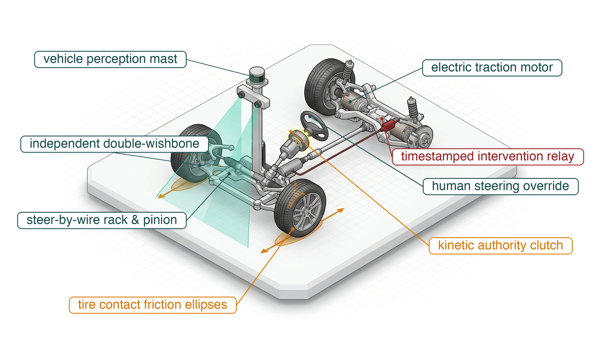
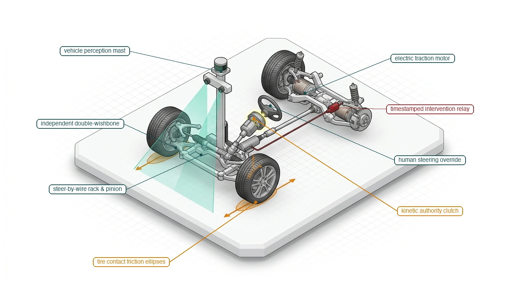
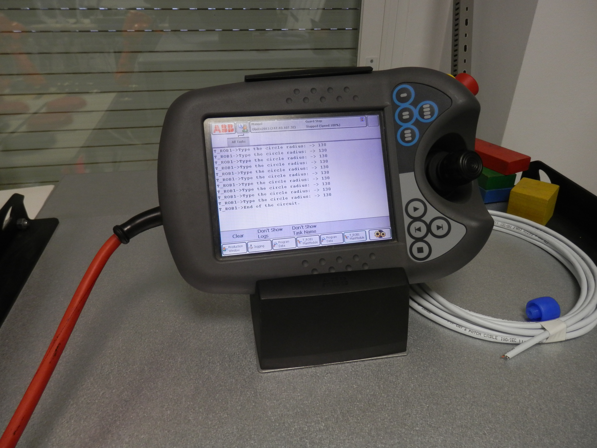
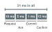
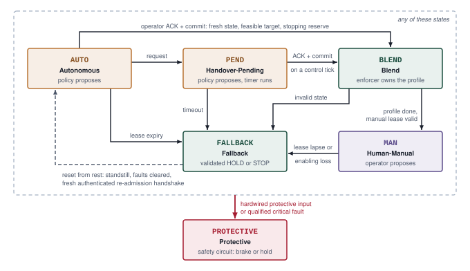
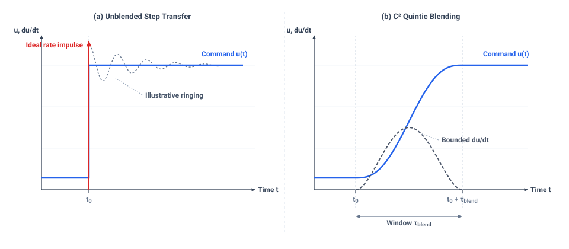
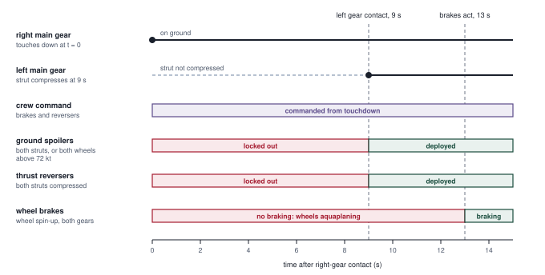

---
format:
  html:
    title: "Supervisory Intervention"
---

# Supervisory Intervention {#sec-intervention}

::: {layout-narrow}
::: {.column-margin}

\chapterminitoc

:::

::: {.content-visible when-format="pdf"}
\noindent
{fig-alt="Isometric vehicle steering blueprint with a perception mast, steering wheel, steer-by-wire rack, intervention relay, and tire contact patches. Arrows distinguish the operator request from the actuator path."}
:::

::: {.content-visible unless-format="pdf"}
{fig-alt="Isometric blueprint showing supervisory intervention on an autonomous vehicle steer-by-wire chassis: independent double-wishbone suspension, vehicle perception mast, steer-by-wire rack and pinion, human steering wheel override, glowing kinetic authority clutch, timestamped intervention relay, and tire contact friction ellipses."}
:::

:::

## Purpose {.unnumbered .unlisted}

::: {.content-visible when-format="pdf"}
\begin{marginfigure}
\resizebox{0.92\linewidth}{!}{\mlphysicalstackfull{20}{20}{20}{20}{20}}
\end{marginfigure}
:::

_When a human operator grabs the physical controls of a running autonomous robot, how do you transfer kinetic authority without causing the exact catastrophe you sought to prevent?_

A human takeover changes who directs the machine, but it does not suspend motion or remove the limits of the body. While an operator recognizes a blocked path and decides how to respond, the machine continues consuming stopping clearance. An abrupt command change can also disturb the load or drivetrain at the moment intervention is meant to protect them. The engineering task is to transfer the right to propose actions while independent permission checks remain active, with a local stop available throughout the transition. That transfer requires agreement on the affected channels, a deadline that fits the remaining clearance, and a command transition that the plant can execute. Its record must distinguish the policy's actions from the enforcer's transition and the operator's recovery, both to reconstruct the event and to decide which experience may teach the next policy. Supervisory intervention therefore carries the causal boundary through a change of proposer: authority can change hands, but physical consequences remain irreversible.



::: {.callout-learning-objectives}

- Specify operator permissions through capability matrices that bind authorized actions to physical channels, clearance-derived deadlines, and cryptographic credentials
- Select a state-dependent local fallback that remains physically feasible while human intervention is pending
- Size the chunk lease and the manual lease against their modes' stopping reserves and available fallback mechanisms
- Calculate the latest fallback time and takeover speed ceilings from human reaction latency and remaining physical stopping clearance
- Design authority handshakes that enforce single-writer fieldbus exclusivity and execute bumpless $C^2$ torque transfers within physical jerk limits
- Formulate the four temporal intervals of causal intervention masking to isolate policy drift, enforcer blends, and human stabilization in imitation learning datasets
- Evaluate whether an authority record provides the cryptographic and kinematic evidence needed to reconstruct post-incident fault causality

:::

## Shared Authority {#sec-intervention-shared-authority}

```{python}
#| label: calc-intervention-shared-authority-scene
#| echo: false
#| warning: false
#| message: false
# ┌─────────────────────────────────────────────────────────────────────────────
# │ OPENING SCENE: A TWO-SECOND PAUSE AT AISLE SPEED
# ├─────────────────────────────────────────────────────────────────────────────
# │ Context: @sec-intervention-shared-authority, first paragraph.
# │
# │ Goal:    Show that an out-of-loop pause outruns the rack-end clear distance.
# │ Show:    Aisle speed, design out-of-loop takeover delay, travel, clear distance.
# │ How:     WarehouseAisle scenario fields; the design takeover is the 90th
# │          percentile condition-mean take-over time plus transport
# │          (AISLE.t_takeover_out_of_loop); travel = v * T_takeover.
# └─────────────────────────────────────────────────────────────────────────────
from mlsysim import *
from mlsysim.core.units import meter, second, millisecond
from mlsysim.fmt import fmt_velocity, fmt_length, fmt_latency, check

RM = Embodied.MobileManipulator.WarehouseMobileManipulator
AISLE = Embodied.Scenario.WarehouseAisle

class InterventionSharedAuthorityScene:
    """Travel during an out-of-loop takeover pause at the aisle speed."""

    # ┌── 1. LOAD (Constants & Parameters) ─────────────────────────────────
    v = AISLE.v_aisle  # category: chosen
    t_pause = AISLE.t_takeover_out_of_loop  # category: derived (sourced p90 take-over time + transport)
    d_clear = AISLE.d_clear  # category: illustrative

    # ┌── 2. EXECUTE (Compute) ─────────────────────────────────────────────
    travel = (v * t_pause).to(meter)
    travel_ratio = (travel / d_clear).to("").magnitude

    # ┌── 3. GUARD (Invariants) ───────────────────────────────────────────
    check(abs(travel.magnitude - 5.8045) < 5e-4, f"travel during the pause: {travel}")
    check(travel > 5 * d_clear, "The pause must carry the machine more than five times the clear distance.")

    # ┌── 4. OUTPUT (Formatting) ──────────────────────────────────────────
    v_str = fmt_velocity(v, unit=meter / second, precision=1)
    t_pause_str = fmt_latency(t_pause, unit=second, precision=1)
    travel_str = fmt_length(travel, unit=meter, precision=1)
    d_clear_str = fmt_length(d_clear, unit=meter, precision=2)
    chunk_lease_str = fmt_latency(AISLE.t_lease, unit=millisecond, precision=0)
```

A human supervisor is often drawn as one arrow into the plant. When a pallet blocks an aisle, the warehouse mobile manipulator needs a remote assistant to take over, yet at its chosen `{python} InterventionSharedAuthorityScene.v_str` aisle speed a `{python} InterventionSharedAuthorityScene.t_pause_str` pause before braking, the sourced out-of-loop takeover time of @sec-intervention-reaction-drift, would carry it `{python} InterventionSharedAuthorityScene.travel_str`, more than five times its `{python} InterventionSharedAuthorityScene.d_clear_str` rack-end clear distance. An operator request reaches a machine that is already moving under an admitted command; it cannot erase momentum or make an actuator respond instantaneously. The arbiter, the permission path's source-selection step, must decide who may propose the next command, and the enforcer, its admission check, must admit or reject it; both run deterministically on the safety microcontroller (MCU). The plant must still have enough clearance to execute the chosen stop. An abrupt setpoint switch requests an instantaneous torque step that the motor drives, gearboxes, and payload must absorb. A delayed switch can exhaust stopping room even when both the learned policy and the human controller are individually well behaved.

Human review cannot pause a moving plant as it pauses a software queue. Moving mass ($m \mathbf{v}$) and stored kinetic energy ($E_k = \frac{1}{2} m \|\mathbf{v}\|^2$) remain across the causal boundary (@sec-boundary-causal-boundary); the state continues evolving under $\dot{\mathbf{x}} = f(\mathbf{x}, \mathbf{u})$ while the operator reconstructs the scene. Passive monitoring also weakens the situational awareness needed for an unexpected takeover, an instance of Bainbridge's *ironies of automation* [@bainbridge1983ironies]. The machine must therefore preserve its own stopping envelope throughout human re-engagement. Faster communication cannot remove the time needed to recognize a hazard, decide, and move the controls.

::: {.column-margin .margin-pointer}
↩ The proposal boundary of @sec-boundary-machine-model, and the third law in @sec-boundary-bedrock-laws that it enforces, set the baseline for supervisory preemption.
:::

The calculations in this chapter are illustrative design comparisons, not measured takeover performance. They inherit a remaining timing obligation from @sec-placement: $\Delta_{\text{da}}$, the qualified delay from proposer dispatch to admission, is not yet supplied. The displayed stopping-budget remainders are therefore before charging that interval. At speed $v$, usable spare is the displayed spare less $v\Delta_{\text{da}}$, and the displayed latest waiting time must be reduced by $\Delta_{\text{da}}$. The numerical cells retain a capture-origin distance ledger. A runtime check instead pairs current clearance with only the delay still ahead; it must not combine current clearance with the full capture-origin delay and charge elapsed travel again.

The blocked aisle therefore requires a sequence of decisions. Clearance sets the waiting budget. If the operator cannot respond within it, the machine slows in advance or stops locally before asking for help. A checked transfer then commits one proposer per channel, and the enforcer executes only a command blend whose rate and stopping reserve both fit. The operator can guide recovery around the pallet while the same physical limits remain active.

The state-dependent fallback of @sec-enforcement-fallback-ladder governs every stage. A moving base may require powered deceleration followed by brake application at standstill; a loaded arm may require a supported hold. Both depend on the sensing and energy sources qualified for that response. Local damping, torque inhibit, and supply isolation are different actions and cannot be substituted for the selected stop by arranging them in a universal escalation ladder. A trusted protective input invokes its separately validated plant response.

Autonomous and manual proposal rights have separate leases. The autonomous action-chunk lease remains the running machine's lease from @sec-nervous-cadences; the manual session receives a clearance-budgeted manual lease. Rejecting an invalid replacement does not revoke an active command whose own evidence, state, and lease remain valid. Expiry or loss of those premises invokes the applicable local fallback.

The permission path resolves split-brain command contention through a source arbiter and **exclusive actuator-output ownership**. In this chapter's $1\text{ kHz}$ controller, commit revokes the policy's logical proposal token and latches its last approved reference; the enforcer remains the sole actuator writer before, during, and after the transition. CAN arbitration can serialize traffic from several senders without establishing which sender has control authority. The hazard is that validly transmitted but conflicting commands reach the same actuator. Qualified output gating and source selection must prevent that conflict. In continuous dynamics, the enforcer executes a **bumpless transfer** between the checked endpoints under the channel's command-rate and measured plant limits.

Intervention events also reach the core machine learning lifecycle. A rescued episode logged without its handover instant looks like an expert demonstration of the very near-failure states that made the rescue necessary. In imitation learning, training on unsegmented logs teaches neural policies to reproduce pre-intervention failure oscillations. Dataset aggregation algorithms (such as DAgger [@ross2011reduction] and its human-gated variants, @sec-data-intervention-recovery) require preserving the exact evidentiary boundary: states visited under compounding policy drift must be partitioned for corrective expert relabeling, while imitation targets begin strictly on stabilized post-takeover trajectories. This requires the chapter's formal deliverable, the **authority record**\index{Authority record} (the twelfth record in the record chain), to preserve the complete evidentiary trace from before the takeover. Its per-tick authority log therefore timestamps every authority transition on the safety microcontroller's clock. The commit instant ends policy ownership; the subsequent enforcer blend and reviewed human recovery remain distinct intervals.

The first design decision fixes which named intervention may reach which physical channel, and how long the machine can wait for it. These permissions determine the handover protocol; the protocol then has to fit a physically feasible command transition. The resulting authority record preserves the reasoning behind each transfer for verification and for later use of the episode as training data.

## Human Authority Over Actuation {#sec-intervention-human-authority}

An assistant guiding the arm can move the chassis if its credential also permits base-drive commands. A command admitted under that permission performs mechanical work ($W = \int \mathbf{F} \cdot d\mathbf{x}$) before software can revoke it. Authority must therefore identify the physical channels a person may affect, rather than grant unrestricted access through a generic operator role.

The remote assistant who clears a blocked aisle and the coworker who takes a tote from the gripper act on the same machine, and neither should hold the other's authority. Kinetic authority cannot attach to a generic human role or an abstract software block. It must attach to specific named operations with explicit timing budgets, physical degrees of freedom, and deterministic preemption rules. Rather than granting an operator broad administrative authority, the permission path maintains an explicit **capability matrix**\index{Capability matrix}, a permissions table mapping individual operations (such as an emergency power cutoff, a velocity trim adjustment, a trajectory path veto, or manual drive of the base and arm) to authenticated roles, reflecting classic taxonomies of human supervisory control[^fn-std-sheridan-supervisory] [@sheridan1992telerobotics] and multi-level automation [@parasuraman2000model]. Each entry in this matrix defines the exact actuator channels the operation governs, the preemption tier it carries over the learned policy, and the maximum propagation latency permitted from physical input to actuator response.

[^fn-std-sheridan-supervisory]: **Supervisory Control Levels**\index{Supervisory Control Levels}: @sheridan1978human formulated a ten-level taxonomy of supervisory control, running from a human who performs the whole task without computer assistance to a computer that decides and acts while ignoring the human. A capability matrix draws such distinctions per operation rather than once for the whole machine.

Naming the operations separates **intervention**\index{Intervention} from **safety enforcement**\index{Safety enforcement}, two mechanisms that system architectures routinely conflate. Enforcement withholds permission from a candidate action proposed by a learned model, modifying, clamping, or projecting the setpoint while leaving the machine under autonomous control. Intervention transfers authority away from the model to an external entity, terminating autonomous operation and giving the supervisor the right to propose, while every command still passes the permission path. An **enforcement filter**\index{Enforcement filter} sits in the fast inner control loop ($1\text{ kHz}$ / $\le 1\text{ ms}$) to prevent the policy from demanding an over-current maneuver or violating a barrier certificate [@ames2019control] during nominal tracking, respecting the actuator thermal limits established in @sec-body-five-budgets and the kinodynamic feasibility boundaries from @sec-planning-kinodynamic-feasibility. An intervention mechanism strips the policy of its proposal token when an operational boundary is breached or an operator demands control. A system equipped with enforcement but lacking intervention cannot be redirected when human intent changes or external conditions fall outside the policy design envelope, leading to conservative deadlock when barrier constraints collapse the feasible control set. Conversely, a system equipped with intervention but lacking enforcement permits a lagging operator to drive the plant into structural failure during nominal manual operation. @Tbl-14-enforcement-vs-intervention summarizes the architectural boundaries between these two protective mechanisms without changing the selected physical fallback.

| Dimension            | Enforcement filter                                                                  | Intervention state machine                                      |
|:---------------------|:------------------------------------------------------------------------------------|:----------------------------------------------------------------|
| Primary trigger      | Invariant boundary approach ($\dot{h} + \gamma_{\text{cbf}} h < 0$) or torque limit | Human takeover assertion, monotonic lease timeout, or ODD exit  |
| Authority holder     | Autonomous policy retains proposal rights; enforcer modifies setpoints              | Authority transferred to external entity or fallback controller |
| Execution loop       | Fast inner control loop ($1\text{ kHz}$ / $\le 1\text{ ms}$)                        | Same permission tick; protocol exchange spans multiple ticks    |
| Safety lease role    | Enforces continuous barrier satisfaction on admitted commands                       | Lease expiry invokes the state-dependent validated fallback     |
| Typical failure mode | Feasible set collapse; conservative deadlock or oscillation                         | Vector cancellation, mode confusion, or delayed reaction drift  |

: **Architectural boundaries of safety enforcement and supervisory intervention**: Enforcement operates in-loop as an active constraint on proposed actions; intervention transitions authority between discrete proposers. {#tbl-14-enforcement-vs-intervention tbl-colwidths="[20,40,40]"}

### Capability matrices and the intervention-enforcement split {#sec-intervention-capability-split}

The capability matrix makes that distinction concrete on the warehouse mobile manipulator. The remote assistant can redirect motion, while the coworker accepting an item cannot.

```{python}
#| label: calc-intervention-coworker-handover
#| echo: false
#| warning: false
#| message: false
# ┌─────────────────────────────────────────────────────────────────────────────
# │ COWORKER HANDOVER SPEED UNDER accept_item
# ├─────────────────────────────────────────────────────────────────────────────
# │ Context: @sec-intervention-human-authority, the capability example
# │          (veto_path and manual_drive for the remote assistant, accept_item
# │          for the coworker).
# │
# │ Goal:    Recall the handover cap that the enforcement record's handover
# │          entry holds (@sec-enforcement-telemetry owns it), and check that
# │          it sits under the force-limited contact ceiling.
# │ Show:    Chosen TCP handover speed and the ceiling F_h / sqrt(k_h m_eff).
# │ How:     WarehouseAisle contact fields and the machine's effective mass.
# └─────────────────────────────────────────────────────────────────────────────
from mlsysim import *
from mlsysim.core.units import meter, second, kilogram, newton
from mlsysim.fmt import fmt_velocity, fmt_stiffness, fmt_force, fmt_mass, check

RM = Embodied.MobileManipulator.WarehouseMobileManipulator
AISLE = Embodied.Scenario.WarehouseAisle

class InterventionCoworkerHandover:
    """Arm approach speed for the coworker's accept_item handover."""

    # ┌── 1. LOAD (Constants & Parameters) ─────────────────────────────────
    v_handover = AISLE.v_handover  # category: chosen
    k_hand = AISLE.k_contact_human  # category: illustrative
    f_criterion = AISLE.f_contact_criterion  # category: chosen
    m_eff = RM.arm_effective_contact_mass  # category: derived

    # ┌── 2. EXECUTE (Compute) ─────────────────────────────────────────────
    v_ceiling = (f_criterion / (k_hand * m_eff) ** 0.5).to(meter / second)

    # ┌── 3. GUARD (Invariants) ───────────────────────────────────────────
    check(abs(v_ceiling.magnitude - 0.1179) < 5e-5, f"handover speed ceiling: {v_ceiling}")
    check(abs(m_eff.to(kilogram).magnitude - 12.0) < 1e-9, f"arm effective contact mass: {m_eff}")
    check(v_handover < v_ceiling, "The chosen handover speed must sit under the force-limited ceiling.")

    # ┌── 4. OUTPUT (Formatting) ──────────────────────────────────────────
    v_handover_str = fmt_velocity(v_handover, unit=meter / second, precision=2)
    v_ceiling_str = fmt_velocity(v_ceiling, unit=meter / second, precision=3)
    stiffness_str = fmt_stiffness(k_hand)
    force_str = fmt_force(f_criterion)
    mass_str = fmt_mass(m_eff)
```

For example, the remote assistant who supervises the mobile manipulator may hold a signed **trajectory veto** capability for the base's planner channel: role `remote_assistant`, operation `veto_path`, channel `planner_proposal`, preemption tier above the learned planner but below the local enforcer, authenticated session and nonce, and a clearance-derived acknowledgment deadline. The enforcer responds to a valid veto with a checked local hold or stop. The same session carries a second entry, `manual_drive`, on the base-velocity and arm-joint channels, which becomes active only through a handover that commits within the clearance-derived deadline, and lapses with the manual lease of @sec-intervention-authority-transitions; every command it carries still passes the permission check. A wheel drive-torque packet from that credential is denied, because neither entry grants the base's wheel drive-torque channel. The coworker at the packing station holds a different entry, `accept_item`, which lets the coworker take from the gripper the mug the arm picked from the takeaway conveyor (@sec-intent, @sec-planning). That entry grants no motion authority. The item-handover channel of the enforcement record (@sec-enforcement-telemetry) caps the arm's approach to the coworker's hand at `{python} InterventionCoworkerHandover.v_handover_str`, under the `{python} InterventionCoworkerHandover.v_ceiling_str` model-based contact ceiling, and no capability lifts that cap. That ceiling uses effective contact mass `{python} InterventionCoworkerHandover.mass_str`, assumed hand stiffness `{python} InterventionCoworkerHandover.stiffness_str`, and selected force criterion `{python} InterventionCoworkerHandover.force_str` in the lumped elastic-contact model, with speed limited by force divided by the square root of stiffness times mass. It is conditional on those inputs and does not by itself establish a pressure or injury limit for a particular contact geometry. Each capability entry binds actor, operation, channel, deadline, authentication, preemption tier, and fallback; a valid signature alone grants no motion authority.

### Physiological reaction floors and kinematic drift {#sec-intervention-reaction-drift}

The remote assistant must notice the blocked aisle, decide how to recover, move the controls, and deliver a checked request. Summed in sequence, the total supervisory takeover latency $T_{\Sigma}$ is:
$$T_{\Sigma} = T_{\text{sensory}} + T_{\text{cognitive}} + T_{\text{motor}} + T_{\text{comm}}$$ {#eq-intervention-reaction-floor}
The first three terms belong to the person and depend on engagement and expectation; the last belongs to the console and the link. Human response times are distributions with long right tails, so a stopping budget needs a value that nearly every request meets, not the typical one. The calculation below compares a continuously engaged operator with an out-of-loop assistant. Its communication term includes transport and the protocol exchange, so that exchange must not be charged again.

Waiting consumes distance before the selected stop begins. The finished stopping budget from @sec-enforcement-stopping-envelopes supplies the machine delay, resident stop, and fixed allowances. Adding the human waiting interval exposes whether remote rescue can fit at the current speed; it does not authorize waiting when the local stop is already required.

```{python}
#| label: calc-intervention-operator-takeover-budget
#| echo: false
#| warning: false
#| message: false
# ┌─────────────────────────────────────────────────────────────────────────────
# │ OPERATOR TAKEOVER AGAINST THE MACHINE'S STOPPING BUDGET
# ├─────────────────────────────────────────────────────────────────────────────
# │ Context: @sec-intervention-human-authority, the two takeover modes that
# │          follow @eq-intervention-reaction-floor, and the notebook
# │          "Takeover budget and clearance margin".
# │
# │ Goal:    Price an operator's sourced takeover delay on the warehouse mobile
# │          manipulator at its aisle speed.
# │ Show:    Spare margin at 1.3 m/s; the in-loop decomposition (Model Human
# │          Processor at the slow end of each cycle, video glass-to-glass
# │          latency, four-phase exchange); the out-of-loop design value
# │          (90th-percentile condition-mean take-over time plus the same
# │          transport); travel during each; the stop with each delay added;
# │          the speed ceilings.
# │ How:     Finished stopping budget from the WarehouseAisle scenario
# │          (jerk-limited resident stop, all overheads); the jerk bound is the
# │          peak jerk of the reference C2 polynomial at the drive limit
# │          (@sec-planning-c2-stopping-suffix); T_Sigma adds to tau_delay;
# │          ceilings by calc_scurve_max_permitted_velocity.
# └─────────────────────────────────────────────────────────────────────────────
from mlsysim import *
from mlsysim.core.units import meter, second, millimeter, millisecond
from mlsysim.physics.robotics import (
    calc_c2_stop_suffix,
    calc_scurve_stop_distance,
    calc_scurve_max_permitted_velocity,
)
from mlsysim.fmt import (
    fmt_velocity,
    fmt_length,
    fmt_latency,
    fmt_magnitude,
    fmt_multiple,
    fmt_display_math,
    check,
)

RM = Embodied.MobileManipulator.WarehouseMobileManipulator
AISLE = Embodied.Scenario.WarehouseAisle

class InterventionTakeoverBudget:
    """Operator takeover delay spent against the finished stopping budget."""

    # ┌── 1. LOAD (Constants & Parameters) ─────────────────────────────────
    v = AISLE.v_aisle  # category: chosen
    d_clear = AISLE.d_clear  # category: illustrative
    tau_delay = AISLE.tau_delay  # category: derived
    a_brake = AISLE.a_brake  # category: illustrative
    j_brake = calc_c2_stop_suffix(RM.base.max_velocity, AISLE.a_brake)["peak_jerk"]  # category: derived (stipulated jerk bound)
    near_overhead = AISLE.delta_loc + AISLE.eps_track  # category: illustrative
    margin = AISLE.delta_margin  # category: chosen
    overhead = AISLE.fixed_overhead  # category: illustrative / chosen
    t_sensory = AISLE.t_human_perceptual_slow  # category: sourced (Card, Moran, Newell 1983)
    t_cognitive = AISLE.t_human_cognitive_slow  # category: sourced
    t_motor = AISLE.t_human_motor_slow  # category: sourced
    t_video = AISLE.t_video_glass_to_glass  # category: sourced (wired best case)
    t_handshake = AISLE.t_handshake  # category: chosen (four-phase budgets)
    t_expected = AISLE.t_brake_response_expected  # category: sourced (Green 2000)
    t_surprise = AISLE.t_brake_response_surprise  # category: sourced (Green 2000)
    t_tot_mean = AISLE.t_takeover_driving_mean  # category: sourced (Zhang et al. 2019)
    t_tot_p90 = AISLE.t_takeover_driving_p90  # category: sourced (computed from its data)
    t_in = AISLE.t_takeover_in_loop  # category: derived
    t_ool = AISLE.t_takeover_out_of_loop  # category: derived

    # ┌── 2. EXECUTE (Compute) ─────────────────────────────────────────────
    reaction = (v * tau_delay).to(millimeter)
    stop = calc_scurve_stop_distance(v, a_brake, j_brake).to(millimeter)
    budget = (reaction + stop + overhead).to(millimeter)
    spare = (d_clear - budget).to(millimeter)
    t_comm = (t_video + t_handshake).to(millisecond)
    t_sum = (t_sensory + t_cognitive + t_motor + t_comm).to(millisecond)
    travel_in = (v * t_in).to(millimeter)
    travel_ool = (v * t_ool).to(millimeter)
    d_stop_in = (budget + travel_in).to(millimeter)
    d_stop_ool = (budget + travel_ool).to(millimeter)
    stop_ratio = (d_stop_ool / d_stop_in).to("").magnitude

    def _ceiling(t, *, _d=d_clear, _tau=tau_delay, _a=a_brake, _j=j_brake, _n=near_overhead, _m=margin):
        return calc_scurve_max_permitted_velocity(_d, _tau + t, _a, _j, _n, _m).to(meter / second)

    ceil_in = _ceiling(t_in)
    ceil_ool = _ceiling(t_ool)

    # ┌── 3. GUARD (Invariants) ───────────────────────────────────────────
    check(abs(spare.magnitude - 131.01) < 5e-3, f"spare margin at the aisle speed: {spare}")
    check(abs(t_sum.magnitude - t_in.to(millisecond).magnitude) < 1e-9, "The four stages must sum to the in-loop takeover.")
    check(abs((t_tot_p90 + t_comm - t_ool).to(millisecond).magnitude) < 1e-9, "The out-of-loop takeover is the p90 time plus transport.")
    check(travel_in > 5 * spare, "The in-loop takeover must overrun the spare margin several times at the aisle speed.")
    check(travel_ool > 5 * d_clear, "The out-of-loop travel must exceed five times the clear distance.")
    check(abs(d_stop_in.magnitude - 1755.49) < 5e-3, f"stop with in-loop takeover: {d_stop_in}")
    check(abs(d_stop_ool.magnitude - 6773.49) < 5e-3, f"stop with out-of-loop takeover: {d_stop_ool}")
    check(abs(ceil_in.magnitude - 0.8362) < 5e-5, f"in-loop takeover ceiling: {ceil_in}")
    check(abs(ceil_ool.magnitude - 0.1911) < 5e-5, f"out-of-loop takeover ceiling: {ceil_ool}")
    check(abs(stop_ratio - 3.86) < 0.01, f"out-of-loop to in-loop stop ratio: {stop_ratio}")

    # ┌── 4. OUTPUT (Formatting) ──────────────────────────────────────────
    v_str = fmt_velocity(v, unit=meter / second, precision=1)
    d_clear_str = fmt_length(d_clear, unit=meter, precision=2)
    spare_str = fmt_length(spare, unit=millimeter, precision=1)
    t_in_str = fmt_latency(t_in, unit=millisecond, precision=0)
    t_ool_str = fmt_latency(t_ool, unit=second, precision=1)
    t_sensory_str = fmt_latency(t_sensory, unit=millisecond, precision=0)
    t_cognitive_str = fmt_latency(t_cognitive, unit=millisecond, precision=0)
    t_motor_str = fmt_latency(t_motor, unit=millisecond, precision=0)
    t_video_str = fmt_latency(t_video, unit=millisecond, precision=0)
    t_handshake_str = fmt_latency(t_handshake, unit=millisecond, precision=0)
    t_comm_str = fmt_latency(t_comm, unit=millisecond, precision=0)
    t_expected_str = fmt_latency(t_expected, unit=second, precision=2)
    t_surprise_str = fmt_latency(t_surprise, unit=second, precision=1)
    t_tot_mean_str = fmt_latency(t_tot_mean, unit=second, precision=2)
    t_tot_p90_str = fmt_latency(t_tot_p90, unit=second, precision=2)
    travel_in_str = fmt_length(travel_in, unit=millimeter, precision=1)
    travel_ool_str = fmt_length(travel_ool, unit=meter, precision=2)
    d_stop_in_str = fmt_length(d_stop_in, unit=meter, precision=2)
    d_stop_ool_str = fmt_length(d_stop_ool, unit=meter, precision=2)
    stop_mult_str = fmt_multiple(stop_ratio, precision=1)
    ceil_in_str = fmt_velocity(ceil_in, unit=meter / second, precision=2)
    ceil_ool_str = fmt_velocity(ceil_ool, unit=meter / second, precision=2)

    reaction_value_str = fmt_magnitude(reaction, unit=millimeter, precision=2)
    stop_value_str = fmt_magnitude(stop, unit=millimeter, precision=2)
    overhead_value_str = fmt_magnitude(overhead, unit=millimeter, precision=0)
    travel_in_value_str = fmt_magnitude(travel_in, unit=millimeter, precision=1)
    travel_ool_value_str = fmt_magnitude(travel_ool, unit=millimeter, precision=1)
    d_stop_in_value_str = fmt_magnitude(d_stop_in, unit=millimeter, precision=2)
    d_stop_ool_value_str = fmt_magnitude(d_stop_ool, unit=millimeter, precision=2)

    haptic_display_math = fmt_display_math(
        rf"d_{{\text{{stop}},1}} = v\,\tau_{{\text{{delay}}}} + v\,T_{{\Sigma,1}} + d_{{\text{{suffix}}}}(v) + \delta = "
        rf"{reaction_value_str} + {travel_in_value_str} + {stop_value_str} + {overhead_value_str} = {d_stop_in_value_str}\text{{ mm}}"
    )
    ool_display_math = fmt_display_math(
        rf"d_{{\text{{stop}},2}} = v\,\tau_{{\text{{delay}}}} + v\,T_{{\Sigma,2}} + d_{{\text{{suffix}}}}(v) + \delta = "
        rf"{reaction_value_str} + {travel_ool_value_str} + {stop_value_str} + {overhead_value_str} = {d_stop_ool_value_str}\text{{ mm}}"
    )
```

The finished stopping budget of @sec-enforcement-stopping-envelopes (@tbl-enforcement-stopping-budget) shows what @eq-intervention-reaction-floor costs on the mobile manipulator. At the `{python} InterventionTakeoverBudget.v_str` aisle speed it leaves `{python} InterventionTakeoverBudget.spare_str` of the `{python} InterventionTakeoverBudget.d_clear_str` rack-end clear distance. A takeover delay adds to the machine's own pre-brake delay $\tau_{\text{delay}}$, and every millisecond of it becomes travel at the aisle speed:

1. **Mode 1: Continuous In-Loop Teleoperation**: An attending operator with hands on the controls of a synchronized leader arm or a real-time console, responding to the stimulus the task has led them to expect, makes a simple reaction. The Model Human Processor of Card, Moran, and Newell prices that reaction as one perceptual, one cognitive, and one motor cycle [@jastrzembski2007model]; at the slow end of each cycle's range, $T_{\text{sensory}} =$ `{python} InterventionTakeoverBudget.t_sensory_str`, $T_{\text{cognitive}} =$ `{python} InterventionTakeoverBudget.t_cognitive_str`, and $T_{\text{motor}} =$ `{python} InterventionTakeoverBudget.t_motor_str`. The console adds $T_{\text{comm}} =$ `{python} InterventionTakeoverBudget.t_comm_str`: the scene reaches the operator after a video glass-to-glass latency of `{python} InterventionTakeoverBudget.t_video_str`, measured for a wired teleoperation link [@schimpe2022opensource], and the request returns through the `{python} InterventionTakeoverBudget.t_handshake_str` protocol exchange of @tbl-14-handshake-protocol. By @eq-intervention-reaction-floor, $T_{\Sigma,1} =$ `{python} InterventionTakeoverBudget.t_in_str`. The machine travels `{python} InterventionTakeoverBudget.travel_in_str` during that delay, several times the spare margin. Solving the budget for speed with $T_{\Sigma,1}$ added to $\tau_{\text{delay}}$ bounds the machine to `{python} InterventionTakeoverBudget.ceil_in_str`. The value holds only for the expected stimulus. A driver who is waiting for a brake signal needs up to `{python} InterventionTakeoverBudget.t_expected_str` to detect it and reach the pedal, and a surprise raises that to about `{python} InterventionTakeoverBudget.t_surprise_str` [@green2000stop]. @Sec-intervention-speed-ceilings prices those cases.
2. **Mode 2: Passive Out-of-the-Loop Supervisory Takeover**: An assistant who monitors the telemetry of several machines passively does not make a simple reaction, and its stages cannot be priced separately. Driver take-over studies measure the whole interval, from the take-over request to the first control input. Across 520 experimental conditions in 129 studies, the mean take-over time averaged `{python} InterventionTakeoverBudget.t_tot_mean_str`, and the distribution of those condition means is skewed to the right [@zhang2019takeover]. A stopping budget must hold for nearly every request, so the design value is the 90th percentile of the condition means, `{python} InterventionTakeoverBudget.t_tot_p90_str`, computed from the study's published data. With the same `{python} InterventionTakeoverBudget.t_comm_str` console term, the takeover delay is $T_{\Sigma,2} =$ `{python} InterventionTakeoverBudget.t_ool_str`, during which the machine covers `{python} InterventionTakeoverBudget.travel_ool_str`, more than five times the clear distance, before any brake command. The same solution bounds the machine to `{python} InterventionTakeoverBudget.ceil_ool_str`.

In Mode 2 at the aisle speed, the machine would reach a static obstacle at the rack end at full speed, because contact occurs before braking ever begins. Stronger braking can raise a finite stopping-speed ceiling, but cannot recover distance already spent waiting. As braking distance tends toward zero, reaction travel still sets a limiting ceiling. A percentile of condition means also understates the tail an individual operator can produce, because each condition's own spread grows with its mean; the site must measure its operators, console, and task load before any of these values admits a speed. @Sec-intervention-clearance-deadlines turns the two design values into the speeds at which the machine may request each kind of takeover.

::: {#nbk-intervention-operator-takeover-budget-spatial-clearance-margin .callout-notebook title="Takeover budget and clearance margin"}
**Concept**: The stopping distance during a human intervention adds every source of delay and distance before the machine comes to rest. On the mobile manipulator there are four terms:

1. **Machine blind travel**: The distance covered during the machine's own pre-brake delay ($v\,\tau_{\text{delay}}$), from @tbl-enforcement-stopping-budget.
2. **Takeover travel**: The distance covered while the operator perceives the obstacle, decides, acts, and the command crosses the network ($v\,T_{\Sigma}$).
3. **Resident stop**: The jerk-limited stop suffix $d_{\text{suffix}}(v)$ of @eq-plan-c2-stopping-suffix, which above $v = a_{\text{brake}}^2/j_{\max}$ equals $v^2/(2a_{\text{brake}}) + v\,a_{\text{brake}}/(2j_{\max})$.
4. **Fixed overheads**: $\delta = \delta_{\text{loc}} + \delta_{\text{margin}} + \epsilon_{\text{track}}$.

**Worked Comparison**: At the aisle speed $v =$ `{python} InterventionTakeoverBudget.v_str` against a rack-end clear distance of `{python} InterventionTakeoverBudget.d_clear_str`:

- **Continuous In-Loop Teleoperation** ($T_{\Sigma,1} =$ `{python} InterventionTakeoverBudget.t_in_str`):
  `{python} InterventionTakeoverBudget.haptic_display_math`
- **Passive Out-of-the-Loop Takeover** ($T_{\Sigma,2} =$ `{python} InterventionTakeoverBudget.t_ool_str`):
  `{python} InterventionTakeoverBudget.ool_display_math`

**Systems Insight**: Passive monitoring inflates the takeover delay from `{python} InterventionTakeoverBudget.t_in_str` to `{python} InterventionTakeoverBudget.t_ool_str` and grows the stop from `{python} InterventionTakeoverBudget.d_stop_in_str` to `{python} InterventionTakeoverBudget.d_stop_ool_str`, `{python} InterventionTakeoverBudget.stop_mult_str` longer. Neither fits the `{python} InterventionTakeoverBudget.d_clear_str` clear distance at the aisle speed, which is why the machine slows or stops before it asks for either one. For the kinematic derivation of these stopping distances, see @sec-appendix-systems-stopping.
:::

### Speed ceilings and the clearance collision horizon {#sec-intervention-speed-ceilings}

The warehouse comparison can include different operator states without changing machines. Each state is useful only at speeds where its response time leaves room for the same resident stop, and the sourced response times differ by more than an order of magnitude.

```{python}
#| label: calc-intervention-takeover-ladder
#| echo: false
#| warning: false
#| message: false
# ┌─────────────────────────────────────────────────────────────────────────────
# │ SPEED CEILING AGAINST THE SOURCED HUMAN RESPONSE
# ├─────────────────────────────────────────────────────────────────────────────
# │ Context: @tbl-14-teleop-stability and the paragraph that introduces it.
# │
# │ Goal:    Price each sourced human response time as a speed ceiling.
# │ Show:    Per row, the human response, the total with the console term
# │          (video glass-to-glass plus the four-phase exchange), the added
# │          travel at the aisle speed, and the speed at which the finished
# │          budget still fits. Rows: Model Human Processor simple reaction
# │          (nominal and slow bound); perception-brake times for an expected,
# │          an unexpected, and a surprise signal; percentiles of condition-mean
# │          take-over time.
# │ How:     Each total adds to tau_delay (WarehouseAisle scenario); ceilings
# │          by calc_scurve_max_permitted_velocity with the stipulated jerk bound.
# └─────────────────────────────────────────────────────────────────────────────
from mlsysim import *
from mlsysim.core.units import meter, second, millimeter, millisecond
from mlsysim.physics.robotics import calc_c2_stop_suffix, calc_scurve_max_permitted_velocity
from mlsysim.fmt import fmt_length, fmt_latency, fmt_velocity, check

RM = Embodied.MobileManipulator.WarehouseMobileManipulator
AISLE = Embodied.Scenario.WarehouseAisle

def _ceiling(t):
    """Largest speed whose finished budget, with t added to tau_delay, fits d_clear."""
    j_brake = calc_c2_stop_suffix(RM.base.max_velocity, AISLE.a_brake)["peak_jerk"]
    return calc_scurve_max_permitted_velocity(
        AISLE.d_clear,
        AISLE.tau_delay + t,
        AISLE.a_brake,
        j_brake,
        AISLE.delta_loc + AISLE.eps_track,
        AISLE.delta_margin,
    ).to(meter / second)

class InterventionTakeoverLadder:
    """Speed ceiling for each sourced human response time."""

    # ┌── 1. LOAD (Constants & Parameters) ─────────────────────────────────
    v = AISLE.v_aisle  # category: chosen
    t_comm = AISLE.t_takeover_transport  # category: sourced video + chosen exchange
    human = {
        "mhp": AISLE.t_human_simple_reaction,  # category: sourced (Card, Moran, Newell 1983)
        "mhp_slow": AISLE.t_human_simple_reaction_slow,  # category: sourced
        "expected": AISLE.t_brake_response_expected,  # category: sourced (Green 2000)
        "unexpected": AISLE.t_brake_response_unexpected,  # category: sourced
        "surprise": AISLE.t_brake_response_surprise,  # category: sourced
        "p50": AISLE.t_takeover_driving_p50,  # category: sourced (Zhang et al. 2019 data)
        "mean": AISLE.t_takeover_driving_mean,  # category: sourced
        "p90": AISLE.t_takeover_driving_p90,  # category: sourced
        "p99": AISLE.t_takeover_driving_p99,  # category: sourced
    }

    # ┌── 2. EXECUTE (Compute) ─────────────────────────────────────────────
    # Plain loops: class-body comprehensions cannot see class-level names.
    total, travel, ceiling = {}, {}, {}
    for _k, _t in human.items():
        total[_k] = (_t + t_comm).to(millisecond)
        travel[_k] = (v * total[_k]).to(millimeter)
        ceiling[_k] = _ceiling(total[_k])
    order = list(human)
    ceiling_list = list(ceiling.values())  # insertion order follows human

    # ┌── 3. GUARD (Invariants) ───────────────────────────────────────────
    check(abs((total["mhp_slow"] - AISLE.t_takeover_in_loop).to(millisecond).magnitude) < 1e-9, "Design in-loop row is the registry total.")
    check(abs((total["p90"] - AISLE.t_takeover_out_of_loop).to(millisecond).magnitude) < 1e-9, "Design out-of-loop row is the registry total.")
    check(abs(ceiling["mhp"].magnitude - 1.0094) < 5e-5, f"nominal in-loop ceiling: {ceiling['mhp']}")
    check(abs(ceiling["mhp_slow"].magnitude - 0.8362) < 5e-5, f"design in-loop ceiling: {ceiling['mhp_slow']}")
    check(abs(ceiling["surprise"].magnitude - 0.4504) < 5e-5, f"surprise ceiling: {ceiling['surprise']}")
    check(abs(ceiling["p90"].magnitude - 0.1911) < 5e-5, f"design out-of-loop ceiling: {ceiling['p90']}")
    check(all(hi > lo for hi, lo in zip(ceiling_list, ceiling_list[1:])), "Ceilings must fall as the response grows.")
    check(max(ceiling.values()) < v, "No operator state fits at the aisle speed.")
    # Expectation costs more speed than the console term does.
    console_cost = (_ceiling(human["mhp_slow"]) - ceiling["mhp_slow"]).magnitude
    check((ceiling["expected"] - ceiling["surprise"]).magnitude > console_cost, "Expectation must outweigh the console term.")

    # ┌── 4. OUTPUT (Formatting) ──────────────────────────────────────────
    v_str = fmt_velocity(v, unit=meter / second, precision=1)
    t_comm_str = fmt_latency(t_comm, unit=millisecond, precision=0)
    mhp_human_str = fmt_latency(human["mhp"], unit=millisecond, precision=0, commas=True)
    mhp_total_str = fmt_latency(total["mhp"], unit=millisecond, precision=0, commas=True)
    mhp_travel_str = fmt_length(travel["mhp"], unit=meter, precision=2)
    mhp_ceiling_str = fmt_velocity(ceiling["mhp"], unit=meter / second, precision=2)
    mhp_slow_human_str = fmt_latency(human["mhp_slow"], unit=millisecond, precision=0, commas=True)
    mhp_slow_total_str = fmt_latency(total["mhp_slow"], unit=millisecond, precision=0, commas=True)
    mhp_slow_travel_str = fmt_length(travel["mhp_slow"], unit=meter, precision=2)
    mhp_slow_ceiling_str = fmt_velocity(ceiling["mhp_slow"], unit=meter / second, precision=2)
    expected_human_str = fmt_latency(human["expected"], unit=millisecond, precision=0, commas=True)
    expected_total_str = fmt_latency(total["expected"], unit=millisecond, precision=0, commas=True)
    expected_travel_str = fmt_length(travel["expected"], unit=meter, precision=2)
    expected_ceiling_str = fmt_velocity(ceiling["expected"], unit=meter / second, precision=2)
    unexpected_human_str = fmt_latency(human["unexpected"], unit=millisecond, precision=0, commas=True)
    unexpected_total_str = fmt_latency(total["unexpected"], unit=millisecond, precision=0, commas=True)
    unexpected_travel_str = fmt_length(travel["unexpected"], unit=meter, precision=2)
    unexpected_ceiling_str = fmt_velocity(ceiling["unexpected"], unit=meter / second, precision=2)
    surprise_human_str = fmt_latency(human["surprise"], unit=millisecond, precision=0, commas=True)
    surprise_total_str = fmt_latency(total["surprise"], unit=millisecond, precision=0, commas=True)
    surprise_travel_str = fmt_length(travel["surprise"], unit=meter, precision=2)
    surprise_ceiling_str = fmt_velocity(ceiling["surprise"], unit=meter / second, precision=2)
    p50_human_str = fmt_latency(human["p50"], unit=millisecond, precision=0, commas=True)
    p50_total_str = fmt_latency(total["p50"], unit=millisecond, precision=0, commas=True)
    p50_travel_str = fmt_length(travel["p50"], unit=meter, precision=2)
    p50_ceiling_str = fmt_velocity(ceiling["p50"], unit=meter / second, precision=2)
    mean_human_str = fmt_latency(human["mean"], unit=millisecond, precision=0, commas=True)
    mean_total_str = fmt_latency(total["mean"], unit=millisecond, precision=0, commas=True)
    mean_travel_str = fmt_length(travel["mean"], unit=meter, precision=2)
    mean_ceiling_str = fmt_velocity(ceiling["mean"], unit=meter / second, precision=2)
    p90_human_str = fmt_latency(human["p90"], unit=millisecond, precision=0, commas=True)
    p90_total_str = fmt_latency(total["p90"], unit=millisecond, precision=0, commas=True)
    p90_travel_str = fmt_length(travel["p90"], unit=meter, precision=2)
    p90_ceiling_str = fmt_velocity(ceiling["p90"], unit=meter / second, precision=2)
    p99_human_str = fmt_latency(human["p99"], unit=millisecond, precision=0, commas=True)
    p99_total_str = fmt_latency(total["p99"], unit=millisecond, precision=0, commas=True)
    p99_travel_str = fmt_length(travel["p99"], unit=meter, precision=2)
    p99_ceiling_str = fmt_velocity(ceiling["p99"], unit=meter / second, precision=2)
```

@Tbl-14-teleop-stability prices each sourced response time. Every row adds the `{python} InterventionTakeoverLadder.t_comm_str` console term to the human response, adds the total to $\tau_{\text{delay}}$, and solves the finished stopping budget for the largest speed at which the machine still stops inside the rack-end clear distance. Before charging the missing admission delay, the ceiling falls from `{python} InterventionTakeoverLadder.mhp_ceiling_str` for an attending operator who meets the expected stimulus at the nominal pace to `{python} InterventionTakeoverLadder.p99_ceiling_str` for the slowest percentile of takeover conditions, and no row fits at the `{python} InterventionTakeoverLadder.v_str` aisle speed. Two facts dominate the table. Expectation matters more than the console, because moving from an expected to a surprising stimulus costs more speed than the whole console term does. The tail matters more than the average, because a speed chosen for the mean take-over time is overrun by every condition slower than the mean.

| Operator state and response                         |                                             Human response |                                          With console term |                                 Added travel at aisle speed |                                                Speed ceiling |
|:----------------------------------------------------|-----------------------------------------------------------:|-----------------------------------------------------------:|------------------------------------------------------------:|-------------------------------------------------------------:|
| In-loop, expected stimulus, nominal pace            |        `{python} InterventionTakeoverLadder.mhp_human_str` |        `{python} InterventionTakeoverLadder.mhp_total_str` |        `{python} InterventionTakeoverLadder.mhp_travel_str` |        `{python} InterventionTakeoverLadder.mhp_ceiling_str` |
| **In-loop, expected stimulus, slow bound (design)** |   `{python} InterventionTakeoverLadder.mhp_slow_human_str` |   `{python} InterventionTakeoverLadder.mhp_slow_total_str` |   `{python} InterventionTakeoverLadder.mhp_slow_travel_str` |   `{python} InterventionTakeoverLadder.mhp_slow_ceiling_str` |
| Expected brake signal                               |   `{python} InterventionTakeoverLadder.expected_human_str` |   `{python} InterventionTakeoverLadder.expected_total_str` |   `{python} InterventionTakeoverLadder.expected_travel_str` |   `{python} InterventionTakeoverLadder.expected_ceiling_str` |
| Unexpected but common signal                        | `{python} InterventionTakeoverLadder.unexpected_human_str` | `{python} InterventionTakeoverLadder.unexpected_total_str` | `{python} InterventionTakeoverLadder.unexpected_travel_str` | `{python} InterventionTakeoverLadder.unexpected_ceiling_str` |
| Surprise event                                      |   `{python} InterventionTakeoverLadder.surprise_human_str` |   `{python} InterventionTakeoverLadder.surprise_total_str` |   `{python} InterventionTakeoverLadder.surprise_travel_str` |   `{python} InterventionTakeoverLadder.surprise_ceiling_str` |
| Out-of-loop takeover, median condition              |        `{python} InterventionTakeoverLadder.p50_human_str` |        `{python} InterventionTakeoverLadder.p50_total_str` |        `{python} InterventionTakeoverLadder.p50_travel_str` |        `{python} InterventionTakeoverLadder.p50_ceiling_str` |
| Out-of-loop takeover, average condition             |       `{python} InterventionTakeoverLadder.mean_human_str` |       `{python} InterventionTakeoverLadder.mean_total_str` |       `{python} InterventionTakeoverLadder.mean_travel_str` |       `{python} InterventionTakeoverLadder.mean_ceiling_str` |
| **Out-of-loop takeover, 90th percentile (design)**  |        `{python} InterventionTakeoverLadder.p90_human_str` |        `{python} InterventionTakeoverLadder.p90_total_str` |        `{python} InterventionTakeoverLadder.p90_travel_str` |        `{python} InterventionTakeoverLadder.p90_ceiling_str` |
| Out-of-loop takeover, 99th percentile               |        `{python} InterventionTakeoverLadder.p99_human_str` |        `{python} InterventionTakeoverLadder.p99_total_str` |        `{python} InterventionTakeoverLadder.p99_travel_str` |        `{python} InterventionTakeoverLadder.p99_ceiling_str` |

: **Takeover speed ceiling against the sourced human response**: The first two rows are Model Human Processor simple reactions, one perceptual, cognitive, and motor cycle at nominal and slow-bound cycle times [@jastrzembski2007model]. The next three are driver perception-brake times for an expected, an unexpected, and a surprise signal [@green2000stop]. The last four are percentiles of the mean take-over time across 520 experimental conditions, computed from the published data of @zhang2019takeover; they describe conditions, not individual operators, whose tail is longer. Each total adds the console term (video glass-to-glass latency [@schimpe2022opensource] plus the four-phase exchange) and excludes the unqualified dispatch-to-admission interval, so every ceiling is optimistic. Bold rows are the design values. {#tbl-14-teleop-stability tbl-colwidths="[32,16,17,17,18]"}

The table also locates the other interfaces a site might offer. Continuous velocity guidance or supervisory waypoint dispatch places the operator somewhere between an expected-stimulus reaction and an out-of-loop takeover, and only a measured response distribution for that interface, console, and task says where. A hardwired protective input removes the console term but not the human response, so its operator still needs the local stop to hold the machine safe while that response runs.

```{=latex}
\Needspace{0.62\textheight}
```

### Clearance-derived fallback deadlines {#sec-intervention-clearance-deadlines}

An autonomous policy's handover request cannot remain pending indefinitely. If a machine encounters an operational design domain boundary at speed and requests intervention, an operator who is distracted, asleep, or incapacitated will fail to complete the handshake. Handover timeouts cannot be arbitrary software constants: waiting a fixed 500 milliseconds is safe at crawl speeds but causes catastrophic overshoot at transport velocity. Safe timeouts must be kinematically derived from instantaneous speed, line-of-sight clearance, and effective braking deceleration.

```{python}
#| label: calc-intervention-timeout-budget
#| echo: false
#| warning: false
#| message: false
# ┌─────────────────────────────────────────────────────────────────────────────
# │ HANDOVER DEADLINE AND TAKEOVER SPEEDS ON THE MOBILE MANIPULATOR
# ├─────────────────────────────────────────────────────────────────────────────
# │ Context: @sec-intervention-authority-transitions, the T_latest paragraph and
# │          the takeover-speed paragraphs that follow it.
# │
# │ Goal:    Spend the finished budget's spare margin as a handover deadline and
# │          derive the speeds at which each takeover may be requested.
# │ Show:    T_latest at the aisle speed (the unallocated timing allowance of
# │          the finished budget), its tick-rounded dispatch, the handshake that
# │          fits inside it, and the sourced in-loop and out-of-loop takeover
# │          ceilings; T_latest at a 1.2 m/s slow-down, which the sourced
# │          in-loop response overruns; the redesigned slow-down and crawl,
# │          T_latest at each and the time left after the takeover; the crawl
# │          against the 99th-percentile response.
# │ How:     @eq-intervention-latest-fallback with the jerk-limited resident
# │          stop (calc_scurve_stop_distance, jerk bound = peak jerk of the
# │          reference C2 polynomial at the drive limit) and all three
# │          overheads, from the WarehouseAisle scenario; ceilings by
# │          calc_scurve_max_permitted_velocity with T_Sigma in tau_delay.
# └─────────────────────────────────────────────────────────────────────────────
from mlsysim import *
from mlsysim.core.units import meter, second, millimeter, millisecond
from mlsysim.physics.robotics import (
    calc_c2_stop_suffix,
    calc_scurve_stop_distance,
    calc_scurve_max_permitted_velocity,
)
from mlsysim.fmt import fmt_length, fmt_latency, fmt_velocity, check

RM = Embodied.MobileManipulator.WarehouseMobileManipulator
AISLE = Embodied.Scenario.WarehouseAisle

class InterventionTimeoutBudget:
    """Latest fallback dispatch after a handover request, and the speeds it forces."""

    # ┌── 1. LOAD (Constants & Parameters) ─────────────────────────────────
    v = AISLE.v_aisle  # category: chosen
    d_clear = AISLE.d_clear  # category: illustrative
    tau_delay = AISLE.tau_delay  # category: derived
    a_brake = AISLE.a_brake  # category: illustrative
    j_brake = calc_c2_stop_suffix(RM.base.max_velocity, AISLE.a_brake)["peak_jerk"]  # category: derived (stipulated jerk bound)
    near_overhead = AISLE.delta_loc + AISLE.eps_track  # category: illustrative
    margin = AISLE.delta_margin  # category: chosen
    tick = AISLE.t_tick  # category: chosen
    t_in = AISLE.t_takeover_in_loop  # category: derived (sourced human + transport)
    t_ool = AISLE.t_takeover_out_of_loop  # category: derived (sourced human + transport)
    t_ool_p99 = AISLE.t_takeover_driving_p99 + AISLE.t_takeover_transport  # category: derived
    v_in = AISLE.v_takeover_in_loop  # category: chosen (under the sourced in-loop ceiling)
    v_ool = AISLE.v_takeover_out_of_loop  # category: chosen (under the sourced out-of-loop ceiling)
    t_request = AISLE.t_handshake_request  # category: chosen
    t_acknowledge = AISLE.t_handshake_acknowledge  # category: chosen
    t_confirm = AISLE.t_handshake_confirm  # category: chosen
    t_handshake = AISLE.t_handshake  # category: derived (four-phase sum)
    # Scenario assumptions (this chapter only)
    v_fast_slowdown = 1.2 * meter / second  # category: illustrative (a slow-down that fits only a much faster human response)
    config = 500 * millisecond  # category: chosen (configured protocol ceiling)
    manual_lease = 100 * millisecond  # category: chosen (loss-of-engagement lease)

    # ┌── 2. EXECUTE (Compute) ─────────────────────────────────────────────
    def _t_latest(speed, *, _d=d_clear, _n=near_overhead, _m=margin, _tau=tau_delay, _a=a_brake, _j=j_brake):
        stop = calc_scurve_stop_distance(speed, _a, _j)
        return ((_d - _n - _m - stop) / speed - _tau).to(millisecond)

    def _ceiling(t, *, _d=d_clear, _tau=tau_delay, _a=a_brake, _j=j_brake, _n=near_overhead, _m=margin):
        return calc_scurve_max_permitted_velocity(_d, _tau + t, _a, _j, _n, _m).to(meter / second)

    t_latest = _t_latest(v)
    spare = (v * t_latest).to(millimeter)
    # A slow-down sized for a much faster human response.
    t_latest_fast = _t_latest(v_fast_slowdown)
    short_fast = (t_in - t_latest_fast).to(millisecond)
    # The redesigned in-loop slow-down.
    t_latest_in = _t_latest(v_in)
    spare_in = (v_in * t_latest_in).to(millimeter)
    left_in = (t_latest_in - t_in).to(millisecond)
    # The redesigned out-of-loop crawl, at the design and the 99th-percentile response.
    t_latest_ool = _t_latest(v_ool)
    left_ool = (t_latest_ool - t_ool).to(millisecond)
    short_ool_p99 = (t_ool_p99 - t_latest_ool).to(millisecond)
    timeout = min(config.to(millisecond), t_latest)
    timeout_ticks = int(timeout.magnitude // tick.to(millisecond).magnitude)
    admitted = (timeout_ticks * tick).to(millisecond)
    ceil_in = _ceiling(t_in)
    ceil_ool = _ceiling(t_ool)
    ceil_ool_p99 = _ceiling(t_ool_p99)

    # ┌── 3. GUARD (Invariants) ───────────────────────────────────────────
    check(abs(t_latest.magnitude - 100.775) < 5e-3, f"T_latest at the aisle speed: {t_latest}")
    check(abs(spare.magnitude - 131.01) < 5e-3, f"spare margin at the aisle speed: {spare}")
    check(abs(t_latest_fast.magnitude - 184.11) < 5e-3, f"T_latest at 1.2 m/s: {t_latest_fast}")
    check(t_in > t_latest_fast, "The sourced in-loop response must overrun the allowance at 1.2 m/s.")
    check(abs(t_latest_in.magnitude - 663.275) < 5e-3, f"T_latest at the in-loop slow-down: {t_latest_in}")
    check(abs(spare_in.magnitude - 530.62) < 5e-3, f"spare margin at the in-loop slow-down: {spare_in}")
    check(abs(left_in.magnitude - 58.275) < 5e-3, f"T_latest left after the in-loop takeover: {left_in}")
    check(left_ool.magnitude > 0, "The crawl must cover the design out-of-loop takeover.")
    check(short_ool_p99.magnitude > 0, "The crawl must not cover the 99th-percentile takeover.")
    check(admitted.magnitude == 100, f"tick-rounded fallback dispatch: {admitted}")
    check(t_latest < config, "The clearance deadline must bind before the configured ceiling.")
    check(abs(t_handshake.to(millisecond).magnitude - 31.0) < 1e-9, f"four-phase handshake: {t_handshake}")
    check(t_handshake < t_latest, "The four-phase handshake must fit inside T_latest.")
    check(t_in > t_latest, "An in-loop takeover must not fit at the aisle speed.")
    check(abs(ceil_in.magnitude - 0.8362) < 5e-5, f"in-loop takeover ceiling: {ceil_in}")
    check(abs(ceil_ool.magnitude - 0.1911) < 5e-5, f"out-of-loop takeover ceiling: {ceil_ool}")
    check(v_in < ceil_in < v_fast_slowdown < v, "The slow-down sits under the sourced in-loop ceiling; 1.2 m/s does not.")
    check(ceil_ool_p99 < v_ool < ceil_ool, "The crawl sits under the design ceiling and above the 99th-percentile ceiling.")

    # ┌── 4. OUTPUT (Formatting) ──────────────────────────────────────────
    v_str = fmt_velocity(v, unit=meter / second, precision=1)
    spare_str = fmt_length(spare, unit=millimeter, precision=1)
    t_latest_str = fmt_latency(t_latest, unit=millisecond, precision=1)
    admitted_str = fmt_latency(admitted, unit=millisecond, precision=0)
    tick_str = fmt_latency(tick, unit=millisecond, precision=0)
    config_str = fmt_latency(config, unit=millisecond, precision=0)
    manual_lease_str = fmt_latency(manual_lease, unit=millisecond, precision=0)
    t_request_str = fmt_latency(t_request, unit=millisecond, precision=0)
    t_acknowledge_str = fmt_latency(t_acknowledge, unit=millisecond, precision=0)
    t_confirm_str = fmt_latency(t_confirm, unit=millisecond, precision=0)
    t_handshake_str = fmt_latency(t_handshake, unit=millisecond, precision=0)
    t_in_str = fmt_latency(t_in, unit=millisecond, precision=0)
    t_ool_str = fmt_latency(t_ool, unit=second, precision=1)
    t_ool_p99_str = fmt_latency(t_ool_p99, unit=second, precision=1)
    ceil_in_str = fmt_velocity(ceil_in, unit=meter / second, precision=2)
    ceil_ool_str = fmt_velocity(ceil_ool, unit=meter / second, precision=2)
    ceil_ool_p99_str = fmt_velocity(ceil_ool_p99, unit=meter / second, precision=2)
    v_fast_str = fmt_velocity(v_fast_slowdown, unit=meter / second, precision=1)
    t_latest_fast_str = fmt_latency(t_latest_fast, unit=millisecond, precision=1)
    short_fast_str = fmt_latency(short_fast, unit=millisecond, precision=1)
    v_in_str = fmt_velocity(v_in, unit=meter / second, precision=1)
    v_ool_str = fmt_velocity(v_ool, unit=meter / second, precision=2)
    t_latest_in_str = fmt_latency(t_latest_in, unit=millisecond, precision=1)
    spare_in_str = fmt_length(spare_in, unit=millimeter, precision=1)
    left_in_str = fmt_latency(left_in, unit=millisecond, precision=1)
    t_latest_ool_str = fmt_latency(t_latest_ool, unit=second, precision=2)
    left_ool_str = fmt_latency(left_ool, unit=second, precision=2)
```

A stopping budget needs a single reference event. In the numerical comparisons here, $D_{\text{clear}}$ is clearance at the observation capture event used by the inherited stopping ledger. The complete $\tau_{\text{delay}}$ spans capture to physical response onset and includes the still-unqualified $\Delta_{\text{da}}$. The extra $T_{\text{wait}}$ is a separate allowance inserted into that ledger; any overlap with its reserved processing, lease, or transport intervals must be removed. Thus the displayed remainders price additional delay, not a fresh countdown starting whenever the operator request arrives.

The same algebra can serve a live check with a different, explicit origin. At the current permission tick, use remaining clearance reduced for motion since capture, account conservatively for estimation error once through the stated allowances, and use current speed. Let $\tau_{\text{delay}}$ contain only the future delay after the proposed additional wait until stopping response begins. Elapsed capture, dispatch, and admission intervals are already represented by the reduced clearance. For a pending timeout that itself decides when to dispatch STOP, the future delay is dispatch-to-response onset plus any still-unpaid processing; do not append a fresh full lease after that timeout. Active lease and evidence expiry run concurrently and can force earlier dispatch. The arbiter takes the earliest protocol, lease, evidence, or clearance deadline. A newly accepted proposal updates only its own contract.

Before inverting for time, state the prerequisite physical inequality in distance. If the machine continues cruising at speed $v$ for a waiting duration $T_{\text{wait}}$ while awaiting the operator's response, its total projected stopping distance—comprising travel during the wait, onboard sensory and actuator delay $\tau_{\text{delay}}$, the travel $d_{\text{suffix}}(v)$ of the jerk-limited resident stop (@eq-plan-c2-stopping-suffix), and fixed localization, margin, and tracking allowances—must not exceed $D_{\text{clear}}$ measured at the same reference event:
$$d_{\text{stop}}(T_{\text{wait}}) = v(T_{\text{wait}} + \tau_{\text{delay}}) + d_{\text{suffix}}(v) + \delta_{\text{loc}} + \delta_{\text{margin}} + \epsilon_{\text{track}} \le D_{\text{clear}}.$$ {#eq-intervention-stopping-inequality}
Setting equality in @eq-intervention-stopping-inequality ($d_{\text{stop}}(T_{\text{wait}}) = D_{\text{clear}}$) and solving for the maximum permissible waiting time yields the latest fallback deadline $T_{\text{latest}}$:
$$T_{\text{latest}} = \frac{D_{\text{clear}}-\delta_{\text{loc}}-\delta_{\text{margin}}-\epsilon_{\text{track}}-d_{\text{suffix}}(v)}{v}-\tau_{\text{delay}},\qquad T_{\text{timeout}}=\max\!\left(0,\min(T_{\text{config}},T_{\text{latest}})\right).$$ {#eq-intervention-latest-fallback}
For a live check, the safety microcontroller dispatches fallback **no later than** the last permission tick before the resulting deadline. A nonpositive $T_{\text{latest}}$ calls for immediate fallback and may mean stopping is already infeasible. The configured protocol ceiling cannot extend that physical deadline or the expiry of active permission.

On the mobile manipulator at `{python} InterventionTimeoutBudget.v_str`, the capture-origin partial ledger leaves `{python} InterventionTimeoutBudget.spare_str`, equivalent to `{python} InterventionTimeoutBudget.t_latest_str` of additional delay before charging $\Delta_{\text{da}}$; this is the unallocated timing allowance of the finished budget in @sec-enforcement-composite-budget. Its `{python} InterventionTimeoutBudget.admitted_str` tick-rounded value illustrates rounding down a budget; it is not an absolute fallback time measured from a later request. The actual arbiter reconstructs the remaining allowance at the request event. The `{python} InterventionTimeoutBudget.config_str` configured ceiling is therefore only an outer protocol limit.

The `{python} InterventionTimeoutBudget.t_handshake_str` protocol exchange used below fits the partial additional-delay allowance, but may proceed only if its nonoverlapping intervals and physical blend fit the complete live budget. The sourced `{python} InterventionTimeoutBudget.t_in_str` in-loop response does not. It exceeds the aisle-speed allowance several times over, so an in-loop request needs a slower machine, and the human response time, not the machine, sets how much slower. A slow-down to `{python} InterventionTimeoutBudget.v_fast_str` would suit an operator who responds in a small fraction of a second; there the ledger leaves `{python} InterventionTimeoutBudget.t_latest_fast_str`, and the sourced response overruns it by `{python} InterventionTimeoutBudget.short_fast_str`. Such a design passes every check that uses an optimistic human and fails the first operator who needs the time the literature measures.

The redesign starts from the response and solves for the speed. The sourced response caps the request speed at `{python} InterventionTimeoutBudget.ceil_in_str`, so the design slows to `{python} InterventionTimeoutBudget.v_in_str` before requesting an in-loop takeover. The capture-origin ledger then leaves `{python} InterventionTimeoutBudget.spare_in_str`, or `{python} InterventionTimeoutBudget.t_latest_in_str` of additional delay; reserving the response consumes all but `{python} InterventionTimeoutBudget.left_in_str`. That is a conservative design allocation, not a claim that every request at that speed receives the same live timeout, and it holds only while the operator meets the expected stimulus. An unexpected hazard moves the operator to the slower rows of @tbl-14-teleop-stability, whose ceilings the slow-down exceeds.

The out-of-loop takeover forces a larger change. Its `{python} InterventionTimeoutBudget.t_ool_str` design response caps the request speed at `{python} InterventionTimeoutBudget.ceil_ool_str`, so the crawl before an out-of-loop request is `{python} InterventionTimeoutBudget.v_ool_str`, where the ledger leaves `{python} InterventionTimeoutBudget.t_latest_ool_str` and the design response leaves `{python} InterventionTimeoutBudget.left_ool_str` of it unspent. The crawl still fails the 99th-percentile condition, whose `{python} InterventionTimeoutBudget.t_ool_p99_str` response admits only `{python} InterventionTimeoutBudget.ceil_ool_p99_str`, and an individual operator's tail is longer than any condition mean. A crawl slow enough for every operator is no longer motion worth keeping. The robust design therefore stops the machine automatically before handing over. The local stop runs first, and the out-of-loop takeover begins from standstill, where waiting costs time but no clearance. Both moving candidates still require qualified admission delay, current clearance, and a feasible stopping continuation. The hidden pallet leaves no room for an anticipatory slow-down at all, so the machine answers it with its own local stop and requests the takeover from standstill. A planned slow-down or crawl can prepare an anticipated request; neither permits waiting at aisle speed for a newly discovered obstacle.

### Execution leases and three-position enabling hardware {#sec-intervention-enabling-hardware}

A stalled policy and a disconnected teleoperator leave the same immediate problem: the moving machine still has a previously admitted command. An inference stall, lost wireless link, or incapacitated operator must not leave that command active indefinitely. Expiring the proposer's authority must also select a local response that brakes the machine or holds the load.

The permission path bounds autonomous chunks and manual sessions with **execution leases**\index{Execution lease!monotonicity}, enforced on the safety microcontroller's clock. The autonomous lease is the running `{python} InterventionSharedAuthorityScene.chunk_lease_str` chunk lease; the manual lease is separately sized below. An authenticated renewal must also carry valid state and evidence. A heartbeat alone cannot refresh old observations.

Electromechanical **enabling devices**\index{Deadman switch}\index{Three-position enabling devices} provide an additional condition for manual motion (@fig-14-teach-pendant). Losing that condition requests the validated stop or hold. It does not establish that removing drive power is appropriate for the current load.

Formally, let $t_{\text{refresh}}$ denote the local hardware timestamp of the most recent renewal accepted after authentication, freshness, state, and evidence validation. At physical time $t$, the lease-age condition is:
$$t - t_{\text{refresh}} < T_{\text{lease}} \ \text{(autonomous)}, \qquad t - t_{\text{refresh}} < T_{\text{lease,man}} \ \text{(manual)}.$$
The clock advances toward expiry even when packets stop arriving. At expiry, the microcontroller revokes the affected proposal rights and selects the validated response from the current physical state. Authority can return only through the declared recovery and fresh-admission procedure; packet resumption alone cannot restore it.

In physical teleoperation, network leases can be coupled with three-position industrial enabling grips.[^fn-std-iso13849-takeover] A startled or distressed operator may release a grip or squeeze it harder. A two-position device that enables whenever pressed does not detect the latter response. The three-position grip (@fig-14-teach-pendant) enables motion only in its intermediate position. Releasing it or squeezing beyond the center detent withdraws the enabling signal; the configured safety circuit determines the resulting stop.

These dual-channel contacts request the stop selected by the machine's safety circuit, independently of the Linux MPU and application scheduler. Where that response includes Safe Torque Off (STO, IEC 61800-5-2), STO disables torque generation; the configured braking or holding mechanism must still establish the required plant response. The enabling circuit must also prevent a return through Position 2 after an over-squeeze from automatically restoring motion.

[^fn-std-iso13849-takeover]: **Three-Position Enabling Devices**\index{Three-position enabling devices}: ISO 10218-1 limits the tool speed of an industrial robot in manual reduced-speed mode to $250\text{ mm/s}$ [@iso10218part1]; the pendant in @fig-14-teach-pendant pairs that mode with a three-position enabling grip. Releasing or over-squeezing the grip is a request into the configured safety circuit, and the machine's risk assessment under ISO 13849-1 sets the required performance level and the stop the circuit selects.

::: {#fig-14-teach-pendant fig-env="figure" fig-pos="t" fig-cap="**Industrial teach pendant with three-position enabling grip**: Front view of an ABB teach pendant showing the touch display, manual jogging joystick, emergency-stop mushroom button, and industrial fieldbus cable. On the rear handle (out of view), an ergonomic three-position deadman switch requires continuous hold at the center tactile detent; relaxing the grip (Position 1) or panic-clenching (Position 3) mechanically trips the dual-channel safety loop to halt motion. Photograph by [Auledas](https://commons.wikimedia.org/wiki/File:Teach_Pendant_ABB.JPG), [CC BY-SA 4.0](https://creativecommons.org/licenses/by-sa/4.0/), via Wikimedia Commons; local copy is re-encoded." fig-alt="Front of an ABB industrial robot teach pendant with a display, keys, red emergency-stop actuator, and attached cable; rear enabling grip and safety wiring are not visible."}
{width="85%"}
:::

Even while an operator holds an active lease and maintains Position 2 on the deadman grip, the deterministic enforcer evaluates human setpoints against the same barrier certificates, current limits, and kinematic envelopes applied to the learned neural policy. If an operator panics and commands a high-speed steering angle that would induce dynamic chassis rollover, or requests a joint torque that would shear harmonic drive gear teeth, the enforcer clamps or rejects the command. A human command therefore remains a proposal, and principle \ref{pri-vol4-proposal-permission} applies to human supervisors and neural models alike. Intervention transfers the right to propose away from the learned policy, while the right to admit stays unconditionally with the permission path. What remains to design is how the right to propose changes hands, at which microsecond tick boundary, and what the machine does when a network handover stalls.

::: {.column-margin}
{width="100%" fig-alt="S·P·A locator triad highlighting the central causal core."}

*Supervisory arbitration: dynamic authority transitions across the physical proposal-permission boundary.*
:::

## Authority Transitions {#sec-intervention-authority-transitions}

An authenticated assistant may take over the arm while the base still needs to stop. The transfer must name both channels and leave each with one owner. Averaging a human command to pass left of a pallet with a policy command to pass right can drive straight into it; blending proposals is not a substitute for deciding ownership. The enforcer remains the sole actuator writer and generates the checked transition only after that decision commits.

### Discrete authority states and fieldbus exclusivity {#sec-intervention-discrete-states}

To eliminate split-brain command contention, control authority over each actuator channel resolves at every discrete time tick $t$ to a single, mutually exclusive state:
$$S_t \in \{\text{Autonomous}, \text{Handover-Pending}, \text{Blend}, \text{Human-Manual}, \text{Fallback}, \text{Protective}\}.$$[^fn-hw-fieldbus-exclusivity]
These states separate proposer ownership from the physical response:

- `Autonomous`: The learned model proposes setpoints; the local enforcer verifies barrier certificates ($h(\mathbf{x}) \ge 0$) each cycle.
- `Handover-Pending`: A takeover handshake is negotiating across the network; the policy proposes commands under a strict clearance-derived countdown timer $T_{\text{timeout}}$.
- `Blend` (Enforcer-owned bridge): Both the policy and the operator are locked out of direct bus write access. The enforcer drives a smooth, $C^2$-continuous quintic interpolation between the latched autonomous setpoint and the validated human target.
- `Human-Manual`: The authenticated teleoperator holds the supervisory token, streaming commands that pass through enforcer barrier checks under an active manual lease ($T_{\text{lease,man}}$).
- `Fallback`: Entered when active authority expires or no admissible continuation remains. The permission path selects the validated HOLD or STOP for the measured state without waiting for remote commands; an ordinary least-change correction can retain the current proposer.
- `Protective`: Entered from an independent hardwired protective input or critical silicon fault. The safety circuit selects the validated protective stop; Safe Torque Off (STO) disables torque generation but does not itself apply a brake or hold a load.

At no point do two software masters write to the actuator. During `BLEND`, the enforcer alone owns the actuator channel and executes a precomputed profile between the latched last-approved policy reference and a checked human target, validating it against current state each tick; both the neural policy and the human operator are locked out of direct bus write access.

[^fn-hw-fieldbus-exclusivity]: **Fieldbus Write Exclusivity**\index{Fieldbus write exclusivity}: Bus arbitration orders frames, whereas the authority arbiter decides which source may propose for an actuator. A qualified output gate must prevent a second source from bypassing the enforcer even if its frames are valid on the bus.

Each edge in @tbl-14-authority-state-matrix names its guard and deadline, its single actuator owner, and the fallback taken when the guard fails or an active lease lapses.

::: {.column-margin .margin-pointer}
↪ These takeover transitions become the authority fault cases derived in @sec-verification-deriving-fault-list.
:::

| From → to                                           | Guard and deadline                                                                                      | Actuator owner / command                                                                                                  | Failure response                                           |
|:----------------------------------------------------|:--------------------------------------------------------------------------------------------------------|:--------------------------------------------------------------------------------------------------------------------------|:-----------------------------------------------------------|
| Autonomous → Handover-Pending                       | Policy requests supervision; deadline computed from clearance                                           | Enforcer admits policy proposals while feasible                                                                           | Validated fallback if deadline reached                     |
| Autonomous or Handover-Pending → Blend              | Authenticated operator ACK, fresh state, feasible target and stopping reserve; commit on a control tick | At commit, revoke policy token, latch last approved command and checked manual target; **enforcer alone** writes actuator | Deny invalid target; retain valid active mode or fall back |
| Blend → Human-Manual                                | Profile completes and manual lease remains valid                                                        | Enforcer admits live human proposals within physical limits                                                               | Validated fallback on lease or enabling-device loss        |
| Handover-Pending, Blend, or Human-Manual → Fallback | Timeout, stale lease, or invalid state                                                                  | The permission path executes the validated HOLD or STOP rung and records it                                               | Re-arm only after validated recovery procedure             |
| Any state → Protective                              | Independent protective input or qualified critical fault                                                | Safety circuit/controller selects plant-specific protective stop                                                          | Validated brake or hold, not torque removal alone          |

: **Authority state machine transition matrix**: Each row names the single actuator owner and the state-dependent fallback. The example uses a $1\text{ ms}$ arbiter tick. The `BLEND` state interpolates only latched, checked endpoints, under enforcer ownership. {#tbl-14-authority-state-matrix tbl-colwidths="[16,28,31,25]"}

### The four-phase atomic handshake protocol {#sec-intervention-handshake-protocol}

Shifting authority between these discrete states requires a deterministic **four-phase takeover protocol**\index{Four-phase takeover protocol}\index{Handover!four-phase protocol} executing as an atomic handshake transaction (`Request` $\to$ `Acknowledge` $\to$ `Commit` $\to$ `Confirm`), whose local commit is distinct from physical profile completion and the later release of manual proposal rights. Executed by the enforcer on the safety microcontroller, this four-stage transaction enforces mutual exclusion, validates cryptographic freshness to ensure commands are not stale network echoes, and atomically shifts actuation authority between discrete holders across a synchronous tick boundary:

1. **Notice (`Request` phase)**: An operational deviation or transfer intent is signaled. This occurs either when an operator notices policy drift and asserts an override through physical input (such as a console button press or joystick displacement exceeding a calibrated deadband), or when the autonomous neural policy detects that epistemic uncertainty has spiked and requests human intervention. The arbiter starts the clearance-derived countdown timer $T_{\text{timeout}} = \min(T_{\text{config}}, T_{\text{latest}})$.
2. **Declutch (`Acknowledge` phase)**: The enforcer inspects target state prerequisites, verifies that sensor telemetry is valid and communications are active, takes a synchronous snapshot of the current plant state $\mathbf{x}(t)$, and checks that full stopping reserves exist before preparing to revoke the learned policy's proposal authority.
3. **Transition (`Commit` phase)**: The enforcer executes the state transition at a synchronous control tick boundary, revoking the autonomous policy's proposal token on the committed channels, latching its last admitted endpoint and the checked human target, and assigning the enforcer sole actuator ownership throughout `BLEND`.[^fn-sys-single-writer] The enforcer owns the $C^2$ smoothstep profile; measured plant limits still govern whether that transition is feasible.
4. **Confirm**: The permission path announces the committed owner and `BLEND` state. Lost confirmation alarms the operator but does not undo local commit. After the profile completes with valid state, stopping reserve, and manual lease, the enforcer separately releases the **supervisory token**\index{Supervisory token} and announces `MAN`. That release follows the physical profile duration rather than the protocol notification budget.

[^fn-sys-single-writer]: **Exclusive Actuator-Output Ownership**\index{Fieldbus write exclusivity!single-writer mutex}: Commit changes logical proposal ownership. It does not transfer drive-write access from the policy, because that access remains with the enforcer. Hardware access controls and the qualified arbiter enforce that separation.

::: {.column-margin}
{width="100%" fig-alt="Sequence strip showing four-phase handshake timing over a 31-millisecond total budget."}

*The protocol notification budget totals `{python} InterventionTimeoutBudget.t_handshake_str`. Profile completion and release of manual proposal rights occur on their own timeline.*
:::

Each phase in @tbl-14-handshake-protocol carries a budgeted bound, a guard and owner, and its failure handling. The transaction rejects spoofed override injections and routes interrupted handovers to the separately validated fallback path.

| Phase / takeover stage    |                                         Budgeted bound | Guard and owner                                                                                 | Failure handling                                                              |
|:--------------------------|-------------------------------------------------------:|:------------------------------------------------------------------------------------------------|:------------------------------------------------------------------------------|
| 1. Request (Notice)       |     `{python} InterventionTimeoutBudget.t_request_str` | Authenticated role, checked nonce, and fresh clock-converted timestamp; no owner change         | Reject invalid packet; keep current qualified mode                            |
| 2. Acknowledge (Declutch) | `{python} InterventionTimeoutBudget.t_acknowledge_str` | Check state, manual target, and full stop reserve; isolate write path                           | Reject request; invoke fallback if current mode cannot continue               |
| 3. Commit (Transition)    |     `{python} InterventionTimeoutBudget.tick_str` tick | Revoke policy token, latch both checked endpoints, assign **enforcer** sole actuator write path | No partial commit within the requested channel mask; fallback on failed guard |
| 4. Confirm (notification) |     `{python} InterventionTimeoutBudget.t_confirm_str` | Announce committed `BLEND`; later announce `MAN` after profile and lease check                  | Lost notice alarms operator but does not undo commit                          |

: **Four-phase takeover timing**: The phase budgets sum to `{python} InterventionTimeoutBudget.t_handshake_str`. This sum budgets the exchange through commit notification, not physical blending or release of manual proposal rights. The blend begins at commit and may continue after notification. {#tbl-14-handshake-protocol tbl-colwidths="[15,16,40,29]"}

### Arbiter execution and manual-lease heartbeats {#sec-intervention-arbiter-heartbeats}

Once authority resides in $\text{Human-Manual}$, the machine must verify continuous human engagement through a hardware-timed **manual lease**\index{Manual lease!heartbeats}. A teleoperation console might sense physical grip, eye gaze, or active joystick deflection; the systems designer chooses among these modalities based on measured sensor coverage and false-loss rates. In our implementation, the manual lease $T_{\text{lease,man}}$ of @sec-intervention-human-authority is set to `{python} InterventionTimeoutBudget.manual_lease_str`. Authority is maintained strictly through authenticated, high-frequency keep-alive heartbeats transmitted from the teleoperation console to the safety microcontroller.

Each heartbeat packet carries a strictly increasing 64-bit sequence counter $k$, a monotonic hardware timestamp $t_k$, the authenticated operator credential, and a keyed message authentication tag (AES-128 CMAC, priced in @sec-intervention-authenticating-intervention). For the age expression below, $t_k$ denotes the sender timestamp converted into the local clock domain. The receiver carries the measured conversion-error interval and evaluates freshness using its oldest plausible timestamp; an unqualified clock mapping cannot establish packet freshness. The nominal local-clock age is:
$$\Delta t_{\text{heartbeat}} = t_{\text{local}} - t_k.$$
A heartbeat may renew authority only while its conservative age remains within the configured freshness window. The active lease still expires on the local clock at its accepted deadline; late or stale traffic cannot move that deadline. The autonomous chunk likewise follows its admitted local expiry. A packet that fails authentication is rejected and cannot renew the lease; it does not itself revoke still-valid authority. The existing timeout continues to run. At expiry, the microcontroller revokes the operator's supervisory token, drops into `FALLBACK` (the state-dependent validated response), and autonomously executes the validated holding or stopping profile. After a lease lapse, the state machine strictly blocks any return to $\text{Autonomous}$ or $\text{Human-Manual}$ until explicit system reset conditions are met: the machine must come to a complete mechanical standstill, clear all diagnostic fault registers, and complete a fresh, authenticated four-phase re-admission handshake from rest.

When multiple control sources propose commands, the permission path resolves source selection through a fixed arbitration hierarchy [@brooks1986robust] evaluated deterministically every $1\text{ ms}$ control cycle, below the proposal boundary of @sec-boundary-machine-model. The independent enforcer admits, modifies, or rejects the selected candidate under its configured physical limits. In $\text{Human-Manual}$ with an active lease, the human proposal takes precedence over a learned proposal, but remains subject to the enforcer's barrier certificates and current limits. In $\text{Autonomous}$, the learned policy may propose actions for admission. Fixed-state arbitration takes bounded work per tick in this design ($\mathcal{O}(1)$ complexity); it eliminates runtime negotiation or dynamic bargaining between proposers.

The runtime intervention interface joins the four-phase handshake to an arbiter with bounded timeouts and explicit fallback transitions (@fig-14-authority-handshake-fsm).

::: {#fig-14-authority-handshake-fsm fig-env="figure" fig-pos="t" fig-cap="**Authority handshake and owner states**: Request and acknowledgment precede atomic commit. At commit the policy token is revoked and the enforcer owns the blend between checked, latched endpoints; manual proposals begin only after profile completion with a live lease. Timeout invokes a separately validated fallback." fig-alt="Two-panel schematic of authority handover architecture. Panel (a) shows request, acknowledgment, commit to enforcer-owned blend, and confirmation. Panel (b) shows autonomous, pending, enforcer-owned blend, manual, and fallback states. Commit occurs before blend; timeout and lease expiry lead to fallback."}
{width="95%"}
:::

The state diagram in @fig-14-authority-handshake-fsm separates ownership from protocol progress. An acknowledgment prepares a transfer; commit revokes the policy token and gives the enforcer ownership of the blend. Manual proposal rights begin only after the profile completes with a live lease.

The decisive event in the protocol is the local commit, not the console's receipt of confirmation. `REVOKE_WRITE_TOKEN()` revokes the policy's logical proposal token on the committed channels; the enforcer remains the sole actuator writer. Losing `CONFIRM_TRANSFER` therefore cannot restore the policy's authority. It leaves the console uncertain about a transition that the machine has already committed, so the interface must alarm while the local state machine continues enforcing its lease and fallback rules.

A delayed request consumes the pending deadline; a lost heartbeat consumes the manual lease. Neither permits an indefinite intermediate state. At expiration, the microcontroller invokes the validated fallback without waiting for agreement across the network. This local decision is what makes the four-phase protocol usable over a link whose continued availability cannot be assumed.

One writer makes authority unambiguous at each control tick, but an unblended switch may still request an abrupt command change. If the policy's last admitted torque on an arm joint differs from the operator's target, directly swapping those setpoints requests the whole difference as a step within one tick. The committed enforcer instead uses the latched endpoints to generate a checked transition profile with a reserved stopping margin (@sec-planning-continuous-trajectories).

::: {#chk-intervention-authority-transitions-and-timeout-bounds .callout-checkpoint title="Authority transitions and timeout bounds"}

Before designing handshake protocols for human-robot authority handoffs, verify your understanding of transition state machines and timeout dynamics:

- [ ] **Finite-state transition semantics**: Can you trace the deterministic progression among the Autonomous, Handover-Pending, Blend, Human-Manual, and Fallback states, and name the guard and the single actuator owner on each edge?
- [ ] **Kinematically bounded timeouts**: Can you calculate why the timeout window $T_{\text{timeout}}$ for an unacknowledged takeover request must be dynamically bounded by the remaining physical clearance distance rather than fixed as an arbitrary operating-system timer?
- [ ] **Asymmetric preemption hierarchy**: Can you explain why the qualified local protection path must meet its measured deadline, while restoring autonomous authority requires a fresh admission handshake?
- [ ] **Fallback on a lapsed handover**: Can you explain why a lapsed or unacknowledged handover goes to the validated stop rung rather than back to the degraded policy that requested it?

*If any transition paths permit unhandled timeouts or undefined intermediate states, the authority protocol is vulnerable to mode confusion and runaway actuation. Review this section before proceeding to smooth command blending.*
:::

## Transfer Without Discontinuity {#sec-intervention-bumpless-transfer}

At commit time $t_0$, the enforcer latches the last admitted policy command $\mathbf u_0$ and a checked human target $\mathbf u_1$. Switching them in one permission tick may exceed the channel's allowed command rate. **Bumpless transfer**\index{Bumpless transfer} spreads that change across a finite window while matching the required endpoint derivatives. The smooth trajectories from @sec-planning-continuous-trajectories provide the construction; takeover adds a new admission decision because waiting for the operator has already consumed some clearance.

### Command steps and mechanical drivetrain shock {#sec-intervention-command-steps}

The command transition must satisfy the drive's rate limits while leaving enough clearance for fallback. A step excites frequencies the drivetrain may not track, including torsional resonances and backlash impacts; a slower blend reduces command rate but spends stopping reserve. The $L\,dI/dt$ coupling to the DC supply (@sec-body-power-integrity) also makes the transfer an electrical load transient. A smooth profile therefore needs both a rate bound and a check against the remaining physical envelope.

::: {#dfn-intervention-c-bumpless-authority-transfer-ramp .callout-definition title="C² bumpless authority transfer ramp"}

***$C^2$ bumpless authority transfer ramp***\index{C2 bumpless transfer ramp@$C^2$ bumpless authority transfer ramp!definition}\index{Bumpless transfer!definition} is the enforcer-owned command profile between two checked, latched references $\mathbf u_0$ and $\mathbf u_1$, parameterized by a monotonic weighting function $\alpha(t) \in [0,1]$ with vanishing first and second boundary derivatives ($\dot{\alpha} = \ddot{\alpha} = 0$) over a finite blending window $\tau_{\text{blend}}$, ensuring continuity of that command and its first two derivatives across the fixed-endpoint handoff. When the command is acceleration, its first derivative is commanded jerk; when it is torque, the first derivative is torque rate.

1.  **Significance**: A setpoint step has an unbounded ideal derivative. A $C^2$ command profile removes that discontinuity; measured actuator tracking and plant limits still decide physical feasibility.
2.  **Distinction**: Unlike a linear interpolation ramp that exhibits derivative discontinuities at its endpoints, a $C^2$ quintic spline enforces vanishing first and second derivatives ($\dot{\alpha} = \ddot{\alpha} = 0$) at both entry and exit, making the interpolated command and its first two derivatives continuous for stationary endpoint derivatives. The physical meaning of those derivatives depends on the command channel.
3.  **Common pitfall**: Using $\tau_{\text{blend}} < 1.875 |\Delta \mathbf u|/j_{\text{allowable}}$ for a fixed acceleration-command change breaches the stated command-jerk limit (@sec-appendix-control-splines). Resonance, slip, and stopping distance require plant tests.

:::

### Sizing the blend window and the spatial stopping penalty {#sec-intervention-blend-window}

Smoothing an acceleration command from cruising speed to emergency braking delays the onset of maximum deceleration. Bumpless transfer acts as a **spatial resource consumer**: smoothing trades spatial stopping reserve for mechanical stress reduction. Sizing the blend window requires balancing actuator jerk limits against the available clearance margin.

```{python}
#| label: calc-intervention-blend-budget
#| echo: false
#| warning: false
#| message: false
# ┌─────────────────────────────────────────────────────────────────────────────
# │ BUMPLESS TRANSFER ON THE MACHINE'S BASE AND ARM CHANNELS
# ├─────────────────────────────────────────────────────────────────────────────
# │ Context: @sec-intervention-bumpless-transfer (the smoothstep bound, the
# │          base stop example, the one-tick step), the tau_blend sentence of
# │          @sec-intervention-authority-log, and @tbl-14-authority-timing-contract.
# │
# │ Goal:    Size the enforcer's blend window on the mobile manipulator and
# │          price the stopping reserve a blend uses.
# │ Show:    Base at the in-loop request speed: a stop blended from cruise to
# │          a_brake under the resident stop's jerk bound; window, blend and
# │          total distance, penalty against a step and against the resident
# │          jerk-limited stop. Reserve use: the largest growth, over the
# │          blend's ticks, of travel plus the resident stop from the blended
# │          speed. Arm: a joint-torque change under a torque-rate ceiling.
# │ How:     Fixed-endpoint smoothstep, peak slope 1.875
# │          (@sec-appendix-control-splines); jerk bound = peak jerk of the
# │          reference C2 polynomial at the drive limit, the same stipulated
# │          bound the resident S-curve stop uses (@sec-planning-c2-stopping-suffix);
# │          resident stop by calc_scurve_stop_distance; arm window by
# │          calc_quintic_blend_duration; windows rounded up to whole
# │          permission ticks (RM.permission_rate via AISLE.t_tick).
# │          InterventionAssistantSession compares the reserve use with the
# │          remainder left after the in-loop takeover.
# └─────────────────────────────────────────────────────────────────────────────
import math
from mlsysim import *
from mlsysim.core.units import meter, second, millimeter, millisecond, newton
from mlsysim.physics.robotics import (
    calc_c2_stop_suffix,
    calc_scurve_stop_distance,
    calc_quintic_blend_duration,
)
from mlsysim.fmt import (
    fmt_velocity,
    fmt_acceleration,
    fmt_jerk,
    fmt_length,
    fmt_latency,
    fmt_torque,
    fmt_torque_rate,
    check,
)

RM = Embodied.MobileManipulator.WarehouseMobileManipulator
AISLE = Embodied.Scenario.WarehouseAisle

def blend_reserve_use(v_start, a, j, window, tick):
    """Largest growth, over a smoothstep blend's ticks, of travel plus the resident stop.

    The resident stop from each blended speed is charged from zero acceleration,
    which overstates it while the blend is already decelerating (conservative).
    """
    d_start = calc_scurve_stop_distance(v_start, a, j)
    n = math.ceil((window / tick).to("").magnitude - 1e-9)
    worst = 0.0
    for i in range(n + 1):
        u = min((i * tick / window).to("").magnitude, 1.0)
        # Integrals of alpha = 10 u^3 - 15 u^4 + 6 u^5 from 0 to u, once and twice.
        a1 = u**6 - 3 * u**5 + 2.5 * u**4
        a2 = u**7 / 7 - u**6 / 2 + u**5 / 2
        v = (v_start - a * window * a1).to(meter / second)
        x = v_start * window * u - a * window**2 * a2
        grow = x + calc_scurve_stop_distance(v, a, j) - d_start
        worst = max(worst, grow.to(millimeter).magnitude)
    return worst * millimeter

class InterventionBlendBudget:
    """Fixed-endpoint smoothstep blends on the machine's base and arm."""

    # ┌── 1. LOAD (Constants & Parameters) ─────────────────────────────────
    v0 = AISLE.v_takeover_in_loop  # category: chosen (speed at which the in-loop takeover commits)
    a_target = AISLE.a_brake  # category: illustrative (canon a_brake; the base's blended step)
    j_allowable = calc_c2_stop_suffix(RM.base.max_velocity, AISLE.a_brake)["peak_jerk"]  # category: derived (stipulated jerk bound)
    tick = AISLE.t_tick  # category: chosen (from RM.permission_rate)
    arm_torque_max = RM.arm.max_torque  # category: datasheet
    # Scenario assumptions (this chapter only): an arm-joint command change
    arm_delta = 15.0 * newton * meter  # category: illustrative
    arm_rate = 750.0 * newton * meter / second  # category: chosen (torque-command rate ceiling)

    # ┌── 2. EXECUTE (Compute) ─────────────────────────────────────────────
    d_res = calc_scurve_stop_distance(v0, a_target, j_allowable).to(meter)
    t_ramp = (a_target / j_allowable).to(millisecond)  # the resident stop's own jerk ramp
    # Peak smoothstep slope 1.875 for fixed endpoints (@sec-appendix-control-splines).
    T = (1.875 * a_target / j_allowable).to(second)
    # The enforcer blends in whole permission ticks, so the window rounds up.
    T_ticks = math.ceil((T / tick).to("").magnitude - 1e-9)
    T_budget = (T_ticks * tick).to(millisecond)
    step_jerk = (a_target / tick).to(meter / second**3)
    # Integral alpha ds = 1/2; integral (1-s) alpha ds = 1/7.
    v1 = (v0 - a_target * T / 2).to(meter / second)
    d_blend = (v0 * T - a_target * T**2 / 7).to(meter)
    d_after = (v1**2 / (2 * a_target)).to(meter)
    d_total = d_blend + d_after
    d_ideal = (v0**2 / (2 * a_target)).to(meter)
    d_penalty = d_total - d_ideal
    d_over_res = d_total - d_res
    excess_in = blend_reserve_use(v0, a_target, j_allowable, T, tick)
    arm_blend = calc_quintic_blend_duration(arm_delta, arm_rate).to(millisecond)
    arm_ticks = math.ceil((arm_blend / tick).to("").magnitude - 1e-9)
    arm_budget = (arm_ticks * tick).to(millisecond)

    # ┌── 3. GUARD (Invariants) ───────────────────────────────────────────
    check(abs(j_allowable.to(meter / second**3).magnitude - 64 / 9) < 1e-9, f"stipulated jerk bound: {j_allowable}")
    check(abs(T.to(millisecond).magnitude - 527.34375) < 1e-6, f"base blend window: {T}")
    check(T_budget.magnitude == 528, f"base blend in whole ticks: {T_budget}")
    check(T > t_ramp, "The smoothstep must take longer than the resident stop's linear jerk ramp.")
    check(v1.magnitude > 0, "The base must still be moving when the blend ends.")
    check(abs(d_blend.to(millimeter).magnitude - 342.42) < 5e-3, f"distance during the blend: {d_blend}")
    check(abs(d_total.to(millimeter).magnitude - 361.01) < 5e-3, f"blended stop: {d_total}")
    check(abs(d_penalty.to(millimeter).magnitude - 201.01) < 5e-3, f"penalty against a step: {d_penalty}")
    check(abs(d_over_res.to(millimeter).magnitude - 88.51) < 5e-3, f"blended stop beyond the resident stop: {d_over_res}")
    check(d_over_res.magnitude > 0, "A stop through the blend must be longer than the resident stop.")
    check(excess_in.magnitude > d_over_res.to(millimeter).magnitude, "Reserve use must cover at least the final excess.")
    check(abs(arm_blend.magnitude - 37.5) < 1e-9, f"arm blend window: {arm_blend}")
    check(arm_budget.magnitude == 38, f"arm blend in whole ticks: {arm_budget}")
    check(arm_delta < arm_torque_max, "The arm command change must sit inside the joint torque rating.")

    # ┌── 4. OUTPUT (Formatting) ──────────────────────────────────────────
    v0_str = fmt_velocity(v0, unit=meter / second, precision=1)
    delta_a_str = fmt_acceleration(a_target, unit=meter / second**2, precision=0)
    j_allowable_str = fmt_jerk(j_allowable, unit=meter / second**3, precision=2)
    t_ramp_str = fmt_latency(t_ramp, unit=millisecond, precision=2)
    T_str = fmt_latency(T, unit=millisecond, precision=2)
    T_budget_str = fmt_latency(T_budget, unit=millisecond, precision=0)
    tick_str = fmt_latency(tick, unit=millisecond, precision=0)
    step_jerk_str = fmt_jerk(step_jerk, unit=meter / second**3, precision=0, commas=True)
    v1_str = fmt_velocity(v1, unit=meter / second, precision=2)
    d_blend_str = fmt_length(d_blend, unit=millimeter, precision=1)
    d_after_str = fmt_length(d_after, unit=millimeter, precision=1)
    d_total_str = fmt_length(d_total, unit=millimeter, precision=1)
    d_ideal_str = fmt_length(d_ideal, unit=millimeter, precision=0)
    d_penalty_str = fmt_length(d_penalty, unit=millimeter, precision=1)
    d_res_str = fmt_length(d_res, unit=millimeter, precision=1)
    d_over_res_str = fmt_length(d_over_res, unit=millimeter, precision=1)
    excess_in_str = fmt_length(excess_in, unit=millimeter, precision=1)
    arm_delta_str = fmt_torque(arm_delta, unit=newton * meter, precision=0)
    arm_rate_str = fmt_torque_rate(arm_rate, precision=0)
    arm_blend_str = fmt_latency(arm_blend, unit=millisecond, precision=1)
    arm_budget_str = fmt_latency(arm_budget, unit=millisecond, precision=0)
```

The enforcer blends with the quintic smoothstep. For normalized progress $u(t) = (t - t_{\text{start}}) / \tau_{\text{blend}} \in [0, 1]$, the polynomial weighting function is:
$$\alpha(u) = 10u^3 - 15u^4 + 6u^5.$$ {#eq-intervention-quintic-smoothstep}
The polynomial in @eq-intervention-quintic-smoothstep is the fixed-endpoint result from @sec-planning-continuous-trajectories and @sec-appendix-control-splines. Its peak slope is $1.875/\tau_{\text{blend}}$, so an acceleration change must satisfy:
$$\tau_{\text{blend}} \ge \frac{1.875 \|\Delta \mathbf{a}\|}{j_{\text{allowable}}}.$$
For a torque command, replace the acceleration difference and jerk ceiling with the torque difference and torque-rate ceiling. The illustrative `{python} InterventionBlendBudget.arm_delta_str` joint-torque change under a `{python} InterventionBlendBudget.arm_rate_str` ceiling therefore requires `{python} InterventionBlendBudget.arm_blend_str`, rounded up to `{python} InterventionBlendBudget.arm_budget_str` on the permission clock. These bounds assume stationary endpoint derivatives; a transfer from a moving ramp must match its boundary state explicitly.[^fn-math-heptic-transitions]

[^fn-math-heptic-transitions]: **Nonzero Boundary Derivatives**\index{Quintic smoothstep!nonzero boundary derivatives}: The $1.875/\tau_{\text{blend}}$ peak derivative factor assumes stationary endpoint derivatives. A general quintic can match the command value, first derivative, and second derivative at both endpoints, including nonzero values (@sec-planning-continuous-trajectories). Its interior rate extrema must then be checked; the fixed-endpoint smoothstep factor does not automatically apply.

Increasing $\tau_{\text{blend}}$ reduces the profile's peak commanded jerk, but delays the full human target and can lengthen the stopping trajectory. Consider the remote assistant's takeover of the mobile manipulator's base, committed while the machine cruises at the $v =$ `{python} InterventionBlendBudget.v0_str` it slowed to before requesting it (@sec-intervention-authority-transitions), and suppose the assistant commands a stop at the scenario's braking deceleration, a fixed step of $|\Delta a| =$ `{python} InterventionBlendBudget.delta_a_str` from the latched cruise command. The enforcer holds the blend to $j_{\text{allowable}} =$ `{python} InterventionBlendBudget.j_allowable_str`, the jerk bound $j_{\max}$ of the resident jerk-limited stop (@sec-planning-c2-stopping-suffix). That bound is a stipulated property of the loaded base, not of its speed, so the blend window does not depend on the speed at which the takeover commits. Measured load response still requires qualification. The smoothstep bound then sets a minimum blending window of `{python} InterventionBlendBudget.T_str`, longer than the `{python} InterventionBlendBudget.t_ramp_str` the resident stop spends ramping its deceleration at the same jerk bound, because the smoothstep reaches its peak slope only at mid-window. The smoothstep weight averages one half over the window, so the base would leave the blend at `{python} InterventionBlendBudget.v1_str` after traveling `{python} InterventionBlendBudget.d_blend_str`, and braking from there at the full target would take another `{python} InterventionBlendBudget.d_after_str`, for `{python} InterventionBlendBudget.d_total_str` to zero speed in this partial model. It holds full deceleration until rest, then switches acceleration to zero instantaneously. The value is therefore a lower-bound comparison for the ramp followed by ideal braking, not a complete smooth stopping trajectory; a feasible terminal transition needs its own distance and boundary-state check.

::: {.column-margin .margin-pointer}
↩ Acceleration-bounded bumpless transfer profiles build upon the physical stopping constraints enforced in @sec-enforcement-stopping-envelopes.
:::

An instantaneous step takeover would stop in `{python} InterventionBlendBudget.d_ideal_str`, so even this partial ramp-and-brake model adds `{python} InterventionBlendBudget.d_penalty_str` of travel.[^fn-math-trajectory-blend] The partial model is also `{python} InterventionBlendBudget.d_over_res_str` longer than the `{python} InterventionBlendBudget.d_res_str` resident stop from the same speed. The comparison could not have come out the other way. Under the same deceleration and jerk bounds, the jerk-limited stop is the shortest stop available (@sec-planning-c2-stopping-suffix), so any smoothed transition into braking under those bounds spends stopping reserve beyond the stop the budget holds. For a braking command the resident stop is already the bumpless transfer. While an idealized step stop is mathematically shorter, executing an unblended emergency stop risks wheel lockup, dynamic rollover, or load shedding (such as throwing a loaded tote off the manipulator rack), which can increase the actual physical stopping distance beyond the ideal theoretical rigid-body stop. Command smoothing preserves physical stability, but only when clearance is explicitly reserved to absorb the spatial penalty. The enforcer admits each blended tick only while the resident stop from the resulting state still fits, and where no blend fits, the base receives the resident stop itself, the suffix the fallback ladder's stop rung executes (@sec-enforcement-fallback-ladder). Bypassing the blend window by applying the acceleration step within a single `{python} InterventionBlendBudget.tick_str` permission tick would instead request a command jerk of about `{python} InterventionBlendBudget.step_jerk_str` over that tick. The idealized step is only a comparison baseline.

[^fn-math-trajectory-blend]: **Bumpless Transfer Braking Penalty**\index{Bumpless transfer braking penalty}: The penalty belongs to the smoothstep profile, its fixed endpoints, and the stated acceleration step; another profile or endpoint pair gives a different penalty.

### Admitting the remote-assistant session {#sec-intervention-session-admission}

Admitting the remote assistant requires bounding four timing parameters against the machine's limits: the operator reaction budget\index{Operator reaction budget} (the takeover latency $T_{\Sigma}$ of @eq-intervention-reaction-floor for the takeover mode in use), the **handshake protocol latency**\index{Handshake protocol latency} $T_{\text{handshake}}$, the manual lease $T_{\text{lease,man}}$, and the minimum blending window\index{Blending window} $\tau_{\text{blend}}$. @Tbl-14-authority-timing-contract states them for the machine's two command channels, the base and the arm, which one remote-assistant session commands together.

| Machine channel           | Command change and chosen rate ceiling                                                                                                          | Smoothstep window $\tau_{\text{blend}}\ge1.875\lvert\Delta u\rvert/r$, whole ticks | Human / protocol time                                                                                | Fallback contract                                                                                                                                          |
|:--------------------------|:------------------------------------------------------------------------------------------------------------------------------------------------|-----------------------------------------------------------------------------------:|:-----------------------------------------------------------------------------------------------------|:-----------------------------------------------------------------------------------------------------------------------------------------------------------|
| Base acceleration command | Zero to `{python} InterventionBlendBudget.delta_a_str`; $r=$ `{python} InterventionBlendBudget.j_allowable_str`, the resident stop's jerk bound |                                    `{python} InterventionBlendBudget.T_budget_str` | `{python} InterventionTimeoutBudget.t_in_str` / `{python} InterventionTimeoutBudget.t_handshake_str` | `{python} InterventionTimeoutBudget.manual_lease_str` manual lease; `{python} InterventionTimeoutBudget.config_str` pending ceiling shortened by clearance |
| Arm joint torque command  | `{python} InterventionBlendBudget.arm_delta_str`; torque rate $r=$ `{python} InterventionBlendBudget.arm_rate_str`                              |                                  `{python} InterventionBlendBudget.arm_budget_str` | `{python} InterventionTimeoutBudget.t_in_str` / `{python} InterventionTimeoutBudget.t_handshake_str` | The same manual lease; its loss invokes the arm's validated stop                                                                                           |

: **Blending windows on the mobile manipulator**: One remote-assistant session commands both channels, and each window is rounded up to whole `{python} InterventionBlendBudget.tick_str` permission ticks. The rate ceiling $r$ bounds the derivative of each *command*. The base window is the same at every speed, because the jerk bound belongs to the loaded base. At the in-loop request speed a braking blend does not fit the clearance that remains, so the base receives the resident stop; the window governs base command changes that do not stop the machine, such as the first manual command after an automatic stop. Every lease and pending deadline must fit the state-dependent stopping reserve. {#tbl-14-authority-timing-contract tbl-colwidths="[18,26,15,18,23]"}

```{python}
#| label: calc-intervention-assistant-session
#| echo: false
#| warning: false
#| message: false
# ┌─────────────────────────────────────────────────────────────────────────────
# │ REMOTE ASSISTANT SESSION TIMING ON THE MOBILE MANIPULATOR
# ├─────────────────────────────────────────────────────────────────────────────
# │ Context: @sec-intervention-authority-log, the four timing parameters that
# │          follow @tbl-14-authority-timing-contract, and the A3 fault case.
# │
# │ Goal:    Bound an in-loop takeover and its manual lease at the slowed speed.
# │ Show:    Spare margin at the in-loop request speed, travel during the
# │          sourced in-loop takeover, the remainder in mm and ms, and the
# │          travel the manual lease adds once the assistant holds MAN; the
# │          remainder after an out-of-loop takeover at the crawl; T_latest at
# │          the slowed speed and at the aisle speed for the A3 rule.
# │          Ties to InterventionBlendBudget: the reserve a base blend uses
# │          exceeds the in-loop remainder.
# │ How:     Finished stopping budget from the WarehouseAisle scenario
# │          (jerk-limited resident stop, all overheads). In MAN the manual
# │          lease takes the chunk lease's place in tau_delay, so it adds
# │          v * (lease - chunk lease). Handshake, manual lease, and T_latest
# │          come from InterventionTimeoutBudget.
# └─────────────────────────────────────────────────────────────────────────────
from mlsysim import *
from mlsysim.core.units import meter, second, millimeter, millisecond
from mlsysim.physics.robotics import calc_c2_stop_suffix, calc_scurve_stop_distance
from mlsysim.fmt import fmt_length, fmt_latency, fmt_velocity, check

RM = Embodied.MobileManipulator.WarehouseMobileManipulator
AISLE = Embodied.Scenario.WarehouseAisle

class InterventionAssistantSession:
    """In-loop remote-assistant takeover on the machine after it slows down."""

    # ┌── 1. LOAD (Constants & Parameters) ─────────────────────────────────
    v_in = AISLE.v_takeover_in_loop  # category: chosen
    v_aisle = AISLE.v_aisle  # category: chosen
    d_clear = AISLE.d_clear  # category: illustrative
    tau_delay = AISLE.tau_delay  # category: derived
    a_brake = AISLE.a_brake  # category: illustrative
    j_brake = calc_c2_stop_suffix(RM.base.max_velocity, AISLE.a_brake)["peak_jerk"]  # category: derived (stipulated jerk bound)
    overhead = AISLE.fixed_overhead  # category: illustrative / chosen
    t_react = AISLE.t_takeover_in_loop  # category: derived (sourced human + transport)
    v_crawl = AISLE.v_takeover_out_of_loop  # category: chosen
    t_ool = AISLE.t_takeover_out_of_loop  # category: derived (sourced human + transport)
    chunk_lease = AISLE.t_lease  # category: chosen
    # Chapter values set once in InterventionTimeoutBudget
    t_handshake = InterventionTimeoutBudget.t_handshake  # category: derived
    manual_lease = InterventionTimeoutBudget.manual_lease  # category: chosen
    t_latest = InterventionTimeoutBudget.t_latest  # category: derived
    t_latest_in = InterventionTimeoutBudget.t_latest_in  # category: derived

    # ┌── 2. EXECUTE (Compute) ─────────────────────────────────────────────
    def _budget(speed, *, _tau=tau_delay, _a=a_brake, _j=j_brake, _o=overhead):
        return (speed * _tau + calc_scurve_stop_distance(speed, _a, _j) + _o).to(millimeter)

    spare_in = (d_clear - _budget(v_in)).to(millimeter)
    travel_react = (v_in * t_react).to(millimeter)
    remainder = (spare_in - travel_react).to(millimeter)
    remainder_time = (remainder / v_in).to(millisecond)
    remainder_crawl = (d_clear - _budget(v_crawl) - v_crawl * t_ool).to(millimeter)
    lease_excess = (manual_lease - chunk_lease).to(millisecond)
    lease_travel = (v_in * lease_excess).to(millimeter)
    t_latest_check = ((d_clear - _budget(v_aisle)) / v_aisle).to(millisecond)

    # ┌── 3. GUARD (Invariants) ───────────────────────────────────────────
    check(abs(spare_in.magnitude - 530.62) < 5e-3, f"spare margin at the in-loop request speed: {spare_in}")
    check(abs(travel_react.magnitude - 484.0) < 1e-9, f"in-loop takeover travel: {travel_react}")
    check(abs(remainder.magnitude - 46.62) < 5e-3, f"remainder after takeover: {remainder}")
    check(abs(remainder_time.magnitude - 58.275) < 5e-3, f"remainder as time: {remainder_time}")
    check(abs(lease_travel.magnitude - 32.0) < 1e-9, f"travel the manual lease adds in MAN: {lease_travel}")
    check(lease_travel < remainder, "In MAN the manual lease must fit the remainder at the in-loop request speed.")
    check(t_handshake < t_react, "The handshake is a share of the in-loop takeover delay.")
    check(abs(t_latest_check.magnitude - t_latest.magnitude) < 1e-9, "T_latest agrees with the timeout cell.")
    check(abs(t_latest.magnitude - 100.775) < 5e-3, f"T_latest at the aisle speed: {t_latest}")
    check(
        abs((t_latest_in - t_react - remainder_time).to(millisecond).magnitude) < 1e-9,
        "The remainder is T_latest at the slowed speed less the takeover.",
    )
    check(remainder_crawl.magnitude > 0, f"remainder after an out-of-loop takeover at the crawl: {remainder_crawl}")
    # No base braking blend fits the in-loop remainder.
    check(InterventionBlendBudget.v0 == v_in, "Both cells describe the same takeover speed.")
    check(InterventionBlendBudget.excess_in > remainder, "A base blend at the in-loop request speed must overrun the remainder.")

    # ┌── 4. OUTPUT (Formatting) ──────────────────────────────────────────
    v_in_str = fmt_velocity(v_in, unit=meter / second, precision=1)
    v_crawl_str = fmt_velocity(v_crawl, unit=meter / second, precision=2)
    t_react_str = fmt_latency(t_react, unit=millisecond, precision=0)
    t_ool_str = fmt_latency(t_ool, unit=second, precision=1)
    t_handshake_str = fmt_latency(t_handshake, unit=millisecond, precision=0)
    manual_lease_str = fmt_latency(manual_lease, unit=millisecond, precision=0)
    spare_in_str = fmt_length(spare_in, unit=millimeter, precision=1)
    travel_react_str = fmt_length(travel_react, unit=millimeter, precision=0)
    remainder_str = fmt_length(remainder, unit=millimeter, precision=1)
    remainder_time_str = fmt_latency(remainder_time, unit=millisecond, precision=1)
    remainder_crawl_str = fmt_length(remainder_crawl, unit=millimeter, precision=1)
    chunk_lease_str = fmt_latency(chunk_lease, unit=millisecond, precision=0)
    lease_travel_str = fmt_length(lease_travel, unit=millimeter, precision=0)
    t_latest_str = fmt_latency(t_latest, unit=millisecond, precision=1)
    t_latest_in_str = fmt_latency(t_latest_in, unit=millisecond, precision=1)
    v_aisle_str = fmt_velocity(v_aisle, unit=meter / second, precision=1)
```

Consider an illustrative remote-assistant in-loop takeover, requested after the mobile manipulator has slowed to `{python} InterventionAssistantSession.v_in_str` with the assistant's `manual_drive` entry. The comparison first uses the partial timing budget; qualification must subtract the still-unmeasured admission cost. The operator reaction budget $T_{\Sigma}$ sets the maximum duration the permission path permits between issuing a takeover demand and detecting the assistant's first command; here it is the `{python} InterventionAssistantSession.t_react_str` in-loop takeover of @sec-intervention-human-authority, which already includes transport. The handshake latency $T_{\text{handshake}}$ defines the round-trip deadline for mutual authentication and state acknowledgment over the bus, budgeted at `{python} InterventionAssistantSession.t_handshake_str` per the four-phase protocol in @tbl-14-handshake-protocol; it is part of $T_{\Sigma}$, not an addition to it. The manual lease $T_{\text{lease,man}}$ of @sec-intervention-authority-transitions sets the longest silence tolerated from the assistant before the permission path declares a link failure and reverts to the fallback trajectory, here `{python} InterventionAssistantSession.manual_lease_str`. Finally, the blending window $\tau_{\text{blend}}$ governs the rate of authority transfer to prevent mechanical shock, and @tbl-14-authority-timing-contract gives it for each channel. The base's window is the same at every speed, because the jerk bound that caps it belongs to the loaded base rather than to the stop from a particular speed.

In the conservative capture-origin allocation, before charging $\Delta_{\text{da}}$, reserving the in-loop takeover leaves `{python} InterventionAssistantSession.remainder_str` of the rack-end clear distance at `{python} InterventionAssistantSession.v_in_str`, the `{python} InterventionAssistantSession.remainder_time_str` by which it beats $T_{\text{latest}}$ (@sec-intervention-authority-transitions). That remainder bounds the transfer itself. Any further delay before a stop could begin while authority is changing hands must fit inside the remainder, and the enforcer checks the resident stop against it at every tick of the transfer. The proposed base braking blend does not pass that check at this speed. Blending the step to braking from `{python} InterventionAssistantSession.v_in_str` grows the travel plus the resident stop from the blended state by up to `{python} InterventionBlendBudget.excess_in_str`, far past the remainder, so in this session the base receives the resident stop and only the arm blends. After a `{python} InterventionAssistantSession.t_ool_str` out-of-loop takeover at the `{python} InterventionAssistantSession.v_crawl_str` crawl, `{python} InterventionAssistantSession.remainder_crawl_str` remains, and the base's stop from the crawl is its resident stop, with no braking blend to reserve. These figures screen the candidates; qualification must check the rounded executable profile and the state-matched fallback, including delay travel, over the full transition. Once the assistant holds `MAN`, the enforcer uses current remaining clearance and measured speed; commit does not restore the distance spent waiting or blending. The manual lease replaces the `{python} InterventionAssistantSession.chunk_lease_str` chunk lease in $\tau_{\text{delay}}$. At the same speed it adds `{python} InterventionAssistantSession.lease_travel_str` of travel. That increment fits the original `{python} InterventionAssistantSession.spare_in_str` spare and also the `{python} InterventionAssistantSession.remainder_str` remaining after the in-loop wait, but it consumes most of that remainder before $\Delta_{\text{da}}$ is charged, another reason the base should complete its stop before accepting continued manual motion. At the crawl, the capture-origin design ledger must reserve the missing $v\Delta_{\text{da}}$ travel and the active manual lease. A live check uses current clearance and only the unelapsed portions of those intervals. The large difference between the two candidate remainders identifies the crawl as the configuration worth qualifying; it is not a completed positive admission result.

### Initial condition matching and integrator pre-biasing {#sec-intervention-integrator-prebiasing}

Command blending removes the chosen output discontinuity, but a standby human feedback controller can still accumulate integral error while disconnected from the plant. **Initial condition matching**\index{Initial condition matching} pre-biases that controller against the measured state before commit, avoiding an idle-integrator transient. It does not force the deliberate human target to equal the last policy command. The enforcer latches both endpoints, sizes the blend for their actual difference, and checks the resulting command and stopping reserve throughout transfer.[^fn-sys-blend-abort]

[^fn-sys-blend-abort]: **Mid-Blend Re-Intervention Abort**\index{Bumpless transfer!mid-blend abort}: If an operator commands a secondary protective stop while a bumpless transfer blend is actively underway ($0 < u < 1$), the enforcer does not wait for $\tau_{\text{blend}}$ to complete. It uses the measured plant position, velocity, and acceleration, together with the active command and their uncertainty, to select a qualified state-matched fallback. A new polynomial seeded only from the intermediate command does not establish that the physical plant can execute it.

To verify a transfer, record the command profile, motor current, encoder motion, and chassis inertial response on a shared timebase with bounded alignment error. A step command has a derivative discontinuity in the ideal model; ringing, high jerk, and slip are possible *observations*, not inevitable waveforms. A fixed-endpoint quintic bounds the commanded rate, and @fig-14-bumpless-transfer-dynamics contrasts the two profiles schematically. The measured plant response establishes whether the handover met its physical limits.

::: {#fig-14-bumpless-transfer-dynamics fig-env="figure" fig-pos="t" fig-cap="**Step vs. quintic command transfer**: A step and fixed-endpoint quintic blend are compared. Blue is the command; red is its ideal derivative, and gray ringing is schematic. The profile bounds the commanded rate for the assumed endpoints." fig-alt="Two panels compare a step command with a fixed-endpoint quintic command. The step has an ideal rate impulse and a schematic damped response; the quintic command has a bounded rate across its blend window. The plotted rate is not a measured actuator jerk."}
{width="95%"}
:::

The two panels distinguish the command's mathematical continuity from the plant's measured response. Removing the step bounds the requested rate under the stated endpoint assumptions; it does not establish that the drive tracks the command or that the load remains stable. Those measurements decide whether the selected blend window is acceptable.

The enforcer's $1\text{ kHz}$ loop gathers the four-phase handshake, integrator pre-biasing, and the $C^2$ quintic blend into one protocol on the safety microcontroller. Each tick it samples plant state, stopping reserve, protective inputs, and the active execution lease. It commits an ownership change only on the qualified commit tick that follows a verified acknowledgment, blends only between latched endpoints and checks every blended candidate before dispatch, and falls back on a lapsed lease or a failed clearance check.

::: {.column-margin}
**Protocol:** The enforcer's cadence, memory and write invariants, and per-state execution steps are given in @sec-appendix-systems-authority-protocol.
:::

### Teleoperation input translation: Position streaming vs. compliant force guiding {#sec-intervention-impedance-admittance}

After transfer, the arm still needs a defined mapping from operator input to motion. Position streaming supplies kinematic targets; force guiding uses measured contact force to generate a motion target through an admittance controller [@hogan1985impedance]. Either mapping remains subject to the arm's qualified limits. The choice also changes the logged learning target, so the record must retain whether a sample is a requested pose, a force measurement, or an admitted command.

### Bilateral teleoperation and haptic feedback passivity {#sec-intervention-haptic-passivity}

A force-reflecting console adds an actuated device at the operator's hands. Delayed feedback can destabilize that coupled loop even when authority ownership is correct [@anderson1989bilateral]. Such a console therefore needs a separate interaction-energy argument, including its port conventions, controller sampling, delay and loss assumptions, and actuator saturation. The energy-storage condition and wave-variable construction are developed in @sec-appendix-control-passivity; they do not replace the clearance or force limits.

The basic warehouse takeover does not require bilateral force reflection. If it is added, pre-biasing and ramping the console's force output must prevent a command step at the operator's hand, with its own measured limits. The arm's accepted blend duration does not automatically qualify the console. Both devices still need commands from an authenticated operator, which makes identity and packet admission the next constraint.

## Authenticating an Intervention {#sec-intervention-authenticating-intervention}

The remote assistant's `veto_path` packet and a forged wheel drive-torque packet can reach the mobile manipulator over the same wireless link in the same control cycle. The permission path must keep the forger from seizing physical authority while still letting an authorized operator halt the machine before collision. These requirements conflict, so intervention operations are classified by the mechanical work they induce. Removing power or asserting a mechanical brake is physically distinct from injecting active motion commands, and the two actions do not warrant identical verification mechanisms. A protective stop is a braking or holding rung of the fallback ladder, not torque removal alone (@sec-enforcement-fallback-ladder). In contrast, injecting base velocity, wheel torque, or joint velocity setpoints introduces fresh mechanical power into the system. An unauthorized or corrupted motion command can accelerate a moving mass into an obstacle, whereas a trusted out-of-band protective input requests the plant-specific minimum-risk stop.

```{python}
#| label: calc-intervention-auth-budget
#| echo: false
#| warning: false
#| message: false
# ┌─────────────────────────────────────────────────────────────────────────────
# │ AUTHENTICATION DEADLINE ON THE MOBILE MANIPULATOR
# ├─────────────────────────────────────────────────────────────────────────────
# │ Context: @sec-intervention-authenticating-intervention, the verification
# │          deadline, the two primitives, and the freshness window.
# │
# │ Goal:    Price message authentication and signature verification against
# │          the finished budget's spare.
# │ Show:    T_auth,max = T_latest at the aisle speed; the time and travel of
# │          an AES-128 CMAC over one frame and of one Ed25519 verification on
# │          the safety microcontroller; the displacement a replay at the edge
# │          of the freshness window carries.
# │ How:     Published Cortex-M4 cycle counts divided by the permission MCU's
# │          clock (RM.permission_mcu); verification adds to tau_delay, so each
# │          millisecond is travel at the aisle speed against the spare of
# │          InterventionTimeoutBudget.
# └─────────────────────────────────────────────────────────────────────────────
from mlsysim import *
from mlsysim.core.units import meter, second, millimeter, millisecond, microsecond
from mlsysim.fmt import fmt, fmt_int, fmt_frequency, fmt_length, fmt_latency, fmt_velocity, check

RM = Embodied.MobileManipulator.WarehouseMobileManipulator
AISLE = Embodied.Scenario.WarehouseAisle

class InterventionAuthBudget:
    """Takeover authentication as one more pre-brake delay on the machine."""

    # ┌── 1. LOAD (Constants & Parameters) ─────────────────────────────────
    v = AISLE.v_aisle  # category: chosen
    spare = InterventionTimeoutBudget.spare  # category: derived
    t_auth_max = InterventionTimeoutBudget.t_latest  # category: derived
    mcu_clock = RM.permission_mcu.compute.clock_rate  # category: illustrative (reference class)
    # Published cycle counts on an ARM Cortex-M4 (this chapter only); the
    # reference core is assumed to retire them in the same number of cycles.
    ed25519_verify_cycles = 720_000  # category: sourced (Owens et al. 2024, optimized assembly)
    aes_block_cycles = 661.7  # category: sourced (Schwabe and Stoffelen, AES-128 single block)
    # Scenario assumptions (this chapter only)
    mac_blocks = 3  # category: illustrative (48-byte frame: counter, timestamp, role, channel mask, command)
    tau_fresh = 100 * millisecond  # category: illustrative (freshness window)

    # ┌── 2. EXECUTE (Compute) ─────────────────────────────────────────────
    t_sig = (ed25519_verify_cycles / mcu_clock).to(millisecond)
    t_mac = (mac_blocks * aes_block_cycles / mcu_clock).to(microsecond)
    travel_sig = (v * t_sig).to(millimeter)
    left_sig = (spare - travel_sig).to(millimeter)
    travel_mac = (v * t_mac).to(millimeter)
    dx_fresh = (v * tau_fresh).to(millimeter)
    left_fresh = (spare - dx_fresh).to(millimeter)

    # ┌── 3. GUARD (Invariants) ───────────────────────────────────────────
    check(abs(t_auth_max.magnitude - 100.775) < 5e-3, f"verification deadline: {t_auth_max}")
    check(abs(t_sig.magnitude - 1.8) < 1e-9, f"one Ed25519 verification: {t_sig}")
    check(abs(t_mac.magnitude - 4.96275) < 1e-6, f"one AES-128 CMAC frame: {t_mac}")
    check(t_sig < t_auth_max, "One signature verification must fit the deadline.")
    check(t_sig > 300 * t_mac, "A signature must cost hundreds of MACs.")
    check(abs(left_sig.magnitude - 128.67) < 5e-3, f"spare left after one signature: {left_sig}")
    check(dx_fresh < spare and left_fresh.magnitude < 2.0, "A replay at the freshness edge must consume nearly the whole spare.")

    # ┌── 4. OUTPUT (Formatting) ──────────────────────────────────────────
    v_str = fmt_velocity(v, unit=meter / second, precision=1)
    spare_str = fmt_length(spare, unit=millimeter, precision=1)
    t_auth_max_str = fmt_latency(t_auth_max, unit=millisecond, precision=1)
    mcu_clock_str = fmt_frequency(mcu_clock, unit="MHz", precision=0)
    ed25519_cycles_str = fmt_int(ed25519_verify_cycles)
    aes_block_cycles_str = fmt(aes_block_cycles, precision=1)
    mac_blocks_str = fmt_int(mac_blocks)
    t_sig_str = fmt_latency(t_sig, unit=millisecond, precision=1)
    t_mac_str = fmt_latency(t_mac, unit=microsecond, precision=1)
    travel_sig_str = fmt_length(travel_sig, unit=millimeter, precision=2)
    left_sig_str = fmt_length(left_sig, unit=millimeter, precision=1)
    tau_fresh_str = fmt_latency(tau_fresh, unit=millisecond, precision=0)
    dx_fresh_str = fmt_length(dx_fresh, unit=millimeter, precision=0)
    left_fresh_str = fmt_length(left_fresh, unit=millimeter, precision=1)
```

Authentication consumes part of the remote-request deadline. If the machine waited for verification before starting its stop, that waiting would add travel to the finished budget. The following comparison prices that rejected design against $T_{\text{latest}}$ of @eq-intervention-latest-fallback. The local fallback timer must continue independently while verification runs.

What that waiting costs depends on the primitive. A message authentication code uses a key that console and machine share. AES-128 CMAC [@dworkin2005cmac] over a `{python} InterventionAuthBudget.mac_blocks_str`-block frame carrying the sequence counter, timestamp, role, channel mask, and command costs about `{python} InterventionAuthBudget.mac_blocks_str` block encryptions, each `{python} InterventionAuthBudget.aes_block_cycles_str` cycles on an ARM Cortex-M4 [@schwabe2016aes], or `{python} InterventionAuthBudget.t_mac_str` at the safety microcontroller's `{python} InterventionAuthBudget.mcu_clock_str` clock if its core retires the same cycles. A public-key signature costs far more. Verifying one Ed25519 signature takes `{python} InterventionAuthBudget.ed25519_cycles_str` cycles on the same core class [@owens2024ed25519], or `{python} InterventionAuthBudget.t_sig_str`. The signature buys something the code cannot. Because both ends hold the shared key, a MAC cannot show which of them produced a packet, whereas a signature binds a takeover to the operator's private key, the property an incident investigation needs. The design therefore signs the session-establishing `manual_drive` request and authenticates every heartbeat and command after it with the MAC.

At the `{python} InterventionAuthBudget.v_str` aisle speed, the partial spare permits at most `{python} InterventionAuthBudget.t_auth_max_str` of additional waiting before charging $\Delta_{\text{da}}$ and other admission work not already included. Each interval is charged once. Waiting for one signature adds `{python} InterventionAuthBudget.travel_sig_str` of travel and leaves `{python} InterventionAuthBudget.left_sig_str`; a MAC adds a negligible fraction of a millimeter. Per packet, verification is cheap against the deadline. The hazard lies in how many packets reach the verifier, which the verifier-flooding pitfall of @sec-intervention-fallacies-pitfalls prices. Other uncharged work and the physical transition must fit too.

An isolated cryptographic engine can reduce admission cost further. The transferable requirement is a qualified delivery bound and an allocation that preserves the permission tick under load (@sec-placement). A verifier that spans several ticks must not block the arbiter or the local fallback. If verification misses its deadline, remote assistance becomes unavailable while the independent protection path acts.

::: {.column-margin}
**CAN bus priority:** A transmitting CAN frame is non-preemptive. A higher-priority identifier wins only at the next arbitration opportunity; controller buffer policy and worst-case current-frame serialization must be included in the measured delivery bound. An independent protective input avoids this shared queue where the safety case requires it.
:::

Freshness requirements arise from the same kinematics. If an authentication window permits a timestamp drift or message age threshold of $\Delta t_{\text{fresh}} =$ `{python} InterventionAuthBudget.tau_fresh_str`, an authenticated packet replayed from the boundary of that window commands an action based on a base position displaced by $\Delta x = v\,\Delta t_{\text{fresh}} =$ `{python} InterventionAuthBudget.dx_fresh_str` at the aisle speed, which leaves only `{python} InterventionAuthBudget.left_fresh_str` of the `{python} InterventionAuthBudget.spare_str` spare. The freshness window is a distance budget, not a clock tolerance.

To prevent replay attacks and stale packet injection without expanding the verification budget, the safety microcontroller couples symmetric authentication with **monotonic sequence tracking**:

1. Every command frame carries a 64-bit strictly increasing sequence index $k$ and a hardware timestamp $t_k$.
2. The arbiter latches the highest authenticated, accepted index $k_{\max}$; any packet arriving with $k \le k_{\max}$ is dropped immediately without spending processor cycles on cryptographic verification.
3. If valid heartbeats cease arriving within the manual lease ($\Delta t > T_{\text{lease,man}}$), the permission path revokes the affected authority and invokes its validated local fallback.

A trusted, independently wired protective input is evaluated by its hardware safety circuit without waiting for a network signature, and its response is the stop or hold selected and validated for the plant. Remote motion or takeover packets follow the capability and authentication checks. A corrupted checksum, stale nonce, or failed signature on that network is rejected, logged, and handled as rule A4 of @sec-intervention-authority-log specifies; malformed traffic does not acquire the authority to command a brake. If valid command renewal is lost, the separately monitored lease expires and the enforcer invokes its validated fallback. This separation preserves an available local protective path while preventing arbitrary network noise from forcing an unsafe stop.

Authentication and transport delay also reach training. A training simulator that always supplies immediate human rescue can underprice risky states. If deployed intervention instead incurs authentication, transport, and actuation delay, a policy trained on that mismatch may visit states from which rescue is no longer feasible. The remedy is to model the qualified latency and fallback path in training and hardware-in-the-loop evaluation, retain failed learner-visited states, and test the actual clearance distribution.

::: {.column-margin .margin-pointer}
↩ Microsecond override masking registers on real-time fieldbuses are implemented in @sec-nervous-actuation-authority.
:::

The authority inventory must include diagnostic, debug, bootloader, and wiring paths that can affect actuation. A production design may disable debug access, authenticate maintenance commands, protect boot updates, and enforce bus permissions according to its threat and fault model. The verification task is to show that each reachable actuator-write path is either gated by the permission authority or independently protected. The argument of this section covers remote packet injection over wireless links, replay on internal buses, and commands from a compromised application processor. Physical tampering lies outside it, and whether the safety case must answer tampering depends on the threat model, inspection access, and packaging.

Authentication establishes who is entitled to take over. It does not ensure that the handover leaves the machine under coherent control. When authority transfers while the base carries momentum and the arm's drives deliver torque, the policy, the operator, and the enforcer must agree on who holds each channel. Handover goes wrong when that agreement breaks.

## Authority Handover Failure Modes and Dynamic Coupling Anomalies {#sec-intervention-failure-modes}

A supervisory handover can fail catastrophically while every individual hardware and software component operates strictly within nominal specifications. When an autonomous neural policy and a human operator share authority, failures emerge through **mode confusion**\index{Mode confusion} and **authority ambiguity**\index{Authority!ambiguity}—systemic states where the autonomous runtime assumes the human has assumed jurisdiction over a physical axis, while the human assumes the automated controller retains active jurisdiction.

In multi-axis physical systems, authority is frequently decomposed across heterogeneous degrees of freedom. On the mobile manipulator, kinetic authority splits between mobile base navigation ($\mathrm{SE}(2)$) and articulated arm manipulation (joint coordinates in $\mathbb{R}^n$, with tool pose in $\mathrm{SE}(3)$). Consider a mobile manipulator navigating a narrow warehouse aisle. The learned policy encounters an unmodeled optical reflection from wet shrink-wrap on a pallet. Confused by the resulting depth map artifact, the policy requests an arm intervention to clear the payload. If the supervisory interface yields joystick control of the arm to the remote operator without atomically revoking the base drive channel, an operator focusing intently on aligning the gripper with the pallet will assume the mobile platform is stationary. Meanwhile, the autonomous navigation policy continues streaming forward velocity chunks on the base. Within two seconds, the chassis drives forward into a racking upright while the human is carefully guiding the end-effector.

The collision occurs not because of motor driver faults or software crashes, but because of authority ambiguity across decomposed channels. Handover protocols must enforce explicit, per-channel bitmasks: every `Request`, `Acknowledge`, and `Commit` message must declare the exact subset of degrees of freedom being transferred. In telemetry logs, this failure presents as disjointed control flags where authority bits toggle asynchronously across execution threads. At the human-machine interface, however, this state is completely invisible until kinematic tracking error exceeds the physical clearance margin, because neither claimant receives an immediate, unambiguous signal of the other's partial withdrawal. Per-channel ownership permits partial handovers, but only when the protocol makes channel masks mathematically explicit. Every request names the channels it covers in its bitmask, the state machine of @sec-intervention-authority-transitions commits owner states exclusively for those channels, and the `Confirm` phase announces the owner of each channel to the operator console.

Explicit channel ownership does not restore an out-of-loop operator's situational awareness. The two takeover modes in @sec-intervention-human-authority therefore remain separate operating conditions. Gaze tracking can indicate where the operator is looking, but cannot establish comprehension of the scene or justify a shorter response budget. Local stopping protection must remain available even when the console reports an attentive operator.

At Tempe, vigilance decay met a disabled stop path (@sec-boundary-when-fails)\index{Tempe fatal collision!operator monitoring} [@ntsb2019uber]. In the Cruise incident, an autonomous vehicle that had stopped after striking a pedestrian initiated an automated pull-over maneuver and dragged her beneath the chassis (@sec-enforcement-fallback-ladder) [@quinnemanuel2024cruise]. The first disaster demonstrates why an operator-monitoring contract must be backed by an autonomous, local stopping envelope that stops the vehicle within the remaining sensor clearance regardless of human vigilance. The second demonstrates that contact uncertainty and anomalous tactile/force feedback must immediately revoke motion authority until a validated physical inspection hold is established.

A manual command can oppose an active barrier limit without producing two physical torque writers. If the assistant commands the arm toward an obstacle, the enforcer projects or rejects that proposal and dispatches only the admitted command. The console must make the active constraint visible; otherwise the assistant may repeatedly increase a blocked request and struggle to interpret the arm's response. An optional force-reflecting interface also needs the interaction-energy qualification in @sec-intervention-haptic-passivity. Ownership checks alone do not establish the stability of that feedback loop.

The same channel ambiguity corrupts learning data. Behavioral cloning\index{Behavioral cloning} needs to distinguish policy actions, enforcer transitions, and reviewed human recovery. Causal intervention masking\index{Intervention masking}\index{Causal intervention masking} makes those distinctions from the logged ownership transitions; a low trajectory-validation loss cannot establish that the labels came from the intended controller.

::: {=latex}
\clearpage
:::

::: {#ws-intervention-when-automation-holds-authority-crew-cannot .callout-war-story title="Ground-contact interlocks on flight 2904"}

{fig-alt="Architectural block diagram of the supervisory state machine lockout on Lufthansa Flight 2904. The right landing gear contacts the wet runway before the left. Distinct strut and wheel-speed conditions delay spoilers, reversers, and wheel braking; the diagram separates these gates." width=100%}

**Context**: On Lufthansa Flight 2904 at Warsaw, the flight crew commanded maximum manual braking and thrust reversers upon touchdown, but the aircraft's automated ground-contact logic withheld deceleration authority [@bfu1994warsaw].

**Mechanism**: Due to crosswinds and hydroplaning on a waterlogged runway, the right landing gear touched down approximately nine seconds before the left. Ground spoiler deployment required weight-on-wheels sensor compression on both main gear struts **or** wheel spin-up above 72 knots; thrust reversers required weight on both struts; and automatic wheel braking required both wheel spin-up and strut compression. Because hydroplaning prevented wheel spin-up and the asymmetric roll angle kept the left strut uncompressed, the safety interlocks concluded the aircraft was airborne, locking out all commanded deceleration modes for nine seconds.

**Impact**: Wheel braking was delayed until thirteen seconds after initial touchdown. Unable to dissipate kinetic energy along the remaining wet runway, the aircraft overran the runway threshold at 72 knots, collided with an embankment, and caught fire, resulting in two fatalities and severe structural destruction.

**Response**: Aviation regulators and manufacturers updated flight software interlock logic to lower strut-compression force thresholds, admit single-gear spin-up conditions on contaminated runways, and provide unambiguous cockpit annunciation when ground deceleration authority is locked out.

**Systems lesson**: In embodied robotics and autonomous vehicles, this exact failure mode occurs when automated docking interlocks, wheel-slip traction logic, or ultrasonic ground-proximity sensors withhold braking or reverse torque during human teleoperation or emergency e-stop commands because of unmodeled wheel slip or uneven floor contact. A capability matrix that gates physical actuation behind automated sensor preconditions must immediately annunciate unsatisfied interlocks across operator consoles, name the specific unfulfilled sensor predicate, and provide a validated fallback for the conflicting-sensor condition. Bypassing all state checks is not a substitute for establishing which stop remains physically available.
:::

The arbiter of @sec-intervention-authority-transitions exists to prevent these failures,[^fn-std-interlock-transparency] because the control architecture\index{Control architecture} cannot rely on implicit handoffs, human attentiveness, or ad hoc torque overrides. Showing afterward that it did requires a record kept at every tick, channel by channel. Deciding afterward whether a stop answered a genuine boundary violation, an invalid token, or noise on a safety line requires that per-tick record to survive power cycles and scheduling stalls.

[^fn-std-interlock-transparency]: **Safety Interlock State Annunciation**\index{Safety interlocks!state annunciation}: When automated safety interlocks gate braking or motion authority behind multi-sensor preconditions, the supervisory interface must expose unsatisfied predicates across the human-machine interface in real time. Silent lockout—where human override commands are discarded by software without immediate telemetry feedback—deprives operators of situational awareness and delays emergency deceleration past physical recovery boundaries.

## Trustworthy Operational Logs {#sec-intervention-trustworthy-logs}

An arm strikes a racking upright during a takeover. A missing interval in the log can hide whether the policy proposed the harmful command, the enforcer admitted it, or the operator received authority too late. Incident reconstruction therefore requires declared loss handling and a record that survives the event.

That record must preserve both sides of the causal boundary (@sec-boundary-causal-boundary), paired with independent plant observations.[^fn-std-ptp-edr] Motor phase currents, optical encoder positions, and wrist force-torque measurements supply physical evidence distinct from the proposed, admitted, and dispatched setpoints. Command records alone cannot establish delivered force or collision causality.

[^fn-std-ptp-edr]: **Precision Time Protocol Logging**\index{Precision time protocol logging}: Unlike legacy event data recorders logging at coarse $10\text{ Hz}$ intervals, physical AI incident reconstruction demands sub-millisecond precision. A qualified PTP installation can align the named device clocks with a measured conversion-error bound. Event ordering requires the intervals around timestamps, sensor exposure and sampling, and actuator response not to overlap.

The $1\text{ kHz}$ deterministic control loop records a structured authority and action tuple every single cycle, with declared loss handling. The minimal **evidence tuple**\index{Evidence tuple} takes the form:
$$\langle t_{\text{MCU}}, S_{\text{auth}}, \mathbf{x}_{\text{state}}, \mathbf{u}_{\text{prop}}, \mathbf{u}_{\text{enf}}, \mathbf{u}_{\text{act}}, \text{ID}_{\text{operator}}, T_{\text{lease,rem}}\rangle$$
This tuple records both sides of the proposal-permission boundary (@sec-boundary-machine-model):

- $t_{\text{MCU}}$ is the monotonic event timestamp in nanoseconds on the safety microcontroller's hardware clock, mapped to other device clocks through the qualified clock-conversion method and its recorded error bound. Nanosecond timestamp units do not imply nanosecond alignment accuracy.
- $S_{\text{auth}}$ records the active discrete authority state (`AUTO`, `PEND`, `BLEND`, `MAN`, `FALLBACK`, or `PROTECTIVE`).
- $\mathbf{x}_{\text{state}}$ captures the instantaneous measured physical plant state (joint angles, velocities, motor phase currents, and IMU linear accelerations).
- $\mathbf{u}_{\text{prop}}$ is the unprivileged action proposal requested by the cognitive policy or human console ($a_{\text{req}}$).
- $\mathbf{u}_{\text{enf}}$ is the admitted command output by the enforcer's barrier certificate QP projection ($a_{\text{enf}}$).
- $\mathbf{u}_{\text{act}}$ is the final digital command packet dispatched across the fieldbus to motor inverters.
- $\text{ID}_{\text{operator}}$ identifies the authenticated cryptographic entity holding proposal rights.
- $T_{\text{lease,rem}}$ records the remaining time on the active execution lease ($T_{\text{lease}}$ or $T_{\text{lease,man}}$, less $t_{\text{MCU}} - t_{\text{refresh}}$).

Omitting any element limits forensic reconstruction: logging $\mathbf{u}_{\text{act}}$ without $\mathbf{u}_{\text{prop}}$ hides whether the neural policy commanded an erratic action; omitting $\mathbf{u}_{\text{enf}}$ hides whether the safety barrier modified the setpoint; omitting $T_{\text{lease,rem}}$ obscures whether authority had already lapsed into fallback when a command was evaluated. Chained with cryptographic integrity and clock-synchronization metadata, these tuples form the authority log that @sec-intervention-authority-log formally specifies.

Ordering these tuples requires timestamps tied to the recorded events. A software handler that reads a clock only after being scheduled dates its handling of an input, not the earlier electrical event. Variable interrupt service and scheduling delay can therefore invert the apparent order of an intervention request and contact. The error arises from delayed event handling and the chosen timestamp location, not from an intrinsic delay of `clock_gettime`.

Hardware edge capture reduces that ambiguity by timestamping ingress or a protective-input transition at the device. Investigators still compare timestamp conversion error, sensor exposure intervals, and sampling windows. When those intervals overlap, the trace does not establish which physical event occurred first.

Persisting full sensor streams also imposes bandwidth, capacity, and write-endurance requirements. The multicamera collection example in @sec-data-teleop-costs prices the aggregate raw stream, which must be distinguished from a single camera's rate or a compressed recording. The host memory and storage path must sustain the selected representation under the declared load. That full stream cannot be assigned to the safety microcontroller's SRAM without a capacity and timing budget.

The architecture therefore employs a hierarchical **memory-tiered circular logging architecture**:

1. **Low-Bandwidth, Hard Real-Time Tier**: The selected evidence layout is written to an SRAM ring buffer on the safety microcontroller. Its serialized size must include every retained state and command vector, channel mask, timestamp, and integrity field; a compact metadata-only record cannot stand in for that full tuple. Record size times logging cadence sets the required write rate, and qualification must establish capacity, write time, overflow indication, and loss handling.
2. **High-Bandwidth, Best-Effort Tier**: High-resolution camera frames, raw point clouds, and VLA attention weights are buffered in a multi-gigabyte DRAM circular buffer on the Linux host processor.

```{python}
#| label: calc-intervention-pre-trigger-window
#| echo: false
#| warning: false
#| message: false
# ┌─────────────────────────────────────────────────────────────────────────────
# │ PRE-TRIGGER LOGGING WINDOW
# ├─────────────────────────────────────────────────────────────────────────────
# │ Context: @sec-intervention-trustworthy-logs, the pre-trigger paragraph.
# │
# │ Goal:    Size the frozen pre-trigger window from the sourced takeover time.
# │ Show:    The design out-of-loop takeover and the window it sets.
# │ How:     AISLE.pre_trigger_window, the design takeover rounded up to whole
# │          seconds (the same window @sec-data-intervention-recovery uses).
# └─────────────────────────────────────────────────────────────────────────────
from mlsysim import *
from mlsysim.core.units import second
from mlsysim.fmt import fmt_latency, check

AISLE = Embodied.Scenario.WarehouseAisle

class InterventionPreTriggerWindow:
    """Pre-trigger window that reaches back past the design takeover."""

    # ┌── 1. LOAD (Constants & Parameters) ─────────────────────────────────
    t_ool = AISLE.t_takeover_out_of_loop  # category: derived (sourced p90 take-over time + transport)
    t_pre = AISLE.pre_trigger_window  # category: derived

    # ┌── 2. EXECUTE (Compute) ─────────────────────────────────────────────
    headroom = (t_pre - t_ool).to(second)

    # ┌── 3. GUARD (Invariants) ───────────────────────────────────────────
    check(t_pre >= t_ool, "The window must reach back past the design takeover.")
    check(abs(t_pre.to(second).magnitude - 5.0) < 1e-9, f"pre-trigger window: {t_pre}")

    # ┌── 4. OUTPUT (Formatting) ──────────────────────────────────────────
    t_ool_str = fmt_latency(t_ool, unit=second, precision=1)
    t_pre_str = fmt_latency(t_pre, unit=second, precision=0)
```

Upon receiving an intervention trigger (such as an operator takeover, an emergency stop trip, or an enforcer barrier violation), the logger freezes a configured **pre-trigger window** ($T_{\text{pre}} =$ `{python} InterventionPreTriggerWindow.t_pre_str`) and transitions to recording a dedicated post-trigger segment. The window is the `{python} InterventionPreTriggerWindow.t_ool_str` design out-of-loop takeover of @sec-intervention-reaction-drift rounded up to whole seconds, because the operator's response alone spans that interval after the divergence has begun; a site that measures a longer takeover tail must lengthen it. Missing frames or overwritten samples remain declared gaps in the pre-intervention evidence. If the buffer only recorded data from the instant of human physical contact, the telemetry would capture the recovery while completely discarding the anomalous proposals and perception states that made the rescue necessary. Capturing the pre-trigger interval preserves the learner-visited failure states required for DAgger relabeling and root-cause model evaluation.

Append-only hash chains support detection of later log modification when their anchors and keys remain protected. Within the Nervous System, logging routines batch evidence tuples into fixed blocks corresponding to $100\text{ ms}$ of physical execution. Each block is hashed using SHA-256, and its digest is concatenated with the hash of the preceding block to form an append-only cryptographic chain:
$$H_k = \text{SHA-256}\left( H_{k-1} \,\|\, \text{Block}_k \right).$$
The SHA-256 links are unkeyed; an attacker who can rewrite the entire chain can recompute them. Periodic authenticated anchors in protected storage provide the external integrity reference. An eMMC Replay Protected Memory Block (RPMB) supplies authenticated, replay-protected writes under its key and counter rules; it is rewritable storage, not a battery-backed or write-once medium. The threat model must protect the anchoring credentials and identify which prefix an anchor authenticates. An unanchored tail and a missing block remain evidence gaps.

## The Authority Record {#sec-intervention-authority-log}

An investigator who asks, weeks after the blocked-aisle takeover, who was driving the base as it neared the rack end has only what the machine recorded. Emitting the **authority record**\index{Authority record!definition}, the twelfth record in the record chain, bridges supervisory arbitration with downstream verification and release claims. The record consumes two upstream contracts from Part III: from the enforcement record of @sec-enforcement-telemetry it takes the rungs of the fallback ladder, so every fallback it logs names the rung the permission path executed; from the placement record of @sec-placement-hardware-allocation it takes the measured timing and bus allocations of the operator-input path. It synthesizes two core deliverables of its own: The static authority manifest, the capability matrix of @sec-intervention-human-authority in machine-checkable form, binds every actuator channel to its authorized actors, operational preconditions, preemption tiers, and transition deadlines, and it is loaded and verified before the actuator drivers energize. The per-tick **authority log**\index{Authority log} is a separate stream that records, for every tick, who held authority and what was proposed, admitted, and delivered, so that a tick without an entry reads as a gap, never as an implied pass; neither part substitutes for the other.

### The static authority manifest and capability binding {#sec-intervention-manifest-binding}

The static authority manifest supplies the configuration against which the recorded decisions are judged. Loading and sealing it before operation binds each event to the permissions and limits that were in force.

The static authority manifest specifies every permitted interaction as a hard contract between the physical platform and its potential operators. Each entry identifies a distinct physical authority domain through a hardware actuator mask, an authorized entity class (such as a local physical operator, a remote teleoperation console, an autonomous trajectory policy, or an emergency stop loop), and an integer **preemption tier**\index{Preemption tier}. An entity presenting a command vector must prove its authority through cryptographic role credentials verified by the permission path before its input can enter the actuation pipeline. A network operator's command arrives as an OPERATOR payload under the proposal header of @sec-nervous-cadences, carrying the operator's role, the requested channel mask, the command, a nonce, and a keyed tag. Alongside the credential, the entry specifies the single-writer mutual exclusion policy for the channel, the maximum execution-lease duration, $T_{\text{lease,man}}$ for an operator (bounding the silence tolerated before revocation and state-dependent fallback), the command rate ceiling $r$ (how rapidly a requested command may change), the active blending duration $\tau_{\text{blend}}$ enforcing a $C^2$ bumpless authority transfer ramp to maintain the kinodynamic feasibility bounds established in @sec-planning-kinodynamic-feasibility, and the terminal fallback state that the hardware enters if an active session is severed.

Each per-tick entry of the authority log carries the full evidence tuple defined in @sec-intervention-trustworthy-logs: the hardware event timestamp $t_{\text{MCU}}$ on the safety microcontroller's clock, the actuator channels the decision applies to, the authority state $S_{\text{auth}}$ (`AUTO`, `PEND`, `BLEND`, `MAN`, `FALLBACK` with its ladder rung, or `PROTECTIVE`, codes for the six states of @sec-intervention-authority-transitions), the authenticated operator role $\text{ID}_{\text{operator}}$, the remaining execution-lease duration $T_{\text{lease,rem}}$, the cause of any preemption, the blend factor $\alpha(t)$ of the enforcer-owned profile, the proposed, admitted, and delivered commands ($\mathbf{u}_{\text{prop}}, \mathbf{u}_{\text{enf}}, \mathbf{u}_{\text{act}}$), the sampled plant state $\mathbf{x}_{\text{state}}$, and the hash link to the preceding block, authenticated through the protected anchoring scheme. The versioned static manifest supplies vector units, field order, the clock mapping and its error bound, credential rules, and hardware access controls.

::: {.column-margin}
**Byte layout:** The authority record's fields, types, and offsets are given in @sec-appendix-systems-wire-authority.
:::

### Per-tick evidence tuples and the fault injection suite {#sec-intervention-evidence-tuples}

Verification draws its test inputs from the static manifest and its evidence from the event schema. The manifest's `authority_claims` field hands @sec-verification-deriving-fault-list four authority rules by identifier, each of which becomes a hardware-in-the-loop fault case on the machine:

- **A1.** Exactly one qualified enforcer output path writes each actuator channel. Source arbitration and hardware access controls prevent a second sender from bypassing that path while the policy and remote assistant both propose commands; successful bus arbitration alone does not satisfy this claim.
- **A2.** No lower-tier source bypasses an active higher-tier source or the independent permission check. An autonomous policy proposal during `MAN` is ignored, and an assistant command that opposes the enforcer's admitted barrier limit is clamped or rejected.
- **A3.** An unacknowledged handover or stalled manual lease strictly decays authority by $T_{\text{timeout}}$ of @sec-intervention-authority-transitions, initiating controlled fallback by the earlier of the configured lease ceiling and the clearance-derived deadline of @eq-intervention-latest-fallback, whose partial-budget upper bound is `{python} InterventionAssistantSession.t_latest_in_str` at the `{python} InterventionAssistantSession.v_in_str` slow-down before an in-loop takeover and `{python} InterventionAssistantSession.t_latest_str` for a handover the policy requests at the `{python} InterventionAssistantSession.v_aisle_str` aisle speed. Both are additional-delay allocations in the capture-origin ledger. The live deadline uses the actual event history and only future delay, with no repeated charge for elapsed capture-to-admission travel.
- **A4.** The enforcer rejects a replayed `veto_path`, `manual_drive`, or `accept_item` packet, or one with an invalid authentication tag or expired sequence counter, without changing still-valid channel authority. It records the rejection in the evidence tuple; the active lease continues aging.

The authority rules make the event record testable. The same timestamps also identify which controller produced each segment of a recovery, a distinction required before those segments can become learning targets.

### Causal masking and recovery eligibility {#sec-intervention-recovery-eligibility}

When logging intervention episodes for downstream policy retraining, the recording system must enforce **causal intervention masking**\index{Causal intervention masking}. In imitation learning and dataset aggregation architectures, the optimization objective over recorded telemetry trajectories is formulated as:
$$\mathcal{L}_{\text{imitation}}(\theta) = \mathbb{E}_{(\mathbf{x}, \mathbf{u}^*, \mathcal{M}) \sim \mathcal{D}_{\text{train}}} \left[ \sum_{t=0}^{H} \mathcal{M}(t) \cdot \ell\left(\pi_\theta(\mathbf{x}_t), \mathbf{u}^*(t)\right) \right]$$ {#eq-intervention-causal-masking-loss}
where $\ell(\pi_\theta(\mathbf{x}_t), \mathbf{u}^*(t))$ is the policy prediction loss (such as MSE across action chunks or score-matching denoising loss for diffusion policies), $\mathcal{M}(t) \in \{0, 1\}$ is a binary causal mask, and $\mathbf{u}^*(t)$ is the training target. The training set $\mathcal{D}_{\text{train}}$ is built from the log, not copied from it. Each logged state keeps its place, but its target and mask are assigned by the interval it falls in, so the logged command need not be the target. The safety microcontroller's timestamped authority transitions identify controller ownership; measured stabilization, review of task validity, and the availability of an expert label determine which samples receive $\mathcal{M}(t) = 1$ and with which target.

A supervisory intervention event does not represent a monolithic demonstration. Instead, it spans four mathematically distinct temporal intervals along the physical timeline:

1. **Compounding policy drift ($t_{\text{div}} \le t < t_{\text{commit}}$)**: The autonomous policy $\pi_\theta$ drifts away from the expert distribution, potentially accumulating compounding error (@sec-data-policy-coverage) while the operator perceives, orients, and decides (the pre-commit interval of @eq-intervention-reaction-floor).
   - *Masking policy*: The autonomous proposals $\hat{\mathbf{u}}(t)$ executed during this drift are never targets; training on them teaches the policy to reproduce its own failure trajectories. Without an expert label, $\mathcal{M}(t) = 0$.
   - *DAgger & relabeling utility*: Crucially, the *learner-visited states* $\mathbf{x}(t)$ must not be discarded. In dataset aggregation algorithms such as DAgger [@ross2011reduction] and its human-gated variants (@sec-data-intervention-recovery), these off-distribution states are precisely the high-leverage samples needed to mitigate covariate shift. When an expert policy or human annotator supplies a corrective action for such a state, the sample enters training with $\mathcal{M}(t) = 1$ and the new target $\mathbf{u}^*(t) = \pi^*(\mathbf{x}_t)$, teaching the network how to recover back to nominal execution. The state stays; only its label changes. When no expert can supply that label, which is common for continuous control, the state keeps $\mathcal{M}(t) = 0$ and remains in the record for failure analysis and later relabeling.
2. **Atomic handover and enforcer blend ($t_{\text{commit}} \le t < t_{\text{commit}} + \tau_{\text{blend}}$)**: The safety microcontroller latches endpoints and executes the $C^2$ smoothstep trajectory.
   - *Masking policy*: $\mathcal{M}(t) = 0$ unconditionally. Dispatched setpoints $\mathbf{u}(t)$ are synthetic interpolation splines generated by the enforcer's deterministic quintic profile. They reflect neither neural policy intent nor human cognitive demonstration. Training on this interval teaches the policy to output ungrounded, open-loop kinematic ramps.
3. **Operator re-orientation and hunting ($t_{\text{commit}} + \tau_{\text{blend}} \le t < t_{\text{stabilize}}$)**: Upon receiving the live manual lease ($T_{\text{lease,man}}$), the operator experiences neuromuscular latency, visual parallax, and control re-orientation, producing high-jerk, oscillatory corrections as they acquire situational awareness.
   - *Masking policy*: $\mathcal{M}(t) = 0$. Admitting these transitional frames into the imitation buffer corrupts training with human hesitation, tremors, and hunting oscillations. The stabilization boundary $t_{\text{stabilize}}$ is identified when tracking error and command slew remain below calibrated limits. In the following criterion, the inherited symbol $j_{\text{stable}}$ names the channel-specific slew threshold; it is a jerk threshold only when the command is acceleration:
   $$\|\mathbf{e}_{\text{track}}(t)\| \le \epsilon_{\text{stable}} \quad \text{and} \quad \|\dot{\mathbf{u}}_{\text{human}}(t)\| \le j_{\text{stable}} \quad \text{for } t \ge t_{\text{stabilize}}.$$

4. **Stabilized expert recovery ($t \ge t_{\text{stabilize}}$)**: The operator provides task-directed recovery guidance after the measured stabilization criteria hold. Smooth motion alone does not establish correct recovery; the episode must also satisfy the task's validity criteria before its actions become expert targets.
   - *Masking policy*: Set $\mathcal{M}(t) = 1$, with imitation target $\mathbf{u}^*(t) = \mathbf{u}_{\text{human}}(t)$, only for stabilized segments that also pass the task-validity review; keep other segments excluded from direct imitation. Accepted recovery trajectories expand the training distribution without treating smooth but unsuccessful intervention as expert behavior.

Feeding unsegmented logs into behavioral cloning or diffusion policies mixes synthetic enforcer ramps and operator panic into the training distribution. The mask $\mathcal{M}(t)$ and target $\mathbf{u}^*(t)$ use the safety microcontroller's authenticated PTP timestamps to distinguish controller ownership, subject to the recorded clock and sampling limits. They preserve learner-visited states for corrective relabeling while restricting imitation targets to expert relabels and reviewed recovery segments.

When assembling the safety case for operational certification, @sec-release evaluates the authority record as the evidence for claim C6, the claim that authority transfers as these four rules specify. A safety assessment examines the stated authority constraints, implementation evidence, fault coverage, and tested operating envelope. The certification package pairs the static authority manifest with the plant measurements that @sec-intervention-bumpless-transfer requires of every transfer and with execution traces from the fault-injection campaign that show any gaps in the audit trail. The plant measurements are needed because a handover that is correct at the bus can still slide the base or shift the tote rack. The measured preemption latency in those traces is a percentile of the tested distribution rather than a bound (@sec-nervous-deterministic-fieldbuses).

::: {.column-margin .margin-pointer}
↪ Authority records provide evidentiary artifacts for the deployment safety cases in @sec-release-safety-cases-claims.
:::

## Fallacies and Pitfalls {#sec-intervention-fallacies-pitfalls}

Changing an authority register does not complete a safe handover\index{Handover!authority register}. The machine must preserve its stopping margin\index{Safety!stopping margin} and enforcement functions\index{Enforcement!transfer boundaries} through the transfer, while the resulting logs must distinguish intervention from expert recovery\index{Imitation learning!expert recovery}.

```{python}
#| label: calc-intervention-fixed-window-pitfall
#| echo: false
#| warning: false
#| message: false
# ┌─────────────────────────────────────────────────────────────────────────────
# │ ONE FIXED ACKNOWLEDGMENT WINDOW AT TWO SPEEDS
# ├─────────────────────────────────────────────────────────────────────────────
# │ Context: @sec-intervention-fallacies-pitfalls, the fixed-timeout pitfall.
# │
# │ Goal:    Show that one configured window fits at the crawl and overruns at
# │          the aisle speed.
# │ Show:    Travel during the window and the overrun at 1.3 m/s; the spare
# │          and T_latest at the out-of-loop crawl.
# │ How:     Finished stopping budget (jerk-limited resident stop, all
# │          overheads) at each speed, the window added to tau_delay.
# └─────────────────────────────────────────────────────────────────────────────
from mlsysim import *
from mlsysim.core.units import meter, second, millimeter, millisecond
from mlsysim.physics.robotics import calc_c2_stop_suffix, calc_scurve_stop_distance
from mlsysim.fmt import fmt_length, fmt_latency, fmt_velocity, check

RM = Embodied.MobileManipulator.WarehouseMobileManipulator
AISLE = Embodied.Scenario.WarehouseAisle

class InterventionFixedWindowPitfall:
    """A configured acknowledgment window judged against the budget at two speeds."""

    # ┌── 1. LOAD (Constants & Parameters) ─────────────────────────────────
    v = AISLE.v_aisle  # category: chosen
    v_crawl = AISLE.v_takeover_out_of_loop  # category: chosen
    d_clear = AISLE.d_clear  # category: illustrative
    tau_delay = AISLE.tau_delay  # category: derived
    a_brake = AISLE.a_brake  # category: illustrative
    j_brake = calc_c2_stop_suffix(RM.base.max_velocity, AISLE.a_brake)["peak_jerk"]  # category: derived (stipulated jerk bound)
    overhead = AISLE.fixed_overhead  # category: illustrative / chosen
    window = InterventionTimeoutBudget.config  # category: chosen

    # ┌── 2. EXECUTE (Compute) ─────────────────────────────────────────────
    def _budget(speed, tau, a, j, ovh):
        return (speed * tau + calc_scurve_stop_distance(speed, a, j) + ovh).to(millimeter)

    budget = _budget(v, tau_delay, a_brake, j_brake, overhead)
    travel = (v * window).to(millimeter)
    overrun = (budget + travel - d_clear).to(millimeter)
    spare_crawl = (d_clear - _budget(v_crawl, tau_delay, a_brake, j_brake, overhead)).to(millimeter)
    t_latest_crawl = (spare_crawl / v_crawl).to(millisecond)

    # ┌── 3. GUARD (Invariants) ───────────────────────────────────────────
    check(abs(budget.magnitude - 968.99) < 5e-3, f"finished budget at the aisle speed: {budget}")
    check(overrun.magnitude > 0, "The window must overrun the clear distance at the aisle speed.")
    check(t_latest_crawl > window, "The same window must fit at the crawl.")

    # ┌── 4. OUTPUT (Formatting) ──────────────────────────────────────────
    v_str = fmt_velocity(v, unit=meter / second, precision=1)
    v_crawl_str = fmt_velocity(v_crawl, unit=meter / second, precision=2)
    window_str = fmt_latency(window, unit=millisecond, precision=0)
    travel_str = fmt_length(travel, unit=meter, precision=2)
    d_clear_str = fmt_length(d_clear, unit=meter, precision=2)
    overrun_str = fmt_length(overrun, unit=meter, precision=2)
    t_latest_crawl_str = fmt_latency(t_latest_crawl, unit=second, precision=1)
```

::: {.fallacy-pitfall}

**Pitfall**: *Treating human takeover timeout as a static time delay rather than a dynamic spatial stopping budget.*

The mobile manipulator requests a takeover at its `{python} InterventionFixedWindowPitfall.v_str` aisle speed under a configured `{python} InterventionFixedWindowPitfall.window_str` acknowledgment window\index{Handover!takeover request}. Waiting out the window before braking covers `{python} InterventionFixedWindowPitfall.travel_str`, and with the rest of the finished stopping budget the stop ends `{python} InterventionFixedWindowPitfall.overrun_str` past the `{python} InterventionFixedWindowPitfall.d_clear_str` rack-end clear distance. Before charging the missing admission delay, the same window fits at the `{python} InterventionFixedWindowPitfall.v_crawl_str` crawl, where the budget leaves `{python} InterventionFixedWindowPitfall.t_latest_crawl_str` before fallback must begin. A window that is safe in one state overruns in another, so handover timing must follow current speed, clearance, and credible deceleration, with autonomous fallback\index{Handover!autonomous fallback} beginning while the stop still fits.

**A timeout must fit the current complete stopping budget.**

**Architect's countermeasure:** At each control cycle, pair current clearance with a stopping budget containing only future delay and motion. Recompute a candidate absolute deadline and tighten the existing pending deadline when needed; recomputation must never restart its countdown. Use @eq-intervention-latest-fallback with that common origin, honor any earlier active expiry, and invoke fallback when no further wait is admissible. Do not subtract the full capture-origin delay again from clearance already reduced by that travel.

:::

::: {.fallacy-pitfall}

**Fallacy**: *Human manual takeover should bypass automated safety barriers and grant unconstrained, open-ended actuator authority.*

The remote assistant takes over the mobile manipulator's base to route it around a pallet, and the chosen path leads toward a rack upright. Switching to human control only changes who is sending the command; it does not change the physical realities of momentum, friction, or nearby obstacles. Within this architecture, the enforcer\index{Enforcement!manual override} must continue checking the manual proposal against the admissible motion set\index{Safety!admissible motion} and constrain it when a kinodynamically feasible alternative exists (building on the feasibility principles from @sec-planning-kinodynamic-feasibility). If the request cannot be admitted, the defined autonomous fallback still applies. Takeover lets the operator guide the task planning; it does not make force, clearance, and stopping limits optional at the joint actuator\index{Hardware!actuator boundary} boundary.

Manual takeover also requires a bounded grant of proposal authority. Packet loss or operator distraction must not leave stale setpoints active indefinitely. The **manual lease** must fit the manual mode's stopping reserve; this example uses the `{python} InterventionTimeoutBudget.manual_lease_str` manual lease. If authenticated renewal ceases, expiration revokes manual authority and invokes the validated local fallback without waiting for the operator or application software.

**Intervention transfers the right to propose, never the right to violate physics or outlive fresh evidence.**

**Architect's countermeasure:** Route all operator inputs through the enforcer's barrier certificates and kinodynamic clamping filters. If a human commands a turn that would tip the chassis or shear a gearbox, the enforcer clamps the setpoint or asserts a validated fallback stop. Bind manual authority to a hardware-timed lease sized against the active mode's stopping reserve; expiration invokes the validated braking or holding response.

:::

```{python}
#| label: calc-intervention-verifier-flood-pitfall
#| echo: false
#| warning: false
#| message: false
# ┌─────────────────────────────────────────────────────────────────────────────
# │ FORGED PACKETS QUEUED AHEAD OF A GENUINE VETO
# ├─────────────────────────────────────────────────────────────────────────────
# │ Context: @sec-intervention-fallacies-pitfalls, the verifier-flooding
# │          pitfall.
# │
# │ Goal:    Show that authentication alone leaves an availability hazard:
# │          forged packets that the verifier must reject still spend its time.
# │ Show:    The signature verification time per packet; the fewest forged
# │          signed takeover requests queued ahead of a genuine veto that push
# │          its admission past T_latest at the aisle speed; the admission time
# │          they cause and the arrival rate they need; the same count for
# │          MAC-only frames.
# │ How:     Serial verification on the permission processor, each signed
# │          packet taking t_sig of InterventionAuthBudget; the genuine veto
# │          finishes after (n + 1) verifications; the forgeries must arrive
# │          within that interval.
# └─────────────────────────────────────────────────────────────────────────────
import math
from mlsysim import *
from mlsysim.core.units import millisecond, second, hertz
from mlsysim.fmt import fmt_int, fmt_latency, fmt_count, check

class InterventionVerifierFloodPitfall:
    """Forged takeover packets that delay a genuine veto past T_latest."""

    # ┌── 1. LOAD (Constants & Parameters) ─────────────────────────────────
    t_verify = InterventionAuthBudget.t_sig  # category: derived (sourced cycles / MCU clock)
    t_mac = InterventionAuthBudget.t_mac  # category: derived
    t_latest = InterventionTimeoutBudget.t_latest  # category: derived

    # ┌── 2. EXECUTE (Compute) ─────────────────────────────────────────────
    # Fewest forged packets n with (n + 1) * t_verify > t_latest.
    n_forged = math.floor((t_latest / t_verify).to("").magnitude)
    t_admit = ((n_forged + 1) * t_verify).to(millisecond)
    # Whole packets per second the forger must sustain, rounded up.
    arrival_rate = math.ceil((n_forged / t_admit).to(1 / second).magnitude)
    n_forged_mac = math.floor((t_latest / t_mac).to("").magnitude)

    # ┌── 3. GUARD (Invariants) ───────────────────────────────────────────
    check(n_forged == 55, f"forged packets that push the veto past T_latest: {n_forged}")
    check(t_admit > t_latest, "The queued forgeries must push the veto past T_latest.")
    check(n_forged * t_verify <= t_latest, "One fewer forgery must still let the veto fit.")
    check(n_forged_mac > 100 * n_forged, "A MAC-only flood needs far more frames than a signature flood.")

    # ┌── 4. OUTPUT (Formatting) ──────────────────────────────────────────
    t_verify_str = fmt_latency(t_verify, unit=millisecond, precision=1)
    t_latest_str = fmt_latency(t_latest, unit=millisecond, precision=2)
    t_admit_str = fmt_latency(t_admit, unit=millisecond, precision=2)
    n_forged_str = fmt_count(n_forged)
    arrival_rate_str = fmt_int(arrival_rate)
    n_forged_mac_str = fmt_count(n_forged_mac)
```

::: {.fallacy-pitfall}

**Pitfall**: *Relying on cryptographic authentication without rate limiting the traffic that reaches the verifier.*

Consider an admission queue that checks each signed remote takeover request of @sec-intervention-authenticating-intervention, at `{python} InterventionVerifierFloodPitfall.t_verify_str` per Ed25519 signature\index{Authentication!signature verification}. Verification rejects a forged request only after spending that time on it. If a faulty or compromised node on the link\index{Network!availability} sends signed `manual_drive` requests that fail verification faster than the verifier retires them, as few as `{python} InterventionVerifierFloodPitfall.n_forged_str` of them queued ahead of the remote assistant's genuine `veto_path` delay its admission to `{python} InterventionVerifierFloodPitfall.t_admit_str`, past the `{python} InterventionVerifierFloodPitfall.t_latest_str` fallback deadline $T_{\text{latest}}$ at the aisle speed. The forger needs to deliver only about `{python} InterventionVerifierFloodPitfall.arrival_rate_str` requests per second, a rate any wireless link carries. A MAC-only stream moves the bottleneck without removing it. A MAC flood would need `{python} InterventionVerifierFloodPitfall.n_forged_mac_str` forged frames inside the same deadline, so the link's frame rate rather than the verifier limits it. The independently wired protective input and local lease timer do not wait in that queue. Their qualified responses must remain available even when network requests cannot be admitted. Authentication preserves command integrity while leaving an availability hazard. Mailbox filtering and per-source rate limiting\index{Network!rate limiting} must bound the traffic before it reaches the verifier, and qualification must test both command rejection and enforcement timing under the admitted load.

**Authentication preserves integrity while introducing a denial-of-service hazard: a receiver cannot prioritize authenticated packets over malicious packets without spending CPU cycles to verify them first.**

**Architect's countermeasure:** Implement hardware mailbox filtering and per-source token-bucket rate limiters on fieldbus controllers before packets reach the cryptographic verification queue. Provide an out-of-band, hardwired electrical line for emergency protective stops that bypasses network verification entirely.

:::

::: {.fallacy-pitfall}

**Fallacy**: *Training directly on raw human intervention logs captures expert demonstrations.*

A learning pipeline treats every remote-assistant takeover of the mobile manipulator as an expert demonstration\index{Imitation learning!expert demonstration} and trains on the preceding action window. In imitation learning, unsegmented takeover episodes combine genuine policy failures, cautious early interventions, and operator kinematic mistakes, while the control transition itself often includes jerky physical corrections, delayed neuromuscular responses, and hesitant hunting as the human re-acquires situational awareness. Cloning those transitional segments teaches the network to reproduce the very instability that necessitated the rescue. Dataset aggregation algorithms (such as DAgger [@ross2011reduction]) require isolating learner-visited states from expert corrective actions. Neither an intervention timestamp nor manual authority alone establishes that the recorded behavior is suitable for behavioral cloning or diffusion policy training.

**Unsegmented takeover logs teach neural policies to imitate near-failure oscillations and human panic.**

**Architect's countermeasure:** Use hardware PTP commit timestamps to enforce causal intervention masking (@eq-intervention-causal-masking-loss). Segregate pre-commit data (Interval 1) for failure-mode analysis, never using the policy's own commands as targets and admitting a state only with an expert relabel as its new target, zero out the enforcer's transition phase (Interval 2, $\mathcal{M}(t)=0$), exclude the transitional re-orientation phase from imitation while retaining its raw forensic data (Interval 3, $\mathcal{M}(t)=0$), and train imitation policies only on post-stabilization manual guidance that also passes task-validity review (Interval 4, $\mathcal{M}(t)=1$).

:::

## Summary {#sec-intervention-summary}

```{python}
#| label: calc-intervention-summary-waiting
#| echo: false
#| warning: false
#| message: false
# ┌─────────────────────────────────────────────────────────────────────────────
# │ WAITING BUDGET FOR THE SUMMARY AND TAKEAWAYS
# ├─────────────────────────────────────────────────────────────────────────────
# │ Context: @sec-intervention-summary (first paragraph) and the chapter
# │          takeaways ("Clearance governs waiting").
# │
# │ Goal:    Restate the machine's handover deadline and takeover speeds.
# │ Show:    Spare margin and T_latest at the aisle speed; T_latest at the
# │          slow-down; the chosen slow-down and crawl speeds; the
# │          out-of-loop ceiling.
# │ How:     Finished stopping budget (jerk-limited resident stop, all
# │          overheads) from the WarehouseAisle scenario; ceilings by
# │          calc_scurve_max_permitted_velocity.
# └─────────────────────────────────────────────────────────────────────────────
from mlsysim import *
from mlsysim.core.units import meter, second, millimeter, millisecond
from mlsysim.physics.robotics import (
    calc_c2_stop_suffix,
    calc_scurve_stop_distance,
    calc_scurve_max_permitted_velocity,
)
from mlsysim.fmt import fmt_length, fmt_latency, fmt_velocity, check

RM = Embodied.MobileManipulator.WarehouseMobileManipulator
AISLE = Embodied.Scenario.WarehouseAisle

class InterventionSummaryWaiting:
    """Spare stopping margin spent as waiting time, and the takeover speeds it forces."""

    # ┌── 1. LOAD (Constants & Parameters) ─────────────────────────────────
    v = AISLE.v_aisle  # category: chosen
    d_clear = AISLE.d_clear  # category: illustrative
    tau_delay = AISLE.tau_delay  # category: derived
    a_brake = AISLE.a_brake  # category: illustrative
    j_brake = calc_c2_stop_suffix(RM.base.max_velocity, AISLE.a_brake)["peak_jerk"]  # category: derived (stipulated jerk bound)
    overhead = AISLE.fixed_overhead  # category: illustrative / chosen
    t_in = AISLE.t_takeover_in_loop  # category: derived (sourced human + transport)
    t_ool = AISLE.t_takeover_out_of_loop  # category: derived (sourced human + transport)
    v_in = AISLE.v_takeover_in_loop  # category: chosen
    v_ool = AISLE.v_takeover_out_of_loop  # category: chosen
    t_latest_in = InterventionTimeoutBudget.t_latest_in  # category: derived

    # ┌── 2. EXECUTE (Compute) ─────────────────────────────────────────────
    budget = (v * tau_delay + calc_scurve_stop_distance(v, a_brake, j_brake) + overhead).to(millimeter)
    spare = (d_clear - budget).to(millimeter)
    t_latest = (spare / v).to(millisecond)
    ceil_in = calc_scurve_max_permitted_velocity(
        d_clear,
        tau_delay + t_in,
        a_brake,
        j_brake,
        AISLE.delta_loc + AISLE.eps_track,
        AISLE.delta_margin,
    ).to(meter / second)
    ceil_ool = calc_scurve_max_permitted_velocity(
        d_clear,
        tau_delay + t_ool,
        a_brake,
        j_brake,
        AISLE.delta_loc + AISLE.eps_track,
        AISLE.delta_margin,
    ).to(meter / second)

    # ┌── 3. GUARD (Invariants) ───────────────────────────────────────────
    check(abs(spare.magnitude - 131.01) < 5e-3, f"spare margin at the aisle speed: {spare}")
    check(abs(t_latest.magnitude - 100.775) < 5e-3, f"T_latest at the aisle speed: {t_latest}")
    check(abs(ceil_in.magnitude - 0.8362) < 5e-5, f"in-loop takeover ceiling: {ceil_in}")
    check(abs(ceil_ool.magnitude - 0.1911) < 5e-5, f"out-of-loop takeover ceiling: {ceil_ool}")
    check(v_in < ceil_in and v_ool < ceil_ool, "The chosen request speeds must sit under their ceilings.")
    check(abs(t_latest_in.magnitude - 663.275) < 5e-3, f"T_latest at the in-loop slow-down: {t_latest_in}")

    # ┌── 4. OUTPUT (Formatting) ──────────────────────────────────────────
    v_str = fmt_velocity(v, unit=meter / second, precision=1)
    spare_str = fmt_length(spare, unit=millimeter, precision=1)
    t_latest_str = fmt_latency(t_latest, unit=millisecond, precision=1)
    v_in_str = fmt_velocity(v_in, unit=meter / second, precision=1)
    v_ool_str = fmt_velocity(v_ool, unit=meter / second, precision=2)
    t_in_str = fmt_latency(t_in, unit=millisecond, precision=0)
    t_ool_str = fmt_latency(t_ool, unit=second, precision=1)
    ceil_in_str = fmt_velocity(ceil_in, unit=meter / second, precision=2)
    ceil_ool_str = fmt_velocity(ceil_ool, unit=meter / second, precision=2)
    t_latest_in_str = fmt_latency(t_latest_in, unit=millisecond, precision=1)
```

Human authority over an embodied physical AI system rests on a channel-specific contract that preserves a feasible local response throughout waiting, commit, blending, and manual operation. When communication stalls or software faults occur, role-specific execution leases bound authority and invoke the validated fallback without awaiting high-level software. The autonomous chunk lease and the `{python} InterventionTimeoutBudget.manual_lease_str` manual lease each have to fit the stopping budget for the active mode. Supervisory intervention arbitrates the transition between proposers while the independent enforcer checks admitted commands and executes the selected stop when a lease lapses. Network commands reach the enforcer only after capability and authentication checks, whose computational cost makes rate limiting ahead of the verifier essential, while trusted protective wiring bypasses the network entirely. On the mobile manipulator at its `{python} InterventionSummaryWaiting.v_str` aisle speed, the finished stopping budget leaves `{python} InterventionSummaryWaiting.spare_str`, which corresponds to `{python} InterventionSummaryWaiting.t_latest_str` before subtracting the unqualified $\Delta_{\text{da}}$. Only the remainder can be spent waiting before the machine dispatches its own stop. Sourced human response times, `{python} InterventionSummaryWaiting.t_in_str` for an attending in-loop operator and `{python} InterventionSummaryWaiting.t_ool_str` at the 90th percentile of out-of-loop takeover conditions, cap the request speeds at `{python} InterventionSummaryWaiting.ceil_in_str` and `{python} InterventionSummaryWaiting.ceil_ool_str`. The worked design therefore requests an in-loop takeover only after slowing to `{python} InterventionSummaryWaiting.v_in_str` and an out-of-loop takeover from a `{python} InterventionSummaryWaiting.v_ool_str` crawl or, more robustly, from standstill after an automatic stop; a newly discovered rack-end pallet requires the local stop first. Neither candidate speed is qualified until the missing delay and remaining physical premises close.

Transferring control from an active policy takes time, because replacing an admitted policy setpoint with a different human target in one $1\text{ ms}$ cycle requests a torque step. The $C^2$ bumpless authority transfer ramp\index{C2 bumpless transfer ramp@$C^2$ bumpless authority transfer ramp} instead varies an authority parameter $\alpha(t)$ smoothly from zero to one between latched command endpoints. An optional force-reflecting console needs a separate passivity and physical-limit argument for its delayed feedback loop. Its sampled implementation must respect command-rate limits and the stopping reserve of @sec-enforcement-stopping-envelopes.

In the illustrative design, a base command blend lasts `{python} InterventionBlendBudget.T_budget_str` at any speed, because its jerk bound belongs to the load. At the `{python} InterventionBlendBudget.v0_str` in-loop takeover speed a braking blend does not fit the clearance that remains, and no smoothed braking transition under the same bounds could beat the resident stop, so the base receives the resident stop while the arm blends over `{python} InterventionBlendBudget.arm_budget_str`. Execution remains conditional on qualification of the complete delay, rounded profile, and state-matched stopping reserve. The enforcer must monitor that reserve and the plant response at every blended tick.

The **authority record** makes each intervention forensically reviewable. As the twelfth record in the record chain, it binds the static authority manifest (pairing actuator channels to authorized actors, tiers, and deadlines) with dynamic per-tick evidence tuples $\langle t_{\text{MCU}}, S_{\text{auth}}, \mathbf{x}_{\text{state}}, \mathbf{u}_{\text{prop}}, \mathbf{u}_{\text{enf}}, \mathbf{u}_{\text{act}}, \text{ID}_{\text{operator}}, T_{\text{lease,rem}}\rangle$ that log who held authority and what was proposed, admitted, and delivered, consuming fallback rungs from the enforcement record (@sec-enforcement-telemetry) and operator-path latencies from the placement record (@sec-placement-hardware-allocation). A logged commit marks the recorded boundary where autonomous policy authority was revoked, subject to the logger's clock and sampling limits, and hash chaining with protected keys can reveal later modification. Command and authority records support reconstruction only when paired with independent sensor, current, and contact evidence and their timing uncertainty.

For model training, the pre-commit interval is a **policy-owned** segment even when a human is deciding to intervene. Retain its learner-visited states, unsafe proposals, and authority flags as failure evidence and candidates for expert relabeling; exclude unsafe policy commands from expert imitation targets. The post-commit blend is enforcer-owned transition data. Only reviewed post-transfer human recovery states and actions that meet the task's validity criteria should become demonstrations.

::: {.callout-takeaways title="Supervisory intervention and authority bounds"}
* **State-dependent fallback and monotonic leases:** Bind each proposer to its mode-specific lease and stopping reserve. Expiry invokes the validated local response for the current state, with the sensing, drive energy, braking, and holding premises that response requires. The manual lease here is `{python} InterventionTimeoutBudget.manual_lease_str`.
* **Clearance governs waiting:** The partial budget gives `{python} InterventionSummaryWaiting.t_latest_str` at aisle speed and `{python} InterventionSummaryWaiting.t_latest_in_str` at the `{python} InterventionSummaryWaiting.v_in_str` candidate slow-down. Subtract the missing $\Delta_{\text{da}}$ in that capture-origin ledger. Live checks pair current clearance with only future delay and obey earlier active expiry. Price the human at a sourced percentile, not a hopeful point value. A `{python} InterventionSummaryWaiting.t_in_str` in-loop response needs a speed below `{python} InterventionSummaryWaiting.ceil_in_str`, and a `{python} InterventionSummaryWaiting.t_ool_str` out-of-loop takeover a speed below `{python} InterventionSummaryWaiting.ceil_ool_str`, which makes stopping before handover the robust design. Dispatch fallback by the earlier of the configuration ceiling and the state-dependent stopping deadline.
* **One actuator writer:** Source arbitration and exclusive enforcer output ownership prevent conflicting actuator writes; bus arbitration alone does not establish authority. The four-phase takeover protocol (Request, Acknowledge, Commit, Confirm) shifts authority deterministically. Commit revokes the policy's token on the committed channels and latches its last admitted command. The enforcer owns `BLEND` and checks human proposals against the same physical limits before releasing the supervisory token.
* **Smooth commands and haptic passivity:** A fixed-endpoint $C^2$ acceleration profile bounds commanded jerk during transfer, and its extra stopping distance must be reserved. An optional bilateral console also needs qualified interaction-energy control under its stated delay, loss, and actuator assumptions.
* **Distinct stop paths:** Trusted protective wiring invokes a risk-assessed plant response. Invalid network packets are rejected; lost valid renewal invokes the lease fallback.
* **Causal intervention data:** Enforce the four-interval causal mask $\mathcal{M}(t)$ (@eq-intervention-causal-masking-loss). Retain learner-visited drift states for DAgger relabeling, zero out synthetic enforcer splines ($\tau_{\text{blend}}$) and operator re-orientation hunting, and admit only stabilized, task-validity-reviewed human recovery trajectories into imitation training buffers.
* **Authority becomes evidence:** The authority record logs per-tick evidence tuples $\langle t_{\text{MCU}}, S_{\text{auth}}, \mathbf{x}_{\text{state}}, \mathbf{u}_{\text{prop}}, \mathbf{u}_{\text{enf}}, \mathbf{u}_{\text{act}}, \text{ID}_{\text{operator}}, T_{\text{lease,rem}}\rangle$ into tamper-evident hash chains, treating a missing entry as a gap, never an implied pass. The manifest's four authority rules become the fault cases verification injects, and their passing records, with the authority record, provide the formal evidence for release claim C6.
:::

A person's authority over the machine is granted on evidence and expires with it, as principle \ref{pri-vol4-evidence-bounds-authority} requires of every authority the machine honors. The credential and the committed handshake are the evidence that grants it; the manual lease is that evidence's age limit, and when the operator's input stops renewing it, the authority strictly lapses to a safe fallback the permission path owns. A preemption tier does not survive the lapse, and the remote assistant who held the base before it holds no authority after it. Returning control to any proposer waits on the reset conditions the state machine specifies, and on fresh evidence.

::: {.callout-chapter-connection title="From authority revocation to verification"}
Does a clean authority log show that the authority rules hold? It does not, because no logged handover exercised the duplicate writer, the replayed packet, or the unacknowledged request that the rules exist to contain. @Sec-verification turns A1–A4 into fault cases beside the rack-end faults, injects each with the loaded base approaching the rack end, and times each response with instruments independent of the machine's own log, so that request, commit, response onset, and stopping completion are measured as distinct events rather than inferred from the arbiter's log.
:::
