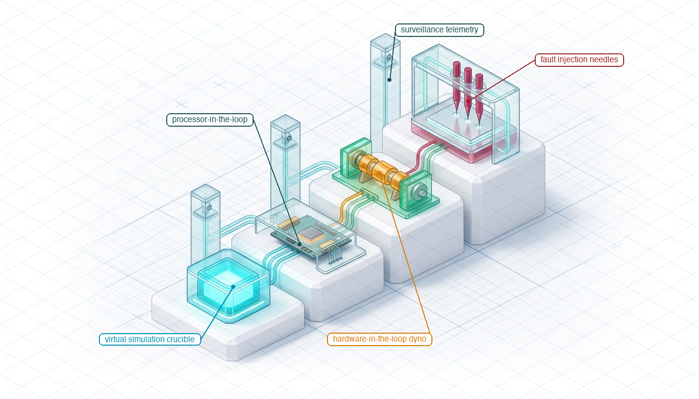
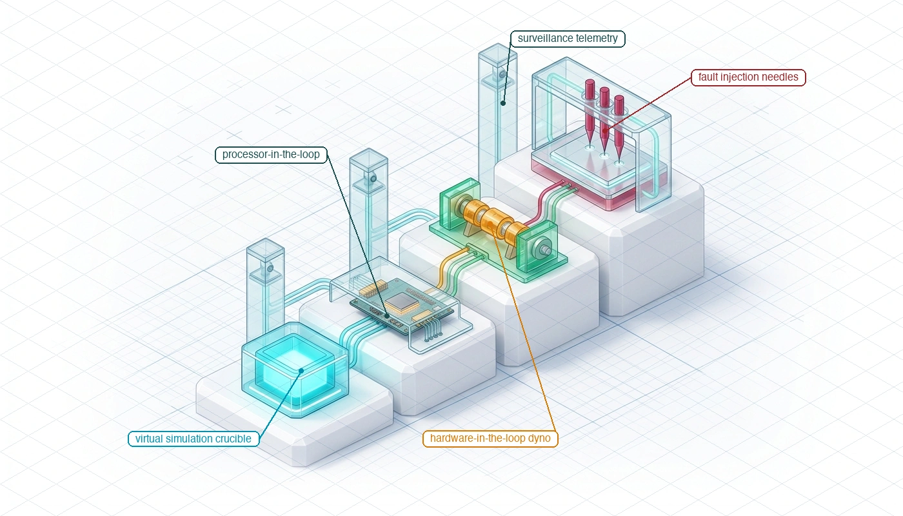
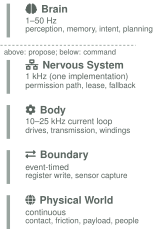
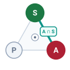
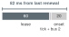
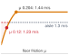
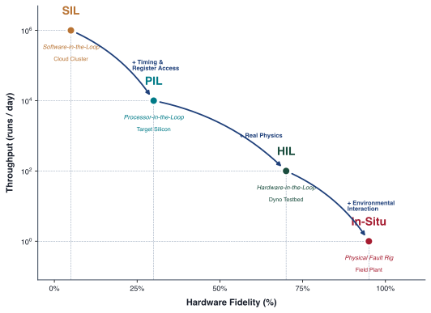
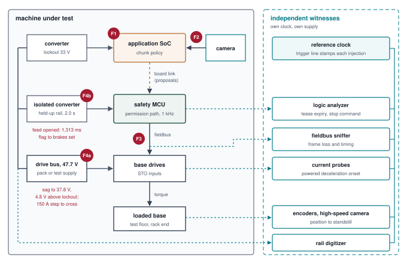
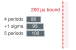
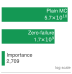

# Adversarial Verification {#sec-verification}

::: {layout-narrow}
::: {.column-margin}

\chapterminitoc

:::

::: {.content-visible when-format="pdf"}
\noindent
{fig-alt="Isometric blueprint showing adversarial cyber-physical verification: The verification process includes a four-rung qualification ladder: a virtual simulation crucible for testing algorithms, a processor-in-the-loop board for real-time testing, a hardware-in-the-loop dynamometer for testing physical components, and adversarial fault injection needles to introduce faults and assess robustness. Surveillance telemetry towers monitor system performance and collect data during tests."}
:::

::: {.content-visible unless-format="pdf"}
{fig-alt="Isometric blueprint showing adversarial cyber-physical verification: four-rung qualification ladder with virtual simulation crucible, processor-in-the-loop board, hardware-in-the-loop dynamometer, crimson adversarial fault injection needles, and surveillance telemetry towers."}
:::

:::

## Purpose {.unnumbered .unlisted}

::: {.content-visible when-format="pdf"}
\begin{marginfigure}
\resizebox{0.92\linewidth}{!}{\mlphysicalstackfull{20}{20}{20}{20}{20}}
\end{marginfigure}
:::

::: {.content-visible unless-format="pdf"}
::: {.column-margin}
{width="100%" fig-alt="Physical AI Systems Stack"}

*Physical AI stack focus for this chapter.*
:::
:::

_Why can a machine pass its normal operating tests and still fail when its protective response is needed?_

The claims that matter most in a physical machine describe what it does after something has already gone wrong, when the learned proposer stalls, an observation arrives old, a message is lost, or the supply sags while a loaded body moves toward a person. Normal operation almost never exercises those responses, so thousands of clean runs can coexist with a stopping mechanism that has never once been made to stop the machine. Without deliberate testing, the first real trial of that mechanism happens in service, where a late response delivers energy that no software correction can recall. Establishing such a claim requires creating the fault on purpose, measuring the physical response with instruments the fault cannot reach, and scoring it against acceptance conditions fixed before the test, and every condition left untested still limits what the result can support. Verification makes those limits explicit before release grants any action authority to cross the causal boundary.



::: {.callout-learning-objectives}

- Derive test conditions and stopping oracles from the machine's operating envelope
- Derive faults from design assumptions, physical hazards, and authority-transfer failures
- Select qualification environments that exercise the causal mechanism behind each claim
- Design hardware injections with independent witnesses and precommitted acceptance conditions
- Interpret temporal safety margins and search for disturbances that violate them
- Evaluate the assumptions limiting simulation transfer, rare-event estimates, and formal proofs
- Assemble fault records that preserve failed, invalid, unobservable, and untested cases

:::

## The Claim a Fault Trial Must Test {#sec-verification-fault-injection}

Every preceding chapter of this book culminates in concrete assertions about the running machine: a chunk lease that expires within its declared deadline, a deterministic permission path that halts the mobile base within its clear distance, a safety microcontroller that outlasts a voltage brownout on the shared electrical supply, or an authority arbiter that keeps a single writer on every channel while a handover is pending. The authority record that closed @sec-intervention can show weeks of clean handovers and still say nothing about a duplicate writer, a replayed packet, or a dropped heartbeat, because none occurred. Verification is the empirical discipline that converts these design assertions into auditable evidence. In embodied physical AI, the core verification challenge is distinct from purely digital software testing. The claims that matter most govern protective fallback responses that remain dormant until a subsystem breaks. Normal operation almost never exercises these safety paths, and an unexpected failure discovered in production has already crossed the causal boundary into the physical environment, releasing kinetic energy or risking collision that no subsequent software fix can undo. Protective safety mechanisms must therefore be provoked deliberately before release, under the severe physical conditions that make them necessary.

::: {.column-margin}
{width="100%" fig-alt="S·P·A locator triad highlighting the Act-to-Sense feedback edge."}

*A trial passes only when an independent sensor witnesses the act.*
:::

Policy evaluation measures how proficiently a learned candidate policy solves tasks across declared environments and operational conditions. Verification, by contrast, tests the integrated machine as a whole: proposer, runtime enforcer, communication buses, power distribution network, and physical body. High task completion rates during policy evaluation do not prove that an independent emergency stop executes reliably when the neural proposer hangs; conversely, an effective emergency stop does not demonstrate that the learned policy navigates aisles smoothly. Certifying an embodied system requires both forms of evidence collected on the exact same production hardware and software stack. This same distinction separates unconstrained policy autonomy from whole-machine operational success: an enforcer applying a least-change correction can keep the machine safe and productive during a mission while isolating and logging a dangerous proposal from the model.

::: {.column-margin .margin-pointer}
⇄ **Contrast:** Policy evaluation, which scores the learned proposer's task proficiency rather than the whole machine's protective responses, is established in @sec-evaluation.
:::

The **digital twin delusion**\index{Digital twin delusion!simulation limits}[^fn-digital-twin-origin] treats passing assertions in a virtual simulator as sufficient proof of physical safety. A physics engine or digital emulator models timing jitter, power transients, and surface traction only to the extent that its authors anticipate and calibrate those effects. A simulated controller cannot fail on an unmodeled supply sag or bus collision. Passive operational logs encourage an equally dangerous complacency: millions of incident-free operating hours simply show that catastrophic corner conditions have not yet occurred during benign runs, leaving dormant failure modes unprobed.

[^fn-digital-twin-origin]: **Digital Twin**\index{Digital twin!origin}: @grieves2017digital trace the concept to a 2002 presentation on product lifecycle management, and @glaessgen2012digital gave it the sense aerospace adopted, a simulation of one as-built vehicle, updated continually from that vehicle's own sensors and history so that it mirrors the life of its flying twin. The original meaning therefore depended on continual calibration against one particular physical article. A simulator that has never been compared with a measured stop of this machine is a model, not a twin, and treating it as a twin is the delusion this chapter names.

Adversarial fault injection\index{Adversarial fault injection!definition} resolves this problem by turning an architectural claim into a controlled, deliberate disturbance executed under independent physical containment. To count as valid engineering evidence, a fault trial cannot be an ad hoc stress test; it must declare its operating-envelope point, evaluate telemetry against precommitted oracles that leave no room for subjective interpretation, and preserve cryptographic records of the hardware and software state. The campaign must then report which points across the envelope these trials cover. Hardware test cells must physically contain the machine's kinetic energy during injection while test harnesses capture the exact temporal propagation of the fault across power rails, fieldbuses, and mechanical brakes.

```{python}
#| label: calc-verify-rack-end-oracle
#| echo: false
#| warning: false
#| message: false
# ┌─────────────────────────────────────────────────────────────────────────────
# │ RACK-END FAULT-INJECTION ORACLE FOR THE RUNNING MACHINE (LEGO)
# ├─────────────────────────────────────────────────────────────────────────────
# │ Context: fault-injection scene, operating envelope, fault list, oracles,
# │          hardware injection, fault manifest, fallacies, and summary.
# │ Goal: Derive the two oracle bounds (powered deceleration onset after the last valid renewal,
# │       stopping distance at the aisle speed) and the envelope points that
# │       F1-F4 and A1-A4 are injected at, all from the machine's registry entry.
# │ Show: 82 ms onset bound; 969.0 mm budget and 131.0 mm spare at 1.3 m/s;
# │       100.8 ms of travel in that spare, 751.6 ms at the 0.75 m/s takeover
# │       speed; the 1.44 m/s dry and 1.23 m/s inspected-floor ceilings; the
# │       37.8 V sustained drive-bus sag, 4.8 V above the 33 V converter
# │       lockout (150 A to cross it); the permission rail's 2.0 s hold-up against
# │       1313.43 ms from flag to brakes set (F4b); F1's stop oracle from the
# │       last valid renewal (751.9 mm at 1.3 m/s); the F1 record's oracle at
# │       the restricted 1.0 m/s point (629.6 mm from the last valid renewal);
# │       the Class 3 tank contrast (volume, not distance); F2's refusal
# │       threshold, the 51.6 ms budgeted dispatch age plus the 0.2 ms clock-conversion
# │       bound (51.8 ms upper age); the unbudgeted queue length that exhausts
# │       the spare (100.8 ms, about three-quarters of the pre-brake subtotal);
# │       a late-onset F1 trace's signed and normalized margins; the SoC's share
# │       of the bus transient (1.6 A of 70 A); the discrepancy a spare-sized
# │       simulated margin tolerates (0.131 in a 1 m position norm); the visible
# │       arithmetic of the reference-event notebook (217.1 mm between the capture-
# │       referenced subtotal and the F1 oracle) and the supply-headroom notebook
# │       (headroom vanishes near 129 mOhm); checkpoint givens (a 90 ms onset).
# │ How: the jerk-limited S-curve stop (calc_scurve_stop_distance / _time,
# │      calc_scurve_max_permitted_velocity) with the jerk bound taken as the
# │      reference C2 polynomial's peak jerk at the drive limit, as in
# │      @sec-planning-c2-stopping-suffix, and the three fixed overheads;
# │      calc_voltage_droop for the 48 V drive bus (M6); tank arithmetic by
# │      conservation of volume.
# └─────────────────────────────────────────────────────────────────────────────
from mlsysim import *
from mlsysim.core.units import ureg, kilogram, microsecond, millisecond, second, meter, millimeter
from mlsysim.physics.robotics import (
    calc_c2_stop_suffix,
    calc_scurve_stop_distance,
    calc_scurve_stop_time,
    calc_scurve_max_permitted_velocity,
)
from mlsysim.physics import calc_voltage_droop
from mlsysim.fmt import (
    fmt,
    fmt_latency,
    fmt_time,
    fmt_length,
    fmt_velocity,
    fmt_acceleration,
    fmt_voltage,
    fmt_current,
    fmt_temperature,
    fmt_mass,
    fmt_percent,
    fmt_power,
    fmt_int,
    fmt_resistance,
    fmt_display_math,
    check,
)

RM = Embodied.MobileManipulator.WarehouseMobileManipulator
AISLE = Embodied.Scenario.WarehouseAisle

def _num(q, unit, p):
    # Plain magnitude for the notebooks' visible arithmetic (no thousands separator inside math);
    # integer-like values print without a decimal, others at precision p
    x = q.to(unit).magnitude
    if abs(x - round(x)) < 1e-9:
        return fmt_int(round(x), commas=False)
    return fmt(x, precision=p, commas=False)

class RackEndVerification:
    """Oracle bounds and envelope points for fault injection at the rack end."""

    # ┌── 1. LOAD (Constants & Parameters) ─────────────────────────────────
    v_aisle = AISLE.v_aisle  # category: chosen
    v_drive = RM.base.max_velocity  # category: illustrative
    a_brake = AISLE.a_brake  # category: illustrative
    tau_delay = AISLE.tau_delay  # category: derived
    t_age = AISLE.perception_age  # category: derived
    eps_sync = 0.2 * millisecond  # category: illustrative (clock-conversion bound, @sec-perception-observation-contract)
    t_lease = AISLE.t_lease  # category: chosen
    t_tick = AISLE.t_tick  # category: chosen
    t_bus = AISLE.t_bus  # category: illustrative
    t_act = AISLE.t_brake_onset  # category: illustrative
    heartbeat_timeout = AISLE.heartbeat_timeout  # category: chosen
    enforcer_deadline = AISLE.enforcer_deadline  # category: chosen
    chunk_rate = RM.chunk_rate  # category: chosen
    t_takeover = AISLE.t_takeover_in_loop  # category: derived (sourced reaction, video, and handshake terms; M4)
    v_takeover = AISLE.v_takeover_in_loop  # category: derived (Delta_da-charged in-loop ceiling, rounded down; Ch14)
    d_clear = AISLE.d_clear  # category: illustrative
    delta_loc = AISLE.delta_loc  # category: illustrative
    delta_margin = AISLE.delta_margin  # category: chosen
    eps_track = AISLE.eps_track  # category: illustrative
    side_clearance = AISLE.side_clearance  # category: illustrative
    mu_dry = AISLE.mu_dry  # category: illustrative
    mu_insp = AISLE.mu_inspected_floor  # category: illustrative
    payload = RM.onboard_payload_capacity  # category: chosen
    bus_nominal = RM.drive_bus_nominal  # category: datasheet (48 V-class pack, nominal)
    bus_low = RM.drive_bus_battery_low  # category: datasheet (pack minimum)
    bus_r = RM.drive_bus_resistance  # category: illustrative (source path; needs a measured value)
    bus_uvlo = RM.drive_bus_uvlo  # category: datasheet (converter input lockout)
    i_rail = AISLE.i_rail_transient  # category: illustrative
    rail_holdup = RM.permission_rail_holdup  # category: chosen
    brake_engage_max = RM.spring_brake_engage_max  # category: illustrative
    g = (1 * ureg.standard_gravity).to(meter / second**2)  # physical constant (defined); category: derived
    # Scenario assumptions local to this chapter
    ambient_lo = ureg.Quantity(5.0, ureg.degC)  # scenario assumption; category: chosen
    ambient_hi = ureg.Quantity(35.0, ureg.degC)  # scenario assumption; category: chosen
    lease_probe = 5 * millisecond  # proposal injected after expiry; scenario assumption; category: chosen
    v_restricted = (
        1.0 * meter / second
    )  # candidate speed in the optimistic all-weight inspected-floor screen, below its ceiling; scenario assumption; category: chosen
    late_onset = 30 * millisecond  # example late powered deceleration onset (STL margin); scenario assumption; category: illustrative
    chk_onset = 90 * millisecond  # checkpoint given: a measured onset after the last valid renewal; scenario assumption; category: illustrative
    soc_power = RM.brain_soc.tdp_max  # category: datasheet (application SoC maximum module power)
    converter_eff = RM.drive_bus_converter_efficiency  # category: datasheet (typical converter efficiency)
    drive_current_limit = RM.drive_current_limit  # category: chosen (per-motor datasheet peak)
    drive_wheels = RM.drive_wheel_count  # category: chosen

    # ┌── 2. EXECUTE (Compute) ─────────────────────────────────────────────
    overhead = (delta_loc + delta_margin + eps_track).to(millimeter)
    # Jerk bound: the reference C2 polynomial's peak jerk at the drive limit (@sec-planning-c2-stopping-suffix)
    j_brake = calc_c2_stop_suffix(v_drive, a_brake)["peak_jerk"].to(meter / second**3)
    onset_bound = (t_lease + t_tick + t_bus + t_act).to(millisecond)
    upper_age = (t_age + eps_sync).to(millisecond)  # F2: dispatch-only upper-age threshold; admission/execution age continues
    lease_probe_at = (t_lease + lease_probe).to(millisecond)
    chunk_period = (1 / chunk_rate).to(millisecond)
    c2_distance = calc_scurve_stop_distance(v_aisle, a_brake, j_brake).to(millimeter)
    budget = (v_aisle * tau_delay + c2_distance + overhead).to(millimeter)
    spare = (d_clear - budget).to(millimeter)
    t_spare = (spare / v_aisle).to(millisecond)
    per_ms = (v_aisle * (1 * millisecond)).to(millimeter)
    budget_takeover = (v_takeover * tau_delay + calc_scurve_stop_distance(v_takeover, a_brake, j_brake) + overhead).to(millimeter)
    spare_takeover = (d_clear - budget_takeover).to(millimeter)
    t_spare_takeover = (spare_takeover / v_takeover).to(millisecond)
    ceiling_dry = calc_scurve_max_permitted_velocity(
        d_clear, tau_delay, a_brake, j_brake, loc_margin=delta_loc, physical_margin=delta_margin + eps_track
    ).to(meter / second)
    mu_min = float((a_brake / g).to("dimensionless").magnitude)
    # Optimistic all-weight traction screen (phi_drive = 1), not loaded qualification.
    # The floor caps the deceleration; the jerk bound belongs to the load and is unchanged.
    a_insp = min(a_brake, (mu_insp * g).to(meter / second**2))
    budget_insp = (v_aisle * tau_delay + calc_scurve_stop_distance(v_aisle, a_insp, j_brake) + overhead).to(millimeter)
    ceiling_insp = calc_scurve_max_permitted_velocity(
        d_clear, tau_delay, a_insp, j_brake, loc_margin=delta_loc, physical_margin=delta_margin + eps_track
    ).to(meter / second)
    bus_sag = calc_voltage_droop(i_rail, bus_r).to(ureg.volt)
    bus_min = (bus_low - bus_sag).to(ureg.volt)  # sustained screen from the depleted pack
    bus_margin = (bus_min - bus_uvlo).to(ureg.volt)
    i_cross = ((bus_low - bus_uvlo) / bus_r).to(ureg.ampere)  # step that would reach the lockout
    # F4: from the undervoltage or feed-loss flag, stop onset, the longest resident
    # stop in this screening branch (inspected floor at its optimistic ceiling), and brakes set
    flag_onset = (t_tick + t_bus + t_act).to(millisecond)
    stop_insp_ceiling = calc_scurve_stop_time(ceiling_insp, a_insp, j_brake).to(millisecond)
    flag_to_set = (flag_onset + stop_insp_ceiling + brake_engage_max).to(millisecond)
    holdup_margin = (rail_holdup - flag_to_set).to(millisecond)
    # F1 record at the restricted point, scored from the last valid renewal
    f1_preonset = (v_restricted * onset_bound).to(millimeter)
    f1_c2 = calc_scurve_stop_distance(v_restricted, a_insp, j_brake).to(millimeter)
    f1_stop_bound = (f1_preonset + f1_c2 + eps_track).to(millimeter)
    # F1 at the aisle speed, scored from the same event (last valid renewal)
    f1_aisle_stop_bound = (v_aisle * onset_bound + c2_distance + eps_track).to(millimeter)
    budget_restricted = (v_restricted * tau_delay + f1_c2 + overhead).to(millimeter)
    late_extra = (v_aisle * late_onset).to(millimeter)
    # Signed margins of one late-onset F1 trace against the renewal-referenced oracle
    onset_late = (onset_bound + late_onset).to(millisecond)
    travel_nominal = (v_aisle * onset_bound + c2_distance).to(millimeter)
    travel_late = (travel_nominal + late_extra).to(millimeter)
    rho_onset = (onset_bound - onset_late).to(millisecond)
    rho_dist = (f1_aisle_stop_bound - travel_late).to(millimeter)
    # Normalized by chosen scales equal to the bounds themselves
    rho_onset_n = float((rho_onset / onset_bound).to("dimensionless").magnitude)
    rho_dist_n = float((rho_dist / f1_aisle_stop_bound).to("dimensionless").magnitude)
    # Notebook nbk-verification-reference-event-gap: both sums term by term
    f1_preonset_aisle = (v_aisle * onset_bound).to(millimeter)
    capture_preonset = (v_aisle * tau_delay).to(millimeter)
    age_travel = (v_aisle * t_age).to(millimeter)
    ref_gap = (budget - f1_aisle_stop_bound).to(millimeter)
    late_equiv = (ref_gap / v_aisle).to(millisecond)  # onset slip the distance predicate alone would absorb
    sfx_v2 = (v_aisle**2 / (2 * a_brake)).to(meter)  # d_suffix, braking term (@eq-plan-c2-stopping-suffix)
    sfx_jerk = (v_aisle * a_brake / (2 * j_brake)).to(meter)  # d_suffix, jerk-ramp term
    sfx_v2_r = (v_restricted**2 / (2 * a_insp)).to(meter)
    sfx_jerk_r = (v_restricted * a_insp / (2 * j_brake)).to(meter)
    speed_cut = 1.0 - float((v_restricted / v_aisle).to("dimensionless").magnitude)
    oracle_cut = 1.0 - float((f1_stop_bound / f1_aisle_stop_bound).to("dimensionless").magnitude)
    # Notebook nbk-verification-supply-headroom: stop time T = v/a + a/j from the inspected-floor ceiling
    tstop_va = (ceiling_insp / a_insp).to(millisecond)
    tstop_aj = (a_insp / j_brake).to(millisecond)
    r_cross = ((bus_low - bus_uvlo) / i_rail).to(ureg.milliohm)  # source resistance at which the transient alone reaches lockout
    step_ratio = float((i_cross / i_rail).to("dimensionless").magnitude)
    # Checkpoint given: onset and pre-braking travel of a late F1 onset
    chk_rho = (onset_bound - chk_onset).to(millisecond)
    chk_extra = (v_aisle * (chk_onset - onset_bound)).to(millimeter)
    # Shared-bus sag attribution: the application SoC's maximum draw from the depleted bus
    soc_current = (soc_power / (bus_low * converter_eff)).to(ureg.ampere)
    drive_peak = (drive_current_limit * drive_wheels).to(ureg.ampere)
    soc_share = float((soc_current / i_rail).to("dimensionless").magnitude)
    # Sim-to-real instance: position error in meters (L_phi = 1 m per unit of the norm);
    # a simulated margin equal to the spare tolerates at most this discrepancy
    eps_gap_max = float((spare / (1 * meter)).to("dimensionless").magnitude)
    # Fallacy: an unbudgeted queue spends the spare at v per unit time, so the
    # queue length that exhausts it is the spare's travel time t_spare.
    queue_exhaust_ratio = (t_spare / tau_delay).to("dimensionless").magnitude

    # ┌── 3. GUARD (Assertions) ────────────────────────────────────────────
    check(abs(onset_bound.magnitude - 82.0) < 1e-9, "Canon: powered deceleration onset 82 ms after the last valid renewal.")
    check(abs(tau_delay.to(millisecond).magnitude - 133.6) < 5e-3, "Canon: tau_delay 133.6 ms.")
    check(abs(t_age.to(millisecond).magnitude - 51.6) < 5e-3, "Canon: t_age 51.6 ms.")
    check(abs(eps_sync.to(millisecond).magnitude - 0.2) < 1e-9, "Clock-conversion bound must match the perception contract's 0.2 ms.")
    check(abs(upper_age.magnitude - 51.8) < 5e-3, "Canon (D22): F2 dispatch-age check refuses above a 51.8 ms upper age.")
    check(abs(j_brake.magnitude - 64.0 / 9.0) < 1e-9, "Canon: the jerk bound is the reference polynomial's 7.11 m/s^3 peak.")
    check(abs(budget.magnitude - 968.9925) < 5e-3, "Canon: budget at 1.3 m/s is 968.99 mm.")
    check(abs(spare.magnitude - 131.0075) < 5e-3, "Canon: spare at 1.3 m/s is 131.01 mm.")
    check(abs(c2_distance.magnitude - 605.3125) < 5e-3, "Canon: S-curve stop at 1.3 m/s is 605.31 mm.")
    check(abs(t_spare.magnitude - 100.775) < 5e-3, "Canon: T_latest 100.8 ms.")
    check(abs(ceiling_dry.magnitude - 1.4367) < 5e-5, "Canon: dry-floor ceiling 1.4367 m/s.")
    check(abs(ceiling_insp.magnitude - 1.2309) < 5e-5, "Canon: inspected-floor ceiling 1.2309 m/s.")
    check(abs(mu_min - 0.204) < 5e-4, "Canon: friction needed for a_brake is 0.204.")
    check(abs(bus_min.magnitude - 37.8) < 5e-3, "Canon: the depleted drive bus sags to 37.8 V.")
    check(abs(bus_margin.magnitude - 4.8) < 5e-3, "The sustained screen leaves 4.8 V above the converter lockout.")
    check(abs(i_cross.magnitude - 150.0) < 1e-6, "Reaching the lockout takes a 150 A step.")
    check(bus_min > bus_uvlo, "The load alone cannot cross the lockout, so F4a must inject a supply dip.")
    check(v_aisle < ceiling_dry and ceiling_insp < v_aisle, "Aisle speed sits between the two ceilings.")
    check(budget_insp > d_clear, "At the aisle speed the inspected-floor budget must exceed the clear distance.")
    check(mu_insp < mu_min < mu_dry, "The all-weight screen permits a_brake on dry floor, not inspected floor.")
    check(t_spare < tau_delay, "A queue shorter than the budgeted pre-brake subtotal exhausts the spare.")
    check(abs(queue_exhaust_ratio - 0.754) < 5e-4, "The exhausting queue is about three-quarters of the pre-brake subtotal.")
    check(abs(overhead.magnitude - 190.0) < 1e-6, "Canon: fixed overhead 190 mm.")
    check(
        rho_onset.magnitude < 0 and abs(rho_dist.magnitude - 1.0) < 1e-9, "The nominal late trace fails onset but retains 1 mm of distance allowance."
    )
    check(abs(rho_onset_n + 30.0 / 82.0) < 1e-9, "Normalized onset margin is -30/82.")
    check(rho_onset_n < 0 < rho_dist_n, "Only the onset predicate fails in the nominal trace.")
    check(soc_current < 0.05 * i_rail, "The SoC draws a few percent of the rail transient; drive current dominates.")
    check(drive_peak <= i_rail, "Two drive motors at their peak supply most of the transient.")
    check(abs(eps_gap_max - spare.to(meter).magnitude) < 1e-12, "Tolerable discrepancy equals the spare in meters.")
    check(abs(v_takeover.to(meter / second).magnitude - 0.75) < 1e-9, "Canon: in-loop takeover speed 0.75 m/s (derived, Ch14).")
    check(
        t_spare_takeover >= t_takeover + AISLE.t_dispatch_to_admission, "At the slowed speed the spare must cover the in-loop takeover and Delta_da."
    )
    check(t_spare < t_takeover, "At the aisle speed the spare cannot cover the in-loop takeover.")
    check(abs(spare_takeover.magnitude - 563.71) < 5e-2, "Canon: spare at the 0.75 m/s takeover speed is 563.7 mm.")
    check(abs(t_spare_takeover.magnitude - 751.6) < 5e-2, "Canon: T_latest 751.6 ms at 0.75 m/s.")
    check(abs(flag_onset.magnitude - 22.0) < 1e-9, "Canon: stop onset within 22 ms of the flag.")
    check(abs(rail_holdup.to(second).magnitude - 2.0) < 1e-9, "Canon: permission-rail hold-up 2.0 s.")
    check(abs(flag_to_set.magnitude - 1313.43) < 5e-3, "Canon: flag to brakes set 1313.43 ms.")
    check(abs(holdup_margin.magnitude - 686.57) < 5e-3, "Canon: hold-up margin 686.57 ms.")
    check(v_restricted < ceiling_insp, "The restricted point must sit below the inspected-floor ceiling.")
    check(abs(f1_preonset.magnitude - 82.0) < 1e-6, "Canon: 82 mm of pre-onset travel at 1.0 m/s.")
    check(abs(f1_c2.magnitude - 507.6) < 5e-2, "Canon: S-curve stop at 1.0 m/s on the inspected floor is 507.6 mm.")
    check(abs(f1_stop_bound.magnitude - 629.6) < 5e-2, "Canon: F1 stop oracle 629.6 mm from the last valid renewal.")
    check(
        abs(f1_aisle_stop_bound.magnitude - 751.9125) < 5e-3 and f1_aisle_stop_bound < budget,
        "F1 stop oracle at 1.3 m/s is 751.91 mm from the last valid renewal.",
    )
    check(
        abs(budget_restricted.magnitude - 831.2) < 5e-2 and budget_restricted < d_clear,
        "Canon: budget at 1.0 m/s on the inspected floor is 831.2 mm.",
    )
    # margin_renewal_onset_deadline_bar.svg fig-alt hand-types 60, 1, 1, and 20 ms (82 ms guarded above)
    check(
        abs(t_lease.to(millisecond).magnitude - 60.0) < 1e-9
        and abs(t_tick.to(millisecond).magnitude - 1.0) < 1e-9
        and abs(t_bus.to(millisecond).magnitude - 1.0) < 1e-9
        and abs(t_act.to(millisecond).magnitude - 20.0) < 1e-9,
        "Onset-bar fig-alt: lease 60 ms, tick 1 ms, bus 1 ms, onset 20 ms.",
    )
    # margin_floor_friction_ceiling_knee.svg fig-alt hand-types mu 0.12 and 1.3 m/s (0.204, 1.44, 1.23 guarded above)
    check(abs(mu_insp - 0.12) < 1e-9 and abs(v_aisle.to(meter / second).magnitude - 1.3) < 1e-9, "Knee fig-alt: mu 0.12, aisle 1.3 m/s.")
    # Reference-event notebook: the closed-form stop matches the MLSysIM S-curve, and the
    # capture-referenced subtotal exceeds the F1 oracle by exactly age travel plus the two margins
    check(abs((sfx_v2 + sfx_jerk).to(millimeter).magnitude - c2_distance.magnitude) < 1e-6, "d_suffix = v^2/2a + v a/2j at 1.3 m/s.")
    check(abs((sfx_v2_r + sfx_jerk_r).to(millimeter).magnitude - f1_c2.magnitude) < 1e-6, "d_suffix = v^2/2a + v a/2j at 1.0 m/s.")
    check(v_restricted > a_insp**2 / j_brake and v_aisle > a_brake**2 / j_brake, "Both stops reach the deceleration plateau.")
    check(
        abs(ref_gap.magnitude - (age_travel + delta_loc + delta_margin).to(millimeter).magnitude) < 1e-6,
        "Gap = age travel + delta_loc + delta_margin.",
    )
    check(
        abs(ref_gap.magnitude - 217.08) < 5e-3 and 2 * onset_bound < late_equiv < 2.1 * onset_bound,
        "The 217.1 mm gap hides about twice the onset bound.",
    )
    check(abs(speed_cut - 0.231) < 5e-4 and abs(oracle_cut - 0.163) < 5e-4, "A 23 percent slower point shortens the oracle 16 percent.")
    check(abs((tstop_va + tstop_aj - stop_insp_ceiling).magnitude) < 1e-6, "Stop time T = v/a + a/j at the inspected ceiling.")
    check(
        abs(r_cross.magnitude - 128.571) < 5e-3 and 2.0 < step_ratio < 2.2,
        "Headroom vanishes near 129 mOhm; the crossing step is about twice the transient.",
    )
    check(
        rho_onset_n < float((rho_dist / eps_track).to("dimensionless").magnitude),
        "Checkpoint: onset still sets the combined score with the tracking inset as distance scale.",
    )
    check(abs(chk_rho.magnitude + 8.0) < 1e-9 and abs(chk_extra.magnitude - 10.4) < 1e-6, "Checkpoint: 90 ms onset misses by 8 ms and adds 10.4 mm.")

    # ┌── 4. OUTPUT (Format & Export) ────────────────────────────────────────
    v_aisle_str = fmt_velocity(v_aisle, precision=1)
    v_drive_str = fmt_velocity(v_drive, precision=1)
    a_brake_str = fmt_acceleration(a_brake, precision=None)
    a_insp_str = fmt_acceleration(a_insp, precision=2)
    tau_delay_str = fmt_latency(tau_delay, unit=millisecond, precision=1)
    t_age_str = fmt_latency(t_age, unit=millisecond, precision=1)
    eps_sync_str = fmt_latency(eps_sync, unit=millisecond, precision=1)
    upper_age_str = fmt_latency(upper_age, unit=millisecond, precision=1)
    t_lease_str = fmt_latency(t_lease, unit=millisecond, precision=0)
    t_tick_str = fmt_latency(t_tick, unit=millisecond, precision=None)
    t_bus_str = fmt_latency(t_bus, unit=millisecond, precision=None)
    t_act_str = fmt_latency(t_act, unit=millisecond, precision=0)
    onset_bound_str = fmt_latency(onset_bound, unit=millisecond, precision=0)
    lease_probe_at_str = fmt_latency(lease_probe_at, unit=millisecond, precision=0)
    heartbeat_timeout_str = fmt_latency(heartbeat_timeout, unit=millisecond, precision=0)
    enforcer_deadline_str = fmt_latency(enforcer_deadline, unit=microsecond, precision=0)
    chunk_period_str = fmt_latency(chunk_period, unit=millisecond, precision=0)
    t_takeover_str = fmt_latency(t_takeover, unit=millisecond, precision=0)
    v_takeover_str = fmt_velocity(v_takeover, precision=2)
    d_clear_str = fmt_length(d_clear, unit=meter, precision=2)
    side_clearance_str = fmt_length(side_clearance, unit=meter, precision=2)
    budget_str = fmt_length(budget, unit=millimeter, precision=1)
    spare_str = fmt_length(spare, unit=millimeter, precision=1)
    t_spare_str = fmt_latency(t_spare, unit=millisecond, precision=1)
    spare_takeover_str = fmt_length(spare_takeover, unit=millimeter, precision=1)
    t_spare_takeover_str = fmt_latency(t_spare_takeover, unit=millisecond, precision=1)
    per_ms_str = fmt_length(per_ms, unit=millimeter, precision=1)
    ceiling_dry_str = fmt_velocity(ceiling_dry, precision=2)
    ceiling_insp_str = fmt_velocity(ceiling_insp, precision=2)
    budget_insp_str = fmt_length(budget_insp, unit=meter, precision=2)
    mu_min_str = fmt(mu_min, precision=3)
    mu_dry_str = fmt(mu_dry, precision=2)
    mu_insp_str = fmt(mu_insp, precision=2)
    payload_str = fmt_mass(payload, unit=kilogram, precision=0)
    ambient_lo_str = fmt_temperature(ambient_lo, precision=0)
    ambient_hi_str = fmt_temperature(ambient_hi, precision=0)
    bus_nominal_str = fmt_voltage(bus_nominal, precision=1)
    bus_low_str = fmt_voltage(bus_low, precision=0)
    bus_uvlo_str = fmt_voltage(bus_uvlo, precision=0)
    i_rail_str = fmt_current(i_rail, precision=0)
    bus_min_str = fmt_voltage(bus_min, precision=1)
    bus_margin_str = fmt_voltage(bus_margin, precision=1)
    i_cross_str = fmt_current(i_cross, precision=0)
    flag_onset_str = fmt_latency(flag_onset, unit=millisecond, precision=0)
    rail_holdup_str = fmt_latency(rail_holdup, unit=second, precision=None)
    flag_to_set_str = fmt_latency(flag_to_set, unit=millisecond, precision=2)
    v_restricted_str = fmt_velocity(v_restricted, precision=None)
    f1_stop_bound_str = fmt_length(f1_stop_bound, unit=millimeter, precision=1)
    f1_aisle_stop_bound_str = fmt_length(f1_aisle_stop_bound, unit=millimeter, precision=1)
    budget_restricted_str = fmt_length(budget_restricted, unit=millimeter, precision=1)
    late_onset_str = fmt_latency(late_onset, unit=millisecond, precision=0)
    late_extra_str = fmt_length(late_extra, unit=millimeter, precision=None)
    onset_late_str = fmt_latency(onset_late, unit=millisecond, precision=0)
    travel_nominal_str = fmt_length(travel_nominal, unit=millimeter, precision=1)
    travel_late_str = fmt_length(travel_late, unit=millimeter, precision=1)
    rho_onset_str = fmt_time(rho_onset, unit=millisecond, precision=0, allow_negative=True)
    rho_dist_str = fmt_length(rho_dist, unit=millimeter, precision=None)
    rho_onset_n_str = fmt(rho_onset_n, precision=3)
    rho_dist_n_str = fmt(rho_dist_n, precision=3)
    soc_power_str = fmt_power(soc_power, unit=ureg.watt, precision=0)
    soc_current_str = fmt_current(soc_current, precision=1)
    drive_peak_str = fmt_current(drive_peak, precision=0)
    soc_share_pct_str = fmt_percent(soc_share, precision=1, style="prose")
    eps_gap_max_str = fmt(eps_gap_max, precision=3)
    queue_exhaust_pct_str = fmt_percent(queue_exhaust_ratio, precision=1, style="prose")
    # Notebook, checkpoint, and definition strings
    j_brake_str = fmt(j_brake.magnitude, precision=2)
    eps_track_str = fmt_length(eps_track, unit=millimeter, precision=0)
    delta_loc_str = fmt_length(delta_loc, unit=millimeter, precision=0)
    delta_margin_str = fmt_length(delta_margin, unit=millimeter, precision=0)
    ref_gap_str = fmt_length(ref_gap, unit=millimeter, precision=1)
    age_travel_str = fmt_length(age_travel, unit=millimeter, precision=1)
    late_equiv_str = fmt_latency(round(late_equiv.magnitude) * millisecond, unit=millisecond, precision=0)  # displayed as "about"
    speed_cut_pct_str = fmt_percent(speed_cut, precision=1, style="prose")
    oracle_cut_pct_str = fmt_percent(oracle_cut, precision=1, style="prose")
    chk_onset_str = fmt_latency(chk_onset, unit=millisecond, precision=0)
    bus_r_str = fmt_resistance(bus_r, unit=ureg.milliohm, precision=0)
    brake_engage_str = fmt_latency(brake_engage_max, unit=millisecond, precision=0)
    holdup_margin_str = fmt_latency(holdup_margin, unit=millisecond, precision=1)
    r_cross_str = fmt_resistance(round(r_cross.magnitude) * ureg.milliohm, unit=ureg.milliohm, precision=0)  # displayed as "about"
    _ms, _mm, _mps, _mps2 = millisecond, millimeter, meter / second, meter / second**2
    onset_math = fmt_display_math(
        rf"t_{{\text{{onset}}}} \le T_{{\text{{lease}}}} + T_{{\text{{tick}}}} + T_{{\text{{bus}}}} + T_{{\text{{act}}}}"
        rf" = {_num(t_lease, _ms, 0)} + {_num(t_tick, _ms, 0)} + {_num(t_bus, _ms, 0)} + {_num(t_act, _ms, 0)}"
        rf" = {_num(onset_bound, _ms, 0)}\ \text{{ms}}"
    )
    suffix_math = fmt_display_math(
        rf"d_{{\text{{suffix}}}}(v) = \frac{{v^2}}{{2a_{{\text{{brake}}}}}} + \frac{{v\,a_{{\text{{brake}}}}}}{{2j_{{\max}}}}"
        rf" = \frac{{{_num(v_aisle, _mps, 1)}^2}}{{2 \times {_num(a_brake, _mps2, 1)}}}"
        rf" + \frac{{{_num(v_aisle, _mps, 1)} \times {_num(a_brake, _mps2, 1)}}}{{2 \times {j_brake_str}}}"
        rf" = {_num(sfx_v2, meter, 4)} + {_num(sfx_jerk, meter, 4)} = {_num(sfx_v2 + sfx_jerk, meter, 4)}\ \text{{m}}"
    )
    f1_math = fmt_display_math(
        rf"d_{{\text{{F1}}}}(v) = {_num(v_aisle, _mps, 1)} \times {_num(onset_bound, _ms, 0)} + {_num(c2_distance, _mm, 1)} + {_num(eps_track, _mm, 0)}"
        rf" = {_num(f1_preonset_aisle, _mm, 1)} + {_num(c2_distance, _mm, 1)} + {_num(eps_track, _mm, 0)}"
        rf" = {_num(f1_aisle_stop_bound, _mm, 1)}\ \text{{mm}}"
    )
    capture_math = fmt_display_math(
        rf"v\,\tau_{{\text{{delay}}}} + d_{{\text{{suffix}}}} + \delta_{{\text{{loc}}}} + \delta_{{\text{{margin}}}} + \epsilon_{{\text{{track}}}}"
        rf" = {_num(v_aisle, _mps, 1)} \times {_num(tau_delay, _ms, 1)} + {_num(c2_distance, _mm, 1)} + {_num(delta_loc, _mm, 0)} + {_num(delta_margin, _mm, 0)} + {_num(eps_track, _mm, 0)}"
        rf" = {_num(budget, _mm, 1)}\ \text{{mm}}"
    )
    gap_math = fmt_display_math(
        rf"{_num(budget, _mm, 1)} - {_num(f1_aisle_stop_bound, _mm, 1)} = {_num(v_aisle, _mps, 1)} \times {_num(t_age, _ms, 1)} + {_num(delta_loc, _mm, 0)} + {_num(delta_margin, _mm, 0)}"
        rf" = {_num(age_travel, _mm, 1)} + {_num(delta_loc + delta_margin, _mm, 0)} = {_num(ref_gap, _mm, 1)}\ \text{{mm}}"
    )
    restricted_math = fmt_display_math(
        rf"d_{{\text{{F1}}}}({_num(v_restricted, _mps, 1)}) = {_num(v_restricted, _mps, 1)} \times {_num(onset_bound, _ms, 0)}"
        rf" + \left(\frac{{{_num(v_restricted, _mps, 1)}^2}}{{2 \times {_num(a_insp, _mps2, 3)}}} + \frac{{{_num(v_restricted, _mps, 1)} \times {_num(a_insp, _mps2, 3)}}}{{2 \times {j_brake_str}}}\right)\text{{m}}"
        rf" + {_num(eps_track, _mm, 0)} = {_num(f1_preonset, _mm, 1)} + {_num(f1_c2, _mm, 1)} + {_num(eps_track, _mm, 0)} = {_num(f1_stop_bound, _mm, 1)}\ \text{{mm}}"
    )
    sag_math = fmt_display_math(
        rf"V_{{\min}} = V_{{\text{{low}}}} - I\,R = {_num(bus_low, ureg.volt, 1)} - {_num(i_rail, ureg.ampere, 0)} \times {_num(bus_r, ureg.ohm, 3)}"
        rf" = {_num(bus_min, ureg.volt, 1)}\ \text{{V}}, \qquad I_{{\text{{cross}}}} = \frac{{V_{{\text{{low}}}} - V_{{\text{{UVLO}}}}}}{{R}}"
        rf" = \frac{{{_num(bus_low, ureg.volt, 1)} - {_num(bus_uvlo, ureg.volt, 0)}}}{{{_num(bus_r, ureg.ohm, 3)}}} = {_num(i_cross, ureg.ampere, 0)}\ \text{{A}}"
    )
    holdup_math = fmt_display_math(
        rf"t_{{\text{{set}}}} = (T_{{\text{{tick}}}} + T_{{\text{{bus}}}} + T_{{\text{{act}}}}) + \left(\frac{{v}}{{a}} + \frac{{a}}{{j_{{\max}}}}\right) + t_{{\text{{engage}}}}"
        rf" = {_num(flag_onset, _ms, 0)} + \left(\frac{{{_num(ceiling_insp, _mps, 3)}}}{{{_num(a_insp, _mps2, 3)}}} + \frac{{{_num(a_insp, _mps2, 3)}}}{{{j_brake_str}}}\right)\text{{s}} + {_num(brake_engage_max, _ms, 0)}"
        rf" = {_num(flag_onset, _ms, 0)} + {_num(tstop_va, _ms, 1)} + {_num(tstop_aj, _ms, 1)} + {_num(brake_engage_max, _ms, 0)} = {_num(flag_to_set, _ms, 1)}\ \text{{ms}}"
    )
```

```{python}
#| label: calc-verify-admission-charge
#| echo: false
#| warning: false
#| message: false
# ┌─────────────────────────────────────────────────────────────────────────────
# │ THE DISPATCH-TO-ADMISSION CHARGE AGAINST THE RACK-END SPARE (LEGO)
# ├─────────────────────────────────────────────────────────────────────────────
# │ Context: @sec-verification-operating-envelope (stopping-budget paragraph),
# │          @fig-15-reference-events, the A3 paragraph of
# │          @sec-verification-forward-analysis, @tbl-15-fault-classification
# │          (F4a row), @sec-verification-hardware-timing-search, and
# │          @sec-verification-importance-sampling.
# │ Goal: Charge the allocated dispatch-to-admission interval of
# │       @sec-placement-dispatch-admission to the aisle-speed spare, as the
# │       placement and intervention chapters do, and give F4a a distance bound
# │       from its flag for the case in which the drives keep their authority.
# │ Show: 63.3 ms allocation; 82.3 mm of travel at 1.3 m/s; 48.7 mm and
# │       37.5 ms of the 131.0 mm / 100.8 ms spare left; F4a bound from the
# │       flag 673.9 mm (22 ms onset, resident stop, tracking inset).
# │ How: Delta_da is AISLE.t_dispatch_to_admission (MLSysIM), an allocation,
# │      not a measurement; remainders by subtraction from RackEndVerification.
# └─────────────────────────────────────────────────────────────────────────────
from mlsysim import Embodied
from mlsysim.core.units import millisecond, millimeter
from mlsysim.fmt import fmt_latency, fmt_length, check

class AdmissionChargeVerification:
    """The allocated dispatch-to-admission interval charged to the aisle-speed spare."""

    # ┌── 1. LOAD (Constants & Parameters) ─────────────────────────────────
    R = RackEndVerification  # category: derived; calc in this chapter's oracle cell
    delta_da = (
        Embodied.Scenario.WarehouseAisle.t_dispatch_to_admission
    )  # category: illustrative (allocation of @sec-placement-dispatch-admission, not a measurement)

    # ┌── 2. EXECUTE (Compute) ─────────────────────────────────────────────
    travel_da = (R.v_aisle * delta_da).to(millimeter)
    spare_left = (R.spare - travel_da).to(millimeter)
    t_left = (R.t_spare - delta_da).to(millisecond)
    # F4a with surviving drive authority: flag-referenced onset, resident stop, tracking inset
    f4a_bound = (R.v_aisle * R.flag_onset + R.c2_distance + R.eps_track).to(millimeter)

    # ┌── 3. GUARD (Assertions) ────────────────────────────────────────────
    check(abs(delta_da.to(millisecond).magnitude - 63.3) < 0.05, "Canon: Delta_da allocation 63.3 ms.")
    check(abs(travel_da.magnitude - 82.3) < 0.05, "Delta_da costs 82.3 mm at the aisle speed.")
    check(abs(spare_left.magnitude - 48.7) < 0.05, "Canon: 48.7 mm of the spare survive the charge.")
    check(abs(t_left.magnitude - 37.5) < 0.05, "Canon: 37.5 ms of waiting survive the charge at the aisle speed.")
    check(delta_da < R.t_spare, "The allocation must fit inside the spare-exhausting ceiling.")
    check(abs(f4a_bound.magnitude - 673.9) < 0.05 and f4a_bound < R.f1_aisle_stop_bound, "F4a bound from the flag is 673.9 mm.")

    # ┌── 4. OUTPUT (Format & Export) ────────────────────────────────────────
    delta_da_str = fmt_latency(delta_da, unit=millisecond, precision=1)
    travel_da_str = fmt_length(travel_da, unit=millimeter, precision=1)
    spare_left_str = fmt_length(spare_left, unit=millimeter, precision=1)
    t_left_str = fmt_latency(t_left, unit=millisecond, precision=1)
    f4a_bound_str = fmt_length(f4a_bound, unit=millimeter, precision=1)
```

Consider the warehouse mobile manipulator navigating an aisle at `{python} RackEndVerification.v_aisle_str` (chosen; see the Reader Guide) toward a rack end where a pedestrian may step out from a blind intersection. The learned proposer might abruptly stop renewing motion commands while the base continues rolling under momentum. An architectural authority diagram specifies which subsystem must take over, but that specification does not prove that the physical permission path survives the crash or that mechanical brakes engage before impact. An empirical trial that induces the fault and measures physical motion supplies evidence for the named protective response under its declared conditions. To structure that trial, the test harness must reflect how the machine partitions execution across its physical substrates: an application system-on-chip (SoC) equipped with an embedded accelerator executes the unprivileged learned proposers (the vision-language-action intent model and the chunk policy beneath it), while a lockstep safety microcontroller executes the deterministic runtime enforcer. The safety microcontroller commands the base-drive motor inverters across a hard real-time fieldbus (EtherCAT, or Controller Area Network with Flexible Data-Rate, CAN FD) whose cyclic frames arrive on a strict, microsecond-scale schedule. Both processors draw power from the shared `{python} RackEndVerification.bus_nominal_str` drive bus that powers the traction motors: the application SoC through a buck-boost converter, and the safety microcontroller through an isolated converter backed by a dedicated, held-up permission rail.

Weeks of uneventful operational logs at that speed say little about four severe hardware and timing faults that the architecture claims to contain:

1. **Proposer Stall (F1):** The chunk policy, the fast proposer of @sec-brain-two-proposers that renews motion every `{python} RackEndVerification.chunk_period_str`, has its latest proposal successfully admitted by the permission path, renewing its chunk lease, but immediately suffers a thread deadlock, driver lockup, or thermal throttling freeze.
2. **Stale Observation (F2):** A camera frame or depth tensor arrives at the permission path with an aged or corrupted hardware timestamp after silent queuing in an image signal processor (ISP) buffer or direct memory access (DMA) ring.
3. **Lost Fieldbus Frames (F3):** Electromagnetic interference (EMI) from high-current inverter switching corrupts or drops a burst of EtherCAT or CAN FD frames between the safety microcontroller and the wheel actuators.
4. **Drive-Bus Droop and Feed Loss (F4a/F4b):** A supply injector steps the shared `{python} RackEndVerification.bus_nominal_str` drive bus below the `{python} RackEndVerification.bus_uvlo_str` lockout threshold of the converter feeding the application processor under the declared drive load (F4a), or the permission rail itself loses its primary electrical feed (F4b).

These physical failure modes F1–F4, paired with the supervisory authority transfer faults A1–A4 (formalized in @tbl-15-fault-classification), organize the entire verification campaign. In theory, each threat has a dedicated countermeasure: the lease detects a hung proposer, the evidence-epoch check discards stale sensor frames, the fieldbus watchdog flags dropped communication cycles, and the isolated undervoltage supervisor manages electrical brownouts. In practice, adversarial verification injects each disturbance as the robot approaches the rack end, alongside the four authority handoff faults that the authority record hands over (@sec-intervention-evidence-tuples), and scores every stopping trial against temporal and distance bounds derived from the machine's own stopping budget.

An injected fault converts a physical trial into valid evidence for an auditable safety case only when the experiment satisfies the five requirements of the **cyber-physical test contract**:

1. **A bounded claim:** The test specifies the exact invariant the machine must maintain. For the mobile base at the rack end, the machine must come to a complete stop within the `{python} RackEndVerification.d_clear_str` clear distance.
2. **Defined test conditions:** The specification bounds every relevant physical variable, including initial velocity, payload mass, floor friction, ambient operating temperature, bus traffic saturation, and DC supply voltages.
3. **A precommitted oracle\index{Testing!Oracle}:** An automated evaluation harness inspects captured telemetry against the claim without human intervention, retrospective threshold tuning, or post-hoc excuses (@sec-verification-oracles-acceptance defines the oracle formally).
4. **A stated sampling and injection procedure:** The test harness exercises the machine systematically across its operational envelope, deliberately triggering faults in sensors, buses, power rails, and actuators during peak mechanical and computational load.
5. **Provenance\index{Provenance}:** The campaign logs complete cryptographic digests of model weights, calibration tables, sensor serial numbers, oscilloscope traces, and raw bus logs to enable matched re-execution. Software builds can be reproduced bit for bit; a physical trial can be replicated only when repeated under physical conditions that match declared tolerances.

The base's stopping claim and the manipulator arm's latch-force claim require separate operational envelopes, injection points, and acceptance criteria; this chapter follows the mobile base's stopping claim. Fixing the contract starts with its second element, the declared conditions under which the claim must hold, which also locate the point beyond which nominal regulation must yield to an independent containment response.

## The Operating Envelope {#sec-verification-operating-envelope}

An operating envelope couples the external operational design domain (ODD) with the internal execution state of the computing and actuation hardware. A mobile robot carrying a full payload down a warehouse aisle behaves very differently when memory bus contention delays perception pipelines, when battery supply rails sag under acceleration, or when drive inverters heat up under sustained torque. Empirical verification is therefore meaningless without specifying both dimensions: every protective claim must declare the environmental bounds and the internal computational and electrical loads under which it is guaranteed to hold.

For the mobile manipulator, the operating envelope declares the range of conditions over which the protective claim must hold. The campaign samples a discrete set of qualification points within that range; extending their results to untested points requires an explicit coverage argument. These points span an aisle speed of `{python} RackEndVerification.v_aisle_str`, payload masses ranging from an unloaded chassis to the full `{python} RackEndVerification.payload_str` rack capacity, and ambient operating temperatures from `{python} RackEndVerification.ambient_lo_str` to `{python} RackEndVerification.ambient_hi_str`. Surface friction must also be parameterized explicitly. In an optimistic all-weight traction screen, dry aisles require a friction coefficient of at least `{python} RackEndVerification.mu_min_str` to support the design braking deceleration of `{python} RackEndVerification.a_brake_str`, whereas areas under the facility floor inspection regime guarantee only `{python} RackEndVerification.mu_insp_str`. The screen assumes that the driven wheels carry the entire weight; the actual base requires a qualified loaded deceleration that respects driven-wheel load share, configured braking current, and tip stability. For these inspected surfaces, the screen identifies a candidate restricted point at `{python} RackEndVerification.v_restricted_str`, whose friction premise must be logged in the enforcement telemetry. Verification trials on inspected floors must run against a physical test surface calibrated to this `{python} RackEndVerification.mu_insp_str` threshold and must recalculate the oracles from the qualified loaded deceleration before testing the actual base.

Each physical configuration couples directly to the machine's internal execution state. Trials must evaluate application-processor utilization driven to peak neural inference bursts, drive-bus voltages sweeping from a depleted `{python} RackEndVerification.bus_low_str` up to a nominal `{python} RackEndVerification.bus_nominal_str`, transmission jitter across EtherCAT or CAN FD buses, DRAM crossbar contention, and the thermal state of the safety microcontroller. The verification campaign also challenges transient edge conditions, chief among them a human takeover while the base is moving. @Sec-intervention-clearance-deadlines screens a candidate in-loop takeover, with its `{python} RackEndVerification.t_takeover_str` conservative response-and-exchange allowance, at the `{python} RackEndVerification.v_takeover_str` slow-down; the same moving handover is infeasible at the `{python} RackEndVerification.v_aisle_str` aisle speed and must be rejected. The slow-down remains a qualification candidate, conditional on operator response, admission delay, current clearance, and a feasible stopping continuation. The operative design stops the base before handing over. Both speeds therefore belong in the campaign, one to challenge a candidate moving transition and one to verify its rejection. The system must enforce a local stop whenever an authority transition cannot safely preserve the verified stopping envelope.

::: {.column-margin .margin-pointer}
↩ The rule that an authority transition unable to preserve the stopping envelope ends in a local stop is established in @sec-intervention-clearance-deadlines.
:::

::: {#dfn-verification-operating-envelope .callout-definition title="Operating envelope"}

***Operating envelope***\index{Operating envelope!definition} is the declared set of external conditions and internal execution states, each point stated with its units and tolerances, over which a machine's protective claim must hold and at which every trial of that claim is run.

1.  **Significance**: The envelope governs which terms of the inequality $\StoppingDistance \le \ClearDistance$ are stressed during an empirical trial. For the running machine, an aisle speed of `{python} RackEndVerification.v_aisle_str` falls below the optimistic `{python} RackEndVerification.ceiling_dry_str` ceiling on a dry floor, yet exceeds the `{python} RackEndVerification.ceiling_insp_str` ceiling on an inspected surface. The identical velocity therefore passes the all-weight screen on one surface and fails it on another; passing still requires loaded qualification before admission.
2.  **Distinction**: The operational design domain describes the external environment encountered by the planning policy. The operating envelope expands this definition to incorporate internal machine states, including processor utilization, drive-bus voltages between `{python} RackEndVerification.bus_low_str` and `{python} RackEndVerification.bus_nominal_str`, and communication bus saturation. The same physical aisle yields vastly different safety margins under memory contention or electrical depletion.
3.  **Common pitfall**: A frequent mistake is treating an operating envelope as a simple Cartesian product of decoupled intervals, assuming that testing each parameter independently at its minimum and maximum guarantees coverage. In cyber-physical systems, multi-dimensional boundary couplings are the rule rather than the exception: two parameters operating well within their nominal isolated bounds can combine to trigger an unrecoverable failure. Robust verification demands testing directly at these coupled, high-stress corners.

:::

An operating envelope must be distinguished from the wider **survival envelope**\index{Survival envelope!definition} that encloses it. Within the operating envelope, the learned policy and low-level tracking controllers regulate nominal behavior. When an external disturbance, sensor dropout, or compute stall pushes the machine across that boundary, nominal control yields to safety mechanisms that bring the robot to a bounded, safe stop before structural limits are violated. For the mobile manipulator, the survival envelope must be characterized separately for each fallback response and machine state. The standard resident stop executes controlled, powered deceleration before setting electromechanical holding brakes at zero velocity. In contrast, torque inhibit prevents commanded torque generation without necessarily electrically isolating the drive; it does not follow the controlled stopping profile or inherit its stopping-distance budget. If the remaining containment mechanisms cannot absorb the motion, structural damage may result when kinetic energy ($\KineticEnergy = \frac{1}{2} \Mass \ImpactSpeed^2$) exceeds what mechanical compliance and chassis end-stop dampening can absorb before hard impact. For the base in a test cell, the survival envelope is therefore the set of states from which the qualified combination of torque inhibit, passive resistance, holding mechanisms, and compliant end-stops can contain the remaining motion and energy. That boundary, not the clear distance of the stopping claim, is what the test cell's own protection watches.

::: {.column-margin .margin-pointer}
↩ The fallback rungs, from the controlled resident stop to hardware torque inhibit, are established in @sec-enforcement-four-rungs.
:::

Establishing envelope boundaries requires deriving physical constraints from first principles rather than asserting arbitrary software timeouts. In rack-end operations, this boundary is governed by the stopping budget. Total stopping distance scales linearly with pre-braking latency and quadratically with vehicle speed (@eq-body-stopping-distance). In the conditional design budget of @tbl-enforcement-stopping-budget, a pre-brake subtotal of `{python} RackEndVerification.tau_delay_str` measured from sensor capture, combined with the jerk-limited resident stop and the tracking inset, yields a partial-budget speed ceiling of `{python} RackEndVerification.ceiling_dry_str` on a dry floor. That ceiling holds only before the dispatch-to-admission interval is charged, and @sec-placement-dispatch-admission allocated that interval without yet measuring it. Running at the candidate aisle velocity of `{python} RackEndVerification.v_aisle_str` consumes `{python} RackEndVerification.budget_str` of the available `{python} RackEndVerification.d_clear_str` clearance. The unallocated spare of `{python} RackEndVerification.spare_str`, which the vehicle crosses in `{python} RackEndVerification.t_spare_str`, must still absorb that interval. Its allocation of `{python} AdmissionChargeVerification.delta_da_str` costs `{python} AdmissionChargeVerification.travel_da_str` of travel at this speed and leaves `{python} AdmissionChargeVerification.spare_left_str`, or `{python} AdmissionChargeVerification.t_left_str` of waiting, the same remainder that @sec-intervention-clearance-deadlines found for a human takeover at aisle speed. The full `{python} RackEndVerification.t_spare_str` is therefore a ceiling, the longest dispatch-to-admission interval the spare could pay for. When later examples in this chapter quote the full spare, they quote an upper bound on the unbudgeted delay the machine can tolerate; once the allocation is charged, only the remainder is left to spend.

::: {.column-margin .margin-pointer}
↩ The jerk-limited resident stop and its stopping distance are established in @sec-planning-c2-stopping-suffix.
:::

Two conditional oracle bounds follow from that budget. Before any qualification trial, the harness must show that the bounds cover the whole execution path from the reference event to rest, because an interval left unallocated is an open qualification gap rather than a margin.

::: {.column-margin}
{width="100%" fig-alt="Stacked bar spanning the 82 milliseconds from the last valid renewal to powered deceleration onset: a 60 milliseconds lease, a 1 millisecond tick and a 1 millisecond bus cycle, and 20 milliseconds from delivered stop command to drive onset."}

*Of the `{python} RackEndVerification.onset_bound_str` onset deadline, the lease takes `{python} RackEndVerification.t_lease_str`.*
:::

1. **Powered Deceleration Onset Deadline:** Powered deceleration must begin no later than `{python} RackEndVerification.onset_bound_str` after the last valid renewal. This deadline traverses the full permission and actuation chain: the `{python} RackEndVerification.t_lease_str` lease duration, a single `{python} RackEndVerification.t_tick_str` tick of the safety permission loop, one `{python} RackEndVerification.t_bus_str` communication bus cycle, and the `{python} RackEndVerification.t_act_str` drive latency from delivered stop command to physical deceleration onset. (For the power-rail fault scenario F4, the onset deadline is referenced instead to the assertion of the hardware undervoltage flag.)
2. **Stopping Distance Bound:** The vehicle, tracked by external optical instruments independent of onboard odometry, must come to rest within the distance allocated from the reference event that triggers the fault. Three reference events are possible, and @fig-15-reference-events places them on one time axis. A *capture-referenced* trial measures clearance and displacement from the exposure midpoint of a qualified sensor capture; the `{python} RackEndVerification.budget_str` subtotal starts there but omits the dispatch-to-admission interval, so it is incomplete until that interval is added. An *appearance-referenced* trial starts earlier, at the optical appearance of an unheralded hazard; it must timestamp that appearance and the first usable capture independently, and add the travel between them, as well as the dispatch-to-admission travel, to obtain a complete bound against the clearance measured at appearance. A *renewal-referenced* trial applies when a stalled proposer produces no new target at all; it scores both stopping distance and onset latency from the last valid lease renewal. No trial may claim a pass against an incomplete budget subtotal.

::: {.column-margin .margin-pointer}
↩ The lease path, from the last admission through the permission tick and bus cycle to brake onset, is established in @sec-nervous-lease-sizing.
:::

Measured from that event, the two F1 verification predicates are (@eq-verification-f1-oracle):
$$\HazardOnset \le \ChunkLease + \PermissionLoopPeriod + \CommandTransportTime + \ActuatorResponseTime, \qquad \StallTravelBound(\SpeedAtDetection) = \SpeedAtDetection\,(\ChunkLease + \PermissionLoopPeriod + \CommandTransportTime + \ActuatorResponseTime) + \ResidentStopDistance(\SpeedAtDetection) + \TrackingErrorBound$$ {#eq-verification-f1-oracle}
Here $\HazardOnset$ is the measured interval from the last valid renewal to the physical onset of powered deceleration, $\StallTravelBound(\SpeedAtDetection)$ bounds the measured travel from that renewal to rest, $\ResidentStopDistance(\SpeedAtDetection)$ is the jerk-limited resident stop profile from @eq-plan-c2-stopping-suffix, and $\TrackingErrorBound$ is the tracking inset. The design budget's pre-brake subtotal $\PrebrakeDelay$ begins earlier, at raw sensor capture, and its sum also carries the localization bound and the protective margin. Notebook \ref{nbk-verification-reference-event-gap} evaluates both sums at the rack end.

::: {#nbk-verification-reference-event-gap .callout-notebook title="The reference-event gap"}

**Problem**: A proposer stall at the aisle speed is scored from the last valid renewal. What onset and travel bounds follow from the lease path and the resident stop, and how far below the capture-referenced subtotal of the design budget do they sit?

**Variables**:

* $\SpeedAtDetection =$ `{python} RackEndVerification.v_aisle_str` (Chosen) and $\ClearDistance =$ `{python} RackEndVerification.d_clear_str` (Illustrative; @tbl-01-machine-card).
* $\ChunkLease =$ `{python} RackEndVerification.t_lease_str` and $\PermissionLoopPeriod =$ `{python} RackEndVerification.t_tick_str` (Chosen); $\CommandTransportTime =$ `{python} RackEndVerification.t_bus_str` and $\ActuatorResponseTime =$ `{python} RackEndVerification.t_act_str` (Illustrative).
* $\CredibleBrakingDeceleration =$ `{python} RackEndVerification.a_brake_str` (Illustrative; stands in for a measured loaded deceleration) and $\JerkLimit =$ `{python} RackEndVerification.j_brake_str` m/s³ (Derived; the reference stop polynomial's peak jerk).
* $\TrackingErrorBound =$ `{python} RackEndVerification.eps_track_str` and $\LocalizationBound =$ `{python} RackEndVerification.delta_loc_str` (Illustrative); $\ProtectiveClearanceMargin =$ `{python} RackEndVerification.delta_margin_str` (Chosen); evidence age $\ObservationAge =$ `{python} RackEndVerification.t_age_str` (Derived; @sec-perception-latency-waterfall).

**Math**:

*Onset bound.*
`{python} RackEndVerification.onset_math`

*Resident stop* (@eq-plan-c2-stopping-suffix).
`{python} RackEndVerification.suffix_math`

*F1 oracle from the last valid renewal* (@eq-verification-f1-oracle).
`{python} RackEndVerification.f1_math`

*Capture-referenced subtotal*, which leaves `{python} RackEndVerification.spare_str` of the clear distance.
`{python} RackEndVerification.capture_math`

*The gap between them.*
`{python} RackEndVerification.gap_math`

*Sensitivity.* In the optimistic all-weight screen at the restricted point on the inspected floor, friction caps the deceleration at `{python} RackEndVerification.a_insp_str`:
`{python} RackEndVerification.restricted_math`
A speed reduction of `{python} RackEndVerification.speed_cut_pct_str` shortens the oracle distance by only `{python} RackEndVerification.oracle_cut_pct_str`, because the diminished traction cancels out the majority of the kinematic savings.

**Result**: F1 passes only if powered deceleration begins within `{python} RackEndVerification.onset_bound_str` and the base travels at most `{python} RackEndVerification.f1_aisle_stop_bound_str` from the last valid renewal, `{python} RackEndVerification.ref_gap_str` less than the capture-referenced subtotal.

**Systems insight**: Both formulations share the identical deceleration trajectory $\ResidentStopDistance(\SpeedAtDetection)$; they diverge entirely on their reference event. The design subtotal incorporates `{python} RackEndVerification.age_travel_str` of evidence-age travel alongside the localization bound and protective margin that protect a detected target. However, a stalled proposer produces no target. If the verification harness evaluated an F1 proposer stall against this generous capture-referenced subtotal, the distance predicate would tolerate a braking onset roughly `{python} RackEndVerification.late_equiv_str` late, more than double the entire onset deadline. Verifying the fundamental invariant $\StoppingDistance \le \ClearDistance$ remains sound only when travel is measured strictly from the physical or temporal event that the fault disrupts.

:::

The partial budget beneath both bounds reproduces the arithmetic of the design record, serving as a conditional oracle specification rather than empirical timing closure. A physical trial must directly instrument and log successful admission timestamps, continuing evidence age, and physical deceleration onset. Nominal proposer loop cadences cannot guarantee that lease renewals succeed before the deadline expires. Because a safety lease begins strictly upon successful admission, the renewal verification campaign must qualify the maximum inter-admission interval demanded by the lease rule (@eq-nervous-lease-rule) under realistic compute contention, bus saturation, and rejected proposals, rather than simply measuring unvetted proposer dispatch timestamps.

Both oracle bounds also assume that the safety permission pipeline, required perception channels, and powered traction drives survive the injected fault. Capacitive hold-up for logic rails and brake coils cannot sustain the traction drives during heavy braking. The power-loss fallback (F4b) must therefore maintain and monitor a verified auxiliary power reserve and dynamic braking dissipation path throughout deceleration. If an injected fault disables these electrical reserves, the system drops into an unpowered fallback mode whose stopping envelope must be characterized independently. Neither oracle bound relies on corrective action from either learned proposer. When the chunk policy stalls, it cannot delay braking onset: the hardware safety monitor issues the stop when the lease timer expires, with physical onset following the allocated tick, bus, and actuator path, cleanly isolating safety enforcement from proposer latency. The F1 qualification test thus benchmarks the deterministic safety permission path rather than the learned policy. Finally, this stopping budget assumes a static obstacle located at the clearance boundary. Static verification trials do not validate protection against dynamic agents moving toward the machine; site crossing restrictions and occluded-motion tracking must cover that case. Declaring these qualification points alongside both formal bounds provides the complete specification required to execute an empirical verification trial.

::: {.column-margin .margin-pointer}
↩ Tracking a moving body through occlusion, which this static-obstacle budget does not cover, is established in @sec-memory-belief-through-occlusion.
:::

## One F1 Trial from Injection to Record {#sec-verification-f1-trial}

The campaign's first trial is F1, a proposer failure during transit, planned at the candidate restricted envelope point of `{python} RackEndVerification.v_restricted_str` with the full declared payload on a test floor qualified to the inspected friction. The numerical oracle remains a screening specification until loaded braking qualification supplies the actual deceleration bound. The safety claim under test is conditional. Once trajectory proposal renewals cease, the low-level permission path and motor drives must autonomously execute the resident powered stop within their allocated stopping envelope. The test deliberately halts or freezes the chunk policy immediately following its last valid lease renewal while leaving its underlying timer heartbeat active. This fault pattern cleanly separates true algorithmic progress in the proposer from the superficial liveness of an unblocked timer interrupt.

Verifying this stopping claim in its entirety requires a full physical rig: the production mobile base, motor drives, representative payload mass, and a qualified test surface. A processor-in-the-loop (PIL) bench, which runs the enforcer's compiled binary on its target microcontroller against a simulated plant, can validate lease expiration but not the plant's response, and a pure software simulation approximates both the target's execution timing and the contact mechanics. Neither bench environment alone provides empirical ground truth for physical stopping distance. Because the machine operates at the edge of its operational envelope during fault injection, an external physical containment fixture must guard the testing volume independently of whatever safety action the machine itself takes.

The temporal reference event for F1 is the last successful admission check that renewed the trajectory lease, not the upstream planner dispatch or the subsequent fault injection trigger. A complete diagnostic trace captures both the final renewal and the injection event across isolated hardware channels that independently record lease expiration, the permission path's stop command, the physical onset of powered deceleration, and external tracking of base position through complete standstill. Calibrated motor-current or torque measurements alongside wheel encoders identify drive effort and wheel response; external base-motion tracking is still needed to establish chassis deceleration under possible wheel slip. Timing uncertainty belongs in the onset margin. An auxiliary contact switch on the mechanical brake verifies subsequent holding-brake engagement. Relying on the mechanical brake switch alone would mischaracterize stopping latency, as it cannot record the initial phase of regenerative or active electric braking.

Capturing the machine's state trajectory, fault detector identity, refusal timestamp, and recovery time to a safe state demands instrumentation that is electrically and logically decoupled from the robot, such as external optical ground-truth cameras and optical shaft encoders routed to isolated digitizers. An onboard logging daemon cannot serve, because the fault under evaluation, whether a panicked kernel or a saturated interconnect bus, delays or drops the very log it would write.[^fn-probe-effect-trace] Independent external measurement helps expose false passes, where an anomalous run appears successful for reasons outside the formal safety claim. For example, injecting a dropped-frame fault might unintentionally trigger an unmonitored thermal breaker or an auxiliary ground loop that cuts drive power. If that happens, the spring-applied mechanical brake halts the base well within the distance budget, even while the software safety enforcer remains deadlocked in a priority inversion. A naive verification oracle that checks only final stopping distance would mark that trial as a success. A rigorous test harness must verify that the exact causal enforcer path specified in the safety claim commanded and governed the deceleration.

[^fn-probe-effect-trace]: **Probe Effect**\index{Probe effect!fault-injection timing}\index{Hardware tracing!CoreSight ETM}: @gait1986probe identified the probe effect in concurrent software systems, where the overhead of monitoring instrumentation alters execution timing, inadvertently masking or introducing race conditions. On-chip hardware trace units, such as Arm's CoreSight Embedded Trace Macrocell, stream cycle-accurate instruction flows over dedicated trace pins, while external protocol analyzers monitor bus transactions without altering bus arbitration. A verification trial must time the enforcer's reaction using non-intrusive hardware instruments rather than software logging daemons executing on the processor under test.

Superficial liveness signals are a second source of false passes. @Sec-nervous-supervisory-timers required that a watchdog be refreshed only when a safety-critical cycle completes, never from an independent periodic interrupt, and grounded the rule in the Toyota unintended-acceleration litigation, where expert testimony argued that a timer interrupt could keep a hardware watchdog satisfied after the control tasks had stopped [@barr2013toyota]. A design rule on paper does not show that the built machine obeys it, and F1 is the test of whether it does. The harness halts the chunk policy's task or freezes its command output while keeping the periodic interrupt handler alive (perspective \ref{psp-verification-watchdog-liveness}), and it measures the actuator response and watchdog state with external instruments. A host daemon can keep reporting a valid process heartbeat after the policy inference thread has frozen, so trial F1 passes only when physical deceleration onset is recorded at the motor drives, never on the strength of a software heartbeat logged in memory. The Toyota record adds a second question that the design rule alone does not raise, whether the supervising monitor shares an input with the processor it supervises (war story \ref{ws-verification-toyota-unintended-acceleration-limits-task-blind}).

::: {#psp-verification-watchdog-liveness .callout-perspective title="The watchdog liveness invariant"}
A watchdog serviced by a periodic timer interrupt proves only that the timer interrupt service routine executed, not that safety-critical application tasks met their deadlines, computed valid outputs, or avoided memory corruption. A qualified fault-injection campaign explicitly decouples application progress from interrupt liveness, verifying that the system initiates physical shutdown under task termination, thread starvation, and frozen control registers.
:::

::: {#ws-verification-toyota-unintended-acceleration-limits-task-blind .callout-war-story title="Testing a task-blind watchdog hypothesis"}
**Context**: In *Bookout v. Toyota* (Oklahoma County, 2013), a jury heard expert testimony on the electronic throttle control system (ETCS-i) of a 2005 Camry. The plaintiffs' software expert argued that safety-critical control tasks could fail silently while supervisory mechanisms remained blind to the failure [@barr2013toyota]. @Sec-nervous-supervisory-timers drew its watchdog rule from this testimony; the same record also bears on a second claim, the independence of the monitor that backs the watchdog.

**Mechanism**: The engine control module serviced its hardware watchdog from a recurring timer-tick interrupt rather than requiring verified progress from active control tasks. The expert testified that if the task managing throttle angle and critical fail-safes terminated due to memory corruption or a stack overflow, the throttle command could freeze at its last valid state while the timer interrupt continued to pacify the watchdog [@barr2013toyota]. The architecture included a secondary monitor processor, but testimony highlighted that this monitor could not inspect task scheduling; it could detect a dead throttle task only indirectly, through changes in brake-pedal state. A single analog-to-digital converter also digitized accelerator-pedal position for both processors, placing a common-cause failure point across the supervision boundary [@dunn2013toyota]. Recovery could therefore require the counterintuitive act of lifting a foot off the brake during the event.

**Impact**: On October 24, 2013, the jury awarded \$3 million in compensatory damages and found that Toyota had acted with reckless disregard; the parties settled before the jury could consider punitive damages [@srs2013toyota]. The verdict did not establish an uncontested technical cause. NASA's engineering review for the federal investigation found no evidence that an electronic malfunction caused large unintended accelerations [@nasa2011toyota]. It did document electronic faults, among them a tin whisker that formed a 248 Ω short within an accelerator-pedal position sensor from a 2003 Camry; vehicle tests confirmed that while this fault altered how the throttle tracked the pedal, the throttle still returned to idle whenever the pedal was released [@leidecker2011tinwhisker]. The investigation attributed the explainable incidents to floor-mat entrapment, sticking pedals, and pedal misapplication. The task-blind mechanism therefore remains an attributed hypothesis, which is exactly the kind of claim only injection can settle.

**Response**: For the design under test, fault injection must establish which application progress checks reach the watchdog, verify whether the independent monitor shares any input pathway with the processor it supervises (@sec-verification-forward-analysis), and confirm which protective inputs can reliably command a physically suitable stop. The historical controversy highlights the danger, but only direct injection testing establishes these properties for the warehouse machine.

**Systems lesson**: A periodic watchdog heartbeat confirms only that an interrupt handler continues to cycle, not that application tasks are functioning, and a monitor is independent only if no input, supply, or clock it depends on can fail together with the processor it supervises. Verification must therefore terminate the supervised task and inject faults at those shared points, measuring the actuator response with external, isolated instruments.
:::

Safety intervention mechanisms must be evaluated under the exact operational stress that makes intervention necessary. A safety enforcer that takes over cleanly on an idle development bench offers little assurance for a production vehicle. In an operational emergency, the policy model operates at maximum inference throughput, memory buses are saturated with high-resolution sensor streams, DMA controllers move camera frame buffers, and the mobile base carries its loaded rack at aisle speed. The verification framework therefore injects faults under declared worst-case thermal and electrical loads, measuring both lease-expiration revocation latency and the elapsed time between diagnostic fault assertion and powered deceleration onset at the motor drives. If the intervention path shares a system bus or memory arbiter with the neural accelerator, safety takeover can stall behind an unpreemptible burst transfer. A safety case that assumes near-instantaneous intervention without a contention bound can credit a response the deployed hardware cannot deliver.

::: {.column-margin .margin-pointer}
↩ How a small urgent read waits behind a large burst transfer on a shared memory interconnect is established in @sec-placement-resource-contention.
:::

A verification campaign executes every injection trial under a deterministic, automated protocol, ensuring that verdicts derive strictly from repeatable physical measurements rather than post hoc interpretation. The test orchestrator first audits all operating preconditions (ambient temperature, supply rail voltages, baseline wheel speed) against declared engineering tolerances; any trial starting out of bounds aborts with a verdict of `INVALID`, which charges the failure to the fixture rather than the machine, before fault injection begins. Once preconditions hold, the orchestrator synchronizes the external plant fixture, logic analyzer, and independent ground-truth digitizers to a common reference clock, while recording the target clocks without disciplining away their injected drift. After allowing the mobile base to settle at its envelope operating point, the orchestrator asserts the fault trigger across a dedicated hardware line, registering the fault injection timestamp on the unified timeline. The isolated logic analyzer captures both this injection mark and the formal reference event (the final valid lease renewal in trial F1), so fault detection latency, drive takeover duration, and total stopping time are each scored from their true temporal origins. Concurrently, external truth sensors tied to a fail-safe crowbar relay circuit[^fn-crowbar-relay-cutoff] stand ready to initiate the test cell's qualified containment response within a measured response bound if the machine approaches its survival-envelope limit. A precommitted evaluation oracle then scores the synchronized trace against the pass/fail criteria defined in @sec-verification-oracles-acceptance; runs with corrupted or dropped external measurement frames are flagged transparently as `UNOBSERVABLE`, the verdict for a trial whose scoring telemetry was lost (@sec-verification-four-verdicts sets out all four verdicts). Finally, the test orchestrator cryptographically signs the complete trial record header and seals it into the safety evidence bundle via a cryptographic digest.

[^fn-crowbar-relay-cutoff]: **Crowbar**\index{Crowbar circuit!test containment}: The name comes from the blunt industrial act of dropping a metal bar across power supply terminals. A crowbar circuit intentionally shorts a supply rail when an overvoltage occurs, forcing an upstream fuse or breaker to trip before hazardous energy reaches sensitive loads. Within a physical fault-injection test cell, this containment concept protects physical safety at the actuator stage: independent ground-truth sensors detecting an envelope violation trigger a hardware disconnect that severs actuator drive power over a dedicated electrical pathway that the vehicle under test can neither power nor override. Physical containment therefore never depends on the correctness of the very enforcer undergoing evaluation.

::: {.column-margin .margin-pointer}
↪ **Protocol:** The fault-injection protocol, stage by stage with its error codes, is given in @sec-appendix-systems-fault-protocol for a reader building the test orchestrator.
:::

## Fault Oracles and Acceptance {#sec-verification-oracles-acceptance}

A valid verification trace for the F1 safety claim must establish both timely deceleration onset and bounded stopping distance; observing that the robot base eventually stopped establishes neither guarantee. Without an oracle fixed in advance, post-hoc inspection takes over: engineers eyeball time-series plots after the run, seizing on gross symptoms such as whether Joule heating\index{Joule heating!component failure} melted a motor phase wire or a controller threw an unhandled exception, and the trial degenerates into an anecdote.

::: {#dfn-verification-test-oracle .callout-definition title="Test oracle"}

***Test oracle***\index{Test oracle!definition}\index{Oracle!definition} is the predicate, fixed in full before a trial runs, that compares each independently witnessed quantity of the trace with its bound from a declared reference event and returns the trial's verdict.

1.  **Significance**: For F1, the oracle comprises two predicates evaluated from the last valid renewal: powered deceleration onset within `{python} RackEndVerification.onset_bound_str` and total travel within `{python} RackEndVerification.f1_aisle_stop_bound_str` at aisle speed. Each predicate evaluates to a signed margin in its native physical unit. Retaining signed margins rather than binary passes enables near misses to inform subsequent trials and guides adversarial search algorithms toward razor-thin safety margins.
2.  **Distinction**: A pass criterion extracted from telemetry after a run is chosen with the outcome already visible; an oracle is mathematically precommitted. The oracle also differs fundamentally from the design budget from which it is derived: the `{python} RackEndVerification.budget_str` design subtotal starts at sensor capture and protects a planned target trajectory, whereas a stalled proposer produces no planned trajectory to protect.
3.  **Common pitfall**: A persistent misconception in physical verification is that a robot base stopping short of a rack signifies a passed trial. In reality, stopping within the `{python} RackEndVerification.d_clear_str` clearance distance can easily conceal a safety controller that missed its deceleration deadline, or a stop triggered by an unmodeled side effect, such as a tripped thermal breaker that cut drive-bus power, rather than the deterministic safety path named in the claim.

:::

### Four-verdict test oracles and forensic integrity {#sec-verification-four-verdicts}

Rigorous verification demands an **invalid-test rule**\index{Invalid-test rule!definition} to handle runs where the test environment fails to deliver the specified physical conditions. Consider two common testbed anomalies. If traction control derates motor torque over an uneven floor seam and slows the mobile base before fault injection, the robot encounters the disturbance below its declared operating speed, invalidating the target envelope point. Conversely, if a hardware frame injector overflows its internal queue and drops an adversarial CAN message before it reaches the physical transceiver, the machine under test never encounters the disturbance. Scoring such aborted runs as passes manufactures artificial confidence; scoring them as system failures blames the vehicle for a defective test harness.

To preserve forensic integrity, the oracle returns one of four explicit verdicts: `PASS` indicates that every precommitted timing and physical predicate held under verified preconditions; `FAIL` indicates that the system violated one or more measured predicates; `INVALID` indicates that the fixture failed to establish declared test preconditions or the fault injection itself miscarried; and `UNOBSERVABLE` indicates that ground-truth telemetry required to score the trial was corrupted or lost, while the partial trace is retained for diagnosis. Under an `INVALID` or `UNOBSERVABLE` verdict, any unmeasured quantity is logged as unavailable rather than set to zero. Neither verdict may ever be converted into a `PASS`, and neither is ever omitted from aggregate coverage reports. An `UNOBSERVABLE` trial supplies no verdict on the unmeasured claim. Its missing evidence requires investigation of both the witness system and the injected fault, rather than an assumed attribution to the harness alone. Silently discarding runs with dropped telemetry or treating unobservable outcomes as passes introduces severe survivorship bias. For example, if an inductive kick from an emergency brake solenoid emits an electromagnetic interference burst that crashes the data acquisition (DAQ) logger, discarding that run directly conceals the catastrophic cyber-physical failure under test. Forensic integrity requires accounting for all four verdicts in every audit ledger.

Precommitment separates empirical evidence from post-hoc rationalization. In physical fault injection, cyber-physical interactions are noisy and counterintuitive; criteria negotiated after inspecting the trace inevitably drift to accommodate anomalous behavior. An unexpected overrun is easily dismissed as floor surface variation, or a deceleration onset that exceeds the `{python} RackEndVerification.onset_bound_str` bound is excused simply because the vehicle came to rest before hitting the rack.

A precommitted record locks down every physical predicate, measurement unit, normalization scale, response-time bound, and invalidation trigger before the first fault is triggered. The evaluation engine computes and logs a signed margin for each predicate, issuing a `PASS` verdict only when the declared preconditions and injection are verified, all required predicates are observable, and every timing bound and physical margin remains non-negative. If stopping distance exceeds its limit by five millimeters or powered braking begins $2\text{ ms}$ past its deadline, the record pinpoints the exact predicate that failed. Systems engineers can then use the synchronized trace to determine whether the root cause was degraded tire-floor friction, mechanical brake lag, motor thermal derating, or software diagnostic latency. Precommitment enforces Principle \ref{pri-vol4-evidence-bounds-authority} at the empirical test boundary. Because production deployment grants operational authority on the basis of these records, any verdict scored under rules relaxed after the fact would grant authority on the accident of an outcome rather than the guarantee of a verified system.

### The F1 record and its missing coverage {#sec-verification-manifest-coverage}

A **fault record**\index{Fault record!definition} cryptographically binds a finalized metadata header to the independently retained sensorimotor trace. The header formalizes the parameters shared across every execution. Identity fields specify the trial identifier and verified safety claim, the physical envelope point, the fault injection parameters (mode, magnitude, and target subsystem), and a cryptographic digest of the precommitted oracle. Outcome fields record the measured detection and takeover latencies, the signed physical margins, the four-state verdict status, a digest of the complete evidence bundle, and an asymmetric digital signature over the entire header. The high-rate, variable-length telemetry trace is archived inside the evidence bundle.

The planned F1 record at the candidate restricted envelope point, `{python} RackEndVerification.v_restricted_str` on an inspected floor with a `{python} RackEndVerification.payload_str` payload, fills these fields (@tbl-15-f1-record). As with every proposer stall, the stopping distance oracle is anchored to the timestamp of the last valid lease renewal. Under the optimistic all-weight screen on a floor with friction coefficient $\CoulombFrictionCoefficient =$ `{python} RackEndVerification.mu_insp_str`, @eq-verification-f1-oracle yields a stopping bound of `{python} RackEndVerification.f1_stop_bound_str` (corresponding to the sensitivity boundary in notebook \ref{nbk-verification-reference-event-gap}). This distance is strictly shorter than the `{python} RackEndVerification.budget_restricted_str` capture-referenced budget subtotal at that speed. The capture-referenced subtotal accounts for upstream sensor evidence age and fixed geometric margins while omitting dispatch-to-admission communication delay; consequently, it cannot be substituted for the renewal-referenced oracle of F1 or an end-to-end appearance-referenced bound. Of the three bounds, only the renewal-referenced one contains the complete timing path; its braking premise still awaits loaded qualification. The capture-referenced subtotal has a value but omits the dispatch-to-admission interval, and the appearance-referenced bound has no value at all, because it still lacks a witnessed appearance-to-capture interval as well as a measured dispatch-to-admission interval (@fig-15-reference-events).

::: {#fig-15-reference-events fig-env="figure" fig-pos="t" fig-cap="**Three reference events, three bounds**: One stop on a time axis from capture, with the dispatch-to-admission interval drawn at the `{python} RackEndVerification.t_spare_str` that would spend the spare. That ceiling, not the `{python} AdmissionChargeVerification.delta_da_str` allocation, is drawn because the interval is still unmeasured and the ceiling is the longest value any trial could accept. The renewal-referenced F1 oracle counts only the `{python} RackEndVerification.onset_bound_str` lease path and the stop. The capture-referenced subtotal adds the `{python} RackEndVerification.t_age_str` evidence age but not the dispatch-to-admission interval. An appearance-referenced bound would need both that interval and the unwitnessed appearance-to-capture interval, and no value for it exists yet." fig-alt="Horizontal time axis from capture, 0 to 300 milliseconds, with events marked: appearance before capture on a hatched interval labeled unmeasured and not to scale, capture at 0, dispatch at 51.6 ms with an upper value of 51.8, a red hatched dispatch-to-admission interval to the last valid renewal at about 152 ms labeled 100.8 ms spends the spare, lease expiry 60 ms later, a shaded onset allowance, and onset 82 ms after renewal, followed by a stop of 931 ms to rest at 1.3 m/s. Below, three bars: renewal-referenced, starting at the last valid renewal, 751.9 mm at 1.3 m/s and 629.6 mm at 1.0 m/s; capture-referenced, solid from capture to dispatch, dotted across the dispatch-to-admission interval, then solid, 969.0 mm at 1.3 m/s and 831.2 mm at 1.0 m/s; and appearance-referenced, starting with a hatched segment at appearance, labeled as needing a witnessed appearance-to-capture interval and a dispatch-to-admission bound, with no value yet."}

```{python}
#| echo: false
#| warning: false
#| message: false
# ┌─────────────────────────────────────────────────────────────────────────────
# │ THREE REFERENCE EVENTS FOR ONE STOP (FIGURE)
# │ Context: @fig-15-reference-events
# │ Goal:    show which intervals the renewal-, capture-, and appearance-referenced
# │          bounds include
# │ Show:    capture, dispatch at 51.6 ms, dispatch-to-admission drawn at the 100.8 ms
# │          that spends the spare, last valid renewal, expiry, onset; bounds
# │          751.9/629.6 mm (renewal) and 969.0/831.2 mm (capture)
# │ How:     event times and bounds from RackEndVerification
# └─────────────────────────────────────────────────────────────────────────────
import matplotlib.pyplot as plt
from mlsysim import viz
from mlsysim.fmt import check
from mlsysim.physics.robotics import calc_scurve_stop_time

R = RackEndVerification

# ┌── 1. LOAD ─────────────────────────────────────────────────────────────────
t_age = R.t_age.to(millisecond).magnitude  # category: derived
t_upper = R.upper_age.to(millisecond).magnitude  # category: derived
t_da_max = R.t_spare.to(millisecond).magnitude  # category: derived (Delta_da that spends the spare)
t_lease = R.t_lease.to(millisecond).magnitude
t_tick = R.t_tick.to(millisecond).magnitude
t_bus = R.t_bus.to(millisecond).magnitude
t_act = R.t_act.to(millisecond).magnitude

# ┌── 2. EXECUTE ──────────────────────────────────────────────────────────────
t_renew = t_age + t_da_max  # admission drawn at the latest point that keeps the spare
t_exp = t_renew + t_lease
t_onset = t_exp + t_tick + t_bus + t_act
T_stop = calc_scurve_stop_time(R.v_aisle, R.a_brake, R.j_brake).to(millisecond).magnitude

# ┌── 3. GUARD ────────────────────────────────────────────────────────────────
check(abs((t_onset - t_renew) - R.onset_bound.magnitude) < 1e-9, "Renewal to onset is the 82 ms oracle bound.")
check(abs(t_age + R.onset_bound.magnitude - R.tau_delay.to(millisecond).magnitude) < 1e-6, "Age plus onset bound is tau_delay.")
check(abs(t_renew - 152.375) < 1e-3 and abs(t_onset - 234.375) < 1e-3, "Capture-to-admission 152.4 ms and capture-to-onset 234.4 ms maxima.")

# ┌── 4. PLOT ─────────────────────────────────────────────────────────────────
viz.set_book_style()
C = viz.COLORS
ink, soft, bad = C["primary"], "#4A5568", C["RedLine"]
c_ren, c_cap, c_app = C["GreenLine"], C["BlueLine"], C["VioletLine"]
fig, ax = plt.subplots(figsize=(8, 4.4))
x0, x_app, x_end = -62, -48, 300
y_ev = 3.2

# event line
ax.plot([-6, x_end], [y_ev, y_ev], color=ink, lw=1.2, zorder=3)
ax.annotate("", xy=(x_end + 8, y_ev), xytext=(x_end - 2, y_ev), arrowprops=dict(arrowstyle="-|>", color=ink, lw=1.2))
# appearance-to-capture interval: unmeasured, drawn without a scale
ax.fill_between([x_app, -2], y_ev - 0.12, y_ev + 0.12, facecolor="white", edgecolor=soft, hatch="////", lw=0.8, zorder=2)
ax.text((x_app - 2) / 2, y_ev - 0.22, "unmeasured,\nnot to scale", fontsize=7, color=soft, ha="center", va="top")
# Delta_da interval, drawn at the ceiling that spends the spare
ax.fill_between([t_age, t_renew], y_ev - 0.12, y_ev + 0.12, facecolor=C["RedL"], edgecolor=bad, hatch="\\\\\\\\", lw=0.8, zorder=2)
ax.text(
    (t_age + t_renew) / 2,
    y_ev - 0.22,
    f"$\\Delta_{{\\mathrm{{da}}}}$: outside the subtotal;\n{t_da_max:.1f} ms spends the spare",
    fontsize=7,
    color=bad,
    ha="center",
    va="top",
)
# onset allowance
ax.fill_between([t_exp + t_tick + t_bus, t_onset], y_ev - 0.12, y_ev + 0.12, color=C["GreenL"], lw=0, zorder=2)

events = [
    (x_app, "appearance", "D", c_app, True),
    (0.0, "capture", "o", c_cap, True),
    (t_age, f"dispatch\n{t_age:.1f} ms (≤ {t_upper:.1f})", "|", ink, False),
    (t_renew, "last valid\nrenewal", "s", c_ren, True),
    (t_exp, f"expiry\n+{t_lease:.0f}", "|", ink, False),
    (t_onset, f"onset\n+{R.onset_bound.magnitude:.0f}", "|", ink, False),
]
for x, lab, m, col, ref in events:
    if ref:
        ax.plot([x], [y_ev], marker=m, ms=8, color=col, zorder=5, mec="white", mew=0.8)
        ax.text(x, y_ev + 0.28, lab, fontsize=8, color=col, ha="center", va="bottom", fontweight="bold")
    else:
        ax.plot([x, x], [y_ev - 0.14, y_ev + 0.14], color=ink, lw=1.2, zorder=4)
        ax.text(x, y_ev + 0.28, lab, fontsize=7.5, color=ink, ha="center", va="bottom")
ax.text(x_end + 4, y_ev + 0.28, f"stop at {R.v_aisle.magnitude:.1f} m/s:\n{T_stop:.0f} ms to rest", fontsize=7.5, color=ink, ha="right", va="bottom")

def bracket(y, segs, col, label, hatch=None):
    for a, b, solid in segs:
        if solid:
            ax.plot([a, b], [y, y], color=col, lw=4.0, solid_capstyle="butt", zorder=3)
        else:
            ax.plot([a, b], [y, y], color=col, lw=1.0, ls=(0, (1.5, 2)), zorder=3)
    if hatch:
        a, b = hatch
        ax.fill_between([a, b], y - 0.07, y + 0.07, facecolor="white", edgecolor=col, hatch="////", lw=0.8, zorder=3)
    ax.annotate("", xy=(x_end + 8, y), xytext=(x_end - 2, y), arrowprops=dict(arrowstyle="-|>", color=col, lw=1.2))
    ax.text(x0 + 2, y + 0.16, label, fontsize=7.8, color=col, ha="left", va="bottom")

y1, y2, y3 = 2.05, 1.2, 0.35
bracket(
    y1,
    [(t_renew, x_end, True)],
    c_ren,
    f"renewal-referenced (F1 oracle): {R.onset_bound.magnitude:.0f} ms, then the stop; "
    f"{R.f1_aisle_stop_bound.magnitude:.1f} mm at {R.v_aisle.magnitude:.1f} m/s, "
    f"{R.f1_stop_bound.magnitude:.1f} mm at {R.v_restricted.magnitude:.1f} m/s",
)
bracket(
    y2,
    [(0, t_age, True), (t_age, t_renew, False), (t_renew, x_end, True)],
    c_cap,
    f"capture-referenced (budget subtotal): {R.tau_delay.to(millisecond).magnitude:.1f} ms, then the stop; "
    f"{R.budget.magnitude:.1f} mm at {R.v_aisle.magnitude:.1f} m/s, "
    f"{R.budget_restricted.magnitude:.1f} mm at {R.v_restricted.magnitude:.1f} m/s",
)
bracket(
    y3,
    [(-2, x_end, True)],
    c_app,
    "appearance-referenced: needs a witnessed appearance-to-capture interval and a $\\Delta_{\\mathrm{da}}$ bound; no value yet",
    hatch=(x_app, -2),
)
ax.plot([x_app, x_app], [y3 - 0.07, y3 + 0.07], color=c_app, lw=1.0)

ax.set_xlim(x0, x_end + 12)
ax.set_ylim(0.05, 4.05)
ax.set_yticks([])
ax.set_xticks([0, 50, 100, 150, 200, 250, 300])
ax.set_xlabel("time after capture (ms); the stop continues beyond the axis", fontsize=9)
ax.grid(False)
for s in ("top", "right", "left"):
    ax.spines[s].set_visible(False)
ax.spines["bottom"].set_bounds(0, x_end)
plt.show()
```

:::

In the planned record (@tbl-15-f1-record), the outcome field contains no numerical value and is marked unavailable. Because no physical trials have been executed in this book, the field specifies the physical measurement that will eventually populate it; until empirical data are recorded and verified by independent witnesses, the record remains uncommitted and carries no verdict. The trial count in that field is a design choice of its own. The number of passing trials needed to bound the miss probability follows the zero-failure count of @sec-evaluation-trials-per-claim, which @sec-verification-campaign-statistics applies to an injected fault population.

| Trial and claim                                                                                | Envelope point                                                                                                                                                                                                                                                              | Oracle, predeclared from the last valid renewal                                                                                                        | Detector and witness                                                                             | Outcome to be measured                                                                                                 | Verdict                                                                                                     |
|:-----------------------------------------------------------------------------------------------|:----------------------------------------------------------------------------------------------------------------------------------------------------------------------------------------------------------------------------------------------------------------------------|:-------------------------------------------------------------------------------------------------------------------------------------------------------|:-------------------------------------------------------------------------------------------------|:-----------------------------------------------------------------------------------------------------------------------|:------------------------------------------------------------------------------------------------------------|
| F1, proposer stall: chunk-policy task killed one tick after a renewal; rack-end stopping claim | `{python} RackEndVerification.v_restricted_str`; `{python} RackEndVerification.payload_str` payload; test floor measured at $\CoulombFrictionCoefficient =$ `{python} RackEndVerification.mu_insp_str`; drive bus at `{python} RackEndVerification.bus_nominal_str` nominal | Powered deceleration onset $\le$ `{python} RackEndVerification.onset_bound_str`; travel to rest $\le$ `{python} RackEndVerification.f1_stop_bound_str` | Lease timer on the permission path; expiry, revocation, and onset each on its own wire and clock | Trial count; maximum onset and maximum travel over the trials, each with its signed margin; unavailable until measured | None until scored; `PASS` requires verified preconditions, required witnesses, and both nonnegative margins |

: **One F1 fault record at the candidate restricted envelope point**: The header fields of a proposer-stall trial on the warehouse mobile manipulator, with the screening oracle awaiting loaded braking qualification before the run and the outcome left as the measurement that must fill it. {#tbl-15-f1-record tbl-colwidths="[18,22,18,14,16,12]"}

::: {.column-margin .margin-pointer}
↪ **Byte layout:** The record header, field by field and including how an unavailable value is encoded, is given in @sec-appendix-systems-wire-fault for a reader building the ledger.
:::

The record schema maintains strict forensic separation among verdicts on a per-field basis. If an upstream breaker trips and prevents an injection, the harness marks the run `INVALID`. For any run aborted prior to injection, the detection latency, takeover delay, and stopping margin are recorded as unavailable rather than coerced to zero. The evidence bundle attaches an explicit validity flag and missing-data reason code to each measurement. The scoring oracle inspects these validity flags before performing any statistical or arithmetic evaluation, ensuring that unmeasured fields never corrupt pass-rate calculations, latency percentiles, or margin statistics.

A single aggregate percentage conceals where the verification campaign never ventured. A system that survives 98 percent of five thousand fault injection trials demonstrates remarkably little if every trial ran at nominal room temperature under negligible memory bus contention. Comprehensive verification requires reporting coverage across orthogonal dimensions: functional safety claims, physical envelope extremes, physical and logical injection sites, timing distribution tails, hardware build revisions, and concurrent multi-fault scenarios. For the warehouse mobile manipulator, physical envelope coverage verifies whether faults were injected under both empty and fully loaded rack states, at nominal aisle speed on dry concrete, at restricted speed on inspected surfaces, and under depleted DC drive-bus voltages. Timing tail coverage isolates injections scheduled to coincide with p99 operating system scheduling jitter in the permission loop or saturated DMA bus traffic. System verification cannot be declared complete when an aggregate coverage score exceeds a target percentage; rather, the minimum coverage across every individual dimension must satisfy the safety case requirements.[^fn-std-iso-injection]

[^fn-std-iso-injection]: **Scope of assurance standards**\index{ISO 26262!Hardware Fault Injection}: ISO 26262-5 addresses road-vehicle electrical and electronic hardware. Its single-point and latent fault metrics concern the architecture and its allocated safety goals; they are not the failure-rate-weighted aggregate coverage against which notebook \ref{nbk-verification-hardware-fault-injection-coverage-mean-time} later sizes an injection campaign. Fault injection is one way to test diagnostic assumptions, alongside analysis and other evidence. ANSI/UL 4600 frames an autonomous-vehicle safety case from multiple kinds of evidence. Neither standard makes a fixed number of hardware-in-the-loop (HIL) trials sufficient for release.

Repeated trials provide statistical evidence only when underlying physical or digital states vary. Executing a deterministic fault script five hundred times on a digital bench with identical initial register states, fixed clock dividers, and synchronized inputs traverses the exact same execution path on every iteration; it contributes no more statistical information than a single run. Conversely, on a physical test aisle, repetition samples real-world stochasticity: micro-variations in wheel-floor contact friction, asynchronous hardware interrupt arrivals, bus arbitration jitter, and phase drift between the camera exposure clock and the policy inference cycle. In that setting, repeated trials characterize the variance and map the dangerous tails of the end-to-end response-time distribution.

::: {#chk-verification-oracles-verdicts .callout-checkpoint title="Oracles, verdicts, and reference events"}

An F1 result carries meaning only through the oracle, reference event, and verdict rule fixed before the run.

**Scoring a trial**

- [ ] **Verdict assignment**: Can you score three trials, one in which the injector dropped the fault packet before it reached the transceiver, one in which the logger crashed while the base stopped short of the rack, and one in which every predicate held on independent witnesses, and name the record fields each trial leaves unavailable?
- [ ] **Reference event**: Can you explain why the F1 distance oracle starts at the last valid renewal and leaves out the evidence age and the two margins that the capture-referenced subtotal carries?
- [ ] **Repetition vs. variation**: Can you explain why five hundred runs of a deterministic bench script count as one trial, while repeated runs on the test aisle sample a distribution?

**Estimating a margin**

- [ ] **Onset estimate**: A trial at `{python} RackEndVerification.v_aisle_str` records powered deceleration onset `{python} RackEndVerification.chk_onset_str` after the last valid renewal, with the lease expiring and the stop command issuing on time. Can you estimate the onset margin, the extra travel before braking begins, and whether the trial can pass even though the base stops well short of the rack?

:::

## Extending the Trial to the Envelope {#sec-verification-extending-trial}

The F1 record fixes one trial at one envelope point, and even a clean pass there says nothing about the points around it. The operating-envelope definition already warned that the danger lies at coupled corners, where two parameters that are each within their declared ranges combine to break the claim. Extending the trial therefore means choosing which further points to test, and that choice follows from how the machine's physics couples its variables.

### Multi-dimensional boundary coupling vs. scalar sweeps {#sec-verification-boundary-coupling}

For an embodied system such as a mobile manipulator, specifying independent minimum and maximum thresholds for individual operating variables fails to capture the true operational boundary. Physical mechanics, compute pipeline latency, and electrical power distribution interact dynamically. Sweeping a single parameter in isolation while holding all other variables at nominal levels leaves the dangerous coupled corners of the operational envelope completely untested:

::: {.column-margin}
{width="100%" fig-alt="Optimistic all-weight screening curve of the speed ceiling against floor friction: flat at 1.44 meters per second for friction above 0.204, falling below it to 1.23 meters per second at a friction of 0.12. A dashed horizontal line at the 1.3 meters per second aisle speed turns red, over a shaded region, where it lies above the curve."}

*The `{python} RackEndVerification.v_aisle_str` aisle speed clears the dry-floor ceiling but not the inspected floor's.*
:::

- **Surface friction and travel speed**: The `{python} RackEndVerification.v_aisle_str` aisle speed and an inspected floor friction of `{python} RackEndVerification.mu_insp_str` each fall well within their declared individual operating ranges. In combination, however, they fail even the optimistic all-weight traction screen. On low-friction surfaces, the tire-floor interface, not mechanical braking capacity, sets an upper limit on deceleration; in the all-weight screen it falls to `{python} RackEndVerification.a_insp_str`. Consequently, the resident stopping maneuver elongates: the required stopping distance at `{python} RackEndVerification.v_aisle_str` expands to `{python} RackEndVerification.budget_insp_str`, exceeding the available `{python} RackEndVerification.d_clear_str` clearance. The optimistic screening ceiling on that floor drops to `{python} RackEndVerification.ceiling_insp_str`, and the actual speed limit must use the qualified loaded lower bound rather than assuming this ceiling is attainable.
- **Contact nonlinearities and dynamic load transfer**: Real warehouse floors rarely exhibit an idealized, static friction coefficient $\CoulombFrictionCoefficient$. Instead, surface friction varies dynamically based on local contamination (such as concrete dust, ambient moisture, or oil films), wheel tread heating, and transient wheel loading. On the running machine only the two driven hub wheels brake against the floor, so the traction ceiling is $\CoulombFrictionCoefficient \Gravity \DrivenWheelLoadFraction$, where $\DrivenWheelLoadFraction$ is the share of the weight those wheels carry (derived in the free-body diagram of @sec-body, @fig-02-braking-fbd). During hard braking, the inertial load $\Mass\CredibleBrakingDeceleration$ acting at the center of gravity pitches the body forward and can move normal force off the driven wheels onto the front caster, lowering $\DrivenWheelLoadFraction$ exactly when traction is needed. If the drives demand braking torque sized for the static load share, the driven wheels slip and the net braking force collapses. Under a constant-friction approximation, the braking distance then grows as $\SpeedAtDetection^2 / (2\CoulombFrictionCoefficient \Gravity \DrivenWheelLoadFraction)$, inversely with the friction actually delivered at the driven wheels and quadratically with speed.
- **Computational and electrical coupling**: Memory and power subsystems couple directly into safety margins. A compute-heavy forward pass of the vision-language-action intent model executing on the application SoC can saturate unified memory bandwidth. This contention delays camera-buffer processing and postpones the compact evidence handoff to the safety microcontroller, inflating the observation age and, with it, the pre-brake delay $\PrebrakeDelay$. Because stopping distance scales linearly with total reaction delay (@eq-body-stopping-distance), a `{python} RackEndVerification.late_onset_str` memory stall consumes `{python} RackEndVerification.late_extra_str` of physical clearance at aisle speed. On the electrical bus, the dominant transient coupling originates from the motor drive actuators rather than the neural compute accelerator. At its maximum `{python} RackEndVerification.soc_power_str` draw, the SoC pulls approximately `{python} RackEndVerification.soc_current_str` from a depleted battery bus, only `{python} RackEndVerification.soc_share_pct_str` of the overall `{python} RackEndVerification.i_rail_str` transient, whereas the two drive motors demand up to `{python} RackEndVerification.drive_peak_str` during peak torque transients. Severe acceleration can sag the common DC bus across battery internal resistance and wiring harness impedance, while bursty inference activity primarily stresses the SoC's local point-of-load regulators, a localized transient that the F4 campaign must isolate and measure separately.
- **Payload mass and kinematic posture**: Arm posture and payload distribution couple directly to stopping performance through vehicle stability and load transfer. Under braking, the base tips about its front caster whenever deceleration exceeds $\Gravity\,\LeadingSupportDistance/\GravityCenterHeight$, where $\GravityCenterHeight$ is the height of the center of gravity and $\LeadingSupportDistance$ its distance behind that caster; this is the tip-over ceiling of notebook \ref{nbk-body-braking-drive-limits}, which the credible deceleration respects only while $\GravityCenterHeight/\LeadingSupportDistance$ stays below the ratio computed there. Raising the arm above a storage rack raises $\GravityCenterHeight$, and reaching forward shortens $\LeadingSupportDistance$, so posture moves the machine toward that ceiling. The tip-over threshold can bind before tire traction saturates, and ISO 3691-4 mandates physical stability verification for driverless industrial trucks [@iso3691part4]. Unloaded trials support only their tested configurations; they cannot establish the fully loaded deceleration or the complete operating envelope. That notebook left both lengths unmeasured, so the envelope cannot yet certify that the demanded deceleration stays below the tipping threshold; a tilt-table test or multi-axis corner-scale measurement of the fully loaded machine must supply them.
- **Thermal throttling and fallback execution**: Sustained thermal stress can induce dynamic processor throttling, delaying action proposal generation and degrading mission throughput. In an architecture protected by an independent, verified resident stop, a missed watchdog renewal safely triggers a bounded, fail-safe stopping trajectory rather than indefinitely expanding stopping delay. Nevertheless, multi-axis compound verification must ensure that simultaneous bus contention, sensor packet drops, or voltage droops do not compromise that fallback routine itself.

### Physical perturbations vs. digital adversarial noise {#sec-verification-physical-perturbations}

Digital adversarial perturbations and physical disturbances challenge an embodied system at entirely different interfaces. Injecting synthetic pixel perturbations directly into an input tensor isolates model vulnerability; it measures how susceptible a neural network's decision boundary is to small numerical variations in representation space. However, such digital tests completely bypass the physical transduction pipeline. An optical disturbance, by contrast, exercises the physical lens, optical coatings, automated exposure and gain control, sensor demosaicing, and camera interface timing. Neither testing modality substitutes for the other. A comprehensive threat model must therefore explicitly delineate whether an adversarial fault corrupts in-flight digital packets, manipulates the external physical environment, or perturbs both interfaces simultaneously.

Evaluating the rack-end safety claim requires injecting realistic physical disturbances: stray illumination and direct glare that blind camera sensors, mechanical chassis vibration that corrupts inertial measurements, and floor transitions that slash available braking traction. Every physical injection requires a repeatable physical actuator and an independent ground-truth witness. For instance, glare injection requires calibrated illumination measurements beside the lens together with the declared optical geometry, spectrum, and temporal waveform, chassis vibration requires external optical motion capture independent of onboard wheel odometry, and floor variations require standardized friction-measurement drag sleds. In cyber-physical verification, receiving a syntactically valid sensor packet with correct checksums over an internal bus confirms only that the digital transmission succeeded; it provides no guarantee that the estimated state accurately reflects physical reality.

### What the envelope claim leaves open {#sec-verification-falsification-formulation}

Boundary testing systematically searches for counterexamples to declared safety claims. For claim F1, the initial diagnostic experiment requires no complex numerical optimization: simply suppress trajectory renewal while the base is in motion, and independently measure the deceleration-onset timestamp with its uncertainty bound and the physical position where the base comes to rest. Subsequent falsification campaigns systematically vary initial robot velocities, arm configurations, and injection phase timings to expose minimal operating margins (@sec-verification-falsification-trajectory-formulation). Formal methods, high-fidelity simulation, and physical hardware testing provide complementary evidence; none can compensate for an unstated physical premise or an unverified operating assumption.

An operating boundary remains defensible only when every parameter carries its physical unit, traceable provenance, calibrated uncertainty, and designated engineering owner. Specifying a credible deceleration of `{python} RackEndVerification.a_brake_str` remains an incomplete assertion until the verification ledger explicitly documents its origin: whether it was measured during physical stopping trials at maximum payload mass, extracted from an actuator manufacturer's datasheet, or computed using a theoretical friction model, alongside the measurement uncertainty of the external tracking reference. Any hardware modification, whether a new polyurethane wheel tread compound or new motor-drive firmware pushed across the EtherCAT fieldbus, obligates the component owner to re-evaluate whether the operational boundary has shifted.

Validating an operating envelope requires rigorously attacking its boundary surfaces rather than testing comfortable interior states. Evaluating an unloaded base crawling across a dry floor with pristine camera frames proves only that nominal execution functions under ideal conditions. Instead, the verification harness distributes test points across three critical regimes: points *just inside* the envelope verify that the control policy preserves closed-loop stability\index{Closed-loop stability} under the largest permissible operational stress; points *on the boundary* confirm that safety margins survive nominal sensor noise and compute jitter; and points *just outside* verify that the safety enforcer reliably preempts the policy, executing a deterministic stop that halts the base within the survival envelope before clearance is exhausted.

A physical hardware malfunction and an algorithmic functional insufficiency require fundamentally different verification strategies. A stereo camera can reliably transmit uncorrupted, perfectly timed video packets over PCIe while ambient glare completely blinds its depth perception algorithms. A complete verification campaign must therefore inject faults into both the physical execution mechanisms and the sensory information streams upon which those mechanisms rely. Simply assigning an enforcer module does not magically grant it observability over physically unobservable conditions; when physical sensing cannot distinguish safe states from hazardous ones, the system architect must restrict the operational envelope to a domain where safety can be enforced.

::: {#psp-verification-hardware-falsification .callout-perspective title="The hardware falsification principle"}
A hardware-dependent safety claim needs an observable challenge to its physical premises\index{Fault injection!hardware}. If the campaign cannot inject the relevant disturbance or retain the required witness, the record must preserve that verification gap.
:::

Once every timing constraint, latency budget, and environmental threshold is quantitatively specified, the design claims established throughout this book become concrete targets for fault injection\index{Fault injection}, each paired with an explicit boundary threshold that must trigger protective intervention\index{Protective intervention}.

## Deriving the Fault List {#sec-verification-deriving-fault-list}

The proposer stall fault (F1) originates from negating a fundamental operational claim: that proposal renewal proceeds reliably within its granted lease. Deriving a comprehensive fault list, however, requires two complementary methodologies. Inverting design records tests the explicit assumptions codified across the system architecture. Working forward from the physical realities of mechanics, power networks, and human interaction exposes the hazards and unmodeled edge cases that software design records routinely omit.

### Inverting design records and the five-element chain {#sec-verification-inverting-records}

The first source of faults is the design records, inverted. @Sec-data through @sec-evaluation state the learned policy's properties: its training distribution, its state-action assumptions, and its inference latency ceilings. @Sec-perception through @sec-placement establish interface and execution properties such as bus allocations, observation freshness, and estimation bounds, while @sec-intervention defines how quickly authority transfers away from a failing policy and which subsystem holds the override. If the machine's specification asserts that the chunk policy renews its trajectory proposal every `{python} RackEndVerification.chunk_period_str` at every speed up to the `{python} RackEndVerification.v_drive_str` drive limit, the verification suite inverts that claim. The test environment injects stalled renewals, delayed observations, and out-of-range encoder readings to verify whether the permission path detects the violation within its allocated latency budget.

The five-part test contract of @sec-verification-fault-injection states what makes any trial valid evidence. A second list of five, which also opens with a claim and closes with an oracle, states how one fault is built into such a trial. Its first element supplies the contract's bounded claim, its last element supplies the contract's oracle, and the three between them are the mechanism the trial exercises. For every candidate fault, the bounded claim and its injection procedure form this **five-element chain**:

1. **The negated condition:** the exact architectural or timing invariant violated (for example, proposal renewal halted after lease issue);
2. **The physical injection point:** the exact hardware or bus interface where the disturbance enters (for example, an inline field-programmable gate array (FPGA) serializer, CAN FD disturbance node, or programmable DC load);
3. **The expected detector:** the deterministic monitoring primitive tasked with catching the violation (for example, a lease countdown timer or evidence-epoch comparator);
4. **The bounded response:** the deterministic transition executed by the enforcer (for example, revoking proposal authority and commanding the resident stop suffix); and
5. **The observable pass condition:** the quantitative, independently witnessed metric that scores the trial (for F1 at aisle speed, onset $\le$ `{python} RackEndVerification.onset_bound_str` and travel from renewal $\le$ `{python} RackEndVerification.f1_aisle_stop_bound_str`).

A recorded design property becomes a testable fault only when all five elements are fully defined and observable. If any element of this chain cannot be defined or measured, the architecture exhibits a **verification gap**\index{Verification gap!definition}. A verification gap reveals that the underlying claim cannot be falsified by empirical test. Systems engineers cannot ignore such gaps; resolving them requires dedicated hardware instrumentation (such as external optical trackers or non-intrusive trace macros), a narrower operational design domain, or a structural redesign of the execution path.

Inversion also applies to the learned proposer's implicit assumptions, where distribution shift can induce functional insufficiency even when every observation frame arrives intact and on time. For example, a chunk policy trained in simulation on dry concrete with friction coefficient `{python} RackEndVerification.mu_dry_str` proposes decelerations that an inspected floor at `{python} RackEndVerification.mu_insp_str` turns into wheel slip. Inverting that evaluation claim requires injecting degraded traction conditions at the physical contact patch. Sensor bias, calibration drift, and input perturbations are injected for the same reason: a policy exhibiting high nominal reward can still command high-frequency actuator chatter once its inputs deviate from nominal distributions. Under these conditions, an overly permissive execution path can destabilize the plant while executing syntactically valid commands, demonstrating that software commands and mechanical dynamics remain tightly coupled across the causal boundary.

At each inter-module contract, the fault list negates architectural guarantees directly at their physical handoff points: observation freshness, state validity, intent lifetime, planning deadlines, enforcement independence, and resource allocation. For the `{python} RackEndVerification.t_lease_str` chunk lease, the test harness replays the expired admitted record `{python} RackEndVerification.lease_probe_at_str` after its last valid renewal, verifying that the permission path firmly refuses to extend execution authority. A concurrent proposal represents an entirely separate admission attempt: it must satisfy fresh evidence, kinematic state validity, mode consistency, and stopping-reserve checks before receiving a lease. To test the enforcer's claimed independence from the policy processor on the selected discrete placement, the verification suite saturates the application processor's memory interconnect with DMA traffic while independently timing the safety microcontroller. Host contention may delay proposal delivery and age its supporting evidence, but the enforcer must still satisfy its `{python} RackEndVerification.enforcer_deadline_str` execution deadline within every `{python} RackEndVerification.t_tick_str` control tick. This rigorous inversion prevents arbitrary over-testing: bus contention, clock skew, and supply fluctuations are injected precisely where the architecture claims tolerance, rather than drawing from generic fault menus that impose requirements the machine was never specified to meet.

Inversion exhibits an inherent structural limit: it only surfaces faults originating in assumptions the design team explicitly modeled. The resulting fault list is therefore only as comprehensive as the recorded architectural claims. If no engineering record documents how the base's spring-applied brake behaves when its friction lining glazes under repeated emergency stops, inversion cannot synthesize the failure mode, and the hazard never reaches the test suite.

### Forward physical analysis and common-cause modes {#sec-verification-forward-analysis}

A second, independent source works forward from the physical machine, enumerating what the mechanical body, the power distribution network, the floor interface, and the operational environment can produce regardless of software state. Drive wheels skid when commanded deceleration exceeds the traction limit of the contact patch; brake linings glaze under repeated thermal cycles; solid tires wear down, altering the rolling radius that wheel odometry relies on; and structural vibration gradually loosens camera mountings until spatial calibration drifts. These hazards originate in contact mechanics, thermal dynamics, and tribology, physical domains that no software abstraction represents. Nancy Leveson's **Systems-Theoretic Accident Model and Processes (STAMP)**\index{Systems-Theoretic Accident Model and Processes!definition} framework[^fn-std-stpa-leveson] [@leveson2011engineering] provides the systems foundation for incorporating these emergent physical phenomena into hazard analysis.

[^fn-std-stpa-leveson]: **STAMP and STPA**\index{Systems-Theoretic Process Analysis!emergent hazards}: @leveson2004new proposed STAMP, which treats safety as a dynamic control problem rather than a component-reliability problem, recognizing that catastrophic accidents often arise from unsafe interactions among components that each operate strictly within specification. @leveson2011engineering established the Systems-Theoretic Process Analysis (STPA) hazard-analysis method on this foundation, identifying unsafe control actions at subsystem interfaces, such as an integration seam where bus communication latency or digital filter lag erodes phase margin. Because no individual component has failed at such a seam, its unsafe control actions supply critical fault modes that inverting nominal design records cannot expose.

Consider a motor drive that continues producing positive torque after receiving a stop command. A shorted inverter switch, welded contactor, or stuck gate-driver enable line can defeat the normal powered stopping trajectory. The test harness must independently observe delivered phase torque, rotor velocity, and the engagement of the secondary isolation path. While Safe Torque Off (STO) inhibits torque generation without providing electrical isolation, it cannot enforce nominal stopping distances on low-friction floors or prevent back-driving on gravity-loaded articulated joints. The safety architecture must specify a separately justified containment response alongside an independent physical measurement oracle. If no such path exists, the fault exposes a fundamental architectural omission rather than an operational delay that can borrow from the normal stopping budget.

::: {.column-margin .margin-pointer}
↩ Safe Torque Off and the industrial stop categories are established in @sec-enforcement-stop-categories.
:::

Working forward exposes hardware fault classes that software design records rarely imply: loss of reference clocks, power supply brownouts that leave digital logic in indeterminate voltage states, pulse-width modulation (PWM) inverter switching noise coupling into differential encoder lines, corrupted non-volatile configuration registers, and reset lines that bridge domains intended to remain galvanically or logically isolated. For instance, if the safety microcontroller and the high-performance application processor share a single power-management integrated circuit (PMIC), a transient voltage droop during a sudden drive-current surge can reset both processors simultaneously just as the learned proposer loses trajectory tracking. A software interface model that assumes an ideal DC power supply omits this failure. An enforcer cannot arrest an errant policy if it loses operating power alongside the workload it supervises; the deterministic safety runtime must outlive the faulted workload using independently qualified execution and power resources. The running machine uses an isolated, capacitor-backed auxiliary supply to survive the declared supply fault.

Forward physical analysis likewise evaluates the architecture's common-cause independence claims. Subsystems that appear strictly isolated on an architectural block diagram frequently share physical vulnerabilities. For example, the primary lidar communication lines and redundant safety bumper wiring may share a single mechanical cable carrier subject to pinch wear, depend on a shared analog voltage reference inside a multichannel converter, or rely on timer silicon containing identical silicon errata. An electrical transient that latches up both channels simultaneously destroys any safety argument predicated on statistical independence. **Common-cause analysis**\index{Common-cause analysis!definition} traces harness routing, power distribution paths, and clock distribution trees to identify shared failure paths and justify independence against the declared fault set, rather than assume separation from the block diagram.

::: {.column-margin .margin-pointer}
↩ The independence claims for the permission path's execution unit, oscillator, power rail, and memory are established in @sec-nervous-hardware-isolation.
:::

This physical analysis extends directly to human error and foreseeable operational misuse. Warehouse personnel may jumper an optical rack-end sensor during maintenance, leave a manual pallet jack parked across an automated transit corridor, or unplug an acoustic warning beacon to silence workplace noise, while remote teleoperators may request transit speeds exceeding local aisle restrictions. When a remote assistant commands the vehicle's full `{python} RackEndVerification.v_drive_str` drive limit within a narrow aisle, the verification suite must confirm that the arbiter denies the command by capability constraint or clamps it to the admitted manual mode speed under an active `manual_drive` state. Furthermore, the deterministic permission check must evaluate the assistant's command with the same scrutiny applied to autonomous proposals.

Working forward from the physical plant adds a representative mechanical failure mode, the actuator jam, to the record-derived inventory in @tbl-15-fault-classification. Achieving verification completeness still requires a plant-specific hazard analysis tailored to the vehicle's mechanical kinematics and operational envelope.

In addition to inverted design claims and forward physical hazards, the fault suite must systematically evaluate the four authority transition cases (A1–A4) established in @sec-intervention-evidence-tuples. Each case occupies a dedicated row in @tbl-15-fault-classification and must be evaluated under the operating state that makes intervention most urgent: a fully loaded base approaching the rack end at velocity. The test campaign injects takeover requests at two speeds to distinguish the candidate moving transition from a request the clearance screen rejects; the operative design stops before handing over. At the `{python} RackEndVerification.v_takeover_str` slow-down, the partial-budget waiting margin is `{python} RackEndVerification.t_spare_takeover_str`, enough for the `{python} RackEndVerification.t_takeover_str` in-loop takeover and the `{python} AdmissionChargeVerification.delta_da_str` dispatch-to-admission allocation together, so @sec-intervention-clearance-deadlines identifies a candidate moving in-loop handover for qualification, subject to the complete session ledger and live stopping checks; the trial must show that a handover left pending still ends in a local stop by its deadline. At the full `{python} RackEndVerification.v_aisle_str` aisle speed the margin is `{python} RackEndVerification.t_spare_str`, only `{python} AdmissionChargeVerification.t_left_str` once the allocation is charged, which cannot hold the takeover, so the arbiter must reject the moving handover and dispatch a local stop before the deadline expires. An out-of-loop takeover begins only after a stop, from standstill, in an admitted mode. Evaluating either sequence solely while the vehicle is parked proves nothing about dynamic performance; the trial must demonstrate that rejection, timeout, and braking occur with bounded latency while the base moves.

| Failure Domain & Fault Mode                   | Physical Mechanism & Injection Point                                                                                                                                                             | Target Manifestation & Causal Impact                                                                                                                                                                | Detection Primitive & Latency Budget                                                                                                                            | Enforced Safe Response & Bounded Recovery                                                                                                     | Observable Pass Criterion                                                                                                                                                                                                                                                                                                                                                                                   |
|:----------------------------------------------|:-------------------------------------------------------------------------------------------------------------------------------------------------------------------------------------------------|:----------------------------------------------------------------------------------------------------------------------------------------------------------------------------------------------------|:----------------------------------------------------------------------------------------------------------------------------------------------------------------|:----------------------------------------------------------------------------------------------------------------------------------------------|:------------------------------------------------------------------------------------------------------------------------------------------------------------------------------------------------------------------------------------------------------------------------------------------------------------------------------------------------------------------------------------------------------------|
| **Proposer Stall (F1)**                       | Chunk policy renews its lease once, then its task is killed or its output frozen on the application processor                                                                                    | No new proposals; the last admitted chunk keeps supplying setpoints while the base cruises                                                                                                          | Lease expiry on the permission path (`{python} RackEndVerification.t_lease_str`); host heartbeat timeout (`{python} RackEndVerification.heartbeat_timeout_str`) | Revoke proposal authority; run the resident stop                                                                                              | Powered deceleration onset $\le$ `{python} RackEndVerification.onset_bound_str` after the last valid renewal; travel from that renewal to rest $\le$ `{python} RackEndVerification.f1_aisle_stop_bound_str`                                                                                                                                                                                                 |
| **Stale Observation Time (F2)**               | Navigation-camera frame held at the image signal processor with its capture stamp preserved, or the stamp corrupted, via inline frame interceptor                                                | Proposals whose upper evidence age at dispatch exceeds `{python} RackEndVerification.upper_age_str`, the budgeted age plus the clock-conversion bound; the base acts on an old view of the rack end | Dispatch-age check at admission; continued evidence, state, and lease validity checks on every tick                                                             | Refuse stale replacements; stop when the active command loses its own validity                                                                | Powered deceleration onset $\le$ `{python} RackEndVerification.onset_bound_str` after the last valid renewal; travel from that renewal to rest $\le$ `{python} RackEndVerification.f1_aisle_stop_bound_str` when the resident stop runs                                                                                                                                                                     |
| **Lost EtherCAT Frames (F3)**                 | Frames dropped or corrupted at a drive's slave port, injected via fieldbus disturbance node                                                                                                      | Encoder state and drive commands miss cycles; the delivered command ages by one `{python} RackEndVerification.t_bus_str` cycle per lost frame                                                       | Working-counter and frame-arrival check; drive communication watchdog                                                                                           | Drive enters its configured stop; permission path commands the resident stop                                                                  | Powered deceleration onset $\le$ `{python} RackEndVerification.onset_bound_str` after the last valid renewal; travel from that renewal to rest $\le$ `{python} RackEndVerification.f1_aisle_stop_bound_str` only when the complete lease-to-onset path remains bounded under frame loss; a drive-watchdog response needs its own reference event, deadline, and stop profile; zero unhandled bus exceptions |
| **Drive-Bus Droop (F4a)**                     | Programmable supply takes the shared drive bus from its depleted point below the converter lockout; the coincident load alone leaves it at `{python} RackEndVerification.bus_min_str`            | Bus falls below the `{python} RackEndVerification.bus_uvlo_str` converter lockout; the application processor browns out and its sensors may freeze at plausible values                              | Shared-bus undervoltage flag, raised by the permission path on its isolated, held-up rail                                                                       | Command STOP; qualify surviving drive authority or record unsupported response                                                                | Powered deceleration onset $\le$ `{python} RackEndVerification.flag_onset_str` after the flag; travel from the flag $\le$ `{python} AdmissionChargeVerification.f4a_bound_str` at aisle speed if the drives keep their authority on the sagged bus, otherwise the separately characterized unpowered envelope; permission path never resets (continuous heartbeat on an independent digitizer)              |
| **Permission-Rail Feed Loss (F4b)**           | Feed opened during the longest stop in the qualified loaded envelope; the illustrative all-weight inspected-floor screen starts from its `{python} RackEndVerification.ceiling_insp_str` ceiling | Permission path, drive logic, and brake coils run on the store; powered drive energy remains separately available                                                                                   | Feed-loss flag on the permission rail                                                                                                                           | Complete the resident stop; set every spring brake at standstill                                                                              | Stop completes and every brake sets before rail dropout; the all-weight screen spends `{python} RackEndVerification.flag_to_set_str` of the `{python} RackEndVerification.rail_holdup_str` hold-up, awaiting loaded qualification; any reset is `FAIL`                                                                                                                                                      |
| **Actuator Jam & Mechanical Stall**           | Wheel bearing seizure or dragging brake, injected via wheel clamp or dynamometer                                                                                                                 | Locked rotor; one wheel blocked yaws the base; rapid stator winding heating ($\MotorPhaseRmsCurrent^2 \ElectricalResistance$)                                                                       | Motor phase overcurrent & Hall-effect velocity stall monitor, within its detection bound                                                                        | De-energize the power stage; engage the spring-applied brake                                                                                  | Winding temperature remains below the chosen operating ceiling in @sec-body-thermal-capacity; base stays inside the `{python} RackEndVerification.side_clearance_str` side clearance                                                                                                                                                                                                                        |
| **Proposer Injection: Instruction or Visual** | Adversarial instruction text on the task channel, or a printed patch, label, or sign placed in the intent model's camera view                                                                    | Well-formed proposals that pursue the attacker's goal; every field, timestamp, and lease is valid                                                                                                   | No check on the proposal's meaning; speed, force, swept-volume occupancy, stopping-reserve, and freshness checks on every tick                                  | Clamp or refuse the proposal like any other; wrong actions inside the envelope continue                                                       | Every proposal that breaches a monitored limit is clamped or refused within the `{python} RackEndVerification.enforcer_deadline_str` enforcer deadline; wrong actions inside the envelope are recorded as coverage deficits, never as passes                                                                                                                                                                |
| **Authority Transfer (A1): Duplicate Writer** | Second bus master writes a base-drive channel (duplicate EtherCAT identifier or DMA write) while policy and remote assistant both command                                                        | Two writers on one channel; the delivered command is no longer the admitted one                                                                                                                     | Bus or DMA write permissions; per-tick authority record                                                                                                         | Reject the foreign write; the enforcer path remains the only writer                                                                           | Independent bus or write-path witness confirms foreign writes are blocked; authority records show one admitted writer                                                                                                                                                                                                                                                                                       |
| **Authority Transfer (A2): Tier Bypass**      | Policy proposal injected while `MAN` is active; remote-assistant command that opposes the enforcer's admitted limit                                                                              | A lower tier displaces an active higher tier, or an assistant command skips the permission check                                                                                                    | Arbiter tier check; permission check applied to every source                                                                                                    | Ignore the policy proposal; clamp or refuse the assistant command like any proposal                                                           | Arbiter ignores the proposal; the permission check still runs on the assistant's command                                                                                                                                                                                                                                                                                                                    |
| **Authority Transfer (A3): Handover Timeout** | Assistant input frozen during `PEND`; acknowledgment frames dropped, at the takeover slow-down and at aisle speed                                                                                | The machine waits on a handover that no one completes                                                                                                                                               | Handover deadline timer in the arbiter                                                                                                                          | Reject moving handover in the operative design; a candidate slow-down trial starts the validated fallback when its qualified deadline expires | No moving handover admitted in the operative design; in candidate trials at both speeds, local stop dispatched by the qualified current-clearance deadline of @sec-intervention-clearance-deadlines, without awaiting acknowledgment                                                                                                                                                                        |
| **Authority Transfer (A4): Authentication**   | Replayed captured `veto_path`, `manual_drive`, or `accept_item` packet; packet carrying a bad tag                                                                                                | An unauthenticated source gains authority                                                                                                                                                           | Tag and freshness check on every assistant and coworker command                                                                                                 | Reject the packet; rate-limit ingress while preserving valid authority                                                                        | Invalid packet rejected; still-valid authority preserved; rejection recorded; enforcement deadlines met under ingress load                                                                                                                                                                                                                                                                                  |

: **Representative hardware and cyber-physical fault classes**: The rack-end faults F1–F4 and the four authority fault cases (A1–A4) that the authority record hands over, each mapped to its injection point, detector, response, and observable pass criterion on the warehouse mobile manipulator, plus one forward-derived mechanical fault and one attack on the learned proposer. {#tbl-15-fault-classification tbl-colwidths="[16,18,18,16,16,16]"}

### Transduction-layer cyber-physical attacks {#sec-verification-transduction-attacks}

The optical, acoustic, and contact disturbances defined within the operational envelope become **transduction-layer cyber-physical attacks**\index{Cyber-physical security!transduction attacks}\index{Sensor spoofing!physical injection}\index{Cybersecurity engineering!ISO/SAE 21434} when an adversary intentionally induces them. The verification consequence is identical: a sensor delivers a well-formed, checksum-valid packet whose underlying physical measurement is false. Checksum validation and packet integrity checks alone therefore cannot serve as oracles for perceptual validity.

When evaluating an optical disturbance (such as retroreflective glare, strobed lighting, or lens occlusion), the test protocol must specify the illumination levels and vehicle approach vectors that challenge obstacle detection, the cross-sensor plausibility checks tasked with identifying the discrepancy, and the deterministic fallback maneuver. An independent ground-truth optical tracking system monitors obstacle clearance and base trajectory while camera streams are disturbed. The verification record must distinguish an actively detected anomaly followed by a controlled deceleration from a missed obstacle where collision was avoided purely by chance. If a monitoring subsystem cannot distinguish corrupted sensor data from valid physical evidence, that operational scenario constitutes a verification gap; documenting an aspirational safety monitor in an architecture diagram does not ensure it will fire under physical stress.

The learned proposer is itself a primary attack surface; targeting it tests the proposal boundary far more directly than conventional bus or memory faults. Because a vision-language-action (VLA) model consumes natural language instructions and camera frames directly, an adversary can manipulate the model's outputs through either modality without touching a physical wire or intercepting a bus. Robey and colleagues demonstrated automated prompt generation that induced robots controlled by language models, including a commercial quadruped evaluated strictly as a black box, to execute harmful physical actions across diverse operational settings despite high-level safety guardrails [@robey2025jailbreaking]. On the visual side, Wang and colleagues showed that introducing a compact adversarial patch[^fn-adversarial-patch-camera] into a VLA's camera field of view could degrade simulated manipulation success rates to zero [@wang2025exploring]. On a deployed warehouse machine, physical injection points encompass task instruction strings, floor placards, shipping container barcodes, or printed warning signs within the camera's visual cone.

In semantic target grounding (@eq-intent-conformal-set), the intent model uses a conformal prediction set $\ConformalPredictionSet$ calibrated to a marginal miscoverage rate $\ConformalMiscoverageRate$ to filter ambiguous hypotheses by requiring a singleton output ($|\ConformalPredictionSet| = 1$). In an adversarial or out-of-distribution physical setting, however, an adversarial patch or optical distortion violates the exchangeability premise of the conformal calibration. An attacker can force an erroneous candidate to pass as a singleton ($|\ConformalPredictionSet| = 1$), or the model can misclassify within its nominal $\ConformalMiscoverageRate$ error budget. Because the deterministic permission path does not parse task instructions or inspect the conformal set $\ConformalPredictionSet$, it cannot distinguish an adversarial proposal from an authentic user command. Instead, under its qualified measurement and timing premises, the enforcer rejects or modifies an injected proposal when the requested physical action violates its monitored constraints: velocity and torque envelopes, dynamic stopping reserves, swept-volume occupancy, evidence freshness, or active lease duration. If an adversarial proposal meets these physical constraints and the authority checks, the enforcer may admit it, even if the robot picks an unintended bin, deposits cargo in an unauthorized clear aisle, or actuates an access gate prematurely. The permission path supports physical containment and dynamic feasibility under its declared premises; those checks do not establish semantic task correctness. This operational asymmetry highlights why systems architects decouple proposal synthesis from safety enforcement: protective safety guarantees must hold regardless of how an action was synthesized, while task-level semantic fidelity cannot be guaranteed by low-level enforcers. Consequently, the proposer-injection row in @tbl-15-fault-classification evaluates trials solely against independent physical oracles, recording uncommanded actions that remain within the admissible safety envelope as semantic coverage deficits rather than as safety violations.

::: {.column-margin .margin-pointer}
↩ The limit that the permission path enforces physical feasibility rather than semantic task correctness is established in @sec-intent-failure-modes.
:::

[^fn-adversarial-patch-camera]: **Adversarial Patch**\index{Adversarial patch!physical attack}: @brown2017adversarial demonstrated that printing an image-independent physical patch and placing it within a visual scene forces an image classifier to ignore surrounding objects and predict the attacker's target class. The perturbation enters entirely through the optical transducer without requiring software access, bus interception, or packet injection. In an embodied system, this attack operates wholly on the proposer's side of the proposal boundary, where the permission path can constrain the physical consequences of an altered command but cannot observe the visual artifact that induced it.

### Choosing the injection phase {#sec-verification-fault-optimization}

The temporal phase at which a fault enters the system fundamentally alters the operational stress placed on the safety path. Injecting a proposer stall immediately following a lease renewal forces the system to execute under open-loop extrapolation for nearly the full lease duration, testing kinematic limits and tracking error accumulation. Conversely, injecting a stall microseconds before lease expiration directly stresses the real-time arbitration path, challenging the enforcer to detect renewal starvation and switch to the resident stopping suffix without violating jerk or acceleration bounds.

A rigorous verification campaign must therefore record the precise injection phase relative to the control epoch rather than treating repeated fault injections as interchangeable trials. Systematic sweeps across injection phase, duration, and disturbance magnitude expose edge-case race conditions in arbitration logic, providing the quantitative safety margins required by automated falsification search frameworks (@sec-verification-falsification-trajectory-formulation).

### Compound faults and coupled disturbances {#sec-verification-compound-faults}

Each row of @tbl-15-fault-classification evaluates an isolated disturbance, yet physical machines in operation rarely encounter failures in isolation. Combining fault rows at random, however, would trigger a combinatorial explosion without targeting the failure modes most likely to manifest. Instead, coupled disturbances are enumerated systematically from shared underlying hardware causes. The test ledger of the placement record (@sec-placement-hardware-allocation) identifies every physical resource that the permission path shares with the learned workloads; each shared power rail, clock distribution tree, or high-speed communication bus becomes a compound fault injected directly at the root physical cause rather than at downstream software symptoms.

On the mobile manipulator, the primary shared vulnerability is the main DC drive bus, which powers the traction motor drives directly while feeding the application processor through an intermediate DC-DC converter. Meanwhile, the safety-critical permission path operates from an isolated, capacitor-backed hold-up rail. Notebook \ref{nbk-verification-supply-headroom} evaluates the electrical headroom and timing budgets for both F4 fault injection trials using the vehicle's electrical specifications.

::: {#nbk-verification-supply-headroom .callout-notebook title="The supply headroom"}

**Problem**: At the depleted point, can the drive transient alone carry the shared bus below the lockout of the converter that feeds the application processor, and how much of the permission rail's hold-up does the longest stop in the optimistic screening branch spend?

**Variables**:

* Depleted bus $\DepletedBusVoltage =$ `{python} RackEndVerification.bus_low_str` and converter lockout $\ConverterLockoutVoltage =$ `{python} RackEndVerification.bus_uvlo_str` (Datasheet).
* Source and harness resistance $\ElectricalResistance =$ `{python} RackEndVerification.bus_r_str` (Illustrative; needs a measured value) and drive transient $\ConductorCurrent =$ `{python} RackEndVerification.i_rail_str` (Illustrative).
* Rail hold-up `{python} RackEndVerification.rail_holdup_str` (Chosen) and spring-brake engagement $\SpringBrakeEngagementTime =$ `{python} RackEndVerification.brake_engage_str` (Illustrative).
* Longest stop in the optimistic all-weight screen: from the `{python} RackEndVerification.ceiling_insp_str` inspected-floor ceiling at $\AvailableDeceleration =$ `{python} RackEndVerification.a_insp_str` (Derived from floor friction with the entire weight on driven wheels) with $\JerkLimit =$ `{python} RackEndVerification.j_brake_str` m/s³ (Derived).

**Math**:

*F4a, sag under the transient and the step that reaches lockout.*
`{python} RackEndVerification.sag_math`

*F4b, flag to brakes set*, with the stop time of @eq-plan-c2-stopping-suffix.
`{python} RackEndVerification.holdup_math`

**Result**: The transient leaves `{python} RackEndVerification.bus_margin_str` of headroom above the lockout, and reaching it takes a `{python} RackEndVerification.i_cross_str` step, more than twice the transient. The `{python} RackEndVerification.rail_holdup_str` hold-up outlasts the `{python} RackEndVerification.flag_to_set_str` from flag to brakes set by `{python} RackEndVerification.holdup_margin_str`.

**Systems insight**: Neither trial can rest on the commanded load. F4a must step the supply itself, because the drive's own current cannot reach the lockout, and F4b must open the feed during the longest stop admitted by the qualified loaded envelope, since a shorter stop passes on hold-up the claim never needed. The computed duration belongs to the optimistic all-weight screen; loaded qualification must replace its braking premise before fixing the physical F4b oracle. The headroom rests on an illustrative resistance and would vanish near `{python} RackEndVerification.r_cross_str`, about twice that value, so the source resistance measured under load is the first number the supply campaign must supply.

:::

A compound fault trial must capture high-bandwidth electrical waveforms while independently recording the behavior of the learned policy, perception pipelines, motor controllers, and external telemetry witnesses. Engineers cannot merely infer that processors reset or sensor frames froze based on software logs alone, because the underlying electrical disturbance often corrupts the very operating system logging the event.

For example, a voltage droop on a shared power rail can induce oscillator jitter that slows the enforcer's control cycle, freeze an image serializer so that a camera publishes identical frames with plausible timestamps, and reset an external flight recorder during the exact same interval. Similarly, electromagnetic burst interference across a shared fieldbus ages perceptual observations while simultaneously stalling the permission path's read requests and suppressing the diagnostic heartbeats that would otherwise signal the delay. A drift or jitter transient in a shared reference clock corrupts timestamps across the proposal-enforcement boundary simultaneously, allowing stale data to masquerade as fresh evidence. The physical oracle evaluating a compound fault must therefore verify both that the protective response triggered within its real-time deadline and that the instrumentation and evidence logging required to validate that response remained uncorrupted throughout the event; the anti-patterns detailed in @sec-verification-fallacies-pitfalls demonstrate the severe risks of both failing concurrently. Because unmodeled physical couplings cannot be uncovered from architectural ledgers alone, forward physical analysis must always complement ledger-based derivation.

The resulting fault catalog unites four distinct dimensions: inverted design contracts, forward-derived physical hazards, the authority transfer cases (A1–A4), and compound disturbances stemming from shared hardware dependencies. Defining this catalog establishes *what* failure conditions the system must withstand; determining the physical fidelity and interface depth of the injection points dictates *what* each experimental trial can rigorously prove.

## The Qualification Ladder {#sec-verification-qualification-ladder}

A desktop simulator can stall the proposer of F1 across every combination of speed and payload overnight, but it cannot sag the drive bus of F4. The simulated power network has no buck-boost converter to lock out and no microcontroller to brown out and reset, so a million passing rollout assertions (`assert clearance >= 0`) there say nothing about F4. That is the digital twin delusion of @sec-verification-fault-injection, and the question this section answers is where, precisely, a given simulator stops being evidence.

The gap between simulation and reality stems directly from what the simulator abstracts away. When a physics simulation omits embedded target execution and electrical dynamics, it relies on five pervasive idealizations, each of which must be evaluated against the specific claim under test:

1. **Computation takes zero virtual time:** The simulator pauses its simulation clock while the neural policy executes. This treats heavy neural forward passes as instantaneous, completely decoupling inference latency from physical base velocity ($\BlindTravelDistance = \SpeedAtDetection \PrebrakeDelay$).
2. **Memory bandwidth is infinite:** Tensors pass across shared in-memory references. This completely omits the shared-memory contention, cache evictions, and DMA serialization stalls that govern real-time execution on an edge SoC.
3. **Power rails are infinitely stiff:** Power supplies are modeled as idealized constant-voltage sources ($\DcBusVoltage = \text{const}$). This ignores the resistive droop ($\FiniteChange \DcBusVoltage = \ConductorCurrent \ElectricalResistance$) of the drive bus under sudden current steps (sized for this machine in notebook \ref{nbk-verification-supply-headroom}), the inductive flyback spikes from sharp current transients, and the resulting brownout resets.
4. **Clocks are perfectly synchronized:** The simulation advances monotonically in fixed discrete time-steps ($\FiniteChange \TimeInstant$). This eliminates asynchronous clock drift, interrupt jitter, and transceiver arbitration races between the neural host and the real-time safety microcontroller.
5. **Contact mechanics are simplified:** Numerical contact solvers approximate Coulomb friction with linearized friction cones or convex relaxations that permit artificial creep under static load [@todorov2014convex]. They routinely neglect the crucial transition between static and kinetic friction, dynamic tire slip, and brake-lining glazing during emergency stops.

::: {.column-margin .margin-pointer}
↩ Resistive droop on a shared drive bus and the brownout resets it causes are established in @sec-body-power-distribution-impedance.
:::

Each qualification environment closes, breaks, or substitutes different links in the chain connecting sensing, inference, communication buses, motor drives, and physical mechanisms. The **qualification ladder**\index{Qualification ladder!definition}\index{Four-stage qualification ladder!definition} orders four verification environments by how much of the cyber-physical loop is physically executed rather than simulated: software-in-the-loop, processor-in-the-loop (PIL), hardware-in-the-loop (HIL), and physical fault rigs. Software-in-the-loop is the lowest rung and the physical rig the highest, so climbing the ladder means making more of the loop physical. As physical hardware replaces numerical models, test fidelity rises, but trial throughput drops by orders of magnitude. This progression is not, however, an evidentiary hierarchy in which higher rungs subsume lower ones. Each rung yields a distinct category of empirical evidence while remaining blind to physical phenomena outside its boundary. A million successful software-in-the-loop rollouts reveal nothing about bus contention, DMA stalls, clock drift, or supply rail sag on the embedded hardware.

### Causal loop fidelity across the four rungs {#sec-verification-qualification-rungs}

On the warehouse mobile manipulator, software-in-the-loop\index{Software-in-the-loop} evidence terminates at the boundary of the numerical plant model; a mechanical brake modeled merely as a first-order lag cannot capture pad thermal glazing, wheel slip, or torque saturation. Processor-in-the-loop (PIL)\index{Processor-in-the-loop} execution introduces the cross-compiled binary running on the actual target silicon (such as an ARM Cortex-R or RISC-V safety core), validating fixed-point quantization, instruction timing, and stack headroom. Hardware-in-the-loop (HIL)\index{Hardware-in-the-loop} benches mount the two-processor architecture, with its physical fieldbus, power regulators, and motor drive stages, against a hard real-time FPGA plant model or an instrumented dynamometer. Finally, physical fault rigs\index{In-situ physical fault rigs} close the full loop with the production chassis, mechanical brakes, wire harness, and physical warehouse floor.

::: {.column-margin .margin-pointer}
↩ The two-processor architecture, which runs the permission path on a safety microcontroller apart from the learned proposer's application processor, is established in @sec-nervous-silicon-partitioning.
:::

Two operational testing paradigms exist alongside this qualification ladder, but both break the closed loop entirely. Trace replay feeds recorded sensor streams into the candidate controller; while it preserves authentic sensor noise and optical artifacts, the recorded frames reflect the actions of the original historical policy rather than reacting to the candidate's new commands. Shadow operation runs the candidate model in parallel with an incumbent, validated controller. If the candidate proposes an aggressive velocity vector that would drive the base into a storage rack, the logger records the telemetry while the incumbent controller safely halts the base. Because neither approach permits candidate actions to alter future state observations, neither reveals the closed-loop physical consequences of an erroneous command.

A production shadow deployment cannot allow a stalled proposer to drive toward a human worker at a rack end to see if the brakes engage in time; a software simulator cannot expose a timing race between transceiver silicon buffers; and an instrumented physical dynamometer cannot execute the tens of millions of randomized runs required to bound extreme distribution tails. Systems engineers must therefore route each fault injection scenario to the specific rung on the ladder that embodies its underlying physical and causal mechanism. Coverage of the causal loop grows with each higher rung, from decision logic alone to drives and floor contact, while trial throughput shrinks, so no rung dominates the others (@fig-15-qualification-ladder).

::: {#fig-15-qualification-ladder fig-env="figure" fig-pos="t" fig-cap="**What each rung makes real**: A filled cell is the production item itself, a dashed cell is a model standing in for it, and a dash marks a link the rung idealizes away. Rows run from the lowest rung, software-in-the-loop, to the highest, the physical rig; coverage of the causal loop grows with each higher rung while trial throughput falls, so no rung dominates. A mechanism can fail only on a rung that contains it, and only the lowest rungs are cheap enough to search at scale." fig-alt="Matrix with four rows, software-in-the-loop, PIL, HIL, and physical rig, and six columns: decision logic, execution timing, bus and I/O timing, supply transients, drives and brakes, and contact and floor. The software-in-the-loop row fills only decision logic, shows drives and floor as models, and leaves the other three columns empty. PIL adds execution timing, shows the bus as a model, and leaves supply transients empty. HIL fills every column except contact and floor, which it shows as a model. The physical rig fills all six. A right-hand column lists throughput falling from parallel sweeps through target-bound and real time to wall clock limited by wear."}
{width="95%"}
:::

Selecting the proper qualification rung requires identifying the exact premise that a fault challenges. Validating the software lease expiry under CPU contention in F1 requires target silicon execution to capture true processor scheduling interference. In contrast, evaluating supply rail droop in F4 demands the production power distribution network and independent oscilloscope instrumentation across the DC bus. Similarly, certifying a stopping-distance budget requires a fully ballasted physical chassis operating over a qualified floor surface. A sound verification strategy uses high-throughput simulation to search the combinatorial operational space for edge cases, then reproduces those critical scenarios on the specific hardware rung that contains the physical mechanism under test. Agreement between two rungs validates only the shared causal links common to both; @tbl-15-qualification-ladder outlines these strict evidentiary boundaries.

| Qualification Rung & Substrate                                     | Causal Loop Realism (Compute, Bus, Actuator, Plant)                                                                                                          | Fault Injection Mechanism & Scope                                                          | Throughput & Sample Scaling                                         | Physical & Temporal Fidelity                                                            | Primary Test Oracle & Evidentiary Limit                                                                                                                                                                 |
|:-------------------------------------------------------------------|:-------------------------------------------------------------------------------------------------------------------------------------------------------------|:-------------------------------------------------------------------------------------------|:--------------------------------------------------------------------|:----------------------------------------------------------------------------------------|:--------------------------------------------------------------------------------------------------------------------------------------------------------------------------------------------------------|
| **Software-in-the-Loop** (Host Workstation / Cloud Cluster)        | **Compute:** Synthetic / Host x86; **Bus:** Idealized zero-copy buffer; **Actuator:** Linear / saturation model; **Plant:** Numerical ODE/PDE solver         | Tensor bit-flips, synthetic sensor dropout, floor-friction, payload, and latency sweeps    | Parallel sweeps; throughput depends on model and compute allocation | High mathematical flexibility; zero target silicon, bus timing, or electrical realism   | **Oracle:** Mathematical assertion corridors and state invariants. **Limit:** Cannot validate target execution timing or unmodeled physical dynamics.                                                   |
| **Processor-in-the-Loop (PIL)** (Target SoC / MCU)                 | **Compute:** Real target silicon (ARM/RISC-V); **Bus:** Simulated bus interconnect; **Actuator:** Emulated command register; **Plant:** Real-time host model | Instruction cache evictions, register corruption via JTAG/BIST, interrupt jitter injection | Bound by target execution and cross-platform synchronization        | Instruction-set and compiler accurate; abstracts analog bus lines and actuator back-EMF | **Oracle:** Target register state, numerical equivalence, and execution-time profiles. **Limit:** Ignores physical transceiver bus contention, voltage droop, and thermal rise.                         |
| **Hardware-in-the-Loop (HIL)** (Target ECUs + Real-Time Plant Rig) | **Compute:** Production ECU / NPU; **Bus:** Real physical CAN/Ethernet; **Actuator:** Real motor drives / dyno; **Plant:** Hard real-time FPGA plant rig     | Pin break/short, CAN frame stuffing / babbling idiot, supply rail droop, load steps        | $1.0\times$ strict real-time ($24\text{ h/day}$ wall-clock limit)   | High electrical, timing, and protocol fidelity; bounded by FPGA plant model accuracy    | **Oracle:** Protocol CRC, bus deadline monitors, and interlock timings. **Limit:** Does not physically exercise modeled floor contact or wear; overload coverage depends on the rig and its protection. |
| **Physical Fault Rig** (Dynamometer Cell / Field Plant)            | **Compute:** Production ECU / NPU; **Bus:** Production harness & sensors; **Actuator:** Real physical mechanisms; **Plant:** Real base, arm, and floor       | Wheel clamps, magnetic brake stall, thermal heating, transducer bias drift                 | Wall-clock execution; constrained by wear and thermal reset         | Full authentic physics (Coulomb friction, wheel slip, thermal dissipation, wear)        | **Oracle:** Independent physical containment instrumentation and yield transducers. **Limit:** High financial cost per trial; destructive tests cannot scale to statistical tail bounds.                |

: **The four-stage qualification ladder across cyber-physical boundaries**: The four qualification environments compared by computing substrate, exercised causal-loop elements, fault injection primitives, execution throughput, physical and temporal fidelity, and test oracle. {#tbl-15-qualification-ladder tbl-colwidths="[16,22,16,14,16,16]"}

### The causal loop coverage rule and evidentiary limits {#sec-verification-qualification-limits}

Every qualification rung has its own simulation boundary, the interface where numerical models, emulated buses, or replayed traces sever the bidirectional exchange of energy and information between computation and mechanics. Replacing physical wire harnesses, ground returns, and distributed actuator nodes with desktop simulations strips away inductive voltage droop, transmission reflections, and electromagnetic interference (EMI). Consequently, an environment cannot certify system properties that depend on physical dynamics outside that boundary. Software-in-the-loop testing falsifies algorithmic decision logic and state-machine transitions across broad parametric sweeps. PIL uncovers numerical divergences from cross-compilation and profiles worst-case execution time on target silicon, yet because it funnels input and output over a hardware debug interface (such as a JTAG port or serial UART link), it cannot stress physical communication buses. HIL brings in the true physical transceivers, bus contention, and electrical transients, while leaving contact mechanics to real-time models. Finally, physical fault rigs subject the structural plant to unmodeled Coulomb friction, tire deformation, and thermal dissipation.

A higher rung therefore does not subsume or obsolete the lower ones. Verification is an exercise in constrained optimization across a Pareto frontier: parallel software-in-the-loop clusters explore millions of permutations of obstacle layouts and lighting variations, whereas physical rigs capture true contact mechanics at the expense of manual resets, mechanical wear, and thermal recovery between runs. Each stage occupies a unique operating point balancing combinatorial test throughput against physical causal fidelity. A mechanism omitted from a model cannot fail within it. If a simulator omits Coulomb breakaway friction and stator inductive lag, a simulated robot joint moves immediately upon receiving a torque command. On real hardware, however, that same joint remains stationary during a stiction dead time before lagging behind the commanded trajectory. This is a classic manifestation of the omitted-mechanism gap, which no amount of software simulation can uncover.

To guard against false confidence, every empirical verification claim must explicitly catalog its causal envelope: which links in the sensing-computation-actuation loop were physically real, which were simulated, which were replayed from static traces, which were bypassed, and which remained unobserved. Stating that the safety permission path halted the mobile base within `{python} RackEndVerification.budget_str` is meaningless in isolation. An engineer must specify whether the wheel-speed velocity signal was computed by a numerical ODE solver, streamed from a physical optical encoder over a saturated CAN bus, or read out from an in-memory replay buffer. Mapping this boundary exposes the physical assumptions behind each pass and prevents latent hardware hazards from hiding behind passing software assertions.

### Scope of a formal verification result {#sec-verification-formal-limits}

```{python}
#| label: calc-verify-nn-scale
#| echo: false
#| warning: false
#| message: false
# ┌─────────────────────────────────────────────────────────────────────────────
# │ NEURAL-NETWORK VERIFICATION SCALE AGAINST THE RUNNING MACHINE'S PROPOSER (LEGO)
# ├─────────────────────────────────────────────────────────────────────────────
# │ Context: @sec-verification-formal-limits, @tbl-15-verification-state-of-practice.
# │ Goal: Compare the largest network scored in VNN-COMP 2025 with the running
# │       machine's intent model, to motivate verifying the permission path.
# │ Show: 138 million parameters; the 7B proposer is about 51x larger.
# │ How: ratio of parameter counts.
# └─────────────────────────────────────────────────────────────────────────────
from mlsysim import Embodied
from mlsysim.core.units import ureg
from mlsysim.fmt import fmt_params, fmt_multiple, check

class NNVerificationScale:
    """Scale of complete NN verification (as of 2025) against the machine's proposer."""

    # ┌── 1. LOAD (Constants & Parameters) ─────────────────────────────────
    proposer_params = Embodied.MobileManipulator.WarehouseMobileManipulator.intent_model.parameters  # category: datasheet
    # Largest scored network in VNN-COMP 2025 (VGGNet16 benchmark), @kaulen2025vnncomp; category: sourced
    vnn_max_params = 138e6 * ureg.param

    # ┌── 2. EXECUTE (Compute) ─────────────────────────────────────────────
    ratio = float((proposer_params / vnn_max_params).to("dimensionless").magnitude)

    # ┌── 3. GUARD (Assertions) ────────────────────────────────────
    check(ratio > 10, "The proposer must exceed the largest verified benchmark by more than an order of magnitude.")

    # ┌── 4. OUTPUT (Format & Export) ────────────────────────────────────────
    vnn_max_params_str = fmt_params(vnn_max_params, precision=0)
    proposer_params_str = fmt_params(proposer_params, precision=0)
    ratio_mult_str = fmt_multiple(round(ratio), precision=0)  # displayed as "about"
```

Formal proof provides a fifth evidentiary source alongside the physical qualification ladder, but a proof has its own boundary of validity. A formal proof for a safety permission mechanism guarantees an invariant only over an idealized mathematical model of system states, sensor noise distributions, and bounded physical disturbances. Translating that mathematical guarantee to the embodied machine still rests on empirical premises: physical plant dynamics, real-time sensor observation deadlines, bus latencies, and actuator torque limits. Which components of the running machine a proof can reach is therefore a question about the current state of neural-network verification.

Tools for formal neural-network verification operate in one of two regimes: open loop or closed loop. An open-loop verifier checks an **open-loop property**\index{Neural network verification!open-loop property}: given any input in a specified bounded set (for example, every camera frame within an $\ell_\infty$ ball around a nominal image, meaning every frame whose pixels each lie within $\AdversarialPerturbationBudget$ of the nominal values), the network's output is guaranteed to satisfy a declared constraint. Two algorithmic primitives drive these tools:

- **Bound propagation**\index{Bound propagation} pushes the input set forward through the network layer by layer. By replacing each nonlinear activation with linear relaxation bounds, it computes a sound, conservative bounding box around the outputs. If this enclosure satisfies the property, the proof succeeds immediately.
- When bound propagation leaves property satisfaction ambiguous, **branch and bound**\index{Branch and bound!neural network verification} partitions the input space or splits ambiguous piecewise-linear activations into distinct linear regimes, recomputing bounds over each sub-domain. For supported network and property classes, a complete search can decide the property in principle, but it scales exponentially with the number of split activations in the worst case; a timeout or unknown result is not a proof.

Solvers such as Reluplex [@katz2017reluplex] and Marabou [@wu2024marabou] formulate these activation states as satisfiability modulo theories (SMT) or mixed-integer linear programming (MILP) problems, whereas the α,β-CROWN verifier accelerates bound propagation and branch-and-bound exploration directly on GPUs [@xu2021alphacrown; @wang2021betacrown].

Verifying a **closed-loop property**\index{Neural network verification!closed-loop property} poses a far steeper challenge. Rather than checking a static input-output mapping, closed-loop verification asks whether the continuous state of a physical plant driven by a neural policy remains within a safe invariant set over an extended time horizon. To answer this, reachability analysis evaluates the continuous trajectories of the physical plant under bounded disturbances. Forward reachability tools, such as NNV, Verisig, and POLAR, compose the network's output bounding box with the differential equations of the physical plant at each discrete control step, computing forward reachable sets for compact controllers on low-dimensional dynamical systems [@tran2020nnv; @ivanov2019verisig; @huang2022polar]. Backward reachability via **Hamilton-Jacobi (HJ) reachability analysis** instead frames safety as a zero-sum differential game between the control policy and worst-case environmental disturbances, computing the exact maximal safe invariant set as the zero level set of an optimal control value function (@sec-appendix-control-hj-reachability) [@mitchell2005time; @bansal2017hamilton]. While Hamilton-Jacobi reachability provides non-conservative safety certificates for continuous nonlinear dynamics, solving the underlying Hamilton-Jacobi-Isaacs partial differential equation on a Eulerian grid scales exponentially with continuous state dimension. Consequently, Hamilton-Jacobi reachability is computationally tractable for decoupled, low-dimensional subsystems (such as a single revolute joint or longitudinal base stopping), whereas forward reachability tools struggle with the rapid accumulation of over-approximation error across long planning horizons. NNV also supports bounded image-input robustness analysis through ImageStars [@tran2020nnv], but those image results do not establish an end-to-end closed-loop guarantee for the running machine's high-resolution vision-language-action stream. Its permission path instead exposes a handful of calibrated physical states and a declared stopping invariant (@sec-enforcement).

@Tbl-15-verification-state-of-practice benchmarks the state of the art in formal verification. In the 2025 International Verification of Neural Networks Competition (VNN-COMP 2025), the largest scored benchmark network contained `{python} NNVerificationScale.vnn_max_params_str` parameters, with the vast majority of evaluated models containing fewer than a million parameters [@kaulen2025vnncomp]. By contrast, the running machine's intent model, the larger of its two learned proposers, contains `{python} NNVerificationScale.proposer_params_str` parameters, roughly `{python} NNVerificationScale.ratio_mult_str` larger than that benchmark outlier. Both proposers also ingest an unconstrained temporal stream of high-resolution camera frames rather than an analytically bounded input set, and a local pixel-perturbation specification alone does not establish stopping safety across changing warehouse scenes and physical states.

The cited results do not establish complete formal verification of this deep proposer under its deployment stream; both computational scale and the absence of a justified visual specification remain barriers. This separation is the third law, proposal is not permission (principle \ref{pri-vol4-proposal-permission}), seen from the verifier's side. The learned proposer is evaluated and stress-tested empirically, and formal proof is reserved for the compact, deterministic permission path, which reads a handful of calibrated physical measurements (wheel speeds, lidar clearances, payload mass) and enforces an analytically tractable stopping invariant that a proof can reach.

::: {.column-margin .margin-pointer}
↩ The separation of a learned proposer from a deterministic permission path is established in @sec-boundary-machine-model.
:::

| Method class                       | Representative tool                                                                | What a result establishes                                                                    | Scale and limit, as of 2026                                                                                                                        |
|:-----------------------------------|:-----------------------------------------------------------------------------------|:---------------------------------------------------------------------------------------------|:---------------------------------------------------------------------------------------------------------------------------------------------------|
| Complete open-loop NN verification | α,β-CROWN [@wang2021betacrown]; Marabou 2.0 [@wu2024marabou]                       | A property holds for every input in a bounded set, or a counterexample input                 | α,β-CROWN ranked first in VNN-COMP 2025; scored benchmarks reach `{python} NNVerificationScale.vnn_max_params_str` parameters [@kaulen2025vnncomp] |
| Closed-loop reachability           | NNV [@tran2020nnv]; POLAR [@huang2022polar]; HJ reachability [@bansal2017hamilton] | Forward reachable set or maximal backward invariant set under bounded disturbances           | Small controllers and low-dimensional plants; forward bounds grow conservative, backward HJ PDE grids scale exponentially with state dimension     |
| Temporal-logic falsification       | S-TaLiRo [@annpureddy2011staliro]; Breach [@donze2010breach]                       | A counterexample trajectory with negative robustness, or none found within the search budget | Black-box simulation of any model; no certificate from an unsuccessful search                                                                      |
| Rare-event estimation              | Importance sampling with the cross-entropy method [@okelly2018scalable]            | A failure probability under a declared operational distribution, with its variance           | Only as good as the declared distribution and the proposal's coverage of the failure set                                                           |

: **Verification methods and their reach, as of 2026**: Representative tools for each method class, what a result establishes, and the scale at which it currently operates. The mechanisms in the prose are durable; the named tools and scales will change, so the table carries its date. {#tbl-15-verification-state-of-practice tbl-colwidths="[20,24,28,28]"}

Even within the permission path, high-dimensional reachability calculations, nonlinear contact dynamics, and hybrid switching modes can cause mathematical over-approximations to become prohibitively conservative. These practical limits do not render formal analysis useless. Instead, they dictate engineering restraint: they favor designing compact, mathematically transparent permission filters with explicit physical premises that can be verified in minutes, leaving the unmodeled electrical and mechanical dynamics to be systematically challenged on the physical rungs of the qualification ladder.

::: {#chk-verification-rung-choice .callout-checkpoint title="Rung choice and the reach of a proof"}

A rung, like a proof, supports only the mechanisms it contains.

- [ ] **Rung selection**: For F2 (a frame held at the image signal processor), F3 (lost fieldbus frames), and an actuator jam, can you name the lowest rung that contains the causal mechanism and one mechanism that rung still idealizes away?
- [ ] **Agreement between rungs**: Can you explain why a software-in-the-loop pass and a HIL pass on the same scenario support only the mechanisms both rungs represent?
- [ ] **Replay vs. shadow operation**: Can you explain why neither trace replay nor shadow operation shows the physical consequence of the candidate's command?
- [ ] **Proof scope**: Can you explain why the cited closed-loop results support analyzing the permission path without establishing a guarantee for the learned proposers, and list the premises such a proof leaves to physical test?

:::

## Fault Injection on Hardware {#sec-verification-hardware-fault-injection}

A fault injected in simulation tests only the modeled response. On physical machinery, bus contention, microcontroller clock drift, DMA stalls, and transient voltage drops across inductive motor drivers determine whether a safety intervention executes before physical impact. When a simulator fails to capture and calibrate these physical interactions, simulation alone cannot substantiate claims that depend on those omitted interactions. For embodied machines, fault injection must directly stress the underlying compute, communication, and power substrates. Tests must run on the target hardware, exercising production transceivers, timers, shared buses, and the dedicated enforcement path, while an external containment rig keeps the facility safe.

In-situ fault injection\index{In-situ fault injection!definition} is the deliberate, deterministic introduction of physical, electrical, and computational disturbances (sensor register latches, clock drift, bus contention, supply brownouts, actuator load stalls) directly into target production silicon and mechanics operating under authentic electrical, thermal, and dynamic loads.

### Physical injection needles across sensor, bus, and power {#sec-verification-injection-needles}

A fault injected in software above the driver can exercise downstream responses but does not reproduce a disturbance originating at the physical interface; an empirical verification campaign must place its injectors at the physical boundaries themselves.[^fn-hw-hil-needles] Four complementary injection mechanisms cover the machine's safety claims:

[^fn-hw-hil-needles]: **Injection fixtures**\index{Fault injection!circuitry schematics}: Power injectors switch or modulate the supply using solid-state devices, while bus injectors manipulate communication lines through high-impedance buffers. Test instrumentation must remain galvanically isolated from high-current motor transients; otherwise, witness systems will fail alongside the drive. Achievable edge rates and isolation ratings characterize the specific test fixture and must be recorded in the qualification dossier.

1. *Sensor ingress injectors:* Inline interposers on camera serial links freeze frames, inject propagation delay while preserving original hardware timestamps, or corrupt pixel payloads at the physical layer without modifying driver software.
2. *Fieldbus disturbance nodes:* Inline devices inject protocol-specific faults: corrupted frames, CAN collisions that drive target controllers into bus-off states,[^fn-busoff-error-confinement] dropped EtherCAT distributed-clock synchronization frames, or babbling-idiot traffic that monopolizes shared resources.
3. *Supply injectors:* Programmable power supplies emulating the battery pack, paired with dynamic electronic loads, step drive-bus and logic rails through calibrated voltage droop profiles. Delivered waveforms must be measured directly at the device terminals, because test-fixture slew-rate limits dictate which high-frequency transients the setup can faithfully reproduce.
4. *Dynamometer actuator injectors:* Dynamometer load machines mechanically coupled to wheel hubs or arm joints command calibrated load steps within their measured bandwidth. These challenge responses to increased resistance or abrupt joint loads; reproducing bearing seizures, brake-lining glazing, or joint jams requires mechanism-specific fixtures while instrumentation records the closed-loop motor current response.

[^fn-busoff-error-confinement]: **Bus-Off**\index{CAN!bus-off state}: The Controller Area Network protocol enforces hardware fault confinement: when a controller's transmit error count exceeds standard thresholds, it enters bus-off and ceases bus communication until cleared by an idle sequence [@iso11898-1-2015]. While this prevents a damaged node from corrupting the bus, external disturbance injectors forcing bit collisions can exploit this mechanism to silence healthy nodes without a software fault. Physical fault injection must prove that the safety permission path detects this silenced node and initiates safe fallback within its timing budget.

Verifying the dual-processor safety architecture\index{Two-processor implementation!fault injection} requires targeted physical injection at the exact hardware boundaries established by the safety contract. @Tbl-15-fault-classification summarizes the corresponding detectors, recovery actions, and acceptance criteria; the following breakdown details the physical injection mechanics and timing instrumentation for each fault class:

- **Expired Lease Revocation (F1):** The test framework permits the chunk policy to issue a single valid renewal, then freezes its task or command output while leaving its periodic heartbeat active, verifying that superficial liveness cannot renew the lease. Dropping subsequent lease messages is a separate test of expiry under communication loss. High-speed logic analyzers time lease expiration, the enforcer's formal revocation on the subsequent `{python} RackEndVerification.t_tick_str` control tick, and the mechanical onset of braking across dedicated hardware trigger lines.
- **Stale Observation Injection (F2):** An inline FPGA interceptor latches a navigation-camera frame at the image signal processor interface, or suppresses optical encoder updates, while preserving the original hardware timestamp intact. External instrumentation independently records the exact moment of detector trip, the onset of powered electrical deceleration, and the resulting wheel speed profile.
- **Lost-Frame Injection (F3):** A fieldbus disturbance node drops or corrupts EtherCAT frames directly at a servo drive's slave port while the mobile robot cruises. The master's frame-arrival, validity, and working-counter checks[^fn-ethercat-working-counter] detect communication loss under their configured deadlines. At aisle velocity, each lost `{python} RackEndVerification.t_bus_str` cycle allows the vehicle to travel an unmonitored `{python} RackEndVerification.per_ms_str`, eating directly into the physical safety margin.
- **Drive-Bus Droop and Feed-Loss Injection (F4a, F4b):** A programmable supply standing in for the battery pack at its `{python} RackEndVerification.bus_low_str` depleted point delivers the full `{python} RackEndVerification.i_rail_str` transient demanded by aggressive drive acceleration while the application SoC operates at peak load. The supply injector then commands a voltage step that forces the drive bus below the `{python} RackEndVerification.bus_uvlo_str` converter undervoltage lockout, a threshold that operating load alone cannot breach (notebook \ref{nbk-verification-supply-headroom}). Throughout this transient, the permission path must remain fully operational, sustained by the isolated, held-up rail. An independent digitizer records the permission-path heartbeat, and instrumentation measures the onset of powered deceleration relative to the undervoltage alarm flag. In trial F4b, an electronic switch opens the permission rail's primary feed during the longest stop admitted by the qualified loaded envelope. The illustrative all-weight screen initiates its resident stop from the `{python} RackEndVerification.ceiling_insp_str` ceiling. Independent measurements must verify both surviving drive authority and energy absorption throughout dynamic braking. Sustaining logic hold-up alone leaves that premise unverified. Any reset of the permission path constitutes an immediate `FAIL` in either trial, regardless of stopping distance, because a vehicle that forfeits controlled deceleration to unpowered spring brakes mid-motion violates the deterministic stopping envelope budgeted by the safety contract.
- **Handover Stall Injection (A3):** The testbed intentionally freezes operator input while a remote takeover request remains in the handover-pending `PEND` state defined in @sec-intervention-discrete-states and drops acknowledgment frames, at both base speeds: the `{python} RackEndVerification.v_takeover_str` slow-down, where a candidate moving handover is tested and any admitted candidate must time out into a local stop, and the `{python} RackEndVerification.v_aisle_str` aisle speed, where it must be rejected. The operative configuration must stop before granting manual motion at either speed. High-speed probes separately time the enforcer's fallback dispatch and physical actuation onset at the wheel drives. While the configured waiting allowance limits dispatch latency, physical onset must also satisfy the allocated command-to-response interval.

[^fn-ethercat-working-counter]: **EtherCAT Working Counter**\index{EtherCAT!working counter}: As an on-the-fly datagram traverses each downstream slave, every node that successfully processes assigned process data increments a dedicated working counter field in hardware. The returning counter value informs the master within the exact cycle of transmission how many addressed devices successfully read or wrote their process data. A missing return, an invalid frame, or a working-counter mismatch provides a distinct communication-failure indication. The configured master checks can detect F3 within the cycle's declared receive deadline, without waiting for a slave drive's communication watchdog to expire; that detector bound and the subsequent stopping response must be qualified together.

Duplicate writers (A1), tier bypass attempts (A2), and forged or replayed packets (A4) require no specialized mechanical fixtures beyond a secondary bus master and a packet injector configured according to @tbl-15-fault-classification. All four physical injector types and their witness instruments integrate onto a single test bench. The test rig architecture diagrammed in @fig-15-f1-test-rig enforces strict physical separation: no witness instrument may share a power rail or a timebase with the target machine under evaluation.

```{python}
#| echo: false
#| warning: false
#| message: false
# ┌─────────────────────────────────────────────────────────────────────────────
# │ VALUES DRAWN IN THE F1 TEST-RIG FIGURE (LEGO)
# │ Context: @fig-15-f1-test-rig (fig15_f1_test_rig.svg)
# │ Goal:    keep the hand-drawn supply and hold-up labels pinned to the oracle cell
# │ Show:    47.7 V bus, 33 V lockout, 37.8 V sag, 4.8 V headroom, 150 A step,
# │          2.0 s hold-up, 1,313 ms flag to brakes set in the all-weight screen, 1 kHz permission tick
# │ How:     check() each drawn label against RackEndVerification
# └─────────────────────────────────────────────────────────────────────────────

class VerificationRigFigure:
    """Values drawn in fig15_f1_test_rig.svg."""

    # ┌── 1. LOAD (Constants) ──────────────────────
    R = RackEndVerification  # category: derived; calc in @sec-verification-fault-injection

    # ┌── 3. GUARD (Invariants) ────────────────────
    for _q, _unit, _drawn, _tol in (
        (R.bus_nominal, ureg.volt, 47.7, 5e-3),
        (R.bus_uvlo, ureg.volt, 33.0, 1e-9),
        (R.bus_min, ureg.volt, 37.8, 5e-3),
        (R.bus_margin, ureg.volt, 4.8, 5e-3),
        (R.i_cross, ureg.ampere, 150.0, 1e-6),
        (R.rail_holdup, second, 2.0, 1e-9),
        (R.flag_to_set, millisecond, 1313.0, 0.5),
        (R.t_tick, millisecond, 1.0, 1e-9),
    ):
        check(abs(_q.to(_unit).magnitude - _drawn) < _tol, f"test-rig figure illustrative label {_drawn} is stale")

    # ┌── 4. OUTPUT (Formatting) ──────────────────────────────────────────
    # Guard-only class: it pins the values drawn in the figure; no prose outputs.
```

::: {#fig-15-f1-test-rig fig-env="figure" fig-pos="t" fig-cap="**The machine under test and its witnesses**: Each fault enters at a physical interface of the production machine, F1 at the proposer, F2 on the camera link, F3 on the fieldbus, and F4a and F4b on the supply, and every event the oracle scores is recorded by an instrument on its own clock and supply. F4a steps the supply itself, because the drive transient alone leaves the depleted bus above the converter lockout, and F4b opens the permission rail's feed, whose hold-up must outlast the time from flag to brakes set under the qualified loaded envelope; the figure's duration uses the optimistic all-weight screen (notebook \ref{nbk-verification-supply-headroom})." fig-alt="Block diagram in two frames. The left frame, the machine under test, holds a camera feeding an application SoC running the chunk policy, a board link carrying proposals down to a safety microcontroller running the permission path at 1 kHz, a fieldbus down to the base drives, and torque down to the loaded base on the test floor. On the left, a drive bus at 47.7 V feeds the drives directly and the SoC through a converter with a 33 V lockout; an isolated converter with a 2.0 s held-up rail feeds the microcontroller. Red badges mark injection points F1 at the SoC, F2 on the camera link, F3 on the fieldbus, F4a at the drive bus with a sag to 37.8 V, 4.8 V above lockout and a 150 A step to cross, and F4b at the isolated converter with an illustrative 1,313 ms from flag to brakes set under the optimistic all-weight screen. The right frame, independent witnesses on their own clock and supply, holds a reference clock with trigger line, a logic analyzer, a fieldbus sniffer, current probes, encoders with a high-speed camera, and a rail digitizer, each tapped by a dashed line from the matching point on the machine."}
{width="95%"}
:::

### Timing faults across clock domains {#sec-verification-hardware-timing-search}

In an embodied system, camera frame capture, trajectory proposal generation, enforcer permission ticks, and fieldbus communication cycles operate across asynchronous clock domains. Because race conditions emerge at specific timing alignments, reproducible qualification requires recording the disturbance's phase relative to every relevant clock edge. Systematically sweeping injection phases exposes race conditions that fixed-offset tests reliably miss, though empirical phase sweeping alone cannot formally guarantee discovery of the theoretical worst case.

Consider the stale-observation scenario (fault F2) running on production silicon. The navigation camera timestamps each image at the moment of physical exposure, and the perception pipeline budgets a maximum age of `{python} RackEndVerification.t_age_str` upon trajectory dispatch (@sec-perception-latency-waterfall). Because the robot travels at `{python} RackEndVerification.v_aisle_str`, it covers `{python} RackEndVerification.per_ms_str` every millisecond. Unbudgeted perceptual latency drains the stopping distance reserve millisecond by millisecond. The `{python} RackEndVerification.upper_age_str` upper-age bound, however, governs only the dispatch instant; sensory evidence continues to age as the command traverses validation and motor execution. Consequently, the per-tick safety monitor cannot treat the dispatch limit as an open-ended pass; it must evaluate perceptual freshness dynamically against remaining stopping distance and active trajectory validity. The stall that matters is short. Once the dispatch-to-admission allocation is charged, only `{python} AdmissionChargeVerification.t_left_str` of the aisle-speed spare remains (@sec-verification-operating-envelope), so an undetected stall of that length leaves the machine no clearance to give.

Neither the nominal sensor readout latency from a component datasheet nor the timestamp logged on an isolated image frame proves when the safety enforcer will recognize a stall. Relying on empirical p99 response times provides no safety guarantee because a percentile alone does not bound shared-memory interference; a finite worst-case claim requires an explicit architectural and scheduling model (@sec-nervous-rta-variance). A defensible containment claim demands an analytic and experimental worst-case detection bound validated across maximum compute saturation, peak fieldbus load, and extreme operating temperatures.

```{python}
#| label: calc-verify-clock-drift
#| echo: false
#| warning: false
#| message: false
# ┌─────────────────────────────────────────────────────────────────────────────
# │ CLOCK-CONVERSION DRIFT AGAINST THE F2 BOUND (LEGO)
# ├─────────────────────────────────────────────────────────────────────────────
# │ Context: hardware fault-injection section, @eq-verification-clock-drift.
# │ Goal: Show how quickly oscillator drift between the application processor
# │       and the safety microcontroller spends the 0.2 ms clock-conversion
# │       bound that F2's refusal threshold rests on, and what a sync blackout costs.
# │ Show: 200 ppm worst relative rate; bound consumed after 1 s unsynchronized;
# │       20 us per 100 ms sync period; 80 us over a four-period blackout, 95 us
# │       with one sigma of jitter; 100 us after a fifth missed period.
# │ How: drift = rate x elapsed time; allowance = RackEndVerification.eps_sync.
# └─────────────────────────────────────────────────────────────────────────────
from mlsysim.core.units import microsecond, millisecond, second
from mlsysim.fmt import fmt_int, fmt_latency, check

class ClockDriftVerification:
    """Oscillator drift between the two processors, tested against the clock-conversion bound."""

    # ┌── 1. LOAD (Constants & Parameters) ─────────────────────────────────
    ppm_ap = 100  # application-processor oscillator limit, ppm; scenario assumption; category: illustrative
    ppm_mcu = 50  # safety-microcontroller oscillator limit, ppm; scenario assumption; category: illustrative
    ppm_thermal = 50  # separately bounded thermal contribution, ppm; scenario assumption; category: illustrative
    t_sync = 100 * millisecond  # healthy sync period; scenario assumption; category: chosen
    n_blackout = 4  # sync periods between two good frames (three dropped); scenario assumption; category: illustrative
    sigma_jitter = 15 * microsecond  # observed sync jitter, one standard deviation; scenario assumption; category: illustrative
    eps_sync = RackEndVerification.eps_sync  # clock-conversion bound of the observation contract; category: derived

    # ┌── 2. EXECUTE (Compute) ─────────────────────────────────────────────
    ppm_total = ppm_ap + ppm_mcu + ppm_thermal
    rate = ppm_total * microsecond / second  # worst relative drift rate
    t_consume = (eps_sync / rate).to(second)
    drift_period = (rate * t_sync).to(microsecond)
    t_blackout = (n_blackout * t_sync).to(millisecond)
    drift_blackout = (rate * t_blackout).to(microsecond)
    one_sigma = (drift_blackout + sigma_jitter).to(microsecond)
    drift_fifth = (rate * (n_blackout + 1) * t_sync).to(microsecond)
    fifth_share = float((drift_fifth / eps_sync).to("dimensionless").magnitude)

    # ┌── 3. GUARD (Assertions) ────────────────────────────────────────────
    check(ppm_total == 200, "Worst relative rate must be 200 ppm.")
    check(abs(t_consume.magnitude - 1.0) < 1e-9, "Drift alone must consume the 0.2 ms bound after 1 s.")
    check(abs(drift_blackout.magnitude - 80.0) < 1e-9, "Four-period blackout must drift 80 us.")
    check(one_sigma < eps_sync.to(microsecond), "The one-sigma scenario must sit inside the conversion bound.")
    check(abs(fifth_share - 0.5) < 1e-9, "A fifth missed period must spend half the bound.")
    # margin_sync_blackout_drift_envelope.svg fig-alt hand-types 80, 95, 100, and 200 us
    check(
        abs(one_sigma.to(microsecond).magnitude - 95.0) < 1e-9 and abs(drift_fifth.to(microsecond).magnitude - 100.0) < 1e-9,
        "Clock-envelope fig-alt: 95 us one-sigma, 100 us fifth period.",
    )

    # ┌── 4. OUTPUT (Format & Export) ────────────────────────────────────────
    ppm_ap_str = fmt_int(ppm_ap)
    ppm_mcu_str = fmt_int(ppm_mcu)
    ppm_thermal_str = fmt_int(ppm_thermal)
    ppm_total_str = fmt_int(ppm_total)
    t_consume_str = fmt_latency(t_consume, unit=second, precision=0)
    t_sync_str = fmt_latency(t_sync, unit=millisecond, precision=0)
    drift_period_str = fmt_latency(drift_period, unit=microsecond, precision=0)
    t_blackout_str = fmt_latency(t_blackout, unit=millisecond, precision=0)
    drift_blackout_str = fmt_latency(drift_blackout, unit=microsecond, precision=0)
    sigma_jitter_str = fmt_latency(sigma_jitter, unit=microsecond, precision=0)
    one_sigma_str = fmt_latency(one_sigma, unit=microsecond, precision=0)
    drift_fifth_str = fmt_latency(drift_fifth, unit=microsecond, precision=0)
```

### Distributed clock drift and synchronization blackouts {#sec-verification-clock-drift-sync}

Testing distributed control loops exposes subtle clock-conversion vulnerabilities even when every individual processor strictly satisfies its local real-time schedule. The F2 stale-observation detector relies directly on the `{python} RackEndVerification.eps_sync_str` clock-conversion bound established in the observation contract of @sec-perception-observation-contract when translating image capture timestamps into the safety microcontroller's local timebase. That bound is not an axiomatic constant; it is an empirical claim that hardware testing must substantiate. Consider illustrative oscillator tolerances: ±`{python} ClockDriftVerification.ppm_ap_str` ppm for the application processor crystal, ±`{python} ClockDriftVerification.ppm_mcu_str` ppm for the safety microcontroller, and an additional `{python} ClockDriftVerification.ppm_thermal_str` ppm worst-case thermal drift unaccounted for in standard room-temperature ratings. Together, these sources yield a maximum relative drift rate of `{python} ClockDriftVerification.ppm_total_str` ppm. At this rate, uncorrected drift alone exhausts the entire `{python} RackEndVerification.eps_sync_str` conversion budget in just `{python} ClockDriftVerification.t_consume_str` without active resynchronization. Under healthy operating conditions, periodic synchronization packets arriving every `{python} ClockDriftVerification.t_sync_str` confine accumulated drift to `{python} ClockDriftVerification.drift_period_str`, leaving the remainder of the error budget for network transit jitter and software conversion overhead.

Now suppose electrical noise or packet collisions trigger a synchronization blackout where three consecutive sync frames are dropped, leaving two successful packets separated by `{python} ClockDriftVerification.t_blackout_str`. Across this four-period blackout window, bounded clock drift alone accumulates to `{python} ClockDriftVerification.drift_blackout_str`. When measured synchronization jitter exhibits a standard deviation of $\TimingJitter$ = `{python} ClockDriftVerification.sigma_jitter_str`, combining the drift rate $\ClockSynchronizationSkew$ over the blackout duration $\SynchronizationBlackout$ with a one-sigma jitter excursion yields:
$$\BlackoutClockConversionError=\ClockSynchronizationSkew\,\SynchronizationBlackout+\TimingJitter$$ {#eq-verification-clock-drift}
totaling `{python} ClockDriftVerification.one_sigma_str`. The one-sigma estimate in @eq-verification-clock-drift represents an illustrative operating point rather than a deterministic upper bound; certifying real-time safety requires bounding tail jitter analytically and stress-testing the conversion path on hardware. If the blackout extends to a fifth period (four consecutive frames dropped), accumulated oscillator drift alone reaches `{python} ClockDriftVerification.drift_fifth_str` prior to jitter, consuming fully half of the `{python} RackEndVerification.eps_sync_str` error budget. The runtime must refuse proposals or enter its qualified fallback before synchronization uncertainty exceeds the conversion bound. If that guard is absent and clock drift or transit jitter breaches the boundary, two failure modes threaten the machine. In the first failure mode, a fresh camera frame appears artificially aged when compared against a fast microcontroller clock; the enforcer rejects valid proposals and initiates an unprompted emergency stop, stranding the vehicle mid-aisle. In the second, more dangerous mode, a stale observation appears artificially fresh against a slow microcontroller clock. The conversion error itself is cheap in distance. At `{python} RackEndVerification.per_ms_str` per millisecond, the whole `{python} RackEndVerification.eps_sync_str` bound is worth less than a millimeter of travel. What the error corrupts is the refusal verdict. The nominal navigation frame reaches the `{python} RackEndVerification.upper_age_str` refusal threshold exactly at dispatch, so the observation contract of @sec-perception-observation-contract left that threshold with zero slack. Once drift exceeds the bound, the age check can no longer certify that an admitted frame lies within budget. A frame held back by an F2 stall then passes as fresh whenever the uncorrected drift exceeds the stall's extra age, and because drift keeps accumulating for as long as synchronization stays lost, the stall the check can miss grows with the blackout, letting the permission path admit proposals computed from obstacle coordinates older than the budget allows while the loaded base moves at `{python} RackEndVerification.v_aisle_str`.

::: {.column-margin}
{width="100%" fig-alt="Bars of clock-conversion drift against a dashed 200 microsecond bound: 80 microseconds after a four-period sync blackout, 95 microseconds with one sigma of jitter added, and 100 microseconds after a fifth period."}

*A five-period blackout spends half the clock-conversion bound.*
:::

Every physical fault injection trial concludes with a rigorous evidentiary burden. The test harness must simultaneously record the trip signal from the internal detector, the precise timestamp of proposal rejection, the actuation takeover at the motor drives, and the final physical stopping trajectory. All measurements must be captured by external, fault-isolated instruments synchronized to a single master reference clock. If a trial fails to record any of these intermediate transitions, it fails to produce actionable verification evidence. Physical fault injection campaigns do not yield simple pass/fail tallies; they generate auditable execution traces binding each trial to its architectural claim, its exact operating envelope, its software build artifacts, and its physical sensor waveforms.

::: {.column-margin .margin-pointer}
↪ How these trial traces enter a safety case as evidence for a claim is developed in @sec-release-safety-cases-claims.
:::

## Searching Beyond the First Trial {#sec-verification-search-campaign}

A single successful fault trial demonstrates that the safety path can arrest the vehicle under one declared set of operating conditions. Physical machinery, however, rarely fails under tidy nominal conditions; subtle vulnerabilities hide in the narrow corners of the state space where timing jitter, payload shifts, and degraded surface traction align against the enforcer. Exhaustive testing across this continuous operational envelope is physically impossible, yet uniform random sampling requires an intractable number of runs to uncover rare edge-case failures. Searching beyond isolated trials requires systematically steering disturbances toward the boundary conditions that drive the system closest to its safety limits. Rather than replacing the formal coverage record, automated search routines prioritize which candidate executions deserve empirical evaluation on the physical test track or dynamometer.

### Signal temporal logic and quantitative robustness {#sec-verification-stl-robustness}

Temporal logic entered program verification when @pnueli1977temporal used it to specify how a program's states must unfold over time rather than merely what the program computes upon termination. **Signal Temporal Logic (STL)** extends this formalism to continuous time and real-valued physical signals, combining atomic physical predicates with real-time conditions such as remaining within a spatial corridor or halting prior to a strict deadline [@maler2004monitoring]. These specifications admit **quantitative robustness semantics**\index{Quantitative robustness semantics!definition} [@fainekos2009robustness]. Rather than collapsing system performance into a binary pass/fail boolean flag, quantitative robustness defines a continuous real-valued metric $\StlRobustness(\StlFormula, \SignalTrajectory, \TimeInstant) \in \mathbb{R}$ that measures *how far* a signal trajectory $\SignalTrajectory: \mathbb{R}_{\ge 0} \to \mathbb{R}^{\SignalDimension}$ remains from violating or satisfying a temporal property $\StlFormula$ at time $\TimeInstant$.

::: {.column-margin .margin-pointer}
↪ The syntax and semantics of signal temporal logic are developed in @sec-appendix-ml-stl.
:::

For an atomic physical predicate $\pi \equiv (\StlPredicateFunction(\SignalTrajectory(\TimeInstant)) \ge 0)$ (such as spatial clearance $\ObstacleSeparationDistance(\TimeInstant) - \SafeSeparationDistance \ge 0$), quantitative robustness evaluates the signed predicate margin: $\StlRobustness(\pi, \SignalTrajectory, \TimeInstant) = \StlPredicateFunction(\SignalTrajectory(\TimeInstant))$. Across temporal operators, safety invariants evaluate worst-case (minimum) margins, whereas reachability deadlines evaluate best-case (maximum) margins:
$$\StlRobustness(\square_{[0, \FiniteTimeHorizon]} \StlFormula, \SignalTrajectory, 0) = \min_{t \in [0, \FiniteTimeHorizon]} \StlRobustness(\StlFormula, \SignalTrajectory, \TimeInstant), \qquad \StlRobustness(\lozenge_{[0, \StlEventuallyDeadline]} \StlFormula, \SignalTrajectory, 0) = \max_{t \in [0, \StlEventuallyDeadline]} \StlRobustness(\StlFormula, \SignalTrajectory, \TimeInstant).$$ {#eq-verification-stl-recursive-robustness}
Here $\square_{[0,\FiniteTimeHorizon]}$ denotes "always on $[0, \FiniteTimeHorizon]$" and $\lozenge_{[0,\StlEventuallyDeadline]}$ denotes "eventually within $\StlEventuallyDeadline$."

The sign and magnitude of $\StlRobustness$ in @eq-verification-stl-recursive-robustness establish an immediate operational interpretation:
$$\StlRobustness > 0 \implies \text{satisfied with positive margin } \StlRobustness, \qquad \StlRobustness < 0 \implies \text{violated with shortfall depth } |\StlRobustness|.$$
For example, if the spatial clearance margin is $\StlRobustness = +0.15\text{ m}$, the minimum clearance observed along the trajectory exceeded the safety threshold by 15 cm. Conversely, if $\StlRobustness = -0.04\text{ m}$, the machine breached the prescribed clearance boundary by 4 cm, with physical collision depending on whether the safety limit included an explicit standoff buffer.

This signed value margin constitutes **space robustness**\index{Space robustness}, quantifying how far the signal's physical magnitude can perturb before the verdict flips. Space robustness captures amplitude margins rather than timing margins: a delayed brake actuation represents a temporal shortfall rather than an instantaneous spatial error. Capturing temporal slack requires **time robustness**\index{Time robustness}, a complementary semantics that evaluates how far a signal trajectory may shift along the time axis before the verdict changes [@donze2010robust]. Because spatial and temporal margins govern fundamentally different physical dimensions, combining them into a single unweighted formula introduces semantic ambiguity. For the F1 specification, the cleanest engineering formulation isolates the onset deadline outside the Signal Temporal Logic expression as an explicit scalar predicate on measured reaction time, while evaluating stopping distance via spatial robustness.

This is why @eq-verification-f1-oracle keeps its two predicates apart. The onset predicate, deceleration within `{python} RackEndVerification.onset_bound_str` of the last valid renewal, is a scalar check on measured reaction time, and the travel predicate, at most `{python} RackEndVerification.f1_aisle_stop_bound_str` at aisle speed, is a space-robustness predicate on vehicle position. Both are measured from the same reference event, so neither can silently absorb slack from the other; a different reference event would change the elapsed timing and require a correspondingly adjusted distance bound.

To illustrate this dual evaluation numerically, consider an F1 trace at aisle speed, timed channel by channel in @fig-15-hardware-fault-injection, where powered deceleration begins `{python} RackEndVerification.late_onset_str` late, occurring `{python} RackEndVerification.onset_late_str` after the last valid renewal. The onset margin against the `{python} RackEndVerification.onset_bound_str` bound evaluates to `{python} RackEndVerification.rho_onset_str`. Because the mobile base travels `{python} RackEndVerification.late_extra_str` further before braking engages, total travel from renewal to rest reaches `{python} RackEndVerification.travel_late_str`, yielding a distance margin of `{python} RackEndVerification.rho_dist_str` against the `{python} RackEndVerification.f1_aisle_stop_bound_str` oracle. The onset predicate fails, while nominal travel remains within the distance allowance. The verification ledger retains both margins in their native physical units; the tracking inset belongs in the oracle and is not additional travel in the plotted speed integral. Because taking an unweighted minimum across milliseconds and millimeters produces an uninterpretable quantity, synthesizing them into a unified score via `min` requires normalizing each margin by a predeclared positive scale in its corresponding unit. Logging both the raw margins and their normalization factors ensures the synthesized verdict remains physically meaningful. Choosing scales equal to the verification bounds themselves yields normalized margins of `{python} RackEndVerification.rho_onset_n_str` for onset timing and `{python} RackEndVerification.rho_dist_n_str` for stopping distance, making the onset predicate the governing term in the combined score. When several predicates have negative margins, alternative scales can change which one governs the compound score, so test engineers must fix normalization factors before executing verification runs. In this nominal trace only onset fails, so positive rescaling cannot make distance the governing predicate. These numerical values reflect model arithmetic over a stipulated reference trace rather than empirical physical measurements.

::: {#fig-15-hardware-fault-injection fig-env="figure" fig-pos="t" fig-cap="**One F1 trace against its oracle**: Model timelines, not measurements, of the channels an F1 trial must witness at `{python} RackEndVerification.v_aisle_str`, timed from the last valid renewal. The chunk lease expires at `{python} RackEndVerification.t_lease_str`, the next permission tick commands the stop, the fieldbus delivers it, and powered deceleration must begin by `{python} RackEndVerification.onset_bound_str`; a proposal probed after expiry is refused. The dashed trace brakes `{python} RackEndVerification.late_onset_str` late, so its onset margin is `{python} RackEndVerification.rho_onset_str` and its `{python} RackEndVerification.travel_late_str` of nominal travel retains `{python} RackEndVerification.rho_dist_str` against the `{python} RackEndVerification.f1_aisle_stop_bound_str` oracle. The on-time curve travels `{python} RackEndVerification.travel_nominal_str`; the tracking inset is an allowance in the oracle, not extra travel in either curve." fig-alt="Two stacked panels sharing time after the last valid renewal. The upper panel, from 0 to 130 milliseconds, shows five logic channels, each labeled with its witness instrument: proposer renewals with a pulse at 0, a task-killed mark just after it, and a refused probe at 65 ms; the chunk lease high until it expires at 60 ms; the stop command rising at the next tick, 61 ms; the drive frame rising at 62 ms; and powered deceleration rising at the 82 ms bound in green, with a dashed red trace rising at 112 ms and a 30 ms onset margin marked between them. A shaded onset allowance spans 62 to 82 ms. The lower panel, from 0 to about 1,200 ms, shows base speed falling in an S-curve from 1.3 m/s to rest at 1,013 ms for the green trace, 711.9 mm of nominal travel with 40 mm of distance allowance remaining, and at 1,043 ms for the dashed red trace, 750.9 mm and a positive distance margin of 1 mm against the 751.9 mm oracle."}

```{python}
#| echo: false
#| warning: false
#| message: false
# ┌─────────────────────────────────────────────────────────────────────────────
# │ ONE F1 TRACE AGAINST ITS ORACLE (FIGURE)
# │ Context: @fig-15-hardware-fault-injection
# │ Goal:    show the channels an F1 trial must witness, to scale, against the
# │          renewal-referenced oracle
# │ Show:    lease expiry 60 ms, stop command at the next tick, fieldbus frame,
# │          onset bound 82 ms and a late onset at 112 ms; base speed from
# │          1.3 m/s to rest with 711.9 and 750.9 mm of nominal travel
# │ How:     event times from RackEndVerification; jerk-limited stop profile from
# │          calc_scurve_stop_time and the chapter's a_brake and j_brake
# └─────────────────────────────────────────────────────────────────────────────
import numpy as np
import matplotlib.pyplot as plt
from mlsysim import viz
from mlsysim.fmt import check
from mlsysim.physics.robotics import calc_scurve_stop_time

R = RackEndVerification

# ┌── 1. LOAD ─────────────────────────────────────────────────────────────────
v0 = R.v_aisle.to(meter / second).magnitude  # category: chosen
a = R.a_brake.to(meter / second**2).magnitude  # category: illustrative
j = R.j_brake.to(meter / second**3).magnitude  # category: derived
t_lease = R.t_lease.to(millisecond).magnitude
t_cmd = (R.t_lease + R.t_tick).to(millisecond).magnitude
t_frame = (R.t_lease + R.t_tick + R.t_bus).to(millisecond).magnitude
t_onset = R.onset_bound.to(millisecond).magnitude
t_late = R.onset_late.to(millisecond).magnitude
t_probe = R.lease_probe_at.to(millisecond).magnitude

# ┌── 2. EXECUTE ──────────────────────────────────────────────────────────────
T_stop = calc_scurve_stop_time(R.v_aisle, R.a_brake, R.j_brake).to(second).magnitude
T1 = a / j  # jerk ramp
T2 = T_stop - 2 * T1  # constant-deceleration phase

def speed(t_ms, onset_ms):
    """Base speed of the jerk-limited resident stop entered at onset_ms."""
    s = np.clip((np.asarray(t_ms) - onset_ms) / 1000.0, 0.0, None)
    v = np.where(s <= T1, v0 - 0.5 * j * s**2, 0.0)
    v1 = v0 - 0.5 * j * T1**2
    v = np.where((s > T1) & (s <= T1 + T2), v1 - a * (s - T1), v)
    s3 = s - T1 - T2
    v2 = v1 - a * T2
    v = np.where((s > T1 + T2) & (s <= T_stop), v2 - a * s3 + 0.5 * j * s3**2, v)
    return np.maximum(v, 0.0)

t = np.linspace(0.0, 1200.0, 24001)
v_bound = speed(t, t_onset)
v_late = speed(t, t_late)
d_stop_mm = np.trapezoid(np.where(t >= t_onset, v_bound, 0.0), t / 1000.0) * 1000.0

# ┌── 3. GUARD ────────────────────────────────────────────────────────────────
check(abs(d_stop_mm - R.c2_distance.magnitude) < 0.5, "Plotted S-curve stop must integrate to the chapter's stop distance.")
check(
    abs(np.trapezoid(v_bound, t / 1000.0) * 1000.0 - R.travel_nominal.magnitude) < 0.01,
    "On-time speed integrates to nominal travel, excluding the tracking allowance.",
)
check(abs(np.trapezoid(v_late, t / 1000.0) * 1000.0 - R.travel_late.magnitude) < 0.01, "Late speed integrates to the nominal late travel.")
check(abs(t_onset - 82.0) < 1e-9 and abs(t_late - 112.0) < 1e-9, "Trace onsets are 82 ms and 112 ms.")
check(abs(t_probe - 65.0) < 1e-9, "The post-expiry probe is at 65 ms.")

# ┌── 4. PLOT ─────────────────────────────────────────────────────────────────
viz.set_book_style()
C = viz.COLORS
fig, (ax, bx) = plt.subplots(2, 1, figsize=(8, 5.6), gridspec_kw={"height_ratios": [1.45, 1.0], "hspace": 0.42})

ink, soft, ok, bad = C["primary"], "#4A5568", C["GreenLine"], C["RedLine"]
rows = [
    ("proposer renewals", "task log + trigger line"),
    ("chunk lease", "permission-path timer"),
    ("stop command", "logic analyzer"),
    ("drive frame", "fieldbus sniffer"),
    ("powered deceleration", "drive current + encoder"),
]
ys = [4, 3, 2, 1, 0]
H = 0.55
xmax = 130
for (name, witness), y in zip(rows, ys):
    ax.axhline(y, color=C["grid"], lw=0.6, zorder=1)

def step(y, t_on, hi_first, color, **kw):
    lo, hi = y, y + H
    if hi_first:
        xs, yy = [0, t_on, t_on, xmax], [hi, hi, lo, lo]
    else:
        xs, yy = [0, t_on, t_on, xmax], [lo, lo, hi, hi]
    ax.plot(xs, yy, color=color, lw=1.6, zorder=4, **kw)

# proposer: last valid renewal pulse at 0, task killed at 1 ms, probe refused at 65 ms
ax.plot([0, 0, 1.2, 1.2, xmax], [4, 4 + H, 4 + H, 4, 4], color=ink, lw=1.6, zorder=4)
ax.plot([1.2], [4 + H + 0.12], marker="x", color=bad, ms=6, mew=1.6, zorder=5)
ax.text(3.0, 4 + H + 0.12, "task killed", fontsize=7.5, color=bad, va="center")
ax.plot([t_probe, t_probe], [4, 4 + H * 0.7], color=soft, lw=1.2, ls=(0, (2, 1.5)), zorder=4)
ax.text(t_probe - 1.5, 4 + H * 0.45, f"probe proposal at {t_probe:.0f} ms, refused", fontsize=7.5, color=soft, va="center", ha="right")
# lease valid until expiry
step(3, t_lease, True, ink)
ax.text(t_lease + 1.5, 3 + H + 0.08, f"expires {t_lease:.0f} ms", fontsize=7.5, color=ink, va="bottom")
step(2, t_cmd, False, ink)
ax.text(t_cmd + 1.5, 2 + H + 0.08, f"next tick {t_cmd:.0f} ms", fontsize=7.5, color=ink, va="bottom")
step(1, t_frame, False, ink)
ax.text(t_frame + 1.5, 1 + H + 0.08, f"bus {t_frame:.0f} ms", fontsize=7.5, color=ink, va="bottom")
# onset allowance window and the two onsets
ax.fill_between([t_frame, t_onset], -0.15, H + 0.15, color=C["GreenL"], alpha=0.8, zorder=0, lw=0)
ax.text((t_frame + t_onset) / 2, H + 0.2, "onset\nallowance", fontsize=7.0, color=ok, ha="center", va="bottom")
ax.axvline(t_onset, color=ok, lw=1.0, ls=(0, (4, 2)), zorder=2)
ax.plot([0, t_onset, t_onset, xmax], [0, 0, H, H], color=ok, lw=1.8, zorder=5, label="onset at the bound")
ax.plot([0, t_late, t_late, xmax], [0, 0, H, H], color=bad, lw=1.6, ls=(0, (4, 2)), zorder=5, label="late-onset example")
ax.annotate("", xy=(t_late, -0.32), xytext=(t_onset, -0.32), arrowprops=dict(arrowstyle="<->", color=bad, lw=1.0))
ax.text((t_onset + t_late) / 2, -0.42, f"onset margin $\\rho$ = \u2212{t_late - t_onset:.0f} ms", fontsize=7.5, color=bad, ha="center", va="top")
ax.text(t_onset - 1.5, 4.95, f"onset bound {t_onset:.0f} ms", fontsize=7.5, color=ok, ha="right", va="bottom")

ax.set_yticks([y + H / 2 for y in ys])
ax.set_yticklabels([f"{n}\n({w})" for n, w in rows], fontsize=7.5)
ax.set_xlim(-3, xmax)
ax.set_ylim(-0.95, 5.25)
ax.set_xticks(range(0, xmax + 1, 10))
ax.tick_params(axis="x", labelsize=8)
ax.set_xlabel("time after the last valid renewal (ms)", fontsize=9)
ax.grid(False)
for s in ("top", "right", "left"):
    ax.spines[s].set_visible(False)
ax.tick_params(axis="y", length=0)

# speed panel
bx.axvspan(0, xmax, color=C["grid"], alpha=0.25, lw=0, zorder=0)
bx.text(xmax / 2, 0.08, f"0 to {xmax} ms,\npanel above", fontsize=7.0, color=soft, ha="center", va="bottom")
bx.plot(t, v_bound, color=ok, lw=1.8, zorder=4)
bx.plot(t, v_late, color=bad, lw=1.6, ls=(0, (4, 2)), zorder=4)
end_b = t_onset + T_stop * 1000
end_l = t_late + T_stop * 1000
bx.text(
    end_b - 30,
    0.52,
    f"rest at {end_b:,.0f} ms\ntravel {R.travel_nominal.magnitude:.1f} mm\n{R.eps_track.magnitude:.0f} mm allowance remains",
    fontsize=7.5,
    color=ok,
    ha="right",
    va="center",
)
bx.text(
    end_l + 25,
    0.36,
    f"rest at {end_l:,.0f} ms\ntravel {R.travel_late.magnitude:.1f} mm\n$\\rho$ = {R.rho_dist.magnitude:+.0f} mm",
    fontsize=7.5,
    color=bad,
    ha="left",
    va="center",
)
bx.set_xlim(-3, 1250)
bx.set_ylim(0, v0 * 1.18)
bx.set_xlabel("time after the last valid renewal (ms)", fontsize=9)
bx.set_ylabel("base speed (m/s)", fontsize=9)
bx.tick_params(labelsize=8)
bx.text(8, v0 + 0.05, f"{v0:.1f} m/s aisle speed", fontsize=7.5, color=ink, va="bottom")
for s in ("top", "right"):
    bx.spines[s].set_visible(False)
plt.show()
```

:::

Recording every monitored channel on one timeline, as illustrated in @fig-15-hardware-fault-injection, helps localize a failed trial to a stage of the response path when the independent witnesses remain valid. A lease that expires on schedule and a stop command issued at the very next tick, followed by a late braking onset, direct the investigation toward command delivery, drive execution, or physical brake response rather than the lease-expiry check.

By producing a continuous, signed margin rather than a binary pass/fail flag, quantitative robustness transforms verification from passive testing into **temporal logic falsification as adversarial optimization**\index{Temporal logic falsification!definition}. In classical computer vision and deep learning, adversarial attacks such as the fast gradient sign method (FGSM) [@goodfellow2015explaining] and projected gradient descent (PGD) [@madry2018towards] search for an input perturbation $\AdversarialPerturbation$ bounded within an $\AdversarialPerturbationBudget$-ball ($\|\AdversarialPerturbation\|_\infty \le \AdversarialPerturbationBudget$) that maximizes task loss: $\max_{\|\AdversarialPerturbation\|_\infty \le \AdversarialPerturbationBudget} \LossFunction(\ParameterizedPredictor(\ModelInput + \AdversarialPerturbation), \ExampleLabel)$. In cyber-physical systems, temporal logic falsification provides the continuous dynamic counterpart. Rather than perturbing static feature vectors, an adversarial optimizer searches over initial state spaces and time-varying physical disturbance trajectories within a bounded physical disturbance envelope to minimize quantitative Signal Temporal Logic robustness. The robustness metric $\StlRobustness$ acts directly as the adversarial objective function.

Uniform random sampling across a high-dimensional operational state space requires an intractable number of physical trials to expose rare corner-case collisions. In contrast, an adversarial falsification engine actively steers disturbance sequences toward trajectories that drive the system closest to violating its safety invariants.

### Formulating falsification as trajectory optimization {#sec-verification-falsification-trajectory-formulation}

Formally, let $\MechanicalPlantState_0 \in \FalsificationInitialStateSet$ represent the machine's initial state vector (translational speed, payload mass, heading angle, and battery state-of-charge), and let $\DisturbanceTrajectory(\TimeInstant) \in \AdmissibleDisturbanceSet$ denote an adversarial disturbance trajectory spanning the test horizon $[0, \FiniteTimeHorizon]$. In embodied physical systems, $\DisturbanceTrajectory(\TimeInstant)$ cannot be an unconstrained, discontinuous mathematical function: physical actuators, real sensors, and contact surfaces exhibit finite bandwidth, mechanical inertia, and thermal limits. Disturbance trajectories are therefore parameterized over a compact parameter space $\DisturbanceParameterVector \in \DisturbanceParameterSet$ using smooth basis functions, such as B-splines, cubic splines, or Fourier series:
$$\DisturbanceTrajectory(\TimeInstant; \DisturbanceParameterVector) = \sum_{k=1}^{\DisturbanceBasisCount} \DisturbanceBasisCoefficient_k \DisturbanceBasisFunction_k(\TimeInstant)$$
where $\DisturbanceBasisFunction_k(\TimeInstant)$ are time-dependent basis functions and $\DisturbanceBasisCoefficient_k$ are bounded parameter coefficients.

The temporal logic falsification problem is formulated as finding the worst-case parameter combination that minimizes quantitative robustness:
$$\min_{\MechanicalPlantState_0 \in \FalsificationInitialStateSet, \, \DisturbanceParameterVector \in \DisturbanceParameterSet} \StlRobustness(\StlFormula, \SignalTrajectory(\MechanicalPlantState_0, \DisturbanceTrajectory(\DisturbanceParameterVector)), 0) \quad \text{subject to} \quad \|\DisturbanceTrajectory(\TimeInstant; \DisturbanceParameterVector)\|_\infty \le \DisturbanceBudget, \quad \forall \TimeInstant \in [0, \FiniteTimeHorizon].$$ {#eq-verification-adversarial-falsification}

The disturbance budget $\DisturbanceBudget$ in @eq-verification-adversarial-falsification constrains the peak magnitude of optical, acoustic, contact, and execution disturbances derived from the operational envelope. However, magnitude constraints alone do not ensure physical realizability. The choice of basis functions, coefficient bounds, and experimental test fixtures must also respect realistic rates of change and duration limits. For example, a programmable load bank that cannot replicate a steep simulated voltage transient leaves that synthesized counterexample untested on hardware.

A rigorous verification campaign must log both the synthesized disturbance command and its independently measured physical realization. If the experimental fixture fails to deliver the precommitted disturbance trajectory within specified tolerances, the trial is invalid for that test condition even if the machine comes to a safe stop. While an empirically realized counterexample conclusively refutes a safety claim, a successful search across a restricted parameter family leaves arbitrary disturbances outside that chosen basis open to question.

### Selecting a search method {#sec-verification-optimization-engines}

Frictional contact transitions and discrete controller state jumps often render the quantitative robustness landscape nonsmooth and non-convex, limiting the reliability of gradient descent without additional treatment of those transitions. Derivative-free optimization methods are therefore well suited to this domain. The Covariance Matrix Adaptation Evolution Strategy (CMA-ES) [@hansen2001completely] dynamically updates a multivariate normal distribution over disturbance parameters, efficiently discovering correlated failure modes across speed, surface friction, and execution timing. When physical trials dominate the cost, because each execution incurs mechanical resets, inspection, and thermal cool-down, Bayesian optimization[^fn-bayesian-optimization-surrogate] balances exploration and exploitation by fitting a probabilistic surrogate model across previous runs. Neither method guarantees convergence to a global minimum over a finite campaign. The verification record must preserve search parameter bounds, random seeds, evaluated test vectors, and fixture constraints so that external auditors can reconstruct precisely what regions were challenged.

[^fn-bayesian-optimization-surrogate]: **Bayesian Optimization**\index{Bayesian optimization!expensive trials}: Originally developed for computationally expensive engineering simulations, Bayesian optimization fits a Gaussian-process surrogate across completed trials and selects subsequent sample points by maximizing expected improvement [@jones1998efficient]. Physical fault-injection rigs share these operational economics, as each trial incurs mechanical resets, hardware inspection, and thermal stabilization delays. However, the surrogate's confidence remains a model prediction: a region it estimates to be safe has not been physically tested merely because the surrogate predicts a positive margin.

Two established software toolboxes operationalize this search loop for cyber-physical models: S-TaLiRo [@annpureddy2011staliro] and Breach [@donze2010breach]. Both frameworks ingest a formal Signal Temporal Logic requirement and a simulation model, calculate quantitative robustness on each simulated rollout, and steer stochastic or local optimizers toward negative robustness. A related family of algorithms treats the disturbance sequence itself as a sequential decision process. **Adaptive stress testing**\index{Adaptive stress testing} [@lee2020adaptive] explores the disturbance sequence via Monte Carlo tree search or reinforcement learning to discover the most probable path to failure rather than an arbitrary, physically improbable edge case, thereby ranking counterexamples by operational plausibility. A comprehensive taxonomy of these black-box methods organizes them by their output [@corso2021survey]: discovering an isolated counterexample, finding the most likely failure trajectory, or estimating an aggregate failure probability. Only the third outcome provides a valid measure of operational risk, an estimation process detailed in @sec-verification-importance-sampling.

Search algorithms return candidate counterexamples and measured robustness margins. When a candidate failure originates in simulation, incorporating it into a physical safety claim requires an exact accounting of the discrepancy between modeled dynamics and real-world trajectories.

### Sim-to-real transfer validation and discrepancy bounds {#sec-verification-sim-to-real-bounds}

In physical AI systems, high-throughput software-in-the-loop simulation is indispensable for exploring combinatorial corner cases, but an unvalidated simulator can only confirm what its underlying model already assumes. The cure for the digital twin delusion is a number, the bound on how far the simulator's trajectories may stray from the machine's. To use simulation sweeps as valid evidentiary warrants in a structured safety case, the engineering team must formally validate and bound the **sim-to-real transfer gap** $\TransferDiscrepancyBound$\index{Sim-to-real transfer gap!discrepancy bounds}\index{Simulation-to-reality leap!validation bounds}.

Let $\SimulatedStateTrajectory(\TimeInstant; \SimulationParameterVector, \ControlInput) \in \TrajectoryStateSpace$ and $\PhysicalStateTrajectory(\TimeInstant; \SimulationParameterVector, \ControlInput) \in \TrajectoryStateSpace$ denote the system state trajectories in simulation and on target physical hardware under matched declared conditions $\SimulationParameterVector$ (initial speed, payload mass, floor friction) and control input history $\ControlInput$. Replaying identical open-loop input sequences establishes a baseline comparison of plant dynamics. However, certifying a deployed closed-loop policy requires bounding discrepancy under autonomous execution, where perturbed sensor observations induce divergent actuator commands; an open-loop replay bound alone cannot establish closed-loop validity. The continuous transfer discrepancy is defined as the supremum state error across the test horizon $[0, \FiniteTimeHorizon]$ under a task-weighted physical norm:
$$\TransferDiscrepancyBound = \sup_{t \in [0, \FiniteTimeHorizon]} \|\PhysicalStateTrajectory(\TimeInstant) - \SimulatedStateTrajectory(\TimeInstant)\|_{\StateNormWeighting}$$ {#eq-verification-sim2real-gap}
where $\|\cdot\|_{\StateNormWeighting}$ normalizes position, velocity, and actuator torque errors by predeclared positive reference scales in meters, meters per second, and newton-meters, respectively, before applying dimensionless task weights. The verification ledger fixes those scales and weights; the resulting discrepancy $\TransferDiscrepancyBound$ is dimensionless, while the Lipschitz constant $\PredicateLipschitzConstant$ carries the physical units of the predicate margin.

Establishing a rigorous safety warrant requires a discrepancy bound that holds across all trajectories in the claimed operational envelope, rather than merely recording the largest error observed in a finite test sample. The allowable modeling error must be deducted directly from the simulated robustness margin. Consider a Signal Temporal Logic safety requirement $\StlFormula$ whose atomic predicates $\StlPredicateFunction(\SignalTrajectory(\TimeInstant)) \ge 0$ are Lipschitz continuous with constant $\PredicateLipschitzConstant = \sup_{\SignalTrajectory_1 \ne \SignalTrajectory_2} |\StlPredicateFunction(\SignalTrajectory_1) - \StlPredicateFunction(\SignalTrajectory_2)| / \|\SignalTrajectory_1 - \SignalTrajectory_2\|_{\StateNormWeighting}$. Here $\PredicateLipschitzConstant$ represents the maximum rate at which the predicate margin degrades per unit of normalized state discrepancy; for a spatial clearance predicate evaluated in meters against position error normalized by a 1 m reference scale with unit task weight, $\PredicateLipschitzConstant$ is 1 m per unit of normalized discrepancy. By Lipschitz continuity, the physical predicate error is bounded pointwise by the state discrepancy:
$$|\StlPredicateFunction(\PhysicalStateTrajectory(\TimeInstant)) - \StlPredicateFunction(\SimulatedStateTrajectory(\TimeInstant))| \le \PredicateLipschitzConstant \|\PhysicalStateTrajectory(\TimeInstant) - \SimulatedStateTrajectory(\TimeInstant)\|_{\StateNormWeighting} \le \PredicateLipschitzConstant \TransferDiscrepancyBound$$
which guarantees that at every instant $\TimeInstant \in [0, \FiniteTimeHorizon]$:
$$\StlPredicateFunction(\PhysicalStateTrajectory(\TimeInstant)) \ge \StlPredicateFunction(\SimulatedStateTrajectory(\TimeInstant)) - \PredicateLipschitzConstant \TransferDiscrepancyBound.$$
Taking the infimum across the temporal horizon $\TimeInstant \in [0, \FiniteTimeHorizon]$ for an invariance property $\StlFormula \equiv \square_{[0, \FiniteTimeHorizon]} (\StlPredicateFunction(\SignalTrajectory(\TimeInstant)) \ge 0)$, the guaranteed lower bound on physical robustness in the real world is:
$$\PhysicalStlRobustness \ge \SimulatedStlRobustness - \PredicateLipschitzConstant \TransferDiscrepancyBound.$$ {#eq-verification-robustness-discount}
The term $\PredicateLipschitzConstant \TransferDiscrepancyBound$ in @eq-verification-robustness-discount acts as a **sim-to-real robustness discount**. If simulated robustness $\SimulatedStlRobustness$ does not exceed $\PredicateLipschitzConstant \TransferDiscrepancyBound$, the simulation pass guarantees no physical margin at all: the real machine can breach the safe invariant set ($\PhysicalStlRobustness < 0$) even when every simulated rollout returns a positive margin.

The rack-end claim makes this discount concrete. Scoring the distance predicate in meters and normalizing position error by a 1 m reference scale with unit task weight gives a Lipschitz constant of 1 m per unit of normalized discrepancy. Suppose a simulated stop finishes with the entire `{python} RackEndVerification.spare_str` reserve intact. The lower bound in @eq-verification-robustness-discount certifies a positive physical margin when $\TransferDiscrepancyBound <$ `{python} RackEndVerification.eps_gap_max_str`, meaning the justified position-error bound is smaller than the reserve under this normalization. A larger discrepancy bound leaves the actual physical margin unresolved. A simulator whose stopping position is experimentally validated to within a few centimeters transfers nearly all of its verified margin; a simulator that has never been calibrated against physical stopping runs transfers none of it.

Coupled cyber-physical dynamics determine the phenomena this discount must cover: drivetrain compliance and gear backlash alter delivered torque, surface contamination and tire wear change braking traction, and real-time execution jitter alters braking onset time. A discrepancy bound calibrated on an unloaded, cool machine cannot be silently extended to a loaded vehicle operating under thermal throttling. The verification record must explicitly define the operational envelope across which the discrepancy bound is justified, strictly separating that theoretical bound from the empirical maximum error observed during paired test runs.

Empirical measurement of $\EmpiricalTransferDiscrepancy$ builds on the paired probing protocols used to qualify simulation models for policy training, driving identical command histories into both simulated and physical hardware while scoring channel residuals against precommitted tolerances (@sec-training-contact-exploit). Verification adapts this qualification procedure with two key modifications. First, excitation inputs are tailored directly to the specific safety invariant under test, such as full-rate deceleration from aisle speed for the rack-end claim rather than low-speed docking maneuvers. Second, physical trajectories must be captured with external instrumentation independent of the robot's onboard sensor suite, ensuring that shared sensor calibration errors or estimator drift cannot cancel out of the residual. The resulting empirical discrepancy $\EmpiricalTransferDiscrepancy$ is archived in the test records alongside the environmental conditions under which it was gathered. If the sim-to-real safety case relies on domain randomization distributions $\DomainRandomizationDistribution$ to envelop hardware variations, it must justify set inclusion across all declared operational conditions:
$$\PhysicalTrajectorySet(\SimulationParameterVector) \subseteq \bigcup_{\SampledSimulationParameterVector \sim \DomainRandomizationDistribution} \SimulatedTrajectorySet(\SampledSimulationParameterVector).$$
While finite paired measurements can falsify this inclusion by exposing an outlier, they cannot establish it globally. If unmodeled physical effects such as fieldbus latency jitter, magnetic stator saturation, transmission backlash, or Coulomb stiction cause physical trajectories to escape the randomized simulation bundle, the sim-to-real transfer guarantee becomes void, and software-in-the-loop simulation passes cannot serve as evidentiary warrants in the release safety case.

::: {#chk-verification-temporal-logic-oracles-and-falsification .callout-checkpoint title="Search, robustness, and transfer"}

A signed margin turns testing into search, and a simulated margin counts toward a physical claim only after its transfer discount.

- [ ] **Quantitative robustness interpretation**: Can you explain how Signal Temporal Logic replaces binary pass/fail assertions with a signed predicate margin, and how its units and reference limit determine the meaning of a negative score?
- [ ] **Adversarial optimization of disturbance trajectories**: Can you describe how black-box optimizers use quantitative robustness scores to discover worst-case combinations of latency, noise, and friction?
- [ ] **Test invalidation vs. failure criteria**: Can you distinguish between an execution that falsifies a safety invariant and an invalid trial where testbed preconditions or fault injection mechanisms failed?
- [ ] **Normalization scale estimate**: For the late F1 trace of @sec-verification-stl-robustness, suppose the record had fixed the distance scale at the `{python} RackEndVerification.eps_track_str` tracking inset while keeping the `{python} RackEndVerification.onset_bound_str` onset scale. Can you estimate both normalized margins and say whether the governing predicate changes for this trace?
- [ ] **Transfer discount**: A simulated F1 stop keeps `{python} RackEndVerification.spare_str` of reserve. Can you state the largest discrepancy bound that still guarantees a positive physical margin, and explain why a bound measured on an unloaded, cool machine cannot certify a loaded, throttled one?

:::

## Interpreting Campaign Statistics {#sec-verification-campaign-statistics}

Tabulating the results of adversarial test trials does not immediately yield an estimate of operational risk. Any statistical summary describes only the specific population sampled by the test harness, and tests that were never conducted remain missing evidence regardless of how sophisticated the subsequent analysis becomes.

```{python}
#| label: calc-verify-injected-population-trials
#| echo: false
#| warning: false
#| message: false
# ┌─────────────────────────────────────────────────────────────────────────────
# │ ZERO-MISS INJECTION COUNTS FOR A SAMPLED FAULT POPULATION (LEGO)
# ├─────────────────────────────────────────────────────────────────────────────
# │ Context: fault-manifest section and @nbk-verification-hardware-fault-injection-coverage-mean-time.
# │ Show: Zero-miss injections needed to put a one-sided upper limit on the miss probability,
# │       and the coverage (98.98 and 99.90 percent) and injection counts (293 and 2,935)
# │       that the notebook's illustrative FIT rates and chosen targets imply.
# │ How: n = ceil(ln(1 - C) / ln(1 - p)), the zero-failure sizing of @sec-evaluation-trial-limits.
# └─────────────────────────────────────────────────────────────────────────────
from mlsysim.physics.robotics import calc_zero_failure_sample_size
import math
from mlsysim.fmt import fmt, fmt_percent, fmt_int, fmt_display_math, check

class InjectedPopulationTrials:
    """Zero-miss injection counts for a declared fault population."""

    # ┌── 1. LOAD (Constants & Parameters) ─────────────────────────────────
    confidence = 0.95  # category: chosen
    # Component fault rates for the coverage notebook, in FIT (faults per 1e9 h)
    fit_sensors = 1500  # scenario assumption; category: illustrative
    fit_compute = 1000  # scenario assumption; category: illustrative
    fit_power = 2500  # transceivers and power management; scenario assumption; category: illustrative
    fit_gate = 4800  # gate drivers; scenario assumption; category: illustrative
    fit_target_1 = 100  # unmitigated-rate target; category: chosen
    fit_target_2 = 10  # tighter unmitigated-rate target; category: chosen

    # ┌── 2. EXECUTE (Compute) ─────────────────────────────────────────────
    fit_raw = fit_sensors + fit_compute + fit_power + fit_gate
    c_diag_1 = 1.0 - fit_target_1 / fit_raw  # required coverage: lambda_raw (1 - C) <= target
    c_diag_2 = 1.0 - fit_target_2 / fit_raw
    # Injections that demonstrate each coverage: miss probability p = 1 - C_diag
    n_cov_1 = calc_zero_failure_sample_size(c_diag_1, confidence=confidence)
    n_cov_2 = calc_zero_failure_sample_size(c_diag_2, confidence=confidence)
    n_cov_1_exact = math.log(1.0 - confidence) / math.log(c_diag_1)
    rule3_1 = 3.0 * fit_raw / fit_target_1  # the rule-of-three approximation 3/p
    rule3_2 = 3.0 * fit_raw / fit_target_2

    # ┌── 3. GUARD (Assertions) ────────────────────────────────────────────
    check(fit_raw == 9800, "Component fault rates must sum to 9,800 FIT")
    check(c_diag_1 < c_diag_2 < 1.0, "A tighter target must need more coverage")
    check(n_cov_1 == 293 and n_cov_2 == 2935, "Coverage counts drifted from 293 and 2,935.")
    check(abs(n_cov_1 - rule3_1) < 2 and abs(n_cov_2 - rule3_2) < 6, "The counts sit within a few injections of 3/p.")

    # ┌── 4. OUTPUT (Format & Export) ────────────────────────────────────────
    confidence_pct_str = fmt_percent(confidence, precision=0, style="prose")
    fit_sensors_str = fmt_int(fit_sensors, commas=True)
    fit_compute_str = fmt_int(fit_compute, commas=True)
    fit_power_str = fmt_int(fit_power, commas=True)
    fit_gate_str = fmt_int(fit_gate, commas=True)
    fit_target_1_str = fmt_int(fit_target_1)
    fit_target_2_str = fmt_int(fit_target_2)
    c_diag_1_pct2_str = fmt_percent(c_diag_1, precision=2, style="prose")
    c_diag_2_pct2_str = fmt_percent(c_diag_2, precision=2, style="prose")
    n_cov_1_str = fmt_int(n_cov_1, commas=True)
    n_cov_2_str = fmt_int(n_cov_2, commas=True)
    rule3_2_str = fmt_int(round(rule3_2), commas=True)
    raw_math = fmt_display_math(
        rf"\lambda_{{\text{{raw}}}} = {fit_sensors} + {fit_compute} + {fit_power} + {fit_gate} = {fit_raw}\ \text{{FIT}}, \qquad"
        rf" C_{{\text{{diag}}}} \ge 1 - \frac{{\lambda_{{\text{{target}}}}}}{{\lambda_{{\text{{raw}}}}}} = 1 - \frac{{{fit_target_1}}}{{{fit_raw}}} = {fmt(c_diag_1, precision=4)}"
    )
    count_math = fmt_display_math(
        rf"n \ge \frac{{\ln(1 - C)}}{{\ln C_{{\text{{diag}}}}}} = \frac{{\ln {fmt(1.0 - confidence, precision=2)}}}{{\ln {fmt(c_diag_1, precision=4)}}}"
        rf" = {fmt(n_cov_1_exact, precision=1)} \;\Rightarrow\; n = {n_cov_1}, \qquad \frac{{3}}{{p}} = \frac{{3 \lambda_{{\text{{raw}}}}}}{{\lambda_{{\text{{target}}}}}} = \frac{{3 \times {fit_raw}}}{{{fit_target_1}}} = {round(rule3_1)}"
    )
```

When $\ZeroFailureTrialCount$ independent Bernoulli trials sampled from the declared fault distribution yield zero missed mitigations, the outcome establishes a one-sided upper confidence limit on the miss probability for that specific distribution. This sample sizing directly mirrors the zero-failure trial sizing developed in @sec-evaluation-trials-per-claim, applied here to an injected hardware fault population rather than closed-loop policy rollouts. Formally, observing zero misses bounds the miss probability below $\TrialFailureProbability$ at confidence level $\ConfidenceLevel$ once $(1-\TrialFailureProbability)^{\ZeroFailureTrialCount} \le 1 - \ConfidenceLevel$. At a `{python} InjectedPopulationTrials.confidence_pct_str` confidence level, this bound requires approximately $3/\TrialFailureProbability$ consecutive successful injections. To translate these injection counts into a hardware coverage claim weighted by each component's failure rate in FIT (failures in time, one per $10^9$ operating hours; notebook \ref{nbk-verification-hardware-fault-injection-coverage-mean-time} gives the component weights $\ComponentFailureRate_i$), the injection harness must sample faults in direct proportion to their raw failure rates $\ComponentFailureRate_i$, or the verification pipeline must apply an explicitly justified stratified weighting across each fault stratum.[^fn-math-zero-failure]

[^fn-math-zero-failure]: **Trial sampling and aging**\index{Zero-failure testing!independence}: The binomial count assumes independent, identically distributed Bernoulli outcomes under the declared injection distribution; it does not require Poisson event arrivals. Repeated heating, mechanical wear, or contact changes can violate independence, demanding a state-stratified experimental design.

This statistical bound holds only when the empirical injection outcomes satisfy the declared independence and sampling assumptions. In real hardware, repeated high-energy stops induce Joule heating ($\WindingCurrent^2\ElectricalResistance$)\index{Joule heating!fault coupling} in the drive motor windings and mechanical brake linings. This thermal buildup alters winding resistance and lining friction coefficients, coupling successive trials. Consequently, a test campaign executed on a dry aisle at room temperature cannot establish a valid confidence bound for an inspected floor or for the operating envelope's `{python} RackEndVerification.ambient_lo_str` thermal extreme.

The notebook below draws its rates from four component strata (sensors, compute, transceivers and power management, gate drivers), and each stratum maps onto rows of @tbl-15-fault-classification. Sensor faults are injected as F2 and as the physical transducer disturbances, compute faults as F1, transceiver and power-management faults as F3 and F4, and gate-driver faults as the drive that keeps producing torque after a stop command (@sec-verification-forward-analysis). Sampling in proportion to the rates therefore fixes how the campaign's trials divide among those rows.

::: {#nbk-verification-hardware-fault-injection-coverage-mean-time .callout-notebook title="The coverage count"}

**Problem**: Illustrative component fault rates and a chosen ceiling on the unmitigated rate fix the diagnostic coverage the machine needs. How many zero-miss injections, sampled in proportion to those rates, would demonstrate that coverage?

**Variables**:

* Component fault rates $\ComponentFailureRate_i$ in FIT, one fault per $10^9$ operating hours (Illustrative): sensors `{python} InjectedPopulationTrials.fit_sensors_str`, compute `{python} InjectedPopulationTrials.fit_compute_str`, transceivers and power management `{python} InjectedPopulationTrials.fit_power_str`, and gate drivers `{python} InjectedPopulationTrials.fit_gate_str`.
* Target unmitigated rate $\TargetHazardRate =$ `{python} InjectedPopulationTrials.fit_target_1_str` FIT, with a stricter `{python} InjectedPopulationTrials.fit_target_2_str` FIT alternative, at confidence $\ConfidenceLevel =$ `{python} InjectedPopulationTrials.confidence_pct_str` (Chosen).
* Diagnostic coverage $\DiagnosticCoverage$, the $\ComponentFailureRate_i$-weighted fraction of faults whose hazardous effect is mitigated, so that $\UnmitigatedHardwareFaultRate = \RawHardwareFaultRate(1 - \DiagnosticCoverage)$ and a single injection misses with probability $\TrialFailureProbability = 1 - \DiagnosticCoverage$.

**Math**:

*Required coverage.*
`{python} InjectedPopulationTrials.raw_math`

*Injections to demonstrate it*, from the zero-failure count of @sec-evaluation-trials-per-claim.
`{python} InjectedPopulationTrials.count_math`

*Sensitivity.* The count scales as $3\RawHardwareFaultRate/\TargetHazardRate$, so the `{python} InjectedPopulationTrials.fit_target_2_str` FIT target needs `{python} InjectedPopulationTrials.c_diag_2_pct2_str` coverage and `{python} InjectedPopulationTrials.n_cov_2_str` injections, against a rule-of-three estimate of `{python} InjectedPopulationTrials.rule3_2_str`.

**Result**: A `{python} InjectedPopulationTrials.fit_target_1_str` FIT target needs `{python} InjectedPopulationTrials.c_diag_1_pct2_str` coverage, which `{python} InjectedPopulationTrials.n_cov_1_str` zero-miss injections demonstrate at `{python} InjectedPopulationTrials.confidence_pct_str` confidence.

**Systems insight**: The target unmitigated failure rate, not the number of entries in the fault list, governs campaign size. Every tenfold tightening of the target rate demands roughly a tenfold increase in physical injection runs. Furthermore, this sample size is valid only when injections are drawn strictly in proportion to each component's raw failure rate $\ComponentFailureRate_i$. Injecting uniformly across components with disparate failure rates evaluates a synthetic, distorted distribution unless the test harness weights the empirical outcomes and gathers sufficient evidence within every stratum. Every individual trial must therefore log the exact injected mode, whether hardware detection triggered within the deadline, and whether the safety controller brought the physical plant to a verified safe state.

:::

Accumulating passive operational fleet hours cannot compensate for gaps in the deliberate fault injection campaign. As demonstrated by the exposure wall in @sec-evaluation-limits, zero-failure operational testing cannot feasibly demonstrate the ultra-low hazard rates required for a safety certification claim. The fault-record set must therefore catalog omitted test cases as carefully as completed runs. The verification dossier must explicitly record every parameter regime bypassed due to testbed physical limits, sensor bandwidth constraints, or destructive testing costs; unprobed regions cannot be credited as verified safety margins in the release case.

### Exposure and the population a statistic describes {#sec-verification-exposure-wall}

Operational fleet exposure and targeted fault injection sample different distributions, and @eq-eval-exposure-wall already priced the first. Under a constant hazard rate, failure-free operation bounds the rate $\TargetHazardRate$ only after about $3/\TargetHazardRate$ operating hours at 95 percent confidence, the continuous-time counterpart of the rule of three for trial counts (@eq-eval-rule-of-three), and @butler1993infeasibility showed why that wall makes raw fleet hours an infeasible route to safety-critical rates such as $10^{-9}$ failures per hour. Verification adds the question of which population those hours describe. Unguided fleet mileage rarely exercises the corner-case faults this chapter injects, so operational exposure substantiates a statistical claim only when the event taxonomy, operating envelope, runtime intervention policies, and hardware-software configuration all match the deployment baseline. Any modification to a safety filter, control policy, or actuator driver may change the sampled outcomes, and earlier fleet hours count toward the new configuration only through an explicit engineering argument that the change left the counted events unaffected.

### Estimating a rare failure rate by importance sampling {#sec-verification-importance-sampling}

Adversarial falsification identifies whether an unsafe trajectory exists, but deployment and release decisions require quantifying how frequently such failures occur under nominal operating conditions. Naive Monte Carlo sampling from nominal operating profiles is computationally intractable because nearly every trajectory terminates in an unremarkable, safe stop; bounding rare failure rates through zero-failure testing demands billions of runs at the safety-critical rates of @sec-verification-exposure-wall. **Importance sampling**\index{Importance sampling!definition}[^fn-importance-sampling-shielding] resolves this computational bottleneck by generating rollouts from an alternative proposal distribution that deliberately targets the rare failure domain, subsequently applying likelihood-ratio weights to each sample to restore an unbiased estimate under the true operational distribution.

[^fn-importance-sampling-shielding]: **Importance Sampling**\index{Importance sampling!origins}: The technique originated in Monte Carlo calculations of nuclear radiation shielding during the early 1950s, where the few particles that penetrated dense shielding were exceptionally rare yet safety-critical. @kahn1953methods formalized importance sampling alongside correlated sampling and statistical estimation to drastically reduce required sample counts. However, the technique introduces a severe vulnerability: a proposal distribution that fails to cover a valid failure path will report vanishingly small sample variance and yield an erroneously optimistic failure probability, an outcome known as a support failure that diagnostic checks must detect.

```{python}
#| label: calc-verify-rare-event-is
#| echo: false
#| warning: false
#| message: false
# ┌─────────────────────────────────────────────────────────────────────────────
# │ IMPORTANCE SAMPLING AND THE CROSS-ENTROPY METHOD ON THE RACK-END OVERSHOOT (LEGO)
# ├─────────────────────────────────────────────────────────────────────────────
# │ Context: @sec-verification-importance-sampling.
# │ Goal: Estimate the probability that an unbudgeted queue delay exhausts the
# │       rack-end reserve, and compare plain Monte Carlo, zero-failure testing,
# │       and importance sampling with a cross-entropy proposal.
# │ Show: failure when the delay exceeds T_latest = 100.8 ms; with an
# │       exponential delay of mean 5 ms, p = 1.8e-9; plain Monte Carlo needs
# │       5.7e10 runs for 10 percent relative error, zero-failure testing 1.7e9;
# │       the cross-entropy proposal (mean 105.8 ms after 4 levels) needs about
# │       2,700 runs, within 0.1 percent of the best exponential proposal.
# │ How: closed forms for an exponential operational delay and an exponential
# │      proposal; the expected (large-sample) cross-entropy iteration
# │      (calc_monte_carlo_sample_size, calc_importance_sampling_exponential,
# │      calc_cross_entropy_exponential_proposal,
# │      calc_optimal_exponential_proposal_mean).
# └─────────────────────────────────────────────────────────────────────────────
import math
from mlsysim.core.units import millisecond
from mlsysim.physics.robotics import calc_zero_failure_sample_size
from mlsysim.physics import (
    calc_monte_carlo_sample_size,
    calc_importance_sampling_exponential,
    calc_cross_entropy_exponential_proposal,
    calc_optimal_exponential_proposal_mean,
)
from mlsysim.fmt import fmt, fmt_int, fmt_sci, fmt_latency, fmt_percent, check

class RareEventOvershoot:
    """Likelihood-ratio estimate of the rack-end reserve-exhaustion probability."""

    # ┌── 1. LOAD (Constants & Parameters) ─────────────────────────────────
    t_exhaust = RackEndVerification.t_spare  # queue delay that spends the reserve (T_latest); category: derived
    d_mean = (
        5 * millisecond
    )  # mean unbudgeted queue delay per stop, exponential; scenario assumption; category: illustrative (a loaded-trial delay histogram would replace it)
    elite_share = 0.1  # cross-entropy elite fraction; category: chosen
    rel_err = 0.1  # target relative standard error of the estimate; category: chosen
    confidence = 0.95  # category: chosen

    # ┌── 2. EXECUTE (Compute) ─────────────────────────────────────────────
    gamma = float(t_exhaust.to(millisecond).magnitude)
    m0 = float(d_mean.to(millisecond).magnitude)
    # Cross-entropy iteration (expected, large-sample form): raise the level to the
    # (1 - elite_share) quantile of the current proposal, refit the proposal mean
    # to the likelihood-weighted elite samples, which for this family is the
    # conditional mean E_p[D | D > level] = level + m0.
    ce = calc_cross_entropy_exponential_proposal(t_exhaust, d_mean, elite_share)
    levels = [lv.to(millisecond).magnitude for lv in ce["levels"]]
    n_levels = ce["n_levels"]
    m_ce = ce["proposal_mean"].to(millisecond).magnitude
    is_ce = calc_importance_sampling_exponential(t_exhaust, d_mean, ce["proposal_mean"])
    p_true = is_ce["failure_probability"]  # P(D > T_latest) under the operational model
    n_mc = calc_monte_carlo_sample_size(p_true, rel_err)  # plain Monte Carlo runs for the target error
    n_zero = calc_zero_failure_sample_size(1.0 - p_true, confidence=confidence)  # @sec-evaluation-trial-limits
    relvar_ce = is_ce["relative_variance"]  # per-sample relative variance
    n_is = relvar_ce / rel_err**2
    p_q_fail = is_ce["proposal_failure_share"]  # share of proposal draws that land in the failure set
    ess_per_draw = is_ce["ess_per_draw"]  # expected (sum w)^2 / sum w^2 per draw
    n_ess = n_is * ess_per_draw
    # Best exponential proposal (minimum second moment)
    m_opt = calc_optimal_exponential_proposal_mean(t_exhaust, d_mean)
    relvar_opt = calc_importance_sampling_exponential(t_exhaust, d_mean, m_opt)["relative_variance"]
    ce_penalty = relvar_ce / relvar_opt - 1.0
    speedup = n_mc / n_is

    # ┌── 3. GUARD (Assertions) ────────────────────────────────────────────
    check(abs(gamma - 100.775) < 5e-3, "Failure threshold is the 100.8 ms spare-exhaustion delay.")
    check(1e-9 < p_true < 1e-8, "Operational failure probability is of order 1e-9.")
    check(n_levels == 4 and abs(m_ce - (gamma + m0)) < 1e-9, "Cross-entropy reaches the threshold in four levels.")
    check(0 <= ce_penalty < 1e-3, "The cross-entropy proposal is within 0.1 percent of the best exponential proposal.")
    check(n_is < 1e4 < n_zero < n_mc, "Importance sampling needs orders of magnitude fewer runs.")
    check(0.3 < p_q_fail < 0.5, "Roughly two in five proposal draws land in the failure set.")
    # margin_rare_event_runs_ladder.svg fig-alt hand-types 5.7e10, 1.7e9, and 2,709 runs
    check(
        f"{n_mc:.1e}" == "5.7e+10" and f"{n_zero:.1e}" == "1.7e+09" and math.ceil(n_is) == 2709,
        "Runs-ladder fig-alt: 5.7e10, 1.7e9, 2,709.",
    )

    # ┌── 4. OUTPUT (Format & Export) ────────────────────────────────────────
    d_mean_str = fmt_latency(d_mean, unit=millisecond, precision=0)
    p_true_str = fmt_sci(p_true, precision=1)
    n_mc_str = fmt_sci(n_mc, precision=1)
    n_zero_str = fmt_sci(n_zero, precision=1)
    elite_pct_str = fmt_percent(elite_share, precision=0, style="prose")
    rel_err_pct_str = fmt_percent(rel_err, precision=0, style="prose")
    level_1_str = fmt_latency(levels[0] * millisecond, unit=millisecond, precision=1)
    level_2_str = fmt_latency(levels[1] * millisecond, unit=millisecond, precision=1)
    level_3_str = fmt_latency(levels[2] * millisecond, unit=millisecond, precision=1)
    n_levels_str = fmt_int(n_levels)
    m_ce_str = fmt_latency(m_ce * millisecond, unit=millisecond, precision=1)
    p_q_fail_pct_str = fmt_percent(p_q_fail, precision=1, style="prose")
    relvar_ce_str = fmt(relvar_ce, precision=1)
    n_is_str = fmt_int(math.ceil(n_is), commas=True)
    n_ess_str = fmt_int(round(n_ess), commas=True)
    speedup_str = fmt_sci(speedup, precision=0)
```

```{python}
#| label: calc-verify-rare-event-charged
#| echo: false
#| warning: false
#| message: false
# ┌─────────────────────────────────────────────────────────────────────────────
# │ THE RARE-EVENT THRESHOLD ONCE DELTA_DA IS CHARGED (LEGO)
# ├─────────────────────────────────────────────────────────────────────────────
# │ Context: @sec-verification-importance-sampling, the paragraph that sets
# │          the failure threshold.
# │ Goal: Show how much the uncharged 100.8 ms threshold flatters the failure
# │       probability: the same exponential delay model evaluated at the
# │       37.5 ms left once the dispatch-to-admission allocation is charged.
# │ Show: p = exp(-37.5/5) = 5.6e-4 against 1.8e-9, about 3e5 times larger.
# │ How: closed form P(D > t) = exp(-t / mean) for the exponential delay model
# │      of RareEventOvershoot; t from AdmissionChargeVerification.
# └─────────────────────────────────────────────────────────────────────────────
import math
from mlsysim.fmt import fmt_sci, check

class RareEventCharged:
    """The importance-sampling example's failure probability at the charged threshold."""

    # ┌── 1. LOAD (Constants & Parameters) ─────────────────────────────────
    t_left = AdmissionChargeVerification.t_left  # category: derived (spare less the Delta_da allocation)
    d_mean = RareEventOvershoot.d_mean  # category: illustrative (the example's delay model)
    p_uncharged = RareEventOvershoot.p_true  # category: derived

    # ┌── 2. EXECUTE (Compute) ─────────────────────────────────────────────
    p_charged = math.exp(-float((t_left / d_mean).to("dimensionless").magnitude))
    ratio = p_charged / p_uncharged

    # ┌── 3. GUARD (Assertions) ────────────────────────────────────────────
    check(1e-4 < p_charged < 1e-3, "Charged-threshold failure probability is of order 1e-4.")
    check(1e5 < ratio < 1e6, "Charging Delta_da raises the failure probability by more than five orders of magnitude.")

    # ┌── 4. OUTPUT (Format & Export) ────────────────────────────────────────
    p_charged_str = fmt_sci(p_charged, precision=1)
    ratio_str = fmt_sci(ratio, precision=0)
```

Let the operational distribution of uncertain input parameters $\UncertainScenarioParameters$ be denoted by $\OperationalScenarioDistribution(\UncertainScenarioParameters)$, and let $\FailureRegion$ define the subset of conditions leading to a safety violation. Standard Monte Carlo estimation evaluates the failure probability $\OperationalFailureProbability = \Pr_{\OperationalScenarioDistribution}(\UncertainScenarioParameters \in \FailureRegion)$ by computing the empirical failure fraction across $\EstimatorDrawCount$ independent draws from $\OperationalScenarioDistribution$. Importance sampling instead draws samples from an engineered **proposal distribution** $\ImportanceProposalDistribution(\UncertainScenarioParameters)$ and weights each outcome by the **likelihood ratio** $\LikelihoodRatioWeight(\UncertainScenarioParameters) = \OperationalScenarioDistribution(\UncertainScenarioParameters)/\ImportanceProposalDistribution(\UncertainScenarioParameters)$:
$$\ImportanceSampledFailureProbability = \frac{1}{\EstimatorDrawCount}\sum_{i=1}^{\EstimatorDrawCount} \mathbb{1}[\UncertainScenarioParameters_i \in \FailureRegion]\, \LikelihoodRatioWeight(\UncertainScenarioParameters_i), \qquad \UncertainScenarioParameters_i \sim \ImportanceProposalDistribution.$$ {#eq-verification-importance-sampling}
This estimator remains mathematically unbiased as long as $\ImportanceProposalDistribution(\UncertainScenarioParameters) > 0$ whenever $\OperationalScenarioDistribution(\UncertainScenarioParameters)\mathbb{1}[\UncertainScenarioParameters \in \FailureRegion] > 0$, since the likelihood weight corrects for the shift in sampling probability [@owen2013monte]. The variance of $\ImportanceSampledFailureProbability$ depends entirely on the geometry of $\ImportanceProposalDistribution$. The theoretically optimal zero-variance proposal is the operational distribution $\OperationalScenarioDistribution$ conditioned on the failure region $\FailureRegion$ ($\ImportanceProposalDistribution^*(\UncertainScenarioParameters) = \OperationalScenarioDistribution(\UncertainScenarioParameters)\mathbb{1}[\UncertainScenarioParameters \in \FailureRegion] / \OperationalFailureProbability$). Constructing $\ImportanceProposalDistribution^*$ directly is impossible because its normalizing constant is the very quantity $\OperationalFailureProbability$ under estimation. Practical verification pipelines must therefore construct parametric approximations to $\ImportanceProposalDistribution^*$.

The **cross-entropy method**\index{Cross-entropy method} [@rubinstein2004cross] systematically discovers such an approximation within a parameterized distribution family $\ParametricProposalDistribution$ by solving a sequence of intermediate rare-event problems. Beginning with an initial proposal aligned with the operational profile ($\InitialProposalDistribution = \OperationalScenarioDistribution$), the algorithm iteratively draws a sample batch from the current proposal, evaluates the performance metric, and selects an intermediate threshold at the $(1-\EliteSampleFraction)$ quantile so that a fraction $\EliteSampleFraction$ of the batch qualifies as elite runs. The parameter vector $\ProposalParameterVector$ is then updated by maximizing the likelihood-weighted log-density of these elite samples, which minimizes the Kullback-Leibler divergence (a measure of how far one probability distribution lies from another) to the optimal proposal on that intermediate slice. As the threshold steps forward across iterations, the proposal gradually shifts its probability mass toward the true failure boundary. For an exponential proposal parameterized by its mean, or a fixed-variance Gaussian proposal parameterized by its mean, this update admits an exact closed form: the updated mean is the weighted empirical mean of the elite draws.

Consider this method applied to the rack-end deceleration scenario. Traveling at nominal aisle velocity, the mobile base consumes its `{python} RackEndVerification.spare_str` stopping reserve from @sec-verification-operating-envelope in $\FallbackDeadline =$ `{python} RackEndVerification.t_spare_str`, the latest-fallback deadline of @eq-intervention-latest-fallback at aisle speed. Any unbudgeted message queue delay exceeding $\FallbackDeadline$ exhausts this safety buffer, causing the physical vehicle to breach the clearance boundary. To establish an analytical baseline, assume an illustrative operational distribution where queue delays $\MessageQueueDelay$ follow an exponential distribution with mean $\MeanMessageQueueDelay =$ `{python} RareEventOvershoot.d_mean_str` (in production verification, latency measurements gathered under the declared load must justify or replace this model). Under this formulation, the analytical failure probability is $\OperationalFailureProbability = e^{-\FallbackDeadline/\MeanMessageQueueDelay} =$ `{python} RareEventOvershoot.p_true_str` per stopping event. This closed-form quantity serves as an exact ground truth against which to benchmark competing sampling estimators. The threshold is deliberately the uncharged ceiling of @sec-verification-operating-envelope, which makes the example optimistic. Charging the dispatch-to-admission allocation leaves only `{python} AdmissionChargeVerification.t_left_str`, and the same delay model then gives $\OperationalFailureProbability =$ `{python} RareEventCharged.p_charged_str`, about `{python} RareEventCharged.ratio_str` times larger. The comparison below keeps the uncharged threshold because there the failure is rarest and the gap between estimators widest; at the charged threshold even plain Monte Carlo would need far fewer runs.

The sample sizing required across these estimators stems directly from the variance of sample averages. When an estimator averages $\EstimatorDrawCount$ independent draws with mean $\OperationalFailureProbability$ and per-sample variance $\EstimatorDrawStandardDeviation^2$, the estimator's standard deviation is $\EstimatorDrawStandardDeviation/\sqrt{\EstimatorDrawCount}$, yielding a relative standard error $\RelativeStandardError = \sqrt{\EstimatorDrawStandardDeviation^2 / (\OperationalFailureProbability^2 \EstimatorDrawCount)}$. Achieving a target relative precision $\RelativeStandardError$ requires $\EstimatorDrawCount = (\EstimatorDrawStandardDeviation^2 / \OperationalFailureProbability^2) / \RelativeStandardError^2$ trials, where $\EstimatorDrawStandardDeviation^2 / \OperationalFailureProbability^2$ denotes the per-draw **relative variance**. For naive Monte Carlo, each trial is an indicator variable with variance $\OperationalFailureProbability(1 - \OperationalFailureProbability)$, demanding approximately $(1 - \OperationalFailureProbability)/(\OperationalFailureProbability \RelativeStandardError^2)$ simulated runs. Under the illustrative delay model, securing an estimate with $\RelativeStandardError =$ `{python} RareEventOvershoot.rel_err_pct_str` relative error requires `{python} RareEventOvershoot.n_mc_str` trials. By comparison, a zero-failure qualification campaign requires `{python} RareEventOvershoot.n_zero_str` consecutive incident-free runs simply to establish an upper bound at the $\OperationalFailureProbability$ threshold (@eq-eval-rule-of-three).

For the exponential example, the per-draw variance equals the weighted failure indicator's second moment minus the square of the operational failure probability. The helper `calc_importance_sampling_exponential` evaluates that moment from the operational mean, proposal mean, and failure threshold and returns the relative variance used in the run count; its finite-variance condition requires the proposal rate to be less than twice the operational rate.

The cross-entropy method using exponential proposals with an elite fraction of $\EliteSampleFraction =$ `{python} RareEventOvershoot.elite_pct_str` demonstrates how adaptive sampling overcomes this barrier. The initial threshold is set at the 90th percentile of the operational delay distribution ($\MeanMessageQueueDelay\ln 10$, or `{python} RareEventOvershoot.level_1_str`). Because the exponential distribution is memoryless, the conditional distribution of delays exceeding any threshold $\CrossEntropyLevelThreshold$ is identical to the original distribution shifted by $\CrossEntropyLevelThreshold$. The likelihood-weighted mean of the elite samples is therefore simply $\CrossEntropyLevelThreshold + \MeanMessageQueueDelay$, which immediately defines the mean for the next proposal. Successive iterations lift the intermediate threshold to `{python} RareEventOvershoot.level_2_str` and `{python} RareEventOvershoot.level_3_str`. By iteration `{python} RareEventOvershoot.n_levels_str`, the intermediate quantile surpasses the critical threshold, clamping the final level at $\FallbackDeadline$ with a proposal mean of `{python} RareEventOvershoot.m_ce_str`, the conditional expectation of the delay given a boundary violation. Under this adapted proposal, `{python} RareEventOvershoot.p_q_fail_pct_str` of the generated rollouts land in the failure set, and their small likelihood weights scale each observed failure back to the operational probability. The resulting per-draw relative variance drops to `{python} RareEventOvershoot.relvar_ce_str`. Consequently, only `{python} RareEventOvershoot.n_is_str` simulation runs are needed to reach the target `{python} RareEventOvershoot.rel_err_pct_str` relative error, a factor of `{python} RareEventOvershoot.speedup_str` fewer runs than plain Monte Carlo and within 0.1 percent of the best exponential proposal. These numerical counts derive from the assumed exponential model; testing against an empirical delay histogram will yield distinct run requirements.

::: {.column-margin}
{width="100%" fig-alt="Log-scale ladder of the runs needed to estimate one rare overshoot rate: 5.7 times 10 to the 10 for plain Monte Carlo, 1.7 times 10 to the 9 for a zero-failure campaign, and 2,709 for importance sampling with a cross-entropy proposal."}

*Weighting runs near failure cuts the runs by about `{python} RareEventOvershoot.speedup_str` times.*
:::

Two statistical diagnostics safeguard the integrity of importance sampling estimates. The first is the **effective sample size**\index{Effective sample size}, defined as $\EffectiveSampleSize = \left(\sum_{i=1}^{\EstimatorDrawCount} \LikelihoodRatioWeight_i\right)^2 / \sum_{i=1}^{\EstimatorDrawCount} \LikelihoodRatioWeight_i^2$ [@owen2013monte]. This metric diagnoses concentration of the likelihood weights; it does not by itself establish the precision of the weighted failure estimate, which depends on the variance of the weighted failure indicator. For the `{python} RareEventOvershoot.n_is_str` runs above, the expected effective sample size is approximately `{python} RareEventOvershoot.n_ess_str`; a degenerate value approaching 1 would warn that a few outlying weights dominate the summation, rendering the estimate unstable. The second diagnostic is distribution support and tail coverage. Omitting a subregion of $\FailureRegion$ with positive operational probability violates the support condition and biases the estimate. A proposal that retains support but samples the operational tail too rarely can instead produce unstable or infinite variance, with deceptively small observed variance in a finite run. Sample variance cannot reveal an omitted failure path that generates no samples, so the campaign must justify coverage independently of its weight diagnostics. Demonstrating the practical efficacy of this approach, @okelly2018scalable applied adaptive importance sampling to end-to-end verification of autonomous driving software stacks, demonstrating multi-order-of-magnitude computational speedups over naive Monte Carlo methods while rigorously bounding rare collision events.

This structure clarifies the critical distinction between importance sampling and adversarial falsification. While an adversarial search engine also concentrates evaluation runs near the system's safety boundaries, its underlying sampling density is uncharacterized. Because falsification runs lack explicit likelihood-ratio weights, the empirical fraction of falsification failures reveals nothing about real-world failure frequency; in the illustrative example, `{python} RareEventOvershoot.p_q_fail_pct_str` of the proposal runs fail even though the modeled operational failure probability is only `{python} RareEventOvershoot.p_true_str`. A quantitative failure probability estimate belongs in an engineering safety case only when accompanied by its declared operational model $\OperationalScenarioDistribution$, proposal distribution $\ImportanceProposalDistribution$, weight trajectory, effective sample size, and confidence intervals. Such an estimate constitutes a formal statement regarding the declared operating model, rather than an unmediated physical measurement of the deployed hardware.

### Extreme value theory and heavy-tailed safety distributions {#sec-verification-extreme-value-theory}

While importance sampling estimates the occurrence rate of a binary failure condition, deployment qualification often demands bounding the physical magnitude of worst-case violations. Continuous telemetry streams provide the necessary margin signals: spatial clearance $\ClearDistance - \BaseTravelDistance(\TimeInstant)$, onset slack $\HazardOnsetBound - \HazardOnset$, and actuator torque headroom $\JointTorqueLimit - \DeliveredActuatorTorque$. Near-miss events contain rich statistical information regarding the distribution's tail, information that binary pass-fail tallies discard.

Assuming an analytically convenient tail distribution without validating that it matches the underlying physics and sampling regime is a frequent pitfall\index{Extreme Value Theory!heavy tails}. For instance, a bus latency distribution subject to sporadic arbitration contention exhibits long tails that bear no resemblance to quiet bus traffic; fitting a Gaussian distribution to nominal execution data severely underestimates such tail risk. Extreme value theory provides rigorous limiting distributions for tail behavior, but engineers must establish domain validity rather than assuming power-law characteristics or mistaking a mathematical endpoint for an inviolable physical barrier.

Extreme Value Theory (EVT)\index{Extreme Value Theory!definition}\index{Generalized Pareto Distribution!GPD} supplies foundational limiting distributions for extreme deviations, playing an analogous role for tail events to that of the central limit theorem for sample means [@coles2001introduction]. While the block-maxima formulation (yielding the Generalized Extreme Value distribution) is developed in @sec-appendix-ml-evt, cyber-physical verification primarily leverages the threshold-exceedance formulation, which retains every observation exceeding a safety margin rather than discarding non-maximal data.

1. **Peaks over threshold and the Generalized Pareto Distribution**\index{Peaks-Over-Threshold!POT}\index{Generalized Pareto Distribution!Pickands-Balkema}: Let $\TailPerformanceMetric$ denote a continuous performance metric (such as stopping-distance error), and let $\ExceedanceThreshold$ represent a sufficiently high baseline threshold. We model the exceedances $\ThresholdExcessVariable = \TailPerformanceMetric - \ExceedanceThreshold$ conditional on $\TailPerformanceMetric > \ExceedanceThreshold$. For distributions in an appropriate extreme-value domain of attraction, the Pickands-Balkema-de Haan theorem gives an asymptotic Generalized Pareto approximation to the conditional excess distribution as $\ExceedanceThreshold$ approaches the upper endpoint. @balkema1974residual and @pickands1975statistical proved this result independently:
$$\GpdCumulativeDistribution(\EvaluatedExceedance; \GpdScaleParameter, \TailShapeParameter) = 1 - \left( 1 + \frac{\TailShapeParameter \EvaluatedExceedance}{\GpdScaleParameter} \right)^{-1/\TailShapeParameter}, \quad \EvaluatedExceedance > 0,$$ {#eq-verification-gpd-distribution}
defined for scale parameter $\GpdScaleParameter > 0$ on the support $1 + \TailShapeParameter \EvaluatedExceedance/\GpdScaleParameter > 0$, with the exponential distribution recovered as the continuous limit $\TailShapeParameter \to 0$. The **shape parameter** $\TailShapeParameter$ governs tail thickness: $\TailShapeParameter > 0$ indicates a heavy, power-law tail; $\TailShapeParameter = 0$ corresponds to an exponential tail; and $\TailShapeParameter < 0$ defines a bounded tail with finite endpoint $\ExceedanceThreshold - \GpdScaleParameter/\TailShapeParameter$.

2. **Return level**: For a designated return period[^fn-return-period-flood] $\ReturnPeriodTrialCount$ calibrated to the sampling interval, the **return level** $\ReturnLevel_{\ReturnPeriodTrialCount}$\index{Return level!EVT safety bounds} represents the threshold exceeded on average once every $\ReturnPeriodTrialCount$ periods:
$$\ReturnLevel_{\ReturnPeriodTrialCount} = \ExceedanceThreshold + \frac{\GpdScaleParameter}{\TailShapeParameter} \left[ (\ReturnPeriodTrialCount \ThresholdExceedanceRate)^{\TailShapeParameter} - 1 \right]$$ {#eq-verification-evt-return-level}
where $\ThresholdExceedanceRate = \Pr(\TailPerformanceMetric > \ExceedanceThreshold) = \ThresholdExceedanceCount / \TotalExecutedTrialCount$ denotes the empirical exceedance rate across $\TotalExecutedTrialCount$ trials, with $\ReturnPeriodTrialCount$ expressed in equivalent trial counts. In this subsection $\ReturnPeriodTrialCount$ is therefore a count of trials, not the test horizon of @eq-verification-adversarial-falsification. @Eq-verification-evt-return-level holds for $\TailShapeParameter \ne 0$; its continuous limit at $\TailShapeParameter = 0$ is $\ReturnLevel_{\ReturnPeriodTrialCount} = \ExceedanceThreshold + \GpdScaleParameter\ln(\ReturnPeriodTrialCount\ThresholdExceedanceRate)$. Defining a return period in calendar operating hours requires scaling by an independently justified hourly event arrival rate under a verified temporal dependence model. The product $\ReturnPeriodTrialCount\ThresholdExceedanceRate$ is dimensionless, and valid extrapolations require evaluating return levels at or above the conditioning threshold $\ExceedanceThreshold$.

[^fn-return-period-flood]: **Return Period**\index{Return period!flood engineering}: The concept originates in civil hydrology, where a 'hundred-year flood' denotes a discharge level with a 0.01 exceedance probability in any single year [@gumbel1958statistics]. The hydrological caveat applies directly to robotics: because return levels extrapolate beyond empirical records, they remain valid only to the extent that the threshold choice and underlying sampling distribution are physically justified. Counting return periods across synthetic fault injection runs provides no operational safety assurance until the operational arrival rate per hour is rigorously established.

#### Connecting adversarial falsification to EVT tail sampling {#sec-verification-falsification-evt}

Under nominal operation, exceedances beyond a conservative margin threshold occur far too infrequently to permit empirical tail fitting; the exposure wall of @sec-verification-exposure-wall limits observation of extreme events just as severely as complete failures. Adversarial falsification circumvents this scarcity by actively concentrating rollouts near violation boundaries, solving the search problem of @eq-verification-adversarial-falsification over initial plant states and disturbance parameters. Let $\KnownComponentStopDistance$ denote the design budget at the trial speed, `{python} RackEndVerification.budget_str` at aisle speed, so that $\ClearDistance - \KnownComponentStopDistance$ is the `{python} RackEndVerification.spare_str` spare. For the braking-distance overshoot metric $\TailPerformanceMetric = \StoppingDistance - \KnownComponentStopDistance$, the search populates the exceedance set
$$\ExceedanceSampleSet = \{ \ThresholdExcessVariable_i = \TailPerformanceMetric_i - \ExceedanceThreshold \mid \TailPerformanceMetric_i > \ExceedanceThreshold \}$$
with dense observations near the failure frontier. These samples, however, reflect the adversary's search policy rather than the operational environment. Fitting a Generalized Pareto Distribution directly to unweighted falsification runs models the efficiency of the optimizer, not the reliability of the physical plant. To inform operational risk, the evaluation runs must originate from a declared proposal distribution and incorporate the likelihood-ratio weights of @eq-verification-importance-sampling, ensuring that both the exceedance probability $\ThresholdExceedanceRate$ and the parameter estimation reflect weighted operational likelihoods.

A fitted shape parameter serves as an architectural diagnostic rather than a definitive safety verdict:

- **Positive shape ($\TailShapeParameter > 0$):** The fitted model extrapolates a heavy upper tail, suggesting vulnerability to extreme deviations. This mathematical fit does not establish that physical overshoots are truly unbounded, but it obligates the engineering team to verify whether threshold selection, sensor noise, or unmodeled delays justify the heavy-tailed risk profile.
- **Negative shape ($\TailShapeParameter < 0$):** The fitted distribution implies a finite modeled upper endpoint at $\ExceedanceThreshold - \GpdScaleParameter/\TailShapeParameter$. This mathematical endpoint must never be conflated with a certified hardware stop or taken as proof that a runtime safety enforcer will universally contain motion. Validating real-world containment requires auditing the enforcer's underlying dynamical assumptions and independently verifying its hardware response latencies under adversarial load.

#### Sim-to-real transfer bounds on EVT return levels {#sec-verification-evt-sim-to-real}

When high-throughput testing campaigns execute on the software-in-the-loop and processor-in-the-loop (PIL) rungs of the qualification ladder, extreme value modeling produces a simulated return level $\SimulatedReturnLevel$. As established in @sec-verification-sim-to-real-bounds, physical executions diverge from simulated trajectories by a bounded sim-to-real discrepancy $\TransferDiscrepancyBound = \sup_t \|\PhysicalStateTrajectory(\TimeInstant) - \SimulatedStateTrajectory(\TimeInstant)\|_{\StateNormWeighting}$. When simulated and physical trials describe the same operational population and the overshoot metric obeys the pathwise discrepancy bound with constant $\PredicateLipschitzConstant$, that bound also limits the corresponding physical return level (@eq-verification-evt-sim2real-bound):
$$\PhysicalReturnLevel \le \SimulatedReturnLevel + \PredicateLipschitzConstant \TransferDiscrepancyBound.$$ {#eq-verification-evt-sim2real-bound}
To certify safe deployment for a stopping-distance claim, this expanded return level must remain within the available physical margin:
$$\SimulatedReturnLevel + \PredicateLipschitzConstant \TransferDiscrepancyBound \le \ClearDistance - \KnownComponentStopDistance.$$ {#eq-verification-evt-release-condition}

The margin inequality in @eq-verification-evt-release-condition represents a necessary sanity check rather than a standalone release criterion. Satisfying this relation requires demonstrating distributional consistency between simulation and physical testbeds, proper importance-weighting when quoting operational return periods, rigorous confidence intervals on the fitted parameters, and a transfer bound $\TransferDiscrepancyBound$ that holds across the entire operating domain. Observing a small trajectory discrepancy during a handful of bench tests does not substantiate an envelope-wide sim-to-real bound.

In the rack-end deceleration scenario, the physical safety margin is `{python} RackEndVerification.spare_str`, and only `{python} AdmissionChargeVerification.spare_left_str` once the dispatch-to-admission allocation is charged, so a return level of a few centimeters, widened by a transfer bound of a few centimeters more, already consumes it. Any proposed tail bound must explicitly state its underlying sample population, proposal weights, parameter estimation uncertainties, and transfer error bounds before being evaluated against this reserve. When a fault mode (such as mode F1) contains zero measured physical trials, it provides neither an empirical tail fit nor a valid return-level estimate; a mathematically fitted distribution endpoint cannot substitute for missing physical test evidence.

Every statistical metric discussed in this section is fundamentally conditional. A zero-miss count characterizes only the declared fault injection distribution; an exposure bound reflects only the exact hardware and software configuration that accumulated operating hours; an importance-sampling estimate is valid only under its declared operational model; and an extreme value return level holds only relative to its fitted tail distribution and sim-to-real discrepancy bound. Because any of these supporting premises can fail, a rigorous verification campaign never outputs an isolated scalar margin. Instead, the verification pipeline produces fault records that bind every empirical safety margin to the physical, environmental, and statistical assumptions that justify it.

## Fault Records for Release {#sec-verification-fault-manifest}

In an adversarial verification campaign, a completed F1 trial records the entire event sequence across independent physical channels: the final proposal renewal, the watchdog lease expiration, the active braking response, and the final mechanical standstill. A raw telemetry trace stored on a testbench digitizer, however, cannot certify an autonomous machine on its own. The release authority can credit that trial only if the measured trace remains verifiably bound to the safety claim, the tested envelope point, and the exact software and hardware builds under evaluation. The fault record formalizes this contract by linking the structured test header directly to the retained evidence bundle through a cryptographic digest.

The release authority receives these claim-specific **fault records**\index{Fault record!release set} alongside the contextual coverage metrics needed to interpret their physical validity. Together, they form an auditable ledger that unites the individual fault records, qualification environments, justified sim-to-real transfer arguments, statistical tail estimates, and known coverage deficits. Rather than omitting unmeasured or inapplicable test fields, the schema marks them explicitly, preventing untested operating regimes from masquerading as verified boundaries. This fault-record set directly underpins the operational safety case for release; its schema and cryptographic signatures confer no authority beyond the empirical evidence recorded within them.

In addition to design contracts, the motion-authority cases A1–A4, and the placement allocations established during system staging, the fault records draw on two critical upstream records: the omission log of the policy manifest (@sec-training-policy-manifest) and the coverage-gap catalog of the evaluation record (@sec-evaluation-logs). These upstream artifacts explicitly catalog the operational conditions, sensor degradation regimes, and environmental disturbances that the learned policy proposer never encountered during training. By pairing the record header with its underlying evidence bundle, the fault record captures the complete operational provenance of the test: the asserted claim, physical operating point, fault injection mechanism, hardware and software revisions, raw high-speed telemetry, detection mechanisms, response latencies, physical stopping outcomes, and any secondary anomalies observed during the run.

### The fault-record set specification {#sec-verification-contract-matrix}

Every record in the fault-record set exists to support one named assurance claim $\AssuranceClaim$ within the release safety case, and its header explicitly states that claim. In the safety case structure developed in @sec-release-assurance-grammar, the top-level assurance claim $\AssuranceClaim_0$ asserts a fundamental physical invariant, such as halting within the clearance corridor ($\StoppingDistance \le \ClearDistance$). That root claim decomposes into sub-claims $\AssuranceClaim_i$ governing specific operational envelopes, hardware fault categories, and fallback behaviors. The F1 records substantiate the assurance claim that the safety permission path halts the loaded mobile base within its travel bound once proposal renewals cease. The F2 and F3 records substantiate that same stopping guarantee when sensor observations arrive stale or fieldbus frames drop in transit. For power anomalies, the F4 records support the tested claim that the held-up auxiliary power rail keeps the permission path alive long enough through a primary supply collapse to complete an emergency stop and engage all mechanical holding brakes. Actuator-jam records demonstrate that the chassis remains within its designated lateral clearance corridor during a wheel-lock event without inducing stator winding thermal runaway. The A1–A4 records support the tested claims that motion authority maintains a single writer, prevents control bypass, executes deterministic fallback when supervisory handovers stall, and rejects forged command tokens. Finally, proposer-injection records show whether the tested proposals traversed the runtime permission checks. Extending that result to every proposal also requires the architectural or formal argument that no source can bypass the permission path.

A physical trace supports an assurance claim $\AssuranceClaim$ only through a structured argument. In a rack-end deceleration claim, for example, a raw brake-onset trace provides essential empirical evidence, but the engineering argument must explain why the digitizer clock synchronization, fault-injection timing, payload distribution, and floor traction conditions genuinely validate the claimed physical response. Evidence accumulation across the qualification ladder—combining formal reachability guarantees for the permission filter, bounded sim-to-real falsification campaigns, and in-situ hardware injection trials—allows each assurance claim $\AssuranceClaim$ to be supported by structured, multi-legged evidence rather than an isolated empirical trial. How claims, arguments, and evidence compose into an auditable assurance case, and the notation used to represent that hierarchy, are the subject of @sec-release-assurance-grammar.

The fault records must also distinguish three failure domains, because each addresses a different engineering question about the same physical machine. A compound case may span more than one domain:

- *Functional safety*: hardware and software component faults within the safety-related control system, such as encoder failures, dropped fieldbus frames, or auxiliary power brownouts.
- *Safety of the intended functionality* (SOTIF\index{ISO 21448!SOTIF}): hazards that emerge under nominal, fault-free hardware operation due to algorithmic insufficiencies, such as perceptual occlusions, out-of-distribution optical flare, or corner-case proposer blind spots.
- *Security*: deliberate adversarial tampering with physical sensors, communication buses, or cryptographic tokens.

The consensus engineering standards governing each subsystem of the machine, with their publication editions, are organized in the standards map of @sec-release-standards-map. Passing an adversarial fault-injection campaign does not on its own establish regulatory compliance or justify operation across unmodeled environments. Instead, the release argument evaluates precisely which claims the assembled records substantiate and where residual operational risks remain.

The individual fault records, the per-rung coverage of the qualification ladder, the empirical sim-to-real discrepancy bounds, and the extreme value theory (EVT) tail parameters assemble into one cryptographically signed set. This fault-record set is the thirteenth record in the record chain, after the authority record and before the release manifest, and it carries verification evidence to the release gate\index{Fault record!schema specification}.

::: {.column-margin .margin-pointer}
↪ The record chain, numbered from the limit record to the residual-claims register, is developed in @sec-appendix-systems-record-register.
:::

The signed fault-record set establishes the formal evidentiary boundary between adversarial testing and operational release:

1. **Upstream Custody Lineage**:
   - Consumes the **authority record** (@sec-intervention-authority-log) to verify handover deadline timers ($\HandoverTimeout$, @sec-intervention-clearance-deadlines), duplicate-writer rejections (A1), and supervisory token integrity.
   - Consumes the **placement record** (@sec-placement-hardware-allocation) to verify bus contention limits, power-rail droop tolerances, and thermal dissipation thresholds.
   - Consumes the **enforcement record** and its admitted commands (@sec-enforcement-telemetry) to verify control barrier function (CBF) invariant sets, quadratic program (QP) filter execution deadlines, and fallback ladder transitions.
   - Consumes the **evaluation record** (@sec-evaluation-logs) to cross-reference offline covariate drift and simulation test catalogs against physical target-hardware executions.
2. **Downstream Release Deliverables**:
   - Delivers to the **release manifest** and its safety case (@sec-release-safety-cases-claims) the empirical, claim-specific evidence and operational bounds required by the formal release argument.
   - Delivers to the **residual-claims register** (@sec-frontier-residual-claims-register) the explicit ledger of unverified operating regimes, test-fixture bandwidth limitations, and epistemic boundaries.

@Tbl-15-verification-matrix-contract specifies the data schema of this signed fault-record set:

| Contract Field             | Type / Encoding             | Physical Semantic & Evidentiary Scope                                                                                                                                                                                                                                                                                                                                                                                                                                            | Upstream Anchor / Derivation                                                                                                                                                    |
|:---------------------------|:----------------------------|:---------------------------------------------------------------------------------------------------------------------------------------------------------------------------------------------------------------------------------------------------------------------------------------------------------------------------------------------------------------------------------------------------------------------------------------------------------------------------------|:--------------------------------------------------------------------------------------------------------------------------------------------------------------------------------|
| `set_id`                   | `UUIDv5`                    | Stable namespace-and-name identifier for the campaign; not a digest of its completed results                                                                                                                                                                                                                                                                                                                                                                                     | Fixed at test orchestration initialization                                                                                                                                      |
| `set_digest`               | `SHA-256`                   | Digest of the canonical completed set payload, excluding digest and signature fields, binding build identity, calibration identities, and evidence references                                                                                                                                                                                                                                                                                                                    | Computed after results are finalized; covered by the signed release record                                                                                                      |
| `rung_coverage`            | `Struct<RungCoverage>`      | Executed run counts, throughputs, and fidelity mappings partitioned across the software-in-the-loop (SIL), processor-in-the-loop (PIL), hardware-in-the-loop (HIL), and physical-rig rungs                                                                                                                                                                                                                                                                                       | Four-stage qualification ladder (@sec-verification-qualification-rungs, @tbl-15-qualification-ladder)                                                                           |
| `fault_injection_ledger`   | `List<FaultRecordHeader>`   | Collection of cryptographically signed fault records across F1–F4, A1–A4, and compound cascades, partitioned into `PASS`, `FAIL`, `INVALID`, and `UNOBSERVABLE` verdicts                                                                                                                                                                                                                                                                                                         | Fault classification (@tbl-15-fault-classification) and static fault record (@tbl-15-f1-record)                                                                                 |
| `sim_to_real_bounds`       | `Struct<DiscrepancyBounds>` | Empirical discrepancy $\EmpiricalTransferDiscrepancy$, any justified envelope-wide bound $\TransferDiscrepancyBound$ with its derivation and conditions, and the associated STL robustness discount; an observed maximum alone is not an envelope-wide bound                                                                                                                                                                                                                     | Sim-to-real transfer validation (@sec-verification-sim-to-real-bounds, @eq-verification-sim2real-gap)                                                                           |
| `evt_tail_metrics`         | `Struct<TailEstimate>`      | Per estimate: declared operational distribution $\OperationalScenarioDistribution$, proposal distribution $\ImportanceProposalDistribution$, likelihood-ratio weights with effective sample size (or a flag that samples are unweighted and describe only the search), threshold $\ExceedanceThreshold$, fitted generalized Pareto distribution (GPD) parameters with confidence intervals, and return levels at a declared return period; empty where no weighted sample exists | Importance sampling and EVT (@sec-verification-importance-sampling, @eq-verification-importance-sampling, @eq-verification-gpd-distribution, @eq-verification-evt-return-level) |
| `coverage_deficit_ledger`  | `List<DeficitEntry>`        | Explicit register of omitted parameter combinations, fixture bandwidth limitations, and unverified boundary regions, defining the epistemic ceiling for release                                                                                                                                                                                                                                                                                                                  | Derived from design record inversions and bench limitations; delivered to @sec-release-safety-cases-claims and @sec-frontier-residual-claims-register                           |
| `cryptographic_signatures` | `Ed25519Signature[]`        | Multi-party cryptographic signatures from test orchestration DAQ, testbed safety engineer, and lead systems architect                                                                                                                                                                                                                                                                                                                                                            | Hardware security module (HSM) on isolated digitizer                                                                                                                            |

: **Fault-record set for release**: The schema of the signed fault-record set in which each fault record reaches release, defining the multi-dimensional empirical evidence required to support operational release. {#tbl-15-verification-matrix-contract tbl-colwidths="[30,29,23,18]"}

## Fallacies and Pitfalls {#sec-verification-fallacies-pitfalls}

A physical machine can pass every isolated component fault test yet catastrophically fail in deployment when a shared power rail, communication bus, or reference clock couples multiple subsystems or blinds their diagnostic monitors. These failures stem from **unintended causal, electrical, and temporal coupling** across architectural boundaries. Compound verification tests catch such cross-domain hazards only when enough galvanically and logically independent instrumentation survives the fault to establish the ground-truth sequence of events.\index{Fault coupling!shared resources}

::: {.fallacy-pitfall}

**Fallacy**: *Independent local watchdog timers guarantee end-to-end physical deadline compliance.*

A perception front-end, the chunk policy, and the safety permission monitor can each execute comfortably within their local scheduling slices while an unmonitored inter-process queue buffers stale observations between them. Local watchdog timers confirm only that isolated tasks kick their respective heartbeats within software deadlines; they reveal nothing about the total age of the physical state traversing the distributed pipeline.

Consider an asynchronous buffer that inserts delay into the machine's `{python} RackEndVerification.tau_delay_str` pre-deceleration budget. The importance-sampling example of @sec-verification-importance-sampling already priced this queue. At `{python} RackEndVerification.v_aisle_str` it exhausts the spare after `{python} RackEndVerification.t_spare_str`, only `{python} RackEndVerification.queue_exhaust_pct_str` of the nominal pre-deceleration interval, and once the dispatch-to-admission allocation is charged it does so after `{python} AdmissionChargeVerification.t_left_str`. The fallacy lies in what the watchdogs report while it happens. Every task-level watchdog shows nominal health as the queue expands, because no task has missed its own slice. To detect this silent failure, verification experiments must isolate each stage of the causal chain: target appearance, optical capture, message dispatch, bus admission, lease expiration, and actuator torque onset. Without stage-by-stage timestamping, latency intervals are easily overlooked or double-counted.

**Local watchdogs verify component execution, not end-to-end physical propagation.**

**Architect's countermeasure:** Enforce monotonic capture-to-torque evidence epoch timestamps across all processing nodes. Compare the sensor's physical capture timestamp directly against the safety monitor's decision tick, discarding any control proposal whose total elapsed latency exceeds the safety budget regardless of healthy local thread heartbeats.

:::

::: {.fallacy-pitfall}

**Pitfall**: *Allowing diagnostic logging and high-throughput telemetry to share fieldbuses with real-time safety loops.*

Real-time fieldbuses in physical AI (such as CAN FD and EtherCAT) are engineered for deterministic, low-latency control: EtherCAT cyclic Process Data Objects (PDOs) and CAN FD priority-arbitrated frames carry microsecond-accurate torque targets and lease-renewal heartbeats. When engineering teams attempt to capture rich diagnostic traces by multiplexing high-throughput telemetry (diagnostic core dumps, raw LiDAR point clouds, uncompressed camera debug streams) through Ethernet-over-EtherCAT (EoE) or bulk CAN FD payloads, they risk overflowing communication channels and starving safety-critical control loops\index{Fieldbus!contention}.

On CAN FD networks, message arbitration is non-preemptive: once a low-priority diagnostic frame begins transmission on the physical layer, a newly ready high-priority emergency-stop or torque-command frame cannot preempt it. The resulting blocking latency depends on frame length, arbitration and data bit rates, and bit stuffing. Unregulated diagnostic bursts therefore inflate queueing jitter and exhaust hard timing budgets, even though every frame on the bus is structurally valid. Because CAN controllers do not register arbitration delays or link saturation as electrical errors, hardware error counters remain clean while safety deadlines expire. Similarly, while an EtherCAT master partitions cyclic process data from acyclic mailbox traffic, shared host network interface cards, protocol stack buffers, and slave microcontroller processing pipelines can still experience severe resource contention under heavy mailbox load. If mailbox servicing delays PDO packet processing or causes host-side scheduling jitter, safety heartbeats fail.

When unbudgeted telemetry delays a safety lease renewal or drive update past its deadline, the affected watchdog must invoke its qualified local fail-safe response. Furthermore, if a physical emergency-stop command travels across that same saturated bus, transmission delays directly consume stopping clearance. Verification trials must capture synchronized electrical communication traces alongside physical vehicle trajectories; observing a software timeout in isolation cannot prove that the machine arrested motion within its certified clearance envelope.

**Unbudgeted diagnostic traffic can delay the commands and evidence needed for a bounded response.**

**Architect's countermeasure:** Physically isolate high-bandwidth diagnostic telemetry from real-time safety buses on separate network media, or enforce rigorous protocol-specific traffic shaping: strict frame-length caps, reserved identifier priorities, and rate-limiting ingress filters on CAN FD; dedicated cyclic and mailbox schedule partitioning with strict execution time budgets on EtherCAT. Ethernet Time-Sensitive Networking (TSN) scheduling and frame preemption standards (IEEE 802.1Qbv and 802.1Qbu) apply only to compliant Ethernet hardware; they do not provide preemption across CAN FD or standard EtherCAT links.

:::

::: {.fallacy-pitfall}

**Pitfall**: *Relying on software anomaly detectors that share electrical power or failure modes with monitored actuators.*

Actuator dynamics, including rapid motor acceleration, locked-rotor stall currents, and sharp regenerative braking transitions, cause severe electrical disturbances on shared power rails and analog ground references. Inverter switching produces steep inductive voltage transients ($\InductiveVoltage = \PowerRailInductance\,d\ConductorCurrent/d\TimeInstant$), while wiring harnesses and internal battery impedance introduce substantial voltage drops that can pull unregulated bus voltages below the minimum dropout threshold of downstream DC-DC converters. Adversarial testing campaigns (such as fault category F4) inject calibrated rail transients to measure whether these disturbances propagate into supposedly isolated sensor and safety controller supplies.

When digital transducers monitoring actuator velocity or position share a power distribution board, ground plane, or non-isolated buck regulator with motor gate drivers, supply dips and ground bounce propagate directly into sensor microcontrollers. A common failure mode is a frozen peripheral register: the transducer continues transmitting cyclically valid bus frames whose measurement payload has stopped updating. System behavior depends critically on representation: if an encoder freezes its cumulative position counter, a downstream velocity estimator that computes numerical derivatives will incorrectly deduce that the motor has reached zero velocity. Conversely, if the sensor freezes an internally computed velocity register, it may continuously report a nominal cruising speed.

For example, if a frozen velocity register continues reporting `{python} RackEndVerification.v_aisle_str` while the motor drive erroneously executes a full-throttle acceleration command, the telemetry frames will exhibit valid cyclic checksums and plausible values despite being physically decoupled from reality. A software anomaly detector that monitors only motor telemetry cannot identify the divergence without an independent physical motion witness, such as a secondary wheel encoder, an inertial measurement unit, or optical flow sensors. The adversarial verification suite must explicitly inject both the electrical transient and the resulting register freeze, using external ground-truth tracking to monitor vehicle kinematics through the commanded stop.

**A power fault that disrupts an actuator can simultaneously blind the sensor tasked with detecting it.**

**Architect's countermeasure:** Power safety-critical transducers and monitor microcontrollers from galvanically isolated, held-up auxiliary supplies equipped with sufficient energy-storage capacitance to ride through worst-case bus transients. Transducers must be configured so that internal hardware faults cannot masquerade as plausible measurements. For analog transducers, pulling an output to 0 V fails this requirement whenever 0 V represents a valid physical reading (such as zero speed or minimum distance); reliable systems employ a "live zero" architecture with out-of-band diagnostic voltage levels, patterned after the NAMUR NE 43 standard for industrial transmitters [@namurne43]. For digital fieldbuses, enforce end-to-end communication protections featuring monotonic rolling sequence counters, timestamp freshness checks, and payload CRCs to detect repeated or corrupted frames [@autosare2e]. A frozen measurement register can still travel in a fresh, correctly sequenced packet, so detecting that failure also requires monitoring physical acquisition progress and cross-checking the reported state against an independent motion witness.

:::

::: {.fallacy-pitfall}

**Fallacy**: *Treating an unobservable test outcome where diagnostic loggers dropped packets as evidence of safety.*

High-severity fault injection, such as short-circuiting an inverter drive phase, opening a contactor under full load, or coupling high-voltage electromagnetic interference (EMI) onto fieldbus cabling, generates intense radiated and conducted electrical transients within the test cell. Ground bounce and high inductive kickback routinely couple into the external data acquisition (DAQ) harness, desynchronizing high-speed digitizer clocks, overflowing PCIe frame-grabber ring buffers, or crashing host logging daemons into kernel panics.

Meanwhile, the physical mobile base comes to rest: either its spring-applied mechanical brakes engaged, its drive back-drove the gearbox to a stall, or it drifted into the test cell's mechanical end-stop buffer. In an undisciplined test campaign, observers look at the stopped machine and declare the run a "PASS" ("no crash occurred and the system reached rest"), while dismissing the missing telemetry as an irrelevant "instrumentation glitch" or repeating the trial until the logger manages to survive.

This practice introduces **survivorship bias**\index{Survivorship bias!verification}. The trials in which the logger crashes are often those with the most violent electrical transients, which are the conditions most likely to cause the safety microcontroller to hang in an exception handler without commanding deceleration. An unrecorded trial cannot reveal which mechanism stopped the base, and an operational warehouse aisle has no end-stop buffer. Under a rigorous qualification methodology, any test run lacking continuous, verifiable telemetry must be classified as `UNOBSERVABLE` and treated as an immediate test defect. The campaign must report the explicit count of each verdict alongside all untested configurations. Summary ratios such as $\PassedTrialCount / \TotalExecutedTrialCount$ serve as test-suite execution statistics rather than empirical failure-probability estimates derived from valid, independently scored trials. Before repeating that condition, the team must establish why the witnesses failed and qualify evidence capture under the injected environment.

**Discarding unobservable trials conceals the exact vulnerability under test through survivorship bias.**

**Architect's countermeasure:** Categorize any test run with dropped, incomplete, or corrupted evidence as `UNOBSERVABLE`, retaining it as an evidence deficit whose cause must be investigated. Report all four verdict counts. Credit a required trial toward a protective claim only when its required evidence is complete and verified; repeated observable runs do not erase missing evidence from prior trials.

:::

## Summary {#sec-verification-summary}

The rack-end stopping claim begins as a physical distance and timing budget. Adversarial verification transforms this kinematic budget into a concrete, testable engineering contract by declaring the operating envelope across which it must hold, including the coupled corners that one-variable-at-a-time sweeps miss. A five-part test contract (bounded claim, declared conditions, precommitted oracle, stated injection procedure, provenance) decides whether any trial counts as evidence, and within it each postulated fault is built from a five-element chain: the negated nominal condition, the injection point, the expected detector, the bounded physical response, and an observable pass condition scored on an independent witness. For example, when the chunk policy stalls while its host processor continues transmitting nominal heartbeats, the verification harness evaluates powered deceleration onset and travel to rest referenced strictly from the timestamp of the last valid lease renewal. An automated oracle configured prior to the trial classifies each run into one of four mutually exclusive outcomes: `PASS`, `FAIL`, `INVALID`, or `UNOBSERVABLE`. Test coverage is then reported dimension by dimension, and the campaign is judged by its weakest dimension rather than by one aggregate percentage.

Developing a comprehensive fault catalog requires combining multiple analytical perspectives: inverting nominal design assumptions, tracing causal failure paths forward through physical mechanisms, evaluating authority boundaries, identifying shared root causes that induce coupled failures, and modeling adversarial disturbances at physical transducers. Some failure modes bypass communication buses and hardware sensors entirely. An adversarial physical patch, an optical spoof, or a maliciously crafted task instruction steers the learned proposer directly, testing the boundary of the proposal subsystem. Because the deterministic permission path monitors physical safety invariants rather than the semantic origin of a proposal, it intervenes only when an actuator command threatens a measured envelope limit. Consequently, such trials score strictly against the physical oracle. If an adversarial proposal induces an erratic or sub-optimal action that nonetheless remains entirely within the safe physical envelope, the physical predicates may pass, while the verification harness records the wrong action as a task-level coverage deficit rather than crediting it as a passed proposer-injection case.

Verification evidence must be gathered on the qualification rung that faithfully models the underlying physical mechanism. A software simulation cannot sag a power rail it does not model, whereas formal methods can verify compact, deterministic safety filters under explicit premises without establishing a closed-loop guarantee for the running machine's learned proposers. On physical test benches, hardware fault injectors operate directly at interface boundaries, while instrumentation towers record ground truth using independent clocks and isolated power supplies to prevent observer coupling. During falsification, Signal Temporal Logic provides signed robustness margins that direct search algorithms toward worst-case counterexamples. However, simulated margins cannot transfer directly to physical claims without applying a discrepancy bound justified over the claimed conditions. Similarly, importance sampling converts targeted failure searches into operational failure rates only when the sampling proposal distribution is explicitly declared, covers the entire failure domain, and applies proper likelihood weights. In rare-event analysis, extreme value models support safety claims only to the extent justified by their distributional assumptions. A counterexample refutes a safety claim, whereas the absence of one leaves the unsearched domain open rather than certified.

Eight relations formalize this quantitative framework, and @tbl-15-key-equations summarizes what each bounds or decides.

| Equation                                                                                                                                                                                                                                                                                                                       | What it bounds or decides                                                                                                                                                               | Derived                                                                     |
|:-------------------------------------------------------------------------------------------------------------------------------------------------------------------------------------------------------------------------------------------------------------------------------------------------------------------------------|:----------------------------------------------------------------------------------------------------------------------------------------------------------------------------------------|:----------------------------------------------------------------------------|
| $\HazardOnset \le \ChunkLease + \PermissionLoopPeriod + \CommandTransportTime + \ActuatorResponseTime$, and $\StallTravelBound(\SpeedAtDetection) = \SpeedAtDetection\,(\ChunkLease + \PermissionLoopPeriod + \CommandTransportTime + \ActuatorResponseTime) + \ResidentStopDistance(\SpeedAtDetection) + \TrackingErrorBound$ | F1's two precommitted predicates, measured from the last valid renewal; the capture-referenced budget subtotal cannot stand in for them                                                 | @eq-verification-f1-oracle                                                  |
| $\UnmitigatedHardwareFaultRate = \RawHardwareFaultRate(1 - \DiagnosticCoverage)$, $\;\ZeroFailureTrialCount \ge \ln(1-\ConfidenceLevel)/\ln \DiagnosticCoverage$                                                                                                                                                               | The diagnostic coverage a rate target demands, and the zero-miss injections, sampled in proportion to the fault rates, that demonstrate it                                              | Notebook \ref{nbk-verification-hardware-fault-injection-coverage-mean-time} |
| $\BlackoutClockConversionError = \ClockSynchronizationSkew\,\SynchronizationBlackout + \TimingJitter$                                                                                                                                                                                                                          | How much of the clock-conversion bound behind F2's refusal threshold a synchronization blackout spends                                                                                  | @eq-verification-clock-drift                                                |
| $\StlRobustness(\square_{[0,\FiniteTimeHorizon]}\StlFormula) = \min_t \StlRobustness(\StlFormula, \SignalTrajectory, \TimeInstant)$, $\;\StlRobustness(\lozenge_{[0,\StlEventuallyDeadline]}\StlFormula) = \max_t \StlRobustness(\StlFormula, \SignalTrajectory, \TimeInstant)$                                                | The signed margin of a trace against a temporal requirement, the score a falsifier drives toward zero                                                                                   | @eq-verification-stl-recursive-robustness                                   |
| $\min_{\MechanicalPlantState_0, \DisturbanceParameterVector} \StlRobustness(\StlFormula, \SignalTrajectory(\MechanicalPlantState_0, \DisturbanceTrajectory(\DisturbanceParameterVector)), 0)$ subject to $\lVert \DisturbanceTrajectory \rVert_\infty \le \DisturbanceBudget$                                                  | The worst initial state and realizable disturbance a search can find; a search that finds none certifies nothing                                                                        | @eq-verification-adversarial-falsification                                  |
| $\PhysicalStlRobustness \ge \SimulatedStlRobustness - \PredicateLipschitzConstant\,\TransferDiscrepancyBound$                                                                                                                                                                                                                  | The physical margin a simulated margin guarantees, given a discrepancy bound justified over the claimed conditions                                                                      | @eq-verification-robustness-discount                                        |
| $\ImportanceSampledFailureProbability = \frac{1}{\EstimatorDrawCount}\sum_i \mathbb{1}[\UncertainScenarioParameters_i \in \FailureRegion]\,\LikelihoodRatioWeight(\UncertainScenarioParameters_i)$, $\;\UncertainScenarioParameters_i \sim \ImportanceProposalDistribution$                                                    | An operational failure rate from runs concentrated near failure, valid only with a declared $\OperationalScenarioDistribution$, a proposal that covers the failure set, and the weights | @eq-verification-importance-sampling                                        |
| $\SimulatedReturnLevel + \PredicateLipschitzConstant\,\TransferDiscrepancyBound \le \ClearDistance - \KnownComponentStopDistance$                                                                                                                                                                                              | Whether a discounted tail estimate fits inside the physical reserve; a necessary check, not a release rule                                                                              | @eq-verification-evt-release-condition                                      |

: **Key equations of adversarial verification**: The relations that turn a stopping budget into precommitted predicates, size a fault-injection campaign, and limit what search, simulation, and rare-event statistics can claim, with the place each is derived. {#tbl-15-key-equations tbl-colwidths="[40,42,18]"}

::: {.callout-takeaways title="Adversarial verification and fault injection"}
* **A fault tests a physical claim:** Derive the injection, detector, response, and independent witness from the stopping or contact bound. Successful task execution alone does not exercise the protective response.
* **The environment bounds the evidence:** Select each qualification rung for the mechanism it exercises. Simulation, processor execution, electrical benches, and physical rigs contribute complementary evidence with different blind spots.
* **Search finds counterexamples, not universal passes:** Signed temporal margins help prioritize disturbances near a violation. An unsuccessful search does not establish a global minimum, and a fitted tail does not prove a hard physical limit.
* **Precommitment preserves the meaning of a pass:** Fix conditions and predicates before injection. Keep `FAIL`, `INVALID`, and `UNOBSERVABLE` distinct, because missing or invalid evidence cannot support the stopping claim.
* **Verification hands release bounded evidence:** Bind each fault record to its claim, builds, conditions, and raw measurements. Coverage gaps and model assumptions remain part of the fault records, so release can restrict authority where evidence ends.

:::

Adversarial verification is where the fourth law, evidence bounds authority (principle \ref{pri-vol4-evidence-bounds-authority}), acquires its evidence. Each fault record names the claim it supports, the envelope point it covered, and the oracle fixed before the run, so the authority that the release decision can grant reaches exactly as far as the passing records and stops at every `INVALID`, `UNOBSERVABLE`, or untested cell. The F1 record of this chapter shows the rule in its plainest form. Its timing path, candidate envelope point, and witnesses are specified, while its loaded braking premise remains unqualified and its outcome field is empty, and until measured trials on a physical rig with independent instrumentation fill that field, the stopping claim it describes grants no authority at all.

## Historical Perspective and Further Reading {#sec-verification-history}

Deliberate fault injection originated in the dependability community of the 1980s, where researchers applied electrical transients, pin-level shorts, and radiation directly to working microprocessors to determine whether fault-tolerant architectures could detect and contain hardware errors. @arlat1990fault formalized this methodology with the MESSALINE tool, structuring each verification campaign around four operational dimensions: the injected faults, the workload activating them, the readouts captured across system boundaries, and the dependability measures derived from observations. This four-part taxonomy serves as the foundational template for the fault records developed throughout this chapter. As systems scaled in complexity, fault injection transitioned from physical pin manipulation to software instrumentation. The comprehensive survey by @hsueh1997fault framed the defining engineering trade-off: hardware-implemented injection manipulates internal signals and electrical states unreachable by software, whereas software-implemented injection offers programmatic repeatability and lower operational cost at the expense of ignoring low-level hardware faults. This trade-off reappears at every rung of the cyber-physical qualification ladder. Early practitioners also discovered that monitoring hooks and profiling code unavoidably perturb execution timing and cache states, a distortion @gait1986probe termed the *probe effect*. Because sub-millisecond timing shifts can destabilize physical feedback loops, high-assurance verification architectures isolate witness observers onto independent power supplies and dedicated clock domains.

Search-based falsification and continuous verification followed a parallel lineage rooted in formal methods and statistical physics. @pnueli1977temporal first introduced linear temporal logic to prove correctness properties over discrete program executions. To verify continuous and hybrid physical trajectories, @maler2004monitoring generalized temporal assertions into signal temporal logic (STL). @fainekos2009robustness subsequently equipped STL with quantitative spatial semantics, replacing binary true-false verdicts with a continuous signed distance margin. This formulation transformed the falsification problem from an intractable combinatorial search into continuous gradient-free or gradient-based optimization. Cyber-physical falsification frameworks such as S-TaLiRo [@annpureddy2011staliro] and Breach [@donze2010breach] packaged these continuous margins to automate the discovery of safety violations in nonlinear dynamical models. Statistical rare-event estimation has an even older heritage. Importance sampling emerged from early Monte Carlo radiation shielding calculations by @kahn1953methods, the cross-entropy method introduced adaptive proposal distributions [@rubinstein2004cross], and @okelly2018scalable synthesized both techniques to quantify catastrophic collision probabilities across autonomous driving stacks. When safety analysts must characterize worst-case physical excursions without imposing restrictive global distribution assumptions, they draw on extreme value theory, which entered engineering through the flood-frequency analyses of @gumbel1958statistics and was rigorously established in its modern peaks-over-threshold form by @balkema1974residual and @pickands1975statistical.

Formal verification of learned neural controllers is the most recent strand. Reluplex [@katz2017reluplex] proved that modified simplex constraint solvers could formally verify input-output safety properties on small piecewise-linear networks. Subsequent bound-propagation frameworks, including α,β-CROWN [@wang2021betacrown], scaled formal guarantees to million-parameter vision networks using branch-and-bound techniques and convex relaxation. However, formal solvers remain computationally bounded; the cited results do not establish guarantees for multi-billion-parameter vision-language-action foundation models operating in closed feedback loops. The verification architecture developed in this chapter unifies these historical lineages into a cohesive systems discipline. Each trial executes against an explicit operational claim, evaluates trajectories with an oracle declared prior to the run, isolates observational telemetry within uncorrupted witness hardware, and exports fault records that carry measured coverage deficits into deployment safety cases.

Six foundational works trace the trajectory from classical hardware dependability to modern cyber-physical validation algorithms:

- @arlat1990fault establishes fault injection as a controlled experimental science, defining the four-factor schema of faults, activation workloads, readouts, and derived measures that governs the fault records in @sec-verification-manifest-coverage.
- @leveson2011engineering introduces Systems-Theoretic Accident Model and Processes (STAMP) and System-Theoretic Process Analysis (STPA), establishing the forward hazard methodology in @sec-verification-forward-analysis that identifies systemic safety violations emerging from unsafe control interactions rather than isolated component failures.
- @fainekos2009robustness formulates the continuous spatial robustness degree for temporal logic specifications over real-valued signals, providing the signed optimization margin evaluated throughout @sec-verification-stl-robustness.
- @owen2013monte provides a definitive mathematical foundation for importance sampling and rare-event estimation, detailing effective sample size diagnostics, weight degeneracies, and failure modes where unrepresentative proposals yield falsely optimistic variance estimates.
- @corso2021survey surveys algorithmic safety validation for black-box autonomous systems, categorizing falsification approaches according to whether they target counterexample discovery, most-likely-failure trajectories, or rare failure probabilities.
- @kochenderfer2026validation synthesizes trajectory falsification, failure-probability estimation, reachable set analysis, and runtime monitoring into an algorithmic discipline for validating complex autonomous systems.

::: {.callout-chapter-connection title="From verification to release decisions"}
Verification delivers to the release gate a signed set of fault records, the per-rung coverage of the qualification ladder behind them, and an explicit account of the operating regimes no trial reached. For each safety claim, the set binds the corresponding fault records to any sim-to-real transfer bound ($\TransferDiscrepancyBound$) or rare-event tail estimate on which the claim depends, keeping measured margins, conditional model estimates, and untested regimes strictly apart. Verification records supply behavioral evidence under fault conditions, but they do not make deployment policy, and no individual fault record decides whether the machine may operate in production aisles. In @sec-release, the release process writes each claim as a physical inequality, joins these fault records with the authority record, the placement record, and the evaluation record in a safety case, and judges which claims are substantiated, which release verdict applies (`UNCOND`, `COND`, or `REFUSE`), and which standing conditions must govern live operation.
:::
