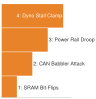
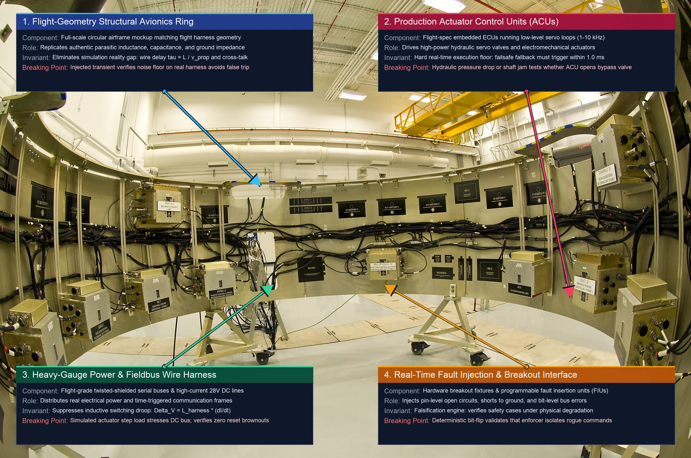
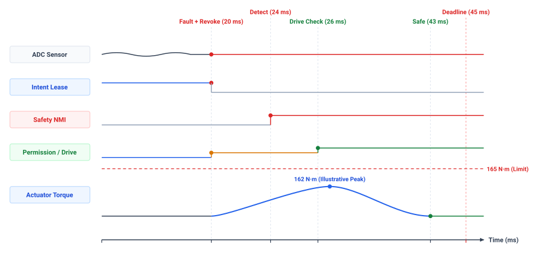

---
format:
  html:
    title: "Adversarial Verification"
---

# Adversarial Verification {#sec-verification}

::: {layout-narrow}
::: {.column-margin}

\chapterminitoc

:::

::: {.content-visible when-format="pdf"}
\noindent
{fig-alt="Isometric blueprint showing adversarial cyber-physical verification: The verification process includes a four-rung qualification ladder: a virtual simulation crucible for testing algorithms, a processor-in-the-loop board for real-time testing, a hardware-in-the-loop dynamometer for testing physical components, and adversarial fault injection needles to introduce faults and assess robustness. Surveillance telemetry towers monitor system performance and collect data during tests."}
:::

::: {.content-visible unless-format="pdf"}
{fig-alt="Isometric blueprint showing adversarial cyber-physical verification: four-rung qualification ladder with virtual simulation crucible, processor-in-the-loop board, hardware-in-the-loop dynamometer, crimson adversarial fault injection needles, and surveillance telemetry towers."}
:::

:::

## Purpose {.unnumbered .unlisted}

::: {.content-visible when-format="pdf"}
\begin{marginfigure}
\resizebox{0.92\linewidth}{!}{\mlphysicalstackfull{20}{20}{20}{20}{20}}
\end{marginfigure}
:::

_Why can a machine pass its normal operating tests and still fail when its protective response is needed?_

A mobile manipulator can complete an aisle run while leaving its stopping mechanism untested. A stalled proposer, an old observation, or a loss of power challenges a different claim from successful task completion: the machine must contain motion while the fault is active. Establishing that claim requires deliberate disturbances, physical measurements independent of the failing component, and acceptance conditions fixed before the test. Missing observations and untested conditions limit what the result can support. Verification makes those limits explicit before release grants authority for an action to cross the causal boundary.



::: {.callout-learning-objectives}

- Derive test conditions and stopping oracles from the machine's operating envelope
- Derive faults from design assumptions, physical hazards, and authority-transfer failures
- Select qualification environments that exercise the causal mechanism behind each claim
- Interpret temporal safety margins and search for disturbances that violate them
- Evaluate the assumptions limiting simulation transfer, rare-event estimates, and formal proofs
- Design hardware injections with independent witnesses and precommitted acceptance conditions
- Assemble fault records that preserve failed, invalid, unobservable, and untested cases

:::

## The Claim a Fault Trial Must Test {#sec-verification-fault-injection}

A proposer can stop renewing commands while the base continues toward the rack end. The authority record specifies who should take over, but that specification does not show that the permission path survives the fault or that the brakes respond in time. Integrated verification deliberately creates the failure and measures the response through to physical motion.

Policy evaluation in @sec-evaluation asks how well a learned candidate performs under declared tasks and conditions. Here the object under test is the assembled machine: proposer, permission path, communication, power, and body. A strong evaluation result does not establish that an independent stop still works when the proposer stalls. Conversely, a successful protective stop does not show that the policy completes its task well. Release needs both kinds of evidence for the same configuration. It also distinguishes proposer autonomy from whole-machine task success: a permitted least-change correction can preserve successful service while exposing a limitation of the raw proposal.

The **digital twin delusion**\index{Digital twin delusion!simulation limits} treats passing simulated assertions as sufficient evidence for physical safety. A simulator can represent timing, electrical, and contact effects only to the extent that its models include and validate them. An omitted power fault cannot fail a simulated controller. Operational logs invite the corresponding mistake. Incident-free exposure, however long, leaves unencountered faults untested.

**Adversarial fault injection** turns a claim into a deliberate disturbance under independent physical containment. The engineering sequence begins with the conditions in which the claim should hold, derives faults that challenge its premises, and chooses a test environment that exercises the relevant mechanism. A precommitted oracle then scores the measured response, and the resulting fault record preserves both the evidence and its limits.

::: {.column-margin}
{width="100%" fig-alt="S·P·A locator triad highlighting the Act-to-Sense feedback edge."}

*The Act $\to$ Sense feedback loop: physical verification closes the causal loop from actuator response back to sensor observation under active fault injection.*
:::

```{python}
#| label: calc-verify-rack-end-oracle
#| echo: false
#| warning: false
#| message: false
# ┌─────────────────────────────────────────────────────────────────────────────
# │ RACK-END FAULT-INJECTION ORACLE FOR THE RUNNING MACHINE (LEGO)
# ├─────────────────────────────────────────────────────────────────────────────
# │ Context: fault-injection scene, operating envelope, fault list, oracles,
# │          hardware injection, fault manifest, fallacies, and summary.
# │ Goal: Derive the two oracle bounds (powered deceleration onset after the last valid renewal,
# │       stopping distance at the aisle speed) and the envelope points that
# │       F1-F4 and A1-A4 are injected at, all from the machine's registry entry.
# │ Show: 82 ms onset bound; 969.0 mm budget and 131.0 mm spare at 1.3 m/s;
# │       100.8 ms of travel in that spare, 663.3 ms at the 0.8 m/s takeover
# │       speed; the 1.44 m/s dry and 1.23 m/s inspected-floor ceilings; the
# │       37.8 V sustained drive-bus sag, 4.8 V above the 33 V converter
# │       lockout (150 A to cross it); the permission rail's 2.0 s hold-up against
# │       1313.43 ms from flag to brakes set (F4b); F1's stop oracle from the
# │       last valid renewal (751.9 mm at 1.3 m/s); the F1 record's oracle at
# │       the restricted 1.0 m/s point (629.6 mm from the last valid renewal);
# │       the Class 3 tank contrast (volume, not distance); F2's refusal
# │       threshold, the 51.6 ms budgeted dispatch age plus the 0.2 ms clock-conversion
# │       bound (51.8 ms upper age); the unbudgeted queue length that exhausts
# │       the spare (100.8 ms, about three-quarters of the pre-brake subtotal);
# │       a late-onset F1 trace's signed and normalized margins; the SoC's share
# │       of the bus transient (1.6 A of 70 A); the discrepancy a spare-sized
# │       simulated margin tolerates (0.131 in a 1 m position norm).
# │ How: the jerk-limited S-curve stop (calc_scurve_stop_distance / _time,
# │      calc_scurve_max_permitted_velocity) with the jerk bound taken as the
# │      reference C2 polynomial's peak jerk at the drive limit, as in
# │      @sec-planning-c2-stopping-suffix, and the three fixed overheads;
# │      calc_voltage_droop for the 48 V drive bus (M6); tank arithmetic by
# │      conservation of volume.
# └─────────────────────────────────────────────────────────────────────────────
from mlsysim import *
from mlsysim.core.units import ureg, kilogram, microsecond, millisecond, second, meter, millimeter
from mlsysim.physics.robotics import (
    calc_c2_stop_suffix,
    calc_scurve_stop_distance,
    calc_scurve_stop_time,
    calc_scurve_max_permitted_velocity,
)
from mlsysim.physics import calc_voltage_droop
from mlsysim.fmt import (
    fmt,
    fmt_latency,
    fmt_time,
    fmt_length,
    fmt_velocity,
    fmt_acceleration,
    fmt_voltage,
    fmt_current,
    fmt_temperature,
    fmt_mass,
    fmt_percent,
    fmt_power,
    check,
)

RM = Embodied.MobileManipulator.WarehouseMobileManipulator
AISLE = Embodied.Scenario.WarehouseAisle

class RackEndVerification:
    """Oracle bounds and envelope points for fault injection at the rack end."""

    # ┌── 1. LOAD (Constants & Parameters) ─────────────────────────────────
    v_aisle = AISLE.v_aisle  # category: chosen
    v_drive = RM.base.max_velocity  # category: illustrative
    a_brake = AISLE.a_brake  # category: illustrative
    tau_delay = AISLE.tau_delay  # category: derived
    t_age = AISLE.perception_age  # category: derived
    eps_sync = 0.2 * millisecond  # category: illustrative (clock-conversion bound, @sec-perception-observation-contract)
    t_lease = AISLE.t_lease  # category: chosen
    t_tick = AISLE.t_tick  # category: chosen
    t_bus = AISLE.t_bus  # category: illustrative
    t_act = AISLE.t_brake_onset  # category: illustrative
    heartbeat_timeout = AISLE.heartbeat_timeout  # category: chosen
    enforcer_deadline = AISLE.enforcer_deadline  # category: chosen
    chunk_rate = RM.chunk_rate  # category: chosen
    t_takeover = AISLE.t_takeover_in_loop  # category: illustrative
    v_takeover = AISLE.v_takeover_in_loop  # category: chosen
    d_clear = AISLE.d_clear  # category: illustrative
    delta_loc = AISLE.delta_loc  # category: illustrative
    delta_margin = AISLE.delta_margin  # category: chosen
    eps_track = AISLE.eps_track  # category: illustrative
    side_clearance = AISLE.side_clearance  # category: illustrative
    mu_dry = AISLE.mu_dry  # category: illustrative
    mu_insp = AISLE.mu_inspected_floor  # category: illustrative
    payload = RM.onboard_payload_capacity  # category: chosen
    bus_nominal = RM.drive_bus_nominal  # category: datasheet (48 V-class pack, nominal)
    bus_low = RM.drive_bus_battery_low  # category: datasheet (pack minimum)
    bus_r = RM.drive_bus_resistance  # category: illustrative (source path; needs a measured value)
    bus_uvlo = RM.drive_bus_uvlo  # category: datasheet (converter input lockout)
    i_rail = AISLE.i_rail_transient  # category: illustrative
    rail_holdup = RM.permission_rail_holdup  # category: chosen
    brake_engage_max = RM.spring_brake_engage_max  # category: illustrative
    g = (1 * ureg.standard_gravity).to(meter / second**2)  # physical constant (defined); category: derived
    # Scenario assumptions local to this chapter
    ambient_lo = ureg.Quantity(5.0, ureg.degC)  # scenario assumption; category: chosen
    ambient_hi = ureg.Quantity(35.0, ureg.degC)  # scenario assumption; category: chosen
    lease_probe = 5 * millisecond  # proposal injected after expiry; scenario assumption; category: chosen
    v_restricted = (
        1.0 * meter / second
    )  # restricted-mode aisle speed on inspected floors, below the inspected-floor ceiling; scenario assumption; category: chosen
    late_onset = 30 * millisecond  # example late powered deceleration onset (STL margin); scenario assumption; category: illustrative
    soc_power = RM.brain_soc.tdp_max  # category: datasheet (application SoC maximum module power)
    converter_eff = RM.drive_bus_converter_efficiency  # category: datasheet (typical converter efficiency)
    drive_current_limit = RM.drive_current_limit  # category: chosen (per-motor datasheet peak)
    drive_wheels = RM.drive_wheel_count  # category: chosen

    # ┌── 2. EXECUTE (Compute) ─────────────────────────────────────────────
    overhead = (delta_loc + delta_margin + eps_track).to(millimeter)
    # Jerk bound: the reference C2 polynomial's peak jerk at the drive limit (@sec-planning-c2-stopping-suffix)
    j_brake = calc_c2_stop_suffix(v_drive, a_brake)["peak_jerk"].to(meter / second**3)
    onset_bound = (t_lease + t_tick + t_bus + t_act).to(millisecond)
    upper_age = (t_age + eps_sync).to(millisecond)  # F2: dispatch-only upper-age threshold; admission/execution age continues
    lease_probe_at = (t_lease + lease_probe).to(millisecond)
    chunk_period = (1 / chunk_rate).to(millisecond)
    c2_distance = calc_scurve_stop_distance(v_aisle, a_brake, j_brake).to(millimeter)
    budget = (v_aisle * tau_delay + c2_distance + overhead).to(millimeter)
    spare = (d_clear - budget).to(millimeter)
    t_spare = (spare / v_aisle).to(millisecond)
    per_ms = (v_aisle * (1 * millisecond)).to(millimeter)
    budget_takeover = (v_takeover * tau_delay + calc_scurve_stop_distance(v_takeover, a_brake, j_brake) + overhead).to(millimeter)
    spare_takeover = (d_clear - budget_takeover).to(millimeter)
    t_spare_takeover = (spare_takeover / v_takeover).to(millisecond)
    ceiling_dry = calc_scurve_max_permitted_velocity(
        d_clear, tau_delay, a_brake, j_brake, loc_margin=delta_loc, physical_margin=delta_margin + eps_track
    ).to(meter / second)
    mu_min = float((a_brake / g).to("dimensionless").magnitude)
    # The floor caps the deceleration; the jerk bound belongs to the load and is unchanged.
    a_insp = min(a_brake, (mu_insp * g).to(meter / second**2))
    budget_insp = (v_aisle * tau_delay + calc_scurve_stop_distance(v_aisle, a_insp, j_brake) + overhead).to(millimeter)
    ceiling_insp = calc_scurve_max_permitted_velocity(
        d_clear, tau_delay, a_insp, j_brake, loc_margin=delta_loc, physical_margin=delta_margin + eps_track
    ).to(meter / second)
    bus_sag = calc_voltage_droop(i_rail, bus_r).to(ureg.volt)
    bus_min = (bus_low - bus_sag).to(ureg.volt)  # sustained screen from the depleted pack
    bus_margin = (bus_min - bus_uvlo).to(ureg.volt)
    i_cross = ((bus_low - bus_uvlo) / bus_r).to(ureg.ampere)  # step that would reach the lockout
    # F4: from the undervoltage or feed-loss flag, stop onset, the longest resident
    # stop inside the envelope (inspected floor at its ceiling), and brakes set
    flag_onset = (t_tick + t_bus + t_act).to(millisecond)
    stop_insp_ceiling = calc_scurve_stop_time(ceiling_insp, a_insp, j_brake).to(millisecond)
    flag_to_set = (flag_onset + stop_insp_ceiling + brake_engage_max).to(millisecond)
    holdup_margin = (rail_holdup - flag_to_set).to(millisecond)
    # F1 record at the restricted point, scored from the last valid renewal
    f1_preonset = (v_restricted * onset_bound).to(millimeter)
    f1_c2 = calc_scurve_stop_distance(v_restricted, a_insp, j_brake).to(millimeter)
    f1_stop_bound = (f1_preonset + f1_c2 + eps_track).to(millimeter)
    # F1 at the aisle speed, scored from the same event (last valid renewal)
    f1_aisle_stop_bound = (v_aisle * onset_bound + c2_distance + eps_track).to(millimeter)
    budget_restricted = (v_restricted * tau_delay + f1_c2 + overhead).to(millimeter)
    late_extra = (v_aisle * late_onset).to(millimeter)
    # Signed margins of one late-onset F1 trace against the renewal-referenced oracle
    onset_late = (onset_bound + late_onset).to(millisecond)
    travel_late = (f1_aisle_stop_bound + late_extra).to(millimeter)
    rho_onset = (onset_bound - onset_late).to(millisecond)
    rho_dist = (f1_aisle_stop_bound - travel_late).to(millimeter)
    # Normalized by chosen scales equal to the bounds themselves
    rho_onset_n = float((rho_onset / onset_bound).to("dimensionless").magnitude)
    rho_dist_n = float((rho_dist / f1_aisle_stop_bound).to("dimensionless").magnitude)
    # Shared-bus sag attribution: the application SoC's maximum draw from the depleted bus
    soc_current = (soc_power / (bus_low * converter_eff)).to(ureg.ampere)
    drive_peak = (drive_current_limit * drive_wheels).to(ureg.ampere)
    soc_share = float((soc_current / i_rail).to("dimensionless").magnitude)
    # Sim-to-real instance: position error in meters (L_phi = 1 m per unit of the norm);
    # a simulated margin equal to the spare tolerates at most this discrepancy
    eps_gap_max = float((spare / (1 * meter)).to("dimensionless").magnitude)
    # Fallacy: an unbudgeted queue spends the spare at v per unit time, so the
    # queue length that exhausts it is the spare's travel time t_spare.
    queue_exhaust_ratio = (t_spare / tau_delay).to("dimensionless").magnitude

    # ┌── 3. GUARD (Assertions) ────────────────────────────────────────────
    check(abs(onset_bound.magnitude - 82.0) < 1e-9, "Canon: powered deceleration onset 82 ms after the last valid renewal.")
    check(abs(tau_delay.to(millisecond).magnitude - 133.6) < 5e-3, "Canon: tau_delay 133.6 ms.")
    check(abs(t_age.to(millisecond).magnitude - 51.6) < 5e-3, "Canon: t_age 51.6 ms.")
    check(abs(eps_sync.to(millisecond).magnitude - 0.2) < 1e-9, "Clock-conversion bound must match the perception contract's 0.2 ms.")
    check(abs(upper_age.magnitude - 51.8) < 5e-3, "Canon (D22): F2 dispatch-age check refuses above a 51.8 ms upper age.")
    check(abs(j_brake.magnitude - 64.0 / 9.0) < 1e-9, "Canon: the jerk bound is the reference polynomial's 7.11 m/s^3 peak.")
    check(abs(budget.magnitude - 968.9925) < 5e-3, "Canon: budget at 1.3 m/s is 968.99 mm.")
    check(abs(spare.magnitude - 131.0075) < 5e-3, "Canon: spare at 1.3 m/s is 131.01 mm.")
    check(abs(c2_distance.magnitude - 605.3125) < 5e-3, "Canon: S-curve stop at 1.3 m/s is 605.31 mm.")
    check(abs(t_spare.magnitude - 100.775) < 5e-3, "Canon: T_latest 100.8 ms.")
    check(abs(ceiling_dry.magnitude - 1.4367) < 5e-5, "Canon: dry-floor ceiling 1.4367 m/s.")
    check(abs(ceiling_insp.magnitude - 1.2309) < 5e-5, "Canon: inspected-floor ceiling 1.2309 m/s.")
    check(abs(mu_min - 0.204) < 5e-4, "Canon: friction needed for a_brake is 0.204.")
    check(abs(bus_min.magnitude - 37.8) < 5e-3, "Canon: the depleted drive bus sags to 37.8 V.")
    check(abs(bus_margin.magnitude - 4.8) < 5e-3, "The sustained screen leaves 4.8 V above the converter lockout.")
    check(abs(i_cross.magnitude - 150.0) < 1e-6, "Reaching the lockout takes a 150 A step.")
    check(bus_min > bus_uvlo, "The load alone cannot cross the lockout, so F4a must inject a supply dip.")
    check(v_aisle < ceiling_dry and ceiling_insp < v_aisle, "Aisle speed sits between the two ceilings.")
    check(budget_insp > d_clear, "At the aisle speed the inspected-floor budget must exceed the clear distance.")
    check(mu_insp < mu_min < mu_dry, "Dry floor supports a_brake; the inspected floor does not.")
    check(t_spare < tau_delay, "A queue shorter than the budgeted pre-brake subtotal exhausts the spare.")
    check(abs(queue_exhaust_ratio - 0.754) < 5e-4, "The exhausting queue is about three-quarters of the pre-brake subtotal.")
    check(abs(overhead.magnitude - 190.0) < 1e-6, "Canon: fixed overhead 190 mm.")
    check(rho_onset.magnitude < 0 and rho_dist.magnitude < 0, "A late onset must drive both F1 margins negative.")
    check(abs(rho_onset_n + 30.0 / 82.0) < 1e-9, "Normalized onset margin is -30/82.")
    check(rho_onset_n < rho_dist_n < 0, "The onset margin dominates the normalized minimum.")
    check(soc_current < 0.05 * i_rail, "The SoC draws a few percent of the rail transient; drive current dominates.")
    check(drive_peak <= i_rail, "Two drive motors at their peak supply most of the transient.")
    check(abs(eps_gap_max - spare.to(meter).magnitude) < 1e-12, "Tolerable discrepancy equals the spare in meters.")
    check(abs(v_takeover.to(meter / second).magnitude - 0.8) < 1e-9, "Canon: in-loop takeover speed 0.8 m/s.")
    check(t_spare_takeover >= t_takeover, "At the slowed speed the spare must cover the in-loop takeover.")
    check(t_spare < t_takeover, "At the aisle speed the spare cannot cover the in-loop takeover.")
    check(abs(spare_takeover.magnitude - 530.62) < 5e-2, "Canon: spare at the 0.8 m/s takeover speed is 530.6 mm.")
    check(abs(t_spare_takeover.magnitude - 663.3) < 5e-2, "Canon: T_latest 663.3 ms at 0.8 m/s.")
    check(abs(flag_onset.magnitude - 22.0) < 1e-9, "Canon: stop onset within 22 ms of the flag.")
    check(abs(rail_holdup.to(second).magnitude - 2.0) < 1e-9, "Canon: permission-rail hold-up 2.0 s.")
    check(abs(flag_to_set.magnitude - 1313.43) < 5e-3, "Canon: flag to brakes set 1313.43 ms.")
    check(abs(holdup_margin.magnitude - 686.57) < 5e-3, "Canon: hold-up margin 686.57 ms.")
    check(v_restricted < ceiling_insp, "The restricted point must sit below the inspected-floor ceiling.")
    check(abs(f1_preonset.magnitude - 82.0) < 1e-6, "Canon: 82 mm of pre-onset travel at 1.0 m/s.")
    check(abs(f1_c2.magnitude - 507.6) < 5e-2, "Canon: S-curve stop at 1.0 m/s on the inspected floor is 507.6 mm.")
    check(abs(f1_stop_bound.magnitude - 629.6) < 5e-2, "Canon: F1 stop oracle 629.6 mm from the last valid renewal.")
    check(
        abs(f1_aisle_stop_bound.magnitude - 751.9125) < 5e-3 and f1_aisle_stop_bound < budget,
        "F1 stop oracle at 1.3 m/s is 751.91 mm from the last valid renewal.",
    )
    check(
        abs(budget_restricted.magnitude - 831.2) < 5e-2 and budget_restricted < d_clear,
        "Canon: budget at 1.0 m/s on the inspected floor is 831.2 mm.",
    )

    # ┌── 4. OUTPUT (Format & Export) ────────────────────────────────────────
    v_aisle_str = fmt_velocity(v_aisle, precision=1)
    v_drive_str = fmt_velocity(v_drive, precision=1)
    a_brake_str = fmt_acceleration(a_brake, precision=None)
    a_insp_str = fmt_acceleration(a_insp, precision=2)
    tau_delay_str = fmt_latency(tau_delay, unit=millisecond, precision=1)
    t_age_str = fmt_latency(t_age, unit=millisecond, precision=1)
    eps_sync_str = fmt_latency(eps_sync, unit=millisecond, precision=1)
    upper_age_str = fmt_latency(upper_age, unit=millisecond, precision=1)
    t_lease_str = fmt_latency(t_lease, unit=millisecond, precision=0)
    t_tick_str = fmt_latency(t_tick, unit=millisecond, precision=None)
    t_bus_str = fmt_latency(t_bus, unit=millisecond, precision=None)
    t_act_str = fmt_latency(t_act, unit=millisecond, precision=0)
    onset_bound_str = fmt_latency(onset_bound, unit=millisecond, precision=0)
    lease_probe_at_str = fmt_latency(lease_probe_at, unit=millisecond, precision=0)
    heartbeat_timeout_str = fmt_latency(heartbeat_timeout, unit=millisecond, precision=0)
    enforcer_deadline_str = fmt_latency(enforcer_deadline, unit=microsecond, precision=0)
    chunk_period_str = fmt_latency(chunk_period, unit=millisecond, precision=0)
    t_takeover_str = fmt_latency(t_takeover, unit=millisecond, precision=0)
    v_takeover_str = fmt_velocity(v_takeover, precision=1)
    d_clear_str = fmt_length(d_clear, unit=meter, precision=2)
    side_clearance_str = fmt_length(side_clearance, unit=meter, precision=2)
    budget_str = fmt_length(budget, unit=millimeter, precision=1)
    spare_str = fmt_length(spare, unit=millimeter, precision=1)
    t_spare_str = fmt_latency(t_spare, unit=millisecond, precision=1)
    spare_takeover_str = fmt_length(spare_takeover, unit=millimeter, precision=1)
    t_spare_takeover_str = fmt_latency(t_spare_takeover, unit=millisecond, precision=1)
    per_ms_str = fmt_length(per_ms, unit=millimeter, precision=1)
    ceiling_dry_str = fmt_velocity(ceiling_dry, precision=2)
    ceiling_insp_str = fmt_velocity(ceiling_insp, precision=2)
    budget_insp_str = fmt_length(budget_insp, unit=meter, precision=2)
    mu_min_str = fmt(mu_min, precision=3)
    mu_dry_str = fmt(mu_dry, precision=2)
    mu_insp_str = fmt(mu_insp, precision=2)
    payload_str = fmt_mass(payload, unit=kilogram, precision=0)
    ambient_lo_str = fmt_temperature(ambient_lo, precision=0)
    ambient_hi_str = fmt_temperature(ambient_hi, precision=0)
    bus_nominal_str = fmt_voltage(bus_nominal, precision=1)
    bus_low_str = fmt_voltage(bus_low, precision=0)
    bus_uvlo_str = fmt_voltage(bus_uvlo, precision=0)
    i_rail_str = fmt_current(i_rail, precision=0)
    bus_min_str = fmt_voltage(bus_min, precision=1)
    bus_margin_str = fmt_voltage(bus_margin, precision=1)
    i_cross_str = fmt_current(i_cross, precision=0)
    flag_onset_str = fmt_latency(flag_onset, unit=millisecond, precision=0)
    rail_holdup_str = fmt_latency(rail_holdup, unit=second, precision=None)
    flag_to_set_str = fmt_latency(flag_to_set, unit=millisecond, precision=2)
    v_restricted_str = fmt_velocity(v_restricted, precision=None)
    f1_stop_bound_str = fmt_length(f1_stop_bound, unit=millimeter, precision=1)
    f1_aisle_stop_bound_str = fmt_length(f1_aisle_stop_bound, unit=millimeter, precision=1)
    budget_restricted_str = fmt_length(budget_restricted, unit=millimeter, precision=1)
    late_onset_str = fmt_latency(late_onset, unit=millisecond, precision=0)
    late_extra_str = fmt_length(late_extra, unit=millimeter, precision=None)
    onset_late_str = fmt_latency(onset_late, unit=millisecond, precision=0)
    travel_late_str = fmt_length(travel_late, unit=millimeter, precision=1)
    rho_onset_str = fmt_time(rho_onset, unit=millisecond, precision=0, allow_negative=True)
    rho_dist_str = fmt_length(rho_dist, unit=millimeter, precision=None)
    rho_onset_n_str = fmt(rho_onset_n, precision=3)
    rho_dist_n_str = fmt(rho_dist_n, precision=3)
    soc_power_str = fmt_power(soc_power, unit=ureg.watt, precision=0)
    soc_current_str = fmt_current(soc_current, precision=1)
    drive_peak_str = fmt_current(drive_peak, precision=0)
    soc_share_pct_str = fmt_percent(soc_share, precision=1, style="prose")
    eps_gap_max_str = fmt(eps_gap_max, precision=3)
    queue_exhaust_pct_str = fmt_percent(queue_exhaust_ratio, precision=1, style="prose")
```

The calculations above reproduce the selected partial design budget; they are conditional oracle inputs, not measured timing closure. Its time origin is the exposure midpoint of the qualified observation, whose capture stamp defines the evidence age. The capture-to-admission path still needs a bound for dispatch-to-admission delay. A claim timed from physical target appearance additionally needs the independently witnessed appearance-to-usable-capture interval; that interval is absent from the subtotal. A trial must record successful admission times, continuing evidence age, and physical response onset; the nominal proposal cadence alone does not establish renewal before expiry. The lease begins at successful admission. The renewal campaign must qualify the maximum interval between successful admissions required by @sec-nervous-cadences, including load and rejected proposals, rather than measuring only proposer dispatch. If the missing interval is not covered by a justified allocation, the baseline distance cannot serve as a qualified release bound.

Consider the warehouse mobile manipulator running its aisle at `{python} RackEndVerification.v_aisle_str` (chosen; see the Reader Guide) toward a rack end where a person may step out. The machine's compute stack partitions high-bandwidth neural inference from deterministic safety. An application system-on-chip (SoC) with an embedded accelerator executes the unprivileged vision-language-action chunk policy, while a lockstep safety microcontroller executes the deterministic runtime enforcer. The safety microcontroller commands the base-drive inverters across a hard real-time fieldbus (CAN-FD or EtherCAT), a network whose cyclic frames arrive on a fixed schedule. Both processors draw from the shared `{python} RackEndVerification.bus_nominal_str` drive bus that powers the motors: the application SoC through a converter, and the safety microcontroller through an isolated converter and a held-up permission rail of its own.

Weeks of clean operational runs at that speed say little about four physical hardware and timing faults the design claims to contain:

1. **Proposer Stall (F1):** The neural chunk policy on the application processor renews its capability lease and then suffers a thread deadlock, driver freeze, or thermal throttling stall;
2. **Stale Observation (F2):** A camera frame or depth tensor arrives at the permission path with an aged or corrupted hardware timestamp after buffering in an ISP queue or direct memory access (DMA) ring;
3. **Lost Fieldbus Frames (F3):** Electromagnetic interference (EMI) from inverter switching induces a burst of dropped or corrupted EtherCAT/CAN-FD frames between the safety MCU and drive actuators; and
4. **Drive-Bus Droop & Feed Loss (F4a/F4b):** Motor acceleration current drawn through the pack and harness resistance sags the shared `{python} RackEndVerification.bus_nominal_str` drive bus, or a supply fault interrupts it, and the bus falls below the `{python} RackEndVerification.bus_uvlo_str` lockout of the converter that feeds the application processor.

These failure modes organize the planned physical and authority campaign: physical faults F1–F4 and authority transfer faults A1–A4 (formalized in @tbl-15-fault-classification). Passive logs may contain these faults, but incident-free operation does not establish that the required response was exercised under each one. The lease catches a stall, the evidence-epoch check catches a stale capture time, the drive's fieldbus watchdog catches dropped communication cycles, and the permission path's undervoltage monitor, operating on an electrically isolated, held-up power rail, catches a brownout of the shared drive bus. Each fault is injected at the rack end, alongside the four supervisory authority faults (A1–A4) handed over from @sec-intervention-authority-log, and every stopping trial is scored against formal temporal and distance bounds derived from the machine's physical stopping budget.

An injected fault turns a physical run into a test result that can support an auditable safety case only when the run satisfies the five requirements of the **cyber-physical test contract**:

1. **A bounded claim:** stating the exact invariant the machine must maintain (for the base at the rack end, a stop that ends strictly inside the `{python} RackEndVerification.d_clear_str` clear distance);
2. **Defined test conditions:** specifying the initial speed, payload, floor friction, ambient temperature, bus traffic, and supply-voltage range;
3. **A precommitted oracle\index{Testing!Oracle}:** an automated evaluator that inspects recorded telemetry against the claim without human intervention or post-hoc adjustments;
4. **A stated sampling and injection procedure:** deliberately driving the machine toward its performance limits and injecting physical faults into sensors, buses, power rails, and actuators; and
5. **Provenance\index{Provenance}:** the complete cryptographic metadata record of model weights, calibration tables, sensor serial numbers, oscilloscope traces, and raw bus logs, which permits re-execution under matched declared conditions. Software builds can be reproduced bit for bit; a physical trial can only be repeated under conditions that match within their declared tolerances.

The base's stopping claim and the arm's latch-force claim require separate envelopes, injection points, and pass conditions; this chapter follows the stopping claim. The first decision is where nominal regulation must yield to an independent containment response.

## The Operating Envelope {#sec-verification-operating-envelope}

The **operating envelope**\index{Operating envelope!definition} pairs the target operational design domain (ODD, @sec-evaluation-what-measured) with the machine's internal execution conditions. The same aisle and payload can produce a different response under memory contention, a low supply voltage, or a hot drive. A trial therefore names both the external conditions and the internal load under which its claim must hold.

For the mobile manipulator, the envelope is a set of declared points rather than one nominal condition: the `{python} RackEndVerification.v_aisle_str` aisle speed; payloads of zero and the `{python} RackEndVerification.payload_str` rack capacity; floor friction of at least `{python} RackEndVerification.mu_min_str`, the value the `{python} RackEndVerification.a_brake_str` credible deceleration needs, on dry aisles, and of at least `{python} RackEndVerification.mu_insp_str` on floors under the site's inspection regime; and ambient temperatures from `{python} RackEndVerification.ambient_lo_str` to `{python} RackEndVerification.ambient_hi_str`. For inspected floors the envelope declares a restricted point at `{python} RackEndVerification.v_restricted_str`, the candidate restricted configuration whose friction premise the enforcement record states (@sec-enforcement-telemetry), and trials there use a test floor whose measured friction sits at the `{python} RackEndVerification.mu_insp_str` qualification value, so that the stop they exercise is the one friction bounds.

Each point is paired with the machine's internal execution state: application-processor load up to its peak neural inference burst, the drive bus anywhere from its `{python} RackEndVerification.bus_low_str` depleted point to its `{python} RackEndVerification.bus_nominal_str` nominal, EtherCAT/CAN-FD transmission jitter, memory crossbar contention, and the safety microcontroller's thermal state. The campaign also challenges the `{python} RackEndVerification.v_takeover_str` moving-takeover candidate with its `{python} RackEndVerification.t_takeover_str` takeover interval. This is a rejected rack-end candidate, not an admitted operating mode: @sec-intervention-authority-transitions requires the local stop first when that transition cannot preserve the stopping envelope.

An operating envelope is distinct from the larger **survival envelope**\index{Survival envelope!definition} that encloses it. Inside the operating envelope the learned policy and the tracking controllers regulate the process. When a disturbance, a sensor failure, or a compute stall pushes the machine across that boundary, nominal regulation is conceded, and the objective becomes bringing the body to a bounded, safe state before structural limits are breached. For the mobile manipulator, the survival envelope must be established for each selected response and machine state (@sec-enforcement-fallback-ladder). The normal resident stop uses powered deceleration and applies holding brakes at standstill. Torque inhibit is a different response and does not inherit that stopping-distance budget. Beyond it lies structural failure, where stored kinetic energy ($E_k = \frac{1}{2} m v^2$) exceeds what the hardware can dissipate before physical impact.

Defining the boundary of the operating envelope requires deriving limits from first principles rather than asserting convenient software timeouts. At the rack end the limit is the stopping budget. Stopping distance grows linearly with the pre-brake delay and quadratically with speed (@eq-body-stopping-distance), and the conditional design budget of @sec-enforcement-stopping-envelopes (@tbl-enforcement-stopping-budget), with its `{python} RackEndVerification.tau_delay_str` capture-referenced pre-brake subtotal, the smooth resident stop that @sec-planning-behavior-seam commits to, and the tracking inset, gives a partial-budget ceiling of `{python} RackEndVerification.ceiling_dry_str` on a dry floor before the unresolved dispatch-to-admission interval is charged. At the candidate `{python} RackEndVerification.v_aisle_str` this subtotal needs `{python} RackEndVerification.budget_str` of the `{python} RackEndVerification.d_clear_str` clear distance and leaves `{python} RackEndVerification.spare_str` before that missing interval and the required positive release reserve are allocated, a distance it covers in `{python} RackEndVerification.t_spare_str`.

Two conditional oracle bounds follow. Before a trial, its record must establish that the intervals in the bound cover the tested path; any unresolved allocation remains a qualification gap:

1. **Powered Deceleration Onset Deadline:** Powered deceleration onset must come no later than `{python} RackEndVerification.onset_bound_str` after the last valid renewal, traversing the lease path of @sec-nervous-cadences: the `{python} RackEndVerification.t_lease_str` lease, one `{python} RackEndVerification.t_tick_str` tick of the permission loop, one `{python} RackEndVerification.t_bus_str` bus cycle, and `{python} RackEndVerification.t_act_str` from delivered stop command to powered deceleration onset. (The power-rail faults of F4 take their onset from the undervoltage flag instead).
2. **Stopping Distance Bound:** The physical stop, measured by external optical ground-truth instruments independent of the machine, must end within the distance allowed from the same event the fault is referenced to. The `{python} RackEndVerification.budget_str` subtotal starts at the qualified observation's exposure midpoint and omits dispatch-to-admission delay. It is not a bound from an arbitrary target appearance. An appearance-referenced trial must independently timestamp the physical appearance and the first usable capture, charge the intervening travel together with dispatch-to-admission travel, and precommit a full bound against the clearance measured at appearance. A capture-referenced trial instead uses clearance and external position at capture; neither trial may score a physical pass from the incomplete subtotal. A stalled proposer offers no target appearance, so its stop, like its onset, is measured from the last valid renewal: the travel during the `{python} RackEndVerification.onset_bound_str` before powered deceleration onset, the resident stop, and the tracking inset give `{python} RackEndVerification.f1_aisle_stop_bound_str` at the aisle speed.

Both bounds presume that the permission path, required sensing, and powered drive survive the injected fault. Logic and brake-coil hold-up do not supply drive energy; F4b must retain and measure a separately justified drive supply and energy-absorption path throughout deceleration. If the fault removes those resources, the trial challenges a different fallback whose stopping envelope must be established separately. Neither bound depends on a further proposer response. A chunk policy that stalls cannot delay powered deceleration onset, because the stop begins when the lease expires rather than when the proposer notices, so a test of F1 measures the permission path and not the policy. The budget protects a static obstacle at the clear distance, and a trial against a static target says nothing about a person still walking toward the machine, a premise the site's crossing rule carries (@sec-memory-belief-through-occlusion).

## One F1 Trial from Injection to Record {#sec-verification-f1-trial}

For F1 we choose the restricted envelope point at `{python} RackEndVerification.v_restricted_str` with the declared payload and inspected-floor friction. The claim is conditional: the permission path and drive remain able to execute the resident powered stop after proposal renewal ceases. The test kills or freezes the proposer just after its last valid renewal while leaving its timer heartbeat alive. That separates progress of the proposer from liveness of an unrelated interrupt.

A physical rig containing the production base, drive, loaded body, and qualified test floor can exercise the complete stopping claim. A processor bench can challenge lease expiry but substitutes the plant; a simulation substitutes both target timing and mechanics. Neither alone supplies the required physical distance witness. The containment fixture must protect the test area independently of the response under test.

The F1 reference event is the last successful admission that renewed the lease, not proposer dispatch or the later injection trigger. The trace must retain the admission and injection events. Independent channels record lease expiry, the permission-path stop command, powered deceleration onset, and external position through standstill. Drive current or torque together with wheel motion witnesses powered onset; a brake contact switch witnesses the subsequent holding-brake application. A contact switch alone cannot timestamp the beginning of powered braking.

Recording the state trajectory, the detector identity, the refusal timestamp, and the time to restore the bounded state requires instrumentation electrically and logically independent of the machine, such as optical shaft encoders and high-speed cameras on isolated digitizers. An onboard logging daemon is corrupted by the very failure it tries to capture, because a faulted processor or a saturated bus delays log serialization.[^fn-hw-trace-instrumentation] Independent measurement also rejects false passes, in which the machine survived for reasons absent from the safety claim. An injected lost-frame fault can trip an unmonitored thermal breaker or an auxiliary ground loop that drops power to the drives, so that the spring-applied brake stops the base inside the budget while the software enforcer has deadlocked in a priority inversion. An oracle that inspects only stopping distance scores that trial a pass. The test framework must verify that the enforcer path named in the safety claim executed the corrective action.

[^fn-hw-trace-instrumentation]: **Non-Intrusive Hardware Tracing**\index{Hardware tracing!CoreSight ETM}: Non-intrusive tracing utilizes dedicated silicon hardware debug blocks (such as ARM CoreSight Embedded Trace Macrocell) and external field-programmable gate array (FPGA) bus sniffers that snoop internal bus transactions without stealing CPU execution cycles. By buffering execution traces in dedicated high-speed SRAM decoupled from the system memory bus, hardware analyzers capture cycle-accurate fault-reaction timestamps without perturbing real-time thread schedules. Relying on software logging daemons introduces the **probe effect**\index{Probe effect} [@gait1986probe]: the instrumentation changes the timing it observes, so logging overhead can mask or create the race conditions under test.

A liveness signal is another source of false passes, so the test must target what it can miss. @Sec-nervous-hardware-isolation recounts the mechanism a plaintiff expert argued in the Toyota unintended-acceleration litigation [@barr2013toyota], a timer interrupt that kept servicing the watchdog while control tasks could die, and draws the rule that a timer feed proves only that the feed path ran (\ref{psp-verification-watchdog-liveness}, \ref{ws-verification-toyota-unintended-acceleration-limits-task-blind}). The test vector for that rule kills the control task, or freezes its output, while the timer interrupt stays alive, and measures the actuator command and the watchdog output on instruments independent of the controller. On the mobile manipulator, F1 is this vector applied to the proposer. The host heartbeat can keep reporting a live process after the chunk-policy task has died, so F1 passes on powered deceleration onset measured at the drive, never on a heartbeat in a log. Because the historical mechanism is attributed rather than established, a bench result speaks for the design under test, not for any vehicle.

::: {#psp-verification-watchdog-liveness .callout-perspective title="The watchdog liveness invariant"}
A watchdog fed by a periodic timer interrupt shows only that the interrupt handler executed, not that safety-critical application tasks met their deadlines or executed without corruption. A qualified fault injection campaign explicitly isolates task progress from timer liveness, testing physical shutdown under task death, thread starvation, and frozen control registers.
:::

::: {#ws-verification-toyota-unintended-acceleration-limits-task-blind .callout-war-story title="Testing a task-blind watchdog hypothesis"}
**Context**: In *Bookout v. Toyota* (Oklahoma County, 2013), a jury heard expert testimony on the electronic throttle control system (ETCS-i) of a 2005 Camry. The plaintiffs' software expert argued that safety-critical control tasks could fail silently while the supervision meant to catch them stayed alive [@barr2013toyota].

**Mechanism**: The engine controller serviced its hardware watchdog from a recurring timer-tick interrupt rather than from evidence that the control tasks had run. The expert testified that if one task that handled throttle control and several failsafes died, through memory corruption or a stack overflow, the throttle could stick at its last computed command while the timer interrupt kept feeding the watchdog [@barr2013toyota]. The design also carried a second, monitor CPU, but he argued that it could not see which tasks were running, that it detected this task's death only indirectly, when the driver changed the brake pedal's state, and that a single analog-to-digital converter digitized the accelerator-pedal position for both processors, a common cause that a fault on the main processor could share [@dunn2013toyota]. Recovery could therefore require the counterintuitive act of lifting a foot off the brake during the event.

**Impact**: On October 24, 2013, the jury awarded \$3 million in compensatory damages and found that Toyota had acted with reckless disregard; the parties settled before the jury could consider punitive damages [@srs2013toyota]. The verdict did not establish a technical cause. The NASA engineering review for the federal investigation found no evidence that an electronic malfunction caused large unintended accelerations [@nasa2011toyota]. It did document electronic faults, among them a tin whisker that formed a 248 Ω short in an accelerator-pedal position sensor from a 2003 Camry, a fault that, in vehicle tests, changed how the throttle followed the pedal but still let it close whenever the pedal was released [@leidecker2011tinwhisker]. The investigation attributed the incidents it could explain to floor-mat entrapment, sticking pedals, and pedal misapplication.

**Response**: For the design under test, fault injection must establish which application progress checks reach the watchdog, whether the independent monitor shares any input path with the processor it supervises (@sec-verification-forward-analysis), and which protective input can still command a physically suitable response. The historical case does not establish those properties for the warehouse machine.

**Systems lesson**: A periodic liveness feed proves only that the timer loop ran, not that control tasks executed correctly. Engineers must verify fault detection using end-to-end hardware injection that kills application tasks while measuring physical actuator arrest on independent instrumentation.
:::

The intervention mechanism must be tested under the conditions that make intervention necessary. An enforcer that takes over cleanly on an idle bench provides no evidence for production, where in a crisis the policy runs at peak throughput, memory buses carry high-resolution sensor streams, DMA channels move frame buffers, and the base carries its loaded rack at the aisle speed. The framework injects faults under the declared thermal and electrical load and measures both lease-expiry revocation and, separately, the time from a diagnostic flag to powered deceleration onset at the drive. If the intervention path shares a bus arbiter with the neural accelerator, the takeover can stall behind a burst transfer that cannot be preempted, and a safety case that assumed instantaneous takeover fails in the field if the takeover was verified only on a quiet bus.

::: {.column-margin .margin-pointer}
↩ Microarchitectural stress patterns build directly on the memory contention benchmarks from @sec-placement-resource-contention.
:::

A campaign runs every injection under one fixed protocol, so that a verdict follows from the procedure rather than from whoever reads the trace. The test orchestrator first checks every precondition, such as temperature, rail voltage, and wheel speed, against its declared tolerance, in that quantity's unit, and a trial that starts outside tolerance ends as `INVALID` before any fault is injected. It then brings the logic analyzer, the plant, and the truth digitizers onto one reference clock, lets the base settle at its envelope point, and fires the injection on a trigger line that stamps the fault's start on that clock. The isolated analyzer retains that stamp and the claim's reference event, such as F1's last valid renewal, so detector, drive takeover, and standstill intervals can be scored from the correct origin, while truth sensors wired to a crowbar relay can cut actuator power if the base leaves the survival envelope. The precommitted oracle scores the trace from the independent truth instruments under the verdicts and pass rule of @sec-verification-oracles-acceptance, and incomplete truth frames surface only at this stage, after the injection has run, as `UNOBSERVABLE`. The orchestrator signs the record's header and binds it to the evidence bundle by digest.

::: {.column-margin .margin-pointer}
↪ **Protocol:** @Sec-appendix-systems-fault-protocol gives the protocol stage by stage, with its error codes, for a reader building the test orchestrator.
:::

## Fault Oracles and Acceptance {#sec-verification-oracles-acceptance}

The F1 trace must establish both timely onset and bounded travel; a stopped base alone establishes neither. Without an oracle fixed in advance, engineers judge time-series plots after the run from gross symptoms, such as whether Joule heating\index{Joule heating!component failure} melted a phase wire or a controller threw an unhandled exception, and the test becomes an anecdote. An **oracle**\index{Oracle!definition} is the predicate, defined in full before the run, that scores a trial against its claim.

### Four-verdict test oracles and forensic integrity {#sec-verification-four-verdicts}

Scoring also needs an **invalid-test rule**\index{Invalid-test rule!definition} for a run the environment failed to deliver. If a traction-control derate on a floor joint slows the base before the injection, so that it meets the fault below its declared test speed, the trial did not test the envelope point it claims. If the frame injector overflows its own queue and drops the fault packet before it reaches the transceiver, the machine never met the disturbance. Scoring such a run as a pass manufactures confidence, and scoring it as a failure blames the machine for the fixture. The oracle therefore returns one of four verdicts. `PASS` means every precommitted predicate held; `FAIL` means a measured predicate was violated; `INVALID` means the injection or a precondition failed; and `UNOBSERVABLE` means the truth data needed to score the trial were lost, with the partial trace retained. Under either of these last two verdicts a field the trial did not measure is marked unavailable, never zero. Neither verdict ever counts as `PASS`, and neither is dropped from the coverage report. An `UNOBSERVABLE` trial is therefore a defect of the test harness, not an ambiguous pass. Treating an unobservable run as a success, or silently discarding runs with dropped telemetry from test reports, introduces survivorship bias: if an electrical transient causes an EMI burst that crashes the logging DAQ, discarding that trial conceals the exact vulnerability under test. Forensic integrity requires reporting all four verdicts explicitly.

Precommitment separates evidence from post-hoc storytelling. Fault-injection behavior is noisy and surprising, and criteria negotiated after the trace is seen drift to fit it. An overrun is explained away as floor variation, or an onset later than the `{python} RackEndVerification.onset_bound_str` bound is excused because the base still stopped short of the rack end.

The precommitted record fixes the physical predicates, physical units and any normalization scales, response-time bounds, and invalidation triggers before the first injection. The evaluator retains a signed margin for each predicate and returns `PASS` only if every required margin and timing bound passes. If the stop exceeds its bound by a few millimeters or powered deceleration onset misses its deadline by $2\text{ ms}$, the record states which measured predicate failed; the trace and follow-up analysis determine whether floor friction, brake lag, derating, or a diagnostic delay caused it. Precommitment is where principle \ref{pri-vol4-evidence-bounds-authority} first binds a test. Release will grant authority on these records, so a verdict scored by a rule revised after the trace was seen would grant authority on the strength of an outcome rather than a test.

### The F1 record and its missing coverage {#sec-verification-manifest-coverage}

A **fault record**\index{Fault record!definition} binds a fixed header to the independently retained trace. The header holds the fields every trial shares. Its identity fields name the trial and its claim, the envelope point, the injected fault by mode, magnitude, and target, and a digest of the precommitted oracle. Its outcome fields carry the measured detection and takeover times, the signed margin for the claim, the verdict status, the digest of the evidence bundle, and a signature over the header. The variable trace stays in the bundle.

The planned F1 record at the envelope's restricted point, `{python} RackEndVerification.v_restricted_str` on an inspected floor, with the rack loaded to `{python} RackEndVerification.payload_str`, specifies those fields (@tbl-15-f1-record). As for every stall, the distance oracle is referenced to the last valid renewal. The travel during the `{python} RackEndVerification.onset_bound_str` before powered deceleration onset, the resident stop on a floor of friction `{python} RackEndVerification.mu_insp_str`, and the tracking inset together give `{python} RackEndVerification.f1_stop_bound_str`, shorter than the `{python} RackEndVerification.budget_restricted_str` capture-referenced subtotal at that speed. The latter includes earlier evidence age and fixed geometric allowances, omits dispatch-to-admission travel, and cannot be substituted for F1's renewal-referenced oracle or for an appearance-referenced bound. The outcome field holds no value and is marked unavailable. No trial in this book has been run, so the field names the measurement that will fill it, and until that measurement exists the record carries no verdict.

| Trial and claim                                                                                | Envelope point                                                                                                                                                                                                                                      | Oracle, predeclared from the last valid renewal                                                                                                        | Detector and witness                                                                             | Outcome to be measured                                                                                                 | Verdict                                                        |
|:-----------------------------------------------------------------------------------------------|:----------------------------------------------------------------------------------------------------------------------------------------------------------------------------------------------------------------------------------------------------|:-------------------------------------------------------------------------------------------------------------------------------------------------------|:-------------------------------------------------------------------------------------------------|:-----------------------------------------------------------------------------------------------------------------------|:---------------------------------------------------------------|
| F1, proposer stall: chunk-policy task killed one tick after a renewal; rack-end stopping claim | `{python} RackEndVerification.v_restricted_str`; `{python} RackEndVerification.payload_str` payload; test floor measured at $\mu =$ `{python} RackEndVerification.mu_insp_str`; drive bus at `{python} RackEndVerification.bus_nominal_str` nominal | Powered deceleration onset $\le$ `{python} RackEndVerification.onset_bound_str`; travel to rest $\le$ `{python} RackEndVerification.f1_stop_bound_str` | Lease timer on the permission path; expiry, revocation, and onset each on its own wire and clock | Trial count; maximum onset and maximum travel over the trials, each with its signed margin; unavailable until measured | None until scored; `PASS` only if both margins are nonnegative |

: **One F1 fault record at the restricted envelope point**: The header fields of a proposer-stall trial on the warehouse mobile manipulator, with the oracle fixed before the run and the outcome left as the measurement that must fill it. {#tbl-15-f1-record tbl-colwidths="[18,22,18,14,16,12]"}

::: {.column-margin .margin-pointer}
↪ **Byte layout:** @Sec-appendix-systems-wire-fault lays out the header field by field, including how an unavailable value is encoded, for a reader building the ledger.
:::

The record keeps the four verdicts distinct field by field. A breaker that prevents the requested injection makes the trial `INVALID`, and for a trial aborted before injection the detection time, takeover time, and margin are unavailable rather than zero; the bundle records a validity flag for each measured field and why it is absent, and the oracle checks those flags and the verdict before doing any arithmetic, so an unavailable field never enters a pass count or a latency or margin statistic.

A single aggregate percentage hides where the campaign never went. A machine that survived 98 percent of five thousand fault trials has shown little if all five thousand ran at room temperature on a quiet memory bus. Coverage is therefore reported along separate dimensions: functional safety requirements, physical envelope boundaries, physical and logical injection sites, timing tails, hardware build revisions, and multi-fault combinations. For the mobile manipulator, boundary coverage tracks whether faults were injected with the rack empty and full, at the aisle speed on dry floors and at the restricted speed on inspected ones, and with the drive bus at its depleted point. Timing tail coverage isolates injections targeting the $P_{99}$ scheduling latency of the permission loop and peak direct memory access utilization. A machine achieves acceptable verification not when an average coverage index exceeds an arbitrary threshold, but when the minimum coverage across every individual dimension satisfies the requirements of the safety case.[^fn-std-iso-injection]

[^fn-std-iso-injection]: **Scope of assurance standards**\index{ISO 26262!Hardware Fault Injection}: ISO 26262-5 addresses road-vehicle electrical and electronic hardware. Its single-point and latent fault metrics concern the architecture and its allocated safety goals; they are not the aggregate $C_{\text{diag}}$ of \ref{nbk-verification-hardware-fault-injection-coverage-mean-time}. Fault injection is one way to test diagnostic assumptions, alongside analysis and other evidence. ANSI/UL 4600 frames an autonomous-vehicle safety case from multiple kinds of evidence. Neither standard makes a fixed number of HIL trials sufficient for release.

Repeated trials count only where something varies. A deterministic fault script run five hundred times on a digital bench, with fixed initial conditions, register states, clock dividers, and inputs, executes the same branch sequence every time and says no more than one run. On the test aisle, repetition samples floor friction, asynchronous interrupt arrivals, bus arbitration, and the phase between the sensor clock and the inference cycle, so it measures the spread and tail of the response-time distribution.

## Extending the Trial to the Envelope {#sec-verification-extending-trial}

The F1 record specifies one experiment and honestly leaves its outcome empty. A campaign must extend that experiment across the coupled conditions in the operating envelope and derive different injections for the other claims.

### Multi-dimensional boundary coupling versus scalar sweeps {#sec-verification-boundary-coupling}

On the mobile manipulator, separate minimum and maximum values for individual variables miss the true operating boundary, because physical, computational, and electrical conditions are coupled. Sweeping one variable at a time with the others held at nominal values leaves the coupled corners untested:

- The `{python} RackEndVerification.v_aisle_str` aisle speed and an inspected floor with friction `{python} RackEndVerification.mu_insp_str` each lie inside their declared individual ranges, yet together they fall outside the envelope. On that floor friction, not the brake, sets the credible deceleration, which drops to `{python} RackEndVerification.a_insp_str`. The resident stop lengthens, and the budget at `{python} RackEndVerification.v_aisle_str` grows to `{python} RackEndVerification.budget_insp_str`, past the `{python} RackEndVerification.d_clear_str` clear distance; the speed boundary on that floor is `{python} RackEndVerification.ceiling_insp_str`, which is why the envelope's restricted point sits below it.
- Contact non-linearities exacerbate this coupling. On real warehouse surfaces, friction is not an idealized constant scalar $\mu$; it is a non-linear, dynamic contact state governed by surface contamination (concrete dust, moisture, or oil sheens), wheel tread temperature, and dynamic load transfer. Under rapid braking, longitudinal load transfer shifts normal force from the rear to the front axle ($F_{z, \text{front}} = m g \frac{l_r}{L} + m a \frac{h}{L}$), where $l_r$ is the center-of-mass distance from the rear axle, $L$ is the wheelbase, $h$ is the center-of-mass height, and $a$ is the positive deceleration magnitude. The rear wheels lose normal load and can reach the tire's traction limit. If the policy commands deceleration assuming peak dry friction, the unweighted wheels can slip, reducing effective braking traction. In the constant-friction approximation, stopping distance grows inversely with available friction and quadratically with speed ($d_{\text{stop}} \sim v^2 / 2\mu g$).
- Computational and electrical conditions couple the same way. A heavy vision-language-action forward pass on the application SoC saturates its shared memory, delaying camera-buffer processing and the compact evidence handoff to the safety microcontroller, which lengthens the perceptual lag $\tau_{\text{delay}}$. Because stopping distance grows linearly with that lag (@eq-body-stopping-distance), a `{python} RackEndVerification.late_onset_str` memory stall consumes `{python} RackEndVerification.late_extra_str` of clearance at the aisle speed. The electrical coupling runs through the drive, not the accelerator. At its `{python} RackEndVerification.soc_power_str` maximum the SoC draws about `{python} RackEndVerification.soc_current_str` from the depleted bus, `{python} RackEndVerification.soc_share_pct_str` of the `{python} RackEndVerification.i_rail_str` transient; the two drive motors at their peak supply up to `{python} RackEndVerification.drive_peak_str` of it. Hard acceleration therefore sags the shared bus through the pack and harness resistance, and an inference burst matters instead on the SoC's own point-of-load regulator, a separate transient that the F4 campaign must measure separately.
- Payload and posture couple to the stopping limit through stability as well as friction. With the arm raised over a loaded rack the center of mass rises, and a quasi-static base tips forward once its deceleration exceeds $g\,b/h$, where $b$ is the horizontal distance from the center of mass to the front support line and $h$ its height. That limit can bind before friction does, and ISO 3691-4 requires stability to be verified for driverless industrial trucks [@iso3691part4]. The machine's record does not yet carry a measured center-of-mass height, so the envelope cannot yet state whether the credible deceleration clears this limit; a tilt-table or corner-scale measurement of the loaded machine would supply it.
- Thermal throttling can delay proposal generation and reduce useful service. With an independent, valid resident stop, a missed renewal invokes the bounded fallback rather than indefinitely extending the stopping delay. The compound test must determine whether shared power, sensing, or bus interference also compromises that fallback. Payload matters because the credible deceleration is declared for the loaded machine; unloaded trials cannot establish it.

### Physical perturbations versus digital adversarial noise {#sec-verification-physical-perturbations}

A pixel perturbation and a physical disturbance exercise different interfaces. A tensor-level test can isolate model sensitivity, while an optical test also exercises the lens, exposure control, sensor, and timestamp path. Neither substitutes for the other, and the threat model must state whether the attacker can change digital packets, the physical scene, or both.

For the rack-end claim, useful physical disturbances include glare that obscures the obstacle, vibration that corrupts motion sensing, and a floor transition that reduces available traction. Each needs a realizable injection and an independent witness: illumination measured at the sensor, reference motion independent of onboard odometry, or a qualified friction measurement. A well-formed sensor packet does not establish that its physical interpretation is correct.

### What the envelope claim leaves open {#sec-verification-falsification-formulation}

Boundary testing searches for counterexamples to a declared claim. For F1, the first useful experiment needs no optimizer: stop renewal while the base moves, then independently measure when deceleration starts and where the base comes to rest. Later searches vary the initial state and injection phase to challenge smaller margins (@sec-verification-falsification-trajectory-formulation). Formal analysis, simulation, and physical testing contribute different evidence; none repairs an omitted premise by itself.

A boundary stays honest only if every parameter carries its unit, its provenance, its calibrated uncertainty, and an engineer accountable for it. A credible deceleration of `{python} RackEndVerification.a_brake_str` is incomplete until the record says whether it came from stopping trials at the loaded mass, a drive datasheet, or a friction model, and with what resolution the external distance reference measured each stop. A new wheel tread compound or new EtherCAT slave firmware obliges that owner to re-evaluate whether the boundary has moved.

Testing the envelope means attacking its boundary surface. Interior points, where the base crawls unloaded across a dry floor on fresh camera frames, show only that the machine works under ideal conditions. The test framework places points on, just inside, and just outside each consequential boundary. Points just inside check that the policy keeps closed-loop stability\index{Closed-loop stability} under the largest permitted stress; points on the boundary check that margins survive nominal sensor noise; points just outside check that the enforcer takes authority from the policy predictably and halts the base within the survival envelope before the clear distance is gone.

A hardware malfunction and a functional insufficiency require different challenges. A sensor can deliver intact packets while glare defeats its obstacle estimate. The campaign must therefore test both failure of the execution mechanism and failure of the information on which that mechanism depends. Naming an enforcer does not establish that it can detect a physically unobservable condition; the claim may require a narrower operating envelope.

::: {#psp-verification-hardware-falsification .callout-perspective title="The hardware falsification principle"}
A hardware-dependent safety claim needs an observable challenge to its physical premises\index{Fault injection!hardware}. If the campaign cannot inject the relevant disturbance or retain the required witness, the record must preserve that verification gap.
:::

Once every constraint, latency budget, and environmental limit is stated as a number, the design claims of the preceding chapters become targets for fault injection\index{Fault injection}, each with a threshold that must trigger protective intervention\index{Protective intervention}.

## Deriving the Fault List {#sec-verification-deriving-fault-list}

F1 came from negating one claim: proposal renewal continues within its lease. The rest of the fault list has two sources. Inverting design records tests the assumptions the architecture names; working forward from mechanics, power distribution, and human interaction finds hazards the records may have omitted.

### Inverting design records and the five-element chain {#sec-verification-inverting-records}

The first source of faults is the design records, inverted. @Sec-data through @sec-evaluation state the learned policy's properties: its training distribution, its state-action assumptions, and its inference latency ceilings. @Sec-perception through @sec-placement state interface and execution properties such as bus allocations, observation freshness, and estimation bounds, and @sec-intervention states how quickly authority can leave a failing policy and who holds the override. If the machine's records state that the chunk policy renews its proposal every `{python} RackEndVerification.chunk_period_str` at every speed up to the `{python} RackEndVerification.v_drive_str` drive limit, the verification suite inverts that claim by injecting stalled renewals, delayed observations, and out-of-range encoder readings to test whether the permission path detects the violation within its budget.

For a single fault, the bounded claim and the injection procedure of that list become a **five-element chain**:

1. **The negated condition:** the exact architectural or timing invariant violated (e.g., proposal renewal halted after lease issue);
2. **The physical injection point:** the exact hardware or bus interface where the disturbance enters (e.g., inline FPGA serializer, CAN-FD disturbance node, or programmable DC load);
3. **The expected detector:** the deterministic monitoring primitive tasked with catching the violation (e.g., lease countdown timer or evidence-epoch comparator);
4. **The bounded response:** the deterministic transition executed by the enforcer (e.g., revoking proposal authority and commanding the resident stop suffix); and
5. **The observable pass condition:** the quantitative, independently witnessed metric that scores the trial (for F1 at aisle speed, onset $\le$ `{python} RackEndVerification.onset_bound_str` and travel from renewal $\le$ `{python} RackEndVerification.f1_aisle_stop_bound_str`).

A recorded design property becomes a testable fault only when all five elements are defined and observable. When any element of this chain cannot be defined or measured, the architecture contains a **verification gap**\index{Verification gap!definition}. A verification gap indicates that the claim cannot be falsified by test. Such gaps cannot be ignored; they require dedicated hardware instrumentation (such as external optical trackers or non-intrusive trace macros), a narrower operational claim, or a redesign of the execution path.

Inversion also reaches the learned proposer's assumptions, because distribution shift can create a functional insufficiency even when every frame arrives intact. A chunk policy trained in simulation on dry concrete with friction `{python} RackEndVerification.mu_dry_str` proposes decelerations that a floor at `{python} RackEndVerification.mu_insp_str` turns into wheel slip. Inverting that evaluation claim means injecting the unmodeled traction. Sensor bias and data perturbations are injected for the same reason, because a policy with a high nominal reward can still command jittering actuators once its inputs are perturbed. A permissive execution path can then fail on valid, uncorrupted commands, because software and mechanics stay coupled across the causal boundary (@sec-boundary-causal-boundary).

At each inter-module contract, the fault list negates the property at its physical point of handoff: observation freshness, state validity, intent lifetime, planning deadlines, enforcement independence, and resource allocation. For the `{python} RackEndVerification.t_lease_str` chunk lease of @sec-nervous-cadences, the test environment replays the expired admitted record `{python} RackEndVerification.lease_probe_at_str` after its last renewal and confirms that the permission path refuses to extend authority from that record. A new proposal at the same time is a separate admission attempt: it must pass the current evidence, state, mode, and stopping-reserve checks before it can receive a new lease. For the enforcer's claimed independence from the policy computer, the test saturates the shared memory bus with DMA traffic and confirms that the enforcer still meets its `{python} RackEndVerification.enforcer_deadline_str` deadline inside each `{python} RackEndVerification.t_tick_str` tick. The discipline cuts both ways. Bus starvation, clock skew, and supply fluctuation are injected where the design claims tolerance, because a fault drawn from a generic menu invents a requirement the machine was never specified to meet.

Inversion has a structural limit. It produces only the faults the design team already modeled, so the list is only as complete as the design claims. If no record says how the base's spring-applied brake behaves when its lining glazes after repeated stops, there is nothing to invert, and the failure never reaches the suite.

### Forward physical analysis and common-cause modes {#sec-verification-forward-analysis}

A second, independent source works forward from the physical machine, enumerating what the body, the power network, the floor, and the environment can do regardless of what the software believes. Wheels skid when a commanded deceleration exceeds what the floor can transmit; brake linings glaze under repeated stops; tires wear and change the rolling radius that odometry assumes; drive vibration loosens a camera mount until its calibration drifts. These hazards originate in mechanics and tribology, outside every abstraction the software reasons over. Leveson's **Systems-Theoretic Accident Model and Processes (STAMP)**\index{Systems-Theoretic Accident Model and Processes!definition} framework[^fn-std-stpa-leveson] [@leveson2011engineering] brings them into hazard analysis.

For example, start with a drive that continues producing torque after a stop command. A stuck enable or failed power stage may defeat the normal powered suffix. The test must independently observe delivered torque, motion, and the secondary isolation path. Safe torque off can remove drive torque, but it does not establish the normal stopping distance or hold a gravity-loaded joint. The record must name a separately justified containment response and its physical oracle; if none exists, the fault exposes an architectural gap rather than inheriting the normal stop budget.

::: {.column-margin}
{width="100%" fig-alt="Vertical ladder showing fault injection climbing from SRAM bit-flips up to physical dyno shaft jamming."}

*Fault injection climbs from software bit-flips to physical dyno shaft jamming.*
:::

[^fn-std-stpa-leveson]: **STAMP/STPA Hazard Analysis**\index{Systems-Theoretic Process Analysis!emergent hazards}: Developed at MIT by Nancy Leveson, STAMP treats safety as a control problem rather than a component-reliability problem, so hazards appear as unsafe control actions at interfaces, such as a seam where bus latency or filter lag erodes a stability margin. STPA is the hazard-analysis method built on it.

Working forward exposes fault classes that no software record implies: clock loss, brownouts that leave logic levels between valid thresholds, drive-switching interference coupling into encoder lines, corrupted configuration memory, and reset lines that bridge domains meant to be independent. If the safety microcontroller and the application processor shared one power-management IC, an undervoltage transient during a drive-current surge could reset both processors at the moment the proposer loses control. No software record contains that failure, because each module assumes its supply is ideal. An enforcer cannot arrest a failing policy if it shares the supply that browns out with it; the safety runtime must outlive the faulted workload it supervises, powered from an isolated, held-up auxiliary supply.

Forward analysis also tests the common-cause independence claims of @sec-nervous and @sec-placement. Two paths isolated on a diagram often share one physical vulnerability, as when the lidar and a redundant bumper switch are routed through one cable carrier, share an analog reference inside one converter, or are built on timer silicon with the same errata. A transient that latches up both channels at once defeats any argument that treats their failures as independent. **Common-cause analysis**\index{Common-cause analysis!definition} traces routing, power paths, and clock trees so that no single physical event can disable both the policy and the intervention mechanism.

The physical source extends to operator error and foreseeable misuse (@sec-intervention). Floor staff jumper a rack-end presence sensor during maintenance, park a pallet jack across a marked crossing, or unplug a warning beacon to silence it, while remote assistants request speeds the aisle does not allow. When a remote assistant commands the `{python} RackEndVerification.v_drive_str` drive limit in the aisle, the verification framework must verify that the command is denied by capability, or limited under an active `manual_drive` entry to the admitted manual mode's speed, and that the permission check runs on it like any other proposal.

Working forward from the physical machine adds one representative mechanical class, the actuator jam, to the record-derived list in @tbl-15-fault-classification. Completeness still requires a separate hazard-analysis argument for the specified plant and operating envelope.

### Transduction-layer cyber-physical attacks {#sec-verification-transduction-attacks}

The optical, acoustic, and contact disturbances introduced with the operating envelope also become **transduction-layer cyber-physical attacks**\index{Cyber-physical security!transduction attacks}\index{Sensor spoofing!physical injection}\index{Cybersecurity engineering!ISO/SAE 21434} when an adversary induces them. Their verification consequence is the same: a sensor can deliver a well-formed packet whose physical claim is false. Packet integrity therefore cannot serve as the oracle for perception validity.

For an optical disturbance, the test must specify the illumination and approach conditions that challenge the obstacle claim, the cross-sensor plausibility check expected to detect the discrepancy, and the fallback response. An independent tracker measures the obstacle clearance and the base's motion while the camera remains disturbed. The fault record must distinguish a detected anomaly followed by a bounded stop from a missed obstacle that happened not to cause contact. If the detector cannot distinguish the disturbed signal from valid evidence, that operating condition remains a verification gap; naming a protective monitor does not establish that it will fire.

### Choosing the injection phase {#sec-verification-fault-optimization}

A stall just after renewal exercises almost the full remaining lease; a stall near expiry exercises the transition between proposal and fallback. The campaign records the injection phase rather than treating repeated injections as equivalent. Automated search can later vary phase, duration, and intensity using the oracle's measured margin (@sec-verification-falsification-trajectory-formulation).

Besides inverted claims and forward hazards, the fault list must test the authority cases A1–A4 of @sec-intervention-authority-log, each a row of @tbl-15-fault-classification, tested with the machine in the state that makes intervention urgent, the loaded base approaching the rack end. The campaign tests requests at the `{python} RackEndVerification.v_takeover_str` moving-takeover candidate and at the `{python} RackEndVerification.v_aisle_str` aisle speed. Their partial-budget waiting allowances are `{python} RackEndVerification.t_spare_takeover_str` and `{python} RackEndVerification.t_spare_str`, respectively, before the missing timing interval and transition costs are charged. These values do not admit either moving handover. For the rack-end case, @sec-intervention-authority-transitions requires rejecting the infeasible transition and dispatching the local stop before its deadline; manual operation can begin only after a separately checked handover in its admitted mode. A trial conducted only with the base parked cannot establish that rejection and stopping occurred soon enough during approach.

| Failure Domain & Fault Mode                   | Physical Mechanism & Injection Point                                                                                                                                                      | Target Manifestation & Causal Impact                                                                                                                                                                | Detection Primitive & Latency Budget                                                                                                                            | Enforced Safe Response & Bounded Recovery                                           | Observable Pass Criterion                                                                                                                                                                                                                                    |
|:----------------------------------------------|:------------------------------------------------------------------------------------------------------------------------------------------------------------------------------------------|:----------------------------------------------------------------------------------------------------------------------------------------------------------------------------------------------------|:----------------------------------------------------------------------------------------------------------------------------------------------------------------|:------------------------------------------------------------------------------------|:-------------------------------------------------------------------------------------------------------------------------------------------------------------------------------------------------------------------------------------------------------------|
| **Proposer Stall (F1)**                       | Chunk policy renews its lease once, then its task is killed or its output frozen on the application processor                                                                             | No new proposals; the last admitted chunk keeps supplying setpoints while the base cruises                                                                                                          | Lease expiry on the permission path (`{python} RackEndVerification.t_lease_str`); host heartbeat timeout (`{python} RackEndVerification.heartbeat_timeout_str`) | Revoke proposal authority; run the resident stop                                    | Powered deceleration onset $\le$ `{python} RackEndVerification.onset_bound_str` after the last valid renewal; travel from that renewal to rest $\le$ `{python} RackEndVerification.f1_aisle_stop_bound_str`                                                  |
| **Stale Observation Time (F2)**               | Navigation-camera frame held at the image signal processor with its capture stamp preserved, or the stamp corrupted, via inline frame interceptor                                         | Proposals whose upper evidence age at dispatch exceeds `{python} RackEndVerification.upper_age_str`, the budgeted age plus the clock-conversion bound; the base acts on an old view of the rack end | Dispatch-age check at admission; continued evidence, state, and lease validity checks on every tick                                                             | Refuse stale replacements; stop when the active command loses its own validity      | Powered deceleration onset $\le$ `{python} RackEndVerification.onset_bound_str` after the last valid renewal; travel satisfies the fully qualified distance oracle from its predeclared physical reference event                                             |
| **Lost EtherCAT Frames (F3)**                 | Frames dropped or corrupted at a drive's slave port, injected via fieldbus disturbance node                                                                                               | Encoder state and drive commands miss cycles; the delivered command ages by one `{python} RackEndVerification.t_bus_str` cycle per lost frame                                                       | Working-counter and frame-arrival check; drive communication watchdog                                                                                           | Drive enters its configured stop; permission path commands the resident stop        | Powered deceleration onset $\le$ `{python} RackEndVerification.onset_bound_str` after the last valid renewal; travel satisfies the fully qualified distance oracle from its predeclared physical reference event; zero unhandled bus exceptions              |
| **Drive-Bus Droop (F4a)**                     | Programmable supply takes the shared drive bus from its depleted point below the converter lockout; the coincident load alone leaves it at `{python} RackEndVerification.bus_min_str`     | Bus falls below the `{python} RackEndVerification.bus_uvlo_str` converter lockout; the application processor browns out and its sensors may freeze at plausible values                              | Shared-bus undervoltage flag, raised by the permission path on its isolated, held-up rail                                                                       | Command STOP; qualify surviving drive authority or record unsupported response      | Powered deceleration onset $\le$ `{python} RackEndVerification.flag_onset_str` after the flag; travel from the flag satisfies the separately qualified F4 stopping envelope; permission path never resets (continuous heartbeat on an independent digitizer) |
| **Permission-Rail Feed Loss (F4b)**           | Feed to the permission rail's hold-up store opened during the longest stop the enforcer can admit on an inspected floor, from its `{python} RackEndVerification.ceiling_insp_str` ceiling | Permission path, drive logic, and brake coils run on the store; powered drive energy remains separately available                                                                                   | Feed-loss flag on the permission rail                                                                                                                           | Complete the resident stop; set every spring brake at standstill                    | Stop completes and every brake sets before the rail reaches dropout (`{python} RackEndVerification.flag_to_set_str` of the `{python} RackEndVerification.rail_holdup_str` hold-up); any reset is `FAIL`                                                      |
| **Actuator Jam & Mechanical Stall**           | Wheel bearing seizure or dragging brake, injected via wheel clamp or dynamometer                                                                                                          | Locked rotor; one wheel blocked yaws the base; rapid stator winding heating ($I^2 R$)                                                                                                               | Motor phase overcurrent & Hall-effect velocity stall monitor, within its detection bound                                                                        | De-energize the power stage; engage the spring-applied brake                        | Winding temperature remains below the chosen operating ceiling in @sec-body-thermal-duty-cycles; base stays inside the `{python} RackEndVerification.side_clearance_str` side clearance                                                                      |
| **Authority Transfer (A1): Duplicate Writer** | Second bus master writes a base-drive channel (duplicate EtherCAT identifier or DMA write) while policy and remote assistant both command                                                 | Two writers on one channel; the delivered command is no longer the admitted one                                                                                                                     | Bus or DMA write permissions; per-tick authority log                                                                                                            | Reject the foreign write; the enforcer path remains the only writer                 | Write rejected; every authority-log entry in the window shows one writer                                                                                                                                                                                     |
| **Authority Transfer (A2): Tier Bypass**      | Policy proposal injected while `MAN` is active; remote-assistant command that opposes the enforcer's admitted limit                                                                       | A lower tier displaces an active higher tier, or an assistant command skips the permission check                                                                                                    | Arbiter tier check; permission check applied to every source                                                                                                    | Ignore the policy proposal; clamp or refuse the assistant command like any proposal | Arbiter ignores the proposal; the permission check still runs on the assistant's command                                                                                                                                                                     |
| **Authority Transfer (A3): Handover Timeout** | Assistant input frozen during `PEND`; acknowledgment frames dropped, at the moving-takeover candidate and aisle speeds                                                                    | The machine waits on a handover that no one completes                                                                                                                                               | Handover deadline timer in the arbiter                                                                                                                          | Reject an infeasible moving handover; start the validated fallback                  | Infeasible moving handover rejected; local stop dispatched by the qualified current-clearance deadline of @sec-intervention-authority-transitions, without awaiting acknowledgment                                                                           |
| **Authority Transfer (A4): Authentication**   | Replayed captured `veto_path`, `manual_drive`, or `accept_item` packet; packet carrying a bad tag                                                                                         | An unauthenticated source gains authority                                                                                                                                                           | Tag and freshness check on every assistant and coworker command                                                                                                 | Reject the packet; rate-limit ingress while preserving valid authority              | Invalid packet rejected; still-valid authority preserved; rejection recorded; enforcement deadlines met under ingress load                                                                                                                                   |

: **Representative hardware and cyber-physical fault classes**: The rack-end faults F1–F4 and the four authority fault cases (A1–A4) that @sec-intervention-authority-log hands over, each mapped to its injection point, detector, response, and observable pass criterion on the warehouse mobile manipulator, plus one forward-derived mechanical fault. {#tbl-15-fault-classification tbl-colwidths="[16,18,18,16,16,16]"}

### Compound faults and coupled disturbances {#sec-verification-compound-faults}

Each row of @tbl-15-fault-classification injects one disturbance, yet a machine in operation rarely meets one at a time. Combining rows at random would multiply the list without finding the combinations that matter, so coupled disturbances are enumerated from shared causes instead. The test ledger of the placement record (@sec-placement-hardware-allocation) names every resource that the permission path shares with the learned workloads, and each shared rail, clock, or bus becomes one compound fault, injected at the cause rather than at its symptoms.

For the running machine, the declared transient at the depleted point leaves the illustrative bus at `{python} RackEndVerification.bus_min_str`, `{python} RackEndVerification.bus_margin_str` above the converter lockout; only a `{python} RackEndVerification.i_cross_str` step or a supply fault reaches the lockout, so F4a injects the dip rather than the load alone. A compound trial must measure the delivered waveform and the effects on the proposer, sensors, drive logic, and independent witnesses. It cannot infer simultaneous resets or frozen frames from the commanded load alone.

A droop on a shared rail can slow the enforcer, freeze a sensor at a plausible value, and reset the logger in the same interval. A burst on a shared bus ages observations while it delays the permission path's own reads and the heartbeat that would reveal the delay. A fault in a shared clock skews the timestamps of every record that crosses the proposal boundary at once, so freshness checks pass on data that is already old. The oracle for a compound fault therefore checks the protective response against its deadline and also checks that the evidence needed to judge that response survived the same cause; the pitfalls in @sec-verification-fallacies-pitfalls show both failing together. A shared cause that the ledger does not name cannot be enumerated this way, which is why the forward analysis of the physical machine remains a separate source of faults.

The fault list now holds inverted design claims, forward-derived physical fault classes, the four authority cases, and compound faults drawn from named shared causes. It says what to inject but not where an injection is real, and that choice decides what each trial can prove.

## The Qualification Ladder {#sec-verification-qualification-ladder}

A simulator can stall the proposer of F1 at every sampled speed and payload overnight, but it cannot sag the drive bus of F4, because the simulated bus has no converter to lock out and no microcontroller to reset. This is the digital twin delusion again, now in its engineering form: the belief that millions of passing virtual rollout assertions (`assert clearance >= 0`) in a physics engine establish safety on the embodied machine.

The gap depends on what the simulator represents. A physics simulation that omits target execution and electrical dynamics can make the following idealizations; each must be checked against the claim under test:

1. **Computation takes zero virtual time:** The simulator pauses the simulation clock while the policy executes, treating heavy neural forward passes as instantaneous and decoupling inference latency from physical velocity ($d = v \tau_{\text{delay}}$).
2. **Memory bandwidth is infinite:** Tensors pass across shared in-memory references, omitting the shared-memory contention, cache evictions, and DMA serialization stalls that characterize an edge SoC.
3. **Power rails are infinitely stiff:** Supplies are modeled as constant voltages ($V = \text{const}$), ignoring the source and harness resistance that sags the drive bus by $\Delta V = I R$ when drive current steps (@sec-body-power-integrity), the inductive spikes of fast current edges, and the brownout resets either can cause.
4. **Clocks are perfectly synchronized:** The simulation advances via a single discrete time-step ($\Delta t$), eliminating real-world clock drift, interrupt jitter, and transceiver races between the neural host and the safety microcontroller.
5. **Contact mechanics are simplified:** Contact solvers approximate Coulomb friction, with linearized friction cones or with soft and convex relaxations that permit small creep under static load [@todorov2014convex], and usually omit the difference between static and kinetic friction, tire slip dynamics, and brake-lining glazing under repeated stops.

Each qualification environment closes, breaks, or substitutes different links of the loop running from sensing through inference, buses, drives, and plant. Consequently, evaluation environments do not form a strict linear hierarchy: a higher rung cannot subsume a lower one. Each yields a distinct category of evidence while remaining fundamentally blind to the physical mechanisms outside its boundary (@fig-15-qualification-ladder).

::: {#dfn-verification-four-stage-qualification-ladder .callout-definition title="Four-stage qualification ladder"}

***Four-stage qualification ladder***\index{Four-stage qualification ladder!definition}\index{Qualification ladder!definition} is the structured progression of cyber-physical evaluation environments that closes, breaks, or substitutes specific arcs in the causal loop to balance combinatorial test throughput against physical and temporal execution fidelity. Its four stages are Software-in-the-Loop (SIL), Processor-in-the-Loop (PIL), Hardware-in-the-Loop (HIL), and in-situ physical fault rigs.

1.  **Significance**: No single test environment can validate a physical AI system. Software simulators allow parallel combinatorial sweeps but omit target silicon bus contention and material wear; physical rigs expose authentic mechanics and electrical transients but cannot execute destructive fault sweeps at scale.
2.  **Distinction**: Unlike a cumulative testing staircase where higher rungs subsume lower ones, each qualification rung exercises a different, partly overlapping set of causal mechanisms while remaining blind to others.
3.  **Common pitfall**: Assuming that passing extensive Software-in-the-Loop (SIL) simulation implies safety on embedded hardware. SIL abstracts away microcontroller clock drift, DMA bus lockups, interrupt jitter, and power supply voltage sag.

:::

### Causal loop fidelity across the four rungs {#sec-verification-qualification-rungs}

@Tbl-15-qualification-ladder gives each rung's substrate, the faults it can inject, its throughput, and where its evidence ends. For the mobile manipulator, software-in-the-loop\index{Software-in-the-loop} evidence ends at the plant model, where a brake modeled as a first-order lag has no lining temperature, tire slip, or torque limit. Processor-in-the-loop\index{Processor-in-the-loop} adds the cross-compiled binary on target silicon and so tests quantization and stack headroom; hardware-in-the-loop\index{Hardware-in-the-loop} benches put the two-processor implementation of @sec-nervous-silicon-partitioning, its fieldbus, supplies, and drive stages against an FPGA plant or a dynamometer; and physical fault rigs\index{In-situ physical fault rigs} add the production base, brakes, harness, and floor. Two sources beside the ladder open the loop altogether. Trace replay keeps real sensor noise but supplies the frames that followed the original command rather than the new one. Shadow operation runs the candidate beside an incumbent controller, so if the candidate proposes a velocity that would carry the base past a rack end, its log records the command while the incumbent keeps the base where it belongs. Neither shows the physical consequence of a command.

A shadow deployment cannot let a stalled proposer drive the base toward a rack end that may hold a person, a simulator cannot reveal a race in transceiver silicon, and a hardware bench cannot run the millions of randomized runs that tail statistics need. Each fault injection therefore goes to the rung that exercises its causal mechanism.

::: {#fig-15-qualification-ladder fig-env="figure" fig-pos="t" fig-cap="**Illustrative qualification trade-off**: Schematic throughput and fidelity coordinates, not measured benchmarks, place four environments from roughly $10^6$ software-only runs a day at zero hardware realism down to a handful of in-situ physical fault injections at full realism. The ladder is not a progression toward accuracy but a sequence of different blind spots, because each stage establishes evidence only within its own causal loop and stays blind to every mechanism outside it." fig-alt="Four-stage qualification ladder schematic charting throughput (runs per day, logarithmic from 10^6 down to 10^0) against hardware fidelity (0 to 100 percent). Four semantic stages descending along the Pareto trade-off: Software-in-the-Loop (SIL, cloud cluster, high throughput), Processor-in-the-Loop (PIL, target silicon), Hardware-in-the-Loop (HIL, dyno testbed), and In-Situ (physical fault rig, field plant). Attribution: Original textbook graphic, CC BY 4.0."}
{width="95%"}
:::

The choice of rung follows the failed premise. F1 needs target execution to test lease expiry under processor interference; F4 needs the production supply path and independent rail measurements. A stopping-distance claim also needs the loaded body and qualified floor. We can use simulation to select challenging conditions, then reproduce those conditions on the rung that contains the mechanism under test. Agreement between rungs supports only the mechanisms represented in both; the table records the remaining limits.

| Qualification Rung & Substrate                                     | Causal Loop Realism (Compute, Bus, Actuator, Plant)                                                                                                          | Fault Injection Mechanism & Scope                                                          | Throughput & Sample Scaling                                         | Physical & Temporal Fidelity                                                            | Primary Test Oracle & Evidentiary Limit                                                                                                                                                  |
|:-------------------------------------------------------------------|:-------------------------------------------------------------------------------------------------------------------------------------------------------------|:-------------------------------------------------------------------------------------------|:--------------------------------------------------------------------|:----------------------------------------------------------------------------------------|:-----------------------------------------------------------------------------------------------------------------------------------------------------------------------------------------|
| **Software-in-the-Loop (SIL)** (Host Workstation / Cloud Cluster)  | **Compute:** Synthetic / Host x86; **Bus:** Idealized zero-copy buffer; **Actuator:** Linear / saturation model; **Plant:** Numerical ODE/PDE solver         | Tensor bit-flips, synthetic sensor dropout, floor-friction, payload, and latency sweeps    | Parallel sweeps; throughput depends on model and compute allocation | High mathematical flexibility; zero target silicon, bus timing, or electrical realism   | **Oracle:** Mathematical assertion corridors and state invariants. **Limit:** Cannot validate target execution timing or unmodeled physical dynamics.                                    |
| **Processor-in-the-Loop (PIL)** (Target SoC / MCU Core Emulation)  | **Compute:** Real target silicon (ARM/RISC-V); **Bus:** Simulated bus interconnect; **Actuator:** Emulated command register; **Plant:** Real-time host model | Instruction cache evictions, register corruption via JTAG/BIST, interrupt jitter injection | Bound by target execution and cross-platform synchronization        | Instruction-set and compiler accurate; abstracts analog bus lines and actuator back-EMF | **Oracle:** Target register state, numerical equivalence, and execution-time profiles. **Limit:** Ignores physical transceiver bus contention, voltage droop, and thermal rise.          |
| **Hardware-in-the-Loop (HIL)** (Target ECUs + Real-Time Plant Rig) | **Compute:** Production ECU / NPU; **Bus:** Real physical CAN/Ethernet; **Actuator:** Real motor drives / dyno; **Plant:** Hard real-time FPGA plant rig     | Pin break/short, CAN frame stuffing / babbling idiot, supply rail droop, load steps        | $1.0\times$ strict real-time ($24\text{ h/day}$ wall-clock limit)   | High electrical, timing, and protocol fidelity; bounded by FPGA plant model accuracy    | **Oracle:** Protocol CRC, bus deadline monitors, and interlock timings. **Limit:** Cannot execute destructive physical overload or simulate tire and lining wear.                        |
| **Physical Fault Rig** (Dynamometer Cell / Field Plant)            | **Compute:** Production ECU / NPU; **Bus:** Production harness & sensors; **Actuator:** Real physical mechanisms; **Plant:** Real base, arm, and floor       | Wheel clamps, magnetic brake stall, thermal heating, transducer bias drift                 | Wall-clock execution; constrained by wear and thermal reset         | Full authentic physics (Coulomb friction, wheel slip, thermal dissipation, wear)        | **Oracle:** Independent physical containment instrumentation and yield transducers. **Limit:** High financial cost per trial; destructive tests cannot scale to statistical tail bounds. |

: **The four-stage qualification ladder across cyber-physical boundaries**: The four qualification environments compared by computing substrate, exercised causal-loop elements, fault injection primitives, execution throughput, physical and temporal fidelity, and test oracle. {#tbl-15-qualification-ladder tbl-colwidths="[16,22,16,14,16,16]"}

::: {#fig-15-hil-avionics-testbed fig-env="figure" fig-pos="htb" fig-cap="**Hardware-in-the-loop testbed layout**: An illustrative integration layout places distributed controllers, wiring, power distribution, and fault-injection interfaces on an accessible rig. A warehouse-machine qualification fixture must reproduce the relevant production paths and independently measure the injected disturbance; the image does not document such a qualification." fig-alt="Full-scale distributed hardware-in-the-loop testbed showing production electronic control units, heavy-gauge wire harnesses, power distribution units, and programmable fault injection breakout interfaces mounted along an instrumented structural frame."}
{width="95%"}
:::

### The causal loop coverage rule and evidentiary limits {#sec-verification-qualification-limits}

The fidelity boundary of a test environment is where a model, an emulated bus, or a replayed trace severs the exchange of energy and information between computation and mechanics (@sec-boundary-causal-boundary). As illustrated by the testbed layout in @fig-15-hil-avionics-testbed, physical wire harnesses, ground returns, and distributed actuator units cannot be replaced by idealized desktop simulations without omitting inductive voltage droop, transmission reflections, and EMI coupling. No qualification rung can certify properties outside its causal boundary. SIL falsifies algorithmic logic. PIL falsifies numerical and compiler equivalence on the target and profiles execution, but it exchanges I/O over a debug or serial link, so timing under real I/O needs HIL. HIL falsifies bus contention, I/O timing, and electrical transients, and physical rigs falsify contact mechanics and thermal dissipation.

A higher rung therefore does not subsume or obsolete the lower ones. Test engineering is an optimization problem under resource constraints: parallel SIL can explore many combinations of lighting and obstacle conditions, whereas physical rigs exercise actual contact mechanics and require reset, inspection, and thermal recovery between trials. Each stage occupies a unique point on the Pareto frontier balancing combinatorial test throughput against physical causal fidelity. A mechanism the model omits cannot fail in it. A joint with unmodeled Coulomb breakaway friction and stator lag sits still for a dead time the simulator never shows and then trails the simulated trajectory, an instance of the omitted-mechanism class of @sec-training-sim-to-real-gap that only a rung with the real joint can expose.

### Scope of a formal verification result {#sec-verification-formal-limits}

```{python}
#| label: calc-verify-nn-scale
#| echo: false
#| warning: false
#| message: false
# ┌─────────────────────────────────────────────────────────────────────────────
# │ NEURAL-NETWORK VERIFICATION SCALE AGAINST THE RUNNING MACHINE'S PROPOSER (LEGO)
# ├─────────────────────────────────────────────────────────────────────────────
# │ Context: @sec-verification-formal-limits, @tbl-15-verification-state-of-practice.
# │ Goal: Compare the largest network scored in VNN-COMP 2025 with the running
# │       machine's intent model, to motivate verifying the permission path.
# │ Show: 138 million parameters; the 7B proposer is about 51x larger.
# │ How: ratio of parameter counts.
# └─────────────────────────────────────────────────────────────────────────────
from mlsysim import Embodied
from mlsysim.core.units import ureg
from mlsysim.fmt import fmt_params, fmt_multiple, check

class NNVerificationScale:
    """Scale of complete NN verification (as of 2025) against the machine's proposer."""

    # ┌── 1. LOAD (Constants & Parameters) ─────────────────────────────────
    proposer_params = Embodied.MobileManipulator.WarehouseMobileManipulator.intent_model.parameters  # category: datasheet
    # Largest scored network in VNN-COMP 2025 (VGGNet16 benchmark), @kaulen2025vnncomp; category: sourced
    vnn_max_params = 138e6 * ureg.param

    # ┌── 2. EXECUTE (Compute) ─────────────────────────────────────────────
    ratio = float((proposer_params / vnn_max_params).to("dimensionless").magnitude)

    # ┌── 3. GUARD (Assertions) ────────────────────────────────────────────
    check(ratio > 10, "The proposer must exceed the largest verified benchmark by more than an order of magnitude.")

    # ┌── 4. OUTPUT (Format & Export) ────────────────────────────────────────
    vnn_max_params_str = fmt_params(vnn_max_params, precision=0)
    proposer_params_str = fmt_params(proposer_params, precision=0)
    ratio_mult_str = fmt_multiple(round(ratio), precision=0)  # displayed as "about"
```

A proof for the permission mechanism can establish a property over its modeled states and disturbances. Its application to the machine still depends on the plant model, observations, execution deadlines, and available actuation. The question for this machine is which component a proof can reach, and the state of neural-network verification answers it.

A neural-network verifier checks an **open-loop property**\index{Neural network verification!open-loop property}: for every input in a specified set, such as all images within a small perturbation of a nominal frame, the network's output satisfies a specified condition. Two mechanisms do the work. **Bound propagation**\index{Bound propagation} pushes the input set through the network layer by layer, replacing each nonlinear activation with linear upper and lower bounds, and returns a sound but possibly loose enclosure of the outputs; if the enclosure already satisfies the condition, the property holds. When it does not, **branch and bound**\index{Branch and bound!neural network verification} splits an unstable activation into its two linear pieces and bounds each half again, so the search is complete in principle and exponential in the number of splits in the worst case. Reluplex [@katz2017reluplex] and its successor Marabou [@wu2024marabou] reach completeness through a constraint solver instead; the α,β-CROWN verifier combines GPU-accelerated bound propagation with branch and bound [@xu2021alphacrown; @wang2021betacrown].

A **closed-loop property**\index{Neural network verification!closed-loop property} is a different object. It asks whether the state of a plant driven by a network controller stays inside a safe set over a horizon, so the verifier must compose the network's output bounds with the plant dynamics at every step and control the growth of the reachable set. Tools such as NNV, Verisig, and POLAR do this for small controllers and low-dimensional plants [@tran2020nnv; @ivanov2019verisig; @huang2022polar]. None of them takes camera frames as input: their state is the plant's few physical variables, which is exactly the form of the permission path's inputs and not the form of a vision-language-action policy's.

@Tbl-15-verification-state-of-practice dates the scale at which these tools operate. The largest network in the 2025 international verification competition had `{python} NNVerificationScale.vnn_max_params_str` parameters, and most scored benchmarks were far smaller [@kaulen2025vnncomp]. The running machine's `{python} NNVerificationScale.proposer_params_str`-parameter chunk policy is about `{python} NNVerificationScale.ratio_mult_str` larger than that outlier, takes a stream of images rather than a bounded input set, and has no specification of the form "for all inputs in this set" that would mean anything at the rack end. Complete verification of the proposer is therefore out of reach, and the obstacle is the missing specification as much as the scale. That is the argument for the architecture this book has built since @sec-boundary: the learned proposer is evaluated, while the small permission path, whose inputs are a handful of physical quantities and whose property is a stopping invariant, is the part a proof can reach.

| Method class                       | Representative tool                                                       | What a result establishes                                                                    | Scale and limit, as of 2026                                                                                                                                             |
|:-----------------------------------|:--------------------------------------------------------------------------|:---------------------------------------------------------------------------------------------|:------------------------------------------------------------------------------------------------------------------------------------------------------------------------|
| Complete open-loop NN verification | α,β-CROWN [@wang2021betacrown]; Marabou 2.0 [@wu2024marabou]              | A property holds for every input in a bounded set, or a counterexample input                 | α,β-CROWN ranked first in each competition from 2021 to 2025; scored benchmarks reach `{python} NNVerificationScale.vnn_max_params_str` parameters [@kaulen2025vnncomp] |
| Closed-loop reachability           | NNV [@tran2020nnv]; Verisig [@ivanov2019verisig]; POLAR [@huang2022polar] | The plant state under a network controller stays in a safe set over a horizon                | Small controllers and low-dimensional plants; sets grow conservative over long horizons                                                                                 |
| STL falsification                  | S-TaLiRo [@annpureddy2011staliro]; Breach [@donze2010breach]              | A counterexample trajectory with negative robustness, or none found within the search budget | Black-box simulation of any model; no certificate from an unsuccessful search                                                                                           |
| Rare-event estimation              | Importance sampling with the cross-entropy method [@okelly2018scalable]   | A failure probability under a declared operational distribution, with its variance           | Only as good as the declared distribution and the proposal's coverage of the failure set                                                                                |

: **Verification methods and their reach, as of 2026**: Representative tools for each method class, what a result establishes, and the scale at which it currently operates. The mechanisms in the prose are durable; the named tools and scales will change, so the table carries its date. {#tbl-15-verification-state-of-practice tbl-colwidths="[20,24,28,28]"}

High-dimensional reachability, nonlinear contact, and hybrid switching can make analysis of the permission path itself expensive or conservative. Those limits do not make every useful proof impossible. They favor a smaller, explicit permission claim whose premises can be challenged independently on the target hardware.

To prevent false confidence, every reported verification result must explicitly state which elements of the causal loop were physically real, which were simulated, which were replayed from static logs, which were bypassed, and which remained unobserved. A claim that the permission path stopped the base within `{python} RackEndVerification.budget_str` means nothing without specifying whether the wheel-speed signal was generated by a differential equation, read from a physical encoder over the real fieldbus, or replayed from a digital buffer. Specifying this causal mapping exposes the assumptions underlying each test, so that unmodeled physics cannot hide a latent hazard.

## Fault Injection on Hardware {#sec-verification-hardware-fault-injection}

A fault injected in simulation tests the modeled response. Unless explicitly represented and validated, clock drift, shared-memory interference, scheduling jitter, and electrical transients remain outside that evidence. On the machine, contention on a shared bus, clock drift between microcontrollers, DMA stalls, and voltage drop across inductive drivers decide whether an intervention executes in time. On an embodied machine, fault injection must therefore pass through the compute, communication, and power substrate. Injection happens on target hardware, through the real transceivers, timers, shared buses, and enforcement path, while an independent containment rig protects the test facility.

**In-situ fault injection**\index{In-situ fault injection!definition} is the deliberate, deterministic introduction of physical, electrical, and computational disturbances (including sensor register latches, clock drift, bus contention, supply brownouts, and actuator load stalls) directly into target production silicon and mechanics while operating under authentic electrical, thermal, and dynamic loads.

### Physical injection needles across sensor, bus, and power {#sec-verification-injection-needles}

A fault injected in software above the driver never exercises the interface where the physical fault enters, so a campaign places its injectors at the physical interfaces themselves.[^fn-hw-hil-needles] Four kinds cover the machine's claims:

[^fn-hw-hil-needles]: **Injection fixtures**\index{Fault injection!circuitry schematics}: Power injectors switch or program the supply with solid-state devices, and bus injectors drive the lines through high-impedance buffers. The instrumentation must be isolated from the drive's high-current transients, or the witness fails with the machine. The achievable edge rate and isolation are properties of the specific fixture and belong in the trial record.

1. *Sensor ingress injectors:* inline interposers on the camera's serial link freeze frames, delay them with their capture stamps preserved, or corrupt pixel data at the physical boundary without modifying software drivers.
2. *Fieldbus disturbance nodes:* CAN-FD and EtherCAT disturbance nodes corrupt checksums, force bit collisions that drive a node into its bus-off state, drop synchronization frames, and emulate a babbling idiot, a faulty node that transmits continuously and starves the others of bus time.
3. *Supply injectors:* a programmable supply standing in for the pack, together with an electronic load, steps the drive bus and the logic rails through declared waveforms. The delivered waveform is measured, because a fixture's slew-rate limit bounds which transients a trial can reproduce.
4. *Dynamometer actuator injectors:* load machines coupled to wheel hubs or arm joints command step torques that emulate bearing seizures, brake-lining glazing, or abrupt mechanical jams while the motor current response is measured.

### Timing faults across clock domains {#sec-verification-hardware-timing-search}

Camera capture, proposal generation, permission ticks, and fieldbus cycles run on different clocks. A reproducible test records the disturbance's phase relative to each relevant event. Sweeping those phases challenges races that an injection at one fixed phase cannot reach; searching them does not establish that the worst case has been found.

Consider F2 on the hardware. The navigation camera stamps each frame at capture, and the frame's age at dispatch is budgeted at `{python} RackEndVerification.t_age_str` (@sec-perception-transduction-calibration). At `{python} RackEndVerification.v_aisle_str` the base covers `{python} RackEndVerification.per_ms_str` in every millisecond, so an unaccounted delay spends the reserve directly. The `{python} RackEndVerification.upper_age_str` upper-age value applies at dispatch; the evidence continues aging during admission and execution. A per-tick test must use the remaining stopping budget and the active command's validity, not reset age at dispatch or reuse that dispatch threshold as a universal live limit. Left undetected for `{python} RackEndVerification.t_spare_str`, it consumes all `{python} RackEndVerification.spare_str`. Neither the camera's datasheet readout time nor the timestamp on a single frame establishes how quickly the permission path notices. A measured $P_{99}$ detection time leaves the worst case unbounded (@sec-nervous-deterministic-fieldbuses), so the containment claim needs a detection bound justified over the declared compute-load, bus-load, and thermal envelope.

Testing the two-processor implementation\index{Two-processor implementation!fault injection} (@sec-nervous-silicon-partitioning) demands physical fault injection at the boundaries its claims name. @Tbl-15-fault-classification gives each case's detector, response, and pass condition; the list adds how each fault is injected and, where it matters, where its events are timed:

- **Stale Observation Injection (F2):** An inline FPGA interceptor latches a navigation-camera frame at the image signal processor, or suppresses encoder updates, while preserving the original hardware timestamp. Detector assertion, powered deceleration onset, and wheel speed are measured on independent instruments.
- **Expired Lease Revocation (F1):** The test framework lets the proposer renew once and then suppresses every later renewal. Lease expiry, revocation on the enforcer's next `{python} RackEndVerification.t_tick_str` tick, and powered deceleration onset are each measured on their own wire and clock.
- **Lost-Frame Injection (F3):** A fieldbus disturbance node drops or corrupts EtherCAT frames at a drive's slave port while the base cruises. Each lost `{python} RackEndVerification.t_bus_str` cycle costs `{python} RackEndVerification.per_ms_str` of travel at the aisle speed.
- **Drive-Bus Droop and Feed-Loss Injection (F4a, F4b):** A programmable supply standing in for the pack at its `{python} RackEndVerification.bus_low_str` depleted point carries the `{python} RackEndVerification.i_rail_str` transient of hard drive acceleration with the application SoC at full load, then steps the drive bus below the `{python} RackEndVerification.bus_uvlo_str` converter lockout, because the load alone leaves `{python} RackEndVerification.bus_margin_str` of headroom (@sec-body-power-integrity), while the permission path runs on the isolated, held-up rail that @sec-enforcement-fallback-ladder sizes and the placement record carries (@sec-placement-hardware-allocation). An independent digitizer records the permission-path heartbeat, and powered deceleration onset is timed from the undervoltage flag. F4b opens the permission rail's feed during the longest stop the enforcer can admit on an inspected floor, the resident stop from its `{python} RackEndVerification.ceiling_insp_str` ceiling. Independent measurements must also establish surviving drive authority and energy absorption throughout the powered stop. Logic hold-up alone leaves that premise open. A reset of the permission path is `FAIL` in either trial, whatever the stopping distance, because a stop that power loss hands to the spring brakes mid-motion is not the stop the claim budgets.
- **Duplicate Writer Injection (A1):** A second bus master writes a base-drive channel, either as a frame under the enforcer's EtherCAT identifier or as a DMA write to the drive's command register, while the policy and a remote assistant both command.
- **Tier Bypass Injection (A2):** The testbed submits a policy proposal while `MAN` is active and, in a separate trial, a remote-assistant command that opposes the enforcer's admitted limit.
- **Handover Stall Injection (A3):** The testbed freezes the remote assistant's input during `PEND` and drops the acknowledgment frames at both speeds, and both fallback dispatch and physical onset at the drive are timed independently. The waiting allowance bounds dispatch; onset must also satisfy the allocated command-to-response interval.
- **Replay and Forgery Injection (A4):** The testbed replays a captured `veto_path`, `manual_drive`, or `accept_item` packet and sends another with a corrupted authentication tag.

::: {#fig-15-hardware-fault-injection fig-env="figure" fig-pos="t" fig-cap="**Illustrative multi-channel fault trace**: Hypothetical sensor, lease, monitor, drive, and torque signals demonstrate the separate events a test must witness. The plotted timings and torque values are schematic assumptions, not an experiment or the running machine's F1 bounds. A monitor flag alone does not establish the physical response." fig-alt="Oscilloscope-style multi-signal trace showing five tracks across 50 milliseconds: ADC Sensor freezing at 20 ms, Intent Lease dropping at 20 ms, Safety NMI asserting at 24 ms, Permission/Drive switching to safe takeover at 26 ms, and Actuator Torque peaking at 162 N·m below the 165 N·m red dashed limit before coming to rest at 43 ms before the 45 ms deadline."}
{width="95%"}
:::

The hypothetical traces in @fig-15-hardware-fault-injection illustrate why the sensor, lease, monitor, drive, and physical response need separate channels. They are not measurements from the running machine and do not use its F1 timing contract. A real trace must establish the same causal sequence using the machine's precommitted bounds and independent witnesses.

```{python}
#| label: calc-verify-clock-drift
#| echo: false
#| warning: false
#| message: false
# ┌─────────────────────────────────────────────────────────────────────────────
# │ CLOCK-CONVERSION DRIFT AGAINST THE F2 BOUND (LEGO)
# ├─────────────────────────────────────────────────────────────────────────────
# │ Context: hardware fault-injection section, @eq-verification-clock-drift.
# │ Goal: Show how quickly oscillator drift between the application processor
# │       and the safety microcontroller spends the 0.2 ms clock-conversion
# │       bound that F2's refusal threshold rests on, and what a sync blackout costs.
# │ Show: 200 ppm worst relative rate; bound consumed after 1 s unsynchronized;
# │       20 us per 100 ms sync period; 80 us over a four-period blackout, 95 us
# │       with one sigma of jitter; 100 us after a fifth missed period.
# │ How: drift = rate x elapsed time; allowance = RackEndVerification.eps_sync.
# └─────────────────────────────────────────────────────────────────────────────
from mlsysim.core.units import microsecond, millisecond, second
from mlsysim.fmt import fmt_int, fmt_latency, check

class ClockDriftVerification:
    """Oscillator drift between the two processors, tested against the clock-conversion bound."""

    # ┌── 1. LOAD (Constants & Parameters) ─────────────────────────────────
    ppm_ap = 100  # application-processor oscillator limit, ppm; scenario assumption; category: illustrative
    ppm_mcu = 50  # safety-microcontroller oscillator limit, ppm; scenario assumption; category: illustrative
    ppm_thermal = 50  # separately bounded thermal contribution, ppm; scenario assumption; category: illustrative
    t_sync = 100 * millisecond  # healthy sync period; scenario assumption; category: chosen
    n_blackout = 4  # sync periods between two good frames (three dropped); scenario assumption; category: illustrative
    sigma_jitter = 15 * microsecond  # observed sync jitter, one standard deviation; scenario assumption; category: illustrative
    eps_sync = RackEndVerification.eps_sync  # clock-conversion bound of the observation contract; category: derived

    # ┌── 2. EXECUTE (Compute) ─────────────────────────────────────────────
    ppm_total = ppm_ap + ppm_mcu + ppm_thermal
    rate = ppm_total * microsecond / second  # worst relative drift rate
    t_consume = (eps_sync / rate).to(second)
    drift_period = (rate * t_sync).to(microsecond)
    t_blackout = (n_blackout * t_sync).to(millisecond)
    drift_blackout = (rate * t_blackout).to(microsecond)
    one_sigma = (drift_blackout + sigma_jitter).to(microsecond)
    drift_fifth = (rate * (n_blackout + 1) * t_sync).to(microsecond)
    fifth_share = float((drift_fifth / eps_sync).to("dimensionless").magnitude)

    # ┌── 3. GUARD (Assertions) ────────────────────────────────────────────
    check(ppm_total == 200, "Worst relative rate must be 200 ppm.")
    check(abs(t_consume.magnitude - 1.0) < 1e-9, "Drift alone must consume the 0.2 ms bound after 1 s.")
    check(abs(drift_blackout.magnitude - 80.0) < 1e-9, "Four-period blackout must drift 80 us.")
    check(one_sigma < eps_sync.to(microsecond), "The one-sigma scenario must sit inside the conversion bound.")
    check(abs(fifth_share - 0.5) < 1e-9, "A fifth missed period must spend half the bound.")

    # ┌── 4. OUTPUT (Format & Export) ────────────────────────────────────────
    ppm_ap_str = fmt_int(ppm_ap)
    ppm_mcu_str = fmt_int(ppm_mcu)
    ppm_thermal_str = fmt_int(ppm_thermal)
    ppm_total_str = fmt_int(ppm_total)
    t_consume_str = fmt_latency(t_consume, unit=second, precision=0)
    t_sync_str = fmt_latency(t_sync, unit=millisecond, precision=0)
    drift_period_str = fmt_latency(drift_period, unit=microsecond, precision=0)
    t_blackout_str = fmt_latency(t_blackout, unit=millisecond, precision=0)
    drift_blackout_str = fmt_latency(drift_blackout, unit=microsecond, precision=0)
    sigma_jitter_str = fmt_latency(sigma_jitter, unit=microsecond, precision=0)
    one_sigma_str = fmt_latency(one_sigma, unit=microsecond, precision=0)
    drift_fifth_str = fmt_latency(drift_fifth, unit=microsecond, precision=0)
```

### Distributed clock drift and synchronization blackouts {#sec-verification-clock-drift-sync}

Testing distributed loops exposes clock-conversion risk even when each processor meets its local schedule. F2's refusal threshold rests on the `{python} RackEndVerification.eps_sync_str` bound for converting a capture stamp to the safety microcontroller's clock, and that bound is itself a claim to test. Take illustrative oscillator limits of ±`{python} ClockDriftVerification.ppm_ap_str` ppm on the application processor and ±`{python} ClockDriftVerification.ppm_mcu_str` ppm on the safety microcontroller, plus a separately bounded `{python} ClockDriftVerification.ppm_thermal_str` ppm thermal contribution that those specifications do not include. The worst relative rate is then `{python} ClockDriftVerification.ppm_total_str` ppm, and drift alone would consume the `{python} RackEndVerification.eps_sync_str` bound after `{python} ClockDriftVerification.t_consume_str` without resynchronization. A healthy `{python} ClockDriftVerification.t_sync_str` sync period limits that drift contribution to `{python} ClockDriftVerification.drift_period_str`; network and conversion error must be budgeted separately.

Suppose two good sync frames arrive `{python} ClockDriftVerification.t_blackout_str` apart while the three scheduled frames between them are dropped. The blackout lasts four sync periods, and the bounded drift contribution grows to `{python} ClockDriftVerification.drift_blackout_str`. If the observed synchronization jitter has standard deviation $\sigma_{\text{jitter}}$ = `{python} ClockDriftVerification.sigma_jitter_str`, adding one sigma to the drift rate $r_{\text{drift}}$ times the blackout $T_{\text{blackout}}$ gives
$$\Delta t_{\text{one-sigma scenario}}=r_{\text{drift}}\,T_{\text{blackout}}+\sigma_{\text{jitter}}$$ {#eq-verification-clock-drift}
or `{python} ClockDriftVerification.one_sigma_str`. The one-sigma value in @eq-verification-clock-drift is not a hard bound; a deterministic deadline needs a justified jitter envelope and a clock-conversion test. A fifth elapsed period, with four intervening sync frames dropped, gives `{python} ClockDriftVerification.drift_fifth_str` of drift alone, before jitter, half the `{python} RackEndVerification.eps_sync_str` bound on which F2's threshold rests. If clock drift and synchronization jitter combine to breach that bound, two symmetric physical failure modes jeopardize the machine. On one hand, a completely fresh camera frame may appear artificially aged when evaluated against the safety microcontroller's drifted clock, causing the enforcer to falsely reject valid proposals and trip an unprompted emergency stop, stranding the base in an active warehouse aisle. On the other hand, a dangerously delayed observation may appear falsely fresh, duping the permission path into executing proposals computed from obsolete obstacle coordinates while the loaded base cruises at `{python} RackEndVerification.v_aisle_str` toward a closed aisle gate.

Every injection on the hardware ends with the same obligation. The detector that fired, the moment of refusal, the takeover at the drive, and the physical outcome are measured on instruments the fault cannot reach, on one reference clock, and a trial that loses any of them has not shown what it set out to show. The hardware campaign therefore produces records rather than a pass count, each binding one trial to its claim, its envelope point, its builds, and its evidence.

::: {.column-margin .margin-pointer}
↪ Hardware-in-the-loop stress results furnish the evidentiary warrants for safety cases in @sec-release-safety-cases-claims.
:::

## Searching Beyond the First Trial {#sec-verification-search-campaign}

The F1 specification establishes a reproducible question, witness, and verdict rule. Finding less obvious failures requires varying the conditions and measuring how close each run comes to its limits. These searches prioritize tests; they do not replace the coverage record.

### Signal temporal logic and quantitative robustness {#sec-verification-stl-robustness}

**Signal Temporal Logic (STL)** combines physical predicates with real-time conditions such as always remaining within a distance bound or eventually stopping before a deadline [@maler2004monitoring] (@sec-appendix-ml-stl). These requirements admit **quantitative robustness semantics**\index{Quantitative robustness semantics!definition} [@fainekos2009robustness]. Instead of a simple binary pass/fail boolean flag, robustness is a continuous real-valued metric $\rho(\phi, s, t) \in \mathbb{R}$ that measures *how far* a real-valued signal trajectory $s: \mathbb{R}_{\ge 0} \to \mathbb{R}^n$ remains from violating or satisfying a temporal requirement $\phi$ at time $t$.

For an atomic physical predicate $\pi \equiv (f(s(t)) \ge 0)$ (such as spatial clearance $d(t) - d_{\text{safe}} \ge 0$), quantitative robustness evaluates the signed predicate margin: $\rho(\pi, s, t) = f(s(t))$. Across temporal horizons, safety invariants evaluate worst-case (minimum) margin, while eventual deadlines evaluate the best-case (maximum):
$$\rho(\square_{[0, T]} \phi, s, 0) = \min_{t \in [0, T]} \rho(\phi, s, t), \qquad \rho(\lozenge_{[0, \tau]} \phi, s, 0) = \max_{t \in [0, \tau]} \rho(\phi, s, t).$$ {#eq-verification-stl-recursive-robustness}[^fn-math-stl-semantics]
Here $\square_{[0,T]}$ reads "always on $[0,T]$" and $\lozenge_{[0,\tau]}$ reads "eventually within $\tau$."

[^fn-math-stl-semantics]: **Signal Temporal Logic Quantitative Semantics**\index{Signal Temporal Logic!recursive semantics}: In Signal Temporal Logic, quantitative robustness $\rho(\phi, s, t)$ maps continuous signal trajectories to signed real margins: $\rho(\neg \phi, s, t) = -\rho(\phi, s, t)$, $\rho(\phi_1 \land \phi_2, s, t) = \min(\rho(\phi_1, s, t), \rho(\phi_2, s, t))$, and $\rho(\phi_1 \lor \phi_2, s, t) = \max(\rho(\phi_1, s, t), \rho(\phi_2, s, t))$. For the bounded until operator, $\rho(\phi_1 \mathcal{U}_{[a, b]} \phi_2, s, t) = \max_{t' \in [t+a, t+b]} \min(\rho(\phi_2, s, t'), \min_{t'' \in [t, t']} \rho(\phi_1, s, t''))$.

The sign and magnitude of $\rho$ in @eq-verification-stl-recursive-robustness establish an immediate operational interpretation:
$$\rho > 0 \implies \text{satisfied with positive margin } \rho, \qquad \rho < 0 \implies \text{violated with shortfall depth } |\rho|.$$
For example, if the clearance margin is $\rho = +0.15\,\text{m}$, the minimum clearance along the trajectory exceeded the required clearance by 15 centimeters; if $\rho = -0.04\,\text{m}$, the machine breached the specified clearance by 4 centimeters, and whether contact occurred depends on how that clearance was defined.[^fn-math-stl-robustness]

This value margin is **space robustness**\index{Space robustness}: how far the signal's value could move before the verdict changes. It does not measure lateness. A deadline violation is a margin in time, and **time robustness**\index{Time robustness} is a separate semantics that asks how far the signal could shift in time before the verdict changes [@donze2010robust]. The two answer different questions and should not be mixed inside one formula. For F1 the simplest correct treatment keeps the onset deadline outside the STL formula, as a scalar predicate on the measured onset time, and scores the distance requirement with space robustness.

[^fn-math-stl-robustness]: **Quantitative Robustness Semantics**\index{Quantitative robustness semantics!intuition}: Each predicate has a signed margin in its own physical unit: clearance may use meters, powered deceleration onset milliseconds, and contact force newtons. A negative margin falsifies that predicate. A minimum across unlike units is meaningless; a combined dimensionless STL score requires each margin to be divided by a predeclared positive scale of the same unit. The record retains raw margins and scales so a pass or failure remains physically interpretable.

The F1 oracle therefore has two parts. Powered deceleration must begin within `{python} RackEndVerification.onset_bound_str` of the last successful lease renewal, and travel from that same event must remain within `{python} RackEndVerification.f1_aisle_stop_bound_str` at the aisle speed, a space-robustness predicate on position. A different reference event requires a different distance bound.

For a numerical illustration, take one F1 trace at the aisle speed whose powered deceleration onset comes `{python} RackEndVerification.late_onset_str` late, at `{python} RackEndVerification.onset_late_str` after the last valid renewal. The onset margin against the `{python} RackEndVerification.onset_bound_str` bound is `{python} RackEndVerification.rho_onset_str`. The base covers `{python} RackEndVerification.late_extra_str` more before braking begins, so travel from renewal to rest reaches `{python} RackEndVerification.travel_late_str` and the distance margin against the `{python} RackEndVerification.f1_aisle_stop_bound_str` oracle is `{python} RackEndVerification.rho_dist_str`. Both predicates fail, and the record reports both in their own units. Combining them into one score with `min` requires the declared scales of the footnote above. With scales chosen equal to the bounds themselves, the normalized margins are `{python} RackEndVerification.rho_onset_n_str` for onset and `{python} RackEndVerification.rho_dist_n_str` for distance, so the onset predicate sets the combined score. A different choice of scales would change which predicate dominates, which is why the scales are fixed before the trial. These values are model arithmetic on a stipulated trace, not measurements.

Robustness transforms verification into **temporal logic falsification as adversarial optimization**\index{Temporal logic falsification!definition}. In classical machine learning, adversarial attacks (such as FGSM or PGD) search for an input perturbation $\delta$ within an $\epsilon$-ball ($\|\delta\|_\infty \le \epsilon$) that maximizes task loss: $\max_{\|\delta\|_\infty \le \epsilon} \mathcal{L}(f(x + \delta), y)$. In cyber-physical verification, temporal logic falsification is the continuous dynamic equivalent: rather than perturbing static feature vectors, an adversarial optimizer searches over initial condition spaces and time-varying physical disturbance trajectories within a bounded physical disturbance budget to minimize quantitative STL robustness. The robustness score acts directly as the adversarial falsification loss.

Uniform random sampling of a high-dimensional state space requires an intractable number of trials to observe a rare corner-case collision; an adversarial falsification engine searches actively for the disturbance sequences that drive the system closest to invariant violation.

### Formulating falsification as trajectory optimization {#sec-verification-falsification-trajectory-formulation}

Formally, let $\theta_0 \in \Theta_0$ represent the machine's initial state vector (speed, payload, heading, battery state-of-charge), and let $w(t) \in \mathcal{W}$ denote an adversarial disturbance trajectory spanning the test horizon $[0, T]$. In physical systems, $w(t)$ cannot be an unconstrained discontinuous function: physical actuators, sensors, and environmental states have finite bandwidth and inertia. We therefore parameterize disturbance trajectories over a compact parameter space $\mathbf{p} \in \mathcal{P}$ using smooth basis functions (such as B-splines, cubic splines, or Fourier series):
$$w(t; \mathbf{p}) = \sum_{k=1}^K \mathbf{p}_k B_k(t)$$
where $B_k(t)$ are time-dependent basis functions and $\mathbf{p}_k$ are bounded coefficients.

The temporal logic falsification problem is formulated as finding the worst-case parameter combination that minimizes quantitative robustness:
$$\min_{\theta_0 \in \Theta_0, \, \mathbf{p} \in \mathcal{P}} \rho(\phi, s(\theta_0, w(\mathbf{p})), 0) \quad \text{subject to} \quad \|w(t; \mathbf{p})\|_\infty \le \Delta_w, \quad \forall t \in [0, T].$$ {#eq-verification-adversarial-falsification}

The disturbance budget $\Delta_w$ in @eq-verification-adversarial-falsification constrains the magnitude of the optical, acoustic, contact, and execution disturbances already derived from the envelope. Magnitude alone does not make a trajectory realizable. The basis, coefficient bounds, and test fixture must also represent its rate of change and duration. A programmable load that cannot reproduce a simulated voltage transient leaves that counterexample untested on hardware.

The campaign therefore retains both the requested disturbance and its independently measured realization. If the fixture fails to deliver the precommitted disturbance, the trial is invalid for that test even if the machine stops. A realizable counterexample can reject the stated claim; a successful search over a restricted parameterization still leaves disturbances outside that parameterization open.

### Selecting a search method {#sec-verification-optimization-engines}

Contact transitions and discrete controller states can make the robustness objective nonsmooth, so derivative-free methods are useful. Covariance Matrix Adaptation Evolution Strategy (CMA-ES) adapts a distribution over disturbance parameters and can explore correlated changes in speed, friction, and timing. Bayesian optimization uses a surrogate and its uncertainty to select additional trials when physical runs are expensive. Neither method guarantees a global minimum from a finite campaign. The record retains search bounds, seeds, evaluated cases, and fixture constraints so that another engineer can identify what was actually challenged.

Two established toolboxes package this loop for models of cyber-physical systems. S-TaLiRo [@annpureddy2011staliro] and Breach [@donze2010breach] take an STL requirement and a simulation model, compute robustness on each simulated trace, and drive a stochastic or local optimizer toward negative robustness. A related family treats the disturbance sequence itself as the decision variable. **Adaptive stress testing**\index{Adaptive stress testing} [@lee2020adaptive] searches the disturbance sequence with Monte Carlo tree search or reinforcement learning for the most likely path to failure, not merely any path, which ranks counterexamples by how plausible their disturbances are. A survey of these black-box methods organizes them by what each returns: a counterexample, the most likely failure, or a failure probability [@corso2021survey]. Only the last of these is an estimate of operational risk, and @sec-verification-importance-sampling shows what it takes.

A simulated minimum margin still has to survive the difference between the simulator and the machine; @sec-verification-sim-to-real-bounds derives the discount it must cover. Passing that check on searched trajectories does not prove a global minimum or cover disturbances the search did not visit.

The proof-scope limits of @sec-verification-formal-limits also apply here. An open-loop network certificate concerns a specified input-output property. Connecting it to a stopping claim requires the plant, timing, and sensing premises of the closed loop. Search challenges those premises and can return a counterexample; exhaustion of its trial budget supplies no certificate of their universal validity.

::: {#chk-verification-temporal-logic-oracles-and-falsification .callout-checkpoint title="Temporal logic oracles and test precommitment"}

Before executing automated falsification against physical AI policies, verify your understanding of temporal logic specifications and test validity criteria:

- [ ] **Quantitative robustness interpretation**: Can you explain how Signal Temporal Logic replaces binary pass/fail assertions with a signed predicate margin, and how its units and reference limit determine the meaning of a negative score?
- [ ] **Adversarial optimization of disturbance trajectories**: Can you describe how black-box optimizers leverage quantitative robustness scores to discover worst-case combinations of latency, noise, and friction?
- [ ] **Test invalidation vs. failure criteria**: Can you distinguish between an execution that falsifies a safety invariant and an invalid trial where testbed preconditions or fault injection mechanisms failed?
:::

Search returns candidate counterexamples and measured margins. When a candidate comes from simulation, using it in a physical claim requires an account of the discrepancy between the modeled and actual trajectories.

### Sim-to-real transfer validation and discrepancy bounds {#sec-verification-sim-to-real-bounds}

In physical AI systems, high-throughput simulation (SIL) is indispensable for exploring combinatorial corner cases, but relying on simulation assertions without bounding transfer error is the essence of the digital twin delusion: an unvalidated simulator is an engine of confirmation bias. To use simulation sweeps as valid evidentiary warrants in a structured safety case, the engineering team must formally validate and bound the **sim-to-real transfer gap** $\epsilon_{\text{gap}}$\index{Sim-to-real transfer gap!discrepancy bounds}\index{Simulation-to-reality leap!validation bounds}.

Let $s_{\text{sim}}(t; \theta, u) \in \mathcal{S}$ and $s_{\text{real}}(t; \theta, u) \in \mathcal{S}$ denote the system state trajectories in simulation and on target physical hardware under matched declared conditions $\theta$ (initial speed, payload, floor friction) and input history $u$. Replaying identical inputs establishes an open-loop comparison. A claim about the deployed policy instead requires a discrepancy bound for matched closed-loop trials, including the different commands that changed observations can induce; the input-replay bound alone cannot establish it. The continuous transfer discrepancy is the supremum error across the test horizon $[0, T]$ measured under a task-weighted physical norm:
$$\epsilon_{\text{gap}} = \sup_{t \in [0, T]} \|s_{\text{real}}(t) - s_{\text{sim}}(t)\|_W$$ {#eq-verification-sim2real-gap}
where $\|\cdot\|_W$ first divides position, velocity, and actuator torque errors by predeclared positive reference scales in meters, meters per second, and newton-meters, respectively, then applies dimensionless task weights. The record fixes those scales and weights; the resulting discrepancy is dimensionless, and $L_\phi$ has the units of the predicate margin.

The transfer calculation requires a bound that applies to the claimed trajectories, rather than only the largest discrepancy observed in a finite test. In plain terms, the allowable model error must be subtracted from the simulated margin. Consider an STL safety requirement $\phi$ whose atomic predicates $f(s(t)) \ge 0$ are Lipschitz continuous with Lipschitz constant $L_\phi = \sup_{s_1 \ne s_2} |f(s_1) - f(s_2)| / \|s_1 - s_2\|_W$. In plain terms, $L_\phi$ is the largest rate at which the margin can change per unit of state error; for a clearance predicate in meters and a norm that measures position error in meters, it is 1. By Lipschitz continuity, the physical predicate error is bounded pointwise by the state discrepancy:
$$|f(s_{\text{real}}(t)) - f(s_{\text{sim}}(t))| \le L_\phi \|s_{\text{real}}(t) - s_{\text{sim}}(t)\|_W \le L_\phi \epsilon_{\text{gap}}$$
which guarantees that at every instant $t \in [0, T]$:
$$f(s_{\text{real}}(t)) \ge f(s_{\text{sim}}(t)) - L_\phi \epsilon_{\text{gap}}.$$
Taking the infimum across the temporal horizon $t \in [0, T]$ for an invariance property $\phi \equiv \square_{[0, T]} (f(s(t)) \ge 0)$, the guaranteed lower bound on physical robustness in the real world is:
$$\rho_{\text{real}} \ge \rho_{\text{sim}} - L_\phi \epsilon_{\text{gap}}.$$ {#eq-verification-robustness-discount}
The term $L_\phi \epsilon_{\text{gap}}$ in @eq-verification-robustness-discount acts as an inescapable **sim-to-real robustness discount**. If simulated robustness $\rho_{\text{sim}}$ is smaller than $L_\phi \epsilon_{\text{gap}}$, the simulation pass provides zero physical safety guarantee: the real system can breach the safe invariant set ($\rho_{\text{real}} < 0$) even though every simulated trial returned a positive margin.

The rack-end claim makes the discount concrete. Score the distance predicate in meters and let the norm measure position error with a 1 m scale, a modeling choice that makes $L_\phi = 1$. Suppose a simulated stop ends with the whole `{python} RackEndVerification.spare_str` reserve intact. The discount of @eq-verification-robustness-discount then leaves a positive physical margin only if $\epsilon_{\text{gap}} <$ `{python} RackEndVerification.eps_gap_max_str`, that is, only if the simulated and real trajectories never differ by as much as the reserve itself. A simulator whose stopping position is validated to within a few centimeters transfers most of the margin; one that has never been compared with a measured stop transfers none of it.

The coupled-boundary examples identify what this discount must cover: drivetrain lag changes delivered torque, contact conditions change braking traction, and target execution changes response time. A bound calibrated with an unloaded, cool machine cannot silently extend to a loaded, thermally throttled one. The record must state the conditions over which the discrepancy bound is justified and separate that bound from the largest error merely observed in the paired trials.

Empirical validation of $\epsilon_{\text{gap}}$ requires systematic paired benchmarking. The physical machine (or HIL dynamometer) executes calibrated excitation trajectories (step steer, chirp braking, load rejection) across the operating envelope, measuring state trajectories with independent ground-truth instrumentation (laser trackers, torque transducers). The empirical discrepancy $\hat{\epsilon}_{\text{gap}}$ is recorded with the fault records. If the transfer argument relies on domain randomization distributions $\mathcal{D}_{\text{DR}}$ covering physical hardware dispersion, it must justify the following inclusion over the claimed conditions; finite paired measurements can challenge the inclusion but cannot establish it globally:
$$\mathcal{S}_{\text{real}}(\theta) \subseteq \bigcup_{\tilde{\theta} \sim \mathcal{D}_{\text{DR}}} \mathcal{S}_{\text{sim}}(\tilde{\theta}).$$
If unmodeled physical effects—such as actuator latency, stator saturation, gear backlash, or Coulomb stiction—cause physical trajectories to escape the randomized simulation bundle, the sim-to-real transfer is unvalidated, and SIL test passes cannot serve as warrants in the release safety case.

## Interpreting Campaign Statistics {#sec-verification-campaign-statistics}

A list of adversarial trials is not yet an estimate of operational risk. The sampling procedure determines which population a statistic describes, and missing witnesses remain missing evidence in every analysis.

```{python}
#| label: calc-verify-injected-population-trials
#| echo: false
#| warning: false
#| message: false
# ┌─────────────────────────────────────────────────────────────────────────────
# │ ZERO-MISS INJECTION COUNTS FOR A SAMPLED FAULT POPULATION (LEGO)
# ├─────────────────────────────────────────────────────────────────────────────
# │ Context: fault-manifest section and @nbk-verification-hardware-fault-injection-coverage-mean-time.
# │ Show: Zero-miss injections needed to put a one-sided upper limit on the miss probability.
# │ How: n = ceil(ln(1 - C) / ln(1 - p)), the zero-failure sizing of @sec-evaluation-trial-limits.
# └─────────────────────────────────────────────────────────────────────────────
from mlsysim.physics.robotics import calc_zero_failure_sample_size
from mlsysim.fmt import fmt_percent, fmt_int, check

class InjectedPopulationTrials:
    """Zero-miss injection counts for a declared fault population."""

    # ┌── 1. LOAD (Constants & Parameters) ─────────────────────────────────
    confidence = 0.95  # category: chosen
    p_miss_1 = 0.01  # target upper limit on miss probability; category: chosen
    p_miss_2 = 0.001  # tighter target upper limit; category: chosen
    # Component fault rates for the coverage notebook, in FIT (faults per 1e9 h)
    fit_sensors = 1500  # scenario assumption; category: illustrative
    fit_compute = 1000  # scenario assumption; category: illustrative
    fit_power = 2500  # transceivers and power management; scenario assumption; category: illustrative
    fit_gate = 4800  # gate drivers; scenario assumption; category: illustrative
    fit_target_1 = 100  # unmitigated-rate target; category: chosen
    fit_target_2 = 10  # tighter unmitigated-rate target; category: chosen

    # ┌── 2. EXECUTE (Compute) ─────────────────────────────────────────────
    n_1 = calc_zero_failure_sample_size(1.0 - p_miss_1, confidence=confidence)
    n_2 = calc_zero_failure_sample_size(1.0 - p_miss_2, confidence=confidence)
    fit_raw = fit_sensors + fit_compute + fit_power + fit_gate
    c_diag_1 = 1.0 - fit_target_1 / fit_raw  # required coverage: lambda_raw (1 - C) <= target
    c_diag_2 = 1.0 - fit_target_2 / fit_raw

    # ┌── 3. GUARD (Assertions) ────────────────────────────────────────────
    check(n_1 == 299, "Unexpected zero-miss count for a 1 percent limit")
    check(n_2 == 2995, "Unexpected zero-miss count for a 0.1 percent limit")
    check(fit_raw == 9800, "Component fault rates must sum to 9,800 FIT")
    check(c_diag_1 < c_diag_2 < 1.0, "A tighter target must need more coverage")

    # ┌── 4. OUTPUT (Format & Export) ────────────────────────────────────────
    confidence_pct_str = fmt_percent(confidence, precision=0)
    p_miss_1_pct_str = fmt_percent(p_miss_1, precision=0)
    p_miss_2_pct_str = fmt_percent(p_miss_2, precision=1)
    n_1_str = fmt_int(n_1, commas=True)
    n_2_str = fmt_int(n_2, commas=True)
    fit_sensors_str = fmt_int(fit_sensors, commas=True)
    fit_compute_str = fmt_int(fit_compute, commas=True)
    fit_power_str = fmt_int(fit_power, commas=True)
    fit_gate_str = fmt_int(fit_gate, commas=True)
    fit_raw_str = fmt_int(fit_raw, commas=True)
    fit_target_1_str = fmt_int(fit_target_1)
    fit_target_2_str = fmt_int(fit_target_2)
    c_diag_1_pct_str = fmt_percent(c_diag_1, precision=4)
    c_diag_2_pct_str = fmt_percent(c_diag_2, precision=4)
```

When $n$ independent Bernoulli trials sampled from the declared fault distribution have zero missed mitigations, the result sets a one-sided upper confidence limit on the miss probability for that distribution. The count is the zero-failure sizing of @sec-evaluation-trial-limits, applied to an injected fault population rather than to runs of a policy. At `{python} InjectedPopulationTrials.confidence_pct_str` percent confidence, a `{python} InjectedPopulationTrials.p_miss_1_pct_str` percent limit requires `{python} InjectedPopulationTrials.n_1_str` zero-miss injections and a `{python} InjectedPopulationTrials.p_miss_2_pct_str` percent limit requires `{python} InjectedPopulationTrials.n_2_str`. To infer a FIT-weighted hardware coverage (\ref{nbk-verification-hardware-fault-injection-coverage-mean-time} defines the FIT rate and the weights $\lambda_i$), injections must represent the raw-fault weights $\lambda_i$ or use a justified stratified weighting and per-stratum analysis.[^fn-math-zero-failure]

[^fn-math-zero-failure]: **Trial sampling and aging**\index{Zero-failure testing!independence}: The binomial count assumes independent, identically distributed Bernoulli outcomes under the declared injection distribution; it does not require Poisson event arrivals. Repeated heating, wear, or contact changes can break independence and require a state-stratified test design.

The bound applies only when the injection outcomes meet the declared independence and sampling assumptions. Repeated stops heat the drive windings ($I^2R$)\index{Joule heating!fault coupling} and the brake lining, change their resistance and friction, and couple later trials to earlier ones. A campaign run on a dry aisle at room temperature cannot establish a limit for an inspected floor or for the envelope's `{python} RackEndVerification.ambient_lo_str` end.

::: {#nbk-verification-hardware-fault-injection-coverage-mean-time .callout-notebook title="Fault coverage under declared assumptions"}
**Scenario:** Assume component fault rates $\lambda_i$ sum to $\lambda_{\text{raw}}$ = `{python} InjectedPopulationTrials.fit_raw_str` FIT, where one FIT is one fault per $10^9$ operating hours. The four illustrative contributions are sensors `{python} InjectedPopulationTrials.fit_sensors_str`, compute `{python} InjectedPopulationTrials.fit_compute_str`, transceivers and power management `{python} InjectedPopulationTrials.fit_power_str`, and gate drivers `{python} InjectedPopulationTrials.fit_gate_str` FIT. Let $C_{\text{diag}}$ be the fraction of these faults whose hazardous effect is successfully mitigated, weighted by the applicable fault rates. Then
$$\lambda_{\text{unmitigated}}=\lambda_{\text{raw}}(1-C_{\text{diag}}).$$
A target rate $\lambda_{\text{target}}$ therefore needs $C_{\text{diag}}\ge1-\lambda_{\text{target}}/\lambda_{\text{raw}}$, which is `{python} InjectedPopulationTrials.c_diag_1_pct_str` percent for a chosen `{python} InjectedPopulationTrials.fit_target_1_str` FIT target and `{python} InjectedPopulationTrials.c_diag_2_pct_str` percent for a `{python} InjectedPopulationTrials.fit_target_2_str` FIT target.

Zero-miss counts such as `{python} InjectedPopulationTrials.n_1_str` injections for a `{python} InjectedPopulationTrials.p_miss_1_pct_str` percent limit hold only for a fault population sampled in proportion to its $\lambda_i$ weights. Uniform injections across unequal-rate components estimate a different distribution unless outcomes are weighted and each stratum has adequate evidence. A test must record which mode was injected, whether it was detected, and whether the plant actually reached its allowed state.
:::

Operating hours cannot close what the injections leave open. A zero-event test cannot reach the hazard rates a release claim needs (the exposure wall of @sec-evaluation-trial-limits), so the fault record carries what was never injected as prominently as what passed. It lists every parameter combination omitted because of bench limits, sensor bandwidth, or destructive-test cost, and an untested region therefore cannot reach the safety case of @sec-release as a verified margin.

### Exposure and the population a statistic describes {#sec-verification-exposure-wall}

Operational exposure and deliberate fault injection sample different populations. Under a constant-rate Poisson model, zero occurrences of a specified event over $N$ hours gives the following exposure requirement for a one-sided confidence level $C$:
$$-\lambda N \le \ln(1 - C) \implies N \ge \frac{-\ln(1 - C)}{\lambda}.$$ {#eq-verification-rule-of-three}

At 95 percent confidence $-\ln(1-C) \approx 3$, which is the time-domain form of the rule of three that @sec-evaluation-trial-limits derives for trials (@eq-eval-rule-of-three); that section owns the zero-failure bound. The inverse dependence on the target event rate is the exposure limitation analyzed by @butler1993infeasibility. More fleet hours do not test an omitted fault or establish standards compliance. The event definition, operating conditions, intervention policy, and configuration must match before exposure can support the bound; a changed policy or driver requires an argument for reusing earlier exposure.

### Estimating a rare failure rate by importance sampling {#sec-verification-importance-sampling}

Falsification answers whether a failure exists. Release often needs a different number: how often the failure occurs under the conditions the machine will actually meet. Plain Monte Carlo sampling from those conditions wastes almost every run on a comfortable stop, and a zero-failure campaign bounds the rate only at the scale @sec-evaluation-trial-limits derives. **Importance sampling**\index{Importance sampling!definition} draws the runs from a different distribution that visits the failure region often, then weights each run to undo the bias.

```{python}
#| label: calc-verify-rare-event-is
#| echo: false
#| warning: false
#| message: false
# ┌─────────────────────────────────────────────────────────────────────────────
# │ IMPORTANCE SAMPLING AND THE CROSS-ENTROPY METHOD ON THE RACK-END OVERSHOOT (LEGO)
# ├─────────────────────────────────────────────────────────────────────────────
# │ Context: @sec-verification-importance-sampling.
# │ Goal: Estimate the probability that an unbudgeted queue delay exhausts the
# │       rack-end reserve, and compare plain Monte Carlo, zero-failure testing,
# │       and importance sampling with a cross-entropy proposal.
# │ Show: failure when the delay exceeds T_latest = 100.8 ms; with an
# │       exponential delay of mean 5 ms, p = 1.8e-9; plain Monte Carlo needs
# │       5.7e10 runs for 10 percent relative error, zero-failure testing 1.7e9;
# │       the cross-entropy proposal (mean 105.8 ms after 4 levels) needs about
# │       2,700 runs, within 0.1 percent of the best exponential proposal.
# │ How: closed forms for an exponential operational delay and an exponential
# │      proposal; the expected (large-sample) cross-entropy iteration.
# └─────────────────────────────────────────────────────────────────────────────
import math
from mlsysim.core.units import millisecond
from mlsysim.physics.robotics import calc_zero_failure_sample_size
from mlsysim.fmt import fmt, fmt_int, fmt_sci, fmt_latency, fmt_percent, check

class RareEventOvershoot:
    """Likelihood-ratio estimate of the rack-end reserve-exhaustion probability."""

    # ┌── 1. LOAD (Constants & Parameters) ─────────────────────────────────
    t_exhaust = RackEndVerification.t_spare  # queue delay that spends the reserve (T_latest); category: derived
    d_mean = (
        5 * millisecond
    )  # mean unbudgeted queue delay per stop, exponential; scenario assumption; category: illustrative (a loaded-trial delay histogram would replace it)
    elite_share = 0.1  # cross-entropy elite fraction; category: chosen
    rel_err = 0.1  # target relative standard error of the estimate; category: chosen
    confidence = 0.95  # category: chosen

    # ┌── 2. EXECUTE (Compute) ─────────────────────────────────────────────
    gamma = float(t_exhaust.to(millisecond).magnitude)
    m0 = float(d_mean.to(millisecond).magnitude)
    lam = 1.0 / m0
    p_true = math.exp(-gamma / m0)  # P(D > T_latest) under the operational model
    n_mc = (1.0 - p_true) / (p_true * rel_err**2)  # plain Monte Carlo runs for the target error
    n_zero = calc_zero_failure_sample_size(1.0 - p_true, confidence=confidence)  # @sec-evaluation-trial-limits
    # Cross-entropy iteration (expected, large-sample form): raise the level to the
    # (1 - elite_share) quantile of the current proposal, refit the proposal mean
    # to the likelihood-weighted elite samples, which for this family is the
    # conditional mean E_p[D | D > level] = level + m0.
    m_k = m0
    levels = []
    while True:
        level = min(gamma, -m_k * math.log(elite_share))
        levels.append(level)
        m_k = level + m0
        if level >= gamma:
            break
    m_ce = m_k
    n_levels = len(levels)
    eta = 1.0 / m_ce

    def _second_moment(eta, lam=lam, gamma=gamma):
        # E_q[w^2 1{D > gamma}] for p = Exp(lam), q = Exp(eta), eta < 2 lam
        return lam**2 / (eta * (2 * lam - eta)) * math.exp(-(2 * lam - eta) * gamma)

    relvar_ce = _second_moment(eta) / p_true**2 - 1.0  # per-sample relative variance
    n_is = relvar_ce / rel_err**2
    p_q_fail = math.exp(-gamma / m_ce)  # share of proposal draws that land in the failure set
    ess_per_draw = eta * (2 * lam - eta) / lam**2  # expected (sum w)^2 / sum w^2 per draw
    n_ess = n_is * ess_per_draw
    # Best exponential proposal: root of t eta^2 - (2 + 2 lam t) eta + 2 lam = 0 below 2 lam
    bq = 2 + 2 * lam * gamma
    eta_opt = (bq - math.sqrt(bq**2 - 8 * lam * gamma)) / (2 * gamma)
    relvar_opt = _second_moment(eta_opt) / p_true**2 - 1.0
    ce_penalty = relvar_ce / relvar_opt - 1.0
    speedup = n_mc / n_is

    # ┌── 3. GUARD (Assertions) ────────────────────────────────────────────
    check(abs(gamma - 100.775) < 5e-3, "Failure threshold is the 100.8 ms spare-exhaustion delay.")
    check(1e-9 < p_true < 1e-8, "Operational failure probability is of order 1e-9.")
    check(n_levels == 4 and abs(m_ce - (gamma + m0)) < 1e-9, "Cross-entropy reaches the threshold in four levels.")
    check(0 <= ce_penalty < 1e-3, "The cross-entropy proposal is within 0.1 percent of the best exponential proposal.")
    check(n_is < 1e4 < n_zero < n_mc, "Importance sampling needs orders of magnitude fewer runs.")
    check(0.3 < p_q_fail < 0.5, "Roughly two in five proposal draws land in the failure set.")

    # ┌── 4. OUTPUT (Format & Export) ────────────────────────────────────────
    d_mean_str = fmt_latency(d_mean, unit=millisecond, precision=0)
    p_true_str = fmt_sci(p_true, precision=1)
    n_mc_str = fmt_sci(n_mc, precision=1)
    n_zero_str = fmt_sci(n_zero, precision=1)
    elite_pct_str = fmt_percent(elite_share, precision=0, style="prose")
    rel_err_pct_str = fmt_percent(rel_err, precision=0, style="prose")
    level_1_str = fmt_latency(levels[0] * millisecond, unit=millisecond, precision=1)
    level_2_str = fmt_latency(levels[1] * millisecond, unit=millisecond, precision=1)
    level_3_str = fmt_latency(levels[2] * millisecond, unit=millisecond, precision=1)
    n_levels_str = fmt_int(n_levels)
    m_ce_str = fmt_latency(m_ce * millisecond, unit=millisecond, precision=1)
    p_q_fail_pct_str = fmt_percent(p_q_fail, precision=1, style="prose")
    relvar_ce_str = fmt(relvar_ce, precision=1)
    n_is_str = fmt_int(math.ceil(n_is), commas=True)
    n_ess_str = fmt_int(round(n_ess), commas=True)
    speedup_str = fmt_sci(speedup, precision=0)
```

Write the operational distribution of the uncertain inputs $x$ as $p(x)$ and the failure event as $F$. Plain Monte Carlo estimates $P_F = \Pr_p(x \in F)$ as the fraction of $N$ draws from $p$ that fail. Importance sampling draws instead from a **proposal distribution** $q(x)$ and weights each draw by the **likelihood ratio** $w(x) = p(x)/q(x)$:
$$\hat{P}_F = \frac{1}{N}\sum_{i=1}^{N} \mathbb{1}[x_i \in F]\, w(x_i), \qquad x_i \sim q.$$ {#eq-verification-importance-sampling}
The estimator is unbiased whenever $q$ is positive wherever $p$ assigns probability to failure, because the weight exactly undoes the change of distribution [@owen2013monte]. Its variance depends on the choice of $q$. The ideal proposal is $p$ restricted to $F$ and renormalized, which gives every draw the same weight $P_F$ and zero variance; it cannot be used, because building it requires the unknown $P_F$. Practical proposals approximate it.

The **cross-entropy method**\index{Cross-entropy method} [@rubinstein2004cross] finds such an approximation within a chosen family $q_\theta$ by working up through a sequence of easier events. Starting from $q_{\theta_0} = p$, each iteration draws a batch from the current proposal, sets an intermediate level at the $(1-\beta)$ quantile of the failure measure so that a fraction $\beta$ of the batch clears it, and refits $\theta$ by maximizing the likelihood-weighted log-density of those elite draws. The level rises each round until it reaches the true failure threshold, and the final proposal concentrates where failures are most probable under $p$. For an exponential family the refit has a closed form: the new mean is the weighted mean of the elite draws.

Work it on the rack end. The fallacies of @sec-verification-fallacies-pitfalls compute that an unbudgeted queue of $T_{\text{latest}} =$ `{python} RackEndVerification.t_spare_str` spends the whole `{python} RackEndVerification.spare_str` reserve at the aisle speed, so a stop overshoots the reserve when its queue delay $D$ exceeds that value. Take, as an illustrative operational model, an exponential delay with mean `{python} RareEventOvershoot.d_mean_str`, the tail of the simplest single-server queue model; a histogram of queue delays from loaded trials on the machine would replace it. Then $P_F = e^{-T_{\text{latest}}/\bar{D}} =$ `{python} RareEventOvershoot.p_true_str` per stop, a value this simple model lets us compute exactly and use to check each estimator.

Plain Monte Carlo needs about $(1-P_F)/(P_F\,r^2)$ runs to reach a relative standard error $r$; for $r$ of `{python} RareEventOvershoot.rel_err_pct_str` that is `{python} RareEventOvershoot.n_mc_str` stops. A zero-failure campaign needs `{python} RareEventOvershoot.n_zero_str` failure-free stops merely to bound the rate at $P_F$ (@eq-eval-rule-of-three). The cross-entropy method with exponential proposals and an elite fraction of `{python} RareEventOvershoot.elite_pct_str` raises its level from `{python} RareEventOvershoot.level_1_str` to `{python} RareEventOvershoot.level_2_str` to `{python} RareEventOvershoot.level_3_str` and reaches the threshold at level `{python} RareEventOvershoot.n_levels_str`, with a proposal mean of `{python} RareEventOvershoot.m_ce_str`, which is the operational model's mean delay given that the stop fails. Under that proposal `{python} RareEventOvershoot.p_q_fail_pct_str` of draws fail, and their small weights scale each failing draw's contribution back to the operational rate. The per-draw relative variance is `{python} RareEventOvershoot.relvar_ce_str`, so `{python} RareEventOvershoot.n_is_str` weighted draws reach the same `{python} RareEventOvershoot.rel_err_pct_str` error, about `{python} RareEventOvershoot.speedup_str` times fewer than plain Monte Carlo needs, and within a tenth of a percent of the best exponential proposal.

Two diagnostics keep the estimate honest. The **effective sample size**\index{Effective sample size}, $N_{\text{eff}} = \left(\sum_i w_i\right)^2 / \sum_i w_i^2$ [@owen2013monte], reports how many unweighted draws the weighted sample is worth; for the `{python} RareEventOvershoot.n_is_str` draws above its expected value is about `{python} RareEventOvershoot.n_ess_str`, and a value near 1 would mean a few heavy weights dominate. The second diagnostic is support. If the proposal's tail is lighter than $p$'s in some part of $F$, or misses a second failure mechanism altogether, the estimator can report a small variance while being badly wrong, and no statistic computed from the draws reveals the missing region. O'Kelly and colleagues applied the same adaptive importance sampling to end-to-end testing of an autonomous-driving stack and report substantial speedups over naive Monte Carlo evaluation of the same stack [@okelly2018scalable].

The contrast with falsification is now exact. A falsifier's search also concentrates runs near failure, but its sampling density is not written down, so its runs carry no weights, and the fraction of them that fail says nothing about $P_F$: here roughly two in five proposal draws fail although the operational rate is `{python} RareEventOvershoot.p_true_str`. An estimate reaches the fault records only with its declared $p$, its proposal $q$, the weights, the effective sample size, and the confidence interval, and it is a statement about the declared operational model, not a measurement of the machine.

### Extreme value theory and heavy-tailed safety distributions {#sec-verification-extreme-value-theory}

Importance sampling estimates the probability of one declared failure event. A release claim may also ask how large the worst overshoot is likely to be, and the telemetry supplies continuous margins to answer it: spatial clearance $d_{\text{clear}} - d(t)$, onset slack $t_{\text{bound}} - t_{\text{onset}}$, and torque headroom $\tau_{\text{max}} - \tau_{\text{act}}$. Near-misses carry information about the tail that a pass count discards.

Assuming a convenient tail model without establishing that it fits the measured quantity and sampling process is a common error\index{Extreme Value Theory!heavy tails}. A latency distribution with occasional contention bursts need not resemble the distribution measured on a quiet bus, and a Gaussian fitted to the bulk understates such a tail. Extreme value theory models rare extremes under stated assumptions; it does not establish that every physical AI system has a power-law tail or that a fitted endpoint is a hardware barrier.

**Extreme Value Theory (EVT)**\index{Extreme Value Theory!definition}\index{Generalized Pareto Distribution!GPD} supplies limiting families for extremes, much as the central limit theorem supplies one for sums [@coles2001introduction]. Its block-maxima form, the generalized extreme value distribution, is developed in @sec-appendix-ml-evt; the chapter uses the threshold form, which keeps every large observation rather than one maximum per block.

1. **Peaks over threshold and the Generalized Pareto Distribution**\index{Peaks-Over-Threshold!POT}\index{Generalized Pareto Distribution!Pickands-Balkema}: Model the exceedances $Y = X - u$ of a quantity $X$ over a sufficiently high threshold $u$. Under the Pickands-Balkema-de Haan theorem, the conditional distribution of those exceedances converges to the Generalized Pareto Distribution
$$H(y; \sigma_u, \xi) = 1 - \left( 1 + \frac{\xi y}{\sigma_u} \right)^{-1/\xi}, \quad y > 0,$$ {#eq-verification-gpd-distribution}
with scale $\sigma_u > 0$, support restricted to $1 + \xi y/\sigma_u > 0$, and the exponential limit at $\xi = 0$. The **shape parameter** $\xi$ sets the tail: $\xi > 0$ gives a heavy, power-law tail, $\xi = 0$ an exponential one, and $\xi < 0$ a bounded tail with finite endpoint $u - \sigma_u/\xi$.

2. **Return level**: For a return period $T$ expressed in the same sampling units as the exceedance rate, the **return level** $z_T$\index{Return level!EVT safety bounds} is the modeled level exceeded on average once every $T$ periods:
$$z_T = u + \frac{\sigma_u}{\xi} \left[ (T \zeta_u)^\xi - 1 \right]$$ {#eq-verification-evt-return-level}
where $\zeta_u = P(X > u) = N_u / N$ estimates the threshold exceedance probability per trial across $N$ trials, so $T$ is a number of such trials. The displayed form applies for $\xi \ne 0$; its continuous limit is $z_T = u + \sigma_u\ln(T\zeta_u)$ at $\xi = 0$. A return period in operating hours instead requires an exceedance rate per hour under the declared sampling and dependence model. The product $T\zeta_u$ must be dimensionless, and the calculation applies to return levels at or above $u$.

#### Connecting adversarial falsification to EVT tail sampling {#sec-verification-falsification-evt}

Under benign operation, exceedances of a conservative threshold are too rare to fit a tail; the exposure limit of @sec-verification-exposure-wall applies to them as much as to failures. Falsification concentrates runs near violation by optimizing over initial conditions $\theta_0 \in \Theta_0$ and disturbance coefficients $\mathbf{p} \in \mathcal{P}$:
$$\min_{\theta_0 \in \Theta_0, \mathbf{p} \in \mathcal{P}} \rho\left(\phi, s(\theta_0, w(\mathbf{p})), 0\right).$$
For a stopping-distance overshoot $X = d_{\text{stop}} - d_{\text{budget}}$, that search deliberately fills the exceedance set
$$\mathcal{Y}_u = \{ Y_i = X_i - u \mid X_i > u \}$$
with observations, but under the search distribution, not the operational one. A tail fitted to those observations describes the search. It describes operation only if the runs came from a declared proposal and carry the likelihood-ratio weights of @eq-verification-importance-sampling, in which case the exceedance probability $\zeta_u$ and the fit use weighted counts.

A fitted shape is then a diagnostic, not a verdict on the architecture:

- **Positive shape ($\xi > 0$):** the model extrapolates a heavy upper tail. That does not prove that physical violations are unbounded or inevitable; the engineer must examine whether the fit, threshold, and sampling procedure support the proposed operating claim.
- **Negative shape ($\xi < 0$):** the model has a finite endpoint $u - \sigma_u/\xi$. That endpoint is not a measured hardware limit or proof that an enforcer always contains motion. The containment argument still depends on the enforcer's assumptions and the independent tests of its response.

#### Sim-to-real transfer bounds on EVT return levels {#sec-verification-evt-sim-to-real}

When high-throughput campaigns run on the SIL and PIL rungs of the qualification ladder, the fitted tail produces a simulated return level $z_{T, \text{sim}}$. As established in @sec-verification-sim-to-real-bounds, simulated and physical trajectories differ by a discrepancy $\epsilon_{\text{gap}} = \sup_t \|s_{\text{real}}(t) - s_{\text{sim}}(t)\|_W$. For a Lipschitz-continuous predicate with constant $L_\phi$, a justified bound on that discrepancy contributes the same additive discount as before (@eq-verification-evt-sim2real-bound):
$$z_{T, \text{real}} \le z_{T, \text{sim}} + L_\phi \epsilon_{\text{gap}}.$$ {#eq-verification-evt-sim2real-bound}
For the stated stopping claim, the discounted return level must fit inside the physical reserve:
$$z_{T, \text{sim}} + L_\phi \epsilon_{\text{gap}} \le d_{\text{clear}} - d_{\text{budget}}.$$ {#eq-verification-evt-release-condition}

The margin test in @eq-verification-evt-release-condition is a conditional check, not a sufficient release rule. It requires compatible simulation and physical populations, weighted samples if an operational return period is claimed, uncertainty in the fitted return level, and a discrepancy bound valid over the claimed conditions. A maximum discrepancy observed in a finite paired test does not by itself establish that bound.

For the rack-end claim, the reserve is `{python} RackEndVerification.spare_str`. A proposed tail estimate must state its population, weights, fit uncertainty, and transfer assumptions before it can be compared with that reserve. The F1 record has no measured trials, so it supplies neither a tail fit nor a return-level estimate. A fitted endpoint must never fill that missing-evidence field.

For the methods of this chapter's second half at full depth (falsification, failure-probability estimation, reachability, and runtime monitoring), the reference is *Algorithms for Validation* [@kochenderfer2026validation], whose algorithms operate on the same kind of declared system and property that a fault record carries.

## Fault Records for Release {#sec-verification-fault-manifest}

A completed F1 trial would join the renewal event, lease expiry, powered stop, and standstill on independent traces. No such measured trace is supplied here. Release can count that trial only if the trace stays bound to the claim, the envelope point, and the builds it tested. The fault record defined with the F1 trial links that header to the retained evidence bundle by cryptographic digest.

Release receives these claim-specific **fault records**\index{Fault record!release set} together with the coverage information needed to interpret them. The set binds the available fault records, qualification environments, justified transfer arguments, any applicable statistical estimates, and coverage deficits into an auditable ledger. Unmeasured or inapplicable fields remain explicit. The set supports the safety case of @sec-release-safety-cases-claims; its schema and signatures confer no authority beyond the evidence it contains.

Alongside the design contracts, the authority cases A1–A4, and the placement ledger that the fault list already draws on, the fault records consume two further sources: the omission log of the policy manifest (@sec-training-policy-manifest) and the coverage-gap catalog of the evaluation record (@sec-evaluation-logs), which name the operational conditions the learned proposer was never exposed to. Together, the header and bundle identify the claim, operating point, injection mechanism, hardware and software builds, raw trace, detector, response timing, physical outcome, and detected anomalies.

### The fault-record set specification {#sec-verification-contract-matrix}

The matrix supports a **safety case**\index{Safety case!legal brief model} that connects a bounded operating claim to retained evidence. The **Claim-Argument-Evidence (CAE)**\index{Claim-Argument-Evidence!assurance framework} framework separates the assertion, the reasoning that connects it to measurements, and the measurements themselves; **Goal Structuring Notation (GSN)**\index{Goal Structuring Notation!safety assurance} makes that argument visible. For the rack-end claim, a brake-onset trace is evidence. The argument must explain why its clock reference, injection, load, and floor conditions support the claimed response.

@Tbl-15-safety-standards-taxonomy distinguishes the failure domains that the records must keep separate. For an industrial mobile manipulator the machinery standards apply directly: IEC 61508 and ISO 13849-1 for the safety-related control system, and ISO 3691-4 and ISO 10218 for driverless trucks and robots, which @sec-enforcement already cites. The road-vehicle standards, functional safety\index{ISO 26262!ASIL ratings}, SOTIF\index{ISO 21448!SOTIF}, and ISO/PAS 8800 for AI components, serve as analogies, and autonomous-product assurance\index{ANSI/UL 4600!autonomous safety standard} frames the safety case. Each motivates a different question about the same machine.[^fn-std-editions-verification] A fault-injection pass does not by itself establish compliance or justify every operating condition. The release argument in @sec-release-safety-cases-claims evaluates which claims the assembled records support.

| Standard / Framework                                      | Primary Failure Domain                          | Physical Mechanism Under Test                                         | How This Book's Machine Addresses It                                         |
|:----------------------------------------------------------|:------------------------------------------------|:----------------------------------------------------------------------|:-----------------------------------------------------------------------------|
| **IEC 61508 / ISO 13849-1** (Machinery functional safety) | Random hardware faults & systematic faults      | Bit flips, memory corruption, clock drift, power brownouts            | Lockstep safety microcontroller, independent watchdogs, fail-closed relays   |
| **ISO 3691-4 / ISO 10218** (Driverless trucks and robots) | Machine-specific hazards, stability, and zones  | Stopping, stability, personnel detection, collaborative contact       | Stopping budget and envelope points, tested at the rack end                  |
| **ISO 26262** (Road-vehicle functional safety)            | Random hardware faults & system bugs            | Same fault classes, with road-vehicle integrity levels                | Analogy only; the warehouse machine is not a road vehicle                    |
| **ISO 21448** (SOTIF)                                     | Functional insufficiencies & distribution shift | Vision sensor glare, out-of-distribution textures, perception amnesia | Plausibility filters, spatial state memory, epistemic uncertainty gates      |
| **ISO/PAS 8800** (Road vehicles, safety and AI)           | Insufficiencies of AI components                | Data, training, and evaluation defects of a learned component         | Learned proposer confined behind the verified permission path                |
| **ANSI/UL 4600** (Autonomous products)                    | System-level autonomy & ODD escapes             | Unmodeled edge cases, multi-agent deadlocks, human misinterpretations | Safety-case content and indicators; the book's ODD leases are its own design |

: **Safety standards taxonomy for the running machine**: Machinery standards govern the warehouse machine directly; the road-vehicle standards serve as analogies for fault classes, functional insufficiency, and AI components. The last column states how this book's machine addresses each domain, not what the standard prescribes. {#tbl-15-safety-standards-taxonomy tbl-colwidths="[25,22,25,28]"}

[^fn-std-editions-verification]: **Standard editions**\index{Standards!editions}: Editions current as of 2026: IEC 61508 (2010) [@iec61508], ISO 13849-1:2023 [@iso13849part1], ISO 3691-4:2023 [@iso3691part4], ISO 10218-1 and -2:2025 [@iso10218part1; @iso10218part2], ISO 26262:2018 [@iso26262], ISO 21448:2022 [@iso21448], ISO/PAS 8800:2024 [@iso8800], and ANSI/UL 4600 Edition 3 (2023) [@ul4600]. UL 4600 covers the principles, processes, and evaluation of a safety argument for an autonomous product; the mechanisms that satisfy it are the designer's. Standards revise on multiyear cycles, so a release record cites the edition it was assessed against.

A safety case links each claim to evidence through an explicit argument. Empirical exhibits test physical premises, while analysis explains why those measurements support the claimed scope.

The individual fault records, qualification manifests, transfer gap bounds, and EVT tail parameters assemble into one signed set, the form in which the fault record, the thirteenth record in the record chain, reaches release\index{Fault record!schema specification}.

The signed set serves as the formal boundary between adversarial testing and operational release:

1. **Upstream Custody Lineage**:
   - Consumes the **authority record** (@sec-intervention-authority-log) to verify handover deadline timers ($T_{\text{takeover}}$), duplicate-writer rejections (A1), and supervisory token integrity.
   - Consumes the **placement record** (@sec-placement-hardware-allocation) to verify bus contention limits, power-rail droop tolerances, and thermal dissipation thresholds.
   - Consumes the **enforcement record** and its admitted commands (@sec-enforcement-telemetry) to verify CBF invariant sets, QP filter execution deadlines, and fallback ladder transitions.
   - Consumes the **evaluation record** (@sec-evaluation-logs) to cross-reference offline covariate drift and simulation test catalogs against target hardware runs.
2. **Downstream Release Deliverables**:
   - Delivers to the **release manifest** and its safety case (@sec-release-safety-cases-claims) claim-specific evidence and its limits for the release argument.
   - Delivers to the **residual-claims register** (@sec-frontier-epistemic-limits) the explicit ledger of unverified envelope regimes, fixture bandwidth constraints, and epistemic boundaries.

@Tbl-15-verification-matrix-contract specifies the data schema of that set:

| Contract Field             | Type / Encoding             | Physical Semantic & Evidentiary Scope                                                                                                                                                                                                                                                                                                                | Upstream Anchor / Derivation                                                                                                                                                    |
|:---------------------------|:----------------------------|:-----------------------------------------------------------------------------------------------------------------------------------------------------------------------------------------------------------------------------------------------------------------------------------------------------------------------------------------------------|:--------------------------------------------------------------------------------------------------------------------------------------------------------------------------------|
| `matrix_id`                | `UUIDv5`                    | Stable namespace-and-name identifier for the campaign; not a digest of its completed results                                                                                                                                                                                                                                                         | Fixed at test orchestration initialization                                                                                                                                      |
| `matrix_digest`            | `SHA-256`                   | Digest of the canonical completed matrix payload, excluding digest and signature fields, binding manifest, build identity, calibration identities, and evidence references                                                                                                                                                                           | Computed after results are finalized; covered by the signed release record                                                                                                      |
| `qualification_manifest`   | `Struct<RungCoverage>`      | Executed run counts, throughputs, and fidelity mappings partitioned across the SIL, PIL, HIL, and physical-rig rungs                                                                                                                                                                                                                                 | Four-stage qualification ladder (@sec-verification-qualification-rungs, @tbl-15-qualification-ladder)                                                                           |
| `fault_injection_ledger`   | `List<FaultRecordHeader>`   | Collection of cryptographically signed fault records across F1–F4, A1–A4, and compound cascades, partitioned into `PASS`, `FAIL`, `INVALID`, and `UNOBSERVABLE` verdicts                                                                                                                                                                             | Fault classification (@tbl-15-fault-classification) and static fault record (@tbl-15-f1-record)                                                                                 |
| `sim_to_real_bounds`       | `Struct<DiscrepancyBounds>` | Empirical trajectory transfer discrepancy $\hat{\epsilon}_{\text{gap}}$ and STL robustness discount $L_\phi \epsilon_{\text{gap}}$ across state, torque, and latency dimensions                                                                                                                                                                      | Sim-to-real transfer validation (@sec-verification-sim-to-real-bounds, @eq-verification-sim2real-gap)                                                                           |
| `evt_tail_metrics`         | `Struct<TailEstimate>`      | Per estimate: declared operational distribution $p$, proposal $q$ and likelihood-ratio weights with effective sample size (or a flag that samples are unweighted and describe only the search), threshold $u$, fitted GPD parameters with confidence intervals, and return levels at a declared return period; empty where no weighted sample exists | Importance sampling and EVT (@sec-verification-importance-sampling, @eq-verification-importance-sampling, @eq-verification-gpd-distribution, @eq-verification-evt-return-level) |
| `coverage_deficit_ledger`  | `List<DeficitEntry>`        | Explicit register of omitted parameter combinations, fixture bandwidth limitations, and unverified boundary regions, defining the epistemic ceiling for release                                                                                                                                                                                      | Derived from design record inversions and bench limitations; delivered to @sec-release-safety-cases-claims and @sec-frontier-epistemic-limits                                   |
| `cryptographic_signatures` | `Ed25519Signature[]`        | Multi-party cryptographic signatures from test orchestration DAQ, testbed safety engineer, and lead systems architect                                                                                                                                                                                                                                | Hardware security module (HSM) on isolated digitizer                                                                                                                            |

: **Fault-record set for release**: The schema in which the thirteenth record of the record chain reaches release, defining the multi-dimensional empirical evidence required to support operational release. {#tbl-15-verification-matrix-contract tbl-colwidths="[20,18,34,28]"}

## Fallacies and Pitfalls {#sec-verification-fallacies-pitfalls}

A machine can pass every isolated fault test and still fail when a shared rail, bus, or clock couples the faults or disables their detectors. These failures stem from **unintended causal, electrical, and temporal coupling** across architectural boundaries. Compound tests catch such failures only when enough galvanically or logically independent instrumentation survives the fault to establish the sequence of events.\index{Fault coupling!shared resources}

::: {.fallacy-pitfall}

**Fallacy**: *Independent local watchdog timers guarantee end-to-end physical deadline compliance.*

A sensor, proposer, and permission path can each meet its local execution deadline while an unmonitored queue holds the observation between them. The watchdogs measure time spent inside their own tasks; the stopping claim depends on elapsed time across the complete path.

For an illustrative violation, add an unbudgeted queue to the running machine's `{python} RackEndVerification.tau_delay_str` pre-deceleration budget. At `{python} RackEndVerification.v_aisle_str`, every millisecond of queueing adds `{python} RackEndVerification.per_ms_str` of travel, so a queue of `{python} RackEndVerification.t_spare_str` spends the whole `{python} RackEndVerification.spare_str` reserve, and any longer queue breaches the clear-distance budget. That queue is only `{python} RackEndVerification.queue_exhaust_pct_str` of the budgeted pre-deceleration interval, and every local watchdog still passes while it grows. The reserve has not yet paid for dispatch-to-admission travel, so even a shorter queue spends distance the release argument needs. No friction change is needed for this arithmetic to breach the clear-distance budget. The experiment must distinguish target appearance, capture, dispatch, admission, lease expiry, and powered response onset so that an interval is neither omitted nor counted twice.

**Local watchdogs verify component execution, not end-to-end physical propagation.**

**Architect's countermeasure:** Enforce monotonic capture-to-torque evidence epoch tags across all processing nodes. Compare the sensor's physical capture timestamp directly with the permission path's decision tick, rejecting any proposal whose end-to-end latency budget is exceeded regardless of local thread heartbeats.

:::

::: {.fallacy-pitfall}

**Pitfall**: *Allowing diagnostic logging and high-throughput telemetry to share fieldbuses with real-time safety loops.*

Real-time fieldbuses in physical AI (such as CAN-FD and EtherCAT) are optimized for low-latency, deterministic control: EtherCAT cyclic Process Data Objects (PDOs) and CAN-FD priority-arbitrated frames carry microsecond-accurate torque targets and lease-renewal heartbeats. When engineering teams attempt to capture rich diagnostic traces by multiplexing high-throughput telemetry—such as diagnostic memory core dumps, raw LiDAR point clouds, or uncompressed camera debug streams via Ethernet-over-EtherCAT (EoE) or bulk CAN-FD frames—they must bound the added traffic and processing demand to preserve command deadlines\index{Fieldbus!contention}.

In CAN-FD, identifier priority governs arbitration, but an ongoing frame is not preempted by a newly ready higher-priority frame. Its blocking time depends on frame length, arbitration and data bit rates, and bit stuffing. Diagnostic bursts can therefore increase queueing and exhaust deadlines even when every transmitted frame is valid. Arbitration loss and high utilization alone do not increment CAN error counters. EtherCAT's master schedules cyclic traffic and acyclic mailbox traffic separately; mailbox use does not inherently delay process data. A faulty schedule or contention in shared host or slave processing resources can still compromise the implementation's deadline. Qualification must measure those resource paths under the admitted diagnostic load.

If diagnostic load delays a required renewal or drive update beyond its deadline, the affected watchdog must invoke the qualified local response. A stop request delayed on the same path can also consume clearance. The trial must witness both communication timing and physical response; observing a timeout alone does not show that the body stopped within its envelope.

**Unbudgeted diagnostic traffic can delay the commands and evidence needed for a bounded response.**

**Architect's countermeasure:** Separate diagnostic telemetry from command traffic, or qualify a protocol-specific allocation: bounded frame lengths, identifiers, and ingress rates for CAN-FD; a bounded cyclic/mailbox schedule and processing budget for EtherCAT. Ethernet TSN scheduling and frame preemption apply only on links and devices that implement those features; they are not a preemption mechanism for CAN-FD or ordinary EtherCAT traffic.

:::

::: {.fallacy-pitfall}

**Pitfall**: *Relying on software anomaly detectors that share electrical power or failure modes with monitored actuators.*

Motor acceleration, stall current, and regenerative braking can disturb the supply and references shared with digital transducers. Inverter switching produces inductive transients ($V = L\,dI/dt$); battery and wiring impedance can also pull the shared bus below a converter's usable input range. The F4 campaign specifies the injected rail waveform and measures its effect on each supposedly independent sensor and controller supply.

If the transducers tasked with observing actuator motion share a common power distribution board, ground plane, or unisolated buck converter with the motor gate drivers, the brownout transient propagates directly into the sensor's internal microcontroller. One fault to inject is a stale velocity register or frozen telemetry record that continues to produce structurally valid frames while its underlying measurement has stopped updating. A frozen position counter alone would instead imply zero speed to a receiver that derives velocity from successive positions; the test must specify which value froze and how the receiver uses it.

Suppose the stale velocity field continues to report `{python} RackEndVerification.v_aisle_str` while the drive continues executing a stale accelerating command. Correct checksums and a plausible reported speed cannot establish actual motion. A detector without an independent motion witness may miss the divergence; a detector with other valid measurements may expose it. The campaign must inject the stated telemetry and drive faults and retain external speed and position through the resulting stop. Neither overspeed nor a zero estimator residual follows from the electrical fault alone.

**A power fault that disrupts an actuator can simultaneously blind the sensor tasked with detecting it.**

**Architect's countermeasure:** Provide galvanically isolated, held-up auxiliary power rails for safety-critical transducers and the safety microcontroller. Validate that sensors signal a fault in a way a valid reading cannot imitate, rather than latching plausible frozen values. A pull-down to 0 V does not qualify, because on a sensor whose range starts at 0 V that reading is a valid minimum, often zero speed or zero distance. Out-of-band signaling needs a live zero with separate fault bands, as in the NAMUR NE 43 convention for current-loop transmitters [@namurne43], or a digital status field protected by a rolling counter and checksum so that a frozen or repeated frame is detected [@autosare2e].

:::

::: {.fallacy-pitfall}

**Fallacy**: *Treating an unobservable test outcome where diagnostic loggers dropped packets as evidence of safety.*

During high-severity physical fault injection, such as a short circuit on a drive phase, a battery disconnect relay opening under full load, or high-frequency electromagnetic interference (EMI) coupled onto a fieldbus, radiated and conducted noise fills the test cell. The resulting ground bounce and inductive kickback can couple into the data acquisition (DAQ) harness, causing high-speed digitizers to lose clock synchronization, PCIe frame grabbers to overflow their ring buffers, or the host logging daemon to crash into a kernel panic.

Concurrently, the physical mobile base comes to rest: either its passive mechanical brakes engaged, its gearbox back-drove to a stall, or it drifted gently against the test aisle's mechanical end-stop buffer. In an undisciplined test campaign, observers look at the stopped machine and declare the run a "PASS" ("no crash occurred and the system reached rest"), while dismissing the missing telemetry as an irrelevant "instrumentation glitch" or repeating the trial until the logger manages to survive.

This practice introduces **survivorship bias**\index{Survivorship bias!verification}: the trials in which the logger crashed are likely those with the most severe electrical transients. The permission-path microcontroller may have hung in an exception handler without commanding any deceleration, and the base may have come to rest only against the test aisle's end-stop buffer. An unrecorded trial cannot show which path stopped the base, and a warehouse aisle has no end-stop buffer. The four-verdict model mandates that an unrecorded trial must be scored as `UNOBSERVABLE` and counted as an immediate test defect. The campaign reports the count of each verdict and every untested case. If it also reports $N_{\text{pass}} / N_{\text{total}}$, that completion statistic must not be confused with a failure-probability estimate from valid, independently scored trials. The test campaign cannot proceed until the instrumentation harness is galvanically hardened to survive the injected environment.

**Discarding unobservable trials conceals the exact vulnerability under test through survivorship bias.**

**Architect's countermeasure:** Categorize any test run with dropped, incomplete, or corrupted evidence as `UNOBSERVABLE`—a primary defect of the test harness. Mandate that release audits require nonzero evidence capture across 100 percent of required trials before calculating statistical pass rates.

:::

## Summary {#sec-verification-summary}

The rack-end stopping claim begins as a distance and timing budget. Verification makes it testable by specifying the operating point, the fault, the expected detector, the bounded response, and an independent witness. A stalled proposer is therefore tested through powered deceleration onset and travel to rest, even when its host heartbeat remains alive. The decisive result concerns the assembled permission path and body under the injected fault.

The qualification ladder separates the mechanisms represented by simulation from those exercised on target processors, electrical benches, and the physical machine. Temporal robustness directs search toward small margins. Importance sampling turns runs concentrated near failure into an operational rate only when the proposal is declared and every run is weighted. Formal verification reaches the small permission path, not the learned proposer, and tail models support only the claims their assumptions justify. A counterexample can reject a claim; failure to find one leaves the unsearched region open. The fault records carry that distinction into release, each beside its claim.

::: {.column-margin .margin-pointer}
↪ Untested operational regimes identified during falsification feed the epistemic boundary analysis in @sec-frontier-epistemic-limits.
:::

::: {.callout-takeaways title="Adversarial verification and fault injection"}
* **A fault tests a physical claim:** Derive the injection, detector, response, and independent witness from the stopping or contact bound. Successful task execution alone does not exercise the protective response.
* **The environment bounds the evidence:** Select each qualification rung for the mechanism it exercises. Simulation, processor execution, electrical benches, and physical rigs contribute complementary evidence with different blind spots.
* **Search finds counterexamples, not universal passes:** Signed temporal margins help prioritize disturbances near a violation. An unsuccessful search does not establish a global minimum, and a fitted tail does not prove a hard physical limit.
* **Precommitment preserves the meaning of a pass:** Fix conditions and predicates before injection. Keep `FAIL`, `INVALID`, and `UNOBSERVABLE` distinct, because missing or invalid evidence cannot support the stopping claim.
* **Verification hands release bounded evidence:** Bind each fault record to its claim, builds, conditions, and raw measurements. Coverage gaps and model assumptions remain part of the fault records, so release can restrict authority where evidence ends.

:::

Verification supports the evidence-bounds-authority principle by making the limits of each test part of its result. The illustrative stopping record still has no measured outcome. A complete record format cannot fill that gap; the specified physical trial must supply the evidence.

::: {.callout-chapter-connection title="From verification to release decisions"}
Verification hands release the fault records and the coverage gaps they expose. For each claim, they bind the relevant qualification manifests and fault records, together with any sim-to-real bounds ($\epsilon_{\text{gap}}$) or tail estimates on which the claim relies. It distinguishes measured margins, conditional estimates, and regimes no trial reaches. No record yet carries a measured verdict, so none says whether the machine may drive the aisle. @Sec-release takes these fault records, together with the authority, placement, and evaluation records, and evaluates which claims they support, which operational verdict follows (`UNCOND`, `COND`, or `REFUSE`), and which standing conditions must govern deployment.
:::
