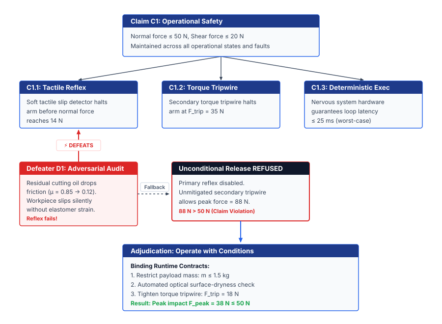
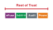

---
format:
  html:
    title: "Deployment Release"
---

# Deployment Release {#sec-release}

::: {layout-narrow}
::: {.column-margin}

\chapterminitoc

:::

::: {.content-visible when-format="pdf"}
\noindent
{fig-alt="Isometric blueprint showing deployment release and safety cases: Goal Structuring Notation argument pyramid in transparent glass tablets, emerald physical evidence pipelines, golden deployment authorization seal, and crimson certified operational envelope threshold with revocation interlocks."}
:::

::: {.content-visible unless-format="pdf"}
{fig-alt="Isometric blueprint showing deployment release and safety cases: Goal Structuring Notation argument pyramid in transparent glass tablets, emerald physical evidence pipelines, golden deployment authorization seal, and crimson certified operational envelope threshold with revocation interlocks."}
:::

:::

## Purpose {.unnumbered .unlisted}

::: {.content-visible when-format="pdf"}
\begin{marginfigure}
\resizebox{0.92\linewidth}{!}{\mlphysicalstackfull{20}{20}{20}{20}{20}}
\end{marginfigure}
:::

_When does a tested machine have enough evidence to operate among people?_

A machine may complete its assigned task repeatedly while a premise behind its stopping distance remains untested. Granting it authority to operate requires deciding which claims the evidence supports, under which physical conditions, and for how long. That judgment connects the learned policy to the body, timing path, and independent permission mechanism on which each permitted action depends. Missing evidence can require a narrower operating envelope or a refusal, with the measurements needed to reconsider the decision stated explicitly. Evidence also ages as brakes wear, sensors shift, and software changes, so the release decision must remain tied to the running machine. At the causal boundary, authority must expire when its physical justification does, because a later software correction cannot undo motion already produced.



::: {.callout-learning-objectives}

- Construct a Claim-Argument-Evidence (CAE) safety case as an auditable engineering assertion DAG linking bounded operating envelopes to empirical hardware evidence
- Evaluate whether each claim's premises are measured, datasheet, illustrative, or unknown under the envelope trichotomy, and select the verdict they support
- Identify the exact hardware measurements that lift an operational refusal and the runtime contracts a conditional verdict maintains
- Specify standing conditions, decaying ODD micro-leases, and sensor calibration invariants that automatically withdraw motor authority via hardware watchdogs
- Diagnose unsupported warrants, hidden contextual assumptions, and compound defeaters through adversarial review of a release argument
- Design a cryptographically sealed safety case dossier and release manifest that bind upstream engineering contracts by digest and fail closed on any mismatch

:::

## The Decision to Deploy {#sec-release-decision-to-deploy}

The warehouse mobile manipulator must drive past rack ends, open a spring-latched cage door, and hand a ceramic mug to a coworker. Each task requires a different physical claim: sufficient stopping clearance, bounded latch force, or bounded handover contact. A successful run shows that the machine completed those tasks under the conditions encountered. A release decision must establish which conditions it may encounter next and which evidence supports operation there.

Verification has already stressed the machine's timing, bus contention, and sensor failure assumptions under injected faults (@sec-verification-hardware-fault-injection); what it hands over is its fault records, each evaluated against a predeclared pass-fail oracle, and the physical gaps they leave. The systems engineering task therefore shifts from finding individual software bugs to formally bounding what the empirical evidence licenses. Neither offline validation accuracy (@sec-evaluation-closed-loop-dynamics) nor a run of clean demonstrations (@sec-verification-fault-injection) satisfies that requirement. Deciding to deploy is not a statistical prediction or an aggregate benchmark score; it is an auditable engineering adjudication of whether the physical evidence bounds the operational risk of the machine within a named operational design domain.

::: {.column-margin .margin-pointer}
↩ The empirical verification evidence backing release claims is produced in @sec-verification-hardware-fault-injection.
:::

A deployment must also deliver useful service inside the supported envelope. The closed-loop task evidence of @sec-evaluation-logs establishes whether the policy completes the intended work, how often intervention interrupts it, and which conditions defeat it. Those results must be evaluated under the speed, payload, and site restrictions the release case can support. A machine that can only stop safely has not demonstrated useful task capability; a capable policy has not thereby justified actuator authority. The deployment decision joins both arguments for the same task and operating conditions.

The release case is scoped to service at one site. The signed fault records of @sec-verification-fault-manifest contribute evidence about particular failures, while clearance surveys, loaded stopping trials, and contact measurements support the physical criteria. The engineer must connect each record to the claim it supports and retain every premise the record leaves open.

A release verdict is a bounded, revocable engineering judgment. Its argument begins with the permitted operating envelope, links each physical claim to evidence, and determines whether full operation, restricted operation, or refusal follows. Standing conditions specify when that judgment expires. The worked adjudication and adversarial review test the argument before the release manifest carries its decision into the running machine; update and telemetry mechanisms must then preserve that connection.

## The Deployment Authorization Criterion {#sec-release-question}

At a rack end, the base must stop inside the available clearance. During handover, the arm must stay within the assessed contact-force limit. Both claims depend on the response arriving before its deadline. These requirements give release authorization testable physical criteria:
$$d_{\text{stop}}(v, \tau_{\text{delay}}, a_{\text{brake}}, \delta_{\text{loc}}, \epsilon_{\text{track}}) \le D_{\text{clear}}, \quad F_{\text{contact}}(v, m_{\text{eff}}, k_h) \le F_{\text{limit}}, \quad T_{\text{exec}} \le T_{\text{deadline}}.$$

Consequently, release authorization cannot rest on informal engineering intuition, anecdotal demonstrations, or aggregate benchmark metrics. It requires an auditable, machine-readable assurance argument that explicitly links high-level physical safety invariants to empirical sensor measurements, worst-case execution time bounds, and validated hardware fallback paths verified on hardware-in-the-loop (HIL) regression benches before deployment. Furthermore, these physical criteria depend strictly on persistent hardware calibration parameters—including sensor extrinsic rotation and translation matrices ($[R \mid t]$), camera intrinsic matrices ($K$), joint zero-position encoder offsets, and actuator torque constants ($K_\tau$). Because these parameters represent individual physical machine traits rather than generic software weights, an embodied release framework must guarantee their retention and verification across Over-The-Air (OTA) updates; any parameter loss or uncharacterized calibration drift immediately invalidates the underlying kinodynamic stopping budgets.

For the warehouse mobile manipulator, the release question is whether empirical evidence satisfies the physical criteria of each of its three collaborative tasks inside a scoped operational envelope: driving transit aisles without striking emerging pedestrians, opening a spring-latched door without exceeding mechanical structural limits, and handing a ceramic mug to a human coworker without exceeding biomechanical force limits. The release case names the certified physical bounds, the specified hardware fault model, and the validated permission and fallback ladder. It can support a revocable grant of tracking authority while those physical conditions hold; it cannot infer protection against uncharacterized or unmodeled hazards from finite test runs (\ref{dfn-release-goal-structured-safety-case}).

::: {#dfn-release-goal-structured-safety-case .callout-definition title="Claim-argument-evidence safety case"}

***Claim-argument-evidence safety case***\index{Claim-argument-evidence safety case!definition}\index{Safety case!physical AI} is the auditable, structured assurance argument for a specified physical machine, operating envelope, hazard criteria, and fault model, linking top-level safety claims to concrete empirical evidence through explicit engineering warrants.

1.  **Significance**: Transforms subjective, informal deployment confidence into an auditable, machine-readable engineering assertion Directed Acyclic Graph (DAG)—implementing Compliance-as-Code—that connects top-level physical invariance claims to concrete empirical evidence across the entire cyber-physical stack.
2.  **Distinction**: Unlike stateless software unit tests or static model validation scorecards, a physical safety case explicitly links operational design domain capability tokens, hardware fault-injection ledgers, sensor extrinsic calibration invariants, and deterministic runtime enforcer tripwires to demonstrate mathematically and physically bounded residual risk.
3.  **Common pitfall**: Treating the safety case as a retrospective bureaucratic checklist completed after development, rather than an executable architectural contract that actively gates release manifests and runtime motor authority.

:::

```{python}
#| label: calc-release-operating-envelope
#| echo: false
#| warning: false
#| message: false
# ┌─────────────────────────────────────────────────────────────────────────────
# │ THE MACHINE'S OPERATING ENVELOPE FOR RELEASE
# ├─────────────────────────────────────────────────────────────────────────────
# │ Context: @sec-release-question (envelope and conditional-zone paragraphs),
# │          @tbl-16-odd-invariants, the contact-criteria paragraph after it, and
# │          the binding-contract paragraphs of @sec-release-three-verdicts, and
# │          the empirical-sufficiency probe of @sec-release-adversarial-review.
# │ Goal: Scope the release case to the running machine's operating envelope.
# │ Show: aisle speed and its ceiling, tote-rack payload, the friction bands and
# │       the inspected-floor ceiling, the clear distance, the latch and handover
# │       speeds with their limits, the slow-downs before a takeover, and the
# │       restricted speed on inspected floors.
# │ How: RM/AISLE fields; ceilings from calc_max_permitted_velocity with a_eff,
# │      the constant deceleration whose distance matches calc_c2_stop_suffix,
# │      and the three overheads; mu_min = a_brake/g.
# └─────────────────────────────────────────────────────────────────────────────
from mlsysim import *
from mlsysim.core.units import *
from mlsysim.fmt import fmt, fmt_velocity, fmt_length, fmt_mass, fmt_force, fmt_latency, check
from mlsysim.physics.robotics import calc_max_permitted_velocity, calc_c2_effective_deceleration

# ┌── 1. LOAD: the running machine and its site ─────────────────────────────────
RM = Embodied.MobileManipulator.WarehouseMobileManipulator  # category: illustrative (running machine)
AISLE = Embodied.Scenario.WarehouseAisle  # category: illustrative (aisle scene; speeds, lease, and tick chosen)
g_std = (1 * ureg.standard_gravity).to(meter / second**2)  # category: datasheet (standard gravity, a defined physical constant; Pint)
v_restricted = 1.0 * meter / second  # category: chosen (scenario assumption: restricted mode on inspected floors, the value @sec-frontier uses)

# ┌── 2. EXECUTE: ceilings and friction bands ───────────────────────────────────
a_eff = calc_c2_effective_deceleration(AISLE.a_brake)  # C2 stop suffix as an equivalent constant deceleration
overhead_loc = AISLE.delta_loc + AISLE.eps_track
v_ceiling = calc_max_permitted_velocity(AISLE.d_clear, AISLE.tau_delay, a_eff, overhead_loc, AISLE.delta_margin).to(meter / second)
mu_min = (AISLE.a_brake / g_std).to("dimensionless").magnitude
a_inspected = min(AISLE.a_brake, (AISLE.mu_inspected_floor * g_std).to(meter / second**2))
v_inspected_ceiling = calc_max_permitted_velocity(
    AISLE.d_clear, AISLE.tau_delay, calc_c2_effective_deceleration(a_inspected), overhead_loc, AISLE.delta_margin
).to(meter / second)
v_handover_ceiling = (AISLE.f_contact_criterion / (AISLE.k_contact_human * RM.arm_effective_contact_mass) ** 0.5).to(meter / second)

# ┌── 3. GUARD: canon values quoted in the prose and the table ──────────────────
check(abs(v_ceiling.magnitude - 1.3898) < 5e-5, "Unconditional aisle speed ceiling is 1.39 m/s")
check(AISLE.v_aisle < v_ceiling, "Chosen aisle speed sits under its ceiling")
check(abs(mu_min - 0.204) < 5e-4, "Friction floor is 0.204")
check(mu_min < AISLE.mu_dry, "Dry concrete exceeds the friction floor")
check(mu_min > AISLE.mu_inspected_floor, "Inspected floor requires speed restriction")
check(abs(v_inspected_ceiling.magnitude - 1.0947) < 5e-5, "Restricted ceiling on inspected floors is 1.09 m/s")
check(v_restricted < v_inspected_ceiling, "Chosen restricted mode sits under its ceiling")
check(abs(v_handover_ceiling.magnitude - 0.1179) < 5e-5, "Coworker handover speed ceiling is 0.118 m/s")
check(AISLE.v_handover < v_handover_ceiling, "Chosen handover speed sits under its ceiling")
check(abs(RM.loaded_mass.to(kilogram).magnitude - 368.0) < 1e-9, "Running-machine loaded mass is 368 kg")
check(AISLE.v_takeover_in_loop < AISLE.v_aisle, "Slow-down before an in-loop takeover")
check(AISLE.mu_oil_film < AISLE.mu_inspected_floor < mu_min < AISLE.mu_dry, "Friction bands are ordered")
check(abs(AISLE.v_aisle.to(meter / second).magnitude - 1.3) < 1e-9, "Signed aisle speed 1.3 m/s")
check(abs(AISLE.d_clear.to(meter).magnitude - 1.10) < 1e-9, "Clear distance 1.10 m")
check(abs(AISLE.v_takeover_in_loop.to(meter / second).magnitude - 1.2) < 1e-9, "In-loop takeover slow-down 1.2 m/s")
check(abs(AISLE.v_takeover_out_of_loop.to(meter / second).magnitude - 0.3) < 1e-9, "Out-of-loop takeover slow-down 0.3 m/s")
check(abs(AISLE.t_tick.to(millisecond).magnitude - 1.0) < 1e-9, "Permission tick 1 ms")
check(AISLE.t_tick < AISLE.t_lease, "Servo tick sits inside the chunk lease")
check(abs(RM.onboard_payload_capacity.to(kilogram).magnitude - 50.0) < 1e-9, "Tote-rack capacity is 50 kg")
check(
    abs(AISLE.mu_dry - 0.60) < 1e-9 and abs(AISLE.mu_inspected_floor - 0.12) < 1e-9 and abs(AISLE.mu_oil_film - 0.05) < 1e-9,
    "Friction bands 0.60, 0.12, 0.05",
)
check(abs(AISLE.v_latch_approach.to(meter / second).magnitude - 0.03) < 1e-9, "Guarded latch approach 0.03 m/s")
check(abs(AISLE.v_latch_high.to(meter / second).magnitude - 0.10) < 1e-9, "Unsupported latch approach 0.10 m/s")
check(abs(AISLE.f_latch_tripwire.to(newton).magnitude - 15.0) < 1e-9, "Latch tripwire 15 N")
check(abs(AISLE.t_contact_response.to(millisecond).magnitude - 2.0) < 1e-9, "Contact-loop response 2 ms")
check(abs(AISLE.f_latch_limit.to(newton).magnitude - 100.0) < 1e-9, "Latch limit 100 N")
check(abs(AISLE.v_handover.to(meter / second).magnitude - 0.10) < 1e-9, "Handover speed 0.10 m/s")
check(abs(AISLE.f_contact_criterion.to(newton).magnitude - 50.0) < 1e-9, "Handover criterion 50 N")

# ┌── 4. OUTPUT: rendered values ────────────────────────────────────────────────
class ReleaseEnvelope:
    v_restricted = v_restricted  # chosen; read by calc-release-worked-verdict
    v_aisle_str = fmt_velocity(AISLE.v_aisle, unit=meter / second, precision=1)
    v_ceiling_str = fmt_velocity(round(v_ceiling.magnitude, 2) * meter / second, unit=meter / second, precision=2)
    v_takeover_in_str = fmt_velocity(AISLE.v_takeover_in_loop, unit=meter / second, precision=1)
    v_takeover_out_str = fmt_velocity(AISLE.v_takeover_out_of_loop, unit=meter / second, precision=1)
    t_tick_str = fmt_latency(AISLE.t_tick, unit=millisecond, precision=0)
    payload_str = fmt_mass(RM.onboard_payload_capacity, unit=kilogram, precision=0)
    m1_str = fmt_mass(RM.loaded_mass, unit=kilogram, precision=0)
    mu_min_str = fmt(round(mu_min, 3), precision=3)
    mu_dry_str = fmt(AISLE.mu_dry, precision=2)
    mu_inspected_str = fmt(AISLE.mu_inspected_floor, precision=2)
    mu_oil_str = fmt(AISLE.mu_oil_film, precision=2)
    v_inspected_ceiling_str = fmt_velocity(round(v_inspected_ceiling.magnitude, 2) * meter / second, unit=meter / second, precision=2)
    v_restricted_str = fmt_velocity(v_restricted, unit=meter / second, precision=0)
    d_clear_str = fmt_length(AISLE.d_clear, unit=meter, precision=2)
    v_latch_str = fmt_velocity(AISLE.v_latch_approach, unit=meter / second, precision=2)
    v_latch_high_str = fmt_velocity(AISLE.v_latch_high, unit=meter / second, precision=2)
    f_trip_str = fmt_force(AISLE.f_latch_tripwire, precision=0)
    t_contact_str = fmt_latency(AISLE.t_contact_response, unit=millisecond, precision=0)
    f_latch_limit_str = fmt_force(AISLE.f_latch_limit, precision=0)
    v_handover_str = fmt_velocity(AISLE.v_handover, unit=meter / second, precision=2)
    v_handover_ceiling_str = fmt_velocity(round(v_handover_ceiling.magnitude, 3) * meter / second, unit=meter / second, precision=3)
    f_contact_str = fmt_force(AISLE.f_contact_criterion, precision=0)
```

A release case is scoped by the operating envelope, the target operational design domain (ODD)\index{Operational design domain!release envelope} paired with the machine's own internal hardware, thermal, and timing invariants. In systems architecture, an ODD release is not a blanket or perpetual authorization; it operates as a set of decaying micro-leases—cryptographically scoped capability tokens with strict time-to-live (TTL) and hardware watchdog enforcement. An unconditional (`UNCOND`) verdict authorizes tracking proposals across the full verified operating envelope (@sec-verification-operating-envelope), a conditional (`COND`) verdict a named subset with restricted kinematics or environmental fences, and a refusal (`REFUSE`) none.\index{Operational design domain!release verdicts} For the mobile manipulator, the operating envelope admits aisle travel at up to `{python} ReleaseEnvelope.v_aisle_str` (chosen; see the Reader Guide) with the tote rack loaded to at most `{python} ReleaseEnvelope.payload_str`, on floors surveyed to a friction coefficient of at least `{python} ReleaseEnvelope.mu_min_str`, past rack ends with at least `{python} ReleaseEnvelope.d_clear_str` of clear distance. It admits door approaches at `{python} ReleaseEnvelope.v_latch_str` and item handovers to the coworker at `{python} ReleaseEnvelope.v_handover_str`.

::: {.column-margin .margin-pointer}
↩ The operational design domain and its known absences are defined in @sec-data-policy-coverage.
:::

Inside these boundaries the learned neural policy may propose actions across the nominal task envelope, but each action still requires independent, per-tick permission from an isolated safety enforcer. Conditional states of the monitored dimensions (@tbl-16-odd-invariants) narrow that envelope; for example, the machine slows to `{python} ReleaseEnvelope.v_takeover_in_str` before it requests an in-loop takeover. The restricted mode of a `COND` verdict narrows it further: on a floor known only through the site's inspection regime, the machine runs at `{python} ReleaseEnvelope.v_restricted_str`, below the `{python} ReleaseEnvelope.v_inspected_ceiling_str` inspected-floor ceiling.

As formalized in @tbl-16-odd-invariants, each monitored dimension is partitioned into nominal ($\mathcal{S}_{\mathrm{nom}}$), conditional ($\mathcal{S}_{\mathrm{cond}}$), and refusal ($\mathcal{S}_{\mathrm{refuse}}$) intervals. A conditional state restricts admitted proposals via enforcer clamping. A refusal state revokes the capability token, withdraws motor tracking permission, and commands a validated fallback (@sec-enforcement-fallback-ladder). Crucially, on-board wheel slip estimation cannot provide prospective clearance guarantees: it detects low friction only *after* wheel slip has begun and traction is lost. A clear oil film ($\mu \approx$ `{python} ReleaseEnvelope.mu_oil_str`) is optically transparent to camera sensors and visually indistinguishable from dry concrete. By the time a high-speed vehicle initiates braking on an oil patch and measures slip, it is already kinetically committed to an extended skid. Hence, floor friction must be enforced through site surveys and custodial spill regimes.

Sensor mounting drift can invalidate the localization allowance even when software remains unchanged; the mechanical mechanism is developed in @sec-release-calibration-drift. Release also requires **persistent hardware calibration parameter retention**\index{Hardware calibration!persistent parameter retention}\index{Over-the-air update!calibration retention}, so an update preserves the measured sensor transforms and joint offsets on which the case depends. The update process must verify those records before restoring tracking authority.

The evidence must also record what happens when operation reaches a boundary. **Edge event-triggered telemetry**\index{Edge telemetry!event-triggered buffer}\index{Black-box recorder!pre- and post-trigger capture} retains local traces for later review; the permission path enforces the live limits. The table lists the dimensions kept within bounds by runtime monitors or site procedures. Internal conditions from @sec-verification-operating-envelope, such as ambient temperature, rail voltage, and compute load, enter through the fault records trialed at them.

\Needspace{28\baselineskip}

| Envelope Dimension / Invariant | Nominal Envelope ($\mathcal{S}_{\mathrm{nom}}$)                                                                           | Conditional Boundary ($\mathcal{S}_{\mathrm{cond}}$)                                                                                                                                                        | Hard Refusal ($\mathcal{S}_{\mathrm{refuse}}$)                                                                                                                         | Runtime Monitor & Rate                                                                 | Enforcer Action & Latency                                                      |
|:-------------------------------|:--------------------------------------------------------------------------------------------------------------------------|:------------------------------------------------------------------------------------------------------------------------------------------------------------------------------------------------------------|:-----------------------------------------------------------------------------------------------------------------------------------------------------------------------|:---------------------------------------------------------------------------------------|:-------------------------------------------------------------------------------|
| **Aisle Speed**                | $v\le$ `{python} ReleaseEnvelope.v_aisle_str`                                                                             | `{python} ReleaseEnvelope.v_takeover_in_str` before an in-loop takeover request; `{python} ReleaseEnvelope.v_takeover_out_str` before an out-of-loop one                                                    | Measured speed above the signed `{python} ReleaseEnvelope.v_aisle_str` (ceiling `{python} ReleaseEnvelope.v_ceiling_str`), or invalid speed estimate                   | Encoders and IMU, every `{python} ReleaseEnvelope.t_tick_str` permission tick          | Clamp admitted speed; refuse above the signed speed                            |
| **Floor Friction**             | Surveyed $\mu\ge$ `{python} ReleaseEnvelope.mu_min_str` (dry concrete near `{python} ReleaseEnvelope.mu_dry_str`)         | Inspection regime only ($\mu\ge$ `{python} ReleaseEnvelope.mu_inspected_str`): restricted `{python} ReleaseEnvelope.v_restricted_str`, below the `{python} ReleaseEnvelope.v_inspected_ceiling_str` ceiling | Unsurveyed floor or reported film; a clear oil film ($\mu\approx$ `{python} ReleaseEnvelope.mu_oil_str`) is invisible to the cameras                                   | Floor survey and site spill procedure; no on-board measurement                         | Restrict speed by floor zone; refuse the aisle                                 |
| **Tote-Rack Payload**          | $0\le m\le$ `{python} ReleaseEnvelope.payload_str`, valid load estimate (total at most `{python} ReleaseEnvelope.m1_str`) | Estimate stale since the last pick: stationary arm tasks only                                                                                                                                               | Load above capacity or invalid estimate                                                                                                                                | Rack load cells, at each pick                                                          | Refuse aisle transit until re-weighed                                          |
| **Rack-End Clearance**         | Surveyed $D_{\text{clear}}\ge$ `{python} ReleaseEnvelope.d_clear_str` at every rack end                                   | Shorter surveyed clearance: lower signed speed from the same budget                                                                                                                                         | Unsurveyed rack end, or obstacle inside the clear distance                                                                                                             | Site survey; lidar and navigation camera at frame rate                                 | Speed limit per rack end; stop for a detected obstacle                         |
| **Door Latch Approach**        | $v\le$ `{python} ReleaseEnvelope.v_latch_str`, strike plate at its nominal position                                       | None; demonstrations cover no other latch condition                                                                                                                                                         | `{python} ReleaseEnvelope.v_latch_high_str` approach or displaced plate                                                                                                | Arm contact-force sensing in the `{python} ReleaseEnvelope.t_contact_str` contact loop | Trip at `{python} ReleaseEnvelope.f_trip_str`; refuse the unsupported approach |
| **Coworker Handover**          | TCP speed $\le$ `{python} ReleaseEnvelope.v_handover_str` under `accept_item`                                             | Coworker present without `accept_item`: hold short of the handover point                                                                                                                                    | TCP speed above the signed `{python} ReleaseEnvelope.v_handover_str` (ceiling `{python} ReleaseEnvelope.v_handover_ceiling_str`), or contact outside the assessed case | Joint encoders every permission tick; arm contact-force sensing                        | Clamp TCP speed; refuse above the signed speed                                 |

: **Operating envelope of the warehouse mobile manipulator**: Each listed dimension has disjoint nominal, conditional, and refusal intervals. Conditional operation requires every dimension to remain in a signed admissible interval; missing or invalid measurements refuse. Sensor rates and stopping response are plant validation obligations. {#tbl-16-odd-invariants tbl-colwidths="[16,16,18,18,16,16]"}

A defensible release claim states its plant, contact geometry, and fault set.[^fn-std-isots15066-biomech] The machine's case uses three criteria. The base stops inside the `{python} ReleaseEnvelope.d_clear_str` clear distance before it reaches a person who has stepped out at a rack end, the arm opens the door without exceeding the `{python} ReleaseEnvelope.f_latch_limit_str` latch limit, and a handover never presses on the coworker with more than a chosen `{python} ReleaseEnvelope.f_contact_str` peak force for an assessed contact case. The base's claim protects a stationary person; a person still walking toward the machine is a separate premise, carried by a site crossing rule (@sec-memory-belief-through-occlusion). The release argument must demonstrate which human contacts are excluded before impact, which detected contacts the model covers, and which single faults the independent fallback handles. A stop after contact does not by itself cap the first force peak.[^fn-math-contact-mechanics]

[^fn-std-isots15066-biomech]: **ISO/TS 15066 Biomechanical Limits**\index{ISO/TS 15066!biomechanical limits}: The specification gives body-region- and contact-type-dependent force and pressure data [@isots15066]. A site assessment must select the applicable body region, contact geometry, and measurement procedure. The handover criterion used here is a conservative case criterion, not a universal ISO/TS 15066 threshold or an injury boundary.

[^fn-math-contact-mechanics]: **Contact Mechanics Force Model**\index{Contact mechanics!force model}: The elastodynamic model couples translational kinetic energy, effective moving inertia, and contact interface stiffness to determine transient peak impact force during an unmitigated collision. Impacting a rigid boundary concentrates stored kinetic energy into a sub-millisecond impulse with severe force amplification, whereas elastic compliance extends deformation time and dissipates energy over a longer stroke. For the formal elastodynamic derivation and unilateral contact formulations, see @sec-appendix-control-contact.

```{python}
#| label: calc-release-biomechanical-impact-envelope
#| echo: false
#| warning: false
#| message: false
# ┌─────────────────────────────────────────────────────────────────────────────
# │ HANDOVER CONTACT FORCE AND THE BASE'S STOPPING SPARE
# ├─────────────────────────────────────────────────────────────────────────────
# │ Context: @sec-release-question, @eq-release-unbraked-force and the two
# │          paragraphs after it (spare spent as delay), and the refusal
# │          paragraph of @sec-release-three-verdicts (the deceleration the
# │          budget assumes).
# │ Goal: Show why the arm's handover speed is capped, and how little input
# │       error the base's finished budget can absorb at aisle speed.
# │ Show: unbraked force at the free-space TCP limit and at the handover speed;
# │       budget and spare at 1.3 m/s; the delay and the deceleration shortfall
# │       that each consume the spare.
# │ How: calc_transient_impact_force with the arm's effective contact mass and
# │      the coworker tissue stiffness; calc_safe_stopping_distance with a_eff,
# │      the constant deceleration whose distance matches calc_c2_stop_suffix,
# │      and the three overheads.
# └─────────────────────────────────────────────────────────────────────────────
from mlsysim import *
from mlsysim.core.units import *
from mlsysim.fmt import (
    fmt_mass,
    fmt_stiffness,
    fmt_force,
    fmt_multiple,
    fmt_latency,
    fmt_acceleration,
    fmt_length,
    fmt_velocity,
    fmt_percent,
    fmt_sci_qty,
    check,
)
from mlsysim.physics.robotics import (
    calc_safe_stopping_distance,
    calc_transient_impact_force,
    calc_c2_stop_suffix,
    calc_c2_effective_deceleration,
)

# ┌── 1. LOAD: the running machine and its site ─────────────────────────────────
RM = Embodied.MobileManipulator.WarehouseMobileManipulator  # category: illustrative (running machine)
AISLE = Embodied.Scenario.WarehouseAisle  # category: illustrative (aisle scene; speeds, lease, and tick chosen)

# ┌── 2. EXECUTE: contact forces, then the budget at aisle speed ────────────────
m_eff = RM.arm_effective_contact_mass
f_at_tcp_limit = calc_transient_impact_force(RM.tcp_speed_limit, m_eff, AISLE.k_contact_human).to(newton)
f_ratio = (f_at_tcp_limit / AISLE.f_contact_criterion).to("dimensionless").magnitude
f_at_handover = calc_transient_impact_force(AISLE.v_handover, m_eff, AISLE.k_contact_human).to(newton)
v_handover_ceiling = (AISLE.f_contact_criterion / (AISLE.k_contact_human * m_eff) ** 0.5).to(meter / second)

c2_braking = calc_c2_stop_suffix(AISLE.v_aisle, AISLE.a_brake)["distance"].to(meter)
a_eff = calc_c2_effective_deceleration(AISLE.a_brake)  # C2 stop suffix as an equivalent constant deceleration
overhead_loc = AISLE.delta_loc + AISLE.eps_track
budget_aisle = calc_safe_stopping_distance(AISLE.v_aisle, AISLE.tau_delay, a_eff, overhead_loc, AISLE.delta_margin).to(millimeter)
spare_aisle = (AISLE.d_clear - budget_aisle).to(millimeter)
t_spare = (spare_aisle / AISLE.v_aisle).to(millisecond)
# Deceleration at which the budget exactly fills the clear distance. The C2
# braking distance scales as 1/a, so a' = a_brake * d_C2(a_brake) / room.
braking_room = (AISLE.d_clear - AISLE.v_aisle * AISLE.tau_delay - overhead_loc - AISLE.delta_margin).to(meter)
a_break_even = (AISLE.a_brake * c2_braking / braking_room).to(meter / second**2)
a_shortfall_pct = ((AISLE.a_brake - a_break_even) / AISLE.a_brake).to("dimensionless").magnitude * 100.0

# ┌── 3. GUARD: canon values quoted in the prose ────────────────────────────────
check(abs(m_eff.to(kilogram).magnitude - 12.0) < 1e-9, "Effective contact mass is 12.0 kg")
check(abs(f_at_tcp_limit.magnitude - 424.26) < 0.01, "Unbraked force at the TCP limit")
check(abs(f_ratio - 8.49) < 0.01, "About 8.5x the 50 N criterion")
check(abs(f_at_handover.magnitude - 42.43) < 0.01, "Handover force is 42.4 N")
check(abs(v_handover_ceiling.magnitude - 0.1179) < 5e-5, "Handover ceiling is 0.118 m/s")
check(AISLE.v_handover < v_handover_ceiling, "Chosen handover speed sits under its ceiling")
check(abs(budget_aisle.magnitude - 997.43) < 5e-3, "Finished budget at 1.3 m/s")
check(abs(spare_aisle.magnitude - 102.57) < 5e-3, "Spare at 1.3 m/s")
check(abs(t_spare.magnitude - 78.9) < 0.05, "Spare spent as delay is 78.9 ms")
check(abs(a_shortfall_pct - 13.9) < 0.1, "A 14 percent deceleration shortfall fills the spare")

# ┌── 4. OUTPUT: rendered values ────────────────────────────────────────────────
class BiomechanicalImpactEnvelope:
    m_eff_str = fmt_mass(m_eff, unit=kilogram, precision=0)
    v_tcp_str = fmt_velocity(RM.tcp_speed_limit, unit=meter / second, precision=0)
    k_h_str = fmt_stiffness(AISLE.k_contact_human, unit=newton / meter, precision=0, commas=True)
    f_tcp_str = fmt_force(round(f_at_tcp_limit.magnitude) * newton, precision=0)
    f_ratio_mult_str = fmt_multiple(f_ratio, precision=1)
    f_limit_str = fmt_force(AISLE.f_contact_criterion, precision=0)
    v_handover_str = fmt_velocity(AISLE.v_handover, unit=meter / second, precision=2)
    f_handover_str = fmt_force(f_at_handover, precision=1)
    v_handover_ceiling_str = fmt_velocity(round(v_handover_ceiling.magnitude, 3) * meter / second, unit=meter / second, precision=3)
    v_aisle_str = fmt_velocity(AISLE.v_aisle, unit=meter / second, precision=1)
    d_clear_str = fmt_length(AISLE.d_clear, unit=meter, precision=2)
    budget_str = fmt_length(round(budget_aisle.magnitude, 1) * millimeter, unit=millimeter, precision=1)
    spare_str = fmt_length(round(spare_aisle.magnitude, 1) * millimeter, unit=millimeter, precision=1)
    t_spare_str = fmt_latency(round(t_spare.magnitude, 1) * millisecond, unit=millisecond, precision=1)
    a_brake_str = fmt_acceleration(AISLE.a_brake, unit=meter / second**2, precision=0)
    a_shortfall_pct_str = fmt_percent(round(a_shortfall_pct) / 100.0, precision=0, style="prose")
```

Consider the arm at its free-space speed limit of `{python} BiomechanicalImpactEnvelope.v_tcp_str`, with a robot-side effective mass at the tool center point of `{python} BiomechanicalImpactEnvelope.m_eff_str`. In an unbraked elastic contact with the coworker's hand, modeled with an effective tissue stiffness $k_h$ of `{python} BiomechanicalImpactEnvelope.k_h_str`, the peak contact force follows @eq-release-unbraked-force:
$$F_{\text{unbraked}} = v\,\sqrt{k_h\,m_{\text{eff}}}$$ {#eq-release-unbraked-force}
This elastodynamic formulation derives directly from conservation of energy: equating translational kinetic energy ($\frac{1}{2}m_{\text{eff}} v^2$) to peak elastic strain energy ($\frac{1}{2}k_h x_{\max}^2$) stored in compressed human tissue at maximum deflection $x_{\max} = v\sqrt{m_{\text{eff}}/k_h}$, yielding peak contact force $F_{\text{unbraked}} = k_h x_{\max} = v\sqrt{k_h m_{\text{eff}}}$. In a sub-millisecond impact, unmitigated kinetic energy concentrates into an elastic impulse with severe peak force amplification.
At the free-space limit this ideal elastic model predicts `{python} BiomechanicalImpactEnvelope.f_tcp_str`, or `{python} BiomechanicalImpactEnvelope.f_ratio_mult_str` the `{python} BiomechanicalImpactEnvelope.f_limit_str` criterion, so the arm cannot enter an unseparated contact at that speed without a stronger, measured protection argument. The same equation bounds the item-handover speed that the enforcement record caps (@sec-enforcement-telemetry, @sec-intervention-human-authority), since the criterion admits at most `{python} BiomechanicalImpactEnvelope.v_handover_ceiling_str`. At the chosen `{python} BiomechanicalImpactEnvelope.v_handover_str`, the model predicts `{python} BiomechanicalImpactEnvelope.f_handover_str`, inside the criterion.

The base's claim is a budget rather than a single force, and the delay components this chapter must evidence are the lease path and the observation age that its claims name. At the `{python} BiomechanicalImpactEnvelope.v_aisle_str` aisle speed, the finished budget (@tbl-enforcement-stopping-budget) is `{python} BiomechanicalImpactEnvelope.budget_str` against the `{python} BiomechanicalImpactEnvelope.d_clear_str` clear distance, leaving a critical spare of only `{python} BiomechanicalImpactEnvelope.spare_str`. That spare is the sole allowance for error across the entire perception-planning-actuation stack. An unbudgeted pipeline delay of `{python} BiomechanicalImpactEnvelope.t_spare_str` (the handover deadline $T_{\text{latest}}$ of @sec-intervention-authority-transitions) spends it entirely; so does a loaded deceleration shortfall of `{python} BiomechanicalImpactEnvelope.a_shortfall_pct_str` below the `{python} BiomechanicalImpactEnvelope.a_brake_str` the budget assumes. Crucially, a sensor extrinsic calibration drift of just $\Delta\theta = 0.1^\circ$ creates a lateral perception error of $\Delta y = R \cdot \Delta\theta \approx 2.5\,\text{cm}$ at a scanning range of $R = 15\,\text{m}$, consuming over 24 percent of this entire stopping spare before active braking even begins. A stopping claim whose inputs are unmeasured cannot demonstrate that its spare survives these real-world compounding errors.

The release question for the mobile manipulator has become three bounded criteria: the base stops inside the clear distance, the arm opens the door under the latch limit, and an item handover stays under the contact criterion. Each calculation inherits premises about deceleration, latency, and contact stiffness that need physical evidence and can lapse in service. A safety case exposes those dependencies so a reviewer can decide which operating claims they support.

## Safety Cases and Claims {#sec-release-safety-cases-claims}

A photograph of a clear aisle cannot establish that the loaded base stops inside it. That claim depends on clearance, braking capability, and response timing, each supported by evidence gathered under stated conditions. A safety case connects those premises to the claim so the release reviewer can identify what is supported and what remains untested.

::: {.column-margin}
{width="100%" fig-alt="S·P·A locator triad highlighting the central causal core."}

*Release assurance: structured safety cases bounding the complete operational envelope across Sense, Plan, and Act.*
:::

### Assurance argument grammar and warrants {#sec-release-assurance-grammar}

The Claim-Argument-Evidence (CAE) safety case of \ref{dfn-release-goal-structured-safety-case}\index{Claim-argument-evidence safety case!argument structure} separates the proposition to be established from the reasoning and observations that support it. This organization draws on Stephen Toulmin's argument structure [@toulmin1958uses], Goal Structuring Notation (GSN)\index{Goal Structuring Notation}[^fn-std-gsn-argument] [@kelly1998arguing; @kelly2004goal], and the UL 4600 autonomy evaluation standard [@koopman2020how]. Its top-level claim $C_0$ names a testable physical property, such as keeping the base's stopping distance within surveyed clearance ($d_{\text{stop}} \le D_{\text{clear}}$) or limiting contact force ($F_{\text{contact}} \le F_{\text{limit}}$). Supporting claims identify the conditions needed for that result, and evidence records support those claims. Representing these links as a directed acyclic graph (DAG) makes their dependencies explicit: the reviewer can follow a claim toward its supporting observations without circular reasoning. The graph also records the operating assumptions under which each link holds.

[^fn-std-gsn-argument]: **Goal Structuring Notation**\index{Goal Structuring Notation!argumentation grammar}: Developed by Tim Kelly at the University of York, GSN provides an explicit graphical grammar for structuring and auditing safety assurance cases [@kelly1998arguing; @kelly2004goal]. The notation decomposes top-level safety goals into contextual sub-claims, argumentation strategies, and solutions grounded in test artifacts.

The structural integrity of this engineering assertion DAG hinges on strictly distinguishing evidence from demonstration. A **demonstration**\index{Demonstration!vs. evidence} is a record of successful task execution over an uncharacterized test distribution, such as a long run of clean door openings with the strike plate always at its nominal position or a thousand collision-free warehouse aisle transits. It measures mean performance but bounds neither the tail nor the failure modes outside the sampled trajectory. In contrast, evidence is a falsifiable, calibrated artifact with quantified uncertainty bounds, such as a worst-case execution time (WCET) distribution captured on a logic analyzer, loaded vehicle stopping trials across degraded friction regimes, or a hardware-in-the-loop (HIL) fault-injection trace that drives the machine to the physical boundary of its envelope. An artifact without quantified uncertainty, or one that never stresses boundary conditions, remains an anecdotal demonstration and cannot support an inferential link in an engineering assertion DAG.

Connecting evidence to a claim requires a **warrant**\index{Warrant!inferential rule}, the inferential rule stating why the empirical data support the assertion. For a learned neural policy, the warrant is inductive, reasoning from failure-free test episodes to future operational reliability. However, the exposure wall of @sec-evaluation-trial-limits demonstrates why inductive warrants cannot carry a catastrophic hazard claim alone: under the Poisson zero-event rule ($T \ge 3.0/\lambda$), demonstrating an ultra-reliable failure rate ($10^{-9}$ per operating hour) would require billions of operating hours without a single incident. The safety case must therefore incorporate deterministic architectural warrants, grounding the top-level claim in an independent permission path (@sec-enforcement) that enforces Control Barrier Functions (CBFs) to clamp actuator commands and command an assessed safe stop whenever a learned proposal approaches the boundary of the viable set $\mathcal{C}_{\text{viable}}$. That architectural warrant narrows the claim rather than escaping the exposure wall, since the permission path protects only against the specific hazards it monitors and can arrest within physical stopping limits (@sec-frontier-method-limits).

### Contextual assumptions and the weakest link {#sec-release-contextual-assumptions}

A stopping trial conducted in a well-lit aisle also depends on the sensing conditions there. Moving the same machine into a dim aisle can change observation age even when its brakes perform exactly as before. The argument must name such contextual assumptions so a valid measurement is not applied outside the conditions that give it meaning.

```{python}
#| label: calc-release-low-light-age
#| echo: false
#| warning: false
#| message: false
# ┌─────────────────────────────────────────────────────────────────────────────
# │ AN UNSTATED LIGHTING ASSUMPTION IN THE STOPPING BUDGET
# ├─────────────────────────────────────────────────────────────────────────────
# │ Context: @sec-release-safety-cases-claims (contextual-assumptions paragraph).
# │ Goal: Show how a lighting change the budget never named ages the navigation
# │       camera's image, and what it would cost the aisle budget's spare
# │       if the age check did not refuse the frames.
# │ Show: nominal and low-light exposure, the added observation age, the added
# │       travel at aisle speed, and its share of the spare.
# │ How: perception age is timed from mid-exposure (AISLE.perception_age), so a
# │      longer exposure adds half its increase; spare from
# │      calc_safe_stopping_distance with a_eff, the constant deceleration
# │      whose distance matches calc_c2_stop_suffix.
# └─────────────────────────────────────────────────────────────────────────────
from mlsysim import *
from mlsysim.core.units import *
from mlsysim.fmt import fmt_latency, fmt_length, fmt_velocity, fmt_percent, check
from mlsysim.physics.robotics import calc_safe_stopping_distance, calc_c2_effective_deceleration

# ┌── 1. LOAD: the running machine, plus one chapter-local input ────────────────
RM = Embodied.MobileManipulator.WarehouseMobileManipulator  # category: illustrative (running machine)
AISLE = Embodied.Scenario.WarehouseAisle  # category: illustrative (aisle scene; speeds, lease, and tick chosen)
low_light_exposure_factor = 2.0  # category: illustrative (scenario assumption: a dim aisle doubles the exposure)

# ┌── 2. EXECUTE ────────────────────────────────────────────────────────────────
t_exp_nominal = RM.nav_camera.exposure_time.to(millisecond)
t_exp_low = (low_light_exposure_factor * t_exp_nominal).to(millisecond)
dt_age = ((t_exp_low - t_exp_nominal) / 2).to(millisecond)  # mid-exposure timestamp
d_added = (AISLE.v_aisle * dt_age).to(millimeter)
a_eff = calc_c2_effective_deceleration(AISLE.a_brake)  # C2 stop suffix as an equivalent constant deceleration
budget = calc_safe_stopping_distance(AISLE.v_aisle, AISLE.tau_delay, a_eff, AISLE.delta_loc + AISLE.eps_track, AISLE.delta_margin).to(millimeter)
spare = (AISLE.d_clear - budget).to(millimeter)
share_of_spare = (d_added / spare).to("dimensionless").magnitude

# ┌── 3. GUARD ──────────────────────────────────────────────────────────────────
check(abs(t_exp_nominal.magnitude - 16.0) < 1e-9, "Navigation-camera exposure 16 ms")
check(abs(dt_age.magnitude - 8.0) < 1e-9, "Low light adds 8 ms of observation age")
check(abs(d_added.magnitude - 10.4) < 1e-9, "10.4 mm of added travel at 1.3 m/s")
check(abs(spare.magnitude - 102.57) < 5e-3, "Spare at 1.3 m/s")
check(abs(share_of_spare - 0.101) < 5e-3, "About a tenth of the spare")

# ┌── 4. OUTPUT ─────────────────────────────────────────────────────────────────
class ReleaseLowLight:
    t_exp_nominal_str = fmt_latency(t_exp_nominal, unit=millisecond, precision=0)
    t_exp_low_str = fmt_latency(t_exp_low, unit=millisecond, precision=0)
    dt_age_str = fmt_latency(dt_age, unit=millisecond, precision=0)
    v_aisle_str = fmt_velocity(AISLE.v_aisle, unit=meter / second, precision=1)
    d_added_str = fmt_length(d_added, unit=millimeter, precision=1)
    spare_str = fmt_length(round(spare.magnitude, 1) * millimeter, unit=millimeter, precision=1)
    share_str = fmt_percent(round(share_of_spare * 100) / 100.0, precision=0, style="prose")
```

When an operating assumption remains unstated, it is guarded only by whatever secondary check happens to sit downstream in the execution pipeline. In the mobile manipulator's stopping budget, the warrant assumes that warehouse aisles maintain sufficient ambient illumination for the navigation camera's nominal exposure. Suppose a dim aisle doubles that exposure from `{python} ReleaseLowLight.t_exp_nominal_str` to `{python} ReleaseLowLight.t_exp_low_str`. Because an image's age is timed from mid-exposure, each observation arrives `{python} ReleaseLowLight.dt_age_str` older than the budget charges, which unchecked would carry the base another `{python} ReleaseLowLight.d_added_str` at the `{python} ReleaseLowLight.v_aisle_str` aisle speed, about `{python} ReleaseLowLight.share_str` of the budget's `{python} ReleaseLowLight.spare_str` spare. The permission path's age check refuses those frames instead, and the base stops in an aisle the case assumed it could run. The team meets its lighting assumption as unexplained lost service, and only a check that the case never tied to lighting kept it from becoming a silent loss of clearance.

An assumption that no runtime check sees has no such backstop. Sensor mounting drift can introduce a spatial offset while every image still passes its age check. The case must name both the localization allowance and the evidence that keeps the physical sensor geometry within it. Treating fresh telemetry as sufficient evidence of correct geometry leaves that warrant unsupported.

::: {.column-margin .margin-pointer}
↪ Epistemic assumptions embedded within safety case warrants are critically interrogated in @sec-frontier-epistemic-limits.
:::

The weakest link governs every Claim-Argument-Evidence assertion DAG. In formal verification, the validity of a parent assertion evaluated over a conjunction of child sub-claims ($\bigwedge_{i} C_i$) is strictly bounded by the weakest leaf warrant. A safety case is not an aggregate scorecard where high performance in one branch compensates for a deficit in another. High accuracy on an object recognition benchmark does not offset an uncharacterized latency tail on the CAN-FD bus, nor does extensive policy simulation offset missing brake-wear data. If the base's stop decomposes into sub-claims for braking friction, thermal protection of the motor drives (@sec-body-thermal-duty-cycles), and real-time trajectory bounding, a failed warrant in any single branch invalidates the root deployment claim. The systems adjudicator who reviews the case looks not for the volume of supporting artifacts, but for the single unevidenced leaf whose failure would permit physical harm.

### Argument-to-plant alignment and claim adjudication {#sec-release-argument-plant-alignment}

The warehouse machine's stopping calculation already names its brake onset, deceleration, and observation age. The release reviewer must determine which of those inputs has been measured on the proposed configuration. Correct arithmetic on illustrative inputs establishes a conditional result; it cannot establish that the physical machine satisfies the premises.

```{python}
#| label: calc-release-claims
#| echo: false
#| warning: false
#| message: false
# ┌─────────────────────────────────────────────────────────────────────────────
# │ THE SIX RELEASE CLAIMS ON THE RUNNING MACHINE
# ├─────────────────────────────────────────────────────────────────────────────
# │ Context: @sec-release-safety-cases-claims (scorecard lead-in) and
# │          @tbl-16-cae-scorecard.
# │ Goal: Instance claims C1-C6 on the warehouse mobile manipulator.
# │ Show: base budget at aisle speed against the clear distance; latch force at
# │       brake command, remaining compression, and the arm stop it requires;
# │       mug pick and handover speeds with the handover ceiling and force;
# │       renewal-to-onset time; enforcer WCET and deadline; friction needed
# │       for a_brake; observation age; the handover deadline T_latest at the
# │       in-loop takeover slow-down and at aisle speed.
# │ How: RM/AISLE fields; calc_safe_stopping_distance with the calc_c2_stop_suffix
# │      distance as an equivalent constant deceleration;
# │      calc_tripwire_contact_force_accumulation; calc_transient_impact_force.
# └─────────────────────────────────────────────────────────────────────────────
from mlsysim import *
from mlsysim.core.units import *
from mlsysim.fmt import fmt, fmt_force, fmt_mass, fmt_latency, fmt_acceleration, fmt_length, fmt_velocity, check
from mlsysim.physics.robotics import (
    calc_safe_stopping_distance,
    calc_c2_effective_deceleration,
    calc_latch_contact_stopping_profile,
    calc_transient_impact_force,
)

# ┌── 1. LOAD: the running machine and its site ─────────────────────────────────
RM = Embodied.MobileManipulator.WarehouseMobileManipulator  # category: illustrative (running machine)
AISLE = Embodied.Scenario.WarehouseAisle  # category: illustrative (aisle scene; speeds, lease, and tick chosen)
g_std = (1 * ureg.standard_gravity).to(meter / second**2)  # category: datasheet (standard gravity, a defined physical constant; Pint)

# ┌── 2. EXECUTE: one warrant quantity per claim ────────────────────────────────
# C1 base: finished budget at aisle speed.
a_eff = calc_c2_effective_deceleration(AISLE.a_brake)  # C2 stop suffix as an equivalent constant deceleration
budget_aisle = calc_safe_stopping_distance(AISLE.v_aisle, AISLE.tau_delay, a_eff, AISLE.delta_loc + AISLE.eps_track, AISLE.delta_margin).to(
    millimeter
)
spare_aisle = (AISLE.d_clear - budget_aisle).to(millimeter)
# C1 door: force at brake command and the arm stop that keeps it under the limit.
latch_stop = calc_latch_contact_stopping_profile(scenario=AISLE)
f_cmd = latch_stop["f_at_brake_onset"]
x_remaining = latch_stop["x_remaining"]
a_arm_needed = latch_stop["a_arm_needed"]
# C1 handover: unbraked elastic force at the handover speed.
f_handover = calc_transient_impact_force(AISLE.v_handover, RM.arm_effective_contact_mass, AISLE.k_contact_human).to(newton)
# C2: last valid renewal to brake onset.
t_renewal_to_onset = (AISLE.t_lease + AISLE.t_tick + AISLE.t_bus + AISLE.t_brake_onset).to(millisecond)
# C3: friction the credible deceleration needs.
mu_min = (AISLE.a_brake / g_std).to("dimensionless").magnitude
v_handover_ceiling = (AISLE.f_contact_criterion / (AISLE.k_contact_human * RM.arm_effective_contact_mass) ** 0.5).to(meter / second)
# C6: an unacknowledged handover falls back by the spare spent as time, at the
# in-loop takeover slow-down (operative) and at aisle speed (a policy request).
t_timeout = (spare_aisle / AISLE.v_aisle).to(millisecond)
budget_takeover = calc_safe_stopping_distance(
    AISLE.v_takeover_in_loop, AISLE.tau_delay, a_eff, AISLE.delta_loc + AISLE.eps_track, AISLE.delta_margin
).to(millimeter)
spare_takeover = (AISLE.d_clear - budget_takeover).to(millimeter)
t_latest_takeover = (spare_takeover / AISLE.v_takeover_in_loop).to(millisecond)

# ┌── 3. GUARD: canon values quoted in the table ────────────────────────────────
check(abs(budget_aisle.magnitude - 997.43) < 5e-3, "C1 base budget at 1.3 m/s")
check(budget_aisle < AISLE.d_clear, "C1 budget fits inside the clear distance")
check(abs(f_cmd.magnitude - 39.0) < 1e-9, "C1 latch force at brake command")
check(abs(x_remaining.magnitude - 0.1525) < 1e-6, "C1 remaining compression 0.15 mm")
check(abs(a_arm_needed.magnitude - 2.95) < 0.005, "C1 arm stop premise about 3 m/s^2 (computed 2.95)")
check(abs(f_handover.magnitude - 42.43) < 0.01, "C1 handover force 42.4 N")
check(f_handover < AISLE.f_contact_criterion, "C1 handover force under the criterion")
check(abs(t_renewal_to_onset.magnitude - 82.0) < 1e-9, "C2 renewal-to-onset 82 ms")
check(AISLE.enforcer_wcet < AISLE.enforcer_deadline < AISLE.t_tick, "C2 WCET < deadline < tick")
check(abs(mu_min - 0.204) < 5e-4, "C3 friction floor 0.204")
check(abs(AISLE.perception_age.to(millisecond).magnitude - 51.6) < 1e-9, "C4 age 51.6 ms")
check(abs(t_timeout.magnitude - 78.9) < 0.05, "C6 fallback by 78.9 ms at 1.3 m/s")
check(abs(spare_takeover.magnitude - 209.7) < 0.05, "C6 spare 209.7 mm at the 1.2 m/s slow-down")
check(abs(t_latest_takeover.magnitude - 174.7) < 0.05, "C6 fallback by 174.7 ms at 1.2 m/s")
check(abs(RM.tcp_speed_limit.to(meter / second).magnitude - 1.0) < 1e-9, "C1 mug pick under the 1.0 m/s TCP limit")
check(abs(v_handover_ceiling.magnitude - 0.1179) < 5e-5, "C1 handover ceiling 0.118 m/s")

# ┌── 4. OUTPUT: rendered values ────────────────────────────────────────────────
class ReleaseClaims:
    budget_str = fmt_length(round(budget_aisle.magnitude, 1) * millimeter, unit=millimeter, precision=1)
    v_aisle_str = fmt_velocity(AISLE.v_aisle, unit=meter / second, precision=1)
    d_clear_str = fmt_length(AISLE.d_clear, unit=meter, precision=2)
    f_cmd_str = fmt_force(f_cmd, precision=0)
    x_remaining_str = fmt_length(round(x_remaining.magnitude, 2) * millimeter, unit=millimeter, precision=2)
    a_arm_str = fmt_acceleration(round(a_arm_needed.magnitude) * meter / second**2, unit=meter / second**2, precision=0)
    f_latch_limit_str = fmt_force(AISLE.f_latch_limit, precision=0)
    f_handover_str = fmt_force(f_handover, precision=1)
    v_handover_str = fmt_velocity(AISLE.v_handover, unit=meter / second, precision=2)
    f_contact_str = fmt_force(AISLE.f_contact_criterion, precision=0)
    m1_str = fmt_mass(RM.loaded_mass, unit=kilogram, precision=0)
    t_renewal_to_onset_str = fmt_latency(t_renewal_to_onset, unit=millisecond, precision=0)
    wcet_str = fmt_latency(AISLE.enforcer_wcet, unit=microsecond, precision=0)
    deadline_str = fmt_latency(AISLE.enforcer_deadline, unit=microsecond, precision=0)
    mu_min_str = fmt(round(mu_min, 3), precision=3)
    t_age_str = fmt_latency(AISLE.perception_age, unit=millisecond, precision=1)
    t_timeout_str = fmt_latency(round(t_timeout.magnitude, 1) * millisecond, unit=millisecond, precision=1)
    t_latest_takeover_str = fmt_latency(round(t_latest_takeover.magnitude, 1) * millisecond, unit=millisecond, precision=1)
    v_takeover_in_str = fmt_velocity(AISLE.v_takeover_in_loop, unit=meter / second, precision=1)
    v_tcp_str = fmt_velocity(RM.tcp_speed_limit, unit=meter / second, precision=0)
    v_handover_ceiling_str = fmt_velocity(round(v_handover_ceiling.magnitude, 3) * meter / second, unit=meter / second, precision=3)
```

For the mobile manipulator's collaborative manipulation tasks, biomechanical limits inform the contact force case once the assertion names the contacted body region, pressure distribution, impact geometry, and measurement method [@isots15066]. The mobile base's claims, which constitute the core of the release argument, are structured directly from its empirical stopping distance budget and site survey records. Rather than relying on static paper certifications, the release architecture adapts functional safety and SOTIF methodologies [@iso26262; @iso21448] into an auditable engineering assertion DAG that decomposes random hardware faults from performance limits of intended function, verifying each leaf against concrete empirical test benches before gating runtime motor authority.

The claim-argument-evidence scorecard in @tbl-16-cae-scorecard states six claims and pairs each physical warrant with its adjudication on this book's evidence. The structural argument topology—decomposing claims into premises, evaluating adversarial defeaters, and deriving binding runtime contracts—is illustrated in @fig-16-cae-tree. Claim C3 shows the decision: an oil film can defeat braking traction, so nominal model accuracy cannot justify an unrestricted verdict. A physically realizable condition that invalidates a warrant in this way is its **defeater**\index{Defeaters!definition}, and @sec-release-adversarial-review turns the search for defeaters into a review method. Claim C6 stands only on the fault records that test the four authority rules @sec-intervention-authority-log hands over (A1–A4).

::: {#fig-16-cae-tree fig-env="figure" fig-pos="htb" fig-cap="**Goal Structuring Notation (GSN) Claim-Argument-Evidence decomposition and defeater adjudication**: Hierarchical structure of safety claims for physical deployment. Claim C1 (Operational Safety: normal force $\le 50\text{ N}$) decomposes into sub-claims for tactile reflex (C1.1), secondary torque tripwire (C1.2), and deterministic execution latency (C1.3). An adversarial audit uncovers Defeater D1: residual cutting oil drops surface friction from $\mu = 0.85$ to $0.12$, causing silent slippage without elastomer strain. Because this defeats the primary tactile reflex and allows secondary impact force ($88\text{ N}$) to exceed the $50\text{ N}$ limit, unconditional release is REFUSED. Adjudication yields Conditional Operation only after binding runtime contracts are imposed: restricting payload mass ($m \le 1.5\text{ kg}$), mandating optical surface-dryness verification, and tightening the torque tripwire to $18\text{ N}$ to guarantee peak impact remains bounded ($F_{\text{peak}} = 38\text{ N} \le 50\text{ N}$)." fig-alt="Goal Structuring Notation tree showing Claim C1 decomposing into tactile reflex, torque tripwire, and deterministic execution. A red defeater box illustrates cutting oil dropping friction and defeating the reflex, causing Unconditional Release to be refused. An adjudication box shows conditional operation with binding runtime contracts restricting payload and tightening tripwires."}
{width="100%"}
:::

\Needspace{24\baselineskip}

| Claim                       | Warrant and operating assumptions on the machine                                                                                                                                                                                                                                                                                                                                                                                                                                                                                                                                                                                                                                                                                                                                                                                                                                                                                                                                                                                                    | Adjudication on the book's evidence                                                                                                                                      |
|:----------------------------|:----------------------------------------------------------------------------------------------------------------------------------------------------------------------------------------------------------------------------------------------------------------------------------------------------------------------------------------------------------------------------------------------------------------------------------------------------------------------------------------------------------------------------------------------------------------------------------------------------------------------------------------------------------------------------------------------------------------------------------------------------------------------------------------------------------------------------------------------------------------------------------------------------------------------------------------------------------------------------------------------------------------------------------------------------|:-------------------------------------------------------------------------------------------------------------------------------------------------------------------------|
| C1. Contact and stopping    | Base: stop of `{python} ReleaseClaims.budget_str` at `{python} ReleaseClaims.v_aisle_str` (@tbl-enforcement-stopping-budget) inside the `{python} ReleaseClaims.d_clear_str` clear distance to a person standing at the rack end, with the payload untested at `{python} ReleaseClaims.m1_str` an open premise; Door: latch force of `{python} ReleaseClaims.f_cmd_str` at brake command, with the arm stopping within a further `{python} ReleaseClaims.x_remaining_str` (about `{python} ReleaseClaims.a_arm_str`) under the `{python} ReleaseClaims.f_latch_limit_str` limit; Mug: picked from the conveyor under the `{python} ReleaseClaims.v_tcp_str` Tool Center Point (TCP) limit on tracked intent and handed to the coworker at `{python} ReleaseClaims.v_handover_str`, under the derived `{python} ReleaseClaims.v_handover_ceiling_str` ceiling, with a contact force of `{python} ReleaseClaims.f_handover_str` under the `{python} ReleaseClaims.f_contact_str` criterion, and the grasped object taken to be the mug the task names | `REFUSE`: credible deceleration, brake onset, tracking and localization error, arm deceleration, and tissue stiffness are illustrative; the grounding premise is unknown |
| C2. Permission timing       | Brake onset no later than `{python} ReleaseClaims.t_renewal_to_onset_str` after the last valid renewal; enforcer WCET of `{python} ReleaseClaims.wcet_str` inside the `{python} ReleaseClaims.deadline_str` deadline; declared assumption: the claim covers faults the permission path survives, lockstep diagnostics cover the path's own failure (@sec-placement-two-paths-one-die), and the inhibit rung of the fallback ladder carries no budget (@sec-enforcement-fallback-ladder)                                                                                                                                                                                                                                                                                                                                                                                                                                                                                                                                                             | `REFUSE`: the WCET is declared, not measured under load                                                                                                                  |
| C3. Braking traction        | Floor friction of at least `{python} ReleaseClaims.mu_min_str` on every aisle; a clear oil film is the defeater                                                                                                                                                                                                                                                                                                                                                                                                                                                                                                                                                                                                                                                                                                                                                                                                                                                                                                                                     | `REFUSE`; the open premise passes to @sec-frontier-residual-claims-register                                                                                              |
| C4. Observation age         | Navigation-camera age of `{python} ReleaseClaims.t_age_str` inside the budget, with a stale-data fallback                                                                                                                                                                                                                                                                                                                                                                                                                                                                                                                                                                                                                                                                                                                                                                                                                                                                                                                                           | `REFUSE`: the age chain is illustrative                                                                                                                                  |
| C5. Permission independence | The placement record's loaded maxima stay within the declared `{python} ReleaseClaims.wcet_str` WCET, and so below the deadline, and common causes are tested (@sec-placement-hardware-allocation)                                                                                                                                                                                                                                                                                                                                                                                                                                                                                                                                                                                                                                                                                                                                                                                                                                                  | `REFUSE` until the placement test ledger exists                                                                                                                          |
| C6. Authority transfer      | One writer per actuator channel; no source bypasses a higher authority tier or the permission check; an unacknowledged handover falls back by the clearance-derived $T_{\text{timeout}}$ of @sec-intervention-authority-transitions (`{python} ReleaseClaims.t_latest_takeover_str` at the `{python} ReleaseClaims.v_takeover_in_str` slow-down before an in-loop takeover; `{python} ReleaseClaims.t_timeout_str` for a request at `{python} ReleaseClaims.v_aisle_str`); invalid authentication locks out the channel (@sec-intervention-authority-log)                                                                                                                                                                                                                                                                                                                                                                                                                                                                                           | `REFUSE` if any of A1–A4 lacks a `PASS` fault record (@sec-verification-fault-manifest); restrict to local operation if only the remote-channel cases fail               |

: **Claim-argument-evidence review for the warehouse mobile manipulator**: Six claims and their adjudication on this book's evidence. A failed or unknown branch cannot be compensated by nominal model accuracy. {#tbl-16-cae-scorecard tbl-colwidths="[14,58,28]"}

::: {#chk-release-claim-argument-evidence-and-inductive-warrants .callout-checkpoint title="Safety case decomposition and warrants"}

Before presenting a safety case for adjudication, test its structure:

- [ ] **Top-level claim falsifiability**: Can you state the top-level claim as a falsifiable physical proposition, such as a stop inside the clear distance, rather than an aspiration?
- [ ] **Warrant validity**: Can you name the warrant connecting each test bench to the claim above it, and the premises under which that warrant holds?
- [ ] **Defeater enumeration**: Can you show where a defeater such as lens fouling or bus arbitration collisions appears in the argument graph?
- [ ] **Evidentiary provenance**: Can you trace every terminal evidence node to a signed test trace and a current calibration?
:::

The scorecard separates a physical requirement from the evidence available to support it. The release verdict must preserve that distinction across the whole case: a supported branch cannot compensate for a missing premise elsewhere.

## The Three Verdicts {#sec-release-three-verdicts}

Every row of @tbl-16-cae-scorecard ends in an adjudication, and the release decision resolves the whole assertion DAG into one of three verdicts: **unconditional operation**\index{Verdicts!unconditional operation}, **conditional operation**\index{Verdicts!conditional operation}, or **refusal to operate**\index{Verdicts!refusal to operate}. In systems architecture, these verdicts are not informal administrative labels or advisory certificates; they are cryptographically signed capability descriptors loaded into the real-time safety microcontroller before motor power stages are energized. The first verdict, unconditional operation (`UNCOND`), authorizes tracking proposals across the full operating envelope named in a signed release manifest while its standing conditions remain verified. Each hazard claim in that case requires empirical evidence for the specified physical plant, payload distribution, operational design domain, and fault set—with brake thermal capacity, stopping clearance, and tracking-error bounds qualified for that envelope (@sec-body-thermal-duty-cycles), and independent permission checks wherever learned proposals can reach actuators (@sec-boundary-causal-boundary). The verdict does not eliminate residual or newly discovered hazards; it authorizes operation strictly under the assessed claims and mandates automatic revocation the instant their physical premises fail.

### Authorization boundaries and dynamic separation monitoring {#sec-release-verdicts-ssm}

The second verdict, conditional operation (`COND`), applies when empirical evidence demonstrates that the machine is provably safe within a restricted operating subset but lacks valid warrants for the full envelope. In hardware execution terms, `COND` acts as a cryptographic capability mask: it programs the safety microcontroller's memory-mapped parameter registers with restricted kinematic thresholds ($v_{\max} \le v_{\text{restricted}}$, $a_{\max} \le a_{\text{restricted}}$) and spatial geofences before motor gate drivers are energized. Whereas a conditional verdict (`COND`) is an offline, predeployment contract that permanently restricts the machine's operating envelope via cryptographic capability masking, a degraded mode is an online runtime fallback invoked when an active subsystem experiences transient loss of telemetry or sensor redundancy. Release then enforces physical, kinematic, or environmental boundaries that exclude unverified hazard states—such as de-rated joint velocities, a restricted illumination range, or a physical barrier that keeps humans outside the manipulator's workspace. Where contact force cannot be bounded for unseparated co-presence, a restricted case may require an assessed physical cell and validated access interlocks (@fig-16-real-robot-safety-cell), verified so the protective stop completes before a human can breach the hazardous volume.

::: {#fig-16-real-robot-safety-cell fig-env="figure" fig-pos="t" fig-cap="**Physical separation example**: A yellow industrial arm works behind yellow mesh fencing. Fencing can be one condition of a restricted release when a validated access interlock and stopping test support it. Source credit: U.S. Army Chemical Materials Activity / PEO ACWA." fig-alt="Yellow industrial robot arm and metal equipment inside a factory bay bounded by yellow mesh fence panels and gates. A blue lift is outside the foreground fence. Wiring, interlock rating, and stopping behavior are not visible."}
{width="85%" fig-alt="Yellow industrial robot arm and metal equipment inside a factory bay bounded by yellow mesh fence panels and gates. A blue lift is outside the foreground fence. Wiring, interlock rating, and stopping behavior are not visible."}
:::

While legacy industrial automation relies on static perimeter fencing (@fig-16-real-robot-safety-cell) governed by ISO 13855, collaborative physical AI systems replace rigid physical cages with dynamic **Speed and Separation Monitoring (SSM)**\index{Speed and Separation Monitoring!ISO/TS 15066}\index{Safety separation distance!dynamic monitoring} under ISO/TS 15066. Rather than fixing a static boundary, the perception and permission stack continuously calculates the minimum protective separation distance $S_p(t_0)$ required between human coworkers and the machine via @eq-release-ssm-safety-distance:
$$S_p(t_0) = v_h (T_r + T_s) + v_r T_s + B$$ {#eq-release-ssm-safety-distance}
where:

- $S_p(t_0)$ is the dynamically evaluated protective separation distance at current time $t_0$;
- $v_h$ is the maximum expected human approach speed ($1.6\text{--}2.0\,\text{m/s}$ toward the hazard zone);
- $v_r$ is the robot's current directed velocity toward the human coworker;
- $T_r$ is the total system reaction latency ($t_{\text{sense}} + t_{\text{dma}} + t_{\text{enforce}}$), spanning optical exposure, DMA bus transfer across the SoC interconnect, and the deterministic safety enforcer tick;
- $T_s$ is the physical actuator stopping time under maximum commanded deceleration ($v_r / a_{\text{brake}}$);
- $B$ is a composite spatial safety margin ($B = \delta_{\text{loc}} + \epsilon_{\text{track}}$) combining sensor localization uncertainty $\delta_{\text{loc}}$ and the tracking error tube $\epsilon_{\text{track}}$.

When real-time perception detects that human separation has fallen below $S_p(t_0)$, the permission path revokes motion authority and executes a safety-rated stop. If the machine fails to maintain this separation—due to sensor latency $T_r$ exceeding its budget, coworker approach speed exceeding $v_h$, or actuator brake shortfall extending $T_s$—human transit closes the clearance gap before the machine can arrest its motion. Crucially, sensor extrinsic calibration drift directly inflates the spatial margin $B$: an unmonitored angular deflection of $\Delta\theta = 0.1^\circ$ at a scanning range of $R = 15\,\text{m}$ induces a lateral perception error of $\Delta y = R \cdot \Delta\theta \approx 2.5\,\text{cm}$, which directly expands $B$ and $S_p(t_0)$ by $25\,\text{mm}$. If the real-time enforcer does not dynamically account for this calibration drift, the machine under-calculates the required separation distance, converting a transient sensing deficit into severe physical trauma ($F_{\text{unbraked}}$, @eq-release-unbraked-force). For dynamic SSM to remain valid across operational lifecycles and software updates, camera extrinsics and joint zero offsets must be isolated within a protected, schema-versioned hardware calibration partition, ensuring that software changes never silently reset calibration constants to unverified defaults. Rather than segregating robots behind fixed steel barriers, dynamic SSM enables open-floor collaboration by continuously scaling admissible policy speed to the available stopping envelope.

Every condition attached to a release verdict is a binding contract, and each names a number the permission path enforces rather than the ceiling the physics allows. The item handover shows the difference. The contract signs a Tool Center Point (TCP)\index{Tool Center Point!handover speed contract} speed below the ceiling that the contact criterion admits under @eq-release-unbraked-force, and the gap between the two speeds is the allowance for what the monitor cannot see at the instant it samples: speed growth between samples, encoder quantization error, and the drive's response to an enforcement clamp. A contract signed at the ceiling leaves no room for those terms, and the release case needs a measured bound on each before the signed speed can stand.

::: {.column-margin .margin-pointer}
↩ Deterministic fallback coverage supporting conditional release verdicts builds on @sec-enforcement-fallback-ladder.
:::

The inspected-floor condition follows the same rule. Where the site's inspection regime certifies a friction coefficient of only `{python} ReleaseEnvelope.mu_inspected_str`, the credible deceleration falls to what that friction supports, and the budget that admits `{python} ReleaseEnvelope.v_ceiling_str` on surveyed floors admits only `{python} ReleaseEnvelope.v_inspected_ceiling_str`. The contract binds only while its premises hold.

The third verdict, refusal to operate (`REFUSE`), is the mandatory outcome whenever the safety case contains missing warrants, uncharacterized tail latencies, incomplete fault-injection coverage, or unmonitored failure modes. For systems where kinetic energy removal causes harm (such as upright bipedal humanoids falling under gravity), `REFUSE` cannot simply drop motor currents to zero; it must mandate an assessed, powered descent or seated hold. If the enforcer's worst-case execution time under the placement's load has never been measured against its `{python} ReleaseClaims.deadline_str` deadline, or the fault set omitted the common-cause tests the placement names, the hazard remains unquantified and cannot support release. Refusal is likewise required when a physical measurement contradicts the model behind a budget term, such as loaded stopping trials that decelerate below the `{python} BiomechanicalImpactEnvelope.a_brake_str` the budget assumes.

A refusal verdict is an engineering deliverable, not an administrative failure. It moves a dispute between schedule and safety onto evidence by isolating the broken link in the assertion DAG. If release is refused because loaded stopping trials contradict the braking term, the team does not debate risk tolerance but repeats the trials at the loaded mass until the low tail of the deceleration is known, re-derives the stopping term from that tail, and returns for re-adjudication only when the aisle budget closes on the measured value. The refusal verdict defines the exact evidentiary test that must pass before re-adjudication can occur.

Accountability for the release decision must reside with an identifiable **lead systems adjudicator**\index{Lead systems adjudicator!accountability} rather than being diffused across development teams. When a vision team signs off on detection scores, an actuator supplier on torque curves, and a learning team on policy convergence, each assumes that another layer provides the margin. The adjudicator alone attests that the integrated system satisfies the safety case, and the attestation binds the verdict to a set of immutable technical artifacts, including the cryptographic hash of the verified policy weights, the calibration logs of the arm's contact-force sensing, the brake-onset trials together with a separately justified worst-response bound, and the stopping trials at the loaded mass that establish the credible deceleration. The adjudicator cryptographically signs the release manifest using an asymmetric private key anchored in hardware Root-of-Trust (RoT) silicon, committing personal and institutional accountability to the integrity of the evidence.

The adjudicator signs one of the three decisions in @tbl-16-verdicts-taxonomy. A conditional verdict needs a separately evidenced restricted envelope; a known hole in the nominal argument cannot simply be relabeled as a safe restriction. No verdict moves the proposal boundary. Under `UNCOND` and `COND` alike the policy only proposes and the enforcer still admits each action, as principle \ref{pri-vol4-proposal-permission} requires, so a release sets the envelope the permission path enforces and never grants the policy permission of its own.

| Signed verdict | Evidence required                                                                                                | Permission and runtime limits                                                                                                                                          | Expiry or refusal trigger                                       |
|:---------------|:-----------------------------------------------------------------------------------------------------------------|:-----------------------------------------------------------------------------------------------------------------------------------------------------------------------|:----------------------------------------------------------------|
| `UNCOND`       | Full operating-envelope claim, measured plant and timing bounds, independently validated permission and fallback | Policy proposes across full *signed* task envelope; every action passes the enforcer                                                                                   | Evidence, configuration, calibration, or standing premise fails |
| `COND`         | Restricted operating-envelope claim and its own evidence, limits, and fault coverage                             | Policy proposes only within signed reduced limits; every action passes the enforcer                                                                                    | Any restricted premise becomes false or unknown                 |
| `REFUSE`       | Missing, contradictory, expired, or unauthenticated critical evidence                                            | No autonomous tracking permit; execute the assessed stop or hold, the fallback-ladder rung the release case validates for the plant (@sec-enforcement-fallback-ladder) | Re-adjudication with repaired evidence                          |

: **Three signed release verdicts for the mobile manipulator**: Full operation and restricted mode both retain independent per-action permission. Refusal is an actionable engineering result. {#tbl-16-verdicts-taxonomy tbl-colwidths="[14,32,32,22]"}

### Mechanical degradation and thermal calibration drift {#sec-release-calibration-drift}

None of the three verdicts is a permanent grant. Mechanical linkages develop backlash, friction surfaces wear, lenses accumulate dust, and ambient distributions change, so operating under `UNCOND` or `COND` carries obligations for the life of the deployment. Brake wear that lowers the loaded deceleration by the shortfall that spends the aisle budget's spare (@sec-release-question) leaves the budget no allowance for any other input error. That wear must fail a standing condition (a scheduled stopping trial or a validated brake self-test) before the machine re-enters the aisle, since a stop in service would first reveal it at a rack end. Each such obligation pairs a premise with a detector and a response, which makes it one of the standing conditions the verdict carries.

A critical example of physical degradation that invalidates a release verdict is sensor extrinsic calibration drift\index{Calibration drift!thermal and vibrational mechanics}. In operating environments, diurnal thermal swings ($20^\circ\text{C} \to 45^\circ\text{C}$) cause uneven thermal expansion ($\Delta L = \alpha L \Delta T$) of aluminum chassis rails and sensor brackets, while floor-induced vibrational shocks continuously relax fastener preloads. An unmonitored angular deflection of just $\Delta\theta \approx 0.1^\circ$ in a camera or lidar mount produces a lateral spatial error of $\Delta y = R \cdot \Delta\theta \approx 2.5\,\text{cm}$ at an obstacle scanning range of $R = 15\,\text{m}$. In a warehouse aisle, this $2.5\,\text{cm}$ perception error consumes over half of the entire localization allocation ($\delta_{\text{loc}} = 40\,\text{mm}$), corrupting the robot's spatial transform tree (URDF / tf2 frame graph) and silently invalidating collision-avoidance guarantees without triggering any neural out-of-distribution detection.

Because software rollbacks, weight fine-tuning, or container restarts cannot correct physical bracket deflection or mechanical fastener relaxation, release manifests must establish continuous online extrinsic calibration tracking (such as multi-sensor bundle adjustment residual monitoring) and mandatory physical recalibration intervals as non-negotiable standing conditions.

## The Verdict's Standing Conditions {#sec-release-standing-conditions}

Brake wear can invalidate a stopping claim while the signed software remains unchanged. Standing conditions keep the release tied to such physical premises by specifying when each is checked and what happens when it fails. Their observation schedules follow the failure mechanism rather than the software release cycle.

### The envelope trichotomy and epistemic gaps {#sec-release-envelope-trichotomy-sub}

```{python}
#| label: calc-release-standing-premises
#| echo: false
#| warning: false
#| message: false
# ┌─────────────────────────────────────────────────────────────────────────────
# │ STANDING PREMISES OF THE MACHINE'S RELEASE
# ├─────────────────────────────────────────────────────────────────────────────
# │ Context: @sec-release-standing-conditions (opening paragraph and the
# │          envelope-membership paragraph).
# │ Goal: Tie the standing conditions to the premises the machine's claims use.
# │ Show: friction needed for a_brake against dry concrete, tote-rack capacity,
# │       and the base tracking bound.
# │ How: RM/AISLE fields; mu_min = a_brake / g. The permission rail's hold-up
# │      is sized in @sec-enforcement-fallback-ladder; the manifest only signs it.
# └─────────────────────────────────────────────────────────────────────────────
from mlsysim import *
from mlsysim.core.units import *
from mlsysim.fmt import fmt, fmt_mass, fmt_length, check

# ┌── 1. LOAD: the running machine and its site ─────────────────────────────────
RM = Embodied.MobileManipulator.WarehouseMobileManipulator  # category: illustrative (running machine)
AISLE = Embodied.Scenario.WarehouseAisle  # category: illustrative (aisle scene; speeds, lease, and tick chosen)
g_std = (1 * ureg.standard_gravity).to(meter / second**2)  # category: datasheet (standard gravity, a defined physical constant; Pint)

# ┌── 2. EXECUTE ────────────────────────────────────────────────────────────────
mu_min = (AISLE.a_brake / g_std).to("dimensionless").magnitude

# ┌── 3. GUARD ──────────────────────────────────────────────────────────────────
check(abs(mu_min - 0.204) < 5e-4, "Friction floor 0.204")
check(mu_min < AISLE.mu_dry, "Dry concrete exceeds the friction floor")
check(abs(RM.onboard_payload_capacity.to(kilogram).magnitude - 50.0) < 1e-9, "Tote-rack capacity 50 kg")
check(abs(AISLE.eps_track.to(millimeter).magnitude - 40.0) < 1e-9, "Tracking bound 40 mm")

# ┌── 4. OUTPUT ─────────────────────────────────────────────────────────────────
class ReleaseStandingPremises:
    mu_min_str = fmt(round(mu_min, 3), precision=3)
    mu_dry_str = fmt(AISLE.mu_dry, precision=2)
    payload_str = fmt_mass(RM.onboard_payload_capacity, unit=kilogram, precision=0)
    eps_track_str = fmt_length(AISLE.eps_track, unit=millimeter, precision=0)
```

A release verdict depends on physical premises with different observation schedules. The mobile manipulator's braking claim relies on floor friction of at least `{python} ReleaseStandingPremises.mu_min_str`, which dry concrete at about `{python} ReleaseStandingPremises.mu_dry_str` exceeds, but a one-time survey cannot cover spills or surface wear. The case needs a floor inspection schedule and a stop or exclusion rule after contamination, with any on-board traction monitor specified separately. The arm's contact-force calibration is re-established at a documented interval. Each premise must remain valid at the cadence required by its physical failure mode. Under principle \ref{pri-vol4-evidence-bounds-authority}, the verdict grants authority per operating condition, and that authority lasts only while the evidence behind each premise stays current.

Every monitored premise requires both a deterministic runtime detector and a pre-allocated response. If the case claims that the navigation camera's observation age stays inside the `{python} ReleaseClaims.t_age_str` the budget charges, but the software has no hardware timestamp comparator to measure that age on each frame, the premise has not been monitored. It has silently degraded into an assumption. The tote-rack load, bounded by its `{python} ReleaseStandingPremises.payload_str` capacity, changes only when the arm places or removes a tote, so a check at each pick suffices, while speed and lease validity are checked on every `{python} ReleaseEnvelope.t_tick_str` permission tick.

Evaluating monitored premises at runtime exposes a trichotomy in **envelope membership**\index{Envelope membership!trichotomy states} (\ref{dfn-release-envelope-trichotomy}). A binary check presumes normal execution whenever no fault flag is set, but envelope membership has three states: known-true, known-false, and unknown. Membership is known-true when telemetry is verified, timestamps meet their deadlines, and state estimators converge with bounded covariance. When a physical limit is breached, such as base tracking error exceeding the `{python} ReleaseStandingPremises.eps_track_str` bound that the stopping envelope insets, the state is known-false. When an optical encoder drops communication, a camera frame arrives with a cyclic redundancy check (CRC) mismatch, or an extended Kalman filter diverges, the machine enters an epistemic gap where it cannot determine whether it is inside or outside its signed operating envelope.

In distributed software systems, an unacknowledged remote procedure call or network partition causes consensus protocols (such as Raft or Paxos) to pause state commits or enter leader elections while persistent records remain safely stationary on disk. In cyber-physical embodiment, time cannot be paused while waiting for distributed consensus: Newtonian mechanics continues to advance unhindered. Every millisecond of computational indecision translates directly into unmonitored physical displacement and kinetic energy accumulation ($E_k = \frac{1}{2}mv^2$). For mass in motion, the physical actuator stage must treat an *unknown* epistemic state identically to a *known-false* boundary breach: motion authority is immediately revoked, commanding a deterministic stop or hold. While diagnostic telemetry logs preserve the distinct root cause (sensor dropout versus spatial limit violation) for post-incident engineering audits, the runtime enforcer cannot differentiate between blind flight and an imminent collision when deciding whether to keep motor power gates energized.

::: {#dfn-release-envelope-trichotomy .callout-definition title="Envelope trichotomy"}

{fig-alt="Three evidence states: known true has validated fresh measurements, unknown has insufficient or stale measurements, and known false has a measured boundary breach. Unknown and known false remain distinct logged causes but both refuse tracking permission and select a validated stop or hold." width=100%}

***Envelope trichotomy***\index{Envelope trichotomy!definition}\index{Operating envelope!trichotomy} is the three-state epistemic classification of cyber-physical system health relative to its certified operating envelope: *known-true* (verified state with bounded telemetry covariance inside envelope bounds), *known-false* (verified boundary violation triggering deterministic hardware refusal), and *unknown* (epistemic state uncertainty due to sensor dropout, frame corruption, or estimator divergence).

1.  **Significance**: An unknown state is not evidence of a boundary breach, but neither supports continued tracking. The permission decision is refusal in both unknown and known-false states; the logged cause remains distinct and the response depends on the plant's validated stop or hold capability.
2.  **Distinction**: Unlike a binary boolean status check (`is_safe == true`), the envelope trichotomy isolates epistemic blindness from active violations, ensuring telemetry loss is never mistaken for safe clearance.
3.  **Common pitfall**: Defaulting to "fail-open" or holding last-known commands when communication fails. Frozen commands in the presence of unmodeled dynamics rapidly result in mechanical collisions.

:::

The same three states govern the evidence behind each premise. A trial marked `UNOBSERVABLE` or `INVALID` in @sec-verification-oracles-acceptance supplies no evidence, so the premise it was meant to test stays unknown, and an unknown premise refuses the claim that depends on it; only `PASS` records count toward a verdict, and a `FAIL` record makes the premise known-false.

### Blind travel, kinetic consequences, and cycle limits {#sec-release-blind-travel-limits}

The physical hazard of operating during sensor or communication blackouts scales directly with vehicle momentum. When telemetry fails, the machine must execute a deterministic fallback before kinetic displacement breaches clearance boundaries.

```{python}
#| label: calc-release-blind-travel
#| echo: false
#| warning: false
#| message: false
# ┌─────────────────────────────────────────────────────────────────────────────
# │ BLIND TRAVEL AND THE FALLBACK RESPONSE
# ├─────────────────────────────────────────────────────────────────────────────
# │ Context: @sec-release-standing-conditions (fallback-response paragraph and
# │          the enforcement-path paragraph after it).
# │ Goal: Size the consequence of continuing without telemetry on the machine.
# │ Show: loaded kinetic energy at aisle speed, travel per millisecond, the
# │       degraded-mode speed, the permission tick, renewal-to-onset time, and
# │       the response to a premise the enforcer monitors itself.
# │ How: calc_kinetic_energy with RM.loaded_mass and AISLE.v_aisle.
# └─────────────────────────────────────────────────────────────────────────────
from mlsysim import *
from mlsysim.core.units import *
from mlsysim.fmt import fmt_energy, fmt_mass, fmt_length, fmt_velocity, fmt_latency, check
from mlsysim.physics.robotics import calc_kinetic_energy

# ┌── 1. LOAD: the running machine, plus one chapter-local input ────────────────
RM = Embodied.MobileManipulator.WarehouseMobileManipulator  # category: illustrative (running machine)
AISLE = Embodied.Scenario.WarehouseAisle  # category: illustrative (aisle scene; speeds, lease, and tick chosen)
degraded_fraction = 0.5  # category: chosen (degraded mode halves the aisle speed)

# ┌── 2. EXECUTE ────────────────────────────────────────────────────────────────
e_k_loaded = calc_kinetic_energy(RM.loaded_mass, AISLE.v_aisle).to(joule)
travel_per_ms = (AISLE.v_aisle * (1 * millisecond)).to(millimeter)
v_degraded = (degraded_fraction * AISLE.v_aisle).to(meter / second)
t_renewal_to_onset = (AISLE.t_lease + AISLE.t_tick + AISLE.t_bus + AISLE.t_brake_onset).to(millisecond)
t_monitor_response = (AISLE.t_tick + AISLE.t_bus + AISLE.t_brake_onset).to(millisecond)  # enforcer-detected premise

# ┌── 3. GUARD ──────────────────────────────────────────────────────────────────
check(abs(e_k_loaded.magnitude - 310.96) < 0.01, "Loaded kinetic energy at 1.3 m/s")
check(abs(travel_per_ms.magnitude - 1.3) < 1e-9, "1.3 mm of travel per millisecond")
check(abs(v_degraded.magnitude - 0.65) < 1e-9, "Degraded mode at 0.65 m/s")
check(abs(t_renewal_to_onset.magnitude - 82.0) < 1e-9, "Renewal to brake onset 82 ms")
check(abs(t_monitor_response.magnitude - 22.0) < 1e-9, "Enforcer tick + bus + brake onset 22 ms")

# ┌── 4. OUTPUT ─────────────────────────────────────────────────────────────────
class ReleaseBlindTravel:
    m1_str = fmt_mass(RM.loaded_mass, unit=kilogram, precision=0)
    v_aisle_str = fmt_velocity(AISLE.v_aisle, unit=meter / second, precision=1)
    e_k_str = fmt_energy(round(e_k_loaded.magnitude) * joule, unit=joule, precision=0)
    travel_per_ms_str = fmt_length(travel_per_ms, unit=millimeter, precision=1)
    v_degraded_str = fmt_velocity(v_degraded, unit=meter / second, precision=2)
    t_tick_str = fmt_latency(AISLE.t_tick, unit=millisecond, precision=0)
    t_renewal_to_onset_str = fmt_latency(t_renewal_to_onset, unit=millisecond, precision=0)
    t_monitor_response_str = fmt_latency(t_monitor_response, unit=millisecond, precision=0)
```

The response to an unevaluable premise follows from the physical consequence of continuing motion without telemetry, not from a severity label. When the mobile manipulator runs the aisle at `{python} ReleaseBlindTravel.v_aisle_str` with its tote rack full, its `{python} ReleaseBlindTravel.m1_str` loaded mass carries `{python} ReleaseBlindTravel.e_k_str` of kinetic energy. If its lidar stops transmitting updates, each millisecond of blind travel carries the machine `{python} ReleaseBlindTravel.travel_per_ms_str` closer to an unmapped obstacle. The safety case fixes three responses in advance. Two of them exist only where the signed case covers them: a **degraded mode**\index{Degraded mode!velocity reduction} that continues when redundant sensors still bound positional uncertainty, such as falling back to wheel odometry and halving the aisle speed to `{python} ReleaseBlindTravel.v_degraded_str`, and the restricted mode of a `COND` verdict\index{Release verdict!conditional} that clamps torque or confines proposals to a precomputed corridor. The third, the STOP rung of the fallback ladder (@sec-enforcement-fallback-ladder)\index{Fallback ladder!STOP rung}, needs no such coverage and uses the configured drive and brake sequence when observability is lost; its ability to stop within clearance depends on the current speed, response delay, and measured braking capability.

In systems engineering terms, an operational design domain grant operates as a decaying micro-lease—a cryptographically scoped capability token with a strict time-to-live (TTL) and hardware watchdog enforcement. In distributed cloud systems, an access token grants read or write authority over a database row until its TTL expires, and an unrenewed token yields a harmless HTTP 401 Unauthorized status code. In physical AI, an ODD micro-lease grants physical authority to inject electrical energy into motor windings ($E_k = \frac{1}{2}mv^2$) via pulse-width modulation (PWM) gate drivers. The neural policy never holds an open-ended or permanent execution grant. Instead, it operates on a decaying micro-lease that must be continuously renewed by proving to the dedicated safety microcontroller on every `{python} ReleaseBlindTravel.t_tick_str` tick that all sensor health invariants, dynamic state bounds, and environmental premises remain known-true.

Under this capability token protocol, the host policy engine submits a structured heartbeat containing fresh sensor capture timestamps, state estimator innovation covariances, and forward-invariant barrier certificates ($h(x) \ge 0$). The safety microcontroller validates these preconditions within its deterministic execution slice ($T_{\text{exec}} \le T_{\text{deadline}}$) and re-arms a windowed hardware watchdog timer with a strict lease deadline. If compute contention, kernel scheduling jitter, or dropped sensor frames delay renewal past the deadline, the micro-lease immediately expires. The hardware watchdog trips, de-energizing the gate driver optocouplers to assert Safe Torque Off (STO) or executing an assessed kinematic stop sequence before blind kinetic displacement can breach clearance boundaries.

The transition into an unknown or known-false state also triggers local evidence capture. The trace must preserve the observations preceding refusal and the actual fallback response, even if the same fault interrupts the network or main power. That record supports later adjudication; it cannot delay the live response. The capture and review path is developed in @sec-release-data-curation-flywheel.

Furthermore, on macroscopic timescales, even when every runtime heartbeat succeeds, the overarching **release verdict**\index{Release verdict!invalidation} carries an operational cycle and inspection budget. Operating hours and mechanical fatigue degrade physical components in ways that high-frequency telemetry cannot observe directly (such as surface pitting on gear teeth,[^fn-rule-fatigue-derating] elastomer seal stiffening, or fastener preload relaxation). Once this cycle budget expires, the release case must be re-adjudicated before further autonomous motion is permitted.

[^fn-rule-fatigue-derating]: **Mechanical Fatigue Budget**\index{Fatigue limits!cyclic derating}: A cumulative-damage model such as Miner's rule ($\sum_i n_i/N_i$) can organize a measured load spectrum against component-specific fatigue data; it is an approximation, not a universal failure deadline. The assessed loads, uncertainty, inspection evidence, and stopping consequences determine any signed payload derating and cycle limit. An expired limit revokes the applicable release case rather than silently extending service.

Standing conditions that affect motion need an enforcement path with a measured detection and response budget. In the architecture of @sec-enforcement, the independent enforcer\index{Safety enforcer!hardware interlock} checks proposals and monitored premises before issuing actuator permission.[^fn-hw-wdt-interlock] The machine's permission path decides on a `{python} ReleaseBlindTravel.t_tick_str` tick. Its `{python} ReleaseBlindTravel.t_renewal_to_onset_str` bound from the last valid renewal to brake onset covers a proposer that stops renewing. A premise the enforcer monitors itself needs only the tick, the bus transfer, and brake onset, `{python} ReleaseBlindTravel.t_monitor_response_str` in the budget, and the release case must measure each of those terms. When a premise is unknown or false, the enforcer revokes tracking and commands the rung of the fallback ladder that suits the plant's state (@sec-enforcement-fallback-ladder), and the signed release case must include that stop choice and its measured timing.

[^fn-hw-wdt-interlock]: **Hardware Watchdog Interlocks**\index{Watchdog interlock!hardware safety}: A windowed watchdog detects missed or out-of-order heartbeats from the host compute stack. An independently wired safety supervisor immediately de-energizes the drive optocouplers to command a validated mechanical stop. The detector latency, wiring propagation, drive de-energization, and brake engagement all enter the certified timing budget.

A verdict therefore stands only while each of its standing conditions is known-true, checked at the cadence its failure mode sets and backed by a response whose timing the case has measured. With claims, verdicts, and the conditions that revoke them defined, the adjudicator can take the mobile manipulator's six claims one at a time and decide its release on the evidence this book holds.

## End-to-End Safety Case Demonstration {#sec-release-case-worked-full}

Adjudicating the release case requires evaluating each physical warrant against available empirical traces. When applied to the warehouse mobile manipulator across its six core claims, this adjudication process isolates the exact boundary where mathematical deduction ends and empirical measurement must begin.

```{python}
#| label: calc-release-worked-verdict
#| echo: false
#| warning: false
#| message: false
# ┌─────────────────────────────────────────────────────────────────────────────
# │ ADJUDICATING THE MACHINE'S RELEASE
# ├─────────────────────────────────────────────────────────────────────────────
# │ Context: @sec-release-case-worked-full, @eq-release-trip-indentation,
# │          @eq-release-coupled-indentation, and @tbl-16-cond-measurements.
# │ Goal: Show that each claim's warrant rests on a premise the book's evidence
# │       leaves illustrative, and list the measurements that would move it.
# │ Show: latch force at brake command and the arm stop it requires at the
# │       guarded and unsupported approaches; the base budget and spare; the
# │       illustrative value behind each premise; the handover force; the
# │       restricted aisle speed a COND case could sign.
# │ How: calc_tripwire_contact_force_accumulation for F_cmd; the free-space
# │      braking distance v^2/(2a) inside the remaining compression; the budget
# │      and ceilings from calc_safe_stopping_distance and
# │      calc_max_permitted_velocity with a_eff, the constant deceleration
# │      whose distance matches calc_c2_stop_suffix;
# │      calc_transient_impact_force for the handover force.
# │ Note:    Reads v_restricted from ReleaseEnvelope (calc-release-operating-
# │          envelope), so the chosen restricted speed is set in one place.
# └─────────────────────────────────────────────────────────────────────────────
from mlsysim import *
from mlsysim.core.units import *
from mlsysim.fmt import fmt, fmt_force, fmt_sci_qty, fmt_latency, fmt_acceleration, fmt_length, fmt_velocity, check
from mlsysim.physics.robotics import (
    calc_safe_stopping_distance,
    calc_max_permitted_velocity,
    calc_c2_effective_deceleration,
    calc_latch_contact_stopping_profile,
    calc_transient_impact_force,
)

# ┌── 1. LOAD: the running machine and its site ─────────────────────────────────
RM = Embodied.MobileManipulator.WarehouseMobileManipulator  # category: illustrative (running machine)
AISLE = Embodied.Scenario.WarehouseAisle  # category: illustrative (aisle scene; speeds, lease, and tick chosen)
g_std = (1 * ureg.standard_gravity).to(meter / second**2)  # category: datasheet (standard gravity, a defined physical constant; Pint)
v_restricted = ReleaseEnvelope.v_restricted  # chosen; set once in calc-release-operating-envelope

# ┌── 2. EXECUTE: the door branch, then the base spare ──────────────────────────
stop_lo = calc_latch_contact_stopping_profile(AISLE.v_latch_approach, scenario=AISLE)
f_cmd_lo = stop_lo["f_at_brake_onset"]
x_rem_lo = stop_lo["x_remaining"]
a_arm_lo = stop_lo["a_arm_needed"]
t_arm_stop = stop_lo["t_arm_stop"]

stop_hi = calc_latch_contact_stopping_profile(AISLE.v_latch_high, scenario=AISLE)
f_cmd_hi = stop_hi["f_at_brake_onset"]
x_rem_hi = stop_hi["x_remaining"]
a_arm_hi = stop_hi["a_arm_needed"]

overhead_loc = AISLE.delta_loc + AISLE.eps_track
a_eff = calc_c2_effective_deceleration(AISLE.a_brake)
budget_aisle = calc_safe_stopping_distance(AISLE.v_aisle, AISLE.tau_delay, a_eff, overhead_loc, AISLE.delta_margin).to(millimeter)
spare_aisle = (AISLE.d_clear - budget_aisle).to(millimeter)
mu_min = (AISLE.a_brake / g_std).to("dimensionless").magnitude
a_inspected = min(AISLE.a_brake, (AISLE.mu_inspected_floor * g_std).to(meter / second**2))
v_inspected_ceiling = calc_max_permitted_velocity(
    AISLE.d_clear, AISLE.tau_delay, calc_c2_effective_deceleration(a_inspected), overhead_loc, AISLE.delta_margin
).to(meter / second)
v_ceiling = calc_max_permitted_velocity(AISLE.d_clear, AISLE.tau_delay, a_eff, overhead_loc, AISLE.delta_margin).to(meter / second)
t_renewal_to_onset = (AISLE.t_lease + AISLE.t_tick + AISLE.t_bus + AISLE.t_brake_onset).to(millisecond)
f_handover = calc_transient_impact_force(AISLE.v_handover, RM.arm_effective_contact_mass, AISLE.k_contact_human).to(newton)

# ┌── 3. GUARD: canon values quoted in the prose and the table ──────────────────
check(abs(f_cmd_lo.magnitude - 39.0) < 1e-9, "Latch force at brake command, guarded approach")
check(abs(x_rem_lo.magnitude - 0.1525) < 1e-6, "Remaining compression 0.15 mm")
check(abs(a_arm_lo.magnitude - 2.95) < 0.005, "Arm stop premise about 3 m/s^2 (computed 2.95)")
check(abs(t_arm_stop.magnitude - 10.0) < 0.5, "Arm stop takes about 10 ms")
check(abs(f_cmd_hi.magnitude - 95.0) < 1e-9, "Latch force at brake command, unsupported approach")
check(abs(a_arm_hi.magnitude - 400.0) < 1e-6, "Unsupported approach needs 400 m/s^2")
check(abs(spare_aisle.magnitude - 102.57) < 5e-3, "Spare at 1.3 m/s")
check(abs(mu_min - 0.204) < 5e-4, "Friction floor 0.204")
check(abs(v_inspected_ceiling.magnitude - 1.0947) < 5e-5, "Inspected-floor ceiling 1.09 m/s")
check(abs(v_ceiling.magnitude - 1.3898) < 5e-5, "Aisle ceiling 1.39 m/s")
check(abs(t_renewal_to_onset.magnitude - 82.0) < 1e-9, "Renewal to brake onset 82 ms")
check(RM.chunk_inference_latency < AISLE.t_lease, "Chunk inference fits inside the lease")
check(abs(f_handover.magnitude - 42.43) < 0.01, "Handover force 42.4 N")
check(v_restricted < v_inspected_ceiling < AISLE.v_aisle, "Restricted mode sits below the inspected-floor ceiling")

# ┌── 4. OUTPUT: rendered values ────────────────────────────────────────────────
class ReleaseWorkedVerdict:
    # Door branch of C1
    v_latch_str = fmt_velocity(AISLE.v_latch_approach, unit=meter / second, precision=2)
    k_latch_str = fmt_sci_qty(AISLE.k_latch, newton / meter, precision=1)
    f_trip_str = fmt_force(AISLE.f_latch_tripwire, precision=0)
    t_contact_str = fmt_latency(AISLE.t_contact_response, unit=millisecond, precision=0)
    f_cmd_str = fmt_force(f_cmd_lo, precision=0)
    f_latch_limit_str = fmt_force(AISLE.f_latch_limit, precision=0)
    x_remaining_str = fmt_length(round(x_rem_lo.magnitude, 2) * millimeter, unit=millimeter, precision=2)
    a_arm_str = fmt_acceleration(round(a_arm_lo.magnitude) * meter / second**2, unit=meter / second**2, precision=0)
    t_arm_stop_str = fmt_latency(round(t_arm_stop.magnitude) * millisecond, unit=millisecond, precision=0)
    v_latch_high_str = fmt_velocity(AISLE.v_latch_high, unit=meter / second, precision=2)
    f_cmd_high_str = fmt_force(f_cmd_hi, precision=0)
    a_arm_high_str = fmt_acceleration(a_arm_hi, unit=meter / second**2, precision=0)
    # Other branches
    budget_str = fmt_length(round(budget_aisle.magnitude, 1) * millimeter, unit=millimeter, precision=1)
    spare_str = fmt_length(round(spare_aisle.magnitude, 1) * millimeter, unit=millimeter, precision=1)
    wcet_str = fmt_latency(AISLE.enforcer_wcet, unit=microsecond, precision=0)
    enforcer_unloaded_str = fmt_latency(AISLE.enforcer_unloaded, unit=microsecond, precision=0)
    deadline_str = fmt_latency(AISLE.enforcer_deadline, unit=microsecond, precision=0)
    t_age_str = fmt_latency(AISLE.perception_age, unit=millisecond, precision=1)
    mu_min_str = fmt(round(mu_min, 3), precision=3)
    # Measurement table: the illustrative value behind each premise
    a_brake_str = fmt_acceleration(AISLE.a_brake, unit=meter / second**2, precision=0)
    v_ceiling_str = fmt_velocity(round(v_ceiling.magnitude, 2) * meter / second, unit=meter / second, precision=2)
    t_act_str = fmt_latency(AISLE.t_brake_onset, unit=millisecond, precision=0)
    t_renewal_to_onset_str = fmt_latency(t_renewal_to_onset, unit=millisecond, precision=0)
    eps_track_str = fmt_length(AISLE.eps_track, unit=millimeter, precision=0)
    delta_loc_str = fmt_length(AISLE.delta_loc, unit=millimeter, precision=0)
    d_clear_str = fmt_length(AISLE.d_clear, unit=meter, precision=2)
    mu_dry_str = fmt(AISLE.mu_dry, precision=2)
    v_inspected_ceiling_str = fmt_velocity(round(v_inspected_ceiling.magnitude, 2) * meter / second, unit=meter / second, precision=2)
    t_chunk_str = fmt_latency(RM.chunk_inference_latency, unit=millisecond, precision=0)
    t_lease_str = fmt_latency(AISLE.t_lease, unit=millisecond, precision=0)
    v_handover_str = fmt_velocity(AISLE.v_handover, unit=meter / second, precision=2)
    f_handover_str = fmt_force(f_handover, precision=1)
    v_restricted_str = fmt_velocity(v_restricted, unit=meter / second, precision=0)
    v_aisle_str = fmt_velocity(AISLE.v_aisle, unit=meter / second, precision=1)
```

The adjudicator takes each of the six claims in @tbl-16-cae-scorecard, finds the premise that carries its warrant, and asks what kind of number supports that premise. The door branch of C1 shows the procedure in full.

At the guarded approach speed of `{python} ReleaseWorkedVerdict.v_latch_str` against the `{python} ReleaseWorkedVerdict.k_latch_str` strike plate, contact force rises as the plate compresses until the `{python} ReleaseWorkedVerdict.f_trip_str` tripwire fires. The finite contact-loop response latency $T_c =$ `{python} ReleaseWorkedVerdict.t_contact_str` then allows additional displacement $\Delta x = v_{\text{latch}} T_c$ before the brake command can physically initiate (@sec-intent-handoff):
$$F_{\text{cmd}} = F_{\text{trip}} + k_{\text{latch}}\,v_{\text{latch}}\,T_c$$ {#eq-release-trip-indentation}
Evaluating @eq-release-trip-indentation yields `{python} ReleaseWorkedVerdict.f_cmd_str` at brake command, well inside the `{python} ReleaseWorkedVerdict.f_latch_limit_str` latch limit. However, the contact force ceiling still binds the stopping deceleration that follows, because the strike plate continues to compress while the arm dissipates its residual kinetic energy:
$$x_{\max} = \frac{F_{\text{cmd}}}{k_{\text{latch}}} + \frac{v_{\text{latch}}^2}{2a_{\text{arm}}} \le \frac{F_{\text{lim}}}{k_{\text{latch}}}$$ {#eq-release-coupled-indentation}
The braking term in @eq-release-coupled-indentation deliberately ignores the spring work of the plate that would help decelerate the arm, keeping the analytical bound strictly conservative. Below the limit, the strike plate can compress only `{python} ReleaseWorkedVerdict.x_remaining_str` further. To prevent structural violation within this microscopic displacement margin, the arm must achieve a minimum sustained deceleration of `{python} ReleaseWorkedVerdict.a_arm_str` and arrest its motion within `{python} ReleaseWorkedVerdict.t_arm_stop_str`.[^fn-math-tripwire-math]

Contrast this tightly bounded physical cascade with the unsupported approach speed of `{python} ReleaseWorkedVerdict.v_latch_high_str`. At this elevated approach velocity, @eq-release-trip-indentation yields `{python} ReleaseWorkedVerdict.f_cmd_high_str` before the brake command is issued, leaving little room below the `{python} ReleaseWorkedVerdict.f_latch_limit_str` ceiling for the compression that follows. To prevent exceeding $F_{\text{lim}}$, @eq-release-coupled-indentation would require an arm deceleration of `{python} ReleaseWorkedVerdict.a_arm_high_str` (over $40\,g$). The calculation identifies the stopping capability that a release claim would have to establish; it does not provide evidence that the arm can achieve it. The operating envelope (@tbl-16-odd-invariants) therefore excludes this approach. Increasing approach speed tightens the contact stopping requirement (@sec-training-policy-synthesis), while the available demonstration distribution supplies no evidence for the faster contact (@sec-data-failure-modes).

[^fn-math-tripwire-math]: **Reflected Rotor Inertia in Impact Dynamics**\index{Reflected inertia!gearbox amplification}: A geared joint can reflect rotor inertia approximately as $N^2J_{\rm rotor}$ into the joint coordinate. Its contribution at the contact point also depends on linkage geometry and compliance. The ideal one-dimensional calculation excludes that contribution and brake torque rise; the release case needs measured or modeled bounds before treating its force result as a physical maximum.

Neither result is in doubt as arithmetic: the algebraic deduction is exact. However, engineering authorization cannot rest on closed-form mathematics alone. The door branch fails because its warrant hinges on an unverified physical premise. Whether the real physical arm, carrying its approach momentum and rotor inertia, actually achieves `{python} ReleaseWorkedVerdict.a_arm_str` within a fraction of a millimeter depends entirely on drive electromagnetic rise times, brake pad friction coefficients, and structural joint stiffness. Because no empirical hardware trace in this book measures these dynamic properties under load, the premise remains *unknown*, and the entire claim branch must be refused.

The other branches fail the same way. The base's `{python} ReleaseWorkedVerdict.budget_str` budget inherits illustrative values for credible deceleration, brake onset, tracking error, and localization, and its `{python} ReleaseWorkedVerdict.spare_str` spare is small against a plausible error in any one of them. The mug branch of C1 is refused on two premises. Its handover force sits under the criterion only through an illustrative tissue stiffness, and its grounding premise, that the object the arm grasps is the mug the task names, is unknown, because a confident grounding to a same-colored glass jar passes every geometric check (@sec-intent-request-to-proposal) and no record in this book settles which object the arm holds. The permission timing of C2 rests on a WCET declared at `{python} ReleaseWorkedVerdict.wcet_str` beside an unloaded `{python} ReleaseWorkedVerdict.enforcer_unloaded_str`, never measured under the placement's worst load. The `{python} ReleaseWorkedVerdict.t_age_str` observation age of C4 adds datasheet readout to illustrative pipeline terms. C5 and C6 cite records that this book describes but does not contain: the placement test ledger and a `PASS` record for each of A1–A4. C3 differs in kind. Its premise, floor friction of at least `{python} ReleaseWorkedVerdict.mu_min_str` on every aisle, can be surveyed on a dry floor, but a clear oil film looks like dry concrete to the cameras, and no measurement on the machine can exclude it.

Every claim therefore rests on at least one premise that the book's evidence leaves unknown, and the adjudicator signs `REFUSE`. The verdict does not find the machine unsafe. Its inputs are illustrative, so the decision is illustrative too. It shows how this release would be decided and cannot license the machine. Under the fourth law (@sec-boundary-bedrock-laws), a premise the evidence cannot settle must restrict operation, and on this evidence every claim carries one. The refusal is also the chapter's most useful result, because it names the measurements that would change it. @Tbl-16-cond-measurements lists them, with the premise each settles and the restriction a supporting result would lift.

| Measurement                           | Premise it settles (value in this book)                                                                                               | Claims | What a supporting result lifts                                                                                                                                                               |
|:--------------------------------------|:--------------------------------------------------------------------------------------------------------------------------------------|:-------|:---------------------------------------------------------------------------------------------------------------------------------------------------------------------------------------------|
| Stopping trials at the loaded mass    | Low-tail credible deceleration (`{python} ReleaseWorkedVerdict.a_brake_str`)                                                          | C1     | The base's budget and its `{python} ReleaseWorkedVerdict.v_ceiling_str` ceiling, so an aisle speed can be signed                                                                             |
| Brake-onset trials                    | Brake onset (`{python} ReleaseWorkedVerdict.t_act_str`)                                                                               | C1, C2 | The `{python} ReleaseWorkedVerdict.t_renewal_to_onset_str` bound from the last valid renewal to brake onset                                                                                  |
| End-to-end age trace                  | Observation age (`{python} ReleaseWorkedVerdict.t_age_str`)                                                                           | C4     | The age term of the budget and the stale-data threshold                                                                                                                                      |
| Tracking-error and localization tails | Tracking bound (`{python} ReleaseWorkedVerdict.eps_track_str`) and localization bound (`{python} ReleaseWorkedVerdict.delta_loc_str`) | C1     | The inset and overhead terms of the budget                                                                                                                                                   |
| Site survey                           | Rack-end clear distance (`{python} ReleaseWorkedVerdict.d_clear_str`)                                                                 | C1     | A signed speed at each surveyed rack end                                                                                                                                                     |
| Floor survey                          | Dry-floor friction (`{python} ReleaseWorkedVerdict.mu_dry_str`) against the `{python} ReleaseWorkedVerdict.mu_min_str` needed         | C3     | Surveyed aisles only; the film stays unobservable, so the aisle claim can reach at most `COND` on inspected floors below the `{python} ReleaseWorkedVerdict.v_inspected_ceiling_str` ceiling |
| Inference trace                       | Chunk inference at the 99th percentile (`{python} ReleaseWorkedVerdict.t_chunk_str`)                                                  | None   | Service availability: renewal of each chunk inside the `{python} ReleaseWorkedVerdict.t_lease_str` lease; the C2 bound holds without it                                                      |
| Loaded enforcer timing                | Enforcer WCET (`{python} ReleaseWorkedVerdict.wcet_str`, declared)                                                                    | C2, C5 | The `{python} ReleaseWorkedVerdict.deadline_str` deadline under the placement's worst load                                                                                                   |
| Arm stopping trials                   | Arm deceleration from the guarded approach (about `{python} ReleaseWorkedVerdict.a_arm_str` needed)                                   | C1     | Door opening at the guarded approach                                                                                                                                                         |
| Handover force trials                 | Peak contact force at the handover speed (`{python} ReleaseWorkedVerdict.f_handover_str` derived; tissue stiffness illustrative)      | C1     | Handing the mug to the coworker at `{python} ReleaseWorkedVerdict.v_handover_str` under `accept_item`                                                                                        |
| Operator trials                       | Takeover and authority-handover timing                                                                                                | C6     | Remote takeover, once A1–A4 each have a `PASS` record; otherwise local operation only                                                                                                        |

: **Measurements that would move the verdict toward `COND`**: Each row names the premise a measurement settles on the warehouse mobile manipulator and the restriction a supporting result would lift; the inference trace bears on service availability only. {#tbl-16-cond-measurements tbl-colwidths="[20,30,8,42]"}

Notice that validating neural network inference latency settles zero safety claims. In cloud infrastructure and web services, latency profiling (such as 99th-percentile response time) is a primary release criterion because latency degradation violates user-facing service level agreements. For an ML systems engineer transitioning to physical AI, intuition suggests that certifying chunk inference latency at `{python} ReleaseWorkedVerdict.t_chunk_str` against the `{python} ReleaseWorkedVerdict.t_lease_str` lease deadline is an essential safety milestone. However, in a fail-closed cyber-physical architecture, neural inference latency governs *availability*, not *safety*. Because the independent permission rail revokes tracking authority and commands a validated stop the instant a micro-lease expires, an inference overrun, GPU kernel hang, or memory bus stall causes a benign halt—a loss of warehouse productivity—never an uncontrolled impact. Conversely, the empirical stopping deceleration (`{python} ReleaseWorkedVerdict.a_brake_str`), brake actuation delay (`{python} ReleaseWorkedVerdict.t_act_str`), and localization uncertainty (`{python} ReleaseWorkedVerdict.delta_loc_str`) directly govern whether kinetic energy can be dissipated before contacting obstacles. A `COND` case would need every row of @tbl-16-cond-measurements except the availability-only inference trace and the operator trials, and it could forgo the operator trials only by keeping authority local, where the remote channel's authority cases do not arise. Local operation would still need a `PASS` record for each authority case it exercises, and C5 would still need the placement test ledger with its common-cause tests. Neither is a row of the table.

In practice, grounding the physical premises of @tbl-16-cond-measurements requires a dual-track qualification infrastructure:

1. **Hardware-in-the-loop (HIL) regression benches:** Theoretical physics models and software-only simulators cannot certify stopping deceleration or worst-case enforcer latency. The low-tail credible deceleration (`{python} ReleaseWorkedVerdict.a_brake_str`) and brake onset delay (`{python} ReleaseWorkedVerdict.t_act_str`) must be empirically measured on automated HIL chassis dynamometers that replicate vehicle mass ($368\,\text{kg}$) and brake pad thermal saturation. Similarly, enforcer WCET (`{python} ReleaseWorkedVerdict.wcet_str`) cannot be certified on desktop development workstations; it requires profiling the safety enforcer on the target SoC while dedicated hardware bus emulators inject maximum DMA memory traffic, EtherCAT fieldbus contention, and synthetic cache thrashing.
2. **Edge telemetry and data curation flywheels:** For spatial premises such as base tracking error (`{python} ReleaseWorkedVerdict.eps_track_str`) and localization bounds (`{python} ReleaseWorkedVerdict.delta_loc_str`), single-vehicle prototype runs provide insufficient sample coverage across real facility variations. Instead, the edge event-triggered telemetry flywheel (@sec-release-data-curation-flywheel) collects high-rate multi-modal snapshots across fleet operations. Frozen 10-second ring buffers captured during near-boundary tracking excursions and control barrier clamp events ($\dot{h}(x, u) \approx 0$) populate empirical distributions for $\epsilon_{\text{track}}$ and $\delta_{\text{loc}}$. This allows lead adjudicators to verify that the tracking bound represents a true conservative upper bound ($p \ge 0.9999$) rather than an optimistic nominal average.

Even with all of that evidence supporting its premises, the most the results could license is a named part of the operating envelope. The base could travel the aisles at a restricted `{python} ReleaseWorkedVerdict.v_restricted_str`, below the `{python} ReleaseWorkedVerdict.v_inspected_ceiling_str` inspected-floor ceiling, on inspected floors only, with the enforcer in its restricted configuration (@sec-enforcement-telemetry) and the crossing rule in force at every rack end. The arm could open the door at the guarded approach with the plate at its nominal position and the base stopped, and it could take the mug and hand it over under `accept_item` at `{python} ReleaseWorkedVerdict.v_handover_str`, with the station's feed held to its declared item list and a singulated pick window. The grounding premise has no row at all, since no trial with the machine's present sensors can settle it, and the feed list and singulation restrict it rather than close it. The `{python} ReleaseWorkedVerdict.v_aisle_str` normal mode stays unsigned whatever the results, because the oil film leaves its friction premise open. The restrictions that carry these premises, and the evidence that would close them, belong to the residual-claims register of @sec-frontier-residual-claims-register (\ref{chk-release-refusal-and-path-to-cond}).

::: {#chk-release-refusal-and-path-to-cond .callout-checkpoint title="Refusal and the path to conditional release"}

Before approving a conditional release of the machine, verify your understanding of how a premise, rather than a calculation, decides a claim:

- [ ] **Premise vs. arithmetic**: Can you explain why the latch force at brake command is not in doubt while the door branch of C1 is still refused?
- [ ] **Unsupported approach**: Can you use @eq-release-trip-indentation and @eq-release-coupled-indentation to show why the operating envelope admits only the guarded door approach?
- [ ] **Refusal as a deliverable**: Can you name, for one refused claim, the measurement that would lift it and the restriction that would remain after a supporting result?
:::

## Adversarial Review {#sec-release-adversarial-review}

To see how an adversarial audit operates against a candidate deployment authorization, suppose the measurements of @tbl-16-cond-measurements arrive and support a `COND` case for the mobile manipulator. Before signing, the adjudicator submits the safety case to an adversarial audit tasked with falsifying its warrants. An **adversarial review**\index{Adversarial review!definition} is a structured audit that treats the safety case as an argument to be attacked rather than a brief for deployment. Confirmation bias steers the case's own data collection toward conditions where the learned models succeed, and the reviewer inverts that posture, searching for unsupported warrants, uncharacterized physical transitions, and edge conditions that break the release contract. An argument that fails on paper against an adversary trying to force a physical violation gives no reason to expect the machine to withstand service.

The review evaluates every evidentiary node in the argument tree with four probes. The first challenges **empirical sufficiency**\index{Empirical sufficiency}, whether the trials covered the physical extremes of the operating envelope. Stopping trials with the loaded base on dry concrete, at a friction near `{python} ReleaseEnvelope.mu_dry_str`, support the warrant that the base reaches its credible deceleration there. The restricted mode, however, admits floors that the site's inspection regime certifies only to `{python} ReleaseEnvelope.mu_inspected_str`, such as a lane polished by traffic, where the base may run at the restricted `{python} ReleaseEnvelope.v_restricted_str` that @sec-verification-operating-envelope declares, below the `{python} ReleaseEnvelope.v_inspected_ceiling_str` ceiling. If the trial set holds no loaded stops on such floors at that speed, the warrant for the restricted mode is unsupported, and a coverage audit finds in review the gap that service would otherwise find at a rack end. The reviewer also audits whether trials covered newly flashed Bank B execution states, cold-start sensor characteristics before thermal stabilization, and canary fleet operating boundaries. The oil film is no part of this probe, because the envelope refuses it outright and C3 treats it as the defeater.

The second probe examines **domain transfer**\index{Domain transfer}, claims where simulation substitutes for hardware measurement\index{Simulation-to-reality leap}. A vision-based human detector may achieve a 99.8 percent detection rate on synthetic, ray-traced warehouse environments, yet catastrophically fail on physical hardware when encountering coworkers partially obscured by stretch-wrapped pallets whose specular reflections confound the camera's auto-exposure algorithm. Benchmark recall on curated offline datasets is an indirect proxy metric\index{Proxy metric fallacy} that scores isolated frames rather than the physical causal chain from detection to an arrested base. Similarly, open-loop simulation assumes perfectly rigid linkages and zero fieldbus jitter. The reviewer demands empirical evidence from paired hardware-in-the-loop (HIL) trials on target SoCs connected to chassis dynamometers and physical bus emulators under real facility illumination, dust, and reflective geometry.

The third probe attacks **structural independence**\index{Structural independence}, asking whether the learned model and safety enforcer share hardware resources[^fn-hw-soc-shared] whose contention could delay sensor delivery or actuation cutoff. On modern robotics edge hardware where neural inference engines and real-time safety enforcers share a single system-on-chip die, internal crossbar interconnects, shared caches, and DRAM memory controllers, unconstrained DMA transfers from large model forward passes can saturate memory channels. This memory contention induces tail latency spikes that starve deterministic safety enforcer execution ticks, invalidating the `{python} ReleaseClaims.t_age_str` observation-age chain of C4. Stress tests and timing analysis under peak synthetic compute and bus loads must rigorously establish the worst-case interference bound; unit tests on an otherwise idle bus provide zero evidence of non-interference. The reviewer also audits whether writing frozen 10-second edge telemetry ring buffers to non-volatile storage competes with real-time fieldbus DMA buffers across the internal bus fabric. Furthermore, the audit checks for single points of failure in watchdog reset circuits and verifies whether the supercapacitor power hold-up circuit supplies sufficient energy to flush in-flight telemetry buffers to persistent flash when an emergency stop cuts main DC bus contactors.

The fourth probe identifies **unmonitored state drift**\index{Unmonitored state drift}. Mechanical wear alters gearbox compliance\index{Gearbox compliance}[^fn-hw-cycloidal-drive] and disrupts the dynamic relationship between commanded motor torque and physical joint motion. The reviewer therefore demands paired wear-state braking and contact traces before accepting the arm-stop premise of the door branch of C1 (@sec-release-case-worked-full). A static motor-current threshold alone cannot prove that a mechanically worn drive train remains inside certified force and stopping limits. The reviewer also audits whether over-the-air updates preserve the persistent hardware calibration partition intact across schema migrations, or whether an OS reflash can silently reset camera extrinsics and joint zeroes to unverified factory defaults. The probe also tracks thermal bracket expansion: diurnal temperature swings warp sensor mounts by $\Delta\theta \approx 0.1^\circ$, silently expanding the Speed and Separation Monitoring safety margin $B$ by $25\,\text{mm}$ and eroding stopping clearance without triggering software alarms.

[^fn-hw-soc-shared]: **System-on-Chip Resource Sharing**\index{System-on-chip!resource contention}: A system-on-chip integrates processor cores, accelerators, memory controllers, and peripheral buses on one die, so neural inference and a real-time monitor that share its interconnect and caches contend for them unless the placement partitions them.

[^fn-hw-cycloidal-drive]: **Cycloidal Drive Dynamics**\index{Cycloidal drive gearbox!torsional compliance}: Cycloidal reducers use an eccentric cam and rolling pins to reach high reduction ratios with little backlash. Rolling-contact wear raises their torsional compliance and adds phase lag between motor and link, which delays braking response and raises peak contact force.

Reviewers operationalize these vulnerabilities by constructing explicit defeaters\index{Defeaters!adversarial review} for each warrant. The hardest to see combine minor anomalies that each stay inside their own bands, the compound faults that @sec-verification-deriving-fault-list derives from shared causes.

Consider the mobile manipulator's navigation camera with a light film of dust on its lens, a mount that has shifted within tolerance after its fasteners relaxed and now shakes as the base crosses floor joints, and a harness whose flexing at those joints raises the error rate on its serializer/deserializer (SerDes) link. Each individual check reads normal: the optical transmission score exceeds 85 percent, the mount deflection registers below the $0.15^\circ$ hardware fault limit, and SerDes cyclic redundancy check error counters\index{SerDes!link errors} remain below their alarm threshold. The anomalies cannot combine in latency, because the permission path refuses any observation whose age exceeds the budget plus clock-conversion bounds (@sec-perception-observation-contract), turning delayed frames into loss of availability rather than loss of clearance.

Instead, they combine catastrophically in spatial estimation. Dimmed optical contrast reduces the number of tracked corner features. Mount vibration blurs incoming frames and introduces an angular offset ($\Delta\theta \approx 0.1^\circ$, inducing $\Delta y \approx 25\,\text{mm}$ error at $15\,\text{m}$). Intermittent SerDes frame drops lengthen the integration interval across which dead-reckoning wheel odometry drifts. While each individual physical parameter remains comfortably within its isolated scalar tolerance band, their joint interaction causes the state estimator's innovation covariance $\mathbf{S}_k = \mathbf{H}_k \mathbf{P}_{k|k-1} \mathbf{H}_k^T + \mathbf{R}_k$ to explode. The resulting localization error quietly consumes the entire `{python} ReleaseWorkedVerdict.spare_str` stopping distance spare (@sec-release-question). The machine travels toward the rack end with virtually zero safety margin remaining, even while every scalar diagnostic on the telemetry dashboard reports green. Adversarial review ensures that release manifests mandate runtime monitoring of multi-sensor Kalman filter innovation residuals, preventing compound sub-threshold anomalies from silently eroding physical clearance.

::: {.column-margin .margin-pointer}
⇄ **Contrast:** Algorithmic capability claims contrast with physical actuator saturation limits established in @sec-body-actuator-limits.
:::

The review also audits the execution integrity of the permission path, whether inference or background services can bypass, corrupt, or starve the enforcer (@sec-enforcement) or human overrides (@sec-intervention), the latter covered by C6 of @tbl-16-cae-scorecard. Below the proposal boundary (@sec-boundary-machine-model), both keep non-preemptible priority over learned models, and the adversary asks whether a runaway policy thread, an accelerator-runtime exception, or a telemetry flood can saturate memory channels, lock a kernel spinlock, or brown out a rail. The reviewer accepts **permission path**\index{Permission path} independence, and the held-up rail that carries it on the mobile manipulator, only on physical fault injection, including bus saturation, feed removal, and a killed proposer task (F1), because C2 claims only the faults the permission path survives. Those trials are entries of the fault ledger, the set of signed fault records of @sec-verification-fault-manifest. If the permission path is implemented in user-space software rather than isolated hard real-time threads and dedicated hardware interrupt lines, the reviewer marks the link as broken.

When an attack succeeds, the case cannot be salvaged by editing claim descriptions or inserting arbitrary margins. The broken warrant is traced to its systems failure, an uncharacterized physical boundary, an inadequate dataset, or an unmodeled latency, and the defect returns to the owning subsystem. A motor-current observer that fails under gearbox compliance returns to the mechanical specification as wear limits and runtime compliance estimation, and bus contention that delays the enforcer returns to the compute architecture as memory partitioning and real-time scheduling. The case returns to the engineering team with its broken warrants named, and only updated boundaries, re-derived stopping distances, and renewed verification reopen adjudication.

Review must also recur, because a case accepted once can erode in service without any single change that would force a new one. The *normalization of deviance*\index{Normalization of deviance} names that erosion, in which anomalies that cause no harm come to be read as acceptable operating noise rather than as evidence against a warrant [@leveson2011engineering; @vaughan1996challenger] (\ref{ws-release-challenger-experience-base-as-boundary}).[^fn-inc-challenger-rogers] On the mobile manipulator it would look like the compound defeater above spread over months: localization residuals that creep toward the edge of their tolerance, age refusals dismissed as nuisance stops, stops that end a little longer than the trials did, and enforcer trips cleared without a trace review. When thresholds are widened, margins trimmed for throughput, and alarms suppressed because nothing has yet gone wrong, the gap between the signed envelope and the machine's behavior widens until a routine disturbance exhausts what remains.

[^fn-inc-challenger-rogers]: **Recurring Erosion as Accepted Risk**\index{Normalization of deviance!Rogers Commission}: The Presidential Commission on the Space Shuttle Challenger Accident [@rogers1986challenger] found that O-ring erosion and blow-by had recurred on earlier flights and that NASA and the motor contractor "accepted escalating risk apparently because they 'got away with it last time.'"

::: {#ws-release-challenger-experience-base-as-boundary .callout-war-story title="Challenger and experience limits (1986)"}
**Context**: The Space Shuttle's solid rocket motors were assembled from segments whose field joints were sealed by a primary and a secondary O-ring [@rogers1986challenger]. No learned model appears in this chain. The adjudication failure it records is the one this chapter's verdicts exist to prevent, a launch approved for conditions that the evidence did not cover.

**Mechanism**: The ambient temperature at launch was $36^\circ\text{F}$, 15 degrees colder than any previous launch. O-ring resiliency falls with temperature, and a cold ring returns to shape too slowly to follow the joint gap as ignition pressure opens it. On the eve of launch, engineers at Morton Thiokol, the motor's contractor, recommended against launching below $53^\circ\text{F}$, the O-ring temperature of the coldest previous flight, whose joints had shown the worst blow-by to date. That limit was the edge of flight experience, not a qualified bound. NASA managers countered with a qualification temperature that applied to the propellant's bulk temperature rather than to the seals.

**Impact**: A combustion gas leak through the right booster's aft field joint, beginning at or shortly after ignition, weakened or penetrated the External Tank. The vehicle broke up about 73 seconds after launch, and all seven crew members died.

**Response**: The Commission attributed the failure to "a faulty design unacceptably sensitive to a number of factors," and temperature heads its list of those factors. It recommended that the joint be changed and that the new design be certified by tests "over the full range of operating conditions, including temperature."

**Systems lesson**: Thiokol management reversed its engineers' recommendation at the urging of NASA's Marshall Space Flight Center. Thiokol's vice president of engineering testified, "We had to prove to them that we weren't ready." The burden of proof had moved from showing the joint safe inside its evidence to showing it unsafe outside the evidence, where no data existed. A release verdict keeps the burden where the envelope trichotomy puts it. A condition outside the evidence, such as a seal temperature below all flight experience, is unknown, and the verdict refuses it.
:::

Tempe's takeover premise (@sec-boundary-when-fails) was a condition of the same kind, and @sec-intervention-failure-modes posed the operator-monitoring question it raises. A release that relies on such a premise must bind its response, refusal or a restricted case, together with its tested physical limits.

## The Safety Case Dossier and Release Manifest {#sec-release-manifest}

A release verdict is formally codified in the **safety case dossier**\index{Safety case dossier!definition}\index{Release contract!safety case dossier} (\ref{dfn-release-safety-case-dossier}), the 15th contract in the physical AI lineage. The dossier packages the Goal Structuring Notation assurance argument, the certified operational design domain invariants, and the cryptographically sealed **release manifest**\index{Release manifest!definition}. The release manifest is the immutable wire-level artifact that binds the verification fault ledger to the signed verdict of the lead systems adjudicator and refuses motion whenever the running images, hardware attestation, or empirical evidence no longer match its digests.[^fn-hw-crypto-manifest]

The release manifest connects the engineering decisions made throughout the book. Each upstream record states a boundary or supplies evidence that the release argument must evaluate; recording or signing it does not by itself establish the claim. The dossier binds the reviewed versions of these records into the argument graph:

1. **Physical plant and timing base:** The kinodynamic `LimitRecord` (@sec-body-actuator-limits) establishing torque, velocity, and thermal dissipation bounds; the unconstrained `ProposalRecord` (@sec-brain-action-chunking) specifying candidate action horizons; and the `TransportBudget` (@sec-nervous-deterministic-fieldbuses) bounding fieldbus jitter and communication deadlines.
2. **Data, policy, and behavioral bounds:** The `ProvenanceRecord` (@sec-data-schema) certifying training dataset calibrations and ODD boundaries; the `PolicyManifest` (@sec-training-policy-synthesis) binding neural network weights and Lipschitz bounds; and the `EvaluationSummary` (@sec-evaluation-logs) quantifying closed-loop rollout stability.
3. **Perception, belief, and planning:** The `PerceptionEvidence` record (@sec-perception-observation-contract) bounding observation freshness and sync errors; the `SceneMemoryState` (@sec-memory-handoff) providing tri-state occupancy confidence; the `IntentSpecification` (@sec-intent-handoff) grounding spatial affordance tolerances; and the `TrajectoryPlan` (@sec-planning-trajectory-contract) guaranteeing $C^2$ continuity and reserved stopping suffixes.
4. **Deterministic containment, execution, and verification:** The `AdmittedCommand` contract (@sec-enforcement-telemetry) configuring CBF-QP safety barriers; the `DeploymentEnvelope` (@sec-placement-hardware-allocation) isolating silicon and memory resources; the `InterventionEvent` log (@sec-intervention-authority-log) certifying bumpless supervisory authority transfer; and the `VerificationMatrix` fault ledger (@sec-verification-fault-manifest) attesting to empirical fault-injection coverage.

To these upstream contracts, the release manifest adds the claim root, the GSN argument digest, binary image hashes (covering neural weights, the enforcer's logic in both nominal and restricted configurations, and the real-time kernel), sensor calibration references, the adjudicator's signed verdict, non-negotiable standing conditions, a lifecycle wear budget of operating hours and cycles, and a calendar expiry. Evidence links must resolve to these exact reviewed record digests before hardware root-of-trust gates permit motor power stages to energize.

::: {#dfn-release-safety-case-dossier .callout-definition title="Safety case dossier"}

***Safety case dossier***\index{Safety case dossier!definition}\index{Release contract!safety case dossier} is the certified, tamper-evident contract binding all upstream physical AI engineering records into an immutable operational release claim, consisting of the Goal Structuring Notation argument graph, operational design domain invariants, standing conditions, and the cryptographically sealed release manifest.

1.  **Significance**: Functions as the capstone release contract of the physical AI architecture, establishing legal and physical custody across the Brain's policy weights and evaluation summaries, the Nervous System's deterministic timing budgets, the Body's kinodynamic limits, and the Verification fault ledger.
2.  **Distinction**: Unlike static software release notes, an empirical test summary, or an advisory compliance certificate, a safety case dossier binds high-level operational claims to concrete empirical evidence, enforces hardware root-of-trust attestation, and mandates non-negotiable standing conditions that automatically revoke motion authority the instant evidence expires.
3.  **Common pitfall**: Treating the safety case dossier as a retrospective administrative artifact assembled for regulatory sign-off, rather than a living cyber-physical contract whose digests and standing conditions are actively validated by real-time safety monitors before energizing motor windings.

:::

::: {.column-margin}
**Byte layout:** The release manifest's fields, types, and digests are given in @sec-appendix-systems-wire-release.
:::

[^fn-hw-crypto-manifest]: **Cryptographic Manifest and Silicon Attestation**\index{Cryptographic manifest!hardware Root of Trust}: One-Time Programmable electronic fuse (OTP/eFuse) storage anchors the adjudicator's public verification key. Mutable signed manifests and image digests are validated into Trusted Platform Module Platform Configuration Registers (TPM PCRs) during measured boot. Any hash mismatch or expired standing condition revokes the permit and triggers the assessed stop before energizing motor windings.

@Fig-16-release-record places authentication and physical-standing checks before any operating permit, and the hardware supervisor executes them in a fixed, fail-closed four-phase pipeline before motor power stages can be energized:

1. **Phase 1: Silicon measured boot and RoT attestation.** Execution initiates from immutable on-die bootROM, reading the lead systems adjudicator's root public key digest from One-Time Programmable electronic fuses (OTP/eFuses). The bootloader inspects the dual A/B operating system partition flags, selects the verified active flash bank, and measures the real-time operating system kernel, the FPGA safety enforcer bitstream, and the neural network policy weights into Trusted Platform Module Platform Configuration Registers (TPM PCRs), establishing a tamper-evident measured boot chain. Any bit flip, checksum mismatch, or unverified binary immediately halts the processor and triggers bootloader watchdog rollback.
2. **Phase 2: Manifest signature and provenance verification.** The release gate authenticates the adjudicator's asymmetric signature (Ed25519 or ECDSA) across the release manifest, evaluating the GSN argument digest, calendar expiry, and cumulative lifecycle wear budgets. It validates the complete verification fault ledger (@sec-verification-fault-manifest), verifying that every individual test record matches its reviewed cryptographic hash and that no mandatory fault-injection scenario has been omitted.
3. **Phase 3: Standing conditions and persistent calibration validation.** The release gate accesses the isolated, wear-leveled hardware parameter partition (EEPROM or protected flash sector) to validate physical sensor extrinsic calibration matrices ($[K, R, t]$), camera-lidar spatial registration offsets, joint zero offsets, and load-cell tare baselines against schema versioning and cryptographic checksums. If mechanical vibration or thermal cycling has rendered extrinsic calibration stale, or if an OTA update failed to cleanly migrate calibration records, the gate immediately flags a refusal, holding motor power stages unenergized while preserving diagnostic root causes.
4. **Phase 4: Hardware pre-charge and Safe Torque Off de-assertion.** Only when Phases 1 through 3 evaluate to known-true does the safety microcontroller initiate electrical power sequencing. Current-limiting pre-charge contactors close, routing current through high-power resistors ($R_{\text{pre}}$) to safely charge the motor inverter DC bus capacitor bank without welding relay contacts. Once bus voltage stabilizes above nominal threshold ($V_{\text{bus}} \ge 0.95 V_{\text{nominal}}$), the main high-current contactor closes, and the supervisor de-asserts Safe Torque Off (STO), finally enabling gate driver pulse-width modulation (PWM) switching.

If any cryptographic digest mismatches, any code image is unmeasured, or any standing condition expires, the release gate fails closed: contactors are held open, STO remains permanently asserted, and motor inverter bridges cannot draw electrical current. Even after successful power sequencing, the release verdict merely sets the bounded envelope within which the deterministic enforcer continuously evaluates and admits individual policy action proposals. @Tbl-16-release-authorization summarizes the release gate outcomes. Stale calibration is the primary condition separating full and restricted operations: it revokes the full `UNCOND` verdict, admitting `COND` only where an independently signed restricted case specifically covers the degraded sensor state.

::: {.column-margin}
{width="100%" fig-alt="Sequence strip showing cryptographic seal progression through eFuse, Ed25519, SHA384, audit, and DC bus pre-charge."}

*Hardware Root of Trust validates code hashes before commanding DC bus pre-charge.*
:::

::: {#fig-16-release-record fig-env="figure" fig-pos="t" fig-cap="**Fail-closed release pipeline**: The signed verdict and evidence root pass key, image, and complete fault-ledger authentication, then current calibration, brake, and operating-envelope checks. Either check can refuse permission. Only a valid signed full or separately signed restricted case reaches per-action enforcement. Attribution: Textbook production team (CC BY-NC-ND 4.0)." fig-alt="Left-to-right release path: signed case, authentication of key chain, images, and fault ledger, then physical standing checks. Failed authentication or a false or unknown premise leads to REFUSE, permit off, and assessed fallback. A valid case leads to UNCOND or COND with a signed envelope and independent check of each proposed action. A stale calibration needs a separately authenticated restricted case."}
{width="100%" fig-alt="Left-to-right release path: signed case, authentication of key chain, images, and fault ledger, then physical standing checks. Failed authentication or a false or unknown premise leads to REFUSE, permit off, and assessed fallback. A valid case leads to UNCOND or COND with a signed envelope and independent check of each proposed action. A stale calibration needs a separately authenticated restricted case."}
:::

\Needspace{22\baselineskip}

| Signed case              | Evidence and standing checks                                                              | Restricted case covering stale calibration | Gate result                                       |
|:-------------------------|:------------------------------------------------------------------------------------------|:-------------------------------------------|:--------------------------------------------------|
| `UNCOND`                 | All valid and current                                                                     | Not needed                                 | Full *proposal* envelope under enforcer; `UNCOND` |
| `COND`                   | All restricted evidence valid and current                                                 | Included if calibration stale              | Signed restricted envelope under enforcer; `COND` |
| `UNCOND` or `COND`       | Fault-ledger root/signature mismatch, expiry, image mismatch, or unknown physical premise | Any                                        | Permit off; `REFUSE`                              |
| `UNCOND`                 | Calibration stale                                                                         | No                                         | Permit off; `REFUSE`                              |
| Separately signed `COND` | Only the named calibration is stale; restricted evidence and limits valid                 | Yes                                        | Restricted envelope; `COND`                       |
| `REFUSE`                 | Any                                                                                       | Any                                        | Permit off; `REFUSE`                              |

: **Release authorization truth table**: A restricted mode is a distinct authenticated claim, never an unsigned downgrade of the full case. {#tbl-16-release-authorization}

::: {.column-margin}
**Protocol:** The gate's step-by-step authorization protocol is given in @sec-appendix-systems-release-protocol.
:::

Every evidence leaf needs an identifier for its raw trace, instrument, calibration, configuration, and test script. A measured timing tail enters as a percentile, and a hard response claim needs the separately justified bound of @sec-nervous-deterministic-fieldbuses. The coworker's handover criterion needs load-cell time series for the specified body-region surrogate and geometry. Linked records let an auditor repeat the test and identify where the claim stops applying.

The release manifest names the configuration and physical limits for which its verdict applies. A changed policy weight file, real-time priority, driver, or unverified component revision requires a new case or an explicitly approved equivalent. For the mobile manipulator, the signed wear limits on joint backlash and brake lining thickness come from measured stopping and load evidence. Refusal conditions of the operating envelope include a tote-rack load above its capacity, which the rack load cells monitor, and an unsurveyed floor, which the site procedure enforces (@tbl-16-odd-invariants). The manifest also signs the permission path's isolated, held-up rail as a standing condition, sized in @sec-enforcement-fallback-ladder, with a capacity self-test of its hold-up store gating the permit at every power-up. When a measured condition crosses a signed limit, the permission path revokes tracking at its specified detection and response time and commands the assessed fallback.

The manifest must bind event records to the configuration that produced them. Local traces and fleet summaries serve different purposes: the former reconstruct a boundary excursion, while the latter reveal recurring drift. The capture and curation mechanisms of @sec-release-data-curation-flywheel must preserve that provenance when they supply evidence for a revised case.

Field telemetry records torque residuals, loop timing, and enforcer trips for drift review, while the permission path checks the signed live thresholds at the cadence the plant requires. A brake response measured at scheduled inspection beyond the signed clearance budget, or stale calibration, revokes the current verdict, and reinstalling an earlier signed image cannot restore worn brakes. Unless a separately signed `COND` case covers that physical state, the plant uses its assessed stop and awaits maintenance and re-adjudication (@tbl-16-release-authorization).

::: {.column-margin .margin-pointer}
↪ The premises a release manifest leaves open become entries in the residual-claims register of @sec-frontier-residual-claims-register.
:::

Every refusal in this chapter ends in the assessed stop, which presumes that a stopped machine is safe, a presumption that fails for a machine that falls when it stops (\ref{capstone-release-humanoid-crucible}).

::: {#capstone-release-humanoid-crucible .callout-perspective title="When removing torque causes the harm"}
**Question**: Which verdict applies when removing torque causes the harm?

A braked base at rest stores no energy that can reach the coworker, but an upright humanoid stores its hazard in its own posture. No verdict, not even `REFUSE`, stands for the humanoid without a claim that its fall-arrest response works.

* **Safe torque off on an upright biped is a fall.** The drive function that removes motor torque (@sec-nervous-actuation-authority) leaves the robot's mass to drop from standing height, so no signed verdict can name torque removal as the humanoid's assessed stop.
* **The fall-arrest response is itself an actuation.** Crouching, stepping, or lowering the robot to the floor under power is a commanded motion that needs its own claim, its own evidence, and a place in the fault set. A `REFUSE` verdict still depends on the part of the machine that keeps it standing.
* **Wear revokes the running permit.** Sole friction and joint backlash drift out of the limits the fall-arrest evidence assumed, and crossing a signed wear limit withdraws the permit to walk before the arrest response that the permit relies on stops working.
:::

::: {#chk-release-student-verdict .callout-checkpoint title="Deriving a verdict from your own measurements"}

@Tbl-16-cond-measurements carries no measured values, because this book has none. Fill it with values of your own, from trials on a machine you can test or from numbers you choose, and derive the verdict they support:

- [ ] **Graded values**: For each row, record your value and its source, and grade the premise measured, datasheet, illustrative, or unknown. A number you choose grades illustrative, and a manufacturer's rated value grades datasheet; measured means your own trial or a published measurement you cite.
- [ ] **Verdict derivation**: A `COND` case requires every premise it relies on to be graded measured, so a table in which any relied-on premise is graded otherwise still supports only `REFUSE`. Recompute the base's budget and spare from your values. If every relied-on premise is measured, name the envelope the `COND` case signs and the premise that keeps the normal mode unsigned. If any is not measured, derive the verdict the table *would* support were those values measured, and label that verdict hypothetical.
- [ ] **Artifact label**: Mark the filled table as your own work, whose values license no machine.
:::

The dossier closes the release decision for a particular configuration. Updating that configuration reopens the relevant claims, so the deployment process must preserve the same relation between evidence and authority.

## Maintaining Release Through Updates {#sec-release-deployment-lifecycle}

A changed policy or software image must return through the release decision before it can command the warehouse machine. The signed case provides the basis for deciding which evidence can be reused, which tests must be repeated, and how the machine remains controlled during the update. Deployment mechanisms serve that decision by preserving the reviewed configuration and recording evidence for the next one.

### Staging candidate policies before release {#sec-release-candidate-staging}

A candidate must repeat the **hardware-in-the-loop (HIL) regression gates**\index{Hardware-in-the-loop!regression gates}\index{Release engineering!HIL regression testing} affected by its changes. Software simulation represents timing and electrical effects only where its models include them; a target-hardware bench exercises the actual processors, communication links, and drives. The bench must expose the interference and fault mechanisms on which the release claims depend:

1. **Worst-case execution time (WCET) and scheduling jitter**: Profiling whether neural forward passes and safety filter evaluations complete within hard real-time deadlines ($T_{\text{exec}} \le T_{\text{deadline}}$) under peak memory bus crossbar contention and simultaneous direct memory access (DMA) transfers (@sec-placement-isolation-decisions).
2. **Deterministic bus arbitration**: Measuring fieldbus communication jitter and cyclic transmission integrity across physical EtherCAT or CAN-FD networks under simulated telemetry broadcast floods and electrical noise injection.
3. **Power-stage thermal dynamics and current ripple**: Verifying that high-frequency control chatter or torque ripple proposed by the candidate policy does not induce excessive inverter switching losses, DC rail voltage sag, or thermal runaway in motor windings (@sec-body-thermal-duty-cycles).
4. **Hardware fault-injection survivability**: Validating that physical line breaks, power supply brownouts, or deserializer frame dropouts deterministically trigger the hardware watchdog and safe-stop sequence within certified timing budgets before motor power stages can be damaged.

A candidate advances only when its required tests pass and the records support the stated timing and physical bounds. Observing no deadline overrun in a finite campaign does not by itself establish a worst-case bound.

In cloud software engineering, blue-green deployment achieves zero downtime by spinning up an identical green cluster and instantly flipping a virtual IP or DNS CNAME record. In physical AI, however, blue-green cutover cannot be executed instantaneously while mass is in motion. Swapping active control authority between an incumbent controller and a candidate policy mid-stride or at speed requires managing actuator state continuity, motor winding back-EMF, and dynamic tracking tubes (@sec-intervention-authority-transitions); de-energizing motor windings or inducing sudden torque steps introduces severe mechanical shock loads ($N^2 J \ddot{\theta}$) and loss of traction. Furthermore, an unvalidated policy cannot simply be granted partial motor authority in a populated warehouse to "canary test" edge-case performance. Instead, safe predeployment staging relies on **shadow mode deployment**\index{Shadow mode deployment!definition}. The robot operates under the active control of a certified incumbent controller $\pi_{\text{incumbent}}$ holding the single-writer fieldbus mutex (over EtherCAT or CAN-FD) on the dedicated safety microcontroller. Concurrently in the background, the candidate neural policy $\pi_{\text{candidate}}$ executes on the host compute SoC, consuming identical live sensor streams $s_t$ at full inference rate and computing what control command $u_t^{\text{cand}} \sim \pi_{\text{candidate}}(s_t)$ it would have proposed. The candidate policy's outputs are mapped strictly to an isolated, read-only telemetry ring buffer with zero electrical or bus authority to command the motor inverters. Discrepancies between candidate proposals and certified trajectories are logged as high-rate telemetry events without applying a single millivolt of unvetted current to the motor windings.

Specifically, shadow-mode telemetry monitors two instantaneous divergence metrics:

1. **Action discrepancy** ($\Delta u_t$): The Euclidean or angular distance between the candidate proposal and the incumbent control action:
   $$\Delta u_t = \| u_t^{\text{cand}} - u_t^{\text{incumbent}} \|_2.$$
   Sustained spikes in $\Delta u_t$ identify behavioral divergence where the candidate policy exhibits unmodeled bias, high-frequency control jitter, or erratic steering commands. In addition, the discrepancy analyzer monitors the torque derivative $\|\dot{u}_t^{\text{cand}}\|_2$ to detect unmodeled control chatter that would excite mechanical resonances.

2. **Safety barrier margin discrepancy** ($\Delta B_t$): The differential proximity to forward-invariant safety boundaries under a control barrier function $h(x)$ (@sec-enforcement-safe-sets-conditional-permission):
   $$\Delta B_t = \dot{h}(s_t, u_t^{\text{cand}}) - \dot{h}(s_t, u_t^{\text{incumbent}}).$$
   A negative $\Delta B_t$ reveals that the candidate policy would drive the system closer to the boundary of the safe set $\mathcal{C}_{\text{viable}}$ (defined by $h(x) \ge 0$), even if the incumbent action maintains adequate clearance.

The two discrepancies answer different questions. A large $\Delta u_t$ can reflect an alternate useful action, while $\Delta B_t$ indicates how the proposals differ in their modeled effect on the barrier. Neither sign alone supplies a verdict: review must consider the current margin, uncertainty, and the condition that the independent enforcer would require.

Shadow mode nevertheless suffers from a fatal epistemic ceiling: **counterfactual divergence**\index{Counterfactual divergence!shadow mode}\index{Covariate shift!open-loop replay}. Because the certified incumbent controller $\pi_{\text{incumbent}}$ commands the physical plant, the historical state trajectory $\tau = (s_0, u_0^{\text{inc}}, s_1, u_1^{\text{inc}}, \dots)$ is conditioned entirely on incumbent actions. The candidate policy operates strictly open-loop; its proposed actions $u_t^{\text{cand}}$ never alter the physical environment, induce vehicle motion, or trigger real-time sensor feedback. Conflating open-loop agreement with deployment safety is the **Open-Loop Replay Fallacy**\index{Open-Loop Replay Fallacy}: assuming that high action agreement during passive trace replay guarantees closed-loop dynamic stability. Under the compounding $O(T^2 \epsilon)$ error of endogenous covariate shift (@sec-data-endogenous-experience), a candidate policy that appears benign over 100 hours of shadow testing can nevertheless induce catastrophic tracking divergence, unmodeled actuator-plant resonances, or severe limit cycles the moment it closes the control loop. Shadow mode is an essential pre-filter for gross behavioral anomalies, but never a substitute for closed-loop dynamic qualification.

**Phased canary fleet rollouts**\index{Canary deployment!physical AI fleet}\index{Release engineering!canary rollouts} expose the candidate to closed-loop operation under a separately supported restricted case. Selecting fewer machines limits exposure but does not bound the consequence of any one action. The restrictions must address the physical hazard:

1. **Geofenced operational containment**: Canary units operate exclusively within dedicated, surveyed low-risk corridors—such as wide transit aisles devoid of blind rack corners, reduced pedestrian density, and high-friction surveyed concrete ($\mu \ge 0.60$).
2. **Enforced kinematic derating**: The real-time safety enforcer clamps candidate policy velocity and acceleration below nominal ratings ($v \le v_{\text{canary}} < v_{\text{nominal}}$), expanding stopping distance margins and suppressing transient kinetic energy.
3. **Supervised human oversight**: High-readiness human supervisors equipped with wireless remote emergency-stop (tele-stop) pendants maintain line-of-sight monitoring over canary units, backed by an active-lease watchdog.
4. **Targeted regression observability**: The trial measures tracking error variance $\sigma_{\text{track}}^2$, drive torque ripple, and enforcer intervention frequency to reveal service regressions. The permission path retains only the containment claims validated for the restricted envelope.

Expansion requires predeclared acceptance criteria tied to the service and physical claims. Intervention-rate non-inferiority ($\lambda_{\text{canary}} \le \lambda_{\text{incumbent}}$ with 95 percent confidence) and tracking variance $\sigma_{\text{track}}^2 \le \sigma_{\text{incumbent}}^2$ are possible capability criteria, with their comparison conditions and statistical assumptions stated. They do not replace the evidence for stopping, observation, or containment. An enforcer intervention also needs causal review: suppressing legitimate clamps to improve a rollout metric would weaken the release argument.

### Modular safety cases and continuous over-the-air deployment {#sec-release-modular-safety-cases}

A policy update need not invalidate every leaf of the release argument, but evidence reuse requires a dependency analysis. **OTA updates**\index{Over-the-air update!safety case decomposition}\index{Modular safety case!continuous deployment} change a named configuration; **modular safety cases**\index{Safety case!modular GSN decomposition} [@koopman2020how] identify which claims depend on that change.

The containment argument covers the measured plant, sensor bounds, timing, and independent permission path. Its premises include the tracking error tube $\epsilon_{\text{track}}$ (@sec-enforcement-handoff), stopping budget (@sec-nervous-coupled-budget), contact passivity barrier (@sec-enforcement-intentional-contact), and watchdog response. Evidence for these claims can be reused only if the update preserves the conditions under which it was obtained. A larger model can change contention or power demand without changing safety-filter source code, so an unchanged enforcer binary does not establish an unchanged containment argument. Its protection remains limited to the observed hazards and validated responses within $\mathcal{C}_{\text{viable}}$.

The capability argument establishes useful task behavior within the declared operating domain. Candidate evaluation, shadow traces, and restricted closed-loop trials test whether a new policy improves that behavior. A refusal or stop can contain a rejected proposal under the validated assumptions, but frequent refusals may make the service unusable. Release therefore reviews capability and containment together, retaining evidence only where the changed configuration leaves its supporting premises intact.

The update mechanism must preserve the same configuration boundary. **Dual A/B OS partitioning**\index{Dual A/B OS partitioning!OTA architecture}\index{Atomic update!operating system} writes a candidate to an inactive bank while retaining the reviewed image. Activating the candidate requires an assessed stationary update state: the body and payload remain supported, sufficient energy remains for restart and testing, and the permission path prevents tracking during cutover. The rollback decision is governed by @sec-release-verdicts-ota-watchdogs.

**Persistent hardware calibration parameter retention**\index{Hardware calibration!persistent parameter retention}\index{Parameter partition!decoupled storage} prevents the **Calibration Clashing Failure**\index{Calibration Clashing Failure}, in which a software replacement overwrites the machine's measured parameters. Camera intrinsics ($K$), sensor transforms ($[R \mid t]$), joint offsets, and motor torque constants ($K_\tau$) belong to the individual machine and may change through calibration or wear. A protected parameter store separates them from the replaceable OS banks. Schema migration writes a new version while retaining the old image's compatible record, so rollback restores an image-record pair. A valid checksum establishes record integrity; current physical checks establish whether the calibration still applies.

::: {.column-margin}
{width="100%" fig-alt="Taxonomy diagram showing ASIL decomposition isolating uncertified QM neural policy from certified ASIL D safety enforcer."}

*ASIL decomposition isolates unverified neural planners behind a certified hardware safety enforcer.*
:::

**Forensic traceability**\index{Forensic traceability!release provenance}\index{Release manifest!cryptographic provenance} connects each deployed image to its training provenance, calibration records, and reviewed test results in the signed manifest (@sec-release-manifest). After an intervention, these links identify which configuration produced the trace and which warrants must be reconsidered. A digest establishes identity; identifying the physical cause still requires evidence and analysis.

### Fleet over-the-air staging pipeline and runtime telemetry {#sec-release-ota-staging}

The **qualification ladder**\index{Over-the-air update!staging ladder}\index{Deployment staging!six-stage ladder} links candidate testing to progressively broader authority. Hardware-in-the-loop tests exercise the target timing and electrical paths; closed-loop simulation searches the modeled operating range; shadow operation exposes disagreements on incumbent trajectories; restricted physical trials test the candidate's own consequences. Fleet release follows only when the adjudicator accepts the evidence for the proposed envelope. Runtime monitoring then checks the standing conditions that keep the grant valid.

The simulated range must match the claim being reviewed. A sweep over floor friction $\mu \in [0.05, 0.80]$ and payload mass $m \in [0, 50\,\text{kg}]$, for example, describes a test matrix, not an authorized range for the warehouse machine. A simulated barrier condition $h(x) \ge 0$ remains conditional on the modeled dynamics and sensing. The physical case must establish which tested conditions correspond to the actual plant before those results can support broader operation.

Each stage supplies evidence with a different limitation. More shadow exposure cannot replace candidate closed-loop trials, and more canary hours cannot repair an unmeasured braking premise. Advancement follows the claim's missing evidence rather than a fixed percentage of the fleet. If a running candidate violates its signed limits, the permission path withdraws tracking and executes the assessed stop or hold before any software-bank change.

### Fleet telematics and the closed-loop data curation flywheel {#sec-release-data-curation-flywheel}

An enforcer trip can reveal a policy failure, a changed physical premise, or both. The field record must let the reviewer distinguish those causes before choosing retraining, maintenance, or a narrower envelope. Wireless summaries alone cannot reconstruct the observations and actuator response around the event, so detailed traces are retained locally.

**Edge event-triggered telemetry**\index{Edge event-triggered telemetry!architecture}\index{Black-box recorder!pre- and post-incident window} connects capture to a **closed-loop data curation flywheel**\index{Data curation flywheel!active learning}. Its stages preserve evidence before selecting learning data:

1. **Dual-tier telemetry architecture**: Fleet machines partition telemetry into two distinct data streams:
   - *Low-rate health telemetry (1 Hz)*: Compact scalar summaries—including battery state-of-charge, motor inverter temperatures, average tracking error, safety enforcer heartbeat latencies, and lease renewal counts—stream continuously over wireless links to provide real-time fleet management dashboards with operational visibility.
   - *High-rate circular flight recorder*: The full, uncompressed sensor and actuator trace is written continuously to an in-memory and NVMe rolling FIFO ring buffer. This circular buffer records raw camera frames, lidar sweeps, joint torques, fieldbus communication jitter, and control barrier values ($h(x_t)$), margins $B(x_t)$, and their response $\dot{h}(x, u)$.
2. **Event-triggered buffer freezing (5 seconds pre- and post-trigger)**: The circular ring buffer continually overwrites historical data until an anomalous trigger event occurs. Triggers include:
   - A human coworker or operator takeover intervention (@sec-intervention-human-authority);
   - Real-time safety enforcer clamping or barrier margin degradation ($\Delta B_t < 0$ or $h(x) \le \delta_{\text{margin}}$);
   - Dynamic separation distance breach under Speed and Separation Monitoring ($S_p(t) - d_{\text{human}} \le \delta_{\text{near-miss}}$);
   - Actuator torque residuals crossing structural error thresholds ($\| \tau_{\text{measured}} - \tau_{\text{modeled}} \| \ge \tau_{\text{threshold}}$);
   - State estimator innovation covariance surges ($\mathrm{Tr}(\mathbf{S}_k) \ge S_{\text{threshold}}$);
   - Sensor timestamp jitter, SerDes CRC errors, or frame drops exceeding nominal latency budgets;
   - Hard emergency-stop (E-stop) assertion.

   Upon detecting any trigger, the hardware flight recorder immediately freezes a high-resolution 10-second temporal window: preserving exactly 5 seconds of pre-trigger trajectory leading up to the anomaly and 5 seconds of post-trigger system response. Preserving the 5-second pre-trigger window reconstructs the causal environmental genesis—revealing whether perceptual misclassification or tracking drift initiated the event—while the 5-second post-trigger window records the dynamic braking response and supervisory fallback. A dedicated supercapacitor power hold-up circuit on the safety computing rail guarantees that even if main DC bus contactors drop or battery power fails, the in-flight buffer is safely committed to non-volatile flash.

3. **Distributed active learning and edge filtering**: To prevent depot Wi-Fi saturation during overnight docking, fleet robots execute local, edge-side active learning filters. The onboard compute stack evaluates an epistemic utility score $\mathcal{U}(\mathcal{D}_{\text{event}})$ on each frozen event buffer, using information-theoretic metrics:
   - *Policy ensemble variance*: Disagreement across multiple neural policy heads $\mathcal{H}[\pi(a|s)] = \frac{1}{M} \sum_{m=1}^M \| \pi_m(s) - \bar{\pi}(s) \|_2^2$, signaling model uncertainty;
   - *Visual surprise and reconstruction loss*: High latent feature error under an onboard autoencoder, identifying novel visual textures or unmapped geometries;
   - *Actuator force-torque residual novelty*: Unmodeled physical contact forces differing from nominal fleet dynamics.

   These scores prioritize learning data; they do not determine which safety evidence may be discarded. Required incident and intervention records retain their provenance even when a learning filter finds them familiar. Otherwise, selection would hide recurring failures from release review.

4. **The closed-loop curation flywheel**: When robots dock at charging depots, prioritized event buffers are transferred over high-speed local networks to the centralized training infrastructure. The data curation flywheel ingests these real-world failure traces into an automated pipeline:
   - *Automated incident reconstruction and labeling*: Telemetry traces are forensically parsed to identify root causes—distinguishing whether the incident arose from sensor calibration drift, low floor friction, or policy behavioral hesitation.
   - *Procedural digital twin simulation*: The simulation engine ingests the recorded physical trajectory and procedurally synthesizes thousands of adversarial variations—anchoring the scene at $t = -5\,\text{s}$ while systematically modifying ambient lighting (50 to 1,000 lux), perturbing friction coefficients ($\mu$ by plus or minus 30 percent), and altering obstacle arrival velocities.
   - *Policy retraining and targeted regression testing*: Candidate policies are fine-tuned on the augmented dataset using hard-negative mining, and HIL regression suites verify that the updated model resolves the observed failure without regressing on certified operational envelopes.
   - *Signed OTA manifest generation*: The retrained policy is packaged into an immutable release manifest, cryptographically attested by hardware Root of Trust, and staged for shadow and canary deployment in the next release cycle.

A captured event changes the release argument only after its cause and conditions are established. Reconstructed scenes and retraining can improve a candidate, but neither automatically repairs a physical warrant. The revised claim must return through the relevant qualification stages before a new manifest grants authority.

### Over-the-air staging and watchdog-enforced rollbacks {#sec-release-verdicts-ota-watchdogs}

A candidate written to the inactive bank inherits no operating grant from its predecessor. **Hardware watchdog rollback triggers**\index{Watchdog rollback!hardware triggers}\index{Hardware watchdog!OTA rollback} must distinguish failure to boot from failure during motion. Before tracking is enabled, failed image authentication, startup tests, or fieldbus synchronization can reject the candidate and select the retained image. That image must still pass current calibration and standing-condition checks; rollback cannot repair the physical plant.

During motion, the independent supervisor first commands the assessed fallback within its measured response budget. Where that response ends in torque removal, the supervisor asserts Safe Torque Off after the required controlled stop; a plant needing a powered hold retains the authority needed for that hold. A missed enforcer heartbeat therefore withdraws tracking permission without making software restart the stopping mechanism. Only after the plant reaches its validated update state may the boot selector change banks.

The image and its compatible calibration schema form the rollback unit. If either record is missing, corrupted, or physically stale, the gate selects `REFUSE` unless a separately signed restricted case covers the actual state and its limits, such as $v \le v_{\text{restricted}}$. Keeping the previous binary supplies a recovery option, not evidence that the old verdict still applies.

### Inductive fleet exposure and statutory liability {#sec-release-fleet-exposure-liability}

The fatal vulnerability of relying solely on empirical test exposure to license autonomous deployment is demonstrated at industrial scale by autonomous vehicle disengagement records reported to the California Department of Motor Vehicles (@fig-release-decade-california-dmv-disengagements). Across a decade of testing, reported Miles Per Intervention (MPI)\index{Miles Per Intervention!California DMV disengagement reports} climbed four orders of magnitude (from $10^2$ to over $10^5$ miles). Yet aggregate disengagement metrics create a dangerous illusion of safety due to three systemic pitfalls:

1. **Unnormalized operational design domains (ODD)**: Highway cruising yields orders of magnitude fewer interventions than dense urban navigation with pedestrians and occlusions; pooling miles across disparate regimes produces uninterpretable averages.
2. **Subjective intervention thresholds**: Testing organizations define disengagements differently—some log every conservative driver takeover, while others record only imminent collision hazards.
3. **Catastrophic blind spots**: A fleet can log over 80,000 miles per disengagement under nominal conditions and still suffer a high-severity collision on the 80,001st mile when confronted with an unmodeled physical interaction.

An inductive warrant derived solely from aggregate fleet mileage cannot establish a catastrophic hazard claim. Safety cases for physical AI must combine empirical exposure with deterministic architectural enforcers that remain valid when learned policies encounter novel distributional shifts.

An engineering safety case does not exist in an institutional vacuum. Inside the engineering team, the assertion DAG establishes technical confidence that physical risks are bounded; outside the team, it forms the evidential substrate for statutory regulatory authorization, Compliance-as-Code pipelines, and legal accountability. When an autonomous system transitions from the laboratory into commercial deployment, its safety claims intersect three primary governance pillars:

1. **High-Risk AI Governance and Compliance-as-Code:** Under statutory frameworks such as the European Union AI Act,[^fn-law-eu-ai] AI systems deployed as safety components in physical machinery, collaborative robots, or autonomous transport are classified as high-risk. Statutory compliance mandates an auditable risk management system that spans the operational lifecycle, verified data governance documenting training and evaluation distributions (@sec-data-schema), human oversight interfaces capable of real-time intervention (@sec-intervention-human-authority), and tamper-evident event logging (@sec-intervention-trustworthy-logs) to ensure forensic reconstructibility after any anomalous contact.
2. **Domain-Specific Statutory Certification:** Beyond horizontal AI regulations, embodied systems must satisfy sector-specific safety mandates spanning medical devices, autonomous avionics, and automotive steering.[^fn-std-sectoral-statutory]
3. **The Redistribution of Legal Liability:** In classical factory automation where robots operate within interlocked cages (@fig-industrial-welding), physical accidents are adjudicated primarily under the legal doctrine of *operator negligence*—evaluating whether floor personnel violated safety protocols or bypassed interlocks. When an autonomous machine operates without physical fencing in shared human spaces, legal responsibility shifts fundamentally toward *strict manufacturer product liability*\index{Product liability!strict liability in physical AI}\index{Legal liability!operator negligence vs. strict liability}. An unmodeled perceptual failure or tracking overshoot is no longer an operator error; it is an alleged defect in design, manufacturing, or failure to instruct. In this legal regime, a cryptographically signed safety case and release manifest is not merely good engineering practice—it is the definitive evidentiary record establishing that the engineering team bounded residual risk to state-of-the-art standards prior to public release.

[^fn-law-eu-ai]: **EU AI Act Machinery Annex**\index{EU AI Act!machinery annex}: Under Annex III of Regulation (EU) 2024/1689 (EU AI Act), AI systems serving as safety components for machinery regulated under Directive 2006/42/EC (and the upcoming Machinery Regulation 2023/1230) face mandatory third-party conformity assessment, continuous post-market monitoring, and strict logging requirements for physical incident reconstruction.

[^fn-std-sectoral-statutory]: **Cross-Sectoral Embodied AI Regulations**\index{Statutory regulation!cross-sectoral overview}: Beyond horizontal AI acts, embodied systems must satisfy domain-specific mandates: FDA pre-market pathways (510(k) and De Novo) under ANSI/AAMI HE75 and IEC 62304 for medical robotics; FAA airworthiness certifications (Part 107/135) for autonomous aerial systems; and UNECE UN R157 for automated vehicle steering systems.

::: {#fig-release-decade-california-dmv-disengagements fig-env="figure" fig-pos="htb" fig-cap="**A decade of autonomous vehicle disengagement trends reported to the California DMV (2015–2025)**: Annual Miles Between Disengagements (MPI, log scale) across major autonomous vehicle developers (Waymo, Cruise, Zoox, Apple Project Titan, and Aurora) spanning three historical operating eras. The horizontal dotted line marks the human driver baseline of approximately 40,000 miles between police-reported crashes (NHTSA). Milestones highlight Waymo's 2021 dense urban transition dip, Cruise's October 2023 permit revocation following a high-severity collision, Zoox's consistent urban robotaxi regime, Apple's program cancellation, and Waymo reaching 63,415 miles per disengagement in 2025. (Data source: California DMV Annual Autonomous Vehicle Disengagement Reports, 2015–2025)." fig-alt="Log-scale line plot showing miles between disengagements from 2015 to 2025 across five autonomous vehicle developers. Background shows three shaded eras from early highway testing to commercial driverless scale. Waymo and Cruise show multi-order-of-magnitude improvements above the 40,000-mile human driver baseline, alongside key badges marking regulatory revocations, urban transitions, and company program pivots."}

```{python}
#| label: fig-release-decade-california-dmv-disengagements
#| echo: false
#| warning: false
#| message: false
# ┌─────────────────────────────────────────────────────────────────────────────
# │ A DECADE OF CALIFORNIA DMV AV DISENGAGEMENTS (2015–2025)
# ├─────────────────────────────────────────────────────────────────────────────
# │ Context: Section 16.3, @fig-release-decade-california-dmv-disengagements.
# │ Goal:    Show the longitudinal scaling and limits of inductive fleet testing:
# │          1. 4-order-of-magnitude climb from 10^1 to 10^5 miles/disengagement.
# │          2. Urban transition dip (Waymo 2021) showing ODD sensitivity.
# │          3. Cruise permit revocation (Oct 2023) showing catastrophic blind spot.
# │ Sources: California DMV Autonomous Vehicle Disengagement Reports (2015–2025).
# └─────────────────────────────────────────────────────────────────────────────
import matplotlib.pyplot as plt
import numpy as np

plt.rcParams["font.sans-serif"] = ["Helvetica", "Arial", "DejaVu Sans"]
plt.rcParams["axes.edgecolor"] = "#334155"
plt.rcParams["axes.linewidth"] = 1.0

fig, ax = plt.subplots(figsize=(14.2, 8.0), dpi=200, facecolor="#FFFFFF")
ax.set_facecolor("#FFFFFF")
ax.spines["top"].set_visible(False)
ax.spines["right"].set_visible(False)
ax.grid(True, linestyle="--", linewidth=0.6, alpha=0.5, color="#E2E8F0")
ax.set_axisbelow(True)

era_colors = ["#F1F5F9", "#EFF6FF", "#ECFDF5"]
ax.axvspan(2014.5, 2018.5, color=era_colors[0], alpha=0.7, zorder=0)
ax.axvspan(2018.5, 2021.5, color=era_colors[1], alpha=0.7, zorder=0)
ax.axvspan(2021.5, 2025.5, color=era_colors[2], alpha=0.7, zorder=0)

ax.text(2016.5, 3.8e5, "Era I: Early Highway & Suburban Testing", fontsize=9.5, fontweight="bold", color="#475569", ha="center")
ax.text(2020.0, 3.8e5, "Era II: Dense Urban Core Transition (SF)", fontsize=9.5, fontweight="bold", color="#1E40AF", ha="center")
ax.text(2023.5, 3.8e5, "Era III: Driverless Commercial Scale & Divergence", fontsize=9.5, fontweight="bold", color="#065F46", ha="center")

data = {
    "Waymo": {
        "years": [2015, 2016, 2017, 2018, 2019, 2020, 2021, 2022, 2023, 2024, 2025],
        "mpi": [1244, 5128, 5596, 11017, 13219, 29945, 7965, 17366, 17393, 38000, 63415],
        "color": "#004B87",
        "marker": "o",
        "ls": "-",
        "lw": 2.7,
    },
    "Cruise": {
        "years": [2016, 2017, 2018, 2019, 2020, 2021, 2022, 2023],
        "mpi": [54, 1193, 5205, 12221, 28520, 43805, 95901, 80000],
        "color": "#A51C30",
        "marker": "s",
        "ls": "-",
        "lw": 2.5,
    },
    "Zoox": {
        "years": [2017, 2018, 2019, 2020, 2021, 2022, 2023, 2024, 2025],
        "mpi": [160, 2051, 1596, 1654, 1847, 2000, 2030, 1600, 1500],
        "color": "#1E793C",
        "marker": "^",
        "ls": "-",
        "lw": 2.3,
    },
    "Apple (Titan)": {
        "years": [2018, 2019, 2020, 2021, 2022, 2023],
        "mpi": [1.15, 118, 145, 20, 893, 1509],
        "color": "#6B21A8",
        "marker": "D",
        "ls": "--",
        "lw": 2.1,
    },
    "Aurora": {"years": [2018, 2019, 2020, 2021, 2022], "mpi": [121, 1045, 340, 535, 2100], "color": "#D97706", "marker": "v", "ls": "-.", "lw": 2.0},
}

for company, d in data.items():
    ax.plot(d["years"], d["mpi"], color=d["color"], marker=d["marker"], markersize=6.8, linewidth=d["lw"], linestyle=d["ls"], label=company, zorder=4)

ax.axhline(40000, color="#64748B", linestyle=":", linewidth=1.5, zorder=2)
ax.text(
    2014.7, 44000, "Human Driver Baseline: ~40,000 Miles Between Police-Reported Crashes (NHTSA)", fontsize=8.6, color="#475569", fontweight="bold"
)

ax.set_yscale("log")
ax.set_xlim(2014.5, 2025.5)
ax.set_ylim(0.8, 6.5e5)

def add_badge(ax, text, xy, xytext, color="#1E293B", fontsize=8.2, arrow=True, arrow_color="#94A3B8"):
    bbox = dict(boxstyle="round,pad=0.45", facecolor="#FFFFFF", edgecolor="#CBD5E1", alpha=0.96, linewidth=0.8)
    ap = dict(arrowstyle="->", color=arrow_color, linewidth=1.1, shrinkA=3, shrinkB=4) if arrow else None
    ax.annotate(
        text, xy=xy, xytext=xytext, fontsize=fontsize, fontweight="normal", color=color, bbox=bbox, arrowprops=ap, ha="center", va="center", zorder=10
    )

ax.plot(2023.2, 80000, marker="X", markersize=11, color="#A51C30", zorder=6)
add_badge(
    ax,
    "Cruise Oct 2023:\nPermit revoked by CA DMV following\nSan Francisco pedestrian dragging incident",
    xy=(2023.2, 80000),
    xytext=(2020.6, 1.8e5),
    color="#A51C30",
    fontsize=8.4,
    arrow=True,
    arrow_color="#A51C30",
)

add_badge(
    ax,
    "Waymo 2025: 63,415 miles/disengagement\n(5.2M testing miles, 82 disengagements)",
    xy=(2025, 63415),
    xytext=(2023.4, 1.2e5),
    color="#004B87",
    fontsize=8.4,
    arrow=True,
    arrow_color="#004B87",
)

add_badge(
    ax,
    "Waymo 2021 SF Dip:\nExpanded from suburban Phoenix\ninto dense SF street grid",
    xy=(2021, 7965),
    xytext=(2019.2, 3200),
    color="#004B87",
    fontsize=8.3,
    arrow=True,
    arrow_color="#004B87",
)

add_badge(
    ax,
    "Zoox: Consistent ~1,500-2,000 miles\nPurpose-built bidirectional robotaxi\ntested strictly in dense urban traffic",
    xy=(2024, 1600),
    xytext=(2024.1, 5500),
    color="#1E793C",
    fontsize=8.2,
    arrow=True,
    arrow_color="#1E793C",
)

add_badge(
    ax,
    "Aurora (2022):\nPivoted from CA passenger cars to\nTexas Class 8 commercial freight routes",
    xy=(2022, 2100),
    xytext=(2021.5, 4800),
    color="#D97706",
    fontsize=8.2,
    arrow=True,
    arrow_color="#D97706",
)

ax.plot(2023, 1509, marker="X", markersize=11, color="#6B21A8", zorder=6)
add_badge(
    ax,
    "Apple Project Titan:\nCanceled Feb 2024\nafter $10B+ investment",
    xy=(2023, 1509),
    xytext=(2023.1, 45),
    color="#6B21A8",
    fontsize=8.3,
    arrow=True,
    arrow_color="#6B21A8",
)

add_badge(
    ax,
    "Apple 2018: 1.15 miles/disengagement\n(69,510 interventions in 79,754 mi;\nhyper-conservative early threshold)",
    xy=(2018, 1.15),
    xytext=(2015.0, 4),
    color="#6B21A8",
    fontsize=8.2,
    arrow=True,
    arrow_color="#6B21A8",
)

ax.set_xticks(range(2015, 2026))
ax.set_xlabel("Reporting Year (Dec 1 – Nov 30)", fontsize=11, fontweight="bold", color="#1E293B")
ax.set_ylabel("Miles Between Disengagements (MPI, log scale)", fontsize=11, fontweight="bold", color="#1E293B")
ax.legend(loc="lower right", fontsize=9.2, framealpha=0.95, edgecolor="#CBD5E1")

fig.text(
    0.5,
    0.01,
    "*Data Source: California DMV Annual Autonomous Vehicle Disengagement Reports (2015–2025). DMV sunsetting traditional disengagement reporting in 2025/2026.",
    ha="center",
    fontsize=8.0,
    style="italic",
    color="#64748B",
)

plt.tight_layout()
plt.subplots_adjust(bottom=0.08)
plt.show()
```
:::

Release remains a decision about a named machine under named conditions throughout this lifecycle. Shadow traces, staged trials, and field records can strengthen the next argument only when their operating conditions and limits are explicit; the manifest and independent permission path retain the restrictions that the evidence supports.

## Fallacies and Pitfalls {#sec-release-fallacies-pitfalls}

Adjudicating the release of physical AI systems requires exposing unstated assumptions before kinetic energy is transferred to mass. The following fallacies and pitfalls highlight common misattributions between software confidence and cyber-physical reality.

::: {.fallacy-pitfall}
**Fallacy**: *Statistical coverage substitutes for deterministic architectural warrants.*

A team presents millions of simulated hours and thousands of incident-free cycles as its release argument. The record supplies evidence about the tested conditions, but demonstrating the catastrophic failure rate\index{Failure rate!catastrophic} a release claim names can require more physical exposure than any schedule allows (@sec-evaluation-trial-limits). Simulation also retains the assumptions of its physical models, such as idealized Coulomb friction or infinitely rigid gearboxes. The release case must explain how architectural enforcement\index{Architectural warrants}, such as an independent permission path that revokes motion and commands a validated stop, constrains harmful policy behavior, and it must provide evidence for that mechanism under its stated assumptions. Empirical performance and architectural warrants answer different questions; a large trial count cannot replace the missing argument that connects actuator authority\index{Actuator authority} to physical limits.

**Empirical test miles sample nominal distributions; they cannot mathematically bound rare catastrophic hazards.**

**Architect's countermeasure:** Couple empirical policy evaluation with deterministic runtime enforcers (control barrier certificates) running on isolated safety microcontrollers. Bound worst-case physical risk via invariant verification rather than statistical extrapolation.
:::

::: {.fallacy-pitfall}
**Fallacy**: *A release verdict is a permanent certification of safety.*

A machine passes validation and enters production under a signed safety case\index{Safety case!lifecycle}. Over time, brake pad wear lengthens stopping distances, kinematic calibration drifts due to thermal cycling, and optical contamination degrades sensing. The software can remain unchanged while the physical assumptions supporting the release fail. The release manifest needs maintenance requirements and invalidation triggers\index{Invalidation triggers} tied to relevant lifecycle counters or measured drift, with defined restrictions when those conditions fail. A signature records responsibility for a bounded release decision; it does not make the tested body's hardware capabilities permanent.

**Software bit-exactness does not prevent physical mechanical and tribological decay.**

**Architect's countermeasure:** Enforce perishable release manifests with mandatory operating-hour, calendar-age, and mechanical-cycle limits. Require verified recalibration self-tests at power-up before motor power stages are energized.
:::

::: {.fallacy-pitfall}
**Pitfall**: *Relying on unstated environmental assumptions to support a safety claim.*

A team verifies the base's stopping performance in well-lit aisles on clean floors, and its case states the floor's friction but never its lighting. A dim aisle then costs service through the image age that a runtime check happens to see (@sec-release-safety-cases-claims) and costs clearance through weaker feature matches whose localization error no check sees, against an allowance the well-lit trials sized (@sec-release-adversarial-review). The mechanical brake\index{Brake!mechanical} performs exactly as tested and every diagnostic reads normal while the spare in the stopping distance\index{Stopping distance} shrinks. The safety case must state the environmental conditions on which its claims depend and explain how operation remains within them. Where monitoring can detect a violation, it must trigger the defined restriction or fallback; an unstated assumption supplies neither a testable release condition nor a usable runtime boundary.

**Unstated operating assumptions silently erode safety margins until an ordinary disturbance causes a collision.**

**Architect's countermeasure:** Formally enumerate every environmental parameter (ambient lux, floor friction, thermal range) as a monitored premise in the release manifest. Pair each premise with a deterministic runtime detector or a mandatory site operating regime.
:::

::: {.fallacy-pitfall}
**Fallacy**: *Shadow-mode qualification guarantees closed-loop dynamic stability.*

A candidate neural policy is evaluated in shadow mode across thousands of fleet operating hours, demonstrating negligible action discrepancy ($\Delta u_t \approx 0$) relative to the certified incumbent controller. The team assumes that this high behavioral fidelity proves the candidate policy is ready for full autonomous release. Because the incumbent controller commands the plant, the historical state trajectory remains entirely on the distribution induced by the incumbent. The candidate policy never experiences the physical consequences of its own actions. A candidate policy that appears benign in open-loop replay can suffer compounding tracking errors, high-frequency limit cycles, or actuator chattering the moment it closes the control loop.

**Open-loop trace replay masks covariate shift and unmodeled actuator-plant resonances.**

**Architect's countermeasure:** Treat shadow mode strictly as a necessary negative filter for gross behavioral errors. Mandate closed-loop Monte Carlo simulation sweeps across perturbed plant dynamics followed by isolated physical test-track execution before granting live tracking authority.
:::

::: {.fallacy-pitfall}
**Fallacy**: *Web-style canary traffic routing is directly applicable to physical machines.*

In cloud software engineering, canary deployments route 1 percent of live user traffic to a newly deployed microservice, instantly rolling back if error rates spike. A robotics team adopts this pattern, assigning 1 percent of active warehouse transport missions to an unvetted end-to-end foundation model. Unlike web requests, physical AI manipulates mass and momentum. A $368\,\text{kg}$ vehicle moving at $1.3\,\text{m/s}$ carries $311\,\text{J}$ of kinetic energy; if an unvetted policy commands erratic acceleration toward a human coworker, the resulting collision cannot be undone by reverting a container image or rolling back a deployment replica set.

**Kinetic blast radius makes live production canary routing unviable without deterministic physical containment.**

**Architect's countermeasure:** Permit canary deployments only within physically geofenced, human-excluded test zones, or behind certified, non-preemptible runtime safety enforcers (control barrier certificates) that guarantee forward invariance of the safe set $\mathcal{C}_{\text{viable}}$ regardless of candidate policy proposals.
:::

::: {.fallacy-pitfall}
**Fallacy**: *Over-the-air updates can be treated as stateless software deployments.*

In cloud infrastructure, deploying a microservice or rolling out a container image is essentially stateless: if a service fails, an orchestrator terminates the pod and spins up a fresh container from an immutable base image. A robotics team adopts this paradigm, assuming that flashing an updated neural policy or real-time kernel over the air is identical to updating web services. However, physical AI systems possess persistent hardware state. Every machine carries individual physical calibration matrices (camera extrinsics, joint zero-position encoder offsets, and load-cell tare values) and mechanical wear histories. If an OTA update reformats the filesystem or fails to preserve the isolated calibration parameter partition, the newly deployed model operates with misaligned sensor frames. In dynamic Speed and Separation Monitoring, this calibration clashing corrupts the spatial margin $B$, creating unmonitored perception offsets that defeat collision avoidance.

**Physical AI deployments are inherently stateful; software cannot be divorced from individual machine calibration.**

**Architect's countermeasure:** Decouple machine-specific physical calibrations into an isolated, schema-versioned EEPROM or protected flash partition that persists across OS bank swaps. Couple dual A/B partitioning with multi-stage hardware watchdogs that automatically trigger atomic rollback to the certified bank if the candidate release fails health checks.
:::

::: {.fallacy-pitfall}
**Fallacy**: *Continuous high-bandwidth wireless telemetry streaming is superior to edge event-triggered buffering.*

To achieve complete operational visibility, an engineering team attempts to stream uncompressed multi-modal sensor data—dual camera streams, dense lidar point clouds, and 1 kHz motor current logs—continuously over facility Wi-Fi or cellular networks to cloud telemetry dashboards. Under dense fleet operations, wireless channel saturation, RF fading in industrial bays, and roaming handoffs cause massive packet loss and transmission queue bloat precisely during critical dynamic events. Furthermore, continuous network streaming consumes substantial onboard compute and bus bandwidth, risking memory bus contention that starves deterministic safety enforcers.

**Wireless bandwidth is physically finite and vulnerable to RF shadowing; streaming continuous raw sensor data drops the critical frames preceding a collision.**

**Architect's countermeasure:** Partition telemetry into a dual-tier architecture: stream compact, 1 Hz aggregated health metrics over wireless networks, while maintaining a high-rate circular ring buffer in local non-volatile storage. Upon any safety enforcer tripwire or emergency stop, freeze a 10-second temporal window (5 seconds pre-trigger and 5 seconds post-trigger) backed by supercapacitor hold-up power, uploading the crash-safe forensic trace when the robot docks.
:::

## Summary {#sec-release-summary}

Production release binds a claim-argument-evidence assurance DAG\index{Safety case!claim-argument-evidence} to a measured operating envelope\index{Operating envelope!release scope}, an immutable cryptographic manifest, and a hardware permission rail that can deterministically arrest motion. The adjudicator's silicon-anchored signature establishes the authorized case; runtime checks determine whether its underlying physical premises remain valid.

::: {.callout-takeaways title="Deployment release and safety cases"}

* **The envelope bounds the claim:** A release claim covers only the speeds, payloads, floors, clearances, and contact cases for which empirical evidence was gathered. Every dimension of the operational design domain requires an active runtime monitor or an enforced site operating regime.
* **The weakest branch decides:** An assurance argument DAG is evaluated by conjunction ($\bigwedge_i C_i$), not averaging. High empirical accuracy in perception cannot compensate for an unmonitored braking warrant or uncharacterized tail latency: the adjudicator traces the single broken leaf that admits physical hazard.
* **Standing conditions make release revocable:** Each relied-on premise needs a detector or site procedure, a checking cadence, and a validated response when the premise becomes false or unknown. The signed case binds those obligations to the machine throughout operation.
* **Updates return through the release argument:** Shadow operation exposes candidate disagreements without testing their physical consequences. Closed-loop qualification and the reviewed manifest still govern release; a software update must preserve machine-specific calibration and a validated stop or hold during cutover.
* **An unknown premise refuses:** Unknown envelope membership is treated as outside the envelope, and an incomplete trial supplies zero evidence. On this book's illustrative inputs every claim carries an ungrounded premise, so the mobile manipulator's verdict is `REFUSE`.
* **Refusal names the next engineering work:** A refusal identifies the missing measurement, the claim it would support, and the restriction that remains after a supporting result. Loaded stopping trials or enforcer timing measurements can change a verdict; unobservable floor conditions still require a restricted envelope.
* **No verdict moves the proposal boundary:** Under `UNCOND` and `COND` alike, the policy only proposes and the enforcer admits each action. A restricted mode requires its own independently authenticated release case, never an ad-hoc runtime downgrade.
:::

The fourth law (@sec-boundary-bedrock-laws), stated as principle \ref{pri-vol4-evidence-bounds-authority}, grants authority on recorded evidence and lets it expire with that evidence, and the standing conditions are where that expiry becomes mechanism. Each pairs a premise with a detector, a cadence, and a response, so the loaded stopping trials that would support a conditional verdict for the mobile manipulator become, once signed, the evidence whose lapse ends it. On this book's records that grant never arrives, because each of the six claims rests on a premise left illustrative or unknown. The manual lease limited an operator's authority to the age of its evidence (@sec-intervention-authority-transitions), and precommitment tied a test's verdict to a rule fixed before the evidence arrived (@sec-verification-oracles-acceptance). Release is the widest grant the book makes, and even there admission stays below the proposal boundary.

::: {.callout-chapter-connection title="From refused release to evidence support"}
Which premises can no evidence close? Claim C3 holds the plainest case. No measurement on the machine can exclude the oil film behind it, and more trials with the same sensors cannot change that; only a new transducer, a floor-film detector, could. A conditional release therefore keeps that condition outside the signed envelope rather than settling it. The conclusion, @sec-frontier, returns to the question the book opened with, answers it with what the evidence supports, and enters each premise this release left open, the oil film first, in a residual-claims register with the test that would close it.
:::

```{=latex}
\part{key:synthesis}
```
