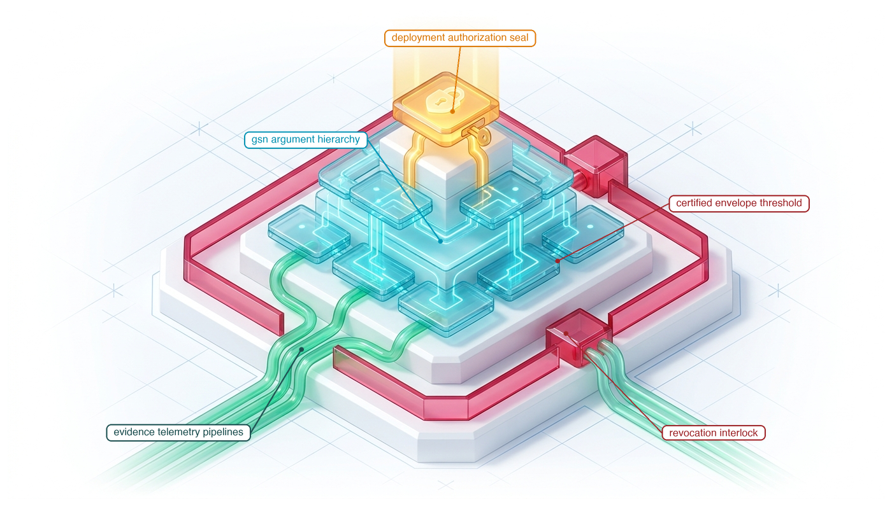
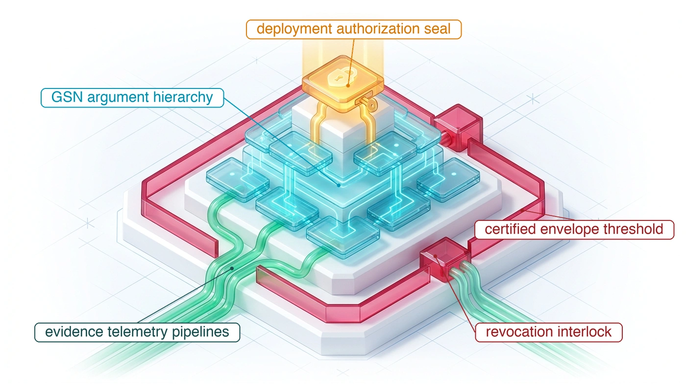
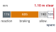
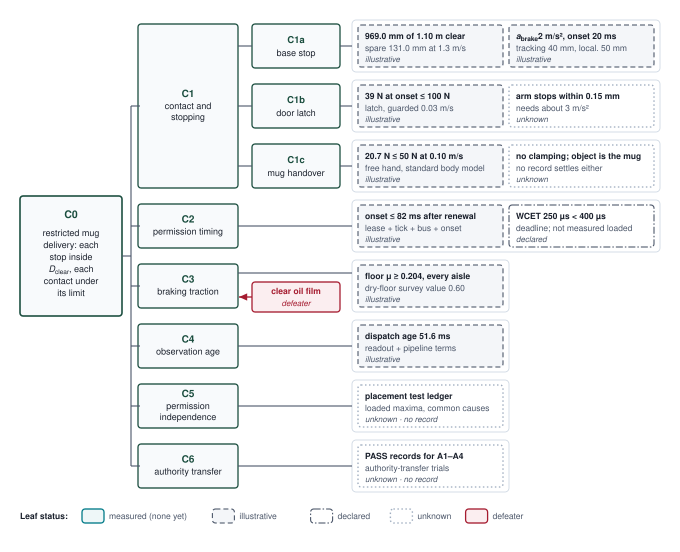
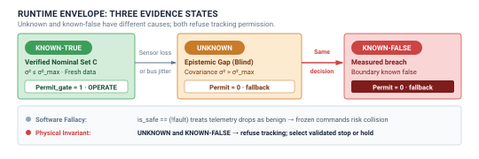
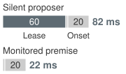
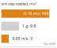
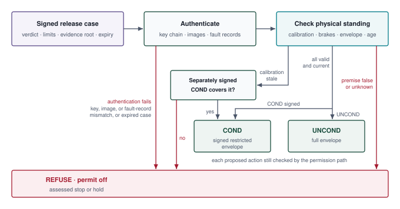

---
format:
  html:
    title: "Deployment Release"
---

# Deployment Release {#sec-release}

::: {layout-narrow}
::: {.column-margin}

\chapterminitoc

:::

::: {.content-visible when-format="pdf"}
\noindent
{fig-alt="Isometric blueprint showing deployment release and safety cases: Goal Structuring Notation argument pyramid in transparent glass tablets, emerald physical evidence pipelines, golden deployment authorization seal, and crimson certified operational envelope threshold with revocation interlocks."}
:::

::: {.content-visible unless-format="pdf"}
{fig-alt="Isometric blueprint showing deployment release and safety cases: Goal Structuring Notation argument pyramid in transparent glass tablets, emerald physical evidence pipelines, golden deployment authorization seal, and crimson certified operational envelope threshold with revocation interlocks."}
:::

:::

## Purpose {.unnumbered .unlisted}

::: {.content-visible when-format="pdf"}
\begin{marginfigure}
\resizebox{0.92\linewidth}{!}{\mlphysicalstackfull{20}{20}{20}{20}{20}}
\end{marginfigure}
:::

_Why can a machine that completes every trial still lack the evidence to be allowed among people?_

A successful trial shows what a machine did under the conditions it happened to meet, while permission to operate is a claim about every condition it may meet next. Thousands of clean runs on a dry floor say nothing about the stop on a floor no trial touched, and a brake that stopped the machine last month may not stop it inside the same distance after its lining wears. A machine granted authority on demonstrations therefore carries untested premises into service, where the first test of each one is the event it was meant to prevent. Deciding to deploy requires stating which physical claims the evidence supports, under which conditions and for how long, refusing or narrowing operation wherever a premise remains unknown, and withdrawing the grant when brakes wear, sensors shift, or software changes. At the causal boundary, authority must expire when its physical justification does, because a later software correction cannot undo motion already produced.



::: {.callout-learning-objectives}

- Construct a claim-argument-evidence (CAE) safety case as an auditable engineering assertion DAG linking bounded operating envelopes to empirical hardware evidence
- Grade each claim's premises as measured, datasheet, illustrative, or unknown, and select the verdict (`UNCOND`, `COND`, or `REFUSE`) they support
- Join task-success, cycle-time, and intervention evidence to the physical measurements and restrictions supporting a conditional release
- Specify standing-condition cadences and validated responses separately from the execution leases that bound individual action chunks
- Diagnose unsupported warrants, hidden contextual assumptions, and compound defeaters through adversarial review of a release argument
- Design a cryptographically sealed release manifest that binds upstream engineering records by digest and fails closed on any mismatch
- Determine which claims a policy or software update reopens, and why shadow operation cannot substitute for closed-loop qualification

:::

## The Decision to Deploy {#sec-release-decision-to-deploy}

Every machine that works among people passes through a release decision, the point at which its builders grant it authority to operate outside the laboratory. In conventional software, release is a reversible step. A faulty build can be withdrawn, and the cost of the error is bounded by the time needed to revert it. For a physical machine the grant differs in kind. Each action the release permits delivers energy across the causal boundary, so an error in the release is discovered as a stop that ends too late or a contact that presses too hard, and no rollback recalls it. Industrial machinery, driverless vehicles, and aircraft have long met this problem with a documented argument, a safety case, that states what the machine is claimed to do, under which conditions, and on what evidence. Physical AI inherits that practice and adds a difficulty of its own. A learned policy cannot be argued safe from its structure, and trials alone cannot demonstrate the rare failures that matter most.

The central question of release is therefore which claims the evidence licenses, under which physical conditions, and for how long. This chapter treats the answer as a bounded, revocable engineering judgment rather than a score. The argument begins with a permitted operating envelope and links each physical claim to evidence. Its conclusion is full operation, restricted operation, or refusal, and standing conditions specify when that conclusion expires. A worked adjudication and an adversarial review test the argument, a signed manifest carries its decision into the running machine, and every later update must return through it.

The warehouse mobile manipulator shows why a record of success does not settle that question. It must drive past rack ends, open a spring-latched cage door, and hand a ceramic mug to a coworker. Each task requires a different physical claim: sufficient stopping clearance, bounded latch force, or bounded handover contact. A successful run shows that the machine completed those tasks under the conditions encountered. A release decision must establish which conditions it may encounter next and which evidence supports operation there.

Verification has specified how to stress the machine's timing, bus contention, and sensor-failure assumptions under injected faults (@sec-verification-hardware-fault-injection). Its illustrative records name predeclared oracles and untested gaps; they do not report completed physical trials. The systems engineering task therefore shifts from finding individual software bugs to formally bounding what the empirical evidence licenses. Neither offline validation accuracy (@sec-evaluation-closed-loop-dynamics) nor a run of clean demonstrations (@sec-verification-fault-injection) satisfies that requirement. Deciding to deploy is not a statistical prediction or an aggregate benchmark score; it is an auditable engineering adjudication of whether the physical evidence bounds the operational risk of the machine within a named operational design domain.

::: {.column-margin .margin-pointer}
↩ The empirical verification evidence backing release claims is produced in @sec-verification-hardware-fault-injection.
:::

A deployment must also deliver useful service inside the supported envelope. The closed-loop task evidence of @sec-evaluation-logs establishes whether the policy completes the intended work, how often intervention interrupts it, and which conditions defeat it. Those results must be evaluated under the speed, payload, and site restrictions the release case can support. A machine that can only stop safely has not demonstrated useful task capability; a capable policy has not thereby justified actuator authority. The deployment decision joins both arguments for the same task and operating conditions.

The release case is scoped to service at one site. The signed fault records of @sec-verification-fault-manifest contribute evidence about particular failures, while clearance surveys, loaded stopping trials, and contact measurements support the physical criteria. The engineer must connect each record to the claim it supports and retain every premise the record leaves open. Before any record can be connected, the claims themselves must be stated as physical criteria that the machine either satisfies or fails.

## The Deployment Authorization Criterion {#sec-release-question}

At a rack end, the base must stop inside the available clearance. During handover, the arm must stay within the assessed contact-force limit. Both claims depend on the response arriving before its deadline. These requirements give release authorization testable physical criteria:
$$d_{\text{stop}}(v, \tau_{\text{delay}}, a_{\text{brake}}, \delta_{\text{loc}}, \epsilon_{\text{track}}) \le D_{\text{clear}}, \quad F_{\text{contact}}(v, m_{\text{eff}}, k_h) \le F_{\text{limit}}, \quad T_{\text{exec}} \le T_{\text{deadline}}.$$

Each criterion is a physical inequality, so release authorization cannot rest on intuition, demonstrations, or aggregate benchmark scores. It requires an auditable argument that links each inequality to measured observation ages, worst-case execution time bounds, braking and contact trials, and a validated fallback. The inequalities also inherit the individual machine's calibration, its sensor transforms, joint offsets, and torque constants, so a lost or drifted calibration invalidates a stopping budget even when no software has changed.

For the warehouse mobile manipulator, the release question is whether evidence satisfies these criteria for each of its three tasks inside a scoped operating envelope. The release case names the assessed physical bounds, the specified hardware fault model, and the validated permission and fallback ladder. It can support a revocable grant of tracking authority while those physical conditions hold; it cannot infer protection against uncharacterized or unmodeled hazards from finite test runs (\ref{dfn-release-goal-structured-safety-case}).

::: {#dfn-release-goal-structured-safety-case .callout-definition title="Claim-argument-evidence safety case"}

***Claim-argument-evidence safety case***\index{Claim-argument-evidence safety case!definition}\index{Safety case!physical AI} is the auditable, structured assurance argument for a specified physical machine, operating envelope, hazard criteria, and fault model, linking top-level safety claims to concrete empirical evidence through explicit engineering warrants.

1.  **Significance**: Transforms subjective, informal deployment confidence into an auditable, machine-readable argument graph, a directed acyclic graph (DAG) that connects top-level physical invariance claims to concrete empirical evidence across the entire cyber-physical stack.
2.  **Distinction**: Unlike stateless software unit tests or static model validation scorecards, a physical safety case explicitly links operational design domain capability tokens, hardware fault-injection ledgers, sensor extrinsic calibration invariants, and deterministic runtime enforcer tripwires to argue, with stated confidence, that residual risk is acceptable for the named envelope.
3.  **Common pitfall**: Treating the safety case as a retrospective bureaucratic checklist completed after development, rather than an executable architectural contract that actively gates release manifests and runtime motor authority.

:::

```{python}
#| label: calc-release-contact-premises
#| echo: false
#| warning: false
#| message: false
# ┌─────────────────────────────────────────────────────────────────────────────
# │ CONTACT PREMISES INHERITED FROM THE ENFORCEMENT RECORD
# ├─────────────────────────────────────────────────────────────────────────────
# │ Context: every contact number this chapter quotes (@sec-release-question,
# │          @tbl-16-cae-scorecard, @sec-release-case-worked-full). The
# │          derivation is taught in @sec-enforcement-intentional-contact.
# │ Goal:    read the contact premises exactly as the enforcement chapter
# │          derives them, so release adjudicates and never re-derives.
# │ Show:    nothing directly; the release cells below read this class.
# │ How:     mirrors calc-enforcement-contact-force (EnforcementContactForce)
# │          line for line: same MLSysIM functions, same registry inputs, same
# │          guards. Chapters render in separate kernels, so the class is
# │          rebuilt here; the identical guards make any drift between the
# │          two chapters fail the build. Edit both cells together.
# └─────────────────────────────────────────────────────────────────────────────
from mlsysim import *
from mlsysim.core.units import *
from mlsysim.physics.robotics import (
    calc_latch_contact_stopping_profile,
    calc_reduced_mass,
    calc_transient_impact_force,
    calc_transient_contact_speed_limit,
)
from mlsysim.fmt import check

RM = Embodied.MobileManipulator.WarehouseMobileManipulator
AISLE = Embodied.Scenario.WarehouseAisle

class EnforcementContactForce:
    # ┌── 1. LOAD ───────────────────────────────────────────────────────────
    v_latch = AISLE.v_latch_approach  # category: chosen (guarded approach)
    v_latch_high = AISLE.v_latch_high  # category: illustrative (policy's proposed approach)
    k_latch = AISLE.k_latch  # category: illustrative
    f_trip = AISLE.f_latch_tripwire  # category: illustrative
    t_contact = AISLE.t_contact_response  # category: illustrative (contact loop)
    f_lim = AISLE.f_latch_limit  # category: illustrative
    m_eff = RM.arm_effective_contact_mass  # category: derived
    m_hand = AISLE.m_contact_human  # category: datasheet (ISO/TS 15066 hand body model)
    k_hand = AISLE.k_contact_human  # category: datasheet (ISO/TS 15066 hand body model)
    f_contact = AISLE.f_contact_criterion  # category: chosen
    v_handover = AISLE.v_handover  # category: chosen (handover approach under accept_item)
    tcp_limit = RM.tcp_speed_limit  # category: chosen (free-space TCP limit)

    # ┌── 2. EXECUTE ────────────────────────────────────────────────────────
    stop_lo = calc_latch_contact_stopping_profile(v_latch, scenario=AISLE)
    stop_hi = calc_latch_contact_stopping_profile(v_latch_high, scenario=AISLE)
    df_dt = stop_lo["df_dt"]
    f_cmd = stop_lo["f_at_brake_onset"]
    x_rem = stop_lo["x_remaining"]
    a_arm = stop_lo["a_arm_needed"]
    t_arm_stop = stop_lo["t_arm_stop"]
    f_cmd_hi = stop_hi["f_at_brake_onset"]
    a_arm_hi = stop_hi["a_arm_needed"]
    m_red = calc_reduced_mass(m_eff, m_hand).to(kilogram)
    f_at_tcp_limit = calc_transient_impact_force(tcp_limit, m_eff, k_hand, human_mass=m_hand).to(newton)
    f_ratio = (f_at_tcp_limit / f_contact).to("dimensionless").magnitude
    f_handover = calc_transient_impact_force(v_handover, m_eff, k_hand, human_mass=m_hand).to(newton)
    f_handover_clamped = calc_transient_impact_force(v_handover, m_eff, k_hand).to(newton)
    v_ceiling = calc_transient_contact_speed_limit(f_contact, m_eff, k_hand, human_mass=m_hand).to(meter / second)
    v_ceiling_clamped = calc_transient_contact_speed_limit(f_contact, m_eff, k_hand).to(meter / second)

    # ┌── 3. GUARD (identical to calc-enforcement-contact-force) ─────────────
    check(abs(f_cmd.to(newton).magnitude - 39.0) < 1e-9, "Latch force at brake onset, guarded approach, is 39 N.")
    check(abs(x_rem.to(millimeter).magnitude - 0.1525) < 5e-5, "Remaining latch compression is 0.15 mm.")
    check(abs(a_arm.to(meter / second**2).magnitude - 2.95) < 5e-3, "The guarded stop needs about 3 m/s^2 (2.95).")
    check(abs(t_arm_stop.to(millisecond).magnitude - 10.0) < 0.5, "The guarded stop takes about 10 ms.")
    check(abs(f_cmd_hi.to(newton).magnitude - 95.0) < 1e-9, "Latch force at brake onset, unsupported approach, is 95 N.")
    check(abs(a_arm_hi.to(meter / second**2).magnitude - 400.0) < 1e-6, "The unsupported approach needs 400 m/s^2.")
    check(f_cmd < f_lim and f_cmd_hi < f_lim, "Both approaches reach brake onset below the latch limit.")
    check(abs(m_eff.to(kilogram).magnitude - 12.0) < 1e-9, "Arm effective contact mass is 12.0 kg.")
    check(abs(m_red.magnitude - 0.5714) < 5e-5, "Hand-arm reduced mass is 0.571 kg.")
    check(abs(f_at_tcp_limit.magnitude - 207.02) < 0.01, "Transient force at the TCP limit is 207 N.")
    check(abs(f_handover.magnitude - 20.70) < 0.01, "Transient handover force is 20.7 N.")
    check(abs(f_handover_clamped.magnitude - 94.87) < 0.01, "Clamped handover force is 94.9 N.")
    check(f_handover < f_contact < f_handover_clamped, "Transient passes and clamped fails the criterion.")
    check(abs(v_ceiling.magnitude - 0.2415) < 5e-5, "Free-hand ceiling is 0.24 m/s.")
    check(abs(v_ceiling_clamped.magnitude - 0.0527) < 5e-5, "Clamped-hand ceiling is 0.053 m/s.")
    check(v_ceiling_clamped < v_handover < v_ceiling, "The handover cap sits between the clamped and free-hand ceilings.")

    # ┌── 4. OUTPUT ─────────────────────────────────────────────────────────
    # Raw quantities only; each release cell formats what it quotes.
```

```{python}
#| label: calc-release-operating-envelope
#| echo: false
#| warning: false
#| message: false
# ┌─────────────────────────────────────────────────────────────────────────────
# │ THE MACHINE'S OPERATING ENVELOPE FOR RELEASE
# ├─────────────────────────────────────────────────────────────────────────────
# │ Context: @sec-release-question (envelope and conditional-zone paragraphs),
# │          @tbl-16-odd-invariants, the contact-criteria paragraph after it, and
# │          the binding-contract paragraphs of @sec-release-three-verdicts, and
# │          the empirical-sufficiency probe of @sec-release-adversarial-review.
# │ Goal: Scope the release case to the running machine's operating envelope.
# │ Show: aisle speed and its ceiling, tote-rack payload, the friction bands and
# │       the inspected-floor ceiling, the clear distance, the latch and handover
# │       speeds with their limits, the slow-downs before a takeover, and the
# │       restricted speed on inspected floors.
# │ How: RM/AISLE fields; ceilings from calc_scurve_max_permitted_velocity (the
# │      jerk-limited S-curve stop; jerk bound = the reference C2 polynomial's
# │      peak jerk at the drive limit) and the three overheads; mu_min = a_brake/g.
# └─────────────────────────────────────────────────────────────────────────────
from mlsysim import *
from mlsysim.core.units import *
from mlsysim.fmt import fmt, fmt_velocity, fmt_length, fmt_mass, fmt_force, fmt_latency, check
from mlsysim.physics.robotics import calc_c2_stop_suffix, calc_scurve_max_permitted_velocity

# ┌── 1. LOAD: the running machine and its site ─────────────────────────────────
RM = Embodied.MobileManipulator.WarehouseMobileManipulator  # category: illustrative (running machine)
AISLE = Embodied.Scenario.WarehouseAisle  # category: illustrative (aisle scene; speeds, lease, and tick chosen)
g_std = (1 * ureg.standard_gravity).to(meter / second**2)  # category: datasheet (standard gravity, a defined physical constant; Pint)
v_restricted = 1.0 * meter / second  # category: chosen (scenario assumption: restricted mode on inspected floors, the value @sec-frontier uses)

# ┌── 2. EXECUTE: ceilings and friction bands ───────────────────────────────────
# Jerk bound: the reference C2 polynomial's peak jerk at the drive limit (@sec-planning-c2-stopping-suffix)
j_brake = calc_c2_stop_suffix(RM.base.max_velocity, AISLE.a_brake)["peak_jerk"].to(meter / second**3)
overhead_loc = AISLE.delta_loc + AISLE.eps_track
v_ceiling = calc_scurve_max_permitted_velocity(AISLE.d_clear, AISLE.tau_delay, AISLE.a_brake, j_brake, overhead_loc, AISLE.delta_margin).to(
    meter / second
)
mu_min = (AISLE.a_brake / g_std).to("dimensionless").magnitude
# The floor caps the deceleration; the jerk bound belongs to the load and is unchanged.
a_inspected = min(AISLE.a_brake, (AISLE.mu_inspected_floor * g_std).to(meter / second**2))
v_inspected_ceiling = calc_scurve_max_permitted_velocity(AISLE.d_clear, AISLE.tau_delay, a_inspected, j_brake, overhead_loc, AISLE.delta_margin).to(
    meter / second
)
# Handover ceilings are enforcement premises (calc-release-contact-premises).
v_handover_ceiling = EnforcementContactForce.v_ceiling
v_handover_ceiling_clamped = EnforcementContactForce.v_ceiling_clamped

# ┌── 3. GUARD: canon values quoted in the prose and the table ──────────────────
check(abs(v_ceiling.magnitude - 1.4367) < 5e-5, "Unconditional aisle speed ceiling is 1.44 m/s")
check(AISLE.v_aisle < v_ceiling, "Chosen aisle speed sits under its ceiling")
check(abs(mu_min - 0.204) < 5e-4, "Friction floor is 0.204")
check(mu_min < AISLE.mu_dry, "Dry concrete exceeds the friction floor")
check(mu_min > AISLE.mu_inspected_floor, "Inspected floor requires speed restriction")
check(abs(v_inspected_ceiling.magnitude - 1.2309) < 5e-5, "Restricted ceiling on inspected floors is 1.23 m/s")
check(v_restricted < v_inspected_ceiling, "Chosen restricted mode sits under its ceiling")
check(abs(v_handover_ceiling.magnitude - 0.2415) < 5e-5, "Transient (free-hand) handover ceiling is 0.24 m/s")
check(AISLE.v_handover < v_handover_ceiling, "Chosen handover speed sits under its transient ceiling")
check(abs(v_handover_ceiling_clamped.magnitude - 0.0527) < 5e-5, "Clamped-hand handover ceiling is 0.053 m/s")
check(AISLE.v_handover > v_handover_ceiling_clamped, "Chosen handover speed exceeds the clamped ceiling, so clamping must be excluded")
check(abs(RM.loaded_mass.to(kilogram).magnitude - 368.0) < 1e-9, "Running-machine loaded mass is 368 kg")
check(AISLE.v_takeover_in_loop < AISLE.v_aisle, "Slow-down before an in-loop takeover")
check(AISLE.mu_oil_film < AISLE.mu_inspected_floor < mu_min < AISLE.mu_dry, "Friction bands are ordered")
check(abs(AISLE.v_aisle.to(meter / second).magnitude - 1.3) < 1e-9, "Signed aisle speed 1.3 m/s")
check(abs(AISLE.d_clear.to(meter).magnitude - 1.10) < 1e-9, "Clear distance 1.10 m")
check(
    abs(AISLE.v_takeover_in_loop.to(meter / second).magnitude - 0.75) < 1e-9,
    "In-loop takeover slow-down 0.75 m/s (Delta_da-charged ceiling, rounded down)",
)
check(abs(AISLE.v_takeover_out_of_loop.to(meter / second).magnitude - 0.15) < 1e-9, "Out-of-loop takeover slow-down 0.15 m/s")
check(abs(AISLE.t_tick.to(millisecond).magnitude - 1.0) < 1e-9, "Permission tick 1 ms")
check(AISLE.t_tick < AISLE.t_lease, "Servo tick sits inside the chunk lease")
check(abs(RM.onboard_payload_capacity.to(kilogram).magnitude - 50.0) < 1e-9, "Tote-rack capacity is 50 kg")
check(
    abs(AISLE.mu_dry - 0.60) < 1e-9 and abs(AISLE.mu_inspected_floor - 0.12) < 1e-9 and abs(AISLE.mu_oil_film - 0.05) < 1e-9,
    "Friction bands 0.60, 0.12, 0.05",
)
check(abs(AISLE.v_latch_approach.to(meter / second).magnitude - 0.03) < 1e-9, "Guarded latch approach 0.03 m/s")
check(abs(AISLE.v_latch_high.to(meter / second).magnitude - 0.10) < 1e-9, "Unsupported latch approach 0.10 m/s")
check(abs(AISLE.f_latch_tripwire.to(newton).magnitude - 15.0) < 1e-9, "Latch tripwire 15 N")
check(abs(AISLE.t_contact_response.to(millisecond).magnitude - 2.0) < 1e-9, "Contact-loop response 2 ms")
check(abs(AISLE.f_latch_limit.to(newton).magnitude - 100.0) < 1e-9, "Latch limit 100 N")
check(abs(AISLE.v_handover.to(meter / second).magnitude - 0.10) < 1e-9, "Handover speed 0.10 m/s")
check(abs(AISLE.f_contact_criterion.to(newton).magnitude - 50.0) < 1e-9, "Handover criterion 50 N")

# ┌── 4. OUTPUT: rendered values ────────────────────────────────────────────────
class ReleaseEnvelope:
    v_restricted = v_restricted  # chosen; read by calc-release-worked-verdict
    v_aisle_str = fmt_velocity(AISLE.v_aisle, unit=meter / second, precision=1)
    v_ceiling_str = fmt_velocity(round(v_ceiling.magnitude, 2) * meter / second, unit=meter / second, precision=2)
    v_takeover_in_str = fmt_velocity(AISLE.v_takeover_in_loop, unit=meter / second, precision=2)
    v_takeover_out_str = fmt_velocity(AISLE.v_takeover_out_of_loop, unit=meter / second, precision=2)
    t_tick_str = fmt_latency(AISLE.t_tick, unit=millisecond, precision=0)
    payload_str = fmt_mass(RM.onboard_payload_capacity, unit=kilogram, precision=0)
    m1_str = fmt_mass(RM.loaded_mass, unit=kilogram, precision=0)
    mu_min_str = fmt(round(mu_min, 3), precision=3)
    mu_dry_str = fmt(AISLE.mu_dry, precision=2)
    mu_inspected_str = fmt(AISLE.mu_inspected_floor, precision=2)
    mu_oil_str = fmt(AISLE.mu_oil_film, precision=2)
    v_inspected_ceiling_str = fmt_velocity(round(v_inspected_ceiling.magnitude, 2) * meter / second, unit=meter / second, precision=2)
    v_restricted_str = fmt_velocity(v_restricted, unit=meter / second, precision=0)
    d_clear_str = fmt_length(AISLE.d_clear, unit=meter, precision=2)
    v_latch_str = fmt_velocity(AISLE.v_latch_approach, unit=meter / second, precision=2)
    v_latch_high_str = fmt_velocity(AISLE.v_latch_high, unit=meter / second, precision=2)
    f_trip_str = fmt_force(AISLE.f_latch_tripwire, precision=0)
    t_contact_str = fmt_latency(AISLE.t_contact_response, unit=millisecond, precision=0)
    f_latch_limit_str = fmt_force(AISLE.f_latch_limit, precision=0)
    v_handover_str = fmt_velocity(AISLE.v_handover, unit=meter / second, precision=2)
    v_handover_ceiling_str = fmt_velocity(round(v_handover_ceiling.magnitude, 2) * meter / second, unit=meter / second, precision=2)
    v_handover_ceiling_clamped_str = fmt_velocity(round(v_handover_ceiling_clamped.magnitude, 3) * meter / second, unit=meter / second, precision=3)
    f_contact_str = fmt_force(AISLE.f_contact_criterion, precision=0)
```

A release case is scoped by the operating envelope, the target operational design domain (ODD)\index{Operational design domain!release envelope} paired with the machine's own internal hardware, thermal, and timing invariants. A release authorizes a configuration under standing conditions; it does not replace the short execution leases that bound individual action chunks. Site inspections, calibration checks, and per-tick permission checks each run at the cadence required by their own failure mechanism. An unconditional (`UNCOND`) verdict authorizes tracking proposals across the full verified operating envelope (@sec-verification-operating-envelope), a conditional (`COND`) verdict a named subset with restricted kinematics or environmental fences, and a refusal (`REFUSE`) none.\index{Operational design domain!release verdicts} For the mobile manipulator, the operating envelope admits aisle travel at up to `{python} ReleaseEnvelope.v_aisle_str` (chosen; see the Reader Guide) with the tote rack loaded to at most `{python} ReleaseEnvelope.payload_str`, on floors surveyed to a friction coefficient of at least `{python} ReleaseEnvelope.mu_min_str`, past rack ends with at least `{python} ReleaseEnvelope.d_clear_str` of clear distance. It admits door approaches at `{python} ReleaseEnvelope.v_latch_str` and item handovers to the coworker at `{python} ReleaseEnvelope.v_handover_str`.

::: {.column-margin .margin-pointer}
↩ The operational design domain and its known absences are defined in @sec-data-policy-coverage.
:::

Inside these boundaries the learned neural policy may propose actions across the nominal task envelope, but each action still requires independent, per-tick permission from an isolated safety enforcer. Mode-specific conditions (@tbl-16-odd-invariants) narrow that envelope. The takeover analysis screens an in-loop request at `{python} ReleaseEnvelope.v_takeover_in_str` and an out-of-loop crawl at `{python} ReleaseEnvelope.v_takeover_out_str`; neither is a qualified release limit. The moving in-loop braking blend fails its clearance check, so the base uses its resident stop before transfer (@sec-intervention-authority-transitions). The restricted mode of a `COND` verdict narrows it further: on a floor known only through the site's inspection regime, the machine runs at `{python} ReleaseEnvelope.v_restricted_str`, below the `{python} ReleaseEnvelope.v_inspected_ceiling_str` partial inspected-floor ceiling; admission delay and a positive remaining reserve must still be charged.

The rules in @tbl-16-odd-invariants have priority: refusal conditions override mode-specific restrictions, which override nominal limits. The speed ranges overlap, so these are operating modes rather than disjoint numerical intervals. A stale payload estimate can permit separately supported stationary arm work; an invalid estimate or overload invokes the refusal rule. A conditional state restricts admitted proposals via enforcer clamping. A refusal state revokes the capability token, withdraws motor tracking permission, and commands a validated fallback (@sec-enforcement-fallback-ladder). On-board wheel slip estimation cannot provide prospective clearance guarantees: it detects low friction only *after* wheel slip has begun and traction is lost. A clear oil film ($\mu \approx$ `{python} ReleaseEnvelope.mu_oil_str`) can be visually indistinguishable from dry concrete to the installed cameras. By the time a high-speed vehicle initiates braking on an oil patch and measures slip, it is already kinetically committed to an extended skid. Hence, floor friction must be enforced through site surveys and custodial spill regimes.

Sensor mounting drift can invalidate the localization allowance even when software remains unchanged (@sec-release-calibration-drift). An update that overwrites the measured sensor transforms and joint offsets\index{Over-the-air update!calibration retention} invalidates it just as surely, so the update process must retain and verify those records before restoring tracking authority (@sec-release-modular-safety-cases).

The evidence must also record what happens when operation reaches a boundary. Event-triggered telemetry\index{Edge telemetry!event-triggered buffer}\index{Black-box recorder!pre- and post-trigger capture} retains local traces for later review (@sec-release-data-curation-flywheel), while the permission path enforces the live limits. The table lists the dimensions kept within bounds by runtime monitors or site procedures. Internal conditions from @sec-verification-operating-envelope, such as ambient temperature, rail voltage, and compute load, enter through the fault records trialed at them.

\Needspace{28\baselineskip}

| Envelope Dimension / Invariant | Nominal Envelope ($\mathcal{S}_{\mathrm{nom}}$)                                                                           | Conditional Boundary ($\mathcal{S}_{\mathrm{cond}}$)                                                                                                                                                                                 | Hard Refusal ($\mathcal{S}_{\mathrm{refuse}}$)                                                                                                                                                         | Runtime Monitor & Rate                                                                 | Enforcer Action & Latency                                                      |
|:-------------------------------|:--------------------------------------------------------------------------------------------------------------------------|:-------------------------------------------------------------------------------------------------------------------------------------------------------------------------------------------------------------------------------------|:-------------------------------------------------------------------------------------------------------------------------------------------------------------------------------------------------------|:---------------------------------------------------------------------------------------|:-------------------------------------------------------------------------------|
| **Aisle Speed**                | $v\le$ `{python} ReleaseEnvelope.v_aisle_str`                                                                             | Preliminary takeover screens: `{python} ReleaseEnvelope.v_takeover_in_str` in-loop and `{python} ReleaseEnvelope.v_takeover_out_str` out-of-loop; rejected in-loop blend requires stop first                                         | Measured speed above the signed `{python} ReleaseEnvelope.v_aisle_str` (ceiling `{python} ReleaseEnvelope.v_ceiling_str`), or invalid speed estimate                                                   | Encoders and IMU, every `{python} ReleaseEnvelope.t_tick_str` permission tick          | Clamp admitted speed; refuse above the signed speed                            |
| **Floor Friction**             | Surveyed $\mu\ge$ `{python} ReleaseEnvelope.mu_min_str` (dry concrete near `{python} ReleaseEnvelope.mu_dry_str`)         | Qualified assessment and maintained site regime ($\mu\ge$ `{python} ReleaseEnvelope.mu_inspected_str`): restricted `{python} ReleaseEnvelope.v_restricted_str`, below the `{python} ReleaseEnvelope.v_inspected_ceiling_str` ceiling | Unsurveyed floor or reported film; a clear oil film ($\mu\approx$ `{python} ReleaseEnvelope.mu_oil_str`) can evade the installed cameras                                                               | Floor survey and site spill procedure; no on-board measurement                         | Restrict speed by floor zone; refuse the aisle                                 |
| **Tote-Rack Payload**          | $0\le m\le$ `{python} ReleaseEnvelope.payload_str`, valid load estimate (total at most `{python} ReleaseEnvelope.m1_str`) | Estimate stale since the last pick: stationary arm tasks only                                                                                                                                                                        | Load above capacity or invalid estimate                                                                                                                                                                | Rack load cells, at each pick                                                          | Refuse aisle transit until re-weighed                                          |
| **Rack-End Clearance**         | Surveyed $D_{\text{clear}}\ge$ `{python} ReleaseEnvelope.d_clear_str` at every rack end                                   | Shorter surveyed clearance: lower signed speed from the same budget                                                                                                                                                                  | Unsurveyed rack end, or obstacle inside the clear distance                                                                                                                                             | Site survey; lidar and navigation camera at frame rate                                 | Speed limit per rack end; stop for a detected obstacle                         |
| **Door Latch Approach**        | $v\le$ `{python} ReleaseEnvelope.v_latch_str`, strike plate at its nominal position                                       | Original policy: nominal plate only; changed recovery candidate needs its own evaluation and release case                                                                                                                            | `{python} ReleaseEnvelope.v_latch_high_str` approach or plate condition outside the selected policy case                                                                                               | Arm contact-force sensing in the `{python} ReleaseEnvelope.t_contact_str` contact loop | Trip at `{python} ReleaseEnvelope.f_trip_str`; refuse the unsupported approach |
| **Coworker Handover**          | TCP speed $\le$ `{python} ReleaseEnvelope.v_handover_str` under `accept_item`                                             | Coworker present without `accept_item`: hold short of the handover point                                                                                                                                                             | TCP speed above the signed `{python} ReleaseEnvelope.v_handover_str` (transient ceiling `{python} ReleaseEnvelope.v_handover_ceiling_str`), or a clamping geometry outside the assessed transient case | Joint encoders every permission tick; arm contact-force sensing                        | Clamp TCP speed; refuse above the signed speed                                 |

: **Operating envelope of the warehouse mobile manipulator**: Refusal rules take priority over restricted-mode rules and nominal limits. Conditional operation requires every relied-on premise to remain supported; stale payload evidence permits only separately supported stationary work, while an invalid estimate or overload refuses. The takeover speeds are preliminary screens, not qualified motion limits. The displayed speed ceilings are partial calculations before dispatch-to-admission delay; signed limits require that delay and a positive reserve. Sensor rates and stopping response are plant validation obligations. {#tbl-16-odd-invariants tbl-colwidths="[16,16,18,18,16,16]"}

The nominal latch row scopes the original policy case. The separately stipulated recovery campaign in @sec-evaluation evaluates a changed candidate on nominal and displaced-plate conditions. That new provenance can support expanded capability, but it does not silently extend this release's contact or timing evidence.

A defensible release claim states its plant, contact geometry, and fault set. The machine's case uses three criteria. The base stops inside the `{python} ReleaseEnvelope.d_clear_str` clear distance before it reaches a person who has stepped out at a rack end, the arm opens the door without exceeding the `{python} ReleaseEnvelope.f_latch_limit_str` latch limit, and a handover never presses on the coworker with more than a chosen `{python} ReleaseEnvelope.f_contact_str` peak force for an assessed contact case. The base's claim protects a stationary person; a person still walking toward the machine is a separate premise, carried by a site crossing rule (@sec-memory-belief-through-occlusion). The release argument must demonstrate which human contacts are excluded before impact, which detected contacts the model covers, and which single faults the independent fallback handles. A stop after contact does not by itself cap the first force peak.

```{python}
#| label: calc-release-biomechanical-impact-envelope
#| echo: false
#| warning: false
#| message: false
# ┌─────────────────────────────────────────────────────────────────────────────
# │ HANDOVER CONTACT FORCE AND THE BASE'S STOPPING SPARE
# ├─────────────────────────────────────────────────────────────────────────────
# │ Context: @sec-release-question (the handover-premise paragraph and the
# │          spare-spent-as-delay paragraph), and the refusal paragraph of
# │          @sec-release-three-verdicts (the deceleration the budget assumes).
# │          The contact-force derivation itself lives in
# │          calc-enforcement-contact-force (@sec-enforcement-intentional-contact);
# │          this cell reads it through calc-release-contact-premises.
# │ Goal: Restate the handover premises release inherits, and show how little
# │       input error the base's finished budget can absorb at aisle speed.
# │ Show: unbraked force at the free-space TCP limit and at the handover speed;
# │       budget and spare at 1.3 m/s; the delay and the deceleration shortfall
# │       that each consume the spare.
# │ How: contact forces read from EnforcementContactForce (free hand: reduced
# │      mass of hand and arm; clamped: the arm's effective mass alone); the
# │      jerk-limited S-curve stop
# │      (calc_scurve_stop_distance; jerk bound = the reference C2 polynomial's
# │      peak jerk at the drive limit) and the three overheads; the break-even
# │      deceleration solves v^2/(2a) + v a/(2j) = braking room with j fixed.
# └─────────────────────────────────────────────────────────────────────────────
from mlsysim import *
from mlsysim.core.units import *
from mlsysim.fmt import (
    fmt_mass,
    fmt_stiffness,
    fmt_force,
    fmt_multiple,
    fmt_latency,
    fmt_acceleration,
    fmt_length,
    fmt_velocity,
    fmt_percent,
    fmt_sci_qty,
    check,
)
from mlsysim.physics.robotics import (
    calc_c2_stop_suffix,
    calc_scurve_stop_distance,
)

# ┌── 1. LOAD: the running machine and its site ─────────────────────────────────
RM = Embodied.MobileManipulator.WarehouseMobileManipulator  # category: illustrative (running machine)
AISLE = Embodied.Scenario.WarehouseAisle  # category: illustrative (aisle scene; speeds, lease, and tick chosen)

# ┌── 2. EXECUTE: contact forces, then the budget at aisle speed ────────────────
# Contact premises from the enforcement record (calc-release-contact-premises).
m_eff = EnforcementContactForce.m_eff
f_at_tcp_limit = EnforcementContactForce.f_at_tcp_limit
f_ratio = EnforcementContactForce.f_ratio
f_at_handover = EnforcementContactForce.f_handover
f_at_handover_clamped = EnforcementContactForce.f_handover_clamped
v_handover_ceiling = EnforcementContactForce.v_ceiling
v_handover_ceiling_clamped = EnforcementContactForce.v_ceiling_clamped

# Jerk bound: the reference C2 polynomial's peak jerk at the drive limit (@sec-planning-c2-stopping-suffix)
j_brake = calc_c2_stop_suffix(RM.base.max_velocity, AISLE.a_brake)["peak_jerk"].to(meter / second**3)
c2_braking = calc_scurve_stop_distance(AISLE.v_aisle, AISLE.a_brake, j_brake).to(meter)
overhead_loc = AISLE.delta_loc + AISLE.eps_track
d_reaction = (AISLE.v_aisle * AISLE.tau_delay).to(millimeter)
budget_aisle = (d_reaction + c2_braking + overhead_loc + AISLE.delta_margin).to(millimeter)
spare_aisle = (AISLE.d_clear - budget_aisle).to(millimeter)
t_spare = (spare_aisle / AISLE.v_aisle).to(millisecond)
spare_share = (spare_aisle / AISLE.d_clear).to("dimensionless").magnitude
# Deceleration at which the budget exactly fills the clear distance, jerk bound
# fixed. Above a^2/j the S-curve distance is v^2/(2a) + v a/(2j), so setting it
# equal to the braking room gives (v/(2j)) a^2 - room a + v^2/2 = 0; the smaller
# root is the one on the branch where distance falls as a rises (a < sqrt(v j)).
braking_room = (AISLE.d_clear - AISLE.v_aisle * AISLE.tau_delay - overhead_loc - AISLE.delta_margin).to(meter)
_qa = (AISLE.v_aisle / (2 * j_brake)).to(second**2)
_qc = (AISLE.v_aisle**2 / 2).to(meter**2 / second**2)
a_break_even = ((braking_room - (braking_room**2 - 4 * _qa * _qc) ** 0.5) / (2 * _qa)).to(meter / second**2)
a_shortfall = ((AISLE.a_brake - a_break_even) / AISLE.a_brake).to("dimensionless").magnitude

# ┌── 3. GUARD: canon values quoted in the prose ────────────────────────────────
check(abs(m_eff.to(kilogram).magnitude - 12.0) < 1e-9, "Effective contact mass is 12.0 kg")
check(abs(f_at_tcp_limit.magnitude - 207.02) < 0.01, "Transient force at the TCP limit")
check(abs(f_ratio - 4.14) < 0.01, "About 4.1x the 50 N criterion")
check(abs(f_at_handover.magnitude - 20.70) < 0.01, "Transient handover force is 20.7 N")
check(abs(f_at_handover_clamped.magnitude - 94.87) < 0.01, "Clamped handover force is 94.9 N")
check(f_at_handover < AISLE.f_contact_criterion < f_at_handover_clamped, "Transient passes, clamped fails the criterion")
check(abs(v_handover_ceiling.magnitude - 0.2415) < 5e-5, "Transient handover ceiling is 0.24 m/s")
check(abs(v_handover_ceiling_clamped.magnitude - 0.0527) < 5e-5, "Clamped handover ceiling is 0.053 m/s")
check(abs(j_brake.magnitude - 64.0 / 9.0) < 1e-9, "Jerk bound is the reference polynomial's 7.11 m/s^3 peak")
check(abs(budget_aisle.magnitude - 968.9925) < 5e-3, "Finished budget at 1.3 m/s")
check(abs(spare_aisle.magnitude - 131.0075) < 5e-3, "Spare at 1.3 m/s")
check(abs(t_spare.magnitude - 100.775) < 5e-3, "Spare spent as delay is 100.8 ms")
# margin_aisle_budget_spare_envelope.svg fig-alt hand-types the five terms and the spare
check(abs(d_reaction.magnitude - 173.68) < 5e-3, "Reaction travel 173.7 mm at 1.3 m/s")
check(abs(c2_braking.to(millimeter).magnitude - 605.3125) < 5e-3, "S-curve braking 605.3 mm")
check(abs(AISLE.delta_loc.to(millimeter).magnitude - 50.0) < 1e-9, "Localization allowance 50 mm")
check(abs(AISLE.eps_track.to(millimeter).magnitude - 40.0) < 1e-9, "Tracking allowance 40 mm")
check(abs(AISLE.delta_margin.to(millimeter).magnitude - 100.0) < 1e-9, "Physical margin 100 mm")
check(0.11 < spare_share < 0.125, "The spare is about an eighth of the clear distance")
check(AISLE.v_aisle >= a_break_even**2 / j_brake, "Break-even stop stays in the trapezoidal regime")
check(
    abs((calc_scurve_stop_distance(AISLE.v_aisle, a_break_even, j_brake) - braking_room).to(millimeter).magnitude) < 1e-6,
    "At the break-even deceleration the S-curve stop fills the braking room exactly",
)
check(abs(a_break_even.magnitude - 1.386) < 5e-4, "Break-even deceleration is 1.386 m/s^2")
check(abs(a_shortfall - 0.307) < 5e-4, "A 31 percent deceleration shortfall fills the spare")

# ┌── 4. OUTPUT: rendered values ────────────────────────────────────────────────
class BiomechanicalImpactEnvelope:
    v_tcp_str = fmt_velocity(RM.tcp_speed_limit, unit=meter / second, precision=0)
    f_tcp_str = fmt_force(round(f_at_tcp_limit.magnitude) * newton, precision=0)
    f_ratio_mult_str = fmt_multiple(f_ratio, precision=1)
    f_limit_str = fmt_force(AISLE.f_contact_criterion, precision=0)
    v_handover_str = fmt_velocity(AISLE.v_handover, unit=meter / second, precision=2)
    f_handover_str = fmt_force(f_at_handover, precision=1)
    f_handover_clamped_str = fmt_force(f_at_handover_clamped, precision=1)
    v_handover_ceiling_str = fmt_velocity(round(v_handover_ceiling.magnitude, 2) * meter / second, unit=meter / second, precision=2)
    v_handover_ceiling_clamped_str = fmt_velocity(round(v_handover_ceiling_clamped.magnitude, 3) * meter / second, unit=meter / second, precision=3)
    v_aisle_str = fmt_velocity(AISLE.v_aisle, unit=meter / second, precision=1)
    d_clear_str = fmt_length(AISLE.d_clear, unit=meter, precision=2)
    budget_str = fmt_length(budget_aisle, unit=millimeter, precision=1)
    spare_str = fmt_length(spare_aisle, unit=millimeter, precision=1)
    t_spare_str = fmt_latency(round(t_spare.magnitude, 1) * millisecond, unit=millisecond, precision=1)
    a_brake_str = fmt_acceleration(AISLE.a_brake, unit=meter / second**2, precision=0)
    a_break_even_str = fmt_acceleration(a_break_even, unit=meter / second**2, precision=2)
    a_shortfall_pct_str = fmt_percent(round(a_shortfall, 2), precision=0, style="prose")
    # Budget terms for the margin envelope (generator reads the quantities)
    d_reaction = d_reaction
    d_braking = c2_braking.to(millimeter)
    d_loc = AISLE.delta_loc.to(millimeter)
    d_track = AISLE.eps_track.to(millimeter)
    d_margin = AISLE.delta_margin.to(millimeter)
    d_clear = AISLE.d_clear.to(millimeter)
    budget = budget_aisle
    spare = spare_aisle
```

The contact criteria arrive as premises from the enforcement record rather than as calculations release performs. @Sec-enforcement-intentional-contact derives the peak force of an unbraked elastic contact with the coworker's hand (@eq-release-unbraked-force) from the ISO/TS 15066 hand body model[^fn-std-isots15066-biomech] and the arm's effective mass, and the release case takes its results as stated. At the arm's `{python} BiomechanicalImpactEnvelope.v_tcp_str` free-space limit even the transient model predicts `{python} BiomechanicalImpactEnvelope.f_tcp_str`, or `{python} BiomechanicalImpactEnvelope.f_ratio_mult_str` the `{python} BiomechanicalImpactEnvelope.f_limit_str` criterion, so no unseparated contact is admissible at that speed without a stronger, measured protection argument. For a free hand, which recoils, the criterion admits approach speeds up to `{python} BiomechanicalImpactEnvelope.v_handover_ceiling_str`, and the chosen `{python} BiomechanicalImpactEnvelope.v_handover_str` produces `{python} BiomechanicalImpactEnvelope.f_handover_str`. For a hand clamped against a rack upright or the arm, it admits only `{python} BiomechanicalImpactEnvelope.v_handover_ceiling_clamped_str`, and the same approach delivers `{python} BiomechanicalImpactEnvelope.f_handover_clamped_str`, which fails. The handover claim is therefore a transient-contact claim, and release inherits two premises with it: that the body model and effective mass describe this contact, and that the handover geometry excludes clamping. Neither is established by the force calculation; both are premises the release case must evidence.

[^fn-std-isots15066-biomech]: **ISO/TS 15066 Values as Case Criteria**\index{ISO/TS 15066!case criterion}: The document supplies a body model and body-region force and pressure data for transient and quasi-static contact [@isots15066], and its requirements for collaborative applications now sit in ISO 10218-2:2025 [@iso10218part2]. The `{python} BiomechanicalImpactEnvelope.f_limit_str` handover criterion is none of those tabulated values and is not an injury boundary. The site assessment chooses it for one body region, contact type, and geometry, so a change to any of the three reopens the claim instead of inheriting its margin.

The base's claim is a budget rather than a single force, and the delay components this chapter must evidence are the lease path and the observation age that its claims name. At the `{python} BiomechanicalImpactEnvelope.v_aisle_str` aisle speed, the partial budget before dispatch-to-admission delay (@tbl-enforcement-stopping-budget) is `{python} BiomechanicalImpactEnvelope.budget_str` against the `{python} BiomechanicalImpactEnvelope.d_clear_str` clear distance, leaving a critical spare of only `{python} BiomechanicalImpactEnvelope.spare_str`. That spare must first pay for dispatch-to-admission work, which the illustrative calculation has not yet charged. Remaining reserve must cover the other required uncertainties; it is not all available as extra waiting time. An unbudgeted pipeline delay of `{python} BiomechanicalImpactEnvelope.t_spare_str` spends that partial spare entirely; this is not an additional full handover allowance once admission work and required reserve are charged (@sec-intervention-authority-transitions). The same partial spare is exhausted if loaded braking reaches only `{python} BiomechanicalImpactEnvelope.a_break_even_str` under the same jerk bound, a deceleration shortfall of `{python} BiomechanicalImpactEnvelope.a_shortfall_pct_str` below the `{python} BiomechanicalImpactEnvelope.a_brake_str` the budget assumes. A stopping claim whose inputs are unmeasured cannot demonstrate that its spare survives these real-world compounding errors.

::: {.column-margin}
{width="100%" fig-alt="One horizontal stacked bar in millimeters: reaction travel of 173.7 millimeters, braking of 605.3 millimeters, then allowances of 50 for localization, 40 for tracking, and 100 millimeters of physical margin, followed by a dashed box for the 131.0 millimeters spare that ends at a red line marking the 1.10 meters clear distance."}

*The partial budget leaves only `{python} BiomechanicalImpactEnvelope.spare_str` of the `{python} BiomechanicalImpactEnvelope.d_clear_str` clear distance spare.*
:::

The release question for the mobile manipulator has become three bounded criteria: the base stops inside the clear distance, the arm opens the door under the latch limit, and an item handover stays under the contact criterion. Each calculation inherits premises about deceleration, latency, and contact stiffness that need physical evidence and can lapse in service. A safety case exposes those dependencies so a reviewer can decide which operating claims they support.

## Safety Cases and Claims {#sec-release-safety-cases-claims}

A photograph of a clear aisle cannot establish that the loaded base stops inside it. That claim depends on clearance, braking capability, and response timing, each supported by evidence gathered under stated conditions. A safety case connects those premises to the claim so the release reviewer can identify what is supported and what remains untested.

### Assurance argument grammar and warrants {#sec-release-assurance-grammar}

A safety case is reviewable only if its structure is written down in a form another engineer can check link by link. Two notations are in common use, and they describe the same structure. The **claim-argument-evidence (CAE)**\index{Claim-argument-evidence!notation} framework separates three things: the *claim*, an assertion about the machine that is either true or false; the *argument*, the reasoning that connects the claim to what was measured; and the *evidence*, the retained measurements themselves [@bishop1998methodology; @bloomfield2014building]. **Goal Structuring Notation (GSN)**\index{Goal Structuring Notation!elements} draws the same structure as a graph, in which goals (claims) decompose through strategies (arguments) into solutions (evidence items), and context and assumption nodes state the conditions under which each link holds [@kelly1998arguing; @kelly2004goal]. The fault records of @sec-verification-contract-matrix enter the graph as solutions, each under the claim its header names. Release uses the notation to decide, so the safety case of \ref{dfn-release-goal-structured-safety-case}\index{Claim-argument-evidence safety case!argument structure} now carries a verdict. Its structure descends from Stephen Toulmin's analysis of arguments[^fn-toulmin-argument-anatomy] [@toulmin1958uses], and ANSI/UL 4600 requires a goal-based safety case of this kind for autonomous products [@ul4600; @koopman2023ul4600]. Published industrial cases exist; Waymo's, for its driverless ride-hailing service, argues the absence of unreasonable risk from layered, dynamic, and credible perspectives on safety, and it argues separately that its acceptance criteria are sufficient and that their evaluation is credible [@favaro2023building]. Its top-level claim $C_0$ names a testable physical property, such as keeping the base's stopping distance within surveyed clearance ($d_{\text{stop}} \le D_{\text{clear}}$) or limiting contact force ($F_{\text{contact}} \le F_{\text{limit}}$). Supporting claims identify the conditions needed for that result, and evidence records support those claims. Representing these links as a directed acyclic graph (DAG) makes their dependencies explicit: the reviewer can follow a claim toward its supporting observations without circular reasoning. The graph also records the operating assumptions under which each link holds.

[^fn-toulmin-argument-anatomy]: **Toulmin's Argument Anatomy**\index{Toulmin, Stephen!argument model}: *The Uses of Argument* splits practical reasoning into claim, data, warrant, backing, qualifier, and rebuttal. Safety cases kept that anatomy. Evidence plays the data, stated confidence plays the qualifier, and the rebuttal becomes the defeater that adversarial review hunts for (@sec-release-adversarial-review).

The structural integrity of this engineering assertion DAG hinges on strictly distinguishing evidence from demonstration. A **demonstration**\index{Demonstration!vs. evidence} is a record of successful task execution over an uncharacterized test distribution, such as a long run of clean door openings with the strike plate always at its nominal position or a thousand collision-free warehouse aisle transits. It measures mean performance but bounds neither the tail nor the failure modes outside the sampled trajectory. In contrast, evidence is a falsifiable, calibrated artifact with quantified uncertainty bounds, such as an execution-time distribution captured on a logic analyzer together with the separate analysis supporting a worst-case execution time (WCET) bound, loaded vehicle stopping trials across degraded friction regimes, or a hardware-in-the-loop (HIL) fault-injection trace that drives the machine to the physical boundary of its envelope. Evidence requirements follow the claim: nominal trials can support performance in their sampled conditions, and calibration records can support the measured sensor geometry. Neither must stress every physical boundary to be useful. A worst-response or envelope-boundary claim needs the additional coverage, uncertainty analysis, and warrant that establish that stronger result.

Connecting evidence to a claim requires a **warrant**\index{Warrant!inferential rule}, the inferential rule stating why the empirical data support the assertion. For a learned neural policy, the warrant is inductive, reasoning from failure-free test episodes to future operational reliability. However, the exposure wall of @sec-evaluation-trial-limits demonstrates why inductive warrants cannot carry a catastrophic hazard claim alone: under the Poisson zero-event rule ($T \ge 3.0/\lambda$), demonstrating an ultra-reliable failure rate ($10^{-9}$ per operating hour) would require billions of operating hours without a single incident [@butler1993infeasibility; @kalra2016driving]. Which rate is acceptable in the first place is a separate judgment that no quantity of trials makes for itself [@koopman2022how]. The safety case must therefore incorporate deterministic architectural warrants, grounding the top-level claim in an independent permission path (@sec-enforcement) that enforces Control Barrier Functions (CBFs) to clamp actuator commands and command an assessed safe stop whenever a learned proposal approaches the boundary of the viable set $\mathcal{C}_{\text{viable}}$. That architectural warrant narrows the claim rather than escaping the exposure wall, since the permission path protects only against the specific hazards it monitors and can arrest within physical stopping limits (@sec-frontier-method-limits). The learned proposer still needs its own argument for the service it delivers. ISO/PAS 8800:2024 extends road-vehicle safety practice to AI components, covering the AI safety lifecycle, the data an AI element is trained and tested on, and the assurance argument for that element [@iso8800]. Outside road vehicles, the Assurance of Machine Learning in Autonomous Systems (AMLAS) guidance supplies safety-case patterns and a process for building that argument while the component is developed [@hawkins2021amlas]. In this book's architecture the permission path carries the hazard argument for the monitored hazards, with its formal protective claim resting on the rated watchdog, the certified drive functions, and the safety scanner (@sec-release-standards-map), so the proposer's argument bears mainly on capability and on the hazards the permission path does not monitor.

### Contextual assumptions and the weakest link {#sec-release-contextual-assumptions}

A stopping trial conducted in a well-lit aisle also depends on the sensing conditions there. Moving the same machine into a dim aisle can change observation age even when its brakes perform exactly as before. The argument must name such contextual assumptions so a valid measurement is not applied outside the conditions that give it meaning.

```{python}
#| label: calc-release-low-light-age
#| echo: false
#| warning: false
#| message: false
# ┌─────────────────────────────────────────────────────────────────────────────
# │ AN UNSTATED LIGHTING ASSUMPTION IN THE STOPPING BUDGET
# ├─────────────────────────────────────────────────────────────────────────────
# │ Context: @sec-release-safety-cases-claims (contextual-assumptions paragraph).
# │ Goal: Show how a lighting change the budget never named ages the navigation
# │       camera's image, and what it would cost the aisle budget's spare
# │       if the age check did not refuse the frames.
# │ Show: nominal and low-light exposure, the added observation age, the added
# │       travel at aisle speed, and its share of the spare.
# │ How: perception age is timed from mid-exposure (AISLE.perception_age), so a
# │      longer exposure adds half its increase; spare from the jerk-limited
# │      S-curve stop (calc_scurve_stop_distance; jerk bound = the reference C2
# │      polynomial's peak jerk at the drive limit) and the three overheads.
# └─────────────────────────────────────────────────────────────────────────────
from mlsysim import *
from mlsysim.core.units import *
from mlsysim.fmt import fmt_latency, fmt_length, fmt_velocity, fmt_percent, check
from mlsysim.physics.robotics import calc_c2_stop_suffix, calc_scurve_stop_distance

# ┌── 1. LOAD: the running machine, plus one chapter-local input ────────────────
RM = Embodied.MobileManipulator.WarehouseMobileManipulator  # category: illustrative (running machine)
AISLE = Embodied.Scenario.WarehouseAisle  # category: illustrative (aisle scene; speeds, lease, and tick chosen)
low_light_exposure_factor = 2.0  # category: illustrative (scenario assumption: a dim aisle doubles the exposure)

# ┌── 2. EXECUTE ────────────────────────────────────────────────────────────────
t_exp_nominal = RM.nav_camera.exposure_time.to(millisecond)
t_exp_low = (low_light_exposure_factor * t_exp_nominal).to(millisecond)
dt_age = ((t_exp_low - t_exp_nominal) / 2).to(millisecond)  # mid-exposure timestamp
d_added = (AISLE.v_aisle * dt_age).to(millimeter)
# Jerk bound: the reference C2 polynomial's peak jerk at the drive limit (@sec-planning-c2-stopping-suffix)
j_brake = calc_c2_stop_suffix(RM.base.max_velocity, AISLE.a_brake)["peak_jerk"].to(meter / second**3)
budget = (
    AISLE.v_aisle * AISLE.tau_delay
    + calc_scurve_stop_distance(AISLE.v_aisle, AISLE.a_brake, j_brake)
    + AISLE.delta_loc
    + AISLE.eps_track
    + AISLE.delta_margin
).to(millimeter)
spare = (AISLE.d_clear - budget).to(millimeter)
share_of_spare = (d_added / spare).to("dimensionless").magnitude

# ┌── 3. GUARD ──────────────────────────────────────────────────────────────────
check(abs(t_exp_nominal.magnitude - 16.0) < 1e-9, "Navigation-camera exposure 16 ms")
check(abs(dt_age.magnitude - 8.0) < 1e-9, "Low light adds 8 ms of observation age")
check(abs(d_added.magnitude - 10.4) < 1e-9, "10.4 mm of added travel at 1.3 m/s")
check(abs(spare.magnitude - 131.0075) < 5e-3, "Spare at 1.3 m/s")
check(abs(share_of_spare - 0.079) < 5e-3, "About 8 percent of the spare")

# ┌── 4. OUTPUT ─────────────────────────────────────────────────────────────────
class ReleaseLowLight:
    t_exp_nominal_str = fmt_latency(t_exp_nominal, unit=millisecond, precision=0)
    t_exp_low_str = fmt_latency(t_exp_low, unit=millisecond, precision=0)
    dt_age_str = fmt_latency(dt_age, unit=millisecond, precision=0)
    v_aisle_str = fmt_velocity(AISLE.v_aisle, unit=meter / second, precision=1)
    d_added_str = fmt_length(d_added, unit=millimeter, precision=1)
    spare_str = fmt_length(spare, unit=millimeter, precision=1)
    share_str = fmt_percent(round(share_of_spare * 100) / 100.0, precision=0, style="prose")
```

When an operating assumption remains unstated, it is guarded only by whatever secondary check happens to sit downstream in the execution pipeline. In the mobile manipulator's stopping budget, the warrant assumes that warehouse aisles maintain sufficient ambient illumination for the navigation camera's nominal exposure. Suppose a dim aisle doubles that exposure from `{python} ReleaseLowLight.t_exp_nominal_str` to `{python} ReleaseLowLight.t_exp_low_str`. Because an image's age is timed from mid-exposure, each observation arrives `{python} ReleaseLowLight.dt_age_str` older than the budget charges, which unchecked would carry the base another `{python} ReleaseLowLight.d_added_str` at the `{python} ReleaseLowLight.v_aisle_str` aisle speed, about `{python} ReleaseLowLight.share_str` of the budget's `{python} ReleaseLowLight.spare_str` spare. The admission age check refuses those frames instead. An active chunk can continue only while its own evidence and lease remain valid; otherwise the base stops in an aisle the case assumed it could run. The team meets its lighting assumption as unexplained lost service, and only a check that the case never tied to lighting kept it from becoming a silent loss of clearance.

An assumption that no runtime check sees has no such backstop. Sensor mounting drift can introduce a spatial offset while every image still passes its age check. The case must name both the localization allowance and the evidence that keeps the physical sensor geometry within it. Treating fresh telemetry as sufficient evidence of correct geometry leaves that warrant unsupported.

::: {.column-margin .margin-pointer}
↪ Epistemic assumptions embedded within safety case warrants are critically interrogated in @sec-frontier-epistemic-limits.
:::

```{python}
#| label: calc-release-argument-confidence
#| echo: false
#| warning: false
#| message: false
# ┌─────────────────────────────────────────────────────────────────────────────
# │ HOW CONFIDENCE COMBINES IN A SAFETY ARGUMENT
# ├─────────────────────────────────────────────────────────────────────────────
# │ Context: @sec-release-contextual-assumptions (the conjunctive and
# │          multi-legged argument paragraphs).
# │ Goal: Show that doubt accumulates across required premises, and that two
# │       independent legs can support a claim better than either leg alone.
# │ Show: confidence in a conjunction of n required premises; confidence in a
# │       claim supported by either of two independent legs.
# │ How: independent premises; conjunction = product of confidences
# │      (calc_conjunctive_confidence); two independent legs fail together
# │      with probability (1-p1)(1-p2) (calc_multilegged_confidence).
# └─────────────────────────────────────────────────────────────────────────────
from mlsysim.physics import calc_conjunctive_confidence, calc_multilegged_confidence
from mlsysim.fmt import fmt, check

# ┌── 1. LOAD: chapter-local inputs (a teaching illustration, not a machine value)
p_premise = 0.99  # category: illustrative (confidence in each required premise)
n_premises = 10  # category: illustrative (number of required premises)
p_leg = 0.90  # category: illustrative (confidence in each of two independent legs)

# ┌── 2. EXECUTE ────────────────────────────────────────────────────────────────
p_conjunction = calc_conjunctive_confidence([p_premise] * n_premises)
p_two_legs = calc_multilegged_confidence([p_leg, p_leg])

# ┌── 3. GUARD ──────────────────────────────────────────────────────────────────
check(abs(p_conjunction - 0.904) < 5e-4, "Ten premises at 0.99 give about 0.90")
check(p_conjunction < p_premise, "The conjunction is weaker than its weakest premise")
check(abs(p_two_legs - 0.99) < 1e-9, "Two independent legs at 0.90 give 0.99")
check(p_two_legs > p_leg, "Independent legs support the claim better than either leg")

# ┌── 4. OUTPUT ─────────────────────────────────────────────────────────────────
class ReleaseArgumentConfidence:
    p_premise_str = fmt(p_premise, precision=2)
    n_premises_str = fmt(n_premises, precision=0)
    p_conjunction_str = fmt(round(p_conjunction, 2), precision=2)
    p_leg_str = fmt(p_leg, precision=2)
    p_two_legs_str = fmt(round(p_two_legs, 2), precision=2)
```

A safety case is not an aggregate scorecard in which strength in one branch compensates for a deficit in another. High accuracy on an object recognition benchmark does not offset an uncharacterized latency tail on the CAN-FD bus, nor does extensive policy simulation offset missing brake-wear data. When every child claim is *required*, the argument is conjunctive, and it is no stronger than its weakest required premise. It is usually weaker, because doubt about independent premises accumulates. If each of `{python} ReleaseArgumentConfidence.n_premises_str` required premises holds with confidence `{python} ReleaseArgumentConfidence.p_premise_str`, the conjunction holds with only about `{python} ReleaseArgumentConfidence.p_conjunction_str`, below every one of them. The base's stopping claim is conjunctive in this sense: clear distance, credible deceleration, brake onset, observation age, and the localization and tracking allowances all enter one budget, and a failed warrant in any of them invalidates the root claim however well the others are evidenced. The adjudicator therefore looks not at the volume of supporting artifacts but at the least supported required premise, and at how many premises share the claim.

The rule has one principled exception. An argument can support a claim through two *independent* legs, either of which suffices, so that the claim fails only if both fail [@bloomfield2003multilegged]. If each of two independent legs holds with confidence `{python} ReleaseArgumentConfidence.p_leg_str`, the claim holds with about `{python} ReleaseArgumentConfidence.p_two_legs_str`, above either leg. The book's architecture is built as such an argument for the hazards the enforcer monitors. The policy's evaluation evidence is one leg, and the independent permission path that admits each proposal is the other, so a policy error alone does not violate the stopping or contact invariant. The exception rests entirely on independence.[^fn-diverse-legs-independence] C5 of @tbl-16-cae-scorecard is the claim that the two legs share no processor, memory channel, power rail, or sensor stream whose failure defeats both; if C5 fails, the legs collapse into a single conjunction. The enforcer leg is itself conjunctive in its physical premises, so C1 to C4 must each hold for it to stand. Diverse legs protect a claim against policy error; they never excuse a missing brake or timing premise.

[^fn-diverse-legs-independence]: **Independence of Diverse Legs**\index{Design diversity!common-mode failure}: When independently written versions of one program were run on the same inputs, they failed together far more often than independent failure predicts, and the experiment rejected the independence hypothesis statistically [@knight1986experimental]. Diversity in design does not by itself give independence in failure. C5 must therefore test the shared processor, rail, and sensor paths rather than assume that the two legs fail independently.

### Argument-to-plant alignment and claim adjudication {#sec-release-argument-plant-alignment}

The warehouse machine's stopping calculation already names its brake onset, deceleration, and observation age. The release reviewer must determine which of those inputs has been measured on the proposed configuration. Correct arithmetic on illustrative inputs establishes a conditional result; it cannot establish that the physical machine satisfies the premises.

```{python}
#| label: calc-release-claims
#| echo: false
#| warning: false
#| message: false
# ┌─────────────────────────────────────────────────────────────────────────────
# │ THE SIX RELEASE CLAIMS ON THE RUNNING MACHINE
# ├─────────────────────────────────────────────────────────────────────────────
# │ Context: @sec-release-safety-cases-claims (scorecard lead-in) and
# │          @tbl-16-cae-scorecard.
# │ Goal: Instance claims C1-C6 on the warehouse mobile manipulator.
# │ Show: base budget at aisle speed against the clear distance; latch force at
# │       brake command, remaining compression, and the arm stop it requires;
# │       mug pick and handover speeds with the handover ceiling and force;
# │       renewal-to-onset time; enforcer WCET and deadline; friction needed
# │       for a_brake; observation age; the handover deadline T_latest at the
# │       in-loop takeover slow-down and at aisle speed.
# │ How: RM/AISLE fields; the jerk-limited S-curve stop (calc_scurve_stop_distance;
# │      jerk bound = the reference C2 polynomial's peak jerk at the drive limit);
# │      latch and handover contact premises from EnforcementContactForce
# │      (calc-release-contact-premises).
# └─────────────────────────────────────────────────────────────────────────────
from mlsysim import *
from mlsysim.core.units import *
from mlsysim.fmt import fmt, fmt_force, fmt_mass, fmt_latency, fmt_acceleration, fmt_length, fmt_velocity, check
from mlsysim.physics.robotics import (
    calc_c2_stop_suffix,
    calc_scurve_stop_distance,
)

# ┌── 1. LOAD: the running machine and its site ─────────────────────────────────
RM = Embodied.MobileManipulator.WarehouseMobileManipulator  # category: illustrative (running machine)
AISLE = Embodied.Scenario.WarehouseAisle  # category: illustrative (aisle scene; speeds, lease, and tick chosen)
g_std = (1 * ureg.standard_gravity).to(meter / second**2)  # category: datasheet (standard gravity, a defined physical constant; Pint)

# ┌── 2. EXECUTE: one warrant quantity per claim ────────────────────────────────
# Jerk bound: the reference C2 polynomial's peak jerk at the drive limit (@sec-planning-c2-stopping-suffix)
j_brake = calc_c2_stop_suffix(RM.base.max_velocity, AISLE.a_brake)["peak_jerk"].to(meter / second**3)
overheads = (AISLE.delta_loc + AISLE.eps_track + AISLE.delta_margin).to(millimeter)
# C1 base: finished budget at aisle speed.
budget_aisle = (AISLE.v_aisle * AISLE.tau_delay + calc_scurve_stop_distance(AISLE.v_aisle, AISLE.a_brake, j_brake) + overheads).to(millimeter)
spare_aisle = (AISLE.d_clear - budget_aisle).to(millimeter)
# C1 door: force at brake command and the arm stop that keeps it under the limit.
f_cmd = EnforcementContactForce.f_cmd
x_remaining = EnforcementContactForce.x_rem
a_arm_needed = EnforcementContactForce.a_arm
# C1 handover: transient (free-hand) force at the handover speed, ISO hand body model.
f_handover = EnforcementContactForce.f_handover
# C2: last valid renewal to brake onset.
t_renewal_to_onset = (AISLE.t_lease + AISLE.t_tick + AISLE.t_bus + AISLE.t_brake_onset).to(millisecond)
# C3: friction the credible deceleration needs.
mu_min = (AISLE.a_brake / g_std).to("dimensionless").magnitude
v_handover_ceiling = EnforcementContactForce.v_ceiling
# C6: an unacknowledged handover falls back by the spare spent as time, at the
# in-loop takeover slow-down (operative) and at aisle speed (a policy request).
t_timeout = (spare_aisle / AISLE.v_aisle).to(millisecond)
budget_takeover = (
    AISLE.v_takeover_in_loop * AISLE.tau_delay + calc_scurve_stop_distance(AISLE.v_takeover_in_loop, AISLE.a_brake, j_brake) + overheads
).to(millimeter)
spare_takeover = (AISLE.d_clear - budget_takeover).to(millimeter)
t_latest_takeover = (spare_takeover / AISLE.v_takeover_in_loop).to(millisecond)

# ┌── 3. GUARD: canon values quoted in the table ────────────────────────────────
check(abs(budget_aisle.magnitude - 968.9925) < 5e-3, "C1 base budget at 1.3 m/s")
check(budget_aisle < AISLE.d_clear, "C1 budget fits inside the clear distance")
check(abs(f_cmd.magnitude - 39.0) < 1e-9, "C1 latch force at brake command")
check(abs(x_remaining.magnitude - 0.1525) < 1e-6, "C1 remaining compression 0.15 mm")
check(abs(a_arm_needed.magnitude - 2.95) < 0.005, "C1 arm stop premise about 3 m/s^2 (computed 2.95)")
check(abs(f_handover.magnitude - 20.70) < 0.01, "C1 transient handover force 20.7 N")
check(f_handover < AISLE.f_contact_criterion, "C1 handover force under the criterion")
check(abs(t_renewal_to_onset.magnitude - 82.0) < 1e-9, "C2 renewal-to-onset 82 ms")
check(AISLE.enforcer_wcet < AISLE.enforcer_deadline < AISLE.t_tick, "C2 WCET < deadline < tick")
check(abs(mu_min - 0.204) < 5e-4, "C3 friction floor 0.204")
check(abs(AISLE.perception_age.to(millisecond).magnitude - 51.6) < 1e-9, "C4 age 51.6 ms")
check(abs(t_timeout.magnitude - 100.775) < 5e-3, "C6 fallback by 100.8 ms at 1.3 m/s")
check(abs(spare_takeover.magnitude - 563.71) < 0.05, "C6 spare 563.7 mm at the 0.75 m/s slow-down")
check(abs(t_latest_takeover.magnitude - 751.6) < 0.05, "C6 fallback by 751.6 ms at 0.75 m/s")
check(abs(RM.tcp_speed_limit.to(meter / second).magnitude - 1.0) < 1e-9, "C1 mug pick under the 1.0 m/s TCP limit")
check(abs(v_handover_ceiling.magnitude - 0.2415) < 5e-5, "C1 transient handover ceiling 0.24 m/s")

# ┌── 4. OUTPUT: rendered values ────────────────────────────────────────────────
class ReleaseClaims:
    budget_str = fmt_length(budget_aisle, unit=millimeter, precision=1)
    v_aisle_str = fmt_velocity(AISLE.v_aisle, unit=meter / second, precision=1)
    d_clear_str = fmt_length(AISLE.d_clear, unit=meter, precision=2)
    f_cmd_str = fmt_force(f_cmd, precision=0)
    x_remaining_str = fmt_length(round(x_remaining.magnitude, 2) * millimeter, unit=millimeter, precision=2)
    a_arm_str = fmt_acceleration(round(a_arm_needed.magnitude) * meter / second**2, unit=meter / second**2, precision=0)
    f_latch_limit_str = fmt_force(AISLE.f_latch_limit, precision=0)
    f_handover_str = fmt_force(f_handover, precision=1)
    v_handover_str = fmt_velocity(AISLE.v_handover, unit=meter / second, precision=2)
    f_contact_str = fmt_force(AISLE.f_contact_criterion, precision=0)
    m1_str = fmt_mass(RM.loaded_mass, unit=kilogram, precision=0)
    t_renewal_to_onset_str = fmt_latency(t_renewal_to_onset, unit=millisecond, precision=0)
    wcet_str = fmt_latency(AISLE.enforcer_wcet, unit=microsecond, precision=0)
    deadline_str = fmt_latency(AISLE.enforcer_deadline, unit=microsecond, precision=0)
    mu_min_str = fmt(round(mu_min, 3), precision=3)
    t_age_str = fmt_latency(AISLE.perception_age, unit=millisecond, precision=1)
    t_timeout_str = fmt_latency(round(t_timeout.magnitude, 1) * millisecond, unit=millisecond, precision=1)
    t_latest_takeover_str = fmt_latency(round(t_latest_takeover.magnitude, 1) * millisecond, unit=millisecond, precision=1)
    v_takeover_in_str = fmt_velocity(AISLE.v_takeover_in_loop, unit=meter / second, precision=2)
    v_tcp_str = fmt_velocity(RM.tcp_speed_limit, unit=meter / second, precision=0)
    v_handover_ceiling_str = fmt_velocity(round(v_handover_ceiling.magnitude, 2) * meter / second, unit=meter / second, precision=2)
```

For the mobile manipulator's collaborative manipulation tasks, biomechanical limits inform the contact force case once the assertion names the contacted body region, contact type, pressure distribution, impact geometry, and measurement method [@iso10218part2]. The mobile base's claims, which constitute the core of the release argument, are structured directly from its empirical stopping distance budget and site survey records. Two distinctions borrowed from road-vehicle practice organize the fault side of the argument. Functional safety addresses hazards caused by malfunctions, whether from random hardware faults or from systematic faults in design and software [@iso26262]. The safety of the intended functionality (SOTIF) addresses hazards that arise with no fault at all, from insufficiencies of specification or performance, such as a detector that misses a coworker half hidden behind a stretch-wrapped pallet [@iso21448]. Each leaf of the release argument is verified against a test bench before it can gate motor authority. The standards that actually govern this machine are machinery standards, which @sec-release-standards-map maps to the parts of the machine they cover.

The claim-argument-evidence scorecard in @tbl-16-cae-scorecard states six claims and pairs each physical warrant with its adjudication on this book's evidence. Claim C3 shows the decision: an oil film can defeat braking traction, so nominal model accuracy cannot justify an unrestricted verdict. A physically realizable condition that invalidates a warrant in this way is its **defeater**\index{Defeaters!definition} [@goodenough2013eliminative], and @sec-release-adversarial-review turns the search for defeaters into a review method. Claim C6 stands only on the fault records that test the four authority rules @sec-intervention-authority-log hands over (A1–A4).

@Fig-16-argument-graph draws the same six claims as a graph. It splits C1 into its three contact cases, hangs each claim's premises off it as leaves marked by the status of their evidence, and attaches the oil-film defeater to the claim it attacks. No leaf is yet measured on the proposed configuration, which is why every row of the scorecard reads `REFUSE`.

```{python}
#| label: calc-release-argument-graph-guard
#| echo: false
#| warning: false
#| message: false
# ┌─────────────────────────────────────────────────────────────────────────────
# │ ARGUMENT GRAPH LABELS (FIGURE GUARD)
# ├─────────────────────────────────────────────────────────────────────────────
# │ Context: @fig-16-argument-graph (fig16_argument_graph.svg)
# │
# │ Goal: Keep the hand-drawn premise leaves in step with calc-release-claims.
# │ Show: 969.0 mm budget, 131.0 mm spare, 39 N latch force, 0.15 mm, 3 m/s^2,
# │       20.7 N handover force, 82 ms renewal-to-onset, 250/400 µs WCET and
# │       deadline, mu 0.204 and 0.60, 51.6 ms age.
# │ How: format the scenario and ReleaseClaims quantities and require each
# │      label string in the SVG.
# │
# │ Imports: (none)
# │ Exports: (none; guard only)
# └─────────────────────────────────────────────────────────────────────────────
import os as _os
from mlsysim.fmt import check

_svg_rel = "images/svg/fig16_argument_graph.svg"
_svg_path = next(_p for _p in (_svg_rel, "books/vol4/16_release/" + _svg_rel, "vol4/16_release/" + _svg_rel) if _os.path.exists(_p))
with open(_svg_path) as _f:
    _svg = _f.read()

_labels = [
    f"{budget_aisle.magnitude:.1f} mm of {AISLE.d_clear.to(meter).magnitude:.2f} m clear",
    f"spare {spare_aisle.magnitude:.1f} mm at {AISLE.v_aisle.to(meter / second).magnitude:.1f} m/s",
    f"{AISLE.a_brake.to(meter / second**2).magnitude:.0f} m/s², onset {AISLE.t_brake_onset.to(millisecond).magnitude:.0f} ms",
    f"tracking {AISLE.eps_track.to(millimeter).magnitude:.0f} mm, local. {AISLE.delta_loc.to(millimeter).magnitude:.0f} mm",
    f"{f_cmd.to(newton).magnitude:.0f} N at onset ≤ {AISLE.f_latch_limit.to(newton).magnitude:.0f} N",
    f"latch, guarded {AISLE.v_latch_approach.to(meter / second).magnitude:.2f} m/s",
    f"arm stops within {x_remaining.to(millimeter).magnitude:.2f} mm",
    f"needs about {a_arm_needed.to(meter / second**2).magnitude:.0f} m/s²",
    f"{f_handover.magnitude:.1f} N ≤ {AISLE.f_contact_criterion.to(newton).magnitude:.0f} N at {AISLE.v_handover.to(meter / second).magnitude:.2f} m/s",
    f"onset ≤ {t_renewal_to_onset.magnitude:.0f} ms after renewal",
    f"WCET {AISLE.enforcer_wcet.to(microsecond).magnitude:.0f} µs &lt; {AISLE.enforcer_deadline.to(microsecond).magnitude:.0f} µs",
    f"floor μ ≥ {mu_min:.3f}, every aisle",
    f"dry-floor survey value {AISLE.mu_dry:.2f}",
    f"dispatch age {AISLE.perception_age.to(millisecond).magnitude:.1f} ms",
]
for _lab in _labels:
    check(_lab in _svg, f"argument graph label is stale or missing: {_lab}")
```

::: {#fig-16-argument-graph fig-env="figure" fig-pos="t" fig-cap="**The release argument as a graph**: The top claim C0 decomposes into the six claims of @tbl-16-cae-scorecard, with C1 split into the base stop, the door latch, and the mug handover. Each leaf is a premise with its value, and its outline marks the status of its evidence. Every leaf is illustrative, declared, or unknown, none is measured on the proposed configuration, and the clear oil film attacks C3 directly, so the graph as drawn supports only `REFUSE`." fig-alt="Tree diagram read left to right. A box C0, restricted mug delivery with each stop inside the clear distance and each contact under its limit, branches to six claim boxes C1 to C6. C1, contact and stopping, branches again to C1a base stop, C1b door latch, and C1c mug handover. Each claim ends in one or two premise leaves: 969.0 millimeters of the 1.10 meter clear distance with 131.0 millimeters spare, and a 2 meters per second squared deceleration with 20 millisecond onset; 39 newtons at onset against 100 newtons, and an arm stop within 0.15 millimeters needing about 3 meters per second squared; 20.7 newtons against 50 newtons at 0.10 meters per second, and no clamping with the object taken to be the mug; onset within 82 milliseconds of renewal, and a declared WCET of 250 microseconds against a 400 microsecond deadline; floor friction at least 0.204; dispatch age 51.6 milliseconds; a placement test ledger; and PASS records for A1 to A4. Leaves are dashed for illustrative, dash-dot for declared, and dotted for unknown. A red defeater box, clear oil film, points at C3. A legend shows that no leaf is measured."}
{width="100%"}
:::

\Needspace{24\baselineskip}

| Claim                       | Warrant and operating assumptions on the machine                                                                                                                                                                                                                                                                                                                                                                                                                                                                                                                                                                                                                                                                                                                                                                                                                                                                                                                                                                                                                                                                                                                                         | Adjudication on the book's evidence                                                                                                                                                                                                                               |
|:----------------------------|:-----------------------------------------------------------------------------------------------------------------------------------------------------------------------------------------------------------------------------------------------------------------------------------------------------------------------------------------------------------------------------------------------------------------------------------------------------------------------------------------------------------------------------------------------------------------------------------------------------------------------------------------------------------------------------------------------------------------------------------------------------------------------------------------------------------------------------------------------------------------------------------------------------------------------------------------------------------------------------------------------------------------------------------------------------------------------------------------------------------------------------------------------------------------------------------------|:------------------------------------------------------------------------------------------------------------------------------------------------------------------------------------------------------------------------------------------------------------------|
| C1. Contact and stopping    | Base: partial budget of `{python} ReleaseClaims.budget_str` before dispatch-to-admission delay, at `{python} ReleaseClaims.v_aisle_str` (@tbl-enforcement-stopping-budget) inside the `{python} ReleaseClaims.d_clear_str` clear distance to a person standing at the rack end, with the payload untested at `{python} ReleaseClaims.m1_str` an open premise; Door: latch force of `{python} ReleaseClaims.f_cmd_str` at physical braking onset, with the arm stopping within a further `{python} ReleaseClaims.x_remaining_str` (about `{python} ReleaseClaims.a_arm_str`) under the `{python} ReleaseClaims.f_latch_limit_str` limit; Mug: picked from the conveyor under the `{python} ReleaseClaims.v_tcp_str` Tool Center Point (TCP) limit on tracked intent and handed to the coworker at `{python} ReleaseClaims.v_handover_str`, under the derived `{python} ReleaseClaims.v_handover_ceiling_str` transient-contact ceiling, with a contact force of `{python} ReleaseClaims.f_handover_str` under the `{python} ReleaseClaims.f_contact_str` criterion for a free hand, a handover geometry that excludes clamping, and the grasped object taken to be the mug the task names | `REFUSE`: credible deceleration, brake onset, tracking and localization error, and arm deceleration are illustrative; the hand body model is a standard's population value, not a measurement of this contact; the no-clamping and grounding premises are unknown |
| C2. Permission timing       | Brake onset no later than `{python} ReleaseClaims.t_renewal_to_onset_str` after the last valid renewal; enforcer WCET of `{python} ReleaseClaims.wcet_str` inside the `{python} ReleaseClaims.deadline_str` deadline; declared assumption: the claim covers faults the permission path survives, lockstep diagnostics cover the path's own failure (@sec-placement-two-paths-one-die), and the inhibit rung of the fallback ladder carries no budget (@sec-enforcement-fallback-ladder)                                                                                                                                                                                                                                                                                                                                                                                                                                                                                                                                                                                                                                                                                                  | `REFUSE`: the WCET is declared, not measured under load                                                                                                                                                                                                           |
| C3. Braking traction        | Floor friction of at least `{python} ReleaseClaims.mu_min_str` on every aisle; a clear oil film is the defeater                                                                                                                                                                                                                                                                                                                                                                                                                                                                                                                                                                                                                                                                                                                                                                                                                                                                                                                                                                                                                                                                          | `REFUSE`; the open premise passes to @sec-frontier-residual-claims-register                                                                                                                                                                                       |
| C4. Observation age         | Navigation-camera dispatch age of `{python} ReleaseClaims.t_age_str`; evidence continues aging through admission and execution, with event-specific thresholds and a stale-data fallback                                                                                                                                                                                                                                                                                                                                                                                                                                                                                                                                                                                                                                                                                                                                                                                                                                                                                                                                                                                                 | `REFUSE`: the age chain is illustrative                                                                                                                                                                                                                           |
| C5. Permission independence | The placement record's loaded maxima stay within the declared `{python} ReleaseClaims.wcet_str` WCET, and so below the deadline, and common causes are tested (@sec-placement-hardware-allocation)                                                                                                                                                                                                                                                                                                                                                                                                                                                                                                                                                                                                                                                                                                                                                                                                                                                                                                                                                                                       | `REFUSE` until the placement test ledger exists                                                                                                                                                                                                                   |
| C6. Authority transfer      | One writer per actuator channel; no source bypasses a higher authority tier or the permission check; an unacknowledged handover falls back by the clearance-derived $T_{\text{timeout}}$ of @sec-intervention-authority-transitions (`{python} ReleaseClaims.t_latest_takeover_str` at the preliminary `{python} ReleaseClaims.v_takeover_in_str` in-loop screen, whose moving braking blend is rejected; `{python} ReleaseClaims.t_timeout_str` for a request at `{python} ReleaseClaims.v_aisle_str`); invalid authentication rejects the new packet without revoking an otherwise valid active owner (@sec-intervention-authority-log)                                                                                                                                                                                                                                                                                                                                                                                                                                                                                                                                                | `REFUSE` if any of A1–A4 lacks a `PASS` fault record (@sec-verification-fault-manifest); restrict to local operation if only the remote-channel cases fail                                                                                                        |

: **Claim-argument-evidence review for the warehouse mobile manipulator**: Six claims and their adjudication on this book's evidence. Displayed stopping distances and waiting allowances are partial calculations; admission work, physical response, and required reserve must be charged at their own events. A failed or unknown branch cannot be compensated by nominal model accuracy. {#tbl-16-cae-scorecard tbl-colwidths="[14,58,28]"}

::: {#chk-release-claim-argument-evidence-and-inductive-warrants .callout-checkpoint title="Safety case decomposition and warrants"}

Before presenting a safety case for adjudication, test its structure:

- [ ] **Top-level claim falsifiability**: Can you state the top-level claim as a falsifiable physical proposition, such as a stop inside the clear distance, rather than an aspiration?
- [ ] **Warrant validity**: Can you name the warrant connecting each test bench to the claim above it, and the premises under which that warrant holds?
- [ ] **Defeater enumeration**: Can you show where a defeater such as lens fouling or bus arbitration collisions appears in the argument graph?
- [ ] **Evidentiary provenance**: Can you trace every terminal evidence node to a signed test trace and a current calibration?
:::

The scorecard separates a physical requirement from the evidence available to support it. The release verdict must preserve that distinction across the whole case: a supported branch cannot compensate for a missing premise elsewhere.

### The standards map for the running machine {#sec-release-standards-map}

A reviewer who signs the warehouse machine's release must also establish which published requirements govern which part of the machine and which section produced the evidence each one asks for, a question the scorecard does not ask. The machine is an industrial mobile manipulator, not a road vehicle, so its route runs through machinery standards. ISO 12100 sets the frame. A documented risk assessment identifies hazards, estimates their risk, and reduces it first by inherently safe design, then by safeguarding, and last by information for use [@iso12100]. Every other document in @tbl-16-standards-map governs one part of that reduction. The road-vehicle and autonomy documents enter as borrowed method, because they supply vocabulary for learned components and for safety cases that the machinery standards do not yet provide in full.

| Standard or regulation                                   | Edition (as of 2026)          | What it governs                                                                                                                                                                                                                                             | Where it applies on the running machine                                                                                          | Applied in                                                                                                  |
|:---------------------------------------------------------|:------------------------------|:------------------------------------------------------------------------------------------------------------------------------------------------------------------------------------------------------------------------------------------------------------|:---------------------------------------------------------------------------------------------------------------------------------|:------------------------------------------------------------------------------------------------------------|
| ISO 12100 [@iso12100]                                    | 2010                          | Risk assessment and three-step risk reduction for any machine                                                                                                                                                                                               | The hazard list behind C1 to C6                                                                                                  | @sec-verification-deriving-fault-list                                                                       |
| ISO 13849-1 [@iso13849part1]                             | 2023 (4th ed.)                | Safety-related parts of control systems, rated by performance level (PL a to e)                                                                                                                                                                             | The safety MCU's lease-expiry and heartbeat watchdog that fires STO or SS1; enabling devices. The admission checks are not rated | @sec-enforcement-certified-functions, @sec-placement-two-paths-one-die, @sec-intervention-enabling-hardware |
| IEC 61508 [@iec61508]                                    | 2010 (2nd ed.)                | Generic functional safety of electrical, electronic, and programmable systems, rated by safety integrity level (SIL); parent of the drive and sector standards                                                                                              | The same watchdog and stop trigger as rated MCU firmware, and its freedom from interference                                      | @sec-nervous-hardware-isolation, @sec-placement-isolation-decisions                                         |
| IEC 61800-5-2 [@iec61800part52]                          | 2016 (2nd ed.)                | Safety functions of power drives: Safe Torque Off (STO), Safe Stop 1 (SS1), safely limited speed                                                                                                                                                            | Base and arm drives; the stop sequence                                                                                           | @sec-nervous-actuation-authority, @sec-enforcement-stop-categories                                          |
| IEC 60204-1 [@iec60204]                                  | 2016                          | Electrical equipment of machines, including stop categories 0, 1, and 2                                                                                                                                                                                     | The stop category each fallback rung realizes on the drives                                                                      | @sec-enforcement-stop-categories                                                                            |
| ISO 3691-4 [@iso3691part4]                               | 2023 (2nd ed.)                | Driverless industrial trucks and their systems: personnel detection, stopping, operating zones                                                                                                                                                              | Mobile base in the aisles; the site crossing rule                                                                                | @sec-enforcement-stopping-envelopes, @sec-memory-belief-through-occlusion                                   |
| ISO 13855 [@iso13855]                                    | 2024 (3rd ed.)                | Positioning of safeguards with respect to the approach of the human body                                                                                                                                                                                    | The scanner's protective field; the approach speed $v_h$                                                                         | @sec-enforcement-certified-functions                                                                        |
| ISO 10218-1 and -2 [@iso10218part1; @iso10218part2]      | 2025                          | Industrial robots (Part 1); robot applications and cells, including the collaborative-application requirements formerly published as ISO/TS 15066 (Part 2). Part 2 excludes the hazards of mobility when a manipulator is integrated with a mobile platform | The arm, door opening, mug handover; not the arm moving on the base                                                              | @sec-enforcement-intentional-contact, @sec-intervention-enabling-hardware                                   |
| ISO/TS 15066 [@isots15066]                               | 2016; under revision          | Body model and body-region force and pressure data for collaborative contact; remains published                                                                                                                                                             | The hand values $m_H$ and $k_H$ in the handover contact case                                                                     | @sec-enforcement-intentional-contact                                                                        |
| ANSI/A3 R15.08-1 and -2 [@ansi1508part1; @ansi1508part2] | 2020 (reaffirmed 2026); 2023  | Industrial mobile robots in North America: the robot, including one that carries a manipulator (IMR Type C) (Part 1); IMR systems and applications (Part 2)                                                                                                 | The whole machine, including the arm moving on the base that ISO 10218-2 excludes                                                | This chapter; @sec-enforcement-certified-functions                                                          |
| ISO 26262 [@iso26262]                                    | 2018 (2nd ed.)                | Road-vehicle functional safety: hazards from random hardware and systematic faults                                                                                                                                                                          | Borrowed method: fault decomposition, confirmation of safety work                                                                | @sec-verification-contract-matrix                                                                           |
| ISO 21448 [@iso21448]                                    | 2022                          | Road-vehicle safety of the intended functionality: hazards without a fault                                                                                                                                                                                  | Borrowed method: perception and proposer insufficiencies                                                                         | @sec-verification-contract-matrix, @sec-data-odd-blind-spots                                                |
| ANSI/UL 4600 [@ul4600]                                   | 3rd ed., 2023                 | Goal-based safety case for autonomous products, with safety performance indicators and independent assessment                                                                                                                                               | The release argument and its field monitoring                                                                                    | @sec-release-assurance-grammar, @sec-release-data-curation-flywheel                                         |
| ISO/PAS 8800 [@iso8800]                                  | 2024                          | Safety of AI elements in road vehicles: AI safety lifecycle, data, assurance argument                                                                                                                                                                       | Borrowed method: the learned proposer and its data                                                                               | @sec-data-schema, @sec-evaluation-logs                                                                      |
| Regulation (EU) 2023/1230 [@eu2023machinery]             | Applies from 20 January 2027  | EU Machinery Regulation: essential requirements, third-party assessment for machine-learning safety functions, substantial modification                                                                                                                     | The whole machine on the EU market; its over-the-air updates                                                                     | @sec-release-modular-safety-cases                                                                           |
| Regulation (EU) 2024/2847 [@eu2024cra]                   | Applies from 11 December 2027 | Cyber Resilience Act: cybersecurity requirements for products with digital elements, vulnerability handling, security updates                                                                                                                               | The update channel, the signed images, and the fleet's vulnerability reports                                                     | @sec-release-modular-safety-cases                                                                           |

: **Standards map for the warehouse mobile manipulator (as of 2026)**: Each document, its edition, what it governs, the part of the running machine it covers, and the section that produces the evidence it asks for. Machinery standards form the certification route; the road-vehicle and autonomy documents are borrowed method. Editions and dates change; a later printing should refresh this table. {#tbl-16-standards-map tbl-colwidths="[17,13,28,24,18]"}

Two rows of the map need a sentence each, because the running machine sits at the edge of their scope. ISO 10218-2:2025 covers the arm and its application but excludes the hazards of mobility when a manipulator is integrated with a mobile platform [@iso10218part2], and a manipulator on a mobile platform is exactly what the warehouse machine is. ISO 3691-4 covers the base as a driverless truck. The document that assesses the arm moving on the base as one machine is ANSI/A3 R15.08. A manipulator on the base makes the machine an IMR Type C, and Part 2 sets the requirements for integrating it into a system and an application [@ansi1508part1; @ansi1508part2]. Where R15.08 does not apply, the combined hazards still belong to the machine's own ISO 12100 risk assessment.

The second is which part of the permission path carries a rating. In this book's architecture only a narrow part does. The safety MCU's lease-expiry and heartbeat watchdog, which fires Safe Torque Off or Safe Stop 1 on the drives when renewals stop arriving, is a rated safety function, developed to a performance level under ISO 13849-1 or a safety integrity level under IEC 61508. The admission checks that decide whether a learned proposal is accepted (the barrier projection, the feasibility check, and the freshness logic beyond the watchdog) carry no rating. For the hazards they monitor, the certified drive functions and the safety scanner carry the formal protective claim (@sec-enforcement-certified-functions). The release argument may lean on the admission checks for useful service, but a hazard claim that rests on them alone is a premise, not a certified function.

Law reaches the machine through product-safety regulation rather than through a separate regime for AI. In the European Union, the Machinery Regulation applies from 20 January 2027 [@eu2023machinery]. Two of its provisions bear directly on release. It lists safety components with fully or partially self-evolving behavior that use machine learning to ensure safety functions, and machinery with such embedded systems, among the products whose conformity assessment[^fn-conformity-assessment-route] requires a third party. It also defines a *substantial modification*\index{Substantial modification!Machinery Regulation} as a change made after the machine is placed on the market, by physical or digital means, that the manufacturer did not foresee and that creates a new hazard or increases an existing risk enough to require new protective measures; whoever makes such a change takes on the manufacturer's obligations. An over-the-air update is a digital means, which is how @sec-release-modular-safety-cases enters the law. The AI Act, Regulation (EU) 2024/1689 [@eu2024aiact], was amended in July 2026 by Regulation (EU) 2026/1744 [@eu2026omnibus]. The amendment moved the Machinery Regulation from Section A to Section B of the AI Act's Annex I, so AI embedded in machinery is regulated mainly through the Machinery Regulation, and it requires the Commission to add health and safety requirements for such AI systems to that regulation by delegated acts that apply by 2 August 2028. Because the machine takes its updates over a network, it is also a product with digital elements under the Cyber Resilience Act, Regulation (EU) 2024/2847, which applies from 11 December 2027, with its duty to report actively exploited vulnerabilities applying from 11 September 2026 [@eu2024cra]. It requires that vulnerabilities can be fixed through security updates over a declared support period, normally at least five years, and machinery that contains such digital elements must meet both it and the Machinery Regulation. None of these dates changes the engineering argument. They set when a regulator will ask to see it.

[^fn-conformity-assessment-route]: **Conformity Assessment**\index{Conformity assessment!Machinery Regulation}: This is the procedure by which a manufacturer demonstrates that a product meets the regulation's essential health and safety requirements before affixing the CE marking [@eu2023machinery]. For most machinery the manufacturer assesses itself, but for listed categories a notified body must take part. The route is fixed before release, so the evidence the manifest keeps must be evidence an outside assessor can open.

The map also fixes how far this book's own vocabulary reaches. The verdicts, the release manifest, and the signed capability limits are this book's architecture for carrying a decision into the running machine, not requirements of any standard above. A standard asks for a documented argument, a rated safety function, and an assessment. The architecture is one way to keep that argument tied to the machine after the assessment ends.

## The Three Verdicts {#sec-release-three-verdicts}

Every row of @tbl-16-cae-scorecard ends in an adjudication, and the release decision resolves the whole assertion DAG into one of three verdicts: **unconditional operation**\index{Verdicts!unconditional operation}, **conditional operation**\index{Verdicts!conditional operation}, or **refusal to operate**\index{Verdicts!refusal to operate}. In this book's architecture, these verdicts are not informal administrative labels or advisory certificates; they are signed capability descriptors loaded into the real-time safety microcontroller before motor power stages are energized. No standard requires that mechanism (@sec-release-standards-map); it is one way to make the verdict govern the running machine. The first verdict, unconditional operation (`UNCOND`), authorizes tracking proposals across the full operating envelope named in a signed release manifest while its standing conditions remain verified. Each hazard claim in that case requires empirical evidence for the specified physical plant, payload distribution, operational design domain, and fault set. Brake thermal capacity, stopping clearance, and tracking-error bounds must be qualified for that envelope (@sec-body-thermal-duty-cycles), and independent permission checks must stand wherever learned proposals can reach actuators (@sec-boundary-causal-boundary). The verdict does not eliminate residual or newly discovered hazards; it authorizes operation only under the assessed claims and requires detection and withdrawal within the qualified response budget when a physical premise fails.

### Authorization boundaries and access restrictions {#sec-release-verdicts-ssm}

The second verdict, conditional operation (`COND`), applies when empirical evidence supports the stated hazard claims within a restricted operating subset but lacks valid warrants for the full envelope. In the running machine, `COND` selects a pre-validated safety configuration, in the way safety controllers and protective scanners switch between validated field sets[^fn-scanner-field-sets] and speed-monitoring cases. Its restricted kinematic thresholds ($v_{\max} \le v_{\text{restricted}}$, $a_{\max} \le a_{\text{restricted}}$) and spatial geofences were assessed as a configuration before release; the verdict selects them and never writes arbitrary parameters. The signing and loading mechanics are collected in @sec-appendix-systems-release-protocol. Whereas a conditional verdict (`COND`) is an offline, predeployment contract that restricts the machine's operating envelope until re-adjudication, a degraded mode is an online runtime fallback invoked when an active subsystem experiences transient loss of telemetry or sensor redundancy. Release then enforces physical, kinematic, or environmental boundaries that exclude unverified hazard states, such as de-rated joint velocities, a restricted illumination range, or a physical barrier that keeps humans outside the manipulator's workspace. Where contact force cannot be bounded for unseparated co-presence, a restricted case may require an assessed physical cell and validated access interlocks (@fig-16-real-robot-safety-cell), verified so the protective stop completes before a human can breach the hazardous volume.

[^fn-scanner-field-sets]: **Safety Scanner Field Sets**\index{Safety laser scanner!field sets}: A safety laser scanner stores several protective-field geometries that were configured and validated in advance, and a safety controller selects one of them from encoded speed or position inputs. The scanner never computes a new field at runtime. `COND` borrows the pattern, so the verdict selects a pre-assessed limit set and no untested parameter can reach the permission path.

::: {#fig-16-real-robot-safety-cell fig-env="figure" fig-pos="t" fig-cap="**Physical separation example**: A yellow industrial arm works behind yellow mesh fencing. Fencing can be one condition of a restricted release when a validated access interlock and stopping test support it. (Photo: PEO ACWA, Pueblo Chemical Agent-Destruction Pilot Plant, 2012, [Wikimedia Commons](https://commons.wikimedia.org/wiki/File:Pueblo_Chemical_Agent-Destruction_Pilot_Plant_Robotic_Operating_Area_(8456400290).jpg), [CC BY 2.0](https://creativecommons.org/licenses/by/2.0/).)" fig-alt="Yellow industrial robot arm and metal equipment inside a factory bay bounded by yellow mesh fence panels and gates. A blue lift is outside the foreground fence. Wiring, interlock rating, and stopping behavior are not visible."}
{width="85%" fig-alt="Yellow industrial robot arm and metal equipment inside a factory bay bounded by yellow mesh fence panels and gates. A blue lift is outside the foreground fence. Wiring, interlock rating, and stopping behavior are not visible."}
:::

Dynamic speed and separation monitoring would require a different access claim from the stationary-person case used here. Its clearance must include human approach throughout reaction and stopping, robot travel before response onset, the executed stopping profile, and uncertainty. The warehouse case retains its controlled crossing rule; it cannot replace that rule with a stationary-person stopping calculation and call the result open-floor collaboration.

Every quantitative condition attached to a release verdict names the operational limit the permission path enforces, with margin below the calculated physical ceiling. The item handover shows the difference. The contract signs a Tool Center Point (TCP)\index{Tool Center Point!handover speed contract} speed below the ceiling that the contact criterion admits under @eq-release-unbraked-force, and the gap between the two speeds is the allowance for what the monitor cannot see at the instant it samples: speed growth between samples, encoder quantization error, and the drive's response to an enforcement clamp. A contract signed at the ceiling leaves no room for those terms, and the release case needs a measured bound on each before the signed speed can stand.

::: {.column-margin .margin-pointer}
↩ Deterministic fallback coverage supporting conditional release verdicts builds on @sec-enforcement-fallback-ladder.
:::

The inspected-floor condition follows the same rule. Where the site's inspection regime certifies a friction coefficient of only `{python} ReleaseEnvelope.mu_inspected_str`, the credible deceleration falls to what that friction supports, and the budget that admits `{python} ReleaseEnvelope.v_ceiling_str` on surveyed floors admits only `{python} ReleaseEnvelope.v_inspected_ceiling_str`. A visual inspection alone cannot establish this lower friction bound: transparent oil remains below it. The site must qualify the friction assessment and the cleaning, spill-isolation, and access procedures that preserve the assessed floor state between checks. If that regime cannot exclude the film over the authorized interval, reduced speed does not rescue the case; the aisle remains refused.

The third verdict, refusal to operate (`REFUSE`), is the mandatory outcome whenever the safety case contains missing warrants, uncharacterized tail latencies, incomplete fault-injection coverage, or unmonitored failure modes. For systems where torque removal causes harm (such as upright bipedal humanoids falling under gravity), `REFUSE` cannot simply drop motor currents to zero; it must mandate an assessed, powered descent or seated hold. If the enforcer's worst-case execution time under the placement's load has never been measured against its `{python} ReleaseClaims.deadline_str` deadline, or the fault set omitted the common-cause tests the placement names, the hazard remains unquantified and cannot support release. Refusal is likewise required when a physical measurement contradicts the model behind a budget term, such as loaded stopping trials that decelerate below the `{python} BiomechanicalImpactEnvelope.a_brake_str` the budget assumes.

A refusal verdict is an engineering deliverable, not an administrative failure. It moves a dispute between schedule and safety onto evidence by isolating the broken link in the assertion DAG. If release is refused because loaded stopping trials contradict the braking term, the team does not debate risk tolerance but repeats the trials at the loaded mass until the low tail of the deceleration is known, re-derives the stopping term from that tail, and returns for re-adjudication only when the aisle budget closes on the measured value. The refusal verdict defines the exact evidentiary test that must pass before re-adjudication can occur.

Accountability for the release decision must reside with an identifiable **lead systems adjudicator**\index{Lead systems adjudicator!accountability} rather than being diffused across development teams. When a vision team signs off on detection scores, an actuator supplier on torque curves, and a learning team on policy convergence, each assumes that another layer provides the margin. The adjudicator alone attests that the integrated system satisfies the safety case, and the attestation binds the verdict to a set of immutable technical artifacts, including the cryptographic hash of the verified policy weights, the calibration logs of the arm's contact-force sensing, the brake-onset trials together with a separately justified worst-response bound, and the stopping trials at the loaded mass that establish the credible deceleration. The adjudicator signs the release manifest with a private key held in a hardware security module,[^fn-hsm-release-signing] committing personal and institutional accountability to the integrity of the evidence; the machine verifies that signature against a public key anchored in its own hardware root of trust.

[^fn-hsm-release-signing]: **Hardware Security Module (HSM)**\index{Hardware security module!release signing}: A tamper-resistant device generates and stores private keys and performs signing inside its own boundary, so the key never leaves it. A signature from the HSM therefore identifies which accountable key holder approved a manifest, not merely someone who obtained a copy of a key file.

The adjudicator's signature is the developer's own acceptance, and external acceptance is a separate act. UL 4600 calls for independent assessment of the safety case [@ul4600], and a machine whose safety functions rely on machine learning falls, under the Machinery Regulation, among the products that need a third-party conformity assessment (@sec-release-standards-map). Independence matters for the same reason diverse legs do in an argument. An assessor who did not build the case does not share the assumptions that shaped its evidence, and so can find the premise the developer's own review was organized not to see. The release manifest must therefore preserve the raw evidence an assessor needs, not only the verdict it supported.

The adjudicator signs one of the three decisions in @tbl-16-verdicts-taxonomy. A conditional verdict needs a separately evidenced restricted envelope; a known hole in the nominal argument cannot simply be relabeled as a safe restriction. No verdict moves the proposal boundary. Under `UNCOND` and `COND` alike the policy only proposes and the enforcer still admits each action, as principle \ref{pri-vol4-proposal-permission} requires, so a release sets the envelope the permission path enforces and never grants the policy permission of its own.

| Signed verdict | Evidence required                                                                                                | Permission and runtime limits                                                                                                                                          | Expiry or refusal trigger                                       |
|:---------------|:-----------------------------------------------------------------------------------------------------------------|:-----------------------------------------------------------------------------------------------------------------------------------------------------------------------|:----------------------------------------------------------------|
| `UNCOND`       | Full operating-envelope claim, measured plant and timing bounds, independently validated permission and fallback | Policy proposes across full *signed* task envelope; every action passes the enforcer                                                                                   | Evidence, configuration, calibration, or standing premise fails |
| `COND`         | Restricted operating-envelope claim and its own evidence, limits, and fault coverage                             | Policy proposes only within signed reduced limits; every action passes the enforcer                                                                                    | Any restricted premise becomes false or unknown                 |
| `REFUSE`       | Missing, contradictory, expired, or unauthenticated critical evidence                                            | No autonomous tracking permit; execute the assessed stop or hold, the fallback-ladder rung the release case validates for the plant (@sec-enforcement-fallback-ladder) | Re-adjudication with repaired evidence                          |

: **Three signed release verdicts for the mobile manipulator**: Full operation and restricted mode both retain independent per-action permission. Refusal is an actionable engineering result. {#tbl-16-verdicts-taxonomy tbl-colwidths="[14,32,32,22]"}

Each verdict is signed against the machine as it was measured. The body behind those measurements keeps changing after the signature, so a verdict lasts only as long as the conditions that keep checking it.

## The Verdict's Standing Conditions {#sec-release-standing-conditions}

A signed release can lapse without any change to its software. A brake lining wears, a camera bracket shifts, or a lane is polished by traffic, and the stopping claim the adjudicator signed no longer holds. Standing conditions keep the release tied to such physical premises by specifying when each is checked and what happens when it fails. Their observation schedules follow the failure mechanism rather than the software release cycle. A case maintained this way, updated through the operating life as monitored evidence changes, is what the assurance literature calls a *dynamic safety case*\index{Safety case!dynamic} [@denney2015dynamic].

### Mechanical degradation and thermal calibration drift {#sec-release-calibration-drift}

None of the three verdicts is a permanent grant. Mechanical linkages develop backlash, friction surfaces wear, lenses accumulate dust, and ambient distributions change, so operating under `UNCOND` or `COND` carries obligations for the life of the deployment. Brake wear that lowers the loaded deceleration by the shortfall that spends the aisle budget's spare (@sec-release-question) leaves the budget no allowance for any other input error. That wear must fail a standing condition (a scheduled stopping trial or a validated brake self-test) before the machine re-enters the aisle, since a stop in service would first reveal it at a rack end. Each such obligation pairs a premise with a detector and a response, which makes it one of the standing conditions the verdict carries.

Sensor mounting drift can invalidate localization while images remain fresh. Thermal expansion and vibration alter the measured geometry, and software rollback cannot restore a displaced bracket. The case therefore needs a qualified drift check or scheduled physical inspection and recalibration, with an interval justified by the observed mechanism. A checksum protects the stored calibration record; it cannot establish that the sensor still occupies the recorded pose.

### The envelope trichotomy and epistemic gaps {#sec-release-envelope-trichotomy-sub}

```{python}
#| label: calc-release-standing-premises
#| echo: false
#| warning: false
#| message: false
# ┌─────────────────────────────────────────────────────────────────────────────
# │ STANDING PREMISES OF THE MACHINE'S RELEASE
# ├─────────────────────────────────────────────────────────────────────────────
# │ Context: @sec-release-standing-conditions (opening paragraph and the
# │          envelope-membership paragraph).
# │ Goal: Tie the standing conditions to the premises the machine's claims use.
# │ Show: friction needed for a_brake against dry concrete, tote-rack capacity,
# │       and the base tracking bound.
# │ How: RM/AISLE fields; mu_min = a_brake / g. The permission rail's hold-up
# │      is sized in @sec-enforcement-fallback-ladder; the manifest only signs it.
# └─────────────────────────────────────────────────────────────────────────────
from mlsysim import *
from mlsysim.core.units import *
from mlsysim.fmt import fmt, fmt_mass, fmt_length, check

# ┌── 1. LOAD: the running machine and its site ─────────────────────────────────
RM = Embodied.MobileManipulator.WarehouseMobileManipulator  # category: illustrative (running machine)
AISLE = Embodied.Scenario.WarehouseAisle  # category: illustrative (aisle scene; speeds, lease, and tick chosen)
g_std = (1 * ureg.standard_gravity).to(meter / second**2)  # category: datasheet (standard gravity, a defined physical constant; Pint)

# ┌── 2. EXECUTE ────────────────────────────────────────────────────────────────
mu_min = (AISLE.a_brake / g_std).to("dimensionless").magnitude

# ┌── 3. GUARD ──────────────────────────────────────────────────────────────────
check(abs(mu_min - 0.204) < 5e-4, "Friction floor 0.204")
check(mu_min < AISLE.mu_dry, "Dry concrete exceeds the friction floor")
check(abs(RM.onboard_payload_capacity.to(kilogram).magnitude - 50.0) < 1e-9, "Tote-rack capacity 50 kg")
check(abs(AISLE.eps_track.to(millimeter).magnitude - 40.0) < 1e-9, "Tracking bound 40 mm")

# ┌── 4. OUTPUT ─────────────────────────────────────────────────────────────────
class ReleaseStandingPremises:
    mu_min_str = fmt(round(mu_min, 3), precision=3)
    mu_dry_str = fmt(AISLE.mu_dry, precision=2)
    payload_str = fmt_mass(RM.onboard_payload_capacity, unit=kilogram, precision=0)
    eps_track_str = fmt_length(AISLE.eps_track, unit=millimeter, precision=0)
```

A release verdict depends on physical premises with different observation schedules. The mobile manipulator's braking claim relies on floor friction of at least `{python} ReleaseStandingPremises.mu_min_str`, which dry concrete at about `{python} ReleaseStandingPremises.mu_dry_str` exceeds, but a one-time survey cannot cover spills or surface wear. The case needs a floor inspection schedule and a stop or exclusion rule after contamination, with any on-board traction monitor specified separately. The arm's contact-force calibration is re-established at a documented interval. Each premise must remain valid at the cadence required by its physical failure mode. Under principle \ref{pri-vol4-evidence-bounds-authority}, the verdict grants authority per operating condition, and that authority lasts only while the evidence behind each premise stays current.

Every runtime-monitored premise requires a detector and a pre-allocated response; premises maintained by site procedures require an accountable owner and an enforceable stop or exclusion rule. If the case charges a navigation-camera dispatch age of `{python} ReleaseClaims.t_age_str`, it must measure that age at dispatch and account for subsequent processing and execution separately. A copied dispatch-age field cannot establish current evidence age. Without the event-referenced timestamp checks, the premise has not been monitored. It has silently degraded into an assumption. The tote-rack load, bounded by its `{python} ReleaseStandingPremises.payload_str` capacity, changes only when the arm places or removes a tote, so a check at each pick suffices, while speed and lease validity are checked on every `{python} ReleaseEnvelope.t_tick_str` permission tick.

Evaluating monitored premises at runtime exposes a trichotomy in **envelope membership**\index{Envelope membership!trichotomy states} (\ref{dfn-release-envelope-trichotomy}). A binary check presumes normal execution whenever no fault flag is set, but envelope membership has three states: known-true, known-false, and unknown. Membership is known-true when verified telemetry and event-referenced timestamps support a qualified uncertainty set that remains inside the admissible physical bounds. Estimator convergence or finite covariance alone does not establish that containment. When a physical limit is breached, such as base tracking error exceeding the `{python} ReleaseStandingPremises.eps_track_str` bound that the stopping envelope insets, the state is known-false. When an optical encoder drops communication, a camera frame arrives with a cyclic redundancy check (CRC) mismatch, or an extended Kalman filter diverges, the machine enters an epistemic gap where it cannot determine whether it is inside or outside its signed operating envelope.

When the evidence supporting active motion becomes unknown or false, the enforcer revokes tracking and selects the validated response for the current plant state. This is different from refusing an invalid replacement proposal: an already admitted chunk can continue only while its own evidence, state bounds, and lease remain valid. Diagnostic records preserve whether the cause was missing evidence or an observed violation, while the response preserves the energy and sensing needed to stop or hold.

::: {#dfn-release-envelope-trichotomy .callout-definition title="Envelope trichotomy"}

{fig-alt="Three boxes left to right: known-true with a qualified uncertainty set inside the envelope and fresh verified evidence; unknown, reached when evidence is lost, from dropout, CRC mismatch, or estimator divergence; and known-false, reached over the top when a boundary breach is measured, such as tracking error above its bound. A bracket under known-true reads permit equals 1, tracking may continue. One bracket under unknown and known-false reads permit equals 0, validated stop or hold, logged causes stay distinct." width=100%}

***Envelope trichotomy***\index{Envelope trichotomy!definition}\index{Operating envelope!trichotomy} is the three-state epistemic classification of cyber-physical system health relative to its signed operating envelope: *known-true* (qualified state-uncertainty set contained inside the supported envelope), *known-false* (verified boundary violation triggering deterministic hardware refusal), and *unknown* (epistemic state uncertainty due to sensor dropout, frame corruption, or estimator divergence).

1.  **Significance**: An unknown state is not evidence of a boundary breach, but neither supports continued tracking. The permission decision is refusal in both unknown and known-false states; the logged cause remains distinct and the response depends on the plant's validated stop or hold capability.
2.  **Distinction**: Unlike a binary boolean status check (`is_safe == true`), the envelope trichotomy isolates epistemic blindness from active violations, ensuring telemetry loss is never mistaken for safe clearance.
3.  **Common pitfall**: Treating a stored command as indefinitely valid after communication fails. An active chunk may continue only within its own still-valid evidence and lease; otherwise the assessed fallback must take over.

:::

The same three states govern the evidence behind each premise. A trial marked `UNOBSERVABLE` or `INVALID` in @sec-verification-oracles-acceptance supplies no evidence, so the premise it was meant to test stays unknown, and an unknown premise refuses the claim that depends on it; only `PASS` records count toward a verdict, and a `FAIL` record makes the premise known-false.

### Blind travel, kinetic consequences, and cycle limits {#sec-release-blind-travel-limits}

The consequence of a sensor or communication blackout depends on speed, clearance, contact geometry, and the response the plant can still execute. When telemetry fails, the machine must execute a deterministic fallback before kinetic displacement breaches clearance boundaries.

```{python}
#| label: calc-release-blind-travel
#| echo: false
#| warning: false
#| message: false
# ┌─────────────────────────────────────────────────────────────────────────────
# │ BLIND TRAVEL AND THE FALLBACK RESPONSE
# ├─────────────────────────────────────────────────────────────────────────────
# │ Context: @sec-release-standing-conditions (fallback-response paragraph and
# │          the enforcement-path paragraph after it).
# │ Goal: Size the consequence of continuing without telemetry on the machine.
# │ Show: loaded kinetic energy at aisle speed, travel per millisecond, the
# │       degraded-mode speed, the permission tick, renewal-to-onset time, and
# │       the response to a premise the enforcer monitors itself.
# │ How: calc_kinetic_energy with RM.loaded_mass and AISLE.v_aisle.
# └─────────────────────────────────────────────────────────────────────────────
from mlsysim import *
from mlsysim.core.units import *
from mlsysim.fmt import fmt_energy, fmt_mass, fmt_length, fmt_velocity, fmt_latency, check
from mlsysim.physics.robotics import calc_kinetic_energy

# ┌── 1. LOAD: the running machine, plus one chapter-local input ────────────────
RM = Embodied.MobileManipulator.WarehouseMobileManipulator  # category: illustrative (running machine)
AISLE = Embodied.Scenario.WarehouseAisle  # category: illustrative (aisle scene; speeds, lease, and tick chosen)
degraded_fraction = 0.5  # category: chosen (degraded mode halves the aisle speed)

# ┌── 2. EXECUTE ────────────────────────────────────────────────────────────────
e_k_loaded = calc_kinetic_energy(RM.loaded_mass, AISLE.v_aisle).to(joule)
travel_per_ms = (AISLE.v_aisle * (1 * millisecond)).to(millimeter)
v_degraded = (degraded_fraction * AISLE.v_aisle).to(meter / second)
t_renewal_to_onset = (AISLE.t_lease + AISLE.t_tick + AISLE.t_bus + AISLE.t_brake_onset).to(millisecond)
t_monitor_response = (AISLE.t_tick + AISLE.t_bus + AISLE.t_brake_onset).to(millisecond)  # enforcer-detected premise

# ┌── 3. GUARD ──────────────────────────────────────────────────────────────────
check(abs(e_k_loaded.magnitude - 310.96) < 0.01, "Loaded kinetic energy at 1.3 m/s")
check(abs(travel_per_ms.magnitude - 1.3) < 1e-9, "1.3 mm of travel per millisecond")
check(abs(v_degraded.magnitude - 0.65) < 1e-9, "Degraded mode at 0.65 m/s")
check(abs(t_renewal_to_onset.magnitude - 82.0) < 1e-9, "Renewal to brake onset 82 ms")
check(abs(t_monitor_response.magnitude - 22.0) < 1e-9, "Enforcer tick + bus + brake onset 22 ms")
# margin_silent_proposer_response_strip.svg fig-alt hand-types the lease and each window
check(abs(AISLE.t_lease.to(millisecond).magnitude - 60.0) < 1e-9, "Chunk lease 60 ms")
check(abs(AISLE.t_bus.to(millisecond).magnitude - 1.0) < 1e-9, "Bus transfer 1 ms")
check(abs(AISLE.t_brake_onset.to(millisecond).magnitude - 20.0) < 1e-9, "Brake onset 20 ms")

# ┌── 4. OUTPUT ─────────────────────────────────────────────────────────────────
class ReleaseBlindTravel:
    m1_str = fmt_mass(RM.loaded_mass, unit=kilogram, precision=0)
    v_aisle_str = fmt_velocity(AISLE.v_aisle, unit=meter / second, precision=1)
    e_k_str = fmt_energy(round(e_k_loaded.magnitude) * joule, unit=joule, precision=0)
    travel_per_ms_str = fmt_length(travel_per_ms, unit=millimeter, precision=1)
    v_degraded_str = fmt_velocity(v_degraded, unit=meter / second, precision=2)
    t_tick_str = fmt_latency(AISLE.t_tick, unit=millisecond, precision=0)
    t_renewal_to_onset_str = fmt_latency(t_renewal_to_onset, unit=millisecond, precision=0)
    t_monitor_response_str = fmt_latency(t_monitor_response, unit=millisecond, precision=0)
    t_lease_str = fmt_latency(AISLE.t_lease, unit=millisecond, precision=0)
    # Response windows for the margin strip (generator reads the quantities)
    t_lease = AISLE.t_lease.to(millisecond)
    t_tick = AISLE.t_tick.to(millisecond)
    t_bus = AISLE.t_bus.to(millisecond)
    t_onset = AISLE.t_brake_onset.to(millisecond)
    t_silent = t_renewal_to_onset
    t_monitored = t_monitor_response
```

The response to an unevaluable premise follows from the physical consequence of continuing motion without telemetry, not from a severity label. When the mobile manipulator runs the aisle at `{python} ReleaseBlindTravel.v_aisle_str` with its tote rack full, its `{python} ReleaseBlindTravel.m1_str` loaded mass carries `{python} ReleaseBlindTravel.e_k_str` of kinetic energy. If its lidar stops transmitting updates, each millisecond of blind travel carries the machine `{python} ReleaseBlindTravel.travel_per_ms_str` closer to an unmapped obstacle. The safety case fixes three responses in advance. Two of them exist only where the signed case covers them: a **degraded mode**\index{Degraded mode!velocity reduction} that continues when redundant sensors still bound positional uncertainty, such as reducing the aisle speed to `{python} ReleaseBlindTravel.v_degraded_str` while a qualified redundant observation path still covers obstacles, and the restricted mode of a `COND` verdict\index{Release verdict!conditional} that clamps torque or confines proposals to a precomputed corridor. Wheel odometry alone cannot establish fresh obstacle clearance. The third, the STOP response (@sec-enforcement-fallback-ladder)\index{Fallback ladder!STOP rung}, requires its own fault coverage and uses the configured drive and brake sequence when observability is lost; its ability to stop within clearance depends on the current speed, response delay, and measured braking capability.

The action lease bounds how long an admitted chunk can execute without renewal. It is not renewed by asserting that every environmental premise has been remeasured on each tick. The permission path checks current local evidence and the signed validity of slower site and maintenance records. A proposer delay becomes lost service only while that path and its fallback remain independent and valid.

Standing conditions that affect motion need an enforcement path with a measured detection and response budget. In the architecture of @sec-enforcement, the independent enforcer\index{Safety enforcer!hardware interlock} checks proposals and monitored premises before issuing actuator permission. The machine's permission path decides on a `{python} ReleaseBlindTravel.t_tick_str` tick. Its `{python} ReleaseBlindTravel.t_renewal_to_onset_str` bound from the last valid renewal to brake onset covers a proposer that stops renewing. Once a failure flag is locally available to the enforcer, the tick, bus transfer, and physical response onset contribute `{python} ReleaseBlindTravel.t_monitor_response_str` in the illustrative budget. Any delay from the physical failure to that flag is additional and must be qualified; the local response subtotal cannot stand for the full detection-to-stop chain. When a premise is unknown or false, the enforcer revokes tracking and commands the rung of the fallback ladder that suits the plant's state (@sec-enforcement-fallback-ladder), and the signed release case must include that stop choice and its measured timing.

::: {.column-margin}
{width="100%" fig-alt="Two horizontal timelines in milliseconds. Silent proposer: a 60-millisecond lease, 2 milliseconds of tick and bus transfer, and 20 milliseconds of brake onset, 82 milliseconds in total. Monitored premise: the same 2 milliseconds and 20 milliseconds, 22 milliseconds in total."}

*A silent proposer is stopped only after its `{python} ReleaseBlindTravel.t_lease_str` lease runs out; a watched premise, within `{python} ReleaseBlindTravel.t_monitor_response_str`.*
:::

The selected base response uses powered deceleration before setting holding brakes at rest. Logic and brake-coil hold-up do not supply drive torque: the release case must establish drive energy, sensing, and actuation continuity for every fault credited with this stop. Torque inhibit is a distinct response and inherits no stopping-distance budget from the powered sequence.

The transition into an unknown or known-false state also triggers local evidence capture. The trace must preserve the observations preceding refusal and the actual fallback response, even if the same fault interrupts the network or main power. That record supports later adjudication; it cannot delay the live response. The capture and review path is developed in @sec-release-data-curation-flywheel.

On longer timescales, even when every runtime heartbeat succeeds, the **release verdict**\index{Release verdict!invalidation} carries an operational cycle and inspection budget.[^fn-rule-fatigue-derating] Operating hours and mechanical fatigue degrade physical components in ways that high-frequency telemetry cannot observe directly (such as surface pitting on gear teeth, elastomer seal stiffening, or fastener preload relaxation). Once this cycle budget expires, the release case must be re-adjudicated before further autonomous motion is permitted.

[^fn-rule-fatigue-derating]: **Mechanical Fatigue Budget**\index{Fatigue limits!cyclic derating}: A cumulative-damage model such as Miner's rule ($\sum_i n_i/N_i$) [@miner1945cumulative] can organize a measured load spectrum against component-specific fatigue data; it is an approximation, not a universal failure deadline. The assessed loads, uncertainty, inspection evidence, and stopping consequences determine any signed payload derating and cycle limit. An expired limit revokes the applicable release case rather than silently extending service.

A verdict therefore stands only while each of its standing conditions is known-true, checked at the cadence its failure mode sets and backed by a response whose timing the case has measured. With claims, verdicts, and the conditions that revoke them defined, the adjudicator can take the mobile manipulator's six claims one at a time and decide its release on the evidence this book holds.

## End-to-End Safety Case Demonstration {#sec-release-case-worked-full}

Adjudicating the release case requires evaluating each physical warrant against available empirical traces. When applied to the warehouse mobile manipulator across its six core claims, this adjudication process isolates the exact boundary where mathematical deduction ends and empirical measurement must begin.

```{python}
#| label: calc-release-worked-verdict
#| echo: false
#| warning: false
#| message: false
# ┌─────────────────────────────────────────────────────────────────────────────
# │ ADJUDICATING THE MACHINE'S RELEASE
# ├─────────────────────────────────────────────────────────────────────────────
# │ Context: @sec-release-case-worked-full (the door branch cites
# │          @eq-release-trip-indentation and @eq-release-coupled-indentation,
# │          derived in @sec-enforcement-intentional-contact), and
# │          @tbl-16-cond-measurements.
# │ Goal: Show that each claim's warrant rests on a premise the book's evidence
# │       leaves illustrative, and list the measurements that would move it.
# │ Show: latch force at brake command and the arm stop it requires at the
# │       guarded and unsupported approaches; the base budget and spare; the
# │       illustrative value behind each premise; the handover force; the
# │       restricted aisle speed a COND case could sign.
# │ How: latch and handover premises from EnforcementContactForce
# │      (calc-release-contact-premises); the budget
# │      and ceilings from the jerk-limited S-curve stop (calc_scurve_stop_distance,
# │      calc_scurve_max_permitted_velocity; jerk bound = the reference C2
# │      polynomial's peak jerk at the drive limit).
# │ Note:    Reads v_restricted from ReleaseEnvelope (calc-release-operating-
# │          envelope), so the chosen restricted speed is set in one place.
# └─────────────────────────────────────────────────────────────────────────────
from mlsysim import *
from mlsysim.core.units import *
from mlsysim.fmt import fmt, fmt_int, fmt_force, fmt_sci_qty, fmt_latency, fmt_acceleration, fmt_length, fmt_velocity, check
from mlsysim.physics.robotics import (
    calc_c2_stop_suffix,
    calc_scurve_stop_distance,
    calc_scurve_max_permitted_velocity,
)

# ┌── 1. LOAD: the running machine and its site ─────────────────────────────────
RM = Embodied.MobileManipulator.WarehouseMobileManipulator  # category: illustrative (running machine)
AISLE = Embodied.Scenario.WarehouseAisle  # category: illustrative (aisle scene; speeds, lease, and tick chosen)
g_std = (1 * ureg.standard_gravity).to(meter / second**2)  # category: datasheet (standard gravity, a defined physical constant; Pint)
v_restricted = ReleaseEnvelope.v_restricted  # chosen; set once in calc-release-operating-envelope

# ┌── 2. EXECUTE: the door branch, then the base spare ──────────────────────────
# Door branch: premises from the enforcement record (calc-release-contact-premises).
f_cmd_lo = EnforcementContactForce.f_cmd
x_rem_lo = EnforcementContactForce.x_rem
a_arm_lo = EnforcementContactForce.a_arm
t_arm_stop = EnforcementContactForce.t_arm_stop
f_cmd_hi = EnforcementContactForce.f_cmd_hi
a_arm_hi = EnforcementContactForce.a_arm_hi

overhead_loc = AISLE.delta_loc + AISLE.eps_track
# Jerk bound: the reference C2 polynomial's peak jerk at the drive limit (@sec-planning-c2-stopping-suffix)
j_brake = calc_c2_stop_suffix(RM.base.max_velocity, AISLE.a_brake)["peak_jerk"].to(meter / second**3)
budget_aisle = (
    AISLE.v_aisle * AISLE.tau_delay + calc_scurve_stop_distance(AISLE.v_aisle, AISLE.a_brake, j_brake) + overhead_loc + AISLE.delta_margin
).to(millimeter)
spare_aisle = (AISLE.d_clear - budget_aisle).to(millimeter)
mu_min = (AISLE.a_brake / g_std).to("dimensionless").magnitude
# The floor caps the deceleration; the jerk bound belongs to the load and is unchanged.
a_inspected = min(AISLE.a_brake, (AISLE.mu_inspected_floor * g_std).to(meter / second**2))
v_inspected_ceiling = calc_scurve_max_permitted_velocity(AISLE.d_clear, AISLE.tau_delay, a_inspected, j_brake, overhead_loc, AISLE.delta_margin).to(
    meter / second
)
v_ceiling = calc_scurve_max_permitted_velocity(AISLE.d_clear, AISLE.tau_delay, AISLE.a_brake, j_brake, overhead_loc, AISLE.delta_margin).to(
    meter / second
)
t_renewal_to_onset = (AISLE.t_lease + AISLE.t_tick + AISLE.t_bus + AISLE.t_brake_onset).to(millisecond)
f_handover = EnforcementContactForce.f_handover

# ┌── 3. GUARD: canon values quoted in the prose and the table ──────────────────
check(abs(f_cmd_lo.magnitude - 39.0) < 1e-9, "Latch force at brake command, guarded approach")
check(abs(x_rem_lo.magnitude - 0.1525) < 1e-6, "Remaining compression 0.15 mm")
check(abs(a_arm_lo.magnitude - 2.95) < 0.005, "Arm stop premise about 3 m/s^2 (computed 2.95)")
check(abs(t_arm_stop.magnitude - 10.0) < 0.5, "Arm stop takes about 10 ms")
check(abs(f_cmd_hi.magnitude - 95.0) < 1e-9, "Latch force at brake command, unsupported approach")
check(abs(a_arm_hi.magnitude - 400.0) < 1e-6, "Unsupported approach needs 400 m/s^2")
check(abs(spare_aisle.magnitude - 131.0075) < 5e-3, "Spare at 1.3 m/s")
check(abs(mu_min - 0.204) < 5e-4, "Friction floor 0.204")
check(abs(v_inspected_ceiling.magnitude - 1.2309) < 5e-5, "Inspected-floor ceiling 1.23 m/s")
check(abs(v_ceiling.magnitude - 1.4367) < 5e-5, "Aisle ceiling 1.44 m/s")
check(abs(t_renewal_to_onset.magnitude - 82.0) < 1e-9, "Renewal to brake onset 82 ms")
check(RM.chunk_inference_latency < AISLE.t_lease, "Chunk inference fits inside the lease")
check(abs(f_handover.magnitude - 20.70) < 0.01, "Transient handover force 20.7 N")
check(v_restricted < v_inspected_ceiling < AISLE.v_aisle, "Restricted mode sits below the inspected-floor ceiling")
a_arm_ratio = (a_arm_hi / a_arm_lo).to("dimensionless").magnitude
# margin_arm_stop_demand_ladder.svg fig-alt hand-types 3, 9.8 and 400 m/s^2; caption says over a hundredfold
check(abs(a_arm_ratio - 135.6) < 0.1, "The unsupported approach needs about 136 times the guarded arm stop")
check(abs(g_std.magnitude - 9.80665) < 1e-9, "Standard gravity 9.8 m/s^2")

# ┌── 4. OUTPUT: rendered values ────────────────────────────────────────────────
class ReleaseWorkedVerdict:
    # Door branch of C1
    v_latch_str = fmt_velocity(AISLE.v_latch_approach, unit=meter / second, precision=2)
    k_latch_str = fmt_sci_qty(AISLE.k_latch, newton / meter, precision=1)
    f_trip_str = fmt_force(AISLE.f_latch_tripwire, precision=0)
    t_contact_str = fmt_latency(AISLE.t_contact_response, unit=millisecond, precision=0)
    f_cmd_str = fmt_force(f_cmd_lo, precision=0)
    f_latch_limit_str = fmt_force(AISLE.f_latch_limit, precision=0)
    x_remaining_str = fmt_length(round(x_rem_lo.magnitude, 2) * millimeter, unit=millimeter, precision=2)
    a_arm_str = fmt_acceleration(round(a_arm_lo.magnitude) * meter / second**2, unit=meter / second**2, precision=0)
    t_arm_stop_str = fmt_latency(round(t_arm_stop.magnitude) * millisecond, unit=millisecond, precision=0)
    v_latch_high_str = fmt_velocity(AISLE.v_latch_high, unit=meter / second, precision=2)
    f_cmd_high_str = fmt_force(f_cmd_hi, precision=0)
    a_arm_high_str = fmt_acceleration(a_arm_hi, unit=meter / second**2, precision=0)
    # Other branches
    budget_str = fmt_length(budget_aisle, unit=millimeter, precision=1)
    spare_str = fmt_length(spare_aisle, unit=millimeter, precision=1)
    wcet_str = fmt_latency(AISLE.enforcer_wcet, unit=microsecond, precision=0)
    enforcer_unloaded_str = fmt_latency(AISLE.enforcer_unloaded, unit=microsecond, precision=0)
    deadline_str = fmt_latency(AISLE.enforcer_deadline, unit=microsecond, precision=0)
    t_age_str = fmt_latency(AISLE.perception_age, unit=millisecond, precision=1)
    mu_min_str = fmt(round(mu_min, 3), precision=3)
    # Measurement table: the illustrative value behind each premise
    a_brake_str = fmt_acceleration(AISLE.a_brake, unit=meter / second**2, precision=0)
    v_ceiling_str = fmt_velocity(round(v_ceiling.magnitude, 2) * meter / second, unit=meter / second, precision=2)
    t_act_str = fmt_latency(AISLE.t_brake_onset, unit=millisecond, precision=0)
    t_renewal_to_onset_str = fmt_latency(t_renewal_to_onset, unit=millisecond, precision=0)
    eps_track_str = fmt_length(AISLE.eps_track, unit=millimeter, precision=0)
    delta_loc_str = fmt_length(AISLE.delta_loc, unit=millimeter, precision=0)
    d_clear_str = fmt_length(AISLE.d_clear, unit=meter, precision=2)
    mu_dry_str = fmt(AISLE.mu_dry, precision=2)
    v_inspected_ceiling_str = fmt_velocity(round(v_inspected_ceiling.magnitude, 2) * meter / second, unit=meter / second, precision=2)
    t_chunk_str = fmt_latency(RM.chunk_inference_latency, unit=millisecond, precision=0)
    t_lease_str = fmt_latency(AISLE.t_lease, unit=millisecond, precision=0)
    v_handover_str = fmt_velocity(AISLE.v_handover, unit=meter / second, precision=2)
    f_handover_str = fmt_force(f_handover, precision=1)
    v_restricted_str = fmt_velocity(v_restricted, unit=meter / second, precision=0)
    v_aisle_str = fmt_velocity(AISLE.v_aisle, unit=meter / second, precision=1)
    a_arm_ratio_str = fmt_int(round(a_arm_ratio))
    # Arm-stop demands for the margin ladder (generator reads the quantities)
    a_arm_lo = a_arm_lo
    a_arm_hi = a_arm_hi
    g = g_std
    v_latch = AISLE.v_latch_approach
    v_latch_high = AISLE.v_latch_high
```

The adjudicator takes each of the six claims in @tbl-16-cae-scorecard, finds the premise that carries its warrant, and asks what kind of number supports that premise. The door branch of C1 shows the procedure in full.

The enforcement record supplies the door branch's arithmetic (@sec-enforcement-intentional-contact), and the adjudicator takes it as stated. At the guarded approach of `{python} ReleaseWorkedVerdict.v_latch_str`, @eq-release-trip-indentation puts the force at physical braking onset at `{python} ReleaseWorkedVerdict.f_cmd_str`, well inside the `{python} ReleaseWorkedVerdict.f_latch_limit_str` latch limit, and @eq-release-coupled-indentation leaves the plate only `{python} ReleaseWorkedVerdict.x_remaining_str` of further compression, within which the arm must stop at about `{python} ReleaseWorkedVerdict.a_arm_str`, an illustrative stop of about `{python} ReleaseWorkedVerdict.t_arm_stop_str`. At the unsupported `{python} ReleaseWorkedVerdict.v_latch_high_str`, the force at onset is already `{python} ReleaseWorkedVerdict.f_cmd_high_str`, and the stop would need `{python} ReleaseWorkedVerdict.a_arm_high_str`. The calculation identifies the stopping capability that a release claim would have to establish; it does not provide evidence that the arm can achieve it. The operating envelope (@tbl-16-odd-invariants) therefore excludes this approach. Increasing approach speed tightens the contact stopping requirement (@sec-training-contact-exploit), while the available demonstration distribution supplies no evidence for the faster contact (@sec-data-failure-modes).

::: {.column-margin}
{width="100%" fig-alt="Log-scale ladder of three horizontal bars for the arm deceleration needed to stop inside the latch: 400 meters per second squared at a 0.10 meters per second approach, a gray reference bar for 1 g at 9.8, and 3 meters per second squared at the guarded 0.03 meters per second approach."}

*Raising the approach from `{python} ReleaseWorkedVerdict.v_latch_str` to `{python} ReleaseWorkedVerdict.v_latch_high_str` multiplies the arm stop needed `{python} ReleaseWorkedVerdict.a_arm_ratio_str`-fold.*
:::

Neither result is in doubt as arithmetic: the algebraic deduction is exact. However, engineering authorization cannot rest on closed-form mathematics alone. The door branch fails because its warrant hinges on an unverified physical premise. Whether the real physical arm, carrying its approach momentum and rotor inertia, actually achieves `{python} ReleaseWorkedVerdict.a_arm_str` within a fraction of a millimeter depends entirely on available joint torque, drive electromagnetic rise times, and structural joint stiffness. Because no empirical hardware trace in this book measures these dynamic properties under load, the premise remains *unknown*, and the entire claim branch must be refused.

The other branches fail the same way. The base's `{python} ReleaseWorkedVerdict.budget_str` partial budget excludes dispatch-to-admission delay and inherits illustrative values for credible deceleration, brake onset, tracking error, and localization, and its `{python} ReleaseWorkedVerdict.spare_str` spare is small against a plausible error in any one of them. The mug branch of C1 is refused on three premises. Its handover force sits under the criterion only for a free hand. The force comes from a standard's body model rather than a measurement of this contact, and nothing in this book shows that the handover geometry excludes the clamped case that would fail. Its grounding premise, that the object the arm grasps is the mug the task names, is unknown, because a confident grounding to a same-colored glass jar passes every geometric check (@sec-intent-request-to-proposal) and no record in this book settles which object the arm holds. The permission timing of C2 rests on a WCET declared at `{python} ReleaseWorkedVerdict.wcet_str` beside an unloaded `{python} ReleaseWorkedVerdict.enforcer_unloaded_str`, never measured under the placement's worst load. The `{python} ReleaseWorkedVerdict.t_age_str` dispatch age of C4 adds datasheet readout to illustrative pipeline terms. C5 and C6 cite records that this book describes but does not contain: the placement test ledger and a `PASS` record for each of A1–A4. C3 differs in kind. Its premise, floor friction of at least `{python} ReleaseWorkedVerdict.mu_min_str` on every aisle, can be surveyed on a dry floor, but a clear oil film looks like dry concrete to the cameras, and no measurement on the machine can exclude it.

Every claim therefore rests on at least one premise that the book's evidence leaves unknown, and the adjudicator signs `REFUSE`. The verdict does not find the machine unsafe. Its inputs are illustrative, so the decision is illustrative too. It shows how this release would be decided and cannot license the machine. Under the fourth law (@sec-boundary-bedrock-laws), a premise the evidence cannot settle must restrict operation, and on this evidence every claim carries one. The refusal names the measurements that would change it; a separately stipulated branch below completes that decision without treating those measurements as available. @Tbl-16-cond-measurements lists them, with the premise each settles and the restriction a supporting result would lift.

| Measurement                           | Premise it settles (value in this book)                                                                                                            | Claims | What a supporting result lifts                                                                                                                                                                |
|:--------------------------------------|:---------------------------------------------------------------------------------------------------------------------------------------------------|:-------|:----------------------------------------------------------------------------------------------------------------------------------------------------------------------------------------------|
| Stopping trials at the loaded mass    | Low-tail credible deceleration (`{python} ReleaseWorkedVerdict.a_brake_str`)                                                                       | C1     | The base's budget and its `{python} ReleaseWorkedVerdict.v_ceiling_str` ceiling, so an aisle speed can be signed                                                                              |
| Brake-onset trials                    | Brake onset (`{python} ReleaseWorkedVerdict.t_act_str`)                                                                                            | C1, C2 | The `{python} ReleaseWorkedVerdict.t_renewal_to_onset_str` bound from the last valid renewal to brake onset                                                                                   |
| End-to-end age trace                  | Dispatch age (`{python} ReleaseWorkedVerdict.t_age_str`) and subsequent evidence aging                                                             | C4     | The age term of the budget and the stale-data threshold                                                                                                                                       |
| Tracking-error and localization tails | Tracking bound (`{python} ReleaseWorkedVerdict.eps_track_str`) and localization bound (`{python} ReleaseWorkedVerdict.delta_loc_str`)              | C1     | The inset and overhead terms of the budget                                                                                                                                                    |
| Site survey                           | Rack-end clear distance (`{python} ReleaseWorkedVerdict.d_clear_str`)                                                                              | C1     | A signed speed at each surveyed rack end                                                                                                                                                      |
| Floor survey                          | Dry-floor friction (`{python} ReleaseWorkedVerdict.mu_dry_str`) against the `{python} ReleaseWorkedVerdict.mu_min_str` needed                      | C3     | Assessed route only, with maintained contamination exclusion and loaded stops at the qualified friction floor; reduced speed alone cannot exclude oil                                         |
| Inference trace                       | Chunk inference at the 99th percentile (`{python} ReleaseWorkedVerdict.t_chunk_str`)                                                               | None   | Service availability: characterize renewal within the `{python} ReleaseWorkedVerdict.t_lease_str` lease; a percentile does not guarantee each renewal, and C2 depends on independent fallback |
| Loaded enforcer timing                | Enforcer WCET (`{python} ReleaseWorkedVerdict.wcet_str`, declared)                                                                                 | C2, C5 | The `{python} ReleaseWorkedVerdict.deadline_str` deadline under the placement's worst load                                                                                                    |
| Arm stopping trials                   | Arm deceleration from the guarded approach (about `{python} ReleaseWorkedVerdict.a_arm_str` needed)                                                | C1     | Door opening at the guarded approach                                                                                                                                                          |
| Handover force trials                 | Peak contact force at the handover speed (`{python} ReleaseWorkedVerdict.f_handover_str` derived for a free hand) and absence of clamping geometry | C1     | Handing the mug to the coworker at `{python} ReleaseWorkedVerdict.v_handover_str` under `accept_item`                                                                                         |
| Operator trials                       | Takeover and authority-handover timing                                                                                                             | C6     | Remote takeover, once A1–A4 each have a `PASS` record; otherwise local operation only                                                                                                         |

: **Measurements that would move the verdict toward `COND`**: Each row names the premise a measurement settles on the warehouse mobile manipulator and the restriction a supporting result would lift; the inference trace bears on service availability only. {#tbl-16-cond-measurements tbl-colwidths="[20,30,8,42]"}

Inference latency contributes to the useful-service case. Its overruns need not defeat protection when the independent permission path and powered fallback survive the stated fault, but they can prevent timely delivery. Shared-resource interference that delays the enforcer or its observations is a separate C2/C5 failure. Local operation can omit unused remote-channel trials; it still needs the placement ledger, common-cause coverage, and passing authority trials for every local transition exercised.

### Worked restricted service with stipulated evidence {#sec-release-stipulated-service}

The following branch is **STIPULATED**, not a report of tests performed on the textbook machine. Its purpose is to complete the adjudication: assume a reviewed packet supplies the evidence specified below, while retaining the existing selected limits. The actual evidence in this book still supports `REFUSE`.

The proposed service is *restricted inspected-route mug delivery*: collect the declared mug from the controlled, singulated feed, carry it along the assessed aisle route at no more than `{python} ReleaseWorkedVerdict.v_restricted_str`, open the nominal cage latch at the guarded approach with the base stopped, and hand the mug to a consenting coworker under `accept_item` at `{python} ReleaseWorkedVerdict.v_handover_str`. Authority remains local. The feed regime excludes indistinguishable substitutions; singulation alone does not prove identity. The crossing regime excludes continued human approach into the stopping corridor, and assessed access controls maintain that condition throughout transit.

For C1, stipulate configuration-matched loaded stopping, tracking, localization, latch-stop, and assessed handover-contact records that support the restricted bounds in @tbl-16-cond-measurements. For C2 and C5, stipulate independent fault traces and timing analysis under the declared worst load, including common causes, that support the permission deadline and response onset. Those records distinguish powered deceleration from brake application at rest and establish the drive-energy and sensing premises for the credited faults. For C4, stipulate end-to-end timestamp evidence with clock uncertainty and a qualified bound on dispatch-to-admission delay. Charge that delay to the stopping budget and require a positive declared reserve after charging it; the displayed partial ceiling alone cannot authorize the selected speed. Evidence continues aging through execution, and the lease starts only at successful admission. The capability packet also qualifies successful-admission spacing against the renewal contract, rather than equating inference cadence with accepted renewal. For C6, stipulate `PASS` records for all authority transitions used by this local service; the remote channel remains disabled.

C3 needs more than a dry-floor photograph or a lower speed. Stipulate a qualified floor assessment establishing at least `{python} ReleaseEnvelope.mu_inspected_str` over the named route, plus validated cleaning, contamination isolation, and controlled access that preserve this state for the signed inspection interval. Loaded stopping trials cover that friction floor. Stipulate that the complete restricted stopping budget, including the qualified admission-delay bound and positive required reserve, fits the surveyed clearance. The selected `{python} ReleaseWorkedVerdict.v_restricted_str` is below the displayed `{python} ReleaseWorkedVerdict.v_inspected_ceiling_str` partial ceiling, but that comparison is only a preliminary screen. A spill report, expired inspection, or loss of access control withdraws the route permit before entry. If unnoticed oil can enter during the authorized interval, this stipulation fails and the worked verdict returns to `REFUSE`; slowing alone does not exclude oil.

The capability packet is also stipulated. Before trials, the site owner records a minimum completed-delivery success rate, a maximum accepted cycle time, and a maximum rescue-intervention rate in the evaluation record, with the trial population, uncertainty treatment, and acceptance rule. A completed delivery must preserve mug identity and integrity through the final handover. Cycle time includes allowed clamps, waiting at crossings, and ordinary recovery; rescues and aborted deliveries remain in their declared denominators. Stipulate that closed-loop evaluation of this exact restricted configuration satisfies all three criteria. The packet separately reports raw proposer autonomy, whole-machine task success, and protective outcomes. Normal least-change filtering can accompany a successful delivery; it neither conceals a rescued policy failure nor counts as a hazard violation.

We can now derive the hypothetical verdict. The stipulated physical records support C1–C6 only over the restricted mission, and the stipulated evaluation establishes useful service under those same restrictions. The adjudicator therefore selects `COND` for *restricted inspected-route mug delivery*, binds both packets and the maintained conditions to its manifest, and leaves the nominal full-speed and remote modes unsigned. This is a completed conditional argument, not a fabricated release authorization. Removing any relied-on evidence or standing condition changes the result back to `REFUSE`; adding qualified new experience and measurements can support a later, broader case.

::: {#chk-release-refusal-and-path-to-cond .callout-checkpoint title="Refusal and the path to conditional release"}

Before approving a conditional release of the machine, verify your understanding of how a premise, rather than a calculation, decides a claim:

- [ ] **Premise vs. arithmetic**: Can you explain why the calculated latch force at physical braking onset is not in doubt while the door branch of C1 is still refused?
- [ ] **Unsupported approach**: Can you use @eq-release-trip-indentation and @eq-release-coupled-indentation to show why the operating envelope admits only the guarded door approach?
- [ ] **Refusal as a deliverable**: Can you name, for one refused claim, the measurement that would lift it and the restriction that would remain after a supporting result?
:::

## Adversarial Review {#sec-release-adversarial-review}

To see how an adversarial audit operates against a candidate deployment authorization, suppose the measurements of @tbl-16-cond-measurements arrive and support a `COND` case for the mobile manipulator. Before signing, the adjudicator submits the safety case to an adversarial audit tasked with falsifying its warrants. An **adversarial review**\index{Adversarial review!definition} is a structured audit that treats the safety case as an argument to be attacked rather than a brief for deployment. Confirmation bias steers the case's own data collection toward conditions where the learned models succeed, and the reviewer inverts that posture, searching for unsupported warrants, uncharacterized physical transitions, and edge conditions that break the release contract. An argument that fails on paper against an adversary trying to force a physical violation gives no reason to expect the machine to withstand service.

The review evaluates every evidentiary node in the argument tree with four probes. The first challenges **empirical sufficiency**\index{Empirical sufficiency}, whether the trials covered the physical extremes of the operating envelope. Stopping trials with the loaded base on dry concrete, at a friction near `{python} ReleaseEnvelope.mu_dry_str`, support the warrant that the base reaches its credible deceleration there. The restricted mode, however, admits floors that the site's inspection regime certifies only to `{python} ReleaseEnvelope.mu_inspected_str`, such as a lane polished by traffic, where the base may run at the restricted `{python} ReleaseEnvelope.v_restricted_str` that @sec-verification-operating-envelope declares, below the `{python} ReleaseEnvelope.v_inspected_ceiling_str` ceiling. If the trial set holds no loaded stops on such floors at that speed, the warrant for the restricted mode is unsupported, and a coverage audit finds in review the gap that service would otherwise find at a rack end. The reviewer also audits whether trials covered execution states of the newly flashed inactive software bank after activation, cold-start sensor characteristics before thermal stabilization, and canary fleet operating boundaries. The reviewer also challenges whether the site procedures actually exclude an oil film throughout the authorized interval. Listing oil outside the envelope does not establish that exclusion.

The second probe examines **domain transfer**\index{Domain transfer}, claims where simulation substitutes for hardware measurement\index{Simulation-to-reality leap}. A vision-based human detector may achieve high recall on synthetic, ray-traced warehouse environments, yet fail on physical hardware when encountering coworkers partially obscured by stretch-wrapped pallets whose specular reflections confound the camera's auto-exposure algorithm. Benchmark recall on curated offline datasets is an indirect proxy metric\index{Proxy metric fallacy} that scores isolated frames rather than the physical causal chain from detection to an arrested base. Likewise, a simulation that omits linkage compliance or fieldbus jitter cannot establish tolerance to those mechanisms; open-loop execution itself does not require either omission. The reviewer demands empirical evidence from paired hardware-in-the-loop (HIL) trials on target system-on-chip (SoC) devices connected to chassis dynamometers[^fn-chassis-dynamometer-rollers] and physical bus emulators under real facility illumination, dust, and reflective geometry.

[^fn-chassis-dynamometer-rollers]: **Chassis Dynamometer**\index{Dynamometer!chassis}: Powered rollers under the drive wheels absorb or supply torque, so the base can run at aisle speed on a bench while its drive and braking torques are measured. The rollers, not the floor, set the traction. Dynamometer stops can therefore qualify drive and brake response but say nothing about the friction premise of C3.

The third probe attacks **structural independence**\index{Structural independence}, asking whether the learned model and safety enforcer share hardware resources whose contention could delay sensor delivery or actuation cutoff. On modern robotics edge hardware where neural inference engines and real-time safety enforcers share a single system-on-chip die, internal crossbar interconnects, shared caches, and DRAM memory controllers, unconstrained direct memory access (DMA) transfers from large model forward passes can saturate memory channels. This memory contention induces tail latency spikes that starve deterministic safety enforcer execution ticks, invalidating the `{python} ReleaseClaims.t_age_str` observation-age chain of C4. Stress tests and timing analysis under peak synthetic compute and bus loads must establish the worst-case interference bound; unit tests on an otherwise idle bus provide zero evidence of non-interference. The reviewer also audits whether writing frozen edge telemetry ring buffers to non-volatile storage competes with real-time fieldbus DMA buffers across the internal bus fabric. The audit also checks for single points of failure in watchdog reset circuits and verifies whether the supercapacitor power hold-up circuit supplies sufficient energy to flush in-flight telemetry buffers to persistent flash when an emergency stop cuts main DC bus contactors.

The fourth probe identifies **unmonitored state drift**\index{Unmonitored state drift}. Mechanical wear alters gearbox compliance\index{Gearbox compliance}[^fn-strainwave-gear-wear] and disrupts the dynamic relationship between commanded motor torque and physical joint motion. The reviewer therefore demands paired wear-state braking and contact traces before accepting the arm-stop premise of the door branch of C1 (@sec-release-case-worked-full). A static motor-current threshold alone cannot prove that a mechanically worn drive train remains inside certified force and stopping limits. The reviewer also audits whether over-the-air updates preserve the persistent hardware calibration partition intact across schema migrations, or whether an OS reflash can silently reset camera extrinsics and joint zeroes to unverified factory defaults. The probe also checks whether thermal bracket motion remains inside the localization allowance; fresh timestamps and unchanged calibration files cannot establish that fact.

[^fn-strainwave-gear-wear]: **Strain-Wave Gear Wear**\index{Strain wave gearing!wear}: The arm's joints use strain-wave reducers (@sec-body-transmission-compliance), and in service their flexspline teeth and wave-generator bearing wear. Wear raises lost motion and torsional hysteresis, which adds phase lag between motor and link, so the arm begins to decelerate later and its first contact peak rises.

Reviewers operationalize these vulnerabilities by constructing explicit defeaters\index{Defeaters!adversarial review} for each warrant. The hardest to see combine minor anomalies that each stay inside their own bands, the compound faults that @sec-verification-deriving-fault-list derives from shared causes.

```{python}
#| label: calc-release-compound-defeater
#| echo: false
#| warning: false
#| message: false
# ┌─────────────────────────────────────────────────────────────────────────────
# │ DIAGNOSTIC THRESHOLDS IN THE COMPOUND DEFEATER
# ├─────────────────────────────────────────────────────────────────────────────
# │ Context: @sec-release-adversarial-review (compound-defeater paragraph).
# │ Goal: Hold the per-diagnostic thresholds that each anomaly stays inside.
# │ Show: the lens optical-transmission alarm threshold and the camera-mount
# │       deflection fault limit.
# │ How: chapter-local illustrative thresholds; no registry source exists. A
# │      site would take them from the camera's qualification and the mount's
# │      extrinsic-calibration tolerance analysis.
# └─────────────────────────────────────────────────────────────────────────────
from mlsysim.core.units import *
from mlsysim.fmt import fmt, fmt_percent, check

# ┌── 1. LOAD: chapter-local inputs ─────────────────────────────────────────────
optical_transmission_alarm = 0.85  # category: illustrative (lens transmission below which the check alarms; needs source)
mount_deflection_limit = 0.15 * ureg.degree  # category: illustrative (mount deflection fault limit; needs source)

# ┌── 2. EXECUTE ────────────────────────────────────────────────────────────────
mount_deflection_limit_deg = mount_deflection_limit.to(ureg.degree).magnitude

# ┌── 3. GUARD ──────────────────────────────────────────────────────────────────
check(0 < optical_transmission_alarm < 1, "Transmission threshold is a fraction")
check(abs(mount_deflection_limit_deg - 0.15) < 1e-12, "Mount deflection limit 0.15 degree")

# ┌── 4. OUTPUT ─────────────────────────────────────────────────────────────────
class ReleaseCompoundDefeater:
    transmission_str = fmt_percent(optical_transmission_alarm, precision=0, style="prose")
    mount_limit_str = fmt(mount_deflection_limit_deg, precision=2)
```

Consider the mobile manipulator's navigation camera with a light film of dust on its lens, a mount that has shifted within tolerance after its fasteners relaxed and now shakes as the base crosses floor joints, and a harness whose flexing at those joints raises the error rate on its serializer/deserializer (SerDes) link. Each individual check reads normal: the optical transmission score exceeds its `{python} ReleaseCompoundDefeater.transmission_str` alarm threshold, the mount deflection registers below its `{python} ReleaseCompoundDefeater.mount_limit_str`-degree hardware fault limit, and SerDes cyclic redundancy check error counters\index{SerDes!link errors} remain below their alarm threshold. Their timing effects remain contained only if the independent permission path applies the event-specific age and clock-uncertainty checks of @sec-perception-observation-contract and retains its validated response. Interference that defeats that path is a C5 failure, not an availability-only event.

The same anomalies can combine in spatial estimation. Dimmed contrast reduces tracked features, mount vibration adds blur and pose bias, and frame drops extend intervals of dead reckoning. A pose bias can erode the localization allowance without forcing estimated covariance or innovation residuals to grow. The release reviewer therefore challenges the combined error against the qualified uncertainty bound, rather than inferring containment from individually passing scalar diagnostics. A failed combined bound consumes some of the stopping reserve and can invalidate the claim; exhausting the entire displayed reserve would require a quantified combined-error scenario. Residual monitoring is useful only for faults its qualification shows it can detect, with site restrictions or independent checks covering the remaining biases.

The review also audits the execution integrity of the permission path, whether inference or background services can bypass, corrupt, or starve the enforcer (@sec-enforcement) or human overrides (@sec-intervention), the latter covered by C6 of @tbl-16-cae-scorecard. Below the proposal boundary (@sec-boundary-machine-model), both keep non-preemptible priority over learned models, and the adversary asks whether a runaway policy thread, an accelerator-runtime exception, or a telemetry flood can saturate memory channels, lock a kernel spinlock, or brown out a rail. The reviewer accepts **permission path**\index{Permission path} independence, and the held-up rail that carries it on the mobile manipulator, only on physical fault injection, including bus saturation, feed removal, and a killed proposer task (F1), because C2 claims only the faults the permission path survives. Those trials are among the signed fault records of @sec-verification-fault-manifest. If the permission path is implemented in user-space software rather than isolated hard real-time threads and dedicated hardware interrupt lines, the reviewer marks the link as broken.

When an attack succeeds, the case cannot be salvaged by editing claim descriptions or inserting arbitrary margins. The broken warrant is traced to its systems failure, an uncharacterized physical boundary, an inadequate dataset, or an unmodeled latency, and the defect returns to the owning subsystem. A motor-current observer that fails under gearbox compliance returns to the mechanical specification as wear limits and runtime compliance estimation, and bus contention that delays the enforcer returns to the compute architecture as memory partitioning and real-time scheduling. The case returns to the engineering team with its broken warrants named, and only updated boundaries, re-derived stopping distances, and renewed verification reopen adjudication.

Review must also recur, because a case accepted once can erode in service without any single change that would force a new one. The *normalization of deviance*\index{Normalization of deviance} names that erosion, in which anomalies that cause no harm come to be read as acceptable operating noise rather than as evidence against a warrant [@leveson2011engineering; @vaughan1996challenger] (\ref{ws-release-challenger-experience-base-as-boundary}).[^fn-deviance-normalization-origin] On the mobile manipulator it would look like the compound defeater above spread over months: localization residuals that creep toward the edge of their tolerance, age refusals dismissed as nuisance stops, stops that end a little longer than the trials did, and enforcer trips cleared without a trace review. When thresholds are widened, margins trimmed for throughput, and alarms suppressed because nothing has yet gone wrong, the gap between the signed envelope and the machine's behavior widens until a routine disturbance exhausts what remains.

[^fn-deviance-normalization-origin]: **Normalization of Deviance**\index{Normalization of deviance!origin}: The sociologist Diane Vaughan coined the term in her study of the Challenger launch decision [@vaughan1996challenger]. It names a process rather than a decision, in which each anomaly that caused no harm widened what the next review accepted as normal. The countermeasure is therefore an indicator with a threshold fixed in advance, which a run of harmless readings cannot move.

::: {#ws-release-challenger-experience-base-as-boundary .callout-war-story title="Challenger and experience limits (1986)"}
**Context**: The Space Shuttle's solid rocket motors were assembled from segments whose field joints were sealed by a primary and a secondary O-ring [@rogers1986challenger]. No learned model appears in this chain. The adjudication failure it records is the one this chapter's verdicts exist to prevent, a launch approved for conditions that the evidence did not cover.

**Mechanism**: The ambient temperature at launch was $36^\circ\text{F}$, 15 degrees colder than any previous launch. O-ring resiliency falls with temperature, and a cold ring returns to shape too slowly to follow the joint gap as ignition pressure opens it. On the eve of launch, engineers at Morton Thiokol, the motor's contractor, recommended against launching below $53^\circ\text{F}$, the O-ring temperature of the coldest previous flight, whose joints had shown the worst blow-by to date. That limit was the edge of flight experience, not a qualified bound. NASA managers countered with a qualification temperature that applied to the propellant's bulk temperature rather than to the seals.

**Impact**: A combustion gas leak through the right booster's aft field joint, beginning at or shortly after ignition, weakened or penetrated the External Tank. The vehicle broke up about 73 seconds after launch, and all seven crew members died.

**Response**: The Commission attributed the failure to "a faulty design unacceptably sensitive to a number of factors," and temperature heads its list of those factors. It recommended that the joint be changed and that the new design be certified by tests "over the full range of operating conditions, including temperature."

**Systems lesson**: Thiokol management reversed its engineers' recommendation at the urging of NASA's Marshall Space Flight Center. Thiokol's vice president of engineering testified, "We had to prove to them that we weren't ready." The burden of proof had moved from showing the joint safe inside its evidence to showing it unsafe outside the evidence, where no data existed. The Commission also found that O-ring erosion had recurred on earlier flights and that NASA and Thiokol "accepted escalating risk apparently because they 'got away with it last time'" [@rogers1986challenger], so the flight record itself had been read as evidence of safety. A release verdict keeps the burden where the envelope trichotomy puts it. A condition outside the evidence, such as a seal temperature below all flight experience, is unknown, and the verdict refuses it.
:::

Tempe's takeover premise (@sec-boundary-when-fails) was a condition of the same kind, and @sec-intervention-failure-modes posed the operator-monitoring question it raises. A release that relies on such a premise must bind its response, refusal or a restricted case, together with its tested physical limits.

A case that survives adversarial review has had its warrants attacked, but its verdict still lives only on paper. The release manifest turns the surviving argument and the verdict it supports into a record that the machine itself checks before it moves.

## The Release Manifest {#sec-release-manifest}

A release verdict is formally codified in the **release manifest** (\ref{dfn-release-safety-case-dossier}), the fourteenth record in the record chain. The manifest seals the Goal Structuring Notation assurance argument and the signed operational design domain invariants together with the evidence they rest on. It is the immutable wire-level artifact that binds the fault records to the signed verdict of the lead systems adjudicator and refuses motion whenever the running images, hardware attestation, or empirical evidence no longer match its digests.[^fn-hw-crypto-manifest]

The release manifest connects the engineering decisions made throughout the book. Each upstream record states a boundary or supplies evidence that the release argument must evaluate; recording or signing it does not by itself establish the claim. The manifest binds the reviewed versions of these records into the argument graph:

1. **Physical plant and timing base:** The kinodynamic limit record (@sec-body-actuator-limits) recording torque, velocity, and thermal bounds with their supporting evidence; the proposer's payload requirements (@sec-brain-action-chunking) specifying candidate action horizons, which enter the handoff record rather than forming a record of their own; and the handoff record (@sec-nervous-deterministic-fieldbuses) recording fieldbus jitter and communication deadlines with their qualification premises.
2. **Data, policy, and behavioral bounds:** The demonstration provenance record (@sec-data-schema) recording dataset calibrations and operating-domain coverage; the policy manifest (@sec-training-policy-manifest) binding neural network weights and the properties actually established for that candidate; and the evaluation record (@sec-evaluation-logs) reporting closed-loop task performance, interventions, and evaluated conditions.
3. **Perception, belief, and planning:** The observation contract (@sec-perception-observation-contract) carrying observation-age and synchronization bounds; the spatial belief record (@sec-memory-handoff) carrying spatial estimates, uncertainty, and validity conditions; the intent lease (@sec-intent-handoff) recording the grounded goal and tolerances; and the trajectory record (@sec-planning-trajectory-contract) carrying the motion, seam conditions, deadlines, and stopping continuation for validation.
4. **Deterministic containment, execution, and verification:** The enforcement record (@sec-enforcement-admitted-command-schema), whose admitted commands report the runtime command selected by the enforcer, distinct from the signed enforcement contract that configures its barriers and fallback rules; the placement record (@sec-placement-hardware-allocation) recording resource allocation and qualification premises; the authority record (@sec-intervention-authority-log) recording authority-transfer decisions and outcomes; and the fault records (@sec-verification-fault-manifest) recording tested coverage and unresolved gaps.

To these upstream contracts, the release manifest adds the claim root, the GSN argument digest, binary image hashes (covering neural weights, the enforcer's logic in both nominal and restricted configurations, and the real-time kernel), sensor calibration references, the adjudicator's signed verdict, non-negotiable standing conditions, a lifecycle wear budget of operating hours and cycles, and a calendar expiry. Evidence links must resolve to these exact reviewed record digests, committed under one evidence root in the manner of a hash tree [@merkle1988digital], before hardware root-of-trust gates permit motor power stages to energize.

::: {#dfn-release-safety-case-dossier .callout-definition title="Release manifest"}

***Release manifest***\index{Release manifest!definition}\index{Release contract!release manifest} is the signed, tamper-evident record binding all upstream physical AI engineering records into an immutable operational release claim, consisting of the Goal Structuring Notation argument graph, operational design domain invariants, standing conditions, and the digests and signed verdict that seal them.

1.  **Significance**: Functions as the capstone release contract of the physical AI architecture, establishing legal and physical custody across the Brain's policy weights and evaluation records, the Nervous System's deterministic timing budgets, the Body's kinodynamic limits, and the fault records of verification.
2.  **Distinction**: Unlike static software release notes, an empirical test summary, or an advisory compliance certificate, a release manifest binds high-level operational claims to concrete empirical evidence, enforces hardware root-of-trust attestation, and mandates non-negotiable standing conditions that withdraw tracking within the qualified detection and response budget when evidence expires.
3.  **Common pitfall**: Treating the release manifest as a retrospective administrative artifact assembled for regulatory sign-off, rather than a living cyber-physical contract whose digests and standing conditions are actively validated by real-time safety monitors before energizing motor windings.

:::

::: {.column-margin .margin-pointer}
↪ **Byte layout:** The release manifest's fields, types, and digests are given in @sec-appendix-systems-wire-release.
:::

[^fn-hw-crypto-manifest]: **Cryptographic Manifest and Silicon Attestation**\index{Cryptographic manifest!hardware Root of Trust}: One-time programmable electronic fuses (OTP/eFuse) hold the adjudicator's public verification key, so no software update can replace it. Secure bootstrap verifies each boot stage before passing it control [@arbaugh1997secure], and measured boot extends each stage's measurement into Trusted Platform Module Platform Configuration Registers (TPM PCRs), which the verifier compares with the measurements the signed manifest expects. An image the key did not sign therefore never reaches the permit.

@Fig-16-release-record places authentication and physical standing checks before an operating permit. The gate first authenticates the manifest, images, and complete reviewed evidence set, then checks current calibration, maintenance, and site conditions. Only a matching case can enable the plant's assessed startup sequence; the protocol and canonical fields are collected in @sec-appendix-systems-release-protocol and @sec-appendix-systems-wire-release. During motion, a failed condition commands the assessed fallback before a bank change or power isolation.

::: {#fig-16-release-record fig-env="figure" fig-pos="t" fig-cap="**Fail-closed release pipeline**: The signed verdict and evidence root pass key, image, and complete fault-record authentication, then current calibration, brake, and operating-envelope checks. Every failure path ends in REFUSE. A valid case reaches UNCOND or COND according to what was signed, and stale calibration reaches COND only through a separately signed restricted case; either way, each proposed action is still checked by the permission path. Attribution: Textbook production team (CC BY-NC-ND 4.0)." fig-alt="Left-to-right release path: signed release case, authentication of key chain, images, and fault records, then a check of physical standing. Failed authentication, a false or unknown premise, or stale calibration without a separately signed COND case lead down to a REFUSE bar with permit off and an assessed stop or hold. All valid and current checks lead to a COND box for a signed restricted envelope or an UNCOND box for the full envelope; stale calibration covered by a separately signed COND case also leads to the COND box."}
{width="100%" fig-alt="Left-to-right release path: signed release case, authentication of key chain, images, and fault records, then a check of physical standing. Failed authentication, a false or unknown premise, or stale calibration without a separately signed COND case lead down to a REFUSE bar with permit off and an assessed stop or hold. All valid and current checks lead to a COND box for a signed restricted envelope or an UNCOND box for the full envelope; stale calibration covered by a separately signed COND case also leads to the COND box."}
:::

\Needspace{22\baselineskip}

| Signed case              | Evidence and standing checks                                                              | Restricted case covering stale calibration | Gate result                                       |
|:-------------------------|:------------------------------------------------------------------------------------------|:-------------------------------------------|:--------------------------------------------------|
| `UNCOND`                 | All valid and current                                                                     | Not needed                                 | Full *proposal* envelope under enforcer; `UNCOND` |
| `COND`                   | All restricted evidence valid and current                                                 | Included if calibration stale              | Signed restricted envelope under enforcer; `COND` |
| `UNCOND` or `COND`       | Fault-ledger root/signature mismatch, expiry, image mismatch, or unknown physical premise | Any                                        | Permit off; `REFUSE`                              |
| `UNCOND`                 | Calibration stale                                                                         | No                                         | Permit off; `REFUSE`                              |
| Separately signed `COND` | Only the named calibration is stale; restricted evidence and limits valid                 | Yes                                        | Restricted envelope; `COND`                       |
| `REFUSE`                 | Any                                                                                       | Any                                        | Permit off; `REFUSE`                              |

: **Release authorization truth table**: A restricted mode is a distinct authenticated claim, never an unsigned downgrade of the full case. {#tbl-16-release-authorization}

::: {.column-margin .margin-pointer}
↪ **Protocol:** The gate's step-by-step authorization protocol is given in @sec-appendix-systems-release-protocol.
:::

Every evidence leaf needs an identifier for its raw trace, instrument, calibration, configuration, and test script. A measured timing tail enters as a percentile, and a hard response claim needs the separately justified bound of @sec-nervous-deterministic-fieldbuses. The coworker's handover criterion needs load-cell time series for the specified body-region surrogate and geometry. Linked records let an auditor repeat the test and identify where the claim stops applying.

The release manifest names the configuration and physical limits for which its verdict applies. A changed policy weight file, real-time priority, driver, or unverified component revision requires a new case or an explicitly approved equivalent. For the mobile manipulator, the signed wear limits on joint backlash and brake lining thickness come from measured stopping and load evidence. Refusal conditions of the operating envelope include a tote-rack load above its capacity, which the rack load cells monitor, and an unsurveyed floor, which the site procedure enforces (@tbl-16-odd-invariants). The manifest also signs the permission path's isolated, held-up rail as a standing condition, sized in @sec-enforcement-fallback-ladder, with a capacity self-test of its hold-up store gating the permit at every power-up. When a measured condition crosses a signed limit, the permission path revokes tracking at its specified detection and response time and commands the assessed fallback.

The manifest must bind event records to the configuration that produced them. Local traces and fleet summaries serve different purposes: the former reconstruct a boundary excursion, while the latter reveal recurring drift. The capture and curation mechanisms of @sec-release-data-curation-flywheel must preserve that provenance when they supply evidence for a revised case.

Field telemetry records torque residuals, loop timing, and enforcer trips for drift review, while the permission path checks the signed live thresholds at the cadence the plant requires. A brake response measured at scheduled inspection beyond the signed clearance budget, or stale calibration, revokes the current verdict, and reinstalling an earlier signed image cannot restore worn brakes. Unless a separately signed `COND` case covers that physical state, the plant uses its assessed stop and awaits maintenance and re-adjudication (@tbl-16-release-authorization).

::: {.column-margin .margin-pointer}
↪ The premises a release manifest leaves open become entries in the residual-claims register of @sec-frontier-residual-claims-register.
:::

The warehouse response ends with the base supported at rest. Another plant may need continuing powered support, as a machine that falls when torque is removed illustrates (\ref{capstone-release-humanoid-crucible}).

::: {#capstone-release-humanoid-crucible .callout-perspective title="When removing torque causes the harm"}
**Question**: Which verdict applies when removing torque causes the harm?

A supported base at rest has removed its translational kinetic hazard, while an upright humanoid can retain a gravitational fall hazard. Before standing, a refusal can keep the machine in its supported rest state. Once it is upright, withdrawing walking authority requires a validated arrest or support response.

* **Torque removal can cause a fall.** An unsupported upright biped with backdrivable joints can collapse when motor torque is removed (@sec-nervous-actuation-authority). That plant cannot use torque removal as its assessed stop unless a qualified passive support or arrest mechanism prevents the fall.
* **The fall-arrest response is itself an actuation.** Crouching, stepping, or lowering the robot to the floor under power is a commanded motion that needs its own claim, its own evidence, and a place in the fault set. A `REFUSE` verdict still depends on the part of the machine that keeps it standing.
* **Wear revokes the running permit.** Sole friction and joint backlash drift out of the limits the fall-arrest evidence assumed, and crossing a signed wear limit withdraws the permit to walk before the arrest response that the permit relies on stops working.
:::

::: {#chk-release-student-verdict .callout-checkpoint title="Deriving a verdict from your own measurements"}

@Tbl-16-cond-measurements carries no measured values, because this book has none. Fill it with values of your own, from trials on a machine you can test or from numbers you choose, and derive the verdict they support:

- [ ] **Graded values**: For each row, record your value and its source, and grade the premise measured, datasheet, illustrative, or unknown. A number you choose grades illustrative, and a manufacturer's rated value grades datasheet; measured means your own trial or a published measurement you cite.
- [ ] **Verdict derivation**: A `COND` case requires adequate support for every relied-on premise: qualified measurements, justified analysis, or validated operating restrictions. Illustrative values alone still support only an actual `REFUSE`. Recompute the base's budget and spare from your values. If every relied-on premise has adequate support, name the envelope the `COND` case signs and the premise that keeps the normal mode unsigned. If a relied-on premise lacks adequate support, derive the verdict the table *would* support given the missing evidence, and label that verdict hypothetical.
- [ ] **Artifact label**: Mark the filled table as your own work, whose values license no machine.
:::

The release manifest closes the release decision for a particular configuration. Updating that configuration reopens the relevant claims, so the deployment process must preserve the same relation between evidence and authority.

## Maintaining Release Through Updates {#sec-release-deployment-lifecycle}

Continuing the stipulated branch, suppose the restricted mug-delivery policy is retrained to reduce hesitation at the controlled pick station. That candidate must return through the release decision before it can command the warehouse machine. The signed case provides the basis for deciding which evidence can be reused, which tests must be repeated, and how the machine remains controlled during the update. Deployment mechanisms serve that decision by preserving the reviewed configuration and recording evidence for the next one.

### Modular safety cases and continuous over-the-air deployment {#sec-release-modular-safety-cases}

The retrained policy changes the capability evidence directly. It can also change accelerator load, observation delivery, or proposed contact motions, so the reviewer traces those dependencies before deciding which containment records remain applicable. **Over-the-air (OTA) updates**\index{Over-the-air update!safety case decomposition}\index{Modular safety case!continuous deployment} change a named configuration; **modular safety cases**\index{Safety case!modular GSN decomposition}, whose claims record the evidence and configuration they depend on, identify which claims that change reopens [@denney2015dynamic].

The containment argument covers the measured plant, sensor bounds, timing, and independent permission path. Its premises include the tracking error tube $\epsilon_{\text{track}}$ (@sec-enforcement-handoff), stopping budget (@sec-nervous-coupled-budget), contact passivity barrier (@sec-enforcement-intentional-contact), and watchdog response. Evidence for these claims can be reused only if the update preserves the conditions under which it was obtained. A larger model can change contention or power demand without changing safety-filter source code, so an unchanged enforcer binary does not establish an unchanged containment argument. Its protection remains limited to the observed hazards and validated responses within $\mathcal{C}_{\text{viable}}$.

The capability argument establishes useful task behavior within the declared operating domain. Candidate evaluation, shadow traces, and restricted closed-loop trials test whether a new policy improves that behavior. A refusal or stop can contain a rejected proposal under the validated assumptions, but frequent refusals may make the service unusable. Release therefore reviews capability and containment together, retaining evidence only where the changed configuration leaves its supporting premises intact.

The update mechanism must preserve the same configuration boundary. **Dual A/B OS partitioning**\index{Dual A/B OS partitioning!OTA architecture}\index{Atomic update!operating system} writes a candidate to an inactive bank while retaining the reviewed image. Activating the candidate requires an assessed stationary update state: the body and payload remain supported, sufficient energy remains for restart and testing, and the permission path prevents tracking during cutover. The rollback decision is governed by @sec-release-verdicts-ota-watchdogs. A signature on the image is not enough if one stolen key can sign any image for the whole fleet. Secure update frameworks therefore split signing among separate roles held under separate keys, so that compromising one key does not let an attacker install an image; The Update Framework introduced the design and Uptane adapts it to vehicles, whose many controllers each receive their own images [@samuel2010survivable; @kuppusamy2016uptane].

**Persistent hardware calibration parameter retention**\index{Hardware calibration!persistent parameter retention}\index{Parameter partition!decoupled storage} prevents the **calibration clashing failure**\index{Calibration clashing failure}, in which a software replacement overwrites the machine's measured parameters. Camera intrinsics ($K$), sensor transforms ($[R \mid t]$), joint offsets, and motor torque constants ($K_\tau$) belong to the individual machine and may change through calibration or wear. A protected parameter store separates them from the replaceable OS banks. Schema migration writes a new version while retaining the old image's compatible record, so rollback restores an image-record pair. A valid checksum establishes record integrity; current physical checks establish whether the calibration still applies.

**Forensic traceability**\index{Forensic traceability!release provenance}\index{Release manifest!cryptographic provenance} connects each deployed image to its training provenance, calibration records, and reviewed test results in the signed manifest (@sec-release-manifest). After an intervention, these links identify which configuration produced the trace and which warrants must be reconsidered. A digest establishes identity; identifying the physical cause still requires evidence and analysis.

### Staging candidate policies before release {#sec-release-candidate-staging}

A candidate must repeat the **hardware-in-the-loop (HIL) regression gates**\index{Hardware-in-the-loop!regression gates}\index{Release engineering!HIL regression testing} affected by its changes. Software simulation represents timing and electrical effects only where its models include them; a target-hardware bench exercises the actual processors, communication links, and drives. The bench must expose the interference and fault mechanisms on which the release claims depend:

1. **Worst-case execution time (WCET) and scheduling jitter**: Profiling whether neural forward passes and safety filter evaluations complete within hard real-time deadlines ($T_{\text{exec}} \le T_{\text{deadline}}$) under peak memory bus crossbar contention and simultaneous DMA transfers (@sec-placement-isolation-decisions).
2. **Deterministic bus arbitration**: Measuring fieldbus communication jitter and cyclic transmission integrity across physical EtherCAT or CAN-FD networks under simulated telemetry broadcast floods and electrical noise injection.
3. **Power-stage thermal dynamics and current ripple**: Verifying that high-frequency control chatter or torque ripple proposed by the candidate policy does not induce excessive inverter switching losses, DC rail voltage sag, or thermal runaway in motor windings (@sec-body-thermal-duty-cycles).
4. **Hardware fault-injection survivability**: Validating that physical line breaks, power supply brownouts, or deserializer frame dropouts deterministically trigger the hardware watchdog and safe-stop sequence within certified timing budgets before motor power stages can be damaged.

A candidate advances only when its required tests pass and the records support the stated timing and physical bounds. Observing no deadline overrun in a finite campaign does not by itself establish a worst-case bound.

In cloud software engineering, blue-green deployment achieves zero downtime by spinning up an identical green cluster and instantly flipping a virtual IP or DNS CNAME record. In physical AI, however, blue-green cutover cannot be executed instantaneously while mass is in motion. Swapping active control authority between an incumbent controller and a candidate policy mid-stride or at speed requires managing actuator state continuity, motor winding back-EMF, and dynamic tracking tubes (@sec-intervention-authority-transitions); de-energizing motor windings or inducing sudden torque steps introduces severe mechanical shock loads ($N^2 J \ddot{\theta}$) and loss of traction. An unvalidated policy also cannot simply be granted partial motor authority in a populated warehouse to "canary test" edge-case performance.

Safe predeployment staging instead relies on **shadow mode deployment**\index{Shadow mode deployment!definition}. The incumbent controller $\pi_{\text{incumbent}}$ supplies proposals, while the independent enforcer retains sole actuator-output ownership and checks each command before fieldbus dispatch. Concurrently in the background, the candidate neural policy $\pi_{\text{candidate}}$ executes on the host compute SoC, consuming identical live sensor streams $s_t$ within its qualified shared-resource budget and computing what control command $u_t^{\text{cand}} \sim \pi_{\text{candidate}}(s_t)$ it would have proposed. The candidate writes its outputs to an isolated telemetry buffer that grants no actuator authority. Consumers can read that record, but neither the buffer nor the candidate can bypass the enforcer. Shadow inference and recording must stay within the interference and power budgets that preserve the active case. Discrepancies between candidate proposals and the incumbent's admitted commands are logged as high-rate telemetry events without admitting any candidate command to the drives.

Shadow-mode telemetry monitors two instantaneous divergence metrics:

1. **Action discrepancy** ($\Delta u_t$): The Euclidean or angular distance between the candidate proposal and the incumbent control action:
   $$\Delta u_t = \| u_t^{\text{cand}} - u_t^{\text{incumbent}} \|_2.$$
   Sustained spikes in $\Delta u_t$ identify behavioral divergence where the candidate policy exhibits unmodeled bias, high-frequency control jitter, or erratic steering commands. In addition, the discrepancy analyzer monitors the command-rate norm $\|\dot{u}_t^{\text{cand}}\|_2$, which is a torque-rate norm only when $u$ is a torque command, to detect unmodeled control chatter that would excite mechanical resonances.

2. **Safety barrier margin discrepancy** ($\Delta B_t$): The differential proximity to forward-invariant safety boundaries under a control barrier function $h(x)$ (@sec-enforcement-safe-sets-conditional-permission):
   $$\Delta B_t = \dot{h}(\hat{x}_t, u_t^{\text{cand}}) - \dot{h}(\hat{x}_t, u_t^{\text{incumbent}}),$$
   where $\hat{x}_t$ is the state estimated from the sensor streams $s_t$.
   A negative $\Delta B_t$ means the candidate has a smaller modeled barrier derivative than the incumbent. Both derivatives can still be positive, so the sign alone does not imply decreasing clearance or a violated boundary of $\mathcal{C}_{\text{viable}}$ (defined by $h(x) \ge 0$).

The two discrepancies answer different questions. A large $\Delta u_t$ can reflect an alternate useful action, while $\Delta B_t$ indicates how the proposals differ in their modeled effect on the barrier. Neither sign alone supplies a verdict: review must consider the current margin, uncertainty, and the condition that the independent enforcer would require.

Shadow mode nevertheless meets a limit that more traces cannot remove, **counterfactual divergence**\index{Counterfactual divergence!shadow mode}\index{Covariate shift!open-loop replay}. Because admitted incumbent proposals determine the plant trajectory, the historical state trajectory $\tau = (s_0, u_0^{\text{inc}}, s_1, u_1^{\text{inc}}, \dots)$ is conditioned entirely on incumbent actions. The candidate policy operates open-loop; its proposed actions $u_t^{\text{cand}}$ never alter the physical environment, induce vehicle motion, or trigger real-time sensor feedback. Conflating open-loop agreement with deployment safety is the **open-loop replay fallacy**\index{Open-loop replay fallacy}: assuming that high action agreement during passive trace replay guarantees closed-loop dynamic stability. The $O(T^2 \epsilon)$ result in @sec-data-endogenous-experience is an expected-cost bound under its stated imitation-learning assumptions, not a universal law for physical tracking error. A candidate that agrees on incumbent trajectories can still visit unfamiliar states or excite unmodeled dynamics when it closes the loop, the covariate shift that interactive imitation learning was designed to correct [@ross2011reduction]. Shadow mode is an essential pre-filter for gross behavioral anomalies, but never a substitute for closed-loop dynamic qualification.

**Phased canary fleet rollouts**\index{Canary deployment!physical AI fleet}\index{Release engineering!canary rollouts}[^fn-canary-miners-origin] expose the candidate to closed-loop operation under a separately supported restricted case. Selecting fewer machines limits exposure but does not bound the consequence of any one action. The restrictions must address the physical hazard:

1. **Geofenced operational containment**: Canary units operate exclusively within dedicated, surveyed low-risk corridors, such as wide transit aisles devoid of blind rack corners, reduced pedestrian density, and high-friction surveyed concrete ($\mu \ge$ `{python} ReleaseEnvelope.mu_dry_str`).
2. **Enforced kinematic derating**: The real-time safety enforcer clamps candidate policy velocity and acceleration below nominal ratings ($v \le v_{\text{canary}} < v_{\text{nominal}}$), expanding stopping distance margins and suppressing transient kinetic energy.
3. **Supervised human oversight**: High-readiness human supervisors equipped with wireless remote emergency-stop (tele-stop) pendants maintain line-of-sight monitoring over canary units, backed by an active-lease watchdog.
4. **Targeted regression observability**: The trial measures tracking error variance $\sigma_{\text{track}}^2$, drive torque ripple, and enforcer intervention frequency to reveal service regressions. The permission path retains only the containment claims validated for the restricted envelope.

[^fn-canary-miners-origin]: **Canary**\index{Canary deployment!etymology} (the miners' sentinel bird): Miners carried caged canaries because the birds succumb to carbon monoxide before people do, so a bird's distress warned the crew to leave. The metaphor carries this section's warning. The canary is the unit exposed to the hazard first, so on a physical fleet its exposure must be bounded by containment, not by how few units are chosen.

Expansion requires predeclared acceptance criteria tied to the service and physical claims. Intervention-rate non-inferiority,[^fn-noninferiority-canary-margin] with a margin $\delta$ fixed before the trial so that the upper one-sided 95 percent confidence bound on the rate ratio $\lambda_{\text{canary}}/\lambda_{\text{incumbent}}$ must fall below $1+\delta$, and tracking variance $\sigma_{\text{track}}^2 \le \sigma_{\text{incumbent}}^2$ are possible capability criteria, with their comparison conditions and statistical assumptions stated. Without the margin, the criterion becomes a demand to prove the candidate better, which the small exposure of a canary can almost never satisfy; the exposure arithmetic of @sec-evaluation-trial-limits sets how much operation a given $\delta$ requires, and a sequential test (@sec-evaluation-sequential-sprt) can stop expansion as soon as the evidence suffices. None of these criteria replaces the evidence for stopping, observation, or containment. An enforcer intervention also needs causal review: suppressing legitimate clamps to improve a rollout metric would weaken the release argument.

[^fn-noninferiority-canary-margin]: **Non-Inferiority Testing**\index{Non-inferiority test!canary rollout}: The design comes from clinical trials, where failing to find a difference proves nothing, so a new treatment must instead be shown worse than the standard by no more than a margin fixed before any data arrive [@blackwelder1982proving]. A canary can therefore pass on modest exposure without proving the candidate better, but only if $\delta$ was not chosen after the result was seen.

### From qualification to a new manifest {#sec-release-ota-staging}

For the retrained mug-delivery candidate, the reviewer repeats closed-loop capability evaluation under the restricted route and feed conditions, and repeats the loaded timing and fault tests whose dependencies changed. Unaffected plant evidence remains reusable only while configuration, calibration, wear, and site premises still match. A reduced hesitation rate does not justify relaxing contact or floor restrictions.

Assume, still within the stipulated branch, that those results satisfy the predeclared capability criteria and preserve the containment claims. The adjudicator issues a new manifest binding the candidate, retained and repeated evidence, current calibration, and the same restricted mission. At the assessed stationary cutover state, the gate authenticates that manifest and checks current standing conditions before admitting new proposals. Field monitoring then compares the running service with the same success, cycle-time, rescue, and protection criteria. Failed qualification leaves the incumbent case unchanged; a failed standing condition withdraws the affected grant.

### Over-the-air staging and watchdog-enforced rollbacks {#sec-release-verdicts-ota-watchdogs}

A candidate written to the inactive bank inherits no operating grant from its predecessor. **Hardware watchdog rollback triggers**\index{Watchdog rollback!hardware triggers}\index{Hardware watchdog!OTA rollback} must distinguish failure to boot from failure during motion. Before tracking is enabled, failed image authentication, startup tests, or fieldbus synchronization can reject the candidate and select the retained image. That image must still pass current calibration and standing-condition checks; rollback cannot repair the physical plant.

During motion, the independent supervisor first commands the assessed fallback within its measured response budget. Where that response ends in torque removal, the supervisor asserts Safe Torque Off after the required controlled stop; a plant needing a powered hold retains the authority needed for that hold. A missed enforcer heartbeat therefore withdraws tracking permission without making software restart the stopping mechanism. Only after the plant reaches its validated update state may the boot selector change banks.

The image and its compatible calibration schema form the rollback unit. If either record is missing, corrupted, or physically stale, the gate selects `REFUSE` unless a separately signed restricted case covers the actual state and its limits, such as $v \le v_{\text{restricted}}$. Keeping the previous binary supplies a recovery option, not evidence that the old verdict still applies.

### Fleet telematics and the closed-loop data curation flywheel {#sec-release-data-curation-flywheel}

An enforcer trip can reveal a policy failure, a changed physical premise, or both. The field record must let the reviewer distinguish those causes before choosing retraining, maintenance, or a narrower envelope. Wireless summaries alone cannot reconstruct the observations and actuator response around the event, so detailed traces are retained locally.

**Edge event-triggered telemetry**\index{Edge event-triggered telemetry!architecture} retains the sensor, proposal, permission, actuator, and timestamp chain around an intervention or boundary excursion. A local rolling buffer preserves the lead-up; capture continues through the physical response when the qualified recording power path survives. Buffer length, write bandwidth, and hold-up energy are sized from the required reconstruction window and verified under the same contention and power faults as the permission path. A logic-rail capacitor does not guarantee that the full sensor and storage path survives, and recording must never delay the stop.

UL 4600 calls the field measurements that keep a claim alive **safety performance indicators**\index{Safety performance indicator} (SPIs). Each is a metric tied to a named claim, with a threshold and a predeclared response when the threshold is crossed [@ul4600]. On the running machine, every standing condition of @sec-release-standing-conditions has one. Measured stop distance at scheduled trials and enforcer trips per operating hour watch the base's stopping claim, age refusals per operating hour watch the observation-age claim, and localization residuals against their allowance watch the sensor geometry. An SPI whose threshold is crossed withdraws or narrows the grant it watches; one that drifts toward its threshold triggers review before it is crossed, which is the defense against the normalization of deviance of @sec-release-adversarial-review.

Compact health summaries support fleet monitoring, while required incident records retain full provenance locally until transfer succeeds. Learning-data filters may prioritize unfamiliar events, but cannot discard required safety evidence or hide repeated failures. A reviewer distinguishes policy hesitation from calibration drift, contamination, and mechanism wear before assigning the repair. Qualified recovery traces can enter the experience pipeline of @sec-data-schema; reconstructed simulations extend test coverage only over their modeled conditions.

A captured event changes the release argument only after its cause and conditions are established. Reconstructed scenes and retraining can improve a candidate, but neither automatically repairs a physical warrant. The revised claim must return through the relevant qualification stages before a new manifest grants authority.

### Recorded people as a standing condition {#sec-release-recorded-people}

Every record this release relies on also records people. The authority log of @sec-intervention-authority-log names the operator behind each takeover, tick by tick. The event-triggered traces above hold camera frames of whoever stood in the aisle, workers who never touched the console among them, and the demonstration archive of @sec-data-schema binds each episode to the operator who produced it. None of that evidence can be discarded without weakening the incident reconstruction that the release depends on, and none of it is only about the machine. The release therefore carries one more premise, and it is administrative rather than physical: each record that identifies a person declares its purpose, its retention period, and who may read it, and the site operates within those declarations.

Where the machine runs in the European Union, the General Data Protection Regulation makes that premise law [@gdpr2016]. Article 5(1) requires personal data to be collected for specified, explicit, and legitimate purposes and not further processed in a manner incompatible with them (point b), to be limited to what those purposes need (point c), and to be kept in identifiable form no longer than they require (point e). Article 25(2) makes the minimum the default, in the amount collected, the extent of processing, the storage period, and accessibility. Article 35 requires a data protection impact assessment before processing that is likely to result in a high risk to the people concerned, and Article 88 lets member states and collective agreements set more specific rules for employee data, naming monitoring systems at the workplace among the safeguards those rules must address. Other jurisdictions differ in detail; the engineering premise does not.

Each declaration becomes a standing condition of the kind @sec-release-standing-conditions defines, with a detector and a response. Incident reconstruction sets the retention of the black-box and authority logs: the traces around an intervention are kept until the event's review closes, and routine ticks with no event roll off the ring buffer as they already do. Access follows the purpose, so an incident reviewer may read a trace and an operator's supervisor may not score from it. A trace promoted into the experience pipeline carries its purpose and retention with it, which is what the consent and retention field of @tbl-05-provenance-schema records. The detector is an access and retention audit on the evidence store; its response follows from the rule that a verdict stands only while its premises are known-true, so a record used outside its declared purpose, or held past its period, suspends that use and returns the premise to the adjudicator. Stating the premise this way keeps the record chain honest in both directions. It must not lose the evidence a stop needs, and it must not become a surveillance record that no release decision ever authorized.

### Fleet evidence and accountable release {#sec-release-fleet-exposure-liability}

Fleet exposure can reveal recurring failures, but its interpretation requires the operating domain, intervention definition, and configuration. Pooling dissimilar routes or treating an intervention count as a collision rate breaks the warrant. The release reviewer uses fleet records to challenge the same capability and containment claims, rather than replacing them with a mileage ranking.

The signed release manifest records the engineering decision and its accountable owner. It does not itself establish regulatory compliance or determine legal liability. Applicable requirements depend on the machine, intended use, and jurisdiction; the release manifest must preserve the evidence needed for that separate assessment.

The Cruise robotaxi collision of October 2023 shows what happens when that evidence is not preserved and disclosed (\ref{ws-data-cruise-robotaxi-pedestrian-drag-2023-missing}). After a human-driven car threw a pedestrian into its path, the driverless vehicle stopped, then attempted to pull over and dragged her beneath it. The engineering failure was a post-collision classification error. The release failure came afterward. Cruise's crash reports to the National Highway Traffic Safety Administration (NHTSA) omitted the dragging, and a video shown to the agency the next morning stopped before it [@doj2024cruise]. On 24 October 2023 the California Department of Motor Vehicles suspended Cruise's deployment and driverless testing permits, citing among its grounds that the company had misrepresented information related to the safety of its autonomous technology [@cadmv2023cruise]. In September 2024 NHTSA imposed a consent order with a \$1.5 million penalty for incomplete crash reports [@nhtsa2024cruiseconsent], and in November 2024 Cruise entered a deferred prosecution agreement and paid a \$500,000 criminal fine for a false record submitted to influence the federal investigation [@doj2024cruise]. Regulators withdrew the operating authority not only because of what the vehicle did but because the record of its behavior did not reach them. A release manifest that binds raw traces to the configuration that produced them, and that an assessor can open, is the engineering counterpart of that obligation.

Release remains a decision about a named machine under named conditions throughout this lifecycle. Shadow traces, staged trials, and field records can strengthen the next argument only when their operating conditions and limits are explicit; the manifest and independent permission path retain the restrictions that the evidence supports.

## Fallacies and Pitfalls {#sec-release-fallacies-pitfalls}

Adjudicating the release of physical AI systems requires exposing unstated assumptions before kinetic energy is transferred to mass. The following fallacies and pitfalls highlight common misattributions between software confidence and cyber-physical reality.

::: {.fallacy-pitfall}
**Fallacy**: *Statistical coverage substitutes for deterministic architectural warrants.*

A team presents millions of simulated hours and thousands of incident-free cycles as its release argument. The record supplies evidence about the tested conditions, but demonstrating the catastrophic failure rate\index{Failure rate!catastrophic} a release claim names can require more physical exposure than any schedule allows (@sec-evaluation-trial-limits). Simulation also retains the assumptions of its physical models, such as idealized Coulomb friction or infinitely rigid gearboxes. The release case must explain how architectural enforcement\index{Architectural warrants}, such as an independent permission path that revokes motion and commands a validated stop, constrains harmful policy behavior, and it must provide evidence for that mechanism under its stated assumptions. Empirical performance and architectural warrants answer different questions; a large trial count cannot replace the missing argument that connects actuator authority\index{Actuator authority} to physical limits.

**Exposure can bound a hazard rate under its sampling and event-model assumptions; infeasible exposure targets and omitted faults limit that warrant.**

**Architect's countermeasure:** Couple policy evaluation with independently qualified enforcement. State the observed hazards, plant bounds, timing, and fallback premises under which the invariant claim holds.
:::

::: {.fallacy-pitfall}
**Fallacy**: *A release verdict is a permanent certification of safety.*

A machine passes validation and enters production under a signed safety case\index{Safety case!lifecycle}. Over time, brake pad wear lengthens stopping distances, kinematic calibration drifts due to thermal cycling, and optical contamination degrades sensing. The software can remain unchanged while the physical assumptions supporting the release fail. The release manifest needs maintenance requirements and invalidation triggers\index{Invalidation triggers} tied to relevant lifecycle counters or measured drift, with defined restrictions when those conditions fail. A signature records responsibility for a bounded release decision; it does not make the tested body's hardware capabilities permanent.

**Software bit-exactness does not prevent physical mechanical and tribological decay.**

**Architect's countermeasure:** Enforce perishable release manifests with mandatory operating-hour, calendar-age, and mechanical-cycle limits. Require verified recalibration self-tests at power-up before motor power stages are energized.
:::

::: {.fallacy-pitfall}
**Pitfall**: *Relying on unstated environmental assumptions to support a safety claim.*

A team verifies the base's stopping performance in well-lit aisles on clean floors, and its case states the floor's friction but never its lighting. A dim aisle then costs service through the image age that a runtime check happens to see (@sec-release-safety-cases-claims) and costs clearance through weaker feature matches whose localization error no check sees, against an allowance the well-lit trials sized (@sec-release-adversarial-review). The mechanical brake\index{Brake!mechanical} performs exactly as tested and every diagnostic reads normal while the spare in the stopping distance\index{Stopping distance} shrinks. The safety case must state the environmental conditions on which its claims depend and explain how operation remains within them. Where monitoring can detect a violation, it must trigger the defined restriction or fallback; an unstated assumption supplies neither a testable release condition nor a usable runtime boundary.

**Unstated operating assumptions silently erode safety margins until an ordinary disturbance causes a collision.**

**Architect's countermeasure:** Formally enumerate every environmental parameter (ambient lux, floor friction, thermal range) as a monitored premise in the release manifest. Pair each premise with a deterministic runtime detector or a mandatory site operating regime.
:::

::: {.fallacy-pitfall}
**Fallacy**: *Shadow-mode qualification guarantees closed-loop dynamic stability.*

A candidate neural policy is evaluated in shadow mode across thousands of fleet operating hours, demonstrating negligible action discrepancy ($\Delta u_t \approx 0$) relative to the incumbent controller released under the signed case. The team assumes that this high behavioral fidelity proves the candidate policy is ready for full autonomous release. Because the incumbent controller commands the plant, the historical state trajectory remains entirely on the distribution induced by the incumbent. The candidate policy never experiences the physical consequences of its own actions. A candidate policy that appears benign in open-loop replay can suffer compounding tracking errors, high-frequency limit cycles, or actuator chattering the moment it closes the control loop.

**Open-loop trace replay masks covariate shift and unmodeled actuator-plant resonances.**

**Architect's countermeasure:** Treat shadow mode as a necessary negative filter for gross behavioral errors. Mandate closed-loop Monte Carlo simulation sweeps across perturbed plant dynamics followed by isolated physical test-track execution before granting live tracking authority.
:::

::: {.fallacy-pitfall}
**Fallacy**: *Web-style canary traffic routing is directly applicable to physical machines.*

In cloud software engineering, canary deployments route a small fraction of live user traffic to a newly deployed microservice, instantly rolling back if error rates spike. A robotics team adopts this pattern, assigning a similar fraction of active warehouse transport missions to an unvetted end-to-end foundation model. Unlike web requests, physical AI manipulates mass and momentum. A `{python} ReleaseBlindTravel.m1_str` vehicle moving at `{python} ReleaseBlindTravel.v_aisle_str` carries `{python} ReleaseBlindTravel.e_k_str` of kinetic energy; if an unvetted policy commands erratic acceleration toward a human coworker, the resulting collision cannot be undone by reverting a container image or rolling back a deployment replica set.

**Kinetic blast radius makes live production canary routing unviable without deterministic physical containment.**

**Architect's countermeasure:** Permit canary deployments only within physically geofenced, human-excluded test zones, or behind an independent, non-preemptible permission path that preserves the assessed viable set under the declared sensing, plant, timing, and fault assumptions regardless of candidate proposals, with its stop carried by the rated lease watchdog and the certified drive functions.
:::

::: {.fallacy-pitfall}
**Fallacy**: *Over-the-air updates can be treated as stateless software deployments.*

A replaceable stateless service can restart from an immutable image, although many cloud services also retain state. A robotics team adopts this paradigm, assuming that flashing an updated neural policy or real-time kernel over the air is identical to updating web services. However, physical AI systems possess persistent hardware state. Every machine carries individual physical calibration matrices (camera extrinsics, joint zero-position encoder offsets, and load-cell tare values) and mechanical wear histories. If an OTA update reformats the filesystem or fails to preserve the isolated calibration parameter partition, the newly deployed model operates with misaligned sensor frames. The stale transforms corrupt the localization allowance, creating perception offsets that the stopping argument did not charge.

**Physical AI deployments are inherently stateful; software cannot be divorced from individual machine calibration.**

**Architect's countermeasure:** Decouple machine-specific physical calibrations into an isolated, schema-versioned EEPROM or protected flash partition that persists across OS bank swaps. Pair dual A/B partitioning with watchdog response that first places the plant in its assessed update state. Restore an image with its compatible calibration record only after current standing conditions pass.
:::

::: {.fallacy-pitfall}
**Fallacy**: *Continuous high-bandwidth wireless telemetry streaming is superior to edge event-triggered buffering.*

To achieve complete operational visibility, an engineering team attempts to stream uncompressed multi-modal sensor data (dual camera streams, dense lidar point clouds, and 1 kHz motor current logs) continuously over facility Wi-Fi or cellular networks to cloud telemetry dashboards. Under dense fleet operations, wireless channel saturation, RF fading in industrial bays, and roaming handoffs cause massive packet loss and transmission queue bloat precisely during critical dynamic events. Furthermore, continuous network streaming consumes substantial onboard compute and bus bandwidth, risking memory bus contention that starves deterministic safety enforcers.

**Wireless bandwidth is physically finite and vulnerable to RF shadowing; streaming continuous raw sensor data drops the critical frames preceding a collision.**

**Architect's countermeasure:** Stream compact health summaries and retain high-rate event traces locally. Qualify the pre-trigger and response window, storage bandwidth, and recording power under the declared faults, preserving required records until transfer succeeds without delaying protection.
:::

## Summary {#sec-release-summary}

Release decides which physical claims the evidence licenses for a named machine, under which conditions, and for how long. For the warehouse mobile manipulator the question becomes three inequalities: the base stops inside the surveyed clearance, the arm opens the door under the latch limit, and a handover stays under the contact criterion for a free hand. A claim-argument-evidence case\index{Safety case!claim-argument-evidence} links each inequality to its premises and evidence inside a named operating envelope\index{Operating envelope!release scope}. Required premises combine conjunctively, so the case is judged by its least supported premise, and only independent legs, such as the policy's evidence and the permission path, strengthen a claim beyond either alone. Machinery standards govern the argument, and within the permission path only the safety MCU's lease-expiry and heartbeat watchdog is a rated safety function.

The adjudicator resolves the case into `UNCOND`, `COND`, or `REFUSE`, and standing conditions withdraw the grant when a premise becomes false or unknown. One of those premises is administrative rather than physical: every record that identifies a person declares its purpose, retention period, and readers, and an access and retention audit suspends any use outside them (@sec-release-recorded-people). On this book's illustrative inputs every claim carries an ungrounded premise, so the verdict is `REFUSE`, while a stipulated branch shows which evidence would support restricted service. Adversarial review attacks the argument before signature and must recur in service. The signed manifest binds the verdict to the reviewed records by digest and fails closed on any mismatch, and every later update returns through the same argument, because shadow operation cannot test the physical consequences of a candidate's own actions.

::: {.callout-takeaways title="Deployment release and safety cases"}

* **The envelope bounds the claim:** A release claim covers only the speeds, payloads, floors, clearances, and contact cases for which empirical evidence was gathered. Every dimension of the operational design domain requires an active runtime monitor or an enforced site operating regime.
* **Doubt accumulates along required premises:** A conjunctive argument ($\bigwedge_i C_i$) is no stronger than its weakest required premise and usually weaker, and it is never averaged. High empirical accuracy in perception cannot compensate for an unmonitored braking warrant or an uncharacterized tail latency. Only independent legs, such as the policy's evidence and the permission path, can do better, and only while their independence is itself evidenced.
* **Standing conditions make release revocable:** Each relied-on premise needs a detector or site procedure, a checking cadence, and a validated response when the premise becomes false or unknown. The signed case binds those obligations to the machine throughout operation.
* **The records that ground release also record people:** Takeover logs, aisle traces, and demonstration episodes identify operators and bystanders. Each such record declares its purpose, retention, and access as a standing condition, audited like any other, so the evidence a stop needs is kept and nothing becomes a surveillance record no release authorized.
* **Updates return through the release argument:** Shadow operation exposes candidate disagreements without testing their physical consequences. Closed-loop qualification and the reviewed manifest still govern release; a software update must preserve machine-specific calibration and a validated stop or hold during cutover.
* **An unknown premise refuses, and refusal names the next work:** Unknown envelope membership counts as outside the envelope, so on this book's illustrative inputs the mobile manipulator's verdict is `REFUSE`. The refusal identifies the missing measurement, the claim it would support, and the restriction that remains after a supporting result.
* **Useful service needs its own evidence:** The explicitly stipulated restricted mug-delivery branch reaches `COND` only by satisfying task-success, cycle-time, and rescue criteria alongside C1–C6. Normal filtering may preserve useful task success while raw proposer autonomy remains lower.
* **No verdict moves the proposal boundary:** Under `UNCOND` and `COND` alike, the policy only proposes and the permission path admits each action, with only its lease-expiry and heartbeat watchdog rated as a safety function. A restricted mode requires its own authenticated release case, never an ad-hoc runtime downgrade.
:::

The fourth law (@sec-boundary-bedrock-laws), stated as principle \ref{pri-vol4-evidence-bounds-authority}, grants authority on recorded evidence and lets it expire with that evidence, and the standing conditions are where that expiry becomes mechanism. Each pairs a premise with a detector, a cadence, and a response, so the loaded stopping trials that would support a conditional verdict for the mobile manipulator become, once signed, the evidence whose lapse ends it. On this book's actual records that grant never arrives, because each of the six claims rests on a premise left illustrative or unknown. The separately stipulated branch shows how supporting evidence would produce useful restricted service and which conditions would keep that grant valid. The manual lease limited an operator's authority to the age of its evidence (@sec-intervention-authority-transitions), and precommitment tied a test's verdict to a rule fixed before the evidence arrived (@sec-verification-oracles-acceptance). Release is the widest grant the book makes, and even there admission stays below the proposal boundary.

## Historical Perspective and Further Reading {#sec-release-history}

The safety case began as a theory of argument before it became an engineering record. @toulmin1958uses separated practical reasoning into a claim, the data offered for it, the warrant that licenses the step, and the rebuttals that would defeat it, and that anatomy survives almost unchanged in the release argument of this chapter. Safety engineering gave it a notation in the late 1990s. The claim-argument-evidence methodology of @bishop1998methodology and the Goal Structuring Notation of @kelly1998arguing made the argument something a second engineer could check link by link, and ANSI/UL 4600 later carried the goal-based case to autonomous products, adding safety performance indicators and independent assessment [@ul4600].

Two results then fixed what such an argument may claim. @butler1993infeasibility showed that the failure rates demanded of life-critical software cannot be demonstrated by testing, and @kalra2016driving translated the same arithmetic into the distance an automated vehicle would have to drive, so a hazard claim needs an architectural warrant beside its trial record. @knight1986experimental showed that independently written versions of one program fail together more often than independence predicts, which is why a multi-legged argument [@bloomfield2003multilegged] must evidence the independence of its legs rather than assume it. That requirement became claim C5 of the running machine.

The last lesson concerns time. The Rogers Commission [@rogers1986challenger] and @vaughan1996challenger showed how an accepted argument erodes through a run of anomalies that each seemed harmless, with no single decision to blame. Dynamic safety cases [@denney2015dynamic] answered by keeping the argument live through operation, and compromise-resilient update frameworks [@samuel2010survivable; @kuppusamy2016uptane] made the channel that changes the machine part of what must be secured. This chapter joins those strands. It binds the verdict to a signed manifest that the machine checks before it moves, and it states every premise as a standing condition whose failure withdraws the grant.

For further reading, six works trace the ideas this chapter composes.

- @toulmin1958uses introduces the claim, warrant, and rebuttal structure on which every safety argument in this chapter is built, and shows why a warrant is a separate premise from the data.
- @bishop1998methodology sets out a claim-argument-evidence method for developing a safety case, the structure behind @tbl-16-cae-scorecard.
- @kelly1998arguing develops Goal Structuring Notation and the patterns for managing safety cases through change, the graph form of @fig-16-argument-graph.
- @knight1986experimental reports the multiversion experiment that rejected independent failure among diverse versions, the evidence behind treating independence as a claim to be tested.
- @vaughan1996challenger reconstructs the Challenger launch decision and names the normalization of deviance, the erosion that safety performance indicators exist to catch.
- @koopman2016challenges names inductive learning among the five challenges that an autonomous system poses to conventional validation, and proposes phased deployment under relaxed scenarios, a monitor and actuator pair that separates autonomy from the safety function, and fault injection, the same three moves this chapter's release makes.

::: {.callout-chapter-connection title="From release to engineering judgment"}
What can the completed engineering argument support, and what must change to expand it? The actual textbook record remains refused; the stipulated branch supports a useful restricted mission with explicit friction, access, identity, and response premises. More trials with unchanged sensors cannot make transparent oil directly observable, but a qualified detector, a maintained exclusion regime, or a differently bounded task can change the argument. The conclusion, @sec-frontier, brings the book's engineering capabilities together and assigns each remaining premise an owner, restriction, and closure test.
:::

```{=latex}
\part{key:synthesis}
```
