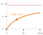
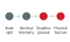
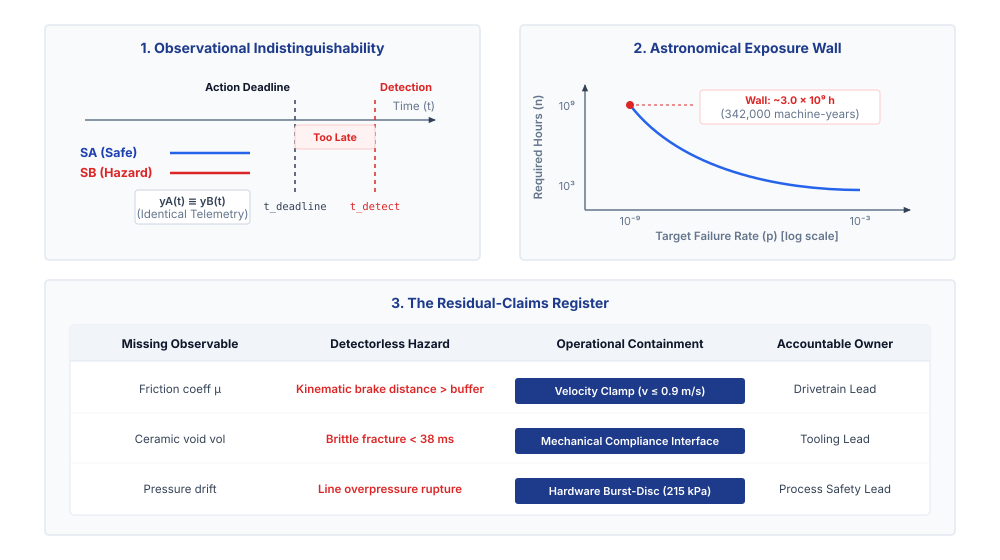

---
format:
  html:
    title: "The Epistemic Frontier"
---

# The Epistemic Frontier {#sec-frontier}

::: {layout-narrow}
::: {.column-margin}

\chapterminitoc

:::

::: {.content-visible when-format="pdf"}
\noindent
{fig-alt="Isometric blueprint of the epistemic frontier. A layered physical AI stack under glass, cabled to an actuator body housing, sits on a plinth whose edge ends at a red double-walled containment barrier above a cracked chasm labeled unobserved reality, while an amber prism labeled exploratory horizon projects a diagnostic beam across the barrier."}
:::

::: {.content-visible unless-format="pdf"}
{fig-alt="Isometric blueprint of the epistemic frontier: a layered physical AI stack under glass, a red containment barrier at the edge of a chasm labeled unobserved reality, and an amber prism projecting a diagnostic beam across it."}
:::

:::

## Purpose {.unnumbered .unlisted}

::: {.content-visible when-format="pdf"}
\begin{marginfigure}
\resizebox{0.92\linewidth}{!}{\mlphysicalstackfull{20}{20}{20}{20}{20}}
\end{marginfigure}
:::

_How much autonomy can an embodied machine legitimately hold when empirical evidence cannot settle every premise upon which its safety depends?_

As Physical AI systems advance from structured industrial automation toward open-world autonomy—operating alongside human beings in unstructured homes, crowded public spaces, and safety-critical infrastructure—they encounter an inescapable epistemic boundary. In disembodied machine learning systems, an unmodeled edge case or out-of-distribution input results in a misclassified image, a degraded recommendation ranking, or an ungrounded hallucination in a web browser. In embodied physical systems, however, software commands kinetic energy, mechanical momentum, and high-voltage motor currents across a continuous causal boundary. Here, a computational failure does not terminate with an unhandled exception or an error log entry; it manifests as plastic metal deformation, mechanical fracture, or catastrophic human trauma governed by the conservation laws of Newtonian physics.

No finite volume of physical testing, no simulation suite however massive, and no formal verification proof can ever anticipate every combinatorial variation of an open physical world. Real-world environments are inherently open, non-stationary, and governed by extreme-value heavy tails of human behavior and rare physical transitions. When an autonomous system operates beyond the certified perimeter of its operational design domain, how must its architecture behave?

This concluding chapter synthesizes the four-part intellectual journey of this book, establishing why Physical AI is fundamentally an architectural discipline uniting unprivileged statistical proposals from large foundation models with deterministic real-time enforcers, formal safety shields, and hardware interlocks. Across this book, we have analyzed how moving mass commits kinetic momentum, how embedded batch-1 streaming inference bounds compute, how closed-loop rollouts induce endogenous distribution shifts, and how cryptographically signed release manifests govern deployment. Here, we examine the open research frontiers of physical foundation models, lifelong continuous adaptation, and self-supervised world modeling, while directly confronting the hard theoretical and physical boundaries of epistemic unobservability, extreme-value distributions, and finite empirical exposure. True frontier engineering in Physical AI does not pursue the dangerous illusion of unconstrained statistical omniscience; it constructs verifiable systems architectures that explicitly bound unprivileged statistical proposals, enforce deterministic physical invariants, and accountably derate or refuse operational authority when unverified physical premises are breached.



::: {.callout-learning-objectives}

- Assess which safety claims exceed the empirical evidence available for a specific physical machine
- Evaluate whether a runtime detector can identify an impending hazard before effective physical intervention becomes impossible
- Construct residual-claims register entries, each with an active operating restriction, an accountable owner, and a sized empirical closure test
- Classify an open safety premise by the missing observable, evaluation deficit, theoretical deficit, or scope mismatch that would close it
- Trace the four bedrock laws through an unfamiliar physical machine and isolate which operational premise of each remains open

:::

## Epistemic Limits {#sec-frontier-epistemic-limits}

Every engineering method has an epistemic boundary where its formal guarantees expire. In physical AI, that boundary is not merely an algorithmic shortfall; it is a physical confrontation between compute latency, sensory observability, and mechanical inertia. Scaling the parameter count of foundation models can yield extraordinary semantic breadth, but it cannot bend the laws of motion: as networks grow, inference latency expands the reaction corridor, trading agility for deliberative depth. Physical AI is therefore fundamentally an architectural discipline: it unites unprivileged statistical proposals from deep neural networks with deterministic real-time enforcers and hardware interlocks operating at high frequency on dedicated, isolated silicon. To navigate this frontier, systems engineers must confront two fundamental limits: the physical coupling of computational delay and thermal constraints to mechanical motion, and the insurmountable divide between stochastic sensor noise and unobservable physical state.

### Embodied latency scaling and thermal dissipation ceilings {#sec-frontier-latency-thermal-scaling}

In modern deep learning, the empirical paradigm of neural scaling laws [@kaplan2020scaling; @hoffmann2022chinchilla] demonstrates that expanding model parameter counts, training compute, and dataset tokens systematically drives down loss and unlocks emergent semantic capabilities. In disembodied software environments, the trade-off of scaling is purely computational: evaluating a 70-billion-parameter foundation model may consume hundreds of milliseconds per token, but that turnaround delay affects only the user interface without altering the truth value or physical safety of the generated text.

In physical AI, however, this classical scaling thesis collides directly with an inescapable physical boundary. When an autonomous machine moves mass through a shared operational workspace, time is not an abstract software profiling metric—it is a physical state variable governed by Newtonian kinematics. In data center serving infrastructure, high token throughput is achieved by batching hundreds of concurrent requests ($B \ge 64$), amortizing weight memory transfers across queries and operating deep within the compute-bound regime of the roofline model. In embedded robotics, however, closed-loop control demands streaming batch size 1 ($B = 1$) to minimize latency. Under batch-1 execution, arithmetic intensity collapses to $\approx 1\text{ FLOP/byte}$, pinning inference execution strictly against the hardware memory wall ($f \le B_{\text{mem}} / M$, @sec-brain-memory-wall). Every weight matrix must be streamed from off-chip DRAM to on-chip SRAM for every single forward pass. For an 8-billion-parameter foundation model in 16-bit precision, streaming $16\text{ GB}$ of weights across an embedded system-on-chip (SoC) memory bus rated at $204.8\text{ GB/s}$ imposes a rigid physical latency floor of at least $t_{\text{inf}} \ge 16\text{ GB} / 204.8\text{ GB/s} \approx 78\text{ ms}$, entirely before accounting for attention key-value (KV) cache memory traffic, activation movement, or token projection. Every additional parameter, attention head, and transformer layer that inflates inference latency directly expands the machine's unbraked reaction corridor ($d_{\text{blind}} = v \cdot t_{\text{inference}}$). If computational deliberation stretches reaction time beyond available spatial clearance, increasing neural capacity directly degrades dynamic stability and mechanical safety.

This fundamental coupling between neural capacity, computational delay, and kinetic momentum is formalized in the **embodied latency scaling law** (\ref{dfn-frontier-embodied-latency-scaling-law}).

::: {#dfn-frontier-embodied-latency-scaling-law .callout-definition title="Embodied latency scaling law"}

***Embodied latency scaling law***\index{Embodied latency scaling law!definition}\index{Scaling laws!embodied latency} is the physical constraint dictating that scaling neural policy parameter count yields diminishing operational safety returns unless inference latency decreases proportionally, because physical reaction distance $d_{\text{react}} = v \cdot (t_{\text{inference}} + t_{\text{actuation}}) + \frac{v^2}{2 a_{\max}}$ scales linearly with computational delay.

1.  **Significance**: Establishes that intelligence in physical systems cannot be scaled purely by adding model parameters, because computational delay directly degrades dynamic stability and spatial stopping clearance.
2.  **Distinction**: Unlike compute scaling laws in static language modeling where latency affects only token generation speed, embodied latency scaling directly couples computational delay to mechanical reaction time constants ($t_{\text{react}} \ge t_{\text{inference}} + t_{\text{actuation}}$).
3.  **Common pitfall**: Deploying multi-billion parameter foundation models directly in the closed-loop control path under the assumption that greater semantic reasoning compensates for an unbudgeted response delay.

:::

This tension, codified in \ref{dfn-frontier-embodied-latency-scaling-law}, illustrates why parameter scaling alone cannot solve real-time safety. In natural language processing or visual generation, an offboard foundation model can scale to hundreds of billions of parameters because queuing delay and token generation latency affect only user-perceived turnaround time. In physical AI, offloading inference to edge servers across wireless networks introduces network transport latency and jitter ($t_{\text{comm}} = 50\text{ ms} \pm 30\text{ ms}$). If a mobile manipulator evaluates an 8-billion-parameter Vision-Language-Action (VLA) policy with an offboard inference latency of $t_{\text{inf}} = 200\text{ ms}$, the total computational and communication delay inflates blind travel by:
$$d_{\text{blind, offboard}} = v \cdot (t_{\text{inf}} + t_{\text{comm}}) = 1.3\text{ m/s} \times (0.200\text{ s} + 0.050\text{ s}) = 325\text{ mm}.$$
This single latency increment exhausts the entire $102.6\text{ mm}$ spare margin of the warehouse aisle (@sec-enforcement-stopping-envelopes) more than threefold before the brakes can even begin building hydraulic pressure.

Furthermore, while cloud foundation models scale compute by drawing megawatts across liquid-cooled data center racks, physical AI is bounded by the **chassis thermal dissipation ceiling**\index{Compute scaling!chassis thermal dissipation}. A warehouse mobile manipulator or humanoid robot operates within an IP65 dust- and moisture-sealed enclosure, constraining continuous onboard compute power to a strict $15\text{ to }60\,\text{W}$ thermal envelope (the operating regime of embedded system-on-chip accelerators such as NVIDIA Jetson Orin). Dissipating more than $60\text{ to }100\,\text{W}$ within a sealed mobile chassis demands bulky heat sinks, radiator loops, or forced-air cooling ducts that ingest ambient warehouse dust and fail under continuous shock and vibration. Exceeding this thermal envelope triggers silicon thermal throttling ($T_j \ge 105^\circ\text{C}$), which stretches clock cycles, degrades inference frame rates, and directly violates real-time reaction budgets. Physical AI cannot simply compute its way through epistemic limits by deploying data-center-scale neural networks onboard.

The contrast between disembodied compute scaling and embodied physical scaling exposes a fundamental divergence in systems engineering. In disembodied foundation models, the Chinchilla scaling paradigm [@hoffmann2022chinchilla] dictates that cross-entropy loss scales as a power law with training FLOPs and dataset tokens ($\mathcal{L}(C) \propto C^{-\alpha}$). Cloud data centers scale tokens by scraping petabytes of static web text, distributing optimization across tens of thousands of liquid-cooled accelerators over high-bandwidth Infiniband fabrics. In Physical AI, however, intelligence must scale across real-world physical interactions, where the scaling frontier is governed by the **Physical Action Scaling Law** and the **Physical Entropy Bottleneck**:

1. **Wall-clock temporal binding**: Web tokens are disembodied bits that can be generated or processed at millions of tokens per second. Physical actions, however, are strictly bound by the arrow of physical time: collecting one hour of physical manipulation or locomotion trajectory requires exactly one hour of physical wall-clock time ($T_{\text{fleet}} = N_{\text{robots}} \cdot t_{\text{wallclock}}$). Physical interaction cannot be accelerated beyond the physical dynamics of the robot and environment without fundamentally altering contact forces, inertia, and aerodynamics.
2. **Mechanical wear and physical entropy**: In cloud training, failed gradient updates or out-of-distribution inputs cost only wasted electrical energy; the GPU state is reset with a software interrupt. In physical AI, however, rollouts extract a permanent mechanical tax: gear tooth pitting and backlash in harmonic and cycloidal drives, thermal degradation of copper motor winding insulation, and wear across elastomeric tactile fingertip skins (such as GelSight or DIGIT sensors). When a trial fails under high kinetic energy, the physical plant suffers plastic deformation, link fracture, or destruction of surrounding infrastructure.
3. **Data distribution entropy and non-ergodicity**: Web text is largely stationary and amenable to offline curation. Physical interaction data is non-ergodic and non-stationary: ambient lighting shifts, mechanical joints loosen over thousands of cycles, floor surfaces accumulate micro-films of dust and moisture, and human coworkers introduce unmodeled reactive behaviors. Physical AI systems cannot simply scale their way to dependability by accumulating more nominal hours; they must contend with the physical entropy of the real world.

::: {.column-margin}
{width="100%" fig-alt="Scale anchor curve showing vehicle mission endurance hitting an asymptotic ceiling at 3.8 hours as battery mass increases, with diminishing returns beyond 12 kg."}

*Added battery mass yields diminishing mission endurance as locomotion overhead consumes capacity.*
:::

### Aleatoric noise vs. epistemic unobservability {#sec-frontier-aleatoric-vs-epistemic}

Beyond computational and thermal ceilings, systems engineers must separate two fundamentally distinct classes of operational uncertainty when bounding autonomous authority:

1. **Aleatoric uncertainty**\index{Uncertainty!aleatoric vs. epistemic}: Stochastic variability inherent in physical sensors and dynamic environments—such as photon shot noise in CMOS image sensors, thermal Johnson-Nyquist noise in MEMS accelerometers, or high-frequency tire slip over rough aggregate. Because aleatoric noise is conditionally zero-mean and stationary, recursive state estimators (such as extended Kalman filters, particle filters, or spatial Gaussian splats) can integrate measurements over time to filter out the variance, achieving asymptotic noise cancellation proportional to $1/\sqrt{N}$ governed by the Central Limit Theorem.
2. **Epistemic uncertainty**\index{Epistemic uncertainty!physical unobservability}: Systematic ignorance arising from unmodeled dynamics, out-of-distribution environments, or physically unobservable state variables. A clear film of hydraulic oil on concrete produces optical reflection and absorption characteristics that are indistinguishable from dry concrete under ambient lighting ($y_A \equiv y_B$). Here, the physical observation operator $g: \mathcal{S} \to \mathcal{Y}$ is non-injective ($g(S_{\text{dry}}) = g(S_{\text{oil}}) \equiv y$). Unlike aleatoric noise, **epistemic blindness cannot be averaged away**: capturing 1,000 consecutive camera frames at 30 Hz yields 1,000 identical, ambiguous measurements. By the Data Processing Inequality, the mutual information across the physical transduction channel is zero ($\mathcal{I}(S; Y) = 0$), guaranteeing that downstream neural representations carry zero information ($\mathcal{I}(S; Z) = 0$). No amount of statistical filtering, recursive Bayesian factor graph estimation, or latent autoencoder projection can uncover a state that the physics of transduction does not register.

This epistemic unobservability extends directly to high-dexterity tactile manipulation and whole-body dynamic locomotion. When a multi-fingered robotic hand grasps a deformable or slick object, the friction coefficient $\mu$ is not an invariant scalar; under classical Coulomb-Amontons friction and Cattaneo-Mindlin contact mechanics, the contact interface transitions through complex non-uniform shear stress distributions. A thin film of lubricant, localized surface wear, or internal fluid sloshing inside a non-rigid container generates an epistemic blind spot: optical vision observing external geometry registers completely stationary boundaries, while at the microscopic contact patch, shear displacement is already propagating toward catastrophic slip. Unless the robot possesses high-bandwidth, high-density optical or piezoresistive tactile arrays measuring micro-vibrations ($> 500\text{ Hz}$) and elastomeric marker displacement, incipient slip remains completely unobservable until the object is already in free fall under gravity.

As governed by Ashby's Law of Requisite Variety [@ashby1956introduction], a controller cannot regulate disturbances that its sensory architecture cannot perceive. When an unmodeled disturbance enters the physical plant, no amount of latent computation can compensate for missing physical evidence.

A pallet jack with a weeping hydraulic line crosses one aisle of the site where the warehouse mobile manipulator works, and it leaves a clear film of fluid on the concrete. The machine's stopping budget assumes that the floor can supply the friction its credible deceleration needs, and on dry concrete it can. Under the film it may not, and neither the navigation camera nor the lidar can tell the film from dry floor. The permission path can meet every deadline, the chunk lease can expire on time, and the brake can engage on schedule while the stop still runs past the rack end, because the term that failed is a premise that no sensor on the machine reports. The missing evidence is the local friction floor before braking begins. The stopping calculation below evaluates this unobserved friction deficit:

```{python}
#| label: calc-frontier-oil-film
#| echo: false
#| warning: false
#| message: false
# ┌─────────────────────────────────────────────────────────────────────────────
# │ THE OIL FILM ON THE AISLE
# ├─────────────────────────────────────────────────────────────────────────────
# │ Context: @sec-frontier-epistemic-limits (the premise behind the aisle
# │          speed), @sec-frontier-residual-claims-register (the register
# │          entries and @tbl-17-claims-register),
# │          @sec-frontier-failures-without-detectors (detection latency against the spare margin),
# │          @sec-frontier-fallacies-pitfalls (the vision-only pitfall).
# │
# │ Goal:    Show that the 1.3 m/s normal mode always rested on a friction
# │          floor that no sensor on the machine reports.
# │ Show:    the friction the credible deceleration needs; the stop on a clear
# │          film against the clear distance; the inspected-floor ceiling and
# │          restricted mode; the zero-failure closure test; the time the spare
# │          margin buys. The walking-person ceiling is Ch12's
# │          (@sec-enforcement-stopping-envelopes) and is cited, not recomputed.
# │ How:     credible deceleration a = min(a_brake, mu g); the finished budget
# │          (C2 stop, all three overheads) at the aisle speed; its ceiling as
# │          the positive root with a_eff = a / 1.5; zero-failure sample size.
# └─────────────────────────────────────────────────────────────────────────────
from mlsysim import *

RM = Embodied.MobileManipulator.WarehouseMobileManipulator
AISLE = Embodied.Scenario.WarehouseAisle

class OilFilm:
    # ┌── 1. LOAD (Constants & Parameters) ─────────────────────────────────────
    g = (1 * ureg.standard_gravity).to(ureg.meter / ureg.second**2)  # category: measured (physical constant, standard gravity)
    a_brake = AISLE.a_brake  # category: illustrative (credible deceleration, dry floor)
    mu_dry = AISLE.mu_dry  # category: illustrative (dry concrete)
    mu_insp = AISLE.mu_inspected_floor  # category: illustrative (inspected floor)
    mu_oil = AISLE.mu_oil_film  # category: illustrative (clear hydraulic film)
    v_aisle = AISLE.v_aisle  # category: chosen (normal-mode aisle speed)
    d_clear = AISLE.d_clear  # category: illustrative (rack-end clear distance)
    tau_delay = AISLE.tau_delay  # category: derived (total pre-brake delay)
    overhead = AISLE.fixed_overhead  # category: derived (delta_loc + delta_margin + eps_track)
    v_h = AISLE.v_human_approach  # category: datasheet (ISO 13855 walking speed)
    v_restricted = 1.0 * ureg.meter / ureg.second  # category: chosen (scenario assumption: restricted mode on inspected floors)
    p_miss_target = 0.001  # category: chosen (detector miss-rate bound for closure)
    n_contrast = 1000  # category: illustrative (a smaller zero-miss campaign, for contrast)
    confidence = 0.95  # category: chosen (one-sided confidence level)

    # ┌── 2. EXECUTE (Compute) ─────────────────────────────────────────────────
    mu_min = (a_brake / g).to(ureg.dimensionless).magnitude
    a_dry = min(a_brake, mu_dry * g)
    a_insp = min(a_brake, mu_insp * g)
    a_oil = min(a_brake, mu_oil * g)

    # finished budget at the aisle speed: v tau + 0.75 v^2/a (C2 stop) + overhead
    budget_aisle = (v_aisle * tau_delay + calc_c2_stop_suffix(v_aisle, a_dry)["distance"] + overhead).to(ureg.meter)
    spare_aisle = (d_clear - budget_aisle).to(ureg.millimeter)
    t_latest = (spare_aisle / v_aisle).to(ms)
    stop_oil = (v_aisle * tau_delay + calc_c2_stop_suffix(v_aisle, a_oil)["distance"] + overhead).to(ureg.meter)

    # ceilings: positive root of the finished budget with a_eff = a / 1.5
    margin_loc = AISLE.delta_loc + AISLE.eps_track
    ceiling_dry = calc_max_permitted_velocity(d_clear, tau_delay, a_dry / 1.5, margin_loc, AISLE.delta_margin)
    ceiling_insp = calc_max_permitted_velocity(d_clear, tau_delay, a_insp / 1.5, margin_loc, AISLE.delta_margin)

    n_closure = calc_zero_failure_sample_size(1.0 - p_miss_target, confidence=confidence)
    p_miss_contrast = 1.0 - calc_clopper_pearson_zero_failure_bound(n_contrast, confidence=confidence)

    # ┌── 3. GUARD (Invariants) ────────────────────────────────────────────────
    check(abs(mu_min - 0.204) < 5e-4, f"Friction floor should be 0.204, got {mu_min}.")
    check(a_dry == a_brake and mu_dry > mu_min, "On dry concrete the brakes, not friction, must bind.")
    check(mu_oil < mu_min and mu_insp < mu_min, "On the film and on an inspected floor friction must bind.")
    check(abs(a_insp.to(ureg.meter / ureg.second**2).magnitude - 1.1768) < 5e-4, f"Inspected-floor deceleration should be 1.18 m/s², got {a_insp}.")
    check(abs(budget_aisle.to(ureg.millimeter).magnitude - 997.43) < 5e-3, f"Budget at 1.3 m/s should be 997.43 mm, got {budget_aisle}.")
    check(abs(spare_aisle.to(ureg.millimeter).magnitude - 102.57) < 5e-3, f"Spare at 1.3 m/s should be 102.57 mm, got {spare_aisle}.")
    check(abs(t_latest.to(ms).magnitude - 78.9) < 5e-2, f"T_latest should be 78.9 ms, got {t_latest}.")
    check(abs(ceiling_dry.to(ureg.meter / ureg.second).magnitude - 1.3898) < 5e-5, f"Dry-floor ceiling should be 1.3898 m/s, got {ceiling_dry}.")
    check(
        abs(ceiling_insp.to(ureg.meter / ureg.second).magnitude - 1.0947) < 5e-5, f"Inspected-floor ceiling should be 1.0947 m/s, got {ceiling_insp}."
    )
    check(
        v_restricted < ceiling_insp < v_aisle < ceiling_dry,
        "Restricted mode must sit under the inspected ceiling, and the aisle speed under the dry ceiling.",
    )
    check(abs(stop_oil.to(ureg.meter).magnitude - 2.95) < 5e-3, f"Finished budget on the film should be 2.95 m, got {stop_oil}.")
    check(abs(a_oil.to(ureg.meter / ureg.second**2).magnitude - 0.49) < 5e-3, f"Film deceleration should be 0.49 m/s², got {a_oil}.")
    check(stop_oil > 2 * d_clear, f"On the film the stop from the aisle speed must exceed twice the clear distance, got {stop_oil}.")
    check(n_closure == 2995, f"Zero-failure closure test should need 2,995 trials, got {n_closure}.")
    check(abs(p_miss_contrast - 0.002991) < 5e-7, f"1,000 zero-miss trials should bound the miss rate at 0.002991, got {p_miss_contrast}.")

    # ┌── 4. OUTPUT (Formatting) ───────────────────────────────────────────────
    a_brake_str = fmt_acceleration(a_brake, precision=0)
    mu_min_str = fmt(mu_min, precision=3)
    mu_dry_str = fmt(mu_dry, precision=2)
    mu_insp_str = fmt(mu_insp, precision=2)
    mu_oil_str = fmt(mu_oil, precision=2)
    a_insp_str = fmt_acceleration(a_insp, precision=2)
    a_oil_str = fmt_acceleration(a_oil, precision=2)
    v_aisle_str = fmt_velocity(v_aisle, precision=1)
    d_clear_str = fmt_length(d_clear, unit=ureg.meter, precision=2)
    budget_aisle_str = fmt_length(budget_aisle, unit=ureg.millimeter, precision=1)
    spare_aisle_str = fmt_length(spare_aisle, unit=ureg.millimeter, precision=1)
    t_latest_str = fmt_latency(t_latest, unit=ms, precision=1)
    stop_oil_str = fmt_length(stop_oil, unit=ureg.meter, precision=2)
    ceiling_insp_str = fmt_velocity(ceiling_insp, precision=2)
    v_restricted_str = fmt_velocity(v_restricted, precision=0)
    n_closure_str = fmt_int(n_closure, commas=True)
    n_contrast_str = fmt_int(n_contrast, commas=True)
    p_miss_contrast_str = fmt(p_miss_contrast, precision=6)
    p_miss_target_pct_str = fmt_percent(p_miss_target, precision=1, style="prose")
    p_miss_target_sym_str = fmt_percent(p_miss_target, precision=1, style="symbol")
    confidence_pct_str = fmt_percent(confidence, precision=0, style="prose")
    confidence_sym_str = fmt_percent(confidence, precision=0, style="symbol")
    v_h_str = fmt_velocity(v_h, precision=1)
```

The release decision of @sec-release-safety-cases-claims already met this premise. Its claim C3, braking traction, was refused on the book's own evidence and handed to this chapter as an open premise. The machine's credible deceleration is the smaller of what its mechanical brakes deliver and what the floor interface supplies:
$$a = \min(a_{\text{brake}}, \mu g).$$
The `{python} OilFilm.a_brake_str` credible deceleration that @sec-body-kinetic-momentum established requires a physical friction coefficient of at least $\mu \ge$ `{python} OilFilm.mu_min_str`. Dry industrial concrete, at a measured $\mu$ of `{python} OilFilm.mu_dry_str`, supplies far more traction, so the mechanical brakes bind and govern deceleration. The clear hydraulic film, at $\mu$ = `{python} OilFilm.mu_oil_str` (both coefficients illustrative; see the Reader Guide), supplies only `{python} OilFilm.a_oil_str`, and the tire-floor interface binds. At the `{python} OilFilm.v_aisle_str` aisle speed, the finished budget of @tbl-enforcement-stopping-budget, `{python} OilFilm.budget_aisle_str` on a dry floor, grows on the film to `{python} OilFilm.stop_oil_str` against a `{python} OilFilm.d_clear_str` clear distance.

This numerical explosion reveals the central insight of the epistemic frontier: the friction premise did not suddenly become open when the fluid leaked onto the concrete. The normal operating mode that @sec-enforcement-stopping-envelopes selected rested on that unmeasured friction floor on every aisle, the dry ones included, and no sensor on the machine had ever measured it.

This reality reinforces why Physical AI is fundamentally an architectural discipline rather than an end-to-end model optimization problem. In an end-to-end robotic policy, unmodeled physical variations—such as a transparent oil film, an uncalibrated force sensor, or an unobserved slip transition during high-dexterity manipulation—propagate unhindered from sensory inputs directly to motor currents. Dependable embodied architectures instead structurally decouple unprivileged statistical proposals from deterministic real-time enforcers across the complete Physical AI Systems stack:

1. **Silicon and Inverter Layer (20 kHz to 50 kHz)**: At the hardware foundation, Field-Oriented Control (FOC) inverters execute inner current loops on dedicated field-programmable gate array (FPGA) or digital signal processor (DSP) logic, utilizing Space Vector Modulation (SVM) and shunt current sensing to regulate motor torque ($\tau = \frac{3}{2} p \lambda_m i_q$) while enforcing hard Safe Torque Off (STO) relays and overcurrent trips.
2. **Deterministic Nervous System and Safety Shield (1 kHz)**: An isolated real-time processor executing an RTOS (such as RT-Linux or FreeRTOS) communicates deterministically over industrial buses (EtherCAT, CAN-FD, or TSN). This layer evaluates Control Barrier Functions (CBFs) and kinematic feasibility, treating learned commands strictly as unprivileged proposals and projecting them into certified safe sets or triggering physical braking fallbacks when invariants are breached.
3. **Spatial Perception and Dynamic Memory (30 Hz to 100 Hz)**: Synchronized sensor pipelines fuse multi-camera RGB-D streams, lidar point clouds, and high-resolution tactile matrices into SE(3) pose estimates, dynamic occupancy grids, and spatial representations.
4. **Foundation Action Model and High-Level Brain (5 Hz to 20 Hz)**: Large Vision-Language-Action (VLA) foundation models and diffusion action policies generate semantic task plans and multi-step action chunks, optimizing task completion within the sandboxed envelope maintained by the deterministic layers below.

Every engineering method has a physical boundary where its guarantees expire. The physical wall of @sec-boundary-bedrock-laws is one such boundary, because scaling up a learned foundation model cannot reduce the travel that its own computational latency and inference delay cost the machine. Ashby's Law of Requisite Variety [@ashby1956introduction] formalizes another: a controller cannot regulate disturbances that its sensory architecture cannot perceive. On the mobile manipulator, the transparent oil film is an unobserved disturbance.

The manipulator arm's contact limit at the door latch rests on a premise of the identical kind: a structural latch that holds at every force below the arm's contact ceiling. Yet mechanical wear, material fatigue, or chemical corrosion can silently lower the latch's yield force below that ceiling while the joint torque sensors read exactly what they would read against a sound latch. Similarly, a wrist force-torque sensor that limits manipulation contact forces below a fragile workpiece threshold depends on an unshifted analog calibration. Mechanical shock, adhesive creep, or strain gauge thermal drift can shift that zero reference until the control loop regulates against a phantom reading while the true contact wrench breaches structural yield.

In each case, the machine departs from its certified operating conditions while its internal telemetry remains completely nominal. Successful empirical trials cannot close such a gap: the exposure wall that @sec-evaluation-trial-limits derives places a rare-hazard rate beyond any practical failure-free test campaign. The safety case must explicitly name the missing premise, restrict operational authority while it remains open, and state what empirical evidence could close it. For each open premise, systems discipline asks what the machine can physically measure, what its actuators can still prevent, and which operational claims must remain refused.

## Theoretical Boundaries and Unprovable Invariants {#sec-frontier-method-limits}

The mobile manipulator's release claim is a chain of dependent links determined by the operational hazards and the selected mitigations (@sec-boundary-machine-model). The argument must establish the operating domain, measured actuator and stopping bounds, component contracts, and independent permission for learned proposals. Hazards controlled by runtime detection also need measured detector coverage and timely monitoring. Hazards controlled by passive limits or operating restrictions instead need evidence that those measures hold over the declared load, wear, and exposure envelope. Generating extensive evidence for one link cannot compensate for an unsupported premise in another.[^fn-hist-popper-falsification]

[^fn-hist-popper-falsification]: **Popperian Falsification**\index{Falsification!Popperian induction}: Karl Popper formalized the asymmetry of empirical induction: no finite sequence of safe observations can prove universal safety, whereas a single counterexample refutes it. Operational fleet hours establish survival rates strictly under observed stationary conditions, not out-of-distribution guarantees. Extrapolating zero observed incidents to unbounded environments produces an illusory sense of safety that fails upon encountering unmodeled edge cases.

Each premise of a safety case carries one of the Reader Guide's five statuses (established by measurement or derivation, assumed, decided by accountable judgment, unsupported, or outside the threat model). The envelope trichotomy (\ref{dfn-release-envelope-trichotomy}) places a premise that a runtime monitor checks as known-true, known-false, or unknown. The premises that bound the evidence here are ones no monitor now in service can check, so none can become known-true, and the release, not the monitor, must restrict operation around them. For the base, the stopping-distance claim relies on an assumed friction coefficient between wheel and floor that cannot be measured before braking begins. For the arm, the contact argument depends on a declared floor on the strength of the latch and the objects it handles, a floor decided by engineering judgment about structural yield, while the latch's present strength stays unmeasured between proof tests. For the wrist transducer, the force-limit claim assumes a sensor whose zero point has not drifted, a premise that its own live telemetry cannot check without an unloaded physical tare. Naming these premises explicitly does not weaken the release record. It establishes the physical envelope within which the release verdict is justified, and outside of which the verdict ceases to apply.

Separating measurement from judgment is fundamental to systems engineering discipline. Empirical testing and statistical characterization can estimate physical exposure, quantify sensor noise, and bound parametric uncertainty, but no measurement can choose an acceptable **residual risk**\index{Residual risk} or decide which individuals in an operational environment must bear that risk. Those choices are accountable human decisions that must be recorded as explicit judgments rather than disguised as empirical findings. In the same way, the **threat model**\index{Threat model} bounds the validity of the record. Empirical testing across nominal fleet operations and accidental component faults provides no evidence regarding intentional adversarial attacks. A safety record demonstrating that a vision pipeline handles sensor noise, lens blur, and partial occlusions provides no statistical support for claims about resilience against adversarial optical projection, model parameter tampering, or intentional denial of service across the internal communication bus.

### Conditional shield dilution and common-cause bounds {#sec-frontier-shield-dilution}

When a learned policy operates under a real-time safety shield, systems designers frequently assume that the shield's mathematical guarantees eliminate the need to bound the failure rate of the underlying proposal model. This assumption fails under rigorous probabilistic accounting. The safety shield is a conditional filter whose effectiveness depends strictly on the proposal rate, interception coverage, and unshielded hardware failure terms, as modeled in the simulation below:

```{python}
#| label: calc-frontier-architectural-shield-dilution
#| echo: false
#| warning: false
#| message: false
import math
from mlsysim import *
from mlsysim.core.units import ureg
from mlsysim.fmt import fmt_sci, fmt, check
from mlsysim.physics.robotics import (
    calc_empirical_testing_exposure,
    calc_shielded_system_hazard_rate,
)

# ┌── 1. INPUT (Illustrative target and distinct evidence records) ────
p_target = 1.0e-9  # category: illustrative (system incidents/hour target, not a statutory rate)
confidence = 0.95  # category: chosen (one-sided confidence level)
alpha = 1.0 - confidence  # category: derived (significance level)

fleet_units = 100  # category: illustrative (fleet size)
t_cycle_days = 90.0  # category: illustrative (release cycle length)
hours_per_day = 24.0  # category: illustrative (continuous operation)

c_shield_assumed = 0.9999  # category: illustrative (class-specific interception coverage)
p_hw_assumed = 0.0  # category: illustrative (hardware and common-cause residual set to zero)
proposal_events_hypothetical = 0  # category: illustrative (adjudicated counterfactual-oracle proposal log)

# ┌── 2. COMPUTE (Proposal-log bound and shield decomposition) ────────
# The adjudicated proposal log covers one full cycle of the fleet.
t_cycle_hours = t_cycle_days * hours_per_day
proposal_exposure_hours_hypothetical = fleet_units * t_cycle_hours
# Zero hazardous proposals bound the proposal rate (one-sided Poisson).
p_proposal_upper_hypothetical = -math.log(alpha) / proposal_exposure_hours_hypothetical

# Conditional design arithmetic: the proposal-rate bound the target would require
# at the assumed class-specific interception coverage, and the exposure to show it.
p_proposal_limit = (p_target - p_hw_assumed) / (1.0 - c_shield_assumed)
n_brain_hours = calc_empirical_testing_exposure(p_proposal_limit, confidence=confidence)
t_test_days = n_brain_hours.magnitude / (fleet_units * hours_per_day)
p_system_conditional = calc_shielded_system_hazard_rate(
    p_proposal_upper_hypothetical / ureg.hour, c_shield_assumed, p_hw_assumed / ureg.hour
).magnitude
c_required_cycle = 1.0 - (p_target - p_hw_assumed) / p_proposal_upper_hypothetical
test_overrun_days = t_test_days - t_cycle_days

# ┌── 3. GUARDS (Statistical bounds & invariance checks) ──────────────
check(abs(proposal_exposure_hours_hypothetical - 216000.0) < 1.0, f"Unexpected proposal-log hours: {proposal_exposure_hours_hypothetical}")
check(abs(p_proposal_upper_hypothetical - 1.3869e-5) < 1e-8, f"Unexpected proposal bound: {p_proposal_upper_hypothetical}")
check(proposal_events_hypothetical == 0, "Proposal scenario requires zero events")
check(abs(p_proposal_limit - 1.0e-5) < 1e-9, f"Unexpected proposal limit: {p_proposal_limit}")
check(abs(n_brain_hours.magnitude - 299573.0) < 100.0, f"Unexpected brain exposure: {n_brain_hours}")
check(abs(t_test_days - 124.8) < 1.0, f"Unexpected test days: {t_test_days}")
check(abs(p_system_conditional - 1.386913e-9) < 1e-12, f"Unexpected conditional residual: {p_system_conditional}")
check(abs(c_required_cycle - 0.9999278974) < 1e-8, f"Unexpected required coverage: {c_required_cycle}")
check(test_overrun_days > 34.0, f"Unexpected 90-day overrun: {test_overrun_days}")

# ┌── 4. OUTPUT (Canonical formatting) ────────────────────────────────
class ArchitecturalShieldDilution:
    n_proposal_sci_str = fmt_sci(proposal_exposure_hours_hypothetical, precision=2)
    p_proposal_upper_sci_str = fmt_sci(p_proposal_upper_hypothetical, precision=3)

    p_brain_sci_str = fmt_sci(p_proposal_limit, precision=0)
    n_brain_sci_str = fmt_sci(n_brain_hours.magnitude, precision=2)
    t_test_days_str = fmt(t_test_days, precision=3)
    p_system_conditional_sci_str = fmt_sci(p_system_conditional, precision=3)
    c_required_str = fmt(c_required_cycle, precision=7)
    test_overrun_days_str = fmt(test_overrun_days, precision=1)
```

::: {.column-margin .margin-pointer}
↩ The empirical exposure wall and minimal-intervention safety shields are established in @sec-evaluation and @sec-enforcement.
:::

Take as the system target an illustrative $10^{-9}\text{ h}^{-1}$, a rate that no standard assigns to this machine and that, by the exposure wall, operating hours alone cannot demonstrate.[^fn-math-exposure-updates] The remaining question is what the permission path can add to the claim when it acts between proposal and actuation as the safety shield, and which of its premises need evidence of their own.

[^fn-math-exposure-updates]: **Evidence Across Updates**\index{Exposure wall!retraining reset}: An updated model may alter the proposal distribution. Earlier data can be pooled only with a justified configuration-equivalence and exposure argument; an update does not automatically erase every observation. The exposure wall's constant-rate model also requires a defensible treatment of shared fleet conditions and correlated faults.

A shield argument is *conditional*, not a multiplication applied to observed system incidents. A pervasive fallacy among machine learning teams is to take the observed system incident rate $\lambda_{\mathrm{system}}$ from historical fleet logs and multiply it by $(1 - c_h)$, claiming that introducing a safety shield reduces risk by that factor. In reality, observed fleet incidents already reflect the residual failure rate *after* existing mitigations or operator overrides have acted. Multiplying observed incident counts by $(1 - c_h)$ erroneously squares the shield's credit, inventing four orders of magnitude of phantom reliability! For a defined hazard class $h$, let $\lambda_{\mathrm{proposal},h}$ be the arrival rate of raw, unshielded hazardous proposed actions emitted by the neural policy before the permission layer, and let $c_h=P(\mathrm{intercept}\mid\mathrm{hazardous\ proposal},h)$ be measured interception coverage for that specific class. With a separately bounded hardware and common-cause term $\lambda_{\mathrm{other}}$, the true conditional hazard rate is governed by @eq-frontier-shielded-hazard:
$$\lambda_{\mathrm{system},h} \le \lambda_{\mathrm{proposal},h}(1-c_h)+\lambda_{\mathrm{other}}$$ {#eq-frontier-shielded-hazard}
The relation requires a valid proposal oracle, timely detection, actuator authority, and a justified treatment of correlated failures. It gives no credit for an oil film or a weakened latch that the shield cannot observe, and no release follows from the arithmetic until each premise is supported.

Evaluating this conditional hazard decomposition requires bounding the unshielded proposal arrival rate $\lambda_{\mathrm{proposal},h}$ from empirical telemetry logs before applying shield credit. Under a stationary Poisson model with zero observed hazardous proposals, this bound is governed by the Rule of Three (@sec-verification, @eq-verification-rule-of-three):

::: {#nbk-frontier-fleet-exposure-and-shielded-decomposition .callout-notebook title="A conditional shield calculation"}

**Problem**: One hundred robots keep a fully adjudicated proposal log for one 90-day cycle, judged by a validated counterfactual oracle, and the log records no hazardous proposal. If a named shield's interception coverage for that hazard class were independently established at $c=0.9999$, would the modeled residual meet the $10^{-9}\text{ h}^{-1}$ system target?

**Proposal bound**: Under a stationary Poisson model, zero hazardous proposals in `{python} ArchitecturalShieldDilution.n_proposal_sci_str` proposal-hours give a one-sided 95 percent upper bound of `{python} ArchitecturalShieldDilution.p_proposal_upper_sci_str` $\text{h}^{-1}$.

**Residual**: With hardware and common-cause residual set to zero for this calculation, @eq-frontier-shielded-hazard gives `{python} ArchitecturalShieldDilution.p_system_conditional_sci_str` $\text{h}^{-1}$, **above** the target. The coverage the target requires is at least `{python} ArchitecturalShieldDilution.c_required_str`.

**Required proposal evidence**: At $c=0.9999$ the proposal-rate bound must fall to `{python} ArchitecturalShieldDilution.p_brain_sci_str` $\text{h}^{-1}$. Zero adjudicated hazardous proposals would then require `{python} ArchitecturalShieldDilution.n_brain_sci_str` proposal-hours, or `{python} ArchitecturalShieldDilution.t_test_days_str` days for 100 units, `{python} ArchitecturalShieldDilution.test_overrun_days_str` days beyond the cycle.

**Systems insight**: A shield changes the system claim only for hazard classes it can detect and intercept in time. Proposal frequency, conditional interception coverage, hardware faults, and common-cause failures need separate evidence. Oil or material failure outside the shield's sensing coverage stays in the residual-claims register.
:::

To prevent unwarranted reliance on safety shields, systems engineers must enforce **the three preconditions of barrier validity**:

1. **Full state observability, directional tangent validity, and non-smooth contact mechanics**: A barrier certificate $h(x) \ge 0$ is valid if and only if the physical state $x(t)$ is observable from sensor telemetry $y(t)$ and the affine dynamic model $\dot{x} = f(x) + g(x)u$ matches physical reality. In control literature, the classical notation of the **Lie derivative** ($L_f h(x)$) frequently obscures a familiar multivariable calculus operation: it is simply the directional derivative of the scalar safety margin $h(x)$ along the vector field of unforced physical dynamics $f(x)$, computed directly via the multivariable chain rule:
   $$L_f h(x) \equiv \nabla h(x) \cdot f(x) = \sum_{i=1}^d \frac{\partial h}{\partial x_i} f_i(x).$$
   For an ML systems engineer accustomed to gradient computations and Jacobian-vector products, $\nabla h(x) \cdot f(x)$ answers a concrete physical question: *If all actuators are de-energized, at what rate does passive Newtonian inertia expand or shrink the safety margin?* If $\nabla h(x) \cdot f(x) < 0$, unforced physics is actively consuming safety clearance. Similarly, the control Lie derivative $L_g h(x) \equiv \nabla h(x) \cdot g(x)$ measures the directional sensitivity of the safety margin to commanded actuator inputs $u$. A Control Barrier Function enforces forward invariance by requiring the total time derivative $\dot{h}(x, u)$ to satisfy:
   $$\dot{h}(x, u) = \nabla h(x) \cdot f(x) + (\nabla h(x) \cdot g(x)) u \ge -\alpha(h(x))$$
   where $\alpha(\cdot)$ is an extended class-$\mathcal{K}$ comparison function bounding how rapidly the system may safely approach the boundary. If tire friction $\mu$ drops, sensor latency $\tau_{\text{delay}}$ stretches, or payload inertia shifts without being observed, the true physical vector field $f_{\text{true}}(x)$ departs from the model $f(x)$. The directional derivative $\nabla h(x) \cdot f(x)$ evaluates along an erroneous tangent: the quadratic program believes it is preserving forward invariance, while along the true physical trajectory $\nabla h(x) \cdot f_{\text{true}}(x)$ has collapsed, projecting the machine directly across the safety boundary.

   Furthermore, standard Control Barrier Functions assume continuously differentiable vector fields ($f \in C^1$) and smooth trajectories. In physical robotics, however, foundational contact mechanics is governed by non-smooth **Signorini complementarity conditions** and Coulomb friction cones:
   $$0 \le \phi(q) \perp \lambda_N \ge 0, \quad \lambda_N \cdot \phi(q) = 0$$
   where $\phi(q)$ is the signed distance (gap function) between contacting bodies and $\lambda_N$ is the normal contact force. At the exact instant of physical impact—such as a foot strike during whole-body dynamic locomotion, or finger-object impact during high-dexterity tactile manipulation—the velocity vector field experiences an impulsive jump discontinuity governed by the Newton-Euler impact equation:
   $$M(q) (\dot{q}^+ - \dot{q}^-) = J_c(q)^T \Lambda$$
   where $\Lambda$ is the contact impulse and $J_c(q)$ is the contact Jacobian. At that impact instant, acceleration approaches infinity (a Dirac delta distribution), rendering the smooth Lie derivative $\nabla h(x) \cdot f(x)$ mathematically undefined. If the safety filter does not explicitly model hybrid contact phase transitions and non-smooth barrier certificates, forward invariance collapses precisely when the physical impact occurs.
2. **Actuator authority and inverter feasibility margins**: The quadratic program (QP) that filters unprivileged control proposals into certified commands:
   $$u^* = \operatorname{argmin}_{u \in \mathcal{U}} \|u - u_{\text{learned}}\|^2 \quad \text{s.t.} \quad \nabla h(x) \cdot f(x) + (\nabla h(x) \cdot g(x)) u \ge -\alpha(h(x))$$
   assumes that the admissible control set $\mathcal{U}$ is non-empty. On physical hardware, actuator authority is bounded not merely by kinematic velocity limits, but by the electrical and thermal constraints of the Field-Oriented Control (FOC) inverter. In permanent magnet synchronous motors, delivered torque follows $\tau = \frac{3}{2} p \lambda_m i_q$, where quadrature current $i_q$ is bounded by DC bus voltage $V_{\text{dc}}$ and rotor back-EMF ($V_{\text{emf}} = p \lambda_m \omega$). At high rotational velocities, back-EMF shrinks voltage headroom, causing available torque to decay nonlinearly: $\tau_{\max}(\omega) \le \frac{3}{2} p \lambda_m \frac{V_{\text{dc}} - p \lambda_m \omega}{R}$. If an unprivileged policy drives the machine into a high-momentum state where the deceleration required to satisfy $\dot{h} \ge -\alpha(h)$ exceeds physical braking capacity ($a_{\text{req}} > \min(a_{\text{brake}}, \mu g)$) or dynamic inverter limits, the constraint set becomes empty, the QP solver returns `INFEASIBLE`, and the barrier certificate collapses.
3. **Independent hardware fault paths and Safe Torque Off**: A software safety shield executing on the same host operating system or system-on-chip as the proposal model shares common-cause failure modes, including memory corruption, kernel panics, and voltage brownouts. A mathematically verified barrier provides zero protection unless backed by independent physical hardware cutoffs—such as electromechanical Safe Torque Off (STO) relays and hardware watchdogs that de-energize gate drivers within milliseconds when communication or heartbeats fail.

### The empirical exposure wall and the rule of three {#sec-frontier-empirical-exposure-wall}

Under a stationary Poisson model, observing zero failure events over cumulative exposure time $T$ yields the foundational **Rule of Three** established in @sec-verification (@eq-verification-rule-of-three): demonstrating that a target failure rate does not exceed $\lambda$ at 95 percent confidence requires accumulating at least $T \ge 3.0 / \lambda$ continuous zero-failure operating hours ($4.61 / \lambda$ at 99 percent confidence).

This mathematical relationship creates the unyielding **Poisson Exposure Wall**\index{Exposure wall!Poisson bounds}. To certify an ultra-dependable industrial or aviation target rate of $\lambda = 10^{-9}\text{ h}^{-1}$ (1 Failure in Time, or FIT), empirical testing requires accumulating at least:
$$T \ge \frac{3.0}{10^{-9}\text{ h}^{-1}} = 3 \times 10^9\text{ hours}$$
of continuous, failure-free operation. That exposure corresponds to over $342{,}000$ vehicle-years of continuous operation. Even a massive commercial fleet of $1{,}000$ autonomous robots operating 24 hours a day, 365 days a year accumulates only $8.76 \times 10^6$ fleet hours annually, requiring more than $340$ calendar years to demonstrate that target empirically.

The exposure wall is equally unyielding in autonomous driving, where human fatality rates average approximately one death per $100$ million miles ($10^{-8}$ fatalities per mile). Under classical statistical bounds, demonstrating with 95 percent confidence that an autonomous fleet matches human safety requires accumulating roughly $275$ million failure-free miles; establishing statistical rate precision requires more than $8.8$ billion miles [@kalra2016driving]. For an autonomous fleet of $100$ vehicles driving continuously at $30\text{ mph}$, collecting $8.8$ billion miles requires over $330$ calendar years. Gathering more nominal operational data cannot breach this barrier; rare catastrophic hazards inhabit the unobserved tail of physical reality.

### The curse of dimensionality and formal verification ceilings {#sec-frontier-verification-ceilings}

When empirical fleet exposure fails to breach the astronomical exposure wall, system safety cannot be rescued simply by retreating into offline mathematical proof (@fig-17-state-space-formal-verification-frontier). Formal safety verification confronts an equally unyielding epistemic limit: the **curse of dimensionality** across continuous state spaces.

In formal verification, **reachability analysis**\index{Reachability analysis!Hamilton-Jacobi PDE} computes all physical states from which worst-case disturbances force the system into an unsafe set (the *backward reachable tube*). For machine learning systems engineers familiar with reinforcement learning and value iteration, classical Hamilton-Jacobi (HJ) reachability is best understood as **continuous-state, continuous-time minimax Bellman dynamic programming** evaluated backward in time:
$$\frac{\partial V}{\partial t} + \min_{u \in \mathcal{U}} \max_{d \in \mathcal{D}} \left( \nabla V(x, t) \cdot f(x, u, d) \right) = 0$$
In this formulation, nature acts as an adversarial agent choosing disturbance $d \in \mathcal{D}$ (aerodynamic wind gusts, friction drops, communication latency) to minimize the safety value function $V(x, t)$, while defensive control inputs $u \in \mathcal{U}$ seek to maximize it. The zero-level set of $V(x, t)$ isolates the exact boundary where defensive control can no longer prevent an impending collision. To solve this differential game numerically, the continuous state space $\mathcal{X} \subset \mathbb{R}^d$ must be discretized into a spatial grid.

Here lies the impenetrable **Grid Wall**\index{Grid Wall!exponential state-space complexity}: if each state dimension is discretized into a modest resolution of $N = 100$ grid points, computing the PDE requires evaluating $N^d = 100^d = 10^{2d}$ grid cells:

- **3D Dubins Car** ($x, y, \theta$): $d = 3 \implies 100^3 = 10^6$ cells (one million points, requiring roughly $8\text{ MB}$ of memory and easily solved in seconds on a workstation).
- **6D Planar Biped or Kinematic Vehicle** ($x, y, \theta, v, \dot{\theta}, a$): $d = 6 \implies 100^6 = 10^{12}$ cells (one trillion points, requiring $8\text{ TB}$ of memory and cluster-scale compute).
- **12D Quadrotor** (3D position, 3D velocity, 3D orientation, 3D rates): $d = 12 \implies 100^{12} = 10^{24}$ cells, requiring $8 \times 10^{24}$ bytes of memory for double-precision grid values—vastly exceeding the entire global manufacturing supply of silicon DRAM.
- **High-Dexterity Tactile Hand or Mobile Manipulator** ($d = 30\text{ to }48$): A multi-fingered hand grasping a deformable object or an articulated base with dual arms spans joint positions, velocities, and contact states, yielding $100^{30} = 10^{60}$ to $100^{48} = 10^{96}$ cells, placing grid evaluation beyond the number of atoms in the observable universe.
- **Non-Rigid Deformable Objects**: Manipulating cables, cloth, elastomeric seals, or soft tissue involves infinite-dimensional configuration spaces ($\mathcal{C} = \mathbb{R}^\infty$). Finite element approximations with hundreds of nodes ($d > 500$) render grid-based reachability mathematically impossible.

Consequently, exact grid-based reachability analysis hits an unyielding dimensional ceiling at $d \approx 6$. Sampling-based statistical verification (such as adaptive stress testing and scenario optimization) breaks the exponential grid wall, scaling polynomially as $\mathcal{O}(d^2)$ up to 50 dimensions or more; yet it purchases tractability by surrendering deterministic safety guarantees, yielding only probabilistic Probably Approximately Correct (PAC) bounds ($1 - \epsilon$) that remain inherently blind to measure-zero adversarial singularities. Modern neural barrier certificates (NBCs) synthesized via branch-and-bound verification tools (such as $\alpha,\beta$-CROWN) establish a promising intermediate frontier, verifying forward invariance across 12D to 30D robotic systems through convex relaxations and Linear Relaxation Perturbation Analysis (LiRPA, $\mathcal{O}(d^k)$). Even so, when state dimensionality scales to coupled multi-robot swarms ($d \ge 48$), verification times again escalate toward intractability, demonstrating that formal methods replace exposure time with state-space dimensional ceilings rather than eliminating epistemic limits.

::: {#fig-17-state-space-formal-verification-frontier fig-env="figure" fig-pos="htb" fig-cap="**The formal verification tractability frontier across state-space dimensionality**: Computation time (seconds, log scale) required to synthesize or verify safe control invariants as a function of continuous state-space dimension $d$. Hamilton-Jacobi reachability (red) provides deterministic continuous guarantees via grid-based partial differential equations ($\\mathcal{O}(N^d)$), hitting the exponential Grid Wall at $d > 6$. Sampling-based statistical verification (green dashed, $\\mathcal{O}(d^2)$) scales polynomially to high dimensions but provides only probabilistic PAC bounds ($1 - \\epsilon$), blind to measure-zero corner failures. Neural barrier certificates verified via branch-and-bound SMT solvers ($\\alpha,\\beta$-CROWN, dark blue, $\\mathcal{O}(d^k)$) push the formal frontier across 12D quadrotors, 16D bipedal robots, and 30D mobile manipulators before computational scaling limits coupled multi-agent swarms ($d \\ge 48$)." fig-alt="Log-linear chart showing verification computation time from milliseconds to centuries across state-space dimensionality from 2 to 50. Hamilton-Jacobi reachability shoots upward exponentially, hitting the Grid Wall at dimension 6. Sampling-based verification scales polynomially as a gentle slope. Neural barrier certificates scale moderately through 12D quadrotor, 16D biped, and 30D mobile manipulator benchmarks, showing how modern relaxations push the formal verification frontier."}

```{python}
#| label: fig-17-state-space-formal-verification-frontier
#| echo: false
#| message: false
#| warning: false

import matplotlib.pyplot as plt
import numpy as np

# Publication styling
plt.rcParams["font.sans-serif"] = ["Helvetica", "Arial", "DejaVu Sans"]
plt.rcParams["axes.edgecolor"] = "#334155"
plt.rcParams["axes.linewidth"] = 1.0

fig, ax = plt.subplots(figsize=(14.2, 8.0), dpi=300, facecolor="#FFFFFF")
ax.set_facecolor("#FFFFFF")
ax.spines["top"].set_visible(False)
ax.spines["right"].set_visible(False)
ax.spines["left"].set_color("#334155")
ax.spines["bottom"].set_color("#334155")
ax.grid(True, linestyle="--", linewidth=0.6, alpha=0.5, color="#E2E8F0")
ax.set_axisbelow(True)

# State space dimension d from 2 to 50
d = np.linspace(2, 50, 400)

# 1. Hamilton-Jacobi Reachability (Grid PDE, O(N^d))
d_hj = np.linspace(2, 6.2, 150)
T_hj = 0.005 * (48.0 ** (d_hj - 2))

# 2. Sampling-Based Statistical Verification (Scenario / AST, O(d^2))
T_sample = 0.02 * (d**1.8)

# 3. Neural Barrier Certificates (SMT / alpha-beta-CROWN, O(d^k))
T_nbc = 0.035 * (d**2.7)

# Plot curves
ax.plot(
    d_hj,
    T_hj,
    color="#DC2626",
    linewidth=2.8,
    label=r"Hamilton-Jacobi Reachability (Grid PDE, $\mathcal{O}(N^d)$)",
)
ax.plot(
    d,
    T_sample,
    color="#047857",
    linewidth=2.4,
    linestyle="--",
    label=r"Sampling-Based Statistical Verification (Scenario / AST, $\mathcal{O}(d^2)$)",
)
ax.plot(
    d,
    T_nbc,
    color="#1E3A8A",
    linewidth=2.7,
    label=r"Neural Barrier Certificates (SMT / $\alpha,\beta$-CROWN, $\mathcal{O}(d^k)$)",
)

# The Grid Wall for Hamilton-Jacobi Reachability
ax.axvline(6.2, color="#DC2626", linestyle=":", linewidth=1.8, alpha=0.85)
ax.fill_betweenx([1e-3, 5e10], 6.2, 52, color="#FEE2E2", alpha=0.28)

ax.text(
    6.5,
    8e7,
    "THE GRID WALL (Curse of Dimensionality):\nDiscretization memory & PDE solve time\nexplode exponentially beyond $d > 6$",
    fontsize=8.8,
    fontweight="bold",
    color="#DC2626",
)

ax.set_yscale("log")
ax.set_xlim(1.5, 52)
ax.set_ylim(1e-3, 5e10)

# Benchmark Robot Systems Callouts aligned with Neural Barrier Curve
systems = [
    {
        "d": 3,
        "name": "Dubins Car (3D)\n$(x, y, \\theta)$",
        "y_box": 1e-2,
        "col": "#64748B",
    },
    {
        "d": 4,
        "name": "Kinematic Car (4D)\n$(x, y, \\theta, v)$",
        "y_box": 5e2,
        "col": "#64748B",
    },
    {
        "d": 7,
        "name": "Kinodynamic Car (7D)\n$(x, y, z, \\dot{x}, \\dot{y}, \\psi, \\dot{\\psi})$",
        "y_box": 3e-1,
        "col": "#0D9488",
    },
    {
        "d": 12,
        "name": "6-DOF Quadrotor (12D)\n$(p, v, q, \\omega)$",
        "y_box": 2e4,
        "col": "#1E3A8A",
    },
    {
        "d": 16,
        "name": "Bipedal Robot (16D)\n(Floating Base + Legs)",
        "y_box": 4e-2,
        "col": "#1E3A8A",
    },
    {
        "d": 30,
        "name": "Mobile Manipulator (30D)\n(Base + 14-DOF Dual Arm)",
        "y_box": 1.5e6,
        "col": "#7C3AED",
    },
    {
        "d": 48,
        "name": "Multi-Agent Swarm (48D)\n($8 \\times 6$D Coupled Agents)",
        "y_box": 4e8,
        "col": "#7C3AED",
    },
]

for sys_item in systems:
    sd = sys_item["d"]
    st = 0.035 * (sd**2.7)
    ax.plot(sd, st, marker="o", markersize=6.5, color=sys_item["col"], zorder=5)
    ax.axvline(sd, color="#CBD5E1", linestyle=":", linewidth=0.8, alpha=0.55)

    ax.plot(
        [sd, sd],
        [st, sys_item["y_box"]],
        color=sys_item["col"],
        linestyle="--",
        linewidth=0.8,
        alpha=0.7,
    )
    ax.text(
        sd,
        sys_item["y_box"],
        sys_item["name"],
        fontsize=7.8,
        fontweight="bold",
        color=sys_item["col"],
        ha="center",
        va="center",
        bbox=dict(
            boxstyle="round,pad=0.25",
            facecolor="#FFFFFF",
            edgecolor="#CBD5E1",
            alpha=0.92,
            linewidth=0.6,
        ),
    )

badge_box = dict(
    boxstyle="round,pad=0.4",
    facecolor="#FFFFFF",
    edgecolor="#CBD5E1",
    alpha=0.96,
    linewidth=0.8,
)
ax.text(
    36,
    2e-2,
    "Sampling-Based Compromise:\nFast and polynomial up to $d > 100$, but provides only\nprobabilistic PAC bounds ($1-\\epsilon$). Blind to measure-zero\nadversarial counterexamples and worst-case corners!",
    fontsize=8.4,
    color="#047857",
    bbox=dict(
        boxstyle="round,pad=0.4",
        facecolor="#FFFFFF",
        edgecolor="#047857",
        alpha=0.96,
        linewidth=0.8,
    ),
)

ax.text(
    24,
    1.5e5,
    "The Neural Barrier Frontier:\nSynthesizes learned certificates and verifies them via\nSMT / branch-and-bound ($\\alpha,\\beta$-CROWN), breaking the grid wall\nto guarantee formal forward invariance on 12D–50D systems!",
    fontsize=8.5,
    color="#1E3A8A",
    bbox=dict(
        boxstyle="round,pad=0.4",
        facecolor="#FFFFFF",
        edgecolor="#1E3A8A",
        alpha=0.96,
        linewidth=0.8,
    ),
)

time_markers = [
    (1.0, "1 Second"),
    (60.0, "1 Minute"),
    (3600.0, "1 Hour"),
    (86400.0, "1 Day"),
    (3.15e7, "1 Year"),
    (3.15e9, "1 Century"),
]
for sec, label in time_markers:
    ax.axhline(sec, color="#E2E8F0", linestyle="-", linewidth=0.6, alpha=0.6)
    ax.text(50.8, sec, label, fontsize=7.8, color="#94A3B8", va="center", ha="right")

ax.set_xlabel(
    "State-Space Dimensionality $d$ (Degrees of Freedom / State Variables)",
    fontsize=11,
    fontweight="bold",
    color="#1E293B",
)
ax.set_ylabel(
    "Verification / Safety Synthesis Computation Time (seconds, log scale)",
    fontsize=11,
    fontweight="bold",
    color="#1E293B",
)
ax.legend(loc="upper left", fontsize=9.0, framealpha=0.95, edgecolor="#CBD5E1")

plt.tight_layout()
plt.show()
plt.close()
```
:::

Each of these premises, from friction under a film to a shield's coverage for a hazard class it may not observe, ends the same way, named by the release and left unsettled by its evidence. A release that stops at naming them has only listed its caveats. What it needs is a record that turns each such premise into a restriction with an owner and a test that can end it.

## A Residual-Claims Register {#sec-frontier-residual-claims-register}

Refusing claim C3 did not remove the friction premise from the machine, and an unproven premise remains whether or not a safety report records it. The **residual-claims register**\index{Residual-claims register!definition} represents the sixteenth and culminating contract of this book. Emitted as the ultimate governance artifact of the Physical AI stack, it consumes the upstream release manifest of @sec-release-manifest, capturing every premise the release left open or unsupported. In disembodied software engineering, unresolved bugs and architectural shortcuts linger as non-blocking technical debt in an issue tracker while new model weights are continuously pushed to production. If an unhandled exception or memory leak occurs in a web service, the container orchestrator restarts the pod, logs an HTTP 500 error, or redirects traffic to a replica. In Physical AI, however, epistemic debt is kinetic debt. An unverified physical premise is not an abstract software flaw; it is unbraked momentum, uncontrolled mechanical force, or high-voltage energy committed across a continuous causal boundary. If an autonomous machine ships with an unmeasured friction floor or an uncalibrated force sensor, that debt is amortized in physical impact. When the unmodeled condition manifests, the failure terminates in plastic deformation or human trauma governed by the conservation laws of motion. The residual-claims register mathematically binds autonomous authority to empirical evidence: an open entry enforces an active, machine-readable restriction that derates operational authority until its predeclared closure test passes.

The register maps each such premise, and every unmonitored invariant, to four mandatory components: its missing physical observable, its active containment or operating restriction, an accountable human owner, and a predeclared empirical closure test. Without these four components, an unresolved premise is an unwritten risk, not an engineering contract. The register is where principle \ref{pri-vol4-evidence-bounds-authority} reaches the premises that evidence could not settle, holding machine authority to a safe restriction wherever supporting evidence is absent.

::: {#dfn-frontier-residual-claims-register .callout-definition title="Residual-claims register"}

***Residual-claims register***\index{Residual-claims register!definition}\index{Contracts!residual claims} is the sixteenth executable contract of the Physical AI stack, consuming the safety case release manifest to record every open or unsupported physical premise and mapping each to its missing physical observable, active operating restriction, accountable human owner, and predeclared empirical closure test.

1.  **Significance**: Prevents unsupported physical premises from vanishing into uncalibrated software optimism, mathematically holding autonomous machine authority to a restricted operational envelope until empirical or physical evidence proves safe boundaries.
2.  **Distinction**: Unlike a static hazard log or bug tracker, the residual-claims register is an active, machine-readable deployment contract integrated into firmware flashing and continuous deployment (CD) pipelines, enforcing operational deratings at runtime.
3.  **Common pitfall**: Treating open safety premises as speculative engineering debt to be resolved in future releases without derating operational speed or restricting the physical operating domain today.

:::

Each entry links the unsupported claim to the specific unmeasurable physical observable. In a machine that moves mass, a learned policy fails to settle a safety property because sensors cannot transduce the relevant environmental state, the computing substrate cannot process the measurement within the control deadline, or the physical interaction cannot be observed before contact occurs. An engineer must define the **missing observable**\index{Missing observable!definition} with physical precision rather than statistical abstractions. Characterizing an unknown failure as an "out-of-distribution latent state" provides no actionable signal for the permission loop to trigger a physical intervention. By contrast, stating an unmeasured surface friction coefficient, an undetected optical flare across a camera lens array, an unobservable micro-fracture in an actuator housing, or an unmodeled shear stress distribution across a tactile fingertip identifies the exact physical deficit. Naming the missing observable establishes the boundary where learned inference stops and physical uncertainty begins.

In high-dexterity manipulation of non-rigid deformable objects—such as routing flexible wire harnesses, manipulating elastomeric seals, or folding layered textiles—missing observables dominate the physical interaction. Surface RGB-D cameras observe only outer boundary geometry; they cannot transduce internal torsional strain, plastic deformation thresholds, or hidden entanglement states. When a gripper grasps an elastomeric gasket, the internal stress field is theoretically infinite-dimensional. If the foundation model's proposed trajectory induces shear forces exceeding the material's tear threshold, catastrophic failure occurs without any preceding visual anomaly. In the claims register, this gap cannot be resolved by gathering more nominal grasping demonstrations; it requires an active containment measure (such as a hardware torque-sensing compliant wrist or a tactile slip-monitoring reflex) and an explicit closure test (such as multi-axis force-torque proof testing across worst-case material batches).

The oil film gives the mobile manipulator its first entry. The premise is that every aisle floor supplies a friction coefficient of at least `{python} OilFilm.mu_min_str`, the value its credible deceleration needs. The missing observable is the friction beneath a clear film, which the navigation camera and the lidar cannot tell from dry concrete. The stop from the aisle speed that fits the clear distance on a dry floor overruns it on the film, so a speed limit the entry imposes can hold only on floors whose friction is measured or controlled.

An open entry requires an **operational response**\index{Operational response!definition}. For the aisles, the most the entry permits is a restricted mode of `{python} OilFilm.v_restricted_str` on floors under the site's inspection regime. An inspected floor supports $\mu \ge$ `{python} OilFilm.mu_insp_str`, which gives a credible deceleration of `{python} OilFilm.a_insp_str` and a ceiling of `{python} OilFilm.ceiling_insp_str`, so the restricted mode sits below its ceiling.[^fn-math-velocity-clamp] A route that the inspection regime does not cover is excluded, or the machine is withheld from it.

[^fn-math-velocity-clamp]: **Velocity Kinetic Derating**\index{Velocity clamp!kinetic derating}: $E_k=mv^2/2$ decreases quadratically with speed. Stopping distance still depends on a validated credible deceleration and total response delay; a speed register alone cannot compensate for arbitrarily low friction.

The restricted mode needs an owner able to keep its physical premises true. Site operations owns this entry through its spill procedure for pallet-jack routes, which sets the inspection interval and names the condition that withdraws permission. The signed speed limit on the permission path enforces the restriction, but a claim about friction cannot be maintained by a speed setting alone.

Every entry needs a **closure test**\index{Closure test!definition} declared before collecting data. For the film, the test must qualify a new transducer, because no measurement by the camera or the lidar can exclude a clear film and more trials with them could not close the entry. The test is a floor-film detector whose miss rate is bounded at `{python} OilFilm.p_miss_target_pct_str` by `{python} OilFilm.n_closure_str` failure-free trials on seeded films (@sec-evaluation-trial-limits); until it passes, the restriction holds. A smaller campaign falls short. Zero misses in `{python} OilFilm.n_contrast_str` independent trials bound the miss probability only at `{python} OilFilm.p_miss_contrast_str` with `{python} OilFilm.confidence_pct_str` confidence. The detector must also report the film early enough that detection, permission, and braking together fit the clear distance, and the trial distribution, detection distance, latency, false alarms, and friction after detection must be declared in advance. A wheel-slip reflex can limit later motion but cannot establish friction before the wheels reach the film.

The same aisle carries a second entry. The stopping budget protects a static obstacle. A person who keeps walking toward the machine through the whole stop adds distance that the budget never charges (@sec-memory-belief-through-occlusion), and @sec-enforcement-stopping-envelopes found that charging it would cap the base at this rack end far below its aisle speed. The premise is that no person approaches the rack end during a stop, and the missing observable is presence in the cross aisle the rack hides. The site's crossing rule, a floor-marked crossing plus a rack-end presence sensor, is the restriction, and site operations owns it. The closure test qualifies the presence sensor by the same zero-failure sizing.

The pick station adds a third entry, and this one belongs to the arm. Its premise is that the object the arm grasps, and later hands to the coworker under `accept_item` (@sec-intervention-human-authority), is the object the task names. @Sec-intent-request-to-proposal showed how that premise fails. A thin-walled red glass jar beside the red mug on the takeaway conveyor draws a confident grounding, and the wrong target passes every geometric check the planner and the permission path apply. The missing observable is identity and fragility, which neither the wrist camera nor the grounding model can establish before contact.

The restriction on this entry has two parts. Site operations admits to the conveyor only items on the pick station's declared item list, which holds no fragile look-alike, and the station admits a grasp only when the pick window holds exactly one object, so that a second object refuses the intent and sends the item to the coworker for a manual pick. Singulation makes the grounding unambiguous for the items it admits but supplies no identity information, and a mis-routed jar that arrives alone is contained only by the feed procedure. That residual is why the entry stays open. A grip-force ceiling set for the most fragile look-alike would need a crush limit for every item that might arrive, itself an unmeasured premise, so the register does not rest on one. Site operations owns the feed list and the singulation rule jointly with the task profile. The closure test is a qualified identity check at the station, a tag read or a scale-and-code check, whose false-accept rate is bounded at `{python} OilFilm.p_miss_target_pct_str` with `{python} OilFilm.confidence_pct_str` confidence by the same `{python} OilFilm.n_closure_str` failure-free trials, run here on seeded look-alikes.

@Tbl-17-claims-register sets the three entries side by side. Each row carries the four components the register requires, so any entry can be audited without the prose around it.

\Needspace{31\baselineskip}

| Claim and missing state                                                                                                                | Hazard mechanism                                                                                                                                                                                                                                                      | Active containment and owner                                                                                                                                                                                                                                                                                            | Predeclared closure test                                                                                                                                                                                                                                                                                                     |
|:---------------------------------------------------------------------------------------------------------------------------------------|:----------------------------------------------------------------------------------------------------------------------------------------------------------------------------------------------------------------------------------------------------------------------|:------------------------------------------------------------------------------------------------------------------------------------------------------------------------------------------------------------------------------------------------------------------------------------------------------------------------|:-----------------------------------------------------------------------------------------------------------------------------------------------------------------------------------------------------------------------------------------------------------------------------------------------------------------------------|
| **Braking traction**: every aisle floor supplies $\mu \ge$ `{python} OilFilm.mu_min_str`; friction beneath a clear film is unobserved. | At $\mu$ = `{python} OilFilm.mu_oil_str` the credible deceleration falls to `{python} OilFilm.a_oil_str`, and the finished budget at `{python} OilFilm.v_aisle_str` grows to `{python} OilFilm.stop_oil_str` against a `{python} OilFilm.d_clear_str` clear distance. | `{python} OilFilm.v_restricted_str` on inspected floors ($\mu \ge$ `{python} OilFilm.mu_insp_str`, ceiling `{python} OilFilm.ceiling_insp_str`); uninspected routes excluded. *Owner*: site operations, through the spill procedure for pallet-jack routes.                                                             | A floor-film detector with a miss rate of at most `{python} OilFilm.p_miss_target_sym_str` at `{python} OilFilm.confidence_sym_str` confidence, from `{python} OilFilm.n_closure_str` failure-free seeded-film trials, plus timing and clearance tests; the restriction holds until it passes.                               |
| **Walking person**: no person approaches the rack end during a stop; presence in the hidden cross aisle is unobserved.                 | A person walking at `{python} OilFilm.v_h_str` through the whole stop would cap the base far below its aisle speed at the rack end (@sec-enforcement-stopping-envelopes).                                                                                             | The crossing rule, a floor-marked crossing plus a rack-end presence sensor. *Owner*: site operations.                                                                                                                                                                                                                   | Qualify the presence sensor by the same zero-failure sizing, `{python} OilFilm.n_closure_str` failure-free trials for a `{python} OilFilm.p_miss_target_sym_str` miss bound.                                                                                                                                                 |
| **Object identity**: the object grasped is the object the task names; identity and fragility before contact are unobserved.            | A confident grounding to a thin-walled glass jar beside the red mug passes every geometric check, and a grip the ceramic mug needs can crush the glass.                                                                                                               | Feed control admits to the conveyor only items on the station's declared list, none of them a fragile look-alike; singulation admits a grasp only with one object in the pick window. An off-list item arriving alone is contained only by the feed procedure. *Owner*: site operations, jointly with the task profile. | A qualified identity check at the station (tag read or scale-and-code) with a false-accept rate of at most `{python} OilFilm.p_miss_target_sym_str` at `{python} OilFilm.confidence_sym_str` confidence, from `{python} OilFilm.n_closure_str` failure-free seeded look-alike trials; the restriction holds until it passes. |

: **Residual-claims register for the aisle and the pick station**: The three open premises behind the mobile manipulator's aisle speed and its pick. For each, the register names the missing physical observable, the hazard it permits, the operating restriction and its accountable owner, and the predeclared closure test that would retire the restriction. {#tbl-17-claims-register tbl-colwidths="[22,24,26,28]"}

A release pipeline records each entry in a fixed schema, and its fields, units, and invariants appear with the other record layouts in @sec-appendix-systems-wire-residual-claims.

### Operationalizing open premises into engineering contracts {#sec-frontier-operationalizing-claims}

The residual-claims register is not a static archival report that engineers sign and shelf upon deployment. In dependable physical AI, the register functions as an executable software and operational contract integrated directly into continuous deployment (CD) and fleet telemetry pipelines.

When an engineering team pushes an updated model checkpoint or firmware configuration, the automated deployment pipeline validates the release against the wire schema of @sec-appendix-systems-wire-residual-claims. The target hardware's secure bootloader and isolated safety microcontroller parse the signed manifest directly from non-volatile storage. If an open premise lacks an empirical regression proof or if fleet telemetry reveals that physical conditions have departed from declared bounds (such as uninspected floor routes), the pipeline automatically flashes firmware enforcing the signed velocity clamp ($v \le 1.0\text{ m/s}$) and triggers operational alerts. The safety MCU physically refuses to arm high-speed actuation profiles ($1.3\text{ m/s}$) whenever the register contains an open claim lacking a cryptographically signed closure test artifact.

The physical execution architecture enforces this boundary across isolated silicon. The safety microcontroller (running a certified real-time operating system with deterministic 1 kHz cycle times) continuously monitors the active claims register. When an open claim imposes a restriction—such as a velocity clamp ($v \le 1.0\text{ m/s}$) or a contact force ceiling ($F \le 40\text{ N}$)—the safety MCU configures the motor inverter's digital signal processor (DSP) or FPGA via deterministic SPI or CAN-FD. The inverter's Field-Oriented Control (FOC) current loop, executing at 20 kHz to 50 kHz, clamps the quadrature-axis current limit ($i_q \le i_{q,\text{clamp}}$) and sets hardware comparator trip thresholds. If an unprivileged neural policy running on the host GPU attempts to emit commands violating these boundaries, the FOC inverter limits torque at the silicon level. If the host GPU hangs, suffers a memory fault, or fails to publish fresh heartbeat tokens within a hardware watchdog window ($t_{\text{watchdog}} \le 10\text{ ms}$), the safety MCU asserts Safe Torque Off (STO), opening electromechanical power relays to de-energize motor windings and engaging physical spring-set friction brakes. Physical containment does not trust the software stability of the proposal engine; it relies on silicon-level determinism.

All three entries close only through a qualified physical detector: a floor-film detector for the first, a rack-end presence sensor for the second, and an identity check at the station for the third. Each closure test must demonstrate that the qualified detector reports within strict real-time deadlines, ensuring that observation, permission arbitration, and braking fit within the available physical clearance. That timing requirement has a physical limit of its own.

## Failures Without Detectors {#sec-frontier-failures-without-detectors}

A runtime detector is itself a physical subsystem governed by silicon latency, transducer bandwidth, and mechanical dynamics. To operate as a **practical detector**\index{Practical detector!definition}, it must satisfy three tightly coupled engineering constraints:

1. **Statistical tail coverage**: High detection probability ($1 - \beta \ge 0.999$) across the heavy-tailed operational hazard distribution.
2. **Bounded false-alarm rate**: A false-positive rate low enough ($\alpha \le 10^{-4}$) to prevent alarm fatigue or unnecessary emergency stops that destroy warehouse throughput.
3. **Physical detection deadline**: Detection latency strictly shorter than the physical system's available reaction window:
   $$t_{\text{detect}} \le t_{\text{harm}} - (t_{\text{enforce}} + t_{\text{actuation}} + t_{\text{brake}}).$$

At the `{python} OilFilm.v_aisle_str` aisle speed, the finished stopping budget of @tbl-enforcement-stopping-budget leaves the mobile manipulator `{python} OilFilm.spare_aisle_str` of its clear distance unspent, which the machine covers in `{python} OilFilm.t_latest_str` (@sec-intervention-authority-transitions). A detector for an approaching worker at the rack end that adds more than `{python} OilFilm.t_latest_str` to the observation-and-inference path is not a detector for that hazard.

The floor-film detector faces an even stricter form of the same test. Its forward detection distance, less the travel incurred during its own sensing and inference latency, must cover the dry-floor stop to the film's leading edge. A classification report that arrives once the drive wheels have already crossed onto the film leaves a stopping distance of `{python} OilFilm.stop_oil_str` against the `{python} OilFilm.d_clear_str` clear distance. A detector that reports after the physical point of no return is merely an expensive post-mortem event logger. Producing an accurate neural classification label after crossing an irreversible kinetic threshold generates diagnostic telemetry for an incident report, but it cannot serve as a runtime safeguard.

### Observational indistinguishability and practical detector latency {#sec-frontier-observational-indistinguishability-sub}

The fundamental physical limit of runtime detection arises from observational indistinguishability. Consider two physical states of the world, $S_A$ and $S_B$. In state $S_A$, a commanded actuator trajectory $u(t)$ is completely safe. In state $S_B$, the identical trajectory $u(t)$ causes catastrophic structural fracture or human injury, requiring the permission path to intervene and command an immediate stop. The dynamics of the body impose a hard deadline:
$$t_{\text{deadline}} = t_{\text{harm}} - (t_{\text{enforce}} + t_{\text{actuation}} + t_{\text{brake}}),$$
determined by actuator response time, motor torque limits, and kinetic momentum, after which physical contact or mechanical yield cannot be prevented. If the telemetry history $y(t)$ provided by onboard instrumentation is identical for $S_A$ and $S_B$ across the entire interval $t \le t_{\text{deadline}}$, no algorithm operating on those observations can reliably distinguish the benign state from the hazardous one. Identical telemetry traces rule out a state-specific response before that deadline. A conservative action chosen for both states or a passive mechanical limit may still protect them, if its own clearance and force assumptions are valid.

::: {.column-margin}
{width="100%" fig-alt="Causal chain showing state split producing identical telemetry until deadline passes and irreversible damage occurs."}

*Identical pre-contact telemetry prevents software intervention before irreversible physical damage occurs.*
:::

To formalize this physical boundary where software anomaly detectors fail because incoming telemetry provides zero distinguishing energy before the action deadline, we state the principle of **observational indistinguishability** (\ref{dfn-frontier-observational-indistinguishability}):

::: {#dfn-frontier-observational-indistinguishability .callout-definition title="Observational indistinguishability"}
***Observational indistinguishability***\index{Observational indistinguishability!definition}\index{Detectorless failure!indistinguishability} is the physical condition where two distinct world states, one nominal ($S_A$) and one hazardous ($S_B$), generate identical pre-harm sensor telemetry ($y_A(t) \equiv y_B(t)$) up to the system's physical action deadline ($t_{\text{deadline}} = t_{\text{harm}} - t_{\text{act}}$).

1.  **Significance**: Without distinguishing physical energy prior to the action deadline, timely algorithmic differentiation is physically and mathematically impossible. Scaling neural model parameters, increasing dataset size, or accelerating inference compute cannot separate states that emit zero distinguishing physical energy before the time-to-harm.
2.  **Distinction**: Unlike epistemic uncertainty or high classifier entropy (which signals that the model knows it lacks evidence), observational indistinguishability often pairs with high output confidence and near-zero entropy because the neural network maps corrupted observations into nominal latent manifolds.
3.  **Common pitfall**: Relying on software anomaly detectors or VAE reconstruction loss to catch detectorless degradation. When sensor physics blinds the transducer, as piezoresistive crystal creep does, or the hazardous state lies outside the sensed path, as a weakened latch does for the joint channel, the anomaly detector consumes telemetry that carries no trace of the fault and fails silently.
:::

The mathematical foundation of this limit is governed by the **Data Processing Inequality**\index{Data Processing Inequality!sensory channels}. Let $S \in \{S_A, S_B\}$ represent the true physical state of the world, $Y = g(S)$ represent the raw digitized sensor telemetry transmitted across the causal boundary into silicon, and $Z = f_\theta(Y)$ represent internal latent representations, feature maps, or anomaly scores computed by a deep neural network. The mutual information $\mathcal{I}(S; Z)$ between the physical state and the neural representation satisfies:
$$\mathcal{I}(S; Z) \le \mathcal{I}(S; Y).$$
If the physical transducer channel $\mathcal{Y}$ carries zero mutual information with the hazard state ($\mathcal{I}(S; Y) = 0$)—because optical photons reflect identically from dry concrete and thin hydraulic fluid, or because joint torque sensors read the identical contact force against a weakened latch as against a sound one—no downstream neural transformation, multi-modal foundation model, or variational autoencoder (VAE) reconstruction loss can synthesize that missing information:
$$\mathcal{I}(S; Y) = 0 \implies \mathcal{I}(S; Z) = 0.$$
The Brain cannot detect its own transducerless blindness.

In a learned perception-action policy, this same limit appears as **shortcut learning**\index{Shortcut learning!causal confusion}. A Vision-Language-Action (VLA) foundation model [@brohan2023rt1; @brohan2023rt2] or a diffusion policy [@chi2024diffusionpolicy] minimizes empirical imitation loss on demonstration datasets using whatever correlations the training data contain. Where surface friction, material yield strength, or payload inertia goes unobserved by sensors, the network latches onto non-causal visual features—such as ambient lighting reflections, floor coloration, or background shadows—as spurious proxies. Under distribution shift in the field, these proxies fail abruptly. Yet the neural encoder continues mapping the unfamiliar observation into a familiar region of its latent manifold, causing the policy to command aggressive motions with high softmax confidence and near-zero ensemble variance. An uncertainty estimate computed from that same latent representation—whether a Mahalanobis distance, Monte Carlo dropout variance, or autoencoder reconstruction residual—inherits the exact same blindness. The proposal engine cannot detect its own shortcut failure, which is why physical containment must reside in the deterministic Nervous System below the proposal boundary.

In high-dexterity manipulation, observational indistinguishability manifests dynamically at the contact interface. When grasping a smooth or deformable object, contact mechanics is governed by Cattaneo-Mindlin partial slip theory: gross slip does not occur simultaneously across the entire contact patch, but initiates as a microscopic annular shear ring that propagates inward from the contact perimeter as tangential force approaches the Coulomb limit ($F_T \to \mu F_N$). External RGB cameras and low-bandwidth joint torque sensors observe zero macroscopic displacement ($y_A(t) \equiv y_B(t)$) during this partial slip phase. By the time macroscopic slip occurs, the object is already undergoing unconstrained gravitational acceleration ($g = 9.81\text{ m/s}^2$). Because camera exposure, deserialization, and neural inference impose an unavoidable latency of at least $50\text{ to }100\text{ ms}$, the physical action deadline $t_{\text{deadline}}$ is violated before any vision-based detector can trigger. Detecting slip before loss of control requires high-density tactile taxels measuring high-frequency micro-vibrations ($> 500\text{ Hz}$) and elastomeric shear strain directly at the skin interface.

### Passive compliance, structural containment, and proof-testing {#sec-frontier-passive-compliance-containment}

When physical states are observationally indistinguishable, software intervention is impossible. Safety must instead be guaranteed through mechanical compliance, physical proof-testing, or structural isolation.

Sensing hardware shows the same limit over longer durations. A robot's wrist force-torque transducer drifts as mechanical stress relaxation and temperature cycles affect its piezoresistive strain gauges, and a transducer whose zero has drifted low reports the same trend as an interaction that genuinely exerts lower contact force. A single channel reports one scalar wrench component, and no algorithm on that signal can tell a changed physical interaction from a degraded calibration baseline. Without an independent physical tare routine or a zero-point proof test, the drift is undetectable at runtime.[^fn-hw-piezoresistive-drift]

[^fn-hw-piezoresistive-drift]: **Piezoresistive Transducer Drift**\index{Piezoresistive transducer!drift}: Mechanical stress relaxation, adhesive creep, and temperature cycles alter the piezoresistive bridge balance of silicon strain gauges in robotic wrist sensors over extended campaigns. Monolithic software filters cannot separate slow baseline voltage drift from true contact force increments, creating an unobservable state transition. Preventing excessive contact forces therefore requires independent physical tare routines, unloaded zero-point proof-tests, or dual-dissimilar sensing architectures.

The weakened latch at the door is the arm's case of the same limit, and a faster one. Until the latch yields, the joint torque sensors read the same torques against a weakened latch as against a sound one, because both carry the same contact force, and the channel holds no trace of the strength that remains. The yield is irreversible, and no command issued after it restores the latch, so a faster classifier on the joint torque channel protects nothing. The defensible responses supply what that channel lacks. A proof test establishes the latch's strength at a declared interval, and it covers the interval only if corrosion and wear cannot carry the yield force below the contact ceiling between two tests, a rate that the maintenance record, not the torque channel, must support.

A passive compliant buffer in the wrist mechanically clamps contact force below the structural yield limit across a bounded deflection stroke, converting what would be an instantaneous rigid impact spike into a gradual force rise that buys critical time for safety watchdogs to cut motor current. When an unyielding metal tool or robotic link strikes a rigid obstacle at velocity $v$, rigid-body contact dynamics produce impact durations on the order of $\Delta t \approx 1\text{ to }2\text{ ms}$—vastly faster than the execution period of even a $1\text{ kHz}$ software control loop. In geared electric actuators, the effective impact inertia is dominated by the motor rotor reflected through the square of the transmission gear ratio ($J_{\text{reflected}} = N^2 J_{\text{rotor}}$). For high-reduction planetary, cycloidal, or harmonic gearboxes ($N \ge 100$), reflected inertia is ten thousand times rotor inertia ($100^2 = 10{,}000$). At the instant of collision, acoustic stress waves propagate through mechanical linkages at the speed of sound in aluminum ($c \approx 5{,}000\text{ m/s}$), producing destructive peak impact forces within microseconds ($< 500\,\mu\text{s}$) before any industrial communication bus (CAN-FD at $1\text{ ms}$ or EtherCAT at $250\,\mu\text{s}$) can transmit a single packet to the CPU. Introducing a Series Elastic Actuator (SEA) or passive mechanical spring buffer transforms these impact dynamics: the mechanical spring mechanically decouples the high reflected rotor inertia from the impact interface, causing force to build continuously at $\dot{F} = k_{\text{spring}} v$ and buying a physical reaction window of:
$$\Delta t_{\text{reaction}} = \frac{\Delta x_{\text{stall}}}{v}.$$
For an end-effector approaching at $v = 0.20\text{ m/s}$ with an available compliance stroke of $\Delta x_{\text{stall}} = 20.0\text{ mm}$, the mechanical spring buys $\Delta t_{\text{reaction}} = 100\text{ ms}$ of reaction margin—permitting dozens of control cycles for the deterministic Nervous System to detect contact and de-energize motor windings before force reaches destructive levels. @Eq-frontier-passive-compliance bounds this buffer stiffness, ensuring that full stroke deflection does not breach the latch's structural floor:[^fn-math-contact-lipschitz]
$$k_{\text{spring}} \le \frac{F_{\text{allow}}-F_{\text{preload}}}{\Delta x_{\text{stall}}}$$ {#eq-frontier-passive-compliance}
where $F_{\text{allow}}$ is the structural yield threshold of the workpiece, $F_{\text{preload}}$ is the preload resisting nominal manipulation forces, and $\Delta x_{\text{stall}}$ is the compliance stroke available before cutting drive power. If the buffer is sized too stiff or bottoms out against a mechanical hard stop, contact forces surge abruptly into rigid impact, shearing the mechanism without ever registering a distinguishable software signature.

::: {.column-margin .margin-pointer}
↩ Failures undetectable by sensory telemetry challenge the observation contracts formulated in @sec-perception-observation-contract.
:::

[^fn-math-contact-lipschitz]: **Contact Boundary**\index{Contact mechanics!non-smooth impact}: Rigid impact and friction transitions can invalidate a smooth free-motion model. Peak contact force and component damage require measured stiffness, damping, geometry, and actuator response; neither a controller nor a passive part alone supplies a universal bound.

The Cruise San Francisco collision failed in the opposite way from the Tempe collision of @sec-boundary-when-fails, where the sensors had detected the pedestrian but a designed suppression withheld the braking that state warranted. In San Francisco, an automated fallback maneuver acted, but on a physical state that no sensor reported.[^fn-case-cruise-inquiry] A faster trigger or broader authority would not have prevented the injury, because no measurement separated the state the fallback was qualified for from the actual one. A timelier response rule and a restored redundant brake path address a failure like Tempe's. Only qualification and sensing extended to every physical state the fallback may meet can repair the other kind, the detectorless failure this section describes and the one the oil film poses on the aisle.

[^fn-case-cruise-inquiry]: **Cruise Investigation Findings**\index{Incident postmortem!Cruise San Francisco}: The California DMV Order of Suspension and subsequent technical root-cause audits [@exponent2024cruise; @quinnemanuel2024cruise] established that the automated pullover maneuver treated perimeter sensor clearance as proof of an unobstructed path. This operational failure formalizes the requirement that fallback maneuvers must never inject mechanical power when the workspace beneath the chassis remains unobservable.

\Needspace{0.57\textheight}

::: {#ws-frontier-cruise-sf-blind-spot-post-collision .callout-war-story title="Cruise post-collision fallback failure (2023)"}
**Context**: On October 2, 2023, in San Francisco, a human-driven vehicle struck a pedestrian, launching them into an adjacent lane directly in front of an autonomous Cruise robotaxi [@exponent2024cruise; @quinnemanuel2024cruise].

**Mechanism**: The robotaxi's perception system detected the incoming obstacle and commanded emergency braking, coming to a halt directly over the pedestrian. The vehicle's collision detection subsystem recognized that a crash had occurred. However, perimeter cameras and lidar arrays could not observe the volume directly beneath the vehicle floorboard ($y_A(t) \equiv y_B(t)$ between clear asphalt and a person pinned under the carriage). The vehicle's post-collision maneuver software, designed to clear active traffic lanes after minor impacts, classified the lane ahead as unobstructed and commanded a pull-over to the curb. The vehicle accelerated, dragging the trapped pedestrian $20\text{ feet}$ ($6\text{ meters}$) along the road before stopping.

**Impact**: The pedestrian suffered severe traumatic injuries. The California Department of Motor Vehicles immediately suspended Cruise's autonomous testing and deployment permits, citing safety risk and misrepresentation of post-collision sensor capabilities, prompting Cruise to halt all commercial fleet operations.

**Response**: The independent technical root-cause analysis [@exponent2024cruise] established that the post-collision software lacked an accurate model of undercarriage occlusion and failed to verify that the under-vehicle region was clear before initiating motion. Cruise issued a software recall for its collision-response system to prohibit post-collision pullover maneuvers when sensor coverage is incomplete.

**Systems lesson**: The physical state beneath the chassis was unobservable to the sensor suite ($y_A(t) \equiv y_B(t)$). The fallback procedure was verified only under the unstated premise that accident victims remain within perimeter sensor coverage. When an unexpected physical trajectory violated that premise, an automated safety routine acted on an unobserved reality, escalating a survivable incident into a catastrophic injury. Automated fallbacks must never inject mechanical power when critical safety states lie in an unobservable subspace. **The Undercarriage Blind Spot Invariant** establishes that an autonomous machine must never command motion when critical safety state lies in an unobservable sensory subspace.
:::

When a failure mode lacks a practical detector, the remaining responses are to limit actuator authority under a validated force or clearance model, restrict the operating domain, add independent sensing, or schedule proof tests. A force limit rests on that validated model, because ISO 10218 and ISO/TS 15066 apply to their industrial robot scopes and supply no universal force limit for this machine. Active sensing is itself actuation. A small dither of the wheels, an active probe for the film, measures traction only where the wheels already are, so it cannot close the friction entry. Because the probe must not slip beyond the reserved clearance, the independent permission path must admit each probe command within a separately validated energy, contact, clearance, and timing envelope and choose a state-matched fallback when the needed bound is unavailable. If none of these measures can support the claim, operation must be withheld.

The safety case must document these gaps. @Fig-17-epistemic-limits marks where the argument runs out. The residual-claims register records the detector's blind region, defining the set of physical states that produce indistinguishable observations, along with the maximum exposure duration permitted between physical proof tests. Treating an undetectable failure as a solved runtime problem undermines the validity of the safety case. Preserving the exact boundary where sensing stops forces the engineering organization to rely on physical constraints rather than software optimism.

::: {#fig-17-epistemic-limits fig-env="figure" fig-pos="t" fig-cap="**Two limits on the claim**: Panel (a) shows states with identical pre-deadline telemetry. A speed clamp is useful only with a supported braking and clearance envelope. Panel (b) shows the zero-event exposure required for a rare-rate claim under the chosen Poisson model; a barrier argument also needs observable state, a feasible control action, and valid timing assumptions." fig-alt="Panel (a) shows safe and hazardous states producing the same telemetry until after the action deadline, with a conditional speed clamp. Panel (b) shows zero-event exposure growing inversely with the target rate and a conditional barrier argument."}
{width="100%" fig-alt="Panel (a) shows safe and hazardous states producing the same telemetry until after the action deadline, with a conditional speed clamp. Panel (b) shows zero-event exposure growing inversely with the target rate and a conditional barrier argument."}
:::

The two panels of @fig-17-epistemic-limits synthesize the twin boundaries that govern physical AI dependability:

1. **Panel (a) Observational Boundary**: The horizontal time axis traces the evolution of two physically distinct paths: a safe nominal state $S_{\text{safe}}$ (blue curve) and an impending hazardous state $S_{\text{hazard}}$ (red curve)—such as a mobile robot traversing dry concrete vs. approaching an invisible hydraulic fluid film. Throughout the critical pre-deadline window enclosed by the dashed yellow box, both states produce strictly identical telemetry:
   $$y_A(t) \equiv y_B(t) \quad \forall t \le t_{\text{deadline}}.$$
   Because standard camera and lidar channels cannot detect the low-friction film under ambient warehouse lighting, the permission path remains entirely unaware of the degradation. At $t_{\text{deadline}}$, the physical point of no return is crossed: given the robot's loaded momentum, braking must commence immediately to avoid overrunning the aisle end. However, physical detection only occurs at $t_{\text{detect}} > t_{\text{deadline}}$ when the drive wheels begin slipping under braking. As marked by the **State ID late** callout, by the time the state discrepancy is recognized, stopping distance already exceeds available clearance. Under observational indistinguishability, software perception cannot protect the machine; safety must instead be guaranteed through **Structural Containment**—clamping operating velocity to a restricted envelope $v \le v_{\text{clamp}}$ sized such that unbraked slide remains within clear margins if the friction floor $\mu$ holds.

2. **Panel (b) Exposure Wall**: The log-log hyperbola traces the required continuous zero-failure operational hours $n$ across target failure rates $p$, governed by the Poisson Rule of Three ($n \ge 3.0 / p$ at 95 percent confidence). As the target failure rate drops from routine industrial anomalies ($p = 10^{-3}\ \text{h}^{-1}$, requiring $3{,}000$ zero-failure hours) to civil aviation and functional safety standards ($p = 10^{-9}\ \text{h}^{-1}$, 1 FIT), required test exposure escalates to an astronomical $3 \times 10^9$ hours (over $340{,}000$ continuous vehicle-years). To escape this empirical exposure wall, engineers rely on **Barrier Invariants**—mathematically certifying forward invariance ($h(x) \ge 0$) via control barrier functions (@sec-enforcement-safe-sets-conditional-permission). However, as highlighted in the green panel footer, a barrier invariant guarantees safety *only if two physical premises hold*: the full state $x(t)$ must be observable from sensors $y(t)$, and the certified control action $u^*(t)$ must be physically feasible within motor torque and thermal saturation bounds. If state observability fails (as in Panel a) or torque saturates, the mathematical barrier collapses.

Each detectorless mode still leaves a defensible response, and @tbl-17-detectorless-modes sets four of them side by side.[^fn-hw-motor-thermal]

[^fn-hw-motor-thermal]: **Motor Thermal State**\index{Actuator!stator thermal dynamics}: Winding resistance and magnet flux can change with temperature. Whether that changes braking authority depends on the drive, current limits, load, and measured thermal model; a separate holding path may be required for gravity-loaded axes.

| Failure and missing state                                                                            | Why the existing channel can miss it                                                              | Deadline or evidence deficit                                                                                              | Defensible response                                                                                                                      |
|:-----------------------------------------------------------------------------------------------------|:--------------------------------------------------------------------------------------------------|:--------------------------------------------------------------------------------------------------------------------------|:-----------------------------------------------------------------------------------------------------------------------------------------|
| **Pressure-sensor drift**: zero offset changes with aging or deposition.                             | One channel cannot separate true pressure change from its own offset drift.                       | Drift may persist until the process reaches its pressure limit; a detector cannot be credited without a second reference. | Independent calibrated pressure channel, proof test, and rated relief path.                                                              |
| **Latch-strength loss**: corrosion or wear lowers the latch's yield force below the contact ceiling. | Joint torque sensors read the same contact force against a weakened latch as against a sound one. | Latch strength is unmeasured between proof tests, and the yield is irreversible, so no later command restores the latch.  | A passive compliant element sized by @eq-frontier-passive-compliance to a declared floor on latch strength, or proof tests of the latch. |
| **Rotor flux loss**: delivered torque differs from current-based estimate.                           | Stator current alone does not measure the torque constant after magnet damage.                    | A gravity-loaded axis may have little time to arrest once available torque is lost.                                       | Measure torque or rotor state, derate within tested limits, and validate a holding or controlled-stop path.                              |
| **Learned perception shift**: an optical artifact is mistaken for a known scene.                     | Model confidence may remain high even while the physical scene differs.                           | Confidence or reconstruction loss alone does not bound clearance or stopping response.                                    | Independent range/clearance checks and an admitted motion envelope, with residual blind regions recorded.                                |

: **Detectorless physical failure taxonomy**: Four failure modes, in transduction, contact, the drive, and learned perception, whose safe and hazardous states look identical to the existing channel before the time-to-harm. For each, the table gives why the channel misses it, the deadline or evidence it cannot meet, and the response that still supports a claim. {#tbl-17-detectorless-modes tbl-colwidths="[23,26,24,27]"}

Every row fails the practical-detector test because the existing channel gives identical observations for the safe and hazardous states until the deadline has passed. Every defensible response supplies what that channel lacks: a second reference, a passive load limit, a direct torque measurement, or an independent range check. What that missing element is, and whether it can be built, decides the kind of gap each register entry records.

## Sensitivity to Foundational Modeling Assumptions {#sec-frontier-assumptions-change}

The three entries in the mobile manipulator's residual-claims register\index{Residual-claims register} lack the same element: a qualified detector for a state no sensor in service reports. Sorting every recorded gap by what is missing turns the register from an ad hoc list of caveats into an engineering agenda. To alter an operational release verdict, research advances must supply the missing evidence that directly discharges an open register entry.

### The four epistemological gap classes in embodied AI {#sec-frontier-four-gap-classes}

A recorded safety gap falls into one of four distinct classes, defined by the missing element. It stems from an **unmeasured observable**\index{Unmeasured observable} when the true physical state (such as a hidden internal defect) cannot be distinguished from sensor data before the deadline for action; from an **evaluation deficit**\index{Evaluation deficit} when the tail probability of failure cannot be bounded because these rare events require intractable physical exposure; from a **theoretical deficit**\index{Theoretical deficit} when the learned policy lacks a bounded relationship between training conditions and execution stability; or from a **scope mismatch**\index{Scope mismatch} when the target claim exceeds what the system architecture can physically support. All three of the machine's entries belong to the first class. More grounding-model trials at the pick station or more stopping runs on dry floors would treat them as evaluation deficits, which they are not. Naming the missing capability defines the exact physical or mathematical requirement that would discharge the entry.

Closing a gap from an unmeasured observable requires a new physical measurement that separates previously indistinguishable states within the permission path's deadline. For the film, a software filter or a learned estimator running on the navigation camera and the lidar cannot be that measurement, because it consumes the same observations that already fail to separate film from dry floor. The floor-film detector must respond to the film through an independent physical channel, and it closes the entry only if it meets the timing requirement of @sec-frontier-failures-without-detectors, holds a bounded false-alarm rate, and fails independently of the cameras.

Closing an evaluation deficit requires replacing raw sample counts with estimators whose bias and variance can be bounded analytically. Logging more unperturbed operation, or running simulated episodes whose fidelity in the tail is unverified, cannot bound a tail rate. An importance-sampling\index{Importance Sampling} or adaptive stress-testing\index{Adaptive Stress-Testing} scheme can, if it demonstrates conservative estimates on benchmark distributions whose answer is known and reports effective independent exposure rather than raw trial counts. Ten thousand simulated trajectories that explore one basin of a collision surface say little about the others, so effective sample size must be estimated from the weights and their dependence.

Closing a theoretical deficit requires a bounded analytical claim paired with a runtime mechanism that checks its premises. For a policy trained by imitation or reinforcement learning, the deficit is the absence of any guarantee of bounded outputs under distribution shift, and neither asymptotic convergence nor a bound resting on an uncheckable Lipschitz constant closes it. The theory must state the invariance it guarantees and the support over which it holds, and the machine must carry a monitor that flags when its state leaves that support, with bounded estimator error and decision delay and a validated state-matched stop.

In non-rigid deformable object manipulation—such as manipulating surgical tissue, routing high-voltage vehicle wiring harnesses, or seating elastomeric sealing gaskets—theoretical deficits and unmeasured observables merge. Classical mechanics models these interactions through finite element methods (FEM) or Cosserat rod formulations, but real-world elastomers exhibit non-linear viscoelastic hysteresis, internal frictional damping, and plastic strain hardening. An unprivileged policy trained via reinforcement learning or imitation learning operates under an unverified assumption of elastic restitution. When the material experiences micro-tearing or permanent plastic yield, the physical plant switches into an altered dynamical regime without exhibiting any preceding anomaly in visual telemetry. A candidate advance that claims to guarantee deformable manipulation safety via an idealized linear-elastic simulation merely shifts epistemic debt from neural policy weights to ungrounded physics engine parameters.

To prevent research optimism from corrupting the safety case, each candidate advance must undergo evaluation against a predeclared closure test. The test defines the missing argument link, the numerical threshold required for sufficiency, and the independent evidence necessary to verify it. An advance fails the test if it merely relocates an assumption to a less visible layer of the system. Systems engineers must guard against **Assumption Shifting (the conservation of epistemic debt)**\index{Epistemic debt!conservation}: replacing an opaque neural network controller with a "provably safe" control-barrier function whose certificate assumes perfectly known linear dynamics $\dot{x} = A x + B u$ does not eliminate epistemic uncertainty. It merely relocates the unmodeled dynamics from the opaque network weights to the unverified barrier derivative. If the physical plant experiences unobserved tire slip, actuator deadbands, or payload shifts, the formal certificate is just as ungrounded as the neural policy it was intended to safeguard. Epistemic debt cannot be eliminated by mathematical formalization; it can only be discharged by empirical physical evidence. A candidate advance is stopped before it can alter the safety verdict whenever its validation relies on the exact unverified properties it was designed to establish.

Closing a scope mismatch acknowledges that certain gaps cannot be closed by any known sensor, sampling regime, or mathematical framework. When physical laws, computational limits, or economic constraints preclude the necessary measurement or proof, the safety case cannot remain suspended in anticipation of future discovery. Narrowing the actuator's physical authority, restricting the operational design domain (ODD)\index{Operational design domain}, or refusing to operate the machine is not an admission of research defeat. It is the engineering resolution. Classical fault-tolerant design\index{Fault tolerance!structural bounds} reached the same conclusion, that dependable operation comes from self-monitoring thresholds\index{Self-Monitoring} and structural isolation\index{Structural Isolation} that contain faults rather than from eliminating every disturbance. An arm whose compliant wrist bounds contact force below a declared floor on latch strength does not need to detect a weakened latch to leave it intact. The residual-claims register records the boundary of verifiable knowledge, and the permission path and the machine's passive limits enforce the constraints that bound the consequence of what remains unknown.

Research directions in physical machine learning must therefore be judged solely by whether they convert an open residual claim into verified evidence capable of altering the operational verdict. General improvements on benchmark leaderboards, such as a 3 percent reduction in average tracking error or higher reward on a standard task suite, provide no evidence toward closing an unsupported safety link. A research project becomes relevant to physical deployment only when its deliverable targets a specific entry in the claims register, whether by providing the missing transducer, bounding the tail estimator, or furnishing the runtime-checked stability proof. If an advance improves mean performance but leaves the detector blind spot or the tail uncertainty unchanged, the authority limits of the machine remain exactly where they were.

### Extreme value theory and heavy-tailed risk estimation {#sec-frontier-evt-heavy-tails}

Evaluating safety tails in physical robotics requires rejecting naive Gaussian assumptions when attempting to close evaluation deficits. In classical statistics, the Central Limit Theorem (CLT) assumes that independent and identically distributed (i.i.d.) random variables sum to thin, exponentially decaying Gaussian tails: $P(X \ge x) \sim e^{-x^2 / (2\sigma^2)}$. Under a Gaussian distribution, an extreme $6\sigma$ deviation is an astronomical impossibility ($\approx 10^{-9}$ probability). In physical robotics, however, the CLT fails systematically due to three physical mechanisms:

1. **Nonlinear dynamic compounding**: Small tracking errors alter contact geometry or tire slip angles, nonlinearly amplifying dynamic yaw moments until the plant suddenly spins out.
2. **Coupled common-cause stressors**: Environmental shifts (such as a sudden downpour, blinding sunset glare, or floor grease) degrade camera contrast, lidar reflectivity, and wheel traction simultaneously.
3. **Discontinuous physical bifurcations**: Friction transitions from static adhesion to dynamic sliding, electrical buses brown out, or mechanical linkages yield, abruptly switching the system into an entirely different dynamical regime.

Because of these phenomena, physical robotics failures exhibit **heavy tails**\index{Heavy-tailed distributions!robotics failure modes}, where catastrophic outliers occur orders of magnitude more frequently than Gaussian models predict. To bound these rare events without waiting centuries for collisions, engineers apply **Extreme Value Theory (EVT)**\index{Extreme Value Theory!Generalized Pareto Distribution}. By the Pickands-Balkema-de Haan Theorem,[^fn-math-evt-convergence] tail excesses $Y = X - u$ over a sufficiently high threshold $u$ converge asymptotically to the Generalized Pareto Distribution (GPD) formulated in @eq-frontier-generalized-pareto:
$$G_{\xi, \sigma}(y) = 1 - \left( 1 + \frac{\xi y}{\sigma} \right)^{-1/\xi}$$ {#eq-frontier-generalized-pareto}

[^fn-math-evt-convergence]: **Pickands-Balkema-de Haan Theorem**\index{Extreme Value Theory!asymptotic convergence}: The convergence of tail excesses $Y = X - u$ to the Generalized Pareto Distribution requires the underlying distribution to lie in the domain of attraction of an extreme value law as threshold $u \to x_F$. In physical robotics, threshold selection balances estimator variance against bias from non-tail dynamics (@sec-appendix-ml-evt).

where $\xi$ is the shape parameter (tail index), $\sigma$ is scale, and $y$ represents excess margin deficit beyond operational safety thresholds (such as peak deceleration shortfalls, tracking boundary overshoots, or transient contact overforces). When $\xi > 0$, the tail exhibits power-law decay ($y^{-1/\xi}$) rather than exponential decay. By fitting a GPD to sub-critical near-miss telemetry logged during canary fleet operations, engineers can mathematically extrapolate the probability of rare tail-event safety breaches without waiting for catastrophic failures to manifest in the field (@sec-appendix-ml-evt). When tail indices satisfy $\xi > 0$, the empirical exposure required to verify safety escalates dramatically, reinforcing why closure tests must be sized against heavy-tailed extreme-value distributions rather than ungrounded Gaussian assumptions.

### Continual on-device learning and multi-robot non-stationarity {#sec-frontier-continual-learning-multi-robot}

Two emerging systems challenges define the modern epistemic frontier of physical AI: adapting to non-stationary platform dynamics through lifelong on-device learning, and coordinating coupled fleets of autonomous machines.

In physical robotics, environments and mechanical bodies are non-stationary: tires wear down, linkages loosen, motor windings oxidize, and workspace layouts change. While modern deep learning relies on streaming gradient updates, executing lifelong continual learning directly on embedded robotic hardware encounters severe physical barriers:

1. **Activation memory and thermal dissipation limits**: Forward policy inference requires storing only the current layer activations in memory. Backpropagation, however, requires caching intermediate activations across the entire computational graph, increasing peak working memory by $3\times\text{ to }5\times$ and energy consumption per sample by $3\times$. In an IP65 sealed chassis with a strict $15\text{ to }60\,\text{W}$ thermal envelope, continuous on-device backpropagation triggers immediate silicon thermal throttling ($T_j \ge 105^\circ\text{C}$), degrading inference throughput and violating real-time control deadlines. On an autonomous mobile robot or humanoid, onboard compute shares a finite electrochemical battery capacity ($E_{\text{batt}} \le 500\text{ Wh}$) with propulsion and manipulation actuators. Running on-device gradient updates on an embedded GPU draws an additional $50\text{ to }100\text{ W}$, depleting mission endurance twice as fast. In high-dexterity manipulation or dynamic bipedal balancing, an unexpected thermal throttling event stretching inference latency from $20\text{ ms}$ to $100\text{ ms}$ immediately breaches the unbraked reaction corridor, converting an online learning update into catastrophic mechanical collision.
2. **Catastrophic forgetting and stability-plasticity collapse**: Gradient updates fine-tuned on recent local experiences (such as navigating a novel aisle geometry) catastrophically overwrite edge-case safety reflexes learned during extensive pretraining.
3. **Exposure clock and certificate invalidation**: Any on-device weight modification $\theta \to \theta + \Delta \theta$ alters the proposal distribution. Under the Poisson exposure model and formal neural barrier certificate frameworks ($\alpha,\beta$-CROWN), **an unverified weight update instantly resets the empirical exposure clock to zero and mathematically invalidates the barrier certificate**. Continual adaptation on hardware therefore demands isolated parameter adapters (e.g., low-rank LoRA heads), immutable safety-envelope baselines, and episodic shadow-mode canary verification.

Coupled multi-robot systems introduce a parallel epistemic boundary. In warehouse fleets and collaborative manufacturing, autonomous agents share physical workspace:

- **Decentralized epistemic horizons**: When Robot A executes an admitted motion, it changes the physical environment for Robot B. If Robot A encounters an unobserved oil film and enters an extended skid, it becomes an unmodeled dynamic obstacle for Robot B.
- **Asymmetric wireless latency and packet drops**: Multi-robot coordination cannot rely on a shared-memory bus. Wireless jitter and packet drops ($20\text{ to }200\text{ ms}$) mean every agent plans on stale, out-of-sync state observations of other agents.
- **Liveness vs. safety deadlocks**: Conservative local Control Barrier Functions (CBFs) that guarantee pairwise collision avoidance frequently induce emergent fleet deadlocks (e.g., four mobile manipulators freezing at an intersection, each waiting for another to yield). Verifying liveness and safety simultaneously across coupled multi-agent systems remains one of the grand open challenges of physical ML systems.

The register, the practical-detector test, and the four gap classes have so far been applied to machines whose records already existed. The method must also hold for a machine with no records yet, where the engineer has to decide which premises to measure, which to restrict, and which to leave open.

## Generalizing to Unfamiliar Systems {#sec-frontier-generalizing-unfamiliar-systems}

Applied in sequence to any physical machine not previously examined, the four bedrock laws of @sec-boundary-bedrock-laws serve as fundamental systems invariants. They isolate physical hazards, compute kinetic reaction corridors, and establish architectural containment boundaries before hardware is energized. When confronting an unfamiliar physical machine—whether an automated logistics workcell, an autonomous mining hauler, or a collaborative humanoid robot—the traditional machine learning instinct is to ask: *What foundation model should we fine-tune? What loss function should we optimize? How many teleoperated demonstrations must we collect?* The systems discipline inverts this entire hierarchy. Before asking what the statistical model can propose, the systems engineer must audit what the physical machine can irreversibly destroy. The Four Bedrock Laws are not speculative guidelines; they are mathematically enforceable physical invariants. Applying them in disciplined sequence establishes the hard physical perimeter within which unprivileged learned policies can operate safely.

### The four-law audit protocol for novel physical systems {#sec-frontier-four-law-audit-protocol}

Before energizing an unfamiliar machine or loading learned weights into an industrial workcell, systems engineers execute a disciplined four-law diagnostic audit:

1. **Step 1: Irreversibility Audit (Law 1)**: Catalog all physical state changes that cannot be reversed by motor inversion (plastic deformation, component fracture, workcell intrusion, thermal insulation breakdown). Map the full sensor-to-actuator pipeline latency ($\tau_{\text{delay}} = t_{\text{exp}} + t_{\text{inf}} + t_{\text{bus}} + t_{\text{act}}$) across the physical AI stack—from camera exposure and direct memory access (DMA) transfers to RTOS scheduling, CAN-FD/EtherCAT bus latency, and Field-Oriented Control (FOC) electrical time constants. In whole-body dynamic locomotion, evaluate centroidal momentum $h_{\text{com}} = [m v_{\text{com}}^T, L_{\text{com}}^T]^T$ and dynamic capture points: once the center of mass exits the capture recovery basin under motor torque saturation ($\tau \le \tau_{\max}$), gravity induces irreversible toppling. Establish whether total stopping distance or balance recovery fits within available spatial clearance ($d_{\text{stop}} \le D_{\text{clear}}$).
2. **Step 2: Endogenous Data Audit (Law 2)**: Identify all closed-loop proposal generators whose actions alter downstream sensory observations ($s_{t+1} \sim P(s_{t+1} \mid s_t, a_t)$). Trace how compounding drift ($O(T^2 \epsilon)$), non-rigid object deformation, and physical contact shocks shift the sensory distribution. Verify whether operational restrictions or derated modes move the models outside their evaluation Operational Design Domain (ODD).
3. **Step 3: Proposal is not Permission Audit (Law 3)**: Implement an independent, deterministic Nervous System permission path executing at high frequency ($1\text{ kHz}$) on isolated silicon. Decouple unprivileged multi-modal foundation models from low-level execution: pass proposed trajectories through a real-time quadratic program (QP) enforcing Control Barrier Functions, joint torque limits, and friction cone constraints ($|F_T| \le \mu F_N$) before dispatching commands to 20-50 kHz FOC motor inverters. Equip this path with dedicated hardware Safe Torque Off (STO) relays and independent physical fallbacks that cannot be bypassed, pre-empted, or delayed by the proposal engine.
4. **Step 4: Evidence Bounds Authority Audit (Law 4)**: Construct the residual-claims register. For every link where sensory observation is indistinguishable ($y_A \equiv y_B$), where contact friction or material elasticity is unmeasured, where empirical exposure is bounded by the Poisson wall, or where formal verification hits dimensional ceilings, refuse normal release and enforce conditional operational restrictions (signed velocity clamps, force limiters, exclusionary geofences) until predeclared closure tests pass.

### Multi-archetype case study on automated packaging cells {#sec-frontier-packaging-cell-study}

To see the four-law audit protocol in operation, consider an automated parcel induction and sortation cell in a logistics hub. The machine shuttles containers along a linear track, presses an articulated insertion head onto container flaps to engage structural retention tabs, and drives high-rate linear servo drives during high-throughput transfer. This workcell couples all three machine classes of @sec-boundary-three-classes within a single enclosure: the carriage as moving mass, the insertion head as contact force, and the high-duty actuator drives as thermal dissipation.

The first law asks what the cell cannot undo, so the evaluation begins by cataloging the irreversible state changes\index{State change!irreversible} the cell can produce and the physical bounds\index{Physical bounds} that govern them. A loaded parcel container traversing a linear transfer rail carries momentum. When a carriage strikes an obstruction, kinetic energy is dissipated through plastic deformation of the container and structural deflection of the frame, a state transition that cannot be reversed by commanding the drive motor in reverse. The insertion mechanism introduces a second irreversible boundary. An actuator drives a mechanical tool head against package tabs to lock retaining clips. If the actuator exerts force beyond the compressive yield strength of the carton wall, the container buckles, crushing internal contents. The high-duty drive introduces a third irreversible boundary through Joule heating ($I^2 R$). Continuous high-acceleration cycles pump thermal energy into sealed motor windings; once stator insulation melts or winding enamel degrades under excessive thermal exposure, cooling the housing cannot restore winding dielectric integrity.

Because the carriage's momentum is already committed, the permission path must act before the carriage consumes its clearance. Consider, with illustrative values throughout, a linear carriage of mass $m_{\text{carriage}} = 12.0\text{ kg}$ transporting a loaded tray at a nominal velocity of $v_{\text{nom}} = 1.50\text{ m/s}$ toward an optical inspection station whose mechanical gate provides a physical clearance margin of $D_{\text{clear}} = 60.0\text{ mm}$ before contacting a rigid frame stop. An overhead vision system detects a closing inspection gate. The controller commands an electromagnetic track brake with a credible deceleration of $a_{\text{brake}} = 15.0\text{ m/s}^2$, a value that assumes the pad and rail friction stay as tested. Determining whether an onboard vision system can halt the carriage prior to an impact requires computing the pre-brake delay $\tau_{\text{delay}}$ across the full observation-to-braking path. This delay spans optical exposure and rolling-shutter integration ($t_{\text{exp}} = 16.0\text{ ms}$), DMA transfer and neural detection inference ($t_{\text{inf}} = 36.0\text{ ms}$), CAN-FD safety arbitration bus latency ($t_{\text{bus}} = 2.0\text{ ms}$), and brake solenoid flux buildup rise time ($t_{\text{sol}} = 10.0\text{ ms}$):
$$\tau_{\text{delay}} = t_{\text{exp}} + t_{\text{inf}} + t_{\text{bus}} + t_{\text{sol}} = 16.0 + 36.0 + 2.0 + 10.0 = 64.0\text{ ms} = 0.064\text{ s}.$$
Over this delay, the carriage travels blind for:
$$d_{\text{blind}} = v_{\text{nom}} \tau_{\text{delay}} = 1.50\text{ m/s} \times 0.064\text{ s} = 96.0\text{ mm}.$$
This blind travel alone exceeds the $D_{\text{clear}} = 60.0\text{ mm}$ physical clearance, so the physical deadline is missed before mechanical braking even begins. Once the solenoid engages, deceleration consumes an additional distance:
$$d_{\text{brake}} = \frac{v_{\text{nom}}^2}{2 a_{\text{brake}}} = \frac{(1.50\text{ m/s})^2}{2 \times 15.0\text{ m/s}^2} = 75.0\text{ mm}.$$
The composite stopping distance is the sum of both terms:
$$d_{\text{stop}} = d_{\text{blind}} + d_{\text{brake}} = 96.0\text{ mm} + 75.0\text{ mm} = 171.0\text{ mm}.$$
That stop exceeds the physical clearance by a severe stopping deficit of:
$$\Delta d = d_{\text{stop}} - D_{\text{clear}} = 171.0\text{ mm} - 60.0\text{ mm} = 111.0\text{ mm}.$$
The machine cannot stop before the modeled gate at this velocity by relying on that vision path.

::: {.column-margin .margin-pointer}
↩ Closed-loop rollouts, distribution shift, and endogenous data generation are developed in @sec-data and @sec-evaluation.
:::

The second law asks what the cell's learned proposers have shown they can do. Three of them propose actions here, one in each domain. A vision model infers container contents to propose carriage transit speeds, a multimodal network estimates packaging cardboard thickness to propose insertion forces and dwell durations, and an electro-thermal estimator proposes acceleration profiles to manage motor winding temperatures. Each proposer's actions choose part of what it observes next. A slower carriage changes the motion blur and timing of the frames the vision model sees, a longer dwell changes the deformation that the next thickness estimate reads, and an acceleration profile changes the temperature trajectory the thermal estimator receives. Their competence therefore extends only to the states a closed-loop evaluation covered, and the question for this cell is whether the target ODD of its evaluation record contains the states that operation will admit. A restriction imposed after training is itself a change of operating condition. If the demonstrations were collected at the nominal transit speed, the derated mode that the cell's release claim requires moves the vision model into conditions its evaluation never sampled, so the restriction that shortens the stop also opens a regime without evidence. Either the evaluation samples the restricted mode before release, or the release claim records that regime as an open premise.

The third law places those proposals beneath an authority split\index{Authority split} that the proposers cannot delay or corrupt. The permission path keeps the proposals from reaching actuators directly. Its independent kinematic check, at $1\text{ kHz}$, monitors optical encoders along the track, admitting carriage velocity only where rangefinder coverage, measured gate clearance, and a validated stop path support the envelope. For the insertion head, a mechanical force limiter caps transmitted force at a selected $220\text{ N}$, a cap that holds only while the limiter's calibration does. For the drive motors, an independent thermal sensor trips a hardware power relay when measured winding temperature reaches $105^\circ\text{C}$ or continuous stall current exceeds $400\text{ ms}$. In the Field-Oriented Control (FOC) inverter, rapid deceleration dumps kinetic energy back into the DC bus via regenerative braking ($P_{\text{regen}} = \tau \omega$); a dedicated brake chopper circuit shunts excess current into a power resistor to prevent bus overvoltage tripping ($V_{\text{dc}} \ge 60\text{ V}$) that would otherwise disable the inverter during an emergency stop. The learned policy retains authority to optimize throughput and placement quality within these bounds, but the permission path retains sole authority to permit physical execution.

The fourth law turns what the evidence supports into a release claim\index{Release claim} and names what it leaves open. The evidence record\index{Evidence record} can support a restricted kinetic claim after tests of rangefinder coverage, gate clearance, and braking. The firmware velocity clamp is sized from the same stopping distance. Requiring the stop to fit within the physical clearance with a safety margin of $d_{\text{margin}} \ge 15.0\text{ mm}$ imposes the constraint $d_{\text{stop}}(v) \le 45.0\text{ mm}$. Reducing operational velocity shortens both terms. Derating velocity threefold, from $v_{\text{nom}} = 1.50\text{ m/s}$ to a firmware clamp of $v_{\text{clamp}} \le 0.50\text{ m/s}$, compresses blind travel linearly:
$$d_{\text{blind}} = 0.50\text{ m/s} \times 0.064\text{ s} = 32.0\text{ mm},$$
while braking distance falls quadratically:
$$d_{\text{brake}} = \frac{(0.50\text{ m/s})^2}{2 \times 15.0\text{ m/s}^2} \approx 8.3\text{ mm}.$$
The composite stopping distance:
$$d_{\text{stop}} = d_{\text{blind}} + d_{\text{brake}} = 32.0\text{ mm} + 8.3\text{ mm} = 40.3\text{ mm} \le 45.0\text{ mm}$$
comfortably fits within the $45.0\text{ mm}$ threshold, preserving a $19.7\text{ mm}$ physical margin. Simultaneously, carriage kinetic energy drops quadratically by 88.9 percent:
$$E_k = \frac{1}{2} m v^2: 13.5\text{ J} \to 1.50\text{ J}.$$

Assembling the evidence record also uncovers claims that remain unsupported. To assess flap latching integrity, the engineering team evaluates a vision model that inspects optical surface reflections for container tab engagement. Under overhead illumination, localized plastic wrap reflections and tape glare create optical artifacts that mimic latch defects while masking genuine tab misalignments. Because no independent physical sensor exists in the cell to measure tab engagement force directly in real time under glare, this claim has no practical detector. Marking this link as detectorless and unsupported in the claims register\index{Claims register} is not an omission in the documentation, but an accurate statement of what the evidence can justify.

The derated stop therefore supports a *candidate restricted mode* for transport at $0.50\text{ m/s}$, provided the stated 64 ms end-to-end delay, $15\text{ m/s}^2$ credible deceleration, and $60\text{ mm}$ clearance are validated together. Insertion and thermal management remain conditional on tests of the force limiter, thermal cutoff, material limits, and independent fault path. Autonomous package sign-off is refused because optical glare can conceal tab misalignments from the available vision sensor and the cell has not established latch engagement independently. That link could be closed by an independent tactile probe, a calibrated tare-force verification, or mandatory downstream inspection. A throughput model cannot replace that physical evidence.

The evaluation of the cell did not begin with model architecture, training losses, or benchmark scores. It began at the physical body, where mass, force, and energy create irreversible state changes, and it ended with an evidence record that marks its open links and restricts authority to what the evidence supports. A neural network predicting a high probability of a safe stop will still crash if the brakes cannot engage before the clearance is consumed.

## Open Architectural Challenges Beyond the Four Bedrock Laws {#sec-frontier-architectural-synthesis}

The four bedrock laws formalize the irreversible physics, endogenous distribution shift, asymmetric proposal boundaries, and temporal ceilings governing physical AI systems. Yet bridging these foundational principles to generalist autonomous machines operating in open-world physical environments exposes critical architectural frontiers where machine learning systems, embedded hardware, and real-time execution intersect.

### The four grand open ML systems challenges {#sec-frontier-four-open-challenges}

Translating the four bedrock laws into scalable deployment defines four foundational research and systems challenges for machine learning engineers:

1. **Deterministic Low-Latency VLA Serving**: Modern Vision-Language-Action (VLA) foundation models scale parameter counts from 7B to 70B parameters, exhibiting inference latencies of $100\text{ to }500\,\text{ms}$ on workstation GPUs. On mobile robot platforms, however, that delay translates into massive unbraked blind travel ($d_{\text{blind}} = v \cdot t_{\text{inf}}$) and violates real-time reaction deadlines. In high-dexterity manipulation, the challenge is intensified by multi-modal sensor fusion: a robot must concurrently process multi-view RGB streams (30 to 60 Hz), high-resolution optical tactile elastomeric arrays (such as GelSight or DIGIT sensors streaming contact deformation at 60 to 120 Hz), and 6-axis joint torque/IMU streams at 1 kHz. Edge execution operates at streaming batch size 1, severely throttled by the memory wall ($f \le B/M$, @sec-brain-memory-wall). Achieving closed-loop dexterity requires hardware-software co-design: specialized edge NPUs with on-chip SRAM caches, speculative action chunking (where high-level VLAs generate intent tokens at 5 Hz while fast diffusion or linear policies unroll action chunks at 50 Hz, smoothed by 1 kHz $C^2$ quintic spline filters on safety MCUs), and aggressive 4-bit/8-bit weight-activation quantization that preserves spatial precision within a strict $15\text{ to }60\,\text{W}$ IP65 chassis thermal envelope.
2. **Hardware-Accelerated Neural Barrier Verification**: While branch-and-bound verification frameworks ($\alpha,\beta$-CROWN) relax the exponential Grid Wall, verifying forward-invariant neural barrier certificates for high-dimensional robotic plants ($d > 30$) remains orders of magnitude too slow for online deployment. In whole-body dynamic locomotion, where contact switches and impulsive ground reaction forces demand instantaneous barrier re-synthesis within milliseconds, existing GPUs and NPUs are fundamentally mismatched: they are optimized for dense matrix multiplications, not the tree-search linear relaxation operations required by formal solvers. Bridging this gap requires co-designing specialized hardware accelerators for bound propagation (Interval Bound Propagation and Linear Relaxation-based Perturbation Analysis) directly in silicon. Hardware-accelerated formal synthesis will enable autonomous systems to dynamically verify and update neural barrier certificates in milliseconds as robots enter unfamiliar environments, unifying formal guarantees with continuous empirical discovery.
3. **Certificate-Preserving Edge PEFT (Parameter-Efficient Fine-Tuning)**: In open-world deployment, robots must continually adapt to non-stationary environments, mechanical wear (gear backlash, thermal expansion), and novel non-rigid object geometries (cables, cloth, elastomeric seals). In classical machine learning, online adaptation continuously backpropagates gradients into model weights. But in Physical AI, updating weights $\theta \to \theta + \Delta \theta$ alters the proposal distribution, which instantly invalidates formal barrier certificates and resets the Poisson empirical exposure clock ($T \ge 3.0/\lambda$) to zero! Furthermore, on-device backpropagation triggers severe thermal throttling on sealed mobile platforms ($T_j \ge 105^\circ\text{C}$). Frontier MLSys architectures must develop certificate-preserving PEFT frameworks: parameter updates must be strictly confined to isolated task-adaptation sub-networks (such as low-rank LoRA adapters or prompt tokens) that operate within an unprivileged sandbox, mathematically decoupled from immutable, certified safety envelopes.
4. **Asynchronous Distributed Multi-Robot Consensus**: Coordinating heterogeneous fleets of autonomous mobile manipulators, aerial quadrotors, and human coworkers in shared industrial spaces breaks the assumption of centralized, shared-memory state estimation. In collaborative manipulation of non-rigid objects (such as two bipedal humanoids carrying a flexible sheet or long beam), internal tension forces couple the robots' dynamics across continuous physical space. Wireless packet loss, channel fading, and asymmetric network jitter ($20\text{ to }200\,\text{ms}$) create dynamic, decentralized epistemic horizons where every agent operates on stale, un-synchronized world representations. When multi-agent Control Barrier Functions (CBFs) enforce conservative pairwise collision avoidance, symmetric yield conditions frequently degenerate into fleet-wide deadlock freezes at physical intersections. Formulating decentralized, asynchronous safety-critical coordination protocols that guarantee liveness while enforcing hard collision invariance remains one of the preeminent open challenges of physical ML systems.

The running machine ends the book refused. On the book's evidence the adjudicator of @sec-release-case-worked-full signs `REFUSE` on all six claims, because each rests on a premise the records leave illustrative or unknown. The measurements of @tbl-16-cond-measurements would move that verdict only part of the way. Once they support the premises they settle, the most a release could sign is `COND` for a named part of the envelope, covering aisle travel in the `{python} OilFilm.v_restricted_str` restricted mode on inspected floors, the door at the guarded approach, and the handover to the coworker. The `{python} OilFilm.v_aisle_str` normal mode would stay unsigned, because it rests on the friction floor that the oil film leaves open. Under either verdict the three entries of @tbl-17-claims-register stay open, each with its owner and closure test, and all three are unmeasured observables that only a qualified detector can close: a floor-film detector, a qualified rack-end presence sensor, and a qualified identity check at the pick station. None of them is a scope mismatch or a theoretical deficit. The machine's authority stops where the register says it does.

::: {.callout-perspective title="The engineering resolution of refusal"}
A naive engineering team evaluates $1{,}000$ successful benchmark trials, signs `RELEASE` for $1.3\text{ m/s}$ normal mode, and encounters a catastrophic overrun the first time a pallet jack leaks hydraulic fluid onto an uninspected floor. Signing `REFUSE` on unverified normal mode while admitting a conditional restricted mode ($1.0\text{ m/s}$) on inspected floors is not a failure of robotics; it is the fundamental definition of engineering accountability. Refusing unverified authority delivers a dependable, accident-free system today while providing an explicit, funded engineering roadmap (the closure tests) to earn higher operational authority tomorrow.
:::

That verdict is the four laws applied to one machine, and the parcel induction cell carried the same laws through a machine the book had not examined. Each law also led one part of this book, and each part handed forward records that state their own conditions. Together those records carry the answer to the question the book opened with, and they also mark where that answer stops. @Fig-17-causal-loop-synthesis draws the loop they protect. The Brain proposes, the permission path admits or refuses each proposal against fresh state, and the Body delivers the admitted command across the Boundary into a World that keeps evolving whether or not any level observes it.

::: {.column-margin}
{width="100%" fig-alt="S·P·A locator triad highlighting the central causal core."}

*The physical AI synthesis: closing the loop across Sense, Plan, and Act at the epistemic frontier.*
:::

::: {#fig-17-causal-loop-synthesis fig-env="figure" fig-pos="t" fig-cap="**Closed causal loop**: The Brain proposes across the proposal boundary, and the permission path in the Nervous System admits, modifies, or refuses each proposal before the Body acts. The Body's current becomes force and motion at the Boundary, the World evolves, and the Boundary returns measurements with capture times to the permission path and the Brain. Not every state of the World reaches a sensor. The governance envelope surrounds all five levels and changes on the timescale of releases rather than control cycles. The 1 kHz permission loop is one implementation, not a universal rate." fig-alt="Five stacked levels inside a dashed governance envelope: Brain, Nervous System, Body, Boundary, and World, with a dashed proposal boundary between the Brain and the Nervous System. Arrows run down from the Brain to the World, labeled proposal, admitted command, current in a winding, and force and motion. A return arrow runs from the World to the Boundary, then up a side lane to the Nervous System, labeled fresh state, and to the Brain, labeled observations. Labels give the intent model 1 to 5 Hz, the chunk policy 10 to 50 Hz, perception at sensor rate, a 1 kHz permission loop in one implementation, and a 10 to 25 kHz current loop; the Boundary is event-timed, the World is continuous, and governance has no control rate."}
{width="100%" fig-alt="Five stacked levels inside a dashed governance envelope: Brain, Nervous System, Body, Boundary, and World, with a dashed proposal boundary between the Brain and the Nervous System. Arrows run down from the Brain to the World, labeled proposal, admitted command, current in a winding, and force and motion. A return arrow runs from the World to the Boundary, then up a side lane to the Nervous System, labeled fresh state, and to the Brain, labeled observations. Labels give the intent model 1 to 5 Hz, the chunk policy 10 to 50 Hz, perception at sensor rate, a 1 kHz permission loop in one implementation, and a 10 to 25 kHz current loop; the Boundary is event-timed, the World is continuous, and governance has no control rate."}
:::

@Tbl-17-master-synthesis pairs each law with the records that carry it, the premise its evidence cannot always settle, and the restriction that holds while that premise stays open. The numbers each row needs come from the particular machine and its limit records, not from the table.

\Needspace{25\baselineskip}

| Law                            | Part                                                                                             | Records that carry it                                                                                        | Premise the evidence cannot always settle                                                                                   | What restricts operation while it is open                                                                                                         |
|:-------------------------------|:-------------------------------------------------------------------------------------------------|:-------------------------------------------------------------------------------------------------------------|:----------------------------------------------------------------------------------------------------------------------------|:--------------------------------------------------------------------------------------------------------------------------------------------------|
| **Irreversibility**            | I (@sec-body, @sec-brain, @sec-nervous)                                                          | Limit records (@sec-body); the proposer's limits (@sec-brain), which enter the handoff record (@sec-nervous) | Each measured limit, such as floor friction, payload, brake onset, or observation age, still holds under present conditions | A speed or force ceiling sized from the credible limit, a lease derived from the stopping budget, and a fallback reachable from the current state |
| **Endogenous data**            | II (@sec-data, @sec-training, @sec-evaluation)                                                   | Demonstration provenance record, policy manifest, evaluation record                                          | The states the machine enters lie inside the target ODD that closed-loop evaluation sampled                                 | Operation confined to the target ODD, with a runtime monitor on every boundary that can be monitored                                              |
| **Proposal is not permission** | III (@sec-perception, @sec-memory, @sec-intent, @sec-planning, @sec-enforcement, @sec-placement) | Observation contract, belief record, intent lease, trajectory record, enforcement record, placement record   | The permission path sees fresh, distinguishable state and meets its deadline under load                                     | Refusal and the fallback ladder; an expired lease or stale evidence removes permission without waiting for the proposer                           |
| **Evidence bounds authority**  | IV (@sec-intervention, @sec-verification, @sec-release)                                          | Authority record, fault record, release manifest, and the residual-claims register of this chapter           | The premises of the release claim still hold after release                                                                  | A conditional verdict with standing conditions, and a register entry that restricts authority until its closure test passes                       |

: **The four laws and what they leave open**: Each law leads one part of the book and is carried by that part's records. The last two columns name the premise its evidence cannot always settle and the restriction that holds while the premise is open, for a particular machine rather than as a universal hardware floor. {#tbl-17-master-synthesis tbl-colwidths="[14,17,25,22,22]"}

Four decisions keep the restrictions in the table's last column operational. First, preserve each open entry across model updates until a predeclared closure test supplies evidence. Second, keep learned outputs as proposals and maintain an independently validated permission and fallback path whose processor, scheduling period, sensor coverage, and actuator response follow the plant's measured deadlines. Third, use passive limits only where their load path, stroke, wear, and stopping consequences are tested. Fourth, require named engineering and operations owners to sign the release conditions and define the measurements that withdraw authority. Down that column, every law ends the same way, in a restriction that holds until evidence lifts it rather than a guarantee that holds regardless of the evidence.

## Fallacies and Pitfalls {#sec-frontier-fallacies-pitfalls}

Some hazards are unobservable through available sensors, and some claims require more exposure than the design can accumulate. Both limits must shape operating authority rather than disappear into an uncalibrated confidence score. Systems engineers must confront four prevalent fallacies and pitfalls that arise when applying machine learning to physical systems:

::: {.column-margin .margin-pointer}
↩ The gap between verified models and unmodeled friction challenges the safety cases in @sec-release-safety-cases-claims.
:::

::: {.fallacy-pitfall}

**Pitfall**: *Relying on vision-based perception alone when the physical hazard is observationally indistinguishable.*\index{Pitfall!sensor omniscience}\index{Observational indistinguishability!sensor omniscience}

The mobile manipulator approaches a transparent hydraulic-fluid film that its navigation camera and lidar cannot distinguish from dry concrete, producing observational indistinguishability\index{Observational indistinguishability}. When the wheels enter the film and spin without grip, the slip reveals the changed surface only after the deceleration the stop assumed is gone. An identical pitfall occurs in high-dexterity tactile manipulation: an optical camera observes a robotic gripper holding a glass vial or a slippery deformable workpiece. Because the external boundary remains stationary during the initial stick-slip phase, the vision pipeline reports a stable grasp while Cattaneo-Mindlin partial slip is already shearing the contact interface. When gross slip occurs, the object accelerates downward in free fall, exceeding the camera-to-actuator reaction deadline. A visually clear path says nothing about the friction the admitted speed requires, and a visually static grasp says nothing about shear contact stability. The operating envelope must account for that unobserved condition through defensible speed restrictions or independently validated sensing. The residual-claims register must retain the friction assumption and its containment measure instead of treating missing visual evidence as evidence of traction. Visual clarity is not traction. When environmental hazards are observationally indistinguishable to primary sensors, safety cannot rest on software perception; the architecture must enforce structural containment—derating operating velocity or requiring mechanical proof-tests—until a qualified, independent physical transducer is integrated and validated.

:::

::: {.fallacy-pitfall}

**Fallacy**: *Assuming stator temperature and current measurements are sufficient to detect rotor magnet flux degradation.*\index{Fallacy!commanded current proxy}\index{Actuator!flux degradation}

The rotor-flux row of @tbl-17-detectorless-modes already names this gap. In permanent magnet synchronous motors governed by Field-Oriented Control (FOC), delivered electromagnetic torque is proportional to quadrature current and permanent magnet flux linkage: $\tau = \frac{3}{2} p \lambda_m i_q$ (@sec-body). When excessive thermal exposure, mechanical shock, or high-amplitude demagnetizing stator transients lower the magnet flux linkage $\lambda_m$, the motor drive still reports its commanded quadrature current $i_q$ and the expected Joule heating ($I^2 R$) while the joint delivers proportionally less torque than that current implies. Nominal current is not proof of torque authority: the drive can draw full rated current while the joint is incapable of holding against gravity or delivering certified braking deceleration. Commanded electrical current does not guarantee delivered mechanical torque. Systems engineers must measure joint torque directly or calibrate rotor state periodically against known gravitational or inertial loads, never relying on current-based torque estimates on gravity-loaded or safety-critical axes without an independent holding brake and torque verification path.

:::

::: {.fallacy-pitfall}

**Fallacy**: *Assuming massive cloud simulation can substitute for physical exposure in certifying open-world safety.*\index{Fallacy!infinite simulation}\index{Sim-to-real gap!simulation limits}

A team runs billions of simulated hours in the cloud to bypass the cost of physical exposure. Simulation evidence holds only for the simulator's own model (@sec-evaluation-evidence-regimes), and a simulated floor with the friction of inspected concrete says nothing about a clear film (@sec-evaluation-limits). Physics engines in modern simulators approximate contact dynamics using regularized Linear Complementarity Problem (LCP) solvers or penalty-based spring-damper models. These approximations smooth over the non-smooth Signorini contact conditions, ignore microscopic stick-slip friction transitions, and omit infinite-dimensional non-rigid deformation and thermal wear. Repetition inside that closed mathematical model adds no evidence about the physical entropy it omits, so it cannot validate sim-to-real\index{Sim-to-real gap} fidelity against open-world deployment conditions. Simulation remains useful for logic checks and software regressions, while physical safety claims strictly require empirical measurements or validated operating envelopes on the target physical machine. Billions of simulated miles verify only the simulator's internal model assumptions. Engineers must maintain strict separation between simulation verification (software logic and regressions) and physical evidence (mechanical contact, friction bounds, sensor noise, thermal dissipation), never granting operational release without empirical evidence on target hardware.

:::

::: {.fallacy-pitfall}

**Fallacy**: *Assuming a foundation model with broad semantic reasoning can self-regulate physical safety.*\index{Fallacy!omniscient VLA}\index{Vision-language-action model!omniscient VLA fallacy}

A team deploys an 8-billion or 70-billion parameter Vision-Language-Action (VLA) foundation model as the primary controller, assuming that because the model exhibits common-sense reasoning and zero-shot task generalization across semantic benchmarks, it possesses an intrinsic understanding of physics that eliminates the need for low-level deterministic safety interlocks. Treating high semantic capability as physical self-awareness is hazardous: an ungrounded neural network has no physical representation of motor back-EMF, inverter bus voltage limits, gear shear stresses, or non-smooth contact discontinuities. Under out-of-distribution physical conditions, the model hallucinates kinematically infeasible trajectories or commands excessive forces while reporting high softmax confidence and near-zero latent entropy. Semantic reasoning across offline tokens does not confer physical grounding under dynamic stress. Systems architectures must treat all learned foundation models as untrusted proposal generators operating strictly above the proposal boundary, enforcing safety exclusively through an independent, deterministic Nervous System permission path executing at $1\text{ kHz}$ or higher with dedicated hardware cutoffs, verified Control Barrier Functions, and physical stopping fallbacks that cannot be bypassed or delayed by the proposal engine.

:::

## Summary {#sec-frontier-summary}

At the causal boundary\index{Causal boundary} (@sec-boundary-causal-boundary), a computational decision becomes part of a continuing, irreversible physical process. The architecture developed throughout this book connects this physical irreversibility to measured budgets, explicit interfaces, independent enforcement\index{Independent enforcement}, and accountable release decisions. Its frontier lies in the premises those mechanisms still depend on but cannot fully observe or verify. On the running machine, the arithmetic of the stopping budget never changed when the oil film appeared, but one of its terms had rested all along on a floor that nothing measured, and irreversibility made that unmeasured term as binding as any measured one. An engineering record must expose such limits and let them restrict operation for as long as the machine runs, not only on the day a release is signed. Engineering embodied intelligence requires knowing when the available evidence is sufficient to act and when it is not.

::: {.callout-takeaways title="Epistemic frontiers and open physical laws"}
* **An open premise restricts authority:** The residual-claims register takes each premise the release manifest left open and gives it a missing observable, a restriction, an owner, and a closure test declared in advance. On the aisle, the friction entry caps any release at its restricted mode on inspected floors until a floor-film detector passes that test.
* **A late detector is only a logger:** A detector protects against a hazard only if its latency fits inside the margin the stop leaves unspent. When safe and hazardous states give identical telemetry until the action deadline, no algorithm separates them in time, and passive compliance\index{Passive compliance}, a restricted envelope, or a second physical channel must carry the claim.
* **Trials cannot reach a rare-hazard rate:** The exposure wall of @sec-evaluation-trial-limits puts a rare-hazard rate beyond any practical failure-free campaign. A shield between proposal and actuation earns credit only for hazard classes it can observe and intercept in time, and its proposal rate, coverage, and common-cause terms each need evidence of their own.
* **Research counts when it closes an entry:** A new sensor, estimator, or proof matters for deployment only when it closes a named register entry by supplying the missing observable, bounding the tail, or checking its own premises at runtime. An entry that nothing can close is resolved by narrowing authority or withholding operation, not by waiting.
* **Every law leaves a premise open:** Irreversibility rests on measured limits that still hold; endogenous data, on a target ODD that covers the states the machine enters; proposal is not permission, on fresh and distinguishable state; and evidence bounds authority, on premises that still hold after release. Authority stops where that evidence does.
:::

Embodied intelligence fundamentally transforms machine learning from an empirical optimization game into a rigorous systems engineering discipline. Across every chapter of this book, the four bedrock laws have demonstrated that no scale of data, parameter depth, or foundation model reasoning can repeal the conservation of momentum, bypass thermal dissipation limits, or guarantee safety across unobserved states. By anchoring learned policies beneath deterministic nervous systems, bounding execution authority strictly to empirically validated evidence, and maintaining an accountable claims register for every unmodeled hazard, systems engineers can safely deploy autonomous machines into an uncertain, friction-bound world without surrendering physical control.

::: {.callout-chapter-connection title="From physical AI to the systems discipline"}
This book completes an investigation into the full architecture of machine learning systems. Across the systems curriculum, we explored the single machine (mastering the silicon contract\index{Silicon contract}, arithmetic intensity\index{Arithmetic intensity}, memory hierarchies\index{Memory hierarchies}, and local hardware acceleration\index{Hardware acceleration}), distributed fleets (navigating collective communication fabrics, fault tolerance, cluster orchestration, and high-throughput serving infrastructure), and agentic software trajectories (constructing sandboxed execution environments, dynamic context working sets, and deterministic verification harnesses for autonomous multi-step reasoning). Here, machine learning leaves the digital domain to inhabit embodied physical intelligence—where learned foundation models act as unprivileged proposal engines, real-time nervous systems enforce validated operating bounds, and artificial intelligence at last meets the unyielding conservation laws of the physical universe. This work is dedicated to the students, researchers, and systems engineers who take up the challenge of giving machines safe and capable hands in an open physical world.
:::

```{=latex}
\vspace{5mm}
\begingroup
\raggedleft
```

*Prof. Vijay Janapa Reddi, Harvard University*

```{=latex}
\vspace{10mm}
\endgroup
```

```{=latex}
\part{key:backmatter}
```
